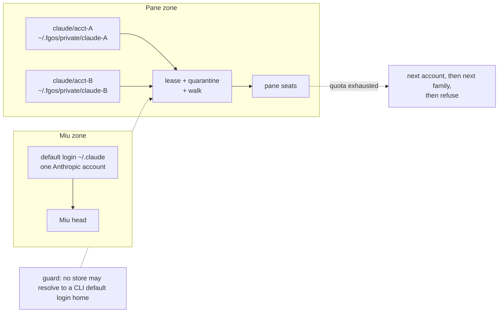

# Dành riêng một tài khoản Claude cho Miu, cho thuê các tài khoản còn lại cho pane

```txt
discussion: settled
topic: backlog row p-mnymjukvqd (seat-binding / accounts)
shaper: lead:ACCOUNT-SHAPE (claude-mkz3@fg-server2), opened by head:secretary-miu
opened: 2026-11-18 18:08
domain: platform (seat binding, runner accounts); không có domains/<domain>/AGENTS.md riêng
open owner questions: QUESTIONS.md (Q1 đã trả lời B; Q2 đã trả lời (tetcu, anhdvh, van.tran), đã đăng nhập đủ ba thư mục; Q3 đã trả lời B; Q4 đã trả lời A)
```

## Hand-off cho planner

- **Outcome.** Tài khoản Claude của Miu không bao giờ bị một pane tiêu hết; mọi tài khoản Claude khác chỉ nằm trong pool dành cho pane; hết quota thì pane đổi tài khoản, đổi family hoặc bị từ chối, Miu không bị ảnh hưởng.
- **Constraints.** Config trước, code mới chỉ bằng Rust và chỉ khi không phá cửa hiện có (một cửa, một đường). Không in credential. Không đổi luật khoá trong `docs/platform/platform-foundations.md`. Tôn trọng quyết định 86 Q2 (2026-11-12): ghế claude không bao giờ dùng `~/.claude` làm kho login của một account, trừ khi chủ dự án đảo lại ở Q1.
- **Non-goals.** Không viết lại thuật toán lease, xếp hạng hay quarantine. Không thêm cơ chế "chờ" cho pane. Không đổi cách xếp tier hay `tierFallback`. Không chạm pool của codex, pi, omp, agy.
- **Acceptance criteria.**
  1. Trên máy của chủ dự án không pool nào trong `runner.llmAccounts` trỏ tới `~/.claude` hay tới tài khoản của Miu; một hàng doctor cảnh báo (không từ chối) khi có, để người chỉ có một tài khoản vẫn dùng được fgOS.
  2. `fgos dispatch explain` cho một ghế pane bất kỳ không bao giờ liệt kê tài khoản của Miu trong walk.
  3. Một lần khởi động thật của một pane claude lease đúng một tài khoản của pool pane; một lần khởi động thật của Miu (đường đã chọn ở Q1) chạy đúng tài khoản của Miu và không tiêu quota pane.
  4. Hết quota pool pane: bằng chứng thật (hoặc ca vàng của crate) rằng ghế đổi tài khoản, rồi đổi family, rồi từ chối theo tên; Miu vẫn chạy.
- **Open points that block only some parts.** Q1 đã trả lời B nên task `miu-start` không còn bị chặn bởi owner. Q2 đã trả lời; ba thư mục đã được chủ dự án đăng nhập (tetcu, anhdvh, van.tran), `task-pane-pool` không còn chờ owner. Q3 đã trả lời B (2026-11-18: cảnh báo cho mọi CLI trong `CLI_LOGIN_HOMES`, không bao giờ từ chối hay fail); Q4 đã trả lời A.
- **Source ids.** p-mnymjukvqd; quyết định 86 Q2 (docs/platform/agent-confinement/spec.md mục 4 của danh sách store); RUL102, RUL105, RUL106 (docs/platform/runner/subcomponents/h-6979005beaf7/spec.md); D-ADR0072 (docs/platform/seat-binding/spec.md).

## 1. Trạng thái hiện tại

Việc khảo sát xong, thiết kế chốt, Q1 và Q2 đã được chủ dự án trả lời; còn Q3, Q4 có mặc định, và việc đăng nhập ba thư mục là của chủ dự án. Phát hiện quan trọng nhất: **pane hiện đang dùng chung quota với Miu**, vì pool `claude` duy nhất trên máy này có một tài khoản `vantt` mà login của nó là cùng một tài khoản Anthropic với login mặc định trong `~/.claude` (hai login khác thư mục, cùng một tài khoản). Cần thêm tài khoản khác và tắt tài khoản này khỏi pool pane. Người chỉ có một tài khoản Claude thì không có gì để tách: pane và phiên chính chung quota, và fgOS vẫn phải chạy được cho họ. Đường "config thuần" làm được ngay; đường để Miu khởi động tin cậy qua `fgos head start` cần một chút code Rust nhỏ (Q1).

## 2. Mục tiêu và đề bài

Miu (head:secretary-miu) là phiên mặt tiền của chủ dự án và phải sống liên tục để công việc tiếp tục. Hôm nay Miu khởi động tay bằng `claude --model sonnet` trên login mặc định, nằm ngoài mọi lease. Các pane fgOS mở ra thì lease tài khoản từ các pool trong `runner.llmAccounts`. Chủ dự án quyết ngày 2026-11-18: login mặc định ở `~/.claude` là của Miu và không lease nào được giao nó cho ghế khác; mọi tài khoản Claude khác nằm trong thư mục login riêng ngoài home mặc định và chỉ xuất hiện trong pool của pane; pane dùng ít quota, nhưng Miu phải chạy tiếp nên tài khoản của Miu không bao giờ bị pane làm cạn. Câu hỏi của đợt khảo sát: hôm nay mô hình tài khoản ra sao, pool có chứa login mặc định không, pane chọn thư mục login thế nào, đâu là đường vào để nói "ghế này không bao giờ dùng login mặc định" và "Miu nằm ngoài lease", Miu nên được khởi động tin cậy thế nào, hết quota thì chuyện gì xảy ra, và thiết kế nhỏ nhất giữ một cửa là gì.

## 3. Vấn đề rõ / chưa rõ

| # | Điểm | Trạng thái | Bằng chứng |
|---|------|-----------|-----------|
| F1 | Mô hình tài khoản: `runner.llmAccounts` = pool → account → `credentialStore` (thư mục login mỗi CLI), tuỳ chọn `label`, `disabled`; thứ tự khai báo là thứ tự lease | rõ | `core/config-schema/runner.schema.yaml:308`; `src/runner/dispatch/llm-accounts.mjs:19`; file thật `~/.fgos/private/accounts.yaml` |
| F2 | Pool `claude` trên máy này có đúng 1 tài khoản `vantt`, store `~/.fgos/private/claude-vantt` (không phải `~/.claude`) | rõ | `accounts.yaml`; `fgos dispatch explain --for execute` liệt kê `claude/vantt usable` |
| F3 | Không pool nào trỏ thư mục `~/.claude`, nhưng login của `claude/vantt` và login mặc định **cùng một tài khoản Anthropic** (so sánh bằng định danh tài khoản trong metadata, chỉ in đúng/sai) ⇒ pane và Miu chung quota | rõ (đo trên fg-server2) | so sánh định danh tài khoản của `~/.claude.json` và của `~/.fgos/private/claude-vantt/.claude.json` |
| F4 | Pane claude chọn thư mục login: invocation `claude-cli-bwrap`/`claude-herdr-bwrap` khai `credentialStore {use: claude, homeEnv: CLAUDE_CONFIG_DIR, files: [.credentials.json]}`; lease cấp account, driver chép `.credentials.json` của account vào một home riêng của attempt, `CLAUDE_CONFIG_DIR` trỏ vào home đó; home bị xoá khi attempt hết | rõ | `core/config-standard/runner.yaml:36-62`; `providerCapacityForInvocation` (`provider-capacity.mjs:127`); spec agent-confinement (store claude) |
| F5 | Sandbox che mọi thư mục login của máy (kể cả `~/.claude`) khỏi ghế confined, trừ home riêng của nó | rõ | `machineLoginStores` (`llm-accounts.mjs:232`) |
| F6 | `fgos head start` đi đúng cửa của pane: `bindHeadSeat` (persona → tier → `bind()`) rồi `launchSessionAttempt` → `leaseAccountForAttempt`. Một head thật là ghế confined có lease, không phải phiên tay | rõ | `src/session-host/head-start.mjs:107,157`; `src/runner/dispatch/session-attempt.mjs:90` |
| F7 | Miu bind qua persona `secretary` (prefer claude, tier standard ⇒ model sonnet); nếu khởi động bằng `head start`, Miu lease tài khoản từ **cùng pool `claude`** với pane | rõ | commit `575f36c15`; `.fgos/config.yaml` `runner.personas.secretary` |
| F8 | Không có khoá config để một pool dành riêng cho một persona. Pool do cell `model@pool` chọn (RUL102); persona chỉ có `tier` và `prefer` (executor/invocation), không có `pool`. `excludePools` chỉ là trạng thái walk lúc chạy, không phải config | rõ | `docs/platform/seat-binding/spec.md` mục 6.2; `packages/seat-binding/rust/src/model.rs:534` |
| F9 | Pool rỗng chỉ chạy "login riêng của executor" khi pool mang tên family (`claude`); pool khác tên mà rỗng bị từ chối `pool-unusable`. Pool còn tài khoản nhưng tất cả `disabled` cũng `pool-unusable`, không rơi về login mặc định | rõ | `packages/seat-binding/rust/src/rank.rs:874-925` |
| F10 | Hết quota: tài khoản bị quarantine tới giờ reset, probe lười; ghế xoay tài khoản theo thứ tự khai báo, rồi đi `tierFallback.<tier>` sang family khác, hết đường thì từ chối theo tên (`no-account-available`, `pool-unusable`, `provider-capacity-refused`). Không có chế độ chờ | rõ | RUL106; `rank.rs order_accounts`; `provider-capacity.mjs` (quarantine, `classifyProviderCapacityFault`) |
| F11 | Không có cổng máy móc nào cấm một store trỏ vào thư mục login mặc định của một CLI. Quyết định 86 Q2 chỉ là văn bản ("không bao giờ `~/.claude`") | rõ | doctor registry chỉ có `llm-accounts-shape`, `confined-pane-accounts`, `account-probe-timer`; không có guard nào trong `llm-accounts.mjs` |
| F12 | Tier flagship và frontier xếp `claude` đầu trong `tierFallback`, và nhiều capability review/judge ghim claude: pane nặng dùng quota claude đáng kể, trái với giả định "pane dùng ít" | rõ (cấu hình) | `core/config-standard/runner.yaml:565-568, 357, 417, 442` |
| F13 | Invocation `claude-cli` (không confined, không khai store) sẽ đọc login mặc định tại chỗ nếu có ghế nào chọn nó; chưa chứng minh được đường nào có thể chọn nó | **chưa rõ** | không `prefer` nào tên nó; cần dry-bind ngoài herdr ở plan |
| F16 | Rotate tự động chỉ áp cho head do `fgos head start` mở; Miu bật tay không tự rotate, và `fgos head rotate` cho một Miu chưa từng được place chưa chứng minh chạy được | rõ (hook), chưa rõ (rotate tay trên phiên không place) | `session_rotation_hook.rs`; spec session-host mục 8.4 |
| F14 | Head confined có `~/.claude.json`, settings, hook, skill của người dùng không? Spec nói không (home riêng chỉ có `.credentials.json`); Miu hôm nay dựa vào chúng | **chưa rõ** | cần một lần khởi động thật của Miu qua `head start` làm bằng chứng |
| F15 | Gia hạn login claude: login gia hạn trong home riêng chỉ được stage cho owner, không bao giờ tự áp dụng vào kho thật. Nếu kho là `~/.claude` mà một pane gia hạn bên trong bản sao, refresh token thật có thể bị provider thu hồi và đăng xuất các phiên lead | rõ (lý do của quyết định 86 Q2) | `provider-credential-renewal.mjs` đầu file; guide declare-claude-seat-store |

## 4. Quyết định đã chốt

Id cục bộ của phiên shaping; planner mint D-ADR qua `fgos identity mint d-adr` khi ghi vào spec.

| Id | Quyết định | Nguồn |
|----|-----------|-------|
| OD1 | Login mặc định `~/.claude` là của Miu; không lease nào giao nó cho ghế khác | chủ dự án 2026-11-18 (qua Miu) |
| OD2 | Mọi tài khoản Claude khác ở thư mục login riêng ngoài home mặc định, chỉ xuất hiện trong pool của pane | chủ dự án 2026-11-18 |
| OD3 | Tài khoản của Miu không bao giờ bị pane làm cạn | chủ dự án 2026-11-18 |
| OD4 | Miu bật lần đầu bằng `fgos head start secretary --name miu` (không bằng `claude` tay) để các lần refresh tự rotate theo ngưỡng; tài khoản của Miu và các Miu kế nhiệm ở pool riêng `claude-miu`, không lẫn pool pane | chủ dự án 2026-11-18 18:32 (Q1 = B) |
| OD5 | Pool pane gồm ba tài khoản `tetcu`, `anhdvh`, `van.tran`, mỗi cái một thư mục `~/.fgos/private/claude-<id>`; `claude/vantt` rời pool pane (tắt) khi ít nhất một trong ba đã đăng nhập và qua probe, và trở thành tài khoản của Miu trong pool `claude-miu` | chủ dự án 2026-11-18 (Q2) + SD2 |
| SD1 | Dùng nhà của cơ chế có sẵn: `llmAccounts` + cờ `disabled` + lease/quarantine/walk hiện tại. Không thêm cơ chế lease mới | F1, F10 (L10, tenet một cửa) |
| SD2 | Tài khoản `claude/vantt` hiện có là tài khoản của Miu về mặt quota (F3): ra khỏi pool pane ngay khi pool có ít nhất một tài khoản khác. Cho tới lúc đó pane vẫn chung quota với Miu | F3 |
| SD3 | Thêm một hàng doctor **cảnh báo, không bao giờ từ chối hay fail**, khi một store của `llmAccounts` có đường thật (realpath) trùng thư mục login mặc định của chính CLI đó, nêu rủi ro gia hạn (F15); dùng bảng `CLI_LOGIN_HOMES` có sẵn. Không từ chối cứng, vì người chỉ có một tài khoản Claude (login ở `~/.claude`) vẫn phải dùng được fgOS (chủ dự án 2026-11-18 18:22) | F11, F15, tenet "một cửa cần guard máy móc", ranh giới sứ mệnh (fgOS phục vụ project khác) |
| SD4 | Giữ hành vi hết quota hiện tại cho pane: chạy lại từ đầu trên tài khoản khác cùng pool, rồi family khác, rồi từ chối; ghế ghi dở không xoay mà dừng chờ người (RUL92); không thêm chờ và không tự chạy tiếp. Chủ dự án chọn A cho Q4 (2026-11-18 18:55). Việc "ghế ghi dở tự chạy tiếp" là ý tưởng ghi nhận cho sau, chỉ làm nếu thực tế hay gặp | F10, Q4 |

## 5. Q&A log

- 2026-11-18 18:08 — Miu mở đề bài và 6 câu hỏi; quyết định OD1–OD3 đã có.
- 2026-11-18 18:13 — Khảo sát đọc: cấu hình `~/.fgos/private/accounts.yaml` (chỉ tên, thư mục, số lượng), schema `runner.schema.yaml`, `llm-accounts.mjs`, `provider-capacity.mjs`, `rank.rs`, `head-start.mjs`, `session-attempt.mjs`, spec seat-binding / agent-confinement / runner (RUL102, 105, 106). Dry-bind `fgos dispatch explain --for execute` (không lease). So sánh định danh tài khoản của hai login claude, in kết quả đúng/sai. Câu hỏi mở Q1–Q4 ghi trong QUESTIONS.md.

- 2026-11-18 18:22 — Chủ dự án: người chỉ có một tài khoản Claude không được bị chặn ⇒ guard tầng 2 thành cảnh báo (SD3).
- 2026-11-18 18:30 — Chủ dự án: lần đầu bật tay được, các lần refresh phải tự động; tìm ra rotate tự động chỉ áp cho head từ `head start` (F16).
- 2026-11-18 18:32 — Q1 trả lời B (OD4).

- 2026-11-18 18:40 — Q2 trả lời: `tetcu`, `anhdvh`, `van.tran` (OD5).
- 2026-11-18 18:38 — Chủ dự án: `tetcu` đã đăng nhập. Kiểm tra chỉ đọc: thư mục `~/.fgos/private/claude-tetcu` có file login, là tài khoản Anthropic khác Miu và khác `vantt` (so định danh, chỉ in đúng/sai). Quyền thư mục là 775, trong khi `claude-vantt` là 700; nên siết về 700 (login nằm trong đó). Chưa thêm vào `accounts.yaml` (phiên shaping chỉ đọc), việc của planner.
- 2026-11-18 18:42 — Chủ dự án: `anhdvh` đã đăng nhập; kiểm tra chỉ đọc cùng cách với `tetcu`, kết quả ghi trong báo cáo của phiên.
- 2026-11-18 18:44 — Chủ dự án: `van.tran` đã đăng nhập (thư mục `~/.fgos/private/claude-van.tran`); kiểm tra chỉ đọc như hai tài khoản trước. Ba tài khoản pane đã sẵn sàng; `task-pane-pool` không còn chờ chủ dự án.
- 2026-11-18 18:55 — Q4 trả lời A (SD4).

## 6. Thiết kế đã chốt {#design}

**Hình dạng đích.** Hai "vùng" tài khoản không giao nhau: vùng Miu (một tài khoản Anthropic, login mặc định) và vùng pane (pool `claude` gồm các tài khoản Anthropic khác, mỗi cái một thư mục dưới `~/.fgos/private/claude-<id>`). Một tài khoản Anthropic chỉ ở một vùng, vì quota tính theo tài khoản, không theo thư mục: hai thư mục login của cùng một tài khoản vẫn chung quota (F3). Lease hiện có phục vụ vùng pane nguyên trạng; vùng Miu nằm ngoài lease cho tới khi Q1 chọn khác.



**Ba tầng, từ rẻ đến đủ.**

1. **Config thuần (làm được ngay).** Thêm các tài khoản Claude khác vào pool `claude` (mỗi cái đăng nhập bằng `CLAUDE_CONFIG_DIR=<thư mục riêng> claude /login`, đúng quy trình trong guide declare-claude-seat-store); đặt `disabled: true` (hoặc xoá) cho `claude/vantt` khi pool đã có ít nhất một tài khoản khác. Miu giữ khởi động tay trên `~/.claude`. Không code. Hiệu quả: pane không còn tiêu quota Miu, Miu nằm ngoài lease.
2. **Cảnh báo máy móc (SD3).** Một hàng doctor chỉ-đọc, mức warn, báo store nào có realpath trùng thư mục login mặc định của CLI đó (bảng `CLI_LOGIN_HOMES`) kèm lý do và cách tách (một login thứ hai bằng `CLAUDE_CONFIG_DIR=<thư mục riêng> claude /login`). Không từ chối: người chỉ có một tài khoản Claude (login ở `~/.claude`) khai nó vào pool vẫn chạy được, chỉ chịu rủi ro gia hạn đã nêu; người có nhiều tài khoản được nhắc đúng lúc. Một chỗ, một bảng. Hệ quả cho OD1: việc giữ login mặc định cho Miu là quy ước của máy chủ dự án, không bị ép cho mọi người dùng fgOS.
3. **Miu là head ngay từ lần bật đầu, qua `fgos head start secretary --name miu` (chỉ khi Q1 chọn B).** Lý do của chủ dự án (2026-11-18 18:30): lần đầu có thể bật tay, nhưng các lần refresh phải tự động. Rotate tự động đã có (hook Stop, ngưỡng soft 0.4 và hard 0.7 của `sessionRotation`, `docs/platform/session-host/spec.md` mục 8) nhưng hook chỉ làm việc khi phiên mang `FGOS_HEAD_ROLE`, `FGOS_HEAD_PERSONA`, `FGOS_HEAD_NAME` và socket yêu cầu, do `placeHead` khai; một Miu bật bằng `claude` không có chúng. Mọi Miu kế nhiệm do `placeHead` mở nên đều là ghế confined có lease.  Head là ghế confined có lease (F6). Để lease của Miu không chạm pool pane cần một khoá persona mới `runner.personas.<p>.pool` (Rust, crate seat-binding: policy.rs, schema, ca vàng) và một pool `claude-miu` mà không cell nào nêu tên (pool không cell nào nêu thì pane không bao giờ tới, an toàn theo cấu trúc, không cần cờ). Thư mục login của Miu trong đường này là kho riêng do fgOS sở hữu (một login thứ hai của cùng tài khoản Anthropic, có thể là kho `claude-vantt` hiện có), không phải `~/.claude`, vì F15. Bắt buộc có một lần khởi động thật chứng minh F14 (hook, skill, settings) trước khi dựa vào nó.

**Hết quota.** Giữ nguyên (SD4): trong pool pane ghế xoay tài khoản theo thứ tự khai báo; hết tài khoản thì sang family tiếp theo của `tierFallback.<tier>`; không còn thì từ chối theo tên. Miu được bảo vệ bằng cấu trúc: tài khoản Anthropic của Miu không nằm trong pool pane (SD2, SD3), nên không đường nào của walk chạm tới. Rủi ro còn lại ngoài cấu hình: F12 (tier nặng ưu tiên claude) tăng áp lực lên pool pane; nó chỉ làm pane hết sớm hơn, không ảnh hưởng Miu.

**Bằng chứng một cửa.** Tái dùng: `llmAccounts`, `disabled`, `acquireNamedAccountLease`, `order_accounts`, `machineLoginStores`, `CLI_LOGIN_HOMES`. Thiếu: guard F11, khoá persona `pool` (chỉ tầng 3), bằng chứng F13/F14.

## 7. Danh mục hạng mục / task {#tasks}

### task-pane-pool {#task-pane-pool}
- **Goal.** Pool `claude` chỉ chứa các tài khoản Anthropic khác Miu, mỗi cái một thư mục riêng; `claude/vantt` tắt.
- **§6 excerpt.** Tầng 1. **D-IDs.** OD1, OD2, OD3, SD2. **Phụ thuộc.** Q2 (chủ dự án cung cấp danh sách tài khoản thật và đăng nhập từng cái; không agent nào đăng nhập hộ). Đây là thay đổi cấu hình máy (`~/.fgos/private/accounts.yaml`), không phải repo; ghi vào guide cho máy chủ dự án (docs impact: tuyến vận hành).
- **Verify.** `fgos dispatch explain --for execute --json` rồi đọc `data.accounts`: pool `claude` không còn `vantt` usable; một khởi động pane thật lease một tài khoản mới.

### task-default-home-guard {#task-default-home-guard}
- **Goal.** Hàng doctor warn (không fail, không từ chối) khi một store của `llmAccounts` trùng login mặc định của CLI (SD3); xem Q3 về phạm vi.
- **§6 excerpt.** Tầng 2. **D-IDs.** SD3, OD1. **Phụ thuộc.** không.
- **Verify.** Test chủ của `llm-accounts` (hoặc hàng doctor) với một store giả trỏ vào thư mục login mặc định của một home tạm: hàng doctor ra `warn` nêu tên khoá và cách tách, pool vẫn lease được; store riêng thì không cảnh báo. Một proof sở hữu, đúng tầng thấp nhất.

### task-miu-start {#task-miu-start}
- **Goal.** `fgos head start secretary --name miu` chạy Miu (và mọi Miu kế nhiệm do rotate tự động) trên tài khoản của Miu, ngoài pool pane, và proof bằng khởi động thật.
- **§6 excerpt.** Tầng 3. **D-IDs.** OD1, OD3, SD1. **Phụ thuộc.** Q1 (B); khoá persona `pool` trong crate seat-binding (Rust) nếu chọn đường kho riêng; chặn bởi F14, F13.
- **Verify.** Dry-bind cho persona secretary ra pool `claude-miu`; một dry-bind của mọi ghế pane không bao giờ ra pool đó; khởi động thật của head và của một pane, đọc `data.accounts` trong provenance; một lần rotate thật (hoặc ca của executor) cho thấy Miu kế nhiệm lease cũng đúng pool `claude-miu`.

### task-claude-cli-inplace-proof {#task-claude-cli-inplace-proof}
- **Goal.** Chứng minh (hoặc đóng) đường có thể chọn `claude-cli` đọc login mặc định tại chỗ (F13).
- **D-IDs.** OD1. **Verify.** dry-bind ngoài herdr cho các capability có claude; hoặc thêm vào guard của task-default-home-guard một hàng kiểm "invocation claude không store chỉ đến được khi unconfined".
