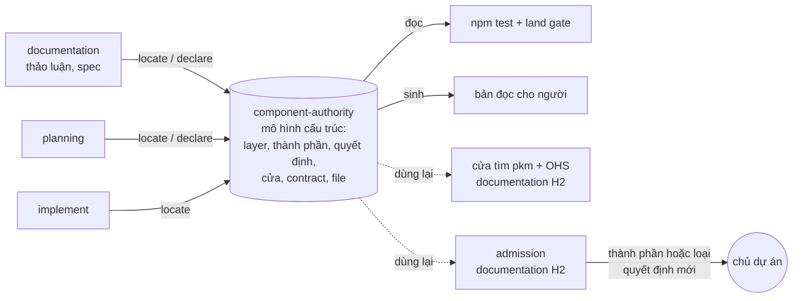

discussion: open

# Component authority: one ledger of authority, boundary and contract for the whole system

## 1. Trạng thái hiện tại

2026-11-21 18:00 round 1: T0 xong (§3 row 3a, 3c). Phát hiện chính: 14/25 bản sao là **twin Node cố ý giữ khi port sang Rust** mà không có hạn xóa máy kiểm được; 4/25 là code không có caller; khác tên chỉ 3/25. Bảng `doors` và land gate bắt 0/25; trễ trung vị 30 ngày. Lúc lập plan không có bước hỏi chủ sở hữu hay tìm cửa có sẵn.

- **Q1 đã trả lời trong chat (18:25): cấm twin Node.** Port sang Rust là cắt chuyển: bản Node bị xóa cùng đợt, lịch sử nằm trong git, và việc chuyển được ghi note đầy đủ tham chiếu bản cũ (§3 row 3d). Chờ thêm một round không đổi ý rồi mint D-ID. `q-djyjckiygr` đã cancel vì trả lời ngoài store.
- Chủ dự án (20:41) chọn **gộp tầng kiến trúc vào `component-authority`** (Q5). §6 viết lại toàn bộ; §7 có danh mục hạng mục T1-T7. **Chờ chủ dự án duyệt §6** (đặc biệt điểm kiểm lúc plan và land, row 3b và 5, chưa bàn riêng); duyệt xong thì đóng discussion và giao planner.
- Chủ dự án (20:16) chọn `component-authority` (**CA-D3**; CA-D2 cấm twin cũng chốt). Hỏi tiếp: contract quản chi tiết hay chỉ component, một component nhiều contract thì sao, subcomponent và tầng kiến trúc có quản chung không. Shaper quyết (i)-(iii) ở §3 row 4a; **Q5** hỏi về tầng kiến trúc.
- Chủ dự án (20:06) đặt lại bài: nền là architecture hay component authority; học cả bảy sổ; chủ cân giữa documentation và architecture; chấp nhận thành phần mới nhỏ, cô lập, chỉ quản lý, documentation dò và khai báo qua nó, quản cả contract. Shaper tìm thêm sổ thứ bảy (architecture-map §6/§7 có contract registry) và mẫu locate/admission của documentation H2 (§3 row 1b); đề xuất ở row 4; **Q2 và Q3 thay bằng Q4**.
- Chủ dự án (19:35): "ok, hỏi đi", nhưng trước khi hỏi chọn sổ sống sót phải: kiểm từng sổ xem sổ nào tiến bộ và đầy đủ hơn, học cách tiếp cận của tất cả các sổ, và xác định **thành phần nào đang sửa** từng sổ và quan trọng hơn **thành phần nào, ai đang quản lý** nó. **T0d xong (§3 row 1a).** Đã hỏi **Q2** (sổ nào làm nền) và **Q3** (thành phần nào, ai quản lý sổ); id ở §Q2, §Q3.
- Chủ dự án (18:45): "đầu phiên em nói có tới 3 sổ, đây cũng là một việc trùng luôn." Xác nhận: sổ authority chính nó là ca trùng khái niệm, và là ít nhất năm nơi chứ không phải ba (§3 row 1). Lần gom sổ phải là ca đầu tiên tuân luật "đặt tên bên sống sót".
- Chủ dự án (18:27): "thực chất nó không phải đơn thuần trùng rust và node". **T0c xong (§3 row 3e):** bảy ca trùng khái niệm còn ở HEAD; nguyên nhân lặp lại là không ai đặt tên bên sống sót, cùng việc khác tên (hoặc một tên nhiều việc), bề mặt mới tự làm đường riêng, và plan không trích spec có sẵn.
- Chưa có câu hỏi mới nào đang mở với chủ dự án.
- Cùng nghĩa khác chữ (§3 row 3b): **là giả thuyết chính, không phải thứ yếu.** Có hai tầng: (a) hàm hoặc helper bị chép dưới tên khác (guard so chữ lọt); (b) **cả một thành phần mới, tên khác, làm việc tương tự thành phần đã có** (portfolio cạnh supervision, watcher cạnh `fgos-runner --watch`, ba ngôn ngữ khung) — tầng (b) là điều chính chủ dự án lo và là đối tượng của T0c. Con số "3/25" đến từ mẫu lệch về port; ở các ca trùng khái niệm (portfolio/supervision, ba đường handoff) khác chữ chính là thứ che việc trùng. Shaper đề xuất thiết kế cụ thể ở row 3b (hướng D), chờ T0c xác nhận rồi hỏi chủ dự án.
- Tiếp theo: hình dạng sổ (row 4) bỏ trường "twin" khỏi thiết kế; soạn điểm kiểm lúc plan (row 5).

## 2. Mục tiêu & đề bài

Chủ dự án (2026-11-21): "component authority/boundary và contracts là rất quan trọng. anh không rõ sao mình vẫn cứ bị sinh thêm code thừa, nên cần quản lý chắc cho anh", và "authority/boundary và contract là yếu tố hạng nhất của cả system". Nguyên tắc đã có sẵn trong văn xuôi: design principle 1 "One door" và 7 "One authority, one source of truth" (`core/instructions/design-principles.md`), L10 add-through-not-alongside, RUL11 gom tùm lum. Chỗ hổng là việc ép thi hành. Mục tiêu: mỗi thành phần của hệ thống có đúng một authority (loại quyết định nó sở hữu), boundary rõ (sở hữu gì, không sở hữu gì) và contract tường minh, ghi ở **một** sổ duy nhất mà máy kiểm được, và code thừa bị chặn trước khi được viết thay vì bị dọn sau khi đã land. Discussion `orchestration-skeleton` phụ thuộc vào kết quả của discussion này: các thành phần của skeleton tuân sổ authority như mọi thành phần khác.

## 3. Vấn đề rõ / chưa rõ

| # | Điểm | Bằng chứng | Trạng thái |
|---|---|---|---|
| 1 | **Bản thân sổ authority cũng là một ca trùng khái niệm** (chủ dự án chỉ ra, round 2), và không phải ba nơi mà **ít nhất năm nơi** cùng nhận trả lời "ai sở hữu gì": (i) `docs/architecture-manifest.json` (máy đọc: tier, luật import, 78 row `doors`; có từ 7349a52bc 2026-07-16); (ii) `docs/platform/proposals/component-authority-boundary-map.md` (nháp, `Canonical: No`; vào repo cf63f28cf 2026-09-02, chưa từng có quyết định promote hay reject); (iii) `docs/platform/component-boundary.md` (nhập từ `docs/architect/component-boundary` ở 23fb220e3 2026-09-15, `Design status: Draft` nhưng `Canonical: Yes, after review`, tự trỏ sang (ii) trong `Related`); (iv) `docs/platform/system-overview/spec.md` §Area Map và §Shared Entities (cột "owns"); (v) `docs/platform/governance.md:540` "Decision scope to holder table" (scope quyết định -> area giữ); cộng §Shared Entities trong 10/36 spec khu vực. Cùng nguyên nhân với row 3e: mỗi lần một sổ mới ra đời, **không ai đặt tên bên sống sót**, nên sổ cũ ở lại và lệch dần (row 3a ý 6: config, canonical JSON, process kill). | `git log --diff-filter=A` từng file; `docs/platform/component-boundary.md:1-30` | **Rõ (hiện trạng)** |
| 1a | **T0d: đánh giá các sổ (2026-11-21 19:50).** Có **sáu nơi trở lên**, chỉ hai nơi máy đọc. **L1** `docs/architecture-manifest.json` + `test/architecture.test.mjs`: tiến bộ nhất và duy nhất làm đỏ test khi sai; phủ 344 file, 44 tier, 78 row `doors`; 0 lệch với đĩa ở HEAD; nhưng nó map **file -> tầng và người ghi**, chưa map **thành phần -> quyết định**; không có trường Owner. **L2** proposal map: từ vựng ranh giới tốt nhất (**Owns / Must not own**, 14 row, ma trận contract §7), đóng băng từ 2026-11-06, `Canonical: No`. **L3** `component-boundary.md`: danh sách thành phần đầy đủ nhất (~37 row, mỗi row có link "Current source"), không cột chủ, ranh giới hay cửa, đẩy chi tiết sang L2 (sổ không canonical); ngày review cũ hơn lần sửa cuối; `OccupancyPort` không có trong code. **L4** system-overview Area Map: phủ 13/36 spec, sai về supervision ("chưa có crate, verb") trong khi code có cả hai. **L5** governance holder table: tươi, được `src/report/decision-index.mjs:22-35` đọc để sinh `docs/decisions/index.md`; có aliases tên cũ. **L6** Shared Entities trong 10 spec: cột không thống nhất, không gì đọc chúng, dù AGENTS.md bảo agent dùng. Ngoài ra: bảng owner trong `docs/platform/README.md` (26 row) và trường `owner` trong `packages/distribution/contracts/doctor-registry.v1.json` (122 row, trỏ crate). Không phải sổ sở hữu: `doc-registry.json`, `reading-map.md`, frontmatter `authoritative_for`. **Ai ghi:** sổ nào cũng do commit làm việc sửa tay, không generator nào ghi; L1 được giữ đúng chỉ vì test đỏ khi file thiếu row. **Ai quản lý: không sổ nào có chủ được thi hành hay lịch review.** L3 ghi Owner "Platform documentation" (Draft, chưa ký); governance §13 rải trách nhiệm ra 36 portal; L1 không có Owner. Ý đáng học: L1 cửa + debt có lý do + máy kiểm; L2 Owns/Must not own; L3 link nguồn; L5 bảng scope -> holder có aliases, được generator đọc; doctor-registry owner trỏ crate; L6 owner theo entity. | Báo cáo inline T0d. Chưa xác định: danh tính commit `x` và `Test`; `owner` của doctor-registry có khớp crate không | **Rõ** |
| 1b | **Sổ thứ bảy và mẫu sẵn có của documentation (round 4).** (L7) `docs/platform/architecture-map.md` (Owner "Platform documentation", Draft, review 2026-09-13) có **§6 Sổ đăng ký component** và **§7 Sổ đăng ký contract** (mã CTR001…, mỗi contract nối hai phía, trạng thái live), cùng Phụ lục B sổ đăng ký 13 hệ id; văn xuôi, không máy kiểm; quyết định 0010 gọi nó là bản chuẩn của contract registry. Area `docs/platform/documentation/` (H2, các subcomponent **ký 2026-11-12, chưa làm**) đã thiết kế đúng cơ chế cần cho sổ authority, nhưng cho tài liệu: **document identity** "locate before write" qua một cửa tìm duy nhất (pkm + OHS: BM25 + embeddings, có gói tiếng Việt — giải được cùng nghĩa khác chữ, `subcomponents/document-identity/spec.md:41,58`); **admission** "by effect": thay đổi mở hoặc dời authority phải qua người review độc lập trong khung chủ dự án đã duyệt, chủ dự án chỉ bị hỏi ngoài khung (`subcomponents/admission/spec.md:28-30,158`); vai trò "Writer không được tạo tài liệu khi chưa có kết quả locate" (`document-identity/spec.md:113`). | Đọc trực tiếp các spec nêu trên | **Rõ** |
| 4a | **Phạm vi chi tiết của `component-authority` (round 5, chủ dự án hỏi).** (i) **Contract: quản chỉ mục, không quản nội dung.** Nội dung contract (schema JSON, vectors, văn xuôi) ở lại cạnh code chủ của nó, vì đó là nguồn duy nhất mà test của chủ đọc (vd. `packages/questions/contracts/questions-input.v1.json` tự ghi "the rule authority for the door"); chép nội dung vào sổ sẽ sinh bản thứ hai. Sổ giữ mỗi contract một row: id, tên chuẩn + aliases, câu nghĩa, **bên cung cấp** (một thành phần), **các bên dùng**, cửa nó canh, phiên bản, đường dẫn file, trạng thái; test kiểm file tồn tại và mỗi contract có đúng một bên cung cấp. Hiện có 27 thư mục `packages/*/contracts` (524 file, vd. run-supervisor 17, holder-lock 12) và 31 contract văn xuôi `docs/platform/*/contracts/*.md`, cộng sổ CTR ở `architecture-map.md` §7. (ii) **Một thành phần nhiều contract:** quan hệ một-nhiều, contract là row riêng trỏ về thành phần, không phải cột của thành phần; `locate` trả cả thành phần lẫn contract khớp nghĩa. (iii) **Subcomponent: cùng một loại row với trường `parent`** (cây thành phần), không phải sổ riêng; loại quyết định gán ở mức thấp nhất sở hữu nó; hiện có 12 subcomponent dưới `docs/platform/*/subcomponents/`. (iv) **Tầng kiến trúc: gộp (chủ dự án chọn ở Q5, 20:41; mint D-ID ở round sau nếu không đổi)** — manifest đã có `layers`, `rules`, `tiers`, map 344 file -> tầng, và một khung `components` gần như trống (1 entry), nên tách hay gộp quyết định có còn hai map file hay không. | Đếm trực tiếp; `docs/architecture-manifest.json` keys | **(i)-(iii) shaper quyết trong khung CA-D3; (iv) chủ dự án chọn gộp** |
| 4b | **RUL có thuộc sổ không? (chủ dự án hỏi, round 7).** §6 chỉ đưa vào ba luật xếp tầng của manifest. RUL nghiệp vụ (111 id khác nhau trong 54 file dưới `docs/platform`, không có sổ đăng ký nào), luật nền L1-L10 và design principles **không** nằm trong mô hình; mô hình chỉ biết **nơi giữ** RUL của từng loại quyết định qua cột holder (học từ `governance.md:540`, cột "Facts and RULs"). Câu hỏi mở: có nên thêm row RUL dạng chỉ mục (id, câu nghĩa + aliases, thành phần chủ, đường dẫn; nội dung ở lại spec), giống contract, để `locate` bắt RUL trùng nghĩa? Chưa có bằng chứng RUL bị trùng. | `grep -rhoE 'RUL[0-9]+' docs/platform`; `docs/architecture-manifest.json` `rules` | **Mở: chờ chủ dự án** |
| 2 | Code thừa đã thấy: write-scope hai bản (Rust + Node); worktree hai module (`src/git/worktree.mjs`, `src/runner/worktree.mjs`); portfolio hai chủ (Supervision, `packages/portfolio`); handoff ba đường; ba ngôn ngữ khung; hai vòng lặp thực thi (watcher, `fgos-runner --watch`); `POST /v1/runner/tick` đi vòng cửa `fgos run`; mặc định `maxLeads` gán cứng ngoài `core/config-standard` | Lượt dò tier 0-9, `orchestration-skeleton` §3 4b, 4c | **Rõ (hiện trạng)** |
| 3 | Nguyên nhân thật vì sao code thừa sinh ra. Bảy giả thuyết: (1) guard `doors` khớp theo tên job đã biết, bản sao tên mới lọt; (2) kiểm quá muộn (test/land), lúc plan không hỏi "ai sở hữu quyết định này"; (3) thiếu spec hoặc contract nên không thấy cửa, xây cửa mới; (4) spec lạc hậu nên không ai tin; (5) override tier từng file che vi phạm; (6) agent song song tự quyết ngầm; (7) xóa đường cũ chưa bị ép, twin vào `allowed` rồi ở lại | `orchestration-skeleton` §3 4f; backlog `p-7nja6ilwkr` (từ 2026-11-01: 132 commit census, 37 commit one-door) | **Rõ (T0 lượt a xong, xem row 3c)** |
| 3a | **Kiểm kê guard (T0 lượt b, 2026-11-21).** (1) Guard khớp **tên và danh sách file**, không khớp hành vi: `checkDoors` (`test/architecture.test.mjs:1794-1853`) dò regex viết tay theo từng job; bản sao mang tên mới lọt. (2) File trong `allowed` là giấy thông hành trắng: số lần khớp bên trong không được đếm (`:1833-1841`), không row nào dùng `ratchet`. (3) Ngoại lệ không có vòng đời: 78 row `doors`, 247 entry `allowed` (104 là chuỗi trần không lý do), 76 entry debt; 0 trường owner hay hạn; `retiredBy` là văn xuôi, 26 row trỏ bước không ngày (S6a, S7). (4) Kiểm muộn: `checkDoors` chạy ở `npm test` và land gate (`.fgos/config.yaml:306`); pre-commit chỉ kiểm census drift. Git one-door scan chỉ thấy spawn `git` (4 declaration, census 0 site). (5) **Lúc lập plan không có bước nào hỏi chủ sở hữu hay tìm cửa có sẵn**: `fgos-coding-planning` im lặng; "Door check" trong `core/skills/_shared/plan-contract.md:88-90` là kiểm chồng footprint, không phải kiểm trùng năng lực (trùng tên gây nhầm); `plan-contract.md:123` "Prior art" không có bước tìm, không bằng chứng. Chỉ `fgos-coding-implement/SKILL.md:76-82` bắt tìm trước khi viết helper, bằng văn xuôi, lúc implement. (6) Ba sổ mâu thuẫn và ghi mâu thuẫn thành ngoại lệ thay vì giải quyết: config (`component-boundary.md:98` "every reader done" nhưng `src/config/facade.mjs` vẫn còn), canonical JSON (hai sổ ghi lý do khác nhau cho cùng ngoại lệ), process kill (`:92` "never kills by bare pid" nhưng `src/holder-lock/index.mjs:442` vẫn `process.kill`). (7) Authority thiếu primitive nên caller giữ bản sao: durable-file không có move/append, 10 file fsync ngoài `packages/durable-file/`. (8) Prior art dừng ở mức gọi tên: layer map 2026-10-01 hoãn; single-door handoff 2026-10-06 "not authorized"; audit 2026-11-09 có 27 finding; plan one-door-debt `completed` nhưng row `doors` chỉ chụp hiện trạng; 7 follow-up của 990bd8822 vẫn `proposed`; proposal map chưa từng có quyết định promote hay reject. | Báo cáo inline của lượt b (không ghi file report; tóm ở đây). Chưa xác minh: AU-01/10/15 đã đóng chưa, mailbox spec đã áp B1-B12 chưa, `packages/supervision/rust/src/land.rs` | **Rõ (hiện trạng); chờ lượt a để đối chiếu giả thuyết** |
| 3b | **Từ đồng nghĩa: cùng nghĩa, khác chữ (chủ dự án nêu, round 1).** Guard khớp tên (row 3a ý 1) nên bản sao mang tên đồng nghĩa (`settle`/`finalize`, `resolve`/`lookup`, `door`/`port`) lọt, ở cả code lẫn spec. Prior art: (i) guard cấm chữ `orchestrator` bị **gỡ** (quyết định 0031) vì grep chữ không phân biệt được nghĩa cũ với nghĩa mới, allowlist phình lên 28 entry và 5 item sinh ra chỉ để vá nó (`docs/knowledge/why-the-launcher-vocabulary-word-guard-was-retired-right-aft*/`); (ii) `runner.capabilities` đã có mẫu **một tên chuẩn + `aliases`** (D14, `docs/knowledge/why-runner-config-splits-capability-curated-vocab-executor-n*/`); (iii) Git one-door scan đã khớp theo **primitive** (binary được spawn), không theo tên, nên không bị đồng nghĩa đánh lừa (row 3a ý 4). Bốn hướng: **A** mỗi row authority có tên chuẩn + aliases, guard và planner tìm theo cả aliases (rẻ, vẫn là so chữ, sót đồng nghĩa chưa ai ghi); **B** guard khớp theo primitive/hành vi (`rename`+`fsync`, `process.kill`, spawn, canonical JSON), không theo tên (tất định, chống đồng nghĩa, nhưng sót bản sao logic thuần không chạm primitive); **C** lúc lập plan, LLM phải ánh xạ mỗi quyết định hoặc hàm mới vào một row có sẵn của sổ (đọc mô tả, không đọc tên) hoặc khai báo row mới, có tìm ngữ nghĩa (GitNexus `query` theo khái niệm) làm bằng chứng (bắt được đồng nghĩa, không tất định); **D** kết hợp: B ở land (tất định), A+C ở plan (ngữ nghĩa), không bao giờ quay lại guard cấm chữ (bài học 0031). Thiết kế D cụ thể (đề xuất, round 2): (1) mỗi row của sổ authority mô tả **loại quyết định** bằng một câu nghĩa (không chỉ tên), một **tên chuẩn** và danh sách **aliases**; sổ này cũng là bảng thuật ngữ cho spec, không có bảng thứ hai; (2) lúc lập plan, mỗi quyết định hoặc hàm mới phải ánh xạ vào một row bằng nghĩa (đọc câu mô tả, kèm tìm theo khái niệm trong code và tìm theo tên chuẩn + aliases), ghi row nào hoặc "row mới" có lý do; reviewer plan bác plan thiếu ánh xạ; (3) lúc land, guard tất định khớp theo primitive (fs, process, spawn, canonical JSON) và theo tên chuẩn + aliases của row, không bao giờ cấm chữ trơn; (4) khi phát hiện một đồng nghĩa mới, nó được thêm vào aliases của row, nên lỗ hổng chỉ lọt một lần. | Prior art trích bên cạnh; Git scan `scripts/git-one-door-scan.mjs` | **Đề xuất của shaper: hướng D; chờ T0c rồi hỏi chủ dự án** |
| 3c | **Pháp y 25 commit dọn dẹp từ 2026-11-01 (T0 lượt a).** Nguyên nhân (một dòng có thể nhiều): **H8 twin Node cố ý giữ khi port sang Rust: 14/25**; H2 không ai hỏi chủ sở hữu hoặc caller: 5; H3 plan/spec không chỉ ra cửa có sẵn: 5 (vd. `plans/260929-1703-runresult-classification-single-path/phase-04-capture-usage.md` không nêu chủ Rust, bị dọn ở 725522d1e); H7 đường cũ không bị ép xóa, twin vào whitelist: 5; **H9 mới: code chết ngay khi sinh, không có caller production, hoặc tham số không ai truyền: 4** (8dabc57d1, 4f2535874, 6f2ccb617, 6c5c6d979); H1 khác tên lọt guard: 3; H5 allowance che vi phạm: 2; H6 agent song song: 1 (row 15 bị bác bằng ancestry); H4 spec lạc hậu: 0. Điểm bắt: hoàn tất port 9, quét code chết 4, review 4, quét "move every caller" 3, census/scan 2, test/guard 2, **land gate 0**, bảng `doors` bắt **0/25**. Trễ trung vị **30 ngày** (0 tới 124). Một lần dọn tự sinh twin mới (5a7045242, `src/runner/dispatch/tool-providers.mjs`, vẫn là debt). Kết luận trong mẫu này: phần lớn là twin có chủ ý không có hạn xóa, cộng code không ai gọi. **Giới hạn (chủ dự án chỉ ra, round 2):** mẫu lọc bằng chữ "twin/retire/move every caller" nên lệch về các đợt port; nó không bao các ca trùng khái niệm ở row 2 (worktree, portfolio, handoff, ngôn ngữ khung, vòng lặp thực thi, tick, `maxLeads`), nên chưa được dùng để kết luận nguyên nhân chung. | Báo cáo inline của lượt a (25 dòng SHA; không ghi được file report vì sandbox read-only). Chưa xác định: verdict review của từng commit sinh ra, nguồn gốc trước 2026-09-01 | **Rõ** |
| 3d | **Twin khi port: cấm (chủ dự án, round 1, 18:25).** "anh không muốn giữ bản node để làm chi, git có rồi thì truy lịch sử cũng được, chỉ cần ghi chuyển rust thì có note đầy đủ tham chiếu bản cũ." Hệ quả cho thiết kế: (1) sổ authority **không có trường twin**; mỗi job đã port có `allowed` chỉ chứa cửa Rust; (2) commit land bản Rust xóa bản Node và chuyển mọi caller trong cùng đợt (L10 nghiêm); (3) "note đầy đủ tham chiếu bản cũ" — shaper đề xuất hai chỗ, đều đã có sẵn: commit message nêu đường Node bị xóa và SHA cuối cùng còn nó, và một dòng trong "Lịch sử quyết định" của spec khu vực (L5 câu 6 đã đòi) cùng hai SHA đó; (4) lưới an toàn khi cắt chuyển là vectors ghi lại từ bản Node rồi replay trên Rust (mẫu đã có: 488d3ab28, 046ee5547), không phải bản Node sống song song; (5) 76 entry `debt` hiện có trong `docs/architecture-manifest.json` và twin đang mở (vd. `src/runner/dispatch/tool-providers.mjs` từ 5a7045242) thành một hạng mục dọn riêng (§7). | Lời chủ dự án; Q1 `q-djyjckiygr` (cancel, trả lời trong chat) | **Chủ dự án chọn; chờ một round ổn định để mint D-ID; ý (3)-(5) là đề xuất shaper** |
| 3e | **T0c: bảy ca trùng khái niệm (2026-11-21 18:40), cả bảy còn ở HEAD.** (1) Worktree: hai cửa native cùng sống, cả hai dùng trong `src/runner/merge.mjs` (`:681,732` qua `GitWorktree`; `:1195,1199` qua crate `fgos-checkout`); crate mới (a987e4f0f, plan `261118-1455-s6a-worktree-door`) dựng cạnh port Git (8a8362712) mà không giải thích vì sao không mở rộng nó; phase-07 của plan Git (chuyển caller) chưa bao giờ đóng. (2) Portfolio: **ba** chủ, không phải hai (`packages/supervision/rust/src/portfolio.rs`, Node `packages/portfolio/`, Rust `apps/fgos/src/wiring/portfolio.rs`); enum status plan định nghĩa ba lần (`plan-vocabulary.v1.json`, `portfolio-vocabulary.v1.json`, literal `PLAN_STATUSES` `apps/fgos/src/wiring/portfolio.rs:20`); hai plan song song (`261118-1045-project-supervisor`, `261120-0625-work-data-model`) tự quyết ngầm, plan sau không trích file vocabulary có sẵn. (3) Handoff: phần lớn là **một chữ phủ ba việc khác nhau** (seat-report trong Unit run, successor khi xoay session, chuyển holder của work); contract `routing-handoff.md` lạc hậu (trỏ `buildPrompt` đã dời). (4) Ba ngôn ngữ khung: ba track riêng, không plan nào trích track kia; còn là câu hỏi thiết kế mở. (5) Hai vòng lặp: watcher (timer không LLM, đánh thức supervisor) và `fgos-runner --watch` (rút frontier Work) là hai scheduler trên hai hàng đợi, chỉ chồng ở "việc gì chạy tiếp"; lệch nhau chỉ ghi trong văn xuôi skill. (6) `POST /v1/runner/tick` (90274891c, 2026-08-13) có trước cửa `fgos run` (073c8b6fc); nó vẫn tới `runUnit` nhưng bỏ qua contract của `fgos run`; luật "chỉ hai cửa" viết sau mà không retire nó. (7) `maxLeads`: literal 4 ở `apps/fgos/src/wiring/supervision.rs:1896-1897` trùng mặc định config, và **cap không được thi hành** (`admissible()` không nhận nó), trái SR-D6 và supervision spec dòng 123. **Nguyên nhân lặp lại:** (a) không ai đặt tên **bên sống sót** khi một migration hay plan mới chồng lên cái cũ (1, 2, 4); (b) **cùng việc khác tên, hoặc một tên nhiều việc** (2, 3, 4) — đây là khác biệt chính so với twin; (c) bề mặt mới (gateway, skill, wiring) tự làm đường riêng (5, 6, 7); (d) spec có nhưng plan không trích (2, 4, 7); (e) chủ cũ thiếu năng lực nên dựng cạnh thay vì mở rộng (1). Khác twin: twin có plan port với trạng thái cuối, còn các ca này không plan nào nêu bên sống sót, nên cả hai cùng sống; nhiều ca cùng ngôn ngữ; chỉ ca 2 và 4 có backlog row. | Báo cáo inline của T0c. Chưa xác định: call site của verb `fgos run`; nhóm s6a có cân nhắc `GitWorktree` không; hành vi runtime chưa chạy thử | **Rõ** |
| 4 | **Hình dạng và chủ của sổ (round 4, chủ dự án đặt lại bài).** Chủ dự án: cân nhắc nền là **architecture** hay **component authority**; học từ cả bảy sổ, không chỉ hai; chủ sở hữu cân giữa **documentation** và **architecture**, vì thảo luận, thiết kế và spec thường do documentation khởi động và viết trước, nên nó cần **dò sổ và khai báo** thành phần ngay lúc viết; tạo thành phần mới cũng được nếu **nhỏ gọn, cô lập, chỉ làm việc quản lý**, tài liệu cũng phải đi qua nó, và nó có thể quản lý các thứ mang tính hệ thống khác cần dò tìm, **như contract**. Phân tích shaper: ba loại quyết định khác nhau đang trộn trong các sổ: (a) **xếp tầng code** (tier, luật import: manifest + test); (b) **quyền sở hữu** (thành phần nào sở hữu loại quyết định nào, cửa nào, contract nào: L2, L3, L4, L6, L7, row `doors` của manifest, holder table L5); (c) **danh tính tài liệu** (documentation H2). Đề xuất: một thành phần mới, nhỏ, cô lập `component-authority` sở hữu (b) — dữ liệu: thành phần, loại quyết định (câu nghĩa + tên chuẩn + aliases), Owns / Must not own, cửa, contract (thay §7 CTR), spec, link nguồn; hai cửa: `locate` (dò theo nghĩa, **dùng lại** cửa tìm pkm + OHS của documentation, không xây cửa tìm thứ hai) và `declare` (khai báo thành phần, loại quyết định hoặc contract mới, **dùng lại** mô hình admission của documentation: người review độc lập trong khung, thành phần hoặc loại quyết định mới thì hỏi chủ dự án). Documentation, planning và implement **phải** gọi `locate` trước khi viết và `declare` khi tạo; architecture giữ (a) và test của nó; mọi bản đọc cho người (component-boundary, Area Map, Shared Entities, bảng owner README, §6/§7 architecture-map) sinh từ dữ liệu của `component-authority`; proposal map retire. Học từ cả bảy: L1 máy kiểm + debt có lý do; L2 Owns/Must not own + ma trận contract; L3 danh sách đầy đủ + link nguồn; L4 bản đồ ngắn cho người; L5 scope -> holder có aliases, generator đọc; L6 owner theo entity; L7 contract có mã và hai phía; thêm doctor-registry owner trỏ crate. | §3 row 1a, 1b, 3b, 3e | **Chốt hướng (CA-D3); chi tiết ở row 4a** |
| 5 | Kiểm ở đâu: lúc plan (plan khai báo authority nó chạm; chạm quyết định chưa có chủ thì hỏi trước khi viết code), lúc land (guard `doors` + kiểm twin và đường cũ còn sót), trong nhịp rà soát định kỳ của LLM (`orchestration-skeleton` OS-D5 ý 6) | Đề xuất của shaper | **Đưa vào §6 (điểm kiểm); chờ chủ dự án duyệt §6** |
| 6 | Lỗ hổng spec/contract theo tier (danh sách lấp): không spec hoặc contract cho goal-check, durable-file, canonical-json (chỉ vectors), rigor, capability-config, operation-capability, parse-args, host-runtime, `src/runner/paths.mjs`, write-scope (không contract), portfolio, intake, evolve, gateway; spec lạc hậu: supervision ("Spec only"), questions, mailbox, work-state (số status), `component-boundary.md` status | `orchestration-skeleton` §3 4b (kết quả agent haiku, chưa xác minh hết) | **Rõ một phần: cần xác minh** |

## 4. Quyết định đã chốt

| D-ID | Quyết định | Ngày | Nguồn |
|---|---|---|---|
| CA-D1 | Authority, boundary và contract là yếu tố hạng nhất của toàn hệ thống; topic này có discussion riêng, bắt đầu bằng điều tra `p-7nja6ilwkr`; `orchestration-skeleton` phụ thuộc vào nó | 2026-11-21 | Chủ dự án, rounds 12-14 của `orchestration-skeleton` ("chọn A, mở discussion riêng đi em") |
| CA-D2 | Không giữ twin khi port sang Rust: bản cũ bị xóa cùng đợt, mọi caller chuyển cùng đợt; lịch sử truy bằng git; việc chuyển ghi note tham chiếu bản cũ (SHA cuối còn nó) | 2026-11-21 | Chủ dự án round 2 (Q1, "anh không muốn giữ bản node để làm chi"), không đổi qua round 3-5 |
| CA-D3 | Quyền sở hữu trong hệ thống do một thành phần mới, nhỏ, cô lập `component-authority` quản lý, chỉ làm việc quản lý; documentation, planning, implement đi qua nó (dò bằng `locate`, khai báo bằng `declare`); nó quản cả contract; dùng lại cửa tìm và mô hình admission của documentation, không xây cái thứ hai | 2026-11-21 | Chủ dự án round 4 (ý tưởng) và round 5 (Q4 `q-7wd766tu4p`: "ok, chọn thành phần mới component-authority") |

## 5. Q&A log

- 2026-11-21 17:05 round 0: Mở từ `orchestration-skeleton` §3 row 11. Mang sang: lời chủ dự án round 12 và 13, bảng ba nơi chứa authority, bằng chứng code thừa từ lượt dò tier 0-9, bảy giả thuyết nguyên nhân, đề xuất sổ authority và ba điểm kiểm. Friction: `fgos convention path --kind discussion --slug <x>` refuse mọi slug (`invalid-slug: slug is empty after normalization`), và rule `discussion` trong `packages/convention/contracts/convention.rules.v1.json` trỏ `plans/discussions/` trong khi mọi discussion nằm ở `docs/discussions/<slug>/` (rule `doc-discussion-scratchpad-1`); dùng `docs/discussions/component-authority/` theo rule thứ hai.
- 2026-11-21 17:35 round 1: Shaper riêng bắt đầu. Không câu hỏi mở nào trong `fgos questions` thuộc topic này. Tách T0 thành hai lượt điều tra chỉ đọc (pháp y commit; kiểm kê guard và prior art) vì đã có prior art đáng kể: census one-door của Git, các plan one-door-debt, guard "one door per job" của verb manifest (180cd0662), audit `plans/reports/audit-261109-1736-harden-authority-layers.md`, handoff `plans/reports/planner-261006-1415-single-door-mechanisms-handoff.md`. Friction: `fgos convention path --kind report` cần `--type` nhưng lỗi chỉ báo `invalid-type: report type is empty or malformed`, không nói thiếu cờ nào.
- 2026-11-21 17:45 round 1: Lượt b (kiểm kê guard) xong, ghi §3 row 3a. Chủ dự án: "giải pháp cho keyword cùng nghĩa nhưng khác word thì sao, đưa vào cân nhắc luôn". Shaper dò prior art (guard chữ `orchestrator` bị gỡ ở 0031; mẫu aliases của `runner.capabilities`; Git scan khớp primitive), ghi bốn hướng A-D ở §3 row 3b, nghiêng D.
- 2026-11-21 18:00 round 1: Lượt a (pháp y commit) xong, ghi §3 row 3c; row 3 chuyển "Rõ". Mở Q1 về số phận twin khi port.
- 2026-11-21 18:25 round 2: Chủ dự án trả lời Q1 trong chat: không giữ bản Node, git giữ lịch sử, chỉ cần note chuyển Rust đầy đủ tham chiếu bản cũ. Ghi §3 row 3d; cancel `q-djyjckiygr`. Shaper đề xuất chỗ ghi note (commit message + lịch sử quyết định của spec khu vực) và vectors làm lưới an toàn.
- 2026-11-21 18:27 round 2: Chủ dự án: "nhưng thực chất nó không phải đơn thuần trùng rust và node đâu nhé." Shaper thừa nhận mẫu T0 lượt a lệch (lọc theo chữ của các đợt port); ghi giới hạn vào row 3c; mở T0c cho bảy ca trùng khái niệm ở row 2.
- 2026-11-21 18:35 round 2: Chủ dự án hỏi lại "câu hỏi của anh về keywords thì sao". Shaper rút lại nhận định "đồng nghĩa là thứ yếu" (dựa trên mẫu lệch) và ghi thiết kế D cụ thể vào row 3b.
- 2026-11-21 18:31 round 2: Chủ dự án nhắc: "em từng nói hệ thống tự tạo ra một component similar với tên khác." Shaper xác nhận câu "khác tên là nguyên nhân phụ" mâu thuẫn với chính §3 row 2 và giả thuyết H1; tách hai tầng (hàm chép tên khác; thành phần mới tên khác làm việc tương tự) và nâng tầng thành phần thành giả thuyết chính.
- 2026-11-21 18:40 round 2: T0c xong, ghi §3 row 3e. Xác nhận tầng "thành phần mới tên khác làm việc tương tự" là nguyên nhân chính ở các ca không phải twin.
- 2026-11-21 18:45 round 2: Chủ dự án: "đầu phiên em nói có tới 3 sổ, đây cũng là một việc trùng luôn. coi lại xem." Shaper dò lại: thêm system-overview §Area Map/§Shared Entities, governance holder table và §Shared Entities của 10 spec; truy ngày sinh từng sổ; ghi row 1 và sửa row 4.
- 2026-11-21 19:35 round 3: Chủ dự án: "ok, hỏi đi. nhưng cần kiểm tra các sổ trước xem sổ nào thì tiến bộ hơn đầy đủ hơn. thậm chí nên học cách tiếp cận của tất cả các sổ. cũng cần xác định xem là cái thành phần nào đang sửa sổ thì quan trọng về mặt dữ liệu thôi nhưng mà nó còn quan trọng hơn là thành phần nào đang quản lý nó, ai đang quản lý nó." Mở T0d: đánh giá mọi sổ theo độ phủ, độ tươi, máy kiểm, ý tưởng đáng học, người ghi, người quản lý.
- 2026-11-21 19:50 round 3: T0d xong, ghi §3 row 1a. Hỏi Q2 và Q3 cùng một lượt (gom câu hỏi theo ưu tiên số 2).
- 2026-11-21 20:06 round 4: Chủ dự án: "cần cân nhắc lại xem coi là ai sẽ là nộp nền: architecture hay component authority. có tới sáu sổ có học được gì từ 6 hay hay là chỉ có học từ 2 sổ vừa nêu. về đối tượng sở hữu, cần cân nhắc giữa document-platform hay architecture. vì khi thực hiện các thảo luận và thiết kế hệ thống, viết spec, thường là do document nắm vai trò khởi động và viết trước. ... thực chất thì tạo ra một thành phần mới cũng có miệng nói nhỏ gọn cô lập và chỉ thực hiện việc quản lý thôi nếu tài liệu cũng phải thông qua nó để quản lý và nó có thể quản lý nhiều việc khác mang tính hệ thống cần phải dò tim như là các contract". Shaper dò lại, ghi §3 row 1b và row 4, thay Q2/Q3 bằng Q4.
- 2026-11-21 20:16 round 5: Chủ dự án: "ok, chọn thành phần mới component-authority. Tuy nhiên cần làm rõ là thành phần này quản lý chi tiết các contract luôn hay là component thôi. một compo mà có nhiều contract thì quản lý kiểu gì. rồi subcomponet, layer architecture, ... sẽ được quản lý chung luôn không." Mint CA-D2, CA-D3; cancel `q-7wd766tu4p` (trả lời trong chat); ghi §3 row 4a; hỏi Q5.
- 2026-11-21 20:41 round 6: Chủ dự án: "ok, gộp: một mô hình cấu trúc". Cancel `q-pdce2aqupm` (trả lời trong chat). Viết lại §6, thêm T2-T7 ở §7.
- 2026-11-21 20:47 round 7: Chủ dự án: "sổ này quản lý luôn RULE à?" Shaper làm rõ §6 (chỉ ba luật xếp tầng), ghi §3 row 4b về RUL nghiệp vụ.

## 6. Thiết kế đã chốt {#design}

**Vấn đề.** Code thừa sinh ra vì (a) không ai đặt tên bên sống sót khi cái mới chồng lên cái cũ, (b) cùng việc khác tên che việc trùng, (c) bề mặt mới tự làm đường riêng, (d) plan không trích spec hoặc cửa có sẵn, và (e) twin khi port không bị ép xóa (§3 row 3c, 3e). Không thành phần nào sở hữu câu hỏi "ai sở hữu gì"; bảy sổ cùng trả lời và lệch nhau (§3 row 1, 1a, 1b).

**Hình dạng (CA-D3, Q5).** Một thành phần mới, nhỏ, cô lập: `component-authority`. Nó chỉ làm một việc: giữ **mô hình cấu trúc duy nhất** của hệ thống và trả lời dò tìm trên nó. Không có logic runtime nào khác.

Dữ liệu (một nguồn máy đọc; `docs/architecture-manifest.json` chuyển hẳn vào đây):

| Loại row | Trường chính | Học từ |
|---|---|---|
| Layer, luật xếp tầng, tier | tên, thứ tự, hướng import được phép; "luật" ở đây **chỉ** là ba luật cấu trúc của manifest (`one-directional-layer`, `domain-siloing`, `tier-downward`), không phải RUL nghiệp vụ, luật nền L1-L10 hay design principles | manifest hiện có |
| Thành phần (cả subcomponent, qua `parent`) | id, tên chuẩn + aliases, câu nghĩa, tầng, **Owns / Must not own**, spec, link nguồn, trạng thái | L2, L3, L4, doctor-registry owner |
| Loại quyết định | câu nghĩa, tên chuẩn + aliases, **một** thành phần chủ, nơi giữ narrative (scope -> holder) | L5, L6, row 3b |
| Cửa | job, mẫu khớp theo **primitive** và theo tên chuẩn + aliases, file được phép (mỗi file có lý do) | `doors` của manifest, Git one-door scan |
| Contract (chỉ mục) | id, tên chuẩn + aliases, câu nghĩa, **một** bên cung cấp, các bên dùng, cửa nó canh, phiên bản, đường dẫn file, trạng thái; nội dung ở lại cạnh code chủ | L7 (CTR), `packages/*/contracts` |
| File | đường dẫn -> thành phần; tầng suy từ thành phần, ngoại lệ ghi rõ lý do | manifest `files` |

Không có trường twin hay debt có hạn: port là cắt chuyển, bản cũ xóa cùng đợt, commit và lịch sử quyết định của spec ghi SHA cuối của bản cũ (CA-D2).

Hai cửa:
- **`locate`**: nhận một câu mô tả việc cần làm, trả thành phần, loại quyết định, cửa, contract khớp. Giai đoạn đầu khớp theo tên chuẩn + aliases + câu nghĩa; khi cửa tìm pkm + OHS của documentation H2 có, `locate` dùng lại nó để tìm theo nghĩa (không xây cửa tìm thứ hai).
- **`declare`**: khai báo row mới hoặc dời row. Dùng lại mô hình admission của documentation: reviewer độc lập duyệt trong khung chủ dự án đã duyệt; **thành phần mới hoặc loại quyết định mới luôn hỏi chủ dự án**; dời một loại quyết định giữa hai thành phần cần một plan nêu bên sống sót. Khi một đồng nghĩa mới lộ ra, nó vào aliases của row.

Ai gọi:
- **Documentation** (thảo luận, spec, thiết kế — thường viết trước): `locate` trước khi viết thành phần hay contract; `declare` khi spec tạo cái mới.
- **Planning**: mỗi quyết định, hàm hay module mới trong plan ánh xạ vào một row (`locate`) hoặc kèm một `declare`; plan chồng lên cái có sẵn phải nêu bên sống sót; reviewer plan bác plan thiếu ánh xạ.
- **Implement**: `locate` trước khi viết helper (thay bước tìm văn xuôi ở `fgos-coding-implement/SKILL.md:76-82`).
- **Land và `npm test`**: kiểm tất định đọc mô hình: hướng import, cửa (theo primitive và tên chuẩn + aliases, không bao giờ cấm chữ trơn), mỗi file có thành phần, mỗi contract có một bên cung cấp và file tồn tại.
- **Rà định kỳ**: đối chiếu mô hình với code (nhịp review LLM của `orchestration-skeleton`).

Bản đọc cho người **sinh ra** từ mô hình: `component-boundary.md`, §6/§7 của `architecture-map.md`, Area Map và Shared Entities của `system-overview/spec.md`, Shared Entities của spec khu vực, bảng owner `docs/platform/README.md`, holder table của `governance.md` (generator `decision-index` đọc từ mô hình). Proposal `component-authority-boundary-map.md` retire. Lần gom này tự tuân luật: nêu bên sống sót, chuyển mọi người đọc, xóa hoặc sinh lại phần còn lại trong cùng đợt.

**`orchestration-skeleton` lấy từ đây:** mọi thành phần của skeleton được khai báo qua `declare` như mọi thành phần khác, với loại quyết định nó sở hữu (actors và thời gian, không sở hữu trạng thái công việc).

## 7. Danh mục hạng mục / task {#tasks}

### T0 Điều tra vì sao code thừa sinh ra {#task-surplus-code-investigation}
- Goal: kiểm bảy giả thuyết ở §3 row 3 bằng bằng chứng: đọc 37 commit one-door và các commit census từ 2026-11-01, phân loại nguyên nhân của từng bản sao hoặc cửa thứ hai, đo nó bị bắt ở đâu (plan, test, land, sau land) và sau bao lâu.
- Ref: backlog `p-7nja6ilwkr`.
- Draft verify: báo cáo có bảng commit -> nguyên nhân -> điểm bắt, mỗi dòng dẫn SHA.
- Trạng thái: **xong 2026-11-21**, kết quả ở §3 row 3a, 3c và 3e (T0c, bảy ca trùng khái niệm).

### T1 Dọn twin và debt hiện có {#task-retire-existing-twins}
- Goal: theo §3 row 3d, xóa các bản Node còn sống song song với cửa Rust (76 entry `debt` trong `docs/architecture-manifest.json`, twin `src/runner/dispatch/tool-providers.mjs`), mỗi lần xóa ghi SHA cuối của bản cũ vào commit và lịch sử quyết định của spec khu vực.
- Phụ thuộc: T3 (mô hình) để biết file được phép đích của từng job.
- Draft verify: `node --test test/architecture.test.mjs` xanh với 0 entry `debt` cho các job đã có cửa Rust.

### T2 Spec `component-authority` {#task-spec}
- Goal: spec khu vực mới theo §6 (dữ liệu, hai cửa, ai gọi, luật declare); đăng ký thành phần chính nó như row đầu tiên.
- D-IDs: CA-D2, CA-D3, quyết định Q5.
- Draft verify: spec qua doc-checks; mọi đường dẫn trích tồn tại.

### T3 Mô hình dữ liệu + chuyển manifest {#task-model}
- Goal: nguồn máy đọc của §6; chuyển layer, rule, tier, `doors`, `files` từ `docs/architecture-manifest.json`; `test/architecture.test.mjs` đọc nguồn mới; xóa manifest cũ cùng đợt.
- Phụ thuộc: T2. Sibling: T4, T5.
- Draft verify: `node --test test/architecture.test.mjs` xanh trên nguồn mới; `rg architecture-manifest.json` chỉ còn trong lịch sử.

### T4 Chỉ mục contract {#task-contracts}
- Goal: row contract cho `packages/*/contracts`, `docs/platform/*/contracts/*.md` và sổ CTR §7; kiểm một bên cung cấp, file tồn tại.
- Phụ thuộc: T3.
- Draft verify: test mới của component-authority đỏ khi một contract thiếu bên cung cấp hoặc file.

### T5 Row thành phần, loại quyết định; sinh bản đọc; retire sổ cũ {#task-components}
- Goal: gom L2-L7 vào row thành phần (có `parent`) và loại quyết định; generator sinh các bản đọc ở §6; retire proposal map; giải các mâu thuẫn đã thấy (config, canonical JSON, process kill, supervision, `OccupancyPort`).
- Phụ thuộc: T3.
- Draft verify: bản đọc sinh lại không có diff; mỗi file có một thành phần.

### T6 Cửa `locate` và `declare` + nối vào skill {#task-doors}
- Goal: hai verb; `fgos-coding-planning`, `fgos-coding-implement`, skill documentation và `core/skills/_shared/plan-contract.md` bắt buộc gọi; `declare` đi qua admission của documentation; `locate` theo tên chuẩn + aliases trước, theo nghĩa khi pkm + OHS có.
- Phụ thuộc: T3, T5; phần tìm theo nghĩa phụ thuộc documentation H2.
- Draft verify: plan không có ánh xạ bị bác; `locate "ghi file nguyên tử"` trả thành phần durable-file.

### T7 Kiểm lúc land theo primitive và aliases {#task-land-checks}
- Goal: guard cửa khớp primitive và tên chuẩn + aliases; số lần khớp trong file được phép được đếm; không còn row debt.
- Phụ thuộc: T3, T1.
- Draft verify: một bản sao `rename`+`fsync` tên mới ngoài durable-file làm `npm test` đỏ.

## Q1 {#Q1}

Twin trong lúc port Node sang Rust: cho tồn tại có hạn máy kiểm, hay cấm hẳn? Chi tiết năm phần nằm trong question store; id: `q-djyjckiygr`. **Trả lời 2026-11-21 18:25 (trong chat): cấm twin, ghi note chuyển Rust tham chiếu bản cũ.** Xem §3 row 3d.

## Q2 {#Q2}

(Thay bằng Q4, 2026-11-21 20:06.) Sổ authority duy nhất lấy sổ nào làm nền, gom các sổ khác thế nào? Năm phần trong question store; id: `q-ruxzcol6db`.

## Q3 {#Q3}

(Thay bằng Q4, 2026-11-21 20:06.) Thành phần nào và ai quản lý sổ authority? Năm phần trong question store; id: `q-je5lfplvuh`.

## Q4 {#Q4}

Nền và chủ của sổ authority: thành phần mới `component-authority` (nhỏ, cô lập, cửa locate + declare, dùng lại tìm kiếm và admission của documentation), hay architecture, hay documentation? Thay Q2 và Q3. Năm phần trong question store; id: `q-7wd766tu4p`. **Trả lời 2026-11-21 20:16 (trong chat): thành phần mới `component-authority` (CA-D3).**

## Q5 {#Q5}

Tầng kiến trúc (layers, rules, tiers, map file -> tầng) gộp vào `component-authority` hay để architecture giữ riêng? Năm phần trong question store; id: `q-pdce2aqupm`. **Trả lời 2026-11-21 20:41 (trong chat): gộp, một mô hình cấu trúc.**
