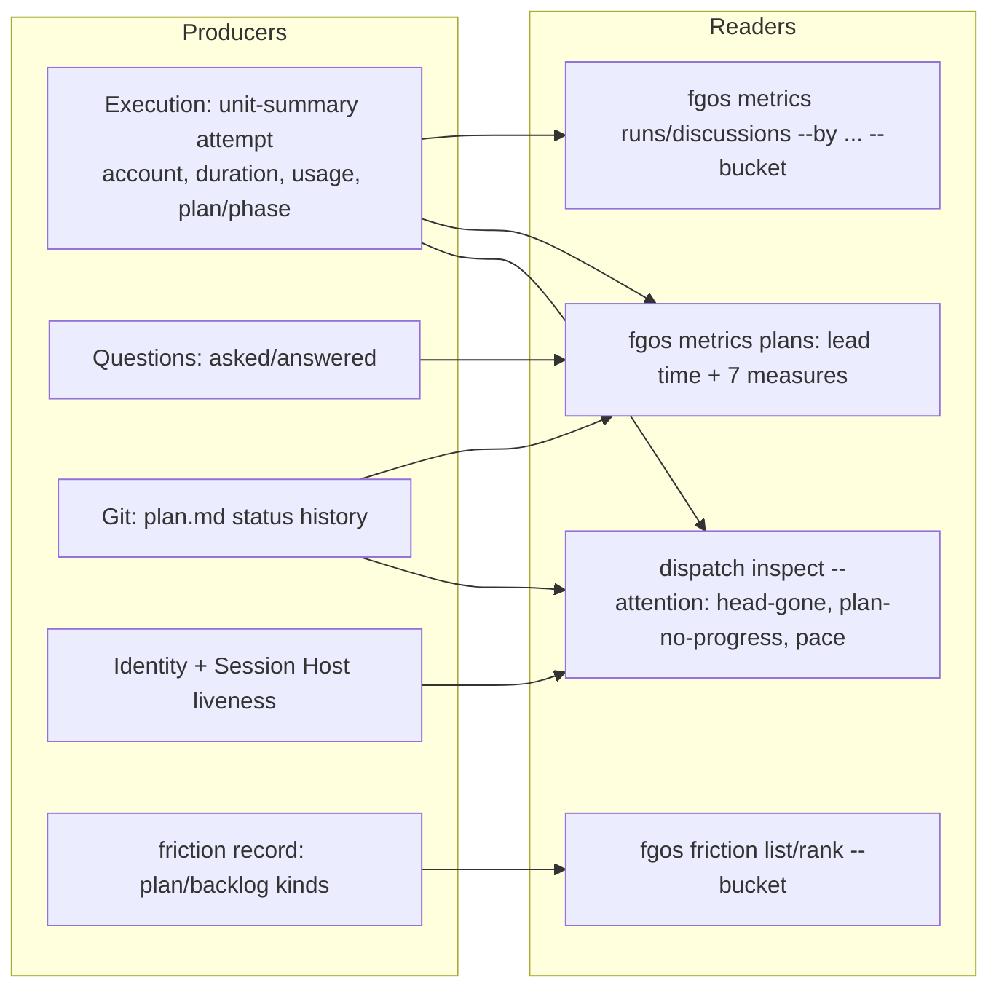

# Đo vận hành fgOS (ops-metrics) — Discussion

discussion: open

## 1. Trạng thái hiện tại

Vòng 1 (2026-11-18). Inventory xong: `plans/reports/scout-261118-0936-ops-metrics-inventory.md`. Chủ dự án đã chốt
hai việc: (a) đưa phát hiện liveness / no-progress / pace của supervisor vào plan này, chỉ phát hiện và hiện trong
attention view, không cảnh báo; (b) bảy thước đo §13.3 của prototype bộ lái là bộ câu hỏi phải trả lời được, cùng
bốn câu của brief (cost, time, failure rate, friction).

Vòng 2: Q1 đã trả lời (OM-D2: đo token trước, tiền hoãn tới khi có hạ tầng giá). Q3/Q4 rút lại vì thiếu bối cảnh,
hỏi lại thành Q5 (ngưỡng "plan đứng yên") và Q6 (nghĩa của "pace"). Q2 còn mở; chủ dự án xin danh sách bảy thước đo. Các phần không phụ thuộc chúng (nguồn token/duration/account, khoá plan/phase, chiều
`--by`, friction) shape tiếp được.

## 2. Mục tiêu & đề bài

Người vận hành fgOS chạy nhiều plan cùng lúc cần trả lời, bằng một hai verb, không đếm tay: một plan / phase / run
tốn bao nhiêu token (và tiền, nếu có nghĩa), theo provider và account; mỗi phase mất bao lâu, lead time của plan từ
`ready` tới `done`, chờ chủ dự án bao lâu; tỉ lệ hỏng theo provider / account / model / executor; friction tăng hay
giảm theo thời gian và gắn được vào plan hoặc dòng backlog để triage mở việc; bảy thước đo bộ lái (hoàn tất, lead time
tách bốn phần, can thiệp, bám phạm vi, lỗi plan, độ trễ phát hiện, qua cổng lần đầu); và attention view cho thấy
supervisor / lead chết, plan đứng yên, nhịp lệch. Luật ràng buộc: RUL104 (mở rộng `fgos metrics`, `fgos friction`,
bản ghi run và attention view đang có, không store song song), L10 một cửa, nguyên tắc 8 một bằng chứng, config key
mới chỉ qua `core/config-standard` + `core/config-schema`, Rust trước cho code nền mới. Cảnh báo qua mailbox: ngoài
phạm vi.

## 3. Vấn đề rõ / chưa rõ

| # | Vấn đề | Trạng thái | Bằng chứng / ghi chú |
|---|---|---|---|
| V1 | Token mỗi run luôn null | rõ nguyên nhân | `src/runner/dispatch/usage-parsers.mjs:126,146`: claude là stub trả null "để transcript lo", mọi CLI ngoài pi/codex trả `unsupported`; live 0/98 `result.json` có token |
| V2 | `durationMs` trong `result.json` luôn null | rõ nguyên nhân | `settlement.mjs:699,743` nhận `opts.durationMs` mà caller không truyền; thời gian thật nằm ở `unit.json` bindings (`run.mjs:862`) |
| V3 | Account không vào unit-summary | rõ | chỉ ở `provider-capacity-selection.json` (`assignment-runner.mjs:665`); `run.mjs:866` đã đọc file đó ngay sau dispatch |
| V4 | Run không mang plan/phase | rõ | không field nào; `unit.workflow {caseId, activity}` có nhưng 91/110 unit null; `fgos run` không có `--plan` |
| V5 | Observe không gộp duration, không `--by provider/account/model`, token transcript phẳng | rõ | `scorecard.rs:176,266`; `run-result/rust/src/lib.rs:696-754` chỉ copy executor/status/... |
| V6 | Tiền: không bảng giá; account phần lớn là subscription | hoãn (OM-D2) | `rg usd/per_million`: không có |
| V7 | Lead time plan ready→done | rõ hướng | trạng thái chỉ có trong lịch sử git của `plan.md` (`plan-contract.md:43`), không field thời điểm |
| V8 | Thời gian chờ chủ dự án | rõ thiếu | `QUESTIONS.md`, câu hỏi trong plan: không timestamp (`src/portfolio/open-questions.mjs:33-36`); gate có `answeredAt` (`src/workflow/case-runtime.mjs`) |
| V9 | Thước đo 3-6 không có nguồn trên main | **mở → Q2** | prototype dùng file tsv ghi tay (`plan-board.mjs:431-525`) |
| V10 | Friction: không kind `plan`/`backlog`, không xu hướng, gần như không ai ghi nữa | rõ | `observe.friction.v1.json`; 10 bản ghi tháng 11; không skill nào gọi `friction record` |
| V11 | Supervisor/lead là gì trên main | rõ | head session `head:<persona>-<name>` (commit `771c44ce8`), lead `lead:<LANE>`; Identity `liveness`; Session Host `alive(placement)` (`docs/platform/session-host/spec.md:49`) |
| V12 | "Pace" (R9) nghĩa là gì khi chỉ phát hiện | **mở → Q6** | audit R9: nhịp tick thích ứng — là hành vi, không phải tín hiệu |
| V13 | Ngưỡng no-progress | **mở → Q5** | audit R7 "hai tick không tiến"; trên main supervisor là LLM head, không có tick đếm được |
| V14 | Attention view chỉ có row gắn run | rõ | `attention-view.mjs:44-82`: row giả định `runId`, sort dòng 79; contract `attention-view` v1 |
| V15 | Retention run dir (p-tslryr3buq) xoá mất lịch sử đo | ghi chú | plan này không phụ thuộc run dir sống mãi: snapshot đo theo plan phải còn sau prune — xem §6 E |

## 4. Quyết định đã chốt

| ID | Quyết định | Nguồn | Ngày |
|---|---|---|---|
| OM-D1 | Phát hiện liveness / no-progress / pace của supervisor thuộc plan này; chỉ phát hiện, hiện trong `fgos dispatch inspect --attention`; không cảnh báo khi mailbox còn hoãn; plan portfolio-driving ghi đã chuyển | chủ dự án qua secretary | 2026-11-18 |
| OM-D2 | Cost đo bằng token theo model/provider/account/plan/phase trước; tiền (bảng giá, tiền ước tính) hoãn vì chưa có tool/hạ tầng nào lo giá — không build trong plan này | chủ dự án, Q1 | 2026-11-18 |

## 5. Q&A log

- 2026-11-18 ~09:40 — Inventory báo chủ dự án (10 dòng). Chủ dự án hỏi lại bộ câu hỏi đã liệt kê lúc làm bộ lái;
  tìm thấy §13.3 "Bảy thước đo" (`origin/plan-supervisor-prototype:plans/reports/spec-261116-1042-plan-supervisor.md`),
  ghi vào inventory §4.
- 2026-11-18 ~10:00 — Chủ dự án (qua secretary): đưa liveness/no-progress/pace vào plan này, chỉ phát hiện, hiện
  trong attention view; ghi chuyển giao vào plan portfolio-driving; đi tiếp. → OM-D1.
- 2026-11-18 ~10:30 — Q1: đồng ý hướng tiền ước tính nhưng chưa có hạ tầng, nếu phải build thì hoãn; đo cái khác
  trước → OM-D2. Q2: xin liệt kê bảy thước đo. Q3, Q4: hỏi không có bối cảnh → rút, hỏi lại thành Q5, Q6.

## 6. Thiết kế đã chốt {#design}

Nháp vòng 1 — chưa chốt; các chỗ phụ thuộc câu hỏi mở được đánh dấu.

Năm khối, đi từ dưới lên. Mọi dữ kiện mới sinh ở nơi đang sở hữu bản ghi; Observe chỉ đọc.

**A. Bản ghi run đủ dữ kiện (Execution, contract `unit-summary.read.v3`, thêm field tuỳ chọn như `verify`).**
Mỗi attempt trong `unit-summary.json` thêm: `accountId` (từ selection mà `run.mjs:866` đã đọc), `durationMs` (từ
binding), `usage {inputTokens, outputTokens, cacheRead, cacheCreation, source}` (tiền: hoãn theo OM-D2) hoặc `usage.reason` có tên
khi CLI không báo. Parser theo CLI trong `usage-parsers.mjs` (claude: transcript của chính session seat, hoặc
`usage`/`total_cost_usd` khi seat chạy `-p --output-format json` — chưa kiểm seat chạy kiểu nào; codex, pi, omp,
agy theo khảo sát) — gộp p-s5mliyp335 và p-mvc3d54cda; khảo sát là bước đầu.
`result.json.durationMs` được điền đúng hoặc bỏ field (một nguồn). Unit-summary cũng mang `plan {dir, phase}`.

**B. Khoá plan/phase cho run.** `fgos run` và `fgos workflow start` nhận `--plan <dir> [--phase <id>]` tuỳ chọn,
kiểm qua cửa convention; ghi vào `unit.json` rồi `unit-summary.json`. Không bắt buộc (run không plan gộp vào "không
plan"); khi nào run không plan bị từ chối là câu Q2 của plan portfolio, không quyết ở đây. Script lái lead/phase hiện
có (`.fgos/runtime/tmp/sec/run-phase.sh`) và skill driving truyền cờ này.

**C. Observe đọc và gộp (Rust, `packages/observe` + `packages/run-result`).**
- `run_observation` và observation `unit.settled` mang thêm provider, model, accountId, plan, phase, durationMs,
  usage.
- `metrics runs` và `metrics discussions`: `--by provider|account|model|plan|phase` thêm vào danh sách sẵn có;
  mỗi nhóm có đếm kết quả (sẵn) + tổng/median duration + tổng token (tiền hoãn, OM-D2); `--bucket day|week` cho
  xu hướng.
- `metrics harness` token transcript: tách theo model và theo session; session nối sang vai (head/lead) qua Identity
  để thấy chi phí của secretary/supervisor ngoài run.
- Verb mới trong cùng họ: `fgos metrics plans [--plan <dir>] [--since]` — mỗi plan: trạng thái và thời điểm chuyển
  (đọc lịch sử git của `plan.md` qua cửa Git), lead time ready→done, thời gian theo phase (từ run có khoá B), token, tỉ lệ hỏng, và bảy thước đo — thước đo nào chưa có nguồn trả `unmeasured` kèm lý do (theo Q2).
- Thời gian chờ chủ dự án: câu hỏi (QUESTIONS.md, mục câu hỏi của plan, gate) mang `asked`/`answered` thời điểm;
  một reader duy nhất (`src/portfolio/open-questions.mjs` hiện là Node — chuyển sang Rust hay để Node cấp qua cửa
  composition root là chi tiết của planner).

**D. Friction (Observe).** Kind subject `plan` (p-7nqygnztum) và `backlog`, qua cửa convention; `friction list|rank
--bucket week` cho xu hướng; `friction show plan:<dir>`; resolve bằng `--reason filed:<p-id>` để triage nối friction
→ dòng backlog. Skill shaping/planning/driving ghi friction (sửa skill nguồn, build lại render).

**E. Attention view (Node `attention-view.mjs`, contract v2: row không bắt buộc `runId`).** Ba kind row mới, chỉ
phát hiện:
- `head-gone`: một head/lead có placement ghi nhận (lineage rotation / head placement) mà Session Host `alive` trả
  `gone` và chưa retire, hoặc Identity không còn liệt kê.
- `plan-no-progress`: plan `running` không có tín hiệu tiến (commit trên nhánh, run settle mang khoá plan, dòng
  board) trong ngưỡng (Q4).
- pace: theo Q6. Ngưỡng đứng yên: theo Q5.
Ngưỡng là config key mới qua standard + schema. Logic phát hiện viết bằng Rust (chủ dự án 11-18: code mới viết
được bằng Rust thì viết Rust); view Node chỉ nối dây.

**Ngoài phạm vi.** Cảnh báo/mailbox; tiền và bảng giá (OM-D2); sửa độ ổn định của council (p-24dxhwq7zr, chỉ lấy phần đo: attempt/resume ×
token theo unit, có sẵn khi xong A+C); retention run dir (p-tslryr3buq) — nhưng `metrics plans` phải đọc được plan
đã xong sau khi run dir bị prune (snapshot đo của plan khi `done`, ghi qua store `snapshots` có sẵn); p-ixrbglli5o.

## 7. Danh mục hạng mục / task {#tasks}

Nháp — planner sẽ chia phase theo plan contract.

### usage-survey {#task-usage-survey}
Khảo sát mỗi CLI (claude, codex, pi, omp, agy, gemini...) in token/tiền ở đâu. §6 A. Verify: báo cáo kèm mẫu đầu ra thật.

### run-record-facts {#task-run-record-facts}
§6 A+B: account, duration, usage, plan/phase vào unit-summary; `--plan/--phase`. Verify: unit test ở writer
`unit-summary.mjs` + một test parser mỗi CLI.

### observe-dimensions {#task-observe-dimensions}
§6 C: attrs mới, `--by`, `--bucket`, token theo model/session. Verify: `cargo test -p fgos-observe -p fgos-run-result`.

### metrics-plans {#task-metrics-plans}
§6 C: `fgos metrics plans`, thời gian chờ chủ dự án, bảy thước đo. Phụ thuộc Q2. Verify: fixture plan với lịch sử
git dựng sẵn.

### friction-link-trend {#task-friction-link-trend}
§6 D. Verify: `cargo test -p fgos-observe` cho kind mới và bucket.

### attention-supervisor {#task-attention-supervisor}
§6 E. Phụ thuộc Q5, Q6. Verify: test của `attention-view` với head placement và plan giả.
