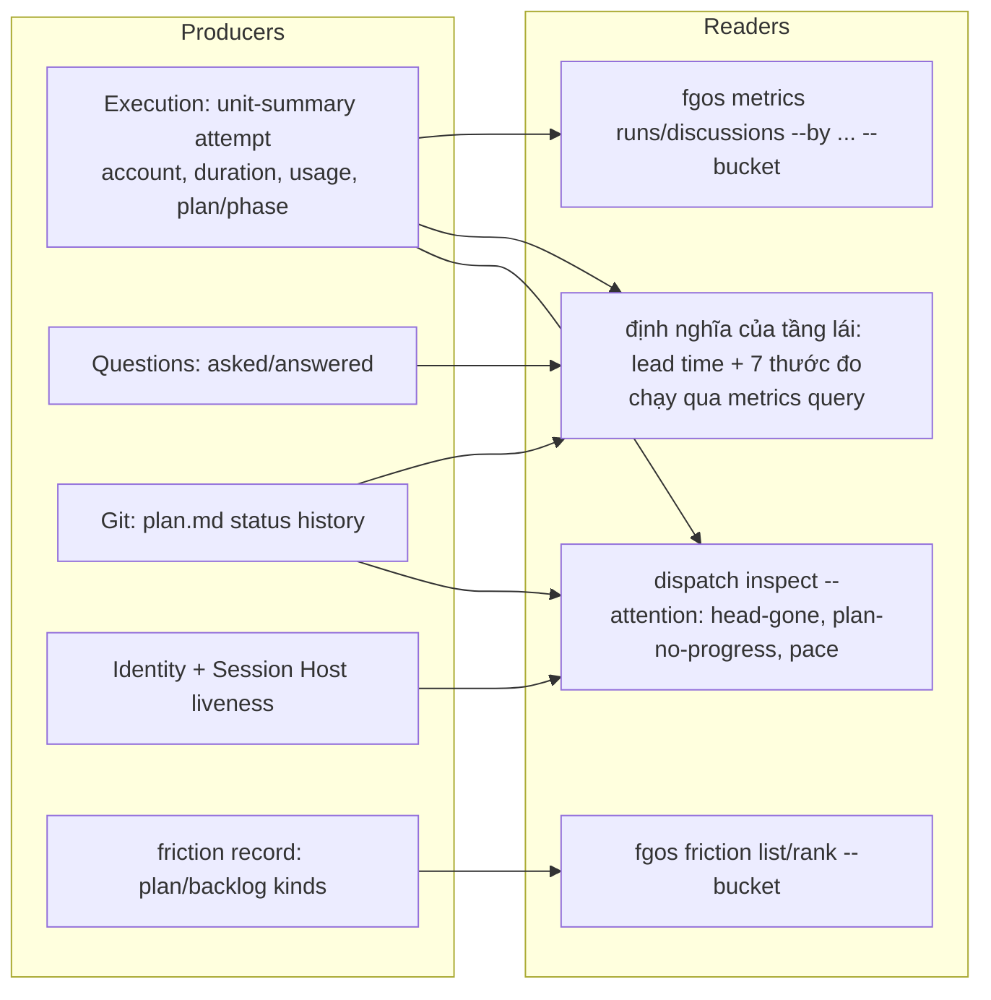

# Đo vận hành fgOS (ops-metrics) — Discussion

discussion: open

## 1. Trạng thái hiện tại

Vòng 5 (2026-11-18). Inventory: `plans/reports/scout-261118-0936-ops-metrics-inventory.md`. Đã chốt OM-D1..D5:
supervisor detection thuộc plan này, chỉ hiện ở attention view (D1); đo token trước, tiền hoãn (D2); phần mới viết
Rust (D3); khung ba tầng, contract ghi/truy vấn làm tốt nhất trước (D4); bảy thước đo và quy tắc phát hiện là định
nghĩa của tầng trên, chạy qua truy vấn chung, Observe không biết chúng (D5).

Vòng 6: Q2 → OM-D6, Q5 → OM-D7, Q8 → OM-D8, Q9 → OM-D9; Q6 chuyển sang session shaper supervisor, ở đây chỉ làm cơ
chế định nghĩa phát hiện chung (OM-D10). Đã học skillstation (`plans/reports/research-261118-1017-…`), 8 bài học vào
§6.0; nháp contract tầng 1 ở §6.0.1. Còn mở: Q7 (reader câu hỏi Node → Rust).

## 2. Mục tiêu & đề bài

Người vận hành fgOS chạy nhiều plan cùng lúc cần trả lời, bằng một hai verb, không đếm tay: một plan / phase / run
tốn bao nhiêu token (và tiền, nếu có nghĩa), theo provider và account; mỗi phase mất bao lâu, lead time của plan từ
`ready` tới `done`, chờ chủ dự án bao lâu; tỉ lệ hỏng theo provider / account / model / executor; friction tăng hay
giảm theo thời gian và gắn được vào plan hoặc dòng backlog để triage mở việc; bảy thước đo bộ lái (hoàn tất, lead time
tách bốn phần, can thiệp, bám phạm vi, lỗi plan, độ trễ phát hiện, qua cổng lần đầu); và attention view cho thấy
supervisor / lead chết, plan đứng yên, nhịp lệch. Luật ràng buộc: RUL104 (mở rộng `fgos metrics`, `fgos friction`,
bản ghi run và attention view đang có, không store song song), L10 một cửa, nguyên tắc 8 một bằng chứng, config key
mới chỉ qua `core/config-standard` + `core/config-schema`, Rust trước cho code nền mới. Cảnh báo qua mailbox: ngoài
phạm vi.

## 3. Vấn đề rõ / chưa rõ

| # | Vấn đề | Trạng thái | Bằng chứng / ghi chú |
|---|---|---|---|
| V1 | Token mỗi run luôn null | rõ nguyên nhân | `src/runner/dispatch/usage-parsers.mjs:126,146`: claude là stub trả null "để transcript lo", mọi CLI ngoài pi/codex trả `unsupported`; live 0/98 `result.json` có token |
| V2 | `durationMs` trong `result.json` luôn null | rõ nguyên nhân | `settlement.mjs:699,743` nhận `opts.durationMs` mà caller không truyền; thời gian thật nằm ở `unit.json` bindings (`run.mjs:862`) |
| V3 | Account không vào unit-summary | rõ | chỉ ở `provider-capacity-selection.json` (`assignment-runner.mjs:665`); `run.mjs:866` đã đọc file đó ngay sau dispatch |
| V4 | Run không mang plan/phase | rõ | không field nào; `unit.workflow {caseId, activity}` có nhưng 91/110 unit null; `fgos run` không có `--plan` |
| V5 | Observe không gộp duration, không `--by provider/account/model`, token transcript phẳng | rõ | `scorecard.rs:176,266`; `run-result/rust/src/lib.rs:696-754` chỉ copy executor/status/... |
| V6 | Tiền: không bảng giá; account phần lớn là subscription | hoãn (OM-D2) | `rg usd/per_million`: không có |
| V7 | Lead time plan ready→done | rõ hướng | trạng thái chỉ có trong lịch sử git của `plan.md` (`plan-contract.md:43`), không field thời điểm |
| V8 | Thời gian chờ chủ dự án | rõ thiếu | `QUESTIONS.md`, câu hỏi trong plan: không timestamp (`src/portfolio/open-questions.mjs:33-36`); gate có `answeredAt` (`src/workflow/case-runtime.mjs`) |
| V9 | Thước đo 3-6 không có nguồn trên main | chốt OM-D6 | prototype dùng file tsv ghi tay (`plan-board.mjs:431-525`) |
| V10 | Friction: không kind `plan`/`backlog`, không xu hướng, gần như không ai ghi nữa | rõ | `observe.friction.v1.json`; 10 bản ghi tháng 11; không skill nào gọi `friction record` |
| V11 | Supervisor/lead là gì trên main | rõ | head session `head:<persona>-<name>` (commit `771c44ce8`), lead `lead:<LANE>`; Identity `liveness`; Session Host `alive(placement)` (`docs/platform/session-host/spec.md:49`) |
| V12 | "Pace" (R9) nghĩa là gì khi chỉ phát hiện | chuyển session shaper supervisor (OM-D10) | audit R9: nhịp tick thích ứng — là hành vi, không phải tín hiệu |
| V13 | Ngưỡng no-progress | chốt OM-D7 | audit R7 "hai tick không tiến"; trên main supervisor là LLM head, không có tick đếm được |
| V14 | Attention view chỉ có row gắn run | rõ | `attention-view.mjs:44-82`: row giả định `runId`, sort dòng 79; contract `attention-view` v1 |
| V16 | Friction ghi gì, ai ghi, phân loại và gom thế nào | đang bàn | 762 record, 21 chữ ký, layer: docs 284, verification 249, state 221 — gần hết từ writer tự động thời Work; trial 11-17 ghi `--layer skill` bị từ chối (`friction.rs:13,79`) nên tự ghi friction `layer-not-published`; `rank` gom theo subject (`friction.rs:350-398`) |
| V15 | Retention run dir (p-tslryr3buq) xoá mất lịch sử đo | ghi chú | plan này không phụ thuộc run dir sống mãi: snapshot đo theo plan phải còn sau prune — xem §6 E |

## 4. Quyết định đã chốt

| ID | Quyết định | Nguồn | Ngày |
|---|---|---|---|
| OM-D1 | Phát hiện liveness / no-progress / pace của supervisor thuộc plan này; chỉ phát hiện, hiện trong `fgos dispatch inspect --attention`; không cảnh báo khi mailbox còn hoãn; plan portfolio-driving ghi đã chuyển | chủ dự án qua secretary | 2026-11-18 |
| OM-D2 | Cost đo bằng token theo model/provider/account/plan/phase trước; tiền (bảng giá, tiền ước tính) hoãn vì chưa có tool/hạ tầng nào lo giá — không build trong plan này | chủ dự án, Q1 | 2026-11-18 |
| OM-D3 | Mọi phần viết MỚI của plan này viết bằng Rust khi làm được mà không ảnh hưởng phần đang có; Node chỉ còn là caller mỏng nếu cần. Không viết lại phần đã land chỉ để đổi ngôn ngữ | chủ dự án qua secretary | 2026-11-18 |
| OM-D4 | Ba tầng, thứ tự ưu tiên: (1) contract công khai ghi + truy vấn — phổ quát, chuẩn, ít đổi, ghi được mọi thứ khi cần, đọc được mọi kiểu khi cần — phải tốt và chuẩn sớm; (2) cơ chế tích hợp với agent và hạ tầng — quan sát nhiều nơi, nhiều khoảnh khắc mà không làm giảm hiệu quả hay làm sai agent/tiến trình, phát triển dần; (3) lưu trữ bên trong — tự do đổi, chấp nhận chi phí migration | chủ dự án | 2026-11-18 |
| OM-D5 | Bảy thước đo bộ lái (và mọi khái niệm kiểu "lead time của plan", "plan đứng yên") là khái niệm của tầng trên — chỗ cần quan sát (bộ lái/portfolio/supervisor) — không cố định trong tầng Observe. Observe chỉ biết bản ghi, span, refs, phép lọc/nhóm/gộp | chủ dự án | 2026-11-18 |
| OM-D6 | Plan này dựng nguồn cho thước đo 1 (hoàn tất), 2 (lead time tách bốn phần), 7 (qua cổng lần đầu) và 3 (can thiệp, từ thời điểm hỏi/trả lời câu hỏi). Thước đo 4 (bám phạm vi), 5 (lỗi plan do validate), 6 (độ trễ phát hiện) trả `unmeasured` kèm lý do, mỗi cái thành một dòng backlog | chủ dự án, Q2 | 2026-11-18 |
| OM-D7 | "Plan đứng yên" = plan `running` không có tín hiệu tiến (commit trên nhánh, run settle mang khoá plan, dòng board) trong N phút; N là config, mặc định 60; về sau N theo phase từ median đã đo khi đủ mẫu | chủ dự án, Q5 | 2026-11-18 |
| OM-D8 | Tên trong registry theo mô hình và tên OpenTelemetry chỗ đã có chuẩn (gồm GenAI `gen_ai.*`); tên riêng `fgos.*` cho phần chỉ fgOS có; không SDK/collector OTel trong lõi; OTel đổi tên thì registry ghi alias | chủ dự án, Q8 | 2026-11-18 |
| OM-D9 | Friction có attr `fgos.friction.kind` với năm giá trị: bug, instability, missing, awkward, doc (thêm sau qua registry) | chủ dự án, Q9 | 2026-11-18 |
| OM-D10 | "Pace" là gì do session shaper supervisor quyết (nơi đang định hình hành vi supervisor). Plan này không định nghĩa pace; nó làm cho quy tắc phát hiện của attention view là định nghĩa có tên (truy vấn + ngưỡng + kind row), chạy chung, để thêm pacer sau chỉ là thêm một định nghĩa, không đổi code hay contract | chủ dự án, Q6 | 2026-11-18 |

## 5. Q&A log

- 2026-11-18 ~09:40 — Inventory báo chủ dự án (10 dòng). Chủ dự án hỏi lại bộ câu hỏi đã liệt kê lúc làm bộ lái;
  tìm thấy §13.3 "Bảy thước đo" (`origin/plan-supervisor-prototype:plans/reports/spec-261116-1042-plan-supervisor.md`),
  ghi vào inventory §4.
- 2026-11-18 ~10:00 — Chủ dự án (qua secretary): đưa liveness/no-progress/pace vào plan này, chỉ phát hiện, hiện
  trong attention view; ghi chuyển giao vào plan portfolio-driving; đi tiếp. → OM-D1.
- 2026-11-18 ~10:30 — Q1: đồng ý hướng tiền ước tính nhưng chưa có hạ tầng, nếu phải build thì hoãn; đo cái khác
  trước → OM-D2. Q2: xin liệt kê bảy thước đo. Q3, Q4: hỏi không có bối cảnh → rút, hỏi lại thành Q5, Q6.
- 2026-11-18 ~10:45 — Chủ dự án (qua secretary): phần viết mới viết Rust khi được, Node chỉ caller mỏng; áp dụng từ
  giờ, không đổi phần đã land → OM-D3.
- 2026-11-18 ~11:00 — Chủ dự án: friction (bất tiện, chưa hoàn hảo, tréo ngoe, bug, không ổn định) ghi nhận tình
  huống thế nào, tự ghi nhận ra sao, phân loại và gom nhóm thế nào? → đề xuất §6 D.
- 2026-11-18 ~11:20 — Chủ dự án: việc này có ba phần — (1) contract công khai ghi/truy vấn, phổ quát, chuẩn, ít đổi;
  (2) tích hợp với agent và hạ tầng, quan sát nhiều nơi mà không làm chậm/sai; (3) lưu trữ bên trong, đổi được. Ưu
  tiên làm thật tốt (1) trước → OM-D4, §6.0.
- 2026-11-18 ~11:35 — Chủ dự án: bảy thước đo là khái niệm của tầng trên (chỗ cần quan sát), không cố định trong tầng
  Observe → OM-D5.
- 2026-11-18 ~11:45 — Chủ dự án: học repo vantt/skillstation (nhiều kỹ thuật quan sát) → báo cáo research, bài học
  vào §6.0.
- 2026-11-18 ~12:00 — Chủ dự án: Q2, Q5 đồng ý đề xuất → OM-D6, OM-D7.
- 2026-11-18 ~12:15 — Chủ dự án: Q8, Q9 đồng ý → OM-D8, OM-D9. Q6 đưa sang session `shaper: supervisor`; ở đây
  thiết kế để thêm pacer sau không phải đổi gì → OM-D10.
- 2026-11-18 ~12:30 — Shaper supervisor trả lời Q6: pace = lịch tick; hai row overdue / idle-burn; cần event tick
  mới (họ sinh), token theo head session, sự kiện trạng thái plan, placement/gone của head. Đổi tên event theo OM-D8
  → `fgos.supervisor.tick` (§6 E).

## 6. Thiết kế đã chốt {#design}

Nháp vòng 4 — chưa chốt. Khung ba tầng theo OM-D4; A–E bên dưới là nội dung đầu tiên đi qua khung đó.

### 6.0 Ba tầng (OM-D4)

**Tầng 1 — contract công khai: ghi và truy vấn (làm tốt nhất, sớm nhất).** Một hình bản ghi cho mọi số đo và sự
kiện, dùng chung cho ghi và đọc. Điểm xuất phát có sẵn: `observe.observation.v1`
(`packages/observe/contracts/observe.observation.v1.json`, `contract.rs:57`: `ts, subject{kind,id}, kind, attrs,
source`) — hiện chỉ là hình nội bộ phía đọc, `subject.kind` đóng (5 giá trị thời Work), `attrs` không kiểu, không
phân biệt số đo với chiều. Năm store hiện có (friction, case, eval, snapshot, invocation-faults) mỗi cái một hình
riêng. Đề xuất v2 (để bàn):
- `kind`: tên dạng chấm từ một registry (`run.settled`, `friction.recorded`, `question.asked`, `plan.status`...);
  thêm kind = thêm dòng registry, không đổi schema.
- `ts`, tuỳ chọn `endTs` → một bản ghi có thể là khoảng thời gian (span), nên "thời gian phase" là truy vấn, không
  phải code riêng.
- `subject {kind,id}` mở theo registry (run, unit, plan, phase, backlog, session, head, account, provider...) và
  `refs[]` liên kết sang subject khác (plan, phase, dòng backlog, session) — đây là cái làm "cost theo plan",
  "friction theo plan" thành một phép nối chung, không phải field riêng từng chỗ.
- `measures {tên: số}` có đơn vị (token, ms, count) tách khỏi `attrs {tên: chuỗi|bool}` là chiều để lọc/nhóm.
- `origin`: ai phát (component, writer session, host, release).
- Tên attr/measure theo một registry semantic convention; chỗ nào chuẩn ngoài đã có tên thì dùng tên đó (Q8).
- Tiến hoá chỉ cộng thêm; `v` của envelope chỉ đổi khi phá vỡ; thêm kind/attr = một dòng registry + fixture, không
  bump (học từ skillstation, nhưng mở qua registry thay vì enum đóng).
- `basis`: biết bằng cách nào (code quan sát, agent báo, transcript, chủ dự án trả lời, suy ra).
- `id` tất định cho mọi nguồn chiếu/nhập lại → chạy lại không đếm trùng.
- envelope mang revision config/release để gắn số đo với cấu hình sinh ra nó; không chứa nội dung tự do mặc định,
  detail có trần độ dài, có dấu phiên bản che (redaction).
- số đo suy ra dưới cỡ mẫu tối thiểu trả `insufficient`, không ra số gây hiểu sai.
Nguồn bài học: `plans/reports/research-261118-1017-skillstation-observability-lessons.md`.
Tầng 1 không chứa khái niệm của bên dùng (OM-D5): không "plan", "lead time", "bảy thước đo" cứng trong code Observe —
plan, phase chỉ là loại subject/ref trong registry. Bên dùng khai báo định nghĩa của mình (một file định nghĩa truy vấn
có tên, nằm ở chỗ của bên dùng) và chạy nó qua truy vấn chung.
Truy vấn: một verb chung (`fgos metrics query`, mở rộng họ `metrics`, không họ mới): `--kind`, `--where k=v`,
`--ref plan:<dir>`, `--since/--until`, `--by <attrs>`, `--bucket day|week`, `--agg count|sum|p50|p90|max <measure>`.
Truy vấn thấy hai loại nguồn như nhau: sự kiện đã ghi qua cửa ghi, và sự kiện *chiếu* từ bản ghi do component khác
sở hữu (run result, unit summary, lịch sử git của plan, câu hỏi) qua `ObservationSource` — không chép sự thật của
chỗ khác vào store (một nguồn sự thật). Các verb hiện có (`metrics runs`, `discussions`, `friction rank`...) về sau
là preset trên truy vấn chung (L10, từng bước).

#### 6.0.1 Nháp chi tiết contract tầng 1

Một bản ghi (ví dụ: một attempt của run vừa settle, chiếu từ `unit-summary.json`):

```json
{
  "v": 2,
  "id": "sha256:unit-run-1794...:producer/1/01",
  "kind": "fgos.run.attempt",
  "ts": "2026-11-18T02:32:33Z", "endTs": "2026-11-18T02:35:21Z",
  "subject": {"kind": "run", "id": "unit-run-1794.../producer/1/01"},
  "refs": [{"kind": "plan", "id": "plans/261117-1856-secretary-session-spine"}, {"kind": "phase", "id": "16"}],
  "attrs": {"gen_ai.provider.name": "anthropic", "gen_ai.request.model": "claude-opus-5-5",
            "fgos.account.id": "tetnu", "fgos.executor.id": "claude", "fgos.outcome": "pass"},
  "measures": {"gen_ai.usage.input_tokens": 41200, "gen_ai.usage.output_tokens": 3900, "fgos.duration": 168000},
  "basis": "derived", "origin": {"source": "run-result", "release": "0.x.y", "configRev": "..."}
}
```

Registry (một file contract, versioned, có fixture): mỗi `kind` khai báo subject kind cho phép, attr/measure dùng
được; mỗi attr khai báo kiểu và tập giá trị nếu đóng; mỗi measure khai báo đơn vị và phép gộp hợp lệ (sum cho
token, p50/p90 cho thời gian). Ghi một bản ghi vi phạm registry: từ chối và đếm `rejected`, không bao giờ làm hỏng
việc gọi.

Truy vấn (một ngữ pháp, CLI và API Rust cùng một bộ):

```text
fgos metrics query --kind fgos.run.attempt --since 2026-11-01 \
  --where fgos.outcome!=pass --ref plan:plans/261117-1856-secretary-session-spine \
  --by gen_ai.provider.name,fgos.account.id --bucket week \
  --agg count --agg sum:gen_ai.usage.input_tokens --agg p90:fgos.duration
```

Kết quả: envelope `fgos.v1`, mỗi dòng = một nhóm (giá trị chiều + bucket + các phép gộp), kèm `insufficient` khi
dưới cỡ mẫu, và `coverage` (bao nhiêu bản ghi thiếu attr được nhóm theo). Định nghĩa có tên của tầng trên (OM-D5)
là chính các đối số này lưu thành file.

Năm store hiện có sau này đi qua contract này (friction, case, eval, snapshot, invocation-faults → các `kind`
`fgos.friction.*`, `fgos.case.*`...); thứ tự chuyển và việc gộp store là chuyện tầng 3, planner chia phase.

**Tầng 2 — tích hợp với agent và hạ tầng (tốt = quan sát nhiều nơi, nhiều lúc, không làm chậm hay làm sai agent và
tiến trình; cải thiện dần).** Cửa ghi: API Rust trong `fgos-observe` + `fgos observe`-style CLI qua host; mọi lần ghi
là phụ, có hạn thời gian, lỗi ghi không bao giờ đổi kết quả của việc chính (đã là luật "kênh phụ best-effort" của
D-ADR0037, lỗi vào `invocation-faults`); thêm bộ đếm sức khoẻ (accepted, dropped, rejected, errors, lỗi cuối) đọc
được qua truy vấn, như recorder của skillstation (`internal/telemetry/recorder.go:92-125`). Các kênh: settlement của runner, điểm phát hiện trong code, fragment skill
cho agent, claim của worker, hook của harness (Stop, statusline sidecar — đã đo ở `spike-rotation.md`), và về sau
OTLP: Claude Code và Codex có xuất OpenTelemetry (token, cost, request) — contract tầng 1 khớp tên chuẩn thì nhận
được kênh này rẻ (cần kiểm cụ thể trong phase khảo sát).

**Tầng 3 — lưu trữ bên trong (tự do đổi, chấp nhận chi phí migration).** Hôm nay: shard JSONL theo writer dưới
`.fgos/observe/<store>/` + lock của holder-lock (§3 spec). Tầng 1 không lộ chi tiết này; đổi sau (gộp store, index,
SQLite view theo L3 "truth ở JSONL, db là view") không đổi contract.

**A. Bản ghi run đủ dữ kiện (Execution, contract `unit-summary.read.v3`, thêm field tuỳ chọn như `verify`).**
Mỗi attempt trong `unit-summary.json` thêm: `accountId` (từ selection mà `run.mjs:866` đã đọc), `durationMs` (từ
binding), `usage {inputTokens, outputTokens, cacheRead, cacheCreation, source}` (tiền: hoãn theo OM-D2) hoặc `usage.reason` có tên
khi CLI không báo. Parser theo CLI viết mới bằng Rust (crate `fgos-execution` hoặc `run-result`, planner chọn theo layering), settlement
Node gọi qua host thay cho `usage-parsers.mjs`, file Node đó nghỉ theo L10 (claude: transcript của chính session seat, hoặc
`usage`/`total_cost_usd` khi seat chạy `-p --output-format json` — chưa kiểm seat chạy kiểu nào; codex, pi, omp,
agy theo khảo sát) — gộp p-s5mliyp335 và p-mvc3d54cda; khảo sát là bước đầu.
`result.json.durationMs` được điền đúng hoặc bỏ field (một nguồn). Unit-summary cũng mang `plan {dir, phase}`.

**B. Khoá plan/phase cho run.** `fgos run` và `fgos workflow start` nhận `--plan <dir> [--phase <id>]` tuỳ chọn,
kiểm qua cửa convention; ghi vào `unit.json` rồi `unit-summary.json`. Không bắt buộc (run không plan gộp vào "không
plan"); khi nào run không plan bị từ chối là câu Q2 của plan portfolio, không quyết ở đây. Script lái lead/phase hiện
có (`.fgos/runtime/tmp/sec/run-phase.sh`) và skill driving truyền cờ này.

**C. Observe đọc và gộp (Rust, `packages/observe` + `packages/run-result`).**
- `run_observation` và observation `unit.settled` mang thêm provider, model, accountId, plan, phase, durationMs,
  usage.
- `metrics runs` và `metrics discussions`: `--by provider|account|model|plan|phase` thêm vào danh sách sẵn có;
  mỗi nhóm có đếm kết quả (sẵn) + tổng/median duration + tổng token (tiền hoãn, OM-D2); `--bucket day|week` cho
  xu hướng.
- `metrics harness` token transcript: tách theo model và theo session; session nối sang vai (head/lead) qua Identity
  để thấy chi phí của secretary/supervisor ngoài run.
- Không có verb `metrics plans` trong Observe (OM-D5). Bảy thước đo, lead time ready→done, thời gian theo phase là
  định nghĩa truy vấn của tầng lái (chỗ đặt: skill/công cụ lái, chi tiết của planner), chạy bằng `metrics query`. Plan
  này lo cho nguồn của chúng có trong contract: span phase (từ run có khoá B), sự kiện `plan.status` chiếu từ lịch sử
  git của `plan.md`, `question.asked/answered`, verify lần đầu. Thước đo có nguồn trong plan này: 1, 2, 3, 7; 4, 5, 6 trả `unmeasured` + dòng backlog (OM-D6).
- Thời gian chờ chủ dự án: câu hỏi (QUESTIONS.md, mục câu hỏi của plan, gate) mang `asked`/`answered` thời điểm;
  reader câu hỏi hiện là Node (`src/portfolio/open-questions.mjs`, 115 dòng) — cách tách theo Q7.

**D. Friction: ghi nhận, phân loại, gom nhóm (Observe, Rust).** Đang bàn. Theo §6.0, friction là kind
`friction.recorded` / `friction.resolved` của contract chung; `kind`, `layer`, `errorClass`, `disposition` là attr
trong registry; gom nhóm là truy vấn `--by errorClass --bucket week`.
- *Ranh giới:* friction là ghi nhận nhẹ một tình huống bất tiện / chưa hoàn hảo / tréo ngoe / bug / không ổn định,
  trước khi nó thành dòng backlog. Lỗi run (hỏng, provider limit, treo) đã nằm trong bản ghi run: không chép sang
  friction; xu hướng bất ổn đọc thẳng từ `metrics runs --by provider --bucket week` (một nguồn).
- *Ba kênh ghi:* (1) code tự phát hiện — các điểm đang ghi (merge, verify-miss, cửa retrospective, lỗi gọi CLI) và
  điểm mới ghi thẳng qua API Rust của `fgos-observe`; (2) agent tự báo — fragment chung
  `core/skills/_shared/friction-capture.md` nói khi nào ghi (phải đi đường vòng, luật tréo nhau, thiếu công cụ, doc
  sai, phải chờ/thử lại), mọi skill shaping/planning/driving/lead trỏ tới; worker trong sandbox báo trong claim
  (`agentClaim.frictions[]`) và runner ghi lúc settle, subject là run + plan; (3) chủ dự án nói "bất tiện" —
  secretary ghi.
- *Phân loại hai trục + chữ ký:* `kind` mới (bug | instability | missing | awkward | doc) = loại gì; `layer` = ở đâu,
  danh sách hiện tại là của thời Work (verification, state, docs...) và từ chối `skill` — thay bằng danh sách theo
  component/tầng hiện có (skill, tool, runner, workflow, git, provider, config, docs...); `errorClass` = chữ ký ổn
  định kebab-case, cùng một vấn đề cùng một chữ ký; `disposition` (advisory/blocked/parked/halted) = mức nặng.
- *Gom nhóm:* `friction rank` hôm nay xếp theo subject (2 × số record chưa settle) nên không thấy một vấn đề lặp ở
  nhiều plan; đổi sang gom theo chữ ký: số lần, số plan/session khác nhau, lần đầu/lần cuối, `--bucket week`.
  `friction classes` liệt kê chữ ký đã có để người ghi dùng lại; ghi chữ ký mới thì báo chữ ký gần giống.
- *Vòng đời:* triage mở dòng backlog từ một chữ ký → `friction resolve --class <slug> --reason filed:<p-id>` settle cả
  nhóm → chữ ký xuất hiện lại sau ngày fix hiện thành "tái phát" trong `rank`.
- Subject kind `plan` (p-7nqygnztum) và `backlog`, qua cửa convention.

**E. Attention view (Node `attention-view.mjs`, contract v2: row không bắt buộc `runId`).** Ba kind row mới, chỉ
phát hiện. Theo OM-D5, quy tắc "đứng yên", "head chết", "pace" là định nghĩa của tầng supervisor (truy vấn có tên +
ngưỡng trong config), attention view chạy chúng; Observe không biết các khái niệm này:
- `head-gone`: một head/lead có placement ghi nhận (lineage rotation / head placement) mà Session Host `alive` trả
  `gone` và chưa retire, hoặc Identity không còn liệt kê.
- `plan-no-progress`: plan `running` không có tín hiệu tiến (commit trên nhánh, run settle mang khoá plan, dòng
  board) trong ngưỡng (Q4).
- pace: không định nghĩa ở đây (OM-D10). Ngưỡng đứng yên: OM-D7 (config, mặc định 60 phút).
Cơ chế chung (OM-D10): attention view đọc một danh sách định nghĩa phát hiện, mỗi định nghĩa = truy vấn có tên +
ngưỡng (config) + kind row + lệnh gợi ý; `head-gone`, `plan-no-progress` là hai định nghĩa đầu; pacer của supervisor
sau này là định nghĩa thứ ba.
Phản hồi của shaper supervisor (2026-11-18): pace = lịch tick của supervisor (nhanh khi có plan `running` hoặc lead
được đặt, chậm khi rảnh; tick là tiến trình không-LLM, chỉ gọi LLM khi có phát hiện). Định nghĩa thứ ba có hai kind
row: `supervisor-overdue` (có việc chạy mà tick cuối cũ hơn k × khoảng active, k config mặc định 3) và
`supervisor-idle-burn` (không plan chạy/ready mà tick LLM vẫn tiêu token trong cửa sổ). Producer phía supervisor ghi
qua cửa ghi một kind mới, đặt tên theo OM-D8:
`fgos.supervisor.tick` — `ts`/`endTs` (span); attrs `fgos.supervisor.mode` (active|idle), `fgos.supervisor.llm`
(bool), `fgos.supervisor.outcome` (noop|lead-started|lead-reclaimed|plan-closed|question-raised|error); measures
`fgos.supervisor.interval` (s, khoảng đang áp dụng, chép trong event để không phụ thuộc config bên kia),
`fgos.plans.ready`, `fgos.plans.running` (count); `refs` session khi `llm` (nối token theo session); project nằm ở
`origin`. Contract tầng 1 phải nhận kind này ngay từ registry đầu tiên. Để pacer diễn đạt được, contract phải có sẵn nguồn hoạt động của head session: sự kiện
hoạt động theo session (statusline sidecar / transcript) và token theo session — nằm trong §6 C.
Ngưỡng là config key mới qua standard + schema. Logic phát hiện viết bằng Rust (chủ dự án 11-18: code mới viết
được bằng Rust thì viết Rust); view Node chỉ nối dây.

**Ngoài phạm vi.** Cảnh báo/mailbox; tiền và bảng giá (OM-D2); sửa độ ổn định của council (p-24dxhwq7zr, chỉ lấy phần đo: attempt/resume ×
token theo unit, có sẵn khi xong A+C); retention run dir (p-tslryr3buq) — nhưng truy vấn phải đọc được plan
đã xong sau khi run dir bị prune (snapshot đo của plan khi `done`, ghi qua store `snapshots` có sẵn); p-ixrbglli5o.



## 7. Danh mục hạng mục / task {#tasks}

Nháp — planner sẽ chia phase theo plan contract.

### observe-contract {#task-observe-contract}
§6.0 tầng 1: contract v2 (bản ghi, registry kind/subject/attr/measure, truy vấn) + một cửa ghi + verb truy vấn, đi
trước mọi task khác; nguồn chiếu hiện có (run, unit summary) và store friction chuyển qua nó. Verify: golden fixture
ghi→truy vấn ở `cargo test -p fgos-observe`. Registry đầu tiên phải có `fgos.supervisor.tick` (§6 E): phase producer
của plan supervisor (session shape-supervisor) chờ phase này — phụ thuộc ngoài, ghi vào plan khi viết.

### usage-survey {#task-usage-survey}
Khảo sát mỗi CLI (claude, codex, pi, omp, agy, gemini...) in token/tiền ở đâu. §6 A. Verify: báo cáo kèm mẫu đầu ra thật.

### run-record-facts {#task-run-record-facts}
§6 A+B: account, duration, usage, plan/phase vào unit-summary; `--plan/--phase`. Verify: unit test ở writer
`unit-summary.mjs` + một test parser mỗi CLI.

### observe-dimensions {#task-observe-dimensions}
§6 C: attrs mới, `--by`, `--bucket`, token theo model/session. Verify: `cargo test -p fgos-observe -p fgos-run-result`.

### driving-measures {#task-driving-measures}
§6 C (OM-D5): nguồn `plan.status`, `question.*`, span phase vào contract; bảy thước đo là định nghĩa truy vấn ở tầng
lái. Theo OM-D6; phụ thuộc Q7. Verify: fixture plan với lịch sử git dựng sẵn, chạy định nghĩa qua `metrics query`.

### friction-link-trend {#task-friction-link-trend}
§6 D. Verify: `cargo test -p fgos-observe` cho kind mới và bucket.

### attention-supervisor {#task-attention-supervisor}
§6 E. Theo OM-D7; phụ thuộc Q6. Verify: test của `attention-view` với head placement và plan giả.
