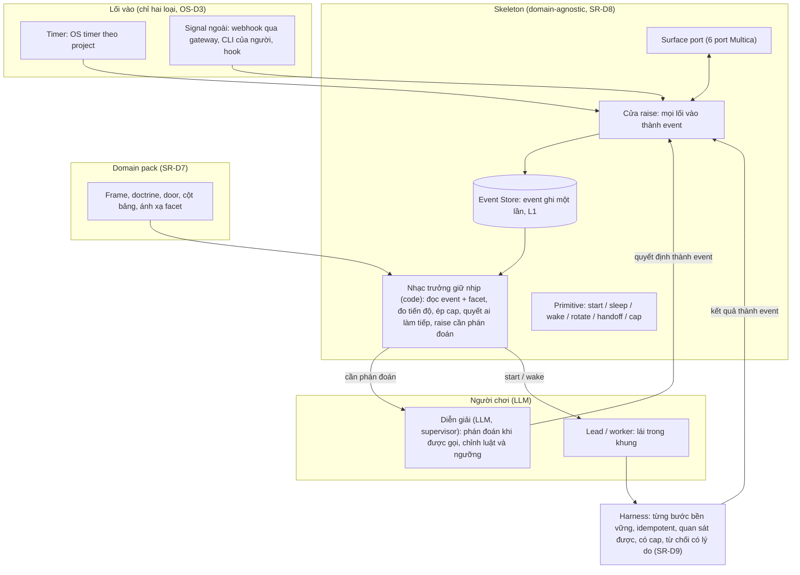

discussion: open

# Orchestration skeleton: domain-agnostic primitives, one frame language, and driving harness

## 1. Trạng thái hiện tại

2026-11-20: Thảo luận được mở từ backlog row `p-7pjiqfoj7v` (nguồn `docs/discussions/supervisor-review/DISCUSSION.md` §7 `#task-orchestration-skeleton`, owner duyệt 2026-11-19 round 19). Đã kế thừa các quyết định cốt lõi SR-D6..SR-D10, bài học Work FSM (G14), nguyên lý harness (G15, G16) và phác thảo 6 ports của Multica (plan `261118-1117-external-ui-integration-multica`).
- Đã nhận câu trả lời chủ dự án cho `q-kjat6xjwfv`: Shaping is parked by owner decision 2026-11-21 until four orchestration fixes land (đóng băng việc điều phối mới để ưu tiên ổn định hệ thống; Architecture Advisory Panel tạm hoãn, thảo luận không đóng).
- Trạng thái thảo luận: **Tạm dừng (`discussion: paused`)**, thảo luận vẫn mở (not settled, not closed), được đậu lại (parked) chờ 4 bản sửa lỗi điều phối hạ cánh. Không có câu hỏi nào đang mở.
- 2026-11-21 16:20: đã ghi bảng tham chiếu các backlog row, plan và discussion liên quan tại §7 `#related` để theo dõi.
- 2026-11-21 16:35: đã xác định 4 bản sửa của OS-D1 (nguồn: memory `orchestration-stabilize-first-decision` của secretary Miu và tin supervisor gửi Miu sáng 2026-11-21: "1547 first, then the idle-lead nudge, then the names, then the reaper"): `p-l22vozecxg`, `p-waxzxz5mio`, `p-mhwe24fttr`, `p-yqanenewb4`. **Cả 4 đã `done`** (xem §7 `#related`). Điều kiện đậu theo chữ của OS-D1 đã thỏa, nhưng release hold ("no new work until the release hold is lifted", handoff secretary 14:45) vẫn còn hiệu lực. Discussion vẫn `paused` cho tới khi chủ dự án cho mở lại.
- **2026-11-21 16:16: chủ dự án cho mở lại (OS-D2).** Trạng thái `discussion: open`. Architecture panel (T0) vẫn hoãn. Release hold không bị ảnh hưởng vì discussion không sinh code.
- **2026-11-21 16:23 (round 6):** chủ dự án trả lời câu hỏi round 5 là "cả hai": mọi thành phần phải có authority, boundary và contract rõ, **và** hệ thống cần một cơ chế hoặc một vai làm nhạc trưởng nắm nhịp điều phối tổng. Câu hỏi mở thành §3 row 9: nhạc trưởng, hay mọi thứ chỉ bắt đầu từ timer trigger và external signal (webhook) rồi lan theo chuỗi watcher -> ghi signal -> phản ứng tiếp. Đang chạy 5 agent con (haiku, chỉ đọc) dò lại tier 0 tới 9 từ dưới lên; kết quả sẽ vào bảng §3 row 4b.
- **2026-11-21 22:10 (round 32): chủ dự án chọn C -> OS-D18 (sleep); hàng 4 rõ.** Handoff "đóng phiếu này, mở phiếu kia" ghi OS-D19 tạm chốt (chủ dự án chưa nói riêng, chờ phản đối nếu có). Kế tiếp: hàng 7 (surface port), rồi hàng 5 (ngôn ngữ khung).
- **2026-11-21 21:40 (round 31): bàn đóng hàng 4.** Soát bảng 4a với OS-D7 tới OS-D17 ở §3 4m: trigger, timer theo actor, wake, who-next, facet đã có lời giải; handoff đề xuất thành "đóng phiếu này, mở phiếu kia". Đang hỏi: sleep nghĩa là gì.
- **2026-11-21 21:30 (round 30): chủ dự án chọn B -> OS-D17; hàng 10 rõ.** Rà soát định kỳ là một Unit chỉ đọc, độc lập, khởi qua `fgos run`; bốn ý mặc định của 4l giữ nguyên. Miu báo discussion component-authority đã settled (21:10): thành phần của skeleton khai báo qua cửa `declare` của nó, và rà soát định kỳ là chỗ đối chiếu mô hình cấu trúc với code.
- **2026-11-21 21:15 (round 29): bàn hàng 10 (rà soát định kỳ của LLM).** Đề xuất ở §3 4l: ai rà soát, khi nào, brief gồm gì, kết quả đi đâu. Đang hỏi: ai rà soát.
- **2026-11-21 21:07 (round 28): chủ dự án chọn A -> OS-D16.** Một cửa hỏi người (Questions) cho mọi người được hỏi; `waitingOn: person` trỏ tới một câu hỏi. Bản ghi lập lịch (hàng 6) đã rõ hết. Việc gộp Questions với Workflow gate chuyển sang discussion component-authority qua Miu. Kế tiếp: hàng 10 (rà soát định kỳ của LLM).
- **2026-11-21 20:54 (round 27): bàn chỗ vướng 2 (`person` là người ngoài).** Phân tích và ba phương án ở §3 4k. Đang hỏi: ai giữ việc hỏi một người (chủ dự án, người duyệt, khách hàng).
- **2026-11-21 20:43 (round 26): chủ dự án chọn B -> OS-D15.** Tool khai invocation dạng job thì làm người chơi qua chính cửa `fgos run`; không có cửa job thứ hai. Còn mở ở mục facet: `person` là người ngoài (§3 4i chỗ 2).
- **2026-11-21 19:56 (round 25): chủ dự án đồng ý ghi chỗ vướng 4 và 5 -> OS-D13, OS-D14; bàn tiếp chỗ 3 (người chơi là tool).** Phân tích và ba phương án ở §3 4j. Đang hỏi: việc của máy (render, transcode) đi qua cửa nào.
- **2026-11-21 19:45 (round 22-24): chủ dự án đồng ý phương án A -> OS-D12 (tạm chốt).** Bản ghi lập lịch gắn với từng bước đang mở, khoá là cặp (`item`, `step`). Chỗ vướng 1 của 4i đã giải; còn mở các chỗ 2 tới 5.
- **2026-11-21 18:35 (round 21): chủ dự án đồng ý `needs` là mục thứ ba -> OS-D11.** Thử ánh xạ marketing (guide có thật, không vướng) và video editing (giả định, năm chỗ vướng) ở §3 4i. Đang hỏi: bước song song trong một việc.
- **2026-11-21 18:29 (round 20): chủ dự án đồng ý `until` -> OS-D10**, hỏi `needs` thêm vào đâu. Đang trả lời: `needs` sinh từ bước tiếp theo của khung, domain đặt nó cạnh hai facet.
- **2026-11-21 18:25 (round 19): chủ dự án đồng ý hai facet `waitingOn`, `outcome` -> OS-D9.** Thử ánh xạ cho plan, work item, question, workflow case và một đơn hàng business (§3 4h): còn vướng gợi ý `needs` (gọi ai) và hạn `until`.
- **2026-11-21 17:44 (round 17): chủ dự án chốt hình dạng cửa raise và wake, nguồn để sau -> OS-D8.** Row 9 đã rõ. Tiếp theo: facet lập lịch chung (§3 row 6), vì giữ nhịp đọc facet; rồi ngôn ngữ khung (row 5) và chi tiết rà soát (row 10).
- **2026-11-21 17:36 (round 16): chủ dự án đồng ý giữ nhịp lớn lên từ wake door -> OS-D7.** §6, §7 T1 và T7.1 đã cập nhật. Tiếp theo trong row 9: lối vào signal ngoài.
- **2026-11-21 17:30 (round 15):** Miu đã land backlog row `p-esa3lau6kd` và start `head:shaper-component-authority`. Discussion này bàn §3 row 9: đề xuất giữ nhịp lớn lên từ wake door trong Supervision (§3 4g), chờ chủ dự án phản hồi.
- **2026-11-21 17:05 (round 14): chủ dự án chọn A -> OS-D6.** Đã mở `docs/discussions/component-authority/DISCUSSION.md` (stub đủ bảy mục, mang sang bằng chứng và giả thuyết của 4f) và gửi mailbox xin Miu tạo backlog row và mở shaper; lúc 17:27 Miu chưa lấy tin, chưa có shaper `component-authority`. Discussion này bàn tiếp: giữ nhịp đặt ở đâu (§3 row 9), chi tiết rà soát (row 10).
- **2026-11-21 16:56 (round 13):** chủ dự án sửa phạm vi: authority, boundary, contract là yếu tố hạng nhất của **cả hệ thống**, không riêng skeleton. Đã sửa §2, §3 row 11, 4f. Đang hỏi: topic toàn hệ thống này nằm ở discussion nào.
- **2026-11-21 16:52 (round 12):** chủ dự án nhấn mạnh authority, boundary, contract là rất quan trọng và yêu cầu quản chắc vì code thừa vẫn cứ sinh ra. Ghi vào §2; mở §3 row 11; bằng chứng và giả thuyết nguyên nhân ở §3 4f. Đề xuất: sổ authority máy đọc được, kiểm lúc plan, lúc land và trong rà soát định kỳ; trước hết chạy điều tra `p-7nja6ilwkr` để kiểm giả thuyết.
- **2026-11-21 16:44 (round 11): chủ dự án chấp nhận năm ý chống zombie và thêm nhịp rà soát định kỳ của LLM -> OS-D5.** Đối chiếu: mầm của cả sáu ý đã có trong watcher definitions (§3 4e). Tiếp theo: giữ nhịp đặt ở đâu (§3 row 9), chi tiết rà soát (row 10).
- **2026-11-21 16:38 (round 10): chủ dự án xác nhận cách tách -> OS-D4.** Thêm yêu cầu: nhạc trưởng sống dai nhưng không là zombie vô hồn. Đề xuất năm thứ làm nó có hồn ở §3 4e; còn mở: có "nhịp rà soát" định kỳ gọi LLM dù không có event không.
- **2026-11-21 16:32 (round 9):** chủ dự án yêu cầu debate nhạc trưởng code hay LLM, vai trò và năng lực của nhạc trưởng và người chơi. Tóm tắt ở §3 4d. Đề xuất: tách giữ nhịp (code) và diễn giải (LLM được hỏi ý); chờ chủ dự án phản hồi.
- **2026-11-21 16:35 (round 8): chủ dự án xác nhận cái hiểu của shaper là đúng -> OS-D3, ghi thành kim chỉ nam ở §2.** Mọi round sau đo đề xuất theo §2. Tiếp theo: nhạc trưởng code đặt ở đâu (§3 row 9), rồi ba ngôn ngữ khung (row 5) và facet chung (row 6).
- **2026-11-21 16:30 (round 7):** 5 agent đã về; kết quả ở §3 bảng 4b (tier 0-9) và 4c (luồng điều phối). Đề xuất cho row 9 đang chờ chủ dự án: lối vào chỉ là timer và signal, mọi thứ thành event; nhạc trưởng là code (wake/admission có cap), LLM chỉ phán đoán trong khung.
- Đang bàn §3 row 4 (danh mục primitive và ai sở hữu). Scout cho thấy gần hết primitive đã có chủ (bảng §3 row 4a). Đề xuất đang chờ chủ dự án phản hồi: skeleton là một contract đặt tên và ghép các chủ đã có, không phải component hay crate mới. Có ba khoảng trống thật: sleep, timer theo actor, facet chung.

## 2. Mục tiêu & đề bài

**Ý định của chủ dự án (kim chỉ nam, OS-D3, chủ dự án xác nhận 2026-11-21).** Chủ dự án muốn hai mức cùng lúc, không chọn một. Ở mức từng thành phần, mỗi thành phần có authority rõ (nó quyết đúng một loại việc), boundary rõ (sở hữu gì, không sở hữu gì) và contract tường minh; bản đồ hiện tại được dò lại từ tầng thấp lên vì chồng chéo, thiếu chủ và code nằm sai nhà là nguồn nghi của sự bất ổn. Ở mức toàn hệ thống, phải có một thứ nắm nhịp để hệ thống tự chạy mà không cần người ngồi canh (bậc ưu tiên "release con người"), đủ chắc để đem fgOS sang project khác và chạy business workflow (mission #1, #2). Hướng nắm nhịp đang theo: lối vào của hệ thống chỉ gồm timer và signal ngoài (ví dụ webhook), mọi thứ đi vào đều được ghi thành event (L1); nhạc trưởng là code chứ không phải LLM, đọc event và facet rồi quyết ai làm tiếp trong cap; các head LLM (supervisor, lead, worker) là người chơi, chỉ được gọi khi cần phán đoán. Chủ dự án nhấn mạnh (round 12, sửa phạm vi round 13): authority, boundary và contract là **yếu tố hạng nhất của toàn hệ thống**, không riêng gì skeleton, vì code thừa vẫn cứ bị sinh thêm mà chưa rõ nguyên nhân. Nguyên tắc đã có sẵn trong văn xuôi (design principle 1 "One door" và 7 "One authority, one source of truth", `core/instructions/design-principles.md`); chỗ hổng là việc ép thi hành. Skeleton là một người dùng của nguyên tắc này: các thành phần của nó cũng phải có authority, boundary, contract như mọi thành phần khác. Mọi đề xuất trong discussion này được đo theo kim chỉ nam này; đề xuất nào đi lệch phải nói rõ lệch ở đâu và vì sao.

**Đề bài.** Khung xương điều phối (orchestration skeleton) là tầng nền domain-agnostic chỉ sở hữu actor và thời gian (trigger, timer, start/sleep/wake, handoff, ai làm tiếp, surface port), không bao giờ sở hữu trạng thái, bước đi hay cột bảng của domain (SR-D8). Hệ thống có một ngôn ngữ khung duy nhất cho cả plan lẫn workflow guide, là những con đường mở có checkpoint chứ không phải kịch bản ép (SR-D9), cùng một harness bảo đảm từng bước bền vững, ghi một lần, idempotent, quan sát được, có cap và từ chối kèm lý do. Domain pack (`domains/<d>/`) inject trạng thái, cột bảng, phase frame và door riêng (SR-D7). Discussion này chốt danh mục primitive và chủ của chúng, nhạc trưởng và lối vào, contract ngôn ngữ khung, facet lập lịch, và cơ chế surface, làm chỗ dựa cho T1, T3, T4, T5.

## 3. Vấn đề rõ / chưa rõ

| # | Điểm | Bằng chứng | Trạng thái |
|---|---|---|---|
| 1 | Ranh giới Skeleton vs Domain: Skeleton chỉ quản actor và thời gian (triggers, timers, start/sleep/wake, handoff, who acts next, surface ports), không sở hữu work state / board columns | SR-D8, G13, G14 (`supervisor-review`). Rút kinh nghiệm từ Work FSM bị hard-code coding mechanics | **Rõ (SR-D8)** |
| 2 | Mô hình 3 phần của quy trình: Frame (đường rộng + checkpoints), Agent (lái linh hoạt trong khung, báo friction), Harness (bảo đảm từng bước tin cậy, không ép kịch bản) | SR-D9, G15, G16 (`supervisor-review`). 4/5 lần supervisor live run dừng là do lỗi harness/confinement | **Rõ (SR-D9)** |
| 3 | Domain Injection: domain pack (`domains/<d>/`) inject phase frames, doctrine, refusal ladder map, doors (coding: review verdict, land door, trunk merge, toggles/retires) | SR-D7, G12. Plan và supervisor hoàn toàn domain-agnostic | **Rõ (SR-D7)** |
| 4 | Danh mục primitives của Skeleton & vị trí code: triggers (Event Store / watcher), timers (OS timer), start/sleep/wake (`session start`, `supervisor wake`, wake pane/socket), handoff (contract), who-next (`bind()` / `dispatch decide`), surface ports (6 ports) | G13 (`supervisor-review`), `plans/261118-1117-external-ui-integration-multica`. Hiện nằm rải rác giữa Supervision, Session Host, Runner | **Rõ (OS-D7 tới OS-D19, soát ở 4m):** mọi primitive đã có chủ hoặc lời giải; sleep là OS-D18, handoff là OS-D19 (tạm chốt); surface port ở hàng 7 |
| 5 | Ngôn ngữ khung hợp nhất (One Frame Language): Hợp nhất `plan-v1` (plan/wave/phase) và workflow guide YAML (steps/milestones/guards). Cú pháp, schema và runtime runner nào thi hành? | G16. Hiện fgOS có 2 ngôn ngữ khung riêng rẽ, plan không chạy trên workflow harness | **Chưa rõ: Mở khảo sát thiết kế** |
| 6 | Universal work facets: Skeleton chỉ đọc các thuộc tính lịch trình phổ quát (actionable/runnable, waiting on what, finished) thay vì work states cụ thể | G14. Schema của facets này là gì để skeleton lập lịch được? | **Rõ (OS-D9 tới OS-D16):** bản ghi lập lịch `{ waitingOn?, outcome?, needs? }` gắn với từng bước đang mở, khoá (`item`, `step`). `waitingOn` có `until`; `person` trỏ tới một câu hỏi của Questions (OS-D16). `needs` có ba dạng, người chơi có thể là tool qua `fgos run` (OS-D15). Cap vòng lặp thuộc khung domain (OS-D13); tài nguyên nặng là cap (OS-D14). Thử ánh xạ ở 4h, 4i, 4j, 4k |
| 7 | Tích hợp Surface (Multica 6 ports): Portfolio read, Command, Wake door, Notifier, Session placement, Question port | `plans/261118-1117-external-ui-integration-multica`. G13 | **Chưa rõ: Thứ tự ưu tiên cổng & adapter** |
| 9 | Nhạc trưởng vs chuỗi phản ứng: có một cơ chế hoặc vai nắm nhịp và điều phối tổng, hay mọi hoạt động chỉ bắt đầu từ timer trigger và external signal (webhook) rồi lan qua watcher -> ghi signal -> phản ứng tiếp? | Chủ dự án nêu round 6 (2026-11-21 16:23), "open for discuss". Bằng chứng ở 4c: chuỗi timer -> watcher -> event -> wake đã có trong code; nhạc trưởng thực tế là supervisor LLM, cap không bị code ép; chưa có lối vào signal ngoài | **Hướng đã chốt (OS-D3, OS-D4):** lối vào timer + signal; giữ nhịp là code, diễn giải là LLM được hỏi ý. Không zombie: OS-D5 (4e). **Rõ:** chỗ đặt OS-D7, lối vào OS-D8. Mặc định tạm (đổi nếu chủ dự án phản đối hoặc adapter đầu tiên cần khác): id event của signal ngoài suy từ nguồn + id giao hàng của nguồn, không từ thời điểm, để webhook gửi lại không thành hai event; payload là dữ liệu không tin cậy, event chỉ trỏ tới nó, không bao giờ là lệnh |
| 10 | Nhịp rà soát định kỳ của LLM: tần suất, nội dung brief, kết quả ghi ở đâu, có rà soát khi hệ thống rảnh không | OS-D5 ý 6; đề xuất biểu đạt bằng watcher definition `review-due` (§3 4e, 4l) | **Rõ (OS-D17)** |
| 11 | Chống code thừa: quản authority chắc **trên toàn hệ thống** (round 13). Vì sao code thừa (cửa thứ hai, bản sao, twin Rust/Node) vẫn cứ sinh ra, và hệ thống giữ authority bằng cách nào; topic này rộng hơn skeleton, đã tách sang discussion riêng `docs/discussions/component-authority/DISCUSSION.md` (CA-D1, round 14) | Chủ dự án nêu round 12. Bằng chứng ở §3 4f. Trùng với backlog `p-7nja6ilwkr` (G10, điều tra cửa thứ hai, chưa làm) | **Đã tách (OS-D6):** bàn ở `component-authority`, **settled 2026-11-21 21:10**: thành phần của skeleton khai báo qua cửa `declare` của thành phần `component-authority`, với loại quyết định "actors và thời gian"; skeleton phụ thuộc kết quả |
| 8 | Tổ chức Architecture Panel (`fgos-architecture-panel`): Khởi động panel độc lập gồm nhiều persona phản biện thiết kế skeleton trước khi chốt spec chi tiết | Khuyến nghị từ backlog row `p-7pjiqfoj7v` và `supervisor-review` §7 T7. Đã gửi câu hỏi `q-kjat6xjwfv`. **Câu trả lời chủ dự án:** Chưa làm bây giờ (`Not now`). Chủ dự án chọn đóng băng việc điều phối mới để ưu tiên ổn định hệ thống; Architecture Panel chờ 4 bản sửa lỗi hạ cánh. Đậu (park) thảo luận `orchestration-skeleton`, không đóng. | **Đã mở lại (OS-D2); panel vẫn hoãn** |

**4a. Primitive đang nằm ở đâu (scout 2026-11-21 16:20)**

| Primitive | Chủ hiện tại | Bằng chứng | Khoảng trống |
|---|---|---|---|
| Trigger | Watcher (Supervision, Rust): definitions -> event ghi một lần vào Event Store, hành động theo loại row | `docs/platform/supervision/spec.md` §1, §5 "Tick to event to action" | Definition chỉ phục vụ supervisor; chưa có cách để domain hoặc workflow đăng ký trigger của mình |
| Timer | OS timer của watcher (60 s khi có `watcher-active`, 900 s khi rảnh) | supervision spec §5 | Không có timer theo actor ("đánh thức X lúc T", "nhắc sau N phút") |
| Start | Session Host port `open/launch` + `head-start.mjs`; run supervisor cho worker | `docs/platform/session-host/spec.md` §3, §8.1 | Có đủ |
| Sleep | Không có. `supervisor done` kết thúc hẳn session; head rảnh chỉ bị phát hiện ngồi không (`p-waxzxz5mio`) | supervision spec §4 | **Thiếu hẳn**: không có trạng thái "ngủ chờ X" |
| Wake | `fgos supervisor wake` (chỉ supervisor); successor của người hỏi khi câu hỏi được trả lời | supervision spec §4, §5 | Wake chỉ có cho supervisor, chưa phải primitive dùng chung |
| Replace / rotate | Session Host §8.2 (hai bước), `session-rotation/rotate.mjs` | session-host spec §8 | Có đủ |
| Handoff | `routing-handoff.md` (agent sang agent), `supervisor raise --kind coordination-handoff`, settled discussion -> planner | `docs/platform/runner/contracts/routing-handoff.md`, supervision spec §4.1, §5 | Ba đường riêng, chưa gom về một contract |
| Who acts next | Executor: `bind()` (Execution, tier 5). Plan nào chạy: phán đoán của supervisor trong cap `maxLeads` + lane | `src/runner/execution/bind.mjs`, supervision spec §1 | T1 (`p-radq263tbx`) chuyển admission vào code |
| Cap | `supervisor.maxLeads`, lane pool `workerSlots.ceiling` | supervision spec §2, §3 | Có đủ; failure cap là T4 |
| Scheduling facet | Portfolio chỉ đọc frontmatter plan (`status`, `priority`, `blockedBy`); Work frontier bị loại ra khỏi Supervision | supervision spec §1 "Must not own" | Facet chưa chung: plan và work item mỗi bên một kiểu (§3 row 6) |
| Surface port | 6 port của Multica, chỉ mới là draft | `plans/261118-1117-external-ui-integration-multica` (draft) | Chưa xây (§3 row 7) |

**4b. Dò lại tier 0 tới 9 từ dưới lên (round 6, 2026-11-21 16:25)**

Năm agent Explore (haiku, chỉ đọc), mỗi agent một nhóm tier theo `docs/architecture-manifest.json`. Các điểm in đậm đã được kiểm lại tay bằng grep, các điểm còn lại là kết quả của agent, chưa xác minh hết.

| Tier | Thành phần có authority + spec + contract rõ | Thiếu spec hoặc contract | Vấn đề chính |
|---|---|---|---|
| 0-1 | process, holder-lock, identity, convention, config | durable-file, canonical-json (chỉ vectors), goal-check, rigor, capability-config, operation-capability, parse-args; host-runtime không có spec | Kill và spawn process nằm ngoài cửa Process (`src/holder-lock/index.mjs` `sweepProcessGroup`, `src/runner/goal-check.mjs` `runCommand`); facade writer identity nằm ở `src/util/` (tier 0) thay vì `src/identity/` |
| 2-3 | git, terminal-control, event-store, observe, session-host, agent-protocol | `src/runner/paths.mjs` (project root) không có spec; session-rotation và repo-locks chỉ được mô tả bên trong spec khác | Worktree policy chia giữa `src/git/worktree.mjs` và `src/runner/worktree.mjs`; mailbox spec ghi "chỉ trên branch", nhưng code đã ở main và không có trong manifest |
| 4-5 | run-supervisor, execution core (`bind()`), seat-binding, executor model, resource-referee | write-scope không có contract và có hai bản cài (Rust + Node) | `src/session-host/head-*.mjs` và `src/session-rotation/rotate.mjs` import tier 5 từ thư mục tier 2-3, chỉ được che bằng override từng file; status trong `component-boundary.md` lạc hậu (Session Host, resource-referee đã có crate) |
| 6-8 | workflow guide + case ledger, work-state, questions, domain registry, plan contract | portfolio không có spec (Supervision cũng nhận là chủ); intake, evolve không có spec; guide schema chỉ có trong code | **Ba ngôn ngữ khung cùng tồn tại**: plan-v1 (markdown frontmatter + bảng phase), guide YAML (milestones, activities), work FSM (11 status). Chỉ gặp nhau ở `fgos workflow propose`. Không có facet "đang chờ gì" chung: Work `awaiting-human`, question `open`, workflow gate mỗi bên một kiểu |
| 9 + luồng | watcher, wake door, land door, lane pool, distribution timers | Gateway không có spec trong `docs/platform`; Multica chưa có gì | Xem 4c |

**4c. Luồng điều phối hôm nay (trả lời §3 row 9 bằng bằng chứng)**

- **Nguồn khởi động:** OS timer theo project (`packages/distribution/rust/src/timer.rs`: `WatcherTick`, `MailboxSync`, `AccountProbe`). **Watcher đang bật trên máy này** (`watcher.enabled` ở global config; unit `fgos-watcher-*.timer` đã cài). Timer chỉ được cài qua doctor fix `watcher-timer`, không qua `fgos setup`. **Không có webhook hay signal ngoài nào** đi vào chuỗi supervision. Gateway không có route supervision; `POST /v1/runner/tick` gọi thẳng `bin/fgos-runner.mjs --once`, đi vòng qua cửa `fgos run` (`apps/fgos-gateway/src/gateway.rs:1166`).
- **Chuỗi:** timer -> `watcher tick` (khóa `watcher`, fetch trunk, chạy definitions) -> `queue.raise` ghi event một lần vào Event Store -> action `wake-supervisor` / `notify` / `none` -> `wake::decide` (**code tự đóng event khi chỉ có `lane-freed` hoặc `plan-priority-changed` mà không plan nào admit được**, `packages/supervision/rust/src/wake.rs:234-244`) -> start supervisor head (LLM) -> supervisor admit plan, start lead -> lead `fgos run` -> `fgos land`.
- **Nhạc trưởng thực tế là supervisor LLM.** Code tính `admissible()` (`portfolio.rs`) nhưng **`maxLeads` và lane chỉ được báo, không bị ép** trên đường admission: `supervisor plans` trả `maxLeads`, còn skill bảo LLM tự kiểm rồi `session start lead` (`packages/supervision/rust/src/supervisor.rs:190`; không có kiểm `maxLeads` trong `src/session-host`). Mặc định `maxLeads` = 4 còn bị gán cứng trong `apps/fgos/src/wiring/supervision.rs:1897`, ngoài `core/config-standard`.
- **Wake chưa mang lý do:** `fgos supervisor wake` gán cứng trigger `"manual"` (`apps/fgos/src/wiring/supervision.rs:1872`). Port 3 của Multica cần `--trigger --ref`.
- **Hai vòng lặp:** ngoài timer one-shot của watcher, còn `bin/fgos-runner.mjs --watch` (poll work frontier, `src/runner/loop.mjs` `runWatch`). Đây là đường thực thi thứ hai, chồng với `fgos run`.
- **Secretary và supervisor chồng quyền:** cả hai giữ `session start/stop/write`, `land --paths`, `run`, `supervisor wake`. Thứ tự owner > Miu > supervisor (SP-D8) mới chỉ là văn xuôi.
- **Spec lạc hậu:** header `docs/platform/supervision/spec.md:8` ghi "Spec only… every verb below is planned", trong khi crate, verb, timer và doctor row đều đã có.

**4d. Debate: nhạc trưởng là code hay LLM (round 9, 2026-11-21 16:32)**

*Vai trò nhạc trưởng:* giữ nhịp (khi nào việc gì xảy ra), nắm toàn bộ tổng phổ (trạng thái mọi actor), ra hiệu ai vào (ai làm tiếp), giữ giới hạn (cap), phát hiện và cứu người rớt nhịp (liveness, restart), và không bao giờ tự chơi. *Năng lực quan trọng:* luôn sống, rẻ mỗi nhịp, không mệt; tất định và lặp lại được; quyết từ trạng thái thật (Event Store, OS) chứ không từ trí nhớ; ép được cap; idempotent; kiểm toán được. *Vì sao quan trọng:* mọi người chơi phụ thuộc nó, nên một lỗi của nó nhân lên ở mọi người chơi; độ tin cậy quan trọng hơn trí thông minh.

*Vai trò người chơi:* làm ra giá trị thật: hiểu ý định, lập plan, viết code, review, xử lý tình huống mới, hỏi chủ dự án. *Năng lực quan trọng:* suy luận, hiểu domain, thích nghi, giao tiếp với người, báo cáo trung thực, lái trong khung và báo friction khi khung sai. *Vì sao quan trọng:* giá trị chỉ được tạo ra ở đây; nhạc trưởng tự nó không tạo giá trị.

*Bênh LLM làm nhạc trưởng:* thực tế lộn xộn, ưu tiên mờ, sự cố mới không có luật; luật cứng thì hóa đá; "lead ngồi không hay đang nghĩ" cần phán đoán; "release con người" đòi hệ thống tự phán đoán ở mức cao nhất; supervisor LLM đã từng tự gỡ được sự cố mới (đẩy commit kẹt của main, tin supervisor gửi Miu 2026-11-21).

*Bênh code làm nhạc trưởng:* 6/8 sự cố ngày 2026-11-20 tới từ chính lớp điều phối mới (memory `orchestration-stabilize-first-decision` của Miu); chất lượng nhạc trưởng LLM phụ thuộc model nào được bind (`p-of5vpvce3e`: supervisor chạy Gemini, quá yếu); lead ngồi không chỉ được bắt sau khi thêm code (`p-waxzxz5mio`); `maxLeads` chỉ là lời khuyên cho LLM (§3 4c); session LLM là actor mong manh nhất (đầy context -> rotate, successor chạy release cũ `p-ycausep3zs`). Đặt thứ mong manh nhất vào trung tâm là ngược.

*Tổng hợp của shaper (đề xuất):* tách "nhạc trưởng" thành hai vai. **Giữ nhịp** (code): metronome, tổng phổ, quản lý sân khấu — mọi quyết định suy ra được từ trạng thái đã ghi và luật. **Diễn giải** (LLM được hỏi ý, như giám đốc nghệ thuật): chỉ khi luật không quyết được (hòa, chưa biết, ra ngoài khung), code raise event "cần phán đoán" và gọi LLM; quyết định của LLM quay lại thành event, code ép thi hành. LLM có thể đổi tổng phổ (ưu tiên, plan) trong khung, nhưng không bao giờ cầm nhịp. Phép thử cho từng quyết định: suy được từ trạng thái + luật -> code; cần hiểu ý định hoặc tình huống mới -> LLM.

**4e. Nhạc trưởng sống dai nhưng không phải zombie (round 10, 2026-11-21 16:38)**

Chủ dự án: nhạc trưởng phải sống dai, nhưng không được là zombie vô hồn. Trong fgOS, "zombie" đã có nghĩa cụ thể: sống mà không làm gì (lead ngồi không `p-waxzxz5mio`, `mail/live-confined-zombie` `p-s2x6ejt575`). Một nhạc trưởng code dễ thành đúng thứ đó: tick đều mà dàn nhạc đã lạc nhịp từ lâu. Đề xuất của shaper, năm thứ làm nó "có hồn" mà không đưa LLM vào vòng nhịp:

1. **Biết mục tiêu, đo tiến độ chứ không chỉ đo sống.** Đọc mục tiêu và checkpoint của khung (plan, guide), hỏi "nhạc có tiến không" (plan có tiến từ lần trước không), không chỉ "người chơi còn sống không".
2. **Biết giới hạn của luật mình.** Khi không luật nào khớp, khi một luật chạy N lần mà không tạo tiến độ, hay khi cùng một mẫu lỗi lặp lại, nó raise "cần phán đoán" thay vì lặp tiếp.
3. **Tự canh mình.** Nhịp của chính nó cũng được canh (ai canh watcher); một nhịp không tạo quyết định nào trong thời gian dài là tín hiệu, không phải sự im lặng.
4. **Giải thích mọi quyết định.** Mỗi quyết định mang mã lý do và bằng chứng, nên người và LLM đọc được nó đang nghĩ gì.
5. **Được giám đốc nghệ thuật chỉnh lại.** Kết quả và friction được ghi lại; LLM diễn giải chỉnh ngưỡng và luật qua cửa có sẵn (`watcher tune`, khung tiến hóa từ friction). Hồn của nó đến từ vòng phản hồi với LLM, không phải từ LLM nằm trong vòng nhịp.
6. **Nhịp rà soát định kỳ** (chủ dự án thêm round 11): thưa, LLM diễn giải nhìn toàn cảnh "dàn nhạc có đi đúng hướng không, có gì đáng lo mà chưa thành event không"; kết quả quay lại thành event.

Chủ dự án chấp nhận cả sáu ở round 11 (OS-D5). Đối chiếu với thứ đã có (scout 2026-11-21 16:45), để mở rộng qua cửa sẵn có thay vì đắp cơ chế mới (L10, RUL104):

| Ý | Mầm đã có | Còn thiếu |
|---|---|---|
| 1. Đo tiến độ | `core/attention/definitions/plan-no-progress.query.json` (plan đang chạy không có commit, board entry hay attempt trong cửa sổ) | Đo theo checkpoint của khung, không chỉ theo hoạt động |
| 2. Biết giới hạn luật | `core/watcher/definitions/supervisor-stuck.query.json` (supervisor sống mà queue không giảm) | Luật chung "một luật chạy N lần không tạo tiến độ", "không luật nào khớp" -> raise "cần phán đoán" |
| 3. Tự canh mình | `core/watcher/pace/watcher-overdue.query.json` (tick quá hạn), `supervisor-wake-failed` | Canh "lâu không ra quyết định nào" |
| 4. Giải thích quyết định | Event có `reason` và `nextCommand` (các definition ở trên) | Mã lý do cho mọi quyết định của giữ nhịp, kể cả khi tự đóng event (`wake::decide`) |
| 5. Được LLM chỉnh | `fgos watcher tune` (supervision spec §4.1) | Đường từ friction và kết quả sang đề xuất chỉnh luật |
| 6. Rà soát định kỳ | Watcher definition + action `wake-supervisor` có thể biểu đạt "review-due" (lần rà soát cuối cũ hơn N giờ) | Definition `review-due`, brief rà soát, chỗ ghi kết quả |

**4f. Vì sao code thừa vẫn sinh ra (round 12, 2026-11-21 16:52)**

*Đã có:* `docs/architecture-manifest.json` mang 78 row `doors` (mỗi job một cửa: tên hoặc mẫu của job chỉ được xuất hiện trong file `allowed` hoặc `debt` của row), cùng luật tier một chiều; `test/architecture.test.mjs` kiểm cả hai (`checkDoors`). Backlog `p-7nja6ilwkr`: từ 2026-11-01 có 132 commit census và 37 commit one-door; chỉ Git có guard one-door, và guard đó bắn lúc land.

*Authority hiện nằm ở ba chỗ (chủ dự án nhắc round 13):*

| Nơi | Là gì | Trạng thái |
|---|---|---|
| `docs/platform/component-boundary.md` | "Platform-wide anchor for component boundaries": component nào tồn tại, ai sở hữu quyết định hay state write nào, phụ thuộc qua contract nào; luật cập nhật §3 bắt mọi discussion ghi `No component-boundary change` nếu không đổi | Canonical, văn xuôi; vài status lạc hậu (4b: Session Host, resource-referee ghi "spec only" dù đã có crate) |
| `docs/platform/proposals/component-authority-boundary-map.md` | Bản đồ authority nháp (714 dòng: parent-child, authority ownership, contract dependency matrix, draft ports, promotion checklist) | Proposal, `Canonical: No`, "Implementation: Not started", review cuối 2026-09-02; chưa bao giờ được promote |
| `docs/architecture-manifest.json` | Bản máy đọc: tier, luật import, 78 row `doors` | Có test (`test/architecture.test.mjs`) nhưng chỉ phủ tier và tên job, không phủ "ai sở hữu quyết định nào" |

Ba nơi không đồng bộ với nhau và không nơi nào vừa đầy đủ vừa được máy kiểm. Đây là một nguồn tùm lum đúng nghĩa RUL11, và khớp giả thuyết 1 và 4 bên dưới.

*Bằng chứng code thừa từ lượt dò 4b:* write-scope có hai bản (Rust + Node); worktree có hai module (`src/git/worktree.mjs`, `src/runner/worktree.mjs`); portfolio có hai chủ (Supervision và `packages/portfolio`); handoff có ba đường; ba ngôn ngữ khung; hai vòng lặp thực thi (watcher, `fgos-runner --watch`); `POST /v1/runner/tick` đi vòng cửa `fgos run`; mặc định `maxLeads` gán cứng ngoài `core/config-standard`.

*Giả thuyết nguyên nhân (cần kiểm bằng điều tra `p-7nja6ilwkr`):*
1. **Authority chưa là bản ghi máy đọc theo loại quyết định.** Row `doors` khớp theo tên hoặc mẫu của job đã biết; một bản sao mang tên mới đi lọt.
2. **Kiểm quá muộn.** Guard bắn ở test hoặc land, sau khi code đã viết; lúc plan không có bước nào hỏi "quyết định này thuộc ai, cửa của nó ở đâu".
3. **Không tìm thấy cửa thì xây cửa mới.** Thành phần thiếu spec hoặc contract (4b: goal-check, durable-file, write-scope, portfolio, gateway, host-runtime…) khiến agent không thấy cửa có sẵn.
4. **Spec lạc hậu nên không ai tin.** Supervision spec ghi "Spec only" dù code đã chạy; status trong `component-boundary.md` lạc hậu.
5. **Override che vi phạm.** Override tier từng file cho `head-*.mjs`, `rotate.mjs`.
6. **Agent song song tự quyết ngầm** (G10).
7. **Xóa đường cũ chưa bị ép.** L10 "chuyển mọi caller, xóa đường cũ" mới là văn xuôi; twin được ghi vào `allowed` rồi ở lại.

*Đề xuất hướng (chưa chốt; phạm vi sửa round 13: toàn hệ thống, không riêng skeleton):* authority là yếu tố hạng nhất của toàn hệ thống. Gom ba nơi trên về một sổ authority duy nhất (không thêm nơi thứ tư): phần máy đọc mở rộng trong `docs/architecture-manifest.json`, `component-boundary.md` thành bản đọc cho người sinh ra hoặc kiểm từ manifest, proposal map được promote phần còn đúng rồi retire: loại quyết định -> một thành phần chủ -> cửa (contract) -> spec. Sổ này được kiểm ở ba chỗ: **lúc plan** (plan khai báo nó chạm authority nào và cửa nào; chạm quyết định chưa có chủ thì phải hỏi trước khi viết code), **lúc land** (guard `doors` đã có, cộng thêm kiểm twin và đường cũ còn sót), và **trong nhịp rà soát định kỳ** của LLM (OS-D5 ý 6: tìm drift như code mới nằm ngoài chủ, spec lạc hậu).

**4g. Giữ nhịp đặt ở đâu (round 15, 2026-11-21 17:30)**

*Bằng chứng:*
- `packages/supervision/rust/src/wake.rs` tự nhận là "the one place that decides whether to start the project's supervisor". Nó đã là hexagonal, với các port `Drain` (queue), `Identity` (ai giữ role), `StartSession`, `Activity` (head đang rảnh, đang bận hay không rõ, không bao giờ đoán "rảnh"), và đã tự quyết bằng code một việc: đóng event `lane-freed` / `plan-priority-changed` khi không plan nào admit được (`CAPACITY_KINDS`).
- `admissible()` (`packages/supervision/rust/src/portfolio.rs`) đã tính bằng code: plan `ready`, `blockedBy` đã `done`, footprint không chồng.
- T1 (`p-radq263tbx`): "the wake door admits ready plans, marks them `running` and starts leads; the supervisor skill keeps only judgement". Đó đúng là giữ nhịp.
- Vòng lặp thứ hai `bin/fgos-runner.mjs --watch` (`src/runner/loop.mjs` `runWatch`) là runner của work frontier, Node, tier 7: một đường thực thi cũ chồng với `fgos run`.

*Đề xuất của shaper:* giữ nhịp **lớn lên từ wake door trong thành phần Supervision**, không lập thành phần mới (L10: mở rộng qua cửa, không đắp cạnh cửa). Authority của nó là một loại quyết định duy nhất: **ai làm tiếp và khi nào, trong cap**. Phân vai trong Supervision: watcher **cảm nhận** (phát hiện và ghi event), giữ nhịp **quyết định** (đọc event + facet, ép cap, start/wake người chơi, đóng event vô ích, raise "cần phán đoán"), supervisor LLM **diễn giải** khi được gọi. T1 là lát đầu tiên của giữ nhịp. Vòng `fgos-runner --watch` không được là nhịp thứ hai: hoặc nó retire cùng đường thực thi Node cũ, hoặc nó thành một người chơi được giữ nhịp gọi; cần kiểm nó còn ai dùng.

**4h. Thử ánh xạ facet (round 19, 2026-11-21 18:25)**

| Loại việc | Trạng thái của domain | `waitingOn` | `outcome` |
|---|---|---|---|
| Plan | `draft` | `actor` (planner đang viết) hoặc `person` (chờ duyệt) | — |
| Plan | `ready`, mọi `blockedBy` đã `done` | — (làm được ngay) | — |
| Plan | `ready`, còn `blockedBy` chưa `done` | `event` (`plan-done` của plan kia) | — |
| Plan | `running` | `actor` (lead của plan) | — |
| Plan | `done` / `withdrawn` | — | `done` / `withdrawn` |
| Work item | `backlog` | `person` (chưa ai chọn làm) | — |
| Work item | `todo` | — | — |
| Work item | `doing` | `actor` (người đang claim) | — |
| Work item | `blocked` | `event` hoặc `person`, tùy lý do | — |
| Work item | `awaiting-approval` / `awaiting-human` | `person` | — |
| Work item | `delivered` / `retrospective` / `cleanup` | — nếu chưa ai claim, `actor` nếu đã claim | — |
| Work item | `done` / `wontfix` | — | `done` / `wontfix` |
| Question | `open` | `person` | — |
| Question | `answered` | — (người hỏi phải đi tiếp) | — |
| Question | `acked` / `cancelled` | — | `done` / `cancelled` |
| Workflow case | gate chưa trả lời | `person` | — |
| Business: đơn hàng | mới nhận | — | — |
| Business: đơn hàng | chờ thanh toán, hạn 24 giờ | `event` (webhook thanh toán) **và** hạn `time` | — |
| Business: đơn hàng | hẹn giao lúc 9 giờ sáng | `time` | — |
| Business: đơn hàng | đang giao | `actor` (bên vận chuyển, ngoài hệ thống) | — |
| Business: đơn hàng | đã giao / khách hủy | — | `done` / `cancelled` |

*Chỗ vướng phát hiện được:*
1. **"Làm được ngay" nhưng ai làm?** Plan `ready` cần một lead, question `answered` cần đúng người hỏi, work `todo` cần executor theo capability của stage. Chỉ hai facet thì giữ nhịp biết *có việc*, nhưng không biết *gọi ai*. Ứng viên: thêm gợi ý `needs` (role hoặc capability cần cho bước tiếp), để giữ nhịp đưa cho `bind()` hoặc Identity giải.
2. **Chờ có hạn.** Đơn hàng chờ thanh toán là chờ `event` hoặc hết hạn `time`, cái nào tới trước. Ứng viên: `waitingOn` mang thêm `until`; quá hạn thì giữ nhịp raise event (domain quyết làm gì, hoặc "cần phán đoán").
3. **Năng lực (lane đầy, `maxLeads`) không phải facet.** Đó là cap của giữ nhịp, không phải thứ việc tự chờ. Plan `ready` khi lane đầy vẫn là "làm được ngay"; giữ nhịp tự hoãn.
4. **Không rõ thì không bao giờ là "làm được ngay".** Work `blocked` không ghi lý do phải ánh xạ thành `person`, giống port `Activity` của wake door không bao giờ đoán "rảnh" (`wake.rs`).
5. **Actor ngoài hệ thống** (bên vận chuyển) vẫn là `actor`; `ref` trỏ tới bên ngoài, và tiến độ về qua cửa raise (OS-D8).

**4i. Thử ánh xạ: marketing và video editing (round 21, 2026-11-21 18:35)**

*Marketing* theo guide có thật `domains/marketing/workflows/content-publish.yaml` (brief -> draft có review -> gate người duyệt -> publish):

| Bước của khung | `waitingOn` | `needs` | `outcome` |
|---|---|---|---|
| Chưa ai làm brief | — | `capability: marketing:research` | — |
| Brief đang chạy | `actor` (unit run) | — | — |
| Draft + review | — | `capability: marketing:write` (pattern reviewed) | — |
| Gate "duyệt publish?" | `person` (chủ dự án, qua question store) | — | — |
| Sửa copy sau khi đã duyệt | `person` lại (luật `consent-before-publish`: sửa thì phải duyệt lại) | — | — |
| Publish | — | `capability: marketing:publish` | — |
| Đã publish (`publish-recorded`) | — | — | `done` |

Không vướng gì: guide đã khai `capability` cho từng unit và gate người, nên `needs` và `person` suy thẳng từ khung.

*Video editing* (domain giả định, chưa có trong repo):

| Bước | `waitingOn` | `needs` | `outcome` |
|---|---|---|---|
| Chờ khách upload footage | `event` (signal ngoài qua cửa raise, OS-D8), `until` hạn nhận | — | — |
| Transcode | — | `capability: transcode` (một tool, không phải agent) | — |
| Transcode đang chạy, ước 40 phút | `actor` (job của tool), `until` trần thời gian | — | — |
| Dựng rough cut | — | `capability: video:edit` | — |
| Khách xem bản nháp, hạn 3 ngày | `person` (khách, không phải chủ dự án), `until` | — | — |
| Khách góp ý -> sửa (vòng lặp) | — | `capability: video:edit` | — |
| Chỉnh màu **và** chỉnh âm, song song | ? | ? hai `needs` cùng lúc | — |
| Render bản cuối | — | `capability: render` (tool, máy render) | — |
| Hẹn đăng 20 giờ thứ Sáu | `time` | — | — |
| Đã giao / khách hủy | — | — | `done` / `cancelled` |

*Chỗ vướng mới:*
1. **Hai bước song song trong một việc.** Chỉnh màu và chỉnh âm cùng làm được ngay, cần hai người khác nhau. Một bản ghi có một `needs` thì không chở được. Hai cách: bản ghi lập lịch gắn với **bước đang mở** (một việc có hai bước mở thì đưa hai bản ghi), hoặc `needs` là danh sách. **Đã giải: chọn cách thứ nhất (OS-D12).** `needs` dạng danh sách làm `waitingOn` lệch: một bước chờ, bước kia làm được ngay, một ô không nói được cả hai.
2. **`person` không chỉ là chủ dự án.** Khách hàng là người ngoài; `ref` phải nói người nào, và đường liên lạc với họ là một surface port (adapter), không phải question store của chủ dự án.
3. **Người chơi có thể là tool, không phải agent.** Transcode, render là job của máy; `capability` giải qua `bind()` có thể ra một executor `kind: tool` (hôm nay `fgos run` từ chối tool executor, AGENTS.md mục Dispatch). Giữ nhịp phải giao được cho tool qua cửa của tool.
4. **Vòng lặp sửa bài cần cap. Đã chốt (OS-D13).** Khách góp ý mãi thì sao: số vòng tối đa thuộc khung của domain (như `frameDefaults` của guide), quá cap thì "cần phán đoán".
5. **Tài nguyên nặng (máy render) là cap, không phải facet. Đã chốt (OS-D14).**, giống lane; chỗ quyết là resource referee, không phải bản ghi lập lịch.

**4j. Người chơi là tool (chỗ vướng 3, round 25, 2026-11-21 19:56)**

*Hôm nay có gì (đã đọc code):*
- `executors.<id>.kind` có hai giá trị `agent` và `tool` (RUL65, `docs/platform/runner/subcomponents/h-6979005beaf7/spec.md`). Tool executor khai capability nó phục vụ trong `for`, ví dụ `impact-analysis` -> `gitnexus` (`via: mcp`), `herdr` (`via: cli`).
- Tool hôm nay là **nhạc cụ, không phải người chơi**: `bind()` / `decide --for` chỉ probe nó có mặt hay không (`packages/execution/rust/src/tools.rs`), rồi một agent gọi nó ngay trong lượt của mình. `fgos run --provider` từ chối tool executor (`core/skills/_shared/executor-dispatch-fallback.md`). Provider rotator cũng bỏ qua tool (`src/runner/dispatch/assignment-runner.mjs:612`).
- Không có cửa nào chạy một job máy dài (start, theo dõi, lấy exit code và file đầu ra, settle). Pattern của runner chỉ có ghế agent; checker cũng là ghế agent (`core/config-standard/runner.yaml` `checkersByRigor`). Guide YAML không có bước kiểu lệnh.

*Render, transcode khác gì gitnexus:* chạy lâu (phút tới giờ), tất định, không cần phán đoán, ăn tài nguyên nặng (cap theo OS-D14), ra file. Đó là một bước của khung, không phải câu tra cứu trong lượt của agent.

*Ba phương án:*
- **(A) Luôn để agent cầm tool.** `needs: capability video:render` ra một agent, agent chạy lệnh render trong Unit của nó. Không thêm cửa. Nhưng một LLM ngồi canh render hai giờ: tốn tiền, dễ timeout, và agent thành vỏ zombie bọc quanh một lệnh. Ngược OS-D4 (giữ nhịp là code, LLM chỉ để phán đoán).
- **(B) Mở rộng qua cửa `fgos run` (L10).** Một tool executor khai thêm một invocation dạng job (lệnh, tham số, `writes`, timeout). `bind()` chọn nó như chọn agent; runner chạy, ghi exit code và đầu ra, commit `writes` sau khi qua, settle Unit và trả sự kiện như với agent. Giữ nhịp không đổi gì: vẫn `needs: capability` -> `bind()` -> `fgos run`. Đo tiến độ (OS-D5 nét 1) bằng tiến độ job hoặc file đầu ra lớn dần; quá timeout của khung thì raise.
- **(C) Một cửa job riêng cho tool.** Tách bạch nhưng sinh cửa thực thi thứ hai cạnh `fgos run`, đúng kiểu code thừa đang muốn chặn (nguyên tắc 1, L10).

*Phân biệt hai vai của tool:* tool nào chỉ có invocation tra cứu (`mcp`, presence-only) thì vẫn là nhạc cụ như hôm nay; tool nào khai invocation job thì mới làm được người chơi. Không đổi nghĩa cũ.

**Đã chốt: (B), OS-D15.** *Lưu ý RUL104:* (B) là thêm tính năng, không phải làm cứng phần cũ; chỉ làm khi chủ dự án chọn. Nó phục vụ mission #2 (business workflow như video), không chỉ dogfood.

**4k. `person` là người ngoài (chỗ vướng 2, round 27, 2026-11-21 20:54)**

*Hôm nay có gì (đã đọc):*
- **Questions** (`docs/platform/component-boundary.md` hàng Questions, crate `packages/questions/rust`): một cửa `fgos questions ask|answer|show|ack|cancel`, câu hỏi năm phần, id `q-` do Identity mint, người hỏi điền từ Identity, sự kiện `questions.*` trong Event Store. Hôm nay chỉ hỏi **chủ dự án**; không có trường người được hỏi.
- **Workflow human gate** (Work layer, `fgos ask`): guide marketing có bước `approval` với `gate: {kind: human}` và claim `copy-approved` `acceptedBy: owner`, guard `human-consent` gắn digest của bản copy. Đây là cửa hỏi người thứ hai, đứng cạnh Questions (component-boundary ghi Questions "owns no Workflow gate or `fgos ask`").
- **Surface ports** (plan nháp `261118-1117-external-ui-integration-multica`): notifier port (mailbox trước, rồi kênh ngoài) và question port (đưa câu hỏi năm phần ra UI ngoài).
- **Luật định danh** (`docs/platform/documentation/subcomponents/document-identity/spec.md`): tên người không phải identifier, dùng `role`; khách hàng dùng account id.

*Hình dạng đề xuất cho giữ nhịp (không phụ thuộc phương án):* `waitingOn: {kind: person, ref: <q-id>, until?}`. Thứ được chờ là **một câu hỏi**, không phải một cái tên; người được hỏi nằm trong câu hỏi dưới dạng `role` hoặc `party` (ví dụ `role: approver`, `party: customer:<account-id>`). Câu trả lời từ ngoài vào đi qua cửa raise (OS-D8: webhook ký, payload là dữ liệu không tin cậy); adapter xác thực người trả lời đúng là `party` đã hỏi. Quá `until` thì raise (OS-D10). Giữ nhịp không biết kênh, không biết địa chỉ.

*Câu còn mở: ai giữ việc hỏi người.*
- **(A) Một cửa hỏi người cho mọi người.** Questions thêm `to` (mặc định chủ dự án; có thể `role` hoặc `party`), gửi ra qua question/notifier port với adapter theo kênh (mailbox cho chủ dự án, email hoặc portal cho khách), nhận về qua cửa raise thành `questions.answered`. Workflow human gate về lâu dài hỏi qua chính cửa này. Một authority cho "ai đang bị hỏi gì, đã trả lời chưa".
- **(B) Questions chỉ cho chủ dự án; người ngoài do domain tự lo** bằng adapter riêng, câu trả lời về như một `event` thường. Ít đụng hôm nay, nhưng mỗi domain một đường hỏi người: đúng kiểu code thừa (nguyên tắc 1, 7).
- **(C) Workflow gate là cửa hỏi người ngoài, Questions giữ cho chủ dự án.** Giữ nguyên hai cửa hiện có, chia theo người được hỏi. Hai authority cho cùng một loại quyết định.

**Đã chốt: (A), OS-D16.** *Ghi chú cho discussion component-authority:* hai cửa hỏi người (Questions và Workflow gate `fgos ask`) là một cặp trùng authority; phương án nào được chọn ở đây thì việc gộp thuộc bên đó.

**4l. Rà soát định kỳ của LLM (hàng 10, round 29, 2026-11-21 21:15)**

*Hôm nay có gì (đã đọc):* watcher definition đã biểu đạt được điều kiện theo tuổi: `core/watcher/pace/watcher-overdue.query.json` dùng `agg: age:ts` so với một ngưỡng lấy từ config (`params.configKey`). Supervisor đã có cửa wake, và đã có khoảng 120 báo cáo `plans/reports/supervisor-*` từ các lần wake, nhưng đó là xử lý event, không phải nhìn toàn cảnh.

*Đề xuất mặc định (bốn ý con):*
1. **Khi nào.** Definition `review-due`: tuổi của lần rà soát cuối (`fgos.review.done`) lớn hơn `watcher.reviewIntervalSec` (key mới trong `core/config-standard`, mặc định 24 giờ). Không cơ chế hẹn giờ mới: cùng timer, cùng tick.
2. **Khi rảnh.** Bỏ qua khi không có gì mở **và** không có event nào kể từ lần rà soát trước. Còn việc mở mà im lặng thì vẫn rà soát: im lặng chính là chỗ zombie trốn.
3. **Brief cố định, đọc dữ liệu chứ không đọc code:** (a) bản ghi lập lịch nào đứng lâu nhất so với khung của nó; (b) "cần phán đoán" nào còn treo; (c) sức khoẻ của chính giữ nhịp: tick trễ, luật nào bắn lặp mà không có tiến độ, phân bố mã lý do; (d) đề xuất chỉnh ngưỡng (`watcher tune`); (e) đối chiếu mô hình cấu trúc của thành phần `component-authority` với code (thành phần, cửa, contract, file chưa có chủ; spec lạc hậu), đúng vai "rà định kỳ" mà §6 của discussion đó giao cho nhịp này.
4. **Kết quả đi đâu.** Một báo cáo `plans/reports/review-…` (tên qua `fgos convention`), một record `fgos.review.done` đóng `review-due`, và mỗi phát hiện cần làm thành **một event** qua cửa raise với mã lý do, đi vào luồng thường (supervisor xử lý, hoặc thành câu hỏi gom cho chủ dự án). Người rà soát không tự sửa gì.

*Câu còn mở: ai rà soát.*
- **(A) Supervisor tự rà soát** khi bị wake bằng `review-due`. Không thêm gì; nhưng tự chấm bài của mình: supervisor chính là một phần thứ cần rà soát.
- **(B) Một Unit chỉ đọc, độc lập**, giữ nhịp khởi qua `fgos run` (không `--writes`) với một capability rà soát, seat khác supervisor. Có cái nhìn không neo vào supervisor; chi phí một lần chạy mỗi chu kỳ; phát hiện về lại thành event nên supervisor vẫn là người hành động.
**Đã chốt: (B), OS-D17.**
- **(C) Miu rà soát.** Miu nhìn toàn cảnh portfolio, nhưng Miu là cửa của chủ dự án, không phải người canh nhịp; thêm việc định kỳ cho Miu làm nhoè vai.

**4m. Soát lại bảng 4a sau OS-D7 tới OS-D17 (hàng 4, round 31, 2026-11-21 21:40)**

| Primitive | Khoảng trống ghi ở 4a | Bây giờ |
|---|---|---|
| Trigger | domain chưa đăng ký được trigger | **Giải.** Domain không đăng ký trigger: nó đưa bản ghi lập lịch với `waitingOn: event | time` (OS-D9, OS-D10), tín hiệu ngoài vào qua cửa raise (OS-D8). Watcher definitions là luật riêng của giữ nhịp. |
| Timer | không có timer theo actor | **Giải.** `waitingOn: time` và `until` trên từng bản ghi; giữ nhịp so trên mỗi tick. Độ chính xác bằng nhịp tick (60 s khi bận, 900 s khi rảnh), đủ cho hạn tính bằng giờ của domain. |
| Wake | chỉ cho supervisor | **Giải.** Cửa wake lớn lên thành giữ nhịp (OS-D7), nhận `--trigger`, `--ref` (OS-D8), đánh thức bất kỳ người chơi nào qua `needs` (OS-D11): `actor` còn sống thì đưa event cho nó, chết thì start successor. |
| Who acts next | admission chưa vào code | **Giải về hình dạng.** `needs` giải ở `bind()`, Session Host, Identity (OS-D11, OS-D15); T1 làm lát đầu. |
| Scheduling facet | chưa chung | **Giải** (OS-D9 tới OS-D16). |
| Cap | có đủ | Thêm: cap vòng lặp thuộc khung (OS-D13), tài nguyên nặng qua resource referee (OS-D14). |
| Surface port | chưa xây | Hàng 7. |
| Handoff | ba đường riêng | **Đề xuất:** handoff giữa các bước là **đóng phiếu này, mở phiếu kia**: người chơi xong thì bản ghi có `outcome: done`, domain mở bản ghi bước sau với `needs`, giữ nhịp khởi người chơi kế. Nội dung trao tay (payload, ranh giới tin cậy) vẫn theo `routing-handoff.md`. Ba đường hôm nay (`supervisor raise --kind coordination-handoff`, settled discussion -> planner, agent sang agent) đều thành hình dạng này; gộp code là việc của plan, khai báo qua `component-authority`. |
| Sleep | thiếu hẳn | **Còn mở**, xem dưới. |

*Sleep nghĩa là gì.* Khi một người chơi có bản ghi đang chờ (`waitingOn`), session của nó làm gì?
- **(A) Ngủ là kết thúc session.** Bản ghi giữ trạng thái chờ; khi tới lượt, giữ nhịp start một session mới theo `needs` và trao tay theo `routing-handoff.md`. Không giữ pane, không giữ chỗ lane, không zombie ngồi không (`p-waxzxz5mio`), session mới luôn chạy release đang active (tránh lỗi `p-ycausep3zs`). Mất: nạp lại ngữ cảnh mỗi lần thức.
- **(B) Ngủ là session ngồi yên trong pane**, thức bằng mailbox hoặc wake. Giữ ngữ cảnh, nhưng giữ chỗ, dễ thành zombie, và chạy release cũ.
**Đã chốt: (C), OS-D18.**
- **(C) Mặc định A; B chỉ cho head đang nói chuyện trực tiếp với một người** (Miu, shaper), vì ở đó ngữ cảnh hội thoại là thứ có giá trị; và kể cả khi đó, ngủ quá một ngưỡng thì về A.

## 4. Quyết định đã chốt

Kế thừa từ `docs/discussions/supervisor-review/DISCUSSION.md`:

| D-ID | Quyết định | Ngày | Nguồn |
|---|---|---|---|
| SR-D6 | Code giữ caps cứng (`maxLeads`, lane pool, tên head). Supervisor chọn plan admit và start lead. Sandbox preflight chứng minh ritual trước turn 1. | 2026-11-19 | `supervisor-review` |
| SR-D7 | Supervisor và plan là domain-agnostic. Mỗi phase chạy như workflow case của domain. Domain pack inject frames, doctrine, refusal ladder, doors. | 2026-11-19 | `supervisor-review` |
| SR-D8 | Skeleton sở hữu actor và thời gian (triggers, timers, start, sleep, wake, handoff, who acts next, surface ports). Không sở hữu work states. Đọc scheduling facets. | 2026-11-19 | `supervisor-review` |
| SR-D9 | 3 phần quy trình: Frame (đường rộng + checkpoint), Agent (lái trong khung), Harness (bước tin cậy: recorded, resumable, observable, capped, refusal reason). | 2026-11-19 | `supervisor-review` |
| SR-D10 | Integration phase, plan khai báo `toggles:` và `retires:`. Close check từ chối nếu còn marker hoặc đường cũ chưa dọn. | 2026-11-19 | `supervisor-review` |
| OS-D1 | Shaping is parked by owner decision 2026-11-21 until four orchestration fixes land: đóng băng việc điều phối mới, tạm hoãn Architecture Panel, thảo luận `orchestration-skeleton` mở nhưng tạm dừng (parked, not closed) | 2026-11-21 | Quyết định chủ dự án (`q-kjat6xjwfv`) |
| OS-D2 | Mở lại discussion ngay (2026-11-21 16:16). 4 bản sửa của OS-D1 đã xong; discussion không sinh code nên không đụng release hold. Architecture panel (T0) vẫn hoãn. | 2026-11-21 | Chủ dự án, trực tiếp trong session shaper |
| OS-D3 | Kim chỉ nam (§2): hai mức cùng lúc — authority, boundary, contract rõ cho từng thành phần, và một thứ nắm nhịp toàn hệ thống. Lối vào chỉ là timer và signal ngoài, mọi thứ thành event; nhạc trưởng là code, LLM là người chơi chỉ được gọi để phán đoán. Nêu round 6, shaper diễn lại round 7, chủ dự án xác nhận round 8 ("cái hiểu của em là đúng") và yêu cầu ghi lại để không lạc nhịp. | 2026-11-21 | Chủ dự án, trực tiếp trong session shaper |
| OS-D4 | Vai nhạc trưởng tách hai: **giữ nhịp** là code (luôn chạy; tổng phổ, cap, start/wake, đóng event vô ích, phát hiện rớt nhịp; tự thi hành), **diễn giải** là LLM được hỏi ý chỉ khi code raise "cần phán đoán" (hòa, chuyện lạ, đổi ưu tiên hoặc plan trong khung, có hỏi chủ dự án không); quyết định của LLM quay lại thành event để code thi hành. Phép thử: suy được từ trạng thái đã ghi + luật -> code; cần hiểu ý định hoặc tình huống mới -> LLM. LLM sửa tổng phổ, không cầm nhịp. Đề xuất round 9, chủ dự án xác nhận round 10 ("rất tốt, phân như vậy chính xác"). | 2026-11-21 | Chủ dự án, trực tiếp trong session shaper |
| OS-D5 | Giữ nhịp sống dai nhưng không zombie: (1) biết mục tiêu, đo tiến độ chứ không chỉ đo sống; (2) biết giới hạn luật mình, raise "cần phán đoán" thay vì lặp; (3) tự canh nhịp của mình; (4) mọi quyết định có mã lý do và bằng chứng; (5) LLM diễn giải chỉnh luật và ngưỡng qua cửa có sẵn; (6) LLM có nhịp rà soát định kỳ, kết quả quay lại thành event. Đề xuất round 10, chủ dự án chấp nhận round 11 ("5 ý đều hay và anh nghĩ định kỳ llm nên có một bản rà soát"). Tần suất và nội dung rà soát còn mở (§3 row 10). | 2026-11-21 | Chủ dự án, trực tiếp trong session shaper |
| OS-D6 | Authority, boundary và contract là yếu tố hạng nhất của toàn hệ thống, không riêng skeleton; topic tách sang discussion riêng `docs/discussions/component-authority/DISCUSSION.md`, bắt đầu bằng điều tra `p-7nja6ilwkr`. Skeleton phụ thuộc kết quả đó; các thành phần của skeleton tuân sổ authority như mọi thành phần khác. Nêu round 12, sửa phạm vi round 13, chủ dự án chọn A round 14 ("chọn A, mở discussion riêng đi em"). | 2026-11-21 | Chủ dự án, trực tiếp trong session shaper |
| OS-D7 | Giữ nhịp lớn lên từ wake door (`packages/supervision/rust/src/wake.rs`) trong thành phần Supervision, không lập thành phần mới. Authority duy nhất: ai làm tiếp và khi nào, trong cap. Trong Supervision: watcher cảm nhận (phát hiện, ghi event), giữ nhịp quyết định (đọc event + facet, ép cap, start/wake, đóng event vô ích, raise "cần phán đoán"), supervisor LLM diễn giải khi được gọi. T1 (`p-radq263tbx`) là lát đầu tiên. `fgos-runner --watch` không là nhịp thứ hai; nó retire ở S7 theo plan `261118-1341-s6a-execution-tier-rust`, và không gì mới được xây trên nó. Đề xuất round 15, chủ dự án đồng ý round 16 ("đồng ý lớn lên từ wake door"). | 2026-11-21 | Chủ dự án, trực tiếp trong session shaper |
| OS-D8 | Lối vào signal ngoài: chốt hình dạng cửa, chưa chọn nguồn; mỗi nguồn (GitHub, Multica/UI, business workflow…) là một adapter làm sau. Hình dạng: (a) **một cửa raise duy nhất**, cửa watcher đang dùng (`packages/supervision/rust/src/queue.rs`): signal ghi thành event trong Event Store trước, rồi mới wake; (b) **wake mang lý do** `--trigger <kind> --ref <id>` (port 3 của plan Multica; hôm nay gán cứng `"manual"`, `apps/fgos/src/wiring/supervision.rs:1872`); (c) **gateway có một route webhook có ký** chỉ gọi cửa raise; `POST /v1/runner/tick` (đi vòng cửa `fgos run`) không được là lối vào thứ hai. Đề xuất round 16, chủ dự án chốt round 17 ("Chưa cần nguồn cụ thể: chỉ chốt hình dạng cửa raise và wake, nguồn đầu tiên để sau"). | 2026-11-21 | Chủ dự án, trực tiếp trong session shaper |
| OS-D9 | Giữ nhịp chỉ đọc hai facet lập lịch chung: `waitingOn` (không có = làm được ngay; có = chờ `actor` / `time` / `event` / `person`, kèm `ref`) và `outcome` (không có = việc còn mở; có = đã đóng, kèm kết cục `done` / `withdrawn` / `wontfix` / `cancelled`). Mỗi domain tự ánh xạ trạng thái riêng sang hai facet; giữ nhịp không biết trạng thái của domain. `priority` không phải facet: domain và Miu quyết, giữ nhịp chỉ đọc. Thay phác thảo ba facet cũ (`actionable` = chưa có `outcome` và không có `waitingOn`); `finished` đổi tên thành `outcome` vì dễ hiểu nhầm. Đề xuất round 17, đổi tên round 18, chủ dự án đồng ý round 19. | 2026-11-21 | Chủ dự án, trực tiếp trong session shaper |
| OS-D10 | `waitingOn` mang thêm hạn tùy chọn `until`: chờ X nhưng tối đa tới T, cái nào tới trước. Quá hạn thì giữ nhịp raise một event; domain quyết làm gì tiếp, hoặc chuyển thành "cần phán đoán". Ví dụ: đơn hàng chờ webhook thanh toán, hạn 24 giờ. Đề xuất round 19, chủ dự án đồng ý round 20 ("đồng ý until"). | 2026-11-21 | Chủ dự án, trực tiếp trong session shaper |
| OS-D11 | Bản ghi lập lịch domain đưa cho giữ nhịp có ba mục: `{ waitingOn?, outcome?, needs? }`. `needs` chỉ có nghĩa khi việc làm được ngay; domain suy nó từ bước tiếp theo của khung, không bịa. Ba dạng, mỗi dạng giải ở cửa có sẵn: `role` (Session Host start head với role đó), `actor` (Identity tìm session; chết thì start successor), `capability` (`bind()` chọn executor, như `dispatch decide --for`). Giữ nhịp không tự chọn ai; `needs` trống thì raise "cần phán đoán". Đề xuất round 20, chủ dự án đồng ý round 21 ("đồng ý needs, tức là item thứ 3"). | 2026-11-21 | Chủ dự án, trực tiếp trong session shaper |
| OS-D12 (tạm chốt) | Bản ghi lập lịch gắn với **từng bước đang mở**, không với cả việc: việc có hai bước mở song song thì domain đưa hai bản ghi, mỗi bản một `needs`, một `waitingOn`, một `outcome`. Khoá bản ghi là cặp (`item`, `step`): `item` là id việc gốc domain đã có (`tsk-…`, thư mục plan, mã đơn), `step` là id bước trong khung (step của guide, phase của plan); không mint id mới, chiếu lại nhiều lần vẫn ra đúng một bản ghi. Giữ nhịp dùng `item` chỉ để đọc: gom khi báo cáo, cap theo việc nếu sau này cần, và nhận ra bản ghi mồ côi (việc gốc đã đóng mà còn bản ghi mở thì raise "cần phán đoán", không tự đóng). Domain quyết việc có bước nào và khi nào xong; việc bị huỷ thì domain đóng các bản ghi mở của nó với `outcome: cancelled`. Đề xuất round 22, chủ dự án tạm đồng ý round 23 và đồng ý round 24 ("ok đồng ý A"). | 2026-11-21 | Chủ dự án, trực tiếp trong session shaper |
| OS-D13 | Vòng lặp trong khung (khách góp ý -> sửa, review -> sửa) có cap số vòng, và cap đó thuộc **khung của domain** (cùng chỗ với `frameDefaults` của guide), không thuộc giữ nhịp. Vượt cap thì không tự mở vòng mới: raise "cần phán đoán". Giữ nhịp chỉ đếm và so cap domain đã khai. Đề xuất round 24 (chỗ vướng 4 của §3 4i), chủ dự án đồng ý round 25 ("đồng ý ghi 4 và 5"). | 2026-11-21 | Chủ dự án, trực tiếp trong session shaper |
| OS-D14 | Tài nguyên nặng (máy render, GPU, một tài khoản ngoài có quota) là **cap**, như lane và `maxLeads`, không phải facet và không nằm trong bản ghi lập lịch. Chỗ ra phán quyết là resource referee (`fgos-resource-referee`, hôm nay phán xử va chạm write-scope qua `fgos resource-check`); tài nguyên máy sẽ là một loại claim mới đi qua cùng cửa đó, không phải referee thứ hai. Giữ nhịp hỏi referee trước khi start người chơi; hết chỗ thì bản ghi tiếp tục chờ, không phải lỗi. Đề xuất round 24 (chỗ vướng 5 của §3 4i), chủ dự án đồng ý round 25. | 2026-11-21 | Chủ dự án, trực tiếp trong session shaper |
| OS-D15 | Người chơi có thể là **tool**, qua chính cửa `fgos run` (L10), không qua cửa job riêng. Một `kind: tool` executor khai thêm invocation dạng job (lệnh, tham số, `writes`, timeout) thì `bind()` chọn được nó cho một `capability` như chọn agent; runner chạy job, ghi exit code và đầu ra, commit `writes` sau khi qua, settle Unit và trả sự kiện như Unit của agent. Tool chỉ có invocation tra cứu (`mcp`, presence-only như `gitnexus`) vẫn là nhạc cụ agent gọi trong lượt, nghĩa cũ không đổi. Giữ nhịp không đổi: `needs: capability` -> `bind()` -> `fgos run`; tiến độ đo bằng tiến độ job hoặc đầu ra lớn dần, quá timeout của khung thì raise. Loại A (agent canh tool, trái OS-D4) và C (cửa thực thi thứ hai). Là tính năng mới theo RUL104, chủ dự án đã chọn; phục vụ mission #2. Đề xuất round 25 (§3 4j), chủ dự án chọn round 26 ("đồng ý B"). | 2026-11-21 | Chủ dự án, trực tiếp trong session shaper |
| OS-D16 | **Một cửa hỏi người cho mọi người được hỏi.** Questions là authority duy nhất cho "ai đang bị hỏi gì, đã trả lời chưa": thêm người nhận `to` (mặc định chủ dự án; có thể `role` như `approver`, hoặc `party` như `customer:<account-id>`, không bao giờ tên người). Câu hỏi ra qua question/notifier port với adapter theo kênh (mailbox cho chủ dự án, email hoặc portal cho người ngoài); câu trả lời từ ngoài vào qua cửa raise (OS-D8, webhook ký, payload không tin cậy), adapter xác thực người trả lời đúng là người được hỏi, rồi thành `questions.answered`. Workflow human gate về lâu dài hỏi qua cửa này. Với giữ nhịp: `waitingOn: {kind: person, ref: <q-id>, until?}`, chờ một câu hỏi chứ không chờ một cái tên; không biết kênh, không biết địa chỉ. Loại B (mỗi domain một đường hỏi người) và C (hai authority chia theo người được hỏi). Việc gộp Questions với Workflow gate `fgos ask` thuộc discussion component-authority. Đề xuất round 27 (§3 4k), chủ dự án chọn round 28 ("đồng ý A"). | 2026-11-21 | Chủ dự án, trực tiếp trong session shaper |
| OS-D17 | **Rà soát định kỳ của LLM là một Unit chỉ đọc, độc lập**, giữ nhịp khởi qua `fgos run` (không `--writes`) với một capability rà soát, seat khác supervisor, để không tự chấm bài. Khi nào: watcher definition `review-due` (tuổi của record `fgos.review.done` lớn hơn `watcher.reviewIntervalSec`, key mới trong `core/config-standard`, mặc định 24 giờ), cùng timer và tick. Bỏ qua chỉ khi không có gì mở và không có event mới; còn việc mở mà im lặng thì vẫn rà. Brief cố định, đọc dữ liệu chứ không đọc code ngoài phần đối chiếu cấu trúc: bản ghi đứng lâu nhất so với khung, "cần phán đoán" còn treo, sức khoẻ của giữ nhịp, đề xuất chỉnh ngưỡng, đối chiếu mô hình `component-authority` với code. Kết quả: một báo cáo (tên qua `fgos convention`), một record `fgos.review.done`, mỗi phát hiện cần làm là một event qua cửa raise có mã lý do; người rà soát không tự sửa. Loại A (supervisor tự rà) và C (Miu rà). Đề xuất round 29 (§3 4l), chủ dự án chọn round 30 ("B"), không đổi bốn ý mặc định. | 2026-11-21 | Chủ dự án, trực tiếp trong session shaper |
| OS-D18 | **Sleep.** Mặc định ngủ là **kết thúc session**: bản ghi lập lịch giữ trạng thái chờ, tới lượt thì giữ nhịp start session mới theo `needs` và trao tay theo `routing-handoff.md`; không giữ pane, không giữ chỗ lane, session mới chạy release đang active. Ngoại lệ: head đang nói chuyện trực tiếp với một người (Miu, shaper) được ngồi yên trong pane và thức bằng mailbox hoặc wake, để giữ ngữ cảnh hội thoại; ngủ quá một ngưỡng (config, giá trị mặc định chốt lúc plan) thì về mặc định. Đề xuất round 31 (§3 4m), chủ dự án chọn round 32 ("Đồng ý C"). | 2026-11-21 | Chủ dự án, trực tiếp trong session shaper |
| OS-D19 (tạm chốt) | **Handoff giữa các bước là đóng phiếu này, mở phiếu kia**: người chơi xong thì bản ghi có `outcome: done`, domain mở bản ghi bước sau với `needs`, giữ nhịp khởi người chơi kế. Nội dung trao tay (payload, ranh giới tin cậy) vẫn theo `routing-handoff.md`. Ba đường hôm nay (`supervisor raise --kind coordination-handoff`, settled discussion -> planner, agent sang agent) quy về hình dạng này; gộp code là việc của plan, khai báo qua `component-authority`. Đề xuất round 31 (§3 4m); chủ dự án trả lời round 32 chỉ nói về sleep, chưa nói riêng về handoff, nên để tạm chốt. | 2026-11-21 | Shaper đề xuất, chờ chủ dự án xác nhận |

## 5. Q&A log

- 2026-11-20 round 0: Khởi tạo thảo luận từ backlog `p-7pjiqfoj7v` và các kết luận SR-D6..SR-D10 của `supervisor-review`. Tổng hợp dữ liệu từ plan 261118-1117 (multica 6 ports) và các hướng mở G9-G16.
- 2026-11-20 round 1: Gửi câu hỏi chủ dự án `q-kjat6xjwfv` (hỏi ý kiến về việc mở Architecture Advisory Panel theo khuyến nghị tại backlog `p-7pjiqfoj7v`). Đậu tại question store để chủ dự án trả lời theo nhịp riêng, tiếp tục định hình cấu trúc chi tiết của skeleton.
- 2026-11-21 round 2: Nhận câu trả lời từ chủ dự án cho `q-kjat6xjwfv`: "Not now. Owner chose to freeze new orchestration work and stabilize first; the architecture panel waits until the four fixes land. Park the orchestration-skeleton discussion; do not close it." Shaping is parked by owner decision 2026-11-21 until four orchestration fixes land. Đã ack câu hỏi `q-kjat6xjwfv`, thảo luận chuyển sang trạng thái `discussion: paused`.
- 2026-11-21 16:20 round 3: Chủ dự án yêu cầu liệt kê các plan và backlog liên quan và ghi vào discussion để theo dõi. Đã thêm §7 `#related` (trạng thái đọc từ `docs/backlog.md` và `status:` của từng `plan.md` lúc 16:20). Hỏi lại chủ dự án: 4 bản sửa của OS-D1 là những row nào; chưa có trả lời.
- 2026-11-21 16:35 round 4: Chủ dự án hỏi 4 việc là gì. Đã tìm ra nguồn và ghi vào §7 `#related`: 4 row ổn định session/lead, đều `done`. Hỏi chủ dự án có mở lại discussion không, vì release hold còn hiệu lực.
- 2026-11-21 16:16 round 5: Chủ dự án: "mở lại ngay đi em" -> OS-D2, `discussion: open`. Scout §3 row 4: đọc `docs/platform/supervision/spec.md` §1-§5 và `docs/platform/session-host/spec.md` §1-§7, ghi kết quả vào bảng 4a. Đề xuất với chủ dự án: skeleton là một contract đặt tên, ghép các chủ đã có (Watcher, Session Host, bind(), Event Store, questions), không lập crate mới (L10, RUL104, design principle 1). Phần việc thật chỉ là ba khoảng trống: sleep, timer theo actor, facet chung. Đang chờ phản hồi.
- 2026-11-21 16:23 round 6: Chủ dự án: "thật ra là cả 2. anh muốn em bật một loạt agent con, rẻ để dò lại tất cả từ dưới tầng thấp lên trên để làm rõ lại. anh muốn mọi thành phần đều phải có component authority/boundary và contracts rõ ràng. tuy nhiên một cơ chế hay một ai đó làm nhạc trưởng, nắm nhịp, nắm cơ chế điều phối tổng trên hệ thống cũng cần chứ nhỉ (này open for discuss). hoặc đơn thuần mọi thứ bắt đầu bởi timer trigger và external signal trigger (webhook chẳng hạn), sau đó thì watcher sẽ được kích hoạt, rồi kích hoạt ghi nhận signal, rồi tiếp theo diễn ra, ...." Đã chạy `fgos dispatch decide --for explore --needs-soul` (in-process) rồi bật 5 agent Explore (haiku) cho tier 0-1, 2-3, 4-5, 6-8, 9 và luồng điều phối. Mở §3 row 9.
- 2026-11-21 16:30 round 7: Chủ dự án hỏi "mà em có hiểu ý trong đầu anh đang muốn làm gì không". Shaper diễn lại: hai mức (authority/boundary/contract cho từng thành phần, và một thứ nắm nhịp toàn hệ thống); giả thuyết là lối vào chỉ gồm timer + signal ghi thành event, nhạc trưởng là code chứ không phải LLM. 5 agent về; kiểm tay các điểm chính (watcher.enabled, timer units, maxLeads không bị ép, wake gán cứng `manual`, header supervision spec lạc hậu); ghi vào §3 bảng 4b, 4c. Đề xuất cho row 9 gửi chủ dự án, chưa chốt.
- 2026-11-21 16:35 round 8: Chủ dự án: "cái hiểu của em là đúng. để đừng lạc nhịp mong muốn của anh, em cần ghi nhận cái hiểu đó." Ý định đã giữ nguyên qua round 6, 7, 8 -> mint OS-D3, viết lại §2 thành kim chỉ nam, dựng lại §6.
- 2026-11-21 16:32 round 9: Chủ dự án: "hãy debate đi, nhạc trưởng là code hay llm. vai trò của nhạc trưởng là gì, năng lực của nó là gì, điều gì làm nó quan trọng. người chơi nhạc làm gì, năng lực gì là quan trọng với nó, điều gì làm nó quan trọng." Shaper debate hai phía với bằng chứng repo (§3 4d), đề xuất tách giữ nhịp (code) và diễn giải (LLM được hỏi ý). Chưa chốt.
- 2026-11-21 16:38 round 10: Chủ dự án: "rất tốt, phân như vậy chính xác. anh nhạc trưởng phải sống dai là đúng, nhưng không thể là zoombie vô hồn." Mint OS-D4 (tách giữ nhịp / diễn giải). Shaper đề xuất năm thứ chống zombie (§3 4e), cập nhật §6.
- 2026-11-21 16:44 round 11: Chủ dự án: "5 ý đều hay và anh nghĩ định kỳ llm nên có một bản rà soát." Mint OS-D5. Scout `core/watcher/definitions`, `core/watcher/pace`, `core/attention/definitions`: mầm của cả sáu ý đã có; ghi bảng đối chiếu ở §3 4e. Mở §3 row 10 (chi tiết rà soát).
- 2026-11-21 16:52 round 12: Chủ dự án: "lưu ý: component authority/boudary và contracts là rất quan trọng. anh không rõ sao mình vẫn cứ bị sinh thêm code thừa, nên cần quản lý chắc cho anh." Scout `docs/architecture-manifest.json` (78 row `doors`), `test/architecture.test.mjs` `checkDoors`, backlog `p-7nja6ilwkr`. Ghi §3 4f và row 11.
- 2026-11-21 16:56 round 13: Chủ dự án: "authority/boundary và contract là yếu tố hạng nhất của cả system, chứ sao mỗi orchestra?" Shaper nhận đã đóng khung sai (gắn authority vào skeleton). Sửa §2, §3 row 11, 4f sang phạm vi toàn hệ thống; dẫn design principle 1 và 7 đã có sẵn. Chủ dự án nhắc thêm ledger "component-xxx": tìm ra `docs/platform/component-boundary.md` (canonical) và `docs/platform/proposals/component-authority-boundary-map.md` (nháp, chưa promote); ghi bảng ba nơi chứa authority vào 4f.
- 2026-11-21 17:05 round 14: Chủ dự án: "chọn A, mở discussion riêng đi em". Mint OS-D6. Viết stub `docs/discussions/component-authority/DISCUSSION.md`; gửi Miu yêu cầu tạo backlog row (gắn với `p-7nja6ilwkr`) và mở shaper `component-authority`. Friction: `fgos convention path --kind discussion` refuse mọi slug và rule của nó trỏ `plans/discussions/`.
- 2026-11-21 17:30 round 15: Chủ dự án báo đã kêu mở shaper mới và hỏi "ở đây thì sao". Miu báo qua mailbox: row `p-esa3lau6kd` (0b6a402ad), `head:shaper-component-authority` đã start. Scout `wake.rs`, `portfolio.rs`, T1, `fgos-runner --watch`; đề xuất chỗ đặt giữ nhịp ở §3 4g.
- 2026-11-21 17:36 round 16: Chủ dự án: "đồng ý lớn lên từ wake door." Mint OS-D7. Scout plan `261118-1341-s6a-execution-tier-rust`: `fgos-runner` và Work loop thuộc S7. Cập nhật §6, §7.
- 2026-11-21 17:44 round 17: Chủ dự án: "Chưa cần nguồn cụ thể: chỉ chốt hình dạng cửa raise và wake, nguồn đầu tiên để sau". Mint OS-D8. Ghi mặc định tạm về id idempotent và payload không tin cậy vào §3 row 9.
- 2026-11-21 18:22 round 18: Chủ dự án: "ủa sao finished lại là chưa xong." Shaper nhận cách viết gây nhầm (giá trị "không" của `finished` được viết là "chưa xong"); đề xuất đổi tên `finished` thành `outcome`.
- 2026-11-21 18:25 round 19: Chủ dự án: "đồng ý, có thể nào nhìn xa thêm 1 bước để thử viễn cảnh domain sẽ map như thế nào không". Mint OS-D9. Thử ánh xạ ở §3 4h, tìm được năm chỗ vướng.
- 2026-11-21 18:29 round 20: Chủ dự án: "đồng ý until; needs là thêm vào đâu." Mint OS-D10. Giải thích chỗ gắn `needs`.
- 2026-11-21 18:35 round 21: Chủ dự án: "đồng ý needs, tức là item thứ 3. thử map vào marketing, video editing xem ra sao". Mint OS-D11. Đọc `domains/marketing/AGENTS.md` và `domains/marketing/workflows/content-publish.yaml`; thử ánh xạ ở §3 4i.
- 2026-11-21 19:40 round 22: Chủ dự án: "giá thích rõ hai bản ghi là sao". Giải thích bằng ví dụ phiếu bếp và việc V-12 (chỉnh màu, chỉnh âm).
- 2026-11-21 19:42 round 23: Chủ dự án: "đang tạm đồng ý với cái chọn lựa a. Tuy nhiên hai phiếu thì làm sao mà hệ thống nhận diện được là hai phiếu đó cùng một cái đầu Việc." Trả lời: khoá (`item`, `step`), cả hai id domain đã có.
- 2026-11-21 19:45 round 24: Chủ dự án: "ok đồng ý A". Mint OS-D12 (tạm chốt).
- 2026-11-21 19:56 round 25: Chủ dự án: "đồng ý ghi 4 và 5, bàn tiếp chỗ 3". Mint OS-D13, OS-D14. Đọc RUL65, `packages/execution/rust/src/tools.rs`, `executor-dispatch-fallback.md`, `runner.yaml` patterns, `resource_check.rs`; phân tích chỗ 3 ở §3 4j.
- 2026-11-21 20:43 round 26: Chủ dự án: "đồng ý B". Mint OS-D15. Ghi chú: lần land round 25 thất bại `merge-slot-busy` mà shaper không thấy, file bẩn trên main chặn lead work-data-model phase 6 từ 20:00 tới 20:43 (q-2dwvrkgabm); land lại cùng round 26.
- 2026-11-21 20:54 round 27: Chủ dự án: "đồng ý, bàn tiếp chỗ 2". Đọc hàng Questions của `component-boundary.md`, guide marketing (gate `approval`, `acceptedBy: owner`), plan nháp multica (notifier, question port), luật định danh của document-identity; phân tích ở §3 4k.
- 2026-11-21 21:07 round 28: Chủ dự án: "đồng ý A". Mint OS-D16. Gửi Miu nhờ chuyển việc gộp Questions và Workflow gate sang discussion component-authority.
- 2026-11-21 21:15 round 29: Bàn hàng 10. Đọc `core/watcher/definitions/*`, `core/watcher/pace/*` (điều kiện theo tuổi đã có). Đề xuất ở §3 4l.
- 2026-11-21 21:30 round 30: Chủ dự án: "B". Mint OS-D17. Miu báo qua mailbox: component-authority settled 21:10, thành phần của skeleton (`p-7pjiqfoj7v`) khai báo qua cửa `declare` (`docs/discussions/component-authority/DISCUSSION.md` §6); brief rà soát ý (e) sửa theo vai "rà định kỳ" bên đó giao.
- 2026-11-21 21:40 round 31: Chủ dự án: "ok 4 trước". Soát bảng 4a với OS-D7 tới OS-D17 ở §3 4m; còn hỏi sleep.
- 2026-11-21 22:10 round 32: Chủ dự án: "Đồng ý C". Mint OS-D18; ghi handoff thành OS-D19 tạm chốt vì câu trả lời không nói riêng về nó. Hàng 4 rõ.

## 6. Thiết kế đã chốt {#design}

Đây là hình dạng hiện tại cho người đọc lạ. Phần đã chốt dựa trên SR-D6 tới SR-D10 và OS-D3 tới OS-D19; phần ghi "còn mở" đang bàn ở §3.

**Hai mức (OS-D3).** Mỗi thành phần trong sơ đồ và mỗi thành phần ở tier 0-9 có authority, boundary và contract riêng; bảng §3 4b là danh sách lỗ hổng phải lấp. Skeleton không gom code của các thành phần khác về một chỗ: nó là hợp đồng nối các chủ đã có (Event Store, Session Host, `bind()`, questions) cộng với nhạc trưởng code là phần nó thật sự sở hữu.

**Lối vào.** Chỉ timer và signal ngoài khởi động hoạt động. Mọi lối vào đi qua một cửa raise và thành event trong Event Store. Hôm nay đã có timer -> `watcher tick` -> `queue.raise`. Hình dạng lối vào signal ngoài đã chốt (OS-D8): một cửa raise, wake mang `--trigger --ref`, gateway có một route webhook có ký chỉ gọi cửa raise; mỗi nguồn là một adapter làm sau. Mặc định tạm: id event suy từ nguồn + id giao hàng (idempotent), payload là dữ liệu không tin cậy.

**Nhạc trưởng: hai vai (OS-D4).** *Giữ nhịp* là code: luôn chạy, đọc event và facet, áp cap (`maxLeads`, lane, attempt), admit plan, start hoặc wake người chơi, đóng event vô ích, phát hiện người rớt nhịp, và tự thi hành. Nó lớn lên từ wake door trong thành phần Supervision (OS-D7), với authority duy nhất "ai làm tiếp và khi nào, trong cap": watcher cảm nhận, giữ nhịp quyết định, supervisor diễn giải. Mầm hiện có là `wake::decide` (`packages/supervision/rust/src/wake.rs`, đã hexagonal với port queue, identity, start session, activity); lát đầu tiên là T1, chuyển admission từ LLM sang code. *Diễn giải* là LLM (supervisor) được hỏi ý chỉ khi code raise "cần phán đoán": hòa, chuyện lạ, đổi ưu tiên hoặc plan trong khung, có hỏi chủ dự án không. Quyết định của LLM quay lại thành event và code thi hành. Phép thử: suy được từ trạng thái đã ghi + luật thì code quyết; cần hiểu ý định hoặc tình huống mới thì gọi LLM. Khi LLM yếu, chết hay đang rotate, nhịp vẫn giữ; chỉ các câu cần phán đoán phải chờ.

**Không zombie (OS-D5).** Giữ nhịp phải biết mục tiêu và đo tiến độ chứ không chỉ đo sống, biết khi luật của mình không còn khớp để raise "cần phán đoán", tự canh nhịp của chính mình, giải thích mọi quyết định bằng mã lý do, và được LLM diễn giải chỉnh luật và ngưỡng qua cửa có sẵn. LLM có thêm nhịp rà soát định kỳ (OS-D17): một Unit chỉ đọc, độc lập, khởi qua `fgos run` khi watcher definition `review-due` bắn (mặc định 24 giờ), đối chiếu cả mô hình cấu trúc của `component-authority` với code; kết quả quay lại thành event, người rà không tự sửa. Mầm của cả sáu ý đã có dưới dạng watcher definition (§3 4e); phần còn thiếu được mở rộng qua cùng cửa, không đắp cơ chế mới. Giữ nhịp lớn lên từ cửa wake (OS-D7); vòng lặp thứ hai `fgos-runner --watch` rút ở S7.

**Người chơi.** Lead và worker lái trong khung và làm ra giá trị thật; năng lực quan trọng là suy luận, hiểu domain, thích nghi, báo cáo trung thực và báo friction khi khung sai. Quyết định và kết quả của họ quay lại hệ thống dưới dạng event qua cùng cửa raise, nên giữ nhịp luôn nhìn thấy.

**Facet lập lịch (OS-D9).** Giữ nhịp chỉ đọc hai facet chung: `waitingOn` (không có = làm được ngay; có = `{kind: actor | time | event | person, ref}`) và `outcome` (không có = còn mở; có = kết cục). Domain pack ánh xạ trạng thái riêng của nó (plan status, work status, workflow gate, question state, trạng thái business) vào hai facet; không rõ thì không bao giờ là "làm được ngay". Năng lực (lane, `maxLeads`) là cap của giữ nhịp, không phải facet. `waitingOn` có hạn tùy chọn `until`; quá hạn thì giữ nhịp raise event (OS-D10). Mục thứ ba `needs` (OS-D11) nói bước tiếp cần ai, ở dạng `role`, `actor` hoặc `capability`, suy từ bước tiếp theo của khung và giải ở cửa có sẵn (Session Host, Identity, `bind()`); giữ nhịp không tự chọn ai. Bản ghi gắn với từng bước đang mở, khoá (`item`, `step`); việc có hai bước song song thì có hai bản ghi (OS-D12, tạm chốt). Cap vòng lặp thuộc khung của domain (OS-D13); tài nguyên nặng là cap do resource referee phán (OS-D14). Người chơi là tool qua `fgos run` với invocation dạng job (OS-D15). `waitingOn: person` trỏ tới một câu hỏi của Questions, cửa hỏi người duy nhất cho chủ dự án, người duyệt và khách (OS-D16). Hôm nay chưa có facet chung.

**Primitive (§3 4a, 4m).** Start, rotate, cap đã có chủ. Trigger của domain là `waitingOn: event | time` cộng cửa raise; timer theo actor là `waitingOn: time` và `until`; wake là giữ nhịp đánh thức bất kỳ người chơi nào qua `needs`. Sleep mặc định là kết thúc session, trừ head đang nói chuyện với người, có ngưỡng (OS-D18). Handoff là đóng phiếu này, mở phiếu kia, nội dung theo `routing-handoff.md` (OS-D19, tạm chốt).

**Ngôn ngữ khung (còn mở, §3 row 5).** Hôm nay có ba: plan-v1, guide YAML, work FSM, chỉ gặp nhau ở `fgos workflow propose`. Đích là một ngôn ngữ: đường mở có checkpoint (`routes: should | may-instead | unlisted`), không DAG cứng.

**Harness.** Bảo đảm từng bước: ghi một lần, thử lại an toàn, quan sát được, có cap, từ chối kèm mã lỗi chuẩn.

## 7. Danh mục hạng mục / task {#tasks}

Kế thừa các task phụ thuộc đang chờ từ `supervisor-review` §7 và phân rã các bước tiếp theo:

### T0 Architecture Advisory Panel Run {#task-architecture-panel}
- Goal: Khởi chạy `fgos-architecture-panel` với request được trích xuất từ thảo luận này để thu thập ý kiến phản biện độc lập trước khi đóng băng spec.
- Ref: `q-kjat6xjwfv`.
- Status: Tạm dừng / Đậu (on hold) chờ 4 bản sửa lỗi ổn định hạ cánh theo quyết định của chủ dự án tại `q-kjat6xjwfv`.

### T1 Admission in code {#task-admission-code}
- Goal: Đưa logic kiểm tra điều kiện admission vào code (`fgos-supervision`), supervisor giữ quyền phán đoán (p-radq263tbx).
- Vai trong skeleton: lát đầu tiên của giữ nhịp, lớn lên từ wake door (OS-D4, OS-D7). Ép `maxLeads` và lane trong code, không chỉ báo cho LLM; đưa mặc định `maxLeads` về `core/config-standard`; mỗi quyết định có mã lý do (OS-D5 ý 4).

### T2 Head start preflight {#task-head-preflight}
- Goal: Preflight sandbox kiểm tra ritual và lệnh skill trước turn đầu tiên của head (p-2wb2lfgky3).

### T3 Merge queue with independent review {#task-merge-queue}
- Goal: Hàng đợi merge độc lập cho coding domain, review verdict gắn với SHA (p-r3qqgwtcai).

### T4 Failure ladder and caps {#task-failure-ladder}
- Goal: Thang trách nhiệm xử lý lỗi L0-L3 và giới hạn số lần thử (p-sdwybf7yre).

### T5 Integration phase and dormant switch {#task-integration-phase}
- Goal: Ràng buộc phase tích hợp, gỡ bỏ toggle và mã nguồn cũ (p-lkzx3oygy4).

### T7.1 Skeleton primitives contract & implementation {#task-skeleton-primitives}
- Goal: Chuẩn hoá các primitive của skeleton (triggers, timers, start/sleep/wake, handoff, who-next, surface ports) thành contract nối các chủ đã có; giữ nhịp ở Supervision (OS-D7). Lấp ba khoảng trống: sleep, timer theo actor, một contract handoff thay ba đường (§3 4a). Tuân sổ authority của `component-authority` (OS-D6).

### T7.2 Unified frame language specification {#task-frame-language}
- Goal: Thiết kế schema và engine thực thi cho ngôn ngữ khung hợp nhất plan và workflow guide.

### T7.3 Surface ports projection adapter {#task-surface-ports}
- Goal: Xây dựng adapter kết nối 6 ports với giao diện bên ngoài (Multica projection).

### Liên quan bên ngoài & theo dõi {#related}

Ảnh chụp lúc 2026-11-21 16:20. Trạng thái backlog đọc từ `docs/backlog.md`, trạng thái plan đọc từ dòng `status:` của từng `plan.md`. Khi một dòng đổi trạng thái, sửa tại chỗ.

**Backlog: row của chính discussion**

| Row | Nội dung | Trạng thái |
|---|---|---|
| `p-7pjiqfoj7v` | Shaper discussion `orchestration-skeleton` (priority high) | proposed; đậu theo OS-D1 |

**Backlog: chờ discussion này chốt** (nguồn `supervisor-review` §7)

| Row | Task | Nội dung | Trạng thái |
|---|---|---|---|
| `p-radq263tbx` | T1 `#task-admission-code` | Admission trong code; wake door admit plan và start lead | proposed |
| `p-r3qqgwtcai` | T3 `#task-merge-queue` | Merge queue, review verdict gắn SHA | proposed |
| `p-sdwybf7yre` | T4 `#task-failure-ladder` | Failure ladder L0-L3 và cap; còn mở N, X, session fixer | proposed |
| `p-lkzx3oygy4` | T5 `#task-integration-phase` | Integration phase và dormant switch trong plan contract | proposed |

**Backlog: cùng nguồn `supervisor-review`, không chờ discussion này**

| Row | Nội dung | Trạng thái |
|---|---|---|
| `p-xdgjxoqluw` | T0: chỉnh sửa nhỏ thiết kế supervisor | proposed |
| `p-2wb2lfgky3` | T2 `#task-head-preflight`: preflight khi start head | proposed |
| `p-7nja6ilwkr` | G10: vì sao "cửa thứ hai" lặp lại và các agent song song tự quyết ngầm khác nhau | proposed |
| `p-dkiyey4ttl` | Đối chiếu thiết kế supervisor với kinh nghiệm đã công bố | proposed |

**Backlog: 4 bản sửa mà OS-D1 chờ.** Nguồn: memory `orchestration-stabilize-first-decision` của secretary Miu (2026-11-21) và tin supervisor gửi Miu, thứ tự "1547 first, then the idle-lead nudge, then the names, then the reaper".

| # | Row | Nội dung | Trạng thái |
|---|---|---|---|
| 1 | `p-l22vozecxg` | Session mang task của nó (`session start` không còn chỉ gắn bằng tên) | done, plan `261120-1547-session-start-task-binding`, commit `4d724e2db` |
| 2 | `p-waxzxz5mio` | Nhắc hoặc thay lead còn sống nhưng ngồi không | done, plan `261121-0722-idle-lead-replace`, commit `595a7f0b1` |
| 3 | `p-mhwe24fttr` | Tên tab dễ đọc `role: subject`; hai plan trùng 24 ký tự đầu vẫn start được lead | done, plan `261121-0707-head-tab-labels`, commit `f6f88e8d6` |
| 4 | `p-yqanenewb4` | Dọn worktree land candidate bị bỏ lại khi `fgos land` chết | done, plan `261121-0747-land-door-hygiene`, commit `e7701dcfc`; còn sót ca đĩa đầy `git-floor-probe-failed` và 20 candidate cũ của release trước |

**Backlog: ổn định điều phối khác (2026-11-19 đến 21)**, không thuộc 4 bản sửa trên.

| Row | Nội dung | Trạng thái |
|---|---|---|
| `p-ycausep3zs` | Head sống lâu giữ release cũ, bản sửa route không tới (high) | proposed |
| `p-fel4zoytbn` | Việc khẩn cần lane không giao cho lead đang dở plan (high) | proposed |
| `p-of5vpvce3e` | Supervisor head từng khởi động trên Gemini, quá yếu (high) | proposed |
| `p-56oslt7ejt` | Lead skill chưa nói cách chọn worker cho từng task | proposed |
| `p-ucnc6j52qk` | `session start shaper` cho topic mới phải tạo stub discussion | proposed |

**Backlog: từ discussion `workflow-engine`** (phía tầng workflow, sát ranh giới skeleton)

| Row | Nội dung | Trạng thái |
|---|---|---|
| `p-f367pplkhu` | `fgos-cook` và `workflow propose` không chạy check plan-contract với plan ngoài | proposed |
| `p-zhjqb4sxfk` | Chưa tìm ra chỗ đã chốt "một team dưới lead cho mỗi loại task" | proposed |

**Plan**

| Plan | Trạng thái | Liên quan |
|---|---|---|
| `plans/261118-1117-external-ui-integration-multica` | draft | Nguồn 6 surface port (§3 row 7, T7.3) |
| `plans/261118-1045-project-supervisor` | done | Supervisor nền; T1 chờ plan này land |
| `plans/261117-1856-secretary-session-spine` | done | Spine session head |
| `plans/261118-0947-session-verb-for-agent-sessions` | done | Primitive start/sleep/wake (§3 row 4) |
| `plans/261119-1730-supervision-powers-cores` | done | Quyền supervisor (lõi) |
| `plans/261119-1731-supervision-powers-doors` | done | Quyền supervisor (cửa) |
| `plans/261120-1547-session-start-task-binding` | done | Bản sửa #1 của OS-D1 |
| `plans/261121-0707-head-tab-labels` | done | Bản sửa #3 của OS-D1 |
| `plans/261121-0722-idle-lead-replace` | done | Bản sửa #2 của OS-D1 |
| `plans/261121-0745-head-rotation-trace` | done | Ổn định head |
| `plans/261121-0747-land-door-hygiene` | done | Bản sửa #4 của OS-D1 (reaper) |
| `plans/261120-0625-work-data-model` | running (phase 4-7) | Work state; skeleton chỉ đọc facet (§3 row 6) |
| `plans/261121-1309-git-windows-custody` | running | Không trực tiếp; đang chạy trong release hold |

**Discussion**

| Discussion | Trạng thái | Liên quan |
|---|---|---|
| `docs/discussions/supervisor-review/DISCUSSION.md` | settled | Nguồn SR-D6..SR-D10 |
| `docs/discussions/secretary-supervisor-powers/DISCUSSION.md` | settled | Quyền Miu và supervisor |
| `docs/discussions/workflow-engine/DISCUSSION.md` | settled | Tự giới hạn ở tầng workflow, không đụng skeleton |
| `docs/discussions/orchestrator-worker-slots/DISCUSSION.md` | chưa đọc | Tên trùng chủ đề; cần soát khi mở lại |
