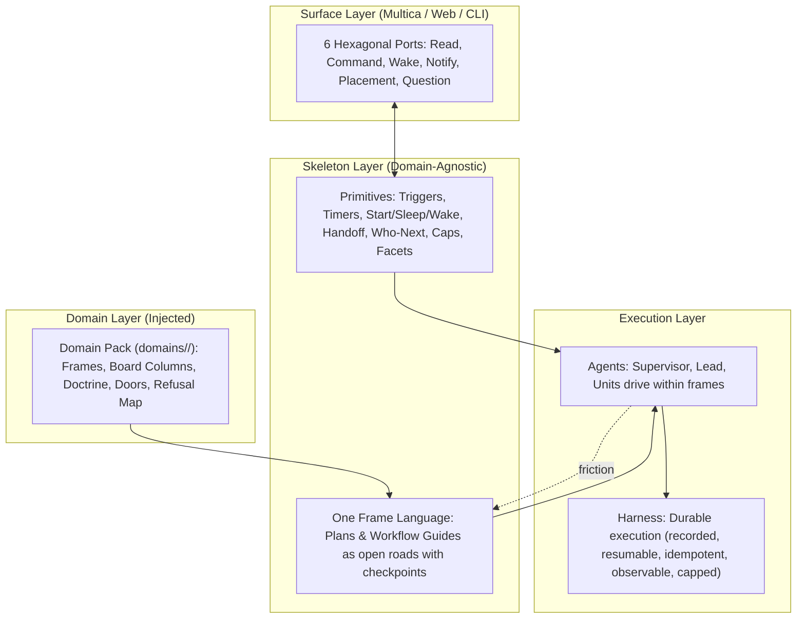

discussion: open

# Orchestration skeleton: domain-agnostic primitives, one frame language, and driving harness

## 1. Trạng thái hiện tại

2026-11-20: Thảo luận được mở từ backlog row `p-7pjiqfoj7v` (nguồn `docs/discussions/supervisor-review/DISCUSSION.md` §7 `#task-orchestration-skeleton`, owner duyệt 2026-11-19 round 19). Đã kế thừa các quyết định cốt lõi SR-D6..SR-D10, bài học Work FSM (G14), nguyên lý harness (G15, G16) và phác thảo 6 ports của Multica (plan `261118-1117-external-ui-integration-multica`).
- Đã nhận câu trả lời chủ dự án cho `q-kjat6xjwfv`: Shaping is parked by owner decision 2026-11-21 until four orchestration fixes land (đóng băng việc điều phối mới để ưu tiên ổn định hệ thống; Architecture Advisory Panel tạm hoãn, thảo luận không đóng).
- Trạng thái thảo luận: **Tạm dừng (`discussion: paused`)**, thảo luận vẫn mở (not settled, not closed), được đậu lại (parked) chờ 4 bản sửa lỗi điều phối hạ cánh. Không có câu hỏi nào đang mở.
- 2026-11-21 16:20: đã ghi bảng tham chiếu các backlog row, plan và discussion liên quan tại §7 `#related` để theo dõi.
- 2026-11-21 16:35: đã xác định 4 bản sửa của OS-D1 (nguồn: memory `orchestration-stabilize-first-decision` của secretary Miu và tin supervisor gửi Miu sáng 2026-11-21: "1547 first, then the idle-lead nudge, then the names, then the reaper"): `p-l22vozecxg`, `p-waxzxz5mio`, `p-mhwe24fttr`, `p-yqanenewb4`. **Cả 4 đã `done`** (xem §7 `#related`). Điều kiện đậu theo chữ của OS-D1 đã thỏa, nhưng release hold ("no new work until the release hold is lifted", handoff secretary 14:45) vẫn còn hiệu lực. Discussion vẫn `paused` cho tới khi chủ dự án cho mở lại.
- **2026-11-21 16:16: chủ dự án cho mở lại (OS-D2).** Trạng thái `discussion: open`. Architecture panel (T0) vẫn hoãn. Release hold không bị ảnh hưởng vì discussion không sinh code.
- Đang bàn §3 row 4 (danh mục primitive và ai sở hữu). Scout cho thấy gần hết primitive đã có chủ (bảng §3 row 4a). Đề xuất đang chờ chủ dự án phản hồi: skeleton là một contract đặt tên và ghép các chủ đã có, không phải component hay crate mới. Có ba khoảng trống thật: sleep, timer theo actor, facet chung.

## 2. Mục tiêu & đề bài

Khung xương điều phối (orchestration skeleton) là tầng nền tảng domain-agnostic định hình sớm toàn bộ hệ thống, chỉ sở hữu actor và thời gian (triggers, timers, start/sleep/wake, handoff, who acts next, các surface port hướng ra ngoài như Multica) mà không bao giờ sở hữu trạng thái, bước đi hay cột bảng của bất kỳ domain cụ thể nào (SR-D8). Hệ thống cung cấp một ngôn ngữ khung (frame language) duy nhất để biểu đạt cả plan lẫn workflow guide như những con đường mở có checkpoint thay vì kịch bản ép buộc (SR-D9), kết hợp với một harness tin cậy giúp agent tự do lái tiến trình nhưng bảo đảm từng bước thực thi đều bền vững, ghi nhận một lần, idempotent, quan sát được, chặn cap và từ chối kèm lý do rõ ràng (SR-D9, G15, G16). Các domain pack (`domains/<d>/`) sẽ tự inject trạng thái, cột bảng, phase frame và các door riêng vào khung xương này. Thảo luận này chốt danh mục primitive của skeleton, contract ngôn ngữ khung, ranh giới harness-agent, và cơ chế tích hợp surface để làm chỗ dựa cho các task tiếp theo (admission code, merge queue, failure ladder, toggle tích hợp).

## 3. Vấn đề rõ / chưa rõ

| # | Điểm | Bằng chứng | Trạng thái |
|---|---|---|---|
| 1 | Ranh giới Skeleton vs Domain: Skeleton chỉ quản actor và thời gian (triggers, timers, start/sleep/wake, handoff, who acts next, surface ports), không sở hữu work state / board columns | SR-D8, G13, G14 (`supervisor-review`). Rút kinh nghiệm từ Work FSM bị hard-code coding mechanics | **Rõ (SR-D8)** |
| 2 | Mô hình 3 phần của quy trình: Frame (đường rộng + checkpoints), Agent (lái linh hoạt trong khung, báo friction), Harness (bảo đảm từng bước tin cậy, không ép kịch bản) | SR-D9, G15, G16 (`supervisor-review`). 4/5 lần supervisor live run dừng là do lỗi harness/confinement | **Rõ (SR-D9)** |
| 3 | Domain Injection: domain pack (`domains/<d>/`) inject phase frames, doctrine, refusal ladder map, doors (coding: review verdict, land door, trunk merge, toggles/retires) | SR-D7, G12. Plan và supervisor hoàn toàn domain-agnostic | **Rõ (SR-D7)** |
| 4 | Danh mục primitives của Skeleton & vị trí code: triggers (Event Store / watcher), timers (OS timer), start/sleep/wake (`session start`, `supervisor wake`, wake pane/socket), handoff (contract), who-next (`bind()` / `dispatch decide`), surface ports (6 ports) | G13 (`supervisor-review`), `plans/261118-1117-external-ui-integration-multica`. Hiện nằm rải rác giữa Supervision, Session Host, Runner | **Đang bàn (round 5):** gần hết primitive đã có chủ, xem bảng 4a. Đề xuất: skeleton là contract đặt tên, không phải crate mới; chờ chủ dự án phản hồi |
| 5 | Ngôn ngữ khung hợp nhất (One Frame Language): Hợp nhất `plan-v1` (plan/wave/phase) và workflow guide YAML (steps/milestones/guards). Cú pháp, schema và runtime runner nào thi hành? | G16. Hiện fgOS có 2 ngôn ngữ khung riêng rẽ, plan không chạy trên workflow harness | **Chưa rõ: Mở khảo sát thiết kế** |
| 6 | Universal work facets: Skeleton chỉ đọc các thuộc tính lịch trình phổ quát (actionable/runnable, waiting on what, finished) thay vì work states cụ thể | G14. Schema của facets này là gì để skeleton lập lịch được? | **Chưa rõ: Đề xuất schema 3 facets** |
| 7 | Tích hợp Surface (Multica 6 ports): Portfolio read, Command, Wake door, Notifier, Session placement, Question port | `plans/261118-1117-external-ui-integration-multica`. G13 | **Chưa rõ: Thứ tự ưu tiên cổng & adapter** |
| 8 | Tổ chức Architecture Panel (`fgos-architecture-panel`): Khởi động panel độc lập gồm nhiều persona phản biện thiết kế skeleton trước khi chốt spec chi tiết | Khuyến nghị từ backlog row `p-7pjiqfoj7v` và `supervisor-review` §7 T7. Đã gửi câu hỏi `q-kjat6xjwfv`. **Câu trả lời chủ dự án:** Chưa làm bây giờ (`Not now`). Chủ dự án chọn đóng băng việc điều phối mới để ưu tiên ổn định hệ thống; Architecture Panel chờ 4 bản sửa lỗi hạ cánh. Đậu (park) thảo luận `orchestration-skeleton`, không đóng. | **Đã mở lại (OS-D2); panel vẫn hoãn** |

**4a. Primitive đang nằm ở đâu (scout 2026-11-21 16:20)**

| Primitive | Chủ hiện tại | Bằng chứng | Khoảng trống |
|---|---|---|---|
| Trigger | Watcher (Supervision, Rust): definitions -> event ghi một lần vào Event Store, hành động theo loại row | `docs/platform/supervision/spec.md` §1, §5 "Tick to event to action" | Definition chỉ phục vụ supervisor; chưa có cách để domain hoặc workflow đăng ký trigger của mình |
| Timer | OS timer của watcher (60 s khi có `watcher-active`, 900 s khi rảnh) | supervision spec §5 | Không có timer theo actor ("đánh thức X lúc T", "nhắc sau N phút") |
| Start | Session Host port `open/launch` + `head-start.mjs`; run supervisor cho worker | `docs/platform/session-host/spec.md` §3, §8.1 | Có đủ |
| Sleep | Không có. `supervisor done` kết thúc hẳn session; head rảnh chỉ bị phát hiện ngồi không (`p-waxzxz5mio`) | supervision spec §4 | **Thiếu hẳn**: không có trạng thái "ngủ chờ X" |
| Wake | `fgos supervisor wake` (chỉ supervisor); successor của người hỏi khi câu hỏi được trả lời | supervision spec §4, §5 | Wake chỉ có cho supervisor, chưa phải primitive dùng chung |
| Replace / rotate | Session Host §8.2 (hai bước), `session-rotation/rotate.mjs` | session-host spec §8 | Có đủ |
| Handoff | `routing-handoff.md` (agent sang agent), `supervisor raise --kind coordination-handoff`, settled discussion -> planner | `docs/platform/runner/contracts/routing-handoff.md`, supervision spec §4.1, §5 | Ba đường riêng, chưa gom về một contract |
| Who acts next | Executor: `bind()` (Execution, tier 5). Plan nào chạy: phán đoán của supervisor trong cap `maxLeads` + lane | `src/runner/execution/bind.mjs`, supervision spec §1 | T1 (`p-radq263tbx`) chuyển admission vào code |
| Cap | `supervisor.maxLeads`, lane pool `workerSlots.ceiling` | supervision spec §2, §3 | Có đủ; failure cap là T4 |
| Scheduling facet | Portfolio chỉ đọc frontmatter plan (`status`, `priority`, `blockedBy`); Work frontier bị loại ra khỏi Supervision | supervision spec §1 "Must not own" | Facet chưa chung: plan và work item mỗi bên một kiểu (§3 row 6) |
| Surface port | 6 port của Multica, chỉ mới là draft | `plans/261118-1117-external-ui-integration-multica` (draft) | Chưa xây (§3 row 7) |

## 4. Quyết định đã chốt

Kế thừa từ `docs/discussions/supervisor-review/DISCUSSION.md`:

| D-ID | Quyết định | Ngày | Nguồn |
|---|---|---|---|
| SR-D6 | Code giữ caps cứng (`maxLeads`, lane pool, tên head). Supervisor chọn plan admit và start lead. Sandbox preflight chứng minh ritual trước turn 1. | 2026-11-19 | `supervisor-review` |
| SR-D7 | Supervisor và plan là domain-agnostic. Mỗi phase chạy như workflow case của domain. Domain pack inject frames, doctrine, refusal ladder, doors. | 2026-11-19 | `supervisor-review` |
| SR-D8 | Skeleton sở hữu actor và thời gian (triggers, timers, start, sleep, wake, handoff, who acts next, surface ports). Không sở hữu work states. Đọc scheduling facets. | 2026-11-19 | `supervisor-review` |
| SR-D9 | 3 phần quy trình: Frame (đường rộng + checkpoint), Agent (lái trong khung), Harness (bước tin cậy: recorded, resumable, observable, capped, refusal reason). | 2026-11-19 | `supervisor-review` |
| SR-D10 | Integration phase, plan khai báo `toggles:` và `retires:`. Close check từ chối nếu còn marker hoặc đường cũ chưa dọn. | 2026-11-19 | `supervisor-review` |
| OS-D1 | Shaping is parked by owner decision 2026-11-21 until four orchestration fixes land: đóng băng việc điều phối mới, tạm hoãn Architecture Panel, thảo luận `orchestration-skeleton` mở nhưng tạm dừng (parked, not closed) | 2026-11-21 | Quyết định chủ dự án (`q-kjat6xjwfv`) |
| OS-D2 | Mở lại discussion ngay (2026-11-21 16:16). 4 bản sửa của OS-D1 đã xong; discussion không sinh code nên không đụng release hold. Architecture panel (T0) vẫn hoãn. | 2026-11-21 | Chủ dự án, trực tiếp trong session shaper |

## 5. Q&A log

- 2026-11-20 round 0: Khởi tạo thảo luận từ backlog `p-7pjiqfoj7v` và các kết luận SR-D6..SR-D10 của `supervisor-review`. Tổng hợp dữ liệu từ plan 261118-1117 (multica 6 ports) và các hướng mở G9-G16.
- 2026-11-20 round 1: Gửi câu hỏi chủ dự án `q-kjat6xjwfv` (hỏi ý kiến về việc mở Architecture Advisory Panel theo khuyến nghị tại backlog `p-7pjiqfoj7v`). Đậu tại question store để chủ dự án trả lời theo nhịp riêng, tiếp tục định hình cấu trúc chi tiết của skeleton.
- 2026-11-21 round 2: Nhận câu trả lời từ chủ dự án cho `q-kjat6xjwfv`: "Not now. Owner chose to freeze new orchestration work and stabilize first; the architecture panel waits until the four fixes land. Park the orchestration-skeleton discussion; do not close it." Shaping is parked by owner decision 2026-11-21 until four orchestration fixes land. Đã ack câu hỏi `q-kjat6xjwfv`, thảo luận chuyển sang trạng thái `discussion: paused`.
- 2026-11-21 16:20 round 3: Chủ dự án yêu cầu liệt kê các plan và backlog liên quan và ghi vào discussion để theo dõi. Đã thêm §7 `#related` (trạng thái đọc từ `docs/backlog.md` và `status:` của từng `plan.md` lúc 16:20). Hỏi lại chủ dự án: 4 bản sửa của OS-D1 là những row nào; chưa có trả lời.
- 2026-11-21 16:35 round 4: Chủ dự án hỏi 4 việc là gì. Đã tìm ra nguồn và ghi vào §7 `#related`: 4 row ổn định session/lead, đều `done`. Hỏi chủ dự án có mở lại discussion không, vì release hold còn hiệu lực.
- 2026-11-21 16:16 round 5: Chủ dự án: "mở lại ngay đi em" -> OS-D2, `discussion: open`. Scout §3 row 4: đọc `docs/platform/supervision/spec.md` §1-§5 và `docs/platform/session-host/spec.md` §1-§7, ghi kết quả vào bảng 4a. Đề xuất với chủ dự án: skeleton là một contract đặt tên, ghép các chủ đã có (Watcher, Session Host, bind(), Event Store, questions), không lập crate mới (L10, RUL104, design principle 1). Phần việc thật chỉ là ba khoảng trống: sleep, timer theo actor, facet chung. Đang chờ phản hồi.

## 6. Thiết kế đã chốt {#design}

**Định hướng tổng thể (Kế thừa SR-D6..SR-D10):**

Khung xương điều phối chia tách rõ rệt giữa cơ chế chung (Skeleton & Harness) và nghiệp vụ đặc thù (Domain Pack):

### Các lớp trách nhiệm

1. **Skeleton (Domain-Agnostic, SR-D8):**
   - **Triggers & Timers:** Watcher OS timer định kỳ, Event Store sự kiện kích hoạt, không mang logic nghiệp vụ.
   - **Start / Sleep / Wake:** `fgos session start` khởi tạo head sandbox; cơ chế sleep/wake qua socket/pane hoặc `fgos supervisor wake`.
   - **Handoff & Who-Next:** Handoff contract giữa các agent; router `bind()` / `fgos dispatch decide` xác định executor phù hợp theo capability mà không ép buộc vai trò cứng.
   - **Scheduling Facets:** Skeleton scheduler chỉ đọc 3 facet phổ quát từ các case/plan:
     - `actionable`: Boolean (đã sẵn sàng chạy, không bị vướng tiền đề).
     - `waitingOn`: Enum/Object (`{ kind: "actor" | "time" | "event" | "person", ref: "..." }`).
     - `finished`: Terminal state boolean + kết quả.
   - **Surface Ports (6 ports từ plan 261118-1117):**
     1. Portfolio read port (đọc danh sách plan, trạng thái, lane).
     2. Command port (chạy các verb supervisor/lead).
     3. Wake door (`fgos supervisor wake --trigger --ref`).
     4. Notifier port (webhook / mailbox phát thông báo).
     5. Session placement port (gắn runtime vào terminal/pane).
     6. Question port (5-part question store).

2. **One Frame Language (SR-D9):**
   - Hợp nhất cấu trúc của `plan-v1` và `workflow guide`:
     - Khai báo mục tiêu, checkpoint bắt buộc (receipts, review verdict, gate).
     - Đường đi cho phép (`routes: should | may-instead | unlisted`).
     - Không ép DAG cứng nhắc; cho phép agent tự chọn bước kế tiếp bên trong khung.

3. **Domain Pack (`domains/<d>/`, SR-D7):**
   - Cung cấp ngữ nghĩa cụ thể: trạng thái, cột hiển thị (mapping từ facet ra board column), doctrine, quy tắc giải quyết lỗi (refusal ladder map L0-L3) và cửa kiểm tra (như `fgos land`, merge queue).

4. **Agents:**
   - Lái quy trình linh hoạt trong khung; ghi nhận friction khi khung bất hợp lý để khung tự tiến hóa.

5. **Harness:**
   - Bảo đảm từng bước đáng tin cậy: ghi nhận một lần (durable), có thể thử lại an toàn (idempotent), quan sát được (observable), chặn giới hạn (capped), từ chối kèm mã lỗi chuẩn hóa.

## 7. Danh mục hạng mục / task {#tasks}

Kế thừa các task phụ thuộc đang chờ từ `supervisor-review` §7 và phân rã các bước tiếp theo:

### T0 Architecture Advisory Panel Run {#task-architecture-panel}
- Goal: Khởi chạy `fgos-architecture-panel` với request được trích xuất từ thảo luận này để thu thập ý kiến phản biện độc lập trước khi đóng băng spec.
- Ref: `q-kjat6xjwfv`.
- Status: Tạm dừng / Đậu (on hold) chờ 4 bản sửa lỗi ổn định hạ cánh theo quyết định của chủ dự án tại `q-kjat6xjwfv`.

### T1 Admission in code {#task-admission-code}
- Goal: Đưa logic kiểm tra điều kiện admission vào code (`fgos-supervision`), supervisor giữ quyền phán đoán (p-radq263tbx).

### T2 Head start preflight {#task-head-preflight}
- Goal: Preflight sandbox kiểm tra ritual và lệnh skill trước turn đầu tiên của head (p-2wb2lfgky3).

### T3 Merge queue with independent review {#task-merge-queue}
- Goal: Hàng đợi merge độc lập cho coding domain, review verdict gắn với SHA (p-r3qqgwtcai).

### T4 Failure ladder and caps {#task-failure-ladder}
- Goal: Thang trách nhiệm xử lý lỗi L0-L3 và giới hạn số lần thử (p-sdwybf7yre).

### T5 Integration phase and dormant switch {#task-integration-phase}
- Goal: Ràng buộc phase tích hợp, gỡ bỏ toggle và mã nguồn cũ (p-lkzx3oygy4).

### T7.1 Skeleton primitives contract & implementation {#task-skeleton-primitives}
- Goal: Chuẩn hoá và đóng gói các primitive của skeleton (triggers, timers, start/sleep/wake, handoff, who-next, surface ports).

### T7.2 Unified frame language specification {#task-frame-language}
- Goal: Thiết kế schema và engine thực thi cho ngôn ngữ khung hợp nhất plan và workflow guide.

### T7.3 Surface ports projection adapter {#task-surface-ports}
- Goal: Xây dựng adapter kết nối 6 ports với giao diện bên ngoài (Multica projection).

### Liên quan bên ngoài & theo dõi {#related}

Ảnh chụp lúc 2026-11-21 16:20. Trạng thái backlog đọc từ `docs/backlog.md`, trạng thái plan đọc từ dòng `status:` của từng `plan.md`. Khi một dòng đổi trạng thái, sửa tại chỗ.

**Backlog: row của chính discussion**

| Row | Nội dung | Trạng thái |
|---|---|---|
| `p-7pjiqfoj7v` | Shaper discussion `orchestration-skeleton` (priority high) | proposed; đậu theo OS-D1 |

**Backlog: chờ discussion này chốt** (nguồn `supervisor-review` §7)

| Row | Task | Nội dung | Trạng thái |
|---|---|---|---|
| `p-radq263tbx` | T1 `#task-admission-code` | Admission trong code; wake door admit plan và start lead | proposed |
| `p-r3qqgwtcai` | T3 `#task-merge-queue` | Merge queue, review verdict gắn SHA | proposed |
| `p-sdwybf7yre` | T4 `#task-failure-ladder` | Failure ladder L0-L3 và cap; còn mở N, X, session fixer | proposed |
| `p-lkzx3oygy4` | T5 `#task-integration-phase` | Integration phase và dormant switch trong plan contract | proposed |

**Backlog: cùng nguồn `supervisor-review`, không chờ discussion này**

| Row | Nội dung | Trạng thái |
|---|---|---|
| `p-xdgjxoqluw` | T0: chỉnh sửa nhỏ thiết kế supervisor | proposed |
| `p-2wb2lfgky3` | T2 `#task-head-preflight`: preflight khi start head | proposed |
| `p-7nja6ilwkr` | G10: vì sao "cửa thứ hai" lặp lại và các agent song song tự quyết ngầm khác nhau | proposed |
| `p-dkiyey4ttl` | Đối chiếu thiết kế supervisor với kinh nghiệm đã công bố | proposed |

**Backlog: 4 bản sửa mà OS-D1 chờ.** Nguồn: memory `orchestration-stabilize-first-decision` của secretary Miu (2026-11-21) và tin supervisor gửi Miu, thứ tự "1547 first, then the idle-lead nudge, then the names, then the reaper".

| # | Row | Nội dung | Trạng thái |
|---|---|---|---|
| 1 | `p-l22vozecxg` | Session mang task của nó (`session start` không còn chỉ gắn bằng tên) | done, plan `261120-1547-session-start-task-binding`, commit `4d724e2db` |
| 2 | `p-waxzxz5mio` | Nhắc hoặc thay lead còn sống nhưng ngồi không | done, plan `261121-0722-idle-lead-replace`, commit `595a7f0b1` |
| 3 | `p-mhwe24fttr` | Tên tab dễ đọc `role: subject`; hai plan trùng 24 ký tự đầu vẫn start được lead | done, plan `261121-0707-head-tab-labels`, commit `f6f88e8d6` |
| 4 | `p-yqanenewb4` | Dọn worktree land candidate bị bỏ lại khi `fgos land` chết | done, plan `261121-0747-land-door-hygiene`, commit `e7701dcfc`; còn sót ca đĩa đầy `git-floor-probe-failed` và 20 candidate cũ của release trước |

**Backlog: ổn định điều phối khác (2026-11-19 đến 21)**, không thuộc 4 bản sửa trên.

| Row | Nội dung | Trạng thái |
|---|---|---|
| `p-ycausep3zs` | Head sống lâu giữ release cũ, bản sửa route không tới (high) | proposed |
| `p-fel4zoytbn` | Việc khẩn cần lane không giao cho lead đang dở plan (high) | proposed |
| `p-of5vpvce3e` | Supervisor head từng khởi động trên Gemini, quá yếu (high) | proposed |
| `p-56oslt7ejt` | Lead skill chưa nói cách chọn worker cho từng task | proposed |
| `p-ucnc6j52qk` | `session start shaper` cho topic mới phải tạo stub discussion | proposed |

**Backlog: từ discussion `workflow-engine`** (phía tầng workflow, sát ranh giới skeleton)

| Row | Nội dung | Trạng thái |
|---|---|---|
| `p-f367pplkhu` | `fgos-cook` và `workflow propose` không chạy check plan-contract với plan ngoài | proposed |
| `p-zhjqb4sxfk` | Chưa tìm ra chỗ đã chốt "một team dưới lead cho mỗi loại task" | proposed |

**Plan**

| Plan | Trạng thái | Liên quan |
|---|---|---|
| `plans/261118-1117-external-ui-integration-multica` | draft | Nguồn 6 surface port (§3 row 7, T7.3) |
| `plans/261118-1045-project-supervisor` | done | Supervisor nền; T1 chờ plan này land |
| `plans/261117-1856-secretary-session-spine` | done | Spine session head |
| `plans/261118-0947-session-verb-for-agent-sessions` | done | Primitive start/sleep/wake (§3 row 4) |
| `plans/261119-1730-supervision-powers-cores` | done | Quyền supervisor (lõi) |
| `plans/261119-1731-supervision-powers-doors` | done | Quyền supervisor (cửa) |
| `plans/261120-1547-session-start-task-binding` | done | Bản sửa #1 của OS-D1 |
| `plans/261121-0707-head-tab-labels` | done | Bản sửa #3 của OS-D1 |
| `plans/261121-0722-idle-lead-replace` | done | Bản sửa #2 của OS-D1 |
| `plans/261121-0745-head-rotation-trace` | done | Ổn định head |
| `plans/261121-0747-land-door-hygiene` | done | Bản sửa #4 của OS-D1 (reaper) |
| `plans/261120-0625-work-data-model` | running (phase 4-7) | Work state; skeleton chỉ đọc facet (§3 row 6) |
| `plans/261121-1309-git-windows-custody` | running | Không trực tiếp; đang chạy trong release hold |

**Discussion**

| Discussion | Trạng thái | Liên quan |
|---|---|---|
| `docs/discussions/supervisor-review/DISCUSSION.md` | settled | Nguồn SR-D6..SR-D10 |
| `docs/discussions/secretary-supervisor-powers/DISCUSSION.md` | settled | Quyền Miu và supervisor |
| `docs/discussions/workflow-engine/DISCUSSION.md` | settled | Tự giới hạn ở tầng workflow, không đụng skeleton |
| `docs/discussions/orchestrator-worker-slots/DISCUSSION.md` | chưa đọc | Tên trùng chủ đề; cần soát khi mở lại |
