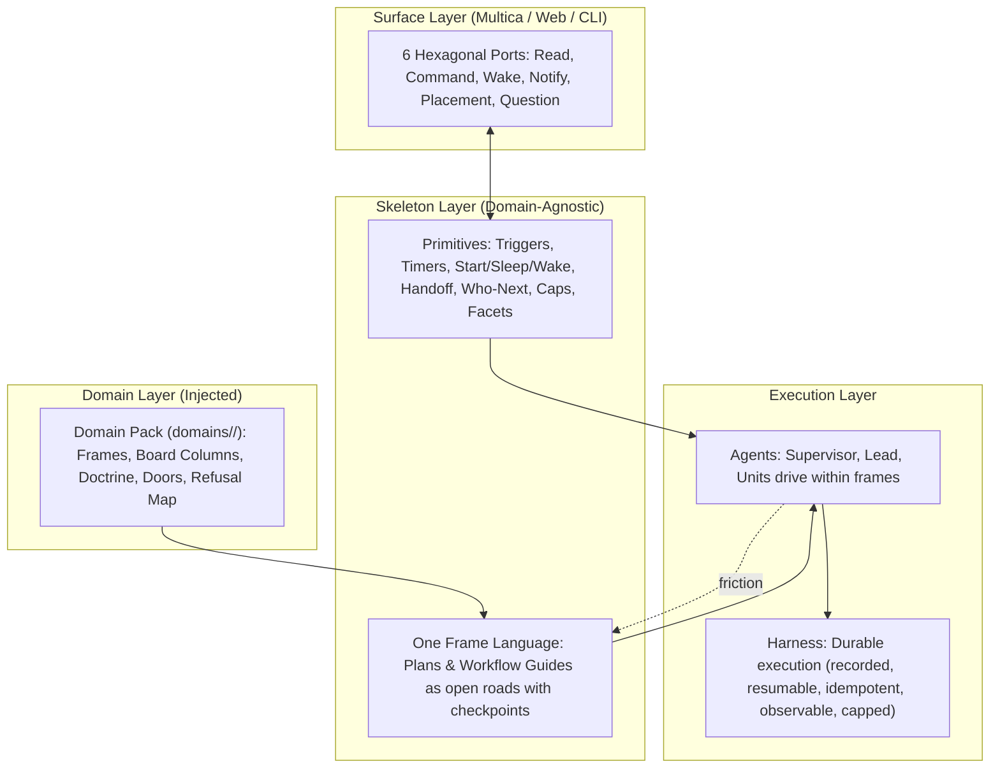

discussion: paused

# Orchestration skeleton: domain-agnostic primitives, one frame language, and driving harness

## 1. Trạng thái hiện tại

2026-11-20: Thảo luận được mở từ backlog row `p-7pjiqfoj7v` (nguồn `docs/discussions/supervisor-review/DISCUSSION.md` §7 `#task-orchestration-skeleton`, owner duyệt 2026-11-19 round 19). Đã kế thừa các quyết định cốt lõi SR-D6..SR-D10, bài học Work FSM (G14), nguyên lý harness (G15, G16) và phác thảo 6 ports của Multica (plan `261118-1117-external-ui-integration-multica`).
- Đã nhận câu trả lời chủ dự án cho `q-kjat6xjwfv`: Đóng băng công việc điều phối mới để ưu tiên ổn định hệ thống; Architecture Advisory Panel và việc định hình chi tiết skeleton tạm hoãn cho đến khi 4 bản sửa lỗi hạ cánh.
- Trạng thái thảo luận: **Tạm dừng (`discussion: paused`)**, lưu giữ đầy đủ cấu trúc khung và câu hỏi để phục hồi tiếp khi 4 bản sửa lỗi hoàn tất. Không có câu hỏi nào đang mở.

## 2. Mục tiêu & đề bài

Khung xương điều phối (orchestration skeleton) là tầng nền tảng domain-agnostic định hình sớm toàn bộ hệ thống, chỉ sở hữu actor và thời gian (triggers, timers, start/sleep/wake, handoff, who acts next, các surface port hướng ra ngoài như Multica) mà không bao giờ sở hữu trạng thái, bước đi hay cột bảng của bất kỳ domain cụ thể nào (SR-D8). Hệ thống cung cấp một ngôn ngữ khung (frame language) duy nhất để biểu đạt cả plan lẫn workflow guide như những con đường mở có checkpoint thay vì kịch bản ép buộc (SR-D9), kết hợp với một harness tin cậy giúp agent tự do lái tiến trình nhưng bảo đảm từng bước thực thi đều bền vững, ghi nhận một lần, idempotent, quan sát được, chặn cap và từ chối kèm lý do rõ ràng (SR-D9, G15, G16). Các domain pack (`domains/<d>/`) sẽ tự inject trạng thái, cột bảng, phase frame và các door riêng vào khung xương này. Thảo luận này chốt danh mục primitive của skeleton, contract ngôn ngữ khung, ranh giới harness-agent, và cơ chế tích hợp surface để làm chỗ dựa cho các task tiếp theo (admission code, merge queue, failure ladder, toggle tích hợp).

## 3. Vấn đề rõ / chưa rõ

| # | Điểm | Bằng chứng | Trạng thái |
|---|---|---|---|
| 1 | Ranh giới Skeleton vs Domain: Skeleton chỉ quản actor và thời gian (triggers, timers, start/sleep/wake, handoff, who acts next, surface ports), không sở hữu work state / board columns | SR-D8, G13, G14 (`supervisor-review`). Rút kinh nghiệm từ Work FSM bị hard-code coding mechanics | **Rõ (SR-D8)** |
| 2 | Mô hình 3 phần của quy trình: Frame (đường rộng + checkpoints), Agent (lái linh hoạt trong khung, báo friction), Harness (bảo đảm từng bước tin cậy, không ép kịch bản) | SR-D9, G15, G16 (`supervisor-review`). 4/5 lần supervisor live run dừng là do lỗi harness/confinement | **Rõ (SR-D9)** |
| 3 | Domain Injection: domain pack (`domains/<d>/`) inject phase frames, doctrine, refusal ladder map, doors (coding: review verdict, land door, trunk merge, toggles/retires) | SR-D7, G12. Plan và supervisor hoàn toàn domain-agnostic | **Rõ (SR-D7)** |
| 4 | Danh mục primitives của Skeleton & vị trí code: triggers (Event Store / watcher), timers (OS timer), start/sleep/wake (`session start`, `supervisor wake`, wake pane/socket), handoff (contract), who-next (`bind()` / `dispatch decide`), surface ports (6 ports) | G13 (`supervisor-review`), `plans/261118-1117-external-ui-integration-multica`. Hiện nằm rải rác giữa Supervision, Session Host, Runner | **Chưa rõ: Cần chốt contract & crate/module sở hữu** |
| 5 | Ngôn ngữ khung hợp nhất (One Frame Language): Hợp nhất `plan-v1` (plan/wave/phase) và workflow guide YAML (steps/milestones/guards). Cú pháp, schema và runtime runner nào thi hành? | G16. Hiện fgOS có 2 ngôn ngữ khung riêng rẽ, plan không chạy trên workflow harness | **Chưa rõ: Mở khảo sát thiết kế** |
| 6 | Universal work facets: Skeleton chỉ đọc các thuộc tính lịch trình phổ quát (actionable/runnable, waiting on what, finished) thay vì work states cụ thể | G14. Schema của facets này là gì để skeleton lập lịch được? | **Chưa rõ: Đề xuất schema 3 facets** |
| 7 | Tích hợp Surface (Multica 6 ports): Portfolio read, Command, Wake door, Notifier, Session placement, Question port | `plans/261118-1117-external-ui-integration-multica`. G13 | **Chưa rõ: Thứ tự ưu tiên cổng & adapter** |
| 8 | Tổ chức Architecture Panel (`fgos-architecture-panel`): Khởi động panel độc lập gồm nhiều persona phản biện thiết kế skeleton trước khi chốt spec chi tiết | Khuyến nghị từ backlog row `p-7pjiqfoj7v` và `supervisor-review` §7 T7. Đã gửi câu hỏi `q-kjat6xjwfv`. **Câu trả lời chủ dự án:** Chưa làm bây giờ (`Not now`). Chủ dự án chọn đóng băng việc điều phối mới để ưu tiên ổn định hệ thống; Architecture Panel chờ 4 bản sửa lỗi hạ cánh. Đậu (park) thảo luận `orchestration-skeleton`, không đóng. | **Tạm dừng / Đậu (chờ 4 fixes)** |

## 4. Quyết định đã chốt

Kế thừa từ `docs/discussions/supervisor-review/DISCUSSION.md`:

| D-ID | Quyết định | Ngày | Nguồn |
|---|---|---|---|
| SR-D6 | Code giữ caps cứng (`maxLeads`, lane pool, tên head). Supervisor chọn plan admit và start lead. Sandbox preflight chứng minh ritual trước turn 1. | 2026-11-19 | `supervisor-review` |
| SR-D7 | Supervisor và plan là domain-agnostic. Mỗi phase chạy như workflow case của domain. Domain pack inject frames, doctrine, refusal ladder, doors. | 2026-11-19 | `supervisor-review` |
| SR-D8 | Skeleton sở hữu actor và thời gian (triggers, timers, start, sleep, wake, handoff, who acts next, surface ports). Không sở hữu work states. Đọc scheduling facets. | 2026-11-19 | `supervisor-review` |
| SR-D9 | 3 phần quy trình: Frame (đường rộng + checkpoint), Agent (lái trong khung), Harness (bước tin cậy: recorded, resumable, observable, capped, refusal reason). | 2026-11-19 | `supervisor-review` |
| SR-D10 | Integration phase, plan khai báo `toggles:` và `retires:`. Close check từ chối nếu còn marker hoặc đường cũ chưa dọn. | 2026-11-19 | `supervisor-review` |
| OS-D1 | Đóng băng công việc điều phối mới, tạm hoãn Architecture Advisory Panel; thảo luận `orchestration-skeleton` tạm dừng (park) chờ 4 bản sửa lỗi hạ cánh trước | 2026-11-20 | Quyết định chủ dự án (`q-kjat6xjwfv`) |

## 5. Q&A log

- 2026-11-20 round 0: Khởi tạo thảo luận từ backlog `p-7pjiqfoj7v` và các kết luận SR-D6..SR-D10 của `supervisor-review`. Tổng hợp dữ liệu từ plan 261118-1117 (multica 6 ports) và các hướng mở G9-G16.
- 2026-11-20 round 1: Gửi câu hỏi chủ dự án `q-kjat6xjwfv` (hỏi ý kiến về việc mở Architecture Advisory Panel theo khuyến nghị tại backlog `p-7pjiqfoj7v`). Đậu tại question store để chủ dự án trả lời theo nhịp riêng, tiếp tục định hình cấu trúc chi tiết của skeleton.
- 2026-11-20 round 2: Nhận câu trả lời từ chủ dự án cho `q-kjat6xjwfv` (qua thư ký Miu): "Not now. Owner chose to freeze new orchestration work and stabilize first; the architecture panel waits until the four fixes land. Park the orchestration-skeleton discussion; do not close it." Cập nhật origin, ack câu hỏi `q-kjat6xjwfv`, chuyển trạng thái thảo luận sang `discussion: paused`.

## 6. Thiết kế đã chốt {#design}

**Định hướng tổng thể (Kế thừa SR-D6..SR-D10):**

Khung xương điều phối chia tách rõ rệt giữa cơ chế chung (Skeleton & Harness) và nghiệp vụ đặc thù (Domain Pack):

### Các lớp trách nhiệm

1. **Skeleton (Domain-Agnostic, SR-D8):**
   - **Triggers & Timers:** Watcher OS timer định kỳ, Event Store sự kiện kích hoạt, không mang logic nghiệp vụ.
   - **Start / Sleep / Wake:** `fgos session start` khởi tạo head sandbox; cơ chế sleep/wake qua socket/pane hoặc `fgos supervisor wake`.
   - **Handoff & Who-Next:** Handoff contract giữa các agent; router `bind()` / `fgos dispatch decide` xác định executor phù hợp theo capability mà không ép buộc vai trò cứng.
   - **Scheduling Facets:** Skeleton scheduler chỉ đọc 3 facet phổ quát từ các case/plan:
     - `actionable`: Boolean (đã sẵn sàng chạy, không bị vướng tiền đề).
     - `waitingOn`: Enum/Object (`{ kind: "actor" | "time" | "event" | "person", ref: "..." }`).
     - `finished`: Terminal state boolean + kết quả.
   - **Surface Ports (6 ports từ plan 261118-1117):**
     1. Portfolio read port (đọc danh sách plan, trạng thái, lane).
     2. Command port (chạy các verb supervisor/lead).
     3. Wake door (`fgos supervisor wake --trigger --ref`).
     4. Notifier port (webhook / mailbox phát thông báo).
     5. Session placement port (gắn runtime vào terminal/pane).
     6. Question port (5-part question store).

2. **One Frame Language (SR-D9):**
   - Hợp nhất cấu trúc của `plan-v1` và `workflow guide`:
     - Khai báo mục tiêu, checkpoint bắt buộc (receipts, review verdict, gate).
     - Đường đi cho phép (`routes: should | may-instead | unlisted`).
     - Không ép DAG cứng nhắc; cho phép agent tự chọn bước kế tiếp bên trong khung.

3. **Domain Pack (`domains/<d>/`, SR-D7):**
   - Cung cấp ngữ nghĩa cụ thể: trạng thái, cột hiển thị (mapping từ facet ra board column), doctrine, quy tắc giải quyết lỗi (refusal ladder map L0-L3) và cửa kiểm tra (như `fgos land`, merge queue).

4. **Agents:**
   - Lái quy trình linh hoạt trong khung; ghi nhận friction khi khung bất hợp lý để khung tự tiến hóa.

5. **Harness:**
   - Bảo đảm từng bước đáng tin cậy: ghi nhận một lần (durable), có thể thử lại an toàn (idempotent), quan sát được (observable), chặn giới hạn (capped), từ chối kèm mã lỗi chuẩn hóa.

## 7. Danh mục hạng mục / task {#tasks}

Kế thừa các task phụ thuộc đang chờ từ `supervisor-review` §7 và phân rã các bước tiếp theo:

### T0 Architecture Advisory Panel Run {#task-architecture-panel}
- Goal: Khởi chạy `fgos-architecture-panel` với request được trích xuất từ thảo luận này để thu thập ý kiến phản biện độc lập trước khi đóng băng spec.
- Ref: `q-kjat6xjwfv`.
- Status: Tạm dừng / Đậu (on hold) chờ 4 bản sửa lỗi ổn định hạ cánh theo quyết định của chủ dự án tại `q-kjat6xjwfv`.

### T1 Admission in code {#task-admission-code}
- Goal: Đưa logic kiểm tra điều kiện admission vào code (`fgos-supervision`), supervisor giữ quyền phán đoán (p-radq263tbx).

### T2 Head start preflight {#task-head-preflight}
- Goal: Preflight sandbox kiểm tra ritual và lệnh skill trước turn đầu tiên của head (p-2wb2lfgky3).

### T3 Merge queue with independent review {#task-merge-queue}
- Goal: Hàng đợi merge độc lập cho coding domain, review verdict gắn với SHA (p-r3qqgwtcai).

### T4 Failure ladder and caps {#task-failure-ladder}
- Goal: Thang trách nhiệm xử lý lỗi L0-L3 và giới hạn số lần thử (p-sdwybf7yre).

### T5 Integration phase and dormant switch {#task-integration-phase}
- Goal: Ràng buộc phase tích hợp, gỡ bỏ toggle và mã nguồn cũ (p-lkzx3oygy4).

### T7.1 Skeleton primitives contract & implementation {#task-skeleton-primitives}
- Goal: Chuẩn hoá và đóng gói các primitive của skeleton (triggers, timers, start/sleep/wake, handoff, who-next, surface ports).

### T7.2 Unified frame language specification {#task-frame-language}
- Goal: Thiết kế schema và engine thực thi cho ngôn ngữ khung hợp nhất plan và workflow guide.

### T7.3 Surface ports projection adapter {#task-surface-ports}
- Goal: Xây dựng adapter kết nối 6 ports với giao diện bên ngoài (Multica projection).
