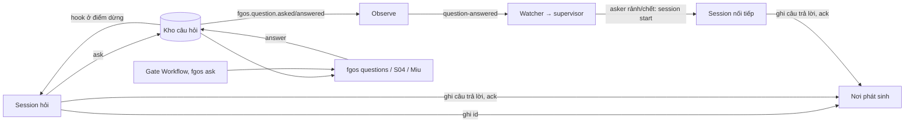

discussion: settled

# Câu hỏi cho chủ dự án (owner questions)

> **Hand-off cho planner** (plan contract `core/skills/_shared/plan-contract.md`; secretary lead:HARDEN mở planner).
> - **Outcome:** mọi câu hỏi gửi chủ dự án (discussion, plan, execution) được hỏi qua `fgos questions ask`, có id,
>   người hỏi tự điền, `askedAt`, năm phần; chủ dự án thấy và trả lời mọi câu ở một chỗ (`fgos questions`, màn S04
>   dashboard, Miu gom bộ); session hỏi nhận câu trả lời ở điểm dừng kế tiếp và ghi nó về nơi phát sinh; asker rảnh
>   hoặc đã chết được supervisor nối tiếp qua `fgos.question.answered`.
> - **Constraints:** OQ-D1..OQ-D7, OM-D11, OM-D13; Rust cho code mới; L10 (cửa mới thay reader markdown thì xoá đường
>   cũ cùng đợt); nguyên tắc 1, 2, 7, 8; RUL104; config key mới qua `core/config-standard` + `core/config-schema`;
>   hook mới có row trong doctor registry; `CHANGELOG.md` `[Unreleased]`.
> - **Non-goals:** thiết kế lại gate Workflow hay `fgos ask` (tầng Work tạm dừng; đọc cạnh nhau, gộp sau);
>   watcher, bảng hành động, supervisor (plan `261118-1045-project-supervisor`); mailbox/nudge; gõ vào pane;
>   thước đo thời gian chờ (ops-metrics); đồng bộ tức thời giữa máy.
> - **Acceptance:** (1) `ask` trả id, bản ghi có asker (session id, handle, role nếu có), `askedAt`, stage, origin
>   ref, năm phần được kiểm; người gọi không tự khai asker được. (2) `answer <id>` ghi `{text, by, answeredAt}` một
>   lần; trả lời lần hai bị từ chối có tên. (3) `ask`/`answer` phát `fgos.question.asked|answered` với attrs OQ-D6.
>   (4) `fgos questions` liệt kê câu mở của kho cùng gate Workflow mở, mỗi câu có lệnh trả lời; S04 hiện và trả lời
>   cùng tập đó. (5) Hook của session hỏi báo đúng câu đã trả lời của chính nó, không báo câu của session khác.
>   (6) Định nghĩa `question-answered` chạy trên fixture. (7) Câu mở cũ trong `QUESTIONS.md`/mục plan được hỏi lại
>   qua verb lúc cutover và reader markdown bị xoá. (8) `cargo test --workspace`, `npm test` xanh.
> - **Open, chặn một phần:** không. Phụ thuộc ngoài: kind `fgos.question.*` do ops-metrics đăng ký (OM-D11), cửa ghi
>   Observe của ops-metrics; hành động đánh thức do plan supervisor (phase watcher).
> - **Sources:** OM-D11, OM-D13, OM-D14 (`docs/discussions/ops-metrics/DISCUSSION.md`); nợ SM-D9
>   (`plans/261117-1856-secretary-session-spine/plan.md:246`); scout `plans/reports/scout-261118-1125-owner-question-routing.md`
>   (nhánh `origin/shape/ops-metrics`).

Shaper: tab "shaper: owner-questions", nhánh `shape/owner-questions`. Phạm vi do chủ dự án đặt 2026-11-18 (OM-D14).

## 1. Trạng thái hiện tại

2026-11-18. Settled. Năm điểm chốt: nguồn sự thật OQ-D1, chỗ đặt kho OQ-D2, người hỏi OQ-D3, chỗ xem chung OQ-D4,
nhận câu trả lời OQ-D5, đánh thức OQ-D6, chuyển đổi OQ-D7. Ranh giới với plan supervisor đã thống nhất. Không câu
hỏi nào chờ chủ dự án. Bước tiếp: secretary mở planner.

## 2. Mục tiêu & đề bài

Khi một session (shaper, lead, supervisor, planner, một bước Workflow) cần chủ dự án quyết định, câu hỏi phải được
ghi một lần với đủ năm phần, biết ai hỏi (session Identity, role, plan/phase, pane/tab) và hỏi lúc nào; chủ dự án
thấy và trả lời mọi câu ở một chỗ chung; session đã hỏi nhận ra câu trả lời của chính nó bằng một khoá có được lúc
hỏi; và session đó được đánh thức khi câu trả lời tới (session còn sống thì gõ vào pane, đã chết thì supervisor nối
tiếp). Mailbox vẫn hoãn. Tầng Work đang tạm dừng: gate Workflow chỉ được đọc hoặc tham chiếu, không thiết kế lại.
Code mới viết bằng Rust khi làm được mà không gây xáo trộn.

## 3. Vấn đề rõ / chưa rõ

| # | Điểm | Trạng thái | Ghi chú |
|---|------|-----------|---------|
| 1 | Nguồn sự thật của câu hỏi | chốt OQ-D1 | Kho vận hành; nơi phát sinh giữ bản lâu dài. |
| 2 | Ghi gì về người hỏi | chốt OQ-D3 | Verb tự điền từ Identity; pane không dùng để đánh thức. |
| 3 | Một chỗ chung để xem và trả lời | chốt OQ-D4 | `fgos questions` + S04; gate và `fgos ask` đọc cạnh nhau. |
| 4 | Session hỏi nhận ra câu trả lời của mình | chốt OQ-D5 | Hook ở điểm dừng, khoá = id + session id. |
| 5 | Đánh thức session khi có trả lời | chốt OQ-D6 | Supervisor nối tiếp; không gõ pane, không mailbox. |
| 6 | Socket `head answered` có dùng được không | rõ: không | Bước bắt tay xoay session (`src/session-rotation/rotate.mjs:115-133`). |
| 7 | Chỗ đặt kho | chốt OQ-D2 | Component riêng, mẫu shard của Observe. |
| 8 | Đồng bộ giữa máy | rõ: theo git, không tức thời | Câu hỏi và asker thường cùng máy; supervisor chạy theo máy. Nếu cần tức thời, mở item riêng. |
| 9 | `fgos ask` và gate Workflow | rõ: giữ nguyên | Tầng Work tạm dừng; gộp khi Work mở lại (secretary ghi dòng backlog). |

## 4. Quyết định đã chốt

| D-ID | Quyết định | Nguồn |
|------|-----------|-------|
| OQ-D1 | Câu hỏi đang mở nằm trong một kho vận hành (hàng đợi + nhật ký): `fgos questions ask` mint id, tự ghi người hỏi, `askedAt` và năm phần; `answer` ghi câu trả lời; danh sách mở là phép gộp bản ghi. Nơi phát sinh (`QUESTIONS.md`, mục câu hỏi của plan, gate) giữ bản lâu dài, thêm id, và nhận lại câu trả lời + quyết định. Gate Workflow giữ nguyên, được đọc như nguồn thứ hai tới khi tầng Work mở lại. Loại bỏ: giữ bốn nơi lưu với cột điền tay (không kiểm được người hỏi, không đánh thức được). | Q1, 2026-11-18 (hai vòng; chủ dự án làm rõ, shaper quyết theo ưu tiên #2) |
| OQ-D2 | Kho là một component Rust riêng (không thuộc Observe: Observe sở hữu đo lường và friction, câu hỏi là trạng thái điều phối). Bản ghi append-only theo writer như shard Observe (`docs/platform/observe/spec.md` §3), ở store của main checkout; tái dùng cửa shard có sẵn thay vì viết lại (nguyên tắc 1, 2; planner quyết tách primitive xuống lớp thấp hay gọi qua). Ngoài ra phát sự kiện qua cửa ghi Observe (OM-D13). | Shaper, 2026-11-18 |
| OQ-D3 | Người hỏi do verb tự điền, người gọi không khai được: session id + handle (Identity in-process), role nếu session đã đăng ký, persona nếu là head session. Người gọi đưa `--ref` nơi phát sinh (discussion `QUESTIONS.md#Qn`, plan + phase, run/gate), verb kiểm tra tồn tại. Khoá pane/tab ghi nếu Session Host có placement, chỉ để hiển thị. | Shaper, 2026-11-18 (vòng 2 đề xuất, vòng 3 giữ nguyên) |
| OQ-D4 | Một chỗ xem và trả lời: `fgos questions` (list mở, `show <id>`, `answer <id>`) và màn S04 dashboard gateway mở rộng, cùng một cửa. Gate Workflow mở và `fgos ask` hiện cạnh đó, trả lời qua cửa riêng của chúng. Miu đọc danh sách này để gom bộ câu hỏi; chủ dự án trả lời qua Miu thì Miu gọi `answer`, `by` ghi chủ dự án qua Miu. | Shaper, 2026-11-18 (vòng 2-3) |
| OQ-D5 | Session hỏi nhận câu trả lời bằng id nhận lúc hỏi: một hook Rust ở `UserPromptSubmit` và `Stop` (không `PostToolUse`, quá dày) tra câu đã trả lời có asker là session này mà chưa ghi nhận, báo một dòng; session ghi câu trả lời + quyết định về nơi phát sinh rồi gọi `fgos questions ack <id>`. | Shaper, 2026-11-18 (vòng 2-3) |
| OQ-D6 | Đánh thức không thuộc verb câu hỏi. Question plan sinh `fgos.question.answered` (ref = id câu hỏi; attrs: asker role + session id, handle/persona, origin ref, answeredAt; pane tuỳ chọn) và định nghĩa phát hiện `question-answered`. Plan supervisor sở hữu watcher, bảng hành động (mặc định `wake-supervisor`) và supervisor: asker còn sống và đang chạy tự nhận qua OQ-D5; asker rảnh hoặc đã chết → supervisor mở session nối tiếp (`fgos session start`), session đó ghi câu trả lời về nơi phát sinh và `ack`. Không gõ pane (PS-9), không mailbox (hoãn). Khi nudge của mailbox lên main, supervisor có thể nudge asker rảnh thay vì thay nó. | Planner supervisor + shaper, 2026-11-18 |
| OQ-D7 | Chuyển đổi: lúc cutover mọi câu mở trong `QUESTIONS.md` và mục câu hỏi plan nháp được hỏi lại qua verb một lần (asker `migrated`), cột/mục markdown thêm id; reader markdown của `src/portfolio/open-questions.mjs` bị xoá cùng đợt (L10). `fgos-shaping`, plan contract và skill planner đổi để hỏi qua verb. | Shaper, 2026-11-18 |
| OM-D11, OM-D13 (kế thừa) | Verb Rust `fgos questions ask|answer` ghi thời điểm hỏi/trả lời và phát `fgos.question.asked|answered` qua cửa ghi Observe; một parser; Node chỉ là lớp gọi mỏng. OM-D11: ops-metrics đăng ký kind `fgos.question.*`, bên sở hữu câu hỏi sinh sự kiện. Supervisor không nói chuyện với chủ dự án; câu hỏi của nó vào `fgos questions --open` và Miu gom thành bộ. | `docs/discussions/ops-metrics/DISCUSSION.md` §4 (nhánh `shape/ops-metrics`) |

## 5. Q&A log

- 2026-11-18 11:41 — Mở discussion. Kiểm tra scout trên main `9b462207d`: bốn nơi lưu và các khoảng trống còn
  nguyên; plan secretary ghi việc gộp câu hỏi về một chỗ là nợ SM-D9 (`plans/261117-1856-secretary-session-spine/plan.md:246`).
  Hỏi Q1.
- 2026-11-18 — Chủ dự án hỏi: kho câu hỏi chỉ là bản tạm cho vận hành/UX? Trả lời xong có ghi lại đúng chỗ phát
  sinh, hay không còn chỗ nào liệt kê câu hỏi? Shaper: đúng là kho vận hành (L1: log, không phải state); nơi phát
  sinh vẫn giữ bản lâu dài và nhận câu trả lời ghi lại. Sửa lựa chọn (a) trong Q1 theo hướng đó (bản trước nói
  "markdown chỉ còn id", bỏ).
- 2026-11-18 — Chủ dự án: "suy nghĩ kỹ xem tại sao vẫn còn hỏi a hay b". Đúng: phân tích đã chọn rõ (a), (b) không
  đáp được điểm 4 và 5; theo AGENTS.md ưu tiên #2 shaper phải quyết và báo cáo. Quyết (a) → OQ-D1. Từ đây shaper
  tự quyết điểm nào phân tích chọn rõ; chỉ hỏi khi phương án ngang nhau hoặc phụ thuộc ý định chủ dự án.
- 2026-11-18 — Planner supervisor (`plan-supervisor-b9`, plan `261118-1045-project-supervisor`) trả lời: watcher
  chạy được với cách chia như ops-metrics; question plan sở hữu kind và định nghĩa `question-answered`, plan supervisor
  sở hữu watcher, bảng hành động (mặc định `wake-supervisor`) và supervisor. Xung đột: PS-9 cấm watcher gõ vào pane
  (gõ giữa turn của LLM không an toàn). Shaper bỏ hẳn terminal-control `send`: asker còn sống và đang chạy nhận qua
  hook của chính nó; asker rảnh hoặc đã chết → supervisor mở session nối tiếp. Mailbox nudge chỉ có trên nhánh
  `mailbox/v1-v3`, chủ dự án giữ hoãn. Đã báo lại planner supervisor.
- 2026-11-18 — Shaper quyết các điểm 2-5 và chỗ đặt kho (OQ-D2..OQ-D7): phân tích chọn rõ, không phương án nào ngang
  nhau hay phụ thuộc ý định chủ dự án. Discussion settled.

## 6. Thiết kế đã chốt {#design}

Mỗi câu hỏi gửi chủ dự án có hai chỗ ở: **nơi phát sinh** (hàng `QUESTIONS.md` của discussion, mục câu hỏi của plan
nháp, gate Workflow) giữ văn bản lâu dài và nhận lại câu trả lời; **kho câu hỏi** (component Rust riêng, OQ-D2) là
hàng đợi + nhật ký của câu đang mở, nguồn duy nhất cho danh sách và cho sự kiện.

1. **Hỏi.** Session gọi `fgos questions ask --ref <nơi phát sinh> <năm phần>`. Verb kiểm năm phần, tự điền người
   hỏi từ Identity (OQ-D3), mint id, ghi bản ghi append-only với `askedAt` và stage, phát `fgos.question.asked`, trả
   id. Session ghi id vào nơi phát sinh rồi làm tiếp phần việc không phụ thuộc câu hỏi (AGENTS.md ưu tiên #2).
2. **Xem và trả lời.** `fgos questions` và màn S04 liệt kê câu mở của kho, cạnh gate Workflow mở và `fgos ask`
   (OQ-D4). Miu gom bộ cho chủ dự án. `answer <id>` ghi `{text, by, answeredAt}` một lần, phát
   `fgos.question.answered` (OQ-D6).
3. **Nhận.** Hook `UserPromptSubmit`/`Stop` của session hỏi thấy câu đã trả lời của chính nó, báo một dòng; session
   ghi câu trả lời và quyết định về nơi phát sinh rồi `ack` (OQ-D5).
4. **Nối tiếp.** Watcher (plan supervisor) thấy `question-answered` → mặc định đánh thức supervisor; asker rảnh hoặc
   đã chết → supervisor mở session nối tiếp làm bước 3 (OQ-D6).

## 7. Danh mục hạng mục / task {#tasks}

### question-store {#task-question-store}
Component Rust: bản ghi, id, asker tự điền, `ask|answer|show|ack|list`, cửa shard tái dùng, sự kiện qua cửa ghi
Observe. §6 bước 1-2. OQ-D1, D2, D3, OM-D13. Verify nháp: `cargo test -p <crate câu hỏi>`.

### question-views {#task-question-views}
`fgos questions` (Rust) thay reader Node; màn S04 mở rộng đọc/ghi qua cùng cửa; gate và `fgos ask` hiện cạnh. §6
bước 2. OQ-D4. Sau question-store. Verify nháp: test gateway S04 + test verb.

### question-receipt-hook {#task-question-receipt-hook}
Hook Rust `UserPromptSubmit`/`Stop`, row doctor registry, cài qua cửa hook có sẵn. §6 bước 3. OQ-D5. Sau
question-store. Verify nháp: hook chỉ báo câu của chính session trên fixture hai session.

### question-answered-definition {#task-question-answered-definition}
Định nghĩa phát hiện `question-answered` với attrs OQ-D6, chạy trên fixture; hành động thuộc plan supervisor.
Phụ thuộc cửa ghi Observe của ops-metrics. Verify nháp: query định nghĩa trên fixture.

### question-cutover {#task-question-cutover}
Hỏi lại câu mở cũ qua verb, thêm cột id, đổi `fgos-shaping`/plan contract/skill planner, xoá reader markdown
(L10). OQ-D7. Sau question-store và question-views. Verify nháp: `npm test` + `fgos questions` trên repo thật.
