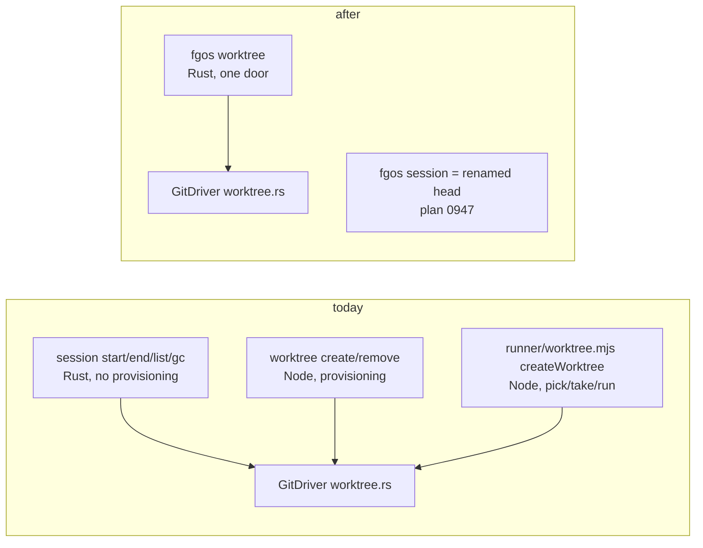

# DISCUSSION: S6a of the Rust verb migration (Execution: runner core, dispatch, run, worktree)

discussion: open

Source: program plan `plans/261114-2051-rust-verb-migration-program/plan.md` row S6a; owner hold of
plan `plans/261118-0947-session-verb-for-agent-sessions` (2026-11-18 13:10, commit 5f307a2f0) until this
discussion settles the worktree split. Shaper: claude-kqih@fg-server2, branch `shape/s6a`.

## 1. Trạng thái hiện tại

2026-11-18 13:25. Scan done (base 2080d7bb4). D1 settled: plan 0947 keeps the session-verb retirement
and the `head` -> `session` rename; S6a builds the one Rust `fgos worktree` door, folding in what
`session start/end/list/gc` did and the runner's own `createWorktree`; 0947 runs after S6a lands its
worktree phase, not after all of S6a. Open: Q1-Q4 in `QUESTIONS.md` (session checkout provisioning,
`fgos-runner` owner, order against plan 1045 P6, whether `src/runner/worktree.mjs` is in scope).

## 2. Mục tiêu & đề bài

S6a moves tier 5 (Execution) of the fgOS CLI from Node to Rust: `fgos run`, the `dispatch` subs still on
Node (`probe-account`, `probe-session`, `reconcile`, `inspect`, `show-run`, `watch`, `recover`, plus the
`execute`/`log` tombstones), `fgos worktree` and `resync-worktree`, and the Node side of the run supervisor,
then deletes the tier-5 Node code (about 34k lines in `src/runner/execution`, `src/runner/dispatch`,
`src/run-supervisor`, `src/verbs/{worktree,dispatch}`), retires every tier-5 Node name in the `doors`
table, and moves the 30 `bridge:S6a` doctor rows (plus `seat-binding-route` from S5) into Rust. The owner
asked that worktree work be designed once: today three doors create checkouts (`session start` in Rust
without provisioning, Node `worktree create` with provisioning, Node `createWorktree` in
`src/runner/worktree.mjs` for pick/take/run), all over the same Rust `GitDriver` methods in
`packages/git/rust/src/worktree.rs`. S6a starts only after S5 (`plans/261115-2328-execution-read-door`)
lands; its phases 11 (doctor rows) and 12 (doors, close) are still pending.

## 3. Vấn đề rõ / chưa rõ

| Point | State | Evidence / note |
|---|---|---|
| Split with plan 0947 | settled (D1) | owner 2026-11-18 13:2x |
| Session checkout: keep bare (no `worktreeSetup`/deps/skill roots) or provision like `worktree create` | open, Q1 | `apps/fgos/src/wiring/session.rs` start never provisions; `src/verbs/worktree/create.mjs:14` calls `provisionWorktree` |
| `fgos-runner` entry belongs to S6a or S7 | open, Q2 | `bin/fgos-runner.mjs` drives the Work frontier via `src/runner/loop.mjs`; S7 owns tier-7 `src/runner/*.mjs` |
| Order against plan 1045 P6 (lane pool edits `direct-launch.mjs`, `assignment-runner.mjs`, `envelope.v3.json`) | open, Q3 | both edit S6a's Node launchers |
| `src/runner/worktree.mjs` (1437 lines, real worktree engine, used by S6b/S7 callers) in S6a scope | open, Q4 | not in the program row's file list |
| `src/run-supervisor/payload-root.mjs` imported by lower layers (seat-binding, session-host, native door, event-store) | clear: must move down before the directory is deleted | design principle 2 |
| S5 gate | clear: S6a waits for S5 phases 11, 12 | `plans/261115-2328-execution-read-door/plan.md` |
| Plan 0947 phase 4 footprint misses `packages/mailbox/rust/store/src/hook/resolve.rs:43` (`Source::Registry`) | clear: amend 0947 | scan |
| `head-request.v1.json` edited by 0947 P5, 1045 P10, 1159 P8 | clear: not S6a's file; sequencing belongs to those plans | scan |
| 1045 P10 forwards `worktree create` argv to the CLI | clear: S6a keeps verb name and argv stable | 1045 PS-17 |

## 4. Quyết định đã chốt

| D-ID | Decision | Rationale | Date |
|---|---|---|---|
| D1 | Plan 0947 keeps: delete the `session` worktree lifecycle (`session.rs`, `sessions.json` writer, `sessions` lock, `is_session_worktree`), gateway `/v1/sessions` routes answer 501, Identity stops reading `sessions.json` (its phase 4 footprint gains `packages/mailbox/rust/store/src/hook/resolve.rs`), rename `head` to `session`. S6a builds `fgos worktree` in Rust as the single checkout door, carrying the jobs `session start/end/list/gc` did and replacing the runner's own `createWorktree`. 0947 starts after S6a lands its worktree phase (planned in S6a's first wave), not after all of S6a. | Avoids writing the session jobs into the Node `worktree` verb and then rewriting them in Rust; one door instead of three (RUL11, L10). | 2026-11-18 |

## 5. Q&A log

- 2026-11-18 13:15 shaper -> owner: scan summary, 10 lines (scope ~34k Node lines; three worktree doors; S5 gate open; collisions with 1045/1159).
- 2026-11-18 13:18 owner: "another plan moves worktree work out of the session verb into the worktree verb; is it related?" Shaper: that plan is 0947, on hold for this shaping; the `sv-p0*` worktrees belong to plan 1045 (supervision). Proposed the D1 split.
- 2026-11-18 13:24 owner: "ok, chia vậy đi, ghi vào discussion" -> D1.

## 6. Thiết kế đã chốt {#design}

Only the split is settled so far. Worktree door after S6a and 0947:

Order: S5 lands -> S6a wave 1 includes the Rust worktree door -> plan 0947 runs (deletes old session verb,
renames head) beside the rest of S6a.

## 7. Danh mục hạng mục / task {#tasks}

### Rust worktree door {#task-worktree-door}

Goal: `fgos worktree` native in Rust, the one checkout door; covers the `session` jobs per D1 and
replaces `createWorktree` in `src/runner/worktree.mjs`. D1. Blocks plan 0947. Shape depends on Q1, Q4.
Draft verify: `cargo test -p fgos-git --test worktree` and the host CLI tests for `worktree`.

(Other S6a tasks are filled once Q2-Q4 settle.)
