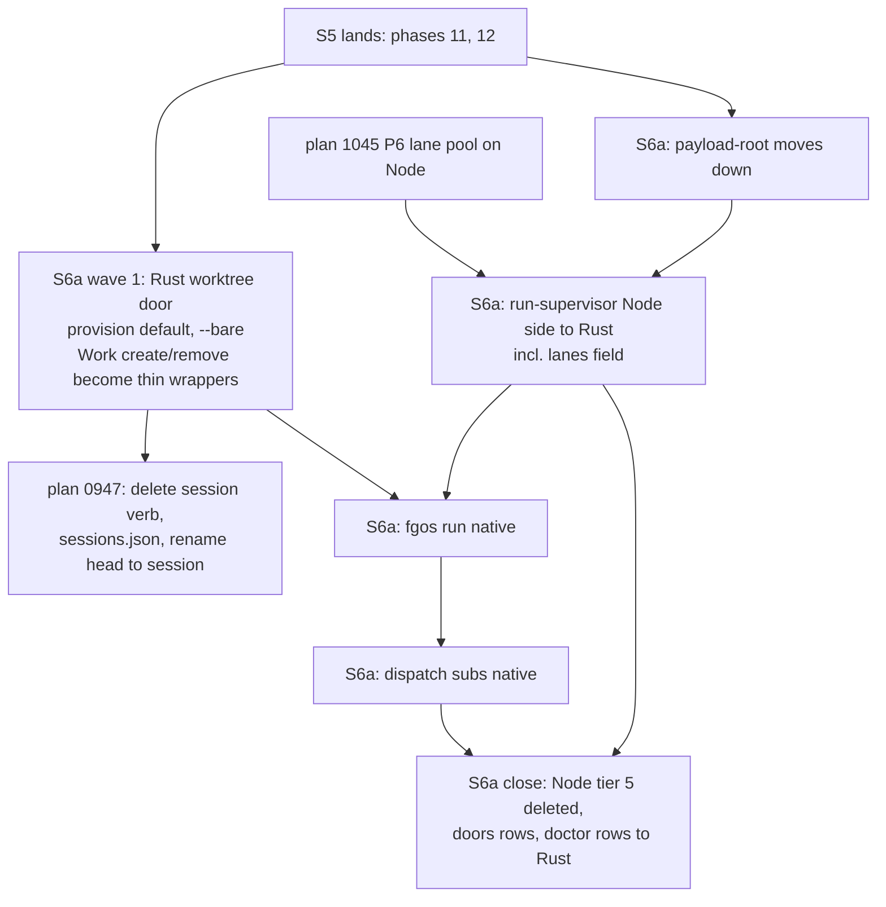

# DISCUSSION: S6a of the Rust verb migration (Execution: runner core, dispatch, run, worktree)

discussion: open

Source: program plan `plans/261114-2051-rust-verb-migration-program/plan.md` row S6a; owner hold of
plan `plans/261118-0947-session-verb-for-agent-sessions` (2026-11-18 13:10, commit 5f307a2f0) until this
discussion settles the worktree split. Shaper: claude-kqih@fg-server2, branch `shape/s6a`.

## 1. Trạng thái hiện tại

2026-11-18 13:45. All four owner questions answered; D1-D5 settled; §6 and §7 written. D1: plan 0947
keeps the session-verb retirement and the `head` -> `session` rename, S6a builds the one Rust
`fgos worktree` door and 0947 runs after S6a's worktree phase. D2: `worktree create` provisions by default,
`--bare` opts out. D3: `fgos-runner` moves to S7. D4: plan 1045 P6 lands first, S6a ports its `lanes`
field. D5: S6a moves the checkout lifecycle of `src/runner/worktree.mjs` into Rust, Work keeps thin
wrappers and its branch helpers. Left for the planner: where the Rust checkout engine lives (§3).
Waiting: owner confirmation to mark `discussion: settled`.

## 2. Mục tiêu & đề bài

S6a moves tier 5 (Execution) of the fgOS CLI from Node to Rust: `fgos run`, the `dispatch` subs still on
Node (`probe-account`, `probe-session`, `reconcile`, `inspect`, `show-run`, `watch`, `recover`, plus the
`execute`/`log` tombstones), `fgos worktree` and `resync-worktree`, and the Node side of the run supervisor,
then deletes the tier-5 Node code (about 34k lines in `src/runner/execution`, `src/runner/dispatch`,
`src/run-supervisor`, `src/verbs/{worktree,dispatch}`), retires every tier-5 Node name in the `doors`
table, and moves the 30 `bridge:S6a` doctor rows (plus `seat-binding-route` from S5) into Rust. The owner
asked that worktree work be designed once: today three doors create checkouts (`session start` in Rust
without provisioning, Node `worktree create` with provisioning, Node `createWorktree` in
`src/runner/worktree.mjs` for pick/take/run), all over the same Rust `GitDriver` methods in
`packages/git/rust/src/worktree.rs`. S6a starts only after S5 (`plans/261115-2328-execution-read-door`)
lands; its phases 11 (doctor rows) and 12 (doors, close) are still pending.

## 3. Vấn đề rõ / chưa rõ

| Point | State | Evidence / note |
|---|---|---|
| Split with plan 0947 | settled (D1) | owner 2026-11-18 13:2x |
| Session checkout: keep bare (no `worktreeSetup`/deps/skill roots) or provision like `worktree create` | settled (D2) | `apps/fgos/src/wiring/session.rs` start never provisions; `src/verbs/worktree/create.mjs:14` calls `provisionWorktree` |
| `fgos-runner` entry belongs to S6a or S7 | settled (D3) | `bin/fgos-runner.mjs` drives the Work frontier via `src/runner/loop.mjs`; S7 owns tier-7 `src/runner/*.mjs` |
| Order against plan 1045 P6 (lane pool edits `direct-launch.mjs`, `assignment-runner.mjs`, `envelope.v3.json`) | settled (D4) | both edit S6a's Node launchers |
| `src/runner/worktree.mjs` (1437 lines, real worktree engine, used by S6b/S7 callers) in S6a scope | settled (D5) | not in the program row's file list |
| `src/run-supervisor/payload-root.mjs` imported by lower layers (seat-binding, session-host, native door, event-store) | clear: must move down before the directory is deleted | design principle 2 |
| S5 gate | clear: S6a waits for S5 phases 11, 12 | `plans/261115-2328-execution-read-door/plan.md` |
| Where the Rust checkout engine lives (`packages/git` beside `GitDriver`, or an Execution-owned module calling it); provisioning runs `worktreeSetup` commands, which are not Git | open for the planner: decide by design principles 2 and 7 (lowest layer that needs it, one authority) | `packages/git/rust/src/worktree.rs`, `src/runner/worktree.mjs:115-402` |
| Plan 0947 phase 4 footprint misses `packages/mailbox/rust/store/src/hook/resolve.rs:43` (`Source::Registry`) | clear: amend 0947 | scan |
| `head-request.v1.json` edited by 0947 P5, 1045 P10, 1159 P8 | clear: not S6a's file; sequencing belongs to those plans | scan |
| 1045 P10 forwards `worktree create` argv to the CLI | clear: S6a keeps verb name and argv stable | 1045 PS-17 |

## 4. Quyết định đã chốt

| D-ID | Decision | Rationale | Date |
|---|---|---|---|
| D1 | Plan 0947 keeps: delete the `session` worktree lifecycle (`session.rs`, `sessions.json` writer, `sessions` lock, `is_session_worktree`), gateway `/v1/sessions` routes answer 501, Identity stops reading `sessions.json` (its phase 4 footprint gains `packages/mailbox/rust/store/src/hook/resolve.rs`), rename `head` to `session`. S6a builds `fgos worktree` in Rust as the single checkout door, carrying the jobs `session start/end/list/gc` did and replacing the runner's own `createWorktree`. 0947 starts after S6a lands its worktree phase (planned in S6a's first wave), not after all of S6a. | Avoids writing the session jobs into the Node `worktree` verb and then rewriting them in Rust; one door instead of three (RUL11, L10). | 2026-11-18 |
| D2 | `fgos worktree create` provisions by default (`worktreeSetup` commands, dependencies, skill roots) as today; a `--bare` flag makes a checkout with no provisioning, the case `session start` served. | Keeps today's `worktree create` behaviour unchanged and still serves the throwaway session checkout through the one door. | 2026-11-18 |
| D3 | The `fgos-runner` binary (`bin/fgos-runner.mjs`, the Work-frontier loop over `src/runner/loop.mjs`) moves from S6a to S7; S6a leaves it on Node calling Execution through the Rust doors. The program plan's S6a row drops it and S7's row gains it. | It is a Work-tier queue driver above Execution, not the `fgos run` verb; porting it in S6a would pull Work forward against "Work last". | 2026-11-18 |
| D4 | Plan 1045 phase 6 (lane pool) lands first, on the Node launchers `src/runner/dispatch/assignment-runner.mjs` and `src/run-supervisor/direct-launch.mjs`; S6a ports those launchers with the optional envelope field `lanes: {ceiling, waitMs}` and the `workerSlots.ceiling`/`laneWaitSec` reads they carry. | 1045 is running now and P6 is ready after its P4, while S6a still waits for S5; the Node part of P6 is a few lines, so nobody waits on the other. | 2026-11-18 |
| D5 | S6a moves the checkout lifecycle of `src/runner/worktree.mjs` into Rust: create (`createWorktree`, `createClaimWorktree`, `createDispatchWorktree`, `createVerifyCheckout`), remove (`removeWorktree`, `removeDispatchWorktree`, `removeProvisioned`), provisioning (`provisionWorktree`, `provisionDependencies`, `runWorktreeSetupCommands`, `provisionSkillRoots`), resync (`resyncWorktree`, `resyncClaimWorktree`, verb `resync-worktree`), leftovers/orphans (`listLeftovers`, `reclaimOrphanedCheckout`). The Node `create*`/`remove*` functions Work still calls become thin wrappers over the Rust door through the native addon. Branch, ref, trunk, dirty and path helpers (`branchNameFor`, `detectTrunk`, `branchExists`, `compareCommits`, ...) stay Node for S7. Rejected: port the whole file (pulls Work forward, against D3); port only the verb (Work keeps its own Node door, against D1). | One real door without porting Work; most callers of the file are Work tier (`loop.mjs`, `claim-port.mjs`, `merge.mjs`, `promote-*`). | 2026-11-18 |

## 5. Q&A log

- 2026-11-18 13:15 shaper -> owner: scan summary, 10 lines (scope ~34k Node lines; three worktree doors; S5 gate open; collisions with 1045/1159).
- 2026-11-18 13:18 owner: "another plan moves worktree work out of the session verb into the worktree verb; is it related?" Shaper: that plan is 0947, on hold for this shaping; the `sv-p0*` worktrees belong to plan 1045 (supervision). Proposed the D1 split.
- 2026-11-18 13:24 owner: "ok, chia vậy đi, ghi vào discussion" -> D1.
- 2026-11-18 13:30 Q1 (session checkout provisioning): owner (b) -> D2.
- 2026-11-18 13:34 owner asked whether `fgos-runner` is `fgos run`; shaper: no, `fgos run` runs one Unit (Execution), `fgos-runner` is the Work-frontier loop. Q2: owner (a) -> D3.
- 2026-11-18 13:38 Q3 (order against 1045 P6): owner (a) -> D4.
- 2026-11-18 13:42 Q4 (`src/runner/worktree.mjs` scope): owner (a) -> D5. All owner questions answered.

## 6. Thiết kế đã chốt {#design}

**What S6a delivers.** Tier 5 (Execution) of the fgOS CLI runs in Rust and its Node code is deleted:

- `fgos run` native (Unit build, bind through the S5 Rust `bind`, run, settle, commit of declared
  `writes`, provenance under `.fgos/assignments/<unitRunId>/`).
- The `dispatch` subs still on Node native: `probe-account`, `probe-session`, `reconcile`, `inspect`,
  `show-run`, `watch`, `recover`; the `execute`/`log` refusal tombstones are deleted with `src/runner/dispatch/cli.mjs`.
- The Node side of the run supervisor (`src/run-supervisor/**`: launch, lease, cwd lock, trust store,
  cancel registry, settle) moves into Rust next to the live `packages/run-supervisor` crate, including the
  launchers' `lanes` envelope field from plan 1045 P6 (D4). `src/run-supervisor/payload-root.mjs` first moves
  to the lowest layer its importers share (seat-binding, session-host, native door, event-store).
- The S5 declared twins and Node callers named with S6a as owner (`bind.mjs` facade, `compileDispatchPlan`
  bind-free selectors, `withDefaultExecutor`, `familyOf`, ...) retire; every `doors` row whose `retiredBy`
  names S6a closes (rows for agent config writes, `sessions.json` registry, agent definition tier dirs,
  packaging judgments).
- The 30 `bridge:S6a` doctor rows plus `seat-binding-route` move into Rust and leave the bridge; the
  parity runner is restored from history for them and S4's doctor fixtures stay.

**The one checkout door (D1, D2, D5).** `fgos worktree create|remove` (and `resync-worktree`) become
native. The Rust door owns the whole checkout lifecycle: create (branch or detached), provisioning by
default (`worktreeSetup` commands, dependencies, skill roots) with `--bare` for none, remove (with
`--delivered-to`, `--discard-ignored`), resync, leftovers and orphan reclaim, all over the existing
`GitDriver` methods in `packages/git/rust/src/worktree.rs`. Work keeps calling `createWorktree`,
`createClaimWorktree`, `createDispatchWorktree`, `createVerifyCheckout`, `removeWorktree` by name, but those
become thin wrappers over the Rust door through the native addon; branch/ref/trunk/dirty helpers stay Node
until S7. The verb name and argv stay stable because plan 1045 P10 forwards `worktree create` through the
head socket. Where the engine sits (git crate or an Execution module) is the planner's call (§3).

**Not in S6a.** `fgos-runner` and the Work loop (S7, D3); `fgos workflow` (S6b); deleting
`fgos session` and renaming `head` (plan 0947, D1); the `head-request.v1.json` verb renames shared by
0947 P5, 1045 P10 and 1159 P8 (those plans sequence among themselves).

**Order.** S5 phases 11 and 12 land -> S6a starts; the worktree door is in its first wave ->
plan 0947 is unblocked as soon as that phase lands and runs beside the rest of S6a. Plan 1045 P6 lands
on Node before S6a ports the launchers.

## 7. Danh mục hạng mục / task {#tasks}

Draft task list for the planner; it decides phases, waves and file splits.

### Rust worktree door {#task-worktree-door}

Goal: `fgos worktree create|remove` and `resync-worktree` native; the Rust door owns create, provisioning
(default) / `--bare`, remove, resync, leftovers and orphan reclaim; Work's `create*`/`remove*` functions in
`src/runner/worktree.mjs` become thin addon wrappers; the session jobs (`start/end/list/gc`) are covered so
plan 0947 can delete `session.rs`. D1, D2, D5. Unblocks plan 0947. Draft verify:
`cargo test -p fgos-git --test worktree` plus the host CLI tests for `worktree`; `test/verbs/worktree-*.test.mjs`
and `test/runner/worktree.test.mjs` cases move to their Rust owner (one proof per behaviour).

### payload-root moves down {#task-payload-root}

Goal: `src/run-supervisor/payload-root.mjs` moves to the lowest layer its importers share, so the
run-supervisor directory can be deleted. Design principle 2. Draft verify: `test/architecture.test.mjs`.

### Run supervisor Node side to Rust {#task-run-supervisor}

Goal: launch, lease, cwd lock, trust store, cancel registry and settle move into `packages/run-supervisor`;
the launchers' `lanes` field (D4) comes along. Sibling of `task-run-verb`. Draft verify:
`cargo test -p fgos-run-supervisor`.

### `fgos run` native {#task-run-verb}

Goal: `fgos run` native over the S5 Rust `bind`; Unit build, run, settle, commit of declared writes,
assignment provenance; `src/runner/execution/**` deleted. Draft verify: host CLI tests for `run`, the
`test/cli/run-verb.test.mjs` behaviours moved to their Rust owner.

### Remaining dispatch subs native {#task-dispatch-subs}

Goal: `probe-account`, `probe-session`, `reconcile`, `inspect`, `show-run`, `watch`, `recover` native;
`src/runner/dispatch/**` and `src/verbs/dispatch/**` deleted; S5's declared twins and S6a-owned Node callers
retire. Draft verify: host CLI tests per sub.

### Close: doors, doctor rows, docs {#task-close}

Goal: every `doors` row with S6a in `retiredBy` closes; 30 `bridge:S6a` doctor rows plus
`seat-binding-route` in Rust with the parity runner restored from history; program plan rows S6a/S7 edited
per D3 and D5; CHANGELOG for user-visible verb changes (`--bare`). Draft verify: `npm test`,
`cargo test --workspace`, `test/architecture.test.mjs`.

### Program-plan and sibling-plan edits (for the secretary / planner) {#task-plan-edits}

- Program plan row S6a: drop `fgos-runner`; add the checkout-lifecycle part of `src/runner/worktree.mjs` (D3, D5).
  Row S7: gain `fgos-runner`.
- Plan 0947: blockedBy gains S6a's worktree phase; its phase 4 footprint gains
  `packages/mailbox/rust/store/src/hook/resolve.rs` (D1).
- Plan 1045: no change; P6 lands first (D4), P10 relies on stable `worktree create` argv.
