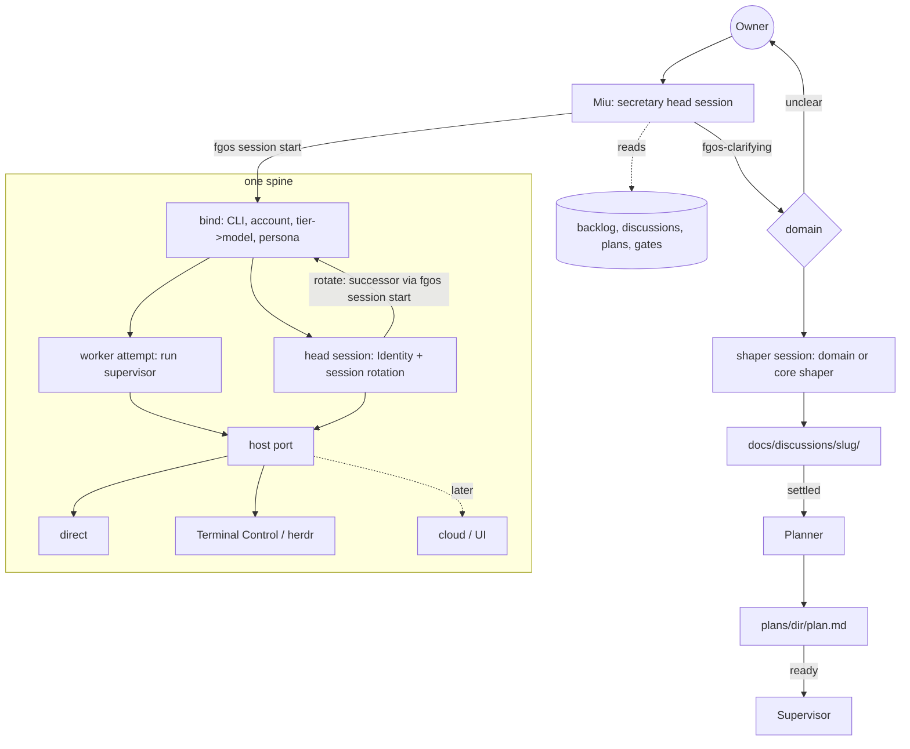

# Discussion: secretary role (Miu)

discussion: settled

## Hand-off to the planner

**Outcome.** The owner has one front session, the secretary **Miu**: a domain-free core persona that takes every
request, classifies its domain, routes it (answer from portfolio files, open a shaper, hand a settled discussion to a
planner, a ready plan to a supervisor), orders topics, reports in at most 10 lines and batches owner questions, and
never does detail work. Miu and every other long-lived head session start through one door and rotate themselves
automatically before their context fills, on any host, not only herdr.

**Constraints.** One door per job (L10, design principle 1): bind() chooses CLI/provider/account/model/persona for
both worker runs and head sessions; one host port with adapters places both; one persona door injects the persona for
both; Identity is the only authority for who a session is (SM-D5, SM-D6). Portfolio files are the truth (D-ADR0079);
Miu keeps no copy (SM-D4). No model or family in persona files, tiers only (Seat Binding, D-ADR0080). Rotation state
is gitignored runtime (SM-D5). A new config key goes into `core/config-standard` and `core/config-schema`; a new
runtime dependency gets a doctor-registry row; user-visible change gets a CHANGELOG line (AGENTS.md install gate).

**Non-goals.** Work integration or any Work-layer change; the portfolio data model and generated board (draft plan
`plans/261117-1430-portfolio-driving-draft`); consolidating owner questions into one place (SM-D9 known debt);
adapters other than herdr/Terminal Control and `direct` (designed for, not built); rules loaded three times (handed to
H3 Agent Context Engine, `docs/platform/proposals/documentation-system-unification.md` §4.7.2, and backlog
`p-7eb9e65b`); fixing the mailbox head finder or the domain registry (filed as their own items, below).

**Acceptance criteria.**
1. `fgos session start secretary --name miu` opens a herdr tab running the CLI bind() chose at tier `standard`, with
   the secretary persona injected through the same door worker briefs use, and registers the session in Identity;
   the same verb opens a shaper session for a topic.
2. A head session that crosses the soft threshold at rest, or the hard threshold at any turn end, is replaced without
   the owner doing anything: the successor starts and answers before the old pane closes, reads the latest handoff
   and the portfolio, and names the pending question it resumed; a failure at any step leaves the old session alive.
   `/handoff` does the same on demand.
3. Handoff files appear only under `.fgos/runtime/session-rotation/<persona>-<name>/`, immutable, last 10 kept,
   `latest.json` written atomically, secrets redacted.
4. The host-port contract is written and checked on paper against a pane host and a screenless host; the run
   supervisor places its attempts through it (`direct`, `terminal`) with no second placement path left.
5. A non-coding request (e.g. marketing) is classified by `fgos-clarifying` without Work, an unclear domain gets one
   owner question (no `coding` default), and it is shaped by the core domain-free shaper.
6. Discussions live in `docs/discussions/<slug>/` named by a Convention kind `discussion`; the 40 existing
   `docs/history/*/DISCUSSION.md` files and every consumer moved in the same change.
7. Miu lists every open owner question from the three stage places in one batch, each tagged with its topic and stage.
8. `npm test` and `cargo test --workspace` green; each new behaviour has one owning proof (design principle 8).

**Open points that block only some parts.** Host-port contract and home (blocks tasks host-port, session-start,
session-rotation; planner designs it). Two unproven rotation mechanics, statusline timing vs the Stop hook and
`/clear` via `herdr pane send-text` (spike first inside session-rotation). Whether Miu's protocol fits the rendered
persona sections or the renderer is extended (task persona-door).

**Name collision found after settling (2026-11-17).** `fgos session start|end|list|gc` already exists: a per-session
detached git worktree lifecycle (`fgos session --help`). The verb name in SM-D6 is provisional; the planner checks that
verb's prior art and callers and proposes a name or a merge as an owner question.

**Owner requirement added after settling (2026-11-17).** When a head session opens in a pane, its opening prompt is
typed visibly into the CLI composer (full text, not a pointer such as "read file X"), so a person watching the pane
sees exactly what the session was told; a screenless host may pass it on the command line or by file. Reuse the
brief-delivery step terminal worker seats already use; never `herdr pane run` with unquoted arguments (it joins them
into the shell line, which split the planner's first prompt at a `;`).

**Source backlog ids.** `p-r4u2ewexvn` (this topic). Filed as their own rows: `p-5igcekysul` (mailbox resolves an
agent head beside Identity), `p-pgmxt7n7hx` (domain registry vs `domains/`, `coding` default); the three-copies
measurement was appended to `p-7eb9e65b`.

## 1. Trạng thái hiện tại

Settled 2026-11-17 after 19 rounds. All five brief points plus two that grew out of them (generic session rotation,
discussion location) are settled as SM-D1..SM-D13, with three open points that block only some tasks (hand-off block).
Ready for a planner run per `core/skills/_shared/plan-contract.md`. This file moved from `docs/history/secretary-miu/`
to `docs/discussions/secretary-miu/` by owner decision (SM-D8).

## 2. Mục tiêu & đề bài

Define the **secretary** role (id **Miu**) as a core, domain-free fgOS persona: the owner's single front session in
the driving chain boss → secretary → shaper / planner / supervisor → leader → worker (+ watcher). It routes every
request to the right domain's shaper/planner, keeps topic status, reports short, batches decision questions, and does
no detail work, so the owner's front chat stays cheap. Settled inputs (owner 2026-11-17): name secretary / id Miu;
domain-free, lives in core; the boss can be anyone (developer, marketer, operator); portfolio files are the source of
truth (D-ADR0079), Work is a replaceable UX layer; plans follow `core/skills/_shared/plan-contract.md`; discussions
happen in per-topic shaper sessions, not in Miu's chat. During the discussion the owner widened two parts beyond Miu:
session rotation serves every long-lived head session, and head sessions must be startable on hosts other than herdr.

## 3. Vấn đề rõ / chưa rõ

| # | Point | State |
|---|---|---|
| 1 | Persona content and protocol | settled SM-D7, SM-D1, SM-D11 |
| 2 | Placement and activation | settled SM-D6, SM-D10; open: host-port contract and home (planner) |
| 3 | Domain classification without Work | settled SM-D12, SM-D3; registry mismatch filed as its own item |
| 4 | Token saving | split: rules loaded 3x handed to H3 Agent Context Engine and `p-7eb9e65b`; short results and peer mail only on decisions are in SM-D7; model settled SM-D11 |
| 5 | Topic list and owner questions | settled SM-D4, SM-D9 (known debt: questions in three places) |
| 6 | Generic session rotation | settled SM-D2, SM-D5, SM-D13; open: two mechanics to spike |
| 7 | Discussion location | settled SM-D8 |
| 8 | Persona protocol vs rendered sections | open, task persona-door decides (fit or extend renderer) |

## 4. Quyết định đã chốt

| D-ID | Decision | Rationale | Date |
|---|---|---|---|
| SM-D1 | Miu orders topics itself by the AGENTS.md product priority list and reports the order; asks the owner only on a real tie or when a reorder delays something already promised | Product priority #2: decide inside the approved frame; owner "Miu tự xếp thứ tự rồi báo lại anh" (round 2, unrevised since) | 2026-11-17 |
| SM-D2 | Miu's session rotates automatically, never by the owner: checked at turn end; soft threshold (~40% context) only when at rest (no pending question, no in-process background work); hard threshold (~70%) at any turn end, carrying the last Miu message and pending question verbatim; the claude process is replaced (new+close or in-place, either is fine); the owner also gets a user-invoked `/handoff` | Owner forgets `/clear`; owner "ổn, dùng hai ngưỡng ... cách nào cũng được" (round 4) and, after Miu raised auto-compaction as a cheaper option, "anh muốn B. nhưng hãy làm tốt nhất có thể" (round 7); method per `plans/reports/research-261117-1624-handoff-skills-research.md` | 2026-11-17 |
| SM-D3 | A domain with no shaper of its own is shaped by one domain-free shaper in core, which reads the domain's doctrine from `domains/<d>/AGENTS.md`; coding keeps only its own overlay. When the domain is unclear Miu asks the owner one line instead of defaulting to `coding` | Owner "chọn A, shaper dùng chung ở core" (round 5, unrevised); the no-item shaping path holds nothing coding-specific; one door (L10) | 2026-11-17 |
| SM-D4 | Miu keeps no topic list of its own: each actionable owner request becomes one backlog row (`fgos identity mint backlog`), discussions and plans carry that id, and Miu reads status from the backlog Status column, the `discussion:` marker and the plan `status` | One source of truth (D-ADR0079, design principle 7); owner "Đồng ý A" (round 10, unrevised) | 2026-11-17 |
| SM-D5 | Rotation handoff files live in gitignored `.fgos/runtime/session-rotation/<persona>-<name>/`, one immutable `<yymmdd-hhmm>-<sid8>.md` per rotation plus an atomically written `latest.json`, last 10 kept, redacted; session and head identity come from Identity, placement from the host port (SM-D6), never from mailbox | Owner "đồng ý, đặt theo persona + tên phiên" (round 9) and "identity mới là nơi cung cấp, mailbox chỉ dùng" (round 10), both unrevised | 2026-11-17 |
| SM-D6 | Worker runs and head sessions share one spine: bind() chooses CLI, provider, account, model and persona; the path then branches (worker attempt under the run supervisor, or head session under Identity and session rotation) and converges on one host port with adapters, lifted out of the run supervisor (`direct` and `terminal` via Terminal Control/herdr first; cloud or UI hosts later). The surface is two thin verbs, `fgos run` and `fgos session start`; the port contract is the planner's to design against at least a pane host and a screenless host | Owner "phải có adapter chỗ bật session" (round 13) and "đồng ý B" (round 16), unrevised; run supervisor already places `direct`/`terminal` (`src/run-supervisor/direct-launch.mjs:185,208`); L10 one door | 2026-11-17 |
| SM-D7 | Miu's protocol. Does: take every owner request; classify its domain (SM-D12); answer inline only what portfolio files answer (status questions); open a shaper for anything needing more than 1-2 rounds or detail reading; hand a `discussion: settled` topic to a planner and a `ready` plan to a supervisor; create a backlog row per actionable request (SM-D4); order topics (SM-D1); report in at most 10 lines with the full report in a file; batch owner questions in the five-part form (`core/skills/_shared/decision-question.md`, SM-D9); message peer sessions only when a decision is needed. Never: read diffs, edit code or docs, run tests, land, discuss a topic in depth in its own chat, or know any domain's steps | Point 1 draft (round 2) unrevised through round 19; owner "thư ký không nên phụ thuộc vào coding" | 2026-11-17 |
| SM-D8 | Discussions live in `docs/discussions/<slug>/` (main file `DISCUSSION.md`, room for more files), named through a new Convention kind `discussion`; moving them out of `docs/history` moves the 40 existing files and every consumer in the same change | Owner: `docs/history` is messy; "docs/discussions/<slug>/*, nên để vào folder" (round 11, unrevised); L10 | 2026-11-17 |
| SM-D9 | An open owner question lives where its stage keeps it: discussion -> `docs/discussions/<slug>/QUESTIONS.md` (new); plan -> the plan's owner-questions section (plan-contract item 5); execution -> an open Workflow case gate (`fgos workflow answer`). A run ending `needs-human`/`blocked` is an incident the supervisor turns into a gate or plan question when it cannot resolve it. Miu reads all three and batches; each answer goes back through its stage's door. Known debt: questions are spread over three places, to consolidate later | Owner "đủ rồi, ba giai đoạn ba chỗ ... cần gom, nhưng để nâng cấp sau. vận hành được trước" (round 12, unrevised) | 2026-11-17 |
| SM-D10 | One persona door for both branches: a head session gets its persona rendered by the agent-definitions door (`src/runner/agent-definitions.mjs`) into its opening text, exactly as a worker brief does (`src/runner/dispatch/assignment.mjs` renderPersonaSection), pinned per session like a Unit pin; no `claude --agent` as a second, Claude-only path | Owner "đồng ý, một cửa nạp persona cho cả hai nhánh" (round 17, unrevised) | 2026-11-17 |
| SM-D11 | Miu runs at tier `standard` (the system `defaults.tier`, nothing declared); a project may raise it through `runner.personas.secretary.tier` (advanced or flagship) if Miu misroutes or misclassifies twice or more in a week; never `nano`/`mini`. Persona files carry no model or family (Seat Binding §6.2, D-ADR0080) | Owner "đồng ý, Miu dùng tier standard mặc định" (round 18, unrevised) | 2026-11-17 |
| SM-D12 | Miu classifies a request's domain by calling `fgos-clarifying` directly (it is verdict-only and never calls `fgos submit`), with no Work involved | Point 3 scout (`core/skills/fgos-clarifying/SKILL.md`), unrevised since round 5 | 2026-11-17 |
| SM-D13 | Session rotation is a generic core mechanism named `session-rotation`, for every head session started with a persona (the persona's project config may set soft/hard thresholds and the state files to reload; core defaults otherwise); not for `fgos run` seats (the run supervisor owns them) nor subagents; Claude first behind the host port, other CLIs through adapters; the two unproven mechanics are spiked before building; replacement is two-step (the successor answers before the old session closes) | Owner "handoff đã làm thì nên nghĩ đến việc dùng cho mọi thể loại ... đừng giới hạn trong miu" (round 7), "đồng ý session-rotation. tạm chấp nhận phạm vi" (round 8), unrevised | 2026-11-17 |

## 5. Q&A log

- 2026-11-17 — session opened from `.fgos/runtime/tmp/secretary-brief.md`; scouted `core/agents/planner.yaml`
  (persona shape: role, persona, decision_boundary, tool-scope, skills), `core/skills/_shared/decision-question.md`,
  `plans/261117-1430-portfolio-driving-draft/plan.md`, audit `plans/reports/audit-261117-1545-supervisor-watcher-audit.md`
  (main checkout).
- 2026-11-17 — Miu proposed the point-1 draft: does = classify domain, answer inline only what portfolio files
  answer, open shaper for >1-2 rounds or detail reading, planner on `settled`, supervisor on `ready`, keep topic list,
  report <=10 lines, batch five-part questions, rotate own session via handoff; never = read diffs, edit code/docs
  (except topic list), run tests, land, discuss a topic in depth itself, know any domain's steps. Asked who orders
  topics. Owner: "Miu tự xếp thứ tự rồi báo lại anh." (Miu orders by product priority, reports; asks only on a tie or
  when a reorder delays something promised.)
- 2026-11-17 — Miu asked when to rotate (milestones / every N topics / never). Owner asked what the right method is.
  Miu scouted: SessionStart hook matcher `startup|resume|clear|compact` in `.claude/settings.json`; herdr
  `tab`/`pane run`/`pane close`; Miu cannot type `/clear` itself. Proposed (A) owner `/clear` + handoff updated
  every state-changing turn, (B) self-rotation via herdr later. Owner: "không đồng ý, anh còn quên miết, đưa thêm
  thảo luận: thời điểm phù hợp để đổi phiên." -> rotation must not depend on the owner.
- 2026-11-17 — Miu proposed: check at turn end (`Stop` hook reads context tokens from `transcript_path`), signals =
  context size / session age / owner idle / `PreCompact` fallback. Owner asked what breaks when rotating mid-chat.
  Miu listed: unwritten nuance, short answers losing their question, in-process background work killed, keystrokes
  during restart, cold cache; proposed soft (rest only) + hard (verbatim carry-over) thresholds.
- 2026-11-17 — Owner: "ổn, dùng hai ngưỡng, mỗi khi handoff có thể thay thế claude hiện tại bằng claude mới (tạo mới +
  đóng hoặc replace, cách nào cũng được)... research sâu xem có ai làm sẵn skill dạng handoff... muốn có shortcut
  dạng /handoff được gọi chủ động bởi user." Prior art found locally: `ak-handoff` (continuation contract, never
  launches a runtime unless `--dispatch`).
- 2026-11-17 — Research done (report above). Findings: Amp dropped `/handoff` for auto-compaction (2026-05-06);
  `ak-handoff` upstream `davidondrej/skills` (MIT), reuse redaction + verify-before-act, not its 9-section schema;
  Stop payload has no context metric, last non-sidechain assistant entry in the transcript gives input + cache
  tokens (dedupe by message.id); window size only via statusline `context_window_size` (sidecar file); no documented
  way for a hook to restart claude, safest = external new+close via herdr; cheap spike = `/clear` via
  `herdr pane send-text` + SessionStart `source=clear`; `/handoff` = skill with `disable-model-invocation: true`
  calling the same script. Untested: statusline timing, `/clear` via send-text.
- 2026-11-17 — Point 3 scout: `fgos-clarifying` is verdict-only, callable without Work; domain list from
  `src/state/domain-registry.mjs` misses `domains/marketing` and `domains/council`; it defaults to `coding`. Asked:
  domain with no shaper -> (A) core domain-free shaper, (B) council business-discussion, (C) park.
- 2026-11-17 — Owner: "chọn A, shaper dùng chung ở core".
- 2026-11-17 — Owner: "rốt cuộc việc handoff có nên làm tự động không hay để tự nén?" Miu laid out (A) auto-compaction
  + SessionStart(compact) reload from files, (B) automatic rotation (SM-D2), (C) compaction only; recommended A.
  Owner: "không, handoff đã làm thì nên nghĩ đến việc dùng cho mọi thể loại luôn, đừng giới hạn trong miu" then
  "anh muốn B. nhưng hãy làm tốt nhất có thể." -> SM-D2 stands; mechanism becomes generic. Prior art scouted:
  `src/state/handoff.mjs` (team-harness call legality) and `src/workflow/unit-handoff.mjs` (Unit outputs) use the word
  "handoff" for other things; no session-rotation mechanism exists in src/apps/packages.
- 2026-11-17 — Miu proposed scope (head sessions with a persona; not `fgos run` seats or subagents; Claude first) and
  quality bar. Owner: "đồng ý session-rotation. tạm chấp nhận phạm vi ... ghi đè nguyên khối là sao, ghi lên file nào,
  đặt tên file ra sao? sao không ghi vào một folder và gitignore?" Miu explained atomic write (temp + rename),
  proposed `.fgos/runtime/session-rotation/` (already ignored, beside `.fgos/runtime/mailbox`), lineage folder per
  persona + name, immutable timestamped files + `latest.json`, keep 10. Owner: "đồng ý, đặt theo persona + tên phiên".
- 2026-11-17 — Miu: topic list options (A) derive from backlog + discussion marker + plan status, (B) own file,
  (C) wait for portfolio council. Owner: "Đồng ý A. Mà khoan: 1) discussion ... không nên bỏ vào history ... shaper ghi
  vào docs/discussions/* hoặc docs/shaper/* 2) về mailbox mà cung cấp identity thì có vẻ là hơi bị sai authority ...
  identity mới là nơi cung cấp, mailbox chỉ dùng." Scout: `docs/history` has 882 dirs, 40 DISCUSSION.md; Identity spec
  says it is the only authority deriving full ids, handles and liveness (head = highest terminal-holding ancestor).
  Mailbox's own head finder (`adapters::claude_head::find_head`, `hookFacts`) may duplicate it -> separate backlog item
  (to file at exit; this session writes only this file).
- 2026-11-17 — Owner: "docs/discussions/<slug>/*, nên để vào folder, biết đâu phình ra sau này." File moved to
  `docs/discussions/secretary-miu/DISCUSSION.md`.
- 2026-11-17 — Miu proposed questions in the topic folder (A). Owner: "chọn A. nhưng nó chỉ đúng một phần ... khi làm
  plan còn câu hỏi không, và liệu khi triển khai thì câu hỏi nằm đâu?" Scout: plan-contract item 5 (owner questions
  batched in plan.md, plan stays draft, untouched phases ready); `fgos workflow status` open gates +
  `fgos workflow answer`. Miu proposed three stages, three places. Owner: "đủ rồi ... cần note lại là chỗ này vẫn chưa
  ổn lắm vì các vấn đề ở câu hỏi vẫn còn ở [nhiều] nơi, cần gom, nhưng để nâng cấp sau. vận hành được trước."
- 2026-11-17 — Point 2. Miu proposed (A) each place calls herdr itself vs (B) one "start a head session" door.
  Owner: "hiện bật pane bằng kiểu gì?" and "fgos run bật pane bằng gì? các hội đồng bật các seats bằng cách gì?"
  Scout: `fgos run` and `fgos workflow start` (council seats are Units) share bind() -> runUnit -> dispatch
  herdr-round/terminal-slot -> run supervisor `src/run-supervisor/direct-launch.mjs` -> `src/terminal-control/client.mjs`
  -> Rust route + `driver/herdr.rs` (`tab create`/`pane split`). Terminal Control spec says it is usable without a run.
  Miu corrected B: a thin door straight to Terminal Control, not through the run supervisor. Owner: "ok, đồng ý, nhưng
  cần suy nghĩ kỹ chỗ này hơn vì có thể sau này khi tích hợp, các phiên chính không đơn thuần được mở bằng herdr."
- 2026-11-17 — Miu proposed a "session host" port above Terminal Control. Owner: "ý là phải có adapter chỗ bật
  session" -> a host port with adapters at session start is required from day one; herdr via Terminal Control is the
  first adapter; contract designed by the planner.
- 2026-11-17 — Point 4. Miu measured rules loaded up to 3x. Owner: "chỗ rules này ghi thêm vào Agent Context
  Injection á. mà sao lại có tiết kiệm token ở đây nhỉ?" then "có, em tìm gì document unification, sẽ có về Agent
  Context Injection trong đó" -> found H3 Agent Context Engine in the documentation unification proposal. Owner wants
  Miu's model settled in this topic.
- 2026-11-17 — Owner: "em đưa vụ token qua tài liệu đó chưa?" (not yet; now added to the proposal §4.7.2) and "suy nghĩ
  thêm vụ adapter chỗ Terminal. và 1 luồng kích hoạt bật session. fgos run và fgos session có thật sự khác biệt rõ
  rệt, có nên là 1 cửa nhưng 2 đường bên trong? tách nhánh và hội tụ tại 1 điểm?" Scout: run supervisor already
  places an attempt `direct` (no pane) or `terminal` (`src/run-supervisor/direct-launch.mjs:185,208`).
- 2026-11-17 — Miu proposed one spine: (1) shared bind() (CLI, provider, account, model, persona), (2) branch: worker
  attempt vs head session, (3) converge on a host port (placement `direct | terminal(herdr, tmux) | later cloud/UI`)
  lifted out of the run supervisor; surface (A) one verb with modes vs (B) two thin verbs (`fgos run`,
  `fgos session start`) on that spine. Owner: "đồng ý B. nhân tiện nhìn thấy sao nhánh worker không inject persona à,
  hay đã vào prompt rồi". Scout: worker persona is injected into the brief text: bind() resolves it
  (`src/runner/execution/bind.mjs` resolvePersona), unit start pins its text (`unit-run-start.mjs` unitPersonaPin),
  the brief renders it (`src/runner/dispatch/assignment.mjs` renderPersonaSection) from the agent-definitions door
  (`src/runner/agent-definitions.mjs`), CLI-agnostic. A head started with `claude --agent` would inject it a second,
  Claude-only way.
- 2026-11-17 — Owner: "đồng ý, một cửa nạp persona cho cả hai nhánh". Minted SM-D6 (spine + host port).
- 2026-11-17 — Miu proposed Sonnet in config. Owner: "hồi xưa ... chỉ khai mức thông minh và mức cố gắng, không khai
  family. như vậy là làm cho persona hay capability?" Scout: Seat Binding declares tiers for capabilities, roles and
  personas; effort lives in each family's tier cell. Owner: "đồng ý, Miu dùng tier standard mặc định. ... sao effort lại
  nằm trong tier. tưởng 2 cái điều chỉnh độc lập."
- 2026-11-17 — Miu explained why effort sits inside a tier cell (families climb tiers differently: claude by model,
  openai by effort on one model, gemini in the model name; a tier is a cross-family promise; effort may be raised by
  override, never lowered below the cell, `effort-below-cell`). Proposed to close: file the registry mismatch as its
  own item, mint the persona protocol, write §6/§7, mark settled. Owner: "đồng ý".

## 6. Thiết kế đã chốt {#design}

**Miu, the front session.** The owner talks to one long-lived head session, Miu, started with
`fgos session start secretary --name miu`. Miu is a core persona (`core/agents/secretary.yaml`) at tier `standard`
(SM-D11). It knows no domain's steps (SM-D7). For each request it calls `fgos-clarifying` for the domain (SM-D12),
asks one line when the domain is unclear, and then routes: a status question is answered from the portfolio; an
actionable request becomes a backlog row (SM-D4) and, when it needs discussion, a shaper session for that domain
(the domain's own shaper, else the core domain-free shaper, SM-D3) writing `docs/discussions/<slug>/` (SM-D8); a
settled discussion goes to a planner; a ready plan goes to a supervisor. Miu orders the topics itself (SM-D1) and
keeps no list of its own: it reads topic status from the backlog, the `discussion:` marker and plan `status`, and
gathers open owner questions from the three stage places (SM-D9) into one five-part batch.

**One spine for every agent session (SM-D6).** A worker run (`fgos run`, a workflow seat) and a head session
(`fgos session start`) take the same first step, bind(), which chooses CLI, provider, account, model (from the tier)
and persona. They branch in the middle: a worker attempt is wrapped by the run supervisor (lock, sandbox, deadline,
brief, verify, commit, settle); a head session is wrapped by Identity (registration, role) and session rotation. They
converge on one host port that places the session: `direct` (no screen) and `terminal` (Terminal Control with its
herdr driver) first, cloud or UI hosts (Work, multica) later, each an adapter. The placement that lives inside the run
supervisor today moves behind this port. Both branches get their persona from the one agent-definitions door,
rendered into their opening text (SM-D10).

**Session rotation (SM-D2, SM-D5, SM-D13).** At the end of every turn of a head session a script (no model) reads
the context in use (statusline sidecar, transcript fallback). Over the soft threshold and at rest, or over the hard
threshold at any turn end, it writes a handoff (pointers to the portfolio, delta, and on hard the last message and
pending question verbatim) under `.fgos/runtime/session-rotation/<persona>-<name>/`, starts the successor through
`fgos session start` (same persona, same name), waits until it answers, then retires the old session; on any failure
the old session stays. The successor's start loads the latest handoff, reconciles with the portfolio and says which
question it resumed. `/handoff` triggers the same path on demand. Identity says who each session is; the host port
says where it runs.

## 7. Danh mục hạng mục / task {#tasks}

### Persona and protocol {#task-persona}
Goal: `core/agents/secretary.yaml` carrying SM-D7 (description, persona, decision_boundary), no model; its routing
procedure (clarify, backlog row, route table, batching, 10-line reports) as a core skill or persona text. D-IDs:
SM-D1, SM-D4, SM-D7, SM-D11, SM-D12. Depends on persona-door for how much the renderer shows. Draft verify: the
agent-definitions door resolves `secretary` and the rendered section holds the protocol; `npm test`.

### One persona door for head sessions {#task-persona-door}
Goal: head sessions get their persona from `src/runner/agent-definitions.mjs` rendered into the opening text, pinned
per session; decide whether the protocol fits today's rendered sections or the renderer is extended. D-IDs: SM-D10.
Draft verify: one owning test that a head start renders the same section a worker brief renders for the same persona.

### Host port {#task-host-port}
Goal: the host-port contract (start, alive, bring to front, retire), checked on paper against a pane host and a
screenless host; lift the `direct`/`terminal` placement out of `src/run-supervisor/direct-launch.mjs` behind it with
Terminal Control as the `terminal` adapter; no second placement path left. Touches a built component: impact analysis
first. D-IDs: SM-D6. Blocks session-start and session-rotation. Draft verify: worker runs unchanged (`npm test`,
`cargo test --workspace`), the contract note names both paper adapters.

### fgos session start {#task-session-start}
Goal: thin verb `fgos session start <persona> --name <name>`: bind() at the persona's tier, head branch (Identity
register + role), host port, persona door. D-IDs: SM-D6, SM-D10, SM-D11. Depends on host-port, persona-door. Draft
verify: a live start opens a herdr tab with the persona and an Identity entry; config/doctor rows per the install
gate.

### Session rotation {#task-session-rotation}
Goal: spike statusline timing vs the Stop hook and `/clear` via `herdr pane send-text`; then the Stop-hook measure,
soft/hard rules, handoff writer (script), file layout, two-step replacement through `fgos session start`, start-time
loader, `/handoff` skill (`disable-model-invocation: true`) on the same script. D-IDs: SM-D2, SM-D5, SM-D13. Depends
on session-start. Draft verify: a forced low threshold rotates a live head session with the old one closed only after
the successor answers; a killed successor leaves the old alive.

### Core domain-free shaper {#task-core-shaper}
Goal: move the no-item shaping path into a core shaper that reads `domains/<d>/AGENTS.md`; coding keeps an overlay.
D-IDs: SM-D3. Depends on discussions-location. Draft verify: `npm run build:skills` renders both; a marketing topic
shapes with the core shaper.

### Discussions location {#task-discussions-location}
Goal: Convention kind `discussion` -> `docs/discussions/<slug>/`; move the 40 `docs/history/*/DISCUSSION.md` and every
consumer (skills, plan-contract, `src/report/context-render.mjs`, `src/report/authoritative-match.mjs`,
`src/state/work.mjs`, `src/state/frontier.mjs`, `src/state/worker-slots.mjs`, `plugins/fgOS/skills/terminal/rename.sh`)
in one change. D-IDs: SM-D8. Draft verify: `fgos convention path --kind discussion` answers; no
`docs/history/*/DISCUSSION.md` left; `npm test`.

### Owner question batch {#task-owner-questions}
Goal: `QUESTIONS.md` format in a discussion folder; Miu's reader over the three stage places producing one batch
tagged by topic and stage; answers routed back through each stage's door. D-IDs: SM-D9. Depends on
discussions-location. Draft verify: a fixture with one open question per stage yields one batch of three.
