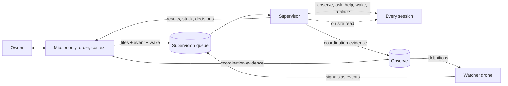

# Discussion: powers of the secretary (Miu) and the supervisor

discussion: open

Backlog: `p-xnu3jnds2u` (docs/backlog.md, "Define the powers of the secretary (Miu) and the supervisor"). Domain:
fgOS platform (core personas, domain-free). Related: `docs/discussions/secretary-miu/` (settled, SM-D*),
`docs/discussions/supervisor-review/` (settled, SR-D*), plan `plans/261118-1045-project-supervisor`, lane
`plans/261119-1615-secretary-capabilities` (lead:SECRETARY-CAPS, branch `lead/secretary-caps`).

## 1. Trạng thái hiện tại

Round 14 (2026-11-19 18:5x). The shape is in place: Miu is the owner's side and sets priority and order (SP-D1), the
supervisor carries on (SP-D2), they talk through files plus wake-and-point messages (SP-D3), urgent chores go through
the supervisor with a narrow Miu fallback (SP-D4), observation is a drone plus an on-site visit (SP-D5), coordination
acts live on the supervision event queue and improvement evidence in Observe with a prune rule (§3 row 17, agreed,
mint next round). §6 holds the first full synthesis and the proposed grants; §7 the candidate tasks. Open: the
defaults listed in §3 rows 4-9 and 18-21 (proposed, awaiting the owner's read of §6). Split out: the work-management
data model (§3 row 13, own topic through Miu).

## 2. Mục tiêu & đề bài

The owner wants a written split of reach between Miu and the supervisor, so each can act without waiting for a person
and without stepping on the other. Today each head's reach is one frozen table, `src/session-host/head-grants.mjs`
`GRANTS`: Miu writes `plans/`, `docs/discussions/` and (through `session write`) `docs/backlog.md`, holds
`session start`, `session write`, the question verbs including `questions answer`, `land`, `request result`, mailbox
and peers (SendMessage), but no `session stop`, no `run` and no supervisor reads. The supervisor holds `session
start|stop|write`, `land`, `supervisor queue|plans|handled|done` and `slots`, but no `run`, mailbox or peers; it runs
only when the watcher wakes it (`docs/platform/supervision/spec.md` §1). Live windows 1-5 of plan 261118-1045 showed the
supervisor half working end to end once (window 3) and heads drifting into investigation; acceptance 8 is not proven.
Miu's own sandbox gaps (role binding, backlog write races, shaper start, TMPDIR, grant audit) are being fixed by the
secretary capabilities lane. The output here is the split, the urgent-chore route with its limits, and for each power
the door it goes through and how it is proven from the sandbox. Code and plans are not changed here.

## 3. Vấn đề rõ / chưa rõ

| # | Point | State |
|---|---|---|
| 1 | Urgent-chore route for Miu | settled SP-D4; budget per Miu run: default proposed in row 18 |
| 2 | Miu delegating/queuing work to the supervisor | settled by SP-D3 and row 17: Miu raises an event on the supervision queue (decision in files, event points to it) and calls `supervisor wake` |
| 3 | Miu stopping sessions | settled SP-D1: `session stop` in her grant |
| 4 | Miu reading what the supervisor reads (`supervisor plans`, `queue`, `slots`, Identity list) | proposed default: yes, read-only, so Miu answers status and context without asking the supervisor |
| 5 | Persona text against grants: Miu's skill says "never lands work" while her grant has `land`; her persona says she hands a ready plan to the supervisor while her skill says the watcher does | proposed default: rewrite both personas and skills from the §6 grant table; Miu keeps `land --paths` for portfolio files only; "hands a plan" becomes "raises it on the queue" |
| 6 | Supervisor reach beyond plans | settled by SP-D5 and row 10: every session of the project, not only plan leads |
| 7 | Who wins on the same thing | leaning (round 3, unrevised): Miu sets priority and order, the supervisor carries out; a direct Miu order overrides a supervisor choice; the owner overrides both. To mint with the owner's read of §6 |
| 8 | Proof | proposed default: each power in the §6 table is proven from the sandbox by the head-start preflight (backlog `p-2wb2lfgky3`) plus a live grant audit (caps lane phase 6 pattern); a power with no passing proof is not granted |
| 9 | Interim supervisor `forgent-1d` (unconfined, hand-briefed) against the designed head | owner deferred round 2 ("thấy nó làm mượt quá, mà có nhận ra gì đâu"). Proposed default: keep it as scaffolding; retire it once the head carries every §6 supervisor power with a passing proof and one plan has gone ready to done with nobody typing (plan 261118-1045 acceptance 8) |
| 10 | Supervisor reach, owner's picture: observe and wake every session, open new ones, ask and help an existing one, never do a session's work unless it is stuck; authority without hands-on | provisional (round 2), now carried by SP-D5 and rows 15, 17; folded into SP-D2/SP-D5 wording at the next mint |
| 11 | Miu's role, owner's picture | minted as SP-D1 |
| 12 | Miu-supervisor channel | settled SP-D3 |
| 13 | Work-management data model (backlog shape, status vocabulary, generated index, plan status check) | split out round 6 to its own topic through Miu; this discussion keeps only the dependency: the write powers here use a write-one-item door whose shape that topic decides. Miu told that the caps add-rows phase is at risk |
| 14 | What "observe" means | settled SP-D5 |
| 15 | Means to wake, ask and help a session | agreed round 9-10 (no objection after the revision): three means chosen by reachability: mailbox, Claude SendMessage, herdr pane typing (pane typing for the supervisor only, and only for a stuck session). The mailbox is a messaging tool, not the ledger (owner round 10). Mailbox reliability and latency: own item through Miu. Gap: agy heads cannot be woken when idle (mailbox spec §15.8 deferred), tied to the pending head-executor decision |
| 16 | Use signals to improve | agreed in principle round 11; carried by row 17: no new mechanism, register coordination kinds in Observe, read through `fgos metrics query`, friction and retro |
| 17 | Lifetime of signals | agreed rounds 12-14: coordination signals are State: each coordination act is an event on the supervision event queue, closed by `supervisor handled`, the queue shows only open acts (option A; closed acts leave the view, not the Event Store history). Improvement evidence is Log in Observe (its own store, not the Event Store), pruned when the finding it supports is settled (a friction or decision records the lesson and cites the evidence), at most 30 days for evidence no finding claimed. Observe needs a prune door (none today). Mint next round |
| 18 | Budget ceiling of a Miu `fgos run` (SP-D4) | proposed default: read-only, tier `standard`, 15 minutes wall clock, one unit; a write run needs `--writes` in a linked worktree and goes through the merge queue |
| 19 | On-site read door (SP-D5 tier 2): how the supervisor reads a session's recent work | open for the planner: a read-only door over the session's screen (terminal control) or its recent transcript, through one verb with per-CLI adapters; no raw herdr in the grant |
| 20 | Watcher tuning by the supervisor (owner round 7-8: the watcher is the supervisor's drone) | proposed default: the supervisor may arm or disarm a definition and change its thresholds and pace within config bounds, recorded as a coordination event; adding a new definition kind stays a code change |
| 21 | Stopping or replacing a session nobody started through `session start` (hand-started sessions like `lead-s6a`) | proposed default: the supervisor observes, asks and helps them like any session, but stops or replaces only heads; a stuck hand-started session goes to Miu, who asks the owner |

## 4. Quyết định đã chốt

| ID | Decision | Basis | Date |
|---|---|---|---|
| SP-D1 | Miu sits at the owner's side to reduce the owner's cognitive load (what is the priority, the context, the problem) so the owner chooses. She has large authority over priority and plan order and life-and-death over sessions (start and stop any), and rarely gives direct orders unless truly needed. Both Miu and the supervisor are cross-domain | Owner round 3 (quoted in §5), held unrevised through round 4 | 2026-11-19 |
| SP-D2 | The supervisor usually carries on what Miu arranged; the two work very closely as the owner's right and left hands | Owner round 3, held unrevised through round 4 (the channel choice in round 4 builds on it) | 2026-11-19 |
| SP-D3 | Channel between Miu and the supervisor: every decision is written to portfolio files, which stay the truth; messages only wake and point ("read file X"). Miu gains `supervisor wake`; the supervisor gains a back channel to Miu for results, stuck work and decisions only | Owner round 4 "C", held unrevised through rounds 5-7 | 2026-11-19 |
| SP-D4 | Urgent chores go through the supervisor by default (Miu writes the chore to a file and wakes the supervisor, which starts a `fgos run`). Miu runs `fgos run` herself only when truly needed: the supervisor cannot come up or is stuck, or the owner is waiting and the chore only reads or checks. Each such run is written to a file for the supervisor; writes happen only in a worktree and reach main through the merge queue. Miu's grant gains `run`. The budget ceiling per Miu run is open | Owner round 5 "Anh chọn C", held unrevised through rounds 6-7; fits SP-D1 (rarely orders directly) | 2026-11-19 |
| SP-D5 | Observation has two tiers. The watcher is the supervisor's drone: no LLM, on a period, it collects mechanical signals for every session registered in Identity for the project (gone; idle too long while holding unfinished work; no commit or result for N minutes; repeated refused commands) and wakes the supervisor. On real trouble the supervisor goes on site: it reads the session's recent work through a read-only door, then asks, helps, wakes or replaces it. No patrol without a signal; the supervisor never does a session's work unless that session is stuck | Owner rounds 7-8 ("đồng ý"; "thiết bị drone ... hữu sự thật sự thì supervisor đi đến tận nơi"), held unrevised through round 14 | 2026-11-19 |

## 5. Q&A log

- 2026-11-19 16:2x — Round 0. Shaper opened from `.fgos/runtime/tmp/shaper-brief.md`. Scouted: core/agents
  secretary|supervisor|lead.yaml, core/skills/fgos-secretary|fgos-supervisor, `src/session-host/head-grants.mjs`,
  `docs/platform/supervision/spec.md` §1/§7, supervisor-review §1-§2 and hand-off, plan 261118-1045 integration report
  windows 1-5, caps plan `plan.md` (origin/lead/secretary-caps aa2490723), secretary-miu hand-off and SM-D1..SM-D6.

- 2026-11-19 16:4x — Owner: "hiện supervisor đang cấu thành ra sao mà việc gì nó làm cũng được." Answered from
  scout: the supervisor the owner works with is the interim hand-started session `forgent-1d` (pid 1020432, `claude
  --dangerously-skip-permissions --model opus`, no bwrap, Identity role `lead:SUPERVISOR`), driven by a by-hand brief
  (read plans, herdr tabs, worktrees, briefs, restart leads, may lead a plan itself). Its reach is full Bash as the
  owner. The designed supervisor head is confined (bwrap, `FGOS_CONFINED=1`), reaches only its `head-grants.mjs` verbs
  through the request socket, and is started by `fgos supervisor wake`. Miu, by contrast, already runs as a confined
  head (pid 36166 bwrap, sonnet). Opened §3 row 9.

- 2026-11-19 16:5x — Owner (row 9 not answered yet: "chưa trả lời được lúc này. thấy nó làm mượt quá, mà có nhận ra
  gì đâu"): "nó phải có khả năng quan sát và đánh thức được mọi phiên cũng như mở được phiên mới, hỏi phiên cũ, thậm
  chí giúp phiên cũ gì đó. tuyệt nhiên nó sẽ không làm việc của phiên cũ trừ khi phiên đó kẹt. kiểu điều hành cấp cao,
  có thẩm quyền nhưng không nhúng tay." Recorded as provisional §3 row 10 with today's door map.

- 2026-11-19 17:0x — Owner on whether Miu shares the supervisor's reach: "miu là một đứa lúc nào cũng phải chạy theo
  anh. nó giúp anh giảm tải nhận thức. phải giúp anh rõ cái gì đang ưu tiên, giúp anh hiểu bối cảnh, hiểu vấn đề từ đó
  mà anh chọn lựa và ra quyết định. nó có quyền rất lớn trong việc ảnh hưởng đến ưu tiên, thứ tự kế hoạch, cũng có
  quyền sinh sát nhưng nó sẽ ít khi ra lệnh trực tiếp trừ khi thật sự cần. thường supervisor sẽ lo tiếp phần mà miu đã
  sắp xếp. miu và supervisor sẽ làm rất gần. 2 đứa nhu tay phải và trái của anh và làm cross domain." Recorded as §3
  row 11 (provisional); rows 3 and 7 now lean; opened row 12 (the channel between them).

- 2026-11-19 17:1x — Asked the channel question (A files only, B direct two-way messages, C files are the truth and
  messages only wake and point). Owner: "C". §3 row 12 agreed; SP-D1 and SP-D2 minted from round 3 (held unrevised).
  Local ids follow the SM-D*/SR-D* precedent.

- 2026-11-19 17:2x — Owner chose C for the urgent-chore route (§3 row 1), budget not answered. Owner then asked: "Vậy
  mô hình quản lý đầu việc sẽ ghi ở đâu? Event Store hay file như hiện tại, cấu trúc cách tổ chức file có nên tổ chức
  lại cho hiệu quả hơn." Scouted D-ADR0079, the portfolio-driving draft and its council report, backlog and plan status
  counts. Opened §3 row 13.

- 2026-11-19 17:3x — Owner asked what is split and what stays. Answered: this discussion = who may do what, through
  which door, how the two talk, who wins, proofs; the split topic = the shape of the work-management data. Owner:
  "đồng ý tách." §3 row 13 split out; Miu asked by SendMessage for the backlog row and shaper of the data-model topic,
  and told that the caps add-rows phase is at risk.

- 2026-11-19 17:4x — Asked the two-tier observe proposal (§3 row 14). Owner: "đồng ý." SP-D3 (channel) and SP-D4
  (urgent chores) minted, both held unrevised since. Scouted the wake door: the agent mailbox
  (`docs/platform/agent-mailbox/spec.md` §§1-5) already owns waking an idle session (port `Nudge`: Claude Code session
  socket, `codex queue`; agy is not woken when idle, typed nudge deferred to its §15.8) and carries only a one-line
  signal, the body read from the record. Asked whether wake/ask/help go through the mailbox only (§3 row 15).
  Owner, mid-turn: "thật ra watcher như tool của supervisor ý." Recorded on §3 row 14.
- 2026-11-19 17:5x — Owner: "nó là thiết bị drone quan sát bay ra thu thập tín hiệu định kỳ cung cấp cho supervisor. hữu
  sự thật sự thì supervisor đi đến tận nơi." Confirms §3 row 14; row 15 still open.
- 2026-11-19 18:0x — Owner on row 15: "đồng ý", then "khoan gom về nghĩa là sao?"; explained the three means; owner:
  "tại sao không cho 3 phương tiện. anh chưa cảm nhận mailbox reliable và nó đang bị trễ". Row 15 reopened.
- 2026-11-19 18:1x — Proposed "three means, one record in the mailbox". Owner: "chưa thuyết phục vì dùng mailbox sai
  mục đích, đâu chỉ là một ledger ghi nhận ai nói chuyện với ai, ai làm gì đang như thế nào không ghi nhận à". Scouted
  Observe kinds; proposed Observe as the ledger (row 15).
- 2026-11-19 18:2x — Owner: "ồ hay thế, observe có thể làm chuyện đó không? và thậm chí có thể dùng chính tín hiệu điều
  phối, quan sát để cải tiến luôn nhỉ?" Row 15 agreed; opened row 16.
- 2026-11-19 18:3x — Owner: "nhưng mà cũng cần thận, không thì lại nhập nhằng, thực chât tín hiệu đồi phối cần tự xóa sau
  khi không còn giá trị điều phối. tín hiệu quan sát cho cải tiến thì cần xóa đi sau khi đủ bằng chứng." Scouted L1,
  Observe retention (none), store location. Opened row 17, which revises row 15.
- 2026-11-19 18:4x — Owner: "được. nhưng mà bảng điều phối thì lại phải tạo thêm cơ chế à? observe có base trên event
  store?" Scouted the Observe and Event Store specs; row 17 updated with options A/B/C.

- 2026-11-19 18:5x — Board options asked; owner: "A". SP-D5 minted (observation, held since round 7). Rewrote §3 in place,
  wrote the first §6 synthesis with the proposed grant table and the §7 draft tasks; proposed defaults for rows 4, 5,
  7-9, 18-21 for the owner to read at once.

## 6. Thiết kế đã chốt {#design}

Draft synthesis, round 14. Rows 4, 5, 7-9, 18-21 are proposed defaults not yet read by the owner.

**Two hands.** Miu (persona `secretary`) sits at the owner's side and is always on. Her job is the owner's cognitive
load: what is the priority, the context, the problem, so the owner decides. She sets priority and plan order and holds
life-and-death over sessions, but rarely acts directly (SP-D1). The supervisor (persona `supervisor`) is woken, not
always on, and carries on what Miu arranged across every session of the project (SP-D2). Both are cross-domain. Who
wins: the owner, then a direct Miu order, then the supervisor's own choice (row 7).

**Talking.** Decisions are written to portfolio files, which stay the truth. Messages only wake and point (SP-D3).
Miu hands work to the supervisor by raising an event on the supervision queue and calling `supervisor wake`; the
supervisor reports back to Miu only results, stuck work and decisions. A session is reached by whichever of three means
works: mailbox, SendMessage, pane typing (supervisor only, stuck session only) (row 15).

**Seeing.** The watcher is the supervisor's drone (SP-D5): periodic, mechanical, every registered session, raising
events that wake the supervisor. The supervisor goes on site through a read-only door into the session (row 19) and
may tune the drone within config (row 20).

**Remembering.** Coordination acts are State on the supervision event queue: open while they have coordination value,
closed by `supervisor handled`, gone from the view (row 17). Improvement evidence is Log in Observe, read through
`fgos metrics query`, friction and retro, and pruned once its finding is settled or after 30 days (rows 16-17).

**Urgent chores.** By default through the supervisor (event plus wake, the supervisor starts a `fgos run`); Miu runs one
herself only when the supervisor cannot come up or is stuck, or the owner waits and the chore only reads (SP-D4), under
the row 18 ceiling.

**Proposed grants** (changes against `src/session-host/head-grants.mjs` today; each row is granted only with a passing
sandbox proof, row 8):

| Power | Door | Miu | Supervisor |
|---|---|---|---|
| Start a session | `session start` | has | has |
| Stop a session | `session stop` | add | has (heads only; row 21) |
| Read the portfolio and queue | `supervisor plans`, `supervisor queue`, `slots`, `identity list` | add (read) | has (`identity list` to prove) |
| Raise a coordination event | supervision queue raise (verb name for the planner) | add | add |
| Close a coordination event | `supervisor handled` | no | has |
| Wake the supervisor | `supervisor wake` | add | n/a |
| Message a session | mailbox | has | add |
| Message a Claude session directly | SendMessage (`peers`) | has | add |
| Type into a stuck session | pane typing through terminal control | no | add (stuck only) |
| Read a session's recent work | on-site read door (row 19) | no | add |
| Tune the drone | watcher definition arm/thresholds (row 20) | no | add |
| Run a unit | `fgos run` | add (SP-D4, row 18) | add (urgent chores) |
| Record coordination evidence | `fgos metrics record` (coordination kinds) | add | add |
| Write portfolio files | `land --paths`, `session write` | has (portfolio only) | has |
| Owner questions | `questions ask/ack/cancel`; `answer` | has; has | has; no |

## 7. Danh mục hạng mục / task {#tasks}

Draft, round 14; the planner shapes the final split. Siblings outside this topic: the work-management data model (row
13), mailbox reliability and latency (row 15), the head-executor decision (row 15 agy gap), caps lane plan
261119-1615 (its grant audit pattern is reused).

### Grants and personas {#task-grants}
Goal: the §6 grant table in `head-grants.mjs`, both persona yamls and both skills say the same thing; each added power
has its sandbox proof. Decisions: SP-D1..SP-D5, rows 4, 5, 8, 18, 21. Verify: head-start preflight per persona passes;
`npm test` green.

### Coordination events {#task-coordination-events}
Goal: Miu and the supervisor raise coordination events on the supervision queue and close them with `supervisor
handled`; Miu's urgent chore and hand-off are such events. Decisions: SP-D3, SP-D4, row 17. Verify: `cargo test -p
fgos-supervision` owning tests for raise and close.

### Drone over every session {#task-drone}
Goal: watcher definitions for the SP-D5 tier-1 signals over every Identity session of the project; the supervisor
may tune them within config (row 20). Decisions: SP-D5, row 20. Verify: one fixture per definition in
`packages/supervision/rust/tests/definitions.rs` style.

### On-site read door {#task-on-site}
Goal: one read-only verb that returns a session's recent work (screen or transcript) with per-CLI adapters, granted
to the supervisor. Decisions: SP-D5, row 19. Verify: adapter tests per CLI plus one sandbox proof.

### Coordination evidence and prune {#task-evidence}
Goal: registered coordination kinds in Observe and a prune door that removes evidence of a settled finding or older
than 30 days. Decisions: rows 16, 17. Verify: Observe owning tests for record and prune.
