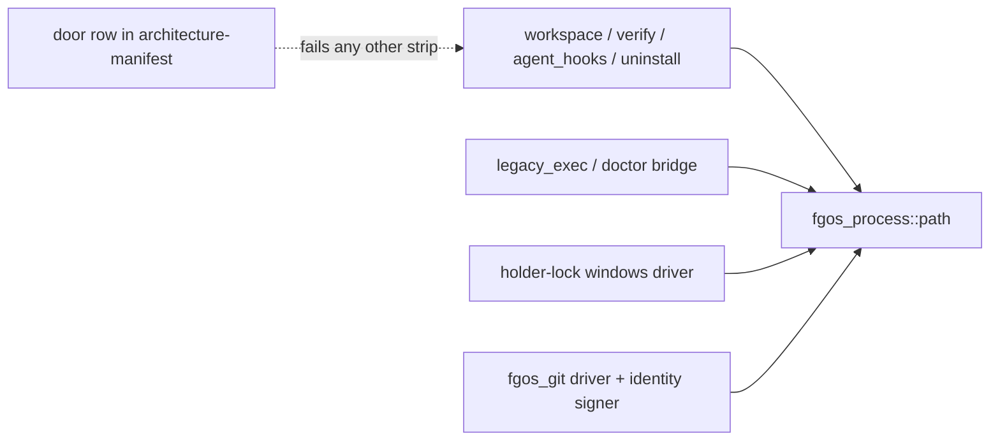

# DISCUSSION: fold the Windows verbatim-path strip onto `fgos_process::path` (p-2r54ft6njh)

## Hand-off

```text
discussion: settled
source: p-2r54ft6njh (docs/backlog.md)
outcome: every Rust production and test caller that writes a Windows verbatim path
  (`\\?\D:\...`) plainly calls `fgos_process::path` (directly or through the
  `fgos_git::plain_path` re-export); every hand-written strip is deleted; a door row
  in docs/architecture-manifest.json fails any new strip outside
  packages/process/rust/src/path.rs; a verbatim UNC root never again turns into the
  relative path `UNC\host\share`.
constraints:
  - no new verb, config key, crate, crate dependency or state store (RUL104 (better,
    not bigger)); fgctl tests use the `fgos_git::plain_path` re-export they already
    reach through their fgos-git dev-dependency
  - behaviour for a verbatim drive path (`\\?\D:\x` -> `D:\x`) is unchanged at every
    caller; only the UNC spelling changes, and only where it was a bug (D3)
  - the guard is a row of the existing `doors` table, checked by
    test/architecture.test.mjs "every door row holds"; no new check script (D4)
  - edited Rust files listed in packages/git/contracts/mutation-census.v1.json need
    the census regenerated (`node scripts/git-one-door-scan.mjs --write-census`)
  - sites (base e8621a548; the backlog row's paths are stale): production
    packages/distribution/rust/src/{workspace.rs:59, verify.rs:333,
    agent_hooks.rs:319 (`strip_verbatim`, the UNC bug), uninstall.rs:123
    (`comparable`, `trim_start_matches`; missed by the row)},
    apps/fgos/src/{legacy_exec.rs:305, wiring/doctor/bridge.rs:185},
    packages/holder-lock/rust/src/driver/windows.rs:233-238 (not
    `src/windows.rs:235`); test packages/distribution/rust/src/test_scratch.rs:52,
    apps/fgos/src/invocation_doors.rs:566 (`plain`),
    apps/fgctl/tests/uninstall_surface.rs:86 (D1)
  - UNC spelling (D6): `plain_path` keeps `\\?\UNC\host\share` verbatim; the door
    gains one named function that writes it `\\host\share` (drive paths as
    `plain_path`), moved out of holder-lock driver/windows.rs:233-238 with one
    test case in path.rs; only holder-lock calls it. No caller's output changes
    except the blind-strip UNC bug of D3
  - Windows-only code (holder-lock driver/windows.rs, cfg(windows) test blocks) is
    proven by `cargo check --target x86_64-pc-windows-msvc`; macOS by
    `--target aarch64-apple-darwin`
non-goals:
  - the Node copies (src/runner/worktree.mjs `stripExtendedPrefix`,
    test/rust-host/fgctl-init-fixture.mjs) — Node cannot call the Rust crate; not
    named by the row (D5)
  - the batch text in packages/distribution/rust/src/shim.rs (`!RELEASE:~0,4!`):
    it runs inside cmd.exe at launch time, not in Rust (D5)
  - the Git driver's own `text_path`/plain_path source guard in driver.rs (already
    on the door)
  - any new test for a caller: the strip's behaviour has one owning proof, the
    test in packages/process/rust/src/path.rs (design principle 8)
acceptance:
  - `rg -n -F 'r"\\?\' --type rust` outside path.rs shows only test literals,
    comments and shim.rs's batch text; no `strip_prefix`/`replacen`/
    `trim_start_matches` of the prefix remains
  - test/architecture.test.mjs door tests green with the new row; seeding a
    `strip_prefix(r"\\?\")` into any other product .rs file fails the row
  - `cargo test -p fgos-process -p fgos-distribution -p fgos -p fgctl
    -p fgos-holder-lock` green; `cargo check` of the same crates for
    x86_64-pc-windows-msvc and aarch64-apple-darwin green; clippy -D warnings and
    `cargo fmt --all --check` green
  - git one-door scan count does not rise; census regenerated and staged
  - path.rs holds the new UNC-plain function with one test case
    (`\\?\UNC\h\s\x` -> `\\h\s\x`, drive path as `plain_path`); holder-lock's
    `description_path` calls it and strips nothing itself
  - CHANGELOG [Unreleased] line for the UNC fix; backlog row p-2r54ft6njh closed
    at land
open: none blocking.
follow-up (not filed, HARDEN 2026-11-17): unify the door on one UNC spelling
  `\\host\share` for every caller (option B of Q1), only after a Windows CI case
  over `\\localhost\C$` proves Git, the identity signer, holder-lock and the hook
  shim on a share. No backlog row.
```

## 1. Trạng thái hiện tại

Round 2 (2026-11-17 15:26): HARDEN answered Q1 with option C, recorded as D6.
Nothing is open; settled and ready for the planner. The single-spelling option
(B) stays an unfiled follow-up gated on a Windows CI case over a share.

Round 1 (2026-11-17): scouted every copy the row names plus the missed one; the
code settled scope, guard, test-copy route and non-goals (D1-D5); the door's UNC
spelling went to HARDEN as Q1.

## 2. Mục tiêu & đề bài

`fs::canonicalize` and `GetFinalPathNameByHandleW` return Windows verbatim paths
(`\\?\D:\x`, `\\?\UNC\host\share\x`) that Git, `cmd.exe`, shells and Node reject.
Commit 136c17338 made `fgos_process::path::plain_path` / `plain_drive_path` the
one spelling and moved the Git driver and the identity signer onto it, but seven
production sites and three test sites still strip the prefix by hand. Five of
the production sites strip it blindly, so a verbatim UNC root becomes the relative path
`UNC\host\share\...`: the agent-hook shim command (agent_hooks.rs) then names a
relative program, and the workspace root, the verified payload path, the legacy
payload path and the doctor bridge module all break the same way. The item folds
every copy onto the door, deletes the copies, and adds a door row so a new copy
fails the suite.

## 3. Vấn đề rõ / chưa rõ

| Point | State | Evidence |
|---|---|---|
| Which copies exist | clear (D1) | `rg -F 'r"\\?\'` over *.rs; table in §6 |
| Row paths are stale | clear | row cites `holder-lock/rust/src/windows.rs:235`, real is `driver/windows.rs:233`; agent_hooks is now `:319`; missed copy `packages/distribution/rust/src/uninstall.rs:123` (`trim_start_matches`) |
| Crates can reach the door without a new dependency | clear (D2) | fgos-distribution, fgos (apps), fgos-holder-lock depend on fgos-process; fgctl's dev-dependency fgos-git re-exports `plain_path` (`packages/git/rust/src/driver.rs:1816`), as identity tests already use |
| Drive-path behaviour preserved | clear (D3) | every copy maps `\\?\D:\x` -> `D:\x` like `plain_drive_path` |
| Guard mechanism | clear (D4) | `doors` table in docs/architecture-manifest.json, `checkDoors` in test/architecture.test.mjs:1816; Rust test code and comments are blanked by `doorText`, `tests/` dirs are pruned, so test copies are folded but not guarded |
| Node and batch copies | clear, out of scope (D5) | src/runner/worktree.mjs:393, test/rust-host/fgctl-init-fixture.mjs:90, shim.rs:140 |
| workspaceId of a UNC workspace changes | clear, accepted | `compute_workspace_id` hashes the stripped string (workspace.rs:71); today a UNC root yields the relative `UNC\...`, which no Git call can use, so no working UNC workspace has an id to keep |
| Q1: the door's UNC spelling | clear (D6, HARDEN 15:26: option C) | `plain_path` keeps `\\?\UNC\h\s` verbatim ("as the Git driver always did", 136c17338); holder-lock writes it `\\h\s` for `GetVolumePathNameW` and its predecessor record path (driver/windows.rs:232, port.rs:1680); Node writes it `\\h\s` (worktree.mjs:395). No Windows UNC test exists anywhere. |

### Q1 — the door's UNC spelling (answered: C, see D6)

- **What is happening:** the copies disagree on a verbatim UNC path. `plain_path`
  keeps `\\?\UNC\h\s` verbatim; holder-lock writes `\\h\s`; five copies write
  the broken relative `UNC\h\s`. Folding holder-lock onto the door as it stands
  would change its output.
- **Cause:** read path.rs, holder-lock driver/windows.rs:209-239 and its two
  consumers (`volume_is_remote` via `GetVolumePathNameW`; port.rs:1680
  `predecessor::record_path`, which must match the spelling the acquirer used),
  commit 136c17338 ("A verbatim UNC path stays verbatim, as the Git driver always
  did"), Node worktree.mjs:395 (`\\h\s`). No test on any platform covers UNC.
- **Options:**
  - A. Door keeps UNC verbatim; holder-lock calls `plain_path`. ~-8 lines. Gain:
    one spelling, row as written. Harm: holder-lock's record path and remote
    check on a UNC lock file change, unproven (remote locks are refused first by
    `file_is_remote`, so likely harmless, not shown).
  - B. Door spells UNC `\\host\share` for every caller. ~+10 lines in path.rs,
    `plain_drive_path` callers (Git `text_path`, identity signer) adjust. Gain: one
    spelling that Git, Node, PowerShell and the hook shell all accept; matches
    holder-lock and Node. Harm: changes the Git driver's and signer's UNC output,
    reversing today's 136c17338 clause, unproven without a UNC test.
  - C. Door keeps `plain_path` UNC-verbatim and gains one named function that
    spells UNC `\\host\share`, called only by holder-lock. ~+8 lines moved from
    holder-lock into path.rs with one test case. Gain: zero behaviour change
    anywhere, the strip still lives in one file. Harm: the door owns two
    spellings; the agent-hook shim on UNC gets the verbatim form (absolute, but
    whether an agent's shell runs it is unproven).
- **Recommendation:** C — it meets the row's outcome with no behaviour change
  in holder-lock or the Git driver while nothing can test UNC. Unifying on B is
  the better end shape once a Windows CI case over `\\localhost\C$` exists; that
  is its own item.
- **Scope of the answer:** only the door's UNC spelling and the holder-lock
  fold (task-door-unc-spelling, task-fold-holder-lock). Not the Node copies, not
  a Windows UNC CI case, not any other task here.

## 4. Quyết định đã chốt

Points below are settled by code evidence in one round, not by a single
answer from a person; each cites its evidence. No Work item: recorded here
only, no `fgos decision` call.

| D-ID | Decision | Evidence |
|---|---|---|
| D1 | Scope is the ten Rust sites in §6: seven production (the row's six with corrected paths, plus the missed `uninstall.rs` `comparable`) and three test copies (`test_scratch.rs`, `invocation_doors.rs` `plain`, fgctl `uninstall_surface.rs`) | §3 rows 1-2 |
| D2 | Callers use `fgos_process::path::plain_path`; fgctl's test uses `fgos_git::plain_path` (same function, existing dev-dependency); no Cargo.toml changes | §3 row 3 |
| D3 | Drive-path output is unchanged everywhere. The blind-strip callers stop turning `\\?\UNC\...` into a relative path: that is the agent_hooks bug fix and applies equally to workspace.rs, verify.rs, legacy_exec.rs and bridge.rs. The behaviour is owned by the existing test in path.rs; no caller-level test is added | design principle 8; path.rs tests |
| D4 | Guard: one `kind: "door"` row, job "write a Windows verbatim path plainly", patterns matching a Rust raw-string literal of the prefix (`r"\\?\` and `r"\\?\UNC\`), allowed only `packages/process/rust/src/path.rs`; no debt entries once every task lands | test/architecture.test.mjs:1816-1880 |
| D5 | Out of scope: Node copies (worktree.mjs, fgctl-init-fixture.mjs) and the cmd.exe batch text in shim.rs | §3 row 6 |
| D6 | UNC spelling (Q1 option C, answered by HARDEN for the owner, 2026-11-17 15:26): `plain_path` keeps `\\?\UNC\...` verbatim; `fgos_process::path` gains one named function that writes a verbatim UNC path as `\\host\share` (drive paths as `plain_path`), moved out of holder-lock with one test case; only holder-lock calls it. Nothing changes behaviour while shares cannot be tested. The single spelling (B) is an unfiled follow-up gated on a Windows CI case over `\\localhost\C$` | §3 Q1; HARDEN answer |

## 5. Q&A log

- 2026-11-17 15:17 +0700 — Round 1 opened by HARDEN (acting for the owner
  within the trial scope) with backlog row p-2r54ft6njh. Worktree
  `forgent-worktrees/trial-pathfold`, branch `trial/pathfold`, base
  e8621a548 (= origin/main).
- 2026-11-17 15:20 +0700 — Scout: `rg -F 'r"\\?\'` over Rust and Node; read
  path.rs, each copy in context, the holder-lock consumers
  (`volume_is_remote`, `port.rs:1680` `predecessor::record_path`), commits
  04b9559b5 and 136c17338, the `doors` table and `checkDoors`, the crates'
  Cargo.toml, the git mutation census. Settled D1-D5. One open choice, Q1,
  sent to HARDEN in the five-part form.
- 2026-11-17 15:26 +0700 — HARDEN: Q1 option C. `plain_path` keeps the
  verbatim UNC form; the door gains one named function writing `\\host\share`,
  moved out of holder-lock with one test case, called only by holder-lock;
  option B recorded as a follow-up gated on a Windows CI case over
  `\\localhost\C$`, no backlog row. Recorded D6; fixed the stale site facts in
  the hand-off block.

## 6. Thiết kế đã chốt {#design}

`fgos_process::path` is the only Rust code that turns a verbatim path into a
plain one. Every program boundary that needs a plain path (a Git or Node child,
a shell hook, a workspace id, a lock-file record) asks it; nobody writes the
prefix strip again, and the door row in `docs/architecture-manifest.json` makes
a new strip fail the architecture test.

Sites folded (line numbers at base e8621a548):

| Site | Today | After |
|---|---|---|
| packages/distribution/rust/src/workspace.rs:57-64 | blind strip of canonical root | `plain_path(&canonical)` |
| packages/distribution/rust/src/verify.rs:331-338 | blind strip of real payload path | `plain_path(&real_path)` |
| packages/distribution/rust/src/agent_hooks.rs:317-323 `strip_verbatim` | blind strip, UNC -> relative (the row's bug) | fn deleted; `shim_operand` calls `plain_path` |
| packages/distribution/rust/src/uninstall.rs:116-128 `comparable` | per-component `trim_start_matches` | components of `plain_path(path)`, lowercased on Windows |
| apps/fgos/src/legacy_exec.rs:303-310 | blind strip of payload path | `plain_path(&path)` |
| apps/fgos/src/wiring/doctor/bridge.rs:183-189 | blind strip of bridge module | `plain_path(&module)` |
| packages/holder-lock/rust/src/driver/windows.rs:233-238 | UNC -> `\\h\s`, drive -> `D:\` | calls the door's new UNC-plain function (D6); same output |
| packages/distribution/rust/src/test_scratch.rs:50-56 (test) | strip, UNC kept | `plain_path(&real)` |
| apps/fgos/src/invocation_doors.rs:563-569 `plain` (test) | blind strip | fn deleted, callers use `plain_path` |
| apps/fgctl/tests/uninstall_surface.rs:86 (test, cfg(windows)) | `replacen` | `fgos_git::plain_path(path).display()` |



The door owns two spellings for a verbatim UNC path (D6): `plain_path` keeps it
verbatim (Git driver, identity signer, every folded caller), and one named
function writes it `\\host\share` for holder-lock, whose Win32 volume query and
lock record path need that form. Unifying them is a follow-up behind a Windows
CI case over a share.

Consequences: a UNC workspace gets a new, absolute root (and so a new
workspaceId) instead of a broken relative one; no drive-path output changes.

## 7. Danh mục hạng mục / task {#tasks}

### Door UNC spelling {#task-door-unc-spelling}

Goal: add to `packages/process/rust/src/path.rs` one named function that writes
a verbatim UNC path as `\\host\share` and a drive path as `plain_path` does,
with one test case; `plain_path` unchanged (D6). The planner names it. Siblings: precedes task-fold-holder-lock. Verify:
`cargo test -p fgos-process` and `cargo check -p fgos-process --target x86_64-pc-windows-msvc`.

### Fold the distribution copies {#task-fold-distribution}

Goal: workspace.rs, verify.rs, agent_hooks.rs (delete `strip_verbatim`),
uninstall.rs `comparable`, test_scratch.rs call `plain_path`. D1-D3. Independent
of D6. Verify:
`cargo test -p fgos-distribution && cargo check -p fgos-distribution --target x86_64-pc-windows-msvc`.

### Fold the app copies {#task-fold-apps}

Goal: apps/fgos legacy_exec.rs, wiring/doctor/bridge.rs, invocation_doors.rs
test `plain`; apps/fgctl/tests/uninstall_surface.rs. D1-D3. Independent of D6.
Verify: `cargo test -p fgos -p fgctl && cargo check -p fgos -p fgctl --tests --target x86_64-pc-windows-msvc`.

### Fold the holder-lock copy {#task-fold-holder-lock}

Goal: driver/windows.rs:233-238 `description_path` calls the door's UNC-plain
function and strips nothing itself; output unchanged (D6). After
task-door-unc-spelling. Verify: `cargo test -p fgos-holder-lock && cargo check -p fgos-holder-lock --target x86_64-pc-windows-msvc`.

### Door row, census, changelog {#task-door-row}

Goal: add the D4 row to `docs/architecture-manifest.json`; regenerate
`packages/git/contracts/mutation-census.v1.json`; one CHANGELOG `[Unreleased]`
line ("a project on a Windows UNC share gets an absolute agent-hook command
instead of a relative one"). Lands last, after every fold (until then a
remaining site would be a debt entry). D4. Verify:
`node --test --test-name-pattern 'door' test/architecture.test.mjs` (through
the repo's test runner), `node scripts/git-one-door-scan.mjs --root .`.
