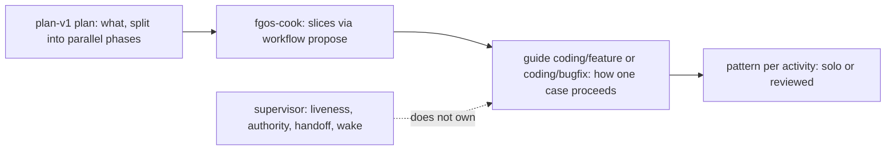

discussion: open

# Workflow engine and domain task types

## 1. Trạng thái hiện tại

2026-11-21: the shaper head `head:shaper-workflow-engine` took over from the secretary's opening. Domain is coding (the source item is a coding-domain workflow). Scouted the current wiring (see §3). The owner's answers on tsk-1pv are recorded in §3 as owner-stated, not yet minted as D-IDs (only one round so far). Nothing is settled.

2026-11-21 10:45, owner reframed the discussion: before adding bugfix, confirm the vision already settled (a task type such as code-implement or bug-fix is carried by a team under a lead; the lead gets a persona and skills plus a workflow; the workflow is a broad frame distilled from experience, not a narrow constraint; nothing hardcoded), and check how far the code got, so a new mechanism is not invented beside settled ones. Also the owner's stability concern: the supervisor is not stable yet and work is drifting into deeper patterns.

Scan result (§3, "Prior art"): the vision is already settled in several decisions (D-ADR0070, 0072, 0073, 0076 and the domainization boundary). Bugfix then needs only a new workflow file plus one `workflowFor` line, so no new mechanism. Code read (10:55): the per-kind wiring is already done in every caller, so bugfix needs no new engine wiring. The real gap is that `src/runner/operation-choice.mjs` hardcodes the coding stage names `planning`, `discovery` and `executing`, so a differently named stage loses their behaviour. Still not found: where "a team under a lead per task type" is settled (the current `lead` persona leads one plan, not one task type).

Q1 (`q-t6xfzdl3eu`) was cancelled: its premise (a missing `stage-fsm.mjs`) is stale, since Work already records `workflowStep` from its Workflow (commit `07bd0c594`).

2026-11-21 11:00, owner added the two-tier model (owner-stated): the low tier is the pattern (an agent picks the reliable, high-quality way to do one piece of work); the high tier is the workflow (a chain of pieces of work toward a larger goal). The owner also pointed out that `fgos-cook` already drives a plan made by `ak:plan` through a workflow. Checked in code: the guide tier is live (`src/workflow/guide-schema.mjs`, `case-admission.mjs`, `propose.mjs`, `case-start.mjs`; `fgos workflow start coding/feature`), and `feature.yaml` already holds a guide part with milestones, activities (each names a `unit.pattern`: `solo` or `reviewed`), decision points with SHOULD and MAY routes, MUST guards and frame defaults. `fix-verify-red`, `review-item` and `scoped-subtask` are already listed there as alternative routes after `plan-validated`.

This revises the earlier reading: the hardcoded `planning`/`discovery`/`executing` branches in `operation-choice.mjs` belong to the older Work-driver path (the lifecycle part of `feature.yaml`, kept until the cutover by design, decisions N12 and N16), not to the guide tier. The recommendation to migrate that logic before adding bugfix is withdrawn. A bugfix workflow belongs in the guide tier: a second guide with its own milestones and activities, each naming a pattern, with bug-specific knowledge in the coding domain pack. Open: whether the older lifecycle part also needs a bugfix variant.

2026-11-21 11:10, owner confirmed: bugfix goes into the guide tier only, because Work is too rigid and lacks supporting frameworks, which is the reason it is delayed. Minted D1 and D2. Next: shape the bugfix guide itself (milestones, activities, patterns).

2026-11-21 11:20, owner: everything already has code; audit, do not invent. Audit of the carrier for a second coding guide, all existing: (a) a domain already holds several workflow files (council has seven, marketing one); (b) `--guide <id>` already exists on `fgos workflow propose` and `start`, default `coding/feature` (`src/workflow/propose.mjs:34`, `command-registry.mjs:2943`); (c) `propose` refuses a guide that lacks the activities `implement-item`, `validate-plan` and `judge-ambiguity` (`propose.mjs:382`, code `guide-activity-missing`), so a bugfix guide used through `propose` keeps those three ids; (d) a slice's kind, capability, pattern and rigor come from its write paths in `domains/coding/slice-kinds.yaml`, not from the guide, and there is no bug-specific kind; (e) each domain's YAML is compiled to `domains/<d>/compiled.json`, which `fgos doctor` checks for staleness, so a new workflow file needs a recompile. The milestone and activity names I sketched in chat at 11:10 were invented and are withdrawn; the bugfix guide must be derived from `feature.yaml`'s own guide part (§3).

2026-11-21 11:30, owner: the delayed shaper "orchestrate-skeleton" is this same topic seen from the other side. The supervisor owns the high level only: keeping sessions alive and authorised, handing work to triggered agents, waking, restoring and reminding at the right moment. The detail and the intelligence of how work is done belong to the workflow and pattern tier discussed here. Audit: that discussion exists as `docs/discussions/orchestration-skeleton/DISCUSSION.md` (note the spelling), is `paused`, and already settles the same line (SR-D8: the skeleton owns only actors and time, never a domain's state, steps or columns; SR-D7: the domain pack injects frames, doctrine and doors; SR-D9: frame, agent and harness). The owner parked it on 2026-11-21 until four orchestration fixes land, and wants stability before any deeper pattern work. So this discussion must stay a configuration of the workflow tier and must not touch the skeleton.

2026-11-21 11:50, owner: fgOS must be as generic as possible and run alongside other frameworks; a planning standard is injected before planning so any plan can meet it, and fgOS then reads the plan, splits it and starts workers for its parts, with the fitting patterns and workflows (as `fgos-cook` does on a plan). Audit: this exists as the plan contract `core/skills/_shared/plan-contract.md` (`contract: plan-v1`, commit `ab8ebdfd5`, "planner-agnostic"): it wraps any planning skill (`ak-plan`, `fgos-coding-planning` or another) without changing it, says to read it before planning, defines the frontmatter, the body sections, the phase table (id, depends-on, footprint, wave, status), disjoint footprints per wave, one Workflow case per parallel phase, and is checked by `scripts/plan-contract-check.mjs` (a project without that script applies the rules by reading). Plans are plain project files with no UI or project keys (D-ADR0079). The reader of a plan's sections is `src/portfolio/plan-sections.mjs`; `fgos-cook` turns a plan into slices through `fgos workflow propose`. Division of labour, as the code stands: the plan (plan-v1) says what is built and how it splits into parallel parts; the guide says how one case proceeds; patterns say how one piece of work is done reliably. The bugfix guide stays in the guide tier and adds no plan format.

Gap seen in the audit (not a design proposal): I found no hook or wrapper that injects the contract into an external planner such as `ak-plan`; only `fgos-shaping`, the planner head's start prompt (`src/session-host/head-start.mjs:106`) and the plugin's shared fragment reference it. So "injected before planning" holds today by the planner reading it, not by a mechanical step. Confirm with the owner whether that is the intended mechanism.

2026-11-21 12:00, owner corrected the intent: fgOS must not fix other frameworks' planners. fgOS injects its standard itself and verifies at the end; the other framework's plans then adjust to meet the contract. Audit of the three parts: (1) inject: the contract text exists and ships in the plugin's shared fragments; (2) verify: `scripts/plan-contract-check.mjs` (per plan or `--all`, exit 1 on error) exists, and the Rust portfolio check (`apps/fgos/src/wiring/portfolio.rs`, `check_portfolio`, D-ADR0082) checks backlog items, discussions and plans; (3) the hand-over: `fgos workflow propose` already refuses a plan it cannot use with named codes (`plan-missing`, `write-overlap`, `slice-cycle`, `guide-activity-missing`). What the audit did not find: any call from `fgos-cook` or `propose` to the contract check when fgOS takes a plan over (`src/portfolio/plan-sections.mjs` is read only by the check script), so a foreign plan that breaks the contract is caught only if someone runs the script or by the propose refusals, and the refusal does not say "contract" or tell the foreign planner what to adjust. This is a finding to hand to the planner, not something this discussion designs; the bugfix guide does not depend on it.

2026-11-21 12:10, owner added: the graph and resource-referee mechanisms exist for planners with schedule and parallelism tools, so the injected standard can also carry a hint that such a tool is there. Audit: the hint is already in the contract. `core/skills/_shared/plan-contract.md` section 4 ("Door check") tells the planner to run `fgos resource-check --units <file>` on the draft and `fgos resource-check --plan <dir>` afterwards, and says to apply the same overlap rule by hand in a project without fgOS. The door answers colliding pairs and shared paths, layers (waves), the critical path, independent groups, dependency cycles and a verdict (`docs/platform/resource-referee/spec.md`, rules `no-exclusion-in-one-layer`, `declared-layers-valid`, `max-layer-width`). Separately `fgos graph` gives work-graph metrics (components, critical path, stale-blocked, what-if) over Work items' dependency and lineage graph; the contract does not mention it, and it reads Work items, not a plan's phase table. I did not verify whether either tool reports durations (a true Gantt); `resource-check` reports layers and the critical path.

2026-11-21 12:30, owner said continue. Drafted the bugfix guide as a difference table in §7 (`#task-bugfix-guide`): same milestones, activities, patterns, guards; only the id, purpose and two decision points change. No file was created. Open: no new diagnose activity (provisional default).

## 2. Mục tiêu & đề bài

Today a coding Work item always walks one workflow, `coding/feature` (discovery, exploring, planning, executing, and so on). `resolveWorkflow(domain, kind)` already exists in `src/state/domain-registry.mjs` and the registry already has `defaultWorkflow: feature` and an empty `workflowFor: {}`, but the item-walking code does not consult it per item kind. The owner wants a domain to carry more than one workflow, starting with a shorter `bugfix` workflow for coding, with domain-specific logic living in the coding domain pack and none of it in the shared supervisor layer. The outcome of this discussion is a settled slice that a planner can plan: which code paths are wired, what the bugfix workflow's stages are, and how the domain pack plugs in.

## 3. Vấn đề rõ / chưa rõ

| Point | State | Evidence / note |
|---|---|---|
| Bugfix first slice is small, not all four modules | owner-stated 2026-11-21 (tsk-1pv answer) | one round only, not a D-ID yet |
| Bugfix workflow is shorter than feature | owner-stated | exact stage list not yet written |
| Applies to every `kind: bug` | owner-stated | no `risk:light` subset |
| Bugfix uses its own stage names (not shared `executing`) | owner-stated | consequence: its own `skillMap`/`taskSpecMap` entries |
| Domain-specific bugfix logic plugs in via the coding domain pack; no coding logic in the shared supervisor layer | owner-stated | boundary rule for the planner |
| `resolveWorkflow` exists but only `domain-registry.mjs` and `work-compat.mjs` reference it; `workflowFor` is `{}` for coding | clear | `src/state/domain-registry.mjs:207`, `domains/coding/registry.yaml:97-98` |
| Coding has one workflow file, `feature.yaml`, with steps carrying `phase`, `skill`, `operations`, `transitions` | clear | `domains/coding/workflows/feature.yaml` |
| Which module is the "small slice" wired first (frontier, stage move, intake)? | open, Q1 `q-t6xfzdl3eu` | the item tsk-1pv names stage-fsm, frontier and intake, but `src/state/stage-fsm.mjs` does not exist at this commit, so the names need re-checking |
| Exact bugfix stage list and their names | open | blocked by Q1 for the wiring, not for drafting the stage list |
| Where the existing `fix-verify-red` task spec belongs in bugfix | open | `feature.yaml` currently has it as an operation of `executing` |
| Prior art: workflow is a guide plus a case ledger; the agent chooses the order, the harness admits and records; "soft inside, hard outside" | settled, owner 2026-10-19 12:32 | D-ADR0070, `docs/platform/workflow/spec.md` §17; matches the owner's "broad frame, not a bound" |
| Prior art: one word per layer (workflow = definition file, case = one run of it, unit, loop, pattern, seat) | settled, owner 2026-10-24 12:45 | D-ADR0073, same spec §17 |
| Prior art: who sits a seat (persona, model) is chosen only by `bind()`; a workflow may declare `seats:` and a tier | settled | D-ADR0072, `docs/platform/seat-binding/spec.md`; the persona carries voice, style and decision boundary (`core/agents/*.yaml`) |
| Prior art: Work is only the surface; Workflow and Execution are the engine; finish Workflow first | settled, owner 2026-11-16 | D-ADR0076; matches the owner's stability concern |
| Prior art: the domain registry owns `defaultWorkflow` and `workflowFor`; `workflows/<name>.yaml` owns steps, skillMap, taskSpecMap and operations; filename is the workflow name | settled design | `docs/platform/domainization/architecture/domainization.md` §5; so bugfix is one file plus one registry line |
| Prior art: Work already records `workflowStep` from its Workflow; dispatch no longer knows Work | done in code | commits `07bd0c594`, `ad9a23a9f` |
| Per-kind wiring end to end | verified in code 2026-11-21: already wired | `src/state/domain-registry.mjs` exposes seven kind-aware accessors, and every caller passes `work.kind`: `step-fsm.mjs:68`, `frontier.mjs:96`, `intake/plan.mjs:497`, `intake/discovery.mjs:160`, `work-dispatch.mjs:70,437`, `runner/loop.mjs`, `verbs/state/step.mjs`. The premise of tsk-1pv ("not wired into the hot path") is out of date. |
| What the steps carry | verified | each step in the workflow file carries its own `skill` and `operations` (with `taskSpec`, `role`), read by `src/workflow/steps.mjs`; so a bugfix with its own stage names costs no extra skillMap/taskSpecMap entry, which also answers tsk-1pv question 3 |
| Existing proof | verified | `test/state/workflow-multiplicity.test.mjs` proves the selector with one workflow; line 28 asserts that `bug` folds to `feature` and would need updating once `workflowFor.bug` exists (it says a second workflow is out of scope "by design" until it exists) |
| Superseded reading, see §1 (11:00): the hardcoded names sit on the older Work-driver path kept until cutover | revised | the guide tier does not use them |
| Real gap (older path only): coding stage names hardcoded in the shared layer | verified | `src/runner/operation-choice.mjs:794,932,952` branch on the literals `planning`, `discovery`, `executing` (review loop, secondary operations, needs-research); `src/runner/loop.mjs:1353` and `prompt-templates.mjs:36` also name `discovery`. A stage with a different name falls to the generic fallback, which only picks the primary operation, so a bugfix with its own stage names would run but lose the review loop and `fix-verify-red` smartness. This is the coding logic in the shared layer that the owner wants gone. |
| Two tiers: pattern (one piece of work) and workflow (a chain of work) | owner-stated 2026-11-21 11:00 | matches D-ADR0073 loops/patterns and the guide tier |
| The guide tier already runs for `coding/feature`, and `feature.yaml`'s guide part already names a pattern per activity | verified | `src/workflow/*`, `feature.yaml:126-` (its own comment "nothing reads this part until the coding cutover" looks stale; confirm) |
| Whether the older lifecycle part also needs a bugfix variant | settled by D2: no | owner 2026-11-21 11:10 |
| Audit: a second guide needs no new mechanism | verified | multiple workflow files per domain exist (`domains/council/workflows/` has seven); `--guide <id>` exists; slice kind and pattern are table-driven by write path |
| Audit constraint: a guide used through `propose` must keep activities `implement-item`, `validate-plan`, `judge-ambiguity` | verified | `src/workflow/propose.mjs:382` |
| Audit constraint: new workflow YAML must be recompiled into `compiled.json` | verified in `domain-registry.mjs:62-65` | `fgos doctor` row `domain-registry-compiled` reports staleness |
| Audit: a guide-only file registered in coding is also read by the Work resolver, but only if `workflowFor` names it; D2 leaves `workflowFor` empty | verified by reading `resolveWorkflow` | no effect on Work items |
| How the bugfix guide differs from `feature`'s guide part (which activities, decision points, MUST guards) | open: derive from `feature.yaml:126-`, change only what bugs need | provisional default, to confirm: express "prove the cause before editing" as a SHOULD decision with a reason, as `feature.yaml` does for its other routes, and keep the verify receipt as the only MUST |
| Supervisor vs workflow boundary: the supervisor owns liveness, authority, handoff, wake, restore, remind; the workflow and pattern tier own detail and intelligence | owner-stated 2026-11-21 11:30; already settled as SR-D7, SR-D8, SR-D9 | `docs/discussions/orchestration-skeleton/DISCUSSION.md` §3 rows 1-3 (inherited from `supervisor-review`); that discussion is paused by owner decision until four orchestration fixes land |
| Overlap to watch: skeleton row 5 asks for one frame language joining `plan-v1` and the workflow guide; `fgos-cook` already drives an `ak:plan` plan through the guide today | open, belongs to the skeleton discussion | do not decide it here; the bugfix guide must not add a third frame shape |
| Planning standard injected before planning, planner-agnostic, plans are plain generic files | exists | `core/skills/_shared/plan-contract.md` (`plan-v1`), `scripts/plan-contract-check.mjs`, D-ADR0079 |
| fgOS reads a plan, splits it and starts workers per part with patterns and workflows | exists | `src/portfolio/plan-sections.mjs`; `fgos-cook` with `fgos workflow propose`; contract section 4 (one case per parallel phase) |
| Hint to planners that a parallelism tool exists | exists | plan-contract section 4 "Door check" names `fgos resource-check` (collisions, layers, critical path, groups, cycles, verdict); `fgos graph` (Work-item graph metrics) is not named in the contract and does not read plan phases |
| Does either tool report durations (Gantt)? | not verified | `resource-check` help lists layers and critical path only |
| Intent (owner 12:00): fgOS injects the standard and verifies at the end; it does not fix foreign planners, whose plans adjust themselves | owner-stated | supersedes the earlier "injection into an external planner" question |
| Audit: inject text and a verify script exist; the takeover path (`fgos-cook`, `propose`) does not call the contract check, and its refusals are not worded as contract feedback | verified by grep: `plan-sections.mjs` is read only by `scripts/plan-contract-check.mjs`; `propose.mjs` and the cook skill never reference the contract | finding for a planner, outside the bugfix slice |
| Bugfix guide content | draft in §7 `#task-bugfix-guide`, awaiting owner review | differs from `feature` only in id, purpose and two decision points |
| Where is "a team under a lead per task type" settled? Today `lead` leads one plan | not found yet | `core/agents/lead.yaml`; `docs/platform/workflow/spec.md` §7.8 has a conductor case driven by `fgos-cook`; ask the owner for the earlier discussion if the scan cannot find it |
| `feature.yaml` carries no `seats:` yet; spec §10.2 describes a guide part to be added at cutover | open | `grep seats` gives 0 in `domains/coding/workflows/feature.yaml` |
| Title says "domain task types"; is more than bugfix in scope (other kinds, other domains)? | open | the item only covers coding bugfix |

## 4. Quyết định đã chốt

| ID | Decision | Date |
|---|---|---|
| D1 | Two tiers: the pattern is the low tier (the agent picks the reliable, high-quality way to do one piece of work); the workflow is the high tier (a chain of pieces of work toward a larger goal). The workflow is a broad frame distilled from core or organisation experience, not a narrow constraint; the persona gives the lead its qualities, skills give it intelligence, nothing is hardcoded. This was already settled by D-ADR0070, 0072, 0073 and 0076; this discussion reconfirms it and builds on it. | 2026-11-21 (owner, three rounds: 10:40, 11:00, 11:10) |
| D2 | A bugfix is carried by the guide tier only: a second guide in the coding domain pack, with its own milestones and activities that each name a pattern. The Work lifecycle gets no bugfix variant, because Work is too rigid and has no supporting framework, which is why Work is deliberately delayed (D-ADR0076). No new mechanism is added. | 2026-11-21 (owner 11:10, "đúng rồi", after the 11:00 reframing) |

## 5. Q&A log

- 2026-11-21 (owner, via secretary, on tsk-1pv): small slice first; bugfix shortened; applies to every bug; own stage names; domain-specific logic plugs in through the coding domain pack with no coding logic in the shared supervisor layer.
- 2026-11-21 10:35: shaper scouted `domain-registry.mjs`, `registry.yaml` and `feature.yaml`; found `stage-fsm.mjs` absent. Q1 parked as `q-t6xfzdl3eu`.
- 2026-11-21 10:45 (owner): the vision to be confirmed and the stability concern, summarised in §1. Shaper scanned `docs/platform/workflow/spec.md`, `domainization.md`, `seat-binding/spec.md`, `core/agents/lead.yaml` and the git log for `resolveWorkflow` and `workflowFor`; result in §3. Q1 cancelled as stale.
- 2026-11-21 10:55 (shaper): read the callers of the kind-aware accessors and the hardcoded stage literals; result in §3 (rows "Per-kind wiring" to "Real gap").
- 2026-11-21 11:00 (owner): two-tier model and that `fgos-cook` already drives `ak:plan` plans through a workflow. Shaper checked the guide tier in code; hardcoded-stage gap re-read as older-path only (§1).
- 2026-11-21 11:10 (owner): confirmed guide tier only; Work is delayed because it is too rigid and has no supporting framework. D1 and D2 minted.
- 2026-11-21 11:20 (owner): everything already has code; audit only. Shaper audited the guide carrier (rows "Audit" in §3); withdrew the invented milestone names.
- 2026-11-21 11:30 (owner): the paused skeleton shaper is this topic's other side; supervisor owns liveness and handoff, the workflow tier owns detail. Shaper audited and found it already settled as SR-D7/D8/D9 in the paused discussion; recorded in §1 and §3.
- 2026-11-21 11:50 (owner): fgOS stays generic and runs beside other frameworks; planning standard injected before planning so fgOS can run plans by splitting and starting workers. Shaper audited: it is the plan-v1 contract plus `fgos-cook`; recorded in §1 and §3 with one open point (injection is by reading).
- 2026-11-21 12:00 (owner): fgOS injects and verifies, never fixes foreign planners. Shaper audited the inject, verify and takeover parts; one finding: the takeover path does not call the contract check (§1, §3).
- 2026-11-21 12:10 (owner): the injected standard may hint at the parallelism tools. Shaper audited: the hint exists for `resource-check`; `fgos graph` is not named; durations unverified.
- 2026-11-21 12:30 (owner): continue. Shaper wrote the bugfix guide difference table (§7) and a §6 diagram.

## 6. Thiết kế đã chốt {#design}

Settled so far (D1, D2): two tiers; a bugfix is a second coding guide, selected through `--guide`, derived from `feature.yaml`'s guide part, adding no mechanism and no plan format. The guide's own content is still a draft, in §7.

## 7. Danh mục hạng mục / task {#tasks}

### Bugfix guide {#task-bugfix-guide}

Status: draft, derived by reading `domains/coding/workflows/feature.yaml:126-177`; nothing is created. The aim is a small difference from the feature guide.

| Part of the guide | In `feature` | Proposed for `bugfix` | Why |
|---|---|---|---|
| id, purpose | `coding/feature`: request to approved, integrated change | `coding/bugfix`: one bug to an approved, integrated fix, cause shown before the edit | new file `domains/coding/workflows/bugfix.yaml`, recompiled into `compiled.json` |
| milestones | seven (request-received to merged) | same seven | no new milestone name is needed; the existing evidence rules already fit |
| activities | eleven | the same eleven names, including the three `propose` requires (`implement-item`, `validate-plan`, `judge-ambiguity`) | reuse; `fix-verify-red`, `review-item`, `scout-blast-radius`, `resolve-question` already serve a bug |
| patterns | `solo` for judge, lock, shape; `reviewed` for validate and implement | same | the reviewed pattern is what catches regressions |
| decision points | at `request-received` SHOULD judge-ambiguity; at `decisions-locked` SHOULD shape-plan and validate-plan; at `plan-validated` SHOULD implement-item, MAY fix-verify-red | the part that makes it shorter: at `decisions-locked` SHOULD validate-plan only, MAY scout-blast-radius and shape-plan; at `plan-validated` SHOULD implement-item with a reason that the cause is shown first; keep `fix-verify-red` as a MAY | the owner wants it shorter; as a SHOULD the agent can still add a step when the bug is not clear |
| must, closure, frame defaults | five guards; closure `approved` | unchanged | the verify receipt stays the only hard gate |
| bug knowledge | `fix-verify-red.md` already says "prove the cause before changing behavior" and routes to researcher or advisor | none new in the guide; any further bug rule goes in `domains/coding/` (task-specs, skills) | owner D2: no coding logic in the shared layer |

What changes against `feature` is therefore only the file id, the purpose line and two decision points. Provisional default, not asked: no new "diagnose" activity, because a bug's cause-proof is already carried by `fix-verify-red`'s collaboration rule and `scout-blast-radius`; add one only if the owner finds those insufficient.

Draft verify: recompile the domain, then `fgos doctor` row `domain-registry-compiled` is green; `fgos workflow propose --guide coding/bugfix` on a one-slice bug plan returns no `guide-activity-missing`; `test/state/workflow-multiplicity.test.mjs` is extended for the second workflow.
