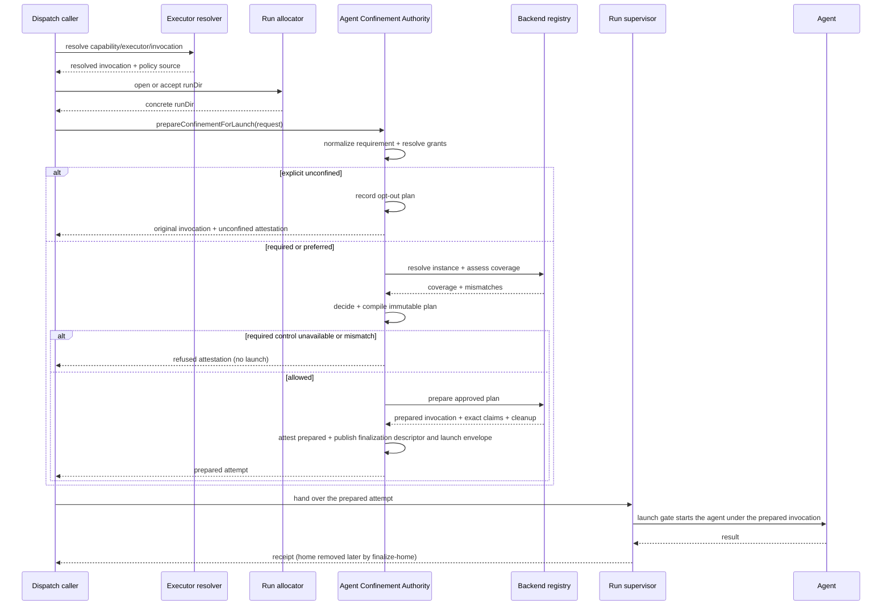

# Spec: Agent Confinement Authority

```txt
Document type: Specification
Audience: Maintainer, implementer, agent
Purpose: Define the stated scope and preserve its source provenance and limits
Design status: Accepted at atomic cutover
Implementation: Carriage only; current implementation truth is not certified
Provenance: docs/specs/confinement-authority.md at 947dc310396071a4d530216d5c06d05993d63bf5
Writer type: Agent draft writer
Canonical: Yes
Canonical for: The document scope stated above; source implementation limits remain explicit
Use this when: Reading or changing the stated scope and its contracts
Do not use this for: Standalone implemented-behavior proof or claims outside the stated scope
Last reviewed: No current review date recorded; retained source dates are historical
Related:
- Source coordinate (provenance only; not a reader destination): `docs/specs/confinement-authority.md` at `947dc310396071a4d530216d5c06d05993d63bf5`
Supersedes: The mapped source location at atomic cutover
Superseded by: None
```

> Source carriage: Split companions are listed in the area portal; original section numbers are retained. Implementation corrections: only identified false current sentences corrected; evidence: src/runner/dispatch/adapters.mjs:20-33; src/runner/dispatch/confinement/backend-registry.mjs:52-58; test/runner/dispatch-confinement-p04.test.mjs:663-675; migration commit 5a42bc376; review-8-specs-ui-truth.md U24 (committed live-config evidence, no configuration read this turn).


> **Trạng thái:** IMPLEMENTED. Đã được hiện thực hoá hoàn chỉnh qua track `confinement-authority-implementation` (P00-P07).
> Một cửa runtime duy nhất `prepareConfinementForLaunch` (chạy `assessAndPrepare`, `confinement/authority.mjs`) bảo vệ mọi attempt ngoại trình (`cli-spawn`, `herdr-spawn`)
> trước khi run supervisor chạy agent; không còn cửa "vừa chuẩn bị vừa chạy adapter" (`executeThroughConfinement`) nào. Backend registry `~/.fgos/confinement-backends.json` quản lý backend instances máy chủ,
> driver `bwrap` v1 bảo đảm fail-closed cho `required` với 9 falsification probes (8 probe gốc cộng `machine-private-hidden`, §9.3; probe thứ mười `peer-run-hidden` chỉ cho blind). Các invocation bwrap hiện dùng backend reference `confinement.backend: bwrap`;
> các executor id cũ `claude-bwrap`, `agy-bwrap`, `codex-bwrap` đã được hợp nhất thành các invocation cli/cli-bwrap.
> Live migration đã được thực hiện, không còn chỉ ở fixture hay deferred. Live dogfood
> coordination đã chứng minh multi-agent cross-provider enforcement trên đường observe/legacy hiện có, không phụ thuộc migration nói trên.
> Chế độ strict mode (`runner.confinement.strict`) mặc định giữ `false` với chẩn đoán sẵn sàng từ `fgos doctor` (xem R1 decision).
>
> **Nguồn:** RUN1
> `plans/reports/architecture-advisory-panel-260909-2107-confinement-authority-fgos-dispatch-report.md`,
> RUN2
> `plans/reports/architecture-advisory-panel-260910-0216-confinement-authority-run2-decision-and-run1-comparison-report.md`,
> và source được đối chiếu ngày 2026-09-11.

## 1. Quyết định kiến trúc

fgOS sẽ có **một cửa runtime duy nhất** cho mỗi lần đưa agent ra ngoài process:

```text
prepareConfinementForLaunch(request, opts) -> attempt đã prepare (invocation, descriptor finalization, launch envelope) + attestation `prepared`
```

Mọi đường dispatch phải đi qua cửa này sau khi đã có đầy đủ `cwd`,
`repoRoot`, `runDir`, executor, invocation và adapter, nhưng trước khi agent
được chạy. Agent chạy như một attempt dưới run supervisor
(`docs/platform/run-supervisor/spec.md`), nên Authority chỉ chuẩn bị và attest; không
production call site nào tra hay gọi execute function của adapter, và adapter
`cli-spawn`/`herdr-spawn` từ chối bằng tên khi bị gọi trực tiếp (`transport.mjs`).
Guard R8 trong `test/architecture.test.mjs` giữ bất biến này.

Bên trong cửa có nhiều bước: resolve policy, compile plan, prepare backend và
attest; execute và dọn home thuộc attempt (run supervisor, finalize-home của adopt). Đó là **nhiều phase trong một authority**, không
phải hai cửa. Config validation cũng không phải cửa runtime; nó chỉ từ chối
cấu hình sai trước khi có dispatch.

Kết luận “không thể một cửa vì `runDir` sinh muộn” của RUN2 chỉ đúng nếu vẫn
đặt cửa ở `resolveExecutorConfig`. Nó không phải ràng buộc kiến trúc. Điểm kích
hoạt đúng là seam chung ngay trước khi attempt được giao cho supervisor
(`executeAssignment`, `assignment-runner.mjs`). Ở seam này đã có invocation đã
resolve và `runDir` cụ thể.

### 1.1 Vì sao một cửa quan trọng

- Không adapter nào có thể quên đọc `confinement`, như adapter `cli-spawn` từng quên.
- Attestation và hành vi được sinh bởi cùng một authority; không còn đường
  “khai một nơi, spawn một nơi khác”.
- Thêm adapter hoặc backend mới không tạo thêm enforcement point.
- Policy dùng được dữ kiện runtime mà không đẩy logic confinement ngược vào resolver.
- Audit call graph chỉ cần chứng minh không có production call site nào gọi
  executor adapter ngoài Agent Confinement Authority.

## 2. Vấn đề lịch sử và giải pháp đã chốt

Trước track `confinement-authority-implementation`, hệ thống có hai cơ chế phân mảnh:
1. **Session hygiene:** `confinement: {privateHome, isolatedSession, ownWorktree}` chỉ áp dụng trong `herdr-round.mjs`.
2. **OS filesystem:** argv `bwrap` viết tay rải rác trong cấu hình executor (`claude-bwrap`, `agy-bwrap`, `codex-bwrap`).

Bốn đường fail-open đã được xác nhận và đóng triệt để:

| ID | Đường hở lịch sử | Giải pháp đã đóng (Settled) |
|---|---|---|
| F-a | Adapter `cli-spawn` bỏ qua field `confinement` | Hoàn thành ở P04: adapter bắt buộc tiêu thụ invocation đã prepare bởi Authority. Nay thân adapter đã bị xoá: attempt chạy dưới run supervisor với invocation đã prepare, và gọi adapter trực tiếp bị từ chối bằng tên; không còn đường unconfined ngầm. |
| F-b | `invocations[].confinement` không validate nhưng lại ưu tiên hơn | Hoàn thành ở P02/P04: validate nghiêm ngặt invocation override; cấm hạ cấp control, cấm thêm grant, cấm đổi policy id hay flip unconfined. |
| F-c | capability không có `prefer` rơi về executor không confinement | Hoàn thành ở P04: fallback preserve anchor gốc và mang theo policy của anchor đó. |
| F-d | `establishConfinement` không có khai báo vẫn trả kết quả thành công | Hoàn thành ở P04/P05: `ownWorktree` đơn lẻ không còn được coi là `confined: true`; hàm dùng chung `evaluateBypassPairing` ép buộc bypass phải có đủ privateHome, isolatedSession và ownWorktree. |

Cả hai cơ chế đã được hợp nhất dưới một cửa Confinement Authority runtime.

## 3. Mục tiêu và phi mục tiêu

### 3.1 Mục tiêu

1. Mỗi dispatch có một kết quả rõ ràng: `enforced`, `unconfined`,
   `degraded`, `refused` hoặc `unknown`.
2. Policy được so với năng lực backend và hành vi thực tế; mismatch không bao
   giờ bị nuốt im.
3. Dispatch `required` phải fail closed trước khi agent chạy.
4. Vùng ghi được cấp theo tài nguyên runtime của chính dispatch, đặc biệt
   `runDir`, không bằng absolute path machine-specific trong config.
5. Contract diễn tả đúng từng trục bảo vệ, không dùng nhãn mơ hồ như
   `read-only` để overclaim.
6. Hỗ trợ nhiều loại backend và nhiều backend instance mà không đổi contract
   của caller; mỗi dispatch vẫn chỉ dùng đúng một backend instance.
7. Một implementation đầu tiên nhỏ vẫn là tập con hợp lệ của contract đích.

### 3.2 Phi mục tiêu

- Không chọn executor thay `resolve.mjs`.
- Không biến worktree hay main-checkout lock thành security boundary.
- Không đưa policy theo role/tier vào `assignment-policy.mjs`.
- Không thay contract CLI `decide`/`execute`.
- Không tuyên bố bwrap hiện tại ngăn mọi secret hay network egress. Điều nó tuyên bố: **attempt chỉ thấy login của chính nó** (từ 2026-11-06, quyết định HARDEN 61 3b): mọi kho login khác của máy và mọi root chứa private home bị che (§9.3); `gh`, `~/.ssh`, socket abstract namespace và dịch vụ localhost vẫn tới được (giới hạn cuối §9.3, backlog `p-x4qeqdvfl5`).
- Không buộc mọi backend driver phải có cùng một schema cấu hình hay cách
  prepare invocation.

### 3.3 Use case đích và cách dùng mặc định

Contract này cần bao phủ ba nhóm use case: agent phân tích/review chỉ được ghi
artifact của dispatch; agent thực hiện thay đổi trong workspace được cấp quyền;
và các executor chạy trên container, máy khác hoặc policy network/secret chặt
hơn. Các use case sau dùng cùng policy, grant và attestation contract; backend
và support matrix quyết định phần nào đã chạy được.

Default implementation phục vụ hai nhóm đầu qua hai policy: workspace read-only
với `host-write-denied`, writable với `workspace-write` theo grant cụ thể;
`run-output` là vùng ghi riêng của dispatch, và private home là vùng tạm do
backend quản lý. Người dùng không cần biết argv hay backend primitive để dùng
default. Setup/doctor phải làm lộ trạng thái registry, prerequisite và probe
freshness theo các registry hiện có; tài liệu này không tự tạo thêm command hay
quy tắc precedence ngoài distribution spec.

## 4. Threat model

Contract diễn tả riêng từng trục. Không có một boolean `confined` chung cho mọi
ý nghĩa.

| Trục | Giá trị chuẩn | Default đầu tiên |
|---|---|---|
| `hostWrite` | `deny` / `allow` | `deny`, trừ các grant được cấp |
| `hostRead` | `deny` / `blind` / `allow` | `allow` |
| `networkEgress` | `deny` / `allow` / `filtered` | `allow` |
| `process` | `isolated` / `host` | `host` |
| `home` | `private` / `host` | `host`; `private` khi policy yêu cầu |
| `session` | `isolated` / `shared` | `shared`; `isolated` khi policy yêu cầu |
| `workspace` | `own` / `shared` | derive từ dispatch context |

session/workspace là context requirement trong policy chung, không phải OS
protection. Authority assess từ trusted dispatch/provisioning evidence rồi hợp
coverage driver. workspace own không tự cấp write grant hay thành sandbox.

Default bwrap đầu tiên chỉ đảm bảo trong cây process được Authority khởi chạy:
**agent không ghi filesystem trực tiếp lên host ngoài các write grant được liệt
kê**, bao gồm ghi qua file descriptor kế thừa. Backend phải đóng hoặc giới hạn
descriptor có thể ghi ngoài grant; không chứng minh được thì coverage hostWrite
là unknown và required refuse. Stdio chỉ được nối tới kênh output do Authority
quản lý, không truyền descriptor ghi file host tùy ý. Tác động gián tiếp qua daemon/service host,
socket của host, credential broker, network peer, hoặc một process được spawn
ngoài sandbox nằm ngoài cam kết `hostWrite` cho đến khi có control riêng và
probe chứng minh. Attestation phải nói rõ các kênh đã được cover và các kênh
ngoài phạm vi. Nó không đảm bảo bí mật không bị đọc, network bị chặn, hay
process namespace được cô lập.

Backend-private scratch (ví dụ tmpfs /tmp) không ghi persistent host filesystem,
không cần host resource grant. Driver phải công bố scratch trong proof profile;
probe được phép ghi ở đó, nhưng phải chứng minh không alias sang host path.
Private home trên host disk vẫn cần grant, khác với scratch tmpfs.

Contract có thể thêm control về secret, network, syscall, CPU/memory và remote
execution sau này mà không đổi nghĩa các control đã có.

## 5. Component boundary

### 5.1 Vị trí và parent

Component dự kiến sống tại `src/runner/dispatch/confinement/`, là component con
của dispatch Infra. Facade `src/runner/dispatch.mjs` công bố cửa runtime; caller
không import backend hay adapter execute function trực tiếp.

Agent Confinement Authority sở hữu:

- normalize và validate confinement policy;
- so minimum requirement với năng lực backend, không cho phép hạ policy;
- resolve resource grant thành path/runtime handle cụ thể;
- resolve backend instance mà executor đã chọn qua registry cấu hình;
- compile một `ConfinementPlan` bất biến;
- prepare invocation/context cho adapter;
- validate resource binding rồi giao resolved binding cho backend driver; driver
  materialize sandbox invocation từ binding đã được duyệt;
- chuẩn bị launch (invocation đã duyệt, descriptor finalization, launch envelope) cho đúng một adapter; việc chạy agent thuộc run supervisor;
- phát attestation `prepared` hoặc `refused` trước khi agent chạy;
- từ chối trước spawn khi requirement không thể đáp ứng.

Agent Confinement Authority không sở hữu:

- chọn capability, executor hoặc model;
- tạo worktree hay quyết định assignment;
- nội dung prompt;
- lifecycle state của work item;
- implementation của từng executor adapter;
- probe độc lập dùng để falsify backend.

### 5.2 Quy tắc dependency

1. Hai đường trong `dispatch/cli.mjs` resolve executor như hiện tại.
2. Mỗi đường tạo hoặc nhận `runDir` trước.
3. Mỗi đường gọi cùng `prepareConfinementForLaunch`.
4. Không production code nào tra adapter execute function từ registry (`EXECUTOR_ADAPTERS[...]`); guard R8 kiểm.
5. Config validator chỉ đọc metadata registry, không nắm execute handle.
6. Backend không được tự spawn agent. Backend chỉ prepare guarded invocation và
   lifecycle cleanup; Authority vẫn giữ quyền execute.

Quy tắc 4 và 6 làm cho “một cửa” kiểm được bằng code, không chỉ là cách gọi tên.
Registry adapter chỉ còn metadata (`locus`, contract invocation và receipt đã
prepare); execute handle của nó từ chối bằng tên vì agent chạy dưới supervisor.

Adapter metadata có `locus: local-process | remote-http | herdr-pane`. cli-spawn là
local-process; http là remote-http; herdr-spawn là herdr-pane dù request được gửi từ host. Bwrap chỉ nhận
local-process, không coi việc bọc HTTP client là confine remote agent.
In-process Agent/Task tool nằm ngoài execution authority này: dispatch ghi
`authorityScope: external-harness`, attestation null, không gọi đó là unconfined.
Capability required không được dispatch in-process khi chưa có trusted harness
attestation contract đáp ứng policy; phải refuse thay vì bỏ requirement.

## 7. Luồng runtime một cửa



Không có mũi tên từ caller tới adapter hay tới agent mà không qua Authority. Đây là bất biến kiến trúc cốt lõi.

## 8. Policy resolution và edge cases

### 8.1 Quy tắc hợp nhất

1. Capability policy là minimum.
2. Invocation override chỉ được tăng bảo vệ hoặc thu hẹp grant.
3. Executor phải tham chiếu tối đa một backend instance. Backend đó phải cover
   minimum policy; không thành phần nào được tự hạ policy.
4. Project config ghi đè global theo contract distribution, sau đó toàn bộ kết
   quả được validate lại như một config duy nhất.
5. Backend instance không tồn tại, bị disable, có config sai hoặc dùng driver
   type không đăng ký là config error trước dispatch.
6. Không có strategy, priority list hay automatic backend fallback.
7. Project-over-global merge không nhận định nghĩa `confinementBackends`; backend
   ID chỉ được resolve từ machine registry.

### 8.2 `required`, `preferred`, `unconfined`

- `required`: backend/host không đủ thì refuse, không fallback spawn trần.
- `preferred`: chỉ được chạy degraded khi caller đã chọn mode này; outcome phải
  là `degraded`, có lý do và exact coverage.
- `unconfined`: opt-out tường minh, có audit record. Omission không đồng nghĩa
  `unconfined`.

Preferred đạt đầy đủ yêu cầu vẫn ghi enforced. Khi thiếu protection coverage
hoặc proof freshness, Authority có thể compile degrade với exact effective
controls, nhưng readiness, path validation, trusted registry, prepared-plan
consistency và durable record vẫn bắt buộc. Backend đã chọn phải prepare đúng
phần protection đã assess; không được chạy invocation gốc khi prepare throw.
Không có backend thì Authority dùng đường direct không sandbox, backend null,
coverage ghi protection thiếu, chỉ resolve được host resources sẵn có; không
tạo private home hay giả lập remote delivery. Need/binding không thể đáp ứng
dẫn tới refuse. Sau spawn có mismatch ngoài kế hoạch degrade thì failed;
preferred không cho phép nuốt vi phạm ngoài mức giảm đã ghi trước spawn.

Vì vậy “host không hỗ trợ thì sao” không cần một global answer gây cứng. Nghĩa
nằm trong mode của requirement và giữ ổn định qua Linux, macOS, container,
remote.

### 8.3 Resource grant

- `run-output` luôn resolve thành run directory của chính dispatch.
- Path được canonicalize; symlink escape hoặc prefix-string match không hợp lệ.
- Grant write vào assignment store rộng hơn `run-output` không nằm trong default.
- Credential grant mặc định read-only và không lộ secret value vào plan/event.
- Backend không biểu diễn được grant phải trả `unsupported`, không bỏ qua grant.
- Hai dispatch không được có cùng writable `run-output` identity.

### 8.4 Fallback executor

Policy gắn với capability, không gắn với tên command. Nếu resolver chọn global
executor hoặc executor khác, Authority vẫn nhận cùng minimum policy và từ chối
nếu backend của executor mới không cover. F-c vì thế bị đóng mà không cần đoán
`command === 'bwrap'`.

Authority không đổi backend để cứu một executor không tương thích. Nếu cùng một
agent cần chạy được trên hai hạ tầng, config khai hai execution profile rõ ràng,
ví dụ `codex-bwrap` và `codex-container`; mỗi profile tham chiếu một backend
instance và capability chọn executor phù hợp. Đây vẫn là lựa chọn executor bình
thường, không phải backend fallback ẩn.

### 8.5 Adapter mới

Adapter mới chỉ chạy khi đã đăng ký metadata và là một attempt dưới run supervisor
(execute handle của nó không được gọi trực tiếp). Adapter không hiểu confinement policy; nó chỉ nhận prepared
invocation/context. Invocation khai `credentialStore` (store nó đọc, biến env trỏ
tới home, file cần chép) chuẩn trước cửa; Authority resolve và validate, còn
backend driver chỉ trỏ biến đó vào private home và chép đúng file đã khai.

### 8.6 Crash và cleanup

Nghĩa vụ chung của Authority là giữ evidence/ownership identity và chỉ cho phép
dọn sau khi execution đã dừng; recovery mechanics được chọn theo driver profile.
Local-bwrap-v1 dùng thư mục tạm theo dispatchId tạo dưới trusted root, ownership
marker trước allocation và finally idempotent. Home của một attempt (marker bản 2,
`attemptId`) chỉ do bước finalize-home của adopt dọn, khi khoá attempt trống và
miền tiến trình rỗng; không còn reaper phán home theo pid, pane hay tuổi.
Host-disk private home không tự biến mất khi process exit. Không cần remote lease/journal engine
cho default local. Phần journal/lease dưới đây áp dụng profile có resource sống
ngoài process local (remote/container detached), không phải gate chung của S4.

Attestation `prepared` được ghi trước adapter call. Cleanup chạy trong
`finally`; partial prepare cũng phải cung cấp cleanup handle như quy định ở
§6.5. Cleanup failure không được biến execution chưa rõ thành thành công, và
không được che mất execution result đã có. Nếu Authority crash sau khi prepare,
run record giữ phase cuối cùng và adopt kết thúc attempt còn dở (`sweepAttempts` ở `src/run-supervisor/client.mjs` là cửa duy nhất: đầu mỗi `fgos run`, đầu vòng runner, `fgos doctor --fix`).

**Home thuộc về attempt, không thuộc về tiến trình (2026-10-18, thay luật binding 2026-10-15).** Authority không còn `bind`/`markLaunched`/`retain` và marker không còn trường `paneId`, `terminalKey`, `herdrEndpoint`, `herdrSession`, `binderPid`, `binderStartTime`, `boundAt`, `launchedAt`, `retainedAt`; finalizer chỉ chấp nhận `credentialKept` là thay đổi sau prepare, mọi thay đổi khác là `ownership-marker-mismatch`. Pane do terminal-control giữ theo khoá, không liên quan tới việc home còn hay mất. Một lượt chạy herdr-spawn luôn là attempt của run supervisor: yêu cầu không mang `attemptId` bị từ chối với `attempt-required` và file herdr-launch-command không còn nơi ghi. Dispatch ngoài cửa assignment (không có attempt) vẫn ghi marker bản 1 (`pid`) và tự dọn home khi settle; nếu process của nó chết thì không sweep nào phán home đó: `fgos doctor` (`confinement-orphaned-resources-reaped`) nêu tên và chỉ `--fix` tường minh của chủ máy mới dọn (theo pid).

Với profile remote/container detached, Authority cấp resource identity và ghi allocation intent bền vững trước mỗi
side effect prepare; driver tạo theo identity đó một cách idempotent. Journal
ghi dispatch id, backend snapshot reference, resource locator, lease/execution
identity và trạng thái allocation/collection/cleanup, không chứa credential.
Callback cleanup chỉ là tối ưu trong process; recovery không phụ thuộc callback.
Recovery phải lấy lease độc quyền, kiểm tra liveness bằng execution
identity chống PID reuse, dừng và xác nhận cả execution tree trước khi collect
và cleanup idempotent. Timeout/cancel cũng tuân cùng thứ tự. Không liên lạc được
remote thì giữ unknown và cleanup pending, không suy agent đã dừng; reconnect
hoặc backend lease-expiry có proof mới cho phép dọn. Resource chưa collect được
giữ cho recovery, không xóa vì agent đã exit. Doctor dùng cùng registry
setup/doctor; backend không có recovery contract này chưa được nhận required.

Local profile chỉ phải đáp ứng invariants ownership/liveness/idempotence nêu
trên, không phải triển khai journal/lease schema của remote.

### 8.7 Bảng tình huống chuẩn

| Tình huống | Trước spawn | Kết quả cuối |
|---|---|---|
| Required, đủ coverage/readiness/proof | prepare rồi execute | enforced khi receipt/evidence khớp |
| Required, proof stale | tự refresh probe trước spawn | pass thì execute; fail/timeout thì refused |
| Preferred, thiếu network protection nhưng đủ needs | ghi degrade rồi execute phần đã assess | degraded |
| Preferred không backend, need private home chưa có | refuse, zero spawn | refused |
| Grant read-write, backend chỉ read, need read | coverage/readiness satisfied | có thể enforced |
| Grant read-write, backend chỉ read, need write | readiness unsatisfied, zero spawn | refused ở mọi mode |
| Prepare tạo resource rồi Authority crash | phục hồi theo profile (local marker hoặc journal) | unknown tới khi recovery có bằng chứng |
| Remote mất kết nối sau started | không suy đã dừng | failed/unknown, cleanup pending |
| Collect artifact thất bại | agent đã chạy, không refusal hồi tố | failed, giữ resource để thu lại |

## 9. Default implementation đầu tiên

Default nhỏ nhất có ích:

1. Một backend driver `bwrap` và một backend instance `bwrap` trong machine
   registry.
2. Hai built-in policy `host-write-denied` và `workspace-write` (§6.2):
   `hostWrite: deny`; host-write-denied cấp `run-output` và backend-managed
   `private-home`; read grant `executor-credentials`;
   `hostRead/networkEgress/process` lần lượt cho phép `allow/allow/host` và
   không được trình bày như restriction;
   workspace-write thêm workspace/git-metadata grant theo ownership/readiness;
   private home tùy nhu cầu provider, không là control bắt buộc của built-in;
   private home cho Codex được provider normalizer diễn tả bằng resource binding
   chuẩn, backend không biết đó là Codex.
3. Migration ba executor bwrap khỏi argv hardcode; mỗi executor tham chiếu
   singular backend instance `bwrap`.
4. Giữ tên `claude-bwrap`, `agy-bwrap`, `codex-bwrap` để không phá evidence
   trail và capability binding.
5. Shape cũ của herdr được normalize và đi qua cùng Authority. Việc di dời
   provisioning khỏi `herdr-round.mjs` có thể ship sau, nhưng chưa di dời xong
   thì maturity một cửa chỉ được ghi là `partial`.
6. Mọi capability committed phải khai policy ID hoặc `unconfined` trước khi bật
   strict mode.

Trong default, host-write-denied giữ workspace read-only; workspace-write cho
sửa workspace đã cấp. Capability execute/stage implement phải được migrate sang
profile có backend phù hợp trước strict flip; không đổi sang unconfined chỉ để
qua gate. Git commit readiness là kiểm tra riêng như §6.3.

Default chưa cần network firewall, secret filtering, macOS/container/remote
backend, generic composition cho mọi tổ hợp control, hoặc đổi tên executor.

### 9.1 Support matrix của default

| Contract surface | Default v1 |
|---|---|
| Mode | `required`, `unconfined`; `preferred` có trong contract nhưng default chưa nhận config này |
| Invocation override | Contract đích giữ shape/partial-order; default v1 từ chối config override, dùng policy ID/capability khác — trừ một override duy nhất, `{ controls: { hostRead: 'blind' } }` (§9.2) |
| `hostWrite` | `deny` qua bwrap, hoặc `allow` khi explicit `unconfined` |
| Write grant | run-output, private-home khi cần; workspace/git-metadata cho workspace-write theo readiness |
| Read grant | `executor-credentials` khi policy của dispatch yêu cầu |
| `home` | host mặc định; private resource khi provider cần; home private nếu policy thực sự yêu cầu và đã prove |
| `session`, `workspace` | effective value là `shared`; legacy `isolated/own` được normalize nhưng chưa di dời enforcement ở slice đầu |
| `hostRead` | `allow`, hoặc `blind` (§9.2); request `deny` bị `unsupported` |
| `networkEgress`, `process` | effective value là `allow`, `host`; request `deny/filtered/isolated` bị `unsupported` |
| Resource delivery/collect | host direct/mount; copy/remote/workspace-change chưa hỗ trợ |
| Backend | Linux bwrap; backend khác trả `unsupported` có lý do |

Việc parser hiểu một field không có nghĩa backend đã support field đó. Default
phải từ chối requirement ngoài matrix thay vì nhận rồi bỏ qua.

### 9.2 `hostRead: blind` — worker mù trước run state của peer

`blind` là giá trị thứ ba của trục `hostRead` (`deny > blind > allow`): host vẫn đọc được,
trừ run state của các dispatch khác và phiên agent đang sống. Runner gửi nó như một override
chỉ-thu-hẹp qua slot `override` của request (Unit mang `blind: true`, mọi vai của Unit đó đều
mù); built-in policy không đổi, không có policy ID mới. Mặc định tắt: argv của dispatch không
`blind` giữ nguyên từng byte khi host không có machine-private root nào (§9.3); khi có, argv chỉ
thêm các mask của §9.3 và không thêm gì khác.

Với `blind`, driver bwrap giữ `--ro-bind / /` và thêm, theo đúng thứ tự: `--unshare-pid` (ẩn
`/proc/<pid>/cmdline` của tiến trình khác); `--tmpfs` che từng *hidden root* đang tồn tại;
`--ro-bind` thư mục của chính dispatch (round dir `<assignments>/<unit run>/<role>/<round>`,
hoặc run dir nếu không có assignment) chỉ-đọc; các mount nằm dưới mask (outbox ghi được, private
home); cuối cùng `--remount-ro` trên các mask. Hidden root là dữ liệu của contract
(`BLIND_HIDDEN_ROOTS`), không phải code của driver: `{fgosDir}/assignments`,
`{fgosDir}/workflow-runs`, `{fgosDir}/dispatch-runs` của project dispatch đang chạy,
`{fgosDir}/runtime/mailbox` (record thư của các phiên agent đang sống; chỉ bước launch blind tạo
nó, mode 0700, khi chưa có và `.fgos` đã tồn tại, để mask không phụ thuộc bên nào khởi động
trước; phép tra hidden root và phép kiểm tra handoff ref không tạo gì; `.fgos` không nhận được
thư mục (chỉ-đọc, của người khác, `runtime` là file) thì bỏ qua, root vắng mặt thì không có gì để
che; xem `docs/platform/agent-mailbox/spec.md` §8 mục 6), và confinement temp
root (private home của dispatch khác, chứa transcript agent). Socket của herdr
từng nằm trong danh sách này; từ 2026-10-24 nó là machine-private (§9.3), che với mọi dispatch.
Resource `hidden-root` và `own-assignment` đi vào plan/attestation; attestation ghi thêm
`requested.override`, `effectiveControls.hostRead: blind` và `hiddenRoots`.

Vì sao như vậy: (1) chỉ che run state của peer và record mailbox chứ không che cả `.fgos`, vì `.fgos` có file
tracked (config, events) — che cả thư mục làm chúng hiện thành "đã xoá" trong trạng thái checkout,
và worker ghi được workspace có thể commit việc xoá đó; (2) `--unshare-pid` vì không có nó worker
đọc được cmdline của tiến trình anh em; (3) socket herdr bị che vì `--ro-bind / /` vẫn cho
`connect()`, tức worker có thể `pane read` pane của anh em (nay che cho mọi dispatch, §9.3). Blind chỉ dùng được khi cái
worker *được trao* nằm sẵn trong thư mục của chính nó, nên với Unit `blind` resolver hand-off
(`resolveUnitInputs`, `src/runner/execution/handoff-refs.mjs`) không giao đường dẫn gốc: mọi input
`unit-run:`, `gate-answer:` và mọi ref nằm trong hidden root được chép nguyên byte (kiểm lại sha256
lúc chép; nguồn đã đổi sau settle thì từ chối `report-changed-after-settle`) vào `inputs/` của
*round dir của chính vai đó* (`<round>/inputs/<tên>`), vô điều kiện, không cần `anonymizeInputs`; tên
trung tính `seat-A...` cho input `unit-run:` khi `anonymizeInputs` bật, tên cố định `<n>-<vai>-r<vòng>`
hoặc `<n>-gate-<bước>` nếu không. Mỗi vai một bản riêng (không chia sẻ giữa các vai của Unit), nên
chỉ vai đó đọc được; danh sách ref của vai là các bản chép. `unit.json` giữ `resolvedInputs` (ref
đọc được tại chỗ) và `inputMap` (nguồn, tên, sha256); resume dùng lại bản chép đã có, fallback chép
lại vào round dir của lần thử mới. Synthesizer của pattern `panel` nhận report của panelist theo
đúng cách đó. `blind-ref-hidden` chỉ còn cho ref không chép được.

Canary sống (2026-10-05, mỗi họ executor một Unit blind chỉ-đọc, input `unit-run:`, và đường dẫn
tuyệt đối tới report nguồn): claude (herdr), codex (herdr và cli bwrap), xai (pi herdr), glm và
deepseek (pi cli bwrap) đều đọc bản chép, gặp `ENOENT` ở nguồn và chỉ thấy chuỗi của chính mình
trong `.fgos/assignments`. Dưới `--unshare-pid` và mask thư mục socket herdr, herdr vẫn nhận ra agent
trong pane (`agentKnownToHerdr: detected`, trạng thái `unknown` → `working` → `idle`/kết thúc), nên
mask và `--unshare-pid` giữ nguyên. agy chưa chứng minh được: `agy-herdr` hỏng cả khi không blind
(`foreground process ... does not match prepared command argv`), `agy-cli-bwrap` dừng vì hết quota
của tài khoản.

Dispatch `blind` bị **từ chối, không bao giờ chạy không-blind**, với lý do có tên, trước khi
spawn: `blind-requires-confinement` (mode không phải `required`/không có policy),
`blind-in-process` (Agent tool/inline không có sandbox quanh worker; `bind()` cũng không chọn nó),
`blind-hides-workspace` (cwd hoặc repo root nằm trong hidden root), `blind-ref-hidden` (context
ref nằm trong hidden root ngoài thư mục của chính dispatch), `confinement-backend-missing` /
`confinement-backend-disabled` (không có bwrap), `confinement-probe-failed` (probe chưa tươi hoặc
không qua). Probe `peer-run-hidden` (thứ mười, chỉ cho dispatch blind; fingerprint và cache riêng)
dựng argv từ chính `prepareBwrap`: worker không đọc được report của peer, home của peer, cmdline
của tiến trình anh em, nhưng đọc được thư mục của mình (chỉ-đọc) và ghi được outbox; falsifier bỏ
mask thì phải đọc được file peer. `fgos doctor` báo `blind-read: pass | fail |
backend-unsupported` (check `confinement-blind-read`). Giới hạn còn mở: transcript agent của Lead
trong host home, `.fgos/secrets.local.env` và project khác (bí mật, không phải mù), và mạng
localhost. Thư mục riêng của máy (`~/.fgos/private`) không còn nằm trong giới hạn này: §9.3 che nó
với mọi dispatch, blind hay không. Một file đơn lẻ trong thư mục project (như
`.fgos/secrets.local.env`) vẫn chưa được che: §9.3 chỉ che thư mục.

### 9.3 Machine-private roots — thư mục riêng của máy, che với mọi worker

Một số thư mục host giữ file riêng của máy mà không worker nào cần: runner chạy ngoài sandbox,
tự đọc file, tự lease rồi chỉ giao cho worker đúng thứ nó được cấp. `MACHINE_PRIVATE_ROOTS`
(`src/runner/dispatch/confinement/resources.mjs`, cạnh `BLIND_HIDDEN_ROOTS`) là danh sách các thư
mục đó. Danh sách là dữ liệu của contract, không phải code của driver. Các mục:

- `{home}/.fgos/private` (`{home}` là home của user host, không phải private home của một
  dispatch; thư mục này giữ `accounts.yaml` và `gateway-token`, xem
  `docs/platform/config/spec.md` §9).
- `{claudeSocketBase}/cc-socks` (`{claudeSocketBase}` là chỗ Claude Code đặt thư mục socket, theo
  đúng thứ tự của nó: `$XDG_RUNTIME_DIR` khi là đường dẫn tuyệt đối, nếu không thì
  `$CLAUDE_CODE_TMPDIR`, nếu không thì thư mục tạm `TMPDIR`/`TMP`/`TEMP`/`/tmp`; hàm
  `resolveClaudeSocketBase`, đọc runtime dir qua đúng một cửa `userRuntimeDir` của
  `src/run-supervisor/runtime-dir.mjs`, cửa mà `resolveRuntimeSocketDir` cũng dùng). Claude Code
  giữ ở đây một control socket cho mỗi phiên đang mở (`<pid>.sock`). Đo trên Claude Code 2.1.309: một
  tiến trình cùng user ghi byte thô vào socket đó, không `from_mode`, thì một phiên ở chế độ
  permission mặc định và không có `crossSessionInbound` nhận lời ghi như tin nhắn vai user, không
  hỏi gì, và bắt đầu một lượt sau khoảng 1,25 giây. Trước mục này, `--ro-bind / /` vẫn cho worker
  bị confine `connect()` tới socket đó dưới mọi built-in policy và dưới `blind` (probe
  `machine-private-hidden` với falsifier bỏ mask đo đúng điều này), tức worker lái được phiên
  Claude đang mở của chủ máy. Worker không cần thư mục này: dưới `--ro-bind / /` một Claude Code
  chạy trong sandbox vốn đã không tạo được socket của mình ở đó (`EROFS`), và sau mask vẫn đúng như
  vậy. Khi `$XDG_RUNTIME_DIR` có mặt, `cc-socks` nằm trong runtime dir và mask của mục
  `{runtimeDir}` (dưới) che nó; resolver chỉ giữ root ngoài cùng, nên không che hai lần. Mục này
  đứng riêng khi Claude Code dùng base dự phòng (`$CLAUDE_CODE_TMPDIR`, thư mục tạm).
  **Tạo trước khi resolve** (chỉ khi base nằm ngoài runtime dir; trong runtime dir thì mask của
  runtime dir đã che thư mục xuất hiện sau): thiếu `cc-socks` thì resolver tạo nó mode 0700
  (`ensureSessionSocketDir`) trước khi tính các root, nên thư mục luôn có mặt, và bị che, từ lúc
  launch; nếu không, phiên Claude đầu tiên mở *sau* khi worker chạy sẽ tạo thư mục mới mà worker
  thấy được (bind mount chia sẻ cây thư mục với host). Chỉ tạo khi base là thư mục thật (không phải
  symlink) của chính user; base thiếu hoặc của người khác thì bỏ qua (Claude Code cũng không bind
  được ở đó). Một mục đã có không bao giờ bị đổi mode hay owner. Claude Code nhận thư mục 0700 sẵn có
  của user mình.
- `{runtimeDir}` (2026-10-24): cả user runtime dir (`runtimeDirForMask`): `$XDG_RUNTIME_DIR` khi là
  đường dẫn tuyệt đối, đọc qua cửa duy nhất `userRuntimeDir`; không có biến thì thư mục logind giữ
  cho user, `/run/user/<uid>`, khi nó là thư mục thật (không phải symlink) của chính user, mode 0700
  (runner chạy từ cron, `su`, unit dịch vụ có env đã lọc vẫn nằm cạnh bus và agent của user ở đó);
  không có cả hai thì bỏ qua mục. Fallback nằm ở resolver mask, không ở `userRuntimeDir`: thư mục
  socket của run supervisor (`resolveRuntimeSocketDir`, dự phòng `/tmp/fgos-<uid>`, đã dưới
  `--tmpfs /tmp`) và base socket của Claude Code đi theo đúng biến như chương trình bind ở đó.
  Root `/` (vd. `XDG_RUNTIME_DIR=/`) che mọi thứ: resolver chỉ giữ nó, và workspace bị từ chối
  `machine-private-hides-workspace` trước khi chạy. Ở đó listen: systemd user manager
  (`systemd/private`; `systemd-run --user` chạy lệnh ngoài sandbox), session bus (`bus`, kèm secret
  service `org.freedesktop.secrets`), ssh-agent (`openssh_agent`), gpg-agent (`gnupg/S.gpg-agent*`),
  keyring (`keyring/control`), pipewire/pulse, `cc-socks` của Claude Code và `fgos/` của run
  supervisor (GO socket của từng attempt terminal). **Bind lại đúng một thứ**: launch terminal của
  một attempt được `--ro-bind` lại GO socket mà gate của nó dial (giá trị `--go-socket` trong
  `gateCommand`, socket supervisor đã listen trước khi pane chạy launcher), sau các mask và trước
  `--remount-ro`; không bao giờ bind thư mục `fgos/` (thư mục đó giữ socket của mọi attempt).
  `--go-socket` không nằm thẳng trong `resolveRuntimeSocketDir()` thì prepare từ chối
  `go-socket-outside-runtime-socket-dir`, không bind. Launch direct không cần gì: kênh GO là
  descriptor kế thừa. Gate binary chỉ được bind lại từ `/tmp` khi là đường dẫn tuyệt đối; tên trần
  được tìm trên `PATH` trong sandbox, không bao giờ cạnh cwd.
- `{home}/.config/herdr`, `{xdgConfigHome}/herdr` và `{herdrSocketDir}` (2026-10-24, trước đó chỉ
  che cho `blind`, §9.2): thư mục của herdr giữ socket API của session mặc định (`herdr.sock`) và
  `sessions/<tên>/herdr.sock` của mọi session khác (đúng layout driver herdr của terminal-control đọc,
  `session_socket` trong `packages/terminal-control/rust/src/driver/herdr.rs`, test ghim hai bên
  cùng tên). Đo với herdr 0.9.1 (`herdr status server --json` với HOME giả, không đụng server thật):
  `$XDG_CONFIG_HOME` (tuyệt đối) dời socket sang `$XDG_CONFIG_HOME/herdr/herdr.sock`, nên mục đó
  cũng được che; `HERDR_CONFIG_PATH` chỉ dời file config, socket vẫn ở `~/.config/herdr`. Driver
  herdr của terminal-control chưa theo `$XDG_CONFIG_HOME` (việc riêng). `{herdrSocketDir}` là thư mục
  của `$HERDR_SOCKET_PATH` của chính runner khi nó nằm nơi khác; thư mục đó mà là home, thư mục config,
  `/tmp` hay tổ tiên của chúng (vd. `~/herdr.sock`, `/tmp/herdr.sock`, giá trị có `/` cuối) thì resolver
  từ chối `herdr-socket-dir-too-broad`: che cả nó sẽ che quá nhiều, và mask chỉ che thư mục. Worker `connect()` được tới đó thì `herdr pane run|send-text|send-keys` chạy lệnh hay gõ vào
  bất kỳ pane nào của session, kể cả shell và phiên Claude của chủ máy. Resolver không còn hỏi
  route terminal-control (lệnh đó gọi `herdr status server` tới server đang chạy) và không còn từ
  chối khi route không trả lời: không có herdr thì không có gì để che.
- `{loginStore}` (2026-11-06): mọi thư mục login của máy (`machineLoginStores`): mỗi store của account
  inventory (`runner.llmAccounts`, và `runner.providers` khi lease còn đọc nó), mở rộng `~`/`${HOME}`
  như lease; home login mặc định của từng agent CLI (`~/.codex`, `~/.pi/agent`, `~/.omp/agent`,
  `~/.claude`, `~/.gemini`) cùng giá trị biến home của nó trong env runner (`CODEX_HOME`,
  `PI_CODING_AGENT_DIR`, `CLAUDE_CONFIG_DIR`); và giá trị `credentialStore.homeEnv` của mỗi executor
  trong config mà lease đọc (của project khi có). Worker nhận bản chép đúng login được lease trong
  private home của nó, nên mọi store tại chỗ là login nó không được đọc. Một launch không khai
  `credentialStore` (đọc login của chính CLI tại chỗ, vd. pane claude không confine, quyết định
  HARDEN 66) giữ các home của chính CLI đó. Store là đường dẫn tương đối hoặc file bị từ chối
  `login-store-not-a-directory`, là home hay tổ tiên của home bị từ chối `login-store-is-home`, config
  không đọc được bị từ chối `login-store-inventory-unreadable`: từ chối theo tên, không bỏ qua.
  Chương trình mà launch chạy nằm trong một home bị che (pi tự cài trong `~/.pi/agent/bin`, codex
  trong `<CODEX_HOME>/packages/standalone/current`) thì các thư mục cài đặt có thật của root đó trong
  danh sách cố định `bin`, `install`, `packages` (`CLI_INSTALL_SUBTREES`) được `--ro-bind` lại sau mask
  (resource `launch-program`); không thư mục nào trong ba thư mục đó chứa chương trình thì chỉ file
  đó. Thư mục mà real path là hoặc chứa một root bị che không bao giờ được bind lại; file login
  (`auth.json`, `config.toml`, kho SQLite) vẫn bị che (`ba4925e54`; từ `9c35308d9` tới bản sửa này
  pane pi và codex bị confine không khởi động được vì launcher của chúng đọc thư mục cài đặt bên
  cạnh).
- `{confinementRoot}` (2026-11-06): mọi root chứa private home (`credentialScanRoots`: temp root mặc
  định, `tempRoot` và `privateHomeRoot` của mỗi backend đăng ký, cùng root của chính backend), tức
  home của dispatch anh em và record host `attempt-home.json` cạnh mỗi home. Trước đó root chỉ bị che
  khi `blind` hoặc khi nằm dưới `/tmp`. Home của chính dispatch được bind lại sau mask (thứ tự của
  §9.2: mount ngoài vùng che, mask, mount trong vùng che, `--remount-ro`). Một root nằm trong một
  mount ghi được bị từ chối `confinement-root-in-writable-grant`.

**Đo trước khi đổi (2026-10-24, bwrap thật, socket giả đang listen trong runtime dir và home giả,
không đụng socket thật của chủ máy).** Trước thay đổi, dưới cả hai built-in policy, blind hay
không, launch direct hay terminal, worker `connect()` được tới `systemd/private`, `bus`,
`openssh_agent`, `gnupg/S.gpg-agent`, `keyring/control`, `pipewire-0` và GO socket của attempt
*khác* trong `fgos/`; socket herdr (mặc định và session có tên) tới được khi không blind; chỉ
`cc-socks` bị che. Sau thay đổi: tất cả `ENOENT`, chỉ GO socket của chính attempt terminal còn
`connect` được. **Worker cần gì (bằng chứng):** (1) run supervisor: chỉ gate dial GO socket, một
lần, trước khi agent chạy; supervisor đóng listener và xoá đường dẫn ngay sau khi nhận gate
(`packages/run-supervisor/rust/src/supervise/terminal.rs`, `accept_gate` rồi `close`), direct
dùng socketpair; test e2e `terminal-cutover` (fgos run thật trong pane, bwrap thật) vẫn qua với
bind-back. (2) herdr: chỉ phía host (supervisor qua route terminal-control) nói với herdr; canary
2026-10-05 (§9.2) chạy claude, codex, pi trong pane herdr với thư mục socket herdr bị che, herdr
vẫn nhận ra agent và run settle, nên worker không cần socket herdr; hook tích hợp trạng thái của
herdr trong agent chỉ mất đường báo, herdr vẫn nhận theo màn hình. (3) Codex: phiên chạy
`--no-daemon` (§13.3), daemon nếu có nằm dưới `CODEX_HOME`, không trong runtime dir; `codex`,
`claude`, `omp`, `agy`, `gh`, `git --version` khởi động bình thường dưới mask (runtime dir rỗng,
chỉ-đọc). (4) D-Bus: không worker CLI nào của fgOS cần; dưới `--ro-bind / /` runtime dir vốn đã
chỉ-đọc nên không CLI nào tạo được socket ở đó trước thay đổi này. Một CLI muốn đọc login từ secret
service qua bus (vd. `gh` cấu hình keyring) nay không thấy bus: login của worker đến từ store được
chép vào private home (§13.1), không từ keyring của chủ máy.

Config và Secrets chỉ *khai đường dẫn của mình*; việc che thuộc về Confinement Authority. Muốn che
thêm một thư mục thì thêm một mục vào danh sách và một case vào probe, không thêm cơ chế.

- **Che với mọi dispatch có mount view**, bất kể `hostRead` (`allow` hoặc `blind`; `deny` vẫn
  `unsupported`, §9.1). Khác §9.2: không cần `blind`, và không phụ thuộc policy.
- **Cơ chế đã có, không thêm cơ chế mới.** Mỗi root tồn tại trên host thành một resource
  `hidden-root` (cùng loại với §9.2, đánh dấu `machinePrivate`); driver bwrap che bằng `--tmpfs`
  lên thư mục rồi `--remount-ro` ở cuối, sau các mount và sau `bindAttemptFiles`. Không có file
  mask: mỗi mục trong danh sách là một thư mục.
- **Root không tồn tại trên host lúc launch thì bị bỏ qua** (không có gì để che); bước setup tạo
  thư mục chạy trước mọi dispatch (giới hạn có tên: một dispatch chạy trước setup không thấy mask,
  và thư mục chưa có thì cũng chưa có gì để lộ). Riêng `cc-socks` được resolver tạo trước (xem mục
  trên), vì thư mục đó xuất hiện cùng phiên Claude, không qua setup.
- **Từ chối trước khi spawn**: workspace, cwd, repo root hoặc bất kỳ mount được cấp nào nằm trong
  một machine-private root bị từ chối với `machine-private-hides-workspace`, cho mọi request bị
  confine (mask sẽ che mất chính thứ worker được cấp). Từ chối, không bao giờ chạy mà không che.
- **Attestation** ghi các root đó trong `hiddenRoots` (field của §9.2); `effectiveControls.hostRead`
  vẫn là giá trị của policy (`allow`), nên `hiddenRoots` mới là chỗ nói chính xác điều gì được che.
- **Dấu báo "đang bị confine"**: driver bwrap đặt biến môi trường `FGOS_CONFINED=1` cho mọi worker
  (một dòng `--setenv`, hằng `CONFINED_MARKER_ENV` trong `drivers/bwrap.mjs`); Config đọc nó để biết
  session đang confine (`session_class`, `packages/config/rust/src/session.rs`, hằng cùng tên được
  test ghim bằng nhau) và từ chối lịch sự thay vì để lệnh vỡ trên file thiếu. Đây là thông tin cho
  session, **không phải ranh giới bảo mật**: worker tự bỏ được biến này, và khi đó chỉ mất lời từ
  chối lịch sự; không hành vi nào bảo vệ dữ liệu dựa vào nó, ranh giới là sandbox (mask ở trên).
  Probe `machine-private-hidden` khẳng định worker thật thấy biến này.
- **Probe `machine-private-hidden`** (thuộc bộ probe chuẩn, không chỉ dispatch blind): dưới từng
  built-in policy (`host-write-denied`, `workspace-write`), với launch direct và terminal, worker
  không đọc được file đặt trong một `{home}/.fgos/private` giả dựng (`ENOENT`, thư mục rỗng), không
  `connect()` được tới các unix socket đang listen trong một runtime dir giả dựng (`systemd/private`,
  `bus`, `openssh_agent`, GO socket của attempt khác trong `fgos/`), trong một base Claude ngoài
  runtime dir (`cc-socks/4242.sock`) và trong `{home}/.config/herdr/herdr.sock`; launch terminal vẫn
  `connect` được GO socket của chính nó; vẫn ghi được outbox, workspace cư xử đúng policy; dispatch
  blind chạy thêm cùng các case dưới `hostRead: blind`. Argv đi qua `prepareBwrapSync` với resource
  do chính resolver sinh ra. Falsifier (`MACHINE_PRIVATE_FALSIFIERS`): bỏ mọi mask thì worker phải
  tới được tất cả; mỗi falsifier có tên (`private`, `runtime-dir`, `session-sockets`, `herdr`) bỏ
  đúng một mask và worker phải tới được đúng thứ mask đó che, mọi thứ khác vẫn `ENOENT`, nên mỗi
  điều kiện có bằng chứng riêng; `own-socket` cho gate terminal không nêu GO socket nào, và worker
  không được tới socket của chính nó. Fingerprint probe mang digest của danh sách (`machinePrivate`), nên mọi proof cũ
  hết hạn đúng một lần và được chạy lại ở lần spawn bắt buộc kế tiếp (§6.6).

Giới hạn: chỉ thư mục (file đơn lẻ như `.fgos/secrets.local.env` chưa được che, xem §9.2 cuối);
host xoá rồi tạo lại một thư mục đang bị che thì mất mask (kernel tháo tmpfs khỏi dentry đã xoá):
logind xoá `/run/user/<uid>` khi user đăng xuất phiên cuối, và tmpfs mới ở lần đăng nhập sau đi vào
sandbox không có mask, nên worker sống qua một lần đăng xuất lại thấy `cc-socks`; base mà runner và
phiên Claude thấy khác nhau (`XDG_RUNTIME_DIR` khác nhau, hoặc không có `XDG_RUNTIME_DIR` và
`TMPDIR` của hai bên khác nhau) và socket đặt bằng `--messaging-socket-path` nằm ngoài mục này;
`/tmp` thì đã bị `--tmpfs /tmp` che sẵn; điều này cũng đúng cho cả runtime dir: logind tạo lại
`/run/user/<uid>` sau lần đăng xuất cuối thì worker sống qua đó thấy runtime dir mới không mask;
runtime dir của runner khác của phiên (khác `XDG_RUNTIME_DIR`) thì chỉ thư mục runner thấy bị che;
server herdr chạy với `XDG_CONFIG_HOME` khác của runner (và không qua `$HERDR_SOCKET_PATH` của
runner) thì nằm ngoài mục này; `~/.config/herdr` chưa có lúc launch
(herdr cài sau) thì không được tạo trước; socket abstract namespace (X11 `@/tmp/.X11-unix/X*`, vì
không có `--unshare-net`) và cổng TCP localhost vẫn tới được (backlog `p-x4qeqdvfl5`); `TMPDIR` nằm trong runtime dir thì
private home bị từ chối `machine-private-hides-workspace` (từ chối, không chạy mà không che);
socket app-server daemon của Codex nằm dưới `CODEX_HOME` của private home;
chỉ chặn đọc qua mount view của worker bị confine (một agent tương tác không confine chạy với tư
cách user và đọc được mọi thứ user đọc được, xem Secrets §7.3); và không che khỏi chính runner,
nơi duy nhất cần đọc các file này.

## 11. Proof và Definition of Done

### 11.1 Contract tests

- Schema từ chối key lạ, backend instance/driver type lạ, driver config sai,
  policy thiếu và override hạ policy.
- Project-over-global merge được validate lại.
- Project config không thể định nghĩa hoặc override machine backend instance.
- Mọi capability resolve thành policy ID hoặc explicit `unconfined`.
- Backend không cover required control/grant phải refuse.
- Network filter/override, grant coverage và resource readiness tuân bảng §8.7.
- Fingerprint/receipt/channels đúng closed schema; stale proof phải refresh pass
  trước required spawn, refresh fail/timeout thì refuse.

### 11.2 One-door tests

- Import/static test chứng minh production caller không gọi executor adapter
  execute function trực tiếp.
- Cả `spawnWorker` và `executeExecutorCli` đi qua cùng facade.
- Adapter fake chỉ nhận prepared invocation.
- Throw trong resolve/assess/compile/prepare tạo zero spawn.
- Preferred thiếu backend/needs và partial coverage tuân §8.2, không fallback
  invocation gốc sau prepare failure.
- Crash giữa allocation intent và prepare completion được replay/reap
  idempotent; không cleanup execution còn sống hoặc remote chưa rõ liveness.
- Collect failure giữ artifact/resource; cleanup failure không xóa agent result.

### 11.3 Behavior probes

Probe phải nằm trong repo và chạy lại được. Với default bwrap, probe chứng minh:

- ghi vào `run-output` của chính dispatch thành công;
- host-write-denied: ghi vào cwd/repo root bị chặn;
- workspace-write: workspace được cấp ghi được, ngoài grant vẫn bị chặn;
  probe riêng Git metadata ownership và commit readiness;
- ghi vào run directory của dispatch khác bị chặn;
- private home ghi được nhưng real host home bị chặn;
- descriptor ghi ngoài grant không được kế thừa; stdio chỉ qua output channel
  được quản lý; attestation công bố host IPC/network ngoài phạm vi đúng §4;
- `executor-credentials` grant đọc được nhưng không ghi được;
- host read và network vẫn khả dụng, để chứng minh attestation không overclaim;
- mỗi machine-private root (§9.3) không đọc được dưới từng built-in policy, kèm falsifier.

Probe input/assertion độc lập với declarative claims. Thay đổi dependency trong
proof profile bắt buộc refresh probe tương ứng theo §6.6; readiness recipe
provider thay đổi không invalidate backend proof không liên quan.

### 11.4 Observability

- Pin posture của cả 17 executor hiện tại.
- Pin exact write grant của ba executor bwrap.
- Có falsifier đỏ khi thêm executor bwrap thứ tư mà không khai báo.
- Event/run record lưu `confinement-attestation.v1` và mismatch.
- Log stdout/stderr không chứa credential value.

### 11.5 Doctor/setup

Mỗi backend driver đăng ký check schema/capability và mỗi machine-registry
instance được `fgos doctor` kiểm tra: binary hoặc runtime khả dụng, platform
support, namespace/mount prerequisite, runDir writable, credential source
readable và probe freshness. `fgos setup` tạo/fill missing backend instance
trong machine registry mà không ghi đè custom value; shared project/global
config vẫn giữ precedence hiện hành. Doctor report phân biệt rõ `configured`,
`disabled`, `unavailable` và `ready`.

## Current settled facts and deferred items

### 13.1 Pane herdr bị confine cho agent không phải claude: công thức, lịch sử, vì sao từng bị quên

*(Từ 2026-11-12 claude cũng theo công thức này: điểm 4.)*

**Công thức (đã chạy thật, Request-to-Run P6):** một invocation `herdr-spawn` có `confinement.backend: bwrap` giữ trạng thái của agent trong một private home thay vì thư mục account thật (đang read-only dưới posture):

1. `credentialStore: { use: <codex | pi | omp | claude>, homeEnv: <CODEX_HOME | PI_CODING_AGENT_DIR | CLAUDE_CONFIG_DIR>, files?: [...], sessionDir?: <thư mục session trong home> }` trên invocation (cùng dạng `codex-cli-bwrap`; runner.md RUL105 (an invocation declares the login store it reads)). Config viết trước field này (config toàn máy, project khác) vẫn khai `resourceBindings: [{ resource: 'private-home', target: { kind: 'env', name: <biến> } }]`; một hàm (`credentialStoreOf`) suy `credentialStore` từ đó, và nhánh suy này bị xoá khi các config ấy đã chuyển.
2. Login của account đến từ inventory toàn máy `runner.providers.<provider>.accounts.<id>.credentialSource` trong `~/.fgos/config.json` (RUL65b của `docs/platform/runner/subcomponents/h-6979005beaf7/spec.md#business-rules`): kind `codex-home` (`auth.json`) hoặc `home-files` (danh sách file tường minh, copy owner-only, fail closed) — driver `drivers/bwrap.mjs` copy vào private home trước khi spawn, theo `credentialStore.files` của invocation nếu có, không thì theo danh sách của account. **Luật chép (2026-10-19, thay luật "thiếu một file thì từ chối"):** file có mặt thì chép, file vắng thì bỏ qua, không file nào có mặt thì từ chối `credential-provisioning` (`credential-store-empty`); symlink treo hay trỏ ra ngoài home, file không thường, đường dẫn có `..` vẫn bị từ chối. Invocation không khai store thì không được chép gì dù account nào được lease (bài học `569f72d3b`), và `assessBwrap` từ chối policy không cấp `private-home` cho invocation đọc store. Account có thể khai `credentialSources` (một store cho mỗi CLI, key là `credentialStore.use` của invocation); request của Authority (`buildConfinementRequest`) chọn store theo khoá đó, và khoá không có store thì bị từ chối trước khi worker chạy (runner.md RUL80 (account trước, CLI sau: một login store cho mỗi CLI)). Không mount thư mục account thật, không bypass flag thay sandbox.
3. Trust của workspace ghi vào store trong private home (`herdr-round.mjs` `trustStorePaths`), dẫn xuất từ store account thật — store của chính account được lease (credential source mà Authority chuyển cho adapter qua `trustAccountSource`), không phải account mà env tĩnh của invocation chỉ tới (runner.md RUL78 (a confined pane reads its folder trust from the leased account's own store)); với codex, trust từng hook của `<cwd>/.codex/hooks.json` (`[hooks.state."<đường dẫn tuyệt đối>:<event>:<nhóm>:<handler>"] trusted_hash`, băm theo luật của codex, ghim bằng test) được gieo cùng lúc, chỉ vào config của private home (không bao giờ vào config thật của account; private home bị xoá sau dispatch nên không có bước gỡ) và chỉ khi gốc repo đã được người dùng tin; với claude, các MCP server do `<cwd>/.mcp.json` khai báo được duyệt riêng cho tiến trình worker bằng `--settings` (`enabledMcpjsonServers`, thêm vào args khi chuẩn bị worker invocation; không ghi file dùng chung), cũng chỉ khi gốc repo đã được tin; cả hai file là file trong worktree mà agent ghi được nên được đọc có giới hạn (`.codex/hooks.json` tối đa 1 MiB) qua cửa agent-file và không theo link: `.codex/hooks.json` là symlink thì bị từ chối (`unreadable-store`) thay vì được theo như trước; `fgos doctor` check `confined-pane-accounts` báo invocation confine nào đọc store mà account không có file nào của store đó (agent sẽ khởi động chưa đăng nhập), và ghi chú file vắng.
4. **claude (2026-11-12, quyết định 86 Q2).** `claude-cli-bwrap` và `claude-herdr-bwrap` khai `credentialStore: { use: claude, homeEnv: CLAUDE_CONFIG_DIR, files: [".credentials.json"], sessionDir: projects }`: `CLAUDE_CONFIG_DIR` trỏ vào private home, nơi chỉ có bản chép `.credentials.json` của account được lease (0600, thư mục 0700, xoá cùng home); không có `~/.claude.json`, `settings.json`, hook hay skill của người dùng. Account khai store của mình là `credentialSources.claude: { kind: home-files, home: <thư mục config claude thật, mặc định ~/.claude>, files: [.credentials.json] }`. claude ghi session vào `projects/<đường dẫn cwd mã hoá>/<id>.jsonl` của home, và `finalize-home` giữ `projects/` (chỉ thư mục đó, không bao giờ file login). claude đọc trạng thái lần chạy đầu và folder trust từ `$CLAUDE_CONFIG_DIR/.claude.json`, nên pane claude có private config dir được gieo ở đó (`seedClaudeConfigTrust`, `herdr-round.mjs` `trustStorePaths`): `hasCompletedOnboarding`, theme và entry của workspace, dẫn xuất từ gốc repo đã được tin trong `~/.claude.json` thật, file thật không bị sửa; headless `-p` không cần file đó. Gia hạn login: token claude là chuỗi mờ, không mang claim tài khoản do provider ký, nên bản login claude được gia hạn trong private home chỉ được stage và giữ cho owner khôi phục tay, không bao giờ tự áp dụng (cách xử lý như xai); doctor `credential-copies-retained` liệt kê chúng. Layout `claude-config-credentials-json` đọc `.credentials.json` ở thư mục config; layout `claude-credentials-json` (`.claude/.credentials.json` dưới HOME) vẫn được đọc cho harness live của mailbox. Không có account `claude` trong inventory thì seat khởi động trong home trống, chưa đăng nhập: doctor `confined-pane-accounts` báo fail.

**Lịch sử (để khỏi suy ra lại):** `5a42bc376` (2026-09-11) `codex-bwrap` cli-spawn có private-home→`CODEX_HOME`; `569f72d3b`, `a1a966ff2`, `ec6a0745d` (09-16, rotator slice 1 thay `FGOS_CODEX_CREDENTIAL_HOMES`) chuyển credential sang inventory (khi đó chỉ `codex-home`). `c54c1888b`, `8c4b4aeeb`, `2cff7102a` (09-11..18) đưa launch confine của herdr-spawn qua Authority — chứng minh bằng worker giả và claude. `e37f8225d` (09-21, H8) từ chối `credential-provisioning-unsupported` cho adapter khác cli-spawn; lý do chỉ nằm trong comment code và `plans/reports/dispatch-execution-engine-architecture-review-260920.md`. `e7bd9b418`, `a9fc61324` (09-17) gộp/đổi tên executor id (`codex-bwrap` thành `openai`/`codex-cli-bwrap`), `5bbd066cd` xoá `claude-herdr`/`pi-herdr` "dormant" nên grep theo tên cũ không còn ra. `cfd670c43` (2026-10-01) áp posture lên mọi invocation herdr nhưng không kèm binding: codex/pi/agy chết ngay lúc khởi động (state dir read-only). 2026-10-19 (đợt model pool B2): binding chung `resourceBindings` được thay bằng `credentialStore` trên invocation, khoá chọn store là `use` thay vì tên lệnh, và id invocation bỏ tên account (`codex-herdr-fgovn` thành `codex-herdr`).

**Vì sao từng bị quên:** (a) cách làm nằm trong commit và trong spec dưới nhãn "Codex bwrap" nên đọc như chuyện riêng của cli-spawn; (b) ngoại lệ H8 loại herdr-spawn không có trong spec; (c) id executor bị đổi tên, tìm theo tên cũ không thấy; (d) phase "facts" của kế hoạch chỉ hỏi về code hiện tại, không hỏi "trước đây đã có gì và vì sao bị bỏ". Bước kiểm tiền lệ nay nằm ở `AGENTS.md` ("Before touching code").

### 13.2 Login được gia hạn trong private home: bản chép là snapshot, bản mới hơn được ghi ngược

Private home nhận một **bản chép** của login, bị xoá sau dispatch. Hai điều đi kèm (chi tiết và luật ở `docs/platform/runner/subcomponents/h-6979005beaf7/spec.md#business-rules`, RUL75 (login xoay vòng được gia hạn một lần tại nguồn, trong bản chép fgOS giữ, và login được gia hạn trong private home được ghi ngược)):

- **Kho SQLite chép dạng snapshot.** File `agent.db` (omp) trong danh sách `files` được chép bằng `VACUUM INTO` qua `node:sqlite` — snapshot nhất quán, gồm cả phần còn nằm trong write-ahead log — thay vì chép file thô thiếu WAL; không có `node:sqlite` thì chép file như trước. Danh sách file được phép chép không đổi, thư mục account thật vẫn không bao giờ được mount.
- **Bản mới hơn được ghi ngược lúc xoá home.** Khi attempt được opt-in (caller truyền hàm gia hạn), driver bwrap trả đích ghi ngược (`credentialWriteBack`: provider, account, home nguồn, layout, runtime dir; chỉ tên và đường dẫn, không giá trị credential) về Confinement Authority, và Authority ghi nó vào mục private-home của descriptor finalization của attempt (dưới `runDir/protected/confinement-finalization/`, ngoài mọi grant). Đích **không bao giờ nằm trong home hay marker của home**: home được bind đọc-ghi vào sandbox nên agent sửa được cả hai. Marker chỉ nhận diện home, và cũng được đọc qua cửa agent-file (không theo link, không chờ pipe, file thường có giới hạn). Việc ghi ngược duy nhất là bước finalize-home của adopt (`finalizeAttemptHome`, `confinement/authority.mjs`): login trong home mới hơn login nguồn thì chỉ được **dàn** (staging) vào `pending/` với tên đánh dấu nguồn agent (`<ts>-agent-<pid>-<hex>`), không bao giờ áp ngay (từ 2026-11-06, quyết định HARDEN 62 A8). Refresh-ahead kế tiếp áp bản đó dưới lock của account chỉ khi nó chứng minh được account: account là claim do provider ký trong access token (Codex và mục `openai-codex` của pi/omp); bản chép được làm thành bản riêng, CLI đổi refresh token của chính bản chép, và chỉ cặp token mới nêu đúng account được thuê mới được áp. Bản nêu account khác bị bỏ (`credential-copy-refused`); bản không nêu account nào được provider ký (xai, claude) không bao giờ tự áp: nó nằm lại cho chủ máy khôi phục bằng tay và doctor liệt kê. Probe chạy trên bản riêng (`pending/.tmp-<pid>-<hex>`), `cwd` và `HOME` là thư mục đó, env chỉ `PATH`, `LANG`, `LC_ALL`, `TZ`, `TERM`, pi và omp chạy `--no-tools`; bản không gia hạn được sau hai lần vào `torn/` mà không làm nguội account. Home của dispatch ngoài cửa assignment (`removeConfinementDir`, `confinement/cleanup.mjs`) không bao giờ opt-in nên bị xoá không ghi ngược, bất kể marker nói gì. File login trong home (`auth.json`, `agent.db` và sidecar) được đọc qua cửa agent-file khi đánh giá và dàn bản chép: link, pipe, socket, device hay file quá lớn bị từ chối trước khi SQLite mở và bản chép đó bị coi là không có login. Luật chi tiết của bước dàn và áp (so sánh trước khi ghi, giới hạn `pending/`, `torn/`) nằm ở `docs/platform/runner/subcomponents/h-6979005beaf7/spec.md#business-rules`, theo RUL75 (login xoay vòng được gia hạn một lần tại nguồn, trong bản chép fgOS giữ, và login được gia hạn trong private home được ghi ngược). Nếu việc dàn thất bại, private home được giữ lại (một dòng stderr mã cố định) để lần finalize sau thử lại; mỗi lần thất bại được đếm trong **record chỉ host giữ** `<tempRoot>/<dispatchId>/attempt-home.json` (0600, thư mục dispatch 0700, không bind vào sandbox; giữ `attemptId`, `runDir`, `dispatchId`, `launchCommandId`, `home`, `credentialKept`), không trong marker agent sửa được (`credentialKept`; hai lần cách nhau dưới 15 phút chỉ tính một). Sau 5 lần home bị **giữ hẳn**. Từ 2026-11-06 (quyết định HARDEN 62 A7) home giữ hẳn có record được **tự giải lại**: `fgos doctor --fix` và cuối mỗi `finalizeAttemptHome` cùng temp root (`settleHeldCredentialHomes`) đọc đích từ descriptor finalization mà record chỉ tới, dàn login rồi xoá home, record và thư mục dispatch; refresh-ahead áp bản dàn qua cổng probe ở trên. Record được đọc `O_NOFOLLOW`, chỉ khi là file thường của uid này, một link, tối đa 64 KiB. Home không có record (do release trước đếm trong marker) vẫn giữ hẳn và chủ máy khôi phục bằng tay. File login hay sidecar không đọc được sau khi tiến trình của attempt đã hết là `home-unreadable`: home bị xoá, không giữ. Check `credential-copies-retained` của `fgos doctor` báo theo provider/account: home bị giữ hẳn (fail; có record thì nêu rằng `fgos doctor --fix` hay attempt kế tiếp cùng root sẽ giải nó, không có record thì nêu thư mục home và cách khôi phục bằng tay, không nêu account), home đang thử lại và các bản `pending/`/scratch quá một ngày (cảnh báo), bản dàn từ private home đang chờ cổng probe hay không nêu account được ký (cảnh báo, dòng riêng), bản agent bị gác vào `torn/` sau các lần gia hạn không ra gì (dòng riêng `set-aside`), và home v2 mà thư mục run không có cả `envelope.json` lẫn `attempt-intent.json` (fail, nêu attempt và cách khôi phục bằng tay, vì không bước finalize-home nào sẽ chạy cho nó); chỉ có số đếm và tuổi, không bao giờ in giá trị, và check không xoá gì. Provisioning Codex đóng kín (fail closed): `auth.json` là symlink trỏ ra ngoài home, hoặc `home` tương đối, làm dispatch thất bại trước khi worker chạy. Bước finalize-home gọi module gia hạn credential (`provider-credential-renewal.mjs`) và qua đó phụ thuộc vào provider capacity, chỉ để lấy account lock. Home không có mục `credentialWriteBack` trong descriptor được xoá không ghi ngược.

### 13.3 Pane Codex chạy `--no-daemon`: sandbox riêng của Codex phải tắt suốt phiên

**Quyết định (2026-10-13):** invocation `codex-herdr-fgovn` (từ 2026-10-19 là `codex-herdr`) truyền thêm `--no-daemon` cạnh `-s danger-full-access -a never`. bwrap là confinement; sandbox riêng của Codex phải tắt trong suốt phiên, không chỉ ở lượt đầu.

**Vì sao:** mặc định TUI của Codex (từ 0.160) không tự chạy phiên mà giao cho một app-server daemon dùng chung (`codex app-server --listen unix:// --managed-daemon`), cài vào `<CODEX_HOME>/packages/app-server-daemon/releases/<version>/` lúc khởi động, kèm một daemon-updater tự thay bản mới hơn. Cờ `-s` của TUI chỉ áp cho thread nó mở; một thread mà daemon mở lại sau khi bị thay thì chạy theo mặc định của config, mà với workspace đã được gieo trust thì đó là sandbox `workspace-write` của chính Codex. Sandbox đó dựng bwrap riêng, coi cwd là writable root và mkdir các mount che (`.codex`, `.aws`, ...) bên trong cwd; dưới `--ro-bind / /` của fgOS lệnh mkdir thất bại nên mọi lệnh hỏng trước khi chạy: `bwrap: Can't mkdir <cwd>/.aws: Read-only file system`. Với `--no-daemon` phiên chạy trong chính tiến trình TUI, mang `-s danger-full-access` đến hết, không có daemon/updater nào chạy ra từ private home.

**Bằng chứng:** sự cố thật ở run `unit-run-1791874482416-acccbfe0/panelist-2/1` (pane chạy codex 0.160.1, lệnh đầu chạy được, sau một lần turn bị ngắt thì daemon 0.162.1 xuất hiện trong private home và mọi lệnh hỏng với lỗi trên). Tái hiện cơ chế: dưới đúng mount fgOS dựng (`--ro-bind / /`, `--tmpfs /tmp`, private home và outbox writable), `codex sandbox -c sandbox_mode="workspace-write" -- <ghi outbox>` với cwd là checkout chính báo đúng `bwrap: Can't mkdir /home/vantt/projects/forgentX/.aws: Read-only file system` (worktree không có `.codex` thì báo `.codex`), còn `danger-full-access` ghi được outbox; `read-only` hỏng vì cách khác (`execvp codex-linux-sandbox`). Dispatch pane thật có `--no-daemon`: private home không có `app-server-daemon/` hay `packages/`, run settle, outbox có `report-1.md` và `result-1.json`.

**Chưa chứng minh:** sự kiện nào khiến thread trong sự cố chạy lại dưới `workspace-write` (giả thuyết mạnh nhất: daemon-updater thay 0.160.1 bằng 0.162.1 giữa run, chính việc thay thế làm ngắt turn, và thread được mở lại không mang `-s`). Tắt daemon loại bỏ cả nhánh này; ghi `sandbox_mode = "danger-full-access"` vào `config.toml` của private home là lớp phòng thủ thứ hai chưa làm (file đó do bước gieo trust ghi, và driver bwrap không được rẽ nhánh theo provider). Đường `codex exec` (`codex-cli-bwrap`) không dùng daemon nên không đổi.

### Tồn đọng mở (Open Deferred Items):

- **P04 M-3 (Inherited unconfined anchor overclaim):** Khi kế thừa anchor từ capability cha, một capability không khai báo confinement nhận attestation `unconfined` (explicit opt-out) thay vì `unknown`/`omitted`. Cần phân biệt rõ cờ thừa kế trong phase tiếp theo.
- **P03 NEW-1b/NEW-1c & P06 M2 (Thin attestation body):** Thân attestation của `enforced` chưa so sánh toàn diện invocation chạy thực tế với plan đã prepare; mảng `channels[]` vẫn mang chi tiết observe-mode.
- **P03 R4 (Reaper caller):** Hàm dọn dẹp thư mục tạm thành công chưa có caller định kỳ trong production.
- **Strict Mode Default:** `runner.confinement.strict` tiếp tục mặc định là `false`, giữ an toàn tương thích cho môi trường phát triển và chờ hoàn thiện các tồn đọng trên trước khi kích hoạt mặc định. Operator có thể bật `strict: true` khi đã thoả mãn `fgos doctor`.

## 14. Pointers hiện tại

- `src/runner/dispatch/cli.mjs`: hai seam trước adapter; `runDir` có tại đây.
- `src/runner/dispatch/transport.mjs`: `resolveExecutorCommand`, adapter registry
  và các adapter chỉ-supervised (`registerSupervisedOnlyAdapter`).
- `src/runner/dispatch/resolve.mjs`: resolve executor và fallback path.
- `src/runner/dispatch/config.mjs`: validation của shape confinement cũ.
- `src/runner/dispatch/herdr-round.mjs`: enforcement session/home hiện tại.
- `src/setup/registrations.mjs`: doctor checks liên quan.
- `.fgos/config.json`: các invocation bwrap (cli-spawn và herdr-spawn) khai `confinement.backend`; invocation confine có account khai thêm `credentialStore` (§13.1).
- `docs/platform/runner/contracts/routing-handoff.md`: worktree containment không phải sandbox.
