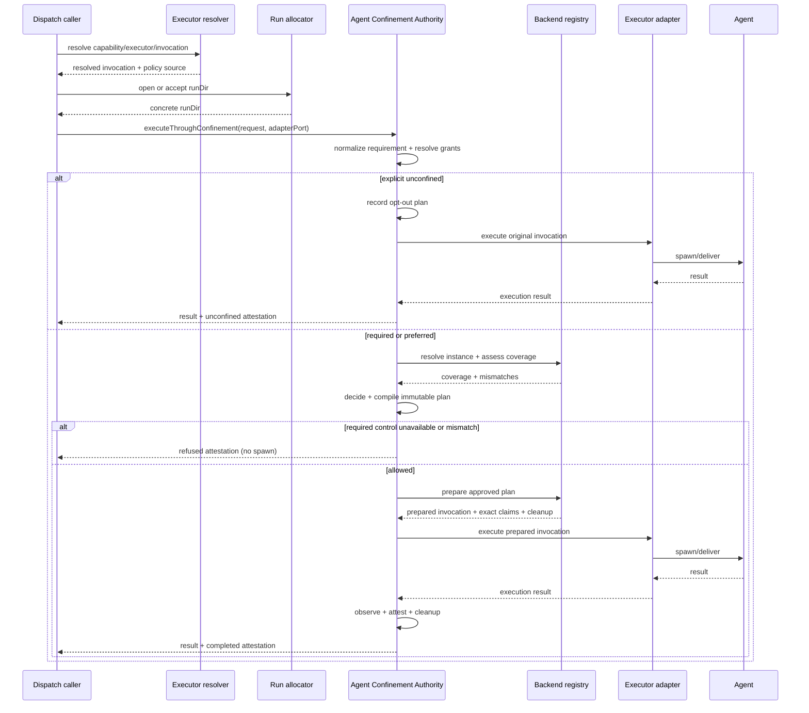

# Spec: Agent Confinement Authority

```txt
Document type: Specification
Audience: Documentation migration reviewer, maintainer, agent
Purpose: Preserve mapped legacy content for independent conservation review
Design status: Candidate
Implementation: Carriage only; current implementation truth is not certified
Provenance: docs/specs/confinement-authority.md at 111adc51fd047d99121fd9d076eb4794c87045a4
Writer type: Agent draft writer
Canonical: No
Canonical for: None; candidate only
Use this when: Reviewing carriage, placement and source conservation
Do not use this for: Current canonical authority or implemented-behavior proof
Last reviewed: Not independently reviewed; authored 2026-10-15
Related:
- docs/specs/confinement-authority.md
Supersedes: None; candidate only
Superseded by: None
```

> Added in candidate: Candidate metadata and placement scaffolding. Split companions are listed in the area portal; original section numbers are retained. Legacy authority remains unchanged; source wording is preserved for conservation, including known stale assertions.


> **Trạng thái:** IMPLEMENTED. Đã được hiện thực hoá hoàn chỉnh qua track `confinement-authority-implementation` (P00-P07).
> Một cửa runtime duy nhất `executeThroughConfinement` bảo vệ mọi dispatch ngoại trình (`cli-spawn`, `herdr-spawn`, `http`)
> trước khi adapter được spawn agent. Backend registry `~/.fgos/confinement-backends.json` quản lý backend instances máy chủ,
> driver `bwrap` v1 bảo đảm fail-closed cho `required` với 8 falsification probes. Ba executor bwrap (`claude-bwrap`, `agy-bwrap`, `codex-bwrap`)
> chỉ di trú sang backend reference ở dạng fixture (P04.md R4) — bản `.fgos/config.json` thật vẫn giữ hand-rolled `command:"bwrap"` argv,
> không có key `confinement`; live migration để deferred cho một phase sau (P06 thử tạm rồi revert nguyên trạng, sha256-verified). Live dogfood
> coordination đã chứng minh multi-agent cross-provider enforcement trên đường observe/legacy hiện có, không phụ thuộc migration nói trên.
> Chế độ strict mode (`runner.confinement.strict`) mặc định giữ `false` với chẩn đoán sẵn sàng từ `fgos doctor` (xem R1 decision).
>
> **Nguồn:** RUN1
> `plans/reports/architecture-advisory-panel-260909-2107-confinement-authority-fgos-dispatch-report.md`,
> RUN2
> `plans/reports/architecture-advisory-panel-260910-0216-confinement-authority-run2-decision-and-run1-comparison-report.md`,
> và source được đối chiếu ngày 2026-09-11.

## 1. Quyết định kiến trúc

fgOS sẽ có **một cửa runtime duy nhất** cho mỗi lần đưa agent ra ngoài process:

```text
executeThroughConfinement(request, adapterPort) -> result + attestation
```

Mọi đường dispatch phải đi qua cửa này sau khi đã có đầy đủ `cwd`,
`repoRoot`, `runDir`, executor, invocation và adapter, nhưng trước khi adapter
được phép spawn hoặc giao việc cho agent. Agent Confinement Authority là thành phần
duy nhất được gọi executor adapter.

Bên trong cửa có nhiều bước: resolve policy, compile plan, prepare backend,
execute, attest và cleanup. Đó là **nhiều phase trong một authority**, không
phải hai cửa. Config validation cũng không phải cửa runtime; nó chỉ từ chối
cấu hình sai trước khi có dispatch.

Kết luận “không thể một cửa vì `runDir` sinh muộn” của RUN2 chỉ đúng nếu vẫn
đặt cửa ở `resolveExecutorConfig`. Nó không phải ràng buộc kiến trúc. Điểm kích
hoạt đúng là seam chung ngay trước adapter, sau `openDispatchRun`. Ở seam này,
cả hai đường hiện tại trong `dispatch/cli.mjs` đều đã có invocation đã resolve
và `runDir` cụ thể.

### 1.1 Vì sao một cửa quan trọng

- Không adapter nào có thể quên đọc `confinement`, như `cliSpawnAdapter` hôm nay.
- Attestation và hành vi được sinh bởi cùng một authority; không còn đường
  “khai một nơi, spawn một nơi khác”.
- Thêm adapter hoặc backend mới không tạo thêm enforcement point.
- Policy dùng được dữ kiện runtime mà không đẩy logic confinement ngược vào resolver.
- Audit call graph chỉ cần chứng minh không có production call site nào gọi
  executor adapter ngoài Agent Confinement Authority.

## 2. Vấn đề lịch sử và giải pháp đã chốt

Trước track `confinement-authority-implementation`, hệ thống có hai cơ chế phân mảnh:
1. **Session hygiene:** `confinement: {privateHome, isolatedSession, ownWorktree}` chỉ áp dụng trong `herdr-round.mjs`.
2. **OS filesystem:** argv `bwrap` viết tay rải rác trong cấu hình executor (`claude-bwrap`, `agy-bwrap`, `codex-bwrap`).

Bốn đường fail-open đã được xác nhận và đóng triệt để:

| ID | Đường hở lịch sử | Giải pháp đã đóng (Settled) |
|---|---|---|
| F-a | `cliSpawnAdapter` bỏ qua field `confinement` | Hoàn thành ở P04: `cliSpawnAdapter` bắt buộc tiêu thụ invocation đã prepare bởi Authority; không còn đường unconfined ngầm. |
| F-b | `invocations[].confinement` không validate nhưng lại ưu tiên hơn | Hoàn thành ở P02/P04: validate nghiêm ngặt invocation override; cấm hạ cấp control, cấm thêm grant, cấm đổi policy id hay flip unconfined. |
| F-c | capability không có `prefer` rơi về executor không confinement | Hoàn thành ở P04: fallback preserve anchor gốc và mang theo policy của anchor đó. |
| F-d | `establishConfinement` không có khai báo vẫn trả kết quả thành công | Hoàn thành ở P04/P05: `ownWorktree` đơn lẻ không còn được coi là `confined: true`; hàm dùng chung `evaluateBypassPairing` ép buộc bypass phải có đủ privateHome, isolatedSession và ownWorktree. |

Cả hai cơ chế đã được hợp nhất dưới một cửa Confinement Authority runtime.

## 3. Mục tiêu và phi mục tiêu

### 3.1 Mục tiêu

1. Mỗi dispatch có một kết quả rõ ràng: `enforced`, `unconfined`,
   `degraded`, `refused` hoặc `unknown`.
2. Policy được so với năng lực backend và hành vi thực tế; mismatch không bao
   giờ bị nuốt im.
3. Dispatch `required` phải fail closed trước khi agent chạy.
4. Vùng ghi được cấp theo tài nguyên runtime của chính dispatch, đặc biệt
   `runDir`, không bằng absolute path machine-specific trong config.
5. Contract diễn tả đúng từng trục bảo vệ, không dùng nhãn mơ hồ như
   `read-only` để overclaim.
6. Hỗ trợ nhiều loại backend và nhiều backend instance mà không đổi contract
   của caller; mỗi dispatch vẫn chỉ dùng đúng một backend instance.
7. Một implementation đầu tiên nhỏ vẫn là tập con hợp lệ của contract đích.

### 3.2 Phi mục tiêu

- Không chọn executor thay `resolve.mjs`.
- Không biến worktree hay main-checkout lock thành security boundary.
- Không đưa policy theo role/tier vào `assignment-policy.mjs`.
- Không thay contract CLI `decide`/`execute`.
- Không tuyên bố bwrap hiện tại ngăn đọc secret hay network egress.
- Không buộc mọi backend driver phải có cùng một schema cấu hình hay cách
  prepare invocation.

### 3.3 Use case đích và cách dùng mặc định

Contract này cần bao phủ ba nhóm use case: agent phân tích/review chỉ được ghi
artifact của dispatch; agent thực hiện thay đổi trong workspace được cấp quyền;
và các executor chạy trên container, máy khác hoặc policy network/secret chặt
hơn. Các use case sau dùng cùng policy, grant và attestation contract; backend
và support matrix quyết định phần nào đã chạy được.

Default implementation phục vụ hai nhóm đầu qua hai policy: workspace read-only
với `host-write-denied`, writable với `workspace-write` theo grant cụ thể;
`run-output` là vùng ghi riêng của dispatch, và private home là vùng tạm do
backend quản lý. Người dùng không cần biết argv hay backend primitive để dùng
default. Setup/doctor phải làm lộ trạng thái registry, prerequisite và probe
freshness theo các registry hiện có; tài liệu này không tự tạo thêm command hay
quy tắc precedence ngoài distribution spec.

## 4. Threat model

Contract diễn tả riêng từng trục. Không có một boolean `confined` chung cho mọi
ý nghĩa.

| Trục | Giá trị chuẩn | Default đầu tiên |
|---|---|---|
| `hostWrite` | `deny` / `allow` | `deny`, trừ các grant được cấp |
| `hostRead` | `deny` / `blind` / `allow` | `allow` |
| `networkEgress` | `deny` / `allow` / `filtered` | `allow` |
| `process` | `isolated` / `host` | `host` |
| `home` | `private` / `host` | `host`; `private` khi policy yêu cầu |
| `session` | `isolated` / `shared` | `shared`; `isolated` khi policy yêu cầu |
| `workspace` | `own` / `shared` | derive từ dispatch context |

session/workspace là context requirement trong policy chung, không phải OS
protection. Authority assess từ trusted dispatch/provisioning evidence rồi hợp
coverage driver. workspace own không tự cấp write grant hay thành sandbox.

Default bwrap đầu tiên chỉ đảm bảo trong cây process được Authority khởi chạy:
**agent không ghi filesystem trực tiếp lên host ngoài các write grant được liệt
kê**, bao gồm ghi qua file descriptor kế thừa. Backend phải đóng hoặc giới hạn
descriptor có thể ghi ngoài grant; không chứng minh được thì coverage hostWrite
là unknown và required refuse. Stdio chỉ được nối tới kênh output do Authority
quản lý, không truyền descriptor ghi file host tùy ý. Tác động gián tiếp qua daemon/service host,
socket của host, credential broker, network peer, hoặc một process được spawn
ngoài sandbox nằm ngoài cam kết `hostWrite` cho đến khi có control riêng và
probe chứng minh. Attestation phải nói rõ các kênh đã được cover và các kênh
ngoài phạm vi. Nó không đảm bảo bí mật không bị đọc, network bị chặn, hay
process namespace được cô lập.

Backend-private scratch (ví dụ tmpfs /tmp) không ghi persistent host filesystem,
không cần host resource grant. Driver phải công bố scratch trong proof profile;
probe được phép ghi ở đó, nhưng phải chứng minh không alias sang host path.
Private home trên host disk vẫn cần grant, khác với scratch tmpfs.

Contract có thể thêm control về secret, network, syscall, CPU/memory và remote
execution sau này mà không đổi nghĩa các control đã có.

## 5. Component boundary

### 5.1 Vị trí và parent

Component dự kiến sống tại `src/runner/dispatch/confinement/`, là component con
của dispatch Infra. Facade `src/runner/dispatch.mjs` công bố cửa runtime; caller
không import backend hay adapter execute function trực tiếp.

Agent Confinement Authority sở hữu:

- normalize và validate confinement policy;
- so minimum requirement với năng lực backend, không cho phép hạ policy;
- resolve resource grant thành path/runtime handle cụ thể;
- resolve backend instance mà executor đã chọn qua registry cấu hình;
- compile một `ConfinementPlan` bất biến;
- prepare invocation/context cho adapter;
- validate resource binding rồi giao resolved binding cho backend driver; driver
  materialize sandbox invocation từ binding đã được duyệt;
- gọi đúng một adapter qua `adapterPort`;
- phát attestation trước/sau execution và cleanup resource tạm;
- từ chối trước spawn khi requirement không thể đáp ứng.

Agent Confinement Authority không sở hữu:

- chọn capability, executor hoặc model;
- tạo worktree hay quyết định assignment;
- nội dung prompt;
- lifecycle state của work item;
- implementation của từng executor adapter;
- probe độc lập dùng để falsify backend.

### 5.2 Quy tắc dependency

1. Hai đường trong `dispatch/cli.mjs` resolve executor như hiện tại.
2. Mỗi đường tạo hoặc nhận `runDir` trước.
3. Mỗi đường gọi cùng `executeThroughConfinement`.
4. Chỉ Agent Confinement Authority tra adapter execute function từ registry và gọi nó.
5. Config validator chỉ đọc metadata registry, không nắm execute handle.
6. Backend không được tự spawn agent. Backend chỉ prepare guarded invocation và
   lifecycle cleanup; Authority vẫn giữ quyền execute.

Quy tắc 4 và 6 làm cho “một cửa” kiểm được bằng code, không chỉ là cách gọi tên.
`adapterPort` là execute handle do Authority nhận từ registry tin cậy của
process dispatch; caller không được tự truyền implementation hoặc đổi handle
sau khi plan đã compile.

Adapter metadata có `locus: local-process | remote`. cli-spawn/herdr-spawn là
local-process; http là remote dù request được gửi từ host. Bwrap chỉ nhận
local-process, không coi việc bọc HTTP client là confine remote agent.
In-process Agent/Task tool nằm ngoài execution authority này: dispatch ghi
`authorityScope: external-harness`, attestation null, không gọi đó là unconfined.
Capability required không được dispatch in-process khi chưa có trusted harness
attestation contract đáp ứng policy; phải refuse thay vì bỏ requirement.

## 7. Luồng runtime một cửa



Không có mũi tên `C -> X`. Đây là bất biến kiến trúc cốt lõi.

## 8. Policy resolution và edge cases

### 8.1 Quy tắc hợp nhất

1. Capability policy là minimum.
2. Invocation override chỉ được tăng bảo vệ hoặc thu hẹp grant.
3. Executor phải tham chiếu tối đa một backend instance. Backend đó phải cover
   minimum policy; không thành phần nào được tự hạ policy.
4. Project config ghi đè global theo contract distribution, sau đó toàn bộ kết
   quả được validate lại như một config duy nhất.
5. Backend instance không tồn tại, bị disable, có config sai hoặc dùng driver
   type không đăng ký là config error trước dispatch.
6. Không có strategy, priority list hay automatic backend fallback.
7. Project-over-global merge không nhận định nghĩa `confinementBackends`; backend
   ID chỉ được resolve từ machine registry.

### 8.2 `required`, `preferred`, `unconfined`

- `required`: backend/host không đủ thì refuse, không fallback spawn trần.
- `preferred`: chỉ được chạy degraded khi caller đã chọn mode này; outcome phải
  là `degraded`, có lý do và exact coverage.
- `unconfined`: opt-out tường minh, có audit record. Omission không đồng nghĩa
  `unconfined`.

Preferred đạt đầy đủ yêu cầu vẫn ghi enforced. Khi thiếu protection coverage
hoặc proof freshness, Authority có thể compile degrade với exact effective
controls, nhưng readiness, path validation, trusted registry, prepared-plan
consistency và durable record vẫn bắt buộc. Backend đã chọn phải prepare đúng
phần protection đã assess; không được chạy invocation gốc khi prepare throw.
Không có backend thì Authority dùng đường direct không sandbox, backend null,
coverage ghi protection thiếu, chỉ resolve được host resources sẵn có; không
tạo private home hay giả lập remote delivery. Need/binding không thể đáp ứng
dẫn tới refuse. Sau spawn có mismatch ngoài kế hoạch degrade thì failed;
preferred không cho phép nuốt vi phạm ngoài mức giảm đã ghi trước spawn.

Vì vậy “host không hỗ trợ thì sao” không cần một global answer gây cứng. Nghĩa
nằm trong mode của requirement và giữ ổn định qua Linux, macOS, container,
remote.

### 8.3 Resource grant

- `run-output` luôn resolve thành run directory của chính dispatch.
- Path được canonicalize; symlink escape hoặc prefix-string match không hợp lệ.
- Grant write vào assignment store rộng hơn `run-output` không nằm trong default.
- Credential grant mặc định read-only và không lộ secret value vào plan/event.
- Backend không biểu diễn được grant phải trả `unsupported`, không bỏ qua grant.
- Hai dispatch không được có cùng writable `run-output` identity.

### 8.4 Fallback executor

Policy gắn với capability, không gắn với tên command. Nếu resolver chọn global
executor hoặc executor khác, Authority vẫn nhận cùng minimum policy và từ chối
nếu backend của executor mới không cover. F-c vì thế bị đóng mà không cần đoán
`command === 'bwrap'`.

Authority không đổi backend để cứu một executor không tương thích. Nếu cùng một
agent cần chạy được trên hai hạ tầng, config khai hai execution profile rõ ràng,
ví dụ `codex-bwrap` và `codex-container`; mỗi profile tham chiếu một backend
instance và capability chọn executor phù hợp. Đây vẫn là lựa chọn executor bình
thường, không phải backend fallback ẩn.

### 8.5 Adapter mới

Adapter mới chỉ chạy khi đã đăng ký metadata và được Authority gọi qua
`adapterPort`. Adapter không hiểu confinement policy; nó chỉ nhận prepared
invocation/context. Provider normalizer tạo `resourceBindings` chuẩn trước cửa;
Authority resolve và validate chúng, còn backend driver chỉ materialize và áp
dụng các binding đã được Authority duyệt.

### 8.6 Crash và cleanup

Nghĩa vụ chung của Authority là giữ evidence/ownership identity và chỉ cho phép
dọn sau khi execution đã dừng; recovery mechanics được chọn theo driver profile.
Local-bwrap-v1 dùng thư mục tạm theo dispatchId tạo dưới trusted root, ownership
marker trước allocation, finally và startup reaper idempotent. Reaper kiểm tra
process identity/liveness (không chỉ PID trần) trước khi dọn; host-disk private
home không tự biến mất khi process exit. Không cần remote lease/journal engine
cho default local. Phần journal/lease dưới đây áp dụng profile có resource sống
ngoài process local (remote/container detached), không phải gate chung của S4.

Attestation `prepared` được ghi trước adapter call. Cleanup chạy trong
`finally`; partial prepare cũng phải cung cấp cleanup handle như quy định ở
§6.5. Startup reaper nhận diện resource tạm qua dispatch id và dọn phần còn
lại. Cleanup failure không được biến execution chưa rõ thành thành công, và
không được che mất execution result đã có. Nếu Authority crash sau khi prepare,
run record giữ phase cuối cùng và reaper xử lý resource chưa dọn.

Reaper và recovery hỏi đúng herdr session mà worker được khởi chạy trong đó: bản ghi launch command và ownership marker của home được giữ lại mang `herdrSession` (socket suy ra từ tên, không lưu), `reconcile` dựng client theo session đó, reaper dùng `FGOS_HERDR_BIN` và cùng session; marker không có session thì trạng thái pane là không rõ và quy tắc hết hạn quyết định.

Với profile remote/container detached, Authority cấp resource identity và ghi allocation intent bền vững trước mỗi
side effect prepare; driver tạo theo identity đó một cách idempotent. Journal
ghi dispatch id, backend snapshot reference, resource locator, lease/execution
identity và trạng thái allocation/collection/cleanup, không chứa credential.
Callback cleanup chỉ là tối ưu trong process; recovery không phụ thuộc callback.
Reaper phải lấy recovery lease độc quyền, kiểm tra liveness bằng execution
identity chống PID reuse, dừng và xác nhận cả execution tree trước khi collect
và cleanup idempotent. Timeout/cancel cũng tuân cùng thứ tự. Không liên lạc được
remote thì giữ unknown và cleanup pending, không suy agent đã dừng; reconnect
hoặc backend lease-expiry có proof mới cho phép dọn. Resource chưa collect được
giữ cho recovery, không xóa vì agent đã exit. Startup reaper dùng cùng registry
setup/doctor; backend không có recovery contract này chưa được nhận required.

Local profile chỉ phải đáp ứng invariants ownership/liveness/idempotence nêu
trên, không phải triển khai journal/lease schema của remote.

### 8.7 Bảng tình huống chuẩn

| Tình huống | Trước spawn | Kết quả cuối |
|---|---|---|
| Required, đủ coverage/readiness/proof | prepare rồi execute | enforced khi receipt/evidence khớp |
| Required, proof stale | tự refresh probe trước spawn | pass thì execute; fail/timeout thì refused |
| Preferred, thiếu network protection nhưng đủ needs | ghi degrade rồi execute phần đã assess | degraded |
| Preferred không backend, need private home chưa có | refuse, zero spawn | refused |
| Grant read-write, backend chỉ read, need read | coverage/readiness satisfied | có thể enforced |
| Grant read-write, backend chỉ read, need write | readiness unsatisfied, zero spawn | refused ở mọi mode |
| Prepare tạo resource rồi Authority crash | phục hồi theo profile (local marker hoặc journal) | unknown tới khi recovery có bằng chứng |
| Remote mất kết nối sau started | không suy đã dừng | failed/unknown, cleanup pending |
| Collect artifact thất bại | agent đã chạy, không refusal hồi tố | failed, giữ resource để thu lại |

## 9. Default implementation đầu tiên

Default nhỏ nhất có ích:

1. Một backend driver `bwrap` và một backend instance `bwrap` trong machine
   registry.
2. Hai built-in policy `host-write-denied` và `workspace-write` (§6.2):
   `hostWrite: deny`; host-write-denied cấp `run-output` và backend-managed
   `private-home`; read grant `executor-credentials`;
   `hostRead/networkEgress/process` lần lượt cho phép `allow/allow/host` và
   không được trình bày như restriction;
   workspace-write thêm workspace/git-metadata grant theo ownership/readiness;
   private home tùy nhu cầu provider, không là control bắt buộc của built-in;
   private home cho Codex được provider normalizer diễn tả bằng resource binding
   chuẩn, backend không biết đó là Codex.
3. Migration ba executor bwrap khỏi argv hardcode; mỗi executor tham chiếu
   singular backend instance `bwrap`.
4. Giữ tên `claude-bwrap`, `agy-bwrap`, `codex-bwrap` để không phá evidence
   trail và capability binding.
5. Shape cũ của herdr được normalize và đi qua cùng Authority. Việc di dời
   provisioning khỏi `herdr-round.mjs` có thể ship sau, nhưng chưa di dời xong
   thì maturity một cửa chỉ được ghi là `partial`.
6. Mọi capability committed phải khai policy ID hoặc `unconfined` trước khi bật
   strict mode.

Trong default, host-write-denied giữ workspace read-only; workspace-write cho
sửa workspace đã cấp. Capability execute/stage implement phải được migrate sang
profile có backend phù hợp trước strict flip; không đổi sang unconfined chỉ để
qua gate. Git commit readiness là kiểm tra riêng như §6.3.

Default chưa cần network firewall, secret filtering, macOS/container/remote
backend, generic composition cho mọi tổ hợp control, hoặc đổi tên executor.

### 9.1 Support matrix của default

| Contract surface | Default v1 |
|---|---|
| Mode | `required`, `unconfined`; `preferred` có trong contract nhưng default chưa nhận config này |
| Invocation override | Contract đích giữ shape/partial-order; default v1 từ chối config override, dùng policy ID/capability khác — trừ một override duy nhất, `{ controls: { hostRead: 'blind' } }` (§9.2) |
| `hostWrite` | `deny` qua bwrap, hoặc `allow` khi explicit `unconfined` |
| Write grant | run-output, private-home khi cần; workspace/git-metadata cho workspace-write theo readiness |
| Read grant | `executor-credentials` khi policy của dispatch yêu cầu |
| `home` | host mặc định; private resource khi provider cần; home private nếu policy thực sự yêu cầu và đã prove |
| `session`, `workspace` | effective value là `shared`; legacy `isolated/own` được normalize nhưng chưa di dời enforcement ở slice đầu |
| `hostRead` | `allow`, hoặc `blind` (§9.2); request `deny` bị `unsupported` |
| `networkEgress`, `process` | effective value là `allow`, `host`; request `deny/filtered/isolated` bị `unsupported` |
| Resource delivery/collect | host direct/mount; copy/remote/workspace-change chưa hỗ trợ |
| Backend | Linux bwrap; backend khác trả `unsupported` có lý do |

Việc parser hiểu một field không có nghĩa backend đã support field đó. Default
phải từ chối requirement ngoài matrix thay vì nhận rồi bỏ qua.

### 9.2 `hostRead: blind` — worker mù trước run state của peer

`blind` là giá trị thứ ba của trục `hostRead` (`deny > blind > allow`): host vẫn đọc được,
trừ run state của các dispatch khác và phiên agent đang sống. Runner gửi nó như một override
chỉ-thu-hẹp qua slot `override` của request (Unit mang `blind: true`, mọi vai của Unit đó đều
mù); built-in policy không đổi, không có policy ID mới. Mặc định tắt: argv của dispatch không
`blind` giữ nguyên từng byte.

Với `blind`, driver bwrap giữ `--ro-bind / /` và thêm, theo đúng thứ tự: `--unshare-pid` (ẩn
`/proc/<pid>/cmdline` của tiến trình khác); `--tmpfs` che từng *hidden root* đang tồn tại;
`--ro-bind` thư mục của chính dispatch (round dir `<assignments>/<unit run>/<role>/<round>`,
hoặc run dir nếu không có assignment) chỉ-đọc; các mount nằm dưới mask (outbox ghi được, private
home); cuối cùng `--remount-ro` trên các mask. Hidden root là dữ liệu của contract
(`BLIND_HIDDEN_ROOTS`), không phải code của driver: `{fgosDir}/assignments`,
`{fgosDir}/workflow-runs`, `{fgosDir}/dispatch-runs` của project dispatch đang chạy, thư mục
socket của herdr, và confinement temp root (private home của dispatch khác, chứa transcript agent).
Resource `hidden-root` và `own-assignment` đi vào plan/attestation; attestation ghi thêm
`requested.override`, `effectiveControls.hostRead: blind` và `hiddenRoots`.

Vì sao như vậy: (1) chỉ che ba thư mục run state chứ không che cả `.fgos`, vì `.fgos` có file
tracked (config, events) — che cả thư mục làm chúng hiện thành "đã xoá" trong trạng thái checkout,
và worker ghi được workspace có thể commit việc xoá đó; (2) `--unshare-pid` vì không có nó worker
đọc được cmdline của tiến trình anh em; (3) socket herdr nằm trong danh sách vì `--ro-bind / /`
vẫn cho `connect()`, tức worker có thể `pane read` pane của anh em. Blind chỉ dùng được khi cái
worker *được trao* nằm sẵn trong thư mục của chính nó, nên với Unit `blind` resolver hand-off
(`resolveUnitInputs`, `src/runner/execution/handoff-refs.mjs`) không giao đường dẫn gốc: mọi input
`unit-run:`, `gate-answer:` và mọi ref nằm trong hidden root được chép nguyên byte (kiểm lại sha256
lúc chép; nguồn đã đổi sau settle thì từ chối `report-changed-after-settle`) vào `inputs/` của
*round dir của chính vai đó* (`<round>/inputs/<tên>`), vô điều kiện, không cần `anonymizeInputs`; tên
trung tính `seat-A...` cho input `unit-run:` khi `anonymizeInputs` bật, tên cố định `<n>-<vai>-r<vòng>`
hoặc `<n>-gate-<bước>` nếu không. Mỗi vai một bản riêng (không chia sẻ giữa các vai của Unit), nên
chỉ vai đó đọc được; danh sách ref của vai là các bản chép. `unit.json` giữ `resolvedInputs` (ref
đọc được tại chỗ) và `inputMap` (nguồn, tên, sha256); resume dùng lại bản chép đã có, fallback chép
lại vào round dir của lần thử mới. Synthesizer của pattern `panel` nhận report của panelist theo
đúng cách đó. `blind-ref-hidden` chỉ còn cho ref không chép được.

Canary sống (2026-10-05, mỗi họ executor một Unit blind chỉ-đọc, input `unit-run:`, và đường dẫn
tuyệt đối tới report nguồn): claude (herdr), codex (herdr và cli bwrap), xai (pi herdr), glm và
deepseek (pi cli bwrap) đều đọc bản chép, gặp `ENOENT` ở nguồn và chỉ thấy chuỗi của chính mình
trong `.fgos/assignments`. Dưới `--unshare-pid` và mask thư mục socket herdr, herdr vẫn nhận ra agent
trong pane (`agentKnownToHerdr: detected`, trạng thái `unknown` → `working` → `idle`/kết thúc), nên
mask và `--unshare-pid` giữ nguyên. agy chưa chứng minh được: `agy-herdr` hỏng cả khi không blind
(`foreground process ... does not match prepared command argv`), `agy-cli-bwrap` dừng vì hết quota
của tài khoản.

Dispatch `blind` bị **từ chối, không bao giờ chạy không-blind**, với lý do có tên, trước khi
spawn: `blind-requires-confinement` (mode không phải `required`/không có policy),
`blind-in-process` (Agent tool/inline không có sandbox quanh worker; `bind()` cũng không chọn nó),
`blind-hides-workspace` (cwd hoặc repo root nằm trong hidden root), `blind-ref-hidden` (context
ref nằm trong hidden root ngoài thư mục của chính dispatch), `confinement-backend-missing` /
`confinement-backend-disabled` (không có bwrap), `confinement-probe-failed` (probe chưa tươi hoặc
không qua). Probe `peer-run-hidden` (thứ chín, chỉ cho dispatch blind; fingerprint và cache riêng)
dựng argv từ chính `prepareBwrap`: worker không đọc được report của peer, home của peer, cmdline
của tiến trình anh em, nhưng đọc được thư mục của mình (chỉ-đọc) và ghi được outbox; falsifier bỏ
mask thì phải đọc được file peer. `fgos doctor` báo `blind-read: pass | fail |
backend-unsupported` (check `confinement-blind-read`). Giới hạn còn mở: transcript agent của Lead
trong host home, `.fgos/secrets.local.env` và project khác (bí mật, không phải mù), và mạng
localhost.

## 11. Proof và Definition of Done

### 11.1 Contract tests

- Schema từ chối key lạ, backend instance/driver type lạ, driver config sai,
  policy thiếu và override hạ policy.
- Project-over-global merge được validate lại.
- Project config không thể định nghĩa hoặc override machine backend instance.
- Mọi capability resolve thành policy ID hoặc explicit `unconfined`.
- Backend không cover required control/grant phải refuse.
- Network filter/override, grant coverage và resource readiness tuân bảng §8.7.
- Fingerprint/receipt/channels đúng closed schema; stale proof phải refresh pass
  trước required spawn, refresh fail/timeout thì refuse.

### 11.2 One-door tests

- Import/static test chứng minh production caller không gọi executor adapter
  execute function trực tiếp.
- Cả `spawnWorker` và `executeExecutorCli` đi qua cùng facade.
- Adapter fake chỉ nhận prepared invocation.
- Throw trong resolve/assess/compile/prepare tạo zero spawn.
- Preferred thiếu backend/needs và partial coverage tuân §8.2, không fallback
  invocation gốc sau prepare failure.
- Crash giữa allocation intent và prepare completion được replay/reap
  idempotent; không cleanup execution còn sống hoặc remote chưa rõ liveness.
- Collect failure giữ artifact/resource; cleanup failure không xóa agent result.

### 11.3 Behavior probes

Probe phải nằm trong repo và chạy lại được. Với default bwrap, probe chứng minh:

- ghi vào `run-output` của chính dispatch thành công;
- host-write-denied: ghi vào cwd/repo root bị chặn;
- workspace-write: workspace được cấp ghi được, ngoài grant vẫn bị chặn;
  probe riêng Git metadata ownership và commit readiness;
- ghi vào run directory của dispatch khác bị chặn;
- private home ghi được nhưng real host home bị chặn;
- descriptor ghi ngoài grant không được kế thừa; stdio chỉ qua output channel
  được quản lý; attestation công bố host IPC/network ngoài phạm vi đúng §4;
- `executor-credentials` grant đọc được nhưng không ghi được;
- host read và network vẫn khả dụng, để chứng minh attestation không overclaim.

Probe input/assertion độc lập với declarative claims. Thay đổi dependency trong
proof profile bắt buộc refresh probe tương ứng theo §6.6; readiness recipe
provider thay đổi không invalidate backend proof không liên quan.

### 11.4 Observability

- Pin posture của cả 17 executor hiện tại.
- Pin exact write grant của ba executor bwrap.
- Có falsifier đỏ khi thêm executor bwrap thứ tư mà không khai báo.
- Event/run record lưu `confinement-attestation.v1` và mismatch.
- Log stdout/stderr không chứa credential value.

### 11.5 Doctor/setup

Mỗi backend driver đăng ký check schema/capability và mỗi machine-registry
instance được `fgos doctor` kiểm tra: binary hoặc runtime khả dụng, platform
support, namespace/mount prerequisite, runDir writable, credential source
readable và probe freshness. `fgos setup` tạo/fill missing backend instance
trong machine registry mà không ghi đè custom value; shared project/global
config vẫn giữ precedence hiện hành. Doctor report phân biệt rõ `configured`,
`disabled`, `unavailable` và `ready`.

## Added in candidate: Current settled facts and deferred items

### 13.2 Login được gia hạn trong private home: bản chép là snapshot, bản mới hơn được ghi ngược

Private home nhận một **bản chép** của login, bị xoá sau dispatch. Hai điều đi kèm (chi tiết và luật ở `docs/specs/runner.md`, RUL75 (login xoay vòng được gia hạn một lần tại nguồn, trong bản chép fgOS giữ, và login được gia hạn trong private home được ghi ngược)):

- **Kho SQLite chép dạng snapshot.** File `agent.db` (omp) trong danh sách `files` được chép bằng `VACUUM INTO` qua `node:sqlite` — snapshot nhất quán, gồm cả phần còn nằm trong write-ahead log — thay vì chép file thô thiếu WAL; không có `node:sqlite` thì chép file như trước. Danh sách file được phép chép không đổi, thư mục account thật vẫn không bao giờ được mount.
- **Bản mới hơn được ghi ngược lúc xoá home.** Khi dispatch được opt-in (caller truyền hàm gia hạn), ownership marker của private home ghi thêm `credentialWriteBack` (provider, account, home nguồn, layout, runtime dir; chỉ tên và đường dẫn, không giá trị credential) sau khi chép xong. Mọi đường xoá home — cleanup của driver, `finalizeConfinementResources` và orphan reaper — đi qua một hàm xoá duy nhất (`removeConfinementDir`, `confinement/cleanup.mjs`): trước khi xoá, login trong home mới hơn login nguồn thì được dàn (staging) rồi áp lên nguồn dưới lock của account, một lần thử không chờ; lock bận thì để `pending/` cho lần refresh-ahead kế tiếp. Lỗi ghi ngược chỉ báo bằng mã cố định trên stderr và chỉ chặn việc xoá trong đúng một trường hợp: việc dàn thất bại (xem dưới). Bản dàn không bao giờ bị xoá khi nguồn không đọc được (đang ghi dở, `agent.db` không mở được, hoặc không xác định được entry) hay khi bản chép không đọc được vì lý do có thể qua (thiếu `node:sqlite`, `agent.db` không mở được): bản chép được giữ ở `pending/` (giới hạn 5 bản mỗi kho login (mỗi account với một kho, mỗi `stores/<cli>` với kho theo CLI), nhưng chỉ bản dư thừa mới bị bỏ: sau khi áp các bản pending dưới account lock, bản có login trùng hệt một bản pending khác thì bị bỏ khi account vượt giới hạn, bản mới nhất của mỗi nhóm trùng được giữ; bản không chứng minh được là dư thừa hay lỗi thời thì không bao giờ bị bỏ để nhường chỗ, nên account có thể vượt giới hạn và check doctor báo; bản do probe ghi dở được giữ ở `torn/` cho việc khôi phục thủ công, không bao giờ tự áp hay tự bỏ, và doctor báo ở mọi tuổi; `torn/` chỉ áp cho bản scratch của probe, còn scratch do runner đã chết để lại và pane home có store bị cắt vẫn bị xoá khi JSON không đọc được; bản không parse được thì so theo byte của file store và của write-ahead log hoặc rollback journal không rỗng (file không đọc được, trừ khi không tồn tại, không bao giờ bị coi là không có; index `-shm` không tính); home có file store trùng từng byte với nguồn và không bên nào có write-ahead log hay journal không rỗng thì không renew gì nên không được dàn) và báo `staged`/`apply-deferred`; chỉ xoá khi nguồn đọc được và chứng minh bản chép không mới hơn, hoặc bản chép được chứng minh hỏng (JSON hỏng, hay không có entry dùng được). Lỗi đọc file của hệ điều hành (quyền, I/O; mã `unreadable-file`) có thể qua nên bản chép được giữ; chỉ file kho không tồn tại (`missing-file`) mới được coi là rỗng và bị xoá. Nếu việc dàn thất bại, private home và marker được giữ lại (việc xoá báo lỗi, một dòng stderr mã cố định) để lần xoá sau, kể cả của reaper, thử lại; mỗi lần thất bại được đếm trong marker (`credentialKept`; hai lần cách nhau dưới 15 phút chỉ tính một, để lỗi tạm thời không dùng hết hạn mức), marker được ghi qua file tạm rồi rename và marker có mặt nhưng đọc không được thì việc xoá dừng lại. Sau 5 lần home bị giữ hẳn: không thử xoá nữa, không bao giờ bị xoá vì quá tuổi. Home bị giữ được kiểm lại dưới account lock khi account đó được gia hạn lần kế tiếp và bởi `fgos doctor --fix` (tập temp root tìm kiếm giống của doctor: root mặc định cộng `tempRoot` của từng backend đã đăng ký, lấy qua hook do phía dispatch truyền xuống; home nằm dưới `privateHomeRoot` riêng của backend không thuộc tập này nên không check, repair, reaper hay lần gia hạn nào thấy, và cũng không bao giờ bị xoá), và chỉ với home thuộc đúng runtime dir của lock đang giữ: chỉ xoá khi nguồn đọc được và chứng minh login trong home không mới hơn, hoặc login đó đã dàn được cạnh nguồn (và được áp); không thì vẫn giữ. Bản đã dàn và thư mục `pending/` được đồng bộ xuống đĩa trước khi home bị xoá. File marker không nhận ra được là marker nào cả (không phải JSON, không phải object, hay không có tên contract) thì mọi việc xoá home đó dừng lại. Finalizer so digest của marker không tính `credentialKept` (cleanup của driver thêm trường này sau khi digest được lấy) và không dừng ở home đó mà vẫn xoá các resource còn lại của dispatch (dispatch ghi là `retained`, kèm lý do của home). Check `credential-copies-retained` của `fgos doctor` báo theo provider/account: home bị giữ hẳn (fail, nêu thư mục home), home đang thử lại và các bản `pending/`/scratch quá một ngày (cảnh báo); chỉ có số đếm và tuổi, không bao giờ in giá trị, và check không xoá gì. Provisioning Codex đóng kín (fail closed): `auth.json` là symlink trỏ ra ngoài home, hoặc `home` tương đối, làm dispatch thất bại trước khi worker chạy (trước đây symlink được theo, home tương đối được hiểu theo cwd). Đường xoá home gọi module gia hạn credential (`provider-credential-renewal.mjs`) và qua đó phụ thuộc vào provider capacity, chỉ để lấy account lock. Home không có field này được xoá y như trước.

### Tồn đọng mở (Open Deferred Items):

- **P04 M-3 (Inherited unconfined anchor overclaim):** Khi kế thừa anchor từ capability cha, một capability không khai báo confinement nhận attestation `unconfined` (explicit opt-out) thay vì `unknown`/`omitted`. Cần phân biệt rõ cờ thừa kế trong phase tiếp theo.
- **P03 NEW-1b/NEW-1c & P06 M2 (Thin attestation body):** Thân attestation của `enforced` chưa so sánh toàn diện invocation chạy thực tế với plan đã prepare; mảng `channels[]` vẫn mang chi tiết observe-mode.
- **P03 R4 (Reaper caller):** Hàm dọn dẹp thư mục tạm thành công chưa có caller định kỳ trong production.
- **Strict Mode Default:** `runner.confinement.strict` tiếp tục mặc định là `false`, giữ an toàn tương thích cho môi trường phát triển và chờ hoàn thiện các tồn đọng trên trước khi kích hoạt mặc định. Operator có thể bật `strict: true` khi đã thoả mãn `fgos doctor`.

## 14. Pointers hiện tại

- `src/runner/dispatch/cli.mjs`: hai seam trước adapter; `runDir` có tại đây.
- `src/runner/dispatch/transport.mjs`: `resolveExecutorCommand`, adapter registry
  và `cliSpawnAdapter` hiện bỏ `confinement`.
- `src/runner/dispatch/resolve.mjs`: resolve executor và fallback path.
- `src/runner/dispatch/config.mjs`: validation của shape confinement cũ.
- `src/runner/dispatch/herdr-round.mjs`: enforcement session/home hiện tại.
- `src/setup/registrations.mjs`: doctor checks liên quan.
- `.fgos/config.json`: các invocation bwrap (cli-spawn và herdr-spawn) khai `confinement.backend`; invocation herdr của codex/agy/pi khai thêm `resourceBindings` private-home (§13.1).
- `docs/routing-handoff-contract.md`: worktree containment không phải sandbox.
