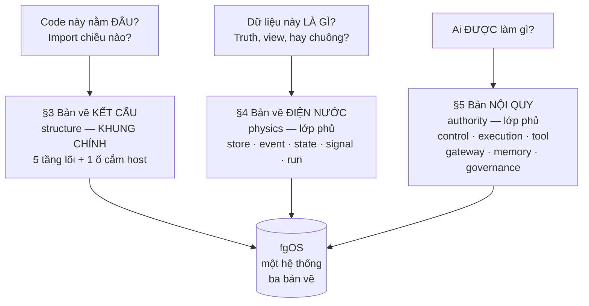
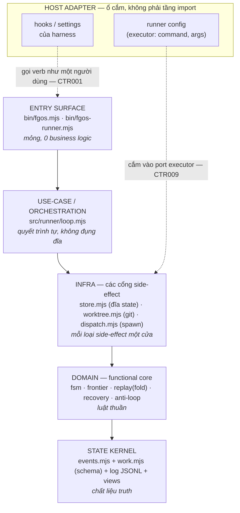
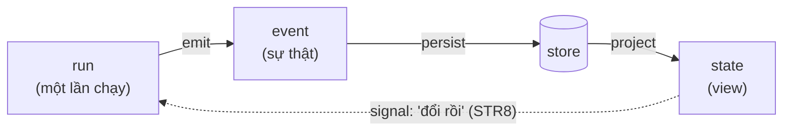
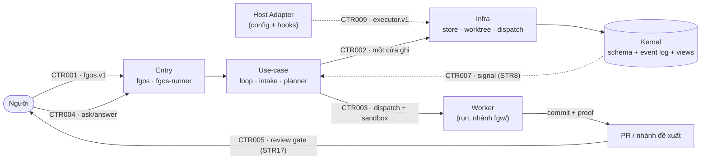
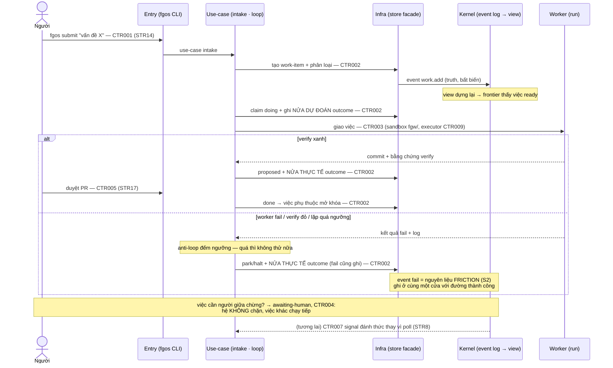

# Architecture Map

```txt
Document type: Platform architecture map
Audience: Human reviewer, architect, maintainer, agent
Purpose: Route readers through the whole-system architecture map
Design status: Draft
Canonical: Yes, after review
Owner: Platform documentation
Last reviewed: 2026-09-13
Related:
- docs/platform/README.md
- docs/platform/component-boundary.md
- docs/platform/architecture-map.md#bản-đồ-kiến-trúc-fgos-một-khung-chính-hai-lớp-phủ-hai-sổ-đăng-ký
Implementation: Partial
Provenance: Promoted anchor from `docs/architecture-map.md` at `947dc310396071a4d530216d5c06d05993d63bf5`
Writer type: Original writer attribution not recorded; retained source provenance
Canonical for: The stated document scope; source implementation limits remain explicit
Use this when: Route readers through the whole-system architecture map
Do not use this for: Authority beyond the declared scope or implementation truth without the cited verification
Supersedes: The mapped source location; source provenance is retained
Superseded by: None recorded
```

## 1. Purpose

This is the target platform-docs anchor for the whole-system architecture map.

This is the platform architecture entry; the registry sections below hold the full component and contract map.

## 2. Reading Model

The legacy architecture map organizes fgOS through:

- a structural layer: where code lives and how import direction works;
- a data/physics layer: store, event, state, signal, run;
- an authority layer: who may decide or write which truth;
- component and contract registries.

The target documentation system separates these concerns into clearer anchors:

| Concern | Target doc |
| --- | --- |
| Mission and direction | `vision.md` |
| Durable laws | `platform-foundations.md` |
| Whole-system structure | `architecture-map.md` |
| Component ownership and authority | `component-boundary.md` |
| Area-specific behavior | `docs/platform/<area>/spec.md` |
| Area-specific rationale | `docs/platform/<area>/architecture/` |
| Exact cross-area rules | `docs/platform/<area>/contracts/` or a cross-area `contracts/` folder directly under `docs/platform/` |

## 3. Current Shape

fgOS should be read as a platform with:

```txt
entry / surface
  -> use-case orchestration
  -> side-effect ports and host adapters
  -> domain-neutral engines
  -> durable state/log substrate
  -> domain and extension layers
```

This target anchor intentionally stays compact. Detailed component authority now belongs in `component-boundary.md`.

## 4. Change Rule

If a design changes whole-system structure, do all of the following:

1. Update the owning area docs.
2. Check `component-boundary.md`.
3. Update this architecture map when the structural reading path changes.
4. Link proof or record `No component-boundary change`.

One-door guard. Each job the system does exactly one way (read the manifest projection, take a lock, resolve the invocation root, admit store access, parse CLI arguments, and so on) has one row in the `doors` table of `packages/component-authority/model/`, which `test/architecture.test.mjs` checks against every product file in Node, Rust and `scripts/`. A row names the job, its `patterns`, the `allowed` paths (a `scripts/` entry carries a reason), the known leaks as `debt` (each with a reason; an entry that no longer matches fails as stale, so a fixed leak must be deleted), and `retiredBy`, which the check requires when a row allows both a Node (`.mjs`) and a Rust (`.rs`) file (a twin) and which any row may carry to say when its leaks or its Node side go. A `ratchet` row only stops growth and is never proof of one path. Adding or moving a door means adding or editing its row in the same change.

## 5. Legacy Source

The component and contract registry content is retained below; use its exact sections for those definitions.

## Architecture-map source carriage

Carriage from `docs/architecture-map.md` at `69dd3ee7fd84bc5e93fe9c75d63622d4f5aa8539`; heading depth, live routes and historical source-header wording are adapted to this holder. The source body is otherwise verbatim; source metadata records provenance, not a current reading instruction or a new implementation claim.

### Bản đồ kiến trúc fgOS — một khung chính, hai lớp phủ, hai sổ đăng ký

```txt
Legacy status: Promoted source
Promoted to: docs/platform/architecture-map.md
Related target anchors:
- docs/platform/component-boundary.md
- docs/platform/platform-foundations.md
- docs/platform/vision.md
Historical source scope: Full architecture-map detail retained as provenance
Historical navigation: The source delegated the platform documentation entry path
Last reviewed: 2026-09-13
```

**Phiên bản:** v0.6. **Trạng thái:** CHUẨN — chấp nhận 2026-07-16, record
[0010](#d-adr0010-bản-đồ-kiến-trúc-là-bản-chuẩn); nâng v0.3 theo record
[0012](work-state/decisions/retired-decision-history.md#d-adr0012-mô-hình-đồ-thị-cạnh-định-kiểu-hợp-nhất-thay-thế-depsparent-tách-rời);
nâng v0.4 theo record
[0013](work-state/decisions/retired-decision-history.md#d-adr0013-kênh-báo-cáo-không-ghi-workerrunner-cho-discovered-from); nâng v0.5
theo record
[0015](#d-adr0015-đổi-tên-định-danh-contract-c1-c9-thành-ctr001-ctr009); nâng v0.6 theo record
[0017](#d-adr0017-đóng-audit-hệ-idtên-gọi-str47) (§12 thêm dòng id-systems-audit,
Phụ lục B mới — sổ đăng ký 13 hệ id/tên gọi).

Chưng từ tài liệu bàn luận ở xưởng và hai deep-dive distillery (`work-item-management`,
`work-item-schema-and-io-contracts`); v0.2 sửa theo hai vòng tự phản biện có kiểm
chứng trên code (hồ sơ hai vòng lưu ở xưởng). Tài liệu này là **bản chuẩn kiến trúc
của sản phẩm**: mọi ví dụ là thành phần fgOS. Thay đổi bản đồ về sau đi qua decision
record kèm nâng version — supersede, không sửa ngầm.

**Changelog v0.1 → v0.2** (tóm tắt — chi tiết ở §11):

1. Thứ tự tầng sửa theo import graph THẬT: `Entry → Use-case → Infra → Domain →
   Kernel` (v0.1 đặt Domain trên Infra — bị chính đồ thị import bác bỏ).
2. Host Adapter không còn là tầng đầu chuỗi — là **ổ cắm** (port + config) bên hông.
3. Sổ component xây lại bottom-up từ inventory file: đủ 13 module (v0.1 thiếu 5),
   tách hai loại row **component** (một nhà) và **slice** (lát dọc).
4. Thêm contract **CTR009 · executor.v1** (biên model-gateway ↔ provider — đã live,
   trước đây vô danh); CTR006 hạ maturity `live` → `designed` cho đúng sự thật.
5. Sequence §8 thêm **nhánh fail** (park/halt → friction, chỗ S2 cắm vào).
6. Thêm §12: quan hệ với `system-overview.md`, `reading-map.md`, `backlog.md`.

**Changelog v0.2 → v0.3** (record [0012](work-state/decisions/retired-decision-history.md#d-adr0012-mô-hình-đồ-thị-cạnh-định-kiểu-hợp-nhất-thay-thế-depsparent-tách-rời) — supersede ADR0002, chi tiết ở §11):

1. `src/state/dep-graph.mjs` (§6) không còn chỉ kiểm chu trình trên `deps` —
   đổi thành đồ thị cạnh-định-kiểu HỢP NHẤT `blocks`+`parent-child` (`deps`
   chiếu `blocks`, `parent` chiếu `parent-child`), đã ship + verify xanh.
2. Contract **CTR002** (§7) thêm mệnh đề bất biến phi-chu-trình: bảo đảm một-cửa-
   ghi giờ phủ đồ thị hợp nhất `blocks`+`parent-child`, không chỉ `deps` —
   đóng một lỗ hổng chu trình cha-con sống (benign) mà bản đồ chưa từng khai.
3. "deps và parent tách rời có chủ đích" (decision ADR0002) được supersede: tách
   rời về lưu trữ vẫn giữ, nhưng hợp nhất thành một đồ thị cho cycle-check +
   compute. Không đổi schema tại thời điểm đó — `SCHEMA_VERSION` khi ấy vẫn là
   2 (nay đã lên 3, per D19/D27 str46-io-contract), không có row §6/manifest
   mới (mở rộng module đã có, không tạo module mới).

**Changelog v0.3 → v0.4** (record [0013](work-state/decisions/retired-decision-history.md#d-adr0013-kênh-báo-cáo-không-ghi-workerrunner-cho-discovered-from) — mở rộng CTR003, không supersede):

1. Contract **CTR003** (§7, orchestrator ↔ worker) thêm một mệnh đề **kênh
   báo-cáo-không-ghi** (report-not-write): worker CÓ THỂ phát một khối
   `fgos-discovered` (dữ liệu thuần) trong output để nêu một việc mới phát
   hiện; worker vẫn KHÔNG BAO GIỜ gọi `fgos` hay ghi `.fgos/` — RUNNER đọc
   khối đó và tự tạo item với `discoveredFrom` trỏ về việc đang chạy. Bảo đảm
   runner-một-cửa-ghi (D3) giữ nguyên tuyệt đối.
2. Không đổi schema tại thời điểm đó, không module mới, không row §6/manifest
   mới — `loop.mjs` và `dispatch.mjs` đã có (mở rộng tại chỗ). Trường `discoveredFrom`
   là lineage phi-chặn (loại khỏi cycle-check theo thiết kế), cưỡi SCHEMA_VERSION
   khi ấy vẫn là 2 (nay đã lên 3, per D19/D27 str46-io-contract).

**Changelog v0.4 → v0.5** (record [0015](#d-adr0015-đổi-tên-định-danh-contract-c1-c9-thành-ctr001-ctr009) — đổi tên định danh, không supersede):

1. Định danh contract một-chữ-số-trần cũ (§7, từ số 1 đến số 9) đổi tên
   thành `CTR001`-`CTR009` (3-digit zero-padded, cùng quy ước padding với
   `RUL<n>`), theo `docs/platform/documentation/history/id-systems-audit.md` #6. Đổi tên thuần — không đổi
   ý nghĩa, ranh giới, hay maturity của bất kỳ contract nào; mỗi contract
   vẫn là cùng một contract, chỉ đổi cách viết định danh.
2. Không đổi schema, không module mới, không row §6/manifest mới — chỉ đổi
   nhãn ở mọi nơi contract ID xuất hiện trong file này (§6, §7, hai sơ đồ
   mermaid, changelog, câu hỏi mở).

---

#### 0 · Đọc trong 5 phút

- Toàn hệ được mô tả bằng **một khung chính** (kết cấu — code nằm đâu) và **hai lớp
  phủ** (điện nước — dữ liệu là gì; nội quy — ai được làm gì). Không có bản vẽ thứ tư.
- Thần chú giải tranh cãi "X để đâu":
  **Ở đâu = kết cấu · Là gì = điện nước · Được làm gì = nội quy.**
  Và khi tranh cãi dai dẳng không dứt: **đó là dấu hiệu phần tử cần TÁCH làm đôi,
  không phải cần thêm tag** (mọi lời giải đẹp ở §5 đều là phép tách).
- Mỗi **module** có một thẻ căn cước trong Sổ component (§6); mỗi **tính năng xuyên
  tầng** là một slice trỏ về các thẻ module. Mỗi ranh giới đáng tin cậy có **một hợp
  đồng có tên** trong Sổ contract (§7).
- Luật duy nhất phải nhớ khi cắm thứ mới: **thẻ căn cước trước, code sau** (§9).

---

#### 1 · Vấn đề và mục tiêu

Sắp tới hệ nhận một loạt thành phần mới (friction capture, intake, clarify, planner,
PR lifecycle — S2, STR14–STR17). Nếu mỗi thành phần tự tìm chỗ ngồi theo cảm tính, sáu
tháng nữa không ai vẽ lại được hệ thống. Bản đồ tồn tại để năm điều sau **luôn đúng**:

1. **Tên dễ hiểu** — mỗi khái niệm một từ, mỗi từ một nghĩa, không va chạm.
2. **Trách nhiệm phân định được** — mọi module trả lời "tôi là ai, tôi được làm gì"
   bằng một dòng.
3. **Luồng dữ liệu hình dung được** — người mới vẽ lại được đường đi của một
   work-item, kể cả đường thất bại, mà không cần đọc code.
4. **Người đến sau hiểu cách ta chia** — bản đồ dạy được, không chỉ tra được.
5. **Bản đồ phản chiếu repo, không phản chiếu buổi bàn luận** — sổ đăng ký xây
   bottom-up từ inventory file và được máy đối chiếu (§9.3), không xây top-down từ
   trí nhớ. (Bài học trực tiếp từ v0.1: phía state — được bàn nhiều — đủ gần hết;
   phía runner — ít được bàn — thiếu 5/7 module.)

---

#### 2 · Ý tưởng trung tâm: ba câu hỏi — ba bản vẽ

Một ngôi nhà có bản vẽ kết cấu, bản vẽ điện nước, và nội quy sử dụng. Không ai đòi
gộp ba tờ thành một — nhưng cũng không ai nói chúng mâu thuẫn: chúng trả lời **ba
loại câu hỏi khác nhau về cùng một ngôi nhà**. fgOS y hệt:



**Kết cấu là khung chính; hai bản còn lại là lớp phủ.** Mỗi module có **đúng một
nhà** trên bản kết cấu và mang **tag** từ hai bản kia; mang nhiều tag là bình thường.

Vì sao kết cấu làm khung chính chứ không phải sáu vai (planes):

1. **Kết cấu là trục duy nhất kiểm được bằng máy** — chiều import là fact của đồ
   thị file. *Trạng thái thật:* phép kiểm này **chưa chạy trong verify** — nó là
   việc kèm theo khi chấp nhận bản đồ (§9.3); v0.2 đã chạy tay trên toàn đồ thị
   import và chính nhờ đó phát hiện thứ tự tầng của v0.1 sai. Vai thì many-to-many
   với file — bắt file "chọn vai" là bắt nó nói dối.
2. **fgOS đã khóa hình này** (decision b0da87aa: functional-core/imperative-shell,
   một execution path, parse-first tại biên). Bản đồ đặt tên cho cái đã chốt.
3. **Ranh giới vai chỉ hóa vật lý khi tách tiến trình**, và luật vàng của ta là
   *đừng mua bậc mạng khi interface đủ* (Phụ lục A). Chọn vai làm khung là mua
   trước cái chưa cần trả tiền.

---

#### 3 · Bản vẽ kết cấu — STRUCTURE (khung chính)

Năm tầng lõi, phụ thuộc **một chiều xuống** — đo trên đồ thị import thật, toàn bộ
13 module hiện hành tuân thủ. Host Adapter đứng ngoài chuỗi: nó là **ổ cắm**.



**Vì sao Infra đứng TRÊN Domain** (điểm v0.2 sửa lớn nhất): đo trên import thật,
`store.mjs` *import* `fsm/replay/frontier/work` — vỏ mệnh lệnh (imperative shell)
bọc lõi thuần (functional core), đúng hình b0da87aa. Domain không biết gì ngoài
Kernel; Kernel (schema + log) không biết ai. Đây cũng là hình chính thống của
dependency-rule: adapter phụ thuộc domain, domain phụ thuộc mỗi chất liệu truth.

| Tầng | Phận sự một dòng | File thật |
|---|---|---|
| Host Adapter | *ổ cắm*: nội dung config + hook đặc-thù-harness; **không có code trong repo** — code chỉ có port | runner config (executor claude CLI…), hooks |
| Entry Surface | cửa vào mỏng — parse, gọi xuống, in kết quả + exit code | `bin/fgos.mjs` · `bin/fgos-runner.mjs` |
| Use-case | dàn trình tự nghiệp vụ — "làm gì trước, gì sau" | `src/runner/loop.mjs` |
| Infra | cổng side-effect, mỗi loại đúng một cửa | `store.mjs` · `worktree.mjs` · `dispatch.mjs` |
| Domain | luật thuần — transition, ready, fold, recovery-matrix, anti-loop | `fsm` · `frontier` · `replay` · `recovery` · `anti-loop` |
| State Kernel | chất liệu bền — schema + event log + views | `events.mjs` · `work.mjs` · JSONL |

**Bốn luật của bản kết cấu:**

1. **Phụ thuộc một chiều xuống, được nhảy tầng.** Tầng trên import mọi tầng dưới
   tùy ý (`fgos.mjs` gọi thẳng store là hợp lệ); import ngược lên = bug kiến trúc.
2. **Entry mỏng.** "Một execution path" đo được: *mỗi verb đúng một đường code từ
   cửa tới store*. Hai binary là hai surface chia sẻ module — không nhân đôi logic;
   hook làm việc của orchestrator là red flag.
3. **Host-ism sống trong config, không trong code.** `dispatch.mjs` chỉ định nghĩa
   port executor + validate; tên harness (claude CLI…) chỉ xuất hiện trong runner
   config. Đổi harness = đổi config + hooks, **zero dòng code**.
4. **Test đi theo nhà của module nó kiểm; e2e là công dân toàn chuỗi.** Cây
   `test/{state,runner,cli,e2e}` hôm nay đã tự cắt đúng tầng — bằng chứng thực
   nghiệm rằng trục kết cấu là trục tự nhiên của repo.

---

#### 4 · Bản vẽ điện nước — PHYSICS (lớp phủ dữ liệu)

Năm chất liệu. **Năm từ này là từ dành riêng** của toàn hệ: `event`, `state`,
`store`, `signal`, `run` chỉ mang nghĩa dưới đây, không dùng đặt tên thứ khác (§9).

| Chất liệu | Là gì | Luật đã khóa |
|---|---|---|
| **store** | chất liệu lưu vật lý — append-only đã commit, một cửa ghi | RUL3 (platform-foundations) |
| **event** | sự thật đã xảy ra — bất biến, đủ payload, nguồn truth | nhật ký đã commit bất khả xâm phạm |
| **state** | view hiện tại — **dựng lại được từ zero** từ event log | rebuild-determinism test |
| **signal** | lời báo "có đổi" — thoáng qua, con trỏ tối thiểu, mất cũng được | chưa dựng (STR8) |
| **run** | một lần chạy có lifecycle — sandbox, crash-recovery, proof khi kết thúc | nhánh `fgw/` cô lập |

Ghi chú ranh giới nghĩa (v0.2):

- **`run` là chất liệu của WORKER**, không phải của vòng orchestrate — runner loop
  không mang tag run (v0.1 tự vi phạm từ dành riêng ở chính sổ của nó).
- **"Một cửa ghi" nghĩa là một cửa GHI** — `appendEvent` chỉ được gọi qua store
  facade; *đọc* thì tự do (replay đọc thẳng log để fold — hợp lệ).
- **Luật một-cửa hôm nay là per-process.** Nhiều tiến trình ghi đồng thời cần
  lease/lock chưa tồn tại — chỗ yếu thật khi đi multi-process, ghi thẳng vào CTR002
  (§7) làm nợ có tên, không giấu.
- **`docs/specs/` (deleted in 97dd62aa7) KHÔNG nằm trong Kernel.** Kernel là truth máy-vận-hành (schema +
  log + views, mỗi artifact một schema máy-đọc). Specs là tri thức người-viết cho
  người-và-agent đọc — chất liệu của vai memory (§5), sống ở tầng tài liệu, không
  phải component runtime. Chung "bền", khác họ.
- **Config không phải chất liệu thứ sáu.** Nó là *tham số wiring* của Host Adapter,
  validate tại cửa nạp (`dispatch.mjs` — RunnerConfigError), không phải dữ liệu hệ.

##### Event ≠ Signal — bảng luật

| | **Event** | **Signal** |
|---|---|---|
| là gì | sự thật đã xảy ra | lời báo "có đổi" |
| thì | quá khứ, bất biến | hiện tại, thoáng qua |
| hướng | pull — nằm chờ được đọc | push — bắn đi đánh thức |
| nội dung | đủ payload | con trỏ tối thiểu |
| khi mất | không được phép — đó là truth | chỉ trễ nhịp, không sai |
| vai | ghi lịch sử | kích hoạt phản ứng |

Ba hệ quả: (1) reactor nhận signal phải đọc lại event/state trước khi hành động;
(2) signal lossy ⇒ reactor idempotent ⇒ **anti-loop là điều kiện tiên quyết của
signal** (và anti-loop đã là module sống — `src/runner/anti-loop.mjs`, §6); (3) một
signal thường gộp nhiều event.

##### Vòng phản ứng — động cơ tương lai của fan-out



Hôm nay mũi tên signal chưa tồn tại — runner poll frontier. Nét đứt = chỗ STR8 cắm
vào, không phải thiếu sót vô danh.

---

#### 5 · Bản nội quy — AUTHORITY (lớp phủ quyền)

Sáu vai. **Vai là nội quy, không phải chỗ ở**: module nằm trên bản kết cấu và
**mang tag vai**; mang hai tag là bình thường (loop vừa quyết chọn việc vừa giao việc).

| Vai | Câu luật (SRP) | Bất biến |
|---|---|---|
| **control** | quyết *ai làm gì, khi nào* — không tự thực thi | mọi quyết định chọn-việc/route/gate truy về control |
| **execution** | chạy vòng reason→act của một việc, cô lập | không tự chọn việc; nhận việc được giao |
| **tool** | cổng side-effect ra thế giới | **nơi duy nhất** có side-effect thật |
| **model gateway** | trừu tượng hóa LLM provider — chọn model, tier, fallback | code nghiệp vụ không biết tên provider |
| **memory** *(xuyên suốt)* | giữ trạng thái và hiểu biết — ngắn hạn + bền | truth chỉ có một nguồn (event log) |
| **governance** *(xuyên suốt)* | canh mọi luồng — gate, privacy, audit, chi phí | chèn vào được mọi biên, không sở hữu biên nào |

**Bốn bất biến toàn cục:** (1) control quyết — execution làm, không trộn; (2) tool
là nơi duy nhất có side-effect; (3) memory & governance là hai lớp phủ xuyên suốt;
(4) mọi ranh giới agent↔agent và agent↔model là **phi tất định** ⇒ bắt buộc có
contract (§7).

Tinh chỉnh v0.2: **tag control không đặt trên cửa.** Entry "0 business logic" thì
không quyết gì — control thuộc use-case/domain đứng sau verb (frontier quyết ready,
loop quyết dispatch), không thuộc `bin/fgos.mjs`.

##### Mô hình tag giải tan các câu hỏi ranh giới cũ

Chú ý cách mọi lời giải đều là **phép tách** — đó chính là câu thần chú thứ hai §0:

| Câu cũ | Lời giải bằng nhà + tag (+ tách) |
|---|---|
| R1 — gates thuộc control hay governance? | luật gate: tag **governance** · điểm đặt: nhà **Use-case**, tag control |
| R2 — khóa file thuộc tool hay control? | chính sách: tag **control** · thực thi khóa: nhà **Infra**, tag tool |
| R3 — working context thuộc memory hay execution? | sở hữu: tag **memory** · execution mượn-đọc |
| R4 — handoff là luồng hay hợp đồng? | là **contract CTR006** (§7); phần quyết ở lại control |
| R5 — specs/learnings tách tầng nào? | tri thức vai memory, tầng tài liệu — KHÔNG vào Kernel (§4) |
| R6 — entry surface là plane riêng? | không — là **tầng Entry** của bản kết cấu, luật "mỏng" |

---

#### 6 · Sổ đăng ký component

Hai loại row — **component** (một module, đúng một nhà) và **slice** (tính năng
xuyên tầng, trỏ về các component). Cột maturity buộc sổ nói thật: `live` · `partial`
· `planned` (có PBI) · `idea`. Sổ component máy-đọc sống ở
`packages/component-authority/model/`; khối generated bên dưới là bản chiếu của
mô hình (không còn đếm tay module). `test/{state,runner,cli,e2e}` follow the home of the module they test. §9.3 vẫn giao cho máy giữ tình trạng
"đủ". Slice tables bên dưới **không** có trong mô hình — giữ tay-viết ngoài markers.

##### Component registry (from model)

<!-- generated:component-authority:architecture-map-components -->
Component registry rows from the model, one per component and subcomponent, sorted by id. <!-- rendered from packages/component-authority/model/ by `fgos authority render`; edit the model, never this block -->

| Component | Parent | Layer | Tier | Status | Owns | Must not own | Owner doc |
| --- | --- | --- | --- | --- | --- | --- | --- |
| `admission` | `documentation` | domain | 9 | designed | documentation admission frame and review gate | document checking; content writing | `docs/platform/documentation/subcomponents/admission/spec.md` |
| `agent-confinement` | — | infra | 5 | live | agent confinement enforcement; bwrap isolation driver; private home hiding | unit execution loop; work lifecycle | `docs/platform/agent-confinement/spec.md` |
| `agent-context-engine` | — | infra | 3 | designed | rule unit schema and states; when: key registry; composition of rules and the effective set with its digest; write-time checks of a rule | selection of rules for a start; writing host files and the projection ledger | `docs/platform/agent-context-engine/spec.md` |
| `agent-coordination` | — | use-case | 5 | retired | coordination area navigation and historical evidence | current execution loop | `docs/platform/agent-coordination/spec.md` |
| `agent-coordination-engine` | — | use-case | 5 | retired | CoordinationSession manifest/events; Assignment membership; actor/topology/bounds; session recovery; session synthesis boundary; Team Cognition invocation; optional protocol/dynamic planning consumption | Work stage/status/claim/return; declared Work operation selection; dispatch mechanism; provider/model choice; coding worktree/merge authority | `docs/platform/agent-coordination/spec.md` |
| `agent-mailbox` | — | infra | 4 | designed | agent mailbox delivery and head registration | writer identity; process liveness | `docs/platform/agent-mailbox/spec.md` |
| `agent-protocol` | — | infra | 3 | live | agent CLI output parsing and protocol status mapping | terminal control; executor launch | `docs/platform/agent-protocol/spec.md` |
| `canonical-json` | — | kernel | 0 | live | RFC 8785 canonical JSON serialization | json parsing outside canonical form | `docs/platform/component-boundary.md` |
| `claude-plugin` | — | entry | 9 | retired | claude code slash-command surface | core platform execution | `docs/platform/claude-plugin/spec.md` |
| `coding-domain` | — | domain | 7 | live | coding domain policies, worktree isolation doctrine, merge/catchup, code verification doctrine; product/design, cook, bugfix, and small-change policies; repo scope, footprint, worktree/branch/isolation; merge/catchup, technical approval; coding evidence adapters | generic Work lifecycle; generic Agent Coordination runtime; direct executor launch; final confidence outside Run Result Evaluator | `docs/platform/component-boundary.md` |
| `collaboration-patterns` | `execution-core` | domain | 5 | retired | collaboration loop definitions and preset configurations | unit execution engine; work status | `docs/platform/runner/spec.md` |
| `component-authority` | — | kernel | 1 | live | who owns what: components, subcomponents, decision kinds, doors, contract index, file-to-component mappings; single structural model at packages/component-authority/model/; locate and declare doors for structural registration | contract contents (owned by providing components); runtime agent confinement (owned by Agent Confinement Authority); business rules and RULs (owned by individual area specs); L1-L10 platform laws and design principles (owned by platform foundations); decision records and historical narratives (owned by individual area specs) | `docs/platform/component-authority/spec.md` |
| `config` | — | kernel | 1 | live | configuration files, schemas, and effective config snapshot; config facade src/config/facade.mjs | secrets storage; lock implementations; yaml parsing | `docs/platform/config/spec.md` |
| `containment-port` | `process` | infra | 0 | live | containment port contract and process domain guarantees | attempt envelope; run supervisor process | `docs/platform/process/spec.md` |
| `convention` | — | domain | 1 | live | artifact placement rules; path conventions and slugs; convention check | filesystem operations; state store writes | `docs/platform/convention/spec.md` |
| `decision-citation-drift` | — | infra | 9 | retired | citation-format defect checks | decision index authority | `docs/platform/decision-citation-drift/spec.md` |
| `dispatch-transport` | — | infra | 5 | live | dispatch planning and launch; executor adapter invocation; confinement request assembly; Assignment-to-DispatchPlan resolution; governance/egress; launch, timeout, cancellation, retry attempt metadata | work lifecycle; unit run settlement; seat ranking; Semantic operation choice; evidence confidence; coding merge/approval | `docs/platform/runner/spec.md` |
| `distillery` | — | use-case | 7 | retired | porting lifecycle and reference analysis | runtime execution | `docs/platform/distillery/spec.md` |
| `doc-checks` | `documentation` | domain | 9 | designed | doc health checks and body rules | path convention; admission decisions | `docs/platform/documentation/subcomponents/doc-checks/spec.md` |
| `document-identity` | `documentation` | domain | 9 | live | document axis model, locate before write, and claim units; locate port and its pkm adapter (packages/documentation/rust, third-party/pkm); fgos doc locate and fgos doc index sub-verbs (wiring apps/fgos/src/wiring/doc_locate.rs, doctor rows apps/fgos/src/wiring/doctor/documentation.rs); index worker process (fgos doc index run), started only through the process door, so the parent's code execution boundary stays with that door; rebuildable locate cache .fgos/runtime/doc-locate/ and the machine embedding model folder; derived views rebuilt from the docs, never source state, so the parent's runtime state mutation boundary holds; Observe kind fgos.doc.locate (packages/documentation/rust/observe-kinds.json); docLocate config namespace (core/config-standard/docLocate.yaml, core/config-schema/docLocate.schema.yaml) | convention placement; doc checks | `docs/platform/documentation/subcomponents/document-identity/spec.md` |
| `documentation` | — | domain | 9 | designed | documentation architecture and maintained corpus | runtime state mutation; code execution | `docs/platform/documentation/spec.md` |
| `domain-components` | — | domain | 7 | live | domain-specific workflows, skills, task specs, and doctrine | generic runner primitives; state store kernel | `docs/platform/component-boundary.md` |
| `domain-registry-loader` | — | infra | 7 | live | runtime definition registry, domain and workflow loader, workflow definition validation; workflow/stage/operation declarations, task-spec/skill references, roles; workflow definition validation/projection | runtime session state; Work lifecycle writes; dispatch target choice; evidence confidence; setup/distribution config authority | `docs/platform/component-boundary.md` |
| `durable-file` | — | kernel | 0 | live | atomic and durable file write primitives, fsync | file contents; lock acquisition | `docs/platform/component-boundary.md` |
| `enduser-docs-authoring` | — | domain | 7 | live | end-user documentation authoring and maintenance | platform specification authority | `docs/platform/work-state/spec.md` |
| `enduser-docs-index` | — | domain | 7 | live | end-user documentation tag-based indexing | document authoring decisions | `docs/platform/work-state/spec.md` |
| `event-store` | — | infra | 3 | live | event sealing, refs/fgos/* publication; event streams and causal ordering | event schema definitions; business projection logic | `docs/platform/event-store/spec.md` |
| `execution-core` | — | infra | 5 | live | unit run execution loop; run admission and settlement; posture enforcement; Run creation; in-process Run mechanism | seat ranking; work lifecycle; git merge; Semantic operation choice; evidence confidence; coding merge/approval | `docs/platform/runner/spec.md` |
| `executor-model` | `execution-core` | infra | 5 | live | executor model and derived facts; executor doctor judgments | seat ranking; dispatch launch | `docs/platform/runner/contracts/executor-model.md` |
| `fgos-gateway` | — | entry | 9 | live | REST API, MCP gateway, embedded web dashboard bundle | transport internals; in-process runner | `docs/platform/herdr-web-dashboard/spec.md` |
| `git` | — | infra | 2 | live | git repository operations; worktree allocation and removal; refs management and publication | work lifecycle semantics; event stream interpretation | `docs/platform/git/spec.md` |
| `graph` | — | kernel | 0 | designed | directed graph analysis, cycle detection, topological sorting | domain-specific graph models | `docs/platform/graph/spec.md` |
| `group-thinking` | — | domain | 7 | live | group-thinking protocol definitions, public request and replay adapters; versioned data-first protocol pack definitions; fgos-group-thinking skill; selects an explicit registered protocol, builds a public request, launches/resumes through coordination surfaces, renders public replay/evidence | session state mutation; terminal authority; visibility legality; aggregation validity; dispatch; Work lifecycle; hidden protocol semantics in prompts/adapters; Group-thinking runtime logic; hidden actor/topology changes; context grants; aggregate validation; specialist authorization; Work/git mutation | `docs/platform/component-boundary.md` |
| `h-02842f76ffd2` | `runner` | infra | 7 | live | runner data dictionary definitions | business rules | `docs/platform/runner/subcomponents/h-02842f76ffd2/spec.md` |
| `h-2e032393add1` | `runner` | infra | 7 | live | runner gap tracking and known limits | runner code | `docs/platform/runner/subcomponents/h-2e032393add1/spec.md` |
| `h-37aced3896a8` | `runner` | infra | 7 | live | runner settled edge case records | execution engine | `docs/platform/runner/subcomponents/h-37aced3896a8/spec.md` |
| `h-6979005beaf7` | `runner` | infra | 7 | live | runner business rules | execution loops | `docs/platform/runner/subcomponents/h-6979005beaf7/spec.md` |
| `h-6df5686d0d54` | `runner` | infra | 7 | live | runner actors and access controls | identity minting | `docs/platform/runner/subcomponents/h-6df5686d0d54/spec.md` |
| `h-ce5b9771a26a` | `runner` | infra | 7 | live | runner entry point triggers and routes | cli verbs | `docs/platform/runner/subcomponents/h-ce5b9771a26a/spec.md` |
| `h-d3b49ef7edf5` | `runner` | infra | 7 | live | runner visual architecture diagrams | diagram engine | `docs/platform/runner/subcomponents/h-d3b49ef7edf5/spec.md` |
| `h-f34e0d170d89` | `runner` | infra | 7 | live | runner implementation pointers | source implementation | `docs/platform/runner/subcomponents/h-f34e0d170d89/spec.md` |
| `herdr-transport` | — | infra | 1 | live | herdr transport, pane liveness, and dashboard plugin adapter | assignment lifecycle decisions | `docs/platform/herdr-web-dashboard/spec.md` |
| `herdr-web-dashboard` | — | entry | 9 | retired | web dashboard portal | platform kernel truth | `docs/platform/herdr-web-dashboard/spec.md` |
| `holder-lock` | — | infra | 1 | live | kernel locks and lock scopes; main checkout mutex; lock registry | writer identity; state store transaction semantics | `docs/platform/holder-lock/spec.md` |
| `host-invocation-routing` | — | entry | 9 | retired | host invocation routing; provider routing | runtime lifecycle truth | `docs/platform/host-invocation-routing/spec.md` |
| `host-surface` | — | entry | 9 | live | CLI/API/plugin/gateway/Herdr/webhook/chat entrypoints; auth, envelopes, visibility; process control, operator diagnostics; cli command dispatch; top-level verb routing; cli IO and exit codes | Work truth; CoordinationSession truth; dispatch governance; evidence confidence; engine lifecycle truth; state store writes; lock acquisition outside doors | `docs/platform/README.md` |
| `identity` | — | infra | 1 | live | writer identity minting and verification; machine and project id minting; launcher env scrub | lock authority; claim authority | `docs/platform/identity/spec.md` |
| `launch-gate` | `run-supervisor` | infra | 4 | live | agent process gate, env scrub application, and hard ceiling enforcement | supervisor adoption; seat assignment | `docs/platform/run-supervisor/spec.md` |
| `learning-docs-registry` | — | domain | 9 | live | knowledge registry and resolution; retrospective learning and doc indexing; retrospective knowledge capture; doc slot/topic registry, projections, traces; end-user docs index; learning outputs | work lifecycle mutation; run execution truth; Agent Coordination runtime; RunResult confidence | `docs/platform/work-state/contracts/knowledge-registry.md` |
| `observe` | — | infra | 3 | live | friction repository and metrics collection; case lifecycle journals and telemetry; Measurement and scorecard calculation across substrate entities (run, session, executor, case, work); case lifecycle journal (.fgos/observe/cases/); independent friction repository (.fgos/observe/friction/); writer shards; store locks (.fgos/observe/.lock); snapshots; declaring ObservationSource / LegacyFrictionSource traits | work item status mutation; work item status/stage mutation; dispatch governance; RunResult confidence truth; Agent Coordination session lifecycle; direct dispatch governance | `docs/platform/observe/spec.md` |
| `packaging-distribution` | — | infra | 9 | live | packaging, release artifacts, and distribution; doctor readiness registry and check execution; setup and global/project config precedence; config defaults, config merge; install/upgrade/distribution health; required binaries/services/directories; doctor checks/fixes registry | runtime lifecycle truth; state store writes; domain workflow execution; Domain behavior; lifecycle mutation; dispatch or evidence truth | `docs/platform/packaging-distribution/spec.md` |
| `platform-foundations` | — | kernel | 0 | live | pure foundation utilities; common path and text helpers | domain-specific logic; lifecycle writes; direct process control | `docs/platform/platform-foundations.md` |
| `process` | — | infra | 0 | live | process liveness judgement; process signalling and process domain facts | attempt supervision; run lifecycle; terminal control | `docs/platform/process/spec.md` |
| `questions` | — | domain | 3 | designed | owner question shape and states; questions verbs and receipt hook | workflow gates; wake-up of idle asker | `docs/platform/questions/spec.md` |
| `resource-referee` | — | kernel | 0 | designed | resource referee evaluation and claim arbitration | resource locking; filesystem state | `docs/platform/resource-referee/spec.md` |
| `run-result` | — | infra | 5 | live | Worker result parsing; evidence collection coordination; artifact freshness/provenance checks; confidence decision; RunResult normalization; failure classification for one Assignment Run; run outcome derivation; evidence policy evaluation; result normalization | Executor launch; provider choice; Work lifecycle; session completion policy; domain-specific evidence collection ownership | `docs/platform/runner/spec.md` |
| `run-supervisor` | — | infra | 4 | live | attempt supervision and receipts; adopt door and cleanup; attempt timeout enforcement | terminal pane control; provider selection; work evaluation | `docs/platform/run-supervisor/spec.md` |
| `runner` | — | infra | 7 | live | runner paths and repo locks; agent definitions and rigor rules | work lifecycle; state store truth | `docs/platform/runner/spec.md` |
| `seat-binding` | — | infra | 5 | live | seat ranking and tier ladder; account assignment policy; executor binding; executor/provider/model/tier/mechanism selection; exactly two routing identities (capability, executor-id); purpose/--for is capability compatibility syntax; job is not a routing identity (ADR-004 (reserved unused job routing identity)) | execution launch; transport; confinement; seat list; Semantic operation choice; Work lifecycle; evidence confidence; coding merge/approval | `docs/platform/seat-binding/spec.md` |
| `secrets` | — | infra | 1 | live | secrets storage and credential retrieval | config file parsing | `docs/platform/secrets/spec.md` |
| `session-host` | — | infra | 3 | designed | agent session placement port; direct and terminal adapters | pane allocation record; containment or receipts; identity minting | `docs/platform/session-host/spec.md` |
| `session-rotation` | — | infra | 2 | live | session rotation mechanics; session handoff contract | work lifecycle writes; identity minting | `docs/platform/runner/spec.md` |
| `supervision` | — | kernel | 8 | live | project supervisor orchestration; portfolio status and plan lane pool | work item state writes; code land decisions | `docs/platform/supervision/spec.md` |
| `team-cognition-engine` | — | use-case | 5 | designed | typed deliberation interpretation; aggregation-method semantics; source/dissent/omission coverage validation; cognitive outcomes linked to immutable RunResult/artifact evidence | CoordinationSession terminal transitions; context-grant authority; Assignment dispatch; RunResult confidence upgrades; Work lifecycle; chat/mailbox delivery; protocol-specific RFC/NGT/Delphi control flow; dispatch | `docs/platform/agent-coordination/spec.md` |
| `terminal-control` | — | infra | 2 | live | terminal pane allocation and lifecycle; multiplexer driver port | run supervision; containment; agent protocol | `docs/platform/terminal-control/spec.md` |
| `ui-spec` | — | entry | 9 | retired | visual contracts and dashboard UI specification | functional behavior truth | `docs/platform/ui-spec/spec.md` |
| `work-driver` | — | use-case | 6 | planned | Ready-work selection; automation loop policy; declared Stage Operation choice; cross-flow routing; park/halt behavior; recovery/anti-loop around Work execution; invoking lifecycle verbs and dispatch surfaces | Domain workflow semantics; lifecycle writes outside Work Lifecycle verbs; dispatch target choice; RunResult confidence; coding repository isolation; CoordinationSession progress | `docs/platform/component-boundary.md` |
| `work-state` | — | domain | 7 | live | work item identity, status, and stage; claim and return lifecycle; lifecycle event truth; related refs, context refs, document refs; questions, human gates; lifecycle verbs; domain-agnostic Work event truth | unit execution; assignment membership; git merge and worktree mutation; Agent runtime; executor choice; evidence confidence; coding merge/worktree/technical approval | `docs/platform/work-state/spec.md` |
| `workflow` | — | infra | 6 | live | workflow guide and case ledger; admission port implementation; reservations and route events | git mutation; work status; locks; unit execution | `docs/platform/workflow/spec.md` |
| `write-door` | `documentation` | domain | 9 | designed | documentation write procedure and template enforcement | document identity axes; admission policy | `docs/platform/documentation/subcomponents/write-door/spec.md` |
| `write-scope` | — | kernel | 0 | live | write scope parsing, overlap detection, and set-level collisions | git commit enforcement; filesystem access | `docs/platform/write-scope/spec.md` |
| `yaml-document` | — | kernel | 0 | live | lossless YAML document parsing and modification | config schema validation | `docs/platform/yaml-document/spec.md` |
<!-- /generated:component-authority:architecture-map-components -->

##### Slice — live (tính năng xuyên tầng, trỏ về component)

| Slice | Ghép từ | Physics | Contracts | Maturity |
|---|---|---|---|---|
| human-gate (`awaiting-human`) | verbs ask/answer (Entry) + FSM edge (Domain) + fold (Domain) | event | CTR004 | live (STR19) |
| outcome hai-nửa + `fgos metrics outcomes` | loop ghi 2 nửa (Use-case) + fold (Domain) + check (Entry) | event→state | CTR002 | live |
| worker-run trên nhánh `fgw/` | dispatch spawn (Infra) + worktree sandbox (Infra) + loop giám sát (Use-case) | run | CTR003, CTR009 | live |
| confinement-enforcement (Authority) | dispatch/confinement (Infra) + dispatch cli/transport (Infra) + backend registry (Infra) | run | CTR011, CTR009 | live |

##### Slice — sắp cắm (planned; mỗi cái PHẢI qua nghi thức §9 + trỏ PBI)

| Slice | Component con dự kiến (nhà) | Contracts | PBI |
|---|---|---|---|
| friction capture | fold friction (Domain) + điểm ghi tại park/halt (Use-case) | CTR002 | STR3-S2 |
| `fgos submit` + auto-classify | verb (Entry) + use-case intake (Use-case) | **CTR001 port đầu tiên tại đây** (nay đủ mọi verb, STR37), CTR002 | STR14 |
| runner sơ khởi clarify/discovery | use-case (Use-case) | CTR003, CTR004 | STR15 |
| planner/decomposer | use-case (Use-case) — tag **control**, decide-altitude, không bao giờ là worker | CTR002 | STR16 |
| PR adapter + merge policy | adapter (Infra) + policy (Use-case) | CTR005 | STR17 |
| signal fabric | emit (Kernel) + reactor wiring (Use-case) | CTR007 | STR8 |
| attention hub | ngoài process — bậc vật lý duy nhất của sổ | CTR008 | idea |

---

#### 7 · Sổ đăng ký contract

**Luật phạm vi** (v0.2 — chốt cho hết bất nhất): ranh giới **phi tất định**
(người↔hệ, agent↔agent, agent↔model) *bắt buộc* có contract row. Ranh giới
in-process chỉ cần row khi nó public cho caller ngoài module (CTR002 là ví dụ);
mũi tên nội bộ (frontier, recovery) không cần — đó không phải lỗ hổng.

Cột Contract lấy từ trường `meaning` của model (phần sau `": "` là nội dung hợp đồng; cột Boundary giữ nhãn ranh giới). Ô Path để trống (`—`) khi model không có file (planned/idea).

<!-- generated:component-authority:architecture-map-contracts -->
Contract registry rows from the model, one per contract, sorted by id. <!-- rendered from packages/component-authority/model/ by `fgos authority render`; edit the model, never this block -->

| ID | Boundary | Contract | Provider | Consumers | Status | Path |
| --- | --- | --- | --- | --- | --- | --- |
| `CTR001` | người/agent ↔ CLI | `fgos.v1` envelope `{contract, generated_at, data_hash, data}` trên MỌI verb + exit-code taxonomy đóng (nguồn duy nhất: `packages/host-runtime/contracts/exit-codes.v1.json` (Node `EXIT_CODES`, Rust host `packages/host-runtime/rust/src/exit_codes.rs`) + `src/runner/loop.mjs`'s `EXIT_BUSY`) + stdout=data/stderr=chẩn-đoán + sổ verb máy-đọc `--help --json` (`{schema_version, commands[]}`, `schema_version` hiện `'2.0'`; mỗi verb mang `touchesState`+`externalEffect` — hai trục thay `access` cũ — cộng `paginated` khai verb nào phân trang qua con trỏ đục `--cursor`/`--limit`, cộng `multiValueFormat` trên tham số nhiều-giá-trị, và `deprecated` khi một verb là legacy compatibility, per str46-io-contract verb-catalog axes + P8 (packaging-distribution workspace/runtime skeleton); xem `docs/platform/work-state/contracts/cli-io-contract.md` cho hợp đồng đầy đủ) | `host-surface` | `runner`, `execution-core`, `work-driver`, `packaging-distribution` | live | `packages/host-runtime/contracts/exit-codes.v1.json` |
| `CTR002` | mọi caller ↔ store | bốn vế: (a) verbs một-cửa-GHI — đọc tự do; (b) event schema v2; (c) luật evolution (additive event, lazy view key, tolerate-unknown-field, hard-fail-unknown-version); (d) bất biến phi-chu-trình (record ADR0012 (acyclic unified blocks+parent-child graph at the write door)): đồ thị cạnh-định-kiểu hợp nhất `blocks`+`parent-child` (chiếu từ `deps`+`parent`) được cửa ghi bảo đảm phi-chu-trình — `addWork`/`editWork` từ chối mọi ghi khép một chu trình trên đồ thị hợp nhất, không chỉ trên `deps`. Nợ có tên: một-cửa là per-process; multi-process cần lease (chưa có) | `work-state` | `work-driver`, `workflow`, `runner`, `host-surface`, `execution-core` | live | `src/state/store.mjs` |
| `CTR003` | orchestrator ↔ worker | dispatch: việc + verify đòi hỏi + proof khi về; trust boundary của worker: sandbox = nhánh `fgw/` cô lập (worktree) + vay 3 field RUN_CONTRACT khi fan-out (`forbidden_paths`, `required_outputs`, `result_json_schema`); kênh báo-cáo-không-ghi (record ADR0013 (worker report-not-write discovered channel)): worker CÓ THỂ phát khối `fgos-discovered` (dữ liệu thuần) để nêu việc mới phát hiện — vẫn không gọi `fgos`/ghi `.fgos/`; RUNNER đọc và tự tạo item `discoveredFrom` (runner vẫn một-cửa-ghi); stdout surface of `bin/fgos-runner.mjs` reuses CTR001's `fgos.v1` envelope mechanism (contract field `'fgos.v1'`) as its version token rather than minting a separate CTR003-specific tag, per str46-io-contract envelope reuse | `runner` | `host-surface`, `work-driver`, `agent-coordination-engine` | live | `src/runner/loop.mjs` |
| `CTR004` | người ↔ hệ (bất đồng bộ) | ask/answer + trạng thái `awaiting-human`; frontier loại việc đang chờ; carries version token CTR004/v1 embodied through the `SCHEMA_VERSION` field of source `work.move` events (currently 3) rather than a separate field on `gates[id]`, per str46-io-contract gate version token | `work-state` | `host-surface`, `work-driver`, `questions` | live | `docs/platform/work-state/spec.md` |
| `CTR005` | hệ ↔ người (PR) | review gate + merge policy + integrated re-verify sau merge | `runner` | — | planned | — |
| `CTR006` | agent ↔ agent | routing-handoff contract + trust boundary | `runner` | `host-surface`, `agent-coordination-engine`, `work-driver` | designed | `docs/platform/runner/contracts/routing-handoff.md` |
| `CTR007` | state ↔ reactor | signal: con trỏ tối thiểu, lossy/at-least-once, consumer bắt buộc idempotent | `event-store` | — | planned | — |
| `CTR008` | hệ ↔ hub chú ý | attention envelope (`gate-opened`/`question-raised`/`blocked`), versioned | `observe` | `host-surface`, `runner`, `work-driver` | planned | — |
| `CTR009` | model gateway ↔ provider | `executor.v1`: runner config `{command, args[]}` thay `{prompt}`/`{model}` per-element — không nối chuỗi; validate RunnerConfigError tại nạp | `executor-model` | `runner` | live | `packages/execution/contracts/executor-model.v1.json` |
| `CTR010` | fgos Gateway REST server ↔ web/desktop/API clients | `fgos-gateway.v1`: REST `/v1` qua HTTP+JSON; OpenAPI là contract được phục vụ tại `/contract` | `fgos-gateway` | `herdr-web-dashboard` | live | `docs/platform/herdr-web-dashboard/contracts/fgos-gateway-api-v1.yaml` |
| `CTR011` | dispatch ↔ executor adapter | `confinement-authority.v1`: nhãn registry chỉ có trong tài liệu, không phải version stamp trong code; một cửa runtime duy nhất `prepareConfinementForLaunch(request)` trước khi run supervisor chạy agent; chuẩn hóa `confinement-policy.v1`, compile `confinement-plan.v1`, đối chiếu năng lực backend driver (`bwrap` v1 với 8 falsification probes), fail-closed cho `required`, cấm bypass thiếu full confinement, và phát `confinement-attestation.v1` bền | `agent-confinement` | `dispatch-transport`, `execution-core` | live | `docs/platform/agent-confinement/contracts/confinement-authority-v1.md` |
| `CTR012` | Workflow step definition ↔ Assignment builder | `workflow-step-operation`: operation identity, TaskSpec, Skill, Role, dispatch hints và evidence/mutation expectations được normalize/de-duplicate rồi chiếu vào Assignment; payload hiện không có version field | `agent-coordination` | `workflow`, `execution-core`, `work-driver`, `coding-domain`, `domain-components`, `agent-coordination-engine`, `group-thinking`, `host-surface` | live | `docs/platform/agent-coordination/contracts/workflow-stage-operation.md` |
| `CTR013` | Assignment repository ↔ Dispatch Control Plane | `Assignment`: immutable persisted request được đọc lại qua attempts/recovery; payload hiện không có contract/schema version field (chỉ có policy/normalizer stamps). DispatchPlan không có id riêng và tiếp tục được chở trong `assignment-run.v2` | `agent-coordination` | `dispatch-transport`, `execution-core`, `run-result`, `team-cognition-engine`, `work-driver`, `coding-domain`, `host-surface`, `agent-coordination-engine` | live | `docs/platform/agent-coordination/contracts/assignment-run-runresult.md` |
| `agent-context-engine/effective-rules.v1` | Machine-readable contract file effective-rules.v1.json owned under packages/agent-context-engine/contracts/. | Machine-readable contract file effective-rules.v1.json owned under packages/agent-context-engine/contracts/. | `agent-context-engine` | `host-surface`, `packaging-distribution` | live | `packages/agent-context-engine/contracts/effective-rules.v1.json` |
| `agent-context-engine/refusals.v1` | Machine-readable contract file refusals.v1.json owned under packages/agent-context-engine/contracts/. | Machine-readable contract file refusals.v1.json owned under packages/agent-context-engine/contracts/. | `agent-context-engine` | `host-surface` | live | `packages/agent-context-engine/contracts/refusals.v1.json` |
| `agent-context-engine/rule-unit.v1` | Machine-readable contract file rule-unit.v1.json owned under packages/agent-context-engine/contracts/. | Machine-readable contract file rule-unit.v1.json owned under packages/agent-context-engine/contracts/. | `agent-context-engine` | `host-surface` | live | `packages/agent-context-engine/contracts/rule-unit.v1.json` |
| `agent-context-engine/when-keys.v2` | Machine-readable contract file when-keys.v2.json owned under packages/agent-context-engine/contracts/. | Machine-readable contract file when-keys.v2.json owned under packages/agent-context-engine/contracts/. | `agent-context-engine` | `host-surface` | live | `packages/agent-context-engine/contracts/when-keys.v2.json` |
| `agent-protocol/agent-protocol.v1` | Machine-readable contract file agent-protocol.v1.json owned under packages/agent-protocol/contracts/. | Machine-readable contract file agent-protocol.v1.json owned under packages/agent-protocol/contracts/. | `agent-protocol` | — | live | `packages/agent-protocol/contracts/agent-protocol.v1.json` |
| `agent-protocol/terminal-outcomes.v1` | Machine-readable contract file terminal-outcomes.v1.json owned under packages/agent-protocol/contracts/. | Machine-readable contract file terminal-outcomes.v1.json owned under packages/agent-protocol/contracts/. | `agent-protocol` | — | live | `packages/agent-protocol/contracts/terminal-outcomes.v1.json` |
| `component-authority/model.v1` | Machine-readable contract file model.v1.json owned under packages/component-authority/contracts/. | Machine-readable contract file model.v1.json owned under packages/component-authority/contracts/. | `component-authority` | — | live | `packages/component-authority/contracts/model.v1.json` |
| `config/annotations.v1` | Machine-readable contract file annotations.v1.json owned under packages/config/contracts/. Provider config via package (component path prefix did not cover this file). | Machine-readable contract file annotations.v1.json owned under packages/config/contracts/. Provider config via package (component path prefix did not cover this file). | `config` | — | live | `packages/config/contracts/annotations.v1.json` |
| `config/comment-grammar.v1` | Machine-readable contract file comment-grammar.v1.json owned under packages/config/contracts/. Provider config via package (component path prefix did not cover this file). | Machine-readable contract file comment-grammar.v1.json owned under packages/config/contracts/. Provider config via package (component path prefix did not cover this file). | `config` | — | live | `packages/config/contracts/comment-grammar.v1.json` |
| `config/config-schema.meta.v1` | Machine-readable contract file config-schema.meta.v1.json owned under packages/config/contracts/. Provider config via package (component path prefix did not cover this file). | Machine-readable contract file config-schema.meta.v1.json owned under packages/config/contracts/. Provider config via package (component path prefix did not cover this file). | `config` | — | live | `packages/config/contracts/config-schema.meta.v1.json` |
| `config/detected.v1` | Machine-readable contract file detected.v1.json owned under packages/config/contracts/. Provider config via package (component path prefix did not cover this file). | Machine-readable contract file detected.v1.json owned under packages/config/contracts/. Provider config via package (component path prefix did not cover this file). | `config` | — | live | `packages/config/contracts/detected.v1.json` |
| `config/doctor-rows.v1` | Machine-readable contract file doctor-rows.v1.json owned under packages/config/contracts/. Provider config via package (component path prefix did not cover this file). | Machine-readable contract file doctor-rows.v1.json owned under packages/config/contracts/. Provider config via package (component path prefix did not cover this file). | `config` | — | live | `packages/config/contracts/doctor-rows.v1.json` |
| `config/failure-codes.v1` | Machine-readable contract file failure-codes.v1.json owned under packages/config/contracts/. Provider config via package (component path prefix did not cover this file). | Machine-readable contract file failure-codes.v1.json owned under packages/config/contracts/. Provider config via package (component path prefix did not cover this file). | `config` | — | live | `packages/config/contracts/failure-codes.v1.json` |
| `config/migration.v1` | Machine-readable contract file migration.v1.json owned under packages/config/contracts/. Provider config via package (component path prefix did not cover this file). | Machine-readable contract file migration.v1.json owned under packages/config/contracts/. Provider config via package (component path prefix did not cover this file). | `config` | — | live | `packages/config/contracts/migration.v1.json` |
| `convention/convention.golden.v1` | Machine-readable contract file convention.golden.v1.json owned under packages/convention/contracts/. Provider convention via package (component path prefix did not cover this file). | Machine-readable contract file convention.golden.v1.json owned under packages/convention/contracts/. Provider convention via package (component path prefix did not cover this file). | `convention` | — | live | `packages/convention/contracts/convention.golden.v1.json` |
| `convention/convention.query.v1` | Machine-readable contract file convention.query.v1.json owned under packages/convention/contracts/. Provider convention via package (component path prefix did not cover this file). | Machine-readable contract file convention.query.v1.json owned under packages/convention/contracts/. Provider convention via package (component path prefix did not cover this file). | `convention` | — | live | `packages/convention/contracts/convention.query.v1.json` |
| `convention/convention.rules.v1` | Machine-readable contract file convention.rules.v1.json owned under packages/convention/contracts/. Provider convention via package (component path prefix did not cover this file). | Machine-readable contract file convention.rules.v1.json owned under packages/convention/contracts/. Provider convention via package (component path prefix did not cover this file). | `convention` | — | live | `packages/convention/contracts/convention.rules.v1.json` |
| `distribution/agent-hooks.v1` | Machine-readable contract file agent-hooks.v1.json owned under packages/distribution/contracts/. | Machine-readable contract file agent-hooks.v1.json owned under packages/distribution/contracts/. | `packaging-distribution` | — | live | `packages/distribution/contracts/agent-hooks.v1.json` |
| `distribution/delete-guard-prefilter.v1` | Machine-readable contract file delete-guard-prefilter.v1.json owned under packages/distribution/contracts/. | Machine-readable contract file delete-guard-prefilter.v1.json owned under packages/distribution/contracts/. | `packaging-distribution` | — | live | `packages/distribution/contracts/delete-guard-prefilter.v1.json` |
| `distribution/doctor-bridge.v1` | Machine-readable contract file doctor-bridge.v1.json owned under packages/distribution/contracts/. | Machine-readable contract file doctor-bridge.v1.json owned under packages/distribution/contracts/. | `packaging-distribution` | — | live | `packages/distribution/contracts/doctor-bridge.v1.json` |
| `distribution/doctor-registry.v1` | Machine-readable contract file doctor-registry.v1.json owned under packages/distribution/contracts/. | Machine-readable contract file doctor-registry.v1.json owned under packages/distribution/contracts/. | `packaging-distribution` | — | live | `packages/distribution/contracts/doctor-registry.v1.json` |
| `distribution/internal-route.source-payload.v1` | Machine-readable contract file internal-route.source-payload.v1.json owned under packages/distribution/contracts/. | Machine-readable contract file internal-route.source-payload.v1.json owned under packages/distribution/contracts/. | `packaging-distribution` | — | live | `packages/distribution/contracts/internal-route.source-payload.v1.json` |
| `distribution/skill-stamp.v1` | Machine-readable contract file skill-stamp.v1.json owned under packages/distribution/contracts/. | Machine-readable contract file skill-stamp.v1.json owned under packages/distribution/contracts/. | `packaging-distribution` | — | live | `packages/distribution/contracts/skill-stamp.v1.json` |
| `docs.herdr-web-dashboard/gateway-readiness` | Prose contract gateway-readiness.md under docs/platform/herdr-web-dashboard/contracts/. | Prose contract gateway-readiness.md under docs/platform/herdr-web-dashboard/contracts/. | `herdr-web-dashboard` | — | live | `docs/platform/herdr-web-dashboard/contracts/gateway-readiness.md` |
| `docs.host-invocation-routing/README` | Index/README for contracts under docs/platform/host-invocation-routing/contracts/. | Index/README for contracts under docs/platform/host-invocation-routing/contracts/. | `host-invocation-routing` | — | designed | `docs/platform/host-invocation-routing/contracts/README.md` |
| `docs.host-invocation-routing/command-route-descriptor` | Prose contract command-route-descriptor.md under docs/platform/host-invocation-routing/contracts/. | Prose contract command-route-descriptor.md under docs/platform/host-invocation-routing/contracts/. | `host-invocation-routing` | — | live | `docs/platform/host-invocation-routing/contracts/command-route-descriptor.md` |
| `docs.host-invocation-routing/component-protocol` | Prose contract component-protocol.md under docs/platform/host-invocation-routing/contracts/. | Prose contract component-protocol.md under docs/platform/host-invocation-routing/contracts/. | `host-invocation-routing` | — | live | `docs/platform/host-invocation-routing/contracts/component-protocol.md` |
| `docs.host-invocation-routing/external-provider-manifest` | Prose contract external-provider-manifest.md under docs/platform/host-invocation-routing/contracts/. | Prose contract external-provider-manifest.md under docs/platform/host-invocation-routing/contracts/. | `host-invocation-routing` | — | live | `docs/platform/host-invocation-routing/contracts/external-provider-manifest.md` |
| `docs.host-invocation-routing/legacy-payload` | Prose contract legacy-payload.md under docs/platform/host-invocation-routing/contracts/. | Prose contract legacy-payload.md under docs/platform/host-invocation-routing/contracts/. | `host-invocation-routing` | — | live | `docs/platform/host-invocation-routing/contracts/legacy-payload.md` |
| `docs.host-invocation-routing/operation-catalog` | Prose contract operation-catalog.md under docs/platform/host-invocation-routing/contracts/. | Prose contract operation-catalog.md under docs/platform/host-invocation-routing/contracts/. | `host-invocation-routing` | — | live | `docs/platform/host-invocation-routing/contracts/operation-catalog.md` |
| `docs.host-invocation-routing/operation-provider` | Prose contract operation-provider.md under docs/platform/host-invocation-routing/contracts/. | Prose contract operation-provider.md under docs/platform/host-invocation-routing/contracts/. | `host-invocation-routing` | — | live | `docs/platform/host-invocation-routing/contracts/operation-provider.md` |
| `docs.host-invocation-routing/operation-request-outcome` | Prose contract operation-request-outcome.md under docs/platform/host-invocation-routing/contracts/. | Prose contract operation-request-outcome.md under docs/platform/host-invocation-routing/contracts/. | `host-invocation-routing` | — | live | `docs/platform/host-invocation-routing/contracts/operation-request-outcome.md` |
| `docs.packaging-distribution/activation-binding` | Prose contract activation-binding.md under docs/platform/packaging-distribution/contracts/. Provider packaging-distribution via area (component path prefix did not cover this file). | Prose contract activation-binding.md under docs/platform/packaging-distribution/contracts/. Provider packaging-distribution via area (component path prefix did not cover this file). | `packaging-distribution` | — | live | `docs/platform/packaging-distribution/contracts/activation-binding.md` |
| `docs.packaging-distribution/distribution-pin` | Prose contract distribution-pin.md under docs/platform/packaging-distribution/contracts/. Provider packaging-distribution via area (component path prefix did not cover this file). | Prose contract distribution-pin.md under docs/platform/packaging-distribution/contracts/. Provider packaging-distribution via area (component path prefix did not cover this file). | `packaging-distribution` | — | live | `docs/platform/packaging-distribution/contracts/distribution-pin.md` |
| `docs.packaging-distribution/instruction-composition-and-projection` | Prose contract instruction-composition-and-projection.md under docs/platform/packaging-distribution/contracts/. Provider packaging-distribution via area (component path prefix did not cover this file). | Prose contract instruction-composition-and-projection.md under docs/platform/packaging-distribution/contracts/. Provider packaging-distribution via area (component path prefix did not cover this file). | `packaging-distribution` | — | live | `docs/platform/packaging-distribution/contracts/instruction-composition-and-projection.md` |
| `docs.packaging-distribution/projection-ledger` | Prose contract projection-ledger.md under docs/platform/packaging-distribution/contracts/. Provider packaging-distribution via area (component path prefix did not cover this file). | Prose contract projection-ledger.md under docs/platform/packaging-distribution/contracts/. Provider packaging-distribution via area (component path prefix did not cover this file). | `packaging-distribution` | — | live | `docs/platform/packaging-distribution/contracts/projection-ledger.md` |
| `docs.packaging-distribution/release-manifest` | Prose contract release-manifest.md under docs/platform/packaging-distribution/contracts/. Provider packaging-distribution via area (component path prefix did not cover this file). | Prose contract release-manifest.md under docs/platform/packaging-distribution/contracts/. Provider packaging-distribution via area (component path prefix did not cover this file). | `packaging-distribution` | — | live | `docs/platform/packaging-distribution/contracts/release-manifest.md` |
| `docs.packaging-distribution/repository-runtime-layout` | Prose contract repository-runtime-layout.md under docs/platform/packaging-distribution/contracts/. Provider packaging-distribution via area (component path prefix did not cover this file). | Prose contract repository-runtime-layout.md under docs/platform/packaging-distribution/contracts/. Provider packaging-distribution via area (component path prefix did not cover this file). | `packaging-distribution` | — | live | `docs/platform/packaging-distribution/contracts/repository-runtime-layout.md` |
| `docs.packaging-distribution/setup-doctor-registry` | Prose contract setup-doctor-registry.md under docs/platform/packaging-distribution/contracts/. Provider packaging-distribution via area (component path prefix did not cover this file). | Prose contract setup-doctor-registry.md under docs/platform/packaging-distribution/contracts/. Provider packaging-distribution via area (component path prefix did not cover this file). | `packaging-distribution` | — | live | `docs/platform/packaging-distribution/contracts/setup-doctor-registry.md` |
| `docs.packaging-distribution/skill-package-distribution` | Prose contract skill-package-distribution.md under docs/platform/packaging-distribution/contracts/. Provider packaging-distribution via area (component path prefix did not cover this file). | Prose contract skill-package-distribution.md under docs/platform/packaging-distribution/contracts/. Provider packaging-distribution via area (component path prefix did not cover this file). | `packaging-distribution` | — | live | `docs/platform/packaging-distribution/contracts/skill-package-distribution.md` |
| `docs.runner/conserved-dispatch-doctrine` | Prose contract conserved-dispatch-doctrine.md under docs/platform/runner/contracts/. | Prose contract conserved-dispatch-doctrine.md under docs/platform/runner/contracts/. | `runner` | — | live | `docs/platform/runner/contracts/conserved-dispatch-doctrine.md` |
| `docs.runner/executor-model` | Prose contract executor-model.md under docs/platform/runner/contracts/. | Prose contract executor-model.md under docs/platform/runner/contracts/. | `executor-model` | — | live | `docs/platform/runner/contracts/executor-model.md` |
| `docs.runner/h-b3eb60fb4d2b` | Prose contract h-b3eb60fb4d2b.md under docs/platform/runner/contracts/. | Prose contract h-b3eb60fb4d2b.md under docs/platform/runner/contracts/. | `runner` | — | live | `docs/platform/runner/contracts/h-b3eb60fb4d2b.md` |
| `docs.runner/unit-run-result` | Prose contract unit-run-result.md under docs/platform/runner/contracts/. | Prose contract unit-run-result.md under docs/platform/runner/contracts/. | `run-result` | `agent-coordination-engine`, `team-cognition-engine`, `observe`, `work-driver`, `work-state`, `group-thinking` | live | `docs/platform/runner/contracts/unit-run-result.md` |
| `docs.ui-spec/15-system-events` | Prose contract 15-system-events.md under docs/platform/ui-spec/contracts/. | Prose contract 15-system-events.md under docs/platform/ui-spec/contracts/. | `ui-spec` | — | live | `docs/platform/ui-spec/contracts/15-system-events.md` |
| `docs.ui-spec/20-domain-rules` | Prose contract 20-domain-rules.md under docs/platform/ui-spec/contracts/. | Prose contract 20-domain-rules.md under docs/platform/ui-spec/contracts/. | `ui-spec` | — | live | `docs/platform/ui-spec/contracts/20-domain-rules.md` |
| `docs.ui-spec/30-states-and-errors` | Prose contract 30-states-and-errors.md under docs/platform/ui-spec/contracts/. | Prose contract 30-states-and-errors.md under docs/platform/ui-spec/contracts/. | `ui-spec` | — | live | `docs/platform/ui-spec/contracts/30-states-and-errors.md` |
| `docs.work-state/cli-io-contract` | Prose contract cli-io-contract.md under docs/platform/work-state/contracts/. | Prose contract cli-io-contract.md under docs/platform/work-state/contracts/. | `work-state` | — | live | `docs/platform/work-state/contracts/cli-io-contract.md` |
| `docs.work-state/knowledge-registry` | Prose contract knowledge-registry.md under docs/platform/work-state/contracts/. | Prose contract knowledge-registry.md under docs/platform/work-state/contracts/. | `work-state` | — | live | `docs/platform/work-state/contracts/knowledge-registry.md` |
| `docs.work-state/non-transitioning-records` | Prose contract non-transitioning-records.md under docs/platform/work-state/contracts/. | Prose contract non-transitioning-records.md under docs/platform/work-state/contracts/. | `work-state` | — | live | `docs/platform/work-state/contracts/non-transitioning-records.md` |
| `domain-registry/definition-load` | Work Driver / domain callers ↔ Domain Registry | load legal workflow/stage/operation declarations and workflow definition validation/projection without inventing undeclared domain operations | `domain-registry-loader` | `work-driver`, `workflow`, `coding-domain`, `domain-components` | planned | — |
| `event-store/batch-commit.v1.schema` | Machine-readable contract file batch-commit.v1.schema.json owned under packages/event-store/contracts/. Provider event-store via package (component path prefix did not cover this file). | Machine-readable contract file batch-commit.v1.schema.json owned under packages/event-store/contracts/. Provider event-store via package (component path prefix did not cover this file). | `event-store` | — | live | `packages/event-store/contracts/batch-commit.v1.schema.json` |
| `event-store/consumers.v1` | Machine-readable contract file consumers.v1.json owned under packages/event-store/contracts/. Provider event-store via package (component path prefix did not cover this file). | Machine-readable contract file consumers.v1.json owned under packages/event-store/contracts/. Provider event-store via package (component path prefix did not cover this file). | `event-store` | — | live | `packages/event-store/contracts/consumers.v1.json` |
| `event-store/envelope.v4.schema` | Machine-readable contract file envelope.v4.schema.json owned under packages/event-store/contracts/. Provider event-store via package (component path prefix did not cover this file). | Machine-readable contract file envelope.v4.schema.json owned under packages/event-store/contracts/. Provider event-store via package (component path prefix did not cover this file). | `event-store` | — | live | `packages/event-store/contracts/envelope.v4.schema.json` |
| `event-store/result-codes.v1` | Machine-readable contract file result-codes.v1.json owned under packages/event-store/contracts/. Provider event-store via package (component path prefix did not cover this file). | Machine-readable contract file result-codes.v1.json owned under packages/event-store/contracts/. Provider event-store via package (component path prefix did not cover this file). | `event-store` | — | live | `packages/event-store/contracts/result-codes.v1.json` |
| `event-store/seal.v1.schema` | Machine-readable contract file seal.v1.schema.json owned under packages/event-store/contracts/. Provider event-store via package (component path prefix did not cover this file). | Machine-readable contract file seal.v1.schema.json owned under packages/event-store/contracts/. Provider event-store via package (component path prefix did not cover this file). | `event-store` | — | live | `packages/event-store/contracts/seal.v1.schema.json` |
| `event-store/stream-registry.schema.v1` | Machine-readable contract file stream-registry.schema.v1.json owned under packages/event-store/contracts/. Provider event-store via package (component path prefix did not cover this file). | Machine-readable contract file stream-registry.schema.v1.json owned under packages/event-store/contracts/. Provider event-store via package (component path prefix did not cover this file). | `event-store` | — | live | `packages/event-store/contracts/stream-registry.schema.v1.json` |
| `execution/agents.v1` | Machine-readable contract file agents.v1.json owned under packages/execution/contracts/. Provider execution-core via package (component path prefix did not cover this file). | Machine-readable contract file agents.v1.json owned under packages/execution/contracts/. Provider execution-core via package (component path prefix did not cover this file). | `execution-core` | — | live | `packages/execution/contracts/agents.v1.json` |
| `execution/bind.v1` | Machine-readable contract file bind.v1.json owned under packages/execution/contracts/. Provider execution-core via package (component path prefix did not cover this file). | Machine-readable contract file bind.v1.json owned under packages/execution/contracts/. Provider execution-core via package (component path prefix did not cover this file). | `execution-core` | — | live | `packages/execution/contracts/bind.v1.json` |
| `execution/checks.v1` | Machine-readable contract file checks.v1.json owned under packages/execution/contracts/. Provider execution-core via package (component path prefix did not cover this file). | Machine-readable contract file checks.v1.json owned under packages/execution/contracts/. Provider execution-core via package (component path prefix did not cover this file). | `execution-core` | — | live | `packages/execution/contracts/checks.v1.json` |
| `execution/decide.v1` | Machine-readable contract file decide.v1.json owned under packages/execution/contracts/. Provider execution-core via package (component path prefix did not cover this file). | Machine-readable contract file decide.v1.json owned under packages/execution/contracts/. Provider execution-core via package (component path prefix did not cover this file). | `execution-core` | — | live | `packages/execution/contracts/decide.v1.json` |
| `git/git-floor.v1` | Machine-readable contract file git-floor.v1.json owned under packages/git/contracts/. Provider git via package (component path prefix did not cover this file). | Machine-readable contract file git-floor.v1.json owned under packages/git/contracts/. Provider git via package (component path prefix did not cover this file). | `git` | — | live | `packages/git/contracts/git-floor.v1.json` |
| `git/mutation-census.v1` | Machine-readable contract file mutation-census.v1.json owned under packages/git/contracts/. Provider git via package (component path prefix did not cover this file). | Machine-readable contract file mutation-census.v1.json owned under packages/git/contracts/. Provider git via package (component path prefix did not cover this file). | `git` | — | live | `packages/git/contracts/mutation-census.v1.json` |
| `git/ports.v1` | Machine-readable contract file ports.v1.json owned under packages/git/contracts/. Provider git via package (component path prefix did not cover this file). | Machine-readable contract file ports.v1.json owned under packages/git/contracts/. Provider git via package (component path prefix did not cover this file). | `git` | — | live | `packages/git/contracts/ports.v1.json` |
| `git/receipt.v1.schema` | Machine-readable contract file receipt.v1.schema.json owned under packages/git/contracts/. Provider git via package (component path prefix did not cover this file). | Machine-readable contract file receipt.v1.schema.json owned under packages/git/contracts/. Provider git via package (component path prefix did not cover this file). | `git` | — | live | `packages/git/contracts/receipt.v1.schema.json` |
| `git/result-codes.v1` | Machine-readable contract file result-codes.v1.json owned under packages/git/contracts/. Provider git via package (component path prefix did not cover this file). | Machine-readable contract file result-codes.v1.json owned under packages/git/contracts/. Provider git via package (component path prefix did not cover this file). | `git` | — | live | `packages/git/contracts/result-codes.v1.json` |
| `git/wal-record.v1.schema` | Machine-readable contract file wal-record.v1.schema.json owned under packages/git/contracts/. Provider git via package (component path prefix did not cover this file). | Machine-readable contract file wal-record.v1.schema.json owned under packages/git/contracts/. Provider git via package (component path prefix did not cover this file). | `git` | — | live | `packages/git/contracts/wal-record.v1.schema.json` |
| `graph/graph.v1` | Machine-readable contract file graph.v1.json owned under packages/graph/contracts/. | Machine-readable contract file graph.v1.json owned under packages/graph/contracts/. | `graph` | — | live | `packages/graph/contracts/graph.v1.json` |
| `group-thinking/protocol-public-request` | Group-Thinking Protocol Pack ↔ Agent Coordination / Team Cognition | versioned protocol definitions and public request/replay/contribution/aggregation contracts only | `group-thinking` | `agent-coordination-engine`, `team-cognition-engine`, `host-surface` | planned | — |
| `holder-lock/holder-lock.port.v1` | Machine-readable contract file holder-lock.port.v1.json owned under packages/holder-lock/contracts/. Provider holder-lock via package (component path prefix did not cover this file). | Machine-readable contract file holder-lock.port.v1.json owned under packages/holder-lock/contracts/. Provider holder-lock via package (component path prefix did not cover this file). | `holder-lock` | — | live | `packages/holder-lock/contracts/holder-lock.port.v1.json` |
| `holder-lock/hot-lock.v1` | Machine-readable contract file hot-lock.v1.json owned under packages/holder-lock/contracts/. Provider holder-lock via package (component path prefix did not cover this file). | Machine-readable contract file hot-lock.v1.json owned under packages/holder-lock/contracts/. Provider holder-lock via package (component path prefix did not cover this file). | `holder-lock` | — | live | `packages/holder-lock/contracts/hot-lock.v1.json` |
| `holder-lock/internal-route.lock-borrow-vectors.v1` | Machine-readable contract file internal-route.lock-borrow-vectors.v1.json owned under packages/holder-lock/contracts/. Provider holder-lock via package (component path prefix did not cover this file). | Machine-readable contract file internal-route.lock-borrow-vectors.v1.json owned under packages/holder-lock/contracts/. Provider holder-lock via package (component path prefix did not cover this file). | `holder-lock` | — | live | `packages/holder-lock/contracts/internal-route.lock-borrow-vectors.v1.json` |
| `holder-lock/internal-route.lock-fd.v1` | Machine-readable contract file internal-route.lock-fd.v1.json owned under packages/holder-lock/contracts/. Provider holder-lock via package (component path prefix did not cover this file). | Machine-readable contract file internal-route.lock-fd.v1.json owned under packages/holder-lock/contracts/. Provider holder-lock via package (component path prefix did not cover this file). | `holder-lock` | — | live | `packages/holder-lock/contracts/internal-route.lock-fd.v1.json` |
| `holder-lock/internal-route.lock-hold.v1` | Machine-readable contract file internal-route.lock-hold.v1.json owned under packages/holder-lock/contracts/. Provider holder-lock via package (component path prefix did not cover this file). | Machine-readable contract file internal-route.lock-hold.v1.json owned under packages/holder-lock/contracts/. Provider holder-lock via package (component path prefix did not cover this file). | `holder-lock` | — | live | `packages/holder-lock/contracts/internal-route.lock-hold.v1.json` |
| `holder-lock/internal-route.quiesce-scan.v1` | Machine-readable contract file internal-route.quiesce-scan.v1.json owned under packages/holder-lock/contracts/. Provider holder-lock via package (component path prefix did not cover this file). | Machine-readable contract file internal-route.quiesce-scan.v1.json owned under packages/holder-lock/contracts/. Provider holder-lock via package (component path prefix did not cover this file). | `holder-lock` | — | live | `packages/holder-lock/contracts/internal-route.quiesce-scan.v1.json` |
| `holder-lock/lock-registry.schema.v1` | Machine-readable contract file lock-registry.schema.v1.json owned under packages/holder-lock/contracts/. Provider holder-lock via package (component path prefix did not cover this file). | Machine-readable contract file lock-registry.schema.v1.json owned under packages/holder-lock/contracts/. Provider holder-lock via package (component path prefix did not cover this file). | `holder-lock` | — | live | `packages/holder-lock/contracts/lock-registry.schema.v1.json` |
| `holder-lock/lock-registry.v1` | Machine-readable contract file lock-registry.v1.json owned under packages/holder-lock/contracts/. Provider holder-lock via package (component path prefix did not cover this file). | Machine-readable contract file lock-registry.v1.json owned under packages/holder-lock/contracts/. Provider holder-lock via package (component path prefix did not cover this file). | `holder-lock` | — | live | `packages/holder-lock/contracts/lock-registry.v1.json` |
| `holder-lock/main-checkout-activity.v1` | Machine-readable contract file main-checkout-activity.v1.json owned under packages/holder-lock/contracts/. Provider holder-lock via package (component path prefix did not cover this file). | Machine-readable contract file main-checkout-activity.v1.json owned under packages/holder-lock/contracts/. Provider holder-lock via package (component path prefix did not cover this file). | `holder-lock` | — | live | `packages/holder-lock/contracts/main-checkout-activity.v1.json` |
| `holder-lock/main-checkout-borrow.v1` | Machine-readable contract file main-checkout-borrow.v1.json owned under packages/holder-lock/contracts/. Provider holder-lock via package (component path prefix did not cover this file). | Machine-readable contract file main-checkout-borrow.v1.json owned under packages/holder-lock/contracts/. Provider holder-lock via package (component path prefix did not cover this file). | `holder-lock` | — | live | `packages/holder-lock/contracts/main-checkout-borrow.v1.json` |
| `holder-lock/predecessor.v1` | Machine-readable contract file predecessor.v1.json owned under packages/holder-lock/contracts/. Provider holder-lock via package (component path prefix did not cover this file). | Machine-readable contract file predecessor.v1.json owned under packages/holder-lock/contracts/. Provider holder-lock via package (component path prefix did not cover this file). | `holder-lock` | — | live | `packages/holder-lock/contracts/predecessor.v1.json` |
| `holder-lock/state-root.vectors.v1` | Machine-readable contract file state-root.vectors.v1.json owned under packages/holder-lock/contracts/. Provider holder-lock via package (component path prefix did not cover this file). | Machine-readable contract file state-root.vectors.v1.json owned under packages/holder-lock/contracts/. Provider holder-lock via package (component path prefix did not cover this file). | `holder-lock` | — | live | `packages/holder-lock/contracts/state-root.vectors.v1.json` |
| `host-runtime/command-manifest` | Machine-readable contract file command-manifest.json owned under packages/host-runtime/contracts/. | Machine-readable contract file command-manifest.json owned under packages/host-runtime/contracts/. | `host-invocation-routing` | — | live | `packages/host-runtime/contracts/command-manifest.json` |
| `host-runtime/command-route-annotations` | Machine-readable contract file command-route-annotations.json owned under packages/host-runtime/contracts/. | Machine-readable contract file command-route-annotations.json owned under packages/host-runtime/contracts/. | `host-invocation-routing` | — | live | `packages/host-runtime/contracts/command-route-annotations.json` |
| `host-runtime/command-routes` | Machine-readable contract file command-routes.json owned under packages/host-runtime/contracts/. | Machine-readable contract file command-routes.json owned under packages/host-runtime/contracts/. | `host-invocation-routing` | — | live | `packages/host-runtime/contracts/command-routes.json` |
| `identity/attempt-writer-id.v1` | Machine-readable contract file attempt-writer-id.v1.json owned under packages/identity/contracts/. Provider identity via package (component path prefix did not cover this file). | Machine-readable contract file attempt-writer-id.v1.json owned under packages/identity/contracts/. Provider identity via package (component path prefix did not cover this file). | `identity` | — | live | `packages/identity/contracts/attempt-writer-id.v1.json` |
| `identity/identity-event-streams.v1` | Machine-readable contract file identity-event-streams.v1.json owned under packages/identity/contracts/. Provider identity via package (component path prefix did not cover this file). | Machine-readable contract file identity-event-streams.v1.json owned under packages/identity/contracts/. Provider identity via package (component path prefix did not cover this file). | `identity` | — | live | `packages/identity/contracts/identity-event-streams.v1.json` |
| `identity/identity.read.v1` | Machine-readable contract file identity.read.v1.json owned under packages/identity/contracts/. Provider identity via package (component path prefix did not cover this file). | Machine-readable contract file identity.read.v1.json owned under packages/identity/contracts/. Provider identity via package (component path prefix did not cover this file). | `identity` | — | live | `packages/identity/contracts/identity.read.v1.json` |
| `identity/identity.write.v1` | Machine-readable contract file identity.write.v1.json owned under packages/identity/contracts/. Provider identity via package (component path prefix did not cover this file). | Machine-readable contract file identity.write.v1.json owned under packages/identity/contracts/. Provider identity via package (component path prefix did not cover this file). | `identity` | — | live | `packages/identity/contracts/identity.write.v1.json` |
| `identity/identity.writer.golden.v1` | Machine-readable contract file identity.writer.golden.v1.json owned under packages/identity/contracts/. Provider identity via package (component path prefix did not cover this file). | Machine-readable contract file identity.writer.golden.v1.json owned under packages/identity/contracts/. Provider identity via package (component path prefix did not cover this file). | `identity` | — | live | `packages/identity/contracts/identity.writer.golden.v1.json` |
| `identity/identity.writer.v1` | Machine-readable contract file identity.writer.v1.json owned under packages/identity/contracts/. Provider identity via package (component path prefix did not cover this file). | Machine-readable contract file identity.writer.v1.json owned under packages/identity/contracts/. Provider identity via package (component path prefix did not cover this file). | `identity` | — | live | `packages/identity/contracts/identity.writer.v1.json` |
| `mailbox/adapters.v1` | Machine-readable contract file adapters.v1.json owned under packages/mailbox/contracts/. | Machine-readable contract file adapters.v1.json owned under packages/mailbox/contracts/. | `agent-mailbox` | — | live | `packages/mailbox/contracts/adapters.v1.json` |
| `mailbox/event-streams.v1` | Machine-readable contract file event-streams.v1.json owned under packages/mailbox/contracts/. | Machine-readable contract file event-streams.v1.json owned under packages/mailbox/contracts/. | `agent-mailbox` | — | live | `packages/mailbox/contracts/event-streams.v1.json` |
| `mailbox/frame.v1` | Machine-readable contract file frame.v1.txt owned under packages/mailbox/contracts/. | Machine-readable contract file frame.v1.txt owned under packages/mailbox/contracts/. | `agent-mailbox` | — | live | `packages/mailbox/contracts/frame.v1.txt` |
| `mailbox/limits.v1` | Machine-readable contract file limits.v1.json owned under packages/mailbox/contracts/. | Machine-readable contract file limits.v1.json owned under packages/mailbox/contracts/. | `agent-mailbox` | — | live | `packages/mailbox/contracts/limits.v1.json` |
| `mailbox/remote.v1` | Machine-readable contract file remote.v1.json owned under packages/mailbox/contracts/. | Machine-readable contract file remote.v1.json owned under packages/mailbox/contracts/. | `agent-mailbox` | — | live | `packages/mailbox/contracts/remote.v1.json` |
| `observe/observe-names` | Machine-readable contract file observe-names.json owned under packages/observe/contracts/. Provider observe via package (component path prefix did not cover this file). | Machine-readable contract file observe-names.json owned under packages/observe/contracts/. Provider observe via package (component path prefix did not cover this file). | `observe` | `host-surface`, `runner`, `execution-core` | live | `packages/observe/contracts/observe-names.json` |
| `observe/observe.case.v1` | Machine-readable contract file observe.case.v1.json owned under packages/observe/contracts/. Provider observe via package (component path prefix did not cover this file). | Machine-readable contract file observe.case.v1.json owned under packages/observe/contracts/. Provider observe via package (component path prefix did not cover this file). | `observe` | `host-surface`, `runner`, `execution-core` | live | `packages/observe/contracts/observe.case.v1.json` |
| `observe/observe.eval.v1` | Machine-readable contract file observe.eval.v1.json owned under packages/observe/contracts/. Provider observe via package (component path prefix did not cover this file). | Machine-readable contract file observe.eval.v1.json owned under packages/observe/contracts/. Provider observe via package (component path prefix did not cover this file). | `observe` | `host-surface`, `runner`, `execution-core` | live | `packages/observe/contracts/observe.eval.v1.json` |
| `observe/observe.friction.v1` | Machine-readable contract file observe.friction.v1.json owned under packages/observe/contracts/. Provider observe via package (component path prefix did not cover this file). | Machine-readable contract file observe.friction.v1.json owned under packages/observe/contracts/. Provider observe via package (component path prefix did not cover this file). | `observe` | `host-surface`, `runner`, `execution-core` | live | `packages/observe/contracts/observe.friction.v1.json` |
| `observe/observe.observation.v1` | Machine-readable contract file observe.observation.v1.json owned under packages/observe/contracts/. Provider observe via package (component path prefix did not cover this file). | Machine-readable contract file observe.observation.v1.json owned under packages/observe/contracts/. Provider observe via package (component path prefix did not cover this file). | `observe` | `host-surface`, `runner`, `execution-core` | live | `packages/observe/contracts/observe.observation.v1.json` |
| `observe/observe.record.v2` | Machine-readable contract file observe.record.v2.json owned under packages/observe/contracts/. Provider observe via package (component path prefix did not cover this file). | Machine-readable contract file observe.record.v2.json owned under packages/observe/contracts/. Provider observe via package (component path prefix did not cover this file). | `observe` | `host-surface`, `runner`, `execution-core` | live | `packages/observe/contracts/observe.record.v2.json` |
| `observe/observe.snapshot.v1` | Machine-readable contract file observe.snapshot.v1.json owned under packages/observe/contracts/. Provider observe via package (component path prefix did not cover this file). | Machine-readable contract file observe.snapshot.v1.json owned under packages/observe/contracts/. Provider observe via package (component path prefix did not cover this file). | `observe` | `host-surface`, `runner`, `execution-core` | live | `packages/observe/contracts/observe.snapshot.v1.json` |
| `portfolio/backlog-item.schema.v1` | Machine-readable contract file backlog-item.schema.v1.json owned under packages/portfolio/contracts/. Provider supervision via package (component path prefix did not cover this file). | Machine-readable contract file backlog-item.schema.v1.json owned under packages/portfolio/contracts/. Provider supervision via package (component path prefix did not cover this file). | `supervision` | — | live | `packages/portfolio/contracts/backlog-item.schema.v1.json` |
| `portfolio/discussion.schema.v1` | Machine-readable contract file discussion.schema.v1.json owned under packages/portfolio/contracts/. Provider supervision via package (component path prefix did not cover this file). | Machine-readable contract file discussion.schema.v1.json owned under packages/portfolio/contracts/. Provider supervision via package (component path prefix did not cover this file). | `supervision` | — | live | `packages/portfolio/contracts/discussion.schema.v1.json` |
| `portfolio/portfolio-vocabulary.v1` | Machine-readable contract file portfolio-vocabulary.v1.json owned under packages/portfolio/contracts/. Provider supervision via package (component path prefix did not cover this file). | Machine-readable contract file portfolio-vocabulary.v1.json owned under packages/portfolio/contracts/. Provider supervision via package (component path prefix did not cover this file). | `supervision` | — | live | `packages/portfolio/contracts/portfolio-vocabulary.v1.json` |
| `process/containment.port.v1` | Machine-readable contract file containment.port.v1.json owned under packages/process/contracts/. | Machine-readable contract file containment.port.v1.json owned under packages/process/contracts/. | `containment-port` | — | live | `packages/process/contracts/containment.port.v1.json` |
| `process/process-facts.judge.v1` | Machine-readable contract file process-facts.judge.v1.json under packages/process/contracts/ (containment-port path owner). | Machine-readable contract file process-facts.judge.v1.json under packages/process/contracts/ (containment-port path owner). | `containment-port` | — | live | `packages/process/contracts/process-facts.judge.v1.json` |
| `questions/question-event-payloads.v1` | Machine-readable contract file question-event-payloads.v1.json owned under packages/questions/contracts/. | Machine-readable contract file question-event-payloads.v1.json owned under packages/questions/contracts/. | `questions` | — | live | `packages/questions/contracts/question-event-payloads.v1.json` |
| `questions/question-event-streams.v1` | Machine-readable contract file question-event-streams.v1.json owned under packages/questions/contracts/. | Machine-readable contract file question-event-streams.v1.json owned under packages/questions/contracts/. | `questions` | — | live | `packages/questions/contracts/question-event-streams.v1.json` |
| `questions/questions-input.v1` | Machine-readable contract file questions-input.v1.json owned under packages/questions/contracts/. | Machine-readable contract file questions-input.v1.json owned under packages/questions/contracts/. | `questions` | — | live | `packages/questions/contracts/questions-input.v1.json` |
| `questions/refusals.v1` | Machine-readable contract file refusals.v1.json owned under packages/questions/contracts/. | Machine-readable contract file refusals.v1.json owned under packages/questions/contracts/. | `questions` | — | live | `packages/questions/contracts/refusals.v1.json` |
| `resource-referee/resource-referee.v1` | Machine-readable contract file resource-referee.v1.json owned under packages/resource-referee/contracts/. | Machine-readable contract file resource-referee.v1.json owned under packages/resource-referee/contracts/. | `resource-referee` | — | live | `packages/resource-referee/contracts/resource-referee.v1.json` |
| `run-result/run-result.read.v1` | Machine-readable contract file run-result.read.v1.json owned under packages/run-result/contracts/. | Machine-readable contract file run-result.read.v1.json owned under packages/run-result/contracts/. | `run-result` | `agent-coordination-engine`, `team-cognition-engine`, `observe`, `work-driver`, `work-state`, `group-thinking` | live | `packages/run-result/contracts/run-result.read.v1.json` |
| `run-result/unit-summary.read.v3` | Machine-readable contract file unit-summary.read.v3.json owned under packages/run-result/contracts/. | Machine-readable contract file unit-summary.read.v3.json owned under packages/run-result/contracts/. | `run-result` | `agent-coordination-engine`, `team-cognition-engine`, `observe`, `work-driver`, `work-state`, `group-thinking` | live | `packages/run-result/contracts/unit-summary.read.v3.json` |
| `run-supervisor/adopting.v1` | Machine-readable contract file adopting.v1.json owned under packages/run-supervisor/contracts/. Provider run-supervisor via package (component path prefix did not cover this file). | Machine-readable contract file adopting.v1.json owned under packages/run-supervisor/contracts/. Provider run-supervisor via package (component path prefix did not cover this file). | `run-supervisor` | — | live | `packages/run-supervisor/contracts/adopting.v1.json` |
| `run-supervisor/attempt-intent.v1` | Machine-readable contract file attempt-intent.v1.json owned under packages/run-supervisor/contracts/. Provider run-supervisor via package (component path prefix did not cover this file). | Machine-readable contract file attempt-intent.v1.json owned under packages/run-supervisor/contracts/. Provider run-supervisor via package (component path prefix did not cover this file). | `run-supervisor` | — | live | `packages/run-supervisor/contracts/attempt-intent.v1.json` |
| `run-supervisor/cancel-requested.v1` | Machine-readable contract file cancel-requested.v1.json owned under packages/run-supervisor/contracts/. Provider run-supervisor via package (component path prefix did not cover this file). | Machine-readable contract file cancel-requested.v1.json owned under packages/run-supervisor/contracts/. Provider run-supervisor via package (component path prefix did not cover this file). | `run-supervisor` | — | live | `packages/run-supervisor/contracts/cancel-requested.v1.json` |
| `run-supervisor/closed.v1` | Machine-readable contract file closed.v1.json owned under packages/run-supervisor/contracts/. Provider run-supervisor via package (component path prefix did not cover this file). | Machine-readable contract file closed.v1.json owned under packages/run-supervisor/contracts/. Provider run-supervisor via package (component path prefix did not cover this file). | `run-supervisor` | — | live | `packages/run-supervisor/contracts/closed.v1.json` |
| `run-supervisor/envelope.v3` | Machine-readable contract file envelope.v3.json owned under packages/run-supervisor/contracts/. Provider run-supervisor via package (component path prefix did not cover this file). | Machine-readable contract file envelope.v3.json owned under packages/run-supervisor/contracts/. Provider run-supervisor via package (component path prefix did not cover this file). | `run-supervisor` | — | live | `packages/run-supervisor/contracts/envelope.v3.json` |
| `run-supervisor/gate-exit.v1` | Machine-readable contract file gate-exit.v1.json owned under packages/run-supervisor/contracts/. Provider run-supervisor via package (component path prefix did not cover this file). | Machine-readable contract file gate-exit.v1.json owned under packages/run-supervisor/contracts/. Provider run-supervisor via package (component path prefix did not cover this file). | `run-supervisor` | — | live | `packages/run-supervisor/contracts/gate-exit.v1.json` |
| `run-supervisor/gate-go.v1` | Machine-readable contract file gate-go.v1.json owned under packages/run-supervisor/contracts/. Provider run-supervisor via package (component path prefix did not cover this file). | Machine-readable contract file gate-go.v1.json owned under packages/run-supervisor/contracts/. Provider run-supervisor via package (component path prefix did not cover this file). | `run-supervisor` | — | live | `packages/run-supervisor/contracts/gate-go.v1.json` |
| `run-supervisor/head-request.v1` | Machine-readable contract file head-request.v1.json owned under packages/run-supervisor/contracts/. Provider run-supervisor via package (component path prefix did not cover this file). | Machine-readable contract file head-request.v1.json owned under packages/run-supervisor/contracts/. Provider run-supervisor via package (component path prefix did not cover this file). | `run-supervisor` | — | live | `packages/run-supervisor/contracts/head-request.v1.json` |
| `run-supervisor/home-marker.v2` | Machine-readable contract file home-marker.v2.json owned under packages/run-supervisor/contracts/. Provider run-supervisor via package (component path prefix did not cover this file). | Machine-readable contract file home-marker.v2.json owned under packages/run-supervisor/contracts/. Provider run-supervisor via package (component path prefix did not cover this file). | `run-supervisor` | — | live | `packages/run-supervisor/contracts/home-marker.v2.json` |
| `run-supervisor/internal-route.run-supervisor.v1` | Machine-readable contract file internal-route.run-supervisor.v1.json owned under packages/run-supervisor/contracts/. Provider run-supervisor via package (component path prefix did not cover this file). | Machine-readable contract file internal-route.run-supervisor.v1.json owned under packages/run-supervisor/contracts/. Provider run-supervisor via package (component path prefix did not cover this file). | `run-supervisor` | — | live | `packages/run-supervisor/contracts/internal-route.run-supervisor.v1.json` |
| `run-supervisor/receipt.v1` | Machine-readable contract file receipt.v1.json owned under packages/run-supervisor/contracts/. Provider run-supervisor via package (component path prefix did not cover this file). | Machine-readable contract file receipt.v1.json owned under packages/run-supervisor/contracts/. Provider run-supervisor via package (component path prefix did not cover this file). | `run-supervisor` | — | live | `packages/run-supervisor/contracts/receipt.v1.json` |
| `run-supervisor/recover-actions.v1` | Machine-readable contract file recover-actions.v1.json owned under packages/run-supervisor/contracts/. Provider run-supervisor via package (component path prefix did not cover this file). | Machine-readable contract file recover-actions.v1.json owned under packages/run-supervisor/contracts/. Provider run-supervisor via package (component path prefix did not cover this file). | `run-supervisor` | — | live | `packages/run-supervisor/contracts/recover-actions.v1.json` |
| `run-supervisor/step-receipt.v1` | Machine-readable contract file step-receipt.v1.json owned under packages/run-supervisor/contracts/. Provider run-supervisor via package (component path prefix did not cover this file). | Machine-readable contract file step-receipt.v1.json owned under packages/run-supervisor/contracts/. Provider run-supervisor via package (component path prefix did not cover this file). | `run-supervisor` | — | live | `packages/run-supervisor/contracts/step-receipt.v1.json` |
| `run-supervisor/stop-requested.v1` | Machine-readable contract file stop-requested.v1.json owned under packages/run-supervisor/contracts/. Provider run-supervisor via package (component path prefix did not cover this file). | Machine-readable contract file stop-requested.v1.json owned under packages/run-supervisor/contracts/. Provider run-supervisor via package (component path prefix did not cover this file). | `run-supervisor` | — | live | `packages/run-supervisor/contracts/stop-requested.v1.json` |
| `run-supervisor/supervisor-binding.v1` | Machine-readable contract file supervisor-binding.v1.json owned under packages/run-supervisor/contracts/. Provider run-supervisor via package (component path prefix did not cover this file). | Machine-readable contract file supervisor-binding.v1.json owned under packages/run-supervisor/contracts/. Provider run-supervisor via package (component path prefix did not cover this file). | `run-supervisor` | — | live | `packages/run-supervisor/contracts/supervisor-binding.v1.json` |
| `run-supervisor/unit-state.v1` | Machine-readable contract file unit-state.v1.json owned under packages/run-supervisor/contracts/. Provider run-supervisor via package (component path prefix did not cover this file). | Machine-readable contract file unit-state.v1.json owned under packages/run-supervisor/contracts/. Provider run-supervisor via package (component path prefix did not cover this file). | `run-supervisor` | — | live | `packages/run-supervisor/contracts/unit-state.v1.json` |
| `run-supervisor/worker-env-allowlist.v1` | Machine-readable contract file worker-env-allowlist.v1.json owned under packages/run-supervisor/contracts/. Provider run-supervisor via package (component path prefix did not cover this file). | Machine-readable contract file worker-env-allowlist.v1.json owned under packages/run-supervisor/contracts/. Provider run-supervisor via package (component path prefix did not cover this file). | `run-supervisor` | — | live | `packages/run-supervisor/contracts/worker-env-allowlist.v1.json` |
| `seat-binding/seat-binding.golden.v1` | Machine-readable contract file seat-binding.golden.v1.json owned under packages/seat-binding/contracts/. Provider seat-binding via package (component path prefix did not cover this file). | Machine-readable contract file seat-binding.golden.v1.json owned under packages/seat-binding/contracts/. Provider seat-binding via package (component path prefix did not cover this file). | `seat-binding` | — | live | `packages/seat-binding/contracts/seat-binding.golden.v1.json` |
| `seat-binding/seat-binding.tier-ladder.v1` | Machine-readable contract file seat-binding.tier-ladder.v1.json owned under packages/seat-binding/contracts/. Provider seat-binding via package (component path prefix did not cover this file). | Machine-readable contract file seat-binding.tier-ladder.v1.json owned under packages/seat-binding/contracts/. Provider seat-binding via package (component path prefix did not cover this file). | `seat-binding` | — | live | `packages/seat-binding/contracts/seat-binding.tier-ladder.v1.json` |
| `secrets/declaration.v1.schema` | Machine-readable contract file declaration.v1.schema.json owned under packages/secrets/contracts/. | Machine-readable contract file declaration.v1.schema.json owned under packages/secrets/contracts/. | `secrets` | — | live | `packages/secrets/contracts/declaration.v1.schema.json` |
| `session-host/head-permissions.v1` | Machine-readable contract file head-permissions.v1.json owned under packages/session-host/contracts/. The permission table of a head session as data (persona and verb prefix decided allow, ask or deny), compiled into and read only by the session-host crate. Provider session-host via package (component path prefix did not cover this file). | Machine-readable contract file head-permissions.v1.json owned under packages/session-host/contracts/. The permission table of a head session as data (persona and verb prefix decided allow, ask or deny), compiled into and read only by the session-host crate. Provider session-host via package (component path prefix did not cover this file). | `session-host` | — | live | `packages/session-host/contracts/head-permissions.v1.json` |
| `session-host/host-port.v1` | Machine-readable contract file host-port.v1.json owned under packages/session-host/contracts/. Provider session-host via package (component path prefix did not cover this file). | Machine-readable contract file host-port.v1.json owned under packages/session-host/contracts/. Provider session-host via package (component path prefix did not cover this file). | `session-host` | — | live | `packages/session-host/contracts/host-port.v1.json` |
| `session-host/rotation-files.v1` | Machine-readable contract file rotation-files.v1.json owned under packages/session-host/contracts/. Provider session-host via package (component path prefix did not cover this file). | Machine-readable contract file rotation-files.v1.json owned under packages/session-host/contracts/. Provider session-host via package (component path prefix did not cover this file). | `session-host` | — | live | `packages/session-host/contracts/rotation-files.v1.json` |
| `supervision/event-streams.v1` | Machine-readable contract file event-streams.v1.json owned under packages/supervision/contracts/. Provider supervision via package (component path prefix did not cover this file). | Machine-readable contract file event-streams.v1.json owned under packages/supervision/contracts/. Provider supervision via package (component path prefix did not cover this file). | `supervision` | — | live | `packages/supervision/contracts/event-streams.v1.json` |
| `supervision/plan-vocabulary.v1` | Machine-readable contract file plan-vocabulary.v1.json owned under packages/supervision/contracts/. Provider supervision via package (component path prefix did not cover this file). | Machine-readable contract file plan-vocabulary.v1.json owned under packages/supervision/contracts/. Provider supervision via package (component path prefix did not cover this file). | `supervision` | — | live | `packages/supervision/contracts/plan-vocabulary.v1.json` |
| `terminal-control/allocation-record.v1` | Machine-readable contract file allocation-record.v1.json owned under packages/terminal-control/contracts/. Provider terminal-control via package (component path prefix did not cover this file). | Machine-readable contract file allocation-record.v1.json owned under packages/terminal-control/contracts/. Provider terminal-control via package (component path prefix did not cover this file). | `terminal-control` | — | live | `packages/terminal-control/contracts/allocation-record.v1.json` |
| `terminal-control/driver-capabilities.v1` | Machine-readable contract file driver-capabilities.v1.json owned under packages/terminal-control/contracts/. Provider terminal-control via package (component path prefix did not cover this file). | Machine-readable contract file driver-capabilities.v1.json owned under packages/terminal-control/contracts/. Provider terminal-control via package (component path prefix did not cover this file). | `terminal-control` | — | live | `packages/terminal-control/contracts/driver-capabilities.v1.json` |
| `terminal-control/internal-route.terminal-control.v1` | Machine-readable contract file internal-route.terminal-control.v1.json owned under packages/terminal-control/contracts/. Provider terminal-control via package (component path prefix did not cover this file). | Machine-readable contract file internal-route.terminal-control.v1.json owned under packages/terminal-control/contracts/. Provider terminal-control via package (component path prefix did not cover this file). | `terminal-control` | — | live | `packages/terminal-control/contracts/internal-route.terminal-control.v1.json` |
| `terminal-control/placement-policy.v1` | Machine-readable contract file placement-policy.v1.json owned under packages/terminal-control/contracts/. Provider terminal-control via package (component path prefix did not cover this file). | Machine-readable contract file placement-policy.v1.json owned under packages/terminal-control/contracts/. Provider terminal-control via package (component path prefix did not cover this file). | `terminal-control` | — | live | `packages/terminal-control/contracts/placement-policy.v1.json` |
| `terminal-control/terminal-control.port.v1` | Machine-readable contract file terminal-control.port.v1.json owned under packages/terminal-control/contracts/. Provider terminal-control via package (component path prefix did not cover this file). | Machine-readable contract file terminal-control.port.v1.json owned under packages/terminal-control/contracts/. Provider terminal-control via package (component path prefix did not cover this file). | `terminal-control` | — | live | `packages/terminal-control/contracts/terminal-control.port.v1.json` |
| `work-state/domain-entry-steps` | Machine-readable contract file domain-entry-steps.json owned under packages/work-state/contracts/. Provider work-state via package (component path prefix did not cover this file). | Machine-readable contract file domain-entry-steps.json owned under packages/work-state/contracts/. Provider work-state via package (component path prefix did not cover this file). | `work-state` | — | live | `packages/work-state/contracts/domain-entry-steps.json` |
| `work-state/event-streams.v1` | Machine-readable contract file event-streams.v1.json owned under packages/work-state/contracts/. Provider work-state via package (component path prefix did not cover this file). | Machine-readable contract file event-streams.v1.json owned under packages/work-state/contracts/. Provider work-state via package (component path prefix did not cover this file). | `work-state` | — | live | `packages/work-state/contracts/event-streams.v1.json` |
| `work-state/porting-event-streams.v1` | Machine-readable contract file porting-event-streams.v1.json owned under packages/work-state/contracts/. Provider work-state via package (component path prefix did not cover this file). | Machine-readable contract file porting-event-streams.v1.json owned under packages/work-state/contracts/. Provider work-state via package (component path prefix did not cover this file). | `work-state` | — | live | `packages/work-state/contracts/porting-event-streams.v1.json` |
| `work-state/work-events.read.v1` | Machine-readable contract file work-events.read.v1.json owned under packages/work-state/contracts/. Provider work-state via package (component path prefix did not cover this file). | Machine-readable contract file work-events.read.v1.json owned under packages/work-state/contracts/. Provider work-state via package (component path prefix did not cover this file). | `work-state` | — | live | `packages/work-state/contracts/work-events.read.v1.json` |
| `yaml-doc/limits.v1` | Machine-readable contract file limits.v1.json owned under packages/yaml-doc/contracts/. | Machine-readable contract file limits.v1.json owned under packages/yaml-doc/contracts/. | `yaml-document` | — | live | `packages/yaml-doc/contracts/limits.v1.json` |
| `yaml-doc/profiles.v1` | Machine-readable contract file profiles.v1.json owned under packages/yaml-doc/contracts/. | Machine-readable contract file profiles.v1.json owned under packages/yaml-doc/contracts/. | `yaml-document` | — | live | `packages/yaml-doc/contracts/profiles.v1.json` |
| `yaml-doc/refusal-rules.v1` | Machine-readable contract file refusal-rules.v1.json owned under packages/yaml-doc/contracts/. | Machine-readable contract file refusal-rules.v1.json owned under packages/yaml-doc/contracts/. | `yaml-document` | — | live | `packages/yaml-doc/contracts/refusal-rules.v1.json` |
<!-- /generated:component-authority:architecture-map-contracts -->



**Luồng lỗi giữa các tầng** (v0.2 — trước đây bản đồ im): mỗi cửa Infra/Kernel ném
lỗi có tên (`StoreError`, `EventLogError`, `FsmError`, `WorkValidationError`,
`RunnerConfigError`, lỗi dispatch/worktree) — tầng nào xử được thì xử, không thì để
nổi lên; chỉ **Entry** convert lỗi thành exit code qua taxonomy `EXIT_CODES` +
`categoryOf` (vế sống của CTR001). Domain không nuốt lỗi, Entry không đoán lỗi.

---

#### 8 · Luồng dữ liệu qua một vòng đời — kể cả đường thất bại

Một work-item đi từ submit đến done — **và một nhánh fail**, vì khách hàng đầu tiên
của bản đồ là S2-friction, thứ sống ở đúng nhánh đó:



Bốn điều sơ đồ chứng minh: (1) **mọi ghi đi qua đúng một cửa** — CTR002 ở mọi mutation;
(2) **đường thất bại cũng một cửa ấy** — friction không cần kênh riêng, chỉ cần fold
riêng; (3) **người là participant có hợp đồng riêng** (CTR001/CTR004/CTR005); (4) các PBI tương
lai (S2, STR14, STR17, STR8) **đã có chỗ ngồi vẽ sẵn**.

---

#### 9 · Luật vận hành bản đồ

1. **Thẻ căn cước trước code.** Một *module hoặc slice mới* phải có row §6 (nhà,
   tag, hợp đồng, maturity) trước khi có code; sửa cái đã có thẻ thì không nghi
   thức gì. **Ràng buộc quy trình ghi rõ:** luật này *mở rộng definition-of-done* —
   mà definition-of-done là luật khóa L5 của platform-foundations. Vậy nó **chỉ có
   hiệu lực qua decision record chạm L5** khi bản đồ được chấp nhận, không tự động
   có hiệu lực vì được viết ở đây (đúng quy trình "changing a locked law" của repo).
2. **Năm từ dành riêng.** `event` · `state` · `store` · `signal` · `run` chỉ mang
   nghĩa §4. Không đặt tên module, biến, khái niệm khác bằng năm từ này.
3. **Bản đồ nói thật — và máy giữ lời.** Mọi row mang maturity; khát vọng ghi là
   `planned`/`idea`. Hiện thực (STR20): **`packages/component-authority/model/`**
   (file→tầng) + **`test/architecture.test.mjs`**
   chạy trong `npm test` — (a) chiều import một-chiều-xuống theo nhà đã khai;
   (b) **đủ sổ**: mọi file `src/**` `bin/**` có row, một-một. Hai phép kiểm là hai
   mặt một test; v0.1 thiếu cả hai nên vừa sai chiều tầng vừa thiếu 5 module mà
   không ai thấy. Thêm module mới = thêm row trong model + row §6, không thì test đỏ.
   Model còn khai `tiers` (T0-T9, theo thư mục, một row file đổi tier cho một
   lá) và test giữ luật "file tier N chỉ import tier ≤ N"; cặp import lên có tên
   và lý do nằm trong `tierExceptions`, không có ngoại lệ chung.
4. **Một nhà duy nhất cho component; slice khai là slice.** Tranh cãi "X để đâu"
   giải bằng thần chú §0; một *component* thật sự cần hai nhà = tách nó làm hai;
   một *tính năng* chạm nhiều nhà = nó là slice, khai đúng loại row.
5. **Đổi bản đồ qua decision record + nâng version.** Bản đồ có version (đầu file);
   supersede theo version, không edit ngầm.

**Nghi thức cắm một thành phần mới** (3 bước, chạy trong exploring/planning của
feature): ① điền row §6 (component hoặc slice + component con) → ② chọn contract
có sẵn §7 hoặc đặt tên contract mới kèm version → ③ mới đến code.

---

#### 10 · Kiểm chứng: khung chịu được 5 thứ sắp cắm — chấm theo rubric

Phép thử của bản đồ là thành phần *chưa xây*. **Rubric viết trước** (v0.1 tự chấm
không rubric nên đã cho đậu một bài thi rớt — các thẻ nó sinh ra vi phạm luật
một-nhà mà vẫn tuyên "khung đứng vững"): mỗi item planned phải ra được

- (a) một slice row với component con, **mỗi con đúng một nhà** trong 5 tầng;
- (b) **không nhà mới** ngoài 5 tầng (ngoại lệ duy nhất được khai báo: attention hub
  — ngoài process, bậc vật lý, maturity `idea`);
- (c) contract nêu tên có row §7.

Kết quả trên bảng planned §6: **S2, STR14, STR15, STR16, STR17 đậu cả ba tiêu chí** (STR8
đậu; hub là ngoại lệ khai báo). Hai ca đáng giá nhất:

- **STR16 planner** lộ đúng bản chất nhờ tag: nó là **control** (quyết chia việc) dù
  chạy bằng LLM — nghĩa là không bao giờ được giao cho worker tự quyết.
- **STR17 PR lifecycle** chạm ba vai — mô hình cũ kẹt ở "thuộc plane nào"; mô hình
  mới: slice gồm adapter (Infra) + policy (Use-case), ba tag, xong.

---

#### 11 · Khác gì các bản trước — và vì sao

| Bản bàn luận (xưởng) | v0.1 | v0.2 (bản này) |
|---|---|---|
| 3 trục ngang hàng, người đọc tự hợp nhất | 1 khung chính + 2 lớp phủ | giữ |
| `execution` hai nghĩa | foundation đổi tên `run` | giữ + vá chỗ v0.1 tự dùng sai tag run |
| — | Host Adapter là tầng trên cùng | **ổ cắm** port+config — vì import thật cho thấy U/I gọi xuống port, host cắm từ ngoài |
| — | thứ tự U→D→I→K | **E→U→I→D→K** — đo trên đồ thị import thật; shell bọc core |
| contracts là nhãn mũi tên | Sổ CTR001–CTR008 | + **CTR009 executor.v1** (live, trước vô danh) · CTR006 hạ về designed · CTR001 live (envelope mọi verb + sổ verb, STR37) · luật phạm vi contract |
| — | registry 11 row, thiếu 5 module runner | **14/14 bottom-up** + tách component/slice + máy giữ đủ sổ (§9.3) |
| — | luồng chỉ happy path | + nhánh fail (chỗ S2 sống) + luồng lỗi/exit-code |
| thang 7 bậc đứng đầu doc | rút thành Phụ lục A | giữ |

Không nguyên liệu nào bị vứt: bảng event≠signal, 4 bất biến, 6 vai, 2 luật vàng —
giữ nguyên; mọi thứ khác được đặt lại đúng chỗ theo bằng chứng import graph.

---

#### 12 · Chỗ đứng trong hệ tài liệu

Ba bản ghi, ba câu hỏi, không giẫm chân:

| Tài liệu | Trả lời | Sở hữu |
|---|---|---|
| `docs/platform/system-overview/spec.md` + area specs | hệ **LÀM GÌ** (BA-grade, tech-agnostic) | entity nghiệp vụ, luồng nghiệp vụ |
| `docs/platform/architecture-map.md` (file này) | code **Ở ĐÂU** + ranh giới **KÝ GÌ** | tầng, tag, hai sổ đăng ký |
| `plans/backlog.md` | **SẮP LÀM GÌ** | PBI — mọi row `planned` §6 phải trỏ về một PBI ở đây |
| `docs/platform/documentation/history/id-systems-audit.md` (nguồn) / Phụ lục B (file này, bản tóm tắt) | mọi id/tên gọi **KÝ HIỆU GÌ** (prefix, hình dạng, hệ nào sống ở đâu) | sổ đăng ký 13 hệ id/naming (STR47) |

Entity xuất hiện ở cả hai bản đồ cross-link qua contract: work item ↔ CTR002 ·
human-gate ↔ CTR004 · outcome ↔ CTR002 · handoff ↔ CTR006. Bản đồ nằm trong đường đọc
chuẩn: `docs/reading-map.md` + mục lục README (nối tại record ADR0010).

---

#### Phụ lục A · Hai luật vàng của thang phân chia

1. **Logic vs vật lý gãy một lần, không fractal.** Ranh giới trong-tiến-trình đổi
   rẻ; ranh giới qua-mạng đổi đắt — latency, partial failure, versioning. Một điểm
   đứt gãy chất, không phải bản thu nhỏ của các bậc dưới.
2. **Kéo ranh giới xuống bậc rẻ nhất vẫn đủ cô lập.** Đừng mua mạng khi interface
   đủ. (Áp dụng: attention hub là thành phần ngoài-process duy nhất của sổ — và nó
   ở maturity `idea`, đúng như luật này đòi.)

Tiêu chí cắt khác nhau ở mỗi bậc — class cắt theo actor, service cắt theo
deploy/team, agent cắt theo kinh tế context-window và tính phi tất định.

---

#### Phụ lục B · Sổ đăng ký hệ id/tên gọi (STR47, record ADR0017)

Bản tóm tắt — nguồn đầy đủ + bằng chứng file:line: `docs/platform/documentation/history/id-systems-audit.md`.

| Prefix/hình dạng | Hệ | Tầng |
|---|---|---|
| `tsk-<hash>` (+ `-<n>` con) | Task (`work.id`) | fgOS — sản phẩm |
| `STR<n>` | Story (backlog PBI) | fgOS — sản phẩm |
| `ADR<n>` (trích rút gọn của `NNNN-slug.md`) | Decision record | fgOS — sản phẩm |
| `RUL<n>` (không unique toàn cục, kèm tên area khi trích ngoài spec gốc) | Business rule | fgOS — sản phẩm |
| `CTR<n>` (3-digit zero-pad) | Contract (sổ §7 file này) | fgOS — sản phẩm |
| `D<hex>` (8-hex khi trích) | Quyết định toàn xưởng | bee — giàn giáo tạm |
| `D<n>` (số nguyên nhỏ) | Quyết định cục bộ 1 feature — **không bao giờ trích ngoài `CONTEXT.md` gốc** | bee — giàn giáo tạm |
| `<feature>-N` | cell-id | bee — giàn giáo tạm |
| kebab tự do | feature slug | bee — giàn giáo tạm |
| `P1`/`P2`/`P3` | Severity | bee — giàn giáo tạm |

Ranh giới: cột fgOS là **sản phẩm vĩnh viễn** (fgOS tự sinh/tự đọc được, không
phụ thuộc bee); cột bee là **giàn giáo tạm** cho giai đoạn xây fgOS — giữ
nguyên định dạng hiện tại, không đầu tư đổi tên/migrate (khung quyết định:
`docs/decisions/0004-pham-vi-va-non-goal.md` (deleted in 4722361ae), chốt tại `docs/decisions/0017-...md`).

---

#### Câu hỏi mở — đã chốt tại record ADR0010 (chấp nhận không phản biện, theo đề xuất)

1. **Đa tiến trình:** điểm yếu thật là **CTR002 một-cửa-ghi per-process** (JSONL + fs,
   chưa lease/lock). **Chốt:** ghi nợ có tên trong CTR002; giải ở PBI riêng, bắt buộc
   xong **trước STR6 (fan-out)** — không chặn STR15.
2. **Nghi thức thẻ-trước-code chạm L5.** **Chốt:** hiệu lực như *phụ lục
   definition-of-done* qua record ADR0010 — không sửa văn bản L5 tại chỗ, không mở
   luật L9 mới; nếu L5 tới ngưỡng xem lại thì gộp chính thức khi supersede.
3. **Nhà của `dispatch.mjs`.** **Chốt:** giữ một file ở Infra; chỉ tách port/spawn
   khi STR8 hoặc STR16 thật sự cần hai nhịp đổi khác nhau (YAGNI).
4. **CTR001 live.** Envelope port đầu tại STR14 (`submit`), nay đủ trên MỌI verb qua một cửa in duy nhất, kèm sổ verb máy-đọc `--help --json` (STR37, per D b2d18cc7/b0da87aa).
5. **Registry-manifest + 2 phép kiểm máy (§9.3).** **Chốt:** đứng riêng **trước
   S2** — là PBI **STR20** trong backlog; nó canh mọi feature sau.

#### Lịch sử quyết định retired từ docs/decisions/ (tsk-1lv-4)

Các ADR dưới đây được di dời nguyên văn từ `docs/decisions/` (tsk-1lv-4, D5) -- corpus đó đã retired, `state.decisions` (qua `fgos decision --scope`) giữ record ngắn làm nguồn thật, phần narrative đầy đủ sống ở đây. Thứ tự theo số ADR gốc.


##### D-ADR0010 — Bản đồ kiến trúc là bản chuẩn

[valid_from:: 2026-07-16]

**Ngày:** 2026-07-16 · **Trạng thái:** chốt

###### Bối cảnh

Hệ chuẩn bị nhận một loạt thành phần mới (S2 friction capture, STR14–STR17 lifecycle
stages, STR8 signal). Trước đó các khái niệm kiến trúc nằm rải trong tài liệu bàn
luận (ba trục ngang hàng, người đọc tự hợp nhất, tên va chạm, contract không tên).
`docs/platform/architecture-map.md#architecture-map` được viết làm đề xuất hợp nhất, qua hai vòng phản biện
có kiểm chứng trên code: vòng 1 soi tự-nhất-quán (chiều phụ thuộc, maturity nói
thật), vòng 2 soi không-gian-âm (sổ thiếu module, chỗ đứng trong hệ docs) — và
việc dò tay toàn bộ đồ thị import khi viết lại đã phát hiện thứ tự tầng ban đầu
sai giữa Domain và Infra.

###### Quyết định

1. **`docs/platform/architecture-map.md#architecture-map` v0.2 là bản chuẩn kiến trúc của fgOS.** Khung
   chính: 5 tầng `Entry → Use-case → Infra → Domain → Kernel`, phụ thuộc một
   chiều xuống (được nhảy tầng), đo trên đồ thị import thật. Host Adapter là ổ
   cắm (port + config), không phải tầng import. Hai lớp phủ: physics (5 từ dành
   riêng `store/event/state/signal/run`) và authority (6 vai). Hai sổ đăng ký:
   component (14/14 module, tách row component/slice) và contract (C1–C9).
2. **Nghi thức "thẻ căn cước trước code"** (map §9.1) có hiệu lực như **phụ lục
   definition-of-done**: một module/slice mới phải có row trong sổ §6 trước khi
   có code. Không sửa văn bản luật L5 tại chỗ, không mở luật mới — khi L5 tới
   ngưỡng xem lại thì gộp chính thức lúc supersede.
3. **Năm câu hỏi mở của bản đồ chốt theo đề xuất:** (a) nợ C2 một-cửa-ghi
   per-process giải ở PBI riêng trước STR6 fan-out, không chặn STR15; (b) xử lý L5
   như trên; (c) `dispatch.mjs` giữ một file ở Infra, chỉ tách khi STR8/STR16 đòi;
   (d) C1 envelope đợi STR14; (e) registry-manifest + 2 phép kiểm máy (chiều
   import + đủ sổ) là **PBI STR20, đứng trước S2-friction**.
4. Bản đồ nối vào đường đọc chuẩn: `docs/reading-map.md` + mục lục README.
   Tài liệu bàn luận gốc ở xưởng hạ thành thinking record.

###### Hệ quả

- Mọi feature mới đi qua nghi thức 3 bước của map §9 trong exploring/planning;
  registry không drift vì STR20 giao cho máy giữ (verify đỏ khi import ngược tầng
  hoặc file thiếu row).
- Đổi bản đồ = decision record mới supersede 0010 + nâng version, không sửa ngầm.
- Nợ có tên còn mở: C2 cross-process lease (trước STR6), C6 designed-chưa-code,
  C3 partial (3 field RUN_CONTRACT vay khi fan-out).

##### D-ADR0015 — Đổi tên định danh contract C1-C9 thành CTR001-CTR009

[valid_from:: 2026-07-18]

###### Bối cảnh

`docs/platform/documentation/history/id-systems-audit.md#audit-loại-hình-công-việc-hệ-đặt-tênđánh-mã` (STR47) rà soát toàn bộ hệ đặt tên/đánh mã đang chạy
song song trong repo và phát hiện contract registry (`architecture-map.md`
§7) là hệ duy nhất còn dùng định danh một-chữ-cái-trần (`C1`-`C9`) — khác mọi
hệ đã có tiền tố 3-chữ tự khai type (`TSK`, `ADR`, `RUL`, `STR`). Một định
danh trần như `C2` không tự nói nó là contract khi xuất hiện lẻ trong chat,
git diff, hay log — người đọc phải tra ngược ngữ cảnh. Audit #6 chốt hướng
đổi sang tiền tố `CTR` (contract), cùng quy ước 3-digit zero-pad với `RUL<n>`
(ví dụ `RUL042`) để số lượng contract có thể vượt quá 9 mà không đổi độ rộng
định danh giữa chừng — ví dụ khoá trong audit: `CTR009`.

Backlog `STR54` submit hướng này thành việc thi công cụ thể: đổi mọi citation
`C1`-`C9` genuine trong 7 file + `architecture-map.md` chính nó, không đổi ý
nghĩa/ranh giới/maturity của bất kỳ contract nào.

###### Quyết định

1. **Định danh contract đổi từ `C<n>` (một chữ số, không pad) sang `CTR<n>`
   3-digit zero-padded** — `C1` → `CTR001`, …, `C9` → `CTR009`. Tiền tố `CTR`
   bake-in type vào chính chuỗi id, tự khai "đây là contract" ở mọi nơi id
   xuất hiện, không phụ thuộc tầng hiển thị nào ghép nhãn hộ.
2. **Đây là đổi tên thuần (rename), không đổi nghĩa.** `CTR001` là cùng một
   contract với `C1` trước đây — cùng ranh giới, cùng hợp đồng, cùng
   maturity. Không có contract nào được thêm/bớt/định nghĩa lại bởi record
   này.
3. **`architecture-map.md` là bản chuẩn (record 0010) của registry này** —
   đổi tên áp dụng trước tiên ở đó (§6, §7, hai sơ đồ mermaid, changelog,
   câu hỏi mở), theo đúng nghi thức đổi bản đồ của chính nó (§9 luật 5: qua
   decision record + nâng version, không sửa ngầm) — nâng v0.4 → v0.5.
4. **Mọi nơi khác cite `C1`-`C9`** (specs, `platform-foundations.md`,
   `docs/decisions/0000-index.md` (deleted in 4722361ae), `plans/backlog.md`) đổi theo cùng quy ước,
   trừ các chỗ đã xác nhận không phải citation của registry này (ví dụ một
   bảng verdict nội bộ không liên quan dùng trùng ký hiệu `C1`/`C2`/`C3`) —
   những chỗ đó giữ nguyên, không đổi.

###### Hệ quả

- **0010 không bị supersede** — 0015 chỉ đổi cách viết định danh của registry
  đã khoá ở 0010, không đổi cấu trúc hay nội dung registry.
- **Không đổi schema, không đổi code** — đây là rename thuần văn bản trong
  tài liệu; không có contract nào đổi hành vi.
- **Nhất quán với các hệ đã đổi trước đó** (`TSK<hash>` cho work id, `ADR<n>`
  cho decision record, `RUL<n>` cho business rule) — hoàn tất mảnh #6 trong
  bảng audit `id-systems-audit.md`.

Đổi quyết định này = supersede bằng record mới, không sửa tại chỗ.

##### D-ADR0017 — Đóng audit hệ id/tên gọi (STR47)

[valid_from:: 2026-07-27]

###### Bối cảnh

`docs/platform/documentation/history/id-systems-audit.md#audit-loại-hình-công-việc-hệ-đặt-tênđánh-mã` (STR47, thảo luận đầu 2026-07-18) rà soát 13 hệ
id/tên gọi song song đang sống trong workshop + sản phẩm fgOS, tách thành hai
nhóm: 6 hệ **fgOS — sản phẩm vĩnh viễn** (#1-#6) và 7 hệ **bee — giàn giáo
tạm** (#7-#13), theo khung quyết định `0004-pham-vi-va-non-goal.md` (fgOS
chạy song song, không thay thế bee cho tới ngưỡng-có-tên). Sáu hướng đổi
định dạng mà audit chốt cho nhóm fgOS (#1, #3, #4, #5, #6 — #2 giữ nguyên)
đã lần lượt được submit thành các PBI riêng và thi công xong:

- STR53 — `work.id` bỏ slug, đổi sang `tsk-<hash>`
- STR54 — `C1`-`C9` → `CTR<n>` (decision `0015`)
- STR55 — chuẩn hoá trích dẫn rút gọn ADR → `ADR<n>`
- STR56 — `R#` → `RUL<n>`
- STR57 — Story (đổi tên khỏi "PBI") `P<n>` → `STR<n>`
- STR58 — script `next-doc-id` cho họ "next free integer thủ công"

Cả sáu đều mang trạng thái `done` trong `plans/backlog.md`. Nhóm bee (#7-#10)
— D-hex/D-local shape collision, cell-id, feature slug — chưa từng được bàn
tới điểm chốt trong bản DRAFT 2026-07-18. Record này đóng audit: khoá hướng
cho #7-#10, sửa `id-systems-audit.md` khỏi các chỗ đã trôi khỏi thực tế
shipped (draft viết trước khi STR53-STR58 thi công), và trả lời câu hỏi CoS
gốc của STR47 — giữ đa hệ có chủ đích hay hợp nhất.

###### Quyết định

1. **Giữ đa hệ có chủ đích — không hợp nhất.** Sáu hệ fgOS (#1-#6) và bảy hệ
   bee (#7-#13) tiếp tục sống song song, mỗi hệ phục vụ đúng một tầng: fgOS
   là sản phẩm vĩnh viễn (tự sinh/tự đọc không phụ thuộc bee), bee là giàn
   giáo tạm cho giai đoạn xây fgOS (khung: `0004-pham-vi-va-non-goal.md`).
   Ranh giới dùng-khi-nào của cả 13 hệ được tài liệu hoá tại
   `docs/platform/documentation/history/id-systems-audit.md#audit-loại-hình-công-việc-hệ-đặt-tênđánh-mã` (nguồn) và `docs/platform/architecture-map.md#phụ-lục-b-sổ-đăng-ký-hệ-idtên-gọi-str47-record-adr0017` Phụ lục B
   (bản tóm tắt, §12 trỏ vào).
2. **#7/#8 (D-hex global vs `D<n>` local) — không rename, khoá luật citation.**
   Thay vì đổi D-local thành `L<n>` hay bỏ hẳn bảng cục bộ, luật được khoá:
   **D-local không bao giờ được trích dẫn ngoài file `CONTEXT.md` gốc của
   nó.** D-local vốn đã single-file trong thực tế — rủi ro thật chỉ là kỷ
   luật trích dẫn, không phải hình dạng chữ `D` dùng chung; luật này đóng
   đúng rủi ro đó với chi phí migrate bằng 0.
3. **#9 (cell-id) và #10 (feature slug) — giữ nguyên, không format mới.**
   Cả hai convention-scoped (không phải enforced bằng regex chặt): cell-id
   (`.bee/bin/lib/cells.mjs` `ID_PATTERN`) chỉ có nguy cơ trùng trong PHẠM VI
   một feature và chưa từng va chạm thật; feature slug có tính duy nhất nhờ
   hiệu ứng phụ của cửa tạo worktree (`bee worktree new` từ chối branch/dir
   đã tồn tại), không phải nhờ định dạng id. Theo khung "giàn giáo tạm", cả
   hai không đáng đầu tư thêm.
4. **Phụ lục boundary cuối cùng đặt tại `docs/platform/architecture-map.md#architecture-map`** (Phụ lục
   B mới, §12 thêm một dòng trỏ vào), không phải `docs/reading-map.md`.
   `architecture-map.md` đã là nhà của sổ đăng ký anh em (contract registry
   §7, đổi tên bởi decision `0015`) — cùng một họ tài liệu. `reading-map.md`
   là bản đồ locator thuần cho toàn bộ tài liệu khác trong repo (không có
   mục `##` nào, mỗi dòng một bullet trỏ ra ngoài) — giữ nguyên vai trò đó,
   chỉ sửa một dòng mô tả đã trôi (§ dưới).
5. **`id-systems-audit.md` được cập nhật khỏi trạng thái DRAFT sang FINAL**,
   sửa mọi chỗ đã trôi khỏi thực tế shipped: §1 dòng #1 (định dạng đúng là
   `tsk-<hash>`, chữ thường + gạch nối — không phải `TSK<hash>` như draft đề
   xuất ban đầu), §4 (6 dòng migrate đổi từ "chốt hướng/chưa migrate" sang
   "đã migrate" kèm PBI đóng), câu "Chưa áp dụng gì vào code/docs thật" (sai
   sau khi STR53-STR58 chạy xong), và frontmatter (`status: DRAFT` →
   `FINAL`). `docs/reading-map.md#documentation-reading-map`'s mô tả `classify.mjs` (`generateId
   (slug+hash chống trùng)`) cũng sửa theo cùng lý do — cùng gốc trôi thời
   gian (draft viết 2026-07-18, trước khi migration chạy).

###### Hệ quả

- **STR47 đóng** (`plans/backlog.md`: `in-flight` → `done`) — không có
  migration mới nào mở ra từ record này; mọi migration mà audit từng đề
  xuất (#1, #3, #4, #5, #6) đã thi công xong trước record này qua
  STR53-STR58.
- **Không đổi schema, không đổi code.** Đây là record đóng-audit + sửa tài
  liệu trôi thời gian; không hệ id nào đổi hành vi runtime bởi chính record
  này (các hệ #1/#3/#4/#5/#6 đã đổi hành vi từ trước, qua các PBI riêng của
  chúng — record này chỉ cập nhật tài liệu cho khớp).
- **0004 và 0015 không bị supersede** — 0017 chỉ đóng vòng lặp mà 0004 mở ra
  (khung giữ-đa-hệ) và xác nhận 0015 (CTR rename) là một trong sáu migration
  đã hoàn tất, không đổi nội dung của cả hai.

Đổi quyết định này = supersede bằng record mới, không sửa tại chỗ.
