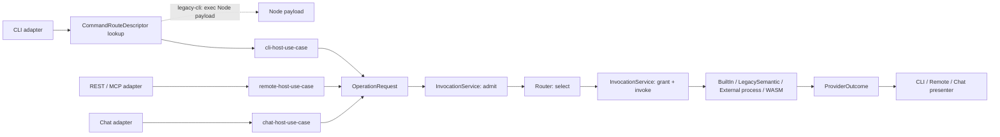

# Spec: Host Invocation

```txt
Document type: Area spec
Audience: Human reviewer, architect, maintainer, implementation agent
Purpose: State current and transition-state behavior for fgOS host invocation
Design status: Draft
Canonical: Yes, after review
Owner: Host invocation
Last reviewed: 2026-09-18
Related:
- docs/platform/host-invocation-routing/README.md
- docs/platform/host-invocation-routing/intent-preservation-ledger.md
- docs/platform/host-invocation-routing/verification/implementation-alignment.md
Implementation: R1/R2/R3 implemented preview plus partial route migration
Provenance: `docs/architect/host-invocation-routing` at `947dc310396071a4d530216d5c06d05993d63bf5`; `docs/platform/host-invocation-routing/spec.md` at `947dc310396071a4d530216d5c06d05993d63bf5`; `docs/architect/host-invocation-routing/host-invocation-provider-routing.md` at `947dc310396071a4d530216d5c06d05993d63bf5`
Writer type: Original writer attribution not recorded; retained source provenance
Canonical for: The stated document scope; source implementation limits remain explicit
Use this when: State current and transition-state behavior for fgOS host invocation
Do not use this for: Authority beyond the declared scope or implementation truth without the cited verification
Supersedes: The mapped source location; source provenance is retained
Superseded by: None recorded
```

Correction — checked route snapshot (2026-11-15): `packages/host-runtime/contracts/command-routes.json` has 80 selectors: 72 `legacy-cli` and eight native (`config`, `convention`, `friction`, `gate-bypass`, `identity`, `mailbox`, `metrics`, `version`). The two help selectors (`--help`, `-h`) are no longer routes: the host answers every help form before it reads the table. (`preflight` was retired on 2026-11-13.) This recount supersedes current-count wording; dated proof records remain historical.

## 1. Purpose

This spec separates what is current from what is accepted target, planned, legacy-current, superseded, or unknown for host invocation.

## 2. Current And Transition Status

| Concern | Status | Spec statement | Alignment |
| --- | --- | --- | --- |
| Existing Node CLI payload | `legacy-current` | Existing commands still run through the Node payload. `bin/fgos.mjs` remains in the source tree and must not be renamed or moved while the legacy payload exists. | [verification/implementation-alignment.md](verification/implementation-alignment.md#2-alignment-table) |
| Legacy Node payload identity | `accepted-not-implemented` target over `legacy-current` file | R1 names the payload `legacy-node` in the release manifest and locates it through `components.legacyNode.root` and `components.legacyNode.entry`. | [contracts/legacy-payload.md](contracts/legacy-payload.md) |
| Rust host code path | `implemented preview` | `apps/fgos` exists as a Rust CLI host, embeds `command-routes.json`, routes `version` natively to `distribution.build.show`, routes `gate-bypass` natively to `work.gate-bypass.show`, also routes `convention`, `metrics`, `friction`, `config`, `identity` and `mailbox` natively, answers every help form itself (`apps/fgos/src/help.rs`), and routes the remaining 72 selectors through `legacy-cli`. Packaging-distribution preview proof shows external/default installed `fgos` enters the Rust host. | [verification/r1-rust-host-proof.md](verification/r1-rust-host-proof.md) |
| Native invocation kernel | `current partial` | `packages/host-runtime/rust` implements `OperationId`, `OperationRequest`, `ProviderOutcome`, `OperationProvider`, pure router, registry snapshot, authority gates, and `InvocationService` for the current Rust-host slice. | [architecture/invocation-kernel.md](architecture/invocation-kernel.md) |
| Transitional `legacy-cli` route | `current partial` | `command-routes.json` currently contains 72 `legacy-cli` selectors, and `apps/fgos/src/legacy_exec.rs` resolves the legacy Node payload from release/dev manifest fields before spawning Node. | [architecture/legacy-cli-transition.md](architecture/legacy-cli-transition.md) |
| Native sub-verb of a `legacy-cli` selector (`native_subcommands`) | `implemented preview` | The registry `native` field (`true`, or a list of first positionals) is the one place "native" is declared and the route table derives from it. The `hook` selector stays `legacy-cli` and carries `native_subcommands: ["mailbox", "mailbox-sync"]`; the host runs a listed kind (`fgos hook mailbox`) natively in `apps/fgos/src/wiring/mailbox_hook.rs` before the composition root, and every other kind (`dispatch-decide`, `decision-question`, `main-checkout-delete-guard`) reaches the legacy-node payload unchanged. | [contracts/command-route-descriptor.md](contracts/command-route-descriptor.md), `apps/fgos/tests/mailbox_routes.rs` |
| Help | `implemented preview` | The host answers `fgos --help [<verb> [<sub>]] [--json]`, `fgos <verb> --help` and `-h` from the embedded `command-manifest.json` (generated from the registry) in `apps/fgos/src/help.rs`, for every route kind including native sub-verbs, with no Node process and no `fgos.v1` envelope. Help is not a route: the table has no help selector. `node bin/fgos.mjs --help` hands the call to the host (`runHostInherited`), or exits 4 with a pointer to the installed `fgos` when no host is found. | `apps/fgos/src/help.rs`, `test/rust-host/help-routes.test.mjs` |
| External process providers | `implemented preview` | R2 proves static manifest discovery, derived linker/registry, framed JSON-RPC-over-stdio component protocol, bounded supervision, fail-closed negative cases, and an end-to-end `fixture.echo.echo` invocation through `InvocationService`. | [verification/r2-external-process-proof.md](verification/r2-external-process-proof.md) |
| Production remote peer | `implemented preview` | `GET /v1/runtime` calls shared `InvocationService` directly through the remote projector/presenter for `distribution.build.show`, without `VerbGateway`, CLI shelling, Node spawn, or `fgos.v1` parsing. Other gateway routes remain legacy. | [verification/r3-remote-peer-proof.md](verification/r3-remote-peer-proof.md) |
| Chat peer | `planned` | Chat is a valid future host, but no current adapter or contract is claimed. | [architecture/host-use-cases.md](architecture/host-use-cases.md) |

## 3. Entry Paths

| Entry path | Status | Rule |
| --- | --- | --- |
| `node bin/fgos.mjs ...` | `legacy-current` | Valid for current Node payload behavior and Node payload tests. It is not the target public runtime entry after R1. It renders no help: an exact `--help` or `-h` token is forwarded to the host. |
| `apps/fgos` Rust host binary | `implemented preview` | Code, tests, and packaging-distribution preview release proof show the external/default installed `fgos` enters the Rust host. |
| `GET /v1/runtime` remote gateway route | `implemented preview` | Project-local gateway peer route for `distribution.build.show`; uses existing gateway auth and projects to `InvocationService` without CLI shelling or `fgos.v1` parsing. |
| chat adapter | `planned` | Future host surface after contracts exist. |

## 4. Native Invocation Contract Summary

Native host routes use the same shape:

```txt
HostInvocation + OperationRequest
  -> InvocationService
  -> Router.select
  -> selected-provider grant
  -> OperationProvider.invoke
  -> ProviderOutcome or ProviderError
  -> host presenter
```

This is implemented preview behavior for the native `version -> distribution.build.show` route, the native `gate-bypass -> work.gate-bypass.show` route, the R2 external process fixture, and the R3 `GET /v1/runtime` remote gateway route. Installed/default preview release proof is recorded in [verification/r1-rust-host-proof.md](verification/r1-rust-host-proof.md) and packaging-distribution proof docs.

## 5. Legacy Compatibility Rule

While a selector is `legacy-cli`, the Rust CLI adapter may recognize only the checked selector and must preserve provider-owned arguments as `OsString`. It must not parse provider-owned flags, mint implementation-shaped `legacy.<verb>` operation IDs, wrap legacy output in a second `fgos.v1` envelope, or route the invocation through `InvocationService`.

## 6. Unknowns

These are not missing migration work. They are deliberately preserved as `unknown` because the old sources left them undecided or because they require fresh implementation proof before the docs may label them current.

| Unknown | Kind | What is unclear | Blocking scope | Closure condition |
| --- | --- | --- | --- | --- |
| R1 command route matrix | Code-verified current snapshot | The checked-in route matrix exists: 80 selectors total, no help routes, 72 `legacy-cli` selectors and eight native selectors (`config`, `convention`, `friction`, `gate-bypass`, `identity`, `mailbox`, `metrics`, `version`); one `legacy-cli` selector, `hook`, declares `native_subcommands`. | Does not by itself prove installed-default release. | Keep `packages/host-runtime/contracts/command-routes.json` as the source snapshot and rerun drift tests when selectors change. |
| Preview vs stable default | Product / release decision | Preview public posture is approved; stable/default graduation remains undecided. | Blocks only stable/default graduation, not preview installed/default proof. | Release owner approves stable/default graduation after any additional release proof required. |
| Node fallback compatibility-window duration | Product / support decision | Explicit deprecated fallback escape hatch is approved for 30 calendar days after preview release publication. | Blocks only removal before the 30-day window closes, not Rust-host default preview posture. | Public preview tag `v0.1.0` was published on 2026-09-18; earliest removal for this preview release is 2026-10-18 unless a later release decision replaces that support promise. |
| Exact native descriptors beyond `distribution.build.show` | Code-verified current snapshot | Carriage note: the current native selector set is `convention`, `friction`, `gate-bypass`, `metrics`, `version`; `test.fixture.echo` remains a test fixture in the host-runtime catalog/provider. | Blocks only future expansion, not the current docs migration. | Reopen when another production native selector is proposed. |
| `gate-bypass` component ownership | Closed; local native proof implemented | Current code places gate-bypass read behavior in `src/state/gate-bypass.mjs`, exposes CLI descriptors in `src/cli/command-registry.mjs`, and setup/doctor config readiness in `src/setup/registrations.mjs`. The Rust route implements the read-only surface as `work.gate-bypass.show`, using existing work/state read ownership; setup/doctor config readiness remains Packaging-Distribution. | Does not prove full Work/State migration or installed-default release posture. | Keep `work.gate-bypass.show` as a local native read proof and record no component-boundary change. |
| First external provider preview set | Closed preview conformance decision | R2 selected the `fixture.echo.echo` provider and closed manifest, linker, frame codec, supervisor, and integration proof. | Blocks only future production ecosystem hardening, not R2 preview. | Keep [verification/r2-external-process-proof.md](verification/r2-external-process-proof.md) current when provider protocol behavior changes. |
| Chat host admission, interruption, and presentation semantics | Future host contract decision | Scan found no current chat host adapter implementation. Chat remains only a planned peer-host concept. | Blocks chat from being treated as more than planned/future. | A chat-host contract and proof plan are added before any chat host is called current. |

## 7. Component Boundary

No component-boundary change. This spec documents the existing Host And Surface Layer concern and links to [component-boundary.md](../component-boundary.md).

## 8. Related Files

| Relationship | File |
| --- | --- |
| area portal | [README.md](README.md) |
| vision | [vision.md](vision.md) |
| ledger | [intent-preservation-ledger.md](intent-preservation-ledger.md) |
| implementation alignment | [verification/implementation-alignment.md](verification/implementation-alignment.md) |
| command route contract | [contracts/command-route-descriptor.md](contracts/command-route-descriptor.md) |
| legacy payload contract | [contracts/legacy-payload.md](contracts/legacy-payload.md) |

## 9. Decision history

Settled by the Rust verb migration program, foundations step (plan `plans/261114-2051-rust-verb-migration-program/`, reports under its `reports/`). No decision number was minted: none of these is a locked platform law, and the holder table in [governance.md](../governance.md#decision-scope-to-holder-table) does not give this area a numbered narrative home.

- **2026-11-14: the help door moved into the host.** Extends `3a479738c`, which sent `--help` and `-h` to the legacy-node payload because the Node registry was then the only help source. The registry now generates a manifest (`packages/host-runtime/contracts/command-manifest.json`, one writer: `scripts/export-command-selectors.mjs`), the host embeds it and answers every help form with no Node process (`apps/fgos/src/help.rs`); the Node help renderer and its tests were deleted in the same change. The direct Node channel forwards an exact help token to the host and keeps the recursion guard in the environment: stripping it fork-bombed against the older installed release, which still forwards help to Node. One copy of "the verbs of the surface" remains on each side for the unknown-verb line, each from its own copy of the one registry; `test/rust-host/help-routes.test.mjs` guards the bytes.
- **2026-11-14: one declaration field says what is native.** The registry `native` field (`true`, or a list of first positionals) replaced `nativeOnly`, `native_kinds`, the help route and `HELP_SELECTORS`; the route table derives `route_kind` and `native_subcommands` from it, and the generator refuses any annotation field outside the closed list, so a retired name cannot return. The store declarations the shell reads (`store`, `mutates_store`, `lands_work`, `event_store_child`) travel in the same table as shape lists, matched by one reader over the shared rows of `test/rust-host/fixtures/store-declaration-vectors.json`. A selector that lands work may not be declared native (land release has no Rust owner yet).
- **2026-11-14: the invocation root and store admission are owned by Git.** Three directory walks became one (`packages/git/rust/src/invocation_root.rs`) and the admission rules became one (`store_admission.rs`); the host and the Node payload both ask it. Reasons and the accepted behaviour changes are in the Git spec decision history.
- **2026-11-15: the invocation-fault record and the argument parser stay twins until the Work step.** While both CLIs run, each side must judge a call without the other: Node reads and records a call of the 72 `legacy-cli` verbs, and must record a fault even when the host is unreachable (the Observe friction client does, after a failed `invokeHost`); the host reads a native call and records its own fault without starting Node. One owner is therefore not reachable until the last Node arm moves. Each twin has a vector file as its one contract, read by both sides: `test/rust-host/fixtures/parse-args-vectors.json` (`cli_args.rs` and `test/cli/parse-args-vectors.test.mjs`) and `test/rust-host/fixtures/invocation-fault-vectors.json` (`invocation_fault.rs` and `test/observe/invocation-fault-log.test.mjs`). Both carry a `retiredBy` row in the `doors` table; a verb that moves natively removes its own entry from the parse row's debt. Open owner question, not decided: whether native verbs keep reading `--dir=<path>` and other `--flag=value` spellings the Node parser does not know (kept for now as marked debt in `invocation_doors.rs`).
- **2026-11-15: Event Store maintain policy is owned by the Event Store, its config section by Config.** `packages/event-store/rust/src/lifecycle.rs` decides when to seal and publish; `fgos-config` module `event_store` holds the section's rules and defaults; Node `maintainEventStore`, `eventStoreConfig` and `readEventStoreConfig` are adapters. The host mailbox's sync-due stamp is a different job and stays separate. Detail in the Event Store and Config specs.
- **2026-11-15: the `doors` table is the one-door guard.** `docs/architecture-manifest.json` carries a `doors` table checked by `test/architecture.test.mjs`; it replaced the process-facts, YAML and holder-lock capability scans, and every door added by the program ends with a row (known leaks as `debt` with a reason). Described in [architecture-map.md](../architecture-map.md).

## Retained selected source material

Carriage note: the following is the pinned September design/migration source, not a fresh certification of current code, route counts, release posture or measured performance. Prior status labels remain dated provenance. Registered details split to their mapped owners are linked below; the separate restore notes state the checked implementation limits. Source: `docs/architect/host-invocation-routing/host-invocation-provider-routing.md` at `83d757f4d693ae13d3fd50e0a454fb95c78f1ff4`.

### Host Invocation And Provider Routing Architecture

**Status:** Vision / architecture advisory, not a locked platform law and not an implementation plan.
**Date:** 2026-09-10.
**Revised:** per architecture-review-260910-1537-host-invocation-provider-routing-design-review.md.
**Source:** Product-owner component-boundary and Node-to-Rust migration discussion.

This is the **kernel contract**: the permanent invocation/routing boundary every fgOS host uses, independent of transport (CLI, remote, chat) and provider mechanism (built-in, legacy Node, external process, WASM). Ecosystem plugin mechanics: [External Provider Protocol](architecture/external-provider-protocol.md). Transitional Node CLI lane: [Legacy CLI Transition](architecture/legacy-cli-transition.md). Both depend on this document. Migration staging and first proof: [Node To Rust Component Migration](architecture/node-to-rust-migration.md), [Rust Host And Proof Providers Implementation Plan](roadmap.md).

#### Historical Migration Status Note

Carriage note: superseded migration bookkeeping. The legacy source was
legacy-current during the 2026-09-14 promotion pass. That dated status applies
to the legacy input, not this document. The recorded platform entry is
[docs/platform/host-invocation-routing/README.md](README.md).
Its details are split across
[vision.md](vision.md),
[invocation-kernel.md](architecture/invocation-kernel.md),
[host-use-cases.md](architecture/host-use-cases.md),
[provider-routing.md](architecture/provider-routing.md),
and [contracts/](contracts/README.md).
See the [intent preservation ledger](intent-preservation-ledger.md)
for disposition by preserved claim.

#### 1. Architecture Name

Named **Host Invocation And Provider Routing**; central component the **Operation Provider Router**. `Component Router` is avoided — not every component is a dispatchable provider. `Command Router` is avoided — commands are only a CLI projection of semantic operations.

```txt
host invocation  -> a transport-specific host use case admits/normalizes a request
provider routing -> the Operation Provider Router selects an implementation
```

#### 2. Problem And Scope

fgOS has more than one entry surface (local CLI, remote REST/MCP, chat) that may request the same semantic operation but differ in parsing, auth context, streaming, and response projection. Provider choice is a separate dimension — built-in Rust, transitional legacy Node, external process, or WASM. Host transport and provider mechanism must not form a Cartesian product of special paths: one normalized invocation path, one provider router.

#### 3. Canonical Names

One name per concept; no alias appears anywhere in this document or its two companions.

| Name | What it is |
|---|---|
| `OperationId` | Stable semantic identifier, independent of CLI/REST/MCP spelling (§5). |
| `HostInvocation` | Host/caller context (identity, deadline, cancellation, tracing) admitted before routing (§5). |
| `OperationRequest` | `OperationId` + `ContractRef` + typed semantic input (§5). |
| `ContractRef` | `{id, version}` that always travels with a request/outcome (§5). |
| `ProviderOutcome` | Typed, `ContractRef`-identified result plus typed error, events, evidence, diagnostics (§5). |
| `ProviderError` | Closed failure family a provider call can terminate with (§7). |
| `OperationProvider` | Trait: `descriptor()` + `invoke(...)` (§6). |
| `ProviderDescriptor` | Identity, component class, mechanism, contract versions, allowed hosts/modes, capabilities, `lifecycle`, replacement, concurrency, health (§5). |
| `OperationDescriptor` | One catalog entry: operation id, owning component, contracts, effect, idempotency, authority policy, allowed hosts, streaming (§5). |
| `OperationCatalog` | Authority-bearing inventory of `OperationDescriptor`s, authored by owning components (§5). |
| `RegistrySnapshot` | Immutable linked provider registry for one invocation (§5, §6). |
| Router | Pure selection function: inputs -> one `ProviderDescriptor` or a refusal (§6). |
| `InvocationService` | Pipeline: admit -> select -> grant -> invoke -> normalize -> record (§6). |
| `InvocationControl` | Deadline, cancellation token, granted capabilities passed to a provider call (§6). |
| `EventSink` | Progress/event/diagnostic sink passed to a provider call (§6). |
| `CommandRouteDescriptor` | Per-CLI-selector `legacy-cli`/`native` record, owned by the CLI adapter — [Legacy CLI Transition](architecture/legacy-cli-transition.md). |
| `ConfigPort` | Port a provider receives resolved configuration/context through; never a second global file read (§5). |

#### 4. Peer Host Use Cases

`cli-host-use-case`, `remote-host-use-case`, and `chat-host-use-case` are peers; none wraps, shells out to, or calls through another.



The dashed lookup/direct-exec arrow to "Node payload" is the only non-`OperationRequest`/`ProviderOutcome` path and never touches `InvocationService` or the router — see "Transitional CLI Lane" below.

| Host use case | Owns | Never does |
|---|---|---|
| `cli-host-use-case` | CLI options; verb -> `OperationId`; terminal stdio; `fgos.v1`/exit-code presentation; `CommandRouteDescriptor` lookup. | Own an operation's implementation; define the plugin ABI. |
| `remote-host-use-case` | Remote caller context; REST/MCP method -> `OperationId`; deadlines/disconnect/stream lifecycle; response projection. | Invoke the CLI; parse argv; treat `fgos.v1`/HTTP as an internal API; spawn `bin/fgos.mjs`. |
| `chat-host-use-case` | Chat caller/session context; intent -> `OperationId`; clarification/progress/interruption; response projection. | Invoke the CLI/remote host; parse argv; treat `fgos.v1`/HTTP as an internal API. |

R3's remote peer is the project-local gateway (current herdr, same release) — §10 has the future shared-gateway constraint.

**Shared boundary:** all three projectors build the same `HostInvocation`/`OperationRequest` and call one `InvocationService` — deliberate reuse, not wrapping; presenters stay separate per transport. Peer status does not require one OS process — separate binaries each compose the same host-runtime crate rather than calling another host.

**Transitional CLI lane:** the legacy Node lane lives in the CLI adapter, not the kernel — the kernel has exactly one input/output pair. The CLI adapter looks up `CommandRouteDescriptor[selector]`: `legacy-cli` execs the Node payload directly (argv preserved, inherited stdin/cwd/env, signal forwarding, one invocation record) without building an `OperationRequest`; `native` builds one and calls `InvocationService`. Mechanics: [Legacy CLI Transition](architecture/legacy-cli-transition.md).

**Project root of a native verb (2026-11-09, moved to the Git door 2026-11-15).** The host no longer walks for the project itself. `apps/fgos/src/invocation_doors.rs` asks the one invocation-root door, `fgos_git::invocation_root` (`packages/git/rust/src/invocation_root.rs`), under the same policy as the Node payload (`caller-tree`: the nearest `.fgos` above the working directory, never above the Git top level of its checkout and never `<home>/.fgos`), then admits store access through `fgos_git::store_admission`. `--dir <path>` is the project as named and handed on as an absolute path (the home directory excepted: its `.fgos` is the machine's global directory, never a project store; an empty `--dir` is refused); finding no project refuses with `not inside an fgOS project` and the fix (run inside a project, pass `--dir`, or `fgctl init`), exit 1. Only the operations that read a project (observe, convention, config) consume the root, so identity, mailbox, version and gate-bypass run from anywhere. The eight native verbs named in `LENIENT_ROOT_VERBS` (debt, marked in code) keep answering from where they are called when the door refuses the root, because `apps/fgos/tests/mailbox_routes.rs` pins that behaviour for them; a verb is never added to the list. Proof: `invocation_root.rs` and `store_admission.rs` tests own the decisions, `invocation_doors.rs` tests own the order, one wiring test lives in `apps/fgos/tests/cli_tests.rs`.

**Project root of a Node-payload verb (2026-11-09, moved to the Git door 2026-11-15).** The legacy route resolves the project through one door, `resolveInvocationRoot` (`src/runner/paths.mjs`), now an adapter over the same `fgos_git::invocation_root` through the native addon, under a named policy: `caller-tree` (default: the nearest `.fgos` above the working directory, never above the Git top level of its checkout and never `<home>/.fgos`), `main-checkout` (setup, doctor, uninstall, git, unclaim, wire-agents, resync-worktree: the trusted main root of the repository, or the project `--dir` names), `main-checkout-only` (main-checkout-reset: as `main-checkout`, and a `--dir` must be that root) and `strict-cwd` (`init` only: the working directory itself, refused inside a repository unless it is the top level). From a subdirectory of a project a command reads that project's store, and `init` cannot create a phantom one. Store admission (`store-missing`, `disconnected-worktree-store`, `init-in-worktree`, `worktree-identity-unreadable`, the session-worktree rule) is likewise decided once, in `packages/git/rust/src/store_admission.rs`; `admitStoreAccess` in `src/runner/worktree.mjs` is its adapter. One fixture table, `test/rust-host/fixtures/invocation-root-table.json`, is read by `invocation_root.rs` tests (the owner), the identity crate's main root (`packages/identity/rust/tests/project.rs`) and the Node adapter (`test/rust-host/invocation-root-table.test.mjs`, the wiring proof); a row where they differ is fixed in the reader that is wrong. Install with no Git door (addon not shipped or loadable): the root adapter answers the named directory itself, the destructive policy refuses, and admission admits a store-less verb and refuses any other as `worktree-identity-unreadable`. Known debt, listed in the `doors` table: `packages/distribution/rust/src/workspace.rs`, `apps/fgos/src/wiring/mailbox_root.rs`, `src/util/host-bin-path.mjs` (no Git ceiling) and Node `isMainWorktree` still decide a root or a main checkout on their own.

**Arm rule of the Node payload (2026-11-13).** A non-Work arm of `bin/fgos.mjs` parses flags, builds the arguments of one call, calls one use case and prints; refusals, defaults, composition and exit decisions live in the layer that owns them, with their proof there (`setup` is `setupUseCase`, `wire-agents` is `wireAgentsUseCase`, `init` is `initStoreUseCase`, the Event Store lifecycle is one wrapper around the command, a hook kind has one verdict function behind one payload normalizer). `main()` names no verb: the root, store admission, lifecycle, fault record and exit code come from one door each, and a verb's facts (store need, sub-verbs, exit rule, child sealing) come from `COMMAND_REGISTRY`. The route table is read by tests, never edited around: 80 selectors (the two help selectors are gone since the host answers help), 72 `legacy-cli` and eight native. Settled by the HARDEN T9 phases (closing report `plans/reports/closing-261113-1947-harden-t9-host-surface.md`).

**Doors around a native call (2026-11-15).** A native verb runs inside the same doors in the same order as a Node arm: the call check (sub-command, then flags, read once with the Rust twin of the Node argument parser, `packages/host-runtime/rust/src/cli_args.rs`), the root, store admission, the Event Store start trigger for a dispatched worker, the invocation, the end trigger (`apps/fgos/src/invocation_doors.rs`, lane choice in `apps/fgos/src/routing.rs`). A malformed call (unknown flag, bad sub-command, refused root, admission class) is recorded through `fgos_observe::invocation_fault::record` before it is reported, and the `invocation fault recorded to <path>` line prints when a record landed. Which verbs take which door comes from the registry as data in the route table (`store`, `mutates_store`, `lands_work`, `event_store_child`), never from a second list in the host.

**The host verifies a release without a cache (2026-11-12, owner decision 81 Q4).** The host no longer hashes its own executable on every call and no longer reads the native addon twice; symlink, containment and missing-file checks still run on the running file, and stage, activation, `fgctl verify` and the launcher still hash it. Measured on the release host (`fgos --help` against the payload entry run directly, 15 interleaved runs, median): the host overhead fell from about 51 ms to about 32 ms (128.6 to 109.2 ms), a saving of about 19 ms. No fingerprint cache was added: the remaining 32 ms is the 25 MB still hashed plus the exec, and a cache would add a trust surface for a saving the owner did not ask for. The question is reopened only if a re-measure on a quiet machine still shows host overhead above 30 ms.

**`fgos preflight` is retired from the product CLI (2026-11-13, owner decision 81 Q1).** It ran `npm run build:skills` and two repository scripts in whatever directory it stood in (in a worktree it wrote `.fgos/instructions/effective/repo.json` and stuck the worktree), and nothing outside its own test called it. The checks belong to this repository, not to a product verb: `npm run check:before-merge` chains them. The verb answers "unknown verb" (exit 4) like any other.

#### 5. Core Contracts

The name table (§3) says what each type is; this adds the rules it has no room for.

**`OperationId`** — `<component>.<object-type>.<action>[.<variant>]`. `<component>` owns authority; `<object-type>` is singular (`work.item.list` still names `WorkItem`); `<action>` is a small verb set (`create`, `submit`, `show`, `claim`, `approve`, `run`, ...). E.g. `work.item.submit`, `distribution.build.show`. Each host owns its own projection — CLI verbs, REST paths, MCP names, chat intents are not `OperationId`s unless explicitly mapped; REST may keep plural URLs (`GET /work-items` -> `work.item.list`). Not suffixed for a compatible field addition (see versioning below).

**`HostInvocation`** — host kind is an **open string** (`"cli" | "remote" | "chat"`, not a closed enum every future host must exist in R1).

**`OperationRequest`** = `{ operation: OperationId, contract: ContractRef, input: Box<dyn Any + Send> }` — typed per contract; a built-in downcasts `input` directly, never through a decode step.

**No serialization for built-in providers** — the semantic contract is schema + version (`ContractRef`), but in-process representation is typed Rust through `OperationProvider`. `EncodedMessage` (contract id, version, content type, bytes) exists only at the external-process/WASM boundary ([External Provider Protocol](architecture/external-provider-protocol.md)), never as a kernel type. Raw `OsString` argv is never a semantic `OperationRequest` — it stays inside the CLI adapter's transitional lane.

**`ProviderOutcome`** — not a nested `fgos.v1` envelope or HTTP response; the presenter owns public projection; diagnostics travel through the trace/evidence sink, never silently on compatibility stdout/stderr. Human-in-the-loop rule: §8.

**`ProviderDescriptor` / `ConfigPort`** — `lifecycle` is `singleton | per-invocation | pooled`. Invocation mechanism is an **open string** (`"builtin" | "legacy-node" | "external-process" | "wasm"`), not a closed enum. `"legacy-node"` names `LegacySemanticProvider`: a normal `OperationProvider` whose implementation still calls an extracted Node use case, introduced per operation only when a non-CLI host needs it before the native provider exists ([Legacy CLI Transition](architecture/legacy-cli-transition.md) §1) — distinct from the CLI adapter's exec lane, which is not a provider at all. A provider receives resolved config/context through `ConfigPort` and never reads a second global config file itself.

**`OperationDescriptor` / `OperationCatalog`** — authored by owning components, never inferred from CLI commands or provider manifests. Fields: operation id, owning component id, request/outcome contracts, effect (`read | write | external`), idempotency (`none | keyed | safe`), authority policy id, allowed host kinds, streaming mode. The CLI command registry stays authority for CLI help/grammar and maps selectors into catalogued operations; a registry entry alone cannot create an operation. **R1 simplicity:** one native operation (`distribution.build.show`), so `OperationCatalog` is a `const` array and `RegistrySnapshot` is assembled once at the host's composition root (`apps/fgos`) from const tables via a pure `build_snapshot(catalog, providers, fingerprint)` — the kernel crate never depends on a provider crate, and there is no catalog system, linker, cache, or manifest scan in R1 (§10).


Carriage note: This retained detail comes from `docs/architect/host-invocation-routing/host-invocation-provider-routing.md` at `947dc310396071a4d530216d5c06d05993d63bf5`; see [Contract: Component Protocol](contracts/component-protocol.md#restored-contract-versioning).


#### 6. Router (Pure) And InvocationService (Pipeline)

**Router** — no I/O, no async, no invocation, no failure normalization, no reporting:

```txt
Router: (OperationId, request/outcome contract versions, host kind,
         invocation mode, project policy, RegistrySnapshot)
        -> Result<ProviderDescriptor, SelectionRefused>
```

It reads the `RegistrySnapshot`, matches operation/mode/host/compatible contract versions, applies an explicit binding or named replacement policy, and fails closed on ambiguity or incompatibility. It never parses CLI/HTTP input, admits, grants, holds domain policy, lets a provider reach another by recursively spawning `fgos`, or renders a response.

**`InvocationService`** owns the pipeline and is the only thing that invokes a provider:

```txt
received -> admit -> Router.select -> grant -> invoke(adapter)
         -> normalize transport failure -> record lifecycle
```

`admit`/`grant` are the two authority stages (§7); `invoke` calls the granted `OperationProvider` with deadline/cancellation/trace context; `normalize` maps adapter-specific transport failures onto the closed `ProviderError` families (§8) without changing semantic errors; `record` emits the lifecycle record (§8) and reports which provider/registry fingerprint served the call.

Numeric priority, registration order, and last-writer-wins are not selection policy — a binding names one provider, a replacement names the provider it replaces plus the authorizing policy; otherwise duplicates are ambiguous and linking fails. `RegistrySnapshot` is immutable per invocation: assembled once at the composition root from const tables in R1; from R2 a long-running host may build and atomically publish a new snapshot between invocations, never half-relinked.

```rust
pub trait OperationProvider: Send + Sync {
    fn descriptor(&self) -> &ProviderDescriptor;
    fn invoke<'a>(
        &'a self, invocation: &'a HostInvocation, request: OperationRequest,
        control: InvocationControl, events: &'a dyn EventSink,
    ) -> Pin<Box<dyn Future<Output = Result<ProviderOutcome, ProviderError>> + Send + 'a>>;
}
```

#### 7. Authority (Two-Stage)

Core operation/command namespaces are reserved; plugins add vendor-scoped operations (`acme.deploy.release`) and implement published extension points only; `.fgos` writes, Git mutation, process/network/secret access require explicit capability grants; unknown or ambiguous claims fail closed. **Configuration can never replace a built-in provider** — closed as "prohibit," not open. Rollback of a native operation in R1–R2 is a release rollback through `fgctl` (the previous release still ships both the native provider and the Node payload during the observation window), never a runtime provider-selection swap.

The provider manifest is never an authority source:

1. **Caller admission** (before routing): principal, operation, project policy, requested context, host surface.
2. **Selected-provider grant** (after routing): intersects the admitted action with the operation's capability policy and the provider's requested capabilities.

The provider receives only the resulting least-privilege grant via `InvocationControl`, identically for every host — a single pre-selection gate cannot evaluate the selected provider's identity, trust, or capability request.

Selecting a different provider never silently transfers authority — a replacement returns a result or proof; the existing authority owner still applies transitions and writes state, for built-in, legacy, and external providers alike. Work Lifecycle remains the only owner of Work transitions; Run Result Evaluation may compute confidence without choosing the next status; Dispatch may execute an approved assignment without inventing its operation; an external manifest claim never grants `.fgos`, Git, process, network, or secret access.

#### 8. Failure, Cancellation, Lifecycle, And Human Input

Closed failure families, common across every invocation mechanism:

- semantic validation, precondition, conflict, not-found;
- caller admission denied, selected-provider capability denied;
- no binding, ambiguous binding, incompatible contract;
- provider unavailable, protocol violation, provider crash;
- deadline exceeded, caller cancelled, completion unknown.

Each host presenter maps these onto its own contract (`fgos.v1`/exit codes, REST/MCP response, chat result); `InvocationService` preserves invocation/provider IDs so projections correlate without scraping output. Transport adapters never turn a provider crash into a semantic failure or infer success from partial output. A remote disconnect cancels through the same invocation context as a CLI interrupt; a crash never authorizes an automatic replay of a non-idempotent operation. The provider port is asynchronous from v1 — deadlines, cancellation, progress, and backpressure are already runtime requirements, so deferring async would change the ABI at the first real remote/process integration.


Carriage note: This retained detail comes from `docs/architect/host-invocation-routing/host-invocation-provider-routing.md` at `947dc310396071a4d530216d5c06d05993d63bf5`; see [Contract: Component Protocol](contracts/component-protocol.md#restored-lifecycle-state-chain-received-admitted-refused-selected-refused-granted-refused-dispatched-te).


Exactly one terminal record is emitted; `dispatched` is the point after which a transport loss may be completion-unknown, and a late response after cancellation/deadline is diagnostic evidence, not a second terminal truth. Records carry invocation/parent-correlation ID, contract versions, registry fingerprint, provider ID, host kind, timing, terminal family, evidence references — never secrets or capability material.


Carriage note: This retained detail comes from `docs/architect/host-invocation-routing/host-invocation-provider-routing.md` at `947dc310396071a4d530216d5c06d05993d63bf5`; see [Contract: Component Protocol](contracts/component-protocol.md#restored-contract-versioning).


**Human input:** a provider never blocks waiting for a person. It returns a `parked` `ProviderOutcome`; the host or work lifecycle re-invokes later. No provider is ever given a mid-invocation callback to solicit input.

#### 9. Physical Placement

The public command name stays `fgos` — runtime identity is the release digest, not the name, and every skill, hook, plugin, and Herdr call already targets `fgos <verb>`. `fgctl` is a separate bootstrap binary, not a renamed `fgos`. Crate names are kebab-case with an `fgos-` prefix; modules are snake_case.


Carriage note: This retained detail comes from `docs/architect/host-invocation-routing/host-invocation-provider-routing.md` at `947dc310396071a4d530216d5c06d05993d63bf5`; see [Architecture: Release Boundaries](architecture/release-boundaries.md#restored-physical-placement-layout-tree).


R1 is three crates: `fgos`, `fgos-host-runtime`, `fgos-distribution`. The legacy exec lane is a module inside `apps/fgos`, not a crate, because it is CLI-adapter-local (§4). `component-protocol` waits for R2 (only an external-process adapter needs `EncodedMessage`). Extract further crates only when pressure is real. Neither app owns provider selection; neither host use case imports another; every host feeds the shared authority/router/contracts layer, and provider adapters depend on component protocols, not host presentation. A component is not created merely because one proof verb is convenient (`gate-bypass` stays under its settled authority, not a manufactured `gate-policy` component).

Distribution selects and activates the trusted runtime (`fgctl`: acquire/stage/verify/activate/upgrade/rollback); host invocation routes inside the activated runtime. Packaging-distribution owns the onboarding command vocabulary: local `fgos init` adopts a workspace under the active identity on first use, `fgos doctor --fix` performs every later registered repair, and the target architecture has no separate `setup` verb. See [Runtime Identity And Activation](../packaging-distribution/architecture/runtime-identity-and-activation.md).

#### 10. Release Boundaries

| Release | Required architecture slice | Explicitly not a gate |
|---|---|---|
| R1 — distributable Rust CLI host | Invocation kernel; `const` `OperationCatalog` / `RegistrySnapshot` assembled once at the composition root; two-stage authority; transitional CLI lane in the CLI adapter; native `distribution.build.show`; `fgctl`-driven install/activate/rollback proof. | External ecosystem discovery, WASM, chat, production gateway migration, a `setup` verb. |
| R2 — external process preview | Process protocol, supervision, fixture conformance, static manifest validation; one-shot CLI loads the derived cache by fingerprint, rebuilds only on mismatch; explicit test/dev roots. | Core replacement, signatures/marketplace, WASM. |
| R3 — production remote peer | Remote projector/presenter, native route adoption, per-operation Node semantic bridge only where needed; remote peer is the **project-local gateway** (current herdr, same release) composing the host-runtime crate in-process. | Parsing CLI envelopes as internal API; a future **shared multi-project gateway**, which never links a project runtime in-process and instead reaches it through the out-of-process Project Runtime Adapter ([Future Constraints](../packaging-distribution/architecture/future-constraints.md) §2) — itself a `remote-host-use-case` adapter inside the project runtime. |

Chat is a valid future peer but does not gate R1/R2 until a real chat adapter and its admission/interruption/presentation contracts exist. "Ship the Rust host" means a reproducible artifact, target matrix, `fgctl` install/activation coverage, external-project install test, and named rollback channel — passing repository tests alone is a candidate, not a shipped host.

#### 11. Open Questions

1. Which fgOS-owned capabilities should ship as packaged extensions rather than core components?
2. What are the exact `OperationId` descriptors and CLI/REST/MCP projections for the first native operations?
3. Which extension points are public in the first ecosystem release?
4. Does a later protocol version add a local socket transport after framed stdio has production evidence?
5. What integrity/signature policy separates local development plugins from distributable ecosystem plugins?

Target matrix, install/upgrade mechanism, and R1 definition are owned by packaging — see [Runtime Identity And Activation](../packaging-distribution/architecture/runtime-identity-and-activation.md).

#### Related Documents

- [External Provider Protocol](architecture/external-provider-protocol.md)
- [Legacy CLI Transition](architecture/legacy-cli-transition.md)
- [Node To Rust Component Migration](architecture/node-to-rust-migration.md)
- [Rust Host And Proof Providers Implementation Plan](roadmap.md)
- [Component Boundary Advisory](../component-boundary.md)
- [Runtime Identity And Activation](../packaging-distribution/architecture/runtime-identity-and-activation.md)
