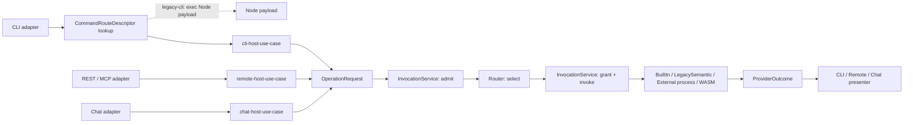
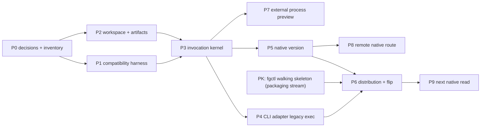

# Review pack: s3-host-invocation-checkpoint

Pack commit: 76353c58eb885becc550d734fde5d7c2709cce33

Pack id: 31d576a0a8e687a2268a6862cacb1b71d7ea0fb2a5426c12bfd7c7e6481d55a6

Author session: codex-session:1@2026-10-11

## claim_c44d8d3021e241465f869930b4b9aab8

Source: docs/architect/host-invocation-routing/documentation-standardization-plan.md#host-invocation-documentation-standardization-plan

Target: docs/platform/host-invocation-routing/history/documentation-migration/documentation-standardization-plan.md#unheaded-block-3

### Proposed decision

| Field | Value |
|---|---|
| claimId | claim\_c44d8d3021e241465f869930b4b9aab8 |
| sourceUnitDigest | a5469bceb71112e077f2a3eb604cb87f62cf6f05cf3ac70cdabae9da0b16ce66 |
| claimKind | architecture |
| kind | history |
| disposition | move |
| targetOwner | docs/platform/host-invocation-routing/history/documentation-migration/documentation-standardization-plan.md |
| targetAnchor | unheaded-block-3 |
| targetUnitDigest | 4c4592d8d6c543c821e98e0775441531fb404c40672ff478e1fd0bace722bb17 |
| targetAncestry | \["Retired Documentation Migration Plan","Preserved retired policy"\] |
| reviewStatus | pending |
| authoredBy | codex-session:1@2026-10-11 |
| rationale | Move the complete direct heading unit "# Host Invocation Documentation Standardization Plan" from docs/architect/host-invocation-routing/documentation-standardization-plan.md#host-invocation-documentation-standardization-plan to its frozen mapped owner docs/platform/host-invocation-routing/history/documentation-migration/documentation-standardization-plan.md#unheaded-block-3. Owner A8: retired area policy and migration plan, retained verbatim as non-authority history. The literal full-file carrier contains the entire source span; this is not current policy. Native counterpart class Judgment: no target digest match; independent full-text judgment remains required, not a script-proven approval. |

### Source unit

````text
# Host Invocation Documentation Standardization Plan

```txt
Document type: Migration plan
Audience: Human reviewer, architect, documentation agent, implementation agent
Purpose: Plan the rewrite of host-invocation docs into the new documentation system without losing settled legacy detail
Design status: Draft
Implementation: Not started
Provenance: Created from documentation-system discussion and scan of existing host-invocation / agent-coordination docs
Writer type: Human + agent coauthor
Canonical for: Planning the host-invocation documentation migration only
Use this when: Rewriting or reviewing host-invocation docs under the new docs/platform structure
Do not use this for: Current runtime behavior, accepted architecture authority, or implementation truth
Last reviewed: 2026-09-14
Related:
- docs/doc-governance.md
- docs/platform/README.md
- docs/platform/component-boundary.md
- docs/architect/host-invocation-routing/host-invocation-provider-routing.md
- docs/architect/agent-coordination/intent-preservation-ledger.md
```

This plan exists because the packaging-distribution rewrite exposed a real
failure mode: a new, clearer document shape can accidentally drop technical or
architectural details that were already settled in older docs.
````

### Target unit

`````text
````md
# Host Invocation Documentation Standardization Plan

```txt
Document type: Migration plan
Audience: Human reviewer, architect, documentation agent, implementation agent
Purpose: Plan the rewrite of host-invocation docs into the new documentation system without losing settled legacy detail
Design status: Draft
Implementation: Not started
Provenance: Created from documentation-system discussion and scan of existing host-invocation / agent-coordination docs
Writer type: Human + agent coauthor
Canonical for: Planning the host-invocation documentation migration only
Use this when: Rewriting or reviewing host-invocation docs under the new docs/platform structure
Do not use this for: Current runtime behavior, accepted architecture authority, or implementation truth
Last reviewed: 2026-09-14
Related:
- docs/doc-governance.md
- docs/platform/README.md
- docs/platform/component-boundary.md
- docs/architect/host-invocation-routing/host-invocation-provider-routing.md
- docs/architect/agent-coordination/intent-preservation-ledger.md
```

This plan exists because the packaging-distribution rewrite exposed a real
failure mode: a new, clearer document shape can accidentally drop technical or
architectural details that were already settled in older docs.

## Migration Status Note

This document is a legacy migration-plan source during the 2026-09-14 promotion
pass. The promoted platform area is
[docs/platform/host-invocation-routing/](../../platform/host-invocation-routing/README.md).
Use [source-inventory.md](../../platform/host-invocation-routing/history/source-inventory.md)
and [intent-preservation-ledger.md](../../platform/host-invocation-routing/intent-preservation-ledger.md)
to verify what moved where.

For host-invocation, the migration must preserve every settled claim before it
improves structure. New style is valuable only if it keeps old intent,
legacy/current distinctions, implementation status, and future accepted targets
visible.

## 1. Goal

Rewrite host-invocation documentation into the new documentation system while
preserving the full detail of the existing architecture documents.

The result should help a human reviewer and an agent answer:

- what host-invocation owns;
- how it differs from packaging-distribution, agent-coordination, gateway,
  dispatch, and work-state;
- what is current, legacy, accepted-not-implemented, planned, or superseded;
- which old details were promoted where;
- which legacy paths must continue to exist during the Node-to-Rust transition;
- which implementation proofs are needed before a claim is considered shipped.

## 2. Non-Goals

- Do not migrate implementation code.
- Do not decide new runtime architecture.
- Do not collapse host-invocation into packaging-distribution or
  agent-coordination.
- Do not delete old docs during the first rewrite pass.
- Do not convert advisory claims into implemented truth.
- Do not rewrite agent-coordination in the same pass; use it as the reference
  documentation pattern, then plan its own migration separately.

## 3. Hard Migration Rules

| Rule | Meaning |
|---|---|
| Preserve before polish | Every meaningful old claim gets a target, status, or explicit retirement note before prose is simplified. |
| Status is mandatory | Each claim is labeled as `implemented`, `partial`, `accepted-not-implemented`, `planned`, `legacy-current`, `superseded`, or `unknown`. |
| Legacy can remain live | A legacy path can be correct current behavior during transition. Do not hide it merely because the target architecture is cleaner. |
| Accepted-but-unbuilt is not current behavior | Accepted direction must be recorded as such, with implementation status and proof gap. |
| Old docs stay source material | Existing docs remain historical/current sources until redirected or drained. |
| No silent summarization | If a detail is omitted from the new docs, the migration ledger must say whether it was superseded, rejected, merged elsewhere, or intentionally deferred. |
| Component boundary check | Any ownership or layer change updates [component-boundary.md](../../platform/component-boundary.md) or records `No component-boundary change`. |
| Linkable graph | Related files must appear as clickable links in body sections, not only in fenced metadata. |
| H1 invariant | Each document has exactly one H1 title; sections start at H2. |

## 4. Source Inventory

### 4.1. Host-Invocation Sources

| Source | Current role | Must preserve |
|---|---|---|
| [host-invocation-provider-routing.md](host-invocation-provider-routing.md) | Main architecture / kernel contract | Operation Provider Router, peer host use cases, OperationRequest/ProviderOutcome boundary, OperationCatalog, RegistrySnapshot, two-stage authority, failure lifecycle, R1/R2/R3 release boundaries, open questions. |
| [external-provider-protocol.md](external-provider-protocol.md) | External provider / plugin protocol | Component class vs invocation mechanism, built-in/process/WASM distinctions, framed JSON-RPC over stdio, manifest discovery without execution, registry linker, namespace rules. |
| [legacy-cli-transition.md](legacy-cli-transition.md) | Transitional CLI lane | LegacyCliPassthroughProvider vs LegacySemanticProvider, Node payload identity, `CommandRouteDescriptor`, old path callers, parser ownership, `fgos.v1` presentation boundary, release rollback through `fgctl`. |
| [node-to-rust-component-migration.md](node-to-rust-component-migration.md) | Migration direction | Rust host first, Node as legacy payload, near/partly/not-thin candidates, R1/R2/R3 sequence, read-before-writer migration, writer gates, Node removal conditions. |
| [rust-cli-and-proof-components-plan.md](rust-cli-and-proof-components-plan.md) | Execution plan | P0-P9 delivery graph, compatibility harness, command-route descriptor proof, Rust workspace, external process preview, remote peer, performance gates, verification gates. |

### 4.2. Cross-Area Sources

| Source | Why it matters |
|---|---|
| [../../platform/intent-preservation-ledger.md](../../platform/intent-preservation-ledger.md) | Platform-level guardrail for preventing simplified implementation slices from becoming the accidental long-term direction. |
| [../../platform/component-boundary.md](../../platform/component-boundary.md) | Host-invocation is a platform component boundary; ownership changes must be reflected. |
| [../component-boundary/component-boundary-advisory.md](../component-boundary/component-boundary-advisory.md) | Current detailed component-boundary source during migration. |
| [../../platform/packaging-distribution/architecture/runtime-identity-and-activation.md](../../platform/packaging-distribution/architecture/runtime-identity-and-activation.md) | Packaging owns runtime identity, activation, release store, `fgctl`, rollback. Host-invocation consumes this; it must not redefine it. |
| [../../platform/packaging-distribution/architecture/future-constraints.md](../../platform/packaging-distribution/architecture/future-constraints.md) | Future shared gateway and Project Runtime Adapter constraints affect remote host shape. |
| [../../specs/runner.md](../../specs/runner.md) | Dispatch and runner vocabulary currently overlap with host-invocation concerns. |
| [../../routing-handoff-contract.md](../../routing-handoff-contract.md) | Agent-to-agent handoff and trust boundary may intersect host invocation and dispatch. |

### 4.3. Agent-Coordination Reference Pattern

Host-invocation should copy the documentation discipline from
agent-coordination, not necessarily its exact tree size.

| Reference | Pattern to reuse |
|---|---|
| [../agent-coordination/README.md](../agent-coordination/README.md) | Portal with current accepted baseline, active design frontier, invariants, maintenance rules. |
| [../agent-coordination/intent-preservation-ledger.md](../agent-coordination/intent-preservation-ledger.md) | Explicit preservation ledger for deferred/implemented/superseded/rejected intent. |
| [../agent-coordination/documentation-governance.md](../agent-coordination/documentation-governance.md) | Local doc-governance rules for a complex area. |
| [../agent-coordination/architecture/README.md](../agent-coordination/architecture/README.md) | Accepted architecture index separating accepted docs from proposals. |
| [../agent-coordination/contracts/README.md](../agent-coordination/contracts/README.md) | Contract index that prevents proposals from masquerading as accepted contracts. |
| [../agent-coordination/decisions/README.md](../agent-coordination/decisions/README.md) | Decision navigation and implementation notes. |
| [../agent-coordination/verification/README.md](../agent-coordination/verification/README.md) | Evidence/proof as first-class material, not hidden in prose. |

## 5. Target Structure

Create this target area only after the preservation ledger is drafted.

```txt
docs/platform/host-invocation-routing/
  README.md
  intent-preservation-ledger.md
  spec.md
  vision.md
  architecture/
    invocation-kernel.md
    host-use-cases.md
    provider-routing.md
    external-provider-protocol.md
    legacy-cli-transition.md
    node-to-rust-migration.md
    release-boundaries.md
  contracts/
    operation-catalog.md
    operation-provider.md
    operation-request-outcome.md
    command-route-descriptor.md
    legacy-payload.md
    external-provider-manifest.md
    component-protocol.md
  verification/
    implementation-alignment.md
    r1-rust-host-proof.md
    r2-external-process-proof.md
    r3-remote-peer-proof.md
    compatibility-harness.md
  decisions/
  history/
    host-invocation-baseline.md
```

This is a proposed target shape. It is not accepted merely because this plan
names it. The first migration pass may merge or split files if the ledger proves
a better shape.

## 6. Required Preservation Ledger

Before writing target docs, create
`docs/platform/host-invocation-routing/intent-preservation-ledger.md`.

Minimum ledger columns:

| Field | Meaning |
|---|---|
| `ID` | Stable `HI-I###` identifier. |
| `Claim / intent` | One preserved architectural or migration claim. |
| `Source` | Exact old file and section. |
| `Status` | `implemented`, `partial`, `accepted-not-implemented`, `planned`, `legacy-current`, `superseded`, `unknown`. |
| `Target doc` | New canonical destination. |
| `Must not lose` | Specific detail that must survive simplification. |
| `Proof / gap` | Evidence link or required verification. |

Initial ledger buckets:

| Bucket | Example details to preserve |
|---|---|
| Invocation kernel | `OperationId`, `HostInvocation`, `OperationRequest`, `ContractRef`, `ProviderOutcome`, `ProviderError`, `OperationProvider`, `ProviderDescriptor`, `OperationDescriptor`, `OperationCatalog`, `RegistrySnapshot`, `InvocationService`. |
| Host peer model | CLI, remote, and chat are peers; one does not wrap or shell through another after migration. |
| Transitional CLI lane | `legacy-cli` path bypasses `InvocationService`; native path builds `OperationRequest`. |
| Legacy payload identity | `legacy-node` identity; `bin/fgos.mjs` remains unmoved in source tree; release manifest locates payload. |
| Legacy adapter split | `LegacyCliPassthroughProvider` is CLI-only; `LegacySemanticProvider` is semantic and only introduced per operation when needed. |
| Authority | caller admission before routing, selected-provider grant after routing; provider manifests never grant authority. |
| External provider protocol | static manifest discovery, no code execution during discovery, framed protocol, handshake, cancellation/backpressure, completion-unknown behavior. |
| Provider replacement | configuration can never replace built-in providers; replacement policy must be explicit. |
| Presentation boundary | `fgos.v1`, HTTP, MCP, and chat results are presenter outputs, not provider outcomes. |
| Human input | providers return parked outcome; they never block waiting for a person. |
| R1/R2/R3 | Rust CLI host, external process preview, production remote peer; what each gates and does not gate. |
| Migration order | reads before writers, no write dual-run, Node removal only after zero remaining routes and replay compatibility. |
| Packaging dependency | `fgctl` owns acquire/stage/verify/activate/upgrade/rollback; host-invocation routes inside the active runtime. |

## 7. Target Document Responsibilities

| Target doc | Owns | Must not own |
|---|---|---|
| `README.md` | Area portal, read-first route, current baseline, status summary. | Deep contracts or long rationale. |
| `vision.md` | Durable direction: why host-invocation exists and how it supports peer hosts/provider routing. | Current detailed behavior or proof. |
| `spec.md` | Current behavior and migration state: what works today, what remains legacy, what is partial. | Future architecture not yet accepted. |
| `architecture/invocation-kernel.md` | Router/InvocationService shape, semantic request/outcome boundary, lifecycle. | External provider wire details. |
| `architecture/host-use-cases.md` | CLI/remote/chat peer model and presenter/projector separation. | Provider protocol internals. |
| `architecture/provider-routing.md` | Provider selection, registry snapshot, catalog ownership, authority gates. | Packaging acquisition/activation. |
| `architecture/external-provider-protocol.md` | External process/WASM provider architecture and registry linker. | Built-in provider semantics beyond shared contracts. |
| `architecture/legacy-cli-transition.md` | Transitional legacy CLI lane and Node payload bridge. | Long-term native provider behavior. |
| `architecture/node-to-rust-migration.md` | Migration sequence and coexistence rules. | Low-level proof checklist. |
| `contracts/*` | Normative schemas, obligations, compatibility and error rules. | Broad rationale. |
| `verification/*` | Evidence, test gates, proof gaps, implementation alignment. | New architecture claims. |
| `history/host-invocation-baseline.md` | Old source summary and supersession map. | Current authority. |

## 8. Migration Phases

### 8.1. Phase 0: Freeze The Baseline

1. Read every source in §4.
2. Generate a source inventory with file path, document role, status, and target
   destination.
3. Create the preservation ledger with all obvious `HI-I###` entries.
4. Mark unknown implementation status as `unknown`; do not guess.
5. Record `No component-boundary change` or update the boundary map if the new
   area/component naming changes.

Exit gate:

- No source document is unclassified.
- Every old doc has a migration disposition: promote, split, keep legacy,
  redirect, archive, or still-open.

### 8.2. Phase 1: Create Skeleton Without Rewriting Meaning

1. Create `docs/platform/host-invocation-routing/README.md`.
2. Create `intent-preservation-ledger.md`.
3. Create empty or stub target docs with metadata, H1 title, H2 sections, and
   linkable `Related Files`.
4. Add implementation-alignment tables before prose is filled in.
5. Link the area from [docs/platform/README.md](../../platform/README.md) only
   after the portal can route readers honestly.

Exit gate:

- A human can enter the new area and see what is canonical, legacy-current,
  draft, or not yet migrated.

### 8.3. Phase 2: Promote Current / Legacy-Current State

Write `spec.md` first.

It must explicitly separate:

| Status | Example |
|---|---|
| `current legacy behavior` | Existing Node CLI payload still handles most selectors. |
| `current partial target` | Any Rust host/runtime pieces already implemented. |
| `accepted-not-implemented` | Peer host model, provider router, external provider protocol pieces that are design direction but not shipped. |
| `planned` | R2/R3 or future chat/WASM/gateway work. |
| `superseded` | Any old transition notes no longer valid after packaging-distribution decisions. |

Exit gate:

- The new `spec.md` does not read like everything is already built.
- Legacy behavior is not hidden.

### 8.4. Phase 3: Promote Architecture

Promote architecture in this order:

1. invocation kernel;
2. host use cases;
3. provider routing and authority;
4. legacy CLI transition;
5. external provider protocol;
6. Node-to-Rust migration;
7. release boundaries.

For every promoted section, update the ledger row from `target pending` to
`promoted`, and link the exact target heading.

Exit gate:

- Every important claim from the old architecture docs appears either in a new
  architecture doc, in a contract, in verification, or in history with an
  explicit disposition.

### 8.5. Phase 4: Extract Contracts

Contracts should be written only after the architecture pass identifies what is
normative.

Minimum contracts:

- Operation catalog and operation id naming;
- Operation request/outcome and contract ref;
- Operation provider descriptor and invocation contract;
- Command route descriptor;
- Legacy payload identity and resolution;
- External provider manifest;
- Component protocol framing and lifecycle;
- Provider error families and invocation lifecycle records.

Exit gate:

- Contract docs avoid broad rationale and use normative language.
- Architecture docs link to contracts instead of duplicating schemas.

### 8.6. Phase 5: Verification And Implementation Alignment

Create verification docs before retiring old plans.

Minimum evidence surfaces:

- implementation alignment table;
- R1 Rust host proof gates;
- R2 external process proof gates;
- R3 remote peer proof gates;
- command-route descriptor / compatibility harness proof;
- legacy payload caller inventory;
- Node removal gate.

Exit gate:

- Every accepted target has an implementation status and proof/gap link.
- Every old execution-plan detail either remains in verification or is marked
  historical.

### 8.7. Phase 6: Redirect Or Retain Legacy Docs

After review:

1. Add status notes to old docs.
2. Convert old docs into historical source notes or redirect stubs.
3. Keep detailed old docs live if they still contain canonical detail not yet
   promoted.
4. Do not delete until the ledger says `drained`.

Exit gate:

- A reader opening an old path can tell whether it is current authority,
  migration source, or retired history.

## 9. Agent-Coordination Follow-Up

Agent-coordination is larger and already better organized than
host-invocation. Do not flatten it merely to match host-invocation.

After host-invocation proves the migration method, create a separate
agent-coordination standardization plan that:

- preserves the existing [intent-preservation-ledger.md](../agent-coordination/intent-preservation-ledger.md);
- maps accepted architecture/contracts/ADRs/verification into
  `docs/platform/agent-coordination/`;
- keeps proposals and playbooks explicitly non-canonical;
- preserves implementation records and verification proof trees;
- avoids promoting Step 09 / Step 10 proposals into accepted contracts before
  review;
- maintains the existing distinction between foundation identity, protocol
  model, runtime model, work integration, dispatch, evidence, visibility, and
  recovery proposals.

The important lesson is reusable: each area needs an intent-preservation ledger
before prose cleanup.

## 10. Review Checklist

Before approving the rewritten host-invocation docs, answer:

1. Does every source in §4 have a disposition?
2. Does every `HI-I###` ledger entry point to a target doc or explicit
   deferred/superseded decision?
3. Can a reader distinguish current shipped behavior from accepted target
   architecture?
4. Are legacy paths called legacy while still allowed to remain live?
5. Are accepted-but-unbuilt claims marked with implementation gaps?
6. Are packaging-distribution and host-invocation boundaries clear?
7. Are agent-coordination, dispatch, gateway, and work-state boundaries clear?
8. Are related files linkable?
9. Does every document have exactly one H1 title and H2+ sections?
10. Did the rewrite update or explicitly not change the component-boundary map?

## 11. Open Questions

| Question | Needed before |
|---|---|
| Is `host-invocation` the final area name, or should it be `host-runtime`, `invocation-routing`, or another name? | Creating target directory. |
| Should the preservation ledger live permanently, or drain into history after migration? | Phase 6. |
| Which host-invocation claims are already implemented in current Rust/distribution code? | Phase 2 implementation alignment. |
| Does `rust-cli-and-proof-components-plan.md` stay as a plan, become verification history, or split into multiple verification docs? | Phase 5. |
| Which old docs should remain as compatibility references during the Node transition? | Phase 6. |

## 12. Related Files

| Relationship | File |
|---|---|
| governs documentation system | [../../doc-governance.md](../../doc-governance.md) |
| platform portal | [../../platform/README.md](../../platform/README.md) |
| platform intent ledger | [../../platform/intent-preservation-ledger.md](../../platform/intent-preservation-ledger.md) |
| component-boundary anchor | [../../platform/component-boundary.md](../../platform/component-boundary.md) |
| main old host-invocation architecture | [host-invocation-provider-routing.md](host-invocation-provider-routing.md) |
| external provider source | [external-provider-protocol.md](external-provider-protocol.md) |
| legacy CLI transition source | [legacy-cli-transition.md](legacy-cli-transition.md) |
| node-to-rust migration source | [node-to-rust-component-migration.md](node-to-rust-component-migration.md) |
| implementation plan source | [rust-cli-and-proof-components-plan.md](rust-cli-and-proof-components-plan.md) |
| agent-coordination preservation pattern | [../agent-coordination/intent-preservation-ledger.md](../agent-coordination/intent-preservation-ledger.md) |
````
`````

### Unified diff

`````diff
--- "docs/architect/host-invocation-routing/documentation-standardization-plan.md#host-invocation-documentation-standardization-plan"
+++ "docs/platform/host-invocation-routing/history/documentation-migration/documentation-standardization-plan.md#unheaded-block-3"
@@ -1,3 +1,4 @@
+````md
 # Host Invocation Documentation Standardization Plan
 
 ```txt
@@ -22,4 +23,384 @@ Related:
 
 This plan exists because the packaging-distribution rewrite exposed a real
 failure mode: a new, clearer document shape can accidentally drop technical or
-architectural details that were already settled in older docs.
\ No newline at end of file
+architectural details that were already settled in older docs.
+
+## Migration Status Note
+
+This document is a legacy migration-plan source during the 2026-09-14 promotion
+pass. The promoted platform area is
+[docs/platform/host-invocation-routing/](../../platform/host-invocation-routing/README.md).
+Use [source-inventory.md](../../platform/host-invocation-routing/history/source-inventory.md)
+and [intent-preservation-ledger.md](../../platform/host-invocation-routing/intent-preservation-ledger.md)
+to verify what moved where.
+
+For host-invocation, the migration must preserve every settled claim before it
+improves structure. New style is valuable only if it keeps old intent,
+legacy/current distinctions, implementation status, and future accepted targets
+visible.
+
+## 1. Goal
+
+Rewrite host-invocation documentation into the new documentation system while
+preserving the full detail of the existing architecture documents.
+
+The result should help a human reviewer and an agent answer:
+
+- what host-invocation owns;
+- how it differs from packaging-distribution, agent-coordination, gateway,
+  dispatch, and work-state;
+- what is current, legacy, accepted-not-implemented, planned, or superseded;
+- which old details were promoted where;
+- which legacy paths must continue to exist during the Node-to-Rust transition;
+- which implementation proofs are needed before a claim is considered shipped.
+
+## 2. Non-Goals
+
+- Do not migrate implementation code.
+- Do not decide new runtime architecture.
+- Do not collapse host-invocation into packaging-distribution or
+  agent-coordination.
+- Do not delete old docs during the first rewrite pass.
+- Do not convert advisory claims into implemented truth.
+- Do not rewrite agent-coordination in the same pass; use it as the reference
+  documentation pattern, then plan its own migration separately.
+
+## 3. Hard Migration Rules
+
+| Rule | Meaning |
+|---|---|
+| Preserve before polish | Every meaningful old claim gets a target, status, or explicit retirement note before prose is simplified. |
+| Status is mandatory | Each claim is labeled as `implemented`, `partial`, `accepted-not-implemented`, `planned`, `legacy-current`, `superseded`, or `unknown`. |
+| Legacy can remain live | A legacy path can be correct current behavior during transition. Do not hide it merely because the target architecture is cleaner. |
+| Accepted-but-unbuilt is not current behavior | Accepted direction must be recorded as such, with implementation status and proof gap. |
+| Old docs stay source material | Existing docs remain historical/current sources until redirected or drained. |
+| No silent summarization | If a detail is omitted from the new docs, the migration ledger must say whether it was superseded, rejected, merged elsewhere, or intentionally deferred. |
+| Component boundary check | Any ownership or layer change updates [component-boundary.md](../../platform/component-boundary.md) or records `No component-boundary change`. |
+| Linkable graph | Related files must appear as clickable links in body sections, not only in fenced metadata. |
+| H1 invariant | Each document has exactly one H1 title; sections start at H2. |
+
+## 4. Source Inventory
+
+### 4.1. Host-Invocation Sources
+
+| Source | Current role | Must preserve |
+|---|---|---|
+| [host-invocation-provider-routing.md](host-invocation-provider-routing.md) | Main architecture / kernel contract | Operation Provider Router, peer host use cases, OperationRequest/ProviderOutcome boundary, OperationCatalog, RegistrySnapshot, two-stage authority, failure lifecycle, R1/R2/R3 release boundaries, open questions. |
+| [external-provider-protocol.md](external-provider-protocol.md) | External provider / plugin protocol | Component class vs invocation mechanism, built-in/process/WASM distinctions, framed JSON-RPC over stdio, manifest discovery without execution, registry linker, namespace rules. |
+| [legacy-cli-transition.md](legacy-cli-transition.md) | Transitional CLI lane | LegacyCliPassthroughProvider vs LegacySemanticProvider, Node payload identity, `CommandRouteDescriptor`, old path callers, parser ownership, `fgos.v1` presentation boundary, release rollback through `fgctl`. |
+| [node-to-rust-component-migration.md](node-to-rust-component-migration.md) | Migration direction | Rust host first, Node as legacy payload, near/partly/not-thin candidates, R1/R2/R3 sequence, read-before-writer migration, writer gates, Node removal conditions. |
+| [rust-cli-and-proof-components-plan.md](rust-cli-and-proof-components-plan.md) | Execution plan | P0-P9 delivery graph, compatibility harness, command-route descriptor proof, Rust workspace, external process preview, remote peer, performance gates, verification gates. |
+
+### 4.2. Cross-Area Sources
+
+| Source | Why it matters |
+|---|---|
+| [../../platform/intent-preservation-ledger.md](../../platform/intent-preservation-ledger.md) | Platform-level guardrail for preventing simplified implementation slices from becoming the accidental long-term direction. |
+| [../../platform/component-boundary.md](../../platform/component-boundary.md) | Host-invocation is a platform component boundary; ownership changes must be reflected. |
+| [../component-boundary/component-boundary-advisory.md](../component-boundary/component-boundary-advisory.md) | Current detailed component-boundary source during migration. |
+| [../../platform/packaging-distribution/architecture/runtime-identity-and-activation.md](../../platform/packaging-distribution/architecture/runtime-identity-and-activation.md) | Packaging owns runtime identity, activation, release store, `fgctl`, rollback. Host-invocation consumes this; it must not redefine it. |
+| [../../platform/packaging-distribution/architecture/future-constraints.md](../../platform/packaging-distribution/architecture/future-constraints.md) | Future shared gateway and Project Runtime Adapter constraints affect remote host shape. |
+| [../../specs/runner.md](../../specs/runner.md) | Dispatch and runner vocabulary currently overlap with host-invocation concerns. |
+| [../../routing-handoff-contract.md](../../routing-handoff-contract.md) | Agent-to-agent handoff and trust boundary may intersect host invocation and dispatch. |
+
+### 4.3. Agent-Coordination Reference Pattern
+
+Host-invocation should copy the documentation discipline from
+agent-coordination, not necessarily its exact tree size.
+
+| Reference | Pattern to reuse |
+|---|---|
+| [../agent-coordination/README.md](../agent-coordination/README.md) | Portal with current accepted baseline, active design frontier, invariants, maintenance rules. |
+| [../agent-coordination/intent-preservation-ledger.md](../agent-coordination/intent-preservation-ledger.md) | Explicit preservation ledger for deferred/implemented/superseded/rejected intent. |
+| [../agent-coordination/documentation-governance.md](../agent-coordination/documentation-governance.md) | Local doc-governance rules for a complex area. |
+| [../agent-coordination/architecture/README.md](../agent-coordination/architecture/README.md) | Accepted architecture index separating accepted docs from proposals. |
+| [../agent-coordination/contracts/README.md](../agent-coordination/contracts/README.md) | Contract index that prevents proposals from masquerading as accepted contracts. |
+| [../agent-coordination/decisions/README.md](../agent-coordination/decisions/README.md) | Decision navigation and implementation notes. |
+| [../agent-coordination/verification/README.md](../agent-coordination/verification/README.md) | Evidence/proof as first-class material, not hidden in prose. |
+
+## 5. Target Structure
+
+Create this target area only after the preservation ledger is drafted.
+
+```txt
+docs/platform/host-invocation-routing/
+  README.md
+  intent-preservation-ledger.md
+  spec.md
+  vision.md
+  architecture/
+    invocation-kernel.md
+    host-use-cases.md
+    provider-routing.md
+    external-provider-protocol.md
+    legacy-cli-transition.md
+    node-to-rust-migration.md
+    release-boundaries.md
+  contracts/
+    operation-catalog.md
+    operation-provider.md
+    operation-request-outcome.md
+    command-route-descriptor.md
+    legacy-payload.md
+    external-provider-manifest.md
+    component-protocol.md
+  verification/
+    implementation-alignment.md
+    r1-rust-host-proof.md
+    r2-external-process-proof.md
+    r3-remote-peer-proof.md
+    compatibility-harness.md
+  decisions/
+  history/
+    host-invocation-baseline.md
+```
+
+This is a proposed target shape. It is not accepted merely because this plan
+names it. The first migration pass may merge or split files if the ledger proves
+a better shape.
+
+## 6. Required Preservation Ledger
+
+Before writing target docs, create
+`docs/platform/host-invocation-routing/intent-preservation-ledger.md`.
+
+Minimum ledger columns:
+
+| Field | Meaning |
+|---|---|
+| `ID` | Stable `HI-I###` identifier. |
+| `Claim / intent` | One preserved architectural or migration claim. |
+| `Source` | Exact old file and section. |
+| `Status` | `implemented`, `partial`, `accepted-not-implemented`, `planned`, `legacy-current`, `superseded`, `unknown`. |
+| `Target doc` | New canonical destination. |
+| `Must not lose` | Specific detail that must survive simplification. |
+| `Proof / gap` | Evidence link or required verification. |
+
+Initial ledger buckets:
+
+| Bucket | Example details to preserve |
+|---|---|
+| Invocation kernel | `OperationId`, `HostInvocation`, `OperationRequest`, `ContractRef`, `ProviderOutcome`, `ProviderError`, `OperationProvider`, `ProviderDescriptor`, `OperationDescriptor`, `OperationCatalog`, `RegistrySnapshot`, `InvocationService`. |
+| Host peer model | CLI, remote, and chat are peers; one does not wrap or shell through another after migration. |
+| Transitional CLI lane | `legacy-cli` path bypasses `InvocationService`; native path builds `OperationRequest`. |
+| Legacy payload identity | `legacy-node` identity; `bin/fgos.mjs` remains unmoved in source tree; release manifest locates payload. |
+| Legacy adapter split | `LegacyCliPassthroughProvider` is CLI-only; `LegacySemanticProvider` is semantic and only introduced per operation when needed. |
+| Authority | caller admission before routing, selected-provider grant after routing; provider manifests never grant authority. |
+| External provider protocol | static manifest discovery, no code execution during discovery, framed protocol, handshake, cancellation/backpressure, completion-unknown behavior. |
+| Provider replacement | configuration can never replace built-in providers; replacement policy must be explicit. |
+| Presentation boundary | `fgos.v1`, HTTP, MCP, and chat results are presenter outputs, not provider outcomes. |
+| Human input | providers return parked outcome; they never block waiting for a person. |
+| R1/R2/R3 | Rust CLI host, external process preview, production remote peer; what each gates and does not gate. |
+| Migration order | reads before writers, no write dual-run, Node removal only after zero remaining routes and replay compatibility. |
+| Packaging dependency | `fgctl` owns acquire/stage/verify/activate/upgrade/rollback; host-invocation routes inside the active runtime. |
+
+## 7. Target Document Responsibilities
+
+| Target doc | Owns | Must not own |
+|---|---|---|
+| `README.md` | Area portal, read-first route, current baseline, status summary. | Deep contracts or long rationale. |
+| `vision.md` | Durable direction: why host-invocation exists and how it supports peer hosts/provider routing. | Current detailed behavior or proof. |
+| `spec.md` | Current behavior and migration state: what works today, what remains legacy, what is partial. | Future architecture not yet accepted. |
+| `architecture/invocation-kernel.md` | Router/InvocationService shape, semantic request/outcome boundary, lifecycle. | External provider wire details. |
+| `architecture/host-use-cases.md` | CLI/remote/chat peer model and presenter/projector separation. | Provider protocol internals. |
+| `architecture/provider-routing.md` | Provider selection, registry snapshot, catalog ownership, authority gates. | Packaging acquisition/activation. |
+| `architecture/external-provider-protocol.md` | External process/WASM provider architecture and registry linker. | Built-in provider semantics beyond shared contracts. |
+| `architecture/legacy-cli-transition.md` | Transitional legacy CLI lane and Node payload bridge. | Long-term native provider behavior. |
+| `architecture/node-to-rust-migration.md` | Migration sequence and coexistence rules. | Low-level proof checklist. |
+| `contracts/*` | Normative schemas, obligations, compatibility and error rules. | Broad rationale. |
+| `verification/*` | Evidence, test gates, proof gaps, implementation alignment. | New architecture claims. |
+| `history/host-invocation-baseline.md` | Old source summary and supersession map. | Current authority. |
+
+## 8. Migration Phases
+
+### 8.1. Phase 0: Freeze The Baseline
+
+1. Read every source in §4.
+2. Generate a source inventory with file path, document role, status, and target
+   destination.
+3. Create the preservation ledger with all obvious `HI-I###` entries.
+4. Mark unknown implementation status as `unknown`; do not guess.
+5. Record `No component-boundary change` or update the boundary map if the new
+   area/component naming changes.
+
+Exit gate:
+
+- No source document is unclassified.
+- Every old doc has a migration disposition: promote, split, keep legacy,
+  redirect, archive, or still-open.
+
+### 8.2. Phase 1: Create Skeleton Without Rewriting Meaning
+
+1. Create `docs/platform/host-invocation-routing/README.md`.
+2. Create `intent-preservation-ledger.md`.
+3. Create empty or stub target docs with metadata, H1 title, H2 sections, and
+   linkable `Related Files`.
+4. Add implementation-alignment tables before prose is filled in.
+5. Link the area from [docs/platform/README.md](../../platform/README.md) only
+   after the portal can route readers honestly.
+
+Exit gate:
+
+- A human can enter the new area and see what is canonical, legacy-current,
+  draft, or not yet migrated.
+
+### 8.3. Phase 2: Promote Current / Legacy-Current State
+
+Write `spec.md` first.
+
+It must explicitly separate:
+
+| Status | Example |
+|---|---|
+| `current legacy behavior` | Existing Node CLI payload still handles most selectors. |
+| `current partial target` | Any Rust host/runtime pieces already implemented. |
+| `accepted-not-implemented` | Peer host model, provider router, external provider protocol pieces that are design direction but not shipped. |
+| `planned` | R2/R3 or future chat/WASM/gateway work. |
+| `superseded` | Any old transition notes no longer valid after packaging-distribution decisions. |
+
+Exit gate:
+
+- The new `spec.md` does not read like everything is already built.
+- Legacy behavior is not hidden.
+
+### 8.4. Phase 3: Promote Architecture
+
+Promote architecture in this order:
+
+1. invocation kernel;
+2. host use cases;
+3. provider routing and authority;
+4. legacy CLI transition;
+5. external provider protocol;
+6. Node-to-Rust migration;
+7. release boundaries.
+
+For every promoted section, update the ledger row from `target pending` to
+`promoted`, and link the exact target heading.
+
+Exit gate:
+
+- Every important claim from the old architecture docs appears either in a new
+  architecture doc, in a contract, in verification, or in history with an
+  explicit disposition.
+
+### 8.5. Phase 4: Extract Contracts
+
+Contracts should be written only after the architecture pass identifies what is
+normative.
+
+Minimum contracts:
+
+- Operation catalog and operation id naming;
+- Operation request/outcome and contract ref;
+- Operation provider descriptor and invocation contract;
+- Command route descriptor;
+- Legacy payload identity and resolution;
+- External provider manifest;
+- Component protocol framing and lifecycle;
+- Provider error families and invocation lifecycle records.
+
+Exit gate:
+
+- Contract docs avoid broad rationale and use normative language.
+- Architecture docs link to contracts instead of duplicating schemas.
+
+### 8.6. Phase 5: Verification And Implementation Alignment
+
+Create verification docs before retiring old plans.
+
+Minimum evidence surfaces:
+
+- implementation alignment table;
+- R1 Rust host proof gates;
+- R2 external process proof gates;
+- R3 remote peer proof gates;
+- command-route descriptor / compatibility harness proof;
+- legacy payload caller inventory;
+- Node removal gate.
+
+Exit gate:
+
+- Every accepted target has an implementation status and proof/gap link.
+- Every old execution-plan detail either remains in verification or is marked
+  historical.
+
+### 8.7. Phase 6: Redirect Or Retain Legacy Docs
+
+After review:
+
+1. Add status notes to old docs.
+2. Convert old docs into historical source notes or redirect stubs.
+3. Keep detailed old docs live if they still contain canonical detail not yet
+   promoted.
+4. Do not delete until the ledger says `drained`.
+
+Exit gate:
+
+- A reader opening an old path can tell whether it is current authority,
+  migration source, or retired history.
+
+## 9. Agent-Coordination Follow-Up
+
+Agent-coordination is larger and already better organized than
+host-invocation. Do not flatten it merely to match host-invocation.
+
+After host-invocation proves the migration method, create a separate
+agent-coordination standardization plan that:
+
+- preserves the existing [intent-preservation-ledger.md](../agent-coordination/intent-preservation-ledger.md);
+- maps accepted architecture/contracts/ADRs/verification into
+  `docs/platform/agent-coordination/`;
+- keeps proposals and playbooks explicitly non-canonical;
+- preserves implementation records and verification proof trees;
+- avoids promoting Step 09 / Step 10 proposals into accepted contracts before
+  review;
+- maintains the existing distinction between foundation identity, protocol
+  model, runtime model, work integration, dispatch, evidence, visibility, and
+  recovery proposals.
+
+The important lesson is reusable: each area needs an intent-preservation ledger
+before prose cleanup.
+
+## 10. Review Checklist
+
+Before approving the rewritten host-invocation docs, answer:
+
+1. Does every source in §4 have a disposition?
+2. Does every `HI-I###` ledger entry point to a target doc or explicit
+   deferred/superseded decision?
+3. Can a reader distinguish current shipped behavior from accepted target
+   architecture?
+4. Are legacy paths called legacy while still allowed to remain live?
+5. Are accepted-but-unbuilt claims marked with implementation gaps?
+6. Are packaging-distribution and host-invocation boundaries clear?
+7. Are agent-coordination, dispatch, gateway, and work-state boundaries clear?
+8. Are related files linkable?
+9. Does every document have exactly one H1 title and H2+ sections?
+10. Did the rewrite update or explicitly not change the component-boundary map?
+
+## 11. Open Questions
+
+| Question | Needed before |
+|---|---|
+| Is `host-invocation` the final area name, or should it be `host-runtime`, `invocation-routing`, or another name? | Creating target directory. |
+| Should the preservation ledger live permanently, or drain into history after migration? | Phase 6. |
+| Which host-invocation claims are already implemented in current Rust/distribution code? | Phase 2 implementation alignment. |
+| Does `rust-cli-and-proof-components-plan.md` stay as a plan, become verification history, or split into multiple verification docs? | Phase 5. |
+| Which old docs should remain as compatibility references during the Node transition? | Phase 6. |
+
+## 12. Related Files
+
+| Relationship | File |
+|---|---|
+| governs documentation system | [../../doc-governance.md](../../doc-governance.md) |
+| platform portal | [../../platform/README.md](../../platform/README.md) |
+| platform intent ledger | [../../platform/intent-preservation-ledger.md](../../platform/intent-preservation-ledger.md) |
+| component-boundary anchor | [../../platform/component-boundary.md](../../platform/component-boundary.md) |
+| main old host-invocation architecture | [host-invocation-provider-routing.md](host-invocation-provider-routing.md) |
+| external provider source | [external-provider-protocol.md](external-provider-protocol.md) |
+| legacy CLI transition source | [legacy-cli-transition.md](legacy-cli-transition.md) |
+| node-to-rust migration source | [node-to-rust-component-migration.md](node-to-rust-component-migration.md) |
+| implementation plan source | [rust-cli-and-proof-components-plan.md](rust-cli-and-proof-components-plan.md) |
+| agent-coordination preservation pattern | [../agent-coordination/intent-preservation-ledger.md](../agent-coordination/intent-preservation-ledger.md) |
+````
\ No newline at end of file
`````

## claim_7c54af89d90e049b48b8790fd9632d12

Source: docs/architect/host-invocation-routing/documentation-standardization-plan.md#unheaded-block-1

Target: docs/platform/host-invocation-routing/history/documentation-migration/documentation-standardization-plan.md#unheaded-block-3

### Proposed decision

| Field | Value |
|---|---|
| claimId | claim\_7c54af89d90e049b48b8790fd9632d12 |
| sourceUnitDigest | 7085816e2b2ae42f8622be1184f7a993c05da4cdb240bd092f4befa68d682a15 |
| claimKind | architecture |
| kind | history |
| disposition | move |
| targetOwner | docs/platform/host-invocation-routing/history/documentation-migration/documentation-standardization-plan.md |
| targetAnchor | unheaded-block-3 |
| targetUnitDigest | 4c4592d8d6c543c821e98e0775441531fb404c40672ff478e1fd0bace722bb17 |
| targetAncestry | \["Retired Documentation Migration Plan","Preserved retired policy"\] |
| reviewStatus | pending |
| authoredBy | codex-session:1@2026-10-11 |
| rationale | Move the complete direct unheaded-block unit "\`\`\`txt Document type: Migration plan Audience: Human reviewer, architect, documentation agent, implementation agent Purpose: Plan the rewrite of host-invocation docs into" from docs/architect/host-invocation-routing/documentation-standardization-plan.md#unheaded-block-1 to its frozen mapped owner docs/platform/host-invocation-routing/history/documentation-migration/documentation-standardization-plan.md#unheaded-block-3. Owner A8: retired area policy and migration plan, retained verbatim as non-authority history. The literal full-file carrier contains the entire source span; this is not current policy. Native counterpart class Judgment: no target digest match; independent full-text judgment remains required, not a script-proven approval. |

### Source unit

````text
```txt
Document type: Migration plan
Audience: Human reviewer, architect, documentation agent, implementation agent
Purpose: Plan the rewrite of host-invocation docs into the new documentation system without losing settled legacy detail
Design status: Draft
Implementation: Not started
Provenance: Created from documentation-system discussion and scan of existing host-invocation / agent-coordination docs
Writer type: Human + agent coauthor
Canonical for: Planning the host-invocation documentation migration only
Use this when: Rewriting or reviewing host-invocation docs under the new docs/platform structure
Do not use this for: Current runtime behavior, accepted architecture authority, or implementation truth
Last reviewed: 2026-09-14
Related:
- docs/doc-governance.md
- docs/platform/README.md
- docs/platform/component-boundary.md
- docs/architect/host-invocation-routing/host-invocation-provider-routing.md
- docs/architect/agent-coordination/intent-preservation-ledger.md
```
````

### Target unit

`````text
````md
# Host Invocation Documentation Standardization Plan

```txt
Document type: Migration plan
Audience: Human reviewer, architect, documentation agent, implementation agent
Purpose: Plan the rewrite of host-invocation docs into the new documentation system without losing settled legacy detail
Design status: Draft
Implementation: Not started
Provenance: Created from documentation-system discussion and scan of existing host-invocation / agent-coordination docs
Writer type: Human + agent coauthor
Canonical for: Planning the host-invocation documentation migration only
Use this when: Rewriting or reviewing host-invocation docs under the new docs/platform structure
Do not use this for: Current runtime behavior, accepted architecture authority, or implementation truth
Last reviewed: 2026-09-14
Related:
- docs/doc-governance.md
- docs/platform/README.md
- docs/platform/component-boundary.md
- docs/architect/host-invocation-routing/host-invocation-provider-routing.md
- docs/architect/agent-coordination/intent-preservation-ledger.md
```

This plan exists because the packaging-distribution rewrite exposed a real
failure mode: a new, clearer document shape can accidentally drop technical or
architectural details that were already settled in older docs.

## Migration Status Note

This document is a legacy migration-plan source during the 2026-09-14 promotion
pass. The promoted platform area is
[docs/platform/host-invocation-routing/](../../platform/host-invocation-routing/README.md).
Use [source-inventory.md](../../platform/host-invocation-routing/history/source-inventory.md)
and [intent-preservation-ledger.md](../../platform/host-invocation-routing/intent-preservation-ledger.md)
to verify what moved where.

For host-invocation, the migration must preserve every settled claim before it
improves structure. New style is valuable only if it keeps old intent,
legacy/current distinctions, implementation status, and future accepted targets
visible.

## 1. Goal

Rewrite host-invocation documentation into the new documentation system while
preserving the full detail of the existing architecture documents.

The result should help a human reviewer and an agent answer:

- what host-invocation owns;
- how it differs from packaging-distribution, agent-coordination, gateway,
  dispatch, and work-state;
- what is current, legacy, accepted-not-implemented, planned, or superseded;
- which old details were promoted where;
- which legacy paths must continue to exist during the Node-to-Rust transition;
- which implementation proofs are needed before a claim is considered shipped.

## 2. Non-Goals

- Do not migrate implementation code.
- Do not decide new runtime architecture.
- Do not collapse host-invocation into packaging-distribution or
  agent-coordination.
- Do not delete old docs during the first rewrite pass.
- Do not convert advisory claims into implemented truth.
- Do not rewrite agent-coordination in the same pass; use it as the reference
  documentation pattern, then plan its own migration separately.

## 3. Hard Migration Rules

| Rule | Meaning |
|---|---|
| Preserve before polish | Every meaningful old claim gets a target, status, or explicit retirement note before prose is simplified. |
| Status is mandatory | Each claim is labeled as `implemented`, `partial`, `accepted-not-implemented`, `planned`, `legacy-current`, `superseded`, or `unknown`. |
| Legacy can remain live | A legacy path can be correct current behavior during transition. Do not hide it merely because the target architecture is cleaner. |
| Accepted-but-unbuilt is not current behavior | Accepted direction must be recorded as such, with implementation status and proof gap. |
| Old docs stay source material | Existing docs remain historical/current sources until redirected or drained. |
| No silent summarization | If a detail is omitted from the new docs, the migration ledger must say whether it was superseded, rejected, merged elsewhere, or intentionally deferred. |
| Component boundary check | Any ownership or layer change updates [component-boundary.md](../../platform/component-boundary.md) or records `No component-boundary change`. |
| Linkable graph | Related files must appear as clickable links in body sections, not only in fenced metadata. |
| H1 invariant | Each document has exactly one H1 title; sections start at H2. |

## 4. Source Inventory

### 4.1. Host-Invocation Sources

| Source | Current role | Must preserve |
|---|---|---|
| [host-invocation-provider-routing.md](host-invocation-provider-routing.md) | Main architecture / kernel contract | Operation Provider Router, peer host use cases, OperationRequest/ProviderOutcome boundary, OperationCatalog, RegistrySnapshot, two-stage authority, failure lifecycle, R1/R2/R3 release boundaries, open questions. |
| [external-provider-protocol.md](external-provider-protocol.md) | External provider / plugin protocol | Component class vs invocation mechanism, built-in/process/WASM distinctions, framed JSON-RPC over stdio, manifest discovery without execution, registry linker, namespace rules. |
| [legacy-cli-transition.md](legacy-cli-transition.md) | Transitional CLI lane | LegacyCliPassthroughProvider vs LegacySemanticProvider, Node payload identity, `CommandRouteDescriptor`, old path callers, parser ownership, `fgos.v1` presentation boundary, release rollback through `fgctl`. |
| [node-to-rust-component-migration.md](node-to-rust-component-migration.md) | Migration direction | Rust host first, Node as legacy payload, near/partly/not-thin candidates, R1/R2/R3 sequence, read-before-writer migration, writer gates, Node removal conditions. |
| [rust-cli-and-proof-components-plan.md](rust-cli-and-proof-components-plan.md) | Execution plan | P0-P9 delivery graph, compatibility harness, command-route descriptor proof, Rust workspace, external process preview, remote peer, performance gates, verification gates. |

### 4.2. Cross-Area Sources

| Source | Why it matters |
|---|---|
| [../../platform/intent-preservation-ledger.md](../../platform/intent-preservation-ledger.md) | Platform-level guardrail for preventing simplified implementation slices from becoming the accidental long-term direction. |
| [../../platform/component-boundary.md](../../platform/component-boundary.md) | Host-invocation is a platform component boundary; ownership changes must be reflected. |
| [../component-boundary/component-boundary-advisory.md](../component-boundary/component-boundary-advisory.md) | Current detailed component-boundary source during migration. |
| [../../platform/packaging-distribution/architecture/runtime-identity-and-activation.md](../../platform/packaging-distribution/architecture/runtime-identity-and-activation.md) | Packaging owns runtime identity, activation, release store, `fgctl`, rollback. Host-invocation consumes this; it must not redefine it. |
| [../../platform/packaging-distribution/architecture/future-constraints.md](../../platform/packaging-distribution/architecture/future-constraints.md) | Future shared gateway and Project Runtime Adapter constraints affect remote host shape. |
| [../../specs/runner.md](../../specs/runner.md) | Dispatch and runner vocabulary currently overlap with host-invocation concerns. |
| [../../routing-handoff-contract.md](../../routing-handoff-contract.md) | Agent-to-agent handoff and trust boundary may intersect host invocation and dispatch. |

### 4.3. Agent-Coordination Reference Pattern

Host-invocation should copy the documentation discipline from
agent-coordination, not necessarily its exact tree size.

| Reference | Pattern to reuse |
|---|---|
| [../agent-coordination/README.md](../agent-coordination/README.md) | Portal with current accepted baseline, active design frontier, invariants, maintenance rules. |
| [../agent-coordination/intent-preservation-ledger.md](../agent-coordination/intent-preservation-ledger.md) | Explicit preservation ledger for deferred/implemented/superseded/rejected intent. |
| [../agent-coordination/documentation-governance.md](../agent-coordination/documentation-governance.md) | Local doc-governance rules for a complex area. |
| [../agent-coordination/architecture/README.md](../agent-coordination/architecture/README.md) | Accepted architecture index separating accepted docs from proposals. |
| [../agent-coordination/contracts/README.md](../agent-coordination/contracts/README.md) | Contract index that prevents proposals from masquerading as accepted contracts. |
| [../agent-coordination/decisions/README.md](../agent-coordination/decisions/README.md) | Decision navigation and implementation notes. |
| [../agent-coordination/verification/README.md](../agent-coordination/verification/README.md) | Evidence/proof as first-class material, not hidden in prose. |

## 5. Target Structure

Create this target area only after the preservation ledger is drafted.

```txt
docs/platform/host-invocation-routing/
  README.md
  intent-preservation-ledger.md
  spec.md
  vision.md
  architecture/
    invocation-kernel.md
    host-use-cases.md
    provider-routing.md
    external-provider-protocol.md
    legacy-cli-transition.md
    node-to-rust-migration.md
    release-boundaries.md
  contracts/
    operation-catalog.md
    operation-provider.md
    operation-request-outcome.md
    command-route-descriptor.md
    legacy-payload.md
    external-provider-manifest.md
    component-protocol.md
  verification/
    implementation-alignment.md
    r1-rust-host-proof.md
    r2-external-process-proof.md
    r3-remote-peer-proof.md
    compatibility-harness.md
  decisions/
  history/
    host-invocation-baseline.md
```

This is a proposed target shape. It is not accepted merely because this plan
names it. The first migration pass may merge or split files if the ledger proves
a better shape.

## 6. Required Preservation Ledger

Before writing target docs, create
`docs/platform/host-invocation-routing/intent-preservation-ledger.md`.

Minimum ledger columns:

| Field | Meaning |
|---|---|
| `ID` | Stable `HI-I###` identifier. |
| `Claim / intent` | One preserved architectural or migration claim. |
| `Source` | Exact old file and section. |
| `Status` | `implemented`, `partial`, `accepted-not-implemented`, `planned`, `legacy-current`, `superseded`, `unknown`. |
| `Target doc` | New canonical destination. |
| `Must not lose` | Specific detail that must survive simplification. |
| `Proof / gap` | Evidence link or required verification. |

Initial ledger buckets:

| Bucket | Example details to preserve |
|---|---|
| Invocation kernel | `OperationId`, `HostInvocation`, `OperationRequest`, `ContractRef`, `ProviderOutcome`, `ProviderError`, `OperationProvider`, `ProviderDescriptor`, `OperationDescriptor`, `OperationCatalog`, `RegistrySnapshot`, `InvocationService`. |
| Host peer model | CLI, remote, and chat are peers; one does not wrap or shell through another after migration. |
| Transitional CLI lane | `legacy-cli` path bypasses `InvocationService`; native path builds `OperationRequest`. |
| Legacy payload identity | `legacy-node` identity; `bin/fgos.mjs` remains unmoved in source tree; release manifest locates payload. |
| Legacy adapter split | `LegacyCliPassthroughProvider` is CLI-only; `LegacySemanticProvider` is semantic and only introduced per operation when needed. |
| Authority | caller admission before routing, selected-provider grant after routing; provider manifests never grant authority. |
| External provider protocol | static manifest discovery, no code execution during discovery, framed protocol, handshake, cancellation/backpressure, completion-unknown behavior. |
| Provider replacement | configuration can never replace built-in providers; replacement policy must be explicit. |
| Presentation boundary | `fgos.v1`, HTTP, MCP, and chat results are presenter outputs, not provider outcomes. |
| Human input | providers return parked outcome; they never block waiting for a person. |
| R1/R2/R3 | Rust CLI host, external process preview, production remote peer; what each gates and does not gate. |
| Migration order | reads before writers, no write dual-run, Node removal only after zero remaining routes and replay compatibility. |
| Packaging dependency | `fgctl` owns acquire/stage/verify/activate/upgrade/rollback; host-invocation routes inside the active runtime. |

## 7. Target Document Responsibilities

| Target doc | Owns | Must not own |
|---|---|---|
| `README.md` | Area portal, read-first route, current baseline, status summary. | Deep contracts or long rationale. |
| `vision.md` | Durable direction: why host-invocation exists and how it supports peer hosts/provider routing. | Current detailed behavior or proof. |
| `spec.md` | Current behavior and migration state: what works today, what remains legacy, what is partial. | Future architecture not yet accepted. |
| `architecture/invocation-kernel.md` | Router/InvocationService shape, semantic request/outcome boundary, lifecycle. | External provider wire details. |
| `architecture/host-use-cases.md` | CLI/remote/chat peer model and presenter/projector separation. | Provider protocol internals. |
| `architecture/provider-routing.md` | Provider selection, registry snapshot, catalog ownership, authority gates. | Packaging acquisition/activation. |
| `architecture/external-provider-protocol.md` | External process/WASM provider architecture and registry linker. | Built-in provider semantics beyond shared contracts. |
| `architecture/legacy-cli-transition.md` | Transitional legacy CLI lane and Node payload bridge. | Long-term native provider behavior. |
| `architecture/node-to-rust-migration.md` | Migration sequence and coexistence rules. | Low-level proof checklist. |
| `contracts/*` | Normative schemas, obligations, compatibility and error rules. | Broad rationale. |
| `verification/*` | Evidence, test gates, proof gaps, implementation alignment. | New architecture claims. |
| `history/host-invocation-baseline.md` | Old source summary and supersession map. | Current authority. |

## 8. Migration Phases

### 8.1. Phase 0: Freeze The Baseline

1. Read every source in §4.
2. Generate a source inventory with file path, document role, status, and target
   destination.
3. Create the preservation ledger with all obvious `HI-I###` entries.
4. Mark unknown implementation status as `unknown`; do not guess.
5. Record `No component-boundary change` or update the boundary map if the new
   area/component naming changes.

Exit gate:

- No source document is unclassified.
- Every old doc has a migration disposition: promote, split, keep legacy,
  redirect, archive, or still-open.

### 8.2. Phase 1: Create Skeleton Without Rewriting Meaning

1. Create `docs/platform/host-invocation-routing/README.md`.
2. Create `intent-preservation-ledger.md`.
3. Create empty or stub target docs with metadata, H1 title, H2 sections, and
   linkable `Related Files`.
4. Add implementation-alignment tables before prose is filled in.
5. Link the area from [docs/platform/README.md](../../platform/README.md) only
   after the portal can route readers honestly.

Exit gate:

- A human can enter the new area and see what is canonical, legacy-current,
  draft, or not yet migrated.

### 8.3. Phase 2: Promote Current / Legacy-Current State

Write `spec.md` first.

It must explicitly separate:

| Status | Example |
|---|---|
| `current legacy behavior` | Existing Node CLI payload still handles most selectors. |
| `current partial target` | Any Rust host/runtime pieces already implemented. |
| `accepted-not-implemented` | Peer host model, provider router, external provider protocol pieces that are design direction but not shipped. |
| `planned` | R2/R3 or future chat/WASM/gateway work. |
| `superseded` | Any old transition notes no longer valid after packaging-distribution decisions. |

Exit gate:

- The new `spec.md` does not read like everything is already built.
- Legacy behavior is not hidden.

### 8.4. Phase 3: Promote Architecture

Promote architecture in this order:

1. invocation kernel;
2. host use cases;
3. provider routing and authority;
4. legacy CLI transition;
5. external provider protocol;
6. Node-to-Rust migration;
7. release boundaries.

For every promoted section, update the ledger row from `target pending` to
`promoted`, and link the exact target heading.

Exit gate:

- Every important claim from the old architecture docs appears either in a new
  architecture doc, in a contract, in verification, or in history with an
  explicit disposition.

### 8.5. Phase 4: Extract Contracts

Contracts should be written only after the architecture pass identifies what is
normative.

Minimum contracts:

- Operation catalog and operation id naming;
- Operation request/outcome and contract ref;
- Operation provider descriptor and invocation contract;
- Command route descriptor;
- Legacy payload identity and resolution;
- External provider manifest;
- Component protocol framing and lifecycle;
- Provider error families and invocation lifecycle records.

Exit gate:

- Contract docs avoid broad rationale and use normative language.
- Architecture docs link to contracts instead of duplicating schemas.

### 8.6. Phase 5: Verification And Implementation Alignment

Create verification docs before retiring old plans.

Minimum evidence surfaces:

- implementation alignment table;
- R1 Rust host proof gates;
- R2 external process proof gates;
- R3 remote peer proof gates;
- command-route descriptor / compatibility harness proof;
- legacy payload caller inventory;
- Node removal gate.

Exit gate:

- Every accepted target has an implementation status and proof/gap link.
- Every old execution-plan detail either remains in verification or is marked
  historical.

### 8.7. Phase 6: Redirect Or Retain Legacy Docs

After review:

1. Add status notes to old docs.
2. Convert old docs into historical source notes or redirect stubs.
3. Keep detailed old docs live if they still contain canonical detail not yet
   promoted.
4. Do not delete until the ledger says `drained`.

Exit gate:

- A reader opening an old path can tell whether it is current authority,
  migration source, or retired history.

## 9. Agent-Coordination Follow-Up

Agent-coordination is larger and already better organized than
host-invocation. Do not flatten it merely to match host-invocation.

After host-invocation proves the migration method, create a separate
agent-coordination standardization plan that:

- preserves the existing [intent-preservation-ledger.md](../agent-coordination/intent-preservation-ledger.md);
- maps accepted architecture/contracts/ADRs/verification into
  `docs/platform/agent-coordination/`;
- keeps proposals and playbooks explicitly non-canonical;
- preserves implementation records and verification proof trees;
- avoids promoting Step 09 / Step 10 proposals into accepted contracts before
  review;
- maintains the existing distinction between foundation identity, protocol
  model, runtime model, work integration, dispatch, evidence, visibility, and
  recovery proposals.

The important lesson is reusable: each area needs an intent-preservation ledger
before prose cleanup.

## 10. Review Checklist

Before approving the rewritten host-invocation docs, answer:

1. Does every source in §4 have a disposition?
2. Does every `HI-I###` ledger entry point to a target doc or explicit
   deferred/superseded decision?
3. Can a reader distinguish current shipped behavior from accepted target
   architecture?
4. Are legacy paths called legacy while still allowed to remain live?
5. Are accepted-but-unbuilt claims marked with implementation gaps?
6. Are packaging-distribution and host-invocation boundaries clear?
7. Are agent-coordination, dispatch, gateway, and work-state boundaries clear?
8. Are related files linkable?
9. Does every document have exactly one H1 title and H2+ sections?
10. Did the rewrite update or explicitly not change the component-boundary map?

## 11. Open Questions

| Question | Needed before |
|---|---|
| Is `host-invocation` the final area name, or should it be `host-runtime`, `invocation-routing`, or another name? | Creating target directory. |
| Should the preservation ledger live permanently, or drain into history after migration? | Phase 6. |
| Which host-invocation claims are already implemented in current Rust/distribution code? | Phase 2 implementation alignment. |
| Does `rust-cli-and-proof-components-plan.md` stay as a plan, become verification history, or split into multiple verification docs? | Phase 5. |
| Which old docs should remain as compatibility references during the Node transition? | Phase 6. |

## 12. Related Files

| Relationship | File |
|---|---|
| governs documentation system | [../../doc-governance.md](../../doc-governance.md) |
| platform portal | [../../platform/README.md](../../platform/README.md) |
| platform intent ledger | [../../platform/intent-preservation-ledger.md](../../platform/intent-preservation-ledger.md) |
| component-boundary anchor | [../../platform/component-boundary.md](../../platform/component-boundary.md) |
| main old host-invocation architecture | [host-invocation-provider-routing.md](host-invocation-provider-routing.md) |
| external provider source | [external-provider-protocol.md](external-provider-protocol.md) |
| legacy CLI transition source | [legacy-cli-transition.md](legacy-cli-transition.md) |
| node-to-rust migration source | [node-to-rust-component-migration.md](node-to-rust-component-migration.md) |
| implementation plan source | [rust-cli-and-proof-components-plan.md](rust-cli-and-proof-components-plan.md) |
| agent-coordination preservation pattern | [../agent-coordination/intent-preservation-ledger.md](../agent-coordination/intent-preservation-ledger.md) |
````
`````

### Unified diff

`````diff
--- "docs/architect/host-invocation-routing/documentation-standardization-plan.md#unheaded-block-1"
+++ "docs/platform/host-invocation-routing/history/documentation-migration/documentation-standardization-plan.md#unheaded-block-3"
@@ -1,3 +1,6 @@
+````md
+# Host Invocation Documentation Standardization Plan
+
 ```txt
 Document type: Migration plan
 Audience: Human reviewer, architect, documentation agent, implementation agent
@@ -16,4 +19,388 @@ Related:
 - docs/platform/component-boundary.md
 - docs/architect/host-invocation-routing/host-invocation-provider-routing.md
 - docs/architect/agent-coordination/intent-preservation-ledger.md
-```
\ No newline at end of file
+```
+
+This plan exists because the packaging-distribution rewrite exposed a real
+failure mode: a new, clearer document shape can accidentally drop technical or
+architectural details that were already settled in older docs.
+
+## Migration Status Note
+
+This document is a legacy migration-plan source during the 2026-09-14 promotion
+pass. The promoted platform area is
+[docs/platform/host-invocation-routing/](../../platform/host-invocation-routing/README.md).
+Use [source-inventory.md](../../platform/host-invocation-routing/history/source-inventory.md)
+and [intent-preservation-ledger.md](../../platform/host-invocation-routing/intent-preservation-ledger.md)
+to verify what moved where.
+
+For host-invocation, the migration must preserve every settled claim before it
+improves structure. New style is valuable only if it keeps old intent,
+legacy/current distinctions, implementation status, and future accepted targets
+visible.
+
+## 1. Goal
+
+Rewrite host-invocation documentation into the new documentation system while
+preserving the full detail of the existing architecture documents.
+
+The result should help a human reviewer and an agent answer:
+
+- what host-invocation owns;
+- how it differs from packaging-distribution, agent-coordination, gateway,
+  dispatch, and work-state;
+- what is current, legacy, accepted-not-implemented, planned, or superseded;
+- which old details were promoted where;
+- which legacy paths must continue to exist during the Node-to-Rust transition;
+- which implementation proofs are needed before a claim is considered shipped.
+
+## 2. Non-Goals
+
+- Do not migrate implementation code.
+- Do not decide new runtime architecture.
+- Do not collapse host-invocation into packaging-distribution or
+  agent-coordination.
+- Do not delete old docs during the first rewrite pass.
+- Do not convert advisory claims into implemented truth.
+- Do not rewrite agent-coordination in the same pass; use it as the reference
+  documentation pattern, then plan its own migration separately.
+
+## 3. Hard Migration Rules
+
+| Rule | Meaning |
+|---|---|
+| Preserve before polish | Every meaningful old claim gets a target, status, or explicit retirement note before prose is simplified. |
+| Status is mandatory | Each claim is labeled as `implemented`, `partial`, `accepted-not-implemented`, `planned`, `legacy-current`, `superseded`, or `unknown`. |
+| Legacy can remain live | A legacy path can be correct current behavior during transition. Do not hide it merely because the target architecture is cleaner. |
+| Accepted-but-unbuilt is not current behavior | Accepted direction must be recorded as such, with implementation status and proof gap. |
+| Old docs stay source material | Existing docs remain historical/current sources until redirected or drained. |
+| No silent summarization | If a detail is omitted from the new docs, the migration ledger must say whether it was superseded, rejected, merged elsewhere, or intentionally deferred. |
+| Component boundary check | Any ownership or layer change updates [component-boundary.md](../../platform/component-boundary.md) or records `No component-boundary change`. |
+| Linkable graph | Related files must appear as clickable links in body sections, not only in fenced metadata. |
+| H1 invariant | Each document has exactly one H1 title; sections start at H2. |
+
+## 4. Source Inventory
+
+### 4.1. Host-Invocation Sources
+
+| Source | Current role | Must preserve |
+|---|---|---|
+| [host-invocation-provider-routing.md](host-invocation-provider-routing.md) | Main architecture / kernel contract | Operation Provider Router, peer host use cases, OperationRequest/ProviderOutcome boundary, OperationCatalog, RegistrySnapshot, two-stage authority, failure lifecycle, R1/R2/R3 release boundaries, open questions. |
+| [external-provider-protocol.md](external-provider-protocol.md) | External provider / plugin protocol | Component class vs invocation mechanism, built-in/process/WASM distinctions, framed JSON-RPC over stdio, manifest discovery without execution, registry linker, namespace rules. |
+| [legacy-cli-transition.md](legacy-cli-transition.md) | Transitional CLI lane | LegacyCliPassthroughProvider vs LegacySemanticProvider, Node payload identity, `CommandRouteDescriptor`, old path callers, parser ownership, `fgos.v1` presentation boundary, release rollback through `fgctl`. |
+| [node-to-rust-component-migration.md](node-to-rust-component-migration.md) | Migration direction | Rust host first, Node as legacy payload, near/partly/not-thin candidates, R1/R2/R3 sequence, read-before-writer migration, writer gates, Node removal conditions. |
+| [rust-cli-and-proof-components-plan.md](rust-cli-and-proof-components-plan.md) | Execution plan | P0-P9 delivery graph, compatibility harness, command-route descriptor proof, Rust workspace, external process preview, remote peer, performance gates, verification gates. |
+
+### 4.2. Cross-Area Sources
+
+| Source | Why it matters |
+|---|---|
+| [../../platform/intent-preservation-ledger.md](../../platform/intent-preservation-ledger.md) | Platform-level guardrail for preventing simplified implementation slices from becoming the accidental long-term direction. |
+| [../../platform/component-boundary.md](../../platform/component-boundary.md) | Host-invocation is a platform component boundary; ownership changes must be reflected. |
+| [../component-boundary/component-boundary-advisory.md](../component-boundary/component-boundary-advisory.md) | Current detailed component-boundary source during migration. |
+| [../../platform/packaging-distribution/architecture/runtime-identity-and-activation.md](../../platform/packaging-distribution/architecture/runtime-identity-and-activation.md) | Packaging owns runtime identity, activation, release store, `fgctl`, rollback. Host-invocation consumes this; it must not redefine it. |
+| [../../platform/packaging-distribution/architecture/future-constraints.md](../../platform/packaging-distribution/architecture/future-constraints.md) | Future shared gateway and Project Runtime Adapter constraints affect remote host shape. |
+| [../../specs/runner.md](../../specs/runner.md) | Dispatch and runner vocabulary currently overlap with host-invocation concerns. |
+| [../../routing-handoff-contract.md](../../routing-handoff-contract.md) | Agent-to-agent handoff and trust boundary may intersect host invocation and dispatch. |
+
+### 4.3. Agent-Coordination Reference Pattern
+
+Host-invocation should copy the documentation discipline from
+agent-coordination, not necessarily its exact tree size.
+
+| Reference | Pattern to reuse |
+|---|---|
+| [../agent-coordination/README.md](../agent-coordination/README.md) | Portal with current accepted baseline, active design frontier, invariants, maintenance rules. |
+| [../agent-coordination/intent-preservation-ledger.md](../agent-coordination/intent-preservation-ledger.md) | Explicit preservation ledger for deferred/implemented/superseded/rejected intent. |
+| [../agent-coordination/documentation-governance.md](../agent-coordination/documentation-governance.md) | Local doc-governance rules for a complex area. |
+| [../agent-coordination/architecture/README.md](../agent-coordination/architecture/README.md) | Accepted architecture index separating accepted docs from proposals. |
+| [../agent-coordination/contracts/README.md](../agent-coordination/contracts/README.md) | Contract index that prevents proposals from masquerading as accepted contracts. |
+| [../agent-coordination/decisions/README.md](../agent-coordination/decisions/README.md) | Decision navigation and implementation notes. |
+| [../agent-coordination/verification/README.md](../agent-coordination/verification/README.md) | Evidence/proof as first-class material, not hidden in prose. |
+
+## 5. Target Structure
+
+Create this target area only after the preservation ledger is drafted.
+
+```txt
+docs/platform/host-invocation-routing/
+  README.md
+  intent-preservation-ledger.md
+  spec.md
+  vision.md
+  architecture/
+    invocation-kernel.md
+    host-use-cases.md
+    provider-routing.md
+    external-provider-protocol.md
+    legacy-cli-transition.md
+    node-to-rust-migration.md
+    release-boundaries.md
+  contracts/
+    operation-catalog.md
+    operation-provider.md
+    operation-request-outcome.md
+    command-route-descriptor.md
+    legacy-payload.md
+    external-provider-manifest.md
+    component-protocol.md
+  verification/
+    implementation-alignment.md
+    r1-rust-host-proof.md
+    r2-external-process-proof.md
+    r3-remote-peer-proof.md
+    compatibility-harness.md
+  decisions/
+  history/
+    host-invocation-baseline.md
+```
+
+This is a proposed target shape. It is not accepted merely because this plan
+names it. The first migration pass may merge or split files if the ledger proves
+a better shape.
+
+## 6. Required Preservation Ledger
+
+Before writing target docs, create
+`docs/platform/host-invocation-routing/intent-preservation-ledger.md`.
+
+Minimum ledger columns:
+
+| Field | Meaning |
+|---|---|
+| `ID` | Stable `HI-I###` identifier. |
+| `Claim / intent` | One preserved architectural or migration claim. |
+| `Source` | Exact old file and section. |
+| `Status` | `implemented`, `partial`, `accepted-not-implemented`, `planned`, `legacy-current`, `superseded`, `unknown`. |
+| `Target doc` | New canonical destination. |
+| `Must not lose` | Specific detail that must survive simplification. |
+| `Proof / gap` | Evidence link or required verification. |
+
+Initial ledger buckets:
+
+| Bucket | Example details to preserve |
+|---|---|
+| Invocation kernel | `OperationId`, `HostInvocation`, `OperationRequest`, `ContractRef`, `ProviderOutcome`, `ProviderError`, `OperationProvider`, `ProviderDescriptor`, `OperationDescriptor`, `OperationCatalog`, `RegistrySnapshot`, `InvocationService`. |
+| Host peer model | CLI, remote, and chat are peers; one does not wrap or shell through another after migration. |
+| Transitional CLI lane | `legacy-cli` path bypasses `InvocationService`; native path builds `OperationRequest`. |
+| Legacy payload identity | `legacy-node` identity; `bin/fgos.mjs` remains unmoved in source tree; release manifest locates payload. |
+| Legacy adapter split | `LegacyCliPassthroughProvider` is CLI-only; `LegacySemanticProvider` is semantic and only introduced per operation when needed. |
+| Authority | caller admission before routing, selected-provider grant after routing; provider manifests never grant authority. |
+| External provider protocol | static manifest discovery, no code execution during discovery, framed protocol, handshake, cancellation/backpressure, completion-unknown behavior. |
+| Provider replacement | configuration can never replace built-in providers; replacement policy must be explicit. |
+| Presentation boundary | `fgos.v1`, HTTP, MCP, and chat results are presenter outputs, not provider outcomes. |
+| Human input | providers return parked outcome; they never block waiting for a person. |
+| R1/R2/R3 | Rust CLI host, external process preview, production remote peer; what each gates and does not gate. |
+| Migration order | reads before writers, no write dual-run, Node removal only after zero remaining routes and replay compatibility. |
+| Packaging dependency | `fgctl` owns acquire/stage/verify/activate/upgrade/rollback; host-invocation routes inside the active runtime. |
+
+## 7. Target Document Responsibilities
+
+| Target doc | Owns | Must not own |
+|---|---|---|
+| `README.md` | Area portal, read-first route, current baseline, status summary. | Deep contracts or long rationale. |
+| `vision.md` | Durable direction: why host-invocation exists and how it supports peer hosts/provider routing. | Current detailed behavior or proof. |
+| `spec.md` | Current behavior and migration state: what works today, what remains legacy, what is partial. | Future architecture not yet accepted. |
+| `architecture/invocation-kernel.md` | Router/InvocationService shape, semantic request/outcome boundary, lifecycle. | External provider wire details. |
+| `architecture/host-use-cases.md` | CLI/remote/chat peer model and presenter/projector separation. | Provider protocol internals. |
+| `architecture/provider-routing.md` | Provider selection, registry snapshot, catalog ownership, authority gates. | Packaging acquisition/activation. |
+| `architecture/external-provider-protocol.md` | External process/WASM provider architecture and registry linker. | Built-in provider semantics beyond shared contracts. |
+| `architecture/legacy-cli-transition.md` | Transitional legacy CLI lane and Node payload bridge. | Long-term native provider behavior. |
+| `architecture/node-to-rust-migration.md` | Migration sequence and coexistence rules. | Low-level proof checklist. |
+| `contracts/*` | Normative schemas, obligations, compatibility and error rules. | Broad rationale. |
+| `verification/*` | Evidence, test gates, proof gaps, implementation alignment. | New architecture claims. |
+| `history/host-invocation-baseline.md` | Old source summary and supersession map. | Current authority. |
+
+## 8. Migration Phases
+
+### 8.1. Phase 0: Freeze The Baseline
+
+1. Read every source in §4.
+2. Generate a source inventory with file path, document role, status, and target
+   destination.
+3. Create the preservation ledger with all obvious `HI-I###` entries.
+4. Mark unknown implementation status as `unknown`; do not guess.
+5. Record `No component-boundary change` or update the boundary map if the new
+   area/component naming changes.
+
+Exit gate:
+
+- No source document is unclassified.
+- Every old doc has a migration disposition: promote, split, keep legacy,
+  redirect, archive, or still-open.
+
+### 8.2. Phase 1: Create Skeleton Without Rewriting Meaning
+
+1. Create `docs/platform/host-invocation-routing/README.md`.
+2. Create `intent-preservation-ledger.md`.
+3. Create empty or stub target docs with metadata, H1 title, H2 sections, and
+   linkable `Related Files`.
+4. Add implementation-alignment tables before prose is filled in.
+5. Link the area from [docs/platform/README.md](../../platform/README.md) only
+   after the portal can route readers honestly.
+
+Exit gate:
+
+- A human can enter the new area and see what is canonical, legacy-current,
+  draft, or not yet migrated.
+
+### 8.3. Phase 2: Promote Current / Legacy-Current State
+
+Write `spec.md` first.
+
+It must explicitly separate:
+
+| Status | Example |
+|---|---|
+| `current legacy behavior` | Existing Node CLI payload still handles most selectors. |
+| `current partial target` | Any Rust host/runtime pieces already implemented. |
+| `accepted-not-implemented` | Peer host model, provider router, external provider protocol pieces that are design direction but not shipped. |
+| `planned` | R2/R3 or future chat/WASM/gateway work. |
+| `superseded` | Any old transition notes no longer valid after packaging-distribution decisions. |
+
+Exit gate:
+
+- The new `spec.md` does not read like everything is already built.
+- Legacy behavior is not hidden.
+
+### 8.4. Phase 3: Promote Architecture
+
+Promote architecture in this order:
+
+1. invocation kernel;
+2. host use cases;
+3. provider routing and authority;
+4. legacy CLI transition;
+5. external provider protocol;
+6. Node-to-Rust migration;
+7. release boundaries.
+
+For every promoted section, update the ledger row from `target pending` to
+`promoted`, and link the exact target heading.
+
+Exit gate:
+
+- Every important claim from the old architecture docs appears either in a new
+  architecture doc, in a contract, in verification, or in history with an
+  explicit disposition.
+
+### 8.5. Phase 4: Extract Contracts
+
+Contracts should be written only after the architecture pass identifies what is
+normative.
+
+Minimum contracts:
+
+- Operation catalog and operation id naming;
+- Operation request/outcome and contract ref;
+- Operation provider descriptor and invocation contract;
+- Command route descriptor;
+- Legacy payload identity and resolution;
+- External provider manifest;
+- Component protocol framing and lifecycle;
+- Provider error families and invocation lifecycle records.
+
+Exit gate:
+
+- Contract docs avoid broad rationale and use normative language.
+- Architecture docs link to contracts instead of duplicating schemas.
+
+### 8.6. Phase 5: Verification And Implementation Alignment
+
+Create verification docs before retiring old plans.
+
+Minimum evidence surfaces:
+
+- implementation alignment table;
+- R1 Rust host proof gates;
+- R2 external process proof gates;
+- R3 remote peer proof gates;
+- command-route descriptor / compatibility harness proof;
+- legacy payload caller inventory;
+- Node removal gate.
+
+Exit gate:
+
+- Every accepted target has an implementation status and proof/gap link.
+- Every old execution-plan detail either remains in verification or is marked
+  historical.
+
+### 8.7. Phase 6: Redirect Or Retain Legacy Docs
+
+After review:
+
+1. Add status notes to old docs.
+2. Convert old docs into historical source notes or redirect stubs.
+3. Keep detailed old docs live if they still contain canonical detail not yet
+   promoted.
+4. Do not delete until the ledger says `drained`.
+
+Exit gate:
+
+- A reader opening an old path can tell whether it is current authority,
+  migration source, or retired history.
+
+## 9. Agent-Coordination Follow-Up
+
+Agent-coordination is larger and already better organized than
+host-invocation. Do not flatten it merely to match host-invocation.
+
+After host-invocation proves the migration method, create a separate
+agent-coordination standardization plan that:
+
+- preserves the existing [intent-preservation-ledger.md](../agent-coordination/intent-preservation-ledger.md);
+- maps accepted architecture/contracts/ADRs/verification into
+  `docs/platform/agent-coordination/`;
+- keeps proposals and playbooks explicitly non-canonical;
+- preserves implementation records and verification proof trees;
+- avoids promoting Step 09 / Step 10 proposals into accepted contracts before
+  review;
+- maintains the existing distinction between foundation identity, protocol
+  model, runtime model, work integration, dispatch, evidence, visibility, and
+  recovery proposals.
+
+The important lesson is reusable: each area needs an intent-preservation ledger
+before prose cleanup.
+
+## 10. Review Checklist
+
+Before approving the rewritten host-invocation docs, answer:
+
+1. Does every source in §4 have a disposition?
+2. Does every `HI-I###` ledger entry point to a target doc or explicit
+   deferred/superseded decision?
+3. Can a reader distinguish current shipped behavior from accepted target
+   architecture?
+4. Are legacy paths called legacy while still allowed to remain live?
+5. Are accepted-but-unbuilt claims marked with implementation gaps?
+6. Are packaging-distribution and host-invocation boundaries clear?
+7. Are agent-coordination, dispatch, gateway, and work-state boundaries clear?
+8. Are related files linkable?
+9. Does every document have exactly one H1 title and H2+ sections?
+10. Did the rewrite update or explicitly not change the component-boundary map?
+
+## 11. Open Questions
+
+| Question | Needed before |
+|---|---|
+| Is `host-invocation` the final area name, or should it be `host-runtime`, `invocation-routing`, or another name? | Creating target directory. |
+| Should the preservation ledger live permanently, or drain into history after migration? | Phase 6. |
+| Which host-invocation claims are already implemented in current Rust/distribution code? | Phase 2 implementation alignment. |
+| Does `rust-cli-and-proof-components-plan.md` stay as a plan, become verification history, or split into multiple verification docs? | Phase 5. |
+| Which old docs should remain as compatibility references during the Node transition? | Phase 6. |
+
+## 12. Related Files
+
+| Relationship | File |
+|---|---|
+| governs documentation system | [../../doc-governance.md](../../doc-governance.md) |
+| platform portal | [../../platform/README.md](../../platform/README.md) |
+| platform intent ledger | [../../platform/intent-preservation-ledger.md](../../platform/intent-preservation-ledger.md) |
+| component-boundary anchor | [../../platform/component-boundary.md](../../platform/component-boundary.md) |
+| main old host-invocation architecture | [host-invocation-provider-routing.md](host-invocation-provider-routing.md) |
+| external provider source | [external-provider-protocol.md](external-provider-protocol.md) |
+| legacy CLI transition source | [legacy-cli-transition.md](legacy-cli-transition.md) |
+| node-to-rust migration source | [node-to-rust-component-migration.md](node-to-rust-component-migration.md) |
+| implementation plan source | [rust-cli-and-proof-components-plan.md](rust-cli-and-proof-components-plan.md) |
+| agent-coordination preservation pattern | [../agent-coordination/intent-preservation-ledger.md](../agent-coordination/intent-preservation-ledger.md) |
+````
\ No newline at end of file
`````

## claim_788c2eec80e17a0ed7ea8ea1b9a85b83

Source: docs/architect/host-invocation-routing/documentation-standardization-plan.md#unheaded-block-2

Target: docs/platform/host-invocation-routing/history/documentation-migration/documentation-standardization-plan.md#unheaded-block-3

### Proposed decision

| Field | Value |
|---|---|
| claimId | claim\_788c2eec80e17a0ed7ea8ea1b9a85b83 |
| sourceUnitDigest | fa7710031fcd90e9ebcee356a53eaa6910ad20af5e945a5fbf0dd95785fa5781 |
| claimKind | architecture |
| kind | history |
| disposition | move |
| targetOwner | docs/platform/host-invocation-routing/history/documentation-migration/documentation-standardization-plan.md |
| targetAnchor | unheaded-block-3 |
| targetUnitDigest | 4c4592d8d6c543c821e98e0775441531fb404c40672ff478e1fd0bace722bb17 |
| targetAncestry | \["Retired Documentation Migration Plan","Preserved retired policy"\] |
| reviewStatus | pending |
| authoredBy | codex-session:1@2026-10-11 |
| rationale | Move the complete direct unheaded-block unit "This plan exists because the packaging-distribution rewrite exposed a real failure mode: a new, clearer document shape can accidentally drop technical or architectural de" from docs/architect/host-invocation-routing/documentation-standardization-plan.md#unheaded-block-2 to its frozen mapped owner docs/platform/host-invocation-routing/history/documentation-migration/documentation-standardization-plan.md#unheaded-block-3. Owner A8: retired area policy and migration plan, retained verbatim as non-authority history. The literal full-file carrier contains the entire source span; this is not current policy. Native counterpart class Judgment: no target digest match; independent full-text judgment remains required, not a script-proven approval. |

### Source unit

```text
This plan exists because the packaging-distribution rewrite exposed a real
failure mode: a new, clearer document shape can accidentally drop technical or
architectural details that were already settled in older docs.
```

### Target unit

`````text
````md
# Host Invocation Documentation Standardization Plan

```txt
Document type: Migration plan
Audience: Human reviewer, architect, documentation agent, implementation agent
Purpose: Plan the rewrite of host-invocation docs into the new documentation system without losing settled legacy detail
Design status: Draft
Implementation: Not started
Provenance: Created from documentation-system discussion and scan of existing host-invocation / agent-coordination docs
Writer type: Human + agent coauthor
Canonical for: Planning the host-invocation documentation migration only
Use this when: Rewriting or reviewing host-invocation docs under the new docs/platform structure
Do not use this for: Current runtime behavior, accepted architecture authority, or implementation truth
Last reviewed: 2026-09-14
Related:
- docs/doc-governance.md
- docs/platform/README.md
- docs/platform/component-boundary.md
- docs/architect/host-invocation-routing/host-invocation-provider-routing.md
- docs/architect/agent-coordination/intent-preservation-ledger.md
```

This plan exists because the packaging-distribution rewrite exposed a real
failure mode: a new, clearer document shape can accidentally drop technical or
architectural details that were already settled in older docs.

## Migration Status Note

This document is a legacy migration-plan source during the 2026-09-14 promotion
pass. The promoted platform area is
[docs/platform/host-invocation-routing/](../../platform/host-invocation-routing/README.md).
Use [source-inventory.md](../../platform/host-invocation-routing/history/source-inventory.md)
and [intent-preservation-ledger.md](../../platform/host-invocation-routing/intent-preservation-ledger.md)
to verify what moved where.

For host-invocation, the migration must preserve every settled claim before it
improves structure. New style is valuable only if it keeps old intent,
legacy/current distinctions, implementation status, and future accepted targets
visible.

## 1. Goal

Rewrite host-invocation documentation into the new documentation system while
preserving the full detail of the existing architecture documents.

The result should help a human reviewer and an agent answer:

- what host-invocation owns;
- how it differs from packaging-distribution, agent-coordination, gateway,
  dispatch, and work-state;
- what is current, legacy, accepted-not-implemented, planned, or superseded;
- which old details were promoted where;
- which legacy paths must continue to exist during the Node-to-Rust transition;
- which implementation proofs are needed before a claim is considered shipped.

## 2. Non-Goals

- Do not migrate implementation code.
- Do not decide new runtime architecture.
- Do not collapse host-invocation into packaging-distribution or
  agent-coordination.
- Do not delete old docs during the first rewrite pass.
- Do not convert advisory claims into implemented truth.
- Do not rewrite agent-coordination in the same pass; use it as the reference
  documentation pattern, then plan its own migration separately.

## 3. Hard Migration Rules

| Rule | Meaning |
|---|---|
| Preserve before polish | Every meaningful old claim gets a target, status, or explicit retirement note before prose is simplified. |
| Status is mandatory | Each claim is labeled as `implemented`, `partial`, `accepted-not-implemented`, `planned`, `legacy-current`, `superseded`, or `unknown`. |
| Legacy can remain live | A legacy path can be correct current behavior during transition. Do not hide it merely because the target architecture is cleaner. |
| Accepted-but-unbuilt is not current behavior | Accepted direction must be recorded as such, with implementation status and proof gap. |
| Old docs stay source material | Existing docs remain historical/current sources until redirected or drained. |
| No silent summarization | If a detail is omitted from the new docs, the migration ledger must say whether it was superseded, rejected, merged elsewhere, or intentionally deferred. |
| Component boundary check | Any ownership or layer change updates [component-boundary.md](../../platform/component-boundary.md) or records `No component-boundary change`. |
| Linkable graph | Related files must appear as clickable links in body sections, not only in fenced metadata. |
| H1 invariant | Each document has exactly one H1 title; sections start at H2. |

## 4. Source Inventory

### 4.1. Host-Invocation Sources

| Source | Current role | Must preserve |
|---|---|---|
| [host-invocation-provider-routing.md](host-invocation-provider-routing.md) | Main architecture / kernel contract | Operation Provider Router, peer host use cases, OperationRequest/ProviderOutcome boundary, OperationCatalog, RegistrySnapshot, two-stage authority, failure lifecycle, R1/R2/R3 release boundaries, open questions. |
| [external-provider-protocol.md](external-provider-protocol.md) | External provider / plugin protocol | Component class vs invocation mechanism, built-in/process/WASM distinctions, framed JSON-RPC over stdio, manifest discovery without execution, registry linker, namespace rules. |
| [legacy-cli-transition.md](legacy-cli-transition.md) | Transitional CLI lane | LegacyCliPassthroughProvider vs LegacySemanticProvider, Node payload identity, `CommandRouteDescriptor`, old path callers, parser ownership, `fgos.v1` presentation boundary, release rollback through `fgctl`. |
| [node-to-rust-component-migration.md](node-to-rust-component-migration.md) | Migration direction | Rust host first, Node as legacy payload, near/partly/not-thin candidates, R1/R2/R3 sequence, read-before-writer migration, writer gates, Node removal conditions. |
| [rust-cli-and-proof-components-plan.md](rust-cli-and-proof-components-plan.md) | Execution plan | P0-P9 delivery graph, compatibility harness, command-route descriptor proof, Rust workspace, external process preview, remote peer, performance gates, verification gates. |

### 4.2. Cross-Area Sources

| Source | Why it matters |
|---|---|
| [../../platform/intent-preservation-ledger.md](../../platform/intent-preservation-ledger.md) | Platform-level guardrail for preventing simplified implementation slices from becoming the accidental long-term direction. |
| [../../platform/component-boundary.md](../../platform/component-boundary.md) | Host-invocation is a platform component boundary; ownership changes must be reflected. |
| [../component-boundary/component-boundary-advisory.md](../component-boundary/component-boundary-advisory.md) | Current detailed component-boundary source during migration. |
| [../../platform/packaging-distribution/architecture/runtime-identity-and-activation.md](../../platform/packaging-distribution/architecture/runtime-identity-and-activation.md) | Packaging owns runtime identity, activation, release store, `fgctl`, rollback. Host-invocation consumes this; it must not redefine it. |
| [../../platform/packaging-distribution/architecture/future-constraints.md](../../platform/packaging-distribution/architecture/future-constraints.md) | Future shared gateway and Project Runtime Adapter constraints affect remote host shape. |
| [../../specs/runner.md](../../specs/runner.md) | Dispatch and runner vocabulary currently overlap with host-invocation concerns. |
| [../../routing-handoff-contract.md](../../routing-handoff-contract.md) | Agent-to-agent handoff and trust boundary may intersect host invocation and dispatch. |

### 4.3. Agent-Coordination Reference Pattern

Host-invocation should copy the documentation discipline from
agent-coordination, not necessarily its exact tree size.

| Reference | Pattern to reuse |
|---|---|
| [../agent-coordination/README.md](../agent-coordination/README.md) | Portal with current accepted baseline, active design frontier, invariants, maintenance rules. |
| [../agent-coordination/intent-preservation-ledger.md](../agent-coordination/intent-preservation-ledger.md) | Explicit preservation ledger for deferred/implemented/superseded/rejected intent. |
| [../agent-coordination/documentation-governance.md](../agent-coordination/documentation-governance.md) | Local doc-governance rules for a complex area. |
| [../agent-coordination/architecture/README.md](../agent-coordination/architecture/README.md) | Accepted architecture index separating accepted docs from proposals. |
| [../agent-coordination/contracts/README.md](../agent-coordination/contracts/README.md) | Contract index that prevents proposals from masquerading as accepted contracts. |
| [../agent-coordination/decisions/README.md](../agent-coordination/decisions/README.md) | Decision navigation and implementation notes. |
| [../agent-coordination/verification/README.md](../agent-coordination/verification/README.md) | Evidence/proof as first-class material, not hidden in prose. |

## 5. Target Structure

Create this target area only after the preservation ledger is drafted.

```txt
docs/platform/host-invocation-routing/
  README.md
  intent-preservation-ledger.md
  spec.md
  vision.md
  architecture/
    invocation-kernel.md
    host-use-cases.md
    provider-routing.md
    external-provider-protocol.md
    legacy-cli-transition.md
    node-to-rust-migration.md
    release-boundaries.md
  contracts/
    operation-catalog.md
    operation-provider.md
    operation-request-outcome.md
    command-route-descriptor.md
    legacy-payload.md
    external-provider-manifest.md
    component-protocol.md
  verification/
    implementation-alignment.md
    r1-rust-host-proof.md
    r2-external-process-proof.md
    r3-remote-peer-proof.md
    compatibility-harness.md
  decisions/
  history/
    host-invocation-baseline.md
```

This is a proposed target shape. It is not accepted merely because this plan
names it. The first migration pass may merge or split files if the ledger proves
a better shape.

## 6. Required Preservation Ledger

Before writing target docs, create
`docs/platform/host-invocation-routing/intent-preservation-ledger.md`.

Minimum ledger columns:

| Field | Meaning |
|---|---|
| `ID` | Stable `HI-I###` identifier. |
| `Claim / intent` | One preserved architectural or migration claim. |
| `Source` | Exact old file and section. |
| `Status` | `implemented`, `partial`, `accepted-not-implemented`, `planned`, `legacy-current`, `superseded`, `unknown`. |
| `Target doc` | New canonical destination. |
| `Must not lose` | Specific detail that must survive simplification. |
| `Proof / gap` | Evidence link or required verification. |

Initial ledger buckets:

| Bucket | Example details to preserve |
|---|---|
| Invocation kernel | `OperationId`, `HostInvocation`, `OperationRequest`, `ContractRef`, `ProviderOutcome`, `ProviderError`, `OperationProvider`, `ProviderDescriptor`, `OperationDescriptor`, `OperationCatalog`, `RegistrySnapshot`, `InvocationService`. |
| Host peer model | CLI, remote, and chat are peers; one does not wrap or shell through another after migration. |
| Transitional CLI lane | `legacy-cli` path bypasses `InvocationService`; native path builds `OperationRequest`. |
| Legacy payload identity | `legacy-node` identity; `bin/fgos.mjs` remains unmoved in source tree; release manifest locates payload. |
| Legacy adapter split | `LegacyCliPassthroughProvider` is CLI-only; `LegacySemanticProvider` is semantic and only introduced per operation when needed. |
| Authority | caller admission before routing, selected-provider grant after routing; provider manifests never grant authority. |
| External provider protocol | static manifest discovery, no code execution during discovery, framed protocol, handshake, cancellation/backpressure, completion-unknown behavior. |
| Provider replacement | configuration can never replace built-in providers; replacement policy must be explicit. |
| Presentation boundary | `fgos.v1`, HTTP, MCP, and chat results are presenter outputs, not provider outcomes. |
| Human input | providers return parked outcome; they never block waiting for a person. |
| R1/R2/R3 | Rust CLI host, external process preview, production remote peer; what each gates and does not gate. |
| Migration order | reads before writers, no write dual-run, Node removal only after zero remaining routes and replay compatibility. |
| Packaging dependency | `fgctl` owns acquire/stage/verify/activate/upgrade/rollback; host-invocation routes inside the active runtime. |

## 7. Target Document Responsibilities

| Target doc | Owns | Must not own |
|---|---|---|
| `README.md` | Area portal, read-first route, current baseline, status summary. | Deep contracts or long rationale. |
| `vision.md` | Durable direction: why host-invocation exists and how it supports peer hosts/provider routing. | Current detailed behavior or proof. |
| `spec.md` | Current behavior and migration state: what works today, what remains legacy, what is partial. | Future architecture not yet accepted. |
| `architecture/invocation-kernel.md` | Router/InvocationService shape, semantic request/outcome boundary, lifecycle. | External provider wire details. |
| `architecture/host-use-cases.md` | CLI/remote/chat peer model and presenter/projector separation. | Provider protocol internals. |
| `architecture/provider-routing.md` | Provider selection, registry snapshot, catalog ownership, authority gates. | Packaging acquisition/activation. |
| `architecture/external-provider-protocol.md` | External process/WASM provider architecture and registry linker. | Built-in provider semantics beyond shared contracts. |
| `architecture/legacy-cli-transition.md` | Transitional legacy CLI lane and Node payload bridge. | Long-term native provider behavior. |
| `architecture/node-to-rust-migration.md` | Migration sequence and coexistence rules. | Low-level proof checklist. |
| `contracts/*` | Normative schemas, obligations, compatibility and error rules. | Broad rationale. |
| `verification/*` | Evidence, test gates, proof gaps, implementation alignment. | New architecture claims. |
| `history/host-invocation-baseline.md` | Old source summary and supersession map. | Current authority. |

## 8. Migration Phases

### 8.1. Phase 0: Freeze The Baseline

1. Read every source in §4.
2. Generate a source inventory with file path, document role, status, and target
   destination.
3. Create the preservation ledger with all obvious `HI-I###` entries.
4. Mark unknown implementation status as `unknown`; do not guess.
5. Record `No component-boundary change` or update the boundary map if the new
   area/component naming changes.

Exit gate:

- No source document is unclassified.
- Every old doc has a migration disposition: promote, split, keep legacy,
  redirect, archive, or still-open.

### 8.2. Phase 1: Create Skeleton Without Rewriting Meaning

1. Create `docs/platform/host-invocation-routing/README.md`.
2. Create `intent-preservation-ledger.md`.
3. Create empty or stub target docs with metadata, H1 title, H2 sections, and
   linkable `Related Files`.
4. Add implementation-alignment tables before prose is filled in.
5. Link the area from [docs/platform/README.md](../../platform/README.md) only
   after the portal can route readers honestly.

Exit gate:

- A human can enter the new area and see what is canonical, legacy-current,
  draft, or not yet migrated.

### 8.3. Phase 2: Promote Current / Legacy-Current State

Write `spec.md` first.

It must explicitly separate:

| Status | Example |
|---|---|
| `current legacy behavior` | Existing Node CLI payload still handles most selectors. |
| `current partial target` | Any Rust host/runtime pieces already implemented. |
| `accepted-not-implemented` | Peer host model, provider router, external provider protocol pieces that are design direction but not shipped. |
| `planned` | R2/R3 or future chat/WASM/gateway work. |
| `superseded` | Any old transition notes no longer valid after packaging-distribution decisions. |

Exit gate:

- The new `spec.md` does not read like everything is already built.
- Legacy behavior is not hidden.

### 8.4. Phase 3: Promote Architecture

Promote architecture in this order:

1. invocation kernel;
2. host use cases;
3. provider routing and authority;
4. legacy CLI transition;
5. external provider protocol;
6. Node-to-Rust migration;
7. release boundaries.

For every promoted section, update the ledger row from `target pending` to
`promoted`, and link the exact target heading.

Exit gate:

- Every important claim from the old architecture docs appears either in a new
  architecture doc, in a contract, in verification, or in history with an
  explicit disposition.

### 8.5. Phase 4: Extract Contracts

Contracts should be written only after the architecture pass identifies what is
normative.

Minimum contracts:

- Operation catalog and operation id naming;
- Operation request/outcome and contract ref;
- Operation provider descriptor and invocation contract;
- Command route descriptor;
- Legacy payload identity and resolution;
- External provider manifest;
- Component protocol framing and lifecycle;
- Provider error families and invocation lifecycle records.

Exit gate:

- Contract docs avoid broad rationale and use normative language.
- Architecture docs link to contracts instead of duplicating schemas.

### 8.6. Phase 5: Verification And Implementation Alignment

Create verification docs before retiring old plans.

Minimum evidence surfaces:

- implementation alignment table;
- R1 Rust host proof gates;
- R2 external process proof gates;
- R3 remote peer proof gates;
- command-route descriptor / compatibility harness proof;
- legacy payload caller inventory;
- Node removal gate.

Exit gate:

- Every accepted target has an implementation status and proof/gap link.
- Every old execution-plan detail either remains in verification or is marked
  historical.

### 8.7. Phase 6: Redirect Or Retain Legacy Docs

After review:

1. Add status notes to old docs.
2. Convert old docs into historical source notes or redirect stubs.
3. Keep detailed old docs live if they still contain canonical detail not yet
   promoted.
4. Do not delete until the ledger says `drained`.

Exit gate:

- A reader opening an old path can tell whether it is current authority,
  migration source, or retired history.

## 9. Agent-Coordination Follow-Up

Agent-coordination is larger and already better organized than
host-invocation. Do not flatten it merely to match host-invocation.

After host-invocation proves the migration method, create a separate
agent-coordination standardization plan that:

- preserves the existing [intent-preservation-ledger.md](../agent-coordination/intent-preservation-ledger.md);
- maps accepted architecture/contracts/ADRs/verification into
  `docs/platform/agent-coordination/`;
- keeps proposals and playbooks explicitly non-canonical;
- preserves implementation records and verification proof trees;
- avoids promoting Step 09 / Step 10 proposals into accepted contracts before
  review;
- maintains the existing distinction between foundation identity, protocol
  model, runtime model, work integration, dispatch, evidence, visibility, and
  recovery proposals.

The important lesson is reusable: each area needs an intent-preservation ledger
before prose cleanup.

## 10. Review Checklist

Before approving the rewritten host-invocation docs, answer:

1. Does every source in §4 have a disposition?
2. Does every `HI-I###` ledger entry point to a target doc or explicit
   deferred/superseded decision?
3. Can a reader distinguish current shipped behavior from accepted target
   architecture?
4. Are legacy paths called legacy while still allowed to remain live?
5. Are accepted-but-unbuilt claims marked with implementation gaps?
6. Are packaging-distribution and host-invocation boundaries clear?
7. Are agent-coordination, dispatch, gateway, and work-state boundaries clear?
8. Are related files linkable?
9. Does every document have exactly one H1 title and H2+ sections?
10. Did the rewrite update or explicitly not change the component-boundary map?

## 11. Open Questions

| Question | Needed before |
|---|---|
| Is `host-invocation` the final area name, or should it be `host-runtime`, `invocation-routing`, or another name? | Creating target directory. |
| Should the preservation ledger live permanently, or drain into history after migration? | Phase 6. |
| Which host-invocation claims are already implemented in current Rust/distribution code? | Phase 2 implementation alignment. |
| Does `rust-cli-and-proof-components-plan.md` stay as a plan, become verification history, or split into multiple verification docs? | Phase 5. |
| Which old docs should remain as compatibility references during the Node transition? | Phase 6. |

## 12. Related Files

| Relationship | File |
|---|---|
| governs documentation system | [../../doc-governance.md](../../doc-governance.md) |
| platform portal | [../../platform/README.md](../../platform/README.md) |
| platform intent ledger | [../../platform/intent-preservation-ledger.md](../../platform/intent-preservation-ledger.md) |
| component-boundary anchor | [../../platform/component-boundary.md](../../platform/component-boundary.md) |
| main old host-invocation architecture | [host-invocation-provider-routing.md](host-invocation-provider-routing.md) |
| external provider source | [external-provider-protocol.md](external-provider-protocol.md) |
| legacy CLI transition source | [legacy-cli-transition.md](legacy-cli-transition.md) |
| node-to-rust migration source | [node-to-rust-component-migration.md](node-to-rust-component-migration.md) |
| implementation plan source | [rust-cli-and-proof-components-plan.md](rust-cli-and-proof-components-plan.md) |
| agent-coordination preservation pattern | [../agent-coordination/intent-preservation-ledger.md](../agent-coordination/intent-preservation-ledger.md) |
````
`````

### Unified diff

`````diff
--- "docs/architect/host-invocation-routing/documentation-standardization-plan.md#unheaded-block-2"
+++ "docs/platform/host-invocation-routing/history/documentation-migration/documentation-standardization-plan.md#unheaded-block-3"
@@ -1,3 +1,406 @@
+````md
+# Host Invocation Documentation Standardization Plan
+
+```txt
+Document type: Migration plan
+Audience: Human reviewer, architect, documentation agent, implementation agent
+Purpose: Plan the rewrite of host-invocation docs into the new documentation system without losing settled legacy detail
+Design status: Draft
+Implementation: Not started
+Provenance: Created from documentation-system discussion and scan of existing host-invocation / agent-coordination docs
+Writer type: Human + agent coauthor
+Canonical for: Planning the host-invocation documentation migration only
+Use this when: Rewriting or reviewing host-invocation docs under the new docs/platform structure
+Do not use this for: Current runtime behavior, accepted architecture authority, or implementation truth
+Last reviewed: 2026-09-14
+Related:
+- docs/doc-governance.md
+- docs/platform/README.md
+- docs/platform/component-boundary.md
+- docs/architect/host-invocation-routing/host-invocation-provider-routing.md
+- docs/architect/agent-coordination/intent-preservation-ledger.md
+```
+
 This plan exists because the packaging-distribution rewrite exposed a real
 failure mode: a new, clearer document shape can accidentally drop technical or
-architectural details that were already settled in older docs.
\ No newline at end of file
+architectural details that were already settled in older docs.
+
+## Migration Status Note
+
+This document is a legacy migration-plan source during the 2026-09-14 promotion
+pass. The promoted platform area is
+[docs/platform/host-invocation-routing/](../../platform/host-invocation-routing/README.md).
+Use [source-inventory.md](../../platform/host-invocation-routing/history/source-inventory.md)
+and [intent-preservation-ledger.md](../../platform/host-invocation-routing/intent-preservation-ledger.md)
+to verify what moved where.
+
+For host-invocation, the migration must preserve every settled claim before it
+improves structure. New style is valuable only if it keeps old intent,
+legacy/current distinctions, implementation status, and future accepted targets
+visible.
+
+## 1. Goal
+
+Rewrite host-invocation documentation into the new documentation system while
+preserving the full detail of the existing architecture documents.
+
+The result should help a human reviewer and an agent answer:
+
+- what host-invocation owns;
+- how it differs from packaging-distribution, agent-coordination, gateway,
+  dispatch, and work-state;
+- what is current, legacy, accepted-not-implemented, planned, or superseded;
+- which old details were promoted where;
+- which legacy paths must continue to exist during the Node-to-Rust transition;
+- which implementation proofs are needed before a claim is considered shipped.
+
+## 2. Non-Goals
+
+- Do not migrate implementation code.
+- Do not decide new runtime architecture.
+- Do not collapse host-invocation into packaging-distribution or
+  agent-coordination.
+- Do not delete old docs during the first rewrite pass.
+- Do not convert advisory claims into implemented truth.
+- Do not rewrite agent-coordination in the same pass; use it as the reference
+  documentation pattern, then plan its own migration separately.
+
+## 3. Hard Migration Rules
+
+| Rule | Meaning |
+|---|---|
+| Preserve before polish | Every meaningful old claim gets a target, status, or explicit retirement note before prose is simplified. |
+| Status is mandatory | Each claim is labeled as `implemented`, `partial`, `accepted-not-implemented`, `planned`, `legacy-current`, `superseded`, or `unknown`. |
+| Legacy can remain live | A legacy path can be correct current behavior during transition. Do not hide it merely because the target architecture is cleaner. |
+| Accepted-but-unbuilt is not current behavior | Accepted direction must be recorded as such, with implementation status and proof gap. |
+| Old docs stay source material | Existing docs remain historical/current sources until redirected or drained. |
+| No silent summarization | If a detail is omitted from the new docs, the migration ledger must say whether it was superseded, rejected, merged elsewhere, or intentionally deferred. |
+| Component boundary check | Any ownership or layer change updates [component-boundary.md](../../platform/component-boundary.md) or records `No component-boundary change`. |
+| Linkable graph | Related files must appear as clickable links in body sections, not only in fenced metadata. |
+| H1 invariant | Each document has exactly one H1 title; sections start at H2. |
+
+## 4. Source Inventory
+
+### 4.1. Host-Invocation Sources
+
+| Source | Current role | Must preserve |
+|---|---|---|
+| [host-invocation-provider-routing.md](host-invocation-provider-routing.md) | Main architecture / kernel contract | Operation Provider Router, peer host use cases, OperationRequest/ProviderOutcome boundary, OperationCatalog, RegistrySnapshot, two-stage authority, failure lifecycle, R1/R2/R3 release boundaries, open questions. |
+| [external-provider-protocol.md](external-provider-protocol.md) | External provider / plugin protocol | Component class vs invocation mechanism, built-in/process/WASM distinctions, framed JSON-RPC over stdio, manifest discovery without execution, registry linker, namespace rules. |
+| [legacy-cli-transition.md](legacy-cli-transition.md) | Transitional CLI lane | LegacyCliPassthroughProvider vs LegacySemanticProvider, Node payload identity, `CommandRouteDescriptor`, old path callers, parser ownership, `fgos.v1` presentation boundary, release rollback through `fgctl`. |
+| [node-to-rust-component-migration.md](node-to-rust-component-migration.md) | Migration direction | Rust host first, Node as legacy payload, near/partly/not-thin candidates, R1/R2/R3 sequence, read-before-writer migration, writer gates, Node removal conditions. |
+| [rust-cli-and-proof-components-plan.md](rust-cli-and-proof-components-plan.md) | Execution plan | P0-P9 delivery graph, compatibility harness, command-route descriptor proof, Rust workspace, external process preview, remote peer, performance gates, verification gates. |
+
+### 4.2. Cross-Area Sources
+
+| Source | Why it matters |
+|---|---|
+| [../../platform/intent-preservation-ledger.md](../../platform/intent-preservation-ledger.md) | Platform-level guardrail for preventing simplified implementation slices from becoming the accidental long-term direction. |
+| [../../platform/component-boundary.md](../../platform/component-boundary.md) | Host-invocation is a platform component boundary; ownership changes must be reflected. |
+| [../component-boundary/component-boundary-advisory.md](../component-boundary/component-boundary-advisory.md) | Current detailed component-boundary source during migration. |
+| [../../platform/packaging-distribution/architecture/runtime-identity-and-activation.md](../../platform/packaging-distribution/architecture/runtime-identity-and-activation.md) | Packaging owns runtime identity, activation, release store, `fgctl`, rollback. Host-invocation consumes this; it must not redefine it. |
+| [../../platform/packaging-distribution/architecture/future-constraints.md](../../platform/packaging-distribution/architecture/future-constraints.md) | Future shared gateway and Project Runtime Adapter constraints affect remote host shape. |
+| [../../specs/runner.md](../../specs/runner.md) | Dispatch and runner vocabulary currently overlap with host-invocation concerns. |
+| [../../routing-handoff-contract.md](../../routing-handoff-contract.md) | Agent-to-agent handoff and trust boundary may intersect host invocation and dispatch. |
+
+### 4.3. Agent-Coordination Reference Pattern
+
+Host-invocation should copy the documentation discipline from
+agent-coordination, not necessarily its exact tree size.
+
+| Reference | Pattern to reuse |
+|---|---|
+| [../agent-coordination/README.md](../agent-coordination/README.md) | Portal with current accepted baseline, active design frontier, invariants, maintenance rules. |
+| [../agent-coordination/intent-preservation-ledger.md](../agent-coordination/intent-preservation-ledger.md) | Explicit preservation ledger for deferred/implemented/superseded/rejected intent. |
+| [../agent-coordination/documentation-governance.md](../agent-coordination/documentation-governance.md) | Local doc-governance rules for a complex area. |
+| [../agent-coordination/architecture/README.md](../agent-coordination/architecture/README.md) | Accepted architecture index separating accepted docs from proposals. |
+| [../agent-coordination/contracts/README.md](../agent-coordination/contracts/README.md) | Contract index that prevents proposals from masquerading as accepted contracts. |
+| [../agent-coordination/decisions/README.md](../agent-coordination/decisions/README.md) | Decision navigation and implementation notes. |
+| [../agent-coordination/verification/README.md](../agent-coordination/verification/README.md) | Evidence/proof as first-class material, not hidden in prose. |
+
+## 5. Target Structure
+
+Create this target area only after the preservation ledger is drafted.
+
+```txt
+docs/platform/host-invocation-routing/
+  README.md
+  intent-preservation-ledger.md
+  spec.md
+  vision.md
+  architecture/
+    invocation-kernel.md
+    host-use-cases.md
+    provider-routing.md
+    external-provider-protocol.md
+    legacy-cli-transition.md
+    node-to-rust-migration.md
+    release-boundaries.md
+  contracts/
+    operation-catalog.md
+    operation-provider.md
+    operation-request-outcome.md
+    command-route-descriptor.md
+    legacy-payload.md
+    external-provider-manifest.md
+    component-protocol.md
+  verification/
+    implementation-alignment.md
+    r1-rust-host-proof.md
+    r2-external-process-proof.md
+    r3-remote-peer-proof.md
+    compatibility-harness.md
+  decisions/
+  history/
+    host-invocation-baseline.md
+```
+
+This is a proposed target shape. It is not accepted merely because this plan
+names it. The first migration pass may merge or split files if the ledger proves
+a better shape.
+
+## 6. Required Preservation Ledger
+
+Before writing target docs, create
+`docs/platform/host-invocation-routing/intent-preservation-ledger.md`.
+
+Minimum ledger columns:
+
+| Field | Meaning |
+|---|---|
+| `ID` | Stable `HI-I###` identifier. |
+| `Claim / intent` | One preserved architectural or migration claim. |
+| `Source` | Exact old file and section. |
+| `Status` | `implemented`, `partial`, `accepted-not-implemented`, `planned`, `legacy-current`, `superseded`, `unknown`. |
+| `Target doc` | New canonical destination. |
+| `Must not lose` | Specific detail that must survive simplification. |
+| `Proof / gap` | Evidence link or required verification. |
+
+Initial ledger buckets:
+
+| Bucket | Example details to preserve |
+|---|---|
+| Invocation kernel | `OperationId`, `HostInvocation`, `OperationRequest`, `ContractRef`, `ProviderOutcome`, `ProviderError`, `OperationProvider`, `ProviderDescriptor`, `OperationDescriptor`, `OperationCatalog`, `RegistrySnapshot`, `InvocationService`. |
+| Host peer model | CLI, remote, and chat are peers; one does not wrap or shell through another after migration. |
+| Transitional CLI lane | `legacy-cli` path bypasses `InvocationService`; native path builds `OperationRequest`. |
+| Legacy payload identity | `legacy-node` identity; `bin/fgos.mjs` remains unmoved in source tree; release manifest locates payload. |
+| Legacy adapter split | `LegacyCliPassthroughProvider` is CLI-only; `LegacySemanticProvider` is semantic and only introduced per operation when needed. |
+| Authority | caller admission before routing, selected-provider grant after routing; provider manifests never grant authority. |
+| External provider protocol | static manifest discovery, no code execution during discovery, framed protocol, handshake, cancellation/backpressure, completion-unknown behavior. |
+| Provider replacement | configuration can never replace built-in providers; replacement policy must be explicit. |
+| Presentation boundary | `fgos.v1`, HTTP, MCP, and chat results are presenter outputs, not provider outcomes. |
+| Human input | providers return parked outcome; they never block waiting for a person. |
+| R1/R2/R3 | Rust CLI host, external process preview, production remote peer; what each gates and does not gate. |
+| Migration order | reads before writers, no write dual-run, Node removal only after zero remaining routes and replay compatibility. |
+| Packaging dependency | `fgctl` owns acquire/stage/verify/activate/upgrade/rollback; host-invocation routes inside the active runtime. |
+
+## 7. Target Document Responsibilities
+
+| Target doc | Owns | Must not own |
+|---|---|---|
+| `README.md` | Area portal, read-first route, current baseline, status summary. | Deep contracts or long rationale. |
+| `vision.md` | Durable direction: why host-invocation exists and how it supports peer hosts/provider routing. | Current detailed behavior or proof. |
+| `spec.md` | Current behavior and migration state: what works today, what remains legacy, what is partial. | Future architecture not yet accepted. |
+| `architecture/invocation-kernel.md` | Router/InvocationService shape, semantic request/outcome boundary, lifecycle. | External provider wire details. |
+| `architecture/host-use-cases.md` | CLI/remote/chat peer model and presenter/projector separation. | Provider protocol internals. |
+| `architecture/provider-routing.md` | Provider selection, registry snapshot, catalog ownership, authority gates. | Packaging acquisition/activation. |
+| `architecture/external-provider-protocol.md` | External process/WASM provider architecture and registry linker. | Built-in provider semantics beyond shared contracts. |
+| `architecture/legacy-cli-transition.md` | Transitional legacy CLI lane and Node payload bridge. | Long-term native provider behavior. |
+| `architecture/node-to-rust-migration.md` | Migration sequence and coexistence rules. | Low-level proof checklist. |
+| `contracts/*` | Normative schemas, obligations, compatibility and error rules. | Broad rationale. |
+| `verification/*` | Evidence, test gates, proof gaps, implementation alignment. | New architecture claims. |
+| `history/host-invocation-baseline.md` | Old source summary and supersession map. | Current authority. |
+
+## 8. Migration Phases
+
+### 8.1. Phase 0: Freeze The Baseline
+
+1. Read every source in §4.
+2. Generate a source inventory with file path, document role, status, and target
+   destination.
+3. Create the preservation ledger with all obvious `HI-I###` entries.
+4. Mark unknown implementation status as `unknown`; do not guess.
+5. Record `No component-boundary change` or update the boundary map if the new
+   area/component naming changes.
+
+Exit gate:
+
+- No source document is unclassified.
+- Every old doc has a migration disposition: promote, split, keep legacy,
+  redirect, archive, or still-open.
+
+### 8.2. Phase 1: Create Skeleton Without Rewriting Meaning
+
+1. Create `docs/platform/host-invocation-routing/README.md`.
+2. Create `intent-preservation-ledger.md`.
+3. Create empty or stub target docs with metadata, H1 title, H2 sections, and
+   linkable `Related Files`.
+4. Add implementation-alignment tables before prose is filled in.
+5. Link the area from [docs/platform/README.md](../../platform/README.md) only
+   after the portal can route readers honestly.
+
+Exit gate:
+
+- A human can enter the new area and see what is canonical, legacy-current,
+  draft, or not yet migrated.
+
+### 8.3. Phase 2: Promote Current / Legacy-Current State
+
+Write `spec.md` first.
+
+It must explicitly separate:
+
+| Status | Example |
+|---|---|
+| `current legacy behavior` | Existing Node CLI payload still handles most selectors. |
+| `current partial target` | Any Rust host/runtime pieces already implemented. |
+| `accepted-not-implemented` | Peer host model, provider router, external provider protocol pieces that are design direction but not shipped. |
+| `planned` | R2/R3 or future chat/WASM/gateway work. |
+| `superseded` | Any old transition notes no longer valid after packaging-distribution decisions. |
+
+Exit gate:
+
+- The new `spec.md` does not read like everything is already built.
+- Legacy behavior is not hidden.
+
+### 8.4. Phase 3: Promote Architecture
+
+Promote architecture in this order:
+
+1. invocation kernel;
+2. host use cases;
+3. provider routing and authority;
+4. legacy CLI transition;
+5. external provider protocol;
+6. Node-to-Rust migration;
+7. release boundaries.
+
+For every promoted section, update the ledger row from `target pending` to
+`promoted`, and link the exact target heading.
+
+Exit gate:
+
+- Every important claim from the old architecture docs appears either in a new
+  architecture doc, in a contract, in verification, or in history with an
+  explicit disposition.
+
+### 8.5. Phase 4: Extract Contracts
+
+Contracts should be written only after the architecture pass identifies what is
+normative.
+
+Minimum contracts:
+
+- Operation catalog and operation id naming;
+- Operation request/outcome and contract ref;
+- Operation provider descriptor and invocation contract;
+- Command route descriptor;
+- Legacy payload identity and resolution;
+- External provider manifest;
+- Component protocol framing and lifecycle;
+- Provider error families and invocation lifecycle records.
+
+Exit gate:
+
+- Contract docs avoid broad rationale and use normative language.
+- Architecture docs link to contracts instead of duplicating schemas.
+
+### 8.6. Phase 5: Verification And Implementation Alignment
+
+Create verification docs before retiring old plans.
+
+Minimum evidence surfaces:
+
+- implementation alignment table;
+- R1 Rust host proof gates;
+- R2 external process proof gates;
+- R3 remote peer proof gates;
+- command-route descriptor / compatibility harness proof;
+- legacy payload caller inventory;
+- Node removal gate.
+
+Exit gate:
+
+- Every accepted target has an implementation status and proof/gap link.
+- Every old execution-plan detail either remains in verification or is marked
+  historical.
+
+### 8.7. Phase 6: Redirect Or Retain Legacy Docs
+
+After review:
+
+1. Add status notes to old docs.
+2. Convert old docs into historical source notes or redirect stubs.
+3. Keep detailed old docs live if they still contain canonical detail not yet
+   promoted.
+4. Do not delete until the ledger says `drained`.
+
+Exit gate:
+
+- A reader opening an old path can tell whether it is current authority,
+  migration source, or retired history.
+
+## 9. Agent-Coordination Follow-Up
+
+Agent-coordination is larger and already better organized than
+host-invocation. Do not flatten it merely to match host-invocation.
+
+After host-invocation proves the migration method, create a separate
+agent-coordination standardization plan that:
+
+- preserves the existing [intent-preservation-ledger.md](../agent-coordination/intent-preservation-ledger.md);
+- maps accepted architecture/contracts/ADRs/verification into
+  `docs/platform/agent-coordination/`;
+- keeps proposals and playbooks explicitly non-canonical;
+- preserves implementation records and verification proof trees;
+- avoids promoting Step 09 / Step 10 proposals into accepted contracts before
+  review;
+- maintains the existing distinction between foundation identity, protocol
+  model, runtime model, work integration, dispatch, evidence, visibility, and
+  recovery proposals.
+
+The important lesson is reusable: each area needs an intent-preservation ledger
+before prose cleanup.
+
+## 10. Review Checklist
+
+Before approving the rewritten host-invocation docs, answer:
+
+1. Does every source in §4 have a disposition?
+2. Does every `HI-I###` ledger entry point to a target doc or explicit
+   deferred/superseded decision?
+3. Can a reader distinguish current shipped behavior from accepted target
+   architecture?
+4. Are legacy paths called legacy while still allowed to remain live?
+5. Are accepted-but-unbuilt claims marked with implementation gaps?
+6. Are packaging-distribution and host-invocation boundaries clear?
+7. Are agent-coordination, dispatch, gateway, and work-state boundaries clear?
+8. Are related files linkable?
+9. Does every document have exactly one H1 title and H2+ sections?
+10. Did the rewrite update or explicitly not change the component-boundary map?
+
+## 11. Open Questions
+
+| Question | Needed before |
+|---|---|
+| Is `host-invocation` the final area name, or should it be `host-runtime`, `invocation-routing`, or another name? | Creating target directory. |
+| Should the preservation ledger live permanently, or drain into history after migration? | Phase 6. |
+| Which host-invocation claims are already implemented in current Rust/distribution code? | Phase 2 implementation alignment. |
+| Does `rust-cli-and-proof-components-plan.md` stay as a plan, become verification history, or split into multiple verification docs? | Phase 5. |
+| Which old docs should remain as compatibility references during the Node transition? | Phase 6. |
+
+## 12. Related Files
+
+| Relationship | File |
+|---|---|
+| governs documentation system | [../../doc-governance.md](../../doc-governance.md) |
+| platform portal | [../../platform/README.md](../../platform/README.md) |
+| platform intent ledger | [../../platform/intent-preservation-ledger.md](../../platform/intent-preservation-ledger.md) |
+| component-boundary anchor | [../../platform/component-boundary.md](../../platform/component-boundary.md) |
+| main old host-invocation architecture | [host-invocation-provider-routing.md](host-invocation-provider-routing.md) |
+| external provider source | [external-provider-protocol.md](external-provider-protocol.md) |
+| legacy CLI transition source | [legacy-cli-transition.md](legacy-cli-transition.md) |
+| node-to-rust migration source | [node-to-rust-component-migration.md](node-to-rust-component-migration.md) |
+| implementation plan source | [rust-cli-and-proof-components-plan.md](rust-cli-and-proof-components-plan.md) |
+| agent-coordination preservation pattern | [../agent-coordination/intent-preservation-ledger.md](../agent-coordination/intent-preservation-ledger.md) |
+````
\ No newline at end of file
`````

## claim_f1124cdad699ecc79bea44387b3d1953

Source: docs/architect/host-invocation-routing/documentation-standardization-plan.md#migration-status-note

Target: docs/platform/host-invocation-routing/history/documentation-migration/documentation-standardization-plan.md#unheaded-block-3

### Proposed decision

| Field | Value |
|---|---|
| claimId | claim\_f1124cdad699ecc79bea44387b3d1953 |
| sourceUnitDigest | f7d38afc294078f1db9387cffd11c28672b783ea77d17c578a363f7df0c739e4 |
| claimKind | architecture |
| kind | history |
| disposition | move |
| targetOwner | docs/platform/host-invocation-routing/history/documentation-migration/documentation-standardization-plan.md |
| targetAnchor | unheaded-block-3 |
| targetUnitDigest | 4c4592d8d6c543c821e98e0775441531fb404c40672ff478e1fd0bace722bb17 |
| targetAncestry | \["Retired Documentation Migration Plan","Preserved retired policy"\] |
| reviewStatus | pending |
| authoredBy | codex-session:1@2026-10-11 |
| rationale | Move the complete direct heading unit "## Migration Status Note" from docs/architect/host-invocation-routing/documentation-standardization-plan.md#migration-status-note to its frozen mapped owner docs/platform/host-invocation-routing/history/documentation-migration/documentation-standardization-plan.md#unheaded-block-3. Owner A8: retired area policy and migration plan, retained verbatim as non-authority history. The literal full-file carrier contains the entire source span; this is not current policy. Native counterpart class Judgment: no target digest match; independent full-text judgment remains required, not a script-proven approval. |

### Source unit

```text
## Migration Status Note

This document is a legacy migration-plan source during the 2026-09-14 promotion
pass. The promoted platform area is
[docs/platform/host-invocation-routing/](../../platform/host-invocation-routing/README.md).
Use [source-inventory.md](../../platform/host-invocation-routing/history/source-inventory.md)
and [intent-preservation-ledger.md](../../platform/host-invocation-routing/intent-preservation-ledger.md)
to verify what moved where.

For host-invocation, the migration must preserve every settled claim before it
improves structure. New style is valuable only if it keeps old intent,
legacy/current distinctions, implementation status, and future accepted targets
visible.
```

### Target unit

`````text
````md
# Host Invocation Documentation Standardization Plan

```txt
Document type: Migration plan
Audience: Human reviewer, architect, documentation agent, implementation agent
Purpose: Plan the rewrite of host-invocation docs into the new documentation system without losing settled legacy detail
Design status: Draft
Implementation: Not started
Provenance: Created from documentation-system discussion and scan of existing host-invocation / agent-coordination docs
Writer type: Human + agent coauthor
Canonical for: Planning the host-invocation documentation migration only
Use this when: Rewriting or reviewing host-invocation docs under the new docs/platform structure
Do not use this for: Current runtime behavior, accepted architecture authority, or implementation truth
Last reviewed: 2026-09-14
Related:
- docs/doc-governance.md
- docs/platform/README.md
- docs/platform/component-boundary.md
- docs/architect/host-invocation-routing/host-invocation-provider-routing.md
- docs/architect/agent-coordination/intent-preservation-ledger.md
```

This plan exists because the packaging-distribution rewrite exposed a real
failure mode: a new, clearer document shape can accidentally drop technical or
architectural details that were already settled in older docs.

## Migration Status Note

This document is a legacy migration-plan source during the 2026-09-14 promotion
pass. The promoted platform area is
[docs/platform/host-invocation-routing/](../../platform/host-invocation-routing/README.md).
Use [source-inventory.md](../../platform/host-invocation-routing/history/source-inventory.md)
and [intent-preservation-ledger.md](../../platform/host-invocation-routing/intent-preservation-ledger.md)
to verify what moved where.

For host-invocation, the migration must preserve every settled claim before it
improves structure. New style is valuable only if it keeps old intent,
legacy/current distinctions, implementation status, and future accepted targets
visible.

## 1. Goal

Rewrite host-invocation documentation into the new documentation system while
preserving the full detail of the existing architecture documents.

The result should help a human reviewer and an agent answer:

- what host-invocation owns;
- how it differs from packaging-distribution, agent-coordination, gateway,
  dispatch, and work-state;
- what is current, legacy, accepted-not-implemented, planned, or superseded;
- which old details were promoted where;
- which legacy paths must continue to exist during the Node-to-Rust transition;
- which implementation proofs are needed before a claim is considered shipped.

## 2. Non-Goals

- Do not migrate implementation code.
- Do not decide new runtime architecture.
- Do not collapse host-invocation into packaging-distribution or
  agent-coordination.
- Do not delete old docs during the first rewrite pass.
- Do not convert advisory claims into implemented truth.
- Do not rewrite agent-coordination in the same pass; use it as the reference
  documentation pattern, then plan its own migration separately.

## 3. Hard Migration Rules

| Rule | Meaning |
|---|---|
| Preserve before polish | Every meaningful old claim gets a target, status, or explicit retirement note before prose is simplified. |
| Status is mandatory | Each claim is labeled as `implemented`, `partial`, `accepted-not-implemented`, `planned`, `legacy-current`, `superseded`, or `unknown`. |
| Legacy can remain live | A legacy path can be correct current behavior during transition. Do not hide it merely because the target architecture is cleaner. |
| Accepted-but-unbuilt is not current behavior | Accepted direction must be recorded as such, with implementation status and proof gap. |
| Old docs stay source material | Existing docs remain historical/current sources until redirected or drained. |
| No silent summarization | If a detail is omitted from the new docs, the migration ledger must say whether it was superseded, rejected, merged elsewhere, or intentionally deferred. |
| Component boundary check | Any ownership or layer change updates [component-boundary.md](../../platform/component-boundary.md) or records `No component-boundary change`. |
| Linkable graph | Related files must appear as clickable links in body sections, not only in fenced metadata. |
| H1 invariant | Each document has exactly one H1 title; sections start at H2. |

## 4. Source Inventory

### 4.1. Host-Invocation Sources

| Source | Current role | Must preserve |
|---|---|---|
| [host-invocation-provider-routing.md](host-invocation-provider-routing.md) | Main architecture / kernel contract | Operation Provider Router, peer host use cases, OperationRequest/ProviderOutcome boundary, OperationCatalog, RegistrySnapshot, two-stage authority, failure lifecycle, R1/R2/R3 release boundaries, open questions. |
| [external-provider-protocol.md](external-provider-protocol.md) | External provider / plugin protocol | Component class vs invocation mechanism, built-in/process/WASM distinctions, framed JSON-RPC over stdio, manifest discovery without execution, registry linker, namespace rules. |
| [legacy-cli-transition.md](legacy-cli-transition.md) | Transitional CLI lane | LegacyCliPassthroughProvider vs LegacySemanticProvider, Node payload identity, `CommandRouteDescriptor`, old path callers, parser ownership, `fgos.v1` presentation boundary, release rollback through `fgctl`. |
| [node-to-rust-component-migration.md](node-to-rust-component-migration.md) | Migration direction | Rust host first, Node as legacy payload, near/partly/not-thin candidates, R1/R2/R3 sequence, read-before-writer migration, writer gates, Node removal conditions. |
| [rust-cli-and-proof-components-plan.md](rust-cli-and-proof-components-plan.md) | Execution plan | P0-P9 delivery graph, compatibility harness, command-route descriptor proof, Rust workspace, external process preview, remote peer, performance gates, verification gates. |

### 4.2. Cross-Area Sources

| Source | Why it matters |
|---|---|
| [../../platform/intent-preservation-ledger.md](../../platform/intent-preservation-ledger.md) | Platform-level guardrail for preventing simplified implementation slices from becoming the accidental long-term direction. |
| [../../platform/component-boundary.md](../../platform/component-boundary.md) | Host-invocation is a platform component boundary; ownership changes must be reflected. |
| [../component-boundary/component-boundary-advisory.md](../component-boundary/component-boundary-advisory.md) | Current detailed component-boundary source during migration. |
| [../../platform/packaging-distribution/architecture/runtime-identity-and-activation.md](../../platform/packaging-distribution/architecture/runtime-identity-and-activation.md) | Packaging owns runtime identity, activation, release store, `fgctl`, rollback. Host-invocation consumes this; it must not redefine it. |
| [../../platform/packaging-distribution/architecture/future-constraints.md](../../platform/packaging-distribution/architecture/future-constraints.md) | Future shared gateway and Project Runtime Adapter constraints affect remote host shape. |
| [../../specs/runner.md](../../specs/runner.md) | Dispatch and runner vocabulary currently overlap with host-invocation concerns. |
| [../../routing-handoff-contract.md](../../routing-handoff-contract.md) | Agent-to-agent handoff and trust boundary may intersect host invocation and dispatch. |

### 4.3. Agent-Coordination Reference Pattern

Host-invocation should copy the documentation discipline from
agent-coordination, not necessarily its exact tree size.

| Reference | Pattern to reuse |
|---|---|
| [../agent-coordination/README.md](../agent-coordination/README.md) | Portal with current accepted baseline, active design frontier, invariants, maintenance rules. |
| [../agent-coordination/intent-preservation-ledger.md](../agent-coordination/intent-preservation-ledger.md) | Explicit preservation ledger for deferred/implemented/superseded/rejected intent. |
| [../agent-coordination/documentation-governance.md](../agent-coordination/documentation-governance.md) | Local doc-governance rules for a complex area. |
| [../agent-coordination/architecture/README.md](../agent-coordination/architecture/README.md) | Accepted architecture index separating accepted docs from proposals. |
| [../agent-coordination/contracts/README.md](../agent-coordination/contracts/README.md) | Contract index that prevents proposals from masquerading as accepted contracts. |
| [../agent-coordination/decisions/README.md](../agent-coordination/decisions/README.md) | Decision navigation and implementation notes. |
| [../agent-coordination/verification/README.md](../agent-coordination/verification/README.md) | Evidence/proof as first-class material, not hidden in prose. |

## 5. Target Structure

Create this target area only after the preservation ledger is drafted.

```txt
docs/platform/host-invocation-routing/
  README.md
  intent-preservation-ledger.md
  spec.md
  vision.md
  architecture/
    invocation-kernel.md
    host-use-cases.md
    provider-routing.md
    external-provider-protocol.md
    legacy-cli-transition.md
    node-to-rust-migration.md
    release-boundaries.md
  contracts/
    operation-catalog.md
    operation-provider.md
    operation-request-outcome.md
    command-route-descriptor.md
    legacy-payload.md
    external-provider-manifest.md
    component-protocol.md
  verification/
    implementation-alignment.md
    r1-rust-host-proof.md
    r2-external-process-proof.md
    r3-remote-peer-proof.md
    compatibility-harness.md
  decisions/
  history/
    host-invocation-baseline.md
```

This is a proposed target shape. It is not accepted merely because this plan
names it. The first migration pass may merge or split files if the ledger proves
a better shape.

## 6. Required Preservation Ledger

Before writing target docs, create
`docs/platform/host-invocation-routing/intent-preservation-ledger.md`.

Minimum ledger columns:

| Field | Meaning |
|---|---|
| `ID` | Stable `HI-I###` identifier. |
| `Claim / intent` | One preserved architectural or migration claim. |
| `Source` | Exact old file and section. |
| `Status` | `implemented`, `partial`, `accepted-not-implemented`, `planned`, `legacy-current`, `superseded`, `unknown`. |
| `Target doc` | New canonical destination. |
| `Must not lose` | Specific detail that must survive simplification. |
| `Proof / gap` | Evidence link or required verification. |

Initial ledger buckets:

| Bucket | Example details to preserve |
|---|---|
| Invocation kernel | `OperationId`, `HostInvocation`, `OperationRequest`, `ContractRef`, `ProviderOutcome`, `ProviderError`, `OperationProvider`, `ProviderDescriptor`, `OperationDescriptor`, `OperationCatalog`, `RegistrySnapshot`, `InvocationService`. |
| Host peer model | CLI, remote, and chat are peers; one does not wrap or shell through another after migration. |
| Transitional CLI lane | `legacy-cli` path bypasses `InvocationService`; native path builds `OperationRequest`. |
| Legacy payload identity | `legacy-node` identity; `bin/fgos.mjs` remains unmoved in source tree; release manifest locates payload. |
| Legacy adapter split | `LegacyCliPassthroughProvider` is CLI-only; `LegacySemanticProvider` is semantic and only introduced per operation when needed. |
| Authority | caller admission before routing, selected-provider grant after routing; provider manifests never grant authority. |
| External provider protocol | static manifest discovery, no code execution during discovery, framed protocol, handshake, cancellation/backpressure, completion-unknown behavior. |
| Provider replacement | configuration can never replace built-in providers; replacement policy must be explicit. |
| Presentation boundary | `fgos.v1`, HTTP, MCP, and chat results are presenter outputs, not provider outcomes. |
| Human input | providers return parked outcome; they never block waiting for a person. |
| R1/R2/R3 | Rust CLI host, external process preview, production remote peer; what each gates and does not gate. |
| Migration order | reads before writers, no write dual-run, Node removal only after zero remaining routes and replay compatibility. |
| Packaging dependency | `fgctl` owns acquire/stage/verify/activate/upgrade/rollback; host-invocation routes inside the active runtime. |

## 7. Target Document Responsibilities

| Target doc | Owns | Must not own |
|---|---|---|
| `README.md` | Area portal, read-first route, current baseline, status summary. | Deep contracts or long rationale. |
| `vision.md` | Durable direction: why host-invocation exists and how it supports peer hosts/provider routing. | Current detailed behavior or proof. |
| `spec.md` | Current behavior and migration state: what works today, what remains legacy, what is partial. | Future architecture not yet accepted. |
| `architecture/invocation-kernel.md` | Router/InvocationService shape, semantic request/outcome boundary, lifecycle. | External provider wire details. |
| `architecture/host-use-cases.md` | CLI/remote/chat peer model and presenter/projector separation. | Provider protocol internals. |
| `architecture/provider-routing.md` | Provider selection, registry snapshot, catalog ownership, authority gates. | Packaging acquisition/activation. |
| `architecture/external-provider-protocol.md` | External process/WASM provider architecture and registry linker. | Built-in provider semantics beyond shared contracts. |
| `architecture/legacy-cli-transition.md` | Transitional legacy CLI lane and Node payload bridge. | Long-term native provider behavior. |
| `architecture/node-to-rust-migration.md` | Migration sequence and coexistence rules. | Low-level proof checklist. |
| `contracts/*` | Normative schemas, obligations, compatibility and error rules. | Broad rationale. |
| `verification/*` | Evidence, test gates, proof gaps, implementation alignment. | New architecture claims. |
| `history/host-invocation-baseline.md` | Old source summary and supersession map. | Current authority. |

## 8. Migration Phases

### 8.1. Phase 0: Freeze The Baseline

1. Read every source in §4.
2. Generate a source inventory with file path, document role, status, and target
   destination.
3. Create the preservation ledger with all obvious `HI-I###` entries.
4. Mark unknown implementation status as `unknown`; do not guess.
5. Record `No component-boundary change` or update the boundary map if the new
   area/component naming changes.

Exit gate:

- No source document is unclassified.
- Every old doc has a migration disposition: promote, split, keep legacy,
  redirect, archive, or still-open.

### 8.2. Phase 1: Create Skeleton Without Rewriting Meaning

1. Create `docs/platform/host-invocation-routing/README.md`.
2. Create `intent-preservation-ledger.md`.
3. Create empty or stub target docs with metadata, H1 title, H2 sections, and
   linkable `Related Files`.
4. Add implementation-alignment tables before prose is filled in.
5. Link the area from [docs/platform/README.md](../../platform/README.md) only
   after the portal can route readers honestly.

Exit gate:

- A human can enter the new area and see what is canonical, legacy-current,
  draft, or not yet migrated.

### 8.3. Phase 2: Promote Current / Legacy-Current State

Write `spec.md` first.

It must explicitly separate:

| Status | Example |
|---|---|
| `current legacy behavior` | Existing Node CLI payload still handles most selectors. |
| `current partial target` | Any Rust host/runtime pieces already implemented. |
| `accepted-not-implemented` | Peer host model, provider router, external provider protocol pieces that are design direction but not shipped. |
| `planned` | R2/R3 or future chat/WASM/gateway work. |
| `superseded` | Any old transition notes no longer valid after packaging-distribution decisions. |

Exit gate:

- The new `spec.md` does not read like everything is already built.
- Legacy behavior is not hidden.

### 8.4. Phase 3: Promote Architecture

Promote architecture in this order:

1. invocation kernel;
2. host use cases;
3. provider routing and authority;
4. legacy CLI transition;
5. external provider protocol;
6. Node-to-Rust migration;
7. release boundaries.

For every promoted section, update the ledger row from `target pending` to
`promoted`, and link the exact target heading.

Exit gate:

- Every important claim from the old architecture docs appears either in a new
  architecture doc, in a contract, in verification, or in history with an
  explicit disposition.

### 8.5. Phase 4: Extract Contracts

Contracts should be written only after the architecture pass identifies what is
normative.

Minimum contracts:

- Operation catalog and operation id naming;
- Operation request/outcome and contract ref;
- Operation provider descriptor and invocation contract;
- Command route descriptor;
- Legacy payload identity and resolution;
- External provider manifest;
- Component protocol framing and lifecycle;
- Provider error families and invocation lifecycle records.

Exit gate:

- Contract docs avoid broad rationale and use normative language.
- Architecture docs link to contracts instead of duplicating schemas.

### 8.6. Phase 5: Verification And Implementation Alignment

Create verification docs before retiring old plans.

Minimum evidence surfaces:

- implementation alignment table;
- R1 Rust host proof gates;
- R2 external process proof gates;
- R3 remote peer proof gates;
- command-route descriptor / compatibility harness proof;
- legacy payload caller inventory;
- Node removal gate.

Exit gate:

- Every accepted target has an implementation status and proof/gap link.
- Every old execution-plan detail either remains in verification or is marked
  historical.

### 8.7. Phase 6: Redirect Or Retain Legacy Docs

After review:

1. Add status notes to old docs.
2. Convert old docs into historical source notes or redirect stubs.
3. Keep detailed old docs live if they still contain canonical detail not yet
   promoted.
4. Do not delete until the ledger says `drained`.

Exit gate:

- A reader opening an old path can tell whether it is current authority,
  migration source, or retired history.

## 9. Agent-Coordination Follow-Up

Agent-coordination is larger and already better organized than
host-invocation. Do not flatten it merely to match host-invocation.

After host-invocation proves the migration method, create a separate
agent-coordination standardization plan that:

- preserves the existing [intent-preservation-ledger.md](../agent-coordination/intent-preservation-ledger.md);
- maps accepted architecture/contracts/ADRs/verification into
  `docs/platform/agent-coordination/`;
- keeps proposals and playbooks explicitly non-canonical;
- preserves implementation records and verification proof trees;
- avoids promoting Step 09 / Step 10 proposals into accepted contracts before
  review;
- maintains the existing distinction between foundation identity, protocol
  model, runtime model, work integration, dispatch, evidence, visibility, and
  recovery proposals.

The important lesson is reusable: each area needs an intent-preservation ledger
before prose cleanup.

## 10. Review Checklist

Before approving the rewritten host-invocation docs, answer:

1. Does every source in §4 have a disposition?
2. Does every `HI-I###` ledger entry point to a target doc or explicit
   deferred/superseded decision?
3. Can a reader distinguish current shipped behavior from accepted target
   architecture?
4. Are legacy paths called legacy while still allowed to remain live?
5. Are accepted-but-unbuilt claims marked with implementation gaps?
6. Are packaging-distribution and host-invocation boundaries clear?
7. Are agent-coordination, dispatch, gateway, and work-state boundaries clear?
8. Are related files linkable?
9. Does every document have exactly one H1 title and H2+ sections?
10. Did the rewrite update or explicitly not change the component-boundary map?

## 11. Open Questions

| Question | Needed before |
|---|---|
| Is `host-invocation` the final area name, or should it be `host-runtime`, `invocation-routing`, or another name? | Creating target directory. |
| Should the preservation ledger live permanently, or drain into history after migration? | Phase 6. |
| Which host-invocation claims are already implemented in current Rust/distribution code? | Phase 2 implementation alignment. |
| Does `rust-cli-and-proof-components-plan.md` stay as a plan, become verification history, or split into multiple verification docs? | Phase 5. |
| Which old docs should remain as compatibility references during the Node transition? | Phase 6. |

## 12. Related Files

| Relationship | File |
|---|---|
| governs documentation system | [../../doc-governance.md](../../doc-governance.md) |
| platform portal | [../../platform/README.md](../../platform/README.md) |
| platform intent ledger | [../../platform/intent-preservation-ledger.md](../../platform/intent-preservation-ledger.md) |
| component-boundary anchor | [../../platform/component-boundary.md](../../platform/component-boundary.md) |
| main old host-invocation architecture | [host-invocation-provider-routing.md](host-invocation-provider-routing.md) |
| external provider source | [external-provider-protocol.md](external-provider-protocol.md) |
| legacy CLI transition source | [legacy-cli-transition.md](legacy-cli-transition.md) |
| node-to-rust migration source | [node-to-rust-component-migration.md](node-to-rust-component-migration.md) |
| implementation plan source | [rust-cli-and-proof-components-plan.md](rust-cli-and-proof-components-plan.md) |
| agent-coordination preservation pattern | [../agent-coordination/intent-preservation-ledger.md](../agent-coordination/intent-preservation-ledger.md) |
````
`````

### Unified diff

`````diff
--- "docs/architect/host-invocation-routing/documentation-standardization-plan.md#migration-status-note"
+++ "docs/platform/host-invocation-routing/history/documentation-migration/documentation-standardization-plan.md#unheaded-block-3"
@@ -1,3 +1,30 @@
+````md
+# Host Invocation Documentation Standardization Plan
+
+```txt
+Document type: Migration plan
+Audience: Human reviewer, architect, documentation agent, implementation agent
+Purpose: Plan the rewrite of host-invocation docs into the new documentation system without losing settled legacy detail
+Design status: Draft
+Implementation: Not started
+Provenance: Created from documentation-system discussion and scan of existing host-invocation / agent-coordination docs
+Writer type: Human + agent coauthor
+Canonical for: Planning the host-invocation documentation migration only
+Use this when: Rewriting or reviewing host-invocation docs under the new docs/platform structure
+Do not use this for: Current runtime behavior, accepted architecture authority, or implementation truth
+Last reviewed: 2026-09-14
+Related:
+- docs/doc-governance.md
+- docs/platform/README.md
+- docs/platform/component-boundary.md
+- docs/architect/host-invocation-routing/host-invocation-provider-routing.md
+- docs/architect/agent-coordination/intent-preservation-ledger.md
+```
+
+This plan exists because the packaging-distribution rewrite exposed a real
+failure mode: a new, clearer document shape can accidentally drop technical or
+architectural details that were already settled in older docs.
+
 ## Migration Status Note
 
 This document is a legacy migration-plan source during the 2026-09-14 promotion
@@ -10,4 +37,370 @@ to verify what moved where.
 For host-invocation, the migration must preserve every settled claim before it
 improves structure. New style is valuable only if it keeps old intent,
 legacy/current distinctions, implementation status, and future accepted targets
-visible.
\ No newline at end of file
+visible.
+
+## 1. Goal
+
+Rewrite host-invocation documentation into the new documentation system while
+preserving the full detail of the existing architecture documents.
+
+The result should help a human reviewer and an agent answer:
+
+- what host-invocation owns;
+- how it differs from packaging-distribution, agent-coordination, gateway,
+  dispatch, and work-state;
+- what is current, legacy, accepted-not-implemented, planned, or superseded;
+- which old details were promoted where;
+- which legacy paths must continue to exist during the Node-to-Rust transition;
+- which implementation proofs are needed before a claim is considered shipped.
+
+## 2. Non-Goals
+
+- Do not migrate implementation code.
+- Do not decide new runtime architecture.
+- Do not collapse host-invocation into packaging-distribution or
+  agent-coordination.
+- Do not delete old docs during the first rewrite pass.
+- Do not convert advisory claims into implemented truth.
+- Do not rewrite agent-coordination in the same pass; use it as the reference
+  documentation pattern, then plan its own migration separately.
+
+## 3. Hard Migration Rules
+
+| Rule | Meaning |
+|---|---|
+| Preserve before polish | Every meaningful old claim gets a target, status, or explicit retirement note before prose is simplified. |
+| Status is mandatory | Each claim is labeled as `implemented`, `partial`, `accepted-not-implemented`, `planned`, `legacy-current`, `superseded`, or `unknown`. |
+| Legacy can remain live | A legacy path can be correct current behavior during transition. Do not hide it merely because the target architecture is cleaner. |
+| Accepted-but-unbuilt is not current behavior | Accepted direction must be recorded as such, with implementation status and proof gap. |
+| Old docs stay source material | Existing docs remain historical/current sources until redirected or drained. |
+| No silent summarization | If a detail is omitted from the new docs, the migration ledger must say whether it was superseded, rejected, merged elsewhere, or intentionally deferred. |
+| Component boundary check | Any ownership or layer change updates [component-boundary.md](../../platform/component-boundary.md) or records `No component-boundary change`. |
+| Linkable graph | Related files must appear as clickable links in body sections, not only in fenced metadata. |
+| H1 invariant | Each document has exactly one H1 title; sections start at H2. |
+
+## 4. Source Inventory
+
+### 4.1. Host-Invocation Sources
+
+| Source | Current role | Must preserve |
+|---|---|---|
+| [host-invocation-provider-routing.md](host-invocation-provider-routing.md) | Main architecture / kernel contract | Operation Provider Router, peer host use cases, OperationRequest/ProviderOutcome boundary, OperationCatalog, RegistrySnapshot, two-stage authority, failure lifecycle, R1/R2/R3 release boundaries, open questions. |
+| [external-provider-protocol.md](external-provider-protocol.md) | External provider / plugin protocol | Component class vs invocation mechanism, built-in/process/WASM distinctions, framed JSON-RPC over stdio, manifest discovery without execution, registry linker, namespace rules. |
+| [legacy-cli-transition.md](legacy-cli-transition.md) | Transitional CLI lane | LegacyCliPassthroughProvider vs LegacySemanticProvider, Node payload identity, `CommandRouteDescriptor`, old path callers, parser ownership, `fgos.v1` presentation boundary, release rollback through `fgctl`. |
+| [node-to-rust-component-migration.md](node-to-rust-component-migration.md) | Migration direction | Rust host first, Node as legacy payload, near/partly/not-thin candidates, R1/R2/R3 sequence, read-before-writer migration, writer gates, Node removal conditions. |
+| [rust-cli-and-proof-components-plan.md](rust-cli-and-proof-components-plan.md) | Execution plan | P0-P9 delivery graph, compatibility harness, command-route descriptor proof, Rust workspace, external process preview, remote peer, performance gates, verification gates. |
+
+### 4.2. Cross-Area Sources
+
+| Source | Why it matters |
+|---|---|
+| [../../platform/intent-preservation-ledger.md](../../platform/intent-preservation-ledger.md) | Platform-level guardrail for preventing simplified implementation slices from becoming the accidental long-term direction. |
+| [../../platform/component-boundary.md](../../platform/component-boundary.md) | Host-invocation is a platform component boundary; ownership changes must be reflected. |
+| [../component-boundary/component-boundary-advisory.md](../component-boundary/component-boundary-advisory.md) | Current detailed component-boundary source during migration. |
+| [../../platform/packaging-distribution/architecture/runtime-identity-and-activation.md](../../platform/packaging-distribution/architecture/runtime-identity-and-activation.md) | Packaging owns runtime identity, activation, release store, `fgctl`, rollback. Host-invocation consumes this; it must not redefine it. |
+| [../../platform/packaging-distribution/architecture/future-constraints.md](../../platform/packaging-distribution/architecture/future-constraints.md) | Future shared gateway and Project Runtime Adapter constraints affect remote host shape. |
+| [../../specs/runner.md](../../specs/runner.md) | Dispatch and runner vocabulary currently overlap with host-invocation concerns. |
+| [../../routing-handoff-contract.md](../../routing-handoff-contract.md) | Agent-to-agent handoff and trust boundary may intersect host invocation and dispatch. |
+
+### 4.3. Agent-Coordination Reference Pattern
+
+Host-invocation should copy the documentation discipline from
+agent-coordination, not necessarily its exact tree size.
+
+| Reference | Pattern to reuse |
+|---|---|
+| [../agent-coordination/README.md](../agent-coordination/README.md) | Portal with current accepted baseline, active design frontier, invariants, maintenance rules. |
+| [../agent-coordination/intent-preservation-ledger.md](../agent-coordination/intent-preservation-ledger.md) | Explicit preservation ledger for deferred/implemented/superseded/rejected intent. |
+| [../agent-coordination/documentation-governance.md](../agent-coordination/documentation-governance.md) | Local doc-governance rules for a complex area. |
+| [../agent-coordination/architecture/README.md](../agent-coordination/architecture/README.md) | Accepted architecture index separating accepted docs from proposals. |
+| [../agent-coordination/contracts/README.md](../agent-coordination/contracts/README.md) | Contract index that prevents proposals from masquerading as accepted contracts. |
+| [../agent-coordination/decisions/README.md](../agent-coordination/decisions/README.md) | Decision navigation and implementation notes. |
+| [../agent-coordination/verification/README.md](../agent-coordination/verification/README.md) | Evidence/proof as first-class material, not hidden in prose. |
+
+## 5. Target Structure
+
+Create this target area only after the preservation ledger is drafted.
+
+```txt
+docs/platform/host-invocation-routing/
+  README.md
+  intent-preservation-ledger.md
+  spec.md
+  vision.md
+  architecture/
+    invocation-kernel.md
+    host-use-cases.md
+    provider-routing.md
+    external-provider-protocol.md
+    legacy-cli-transition.md
+    node-to-rust-migration.md
+    release-boundaries.md
+  contracts/
+    operation-catalog.md
+    operation-provider.md
+    operation-request-outcome.md
+    command-route-descriptor.md
+    legacy-payload.md
+    external-provider-manifest.md
+    component-protocol.md
+  verification/
+    implementation-alignment.md
+    r1-rust-host-proof.md
+    r2-external-process-proof.md
+    r3-remote-peer-proof.md
+    compatibility-harness.md
+  decisions/
+  history/
+    host-invocation-baseline.md
+```
+
+This is a proposed target shape. It is not accepted merely because this plan
+names it. The first migration pass may merge or split files if the ledger proves
+a better shape.
+
+## 6. Required Preservation Ledger
+
+Before writing target docs, create
+`docs/platform/host-invocation-routing/intent-preservation-ledger.md`.
+
+Minimum ledger columns:
+
+| Field | Meaning |
+|---|---|
+| `ID` | Stable `HI-I###` identifier. |
+| `Claim / intent` | One preserved architectural or migration claim. |
+| `Source` | Exact old file and section. |
+| `Status` | `implemented`, `partial`, `accepted-not-implemented`, `planned`, `legacy-current`, `superseded`, `unknown`. |
+| `Target doc` | New canonical destination. |
+| `Must not lose` | Specific detail that must survive simplification. |
+| `Proof / gap` | Evidence link or required verification. |
+
+Initial ledger buckets:
+
+| Bucket | Example details to preserve |
+|---|---|
+| Invocation kernel | `OperationId`, `HostInvocation`, `OperationRequest`, `ContractRef`, `ProviderOutcome`, `ProviderError`, `OperationProvider`, `ProviderDescriptor`, `OperationDescriptor`, `OperationCatalog`, `RegistrySnapshot`, `InvocationService`. |
+| Host peer model | CLI, remote, and chat are peers; one does not wrap or shell through another after migration. |
+| Transitional CLI lane | `legacy-cli` path bypasses `InvocationService`; native path builds `OperationRequest`. |
+| Legacy payload identity | `legacy-node` identity; `bin/fgos.mjs` remains unmoved in source tree; release manifest locates payload. |
+| Legacy adapter split | `LegacyCliPassthroughProvider` is CLI-only; `LegacySemanticProvider` is semantic and only introduced per operation when needed. |
+| Authority | caller admission before routing, selected-provider grant after routing; provider manifests never grant authority. |
+| External provider protocol | static manifest discovery, no code execution during discovery, framed protocol, handshake, cancellation/backpressure, completion-unknown behavior. |
+| Provider replacement | configuration can never replace built-in providers; replacement policy must be explicit. |
+| Presentation boundary | `fgos.v1`, HTTP, MCP, and chat results are presenter outputs, not provider outcomes. |
+| Human input | providers return parked outcome; they never block waiting for a person. |
+| R1/R2/R3 | Rust CLI host, external process preview, production remote peer; what each gates and does not gate. |
+| Migration order | reads before writers, no write dual-run, Node removal only after zero remaining routes and replay compatibility. |
+| Packaging dependency | `fgctl` owns acquire/stage/verify/activate/upgrade/rollback; host-invocation routes inside the active runtime. |
+
+## 7. Target Document Responsibilities
+
+| Target doc | Owns | Must not own |
+|---|---|---|
+| `README.md` | Area portal, read-first route, current baseline, status summary. | Deep contracts or long rationale. |
+| `vision.md` | Durable direction: why host-invocation exists and how it supports peer hosts/provider routing. | Current detailed behavior or proof. |
+| `spec.md` | Current behavior and migration state: what works today, what remains legacy, what is partial. | Future architecture not yet accepted. |
+| `architecture/invocation-kernel.md` | Router/InvocationService shape, semantic request/outcome boundary, lifecycle. | External provider wire details. |
+| `architecture/host-use-cases.md` | CLI/remote/chat peer model and presenter/projector separation. | Provider protocol internals. |
+| `architecture/provider-routing.md` | Provider selection, registry snapshot, catalog ownership, authority gates. | Packaging acquisition/activation. |
+| `architecture/external-provider-protocol.md` | External process/WASM provider architecture and registry linker. | Built-in provider semantics beyond shared contracts. |
+| `architecture/legacy-cli-transition.md` | Transitional legacy CLI lane and Node payload bridge. | Long-term native provider behavior. |
+| `architecture/node-to-rust-migration.md` | Migration sequence and coexistence rules. | Low-level proof checklist. |
+| `contracts/*` | Normative schemas, obligations, compatibility and error rules. | Broad rationale. |
+| `verification/*` | Evidence, test gates, proof gaps, implementation alignment. | New architecture claims. |
+| `history/host-invocation-baseline.md` | Old source summary and supersession map. | Current authority. |
+
+## 8. Migration Phases
+
+### 8.1. Phase 0: Freeze The Baseline
+
+1. Read every source in §4.
+2. Generate a source inventory with file path, document role, status, and target
+   destination.
+3. Create the preservation ledger with all obvious `HI-I###` entries.
+4. Mark unknown implementation status as `unknown`; do not guess.
+5. Record `No component-boundary change` or update the boundary map if the new
+   area/component naming changes.
+
+Exit gate:
+
+- No source document is unclassified.
+- Every old doc has a migration disposition: promote, split, keep legacy,
+  redirect, archive, or still-open.
+
+### 8.2. Phase 1: Create Skeleton Without Rewriting Meaning
+
+1. Create `docs/platform/host-invocation-routing/README.md`.
+2. Create `intent-preservation-ledger.md`.
+3. Create empty or stub target docs with metadata, H1 title, H2 sections, and
+   linkable `Related Files`.
+4. Add implementation-alignment tables before prose is filled in.
+5. Link the area from [docs/platform/README.md](../../platform/README.md) only
+   after the portal can route readers honestly.
+
+Exit gate:
+
+- A human can enter the new area and see what is canonical, legacy-current,
+  draft, or not yet migrated.
+
+### 8.3. Phase 2: Promote Current / Legacy-Current State
+
+Write `spec.md` first.
+
+It must explicitly separate:
+
+| Status | Example |
+|---|---|
+| `current legacy behavior` | Existing Node CLI payload still handles most selectors. |
+| `current partial target` | Any Rust host/runtime pieces already implemented. |
+| `accepted-not-implemented` | Peer host model, provider router, external provider protocol pieces that are design direction but not shipped. |
+| `planned` | R2/R3 or future chat/WASM/gateway work. |
+| `superseded` | Any old transition notes no longer valid after packaging-distribution decisions. |
+
+Exit gate:
+
+- The new `spec.md` does not read like everything is already built.
+- Legacy behavior is not hidden.
+
+### 8.4. Phase 3: Promote Architecture
+
+Promote architecture in this order:
+
+1. invocation kernel;
+2. host use cases;
+3. provider routing and authority;
+4. legacy CLI transition;
+5. external provider protocol;
+6. Node-to-Rust migration;
+7. release boundaries.
+
+For every promoted section, update the ledger row from `target pending` to
+`promoted`, and link the exact target heading.
+
+Exit gate:
+
+- Every important claim from the old architecture docs appears either in a new
+  architecture doc, in a contract, in verification, or in history with an
+  explicit disposition.
+
+### 8.5. Phase 4: Extract Contracts
+
+Contracts should be written only after the architecture pass identifies what is
+normative.
+
+Minimum contracts:
+
+- Operation catalog and operation id naming;
+- Operation request/outcome and contract ref;
+- Operation provider descriptor and invocation contract;
+- Command route descriptor;
+- Legacy payload identity and resolution;
+- External provider manifest;
+- Component protocol framing and lifecycle;
+- Provider error families and invocation lifecycle records.
+
+Exit gate:
+
+- Contract docs avoid broad rationale and use normative language.
+- Architecture docs link to contracts instead of duplicating schemas.
+
+### 8.6. Phase 5: Verification And Implementation Alignment
+
+Create verification docs before retiring old plans.
+
+Minimum evidence surfaces:
+
+- implementation alignment table;
+- R1 Rust host proof gates;
+- R2 external process proof gates;
+- R3 remote peer proof gates;
+- command-route descriptor / compatibility harness proof;
+- legacy payload caller inventory;
+- Node removal gate.
+
+Exit gate:
+
+- Every accepted target has an implementation status and proof/gap link.
+- Every old execution-plan detail either remains in verification or is marked
+  historical.
+
+### 8.7. Phase 6: Redirect Or Retain Legacy Docs
+
+After review:
+
+1. Add status notes to old docs.
+2. Convert old docs into historical source notes or redirect stubs.
+3. Keep detailed old docs live if they still contain canonical detail not yet
+   promoted.
+4. Do not delete until the ledger says `drained`.
+
+Exit gate:
+
+- A reader opening an old path can tell whether it is current authority,
+  migration source, or retired history.
+
+## 9. Agent-Coordination Follow-Up
+
+Agent-coordination is larger and already better organized than
+host-invocation. Do not flatten it merely to match host-invocation.
+
+After host-invocation proves the migration method, create a separate
+agent-coordination standardization plan that:
+
+- preserves the existing [intent-preservation-ledger.md](../agent-coordination/intent-preservation-ledger.md);
+- maps accepted architecture/contracts/ADRs/verification into
+  `docs/platform/agent-coordination/`;
+- keeps proposals and playbooks explicitly non-canonical;
+- preserves implementation records and verification proof trees;
+- avoids promoting Step 09 / Step 10 proposals into accepted contracts before
+  review;
+- maintains the existing distinction between foundation identity, protocol
+  model, runtime model, work integration, dispatch, evidence, visibility, and
+  recovery proposals.
+
+The important lesson is reusable: each area needs an intent-preservation ledger
+before prose cleanup.
+
+## 10. Review Checklist
+
+Before approving the rewritten host-invocation docs, answer:
+
+1. Does every source in §4 have a disposition?
+2. Does every `HI-I###` ledger entry point to a target doc or explicit
+   deferred/superseded decision?
+3. Can a reader distinguish current shipped behavior from accepted target
+   architecture?
+4. Are legacy paths called legacy while still allowed to remain live?
+5. Are accepted-but-unbuilt claims marked with implementation gaps?
+6. Are packaging-distribution and host-invocation boundaries clear?
+7. Are agent-coordination, dispatch, gateway, and work-state boundaries clear?
+8. Are related files linkable?
+9. Does every document have exactly one H1 title and H2+ sections?
+10. Did the rewrite update or explicitly not change the component-boundary map?
+
+## 11. Open Questions
+
+| Question | Needed before |
+|---|---|
+| Is `host-invocation` the final area name, or should it be `host-runtime`, `invocation-routing`, or another name? | Creating target directory. |
+| Should the preservation ledger live permanently, or drain into history after migration? | Phase 6. |
+| Which host-invocation claims are already implemented in current Rust/distribution code? | Phase 2 implementation alignment. |
+| Does `rust-cli-and-proof-components-plan.md` stay as a plan, become verification history, or split into multiple verification docs? | Phase 5. |
+| Which old docs should remain as compatibility references during the Node transition? | Phase 6. |
+
+## 12. Related Files
+
+| Relationship | File |
+|---|---|
+| governs documentation system | [../../doc-governance.md](../../doc-governance.md) |
+| platform portal | [../../platform/README.md](../../platform/README.md) |
+| platform intent ledger | [../../platform/intent-preservation-ledger.md](../../platform/intent-preservation-ledger.md) |
+| component-boundary anchor | [../../platform/component-boundary.md](../../platform/component-boundary.md) |
+| main old host-invocation architecture | [host-invocation-provider-routing.md](host-invocation-provider-routing.md) |
+| external provider source | [external-provider-protocol.md](external-provider-protocol.md) |
+| legacy CLI transition source | [legacy-cli-transition.md](legacy-cli-transition.md) |
+| node-to-rust migration source | [node-to-rust-component-migration.md](node-to-rust-component-migration.md) |
+| implementation plan source | [rust-cli-and-proof-components-plan.md](rust-cli-and-proof-components-plan.md) |
+| agent-coordination preservation pattern | [../agent-coordination/intent-preservation-ledger.md](../agent-coordination/intent-preservation-ledger.md) |
+````
\ No newline at end of file
`````

## claim_3eb7d7c7a95456bd9f4fe5ae5e38e0f1

Source: docs/architect/host-invocation-routing/documentation-standardization-plan.md#unheaded-block-3

Target: docs/platform/host-invocation-routing/history/documentation-migration/documentation-standardization-plan.md#unheaded-block-3

### Proposed decision

| Field | Value |
|---|---|
| claimId | claim\_3eb7d7c7a95456bd9f4fe5ae5e38e0f1 |
| sourceUnitDigest | ab329b00b3bf5a210cffdd90ab2a1bf0b019c36cb986793ca0f1eb31031fdc4c |
| claimKind | architecture |
| kind | history |
| disposition | move |
| targetOwner | docs/platform/host-invocation-routing/history/documentation-migration/documentation-standardization-plan.md |
| targetAnchor | unheaded-block-3 |
| targetUnitDigest | 4c4592d8d6c543c821e98e0775441531fb404c40672ff478e1fd0bace722bb17 |
| targetAncestry | \["Retired Documentation Migration Plan","Preserved retired policy"\] |
| reviewStatus | pending |
| authoredBy | codex-session:1@2026-10-11 |
| rationale | Move the complete direct unheaded-block unit "This document is a legacy migration-plan source during the 2026-09-14 promotion pass. The promoted platform area is \[docs/platform/host-invocation-routing/\](../../platfor" from docs/architect/host-invocation-routing/documentation-standardization-plan.md#unheaded-block-3 to its frozen mapped owner docs/platform/host-invocation-routing/history/documentation-migration/documentation-standardization-plan.md#unheaded-block-3. Owner A8: retired area policy and migration plan, retained verbatim as non-authority history. The literal full-file carrier contains the entire source span; this is not current policy. Native counterpart class Judgment: no target digest match; independent full-text judgment remains required, not a script-proven approval. |

### Source unit

```text
This document is a legacy migration-plan source during the 2026-09-14 promotion
pass. The promoted platform area is
[docs/platform/host-invocation-routing/](../../platform/host-invocation-routing/README.md).
Use [source-inventory.md](../../platform/host-invocation-routing/history/source-inventory.md)
and [intent-preservation-ledger.md](../../platform/host-invocation-routing/intent-preservation-ledger.md)
to verify what moved where.
```

### Target unit

`````text
````md
# Host Invocation Documentation Standardization Plan

```txt
Document type: Migration plan
Audience: Human reviewer, architect, documentation agent, implementation agent
Purpose: Plan the rewrite of host-invocation docs into the new documentation system without losing settled legacy detail
Design status: Draft
Implementation: Not started
Provenance: Created from documentation-system discussion and scan of existing host-invocation / agent-coordination docs
Writer type: Human + agent coauthor
Canonical for: Planning the host-invocation documentation migration only
Use this when: Rewriting or reviewing host-invocation docs under the new docs/platform structure
Do not use this for: Current runtime behavior, accepted architecture authority, or implementation truth
Last reviewed: 2026-09-14
Related:
- docs/doc-governance.md
- docs/platform/README.md
- docs/platform/component-boundary.md
- docs/architect/host-invocation-routing/host-invocation-provider-routing.md
- docs/architect/agent-coordination/intent-preservation-ledger.md
```

This plan exists because the packaging-distribution rewrite exposed a real
failure mode: a new, clearer document shape can accidentally drop technical or
architectural details that were already settled in older docs.

## Migration Status Note

This document is a legacy migration-plan source during the 2026-09-14 promotion
pass. The promoted platform area is
[docs/platform/host-invocation-routing/](../../platform/host-invocation-routing/README.md).
Use [source-inventory.md](../../platform/host-invocation-routing/history/source-inventory.md)
and [intent-preservation-ledger.md](../../platform/host-invocation-routing/intent-preservation-ledger.md)
to verify what moved where.

For host-invocation, the migration must preserve every settled claim before it
improves structure. New style is valuable only if it keeps old intent,
legacy/current distinctions, implementation status, and future accepted targets
visible.

## 1. Goal

Rewrite host-invocation documentation into the new documentation system while
preserving the full detail of the existing architecture documents.

The result should help a human reviewer and an agent answer:

- what host-invocation owns;
- how it differs from packaging-distribution, agent-coordination, gateway,
  dispatch, and work-state;
- what is current, legacy, accepted-not-implemented, planned, or superseded;
- which old details were promoted where;
- which legacy paths must continue to exist during the Node-to-Rust transition;
- which implementation proofs are needed before a claim is considered shipped.

## 2. Non-Goals

- Do not migrate implementation code.
- Do not decide new runtime architecture.
- Do not collapse host-invocation into packaging-distribution or
  agent-coordination.
- Do not delete old docs during the first rewrite pass.
- Do not convert advisory claims into implemented truth.
- Do not rewrite agent-coordination in the same pass; use it as the reference
  documentation pattern, then plan its own migration separately.

## 3. Hard Migration Rules

| Rule | Meaning |
|---|---|
| Preserve before polish | Every meaningful old claim gets a target, status, or explicit retirement note before prose is simplified. |
| Status is mandatory | Each claim is labeled as `implemented`, `partial`, `accepted-not-implemented`, `planned`, `legacy-current`, `superseded`, or `unknown`. |
| Legacy can remain live | A legacy path can be correct current behavior during transition. Do not hide it merely because the target architecture is cleaner. |
| Accepted-but-unbuilt is not current behavior | Accepted direction must be recorded as such, with implementation status and proof gap. |
| Old docs stay source material | Existing docs remain historical/current sources until redirected or drained. |
| No silent summarization | If a detail is omitted from the new docs, the migration ledger must say whether it was superseded, rejected, merged elsewhere, or intentionally deferred. |
| Component boundary check | Any ownership or layer change updates [component-boundary.md](../../platform/component-boundary.md) or records `No component-boundary change`. |
| Linkable graph | Related files must appear as clickable links in body sections, not only in fenced metadata. |
| H1 invariant | Each document has exactly one H1 title; sections start at H2. |

## 4. Source Inventory

### 4.1. Host-Invocation Sources

| Source | Current role | Must preserve |
|---|---|---|
| [host-invocation-provider-routing.md](host-invocation-provider-routing.md) | Main architecture / kernel contract | Operation Provider Router, peer host use cases, OperationRequest/ProviderOutcome boundary, OperationCatalog, RegistrySnapshot, two-stage authority, failure lifecycle, R1/R2/R3 release boundaries, open questions. |
| [external-provider-protocol.md](external-provider-protocol.md) | External provider / plugin protocol | Component class vs invocation mechanism, built-in/process/WASM distinctions, framed JSON-RPC over stdio, manifest discovery without execution, registry linker, namespace rules. |
| [legacy-cli-transition.md](legacy-cli-transition.md) | Transitional CLI lane | LegacyCliPassthroughProvider vs LegacySemanticProvider, Node payload identity, `CommandRouteDescriptor`, old path callers, parser ownership, `fgos.v1` presentation boundary, release rollback through `fgctl`. |
| [node-to-rust-component-migration.md](node-to-rust-component-migration.md) | Migration direction | Rust host first, Node as legacy payload, near/partly/not-thin candidates, R1/R2/R3 sequence, read-before-writer migration, writer gates, Node removal conditions. |
| [rust-cli-and-proof-components-plan.md](rust-cli-and-proof-components-plan.md) | Execution plan | P0-P9 delivery graph, compatibility harness, command-route descriptor proof, Rust workspace, external process preview, remote peer, performance gates, verification gates. |

### 4.2. Cross-Area Sources

| Source | Why it matters |
|---|---|
| [../../platform/intent-preservation-ledger.md](../../platform/intent-preservation-ledger.md) | Platform-level guardrail for preventing simplified implementation slices from becoming the accidental long-term direction. |
| [../../platform/component-boundary.md](../../platform/component-boundary.md) | Host-invocation is a platform component boundary; ownership changes must be reflected. |
| [../component-boundary/component-boundary-advisory.md](../component-boundary/component-boundary-advisory.md) | Current detailed component-boundary source during migration. |
| [../../platform/packaging-distribution/architecture/runtime-identity-and-activation.md](../../platform/packaging-distribution/architecture/runtime-identity-and-activation.md) | Packaging owns runtime identity, activation, release store, `fgctl`, rollback. Host-invocation consumes this; it must not redefine it. |
| [../../platform/packaging-distribution/architecture/future-constraints.md](../../platform/packaging-distribution/architecture/future-constraints.md) | Future shared gateway and Project Runtime Adapter constraints affect remote host shape. |
| [../../specs/runner.md](../../specs/runner.md) | Dispatch and runner vocabulary currently overlap with host-invocation concerns. |
| [../../routing-handoff-contract.md](../../routing-handoff-contract.md) | Agent-to-agent handoff and trust boundary may intersect host invocation and dispatch. |

### 4.3. Agent-Coordination Reference Pattern

Host-invocation should copy the documentation discipline from
agent-coordination, not necessarily its exact tree size.

| Reference | Pattern to reuse |
|---|---|
| [../agent-coordination/README.md](../agent-coordination/README.md) | Portal with current accepted baseline, active design frontier, invariants, maintenance rules. |
| [../agent-coordination/intent-preservation-ledger.md](../agent-coordination/intent-preservation-ledger.md) | Explicit preservation ledger for deferred/implemented/superseded/rejected intent. |
| [../agent-coordination/documentation-governance.md](../agent-coordination/documentation-governance.md) | Local doc-governance rules for a complex area. |
| [../agent-coordination/architecture/README.md](../agent-coordination/architecture/README.md) | Accepted architecture index separating accepted docs from proposals. |
| [../agent-coordination/contracts/README.md](../agent-coordination/contracts/README.md) | Contract index that prevents proposals from masquerading as accepted contracts. |
| [../agent-coordination/decisions/README.md](../agent-coordination/decisions/README.md) | Decision navigation and implementation notes. |
| [../agent-coordination/verification/README.md](../agent-coordination/verification/README.md) | Evidence/proof as first-class material, not hidden in prose. |

## 5. Target Structure

Create this target area only after the preservation ledger is drafted.

```txt
docs/platform/host-invocation-routing/
  README.md
  intent-preservation-ledger.md
  spec.md
  vision.md
  architecture/
    invocation-kernel.md
    host-use-cases.md
    provider-routing.md
    external-provider-protocol.md
    legacy-cli-transition.md
    node-to-rust-migration.md
    release-boundaries.md
  contracts/
    operation-catalog.md
    operation-provider.md
    operation-request-outcome.md
    command-route-descriptor.md
    legacy-payload.md
    external-provider-manifest.md
    component-protocol.md
  verification/
    implementation-alignment.md
    r1-rust-host-proof.md
    r2-external-process-proof.md
    r3-remote-peer-proof.md
    compatibility-harness.md
  decisions/
  history/
    host-invocation-baseline.md
```

This is a proposed target shape. It is not accepted merely because this plan
names it. The first migration pass may merge or split files if the ledger proves
a better shape.

## 6. Required Preservation Ledger

Before writing target docs, create
`docs/platform/host-invocation-routing/intent-preservation-ledger.md`.

Minimum ledger columns:

| Field | Meaning |
|---|---|
| `ID` | Stable `HI-I###` identifier. |
| `Claim / intent` | One preserved architectural or migration claim. |
| `Source` | Exact old file and section. |
| `Status` | `implemented`, `partial`, `accepted-not-implemented`, `planned`, `legacy-current`, `superseded`, `unknown`. |
| `Target doc` | New canonical destination. |
| `Must not lose` | Specific detail that must survive simplification. |
| `Proof / gap` | Evidence link or required verification. |

Initial ledger buckets:

| Bucket | Example details to preserve |
|---|---|
| Invocation kernel | `OperationId`, `HostInvocation`, `OperationRequest`, `ContractRef`, `ProviderOutcome`, `ProviderError`, `OperationProvider`, `ProviderDescriptor`, `OperationDescriptor`, `OperationCatalog`, `RegistrySnapshot`, `InvocationService`. |
| Host peer model | CLI, remote, and chat are peers; one does not wrap or shell through another after migration. |
| Transitional CLI lane | `legacy-cli` path bypasses `InvocationService`; native path builds `OperationRequest`. |
| Legacy payload identity | `legacy-node` identity; `bin/fgos.mjs` remains unmoved in source tree; release manifest locates payload. |
| Legacy adapter split | `LegacyCliPassthroughProvider` is CLI-only; `LegacySemanticProvider` is semantic and only introduced per operation when needed. |
| Authority | caller admission before routing, selected-provider grant after routing; provider manifests never grant authority. |
| External provider protocol | static manifest discovery, no code execution during discovery, framed protocol, handshake, cancellation/backpressure, completion-unknown behavior. |
| Provider replacement | configuration can never replace built-in providers; replacement policy must be explicit. |
| Presentation boundary | `fgos.v1`, HTTP, MCP, and chat results are presenter outputs, not provider outcomes. |
| Human input | providers return parked outcome; they never block waiting for a person. |
| R1/R2/R3 | Rust CLI host, external process preview, production remote peer; what each gates and does not gate. |
| Migration order | reads before writers, no write dual-run, Node removal only after zero remaining routes and replay compatibility. |
| Packaging dependency | `fgctl` owns acquire/stage/verify/activate/upgrade/rollback; host-invocation routes inside the active runtime. |

## 7. Target Document Responsibilities

| Target doc | Owns | Must not own |
|---|---|---|
| `README.md` | Area portal, read-first route, current baseline, status summary. | Deep contracts or long rationale. |
| `vision.md` | Durable direction: why host-invocation exists and how it supports peer hosts/provider routing. | Current detailed behavior or proof. |
| `spec.md` | Current behavior and migration state: what works today, what remains legacy, what is partial. | Future architecture not yet accepted. |
| `architecture/invocation-kernel.md` | Router/InvocationService shape, semantic request/outcome boundary, lifecycle. | External provider wire details. |
| `architecture/host-use-cases.md` | CLI/remote/chat peer model and presenter/projector separation. | Provider protocol internals. |
| `architecture/provider-routing.md` | Provider selection, registry snapshot, catalog ownership, authority gates. | Packaging acquisition/activation. |
| `architecture/external-provider-protocol.md` | External process/WASM provider architecture and registry linker. | Built-in provider semantics beyond shared contracts. |
| `architecture/legacy-cli-transition.md` | Transitional legacy CLI lane and Node payload bridge. | Long-term native provider behavior. |
| `architecture/node-to-rust-migration.md` | Migration sequence and coexistence rules. | Low-level proof checklist. |
| `contracts/*` | Normative schemas, obligations, compatibility and error rules. | Broad rationale. |
| `verification/*` | Evidence, test gates, proof gaps, implementation alignment. | New architecture claims. |
| `history/host-invocation-baseline.md` | Old source summary and supersession map. | Current authority. |

## 8. Migration Phases

### 8.1. Phase 0: Freeze The Baseline

1. Read every source in §4.
2. Generate a source inventory with file path, document role, status, and target
   destination.
3. Create the preservation ledger with all obvious `HI-I###` entries.
4. Mark unknown implementation status as `unknown`; do not guess.
5. Record `No component-boundary change` or update the boundary map if the new
   area/component naming changes.

Exit gate:

- No source document is unclassified.
- Every old doc has a migration disposition: promote, split, keep legacy,
  redirect, archive, or still-open.

### 8.2. Phase 1: Create Skeleton Without Rewriting Meaning

1. Create `docs/platform/host-invocation-routing/README.md`.
2. Create `intent-preservation-ledger.md`.
3. Create empty or stub target docs with metadata, H1 title, H2 sections, and
   linkable `Related Files`.
4. Add implementation-alignment tables before prose is filled in.
5. Link the area from [docs/platform/README.md](../../platform/README.md) only
   after the portal can route readers honestly.

Exit gate:

- A human can enter the new area and see what is canonical, legacy-current,
  draft, or not yet migrated.

### 8.3. Phase 2: Promote Current / Legacy-Current State

Write `spec.md` first.

It must explicitly separate:

| Status | Example |
|---|---|
| `current legacy behavior` | Existing Node CLI payload still handles most selectors. |
| `current partial target` | Any Rust host/runtime pieces already implemented. |
| `accepted-not-implemented` | Peer host model, provider router, external provider protocol pieces that are design direction but not shipped. |
| `planned` | R2/R3 or future chat/WASM/gateway work. |
| `superseded` | Any old transition notes no longer valid after packaging-distribution decisions. |

Exit gate:

- The new `spec.md` does not read like everything is already built.
- Legacy behavior is not hidden.

### 8.4. Phase 3: Promote Architecture

Promote architecture in this order:

1. invocation kernel;
2. host use cases;
3. provider routing and authority;
4. legacy CLI transition;
5. external provider protocol;
6. Node-to-Rust migration;
7. release boundaries.

For every promoted section, update the ledger row from `target pending` to
`promoted`, and link the exact target heading.

Exit gate:

- Every important claim from the old architecture docs appears either in a new
  architecture doc, in a contract, in verification, or in history with an
  explicit disposition.

### 8.5. Phase 4: Extract Contracts

Contracts should be written only after the architecture pass identifies what is
normative.

Minimum contracts:

- Operation catalog and operation id naming;
- Operation request/outcome and contract ref;
- Operation provider descriptor and invocation contract;
- Command route descriptor;
- Legacy payload identity and resolution;
- External provider manifest;
- Component protocol framing and lifecycle;
- Provider error families and invocation lifecycle records.

Exit gate:

- Contract docs avoid broad rationale and use normative language.
- Architecture docs link to contracts instead of duplicating schemas.

### 8.6. Phase 5: Verification And Implementation Alignment

Create verification docs before retiring old plans.

Minimum evidence surfaces:

- implementation alignment table;
- R1 Rust host proof gates;
- R2 external process proof gates;
- R3 remote peer proof gates;
- command-route descriptor / compatibility harness proof;
- legacy payload caller inventory;
- Node removal gate.

Exit gate:

- Every accepted target has an implementation status and proof/gap link.
- Every old execution-plan detail either remains in verification or is marked
  historical.

### 8.7. Phase 6: Redirect Or Retain Legacy Docs

After review:

1. Add status notes to old docs.
2. Convert old docs into historical source notes or redirect stubs.
3. Keep detailed old docs live if they still contain canonical detail not yet
   promoted.
4. Do not delete until the ledger says `drained`.

Exit gate:

- A reader opening an old path can tell whether it is current authority,
  migration source, or retired history.

## 9. Agent-Coordination Follow-Up

Agent-coordination is larger and already better organized than
host-invocation. Do not flatten it merely to match host-invocation.

After host-invocation proves the migration method, create a separate
agent-coordination standardization plan that:

- preserves the existing [intent-preservation-ledger.md](../agent-coordination/intent-preservation-ledger.md);
- maps accepted architecture/contracts/ADRs/verification into
  `docs/platform/agent-coordination/`;
- keeps proposals and playbooks explicitly non-canonical;
- preserves implementation records and verification proof trees;
- avoids promoting Step 09 / Step 10 proposals into accepted contracts before
  review;
- maintains the existing distinction between foundation identity, protocol
  model, runtime model, work integration, dispatch, evidence, visibility, and
  recovery proposals.

The important lesson is reusable: each area needs an intent-preservation ledger
before prose cleanup.

## 10. Review Checklist

Before approving the rewritten host-invocation docs, answer:

1. Does every source in §4 have a disposition?
2. Does every `HI-I###` ledger entry point to a target doc or explicit
   deferred/superseded decision?
3. Can a reader distinguish current shipped behavior from accepted target
   architecture?
4. Are legacy paths called legacy while still allowed to remain live?
5. Are accepted-but-unbuilt claims marked with implementation gaps?
6. Are packaging-distribution and host-invocation boundaries clear?
7. Are agent-coordination, dispatch, gateway, and work-state boundaries clear?
8. Are related files linkable?
9. Does every document have exactly one H1 title and H2+ sections?
10. Did the rewrite update or explicitly not change the component-boundary map?

## 11. Open Questions

| Question | Needed before |
|---|---|
| Is `host-invocation` the final area name, or should it be `host-runtime`, `invocation-routing`, or another name? | Creating target directory. |
| Should the preservation ledger live permanently, or drain into history after migration? | Phase 6. |
| Which host-invocation claims are already implemented in current Rust/distribution code? | Phase 2 implementation alignment. |
| Does `rust-cli-and-proof-components-plan.md` stay as a plan, become verification history, or split into multiple verification docs? | Phase 5. |
| Which old docs should remain as compatibility references during the Node transition? | Phase 6. |

## 12. Related Files

| Relationship | File |
|---|---|
| governs documentation system | [../../doc-governance.md](../../doc-governance.md) |
| platform portal | [../../platform/README.md](../../platform/README.md) |
| platform intent ledger | [../../platform/intent-preservation-ledger.md](../../platform/intent-preservation-ledger.md) |
| component-boundary anchor | [../../platform/component-boundary.md](../../platform/component-boundary.md) |
| main old host-invocation architecture | [host-invocation-provider-routing.md](host-invocation-provider-routing.md) |
| external provider source | [external-provider-protocol.md](external-provider-protocol.md) |
| legacy CLI transition source | [legacy-cli-transition.md](legacy-cli-transition.md) |
| node-to-rust migration source | [node-to-rust-component-migration.md](node-to-rust-component-migration.md) |
| implementation plan source | [rust-cli-and-proof-components-plan.md](rust-cli-and-proof-components-plan.md) |
| agent-coordination preservation pattern | [../agent-coordination/intent-preservation-ledger.md](../agent-coordination/intent-preservation-ledger.md) |
````
`````

### Unified diff

`````diff
--- "docs/architect/host-invocation-routing/documentation-standardization-plan.md#unheaded-block-3"
+++ "docs/platform/host-invocation-routing/history/documentation-migration/documentation-standardization-plan.md#unheaded-block-3"
@@ -1,6 +1,406 @@
+````md
+# Host Invocation Documentation Standardization Plan
+
+```txt
+Document type: Migration plan
+Audience: Human reviewer, architect, documentation agent, implementation agent
+Purpose: Plan the rewrite of host-invocation docs into the new documentation system without losing settled legacy detail
+Design status: Draft
+Implementation: Not started
+Provenance: Created from documentation-system discussion and scan of existing host-invocation / agent-coordination docs
+Writer type: Human + agent coauthor
+Canonical for: Planning the host-invocation documentation migration only
+Use this when: Rewriting or reviewing host-invocation docs under the new docs/platform structure
+Do not use this for: Current runtime behavior, accepted architecture authority, or implementation truth
+Last reviewed: 2026-09-14
+Related:
+- docs/doc-governance.md
+- docs/platform/README.md
+- docs/platform/component-boundary.md
+- docs/architect/host-invocation-routing/host-invocation-provider-routing.md
+- docs/architect/agent-coordination/intent-preservation-ledger.md
+```
+
+This plan exists because the packaging-distribution rewrite exposed a real
+failure mode: a new, clearer document shape can accidentally drop technical or
+architectural details that were already settled in older docs.
+
+## Migration Status Note
+
 This document is a legacy migration-plan source during the 2026-09-14 promotion
 pass. The promoted platform area is
 [docs/platform/host-invocation-routing/](../../platform/host-invocation-routing/README.md).
 Use [source-inventory.md](../../platform/host-invocation-routing/history/source-inventory.md)
 and [intent-preservation-ledger.md](../../platform/host-invocation-routing/intent-preservation-ledger.md)
-to verify what moved where.
\ No newline at end of file
+to verify what moved where.
+
+For host-invocation, the migration must preserve every settled claim before it
+improves structure. New style is valuable only if it keeps old intent,
+legacy/current distinctions, implementation status, and future accepted targets
+visible.
+
+## 1. Goal
+
+Rewrite host-invocation documentation into the new documentation system while
+preserving the full detail of the existing architecture documents.
+
+The result should help a human reviewer and an agent answer:
+
+- what host-invocation owns;
+- how it differs from packaging-distribution, agent-coordination, gateway,
+  dispatch, and work-state;
+- what is current, legacy, accepted-not-implemented, planned, or superseded;
+- which old details were promoted where;
+- which legacy paths must continue to exist during the Node-to-Rust transition;
+- which implementation proofs are needed before a claim is considered shipped.
+
+## 2. Non-Goals
+
+- Do not migrate implementation code.
+- Do not decide new runtime architecture.
+- Do not collapse host-invocation into packaging-distribution or
+  agent-coordination.
+- Do not delete old docs during the first rewrite pass.
+- Do not convert advisory claims into implemented truth.
+- Do not rewrite agent-coordination in the same pass; use it as the reference
+  documentation pattern, then plan its own migration separately.
+
+## 3. Hard Migration Rules
+
+| Rule | Meaning |
+|---|---|
+| Preserve before polish | Every meaningful old claim gets a target, status, or explicit retirement note before prose is simplified. |
+| Status is mandatory | Each claim is labeled as `implemented`, `partial`, `accepted-not-implemented`, `planned`, `legacy-current`, `superseded`, or `unknown`. |
+| Legacy can remain live | A legacy path can be correct current behavior during transition. Do not hide it merely because the target architecture is cleaner. |
+| Accepted-but-unbuilt is not current behavior | Accepted direction must be recorded as such, with implementation status and proof gap. |
+| Old docs stay source material | Existing docs remain historical/current sources until redirected or drained. |
+| No silent summarization | If a detail is omitted from the new docs, the migration ledger must say whether it was superseded, rejected, merged elsewhere, or intentionally deferred. |
+| Component boundary check | Any ownership or layer change updates [component-boundary.md](../../platform/component-boundary.md) or records `No component-boundary change`. |
+| Linkable graph | Related files must appear as clickable links in body sections, not only in fenced metadata. |
+| H1 invariant | Each document has exactly one H1 title; sections start at H2. |
+
+## 4. Source Inventory
+
+### 4.1. Host-Invocation Sources
+
+| Source | Current role | Must preserve |
+|---|---|---|
+| [host-invocation-provider-routing.md](host-invocation-provider-routing.md) | Main architecture / kernel contract | Operation Provider Router, peer host use cases, OperationRequest/ProviderOutcome boundary, OperationCatalog, RegistrySnapshot, two-stage authority, failure lifecycle, R1/R2/R3 release boundaries, open questions. |
+| [external-provider-protocol.md](external-provider-protocol.md) | External provider / plugin protocol | Component class vs invocation mechanism, built-in/process/WASM distinctions, framed JSON-RPC over stdio, manifest discovery without execution, registry linker, namespace rules. |
+| [legacy-cli-transition.md](legacy-cli-transition.md) | Transitional CLI lane | LegacyCliPassthroughProvider vs LegacySemanticProvider, Node payload identity, `CommandRouteDescriptor`, old path callers, parser ownership, `fgos.v1` presentation boundary, release rollback through `fgctl`. |
+| [node-to-rust-component-migration.md](node-to-rust-component-migration.md) | Migration direction | Rust host first, Node as legacy payload, near/partly/not-thin candidates, R1/R2/R3 sequence, read-before-writer migration, writer gates, Node removal conditions. |
+| [rust-cli-and-proof-components-plan.md](rust-cli-and-proof-components-plan.md) | Execution plan | P0-P9 delivery graph, compatibility harness, command-route descriptor proof, Rust workspace, external process preview, remote peer, performance gates, verification gates. |
+
+### 4.2. Cross-Area Sources
+
+| Source | Why it matters |
+|---|---|
+| [../../platform/intent-preservation-ledger.md](../../platform/intent-preservation-ledger.md) | Platform-level guardrail for preventing simplified implementation slices from becoming the accidental long-term direction. |
+| [../../platform/component-boundary.md](../../platform/component-boundary.md) | Host-invocation is a platform component boundary; ownership changes must be reflected. |
+| [../component-boundary/component-boundary-advisory.md](../component-boundary/component-boundary-advisory.md) | Current detailed component-boundary source during migration. |
+| [../../platform/packaging-distribution/architecture/runtime-identity-and-activation.md](../../platform/packaging-distribution/architecture/runtime-identity-and-activation.md) | Packaging owns runtime identity, activation, release store, `fgctl`, rollback. Host-invocation consumes this; it must not redefine it. |
+| [../../platform/packaging-distribution/architecture/future-constraints.md](../../platform/packaging-distribution/architecture/future-constraints.md) | Future shared gateway and Project Runtime Adapter constraints affect remote host shape. |
+| [../../specs/runner.md](../../specs/runner.md) | Dispatch and runner vocabulary currently overlap with host-invocation concerns. |
+| [../../routing-handoff-contract.md](../../routing-handoff-contract.md) | Agent-to-agent handoff and trust boundary may intersect host invocation and dispatch. |
+
+### 4.3. Agent-Coordination Reference Pattern
+
+Host-invocation should copy the documentation discipline from
+agent-coordination, not necessarily its exact tree size.
+
+| Reference | Pattern to reuse |
+|---|---|
+| [../agent-coordination/README.md](../agent-coordination/README.md) | Portal with current accepted baseline, active design frontier, invariants, maintenance rules. |
+| [../agent-coordination/intent-preservation-ledger.md](../agent-coordination/intent-preservation-ledger.md) | Explicit preservation ledger for deferred/implemented/superseded/rejected intent. |
+| [../agent-coordination/documentation-governance.md](../agent-coordination/documentation-governance.md) | Local doc-governance rules for a complex area. |
+| [../agent-coordination/architecture/README.md](../agent-coordination/architecture/README.md) | Accepted architecture index separating accepted docs from proposals. |
+| [../agent-coordination/contracts/README.md](../agent-coordination/contracts/README.md) | Contract index that prevents proposals from masquerading as accepted contracts. |
+| [../agent-coordination/decisions/README.md](../agent-coordination/decisions/README.md) | Decision navigation and implementation notes. |
+| [../agent-coordination/verification/README.md](../agent-coordination/verification/README.md) | Evidence/proof as first-class material, not hidden in prose. |
+
+## 5. Target Structure
+
+Create this target area only after the preservation ledger is drafted.
+
+```txt
+docs/platform/host-invocation-routing/
+  README.md
+  intent-preservation-ledger.md
+  spec.md
+  vision.md
+  architecture/
+    invocation-kernel.md
+    host-use-cases.md
+    provider-routing.md
+    external-provider-protocol.md
+    legacy-cli-transition.md
+    node-to-rust-migration.md
+    release-boundaries.md
+  contracts/
+    operation-catalog.md
+    operation-provider.md
+    operation-request-outcome.md
+    command-route-descriptor.md
+    legacy-payload.md
+    external-provider-manifest.md
+    component-protocol.md
+  verification/
+    implementation-alignment.md
+    r1-rust-host-proof.md
+    r2-external-process-proof.md
+    r3-remote-peer-proof.md
+    compatibility-harness.md
+  decisions/
+  history/
+    host-invocation-baseline.md
+```
+
+This is a proposed target shape. It is not accepted merely because this plan
+names it. The first migration pass may merge or split files if the ledger proves
+a better shape.
+
+## 6. Required Preservation Ledger
+
+Before writing target docs, create
+`docs/platform/host-invocation-routing/intent-preservation-ledger.md`.
+
+Minimum ledger columns:
+
+| Field | Meaning |
+|---|---|
+| `ID` | Stable `HI-I###` identifier. |
+| `Claim / intent` | One preserved architectural or migration claim. |
+| `Source` | Exact old file and section. |
+| `Status` | `implemented`, `partial`, `accepted-not-implemented`, `planned`, `legacy-current`, `superseded`, `unknown`. |
+| `Target doc` | New canonical destination. |
+| `Must not lose` | Specific detail that must survive simplification. |
+| `Proof / gap` | Evidence link or required verification. |
+
+Initial ledger buckets:
+
+| Bucket | Example details to preserve |
+|---|---|
+| Invocation kernel | `OperationId`, `HostInvocation`, `OperationRequest`, `ContractRef`, `ProviderOutcome`, `ProviderError`, `OperationProvider`, `ProviderDescriptor`, `OperationDescriptor`, `OperationCatalog`, `RegistrySnapshot`, `InvocationService`. |
+| Host peer model | CLI, remote, and chat are peers; one does not wrap or shell through another after migration. |
+| Transitional CLI lane | `legacy-cli` path bypasses `InvocationService`; native path builds `OperationRequest`. |
+| Legacy payload identity | `legacy-node` identity; `bin/fgos.mjs` remains unmoved in source tree; release manifest locates payload. |
+| Legacy adapter split | `LegacyCliPassthroughProvider` is CLI-only; `LegacySemanticProvider` is semantic and only introduced per operation when needed. |
+| Authority | caller admission before routing, selected-provider grant after routing; provider manifests never grant authority. |
+| External provider protocol | static manifest discovery, no code execution during discovery, framed protocol, handshake, cancellation/backpressure, completion-unknown behavior. |
+| Provider replacement | configuration can never replace built-in providers; replacement policy must be explicit. |
+| Presentation boundary | `fgos.v1`, HTTP, MCP, and chat results are presenter outputs, not provider outcomes. |
+| Human input | providers return parked outcome; they never block waiting for a person. |
+| R1/R2/R3 | Rust CLI host, external process preview, production remote peer; what each gates and does not gate. |
+| Migration order | reads before writers, no write dual-run, Node removal only after zero remaining routes and replay compatibility. |
+| Packaging dependency | `fgctl` owns acquire/stage/verify/activate/upgrade/rollback; host-invocation routes inside the active runtime. |
+
+## 7. Target Document Responsibilities
+
+| Target doc | Owns | Must not own |
+|---|---|---|
+| `README.md` | Area portal, read-first route, current baseline, status summary. | Deep contracts or long rationale. |
+| `vision.md` | Durable direction: why host-invocation exists and how it supports peer hosts/provider routing. | Current detailed behavior or proof. |
+| `spec.md` | Current behavior and migration state: what works today, what remains legacy, what is partial. | Future architecture not yet accepted. |
+| `architecture/invocation-kernel.md` | Router/InvocationService shape, semantic request/outcome boundary, lifecycle. | External provider wire details. |
+| `architecture/host-use-cases.md` | CLI/remote/chat peer model and presenter/projector separation. | Provider protocol internals. |
+| `architecture/provider-routing.md` | Provider selection, registry snapshot, catalog ownership, authority gates. | Packaging acquisition/activation. |
+| `architecture/external-provider-protocol.md` | External process/WASM provider architecture and registry linker. | Built-in provider semantics beyond shared contracts. |
+| `architecture/legacy-cli-transition.md` | Transitional legacy CLI lane and Node payload bridge. | Long-term native provider behavior. |
+| `architecture/node-to-rust-migration.md` | Migration sequence and coexistence rules. | Low-level proof checklist. |
+| `contracts/*` | Normative schemas, obligations, compatibility and error rules. | Broad rationale. |
+| `verification/*` | Evidence, test gates, proof gaps, implementation alignment. | New architecture claims. |
+| `history/host-invocation-baseline.md` | Old source summary and supersession map. | Current authority. |
+
+## 8. Migration Phases
+
+### 8.1. Phase 0: Freeze The Baseline
+
+1. Read every source in §4.
+2. Generate a source inventory with file path, document role, status, and target
+   destination.
+3. Create the preservation ledger with all obvious `HI-I###` entries.
+4. Mark unknown implementation status as `unknown`; do not guess.
+5. Record `No component-boundary change` or update the boundary map if the new
+   area/component naming changes.
+
+Exit gate:
+
+- No source document is unclassified.
+- Every old doc has a migration disposition: promote, split, keep legacy,
+  redirect, archive, or still-open.
+
+### 8.2. Phase 1: Create Skeleton Without Rewriting Meaning
+
+1. Create `docs/platform/host-invocation-routing/README.md`.
+2. Create `intent-preservation-ledger.md`.
+3. Create empty or stub target docs with metadata, H1 title, H2 sections, and
+   linkable `Related Files`.
+4. Add implementation-alignment tables before prose is filled in.
+5. Link the area from [docs/platform/README.md](../../platform/README.md) only
+   after the portal can route readers honestly.
+
+Exit gate:
+
+- A human can enter the new area and see what is canonical, legacy-current,
+  draft, or not yet migrated.
+
+### 8.3. Phase 2: Promote Current / Legacy-Current State
+
+Write `spec.md` first.
+
+It must explicitly separate:
+
+| Status | Example |
+|---|---|
+| `current legacy behavior` | Existing Node CLI payload still handles most selectors. |
+| `current partial target` | Any Rust host/runtime pieces already implemented. |
+| `accepted-not-implemented` | Peer host model, provider router, external provider protocol pieces that are design direction but not shipped. |
+| `planned` | R2/R3 or future chat/WASM/gateway work. |
+| `superseded` | Any old transition notes no longer valid after packaging-distribution decisions. |
+
+Exit gate:
+
+- The new `spec.md` does not read like everything is already built.
+- Legacy behavior is not hidden.
+
+### 8.4. Phase 3: Promote Architecture
+
+Promote architecture in this order:
+
+1. invocation kernel;
+2. host use cases;
+3. provider routing and authority;
+4. legacy CLI transition;
+5. external provider protocol;
+6. Node-to-Rust migration;
+7. release boundaries.
+
+For every promoted section, update the ledger row from `target pending` to
+`promoted`, and link the exact target heading.
+
+Exit gate:
+
+- Every important claim from the old architecture docs appears either in a new
+  architecture doc, in a contract, in verification, or in history with an
+  explicit disposition.
+
+### 8.5. Phase 4: Extract Contracts
+
+Contracts should be written only after the architecture pass identifies what is
+normative.
+
+Minimum contracts:
+
+- Operation catalog and operation id naming;
+- Operation request/outcome and contract ref;
+- Operation provider descriptor and invocation contract;
+- Command route descriptor;
+- Legacy payload identity and resolution;
+- External provider manifest;
+- Component protocol framing and lifecycle;
+- Provider error families and invocation lifecycle records.
+
+Exit gate:
+
+- Contract docs avoid broad rationale and use normative language.
+- Architecture docs link to contracts instead of duplicating schemas.
+
+### 8.6. Phase 5: Verification And Implementation Alignment
+
+Create verification docs before retiring old plans.
+
+Minimum evidence surfaces:
+
+- implementation alignment table;
+- R1 Rust host proof gates;
+- R2 external process proof gates;
+- R3 remote peer proof gates;
+- command-route descriptor / compatibility harness proof;
+- legacy payload caller inventory;
+- Node removal gate.
+
+Exit gate:
+
+- Every accepted target has an implementation status and proof/gap link.
+- Every old execution-plan detail either remains in verification or is marked
+  historical.
+
+### 8.7. Phase 6: Redirect Or Retain Legacy Docs
+
+After review:
+
+1. Add status notes to old docs.
+2. Convert old docs into historical source notes or redirect stubs.
+3. Keep detailed old docs live if they still contain canonical detail not yet
+   promoted.
+4. Do not delete until the ledger says `drained`.
+
+Exit gate:
+
+- A reader opening an old path can tell whether it is current authority,
+  migration source, or retired history.
+
+## 9. Agent-Coordination Follow-Up
+
+Agent-coordination is larger and already better organized than
+host-invocation. Do not flatten it merely to match host-invocation.
+
+After host-invocation proves the migration method, create a separate
+agent-coordination standardization plan that:
+
+- preserves the existing [intent-preservation-ledger.md](../agent-coordination/intent-preservation-ledger.md);
+- maps accepted architecture/contracts/ADRs/verification into
+  `docs/platform/agent-coordination/`;
+- keeps proposals and playbooks explicitly non-canonical;
+- preserves implementation records and verification proof trees;
+- avoids promoting Step 09 / Step 10 proposals into accepted contracts before
+  review;
+- maintains the existing distinction between foundation identity, protocol
+  model, runtime model, work integration, dispatch, evidence, visibility, and
+  recovery proposals.
+
+The important lesson is reusable: each area needs an intent-preservation ledger
+before prose cleanup.
+
+## 10. Review Checklist
+
+Before approving the rewritten host-invocation docs, answer:
+
+1. Does every source in §4 have a disposition?
+2. Does every `HI-I###` ledger entry point to a target doc or explicit
+   deferred/superseded decision?
+3. Can a reader distinguish current shipped behavior from accepted target
+   architecture?
+4. Are legacy paths called legacy while still allowed to remain live?
+5. Are accepted-but-unbuilt claims marked with implementation gaps?
+6. Are packaging-distribution and host-invocation boundaries clear?
+7. Are agent-coordination, dispatch, gateway, and work-state boundaries clear?
+8. Are related files linkable?
+9. Does every document have exactly one H1 title and H2+ sections?
+10. Did the rewrite update or explicitly not change the component-boundary map?
+
+## 11. Open Questions
+
+| Question | Needed before |
+|---|---|
+| Is `host-invocation` the final area name, or should it be `host-runtime`, `invocation-routing`, or another name? | Creating target directory. |
+| Should the preservation ledger live permanently, or drain into history after migration? | Phase 6. |
+| Which host-invocation claims are already implemented in current Rust/distribution code? | Phase 2 implementation alignment. |
+| Does `rust-cli-and-proof-components-plan.md` stay as a plan, become verification history, or split into multiple verification docs? | Phase 5. |
+| Which old docs should remain as compatibility references during the Node transition? | Phase 6. |
+
+## 12. Related Files
+
+| Relationship | File |
+|---|---|
+| governs documentation system | [../../doc-governance.md](../../doc-governance.md) |
+| platform portal | [../../platform/README.md](../../platform/README.md) |
+| platform intent ledger | [../../platform/intent-preservation-ledger.md](../../platform/intent-preservation-ledger.md) |
+| component-boundary anchor | [../../platform/component-boundary.md](../../platform/component-boundary.md) |
+| main old host-invocation architecture | [host-invocation-provider-routing.md](host-invocation-provider-routing.md) |
+| external provider source | [external-provider-protocol.md](external-provider-protocol.md) |
+| legacy CLI transition source | [legacy-cli-transition.md](legacy-cli-transition.md) |
+| node-to-rust migration source | [node-to-rust-component-migration.md](node-to-rust-component-migration.md) |
+| implementation plan source | [rust-cli-and-proof-components-plan.md](rust-cli-and-proof-components-plan.md) |
+| agent-coordination preservation pattern | [../agent-coordination/intent-preservation-ledger.md](../agent-coordination/intent-preservation-ledger.md) |
+````
\ No newline at end of file
`````

## claim_587aefd9771b63283a21ab1534224378

Source: docs/architect/host-invocation-routing/documentation-standardization-plan.md#unheaded-block-4

Target: docs/platform/host-invocation-routing/history/documentation-migration/documentation-standardization-plan.md#unheaded-block-3

### Proposed decision

| Field | Value |
|---|---|
| claimId | claim\_587aefd9771b63283a21ab1534224378 |
| sourceUnitDigest | be9d8e397ab73f4c660a13024b9aee4e0f8b94dca54da9511c33771fb568141d |
| claimKind | architecture |
| kind | history |
| disposition | move |
| targetOwner | docs/platform/host-invocation-routing/history/documentation-migration/documentation-standardization-plan.md |
| targetAnchor | unheaded-block-3 |
| targetUnitDigest | 4c4592d8d6c543c821e98e0775441531fb404c40672ff478e1fd0bace722bb17 |
| targetAncestry | \["Retired Documentation Migration Plan","Preserved retired policy"\] |
| reviewStatus | pending |
| authoredBy | codex-session:1@2026-10-11 |
| rationale | Move the complete direct unheaded-block unit "For host-invocation, the migration must preserve every settled claim before it improves structure. New style is valuable only if it keeps old intent, legacy/current disti" from docs/architect/host-invocation-routing/documentation-standardization-plan.md#unheaded-block-4 to its frozen mapped owner docs/platform/host-invocation-routing/history/documentation-migration/documentation-standardization-plan.md#unheaded-block-3. Owner A8: retired area policy and migration plan, retained verbatim as non-authority history. The literal full-file carrier contains the entire source span; this is not current policy. Native counterpart class Judgment: no target digest match; independent full-text judgment remains required, not a script-proven approval. |

### Source unit

```text
For host-invocation, the migration must preserve every settled claim before it
improves structure. New style is valuable only if it keeps old intent,
legacy/current distinctions, implementation status, and future accepted targets
visible.
```

### Target unit

`````text
````md
# Host Invocation Documentation Standardization Plan

```txt
Document type: Migration plan
Audience: Human reviewer, architect, documentation agent, implementation agent
Purpose: Plan the rewrite of host-invocation docs into the new documentation system without losing settled legacy detail
Design status: Draft
Implementation: Not started
Provenance: Created from documentation-system discussion and scan of existing host-invocation / agent-coordination docs
Writer type: Human + agent coauthor
Canonical for: Planning the host-invocation documentation migration only
Use this when: Rewriting or reviewing host-invocation docs under the new docs/platform structure
Do not use this for: Current runtime behavior, accepted architecture authority, or implementation truth
Last reviewed: 2026-09-14
Related:
- docs/doc-governance.md
- docs/platform/README.md
- docs/platform/component-boundary.md
- docs/architect/host-invocation-routing/host-invocation-provider-routing.md
- docs/architect/agent-coordination/intent-preservation-ledger.md
```

This plan exists because the packaging-distribution rewrite exposed a real
failure mode: a new, clearer document shape can accidentally drop technical or
architectural details that were already settled in older docs.

## Migration Status Note

This document is a legacy migration-plan source during the 2026-09-14 promotion
pass. The promoted platform area is
[docs/platform/host-invocation-routing/](../../platform/host-invocation-routing/README.md).
Use [source-inventory.md](../../platform/host-invocation-routing/history/source-inventory.md)
and [intent-preservation-ledger.md](../../platform/host-invocation-routing/intent-preservation-ledger.md)
to verify what moved where.

For host-invocation, the migration must preserve every settled claim before it
improves structure. New style is valuable only if it keeps old intent,
legacy/current distinctions, implementation status, and future accepted targets
visible.

## 1. Goal

Rewrite host-invocation documentation into the new documentation system while
preserving the full detail of the existing architecture documents.

The result should help a human reviewer and an agent answer:

- what host-invocation owns;
- how it differs from packaging-distribution, agent-coordination, gateway,
  dispatch, and work-state;
- what is current, legacy, accepted-not-implemented, planned, or superseded;
- which old details were promoted where;
- which legacy paths must continue to exist during the Node-to-Rust transition;
- which implementation proofs are needed before a claim is considered shipped.

## 2. Non-Goals

- Do not migrate implementation code.
- Do not decide new runtime architecture.
- Do not collapse host-invocation into packaging-distribution or
  agent-coordination.
- Do not delete old docs during the first rewrite pass.
- Do not convert advisory claims into implemented truth.
- Do not rewrite agent-coordination in the same pass; use it as the reference
  documentation pattern, then plan its own migration separately.

## 3. Hard Migration Rules

| Rule | Meaning |
|---|---|
| Preserve before polish | Every meaningful old claim gets a target, status, or explicit retirement note before prose is simplified. |
| Status is mandatory | Each claim is labeled as `implemented`, `partial`, `accepted-not-implemented`, `planned`, `legacy-current`, `superseded`, or `unknown`. |
| Legacy can remain live | A legacy path can be correct current behavior during transition. Do not hide it merely because the target architecture is cleaner. |
| Accepted-but-unbuilt is not current behavior | Accepted direction must be recorded as such, with implementation status and proof gap. |
| Old docs stay source material | Existing docs remain historical/current sources until redirected or drained. |
| No silent summarization | If a detail is omitted from the new docs, the migration ledger must say whether it was superseded, rejected, merged elsewhere, or intentionally deferred. |
| Component boundary check | Any ownership or layer change updates [component-boundary.md](../../platform/component-boundary.md) or records `No component-boundary change`. |
| Linkable graph | Related files must appear as clickable links in body sections, not only in fenced metadata. |
| H1 invariant | Each document has exactly one H1 title; sections start at H2. |

## 4. Source Inventory

### 4.1. Host-Invocation Sources

| Source | Current role | Must preserve |
|---|---|---|
| [host-invocation-provider-routing.md](host-invocation-provider-routing.md) | Main architecture / kernel contract | Operation Provider Router, peer host use cases, OperationRequest/ProviderOutcome boundary, OperationCatalog, RegistrySnapshot, two-stage authority, failure lifecycle, R1/R2/R3 release boundaries, open questions. |
| [external-provider-protocol.md](external-provider-protocol.md) | External provider / plugin protocol | Component class vs invocation mechanism, built-in/process/WASM distinctions, framed JSON-RPC over stdio, manifest discovery without execution, registry linker, namespace rules. |
| [legacy-cli-transition.md](legacy-cli-transition.md) | Transitional CLI lane | LegacyCliPassthroughProvider vs LegacySemanticProvider, Node payload identity, `CommandRouteDescriptor`, old path callers, parser ownership, `fgos.v1` presentation boundary, release rollback through `fgctl`. |
| [node-to-rust-component-migration.md](node-to-rust-component-migration.md) | Migration direction | Rust host first, Node as legacy payload, near/partly/not-thin candidates, R1/R2/R3 sequence, read-before-writer migration, writer gates, Node removal conditions. |
| [rust-cli-and-proof-components-plan.md](rust-cli-and-proof-components-plan.md) | Execution plan | P0-P9 delivery graph, compatibility harness, command-route descriptor proof, Rust workspace, external process preview, remote peer, performance gates, verification gates. |

### 4.2. Cross-Area Sources

| Source | Why it matters |
|---|---|
| [../../platform/intent-preservation-ledger.md](../../platform/intent-preservation-ledger.md) | Platform-level guardrail for preventing simplified implementation slices from becoming the accidental long-term direction. |
| [../../platform/component-boundary.md](../../platform/component-boundary.md) | Host-invocation is a platform component boundary; ownership changes must be reflected. |
| [../component-boundary/component-boundary-advisory.md](../component-boundary/component-boundary-advisory.md) | Current detailed component-boundary source during migration. |
| [../../platform/packaging-distribution/architecture/runtime-identity-and-activation.md](../../platform/packaging-distribution/architecture/runtime-identity-and-activation.md) | Packaging owns runtime identity, activation, release store, `fgctl`, rollback. Host-invocation consumes this; it must not redefine it. |
| [../../platform/packaging-distribution/architecture/future-constraints.md](../../platform/packaging-distribution/architecture/future-constraints.md) | Future shared gateway and Project Runtime Adapter constraints affect remote host shape. |
| [../../specs/runner.md](../../specs/runner.md) | Dispatch and runner vocabulary currently overlap with host-invocation concerns. |
| [../../routing-handoff-contract.md](../../routing-handoff-contract.md) | Agent-to-agent handoff and trust boundary may intersect host invocation and dispatch. |

### 4.3. Agent-Coordination Reference Pattern

Host-invocation should copy the documentation discipline from
agent-coordination, not necessarily its exact tree size.

| Reference | Pattern to reuse |
|---|---|
| [../agent-coordination/README.md](../agent-coordination/README.md) | Portal with current accepted baseline, active design frontier, invariants, maintenance rules. |
| [../agent-coordination/intent-preservation-ledger.md](../agent-coordination/intent-preservation-ledger.md) | Explicit preservation ledger for deferred/implemented/superseded/rejected intent. |
| [../agent-coordination/documentation-governance.md](../agent-coordination/documentation-governance.md) | Local doc-governance rules for a complex area. |
| [../agent-coordination/architecture/README.md](../agent-coordination/architecture/README.md) | Accepted architecture index separating accepted docs from proposals. |
| [../agent-coordination/contracts/README.md](../agent-coordination/contracts/README.md) | Contract index that prevents proposals from masquerading as accepted contracts. |
| [../agent-coordination/decisions/README.md](../agent-coordination/decisions/README.md) | Decision navigation and implementation notes. |
| [../agent-coordination/verification/README.md](../agent-coordination/verification/README.md) | Evidence/proof as first-class material, not hidden in prose. |

## 5. Target Structure

Create this target area only after the preservation ledger is drafted.

```txt
docs/platform/host-invocation-routing/
  README.md
  intent-preservation-ledger.md
  spec.md
  vision.md
  architecture/
    invocation-kernel.md
    host-use-cases.md
    provider-routing.md
    external-provider-protocol.md
    legacy-cli-transition.md
    node-to-rust-migration.md
    release-boundaries.md
  contracts/
    operation-catalog.md
    operation-provider.md
    operation-request-outcome.md
    command-route-descriptor.md
    legacy-payload.md
    external-provider-manifest.md
    component-protocol.md
  verification/
    implementation-alignment.md
    r1-rust-host-proof.md
    r2-external-process-proof.md
    r3-remote-peer-proof.md
    compatibility-harness.md
  decisions/
  history/
    host-invocation-baseline.md
```

This is a proposed target shape. It is not accepted merely because this plan
names it. The first migration pass may merge or split files if the ledger proves
a better shape.

## 6. Required Preservation Ledger

Before writing target docs, create
`docs/platform/host-invocation-routing/intent-preservation-ledger.md`.

Minimum ledger columns:

| Field | Meaning |
|---|---|
| `ID` | Stable `HI-I###` identifier. |
| `Claim / intent` | One preserved architectural or migration claim. |
| `Source` | Exact old file and section. |
| `Status` | `implemented`, `partial`, `accepted-not-implemented`, `planned`, `legacy-current`, `superseded`, `unknown`. |
| `Target doc` | New canonical destination. |
| `Must not lose` | Specific detail that must survive simplification. |
| `Proof / gap` | Evidence link or required verification. |

Initial ledger buckets:

| Bucket | Example details to preserve |
|---|---|
| Invocation kernel | `OperationId`, `HostInvocation`, `OperationRequest`, `ContractRef`, `ProviderOutcome`, `ProviderError`, `OperationProvider`, `ProviderDescriptor`, `OperationDescriptor`, `OperationCatalog`, `RegistrySnapshot`, `InvocationService`. |
| Host peer model | CLI, remote, and chat are peers; one does not wrap or shell through another after migration. |
| Transitional CLI lane | `legacy-cli` path bypasses `InvocationService`; native path builds `OperationRequest`. |
| Legacy payload identity | `legacy-node` identity; `bin/fgos.mjs` remains unmoved in source tree; release manifest locates payload. |
| Legacy adapter split | `LegacyCliPassthroughProvider` is CLI-only; `LegacySemanticProvider` is semantic and only introduced per operation when needed. |
| Authority | caller admission before routing, selected-provider grant after routing; provider manifests never grant authority. |
| External provider protocol | static manifest discovery, no code execution during discovery, framed protocol, handshake, cancellation/backpressure, completion-unknown behavior. |
| Provider replacement | configuration can never replace built-in providers; replacement policy must be explicit. |
| Presentation boundary | `fgos.v1`, HTTP, MCP, and chat results are presenter outputs, not provider outcomes. |
| Human input | providers return parked outcome; they never block waiting for a person. |
| R1/R2/R3 | Rust CLI host, external process preview, production remote peer; what each gates and does not gate. |
| Migration order | reads before writers, no write dual-run, Node removal only after zero remaining routes and replay compatibility. |
| Packaging dependency | `fgctl` owns acquire/stage/verify/activate/upgrade/rollback; host-invocation routes inside the active runtime. |

## 7. Target Document Responsibilities

| Target doc | Owns | Must not own |
|---|---|---|
| `README.md` | Area portal, read-first route, current baseline, status summary. | Deep contracts or long rationale. |
| `vision.md` | Durable direction: why host-invocation exists and how it supports peer hosts/provider routing. | Current detailed behavior or proof. |
| `spec.md` | Current behavior and migration state: what works today, what remains legacy, what is partial. | Future architecture not yet accepted. |
| `architecture/invocation-kernel.md` | Router/InvocationService shape, semantic request/outcome boundary, lifecycle. | External provider wire details. |
| `architecture/host-use-cases.md` | CLI/remote/chat peer model and presenter/projector separation. | Provider protocol internals. |
| `architecture/provider-routing.md` | Provider selection, registry snapshot, catalog ownership, authority gates. | Packaging acquisition/activation. |
| `architecture/external-provider-protocol.md` | External process/WASM provider architecture and registry linker. | Built-in provider semantics beyond shared contracts. |
| `architecture/legacy-cli-transition.md` | Transitional legacy CLI lane and Node payload bridge. | Long-term native provider behavior. |
| `architecture/node-to-rust-migration.md` | Migration sequence and coexistence rules. | Low-level proof checklist. |
| `contracts/*` | Normative schemas, obligations, compatibility and error rules. | Broad rationale. |
| `verification/*` | Evidence, test gates, proof gaps, implementation alignment. | New architecture claims. |
| `history/host-invocation-baseline.md` | Old source summary and supersession map. | Current authority. |

## 8. Migration Phases

### 8.1. Phase 0: Freeze The Baseline

1. Read every source in §4.
2. Generate a source inventory with file path, document role, status, and target
   destination.
3. Create the preservation ledger with all obvious `HI-I###` entries.
4. Mark unknown implementation status as `unknown`; do not guess.
5. Record `No component-boundary change` or update the boundary map if the new
   area/component naming changes.

Exit gate:

- No source document is unclassified.
- Every old doc has a migration disposition: promote, split, keep legacy,
  redirect, archive, or still-open.

### 8.2. Phase 1: Create Skeleton Without Rewriting Meaning

1. Create `docs/platform/host-invocation-routing/README.md`.
2. Create `intent-preservation-ledger.md`.
3. Create empty or stub target docs with metadata, H1 title, H2 sections, and
   linkable `Related Files`.
4. Add implementation-alignment tables before prose is filled in.
5. Link the area from [docs/platform/README.md](../../platform/README.md) only
   after the portal can route readers honestly.

Exit gate:

- A human can enter the new area and see what is canonical, legacy-current,
  draft, or not yet migrated.

### 8.3. Phase 2: Promote Current / Legacy-Current State

Write `spec.md` first.

It must explicitly separate:

| Status | Example |
|---|---|
| `current legacy behavior` | Existing Node CLI payload still handles most selectors. |
| `current partial target` | Any Rust host/runtime pieces already implemented. |
| `accepted-not-implemented` | Peer host model, provider router, external provider protocol pieces that are design direction but not shipped. |
| `planned` | R2/R3 or future chat/WASM/gateway work. |
| `superseded` | Any old transition notes no longer valid after packaging-distribution decisions. |

Exit gate:

- The new `spec.md` does not read like everything is already built.
- Legacy behavior is not hidden.

### 8.4. Phase 3: Promote Architecture

Promote architecture in this order:

1. invocation kernel;
2. host use cases;
3. provider routing and authority;
4. legacy CLI transition;
5. external provider protocol;
6. Node-to-Rust migration;
7. release boundaries.

For every promoted section, update the ledger row from `target pending` to
`promoted`, and link the exact target heading.

Exit gate:

- Every important claim from the old architecture docs appears either in a new
  architecture doc, in a contract, in verification, or in history with an
  explicit disposition.

### 8.5. Phase 4: Extract Contracts

Contracts should be written only after the architecture pass identifies what is
normative.

Minimum contracts:

- Operation catalog and operation id naming;
- Operation request/outcome and contract ref;
- Operation provider descriptor and invocation contract;
- Command route descriptor;
- Legacy payload identity and resolution;
- External provider manifest;
- Component protocol framing and lifecycle;
- Provider error families and invocation lifecycle records.

Exit gate:

- Contract docs avoid broad rationale and use normative language.
- Architecture docs link to contracts instead of duplicating schemas.

### 8.6. Phase 5: Verification And Implementation Alignment

Create verification docs before retiring old plans.

Minimum evidence surfaces:

- implementation alignment table;
- R1 Rust host proof gates;
- R2 external process proof gates;
- R3 remote peer proof gates;
- command-route descriptor / compatibility harness proof;
- legacy payload caller inventory;
- Node removal gate.

Exit gate:

- Every accepted target has an implementation status and proof/gap link.
- Every old execution-plan detail either remains in verification or is marked
  historical.

### 8.7. Phase 6: Redirect Or Retain Legacy Docs

After review:

1. Add status notes to old docs.
2. Convert old docs into historical source notes or redirect stubs.
3. Keep detailed old docs live if they still contain canonical detail not yet
   promoted.
4. Do not delete until the ledger says `drained`.

Exit gate:

- A reader opening an old path can tell whether it is current authority,
  migration source, or retired history.

## 9. Agent-Coordination Follow-Up

Agent-coordination is larger and already better organized than
host-invocation. Do not flatten it merely to match host-invocation.

After host-invocation proves the migration method, create a separate
agent-coordination standardization plan that:

- preserves the existing [intent-preservation-ledger.md](../agent-coordination/intent-preservation-ledger.md);
- maps accepted architecture/contracts/ADRs/verification into
  `docs/platform/agent-coordination/`;
- keeps proposals and playbooks explicitly non-canonical;
- preserves implementation records and verification proof trees;
- avoids promoting Step 09 / Step 10 proposals into accepted contracts before
  review;
- maintains the existing distinction between foundation identity, protocol
  model, runtime model, work integration, dispatch, evidence, visibility, and
  recovery proposals.

The important lesson is reusable: each area needs an intent-preservation ledger
before prose cleanup.

## 10. Review Checklist

Before approving the rewritten host-invocation docs, answer:

1. Does every source in §4 have a disposition?
2. Does every `HI-I###` ledger entry point to a target doc or explicit
   deferred/superseded decision?
3. Can a reader distinguish current shipped behavior from accepted target
   architecture?
4. Are legacy paths called legacy while still allowed to remain live?
5. Are accepted-but-unbuilt claims marked with implementation gaps?
6. Are packaging-distribution and host-invocation boundaries clear?
7. Are agent-coordination, dispatch, gateway, and work-state boundaries clear?
8. Are related files linkable?
9. Does every document have exactly one H1 title and H2+ sections?
10. Did the rewrite update or explicitly not change the component-boundary map?

## 11. Open Questions

| Question | Needed before |
|---|---|
| Is `host-invocation` the final area name, or should it be `host-runtime`, `invocation-routing`, or another name? | Creating target directory. |
| Should the preservation ledger live permanently, or drain into history after migration? | Phase 6. |
| Which host-invocation claims are already implemented in current Rust/distribution code? | Phase 2 implementation alignment. |
| Does `rust-cli-and-proof-components-plan.md` stay as a plan, become verification history, or split into multiple verification docs? | Phase 5. |
| Which old docs should remain as compatibility references during the Node transition? | Phase 6. |

## 12. Related Files

| Relationship | File |
|---|---|
| governs documentation system | [../../doc-governance.md](../../doc-governance.md) |
| platform portal | [../../platform/README.md](../../platform/README.md) |
| platform intent ledger | [../../platform/intent-preservation-ledger.md](../../platform/intent-preservation-ledger.md) |
| component-boundary anchor | [../../platform/component-boundary.md](../../platform/component-boundary.md) |
| main old host-invocation architecture | [host-invocation-provider-routing.md](host-invocation-provider-routing.md) |
| external provider source | [external-provider-protocol.md](external-provider-protocol.md) |
| legacy CLI transition source | [legacy-cli-transition.md](legacy-cli-transition.md) |
| node-to-rust migration source | [node-to-rust-component-migration.md](node-to-rust-component-migration.md) |
| implementation plan source | [rust-cli-and-proof-components-plan.md](rust-cli-and-proof-components-plan.md) |
| agent-coordination preservation pattern | [../agent-coordination/intent-preservation-ledger.md](../agent-coordination/intent-preservation-ledger.md) |
````
`````

### Unified diff

`````diff
--- "docs/architect/host-invocation-routing/documentation-standardization-plan.md#unheaded-block-4"
+++ "docs/platform/host-invocation-routing/history/documentation-migration/documentation-standardization-plan.md#unheaded-block-3"
@@ -1,4 +1,406 @@
+````md
+# Host Invocation Documentation Standardization Plan
+
+```txt
+Document type: Migration plan
+Audience: Human reviewer, architect, documentation agent, implementation agent
+Purpose: Plan the rewrite of host-invocation docs into the new documentation system without losing settled legacy detail
+Design status: Draft
+Implementation: Not started
+Provenance: Created from documentation-system discussion and scan of existing host-invocation / agent-coordination docs
+Writer type: Human + agent coauthor
+Canonical for: Planning the host-invocation documentation migration only
+Use this when: Rewriting or reviewing host-invocation docs under the new docs/platform structure
+Do not use this for: Current runtime behavior, accepted architecture authority, or implementation truth
+Last reviewed: 2026-09-14
+Related:
+- docs/doc-governance.md
+- docs/platform/README.md
+- docs/platform/component-boundary.md
+- docs/architect/host-invocation-routing/host-invocation-provider-routing.md
+- docs/architect/agent-coordination/intent-preservation-ledger.md
+```
+
+This plan exists because the packaging-distribution rewrite exposed a real
+failure mode: a new, clearer document shape can accidentally drop technical or
+architectural details that were already settled in older docs.
+
+## Migration Status Note
+
+This document is a legacy migration-plan source during the 2026-09-14 promotion
+pass. The promoted platform area is
+[docs/platform/host-invocation-routing/](../../platform/host-invocation-routing/README.md).
+Use [source-inventory.md](../../platform/host-invocation-routing/history/source-inventory.md)
+and [intent-preservation-ledger.md](../../platform/host-invocation-routing/intent-preservation-ledger.md)
+to verify what moved where.
+
 For host-invocation, the migration must preserve every settled claim before it
 improves structure. New style is valuable only if it keeps old intent,
 legacy/current distinctions, implementation status, and future accepted targets
-visible.
\ No newline at end of file
+visible.
+
+## 1. Goal
+
+Rewrite host-invocation documentation into the new documentation system while
+preserving the full detail of the existing architecture documents.
+
+The result should help a human reviewer and an agent answer:
+
+- what host-invocation owns;
+- how it differs from packaging-distribution, agent-coordination, gateway,
+  dispatch, and work-state;
+- what is current, legacy, accepted-not-implemented, planned, or superseded;
+- which old details were promoted where;
+- which legacy paths must continue to exist during the Node-to-Rust transition;
+- which implementation proofs are needed before a claim is considered shipped.
+
+## 2. Non-Goals
+
+- Do not migrate implementation code.
+- Do not decide new runtime architecture.
+- Do not collapse host-invocation into packaging-distribution or
+  agent-coordination.
+- Do not delete old docs during the first rewrite pass.
+- Do not convert advisory claims into implemented truth.
+- Do not rewrite agent-coordination in the same pass; use it as the reference
+  documentation pattern, then plan its own migration separately.
+
+## 3. Hard Migration Rules
+
+| Rule | Meaning |
+|---|---|
+| Preserve before polish | Every meaningful old claim gets a target, status, or explicit retirement note before prose is simplified. |
+| Status is mandatory | Each claim is labeled as `implemented`, `partial`, `accepted-not-implemented`, `planned`, `legacy-current`, `superseded`, or `unknown`. |
+| Legacy can remain live | A legacy path can be correct current behavior during transition. Do not hide it merely because the target architecture is cleaner. |
+| Accepted-but-unbuilt is not current behavior | Accepted direction must be recorded as such, with implementation status and proof gap. |
+| Old docs stay source material | Existing docs remain historical/current sources until redirected or drained. |
+| No silent summarization | If a detail is omitted from the new docs, the migration ledger must say whether it was superseded, rejected, merged elsewhere, or intentionally deferred. |
+| Component boundary check | Any ownership or layer change updates [component-boundary.md](../../platform/component-boundary.md) or records `No component-boundary change`. |
+| Linkable graph | Related files must appear as clickable links in body sections, not only in fenced metadata. |
+| H1 invariant | Each document has exactly one H1 title; sections start at H2. |
+
+## 4. Source Inventory
+
+### 4.1. Host-Invocation Sources
+
+| Source | Current role | Must preserve |
+|---|---|---|
+| [host-invocation-provider-routing.md](host-invocation-provider-routing.md) | Main architecture / kernel contract | Operation Provider Router, peer host use cases, OperationRequest/ProviderOutcome boundary, OperationCatalog, RegistrySnapshot, two-stage authority, failure lifecycle, R1/R2/R3 release boundaries, open questions. |
+| [external-provider-protocol.md](external-provider-protocol.md) | External provider / plugin protocol | Component class vs invocation mechanism, built-in/process/WASM distinctions, framed JSON-RPC over stdio, manifest discovery without execution, registry linker, namespace rules. |
+| [legacy-cli-transition.md](legacy-cli-transition.md) | Transitional CLI lane | LegacyCliPassthroughProvider vs LegacySemanticProvider, Node payload identity, `CommandRouteDescriptor`, old path callers, parser ownership, `fgos.v1` presentation boundary, release rollback through `fgctl`. |
+| [node-to-rust-component-migration.md](node-to-rust-component-migration.md) | Migration direction | Rust host first, Node as legacy payload, near/partly/not-thin candidates, R1/R2/R3 sequence, read-before-writer migration, writer gates, Node removal conditions. |
+| [rust-cli-and-proof-components-plan.md](rust-cli-and-proof-components-plan.md) | Execution plan | P0-P9 delivery graph, compatibility harness, command-route descriptor proof, Rust workspace, external process preview, remote peer, performance gates, verification gates. |
+
+### 4.2. Cross-Area Sources
+
+| Source | Why it matters |
+|---|---|
+| [../../platform/intent-preservation-ledger.md](../../platform/intent-preservation-ledger.md) | Platform-level guardrail for preventing simplified implementation slices from becoming the accidental long-term direction. |
+| [../../platform/component-boundary.md](../../platform/component-boundary.md) | Host-invocation is a platform component boundary; ownership changes must be reflected. |
+| [../component-boundary/component-boundary-advisory.md](../component-boundary/component-boundary-advisory.md) | Current detailed component-boundary source during migration. |
+| [../../platform/packaging-distribution/architecture/runtime-identity-and-activation.md](../../platform/packaging-distribution/architecture/runtime-identity-and-activation.md) | Packaging owns runtime identity, activation, release store, `fgctl`, rollback. Host-invocation consumes this; it must not redefine it. |
+| [../../platform/packaging-distribution/architecture/future-constraints.md](../../platform/packaging-distribution/architecture/future-constraints.md) | Future shared gateway and Project Runtime Adapter constraints affect remote host shape. |
+| [../../specs/runner.md](../../specs/runner.md) | Dispatch and runner vocabulary currently overlap with host-invocation concerns. |
+| [../../routing-handoff-contract.md](../../routing-handoff-contract.md) | Agent-to-agent handoff and trust boundary may intersect host invocation and dispatch. |
+
+### 4.3. Agent-Coordination Reference Pattern
+
+Host-invocation should copy the documentation discipline from
+agent-coordination, not necessarily its exact tree size.
+
+| Reference | Pattern to reuse |
+|---|---|
+| [../agent-coordination/README.md](../agent-coordination/README.md) | Portal with current accepted baseline, active design frontier, invariants, maintenance rules. |
+| [../agent-coordination/intent-preservation-ledger.md](../agent-coordination/intent-preservation-ledger.md) | Explicit preservation ledger for deferred/implemented/superseded/rejected intent. |
+| [../agent-coordination/documentation-governance.md](../agent-coordination/documentation-governance.md) | Local doc-governance rules for a complex area. |
+| [../agent-coordination/architecture/README.md](../agent-coordination/architecture/README.md) | Accepted architecture index separating accepted docs from proposals. |
+| [../agent-coordination/contracts/README.md](../agent-coordination/contracts/README.md) | Contract index that prevents proposals from masquerading as accepted contracts. |
+| [../agent-coordination/decisions/README.md](../agent-coordination/decisions/README.md) | Decision navigation and implementation notes. |
+| [../agent-coordination/verification/README.md](../agent-coordination/verification/README.md) | Evidence/proof as first-class material, not hidden in prose. |
+
+## 5. Target Structure
+
+Create this target area only after the preservation ledger is drafted.
+
+```txt
+docs/platform/host-invocation-routing/
+  README.md
+  intent-preservation-ledger.md
+  spec.md
+  vision.md
+  architecture/
+    invocation-kernel.md
+    host-use-cases.md
+    provider-routing.md
+    external-provider-protocol.md
+    legacy-cli-transition.md
+    node-to-rust-migration.md
+    release-boundaries.md
+  contracts/
+    operation-catalog.md
+    operation-provider.md
+    operation-request-outcome.md
+    command-route-descriptor.md
+    legacy-payload.md
+    external-provider-manifest.md
+    component-protocol.md
+  verification/
+    implementation-alignment.md
+    r1-rust-host-proof.md
+    r2-external-process-proof.md
+    r3-remote-peer-proof.md
+    compatibility-harness.md
+  decisions/
+  history/
+    host-invocation-baseline.md
+```
+
+This is a proposed target shape. It is not accepted merely because this plan
+names it. The first migration pass may merge or split files if the ledger proves
+a better shape.
+
+## 6. Required Preservation Ledger
+
+Before writing target docs, create
+`docs/platform/host-invocation-routing/intent-preservation-ledger.md`.
+
+Minimum ledger columns:
+
+| Field | Meaning |
+|---|---|
+| `ID` | Stable `HI-I###` identifier. |
+| `Claim / intent` | One preserved architectural or migration claim. |
+| `Source` | Exact old file and section. |
+| `Status` | `implemented`, `partial`, `accepted-not-implemented`, `planned`, `legacy-current`, `superseded`, `unknown`. |
+| `Target doc` | New canonical destination. |
+| `Must not lose` | Specific detail that must survive simplification. |
+| `Proof / gap` | Evidence link or required verification. |
+
+Initial ledger buckets:
+
+| Bucket | Example details to preserve |
+|---|---|
+| Invocation kernel | `OperationId`, `HostInvocation`, `OperationRequest`, `ContractRef`, `ProviderOutcome`, `ProviderError`, `OperationProvider`, `ProviderDescriptor`, `OperationDescriptor`, `OperationCatalog`, `RegistrySnapshot`, `InvocationService`. |
+| Host peer model | CLI, remote, and chat are peers; one does not wrap or shell through another after migration. |
+| Transitional CLI lane | `legacy-cli` path bypasses `InvocationService`; native path builds `OperationRequest`. |
+| Legacy payload identity | `legacy-node` identity; `bin/fgos.mjs` remains unmoved in source tree; release manifest locates payload. |
+| Legacy adapter split | `LegacyCliPassthroughProvider` is CLI-only; `LegacySemanticProvider` is semantic and only introduced per operation when needed. |
+| Authority | caller admission before routing, selected-provider grant after routing; provider manifests never grant authority. |
+| External provider protocol | static manifest discovery, no code execution during discovery, framed protocol, handshake, cancellation/backpressure, completion-unknown behavior. |
+| Provider replacement | configuration can never replace built-in providers; replacement policy must be explicit. |
+| Presentation boundary | `fgos.v1`, HTTP, MCP, and chat results are presenter outputs, not provider outcomes. |
+| Human input | providers return parked outcome; they never block waiting for a person. |
+| R1/R2/R3 | Rust CLI host, external process preview, production remote peer; what each gates and does not gate. |
+| Migration order | reads before writers, no write dual-run, Node removal only after zero remaining routes and replay compatibility. |
+| Packaging dependency | `fgctl` owns acquire/stage/verify/activate/upgrade/rollback; host-invocation routes inside the active runtime. |
+
+## 7. Target Document Responsibilities
+
+| Target doc | Owns | Must not own |
+|---|---|---|
+| `README.md` | Area portal, read-first route, current baseline, status summary. | Deep contracts or long rationale. |
+| `vision.md` | Durable direction: why host-invocation exists and how it supports peer hosts/provider routing. | Current detailed behavior or proof. |
+| `spec.md` | Current behavior and migration state: what works today, what remains legacy, what is partial. | Future architecture not yet accepted. |
+| `architecture/invocation-kernel.md` | Router/InvocationService shape, semantic request/outcome boundary, lifecycle. | External provider wire details. |
+| `architecture/host-use-cases.md` | CLI/remote/chat peer model and presenter/projector separation. | Provider protocol internals. |
+| `architecture/provider-routing.md` | Provider selection, registry snapshot, catalog ownership, authority gates. | Packaging acquisition/activation. |
+| `architecture/external-provider-protocol.md` | External process/WASM provider architecture and registry linker. | Built-in provider semantics beyond shared contracts. |
+| `architecture/legacy-cli-transition.md` | Transitional legacy CLI lane and Node payload bridge. | Long-term native provider behavior. |
+| `architecture/node-to-rust-migration.md` | Migration sequence and coexistence rules. | Low-level proof checklist. |
+| `contracts/*` | Normative schemas, obligations, compatibility and error rules. | Broad rationale. |
+| `verification/*` | Evidence, test gates, proof gaps, implementation alignment. | New architecture claims. |
+| `history/host-invocation-baseline.md` | Old source summary and supersession map. | Current authority. |
+
+## 8. Migration Phases
+
+### 8.1. Phase 0: Freeze The Baseline
+
+1. Read every source in §4.
+2. Generate a source inventory with file path, document role, status, and target
+   destination.
+3. Create the preservation ledger with all obvious `HI-I###` entries.
+4. Mark unknown implementation status as `unknown`; do not guess.
+5. Record `No component-boundary change` or update the boundary map if the new
+   area/component naming changes.
+
+Exit gate:
+
+- No source document is unclassified.
+- Every old doc has a migration disposition: promote, split, keep legacy,
+  redirect, archive, or still-open.
+
+### 8.2. Phase 1: Create Skeleton Without Rewriting Meaning
+
+1. Create `docs/platform/host-invocation-routing/README.md`.
+2. Create `intent-preservation-ledger.md`.
+3. Create empty or stub target docs with metadata, H1 title, H2 sections, and
+   linkable `Related Files`.
+4. Add implementation-alignment tables before prose is filled in.
+5. Link the area from [docs/platform/README.md](../../platform/README.md) only
+   after the portal can route readers honestly.
+
+Exit gate:
+
+- A human can enter the new area and see what is canonical, legacy-current,
+  draft, or not yet migrated.
+
+### 8.3. Phase 2: Promote Current / Legacy-Current State
+
+Write `spec.md` first.
+
+It must explicitly separate:
+
+| Status | Example |
+|---|---|
+| `current legacy behavior` | Existing Node CLI payload still handles most selectors. |
+| `current partial target` | Any Rust host/runtime pieces already implemented. |
+| `accepted-not-implemented` | Peer host model, provider router, external provider protocol pieces that are design direction but not shipped. |
+| `planned` | R2/R3 or future chat/WASM/gateway work. |
+| `superseded` | Any old transition notes no longer valid after packaging-distribution decisions. |
+
+Exit gate:
+
+- The new `spec.md` does not read like everything is already built.
+- Legacy behavior is not hidden.
+
+### 8.4. Phase 3: Promote Architecture
+
+Promote architecture in this order:
+
+1. invocation kernel;
+2. host use cases;
+3. provider routing and authority;
+4. legacy CLI transition;
+5. external provider protocol;
+6. Node-to-Rust migration;
+7. release boundaries.
+
+For every promoted section, update the ledger row from `target pending` to
+`promoted`, and link the exact target heading.
+
+Exit gate:
+
+- Every important claim from the old architecture docs appears either in a new
+  architecture doc, in a contract, in verification, or in history with an
+  explicit disposition.
+
+### 8.5. Phase 4: Extract Contracts
+
+Contracts should be written only after the architecture pass identifies what is
+normative.
+
+Minimum contracts:
+
+- Operation catalog and operation id naming;
+- Operation request/outcome and contract ref;
+- Operation provider descriptor and invocation contract;
+- Command route descriptor;
+- Legacy payload identity and resolution;
+- External provider manifest;
+- Component protocol framing and lifecycle;
+- Provider error families and invocation lifecycle records.
+
+Exit gate:
+
+- Contract docs avoid broad rationale and use normative language.
+- Architecture docs link to contracts instead of duplicating schemas.
+
+### 8.6. Phase 5: Verification And Implementation Alignment
+
+Create verification docs before retiring old plans.
+
+Minimum evidence surfaces:
+
+- implementation alignment table;
+- R1 Rust host proof gates;
+- R2 external process proof gates;
+- R3 remote peer proof gates;
+- command-route descriptor / compatibility harness proof;
+- legacy payload caller inventory;
+- Node removal gate.
+
+Exit gate:
+
+- Every accepted target has an implementation status and proof/gap link.
+- Every old execution-plan detail either remains in verification or is marked
+  historical.
+
+### 8.7. Phase 6: Redirect Or Retain Legacy Docs
+
+After review:
+
+1. Add status notes to old docs.
+2. Convert old docs into historical source notes or redirect stubs.
+3. Keep detailed old docs live if they still contain canonical detail not yet
+   promoted.
+4. Do not delete until the ledger says `drained`.
+
+Exit gate:
+
+- A reader opening an old path can tell whether it is current authority,
+  migration source, or retired history.
+
+## 9. Agent-Coordination Follow-Up
+
+Agent-coordination is larger and already better organized than
+host-invocation. Do not flatten it merely to match host-invocation.
+
+After host-invocation proves the migration method, create a separate
+agent-coordination standardization plan that:
+
+- preserves the existing [intent-preservation-ledger.md](../agent-coordination/intent-preservation-ledger.md);
+- maps accepted architecture/contracts/ADRs/verification into
+  `docs/platform/agent-coordination/`;
+- keeps proposals and playbooks explicitly non-canonical;
+- preserves implementation records and verification proof trees;
+- avoids promoting Step 09 / Step 10 proposals into accepted contracts before
+  review;
+- maintains the existing distinction between foundation identity, protocol
+  model, runtime model, work integration, dispatch, evidence, visibility, and
+  recovery proposals.
+
+The important lesson is reusable: each area needs an intent-preservation ledger
+before prose cleanup.
+
+## 10. Review Checklist
+
+Before approving the rewritten host-invocation docs, answer:
+
+1. Does every source in §4 have a disposition?
+2. Does every `HI-I###` ledger entry point to a target doc or explicit
+   deferred/superseded decision?
+3. Can a reader distinguish current shipped behavior from accepted target
+   architecture?
+4. Are legacy paths called legacy while still allowed to remain live?
+5. Are accepted-but-unbuilt claims marked with implementation gaps?
+6. Are packaging-distribution and host-invocation boundaries clear?
+7. Are agent-coordination, dispatch, gateway, and work-state boundaries clear?
+8. Are related files linkable?
+9. Does every document have exactly one H1 title and H2+ sections?
+10. Did the rewrite update or explicitly not change the component-boundary map?
+
+## 11. Open Questions
+
+| Question | Needed before |
+|---|---|
+| Is `host-invocation` the final area name, or should it be `host-runtime`, `invocation-routing`, or another name? | Creating target directory. |
+| Should the preservation ledger live permanently, or drain into history after migration? | Phase 6. |
+| Which host-invocation claims are already implemented in current Rust/distribution code? | Phase 2 implementation alignment. |
+| Does `rust-cli-and-proof-components-plan.md` stay as a plan, become verification history, or split into multiple verification docs? | Phase 5. |
+| Which old docs should remain as compatibility references during the Node transition? | Phase 6. |
+
+## 12. Related Files
+
+| Relationship | File |
+|---|---|
+| governs documentation system | [../../doc-governance.md](../../doc-governance.md) |
+| platform portal | [../../platform/README.md](../../platform/README.md) |
+| platform intent ledger | [../../platform/intent-preservation-ledger.md](../../platform/intent-preservation-ledger.md) |
+| component-boundary anchor | [../../platform/component-boundary.md](../../platform/component-boundary.md) |
+| main old host-invocation architecture | [host-invocation-provider-routing.md](host-invocation-provider-routing.md) |
+| external provider source | [external-provider-protocol.md](external-provider-protocol.md) |
+| legacy CLI transition source | [legacy-cli-transition.md](legacy-cli-transition.md) |
+| node-to-rust migration source | [node-to-rust-component-migration.md](node-to-rust-component-migration.md) |
+| implementation plan source | [rust-cli-and-proof-components-plan.md](rust-cli-and-proof-components-plan.md) |
+| agent-coordination preservation pattern | [../agent-coordination/intent-preservation-ledger.md](../agent-coordination/intent-preservation-ledger.md) |
+````
\ No newline at end of file
`````

## claim_d4b8fa94edeb5c1f1df6948f9652f819

Source: docs/architect/host-invocation-routing/documentation-standardization-plan.md#1-goal

Target: docs/platform/host-invocation-routing/history/documentation-migration/documentation-standardization-plan.md#unheaded-block-3

### Proposed decision

| Field | Value |
|---|---|
| claimId | claim\_d4b8fa94edeb5c1f1df6948f9652f819 |
| sourceUnitDigest | 06659e6681e73bb0366694d9afeb24ca8f69322e13dba3c2d7ffc3ab1d012745 |
| claimKind | architecture |
| kind | history |
| disposition | move |
| targetOwner | docs/platform/host-invocation-routing/history/documentation-migration/documentation-standardization-plan.md |
| targetAnchor | unheaded-block-3 |
| targetUnitDigest | 4c4592d8d6c543c821e98e0775441531fb404c40672ff478e1fd0bace722bb17 |
| targetAncestry | \["Retired Documentation Migration Plan","Preserved retired policy"\] |
| reviewStatus | pending |
| authoredBy | codex-session:1@2026-10-11 |
| rationale | Move the complete direct heading unit "## 1. Goal" from docs/architect/host-invocation-routing/documentation-standardization-plan.md#1-goal to its frozen mapped owner docs/platform/host-invocation-routing/history/documentation-migration/documentation-standardization-plan.md#unheaded-block-3. Owner A8: retired area policy and migration plan, retained verbatim as non-authority history. The literal full-file carrier contains the entire source span; this is not current policy. Native counterpart class Judgment: no target digest match; independent full-text judgment remains required, not a script-proven approval. |

### Source unit

```text
## 1. Goal

Rewrite host-invocation documentation into the new documentation system while
preserving the full detail of the existing architecture documents.

The result should help a human reviewer and an agent answer:

- what host-invocation owns;
- how it differs from packaging-distribution, agent-coordination, gateway,
  dispatch, and work-state;
- what is current, legacy, accepted-not-implemented, planned, or superseded;
- which old details were promoted where;
- which legacy paths must continue to exist during the Node-to-Rust transition;
- which implementation proofs are needed before a claim is considered shipped.
```

### Target unit

`````text
````md
# Host Invocation Documentation Standardization Plan

```txt
Document type: Migration plan
Audience: Human reviewer, architect, documentation agent, implementation agent
Purpose: Plan the rewrite of host-invocation docs into the new documentation system without losing settled legacy detail
Design status: Draft
Implementation: Not started
Provenance: Created from documentation-system discussion and scan of existing host-invocation / agent-coordination docs
Writer type: Human + agent coauthor
Canonical for: Planning the host-invocation documentation migration only
Use this when: Rewriting or reviewing host-invocation docs under the new docs/platform structure
Do not use this for: Current runtime behavior, accepted architecture authority, or implementation truth
Last reviewed: 2026-09-14
Related:
- docs/doc-governance.md
- docs/platform/README.md
- docs/platform/component-boundary.md
- docs/architect/host-invocation-routing/host-invocation-provider-routing.md
- docs/architect/agent-coordination/intent-preservation-ledger.md
```

This plan exists because the packaging-distribution rewrite exposed a real
failure mode: a new, clearer document shape can accidentally drop technical or
architectural details that were already settled in older docs.

## Migration Status Note

This document is a legacy migration-plan source during the 2026-09-14 promotion
pass. The promoted platform area is
[docs/platform/host-invocation-routing/](../../platform/host-invocation-routing/README.md).
Use [source-inventory.md](../../platform/host-invocation-routing/history/source-inventory.md)
and [intent-preservation-ledger.md](../../platform/host-invocation-routing/intent-preservation-ledger.md)
to verify what moved where.

For host-invocation, the migration must preserve every settled claim before it
improves structure. New style is valuable only if it keeps old intent,
legacy/current distinctions, implementation status, and future accepted targets
visible.

## 1. Goal

Rewrite host-invocation documentation into the new documentation system while
preserving the full detail of the existing architecture documents.

The result should help a human reviewer and an agent answer:

- what host-invocation owns;
- how it differs from packaging-distribution, agent-coordination, gateway,
  dispatch, and work-state;
- what is current, legacy, accepted-not-implemented, planned, or superseded;
- which old details were promoted where;
- which legacy paths must continue to exist during the Node-to-Rust transition;
- which implementation proofs are needed before a claim is considered shipped.

## 2. Non-Goals

- Do not migrate implementation code.
- Do not decide new runtime architecture.
- Do not collapse host-invocation into packaging-distribution or
  agent-coordination.
- Do not delete old docs during the first rewrite pass.
- Do not convert advisory claims into implemented truth.
- Do not rewrite agent-coordination in the same pass; use it as the reference
  documentation pattern, then plan its own migration separately.

## 3. Hard Migration Rules

| Rule | Meaning |
|---|---|
| Preserve before polish | Every meaningful old claim gets a target, status, or explicit retirement note before prose is simplified. |
| Status is mandatory | Each claim is labeled as `implemented`, `partial`, `accepted-not-implemented`, `planned`, `legacy-current`, `superseded`, or `unknown`. |
| Legacy can remain live | A legacy path can be correct current behavior during transition. Do not hide it merely because the target architecture is cleaner. |
| Accepted-but-unbuilt is not current behavior | Accepted direction must be recorded as such, with implementation status and proof gap. |
| Old docs stay source material | Existing docs remain historical/current sources until redirected or drained. |
| No silent summarization | If a detail is omitted from the new docs, the migration ledger must say whether it was superseded, rejected, merged elsewhere, or intentionally deferred. |
| Component boundary check | Any ownership or layer change updates [component-boundary.md](../../platform/component-boundary.md) or records `No component-boundary change`. |
| Linkable graph | Related files must appear as clickable links in body sections, not only in fenced metadata. |
| H1 invariant | Each document has exactly one H1 title; sections start at H2. |

## 4. Source Inventory

### 4.1. Host-Invocation Sources

| Source | Current role | Must preserve |
|---|---|---|
| [host-invocation-provider-routing.md](host-invocation-provider-routing.md) | Main architecture / kernel contract | Operation Provider Router, peer host use cases, OperationRequest/ProviderOutcome boundary, OperationCatalog, RegistrySnapshot, two-stage authority, failure lifecycle, R1/R2/R3 release boundaries, open questions. |
| [external-provider-protocol.md](external-provider-protocol.md) | External provider / plugin protocol | Component class vs invocation mechanism, built-in/process/WASM distinctions, framed JSON-RPC over stdio, manifest discovery without execution, registry linker, namespace rules. |
| [legacy-cli-transition.md](legacy-cli-transition.md) | Transitional CLI lane | LegacyCliPassthroughProvider vs LegacySemanticProvider, Node payload identity, `CommandRouteDescriptor`, old path callers, parser ownership, `fgos.v1` presentation boundary, release rollback through `fgctl`. |
| [node-to-rust-component-migration.md](node-to-rust-component-migration.md) | Migration direction | Rust host first, Node as legacy payload, near/partly/not-thin candidates, R1/R2/R3 sequence, read-before-writer migration, writer gates, Node removal conditions. |
| [rust-cli-and-proof-components-plan.md](rust-cli-and-proof-components-plan.md) | Execution plan | P0-P9 delivery graph, compatibility harness, command-route descriptor proof, Rust workspace, external process preview, remote peer, performance gates, verification gates. |

### 4.2. Cross-Area Sources

| Source | Why it matters |
|---|---|
| [../../platform/intent-preservation-ledger.md](../../platform/intent-preservation-ledger.md) | Platform-level guardrail for preventing simplified implementation slices from becoming the accidental long-term direction. |
| [../../platform/component-boundary.md](../../platform/component-boundary.md) | Host-invocation is a platform component boundary; ownership changes must be reflected. |
| [../component-boundary/component-boundary-advisory.md](../component-boundary/component-boundary-advisory.md) | Current detailed component-boundary source during migration. |
| [../../platform/packaging-distribution/architecture/runtime-identity-and-activation.md](../../platform/packaging-distribution/architecture/runtime-identity-and-activation.md) | Packaging owns runtime identity, activation, release store, `fgctl`, rollback. Host-invocation consumes this; it must not redefine it. |
| [../../platform/packaging-distribution/architecture/future-constraints.md](../../platform/packaging-distribution/architecture/future-constraints.md) | Future shared gateway and Project Runtime Adapter constraints affect remote host shape. |
| [../../specs/runner.md](../../specs/runner.md) | Dispatch and runner vocabulary currently overlap with host-invocation concerns. |
| [../../routing-handoff-contract.md](../../routing-handoff-contract.md) | Agent-to-agent handoff and trust boundary may intersect host invocation and dispatch. |

### 4.3. Agent-Coordination Reference Pattern

Host-invocation should copy the documentation discipline from
agent-coordination, not necessarily its exact tree size.

| Reference | Pattern to reuse |
|---|---|
| [../agent-coordination/README.md](../agent-coordination/README.md) | Portal with current accepted baseline, active design frontier, invariants, maintenance rules. |
| [../agent-coordination/intent-preservation-ledger.md](../agent-coordination/intent-preservation-ledger.md) | Explicit preservation ledger for deferred/implemented/superseded/rejected intent. |
| [../agent-coordination/documentation-governance.md](../agent-coordination/documentation-governance.md) | Local doc-governance rules for a complex area. |
| [../agent-coordination/architecture/README.md](../agent-coordination/architecture/README.md) | Accepted architecture index separating accepted docs from proposals. |
| [../agent-coordination/contracts/README.md](../agent-coordination/contracts/README.md) | Contract index that prevents proposals from masquerading as accepted contracts. |
| [../agent-coordination/decisions/README.md](../agent-coordination/decisions/README.md) | Decision navigation and implementation notes. |
| [../agent-coordination/verification/README.md](../agent-coordination/verification/README.md) | Evidence/proof as first-class material, not hidden in prose. |

## 5. Target Structure

Create this target area only after the preservation ledger is drafted.

```txt
docs/platform/host-invocation-routing/
  README.md
  intent-preservation-ledger.md
  spec.md
  vision.md
  architecture/
    invocation-kernel.md
    host-use-cases.md
    provider-routing.md
    external-provider-protocol.md
    legacy-cli-transition.md
    node-to-rust-migration.md
    release-boundaries.md
  contracts/
    operation-catalog.md
    operation-provider.md
    operation-request-outcome.md
    command-route-descriptor.md
    legacy-payload.md
    external-provider-manifest.md
    component-protocol.md
  verification/
    implementation-alignment.md
    r1-rust-host-proof.md
    r2-external-process-proof.md
    r3-remote-peer-proof.md
    compatibility-harness.md
  decisions/
  history/
    host-invocation-baseline.md
```

This is a proposed target shape. It is not accepted merely because this plan
names it. The first migration pass may merge or split files if the ledger proves
a better shape.

## 6. Required Preservation Ledger

Before writing target docs, create
`docs/platform/host-invocation-routing/intent-preservation-ledger.md`.

Minimum ledger columns:

| Field | Meaning |
|---|---|
| `ID` | Stable `HI-I###` identifier. |
| `Claim / intent` | One preserved architectural or migration claim. |
| `Source` | Exact old file and section. |
| `Status` | `implemented`, `partial`, `accepted-not-implemented`, `planned`, `legacy-current`, `superseded`, `unknown`. |
| `Target doc` | New canonical destination. |
| `Must not lose` | Specific detail that must survive simplification. |
| `Proof / gap` | Evidence link or required verification. |

Initial ledger buckets:

| Bucket | Example details to preserve |
|---|---|
| Invocation kernel | `OperationId`, `HostInvocation`, `OperationRequest`, `ContractRef`, `ProviderOutcome`, `ProviderError`, `OperationProvider`, `ProviderDescriptor`, `OperationDescriptor`, `OperationCatalog`, `RegistrySnapshot`, `InvocationService`. |
| Host peer model | CLI, remote, and chat are peers; one does not wrap or shell through another after migration. |
| Transitional CLI lane | `legacy-cli` path bypasses `InvocationService`; native path builds `OperationRequest`. |
| Legacy payload identity | `legacy-node` identity; `bin/fgos.mjs` remains unmoved in source tree; release manifest locates payload. |
| Legacy adapter split | `LegacyCliPassthroughProvider` is CLI-only; `LegacySemanticProvider` is semantic and only introduced per operation when needed. |
| Authority | caller admission before routing, selected-provider grant after routing; provider manifests never grant authority. |
| External provider protocol | static manifest discovery, no code execution during discovery, framed protocol, handshake, cancellation/backpressure, completion-unknown behavior. |
| Provider replacement | configuration can never replace built-in providers; replacement policy must be explicit. |
| Presentation boundary | `fgos.v1`, HTTP, MCP, and chat results are presenter outputs, not provider outcomes. |
| Human input | providers return parked outcome; they never block waiting for a person. |
| R1/R2/R3 | Rust CLI host, external process preview, production remote peer; what each gates and does not gate. |
| Migration order | reads before writers, no write dual-run, Node removal only after zero remaining routes and replay compatibility. |
| Packaging dependency | `fgctl` owns acquire/stage/verify/activate/upgrade/rollback; host-invocation routes inside the active runtime. |

## 7. Target Document Responsibilities

| Target doc | Owns | Must not own |
|---|---|---|
| `README.md` | Area portal, read-first route, current baseline, status summary. | Deep contracts or long rationale. |
| `vision.md` | Durable direction: why host-invocation exists and how it supports peer hosts/provider routing. | Current detailed behavior or proof. |
| `spec.md` | Current behavior and migration state: what works today, what remains legacy, what is partial. | Future architecture not yet accepted. |
| `architecture/invocation-kernel.md` | Router/InvocationService shape, semantic request/outcome boundary, lifecycle. | External provider wire details. |
| `architecture/host-use-cases.md` | CLI/remote/chat peer model and presenter/projector separation. | Provider protocol internals. |
| `architecture/provider-routing.md` | Provider selection, registry snapshot, catalog ownership, authority gates. | Packaging acquisition/activation. |
| `architecture/external-provider-protocol.md` | External process/WASM provider architecture and registry linker. | Built-in provider semantics beyond shared contracts. |
| `architecture/legacy-cli-transition.md` | Transitional legacy CLI lane and Node payload bridge. | Long-term native provider behavior. |
| `architecture/node-to-rust-migration.md` | Migration sequence and coexistence rules. | Low-level proof checklist. |
| `contracts/*` | Normative schemas, obligations, compatibility and error rules. | Broad rationale. |
| `verification/*` | Evidence, test gates, proof gaps, implementation alignment. | New architecture claims. |
| `history/host-invocation-baseline.md` | Old source summary and supersession map. | Current authority. |

## 8. Migration Phases

### 8.1. Phase 0: Freeze The Baseline

1. Read every source in §4.
2. Generate a source inventory with file path, document role, status, and target
   destination.
3. Create the preservation ledger with all obvious `HI-I###` entries.
4. Mark unknown implementation status as `unknown`; do not guess.
5. Record `No component-boundary change` or update the boundary map if the new
   area/component naming changes.

Exit gate:

- No source document is unclassified.
- Every old doc has a migration disposition: promote, split, keep legacy,
  redirect, archive, or still-open.

### 8.2. Phase 1: Create Skeleton Without Rewriting Meaning

1. Create `docs/platform/host-invocation-routing/README.md`.
2. Create `intent-preservation-ledger.md`.
3. Create empty or stub target docs with metadata, H1 title, H2 sections, and
   linkable `Related Files`.
4. Add implementation-alignment tables before prose is filled in.
5. Link the area from [docs/platform/README.md](../../platform/README.md) only
   after the portal can route readers honestly.

Exit gate:

- A human can enter the new area and see what is canonical, legacy-current,
  draft, or not yet migrated.

### 8.3. Phase 2: Promote Current / Legacy-Current State

Write `spec.md` first.

It must explicitly separate:

| Status | Example |
|---|---|
| `current legacy behavior` | Existing Node CLI payload still handles most selectors. |
| `current partial target` | Any Rust host/runtime pieces already implemented. |
| `accepted-not-implemented` | Peer host model, provider router, external provider protocol pieces that are design direction but not shipped. |
| `planned` | R2/R3 or future chat/WASM/gateway work. |
| `superseded` | Any old transition notes no longer valid after packaging-distribution decisions. |

Exit gate:

- The new `spec.md` does not read like everything is already built.
- Legacy behavior is not hidden.

### 8.4. Phase 3: Promote Architecture

Promote architecture in this order:

1. invocation kernel;
2. host use cases;
3. provider routing and authority;
4. legacy CLI transition;
5. external provider protocol;
6. Node-to-Rust migration;
7. release boundaries.

For every promoted section, update the ledger row from `target pending` to
`promoted`, and link the exact target heading.

Exit gate:

- Every important claim from the old architecture docs appears either in a new
  architecture doc, in a contract, in verification, or in history with an
  explicit disposition.

### 8.5. Phase 4: Extract Contracts

Contracts should be written only after the architecture pass identifies what is
normative.

Minimum contracts:

- Operation catalog and operation id naming;
- Operation request/outcome and contract ref;
- Operation provider descriptor and invocation contract;
- Command route descriptor;
- Legacy payload identity and resolution;
- External provider manifest;
- Component protocol framing and lifecycle;
- Provider error families and invocation lifecycle records.

Exit gate:

- Contract docs avoid broad rationale and use normative language.
- Architecture docs link to contracts instead of duplicating schemas.

### 8.6. Phase 5: Verification And Implementation Alignment

Create verification docs before retiring old plans.

Minimum evidence surfaces:

- implementation alignment table;
- R1 Rust host proof gates;
- R2 external process proof gates;
- R3 remote peer proof gates;
- command-route descriptor / compatibility harness proof;
- legacy payload caller inventory;
- Node removal gate.

Exit gate:

- Every accepted target has an implementation status and proof/gap link.
- Every old execution-plan detail either remains in verification or is marked
  historical.

### 8.7. Phase 6: Redirect Or Retain Legacy Docs

After review:

1. Add status notes to old docs.
2. Convert old docs into historical source notes or redirect stubs.
3. Keep detailed old docs live if they still contain canonical detail not yet
   promoted.
4. Do not delete until the ledger says `drained`.

Exit gate:

- A reader opening an old path can tell whether it is current authority,
  migration source, or retired history.

## 9. Agent-Coordination Follow-Up

Agent-coordination is larger and already better organized than
host-invocation. Do not flatten it merely to match host-invocation.

After host-invocation proves the migration method, create a separate
agent-coordination standardization plan that:

- preserves the existing [intent-preservation-ledger.md](../agent-coordination/intent-preservation-ledger.md);
- maps accepted architecture/contracts/ADRs/verification into
  `docs/platform/agent-coordination/`;
- keeps proposals and playbooks explicitly non-canonical;
- preserves implementation records and verification proof trees;
- avoids promoting Step 09 / Step 10 proposals into accepted contracts before
  review;
- maintains the existing distinction between foundation identity, protocol
  model, runtime model, work integration, dispatch, evidence, visibility, and
  recovery proposals.

The important lesson is reusable: each area needs an intent-preservation ledger
before prose cleanup.

## 10. Review Checklist

Before approving the rewritten host-invocation docs, answer:

1. Does every source in §4 have a disposition?
2. Does every `HI-I###` ledger entry point to a target doc or explicit
   deferred/superseded decision?
3. Can a reader distinguish current shipped behavior from accepted target
   architecture?
4. Are legacy paths called legacy while still allowed to remain live?
5. Are accepted-but-unbuilt claims marked with implementation gaps?
6. Are packaging-distribution and host-invocation boundaries clear?
7. Are agent-coordination, dispatch, gateway, and work-state boundaries clear?
8. Are related files linkable?
9. Does every document have exactly one H1 title and H2+ sections?
10. Did the rewrite update or explicitly not change the component-boundary map?

## 11. Open Questions

| Question | Needed before |
|---|---|
| Is `host-invocation` the final area name, or should it be `host-runtime`, `invocation-routing`, or another name? | Creating target directory. |
| Should the preservation ledger live permanently, or drain into history after migration? | Phase 6. |
| Which host-invocation claims are already implemented in current Rust/distribution code? | Phase 2 implementation alignment. |
| Does `rust-cli-and-proof-components-plan.md` stay as a plan, become verification history, or split into multiple verification docs? | Phase 5. |
| Which old docs should remain as compatibility references during the Node transition? | Phase 6. |

## 12. Related Files

| Relationship | File |
|---|---|
| governs documentation system | [../../doc-governance.md](../../doc-governance.md) |
| platform portal | [../../platform/README.md](../../platform/README.md) |
| platform intent ledger | [../../platform/intent-preservation-ledger.md](../../platform/intent-preservation-ledger.md) |
| component-boundary anchor | [../../platform/component-boundary.md](../../platform/component-boundary.md) |
| main old host-invocation architecture | [host-invocation-provider-routing.md](host-invocation-provider-routing.md) |
| external provider source | [external-provider-protocol.md](external-provider-protocol.md) |
| legacy CLI transition source | [legacy-cli-transition.md](legacy-cli-transition.md) |
| node-to-rust migration source | [node-to-rust-component-migration.md](node-to-rust-component-migration.md) |
| implementation plan source | [rust-cli-and-proof-components-plan.md](rust-cli-and-proof-components-plan.md) |
| agent-coordination preservation pattern | [../agent-coordination/intent-preservation-ledger.md](../agent-coordination/intent-preservation-ledger.md) |
````
`````

### Unified diff

`````diff
--- "docs/architect/host-invocation-routing/documentation-standardization-plan.md#1-goal"
+++ "docs/platform/host-invocation-routing/history/documentation-migration/documentation-standardization-plan.md#unheaded-block-3"
@@ -1,3 +1,44 @@
+````md
+# Host Invocation Documentation Standardization Plan
+
+```txt
+Document type: Migration plan
+Audience: Human reviewer, architect, documentation agent, implementation agent
+Purpose: Plan the rewrite of host-invocation docs into the new documentation system without losing settled legacy detail
+Design status: Draft
+Implementation: Not started
+Provenance: Created from documentation-system discussion and scan of existing host-invocation / agent-coordination docs
+Writer type: Human + agent coauthor
+Canonical for: Planning the host-invocation documentation migration only
+Use this when: Rewriting or reviewing host-invocation docs under the new docs/platform structure
+Do not use this for: Current runtime behavior, accepted architecture authority, or implementation truth
+Last reviewed: 2026-09-14
+Related:
+- docs/doc-governance.md
+- docs/platform/README.md
+- docs/platform/component-boundary.md
+- docs/architect/host-invocation-routing/host-invocation-provider-routing.md
+- docs/architect/agent-coordination/intent-preservation-ledger.md
+```
+
+This plan exists because the packaging-distribution rewrite exposed a real
+failure mode: a new, clearer document shape can accidentally drop technical or
+architectural details that were already settled in older docs.
+
+## Migration Status Note
+
+This document is a legacy migration-plan source during the 2026-09-14 promotion
+pass. The promoted platform area is
+[docs/platform/host-invocation-routing/](../../platform/host-invocation-routing/README.md).
+Use [source-inventory.md](../../platform/host-invocation-routing/history/source-inventory.md)
+and [intent-preservation-ledger.md](../../platform/host-invocation-routing/intent-preservation-ledger.md)
+to verify what moved where.
+
+For host-invocation, the migration must preserve every settled claim before it
+improves structure. New style is valuable only if it keeps old intent,
+legacy/current distinctions, implementation status, and future accepted targets
+visible.
+
 ## 1. Goal
 
 Rewrite host-invocation documentation into the new documentation system while
@@ -11,4 +52,355 @@ The result should help a human reviewer and an agent answer:
 - what is current, legacy, accepted-not-implemented, planned, or superseded;
 - which old details were promoted where;
 - which legacy paths must continue to exist during the Node-to-Rust transition;
-- which implementation proofs are needed before a claim is considered shipped.
\ No newline at end of file
+- which implementation proofs are needed before a claim is considered shipped.
+
+## 2. Non-Goals
+
+- Do not migrate implementation code.
+- Do not decide new runtime architecture.
+- Do not collapse host-invocation into packaging-distribution or
+  agent-coordination.
+- Do not delete old docs during the first rewrite pass.
+- Do not convert advisory claims into implemented truth.
+- Do not rewrite agent-coordination in the same pass; use it as the reference
+  documentation pattern, then plan its own migration separately.
+
+## 3. Hard Migration Rules
+
+| Rule | Meaning |
+|---|---|
+| Preserve before polish | Every meaningful old claim gets a target, status, or explicit retirement note before prose is simplified. |
+| Status is mandatory | Each claim is labeled as `implemented`, `partial`, `accepted-not-implemented`, `planned`, `legacy-current`, `superseded`, or `unknown`. |
+| Legacy can remain live | A legacy path can be correct current behavior during transition. Do not hide it merely because the target architecture is cleaner. |
+| Accepted-but-unbuilt is not current behavior | Accepted direction must be recorded as such, with implementation status and proof gap. |
+| Old docs stay source material | Existing docs remain historical/current sources until redirected or drained. |
+| No silent summarization | If a detail is omitted from the new docs, the migration ledger must say whether it was superseded, rejected, merged elsewhere, or intentionally deferred. |
+| Component boundary check | Any ownership or layer change updates [component-boundary.md](../../platform/component-boundary.md) or records `No component-boundary change`. |
+| Linkable graph | Related files must appear as clickable links in body sections, not only in fenced metadata. |
+| H1 invariant | Each document has exactly one H1 title; sections start at H2. |
+
+## 4. Source Inventory
+
+### 4.1. Host-Invocation Sources
+
+| Source | Current role | Must preserve |
+|---|---|---|
+| [host-invocation-provider-routing.md](host-invocation-provider-routing.md) | Main architecture / kernel contract | Operation Provider Router, peer host use cases, OperationRequest/ProviderOutcome boundary, OperationCatalog, RegistrySnapshot, two-stage authority, failure lifecycle, R1/R2/R3 release boundaries, open questions. |
+| [external-provider-protocol.md](external-provider-protocol.md) | External provider / plugin protocol | Component class vs invocation mechanism, built-in/process/WASM distinctions, framed JSON-RPC over stdio, manifest discovery without execution, registry linker, namespace rules. |
+| [legacy-cli-transition.md](legacy-cli-transition.md) | Transitional CLI lane | LegacyCliPassthroughProvider vs LegacySemanticProvider, Node payload identity, `CommandRouteDescriptor`, old path callers, parser ownership, `fgos.v1` presentation boundary, release rollback through `fgctl`. |
+| [node-to-rust-component-migration.md](node-to-rust-component-migration.md) | Migration direction | Rust host first, Node as legacy payload, near/partly/not-thin candidates, R1/R2/R3 sequence, read-before-writer migration, writer gates, Node removal conditions. |
+| [rust-cli-and-proof-components-plan.md](rust-cli-and-proof-components-plan.md) | Execution plan | P0-P9 delivery graph, compatibility harness, command-route descriptor proof, Rust workspace, external process preview, remote peer, performance gates, verification gates. |
+
+### 4.2. Cross-Area Sources
+
+| Source | Why it matters |
+|---|---|
+| [../../platform/intent-preservation-ledger.md](../../platform/intent-preservation-ledger.md) | Platform-level guardrail for preventing simplified implementation slices from becoming the accidental long-term direction. |
+| [../../platform/component-boundary.md](../../platform/component-boundary.md) | Host-invocation is a platform component boundary; ownership changes must be reflected. |
+| [../component-boundary/component-boundary-advisory.md](../component-boundary/component-boundary-advisory.md) | Current detailed component-boundary source during migration. |
+| [../../platform/packaging-distribution/architecture/runtime-identity-and-activation.md](../../platform/packaging-distribution/architecture/runtime-identity-and-activation.md) | Packaging owns runtime identity, activation, release store, `fgctl`, rollback. Host-invocation consumes this; it must not redefine it. |
+| [../../platform/packaging-distribution/architecture/future-constraints.md](../../platform/packaging-distribution/architecture/future-constraints.md) | Future shared gateway and Project Runtime Adapter constraints affect remote host shape. |
+| [../../specs/runner.md](../../specs/runner.md) | Dispatch and runner vocabulary currently overlap with host-invocation concerns. |
+| [../../routing-handoff-contract.md](../../routing-handoff-contract.md) | Agent-to-agent handoff and trust boundary may intersect host invocation and dispatch. |
+
+### 4.3. Agent-Coordination Reference Pattern
+
+Host-invocation should copy the documentation discipline from
+agent-coordination, not necessarily its exact tree size.
+
+| Reference | Pattern to reuse |
+|---|---|
+| [../agent-coordination/README.md](../agent-coordination/README.md) | Portal with current accepted baseline, active design frontier, invariants, maintenance rules. |
+| [../agent-coordination/intent-preservation-ledger.md](../agent-coordination/intent-preservation-ledger.md) | Explicit preservation ledger for deferred/implemented/superseded/rejected intent. |
+| [../agent-coordination/documentation-governance.md](../agent-coordination/documentation-governance.md) | Local doc-governance rules for a complex area. |
+| [../agent-coordination/architecture/README.md](../agent-coordination/architecture/README.md) | Accepted architecture index separating accepted docs from proposals. |
+| [../agent-coordination/contracts/README.md](../agent-coordination/contracts/README.md) | Contract index that prevents proposals from masquerading as accepted contracts. |
+| [../agent-coordination/decisions/README.md](../agent-coordination/decisions/README.md) | Decision navigation and implementation notes. |
+| [../agent-coordination/verification/README.md](../agent-coordination/verification/README.md) | Evidence/proof as first-class material, not hidden in prose. |
+
+## 5. Target Structure
+
+Create this target area only after the preservation ledger is drafted.
+
+```txt
+docs/platform/host-invocation-routing/
+  README.md
+  intent-preservation-ledger.md
+  spec.md
+  vision.md
+  architecture/
+    invocation-kernel.md
+    host-use-cases.md
+    provider-routing.md
+    external-provider-protocol.md
+    legacy-cli-transition.md
+    node-to-rust-migration.md
+    release-boundaries.md
+  contracts/
+    operation-catalog.md
+    operation-provider.md
+    operation-request-outcome.md
+    command-route-descriptor.md
+    legacy-payload.md
+    external-provider-manifest.md
+    component-protocol.md
+  verification/
+    implementation-alignment.md
+    r1-rust-host-proof.md
+    r2-external-process-proof.md
+    r3-remote-peer-proof.md
+    compatibility-harness.md
+  decisions/
+  history/
+    host-invocation-baseline.md
+```
+
+This is a proposed target shape. It is not accepted merely because this plan
+names it. The first migration pass may merge or split files if the ledger proves
+a better shape.
+
+## 6. Required Preservation Ledger
+
+Before writing target docs, create
+`docs/platform/host-invocation-routing/intent-preservation-ledger.md`.
+
+Minimum ledger columns:
+
+| Field | Meaning |
+|---|---|
+| `ID` | Stable `HI-I###` identifier. |
+| `Claim / intent` | One preserved architectural or migration claim. |
+| `Source` | Exact old file and section. |
+| `Status` | `implemented`, `partial`, `accepted-not-implemented`, `planned`, `legacy-current`, `superseded`, `unknown`. |
+| `Target doc` | New canonical destination. |
+| `Must not lose` | Specific detail that must survive simplification. |
+| `Proof / gap` | Evidence link or required verification. |
+
+Initial ledger buckets:
+
+| Bucket | Example details to preserve |
+|---|---|
+| Invocation kernel | `OperationId`, `HostInvocation`, `OperationRequest`, `ContractRef`, `ProviderOutcome`, `ProviderError`, `OperationProvider`, `ProviderDescriptor`, `OperationDescriptor`, `OperationCatalog`, `RegistrySnapshot`, `InvocationService`. |
+| Host peer model | CLI, remote, and chat are peers; one does not wrap or shell through another after migration. |
+| Transitional CLI lane | `legacy-cli` path bypasses `InvocationService`; native path builds `OperationRequest`. |
+| Legacy payload identity | `legacy-node` identity; `bin/fgos.mjs` remains unmoved in source tree; release manifest locates payload. |
+| Legacy adapter split | `LegacyCliPassthroughProvider` is CLI-only; `LegacySemanticProvider` is semantic and only introduced per operation when needed. |
+| Authority | caller admission before routing, selected-provider grant after routing; provider manifests never grant authority. |
+| External provider protocol | static manifest discovery, no code execution during discovery, framed protocol, handshake, cancellation/backpressure, completion-unknown behavior. |
+| Provider replacement | configuration can never replace built-in providers; replacement policy must be explicit. |
+| Presentation boundary | `fgos.v1`, HTTP, MCP, and chat results are presenter outputs, not provider outcomes. |
+| Human input | providers return parked outcome; they never block waiting for a person. |
+| R1/R2/R3 | Rust CLI host, external process preview, production remote peer; what each gates and does not gate. |
+| Migration order | reads before writers, no write dual-run, Node removal only after zero remaining routes and replay compatibility. |
+| Packaging dependency | `fgctl` owns acquire/stage/verify/activate/upgrade/rollback; host-invocation routes inside the active runtime. |
+
+## 7. Target Document Responsibilities
+
+| Target doc | Owns | Must not own |
+|---|---|---|
+| `README.md` | Area portal, read-first route, current baseline, status summary. | Deep contracts or long rationale. |
+| `vision.md` | Durable direction: why host-invocation exists and how it supports peer hosts/provider routing. | Current detailed behavior or proof. |
+| `spec.md` | Current behavior and migration state: what works today, what remains legacy, what is partial. | Future architecture not yet accepted. |
+| `architecture/invocation-kernel.md` | Router/InvocationService shape, semantic request/outcome boundary, lifecycle. | External provider wire details. |
+| `architecture/host-use-cases.md` | CLI/remote/chat peer model and presenter/projector separation. | Provider protocol internals. |
+| `architecture/provider-routing.md` | Provider selection, registry snapshot, catalog ownership, authority gates. | Packaging acquisition/activation. |
+| `architecture/external-provider-protocol.md` | External process/WASM provider architecture and registry linker. | Built-in provider semantics beyond shared contracts. |
+| `architecture/legacy-cli-transition.md` | Transitional legacy CLI lane and Node payload bridge. | Long-term native provider behavior. |
+| `architecture/node-to-rust-migration.md` | Migration sequence and coexistence rules. | Low-level proof checklist. |
+| `contracts/*` | Normative schemas, obligations, compatibility and error rules. | Broad rationale. |
+| `verification/*` | Evidence, test gates, proof gaps, implementation alignment. | New architecture claims. |
+| `history/host-invocation-baseline.md` | Old source summary and supersession map. | Current authority. |
+
+## 8. Migration Phases
+
+### 8.1. Phase 0: Freeze The Baseline
+
+1. Read every source in §4.
+2. Generate a source inventory with file path, document role, status, and target
+   destination.
+3. Create the preservation ledger with all obvious `HI-I###` entries.
+4. Mark unknown implementation status as `unknown`; do not guess.
+5. Record `No component-boundary change` or update the boundary map if the new
+   area/component naming changes.
+
+Exit gate:
+
+- No source document is unclassified.
+- Every old doc has a migration disposition: promote, split, keep legacy,
+  redirect, archive, or still-open.
+
+### 8.2. Phase 1: Create Skeleton Without Rewriting Meaning
+
+1. Create `docs/platform/host-invocation-routing/README.md`.
+2. Create `intent-preservation-ledger.md`.
+3. Create empty or stub target docs with metadata, H1 title, H2 sections, and
+   linkable `Related Files`.
+4. Add implementation-alignment tables before prose is filled in.
+5. Link the area from [docs/platform/README.md](../../platform/README.md) only
+   after the portal can route readers honestly.
+
+Exit gate:
+
+- A human can enter the new area and see what is canonical, legacy-current,
+  draft, or not yet migrated.
+
+### 8.3. Phase 2: Promote Current / Legacy-Current State
+
+Write `spec.md` first.
+
+It must explicitly separate:
+
+| Status | Example |
+|---|---|
+| `current legacy behavior` | Existing Node CLI payload still handles most selectors. |
+| `current partial target` | Any Rust host/runtime pieces already implemented. |
+| `accepted-not-implemented` | Peer host model, provider router, external provider protocol pieces that are design direction but not shipped. |
+| `planned` | R2/R3 or future chat/WASM/gateway work. |
+| `superseded` | Any old transition notes no longer valid after packaging-distribution decisions. |
+
+Exit gate:
+
+- The new `spec.md` does not read like everything is already built.
+- Legacy behavior is not hidden.
+
+### 8.4. Phase 3: Promote Architecture
+
+Promote architecture in this order:
+
+1. invocation kernel;
+2. host use cases;
+3. provider routing and authority;
+4. legacy CLI transition;
+5. external provider protocol;
+6. Node-to-Rust migration;
+7. release boundaries.
+
+For every promoted section, update the ledger row from `target pending` to
+`promoted`, and link the exact target heading.
+
+Exit gate:
+
+- Every important claim from the old architecture docs appears either in a new
+  architecture doc, in a contract, in verification, or in history with an
+  explicit disposition.
+
+### 8.5. Phase 4: Extract Contracts
+
+Contracts should be written only after the architecture pass identifies what is
+normative.
+
+Minimum contracts:
+
+- Operation catalog and operation id naming;
+- Operation request/outcome and contract ref;
+- Operation provider descriptor and invocation contract;
+- Command route descriptor;
+- Legacy payload identity and resolution;
+- External provider manifest;
+- Component protocol framing and lifecycle;
+- Provider error families and invocation lifecycle records.
+
+Exit gate:
+
+- Contract docs avoid broad rationale and use normative language.
+- Architecture docs link to contracts instead of duplicating schemas.
+
+### 8.6. Phase 5: Verification And Implementation Alignment
+
+Create verification docs before retiring old plans.
+
+Minimum evidence surfaces:
+
+- implementation alignment table;
+- R1 Rust host proof gates;
+- R2 external process proof gates;
+- R3 remote peer proof gates;
+- command-route descriptor / compatibility harness proof;
+- legacy payload caller inventory;
+- Node removal gate.
+
+Exit gate:
+
+- Every accepted target has an implementation status and proof/gap link.
+- Every old execution-plan detail either remains in verification or is marked
+  historical.
+
+### 8.7. Phase 6: Redirect Or Retain Legacy Docs
+
+After review:
+
+1. Add status notes to old docs.
+2. Convert old docs into historical source notes or redirect stubs.
+3. Keep detailed old docs live if they still contain canonical detail not yet
+   promoted.
+4. Do not delete until the ledger says `drained`.
+
+Exit gate:
+
+- A reader opening an old path can tell whether it is current authority,
+  migration source, or retired history.
+
+## 9. Agent-Coordination Follow-Up
+
+Agent-coordination is larger and already better organized than
+host-invocation. Do not flatten it merely to match host-invocation.
+
+After host-invocation proves the migration method, create a separate
+agent-coordination standardization plan that:
+
+- preserves the existing [intent-preservation-ledger.md](../agent-coordination/intent-preservation-ledger.md);
+- maps accepted architecture/contracts/ADRs/verification into
+  `docs/platform/agent-coordination/`;
+- keeps proposals and playbooks explicitly non-canonical;
+- preserves implementation records and verification proof trees;
+- avoids promoting Step 09 / Step 10 proposals into accepted contracts before
+  review;
+- maintains the existing distinction between foundation identity, protocol
+  model, runtime model, work integration, dispatch, evidence, visibility, and
+  recovery proposals.
+
+The important lesson is reusable: each area needs an intent-preservation ledger
+before prose cleanup.
+
+## 10. Review Checklist
+
+Before approving the rewritten host-invocation docs, answer:
+
+1. Does every source in §4 have a disposition?
+2. Does every `HI-I###` ledger entry point to a target doc or explicit
+   deferred/superseded decision?
+3. Can a reader distinguish current shipped behavior from accepted target
+   architecture?
+4. Are legacy paths called legacy while still allowed to remain live?
+5. Are accepted-but-unbuilt claims marked with implementation gaps?
+6. Are packaging-distribution and host-invocation boundaries clear?
+7. Are agent-coordination, dispatch, gateway, and work-state boundaries clear?
+8. Are related files linkable?
+9. Does every document have exactly one H1 title and H2+ sections?
+10. Did the rewrite update or explicitly not change the component-boundary map?
+
+## 11. Open Questions
+
+| Question | Needed before |
+|---|---|
+| Is `host-invocation` the final area name, or should it be `host-runtime`, `invocation-routing`, or another name? | Creating target directory. |
+| Should the preservation ledger live permanently, or drain into history after migration? | Phase 6. |
+| Which host-invocation claims are already implemented in current Rust/distribution code? | Phase 2 implementation alignment. |
+| Does `rust-cli-and-proof-components-plan.md` stay as a plan, become verification history, or split into multiple verification docs? | Phase 5. |
+| Which old docs should remain as compatibility references during the Node transition? | Phase 6. |
+
+## 12. Related Files
+
+| Relationship | File |
+|---|---|
+| governs documentation system | [../../doc-governance.md](../../doc-governance.md) |
+| platform portal | [../../platform/README.md](../../platform/README.md) |
+| platform intent ledger | [../../platform/intent-preservation-ledger.md](../../platform/intent-preservation-ledger.md) |
+| component-boundary anchor | [../../platform/component-boundary.md](../../platform/component-boundary.md) |
+| main old host-invocation architecture | [host-invocation-provider-routing.md](host-invocation-provider-routing.md) |
+| external provider source | [external-provider-protocol.md](external-provider-protocol.md) |
+| legacy CLI transition source | [legacy-cli-transition.md](legacy-cli-transition.md) |
+| node-to-rust migration source | [node-to-rust-component-migration.md](node-to-rust-component-migration.md) |
+| implementation plan source | [rust-cli-and-proof-components-plan.md](rust-cli-and-proof-components-plan.md) |
+| agent-coordination preservation pattern | [../agent-coordination/intent-preservation-ledger.md](../agent-coordination/intent-preservation-ledger.md) |
+````
\ No newline at end of file
`````

## claim_dc030066540aac742cc7cb37f87468ed

Source: docs/architect/host-invocation-routing/documentation-standardization-plan.md#unheaded-block-5

Target: docs/platform/host-invocation-routing/history/documentation-migration/documentation-standardization-plan.md#unheaded-block-3

### Proposed decision

| Field | Value |
|---|---|
| claimId | claim\_dc030066540aac742cc7cb37f87468ed |
| sourceUnitDigest | b3728684288129001c7efd3651811015c8969602627d4a8181fde24e88f13701 |
| claimKind | architecture |
| kind | history |
| disposition | move |
| targetOwner | docs/platform/host-invocation-routing/history/documentation-migration/documentation-standardization-plan.md |
| targetAnchor | unheaded-block-3 |
| targetUnitDigest | 4c4592d8d6c543c821e98e0775441531fb404c40672ff478e1fd0bace722bb17 |
| targetAncestry | \["Retired Documentation Migration Plan","Preserved retired policy"\] |
| reviewStatus | pending |
| authoredBy | codex-session:1@2026-10-11 |
| rationale | Move the complete direct unheaded-block unit "Rewrite host-invocation documentation into the new documentation system while preserving the full detail of the existing architecture documents." from docs/architect/host-invocation-routing/documentation-standardization-plan.md#unheaded-block-5 to its frozen mapped owner docs/platform/host-invocation-routing/history/documentation-migration/documentation-standardization-plan.md#unheaded-block-3. Owner A8: retired area policy and migration plan, retained verbatim as non-authority history. The literal full-file carrier contains the entire source span; this is not current policy. Native counterpart class Judgment: no target digest match; independent full-text judgment remains required, not a script-proven approval. |

### Source unit

```text
Rewrite host-invocation documentation into the new documentation system while
preserving the full detail of the existing architecture documents.
```

### Target unit

`````text
````md
# Host Invocation Documentation Standardization Plan

```txt
Document type: Migration plan
Audience: Human reviewer, architect, documentation agent, implementation agent
Purpose: Plan the rewrite of host-invocation docs into the new documentation system without losing settled legacy detail
Design status: Draft
Implementation: Not started
Provenance: Created from documentation-system discussion and scan of existing host-invocation / agent-coordination docs
Writer type: Human + agent coauthor
Canonical for: Planning the host-invocation documentation migration only
Use this when: Rewriting or reviewing host-invocation docs under the new docs/platform structure
Do not use this for: Current runtime behavior, accepted architecture authority, or implementation truth
Last reviewed: 2026-09-14
Related:
- docs/doc-governance.md
- docs/platform/README.md
- docs/platform/component-boundary.md
- docs/architect/host-invocation-routing/host-invocation-provider-routing.md
- docs/architect/agent-coordination/intent-preservation-ledger.md
```

This plan exists because the packaging-distribution rewrite exposed a real
failure mode: a new, clearer document shape can accidentally drop technical or
architectural details that were already settled in older docs.

## Migration Status Note

This document is a legacy migration-plan source during the 2026-09-14 promotion
pass. The promoted platform area is
[docs/platform/host-invocation-routing/](../../platform/host-invocation-routing/README.md).
Use [source-inventory.md](../../platform/host-invocation-routing/history/source-inventory.md)
and [intent-preservation-ledger.md](../../platform/host-invocation-routing/intent-preservation-ledger.md)
to verify what moved where.

For host-invocation, the migration must preserve every settled claim before it
improves structure. New style is valuable only if it keeps old intent,
legacy/current distinctions, implementation status, and future accepted targets
visible.

## 1. Goal

Rewrite host-invocation documentation into the new documentation system while
preserving the full detail of the existing architecture documents.

The result should help a human reviewer and an agent answer:

- what host-invocation owns;
- how it differs from packaging-distribution, agent-coordination, gateway,
  dispatch, and work-state;
- what is current, legacy, accepted-not-implemented, planned, or superseded;
- which old details were promoted where;
- which legacy paths must continue to exist during the Node-to-Rust transition;
- which implementation proofs are needed before a claim is considered shipped.

## 2. Non-Goals

- Do not migrate implementation code.
- Do not decide new runtime architecture.
- Do not collapse host-invocation into packaging-distribution or
  agent-coordination.
- Do not delete old docs during the first rewrite pass.
- Do not convert advisory claims into implemented truth.
- Do not rewrite agent-coordination in the same pass; use it as the reference
  documentation pattern, then plan its own migration separately.

## 3. Hard Migration Rules

| Rule | Meaning |
|---|---|
| Preserve before polish | Every meaningful old claim gets a target, status, or explicit retirement note before prose is simplified. |
| Status is mandatory | Each claim is labeled as `implemented`, `partial`, `accepted-not-implemented`, `planned`, `legacy-current`, `superseded`, or `unknown`. |
| Legacy can remain live | A legacy path can be correct current behavior during transition. Do not hide it merely because the target architecture is cleaner. |
| Accepted-but-unbuilt is not current behavior | Accepted direction must be recorded as such, with implementation status and proof gap. |
| Old docs stay source material | Existing docs remain historical/current sources until redirected or drained. |
| No silent summarization | If a detail is omitted from the new docs, the migration ledger must say whether it was superseded, rejected, merged elsewhere, or intentionally deferred. |
| Component boundary check | Any ownership or layer change updates [component-boundary.md](../../platform/component-boundary.md) or records `No component-boundary change`. |
| Linkable graph | Related files must appear as clickable links in body sections, not only in fenced metadata. |
| H1 invariant | Each document has exactly one H1 title; sections start at H2. |

## 4. Source Inventory

### 4.1. Host-Invocation Sources

| Source | Current role | Must preserve |
|---|---|---|
| [host-invocation-provider-routing.md](host-invocation-provider-routing.md) | Main architecture / kernel contract | Operation Provider Router, peer host use cases, OperationRequest/ProviderOutcome boundary, OperationCatalog, RegistrySnapshot, two-stage authority, failure lifecycle, R1/R2/R3 release boundaries, open questions. |
| [external-provider-protocol.md](external-provider-protocol.md) | External provider / plugin protocol | Component class vs invocation mechanism, built-in/process/WASM distinctions, framed JSON-RPC over stdio, manifest discovery without execution, registry linker, namespace rules. |
| [legacy-cli-transition.md](legacy-cli-transition.md) | Transitional CLI lane | LegacyCliPassthroughProvider vs LegacySemanticProvider, Node payload identity, `CommandRouteDescriptor`, old path callers, parser ownership, `fgos.v1` presentation boundary, release rollback through `fgctl`. |
| [node-to-rust-component-migration.md](node-to-rust-component-migration.md) | Migration direction | Rust host first, Node as legacy payload, near/partly/not-thin candidates, R1/R2/R3 sequence, read-before-writer migration, writer gates, Node removal conditions. |
| [rust-cli-and-proof-components-plan.md](rust-cli-and-proof-components-plan.md) | Execution plan | P0-P9 delivery graph, compatibility harness, command-route descriptor proof, Rust workspace, external process preview, remote peer, performance gates, verification gates. |

### 4.2. Cross-Area Sources

| Source | Why it matters |
|---|---|
| [../../platform/intent-preservation-ledger.md](../../platform/intent-preservation-ledger.md) | Platform-level guardrail for preventing simplified implementation slices from becoming the accidental long-term direction. |
| [../../platform/component-boundary.md](../../platform/component-boundary.md) | Host-invocation is a platform component boundary; ownership changes must be reflected. |
| [../component-boundary/component-boundary-advisory.md](../component-boundary/component-boundary-advisory.md) | Current detailed component-boundary source during migration. |
| [../../platform/packaging-distribution/architecture/runtime-identity-and-activation.md](../../platform/packaging-distribution/architecture/runtime-identity-and-activation.md) | Packaging owns runtime identity, activation, release store, `fgctl`, rollback. Host-invocation consumes this; it must not redefine it. |
| [../../platform/packaging-distribution/architecture/future-constraints.md](../../platform/packaging-distribution/architecture/future-constraints.md) | Future shared gateway and Project Runtime Adapter constraints affect remote host shape. |
| [../../specs/runner.md](../../specs/runner.md) | Dispatch and runner vocabulary currently overlap with host-invocation concerns. |
| [../../routing-handoff-contract.md](../../routing-handoff-contract.md) | Agent-to-agent handoff and trust boundary may intersect host invocation and dispatch. |

### 4.3. Agent-Coordination Reference Pattern

Host-invocation should copy the documentation discipline from
agent-coordination, not necessarily its exact tree size.

| Reference | Pattern to reuse |
|---|---|
| [../agent-coordination/README.md](../agent-coordination/README.md) | Portal with current accepted baseline, active design frontier, invariants, maintenance rules. |
| [../agent-coordination/intent-preservation-ledger.md](../agent-coordination/intent-preservation-ledger.md) | Explicit preservation ledger for deferred/implemented/superseded/rejected intent. |
| [../agent-coordination/documentation-governance.md](../agent-coordination/documentation-governance.md) | Local doc-governance rules for a complex area. |
| [../agent-coordination/architecture/README.md](../agent-coordination/architecture/README.md) | Accepted architecture index separating accepted docs from proposals. |
| [../agent-coordination/contracts/README.md](../agent-coordination/contracts/README.md) | Contract index that prevents proposals from masquerading as accepted contracts. |
| [../agent-coordination/decisions/README.md](../agent-coordination/decisions/README.md) | Decision navigation and implementation notes. |
| [../agent-coordination/verification/README.md](../agent-coordination/verification/README.md) | Evidence/proof as first-class material, not hidden in prose. |

## 5. Target Structure

Create this target area only after the preservation ledger is drafted.

```txt
docs/platform/host-invocation-routing/
  README.md
  intent-preservation-ledger.md
  spec.md
  vision.md
  architecture/
    invocation-kernel.md
    host-use-cases.md
    provider-routing.md
    external-provider-protocol.md
    legacy-cli-transition.md
    node-to-rust-migration.md
    release-boundaries.md
  contracts/
    operation-catalog.md
    operation-provider.md
    operation-request-outcome.md
    command-route-descriptor.md
    legacy-payload.md
    external-provider-manifest.md
    component-protocol.md
  verification/
    implementation-alignment.md
    r1-rust-host-proof.md
    r2-external-process-proof.md
    r3-remote-peer-proof.md
    compatibility-harness.md
  decisions/
  history/
    host-invocation-baseline.md
```

This is a proposed target shape. It is not accepted merely because this plan
names it. The first migration pass may merge or split files if the ledger proves
a better shape.

## 6. Required Preservation Ledger

Before writing target docs, create
`docs/platform/host-invocation-routing/intent-preservation-ledger.md`.

Minimum ledger columns:

| Field | Meaning |
|---|---|
| `ID` | Stable `HI-I###` identifier. |
| `Claim / intent` | One preserved architectural or migration claim. |
| `Source` | Exact old file and section. |
| `Status` | `implemented`, `partial`, `accepted-not-implemented`, `planned`, `legacy-current`, `superseded`, `unknown`. |
| `Target doc` | New canonical destination. |
| `Must not lose` | Specific detail that must survive simplification. |
| `Proof / gap` | Evidence link or required verification. |

Initial ledger buckets:

| Bucket | Example details to preserve |
|---|---|
| Invocation kernel | `OperationId`, `HostInvocation`, `OperationRequest`, `ContractRef`, `ProviderOutcome`, `ProviderError`, `OperationProvider`, `ProviderDescriptor`, `OperationDescriptor`, `OperationCatalog`, `RegistrySnapshot`, `InvocationService`. |
| Host peer model | CLI, remote, and chat are peers; one does not wrap or shell through another after migration. |
| Transitional CLI lane | `legacy-cli` path bypasses `InvocationService`; native path builds `OperationRequest`. |
| Legacy payload identity | `legacy-node` identity; `bin/fgos.mjs` remains unmoved in source tree; release manifest locates payload. |
| Legacy adapter split | `LegacyCliPassthroughProvider` is CLI-only; `LegacySemanticProvider` is semantic and only introduced per operation when needed. |
| Authority | caller admission before routing, selected-provider grant after routing; provider manifests never grant authority. |
| External provider protocol | static manifest discovery, no code execution during discovery, framed protocol, handshake, cancellation/backpressure, completion-unknown behavior. |
| Provider replacement | configuration can never replace built-in providers; replacement policy must be explicit. |
| Presentation boundary | `fgos.v1`, HTTP, MCP, and chat results are presenter outputs, not provider outcomes. |
| Human input | providers return parked outcome; they never block waiting for a person. |
| R1/R2/R3 | Rust CLI host, external process preview, production remote peer; what each gates and does not gate. |
| Migration order | reads before writers, no write dual-run, Node removal only after zero remaining routes and replay compatibility. |
| Packaging dependency | `fgctl` owns acquire/stage/verify/activate/upgrade/rollback; host-invocation routes inside the active runtime. |

## 7. Target Document Responsibilities

| Target doc | Owns | Must not own |
|---|---|---|
| `README.md` | Area portal, read-first route, current baseline, status summary. | Deep contracts or long rationale. |
| `vision.md` | Durable direction: why host-invocation exists and how it supports peer hosts/provider routing. | Current detailed behavior or proof. |
| `spec.md` | Current behavior and migration state: what works today, what remains legacy, what is partial. | Future architecture not yet accepted. |
| `architecture/invocation-kernel.md` | Router/InvocationService shape, semantic request/outcome boundary, lifecycle. | External provider wire details. |
| `architecture/host-use-cases.md` | CLI/remote/chat peer model and presenter/projector separation. | Provider protocol internals. |
| `architecture/provider-routing.md` | Provider selection, registry snapshot, catalog ownership, authority gates. | Packaging acquisition/activation. |
| `architecture/external-provider-protocol.md` | External process/WASM provider architecture and registry linker. | Built-in provider semantics beyond shared contracts. |
| `architecture/legacy-cli-transition.md` | Transitional legacy CLI lane and Node payload bridge. | Long-term native provider behavior. |
| `architecture/node-to-rust-migration.md` | Migration sequence and coexistence rules. | Low-level proof checklist. |
| `contracts/*` | Normative schemas, obligations, compatibility and error rules. | Broad rationale. |
| `verification/*` | Evidence, test gates, proof gaps, implementation alignment. | New architecture claims. |
| `history/host-invocation-baseline.md` | Old source summary and supersession map. | Current authority. |

## 8. Migration Phases

### 8.1. Phase 0: Freeze The Baseline

1. Read every source in §4.
2. Generate a source inventory with file path, document role, status, and target
   destination.
3. Create the preservation ledger with all obvious `HI-I###` entries.
4. Mark unknown implementation status as `unknown`; do not guess.
5. Record `No component-boundary change` or update the boundary map if the new
   area/component naming changes.

Exit gate:

- No source document is unclassified.
- Every old doc has a migration disposition: promote, split, keep legacy,
  redirect, archive, or still-open.

### 8.2. Phase 1: Create Skeleton Without Rewriting Meaning

1. Create `docs/platform/host-invocation-routing/README.md`.
2. Create `intent-preservation-ledger.md`.
3. Create empty or stub target docs with metadata, H1 title, H2 sections, and
   linkable `Related Files`.
4. Add implementation-alignment tables before prose is filled in.
5. Link the area from [docs/platform/README.md](../../platform/README.md) only
   after the portal can route readers honestly.

Exit gate:

- A human can enter the new area and see what is canonical, legacy-current,
  draft, or not yet migrated.

### 8.3. Phase 2: Promote Current / Legacy-Current State

Write `spec.md` first.

It must explicitly separate:

| Status | Example |
|---|---|
| `current legacy behavior` | Existing Node CLI payload still handles most selectors. |
| `current partial target` | Any Rust host/runtime pieces already implemented. |
| `accepted-not-implemented` | Peer host model, provider router, external provider protocol pieces that are design direction but not shipped. |
| `planned` | R2/R3 or future chat/WASM/gateway work. |
| `superseded` | Any old transition notes no longer valid after packaging-distribution decisions. |

Exit gate:

- The new `spec.md` does not read like everything is already built.
- Legacy behavior is not hidden.

### 8.4. Phase 3: Promote Architecture

Promote architecture in this order:

1. invocation kernel;
2. host use cases;
3. provider routing and authority;
4. legacy CLI transition;
5. external provider protocol;
6. Node-to-Rust migration;
7. release boundaries.

For every promoted section, update the ledger row from `target pending` to
`promoted`, and link the exact target heading.

Exit gate:

- Every important claim from the old architecture docs appears either in a new
  architecture doc, in a contract, in verification, or in history with an
  explicit disposition.

### 8.5. Phase 4: Extract Contracts

Contracts should be written only after the architecture pass identifies what is
normative.

Minimum contracts:

- Operation catalog and operation id naming;
- Operation request/outcome and contract ref;
- Operation provider descriptor and invocation contract;
- Command route descriptor;
- Legacy payload identity and resolution;
- External provider manifest;
- Component protocol framing and lifecycle;
- Provider error families and invocation lifecycle records.

Exit gate:

- Contract docs avoid broad rationale and use normative language.
- Architecture docs link to contracts instead of duplicating schemas.

### 8.6. Phase 5: Verification And Implementation Alignment

Create verification docs before retiring old plans.

Minimum evidence surfaces:

- implementation alignment table;
- R1 Rust host proof gates;
- R2 external process proof gates;
- R3 remote peer proof gates;
- command-route descriptor / compatibility harness proof;
- legacy payload caller inventory;
- Node removal gate.

Exit gate:

- Every accepted target has an implementation status and proof/gap link.
- Every old execution-plan detail either remains in verification or is marked
  historical.

### 8.7. Phase 6: Redirect Or Retain Legacy Docs

After review:

1. Add status notes to old docs.
2. Convert old docs into historical source notes or redirect stubs.
3. Keep detailed old docs live if they still contain canonical detail not yet
   promoted.
4. Do not delete until the ledger says `drained`.

Exit gate:

- A reader opening an old path can tell whether it is current authority,
  migration source, or retired history.

## 9. Agent-Coordination Follow-Up

Agent-coordination is larger and already better organized than
host-invocation. Do not flatten it merely to match host-invocation.

After host-invocation proves the migration method, create a separate
agent-coordination standardization plan that:

- preserves the existing [intent-preservation-ledger.md](../agent-coordination/intent-preservation-ledger.md);
- maps accepted architecture/contracts/ADRs/verification into
  `docs/platform/agent-coordination/`;
- keeps proposals and playbooks explicitly non-canonical;
- preserves implementation records and verification proof trees;
- avoids promoting Step 09 / Step 10 proposals into accepted contracts before
  review;
- maintains the existing distinction between foundation identity, protocol
  model, runtime model, work integration, dispatch, evidence, visibility, and
  recovery proposals.

The important lesson is reusable: each area needs an intent-preservation ledger
before prose cleanup.

## 10. Review Checklist

Before approving the rewritten host-invocation docs, answer:

1. Does every source in §4 have a disposition?
2. Does every `HI-I###` ledger entry point to a target doc or explicit
   deferred/superseded decision?
3. Can a reader distinguish current shipped behavior from accepted target
   architecture?
4. Are legacy paths called legacy while still allowed to remain live?
5. Are accepted-but-unbuilt claims marked with implementation gaps?
6. Are packaging-distribution and host-invocation boundaries clear?
7. Are agent-coordination, dispatch, gateway, and work-state boundaries clear?
8. Are related files linkable?
9. Does every document have exactly one H1 title and H2+ sections?
10. Did the rewrite update or explicitly not change the component-boundary map?

## 11. Open Questions

| Question | Needed before |
|---|---|
| Is `host-invocation` the final area name, or should it be `host-runtime`, `invocation-routing`, or another name? | Creating target directory. |
| Should the preservation ledger live permanently, or drain into history after migration? | Phase 6. |
| Which host-invocation claims are already implemented in current Rust/distribution code? | Phase 2 implementation alignment. |
| Does `rust-cli-and-proof-components-plan.md` stay as a plan, become verification history, or split into multiple verification docs? | Phase 5. |
| Which old docs should remain as compatibility references during the Node transition? | Phase 6. |

## 12. Related Files

| Relationship | File |
|---|---|
| governs documentation system | [../../doc-governance.md](../../doc-governance.md) |
| platform portal | [../../platform/README.md](../../platform/README.md) |
| platform intent ledger | [../../platform/intent-preservation-ledger.md](../../platform/intent-preservation-ledger.md) |
| component-boundary anchor | [../../platform/component-boundary.md](../../platform/component-boundary.md) |
| main old host-invocation architecture | [host-invocation-provider-routing.md](host-invocation-provider-routing.md) |
| external provider source | [external-provider-protocol.md](external-provider-protocol.md) |
| legacy CLI transition source | [legacy-cli-transition.md](legacy-cli-transition.md) |
| node-to-rust migration source | [node-to-rust-component-migration.md](node-to-rust-component-migration.md) |
| implementation plan source | [rust-cli-and-proof-components-plan.md](rust-cli-and-proof-components-plan.md) |
| agent-coordination preservation pattern | [../agent-coordination/intent-preservation-ledger.md](../agent-coordination/intent-preservation-ledger.md) |
````
`````

### Unified diff

`````diff
--- "docs/architect/host-invocation-routing/documentation-standardization-plan.md#unheaded-block-5"
+++ "docs/platform/host-invocation-routing/history/documentation-migration/documentation-standardization-plan.md#unheaded-block-3"
@@ -1,2 +1,406 @@
+````md
+# Host Invocation Documentation Standardization Plan
+
+```txt
+Document type: Migration plan
+Audience: Human reviewer, architect, documentation agent, implementation agent
+Purpose: Plan the rewrite of host-invocation docs into the new documentation system without losing settled legacy detail
+Design status: Draft
+Implementation: Not started
+Provenance: Created from documentation-system discussion and scan of existing host-invocation / agent-coordination docs
+Writer type: Human + agent coauthor
+Canonical for: Planning the host-invocation documentation migration only
+Use this when: Rewriting or reviewing host-invocation docs under the new docs/platform structure
+Do not use this for: Current runtime behavior, accepted architecture authority, or implementation truth
+Last reviewed: 2026-09-14
+Related:
+- docs/doc-governance.md
+- docs/platform/README.md
+- docs/platform/component-boundary.md
+- docs/architect/host-invocation-routing/host-invocation-provider-routing.md
+- docs/architect/agent-coordination/intent-preservation-ledger.md
+```
+
+This plan exists because the packaging-distribution rewrite exposed a real
+failure mode: a new, clearer document shape can accidentally drop technical or
+architectural details that were already settled in older docs.
+
+## Migration Status Note
+
+This document is a legacy migration-plan source during the 2026-09-14 promotion
+pass. The promoted platform area is
+[docs/platform/host-invocation-routing/](../../platform/host-invocation-routing/README.md).
+Use [source-inventory.md](../../platform/host-invocation-routing/history/source-inventory.md)
+and [intent-preservation-ledger.md](../../platform/host-invocation-routing/intent-preservation-ledger.md)
+to verify what moved where.
+
+For host-invocation, the migration must preserve every settled claim before it
+improves structure. New style is valuable only if it keeps old intent,
+legacy/current distinctions, implementation status, and future accepted targets
+visible.
+
+## 1. Goal
+
 Rewrite host-invocation documentation into the new documentation system while
-preserving the full detail of the existing architecture documents.
\ No newline at end of file
+preserving the full detail of the existing architecture documents.
+
+The result should help a human reviewer and an agent answer:
+
+- what host-invocation owns;
+- how it differs from packaging-distribution, agent-coordination, gateway,
+  dispatch, and work-state;
+- what is current, legacy, accepted-not-implemented, planned, or superseded;
+- which old details were promoted where;
+- which legacy paths must continue to exist during the Node-to-Rust transition;
+- which implementation proofs are needed before a claim is considered shipped.
+
+## 2. Non-Goals
+
+- Do not migrate implementation code.
+- Do not decide new runtime architecture.
+- Do not collapse host-invocation into packaging-distribution or
+  agent-coordination.
+- Do not delete old docs during the first rewrite pass.
+- Do not convert advisory claims into implemented truth.
+- Do not rewrite agent-coordination in the same pass; use it as the reference
+  documentation pattern, then plan its own migration separately.
+
+## 3. Hard Migration Rules
+
+| Rule | Meaning |
+|---|---|
+| Preserve before polish | Every meaningful old claim gets a target, status, or explicit retirement note before prose is simplified. |
+| Status is mandatory | Each claim is labeled as `implemented`, `partial`, `accepted-not-implemented`, `planned`, `legacy-current`, `superseded`, or `unknown`. |
+| Legacy can remain live | A legacy path can be correct current behavior during transition. Do not hide it merely because the target architecture is cleaner. |
+| Accepted-but-unbuilt is not current behavior | Accepted direction must be recorded as such, with implementation status and proof gap. |
+| Old docs stay source material | Existing docs remain historical/current sources until redirected or drained. |
+| No silent summarization | If a detail is omitted from the new docs, the migration ledger must say whether it was superseded, rejected, merged elsewhere, or intentionally deferred. |
+| Component boundary check | Any ownership or layer change updates [component-boundary.md](../../platform/component-boundary.md) or records `No component-boundary change`. |
+| Linkable graph | Related files must appear as clickable links in body sections, not only in fenced metadata. |
+| H1 invariant | Each document has exactly one H1 title; sections start at H2. |
+
+## 4. Source Inventory
+
+### 4.1. Host-Invocation Sources
+
+| Source | Current role | Must preserve |
+|---|---|---|
+| [host-invocation-provider-routing.md](host-invocation-provider-routing.md) | Main architecture / kernel contract | Operation Provider Router, peer host use cases, OperationRequest/ProviderOutcome boundary, OperationCatalog, RegistrySnapshot, two-stage authority, failure lifecycle, R1/R2/R3 release boundaries, open questions. |
+| [external-provider-protocol.md](external-provider-protocol.md) | External provider / plugin protocol | Component class vs invocation mechanism, built-in/process/WASM distinctions, framed JSON-RPC over stdio, manifest discovery without execution, registry linker, namespace rules. |
+| [legacy-cli-transition.md](legacy-cli-transition.md) | Transitional CLI lane | LegacyCliPassthroughProvider vs LegacySemanticProvider, Node payload identity, `CommandRouteDescriptor`, old path callers, parser ownership, `fgos.v1` presentation boundary, release rollback through `fgctl`. |
+| [node-to-rust-component-migration.md](node-to-rust-component-migration.md) | Migration direction | Rust host first, Node as legacy payload, near/partly/not-thin candidates, R1/R2/R3 sequence, read-before-writer migration, writer gates, Node removal conditions. |
+| [rust-cli-and-proof-components-plan.md](rust-cli-and-proof-components-plan.md) | Execution plan | P0-P9 delivery graph, compatibility harness, command-route descriptor proof, Rust workspace, external process preview, remote peer, performance gates, verification gates. |
+
+### 4.2. Cross-Area Sources
+
+| Source | Why it matters |
+|---|---|
+| [../../platform/intent-preservation-ledger.md](../../platform/intent-preservation-ledger.md) | Platform-level guardrail for preventing simplified implementation slices from becoming the accidental long-term direction. |
+| [../../platform/component-boundary.md](../../platform/component-boundary.md) | Host-invocation is a platform component boundary; ownership changes must be reflected. |
+| [../component-boundary/component-boundary-advisory.md](../component-boundary/component-boundary-advisory.md) | Current detailed component-boundary source during migration. |
+| [../../platform/packaging-distribution/architecture/runtime-identity-and-activation.md](../../platform/packaging-distribution/architecture/runtime-identity-and-activation.md) | Packaging owns runtime identity, activation, release store, `fgctl`, rollback. Host-invocation consumes this; it must not redefine it. |
+| [../../platform/packaging-distribution/architecture/future-constraints.md](../../platform/packaging-distribution/architecture/future-constraints.md) | Future shared gateway and Project Runtime Adapter constraints affect remote host shape. |
+| [../../specs/runner.md](../../specs/runner.md) | Dispatch and runner vocabulary currently overlap with host-invocation concerns. |
+| [../../routing-handoff-contract.md](../../routing-handoff-contract.md) | Agent-to-agent handoff and trust boundary may intersect host invocation and dispatch. |
+
+### 4.3. Agent-Coordination Reference Pattern
+
+Host-invocation should copy the documentation discipline from
+agent-coordination, not necessarily its exact tree size.
+
+| Reference | Pattern to reuse |
+|---|---|
+| [../agent-coordination/README.md](../agent-coordination/README.md) | Portal with current accepted baseline, active design frontier, invariants, maintenance rules. |
+| [../agent-coordination/intent-preservation-ledger.md](../agent-coordination/intent-preservation-ledger.md) | Explicit preservation ledger for deferred/implemented/superseded/rejected intent. |
+| [../agent-coordination/documentation-governance.md](../agent-coordination/documentation-governance.md) | Local doc-governance rules for a complex area. |
+| [../agent-coordination/architecture/README.md](../agent-coordination/architecture/README.md) | Accepted architecture index separating accepted docs from proposals. |
+| [../agent-coordination/contracts/README.md](../agent-coordination/contracts/README.md) | Contract index that prevents proposals from masquerading as accepted contracts. |
+| [../agent-coordination/decisions/README.md](../agent-coordination/decisions/README.md) | Decision navigation and implementation notes. |
+| [../agent-coordination/verification/README.md](../agent-coordination/verification/README.md) | Evidence/proof as first-class material, not hidden in prose. |
+
+## 5. Target Structure
+
+Create this target area only after the preservation ledger is drafted.
+
+```txt
+docs/platform/host-invocation-routing/
+  README.md
+  intent-preservation-ledger.md
+  spec.md
+  vision.md
+  architecture/
+    invocation-kernel.md
+    host-use-cases.md
+    provider-routing.md
+    external-provider-protocol.md
+    legacy-cli-transition.md
+    node-to-rust-migration.md
+    release-boundaries.md
+  contracts/
+    operation-catalog.md
+    operation-provider.md
+    operation-request-outcome.md
+    command-route-descriptor.md
+    legacy-payload.md
+    external-provider-manifest.md
+    component-protocol.md
+  verification/
+    implementation-alignment.md
+    r1-rust-host-proof.md
+    r2-external-process-proof.md
+    r3-remote-peer-proof.md
+    compatibility-harness.md
+  decisions/
+  history/
+    host-invocation-baseline.md
+```
+
+This is a proposed target shape. It is not accepted merely because this plan
+names it. The first migration pass may merge or split files if the ledger proves
+a better shape.
+
+## 6. Required Preservation Ledger
+
+Before writing target docs, create
+`docs/platform/host-invocation-routing/intent-preservation-ledger.md`.
+
+Minimum ledger columns:
+
+| Field | Meaning |
+|---|---|
+| `ID` | Stable `HI-I###` identifier. |
+| `Claim / intent` | One preserved architectural or migration claim. |
+| `Source` | Exact old file and section. |
+| `Status` | `implemented`, `partial`, `accepted-not-implemented`, `planned`, `legacy-current`, `superseded`, `unknown`. |
+| `Target doc` | New canonical destination. |
+| `Must not lose` | Specific detail that must survive simplification. |
+| `Proof / gap` | Evidence link or required verification. |
+
+Initial ledger buckets:
+
+| Bucket | Example details to preserve |
+|---|---|
+| Invocation kernel | `OperationId`, `HostInvocation`, `OperationRequest`, `ContractRef`, `ProviderOutcome`, `ProviderError`, `OperationProvider`, `ProviderDescriptor`, `OperationDescriptor`, `OperationCatalog`, `RegistrySnapshot`, `InvocationService`. |
+| Host peer model | CLI, remote, and chat are peers; one does not wrap or shell through another after migration. |
+| Transitional CLI lane | `legacy-cli` path bypasses `InvocationService`; native path builds `OperationRequest`. |
+| Legacy payload identity | `legacy-node` identity; `bin/fgos.mjs` remains unmoved in source tree; release manifest locates payload. |
+| Legacy adapter split | `LegacyCliPassthroughProvider` is CLI-only; `LegacySemanticProvider` is semantic and only introduced per operation when needed. |
+| Authority | caller admission before routing, selected-provider grant after routing; provider manifests never grant authority. |
+| External provider protocol | static manifest discovery, no code execution during discovery, framed protocol, handshake, cancellation/backpressure, completion-unknown behavior. |
+| Provider replacement | configuration can never replace built-in providers; replacement policy must be explicit. |
+| Presentation boundary | `fgos.v1`, HTTP, MCP, and chat results are presenter outputs, not provider outcomes. |
+| Human input | providers return parked outcome; they never block waiting for a person. |
+| R1/R2/R3 | Rust CLI host, external process preview, production remote peer; what each gates and does not gate. |
+| Migration order | reads before writers, no write dual-run, Node removal only after zero remaining routes and replay compatibility. |
+| Packaging dependency | `fgctl` owns acquire/stage/verify/activate/upgrade/rollback; host-invocation routes inside the active runtime. |
+
+## 7. Target Document Responsibilities
+
+| Target doc | Owns | Must not own |
+|---|---|---|
+| `README.md` | Area portal, read-first route, current baseline, status summary. | Deep contracts or long rationale. |
+| `vision.md` | Durable direction: why host-invocation exists and how it supports peer hosts/provider routing. | Current detailed behavior or proof. |
+| `spec.md` | Current behavior and migration state: what works today, what remains legacy, what is partial. | Future architecture not yet accepted. |
+| `architecture/invocation-kernel.md` | Router/InvocationService shape, semantic request/outcome boundary, lifecycle. | External provider wire details. |
+| `architecture/host-use-cases.md` | CLI/remote/chat peer model and presenter/projector separation. | Provider protocol internals. |
+| `architecture/provider-routing.md` | Provider selection, registry snapshot, catalog ownership, authority gates. | Packaging acquisition/activation. |
+| `architecture/external-provider-protocol.md` | External process/WASM provider architecture and registry linker. | Built-in provider semantics beyond shared contracts. |
+| `architecture/legacy-cli-transition.md` | Transitional legacy CLI lane and Node payload bridge. | Long-term native provider behavior. |
+| `architecture/node-to-rust-migration.md` | Migration sequence and coexistence rules. | Low-level proof checklist. |
+| `contracts/*` | Normative schemas, obligations, compatibility and error rules. | Broad rationale. |
+| `verification/*` | Evidence, test gates, proof gaps, implementation alignment. | New architecture claims. |
+| `history/host-invocation-baseline.md` | Old source summary and supersession map. | Current authority. |
+
+## 8. Migration Phases
+
+### 8.1. Phase 0: Freeze The Baseline
+
+1. Read every source in §4.
+2. Generate a source inventory with file path, document role, status, and target
+   destination.
+3. Create the preservation ledger with all obvious `HI-I###` entries.
+4. Mark unknown implementation status as `unknown`; do not guess.
+5. Record `No component-boundary change` or update the boundary map if the new
+   area/component naming changes.
+
+Exit gate:
+
+- No source document is unclassified.
+- Every old doc has a migration disposition: promote, split, keep legacy,
+  redirect, archive, or still-open.
+
+### 8.2. Phase 1: Create Skeleton Without Rewriting Meaning
+
+1. Create `docs/platform/host-invocation-routing/README.md`.
+2. Create `intent-preservation-ledger.md`.
+3. Create empty or stub target docs with metadata, H1 title, H2 sections, and
+   linkable `Related Files`.
+4. Add implementation-alignment tables before prose is filled in.
+5. Link the area from [docs/platform/README.md](../../platform/README.md) only
+   after the portal can route readers honestly.
+
+Exit gate:
+
+- A human can enter the new area and see what is canonical, legacy-current,
+  draft, or not yet migrated.
+
+### 8.3. Phase 2: Promote Current / Legacy-Current State
+
+Write `spec.md` first.
+
+It must explicitly separate:
+
+| Status | Example |
+|---|---|
+| `current legacy behavior` | Existing Node CLI payload still handles most selectors. |
+| `current partial target` | Any Rust host/runtime pieces already implemented. |
+| `accepted-not-implemented` | Peer host model, provider router, external provider protocol pieces that are design direction but not shipped. |
+| `planned` | R2/R3 or future chat/WASM/gateway work. |
+| `superseded` | Any old transition notes no longer valid after packaging-distribution decisions. |
+
+Exit gate:
+
+- The new `spec.md` does not read like everything is already built.
+- Legacy behavior is not hidden.
+
+### 8.4. Phase 3: Promote Architecture
+
+Promote architecture in this order:
+
+1. invocation kernel;
+2. host use cases;
+3. provider routing and authority;
+4. legacy CLI transition;
+5. external provider protocol;
+6. Node-to-Rust migration;
+7. release boundaries.
+
+For every promoted section, update the ledger row from `target pending` to
+`promoted`, and link the exact target heading.
+
+Exit gate:
+
+- Every important claim from the old architecture docs appears either in a new
+  architecture doc, in a contract, in verification, or in history with an
+  explicit disposition.
+
+### 8.5. Phase 4: Extract Contracts
+
+Contracts should be written only after the architecture pass identifies what is
+normative.
+
+Minimum contracts:
+
+- Operation catalog and operation id naming;
+- Operation request/outcome and contract ref;
+- Operation provider descriptor and invocation contract;
+- Command route descriptor;
+- Legacy payload identity and resolution;
+- External provider manifest;
+- Component protocol framing and lifecycle;
+- Provider error families and invocation lifecycle records.
+
+Exit gate:
+
+- Contract docs avoid broad rationale and use normative language.
+- Architecture docs link to contracts instead of duplicating schemas.
+
+### 8.6. Phase 5: Verification And Implementation Alignment
+
+Create verification docs before retiring old plans.
+
+Minimum evidence surfaces:
+
+- implementation alignment table;
+- R1 Rust host proof gates;
+- R2 external process proof gates;
+- R3 remote peer proof gates;
+- command-route descriptor / compatibility harness proof;
+- legacy payload caller inventory;
+- Node removal gate.
+
+Exit gate:
+
+- Every accepted target has an implementation status and proof/gap link.
+- Every old execution-plan detail either remains in verification or is marked
+  historical.
+
+### 8.7. Phase 6: Redirect Or Retain Legacy Docs
+
+After review:
+
+1. Add status notes to old docs.
+2. Convert old docs into historical source notes or redirect stubs.
+3. Keep detailed old docs live if they still contain canonical detail not yet
+   promoted.
+4. Do not delete until the ledger says `drained`.
+
+Exit gate:
+
+- A reader opening an old path can tell whether it is current authority,
+  migration source, or retired history.
+
+## 9. Agent-Coordination Follow-Up
+
+Agent-coordination is larger and already better organized than
+host-invocation. Do not flatten it merely to match host-invocation.
+
+After host-invocation proves the migration method, create a separate
+agent-coordination standardization plan that:
+
+- preserves the existing [intent-preservation-ledger.md](../agent-coordination/intent-preservation-ledger.md);
+- maps accepted architecture/contracts/ADRs/verification into
+  `docs/platform/agent-coordination/`;
+- keeps proposals and playbooks explicitly non-canonical;
+- preserves implementation records and verification proof trees;
+- avoids promoting Step 09 / Step 10 proposals into accepted contracts before
+  review;
+- maintains the existing distinction between foundation identity, protocol
+  model, runtime model, work integration, dispatch, evidence, visibility, and
+  recovery proposals.
+
+The important lesson is reusable: each area needs an intent-preservation ledger
+before prose cleanup.
+
+## 10. Review Checklist
+
+Before approving the rewritten host-invocation docs, answer:
+
+1. Does every source in §4 have a disposition?
+2. Does every `HI-I###` ledger entry point to a target doc or explicit
+   deferred/superseded decision?
+3. Can a reader distinguish current shipped behavior from accepted target
+   architecture?
+4. Are legacy paths called legacy while still allowed to remain live?
+5. Are accepted-but-unbuilt claims marked with implementation gaps?
+6. Are packaging-distribution and host-invocation boundaries clear?
+7. Are agent-coordination, dispatch, gateway, and work-state boundaries clear?
+8. Are related files linkable?
+9. Does every document have exactly one H1 title and H2+ sections?
+10. Did the rewrite update or explicitly not change the component-boundary map?
+
+## 11. Open Questions
+
+| Question | Needed before |
+|---|---|
+| Is `host-invocation` the final area name, or should it be `host-runtime`, `invocation-routing`, or another name? | Creating target directory. |
+| Should the preservation ledger live permanently, or drain into history after migration? | Phase 6. |
+| Which host-invocation claims are already implemented in current Rust/distribution code? | Phase 2 implementation alignment. |
+| Does `rust-cli-and-proof-components-plan.md` stay as a plan, become verification history, or split into multiple verification docs? | Phase 5. |
+| Which old docs should remain as compatibility references during the Node transition? | Phase 6. |
+
+## 12. Related Files
+
+| Relationship | File |
+|---|---|
+| governs documentation system | [../../doc-governance.md](../../doc-governance.md) |
+| platform portal | [../../platform/README.md](../../platform/README.md) |
+| platform intent ledger | [../../platform/intent-preservation-ledger.md](../../platform/intent-preservation-ledger.md) |
+| component-boundary anchor | [../../platform/component-boundary.md](../../platform/component-boundary.md) |
+| main old host-invocation architecture | [host-invocation-provider-routing.md](host-invocation-provider-routing.md) |
+| external provider source | [external-provider-protocol.md](external-provider-protocol.md) |
+| legacy CLI transition source | [legacy-cli-transition.md](legacy-cli-transition.md) |
+| node-to-rust migration source | [node-to-rust-component-migration.md](node-to-rust-component-migration.md) |
+| implementation plan source | [rust-cli-and-proof-components-plan.md](rust-cli-and-proof-components-plan.md) |
+| agent-coordination preservation pattern | [../agent-coordination/intent-preservation-ledger.md](../agent-coordination/intent-preservation-ledger.md) |
+````
\ No newline at end of file
`````

## claim_e13a904e11d2a25b53858b96fcbe396e

Source: docs/architect/host-invocation-routing/documentation-standardization-plan.md#unheaded-block-6

Target: docs/platform/host-invocation-routing/history/documentation-migration/documentation-standardization-plan.md#unheaded-block-3

### Proposed decision

| Field | Value |
|---|---|
| claimId | claim\_e13a904e11d2a25b53858b96fcbe396e |
| sourceUnitDigest | fce293d8bb23da8c87200a26c21a9b0c42f1a01ed3be10eb7b3ee732693c324e |
| claimKind | architecture |
| kind | history |
| disposition | move |
| targetOwner | docs/platform/host-invocation-routing/history/documentation-migration/documentation-standardization-plan.md |
| targetAnchor | unheaded-block-3 |
| targetUnitDigest | 4c4592d8d6c543c821e98e0775441531fb404c40672ff478e1fd0bace722bb17 |
| targetAncestry | \["Retired Documentation Migration Plan","Preserved retired policy"\] |
| reviewStatus | pending |
| authoredBy | codex-session:1@2026-10-11 |
| rationale | Move the complete direct unheaded-block unit "The result should help a human reviewer and an agent answer:" from docs/architect/host-invocation-routing/documentation-standardization-plan.md#unheaded-block-6 to its frozen mapped owner docs/platform/host-invocation-routing/history/documentation-migration/documentation-standardization-plan.md#unheaded-block-3. Owner A8: retired area policy and migration plan, retained verbatim as non-authority history. The literal full-file carrier contains the entire source span; this is not current policy. Native counterpart class Judgment: no target digest match; independent full-text judgment remains required, not a script-proven approval. |

### Source unit

```text
The result should help a human reviewer and an agent answer:
```

### Target unit

`````text
````md
# Host Invocation Documentation Standardization Plan

```txt
Document type: Migration plan
Audience: Human reviewer, architect, documentation agent, implementation agent
Purpose: Plan the rewrite of host-invocation docs into the new documentation system without losing settled legacy detail
Design status: Draft
Implementation: Not started
Provenance: Created from documentation-system discussion and scan of existing host-invocation / agent-coordination docs
Writer type: Human + agent coauthor
Canonical for: Planning the host-invocation documentation migration only
Use this when: Rewriting or reviewing host-invocation docs under the new docs/platform structure
Do not use this for: Current runtime behavior, accepted architecture authority, or implementation truth
Last reviewed: 2026-09-14
Related:
- docs/doc-governance.md
- docs/platform/README.md
- docs/platform/component-boundary.md
- docs/architect/host-invocation-routing/host-invocation-provider-routing.md
- docs/architect/agent-coordination/intent-preservation-ledger.md
```

This plan exists because the packaging-distribution rewrite exposed a real
failure mode: a new, clearer document shape can accidentally drop technical or
architectural details that were already settled in older docs.

## Migration Status Note

This document is a legacy migration-plan source during the 2026-09-14 promotion
pass. The promoted platform area is
[docs/platform/host-invocation-routing/](../../platform/host-invocation-routing/README.md).
Use [source-inventory.md](../../platform/host-invocation-routing/history/source-inventory.md)
and [intent-preservation-ledger.md](../../platform/host-invocation-routing/intent-preservation-ledger.md)
to verify what moved where.

For host-invocation, the migration must preserve every settled claim before it
improves structure. New style is valuable only if it keeps old intent,
legacy/current distinctions, implementation status, and future accepted targets
visible.

## 1. Goal

Rewrite host-invocation documentation into the new documentation system while
preserving the full detail of the existing architecture documents.

The result should help a human reviewer and an agent answer:

- what host-invocation owns;
- how it differs from packaging-distribution, agent-coordination, gateway,
  dispatch, and work-state;
- what is current, legacy, accepted-not-implemented, planned, or superseded;
- which old details were promoted where;
- which legacy paths must continue to exist during the Node-to-Rust transition;
- which implementation proofs are needed before a claim is considered shipped.

## 2. Non-Goals

- Do not migrate implementation code.
- Do not decide new runtime architecture.
- Do not collapse host-invocation into packaging-distribution or
  agent-coordination.
- Do not delete old docs during the first rewrite pass.
- Do not convert advisory claims into implemented truth.
- Do not rewrite agent-coordination in the same pass; use it as the reference
  documentation pattern, then plan its own migration separately.

## 3. Hard Migration Rules

| Rule | Meaning |
|---|---|
| Preserve before polish | Every meaningful old claim gets a target, status, or explicit retirement note before prose is simplified. |
| Status is mandatory | Each claim is labeled as `implemented`, `partial`, `accepted-not-implemented`, `planned`, `legacy-current`, `superseded`, or `unknown`. |
| Legacy can remain live | A legacy path can be correct current behavior during transition. Do not hide it merely because the target architecture is cleaner. |
| Accepted-but-unbuilt is not current behavior | Accepted direction must be recorded as such, with implementation status and proof gap. |
| Old docs stay source material | Existing docs remain historical/current sources until redirected or drained. |
| No silent summarization | If a detail is omitted from the new docs, the migration ledger must say whether it was superseded, rejected, merged elsewhere, or intentionally deferred. |
| Component boundary check | Any ownership or layer change updates [component-boundary.md](../../platform/component-boundary.md) or records `No component-boundary change`. |
| Linkable graph | Related files must appear as clickable links in body sections, not only in fenced metadata. |
| H1 invariant | Each document has exactly one H1 title; sections start at H2. |

## 4. Source Inventory

### 4.1. Host-Invocation Sources

| Source | Current role | Must preserve |
|---|---|---|
| [host-invocation-provider-routing.md](host-invocation-provider-routing.md) | Main architecture / kernel contract | Operation Provider Router, peer host use cases, OperationRequest/ProviderOutcome boundary, OperationCatalog, RegistrySnapshot, two-stage authority, failure lifecycle, R1/R2/R3 release boundaries, open questions. |
| [external-provider-protocol.md](external-provider-protocol.md) | External provider / plugin protocol | Component class vs invocation mechanism, built-in/process/WASM distinctions, framed JSON-RPC over stdio, manifest discovery without execution, registry linker, namespace rules. |
| [legacy-cli-transition.md](legacy-cli-transition.md) | Transitional CLI lane | LegacyCliPassthroughProvider vs LegacySemanticProvider, Node payload identity, `CommandRouteDescriptor`, old path callers, parser ownership, `fgos.v1` presentation boundary, release rollback through `fgctl`. |
| [node-to-rust-component-migration.md](node-to-rust-component-migration.md) | Migration direction | Rust host first, Node as legacy payload, near/partly/not-thin candidates, R1/R2/R3 sequence, read-before-writer migration, writer gates, Node removal conditions. |
| [rust-cli-and-proof-components-plan.md](rust-cli-and-proof-components-plan.md) | Execution plan | P0-P9 delivery graph, compatibility harness, command-route descriptor proof, Rust workspace, external process preview, remote peer, performance gates, verification gates. |

### 4.2. Cross-Area Sources

| Source | Why it matters |
|---|---|
| [../../platform/intent-preservation-ledger.md](../../platform/intent-preservation-ledger.md) | Platform-level guardrail for preventing simplified implementation slices from becoming the accidental long-term direction. |
| [../../platform/component-boundary.md](../../platform/component-boundary.md) | Host-invocation is a platform component boundary; ownership changes must be reflected. |
| [../component-boundary/component-boundary-advisory.md](../component-boundary/component-boundary-advisory.md) | Current detailed component-boundary source during migration. |
| [../../platform/packaging-distribution/architecture/runtime-identity-and-activation.md](../../platform/packaging-distribution/architecture/runtime-identity-and-activation.md) | Packaging owns runtime identity, activation, release store, `fgctl`, rollback. Host-invocation consumes this; it must not redefine it. |
| [../../platform/packaging-distribution/architecture/future-constraints.md](../../platform/packaging-distribution/architecture/future-constraints.md) | Future shared gateway and Project Runtime Adapter constraints affect remote host shape. |
| [../../specs/runner.md](../../specs/runner.md) | Dispatch and runner vocabulary currently overlap with host-invocation concerns. |
| [../../routing-handoff-contract.md](../../routing-handoff-contract.md) | Agent-to-agent handoff and trust boundary may intersect host invocation and dispatch. |

### 4.3. Agent-Coordination Reference Pattern

Host-invocation should copy the documentation discipline from
agent-coordination, not necessarily its exact tree size.

| Reference | Pattern to reuse |
|---|---|
| [../agent-coordination/README.md](../agent-coordination/README.md) | Portal with current accepted baseline, active design frontier, invariants, maintenance rules. |
| [../agent-coordination/intent-preservation-ledger.md](../agent-coordination/intent-preservation-ledger.md) | Explicit preservation ledger for deferred/implemented/superseded/rejected intent. |
| [../agent-coordination/documentation-governance.md](../agent-coordination/documentation-governance.md) | Local doc-governance rules for a complex area. |
| [../agent-coordination/architecture/README.md](../agent-coordination/architecture/README.md) | Accepted architecture index separating accepted docs from proposals. |
| [../agent-coordination/contracts/README.md](../agent-coordination/contracts/README.md) | Contract index that prevents proposals from masquerading as accepted contracts. |
| [../agent-coordination/decisions/README.md](../agent-coordination/decisions/README.md) | Decision navigation and implementation notes. |
| [../agent-coordination/verification/README.md](../agent-coordination/verification/README.md) | Evidence/proof as first-class material, not hidden in prose. |

## 5. Target Structure

Create this target area only after the preservation ledger is drafted.

```txt
docs/platform/host-invocation-routing/
  README.md
  intent-preservation-ledger.md
  spec.md
  vision.md
  architecture/
    invocation-kernel.md
    host-use-cases.md
    provider-routing.md
    external-provider-protocol.md
    legacy-cli-transition.md
    node-to-rust-migration.md
    release-boundaries.md
  contracts/
    operation-catalog.md
    operation-provider.md
    operation-request-outcome.md
    command-route-descriptor.md
    legacy-payload.md
    external-provider-manifest.md
    component-protocol.md
  verification/
    implementation-alignment.md
    r1-rust-host-proof.md
    r2-external-process-proof.md
    r3-remote-peer-proof.md
    compatibility-harness.md
  decisions/
  history/
    host-invocation-baseline.md
```

This is a proposed target shape. It is not accepted merely because this plan
names it. The first migration pass may merge or split files if the ledger proves
a better shape.

## 6. Required Preservation Ledger

Before writing target docs, create
`docs/platform/host-invocation-routing/intent-preservation-ledger.md`.

Minimum ledger columns:

| Field | Meaning |
|---|---|
| `ID` | Stable `HI-I###` identifier. |
| `Claim / intent` | One preserved architectural or migration claim. |
| `Source` | Exact old file and section. |
| `Status` | `implemented`, `partial`, `accepted-not-implemented`, `planned`, `legacy-current`, `superseded`, `unknown`. |
| `Target doc` | New canonical destination. |
| `Must not lose` | Specific detail that must survive simplification. |
| `Proof / gap` | Evidence link or required verification. |

Initial ledger buckets:

| Bucket | Example details to preserve |
|---|---|
| Invocation kernel | `OperationId`, `HostInvocation`, `OperationRequest`, `ContractRef`, `ProviderOutcome`, `ProviderError`, `OperationProvider`, `ProviderDescriptor`, `OperationDescriptor`, `OperationCatalog`, `RegistrySnapshot`, `InvocationService`. |
| Host peer model | CLI, remote, and chat are peers; one does not wrap or shell through another after migration. |
| Transitional CLI lane | `legacy-cli` path bypasses `InvocationService`; native path builds `OperationRequest`. |
| Legacy payload identity | `legacy-node` identity; `bin/fgos.mjs` remains unmoved in source tree; release manifest locates payload. |
| Legacy adapter split | `LegacyCliPassthroughProvider` is CLI-only; `LegacySemanticProvider` is semantic and only introduced per operation when needed. |
| Authority | caller admission before routing, selected-provider grant after routing; provider manifests never grant authority. |
| External provider protocol | static manifest discovery, no code execution during discovery, framed protocol, handshake, cancellation/backpressure, completion-unknown behavior. |
| Provider replacement | configuration can never replace built-in providers; replacement policy must be explicit. |
| Presentation boundary | `fgos.v1`, HTTP, MCP, and chat results are presenter outputs, not provider outcomes. |
| Human input | providers return parked outcome; they never block waiting for a person. |
| R1/R2/R3 | Rust CLI host, external process preview, production remote peer; what each gates and does not gate. |
| Migration order | reads before writers, no write dual-run, Node removal only after zero remaining routes and replay compatibility. |
| Packaging dependency | `fgctl` owns acquire/stage/verify/activate/upgrade/rollback; host-invocation routes inside the active runtime. |

## 7. Target Document Responsibilities

| Target doc | Owns | Must not own |
|---|---|---|
| `README.md` | Area portal, read-first route, current baseline, status summary. | Deep contracts or long rationale. |
| `vision.md` | Durable direction: why host-invocation exists and how it supports peer hosts/provider routing. | Current detailed behavior or proof. |
| `spec.md` | Current behavior and migration state: what works today, what remains legacy, what is partial. | Future architecture not yet accepted. |
| `architecture/invocation-kernel.md` | Router/InvocationService shape, semantic request/outcome boundary, lifecycle. | External provider wire details. |
| `architecture/host-use-cases.md` | CLI/remote/chat peer model and presenter/projector separation. | Provider protocol internals. |
| `architecture/provider-routing.md` | Provider selection, registry snapshot, catalog ownership, authority gates. | Packaging acquisition/activation. |
| `architecture/external-provider-protocol.md` | External process/WASM provider architecture and registry linker. | Built-in provider semantics beyond shared contracts. |
| `architecture/legacy-cli-transition.md` | Transitional legacy CLI lane and Node payload bridge. | Long-term native provider behavior. |
| `architecture/node-to-rust-migration.md` | Migration sequence and coexistence rules. | Low-level proof checklist. |
| `contracts/*` | Normative schemas, obligations, compatibility and error rules. | Broad rationale. |
| `verification/*` | Evidence, test gates, proof gaps, implementation alignment. | New architecture claims. |
| `history/host-invocation-baseline.md` | Old source summary and supersession map. | Current authority. |

## 8. Migration Phases

### 8.1. Phase 0: Freeze The Baseline

1. Read every source in §4.
2. Generate a source inventory with file path, document role, status, and target
   destination.
3. Create the preservation ledger with all obvious `HI-I###` entries.
4. Mark unknown implementation status as `unknown`; do not guess.
5. Record `No component-boundary change` or update the boundary map if the new
   area/component naming changes.

Exit gate:

- No source document is unclassified.
- Every old doc has a migration disposition: promote, split, keep legacy,
  redirect, archive, or still-open.

### 8.2. Phase 1: Create Skeleton Without Rewriting Meaning

1. Create `docs/platform/host-invocation-routing/README.md`.
2. Create `intent-preservation-ledger.md`.
3. Create empty or stub target docs with metadata, H1 title, H2 sections, and
   linkable `Related Files`.
4. Add implementation-alignment tables before prose is filled in.
5. Link the area from [docs/platform/README.md](../../platform/README.md) only
   after the portal can route readers honestly.

Exit gate:

- A human can enter the new area and see what is canonical, legacy-current,
  draft, or not yet migrated.

### 8.3. Phase 2: Promote Current / Legacy-Current State

Write `spec.md` first.

It must explicitly separate:

| Status | Example |
|---|---|
| `current legacy behavior` | Existing Node CLI payload still handles most selectors. |
| `current partial target` | Any Rust host/runtime pieces already implemented. |
| `accepted-not-implemented` | Peer host model, provider router, external provider protocol pieces that are design direction but not shipped. |
| `planned` | R2/R3 or future chat/WASM/gateway work. |
| `superseded` | Any old transition notes no longer valid after packaging-distribution decisions. |

Exit gate:

- The new `spec.md` does not read like everything is already built.
- Legacy behavior is not hidden.

### 8.4. Phase 3: Promote Architecture

Promote architecture in this order:

1. invocation kernel;
2. host use cases;
3. provider routing and authority;
4. legacy CLI transition;
5. external provider protocol;
6. Node-to-Rust migration;
7. release boundaries.

For every promoted section, update the ledger row from `target pending` to
`promoted`, and link the exact target heading.

Exit gate:

- Every important claim from the old architecture docs appears either in a new
  architecture doc, in a contract, in verification, or in history with an
  explicit disposition.

### 8.5. Phase 4: Extract Contracts

Contracts should be written only after the architecture pass identifies what is
normative.

Minimum contracts:

- Operation catalog and operation id naming;
- Operation request/outcome and contract ref;
- Operation provider descriptor and invocation contract;
- Command route descriptor;
- Legacy payload identity and resolution;
- External provider manifest;
- Component protocol framing and lifecycle;
- Provider error families and invocation lifecycle records.

Exit gate:

- Contract docs avoid broad rationale and use normative language.
- Architecture docs link to contracts instead of duplicating schemas.

### 8.6. Phase 5: Verification And Implementation Alignment

Create verification docs before retiring old plans.

Minimum evidence surfaces:

- implementation alignment table;
- R1 Rust host proof gates;
- R2 external process proof gates;
- R3 remote peer proof gates;
- command-route descriptor / compatibility harness proof;
- legacy payload caller inventory;
- Node removal gate.

Exit gate:

- Every accepted target has an implementation status and proof/gap link.
- Every old execution-plan detail either remains in verification or is marked
  historical.

### 8.7. Phase 6: Redirect Or Retain Legacy Docs

After review:

1. Add status notes to old docs.
2. Convert old docs into historical source notes or redirect stubs.
3. Keep detailed old docs live if they still contain canonical detail not yet
   promoted.
4. Do not delete until the ledger says `drained`.

Exit gate:

- A reader opening an old path can tell whether it is current authority,
  migration source, or retired history.

## 9. Agent-Coordination Follow-Up

Agent-coordination is larger and already better organized than
host-invocation. Do not flatten it merely to match host-invocation.

After host-invocation proves the migration method, create a separate
agent-coordination standardization plan that:

- preserves the existing [intent-preservation-ledger.md](../agent-coordination/intent-preservation-ledger.md);
- maps accepted architecture/contracts/ADRs/verification into
  `docs/platform/agent-coordination/`;
- keeps proposals and playbooks explicitly non-canonical;
- preserves implementation records and verification proof trees;
- avoids promoting Step 09 / Step 10 proposals into accepted contracts before
  review;
- maintains the existing distinction between foundation identity, protocol
  model, runtime model, work integration, dispatch, evidence, visibility, and
  recovery proposals.

The important lesson is reusable: each area needs an intent-preservation ledger
before prose cleanup.

## 10. Review Checklist

Before approving the rewritten host-invocation docs, answer:

1. Does every source in §4 have a disposition?
2. Does every `HI-I###` ledger entry point to a target doc or explicit
   deferred/superseded decision?
3. Can a reader distinguish current shipped behavior from accepted target
   architecture?
4. Are legacy paths called legacy while still allowed to remain live?
5. Are accepted-but-unbuilt claims marked with implementation gaps?
6. Are packaging-distribution and host-invocation boundaries clear?
7. Are agent-coordination, dispatch, gateway, and work-state boundaries clear?
8. Are related files linkable?
9. Does every document have exactly one H1 title and H2+ sections?
10. Did the rewrite update or explicitly not change the component-boundary map?

## 11. Open Questions

| Question | Needed before |
|---|---|
| Is `host-invocation` the final area name, or should it be `host-runtime`, `invocation-routing`, or another name? | Creating target directory. |
| Should the preservation ledger live permanently, or drain into history after migration? | Phase 6. |
| Which host-invocation claims are already implemented in current Rust/distribution code? | Phase 2 implementation alignment. |
| Does `rust-cli-and-proof-components-plan.md` stay as a plan, become verification history, or split into multiple verification docs? | Phase 5. |
| Which old docs should remain as compatibility references during the Node transition? | Phase 6. |

## 12. Related Files

| Relationship | File |
|---|---|
| governs documentation system | [../../doc-governance.md](../../doc-governance.md) |
| platform portal | [../../platform/README.md](../../platform/README.md) |
| platform intent ledger | [../../platform/intent-preservation-ledger.md](../../platform/intent-preservation-ledger.md) |
| component-boundary anchor | [../../platform/component-boundary.md](../../platform/component-boundary.md) |
| main old host-invocation architecture | [host-invocation-provider-routing.md](host-invocation-provider-routing.md) |
| external provider source | [external-provider-protocol.md](external-provider-protocol.md) |
| legacy CLI transition source | [legacy-cli-transition.md](legacy-cli-transition.md) |
| node-to-rust migration source | [node-to-rust-component-migration.md](node-to-rust-component-migration.md) |
| implementation plan source | [rust-cli-and-proof-components-plan.md](rust-cli-and-proof-components-plan.md) |
| agent-coordination preservation pattern | [../agent-coordination/intent-preservation-ledger.md](../agent-coordination/intent-preservation-ledger.md) |
````
`````

### Unified diff

`````diff
--- "docs/architect/host-invocation-routing/documentation-standardization-plan.md#unheaded-block-6"
+++ "docs/platform/host-invocation-routing/history/documentation-migration/documentation-standardization-plan.md#unheaded-block-3"
@@ -1 +1,406 @@
-The result should help a human reviewer and an agent answer:
\ No newline at end of file
+````md
+# Host Invocation Documentation Standardization Plan
+
+```txt
+Document type: Migration plan
+Audience: Human reviewer, architect, documentation agent, implementation agent
+Purpose: Plan the rewrite of host-invocation docs into the new documentation system without losing settled legacy detail
+Design status: Draft
+Implementation: Not started
+Provenance: Created from documentation-system discussion and scan of existing host-invocation / agent-coordination docs
+Writer type: Human + agent coauthor
+Canonical for: Planning the host-invocation documentation migration only
+Use this when: Rewriting or reviewing host-invocation docs under the new docs/platform structure
+Do not use this for: Current runtime behavior, accepted architecture authority, or implementation truth
+Last reviewed: 2026-09-14
+Related:
+- docs/doc-governance.md
+- docs/platform/README.md
+- docs/platform/component-boundary.md
+- docs/architect/host-invocation-routing/host-invocation-provider-routing.md
+- docs/architect/agent-coordination/intent-preservation-ledger.md
+```
+
+This plan exists because the packaging-distribution rewrite exposed a real
+failure mode: a new, clearer document shape can accidentally drop technical or
+architectural details that were already settled in older docs.
+
+## Migration Status Note
+
+This document is a legacy migration-plan source during the 2026-09-14 promotion
+pass. The promoted platform area is
+[docs/platform/host-invocation-routing/](../../platform/host-invocation-routing/README.md).
+Use [source-inventory.md](../../platform/host-invocation-routing/history/source-inventory.md)
+and [intent-preservation-ledger.md](../../platform/host-invocation-routing/intent-preservation-ledger.md)
+to verify what moved where.
+
+For host-invocation, the migration must preserve every settled claim before it
+improves structure. New style is valuable only if it keeps old intent,
+legacy/current distinctions, implementation status, and future accepted targets
+visible.
+
+## 1. Goal
+
+Rewrite host-invocation documentation into the new documentation system while
+preserving the full detail of the existing architecture documents.
+
+The result should help a human reviewer and an agent answer:
+
+- what host-invocation owns;
+- how it differs from packaging-distribution, agent-coordination, gateway,
+  dispatch, and work-state;
+- what is current, legacy, accepted-not-implemented, planned, or superseded;
+- which old details were promoted where;
+- which legacy paths must continue to exist during the Node-to-Rust transition;
+- which implementation proofs are needed before a claim is considered shipped.
+
+## 2. Non-Goals
+
+- Do not migrate implementation code.
+- Do not decide new runtime architecture.
+- Do not collapse host-invocation into packaging-distribution or
+  agent-coordination.
+- Do not delete old docs during the first rewrite pass.
+- Do not convert advisory claims into implemented truth.
+- Do not rewrite agent-coordination in the same pass; use it as the reference
+  documentation pattern, then plan its own migration separately.
+
+## 3. Hard Migration Rules
+
+| Rule | Meaning |
+|---|---|
+| Preserve before polish | Every meaningful old claim gets a target, status, or explicit retirement note before prose is simplified. |
+| Status is mandatory | Each claim is labeled as `implemented`, `partial`, `accepted-not-implemented`, `planned`, `legacy-current`, `superseded`, or `unknown`. |
+| Legacy can remain live | A legacy path can be correct current behavior during transition. Do not hide it merely because the target architecture is cleaner. |
+| Accepted-but-unbuilt is not current behavior | Accepted direction must be recorded as such, with implementation status and proof gap. |
+| Old docs stay source material | Existing docs remain historical/current sources until redirected or drained. |
+| No silent summarization | If a detail is omitted from the new docs, the migration ledger must say whether it was superseded, rejected, merged elsewhere, or intentionally deferred. |
+| Component boundary check | Any ownership or layer change updates [component-boundary.md](../../platform/component-boundary.md) or records `No component-boundary change`. |
+| Linkable graph | Related files must appear as clickable links in body sections, not only in fenced metadata. |
+| H1 invariant | Each document has exactly one H1 title; sections start at H2. |
+
+## 4. Source Inventory
+
+### 4.1. Host-Invocation Sources
+
+| Source | Current role | Must preserve |
+|---|---|---|
+| [host-invocation-provider-routing.md](host-invocation-provider-routing.md) | Main architecture / kernel contract | Operation Provider Router, peer host use cases, OperationRequest/ProviderOutcome boundary, OperationCatalog, RegistrySnapshot, two-stage authority, failure lifecycle, R1/R2/R3 release boundaries, open questions. |
+| [external-provider-protocol.md](external-provider-protocol.md) | External provider / plugin protocol | Component class vs invocation mechanism, built-in/process/WASM distinctions, framed JSON-RPC over stdio, manifest discovery without execution, registry linker, namespace rules. |
+| [legacy-cli-transition.md](legacy-cli-transition.md) | Transitional CLI lane | LegacyCliPassthroughProvider vs LegacySemanticProvider, Node payload identity, `CommandRouteDescriptor`, old path callers, parser ownership, `fgos.v1` presentation boundary, release rollback through `fgctl`. |
+| [node-to-rust-component-migration.md](node-to-rust-component-migration.md) | Migration direction | Rust host first, Node as legacy payload, near/partly/not-thin candidates, R1/R2/R3 sequence, read-before-writer migration, writer gates, Node removal conditions. |
+| [rust-cli-and-proof-components-plan.md](rust-cli-and-proof-components-plan.md) | Execution plan | P0-P9 delivery graph, compatibility harness, command-route descriptor proof, Rust workspace, external process preview, remote peer, performance gates, verification gates. |
+
+### 4.2. Cross-Area Sources
+
+| Source | Why it matters |
+|---|---|
+| [../../platform/intent-preservation-ledger.md](../../platform/intent-preservation-ledger.md) | Platform-level guardrail for preventing simplified implementation slices from becoming the accidental long-term direction. |
+| [../../platform/component-boundary.md](../../platform/component-boundary.md) | Host-invocation is a platform component boundary; ownership changes must be reflected. |
+| [../component-boundary/component-boundary-advisory.md](../component-boundary/component-boundary-advisory.md) | Current detailed component-boundary source during migration. |
+| [../../platform/packaging-distribution/architecture/runtime-identity-and-activation.md](../../platform/packaging-distribution/architecture/runtime-identity-and-activation.md) | Packaging owns runtime identity, activation, release store, `fgctl`, rollback. Host-invocation consumes this; it must not redefine it. |
+| [../../platform/packaging-distribution/architecture/future-constraints.md](../../platform/packaging-distribution/architecture/future-constraints.md) | Future shared gateway and Project Runtime Adapter constraints affect remote host shape. |
+| [../../specs/runner.md](../../specs/runner.md) | Dispatch and runner vocabulary currently overlap with host-invocation concerns. |
+| [../../routing-handoff-contract.md](../../routing-handoff-contract.md) | Agent-to-agent handoff and trust boundary may intersect host invocation and dispatch. |
+
+### 4.3. Agent-Coordination Reference Pattern
+
+Host-invocation should copy the documentation discipline from
+agent-coordination, not necessarily its exact tree size.
+
+| Reference | Pattern to reuse |
+|---|---|
+| [../agent-coordination/README.md](../agent-coordination/README.md) | Portal with current accepted baseline, active design frontier, invariants, maintenance rules. |
+| [../agent-coordination/intent-preservation-ledger.md](../agent-coordination/intent-preservation-ledger.md) | Explicit preservation ledger for deferred/implemented/superseded/rejected intent. |
+| [../agent-coordination/documentation-governance.md](../agent-coordination/documentation-governance.md) | Local doc-governance rules for a complex area. |
+| [../agent-coordination/architecture/README.md](../agent-coordination/architecture/README.md) | Accepted architecture index separating accepted docs from proposals. |
+| [../agent-coordination/contracts/README.md](../agent-coordination/contracts/README.md) | Contract index that prevents proposals from masquerading as accepted contracts. |
+| [../agent-coordination/decisions/README.md](../agent-coordination/decisions/README.md) | Decision navigation and implementation notes. |
+| [../agent-coordination/verification/README.md](../agent-coordination/verification/README.md) | Evidence/proof as first-class material, not hidden in prose. |
+
+## 5. Target Structure
+
+Create this target area only after the preservation ledger is drafted.
+
+```txt
+docs/platform/host-invocation-routing/
+  README.md
+  intent-preservation-ledger.md
+  spec.md
+  vision.md
+  architecture/
+    invocation-kernel.md
+    host-use-cases.md
+    provider-routing.md
+    external-provider-protocol.md
+    legacy-cli-transition.md
+    node-to-rust-migration.md
+    release-boundaries.md
+  contracts/
+    operation-catalog.md
+    operation-provider.md
+    operation-request-outcome.md
+    command-route-descriptor.md
+    legacy-payload.md
+    external-provider-manifest.md
+    component-protocol.md
+  verification/
+    implementation-alignment.md
+    r1-rust-host-proof.md
+    r2-external-process-proof.md
+    r3-remote-peer-proof.md
+    compatibility-harness.md
+  decisions/
+  history/
+    host-invocation-baseline.md
+```
+
+This is a proposed target shape. It is not accepted merely because this plan
+names it. The first migration pass may merge or split files if the ledger proves
+a better shape.
+
+## 6. Required Preservation Ledger
+
+Before writing target docs, create
+`docs/platform/host-invocation-routing/intent-preservation-ledger.md`.
+
+Minimum ledger columns:
+
+| Field | Meaning |
+|---|---|
+| `ID` | Stable `HI-I###` identifier. |
+| `Claim / intent` | One preserved architectural or migration claim. |
+| `Source` | Exact old file and section. |
+| `Status` | `implemented`, `partial`, `accepted-not-implemented`, `planned`, `legacy-current`, `superseded`, `unknown`. |
+| `Target doc` | New canonical destination. |
+| `Must not lose` | Specific detail that must survive simplification. |
+| `Proof / gap` | Evidence link or required verification. |
+
+Initial ledger buckets:
+
+| Bucket | Example details to preserve |
+|---|---|
+| Invocation kernel | `OperationId`, `HostInvocation`, `OperationRequest`, `ContractRef`, `ProviderOutcome`, `ProviderError`, `OperationProvider`, `ProviderDescriptor`, `OperationDescriptor`, `OperationCatalog`, `RegistrySnapshot`, `InvocationService`. |
+| Host peer model | CLI, remote, and chat are peers; one does not wrap or shell through another after migration. |
+| Transitional CLI lane | `legacy-cli` path bypasses `InvocationService`; native path builds `OperationRequest`. |
+| Legacy payload identity | `legacy-node` identity; `bin/fgos.mjs` remains unmoved in source tree; release manifest locates payload. |
+| Legacy adapter split | `LegacyCliPassthroughProvider` is CLI-only; `LegacySemanticProvider` is semantic and only introduced per operation when needed. |
+| Authority | caller admission before routing, selected-provider grant after routing; provider manifests never grant authority. |
+| External provider protocol | static manifest discovery, no code execution during discovery, framed protocol, handshake, cancellation/backpressure, completion-unknown behavior. |
+| Provider replacement | configuration can never replace built-in providers; replacement policy must be explicit. |
+| Presentation boundary | `fgos.v1`, HTTP, MCP, and chat results are presenter outputs, not provider outcomes. |
+| Human input | providers return parked outcome; they never block waiting for a person. |
+| R1/R2/R3 | Rust CLI host, external process preview, production remote peer; what each gates and does not gate. |
+| Migration order | reads before writers, no write dual-run, Node removal only after zero remaining routes and replay compatibility. |
+| Packaging dependency | `fgctl` owns acquire/stage/verify/activate/upgrade/rollback; host-invocation routes inside the active runtime. |
+
+## 7. Target Document Responsibilities
+
+| Target doc | Owns | Must not own |
+|---|---|---|
+| `README.md` | Area portal, read-first route, current baseline, status summary. | Deep contracts or long rationale. |
+| `vision.md` | Durable direction: why host-invocation exists and how it supports peer hosts/provider routing. | Current detailed behavior or proof. |
+| `spec.md` | Current behavior and migration state: what works today, what remains legacy, what is partial. | Future architecture not yet accepted. |
+| `architecture/invocation-kernel.md` | Router/InvocationService shape, semantic request/outcome boundary, lifecycle. | External provider wire details. |
+| `architecture/host-use-cases.md` | CLI/remote/chat peer model and presenter/projector separation. | Provider protocol internals. |
+| `architecture/provider-routing.md` | Provider selection, registry snapshot, catalog ownership, authority gates. | Packaging acquisition/activation. |
+| `architecture/external-provider-protocol.md` | External process/WASM provider architecture and registry linker. | Built-in provider semantics beyond shared contracts. |
+| `architecture/legacy-cli-transition.md` | Transitional legacy CLI lane and Node payload bridge. | Long-term native provider behavior. |
+| `architecture/node-to-rust-migration.md` | Migration sequence and coexistence rules. | Low-level proof checklist. |
+| `contracts/*` | Normative schemas, obligations, compatibility and error rules. | Broad rationale. |
+| `verification/*` | Evidence, test gates, proof gaps, implementation alignment. | New architecture claims. |
+| `history/host-invocation-baseline.md` | Old source summary and supersession map. | Current authority. |
+
+## 8. Migration Phases
+
+### 8.1. Phase 0: Freeze The Baseline
+
+1. Read every source in §4.
+2. Generate a source inventory with file path, document role, status, and target
+   destination.
+3. Create the preservation ledger with all obvious `HI-I###` entries.
+4. Mark unknown implementation status as `unknown`; do not guess.
+5. Record `No component-boundary change` or update the boundary map if the new
+   area/component naming changes.
+
+Exit gate:
+
+- No source document is unclassified.
+- Every old doc has a migration disposition: promote, split, keep legacy,
+  redirect, archive, or still-open.
+
+### 8.2. Phase 1: Create Skeleton Without Rewriting Meaning
+
+1. Create `docs/platform/host-invocation-routing/README.md`.
+2. Create `intent-preservation-ledger.md`.
+3. Create empty or stub target docs with metadata, H1 title, H2 sections, and
+   linkable `Related Files`.
+4. Add implementation-alignment tables before prose is filled in.
+5. Link the area from [docs/platform/README.md](../../platform/README.md) only
+   after the portal can route readers honestly.
+
+Exit gate:
+
+- A human can enter the new area and see what is canonical, legacy-current,
+  draft, or not yet migrated.
+
+### 8.3. Phase 2: Promote Current / Legacy-Current State
+
+Write `spec.md` first.
+
+It must explicitly separate:
+
+| Status | Example |
+|---|---|
+| `current legacy behavior` | Existing Node CLI payload still handles most selectors. |
+| `current partial target` | Any Rust host/runtime pieces already implemented. |
+| `accepted-not-implemented` | Peer host model, provider router, external provider protocol pieces that are design direction but not shipped. |
+| `planned` | R2/R3 or future chat/WASM/gateway work. |
+| `superseded` | Any old transition notes no longer valid after packaging-distribution decisions. |
+
+Exit gate:
+
+- The new `spec.md` does not read like everything is already built.
+- Legacy behavior is not hidden.
+
+### 8.4. Phase 3: Promote Architecture
+
+Promote architecture in this order:
+
+1. invocation kernel;
+2. host use cases;
+3. provider routing and authority;
+4. legacy CLI transition;
+5. external provider protocol;
+6. Node-to-Rust migration;
+7. release boundaries.
+
+For every promoted section, update the ledger row from `target pending` to
+`promoted`, and link the exact target heading.
+
+Exit gate:
+
+- Every important claim from the old architecture docs appears either in a new
+  architecture doc, in a contract, in verification, or in history with an
+  explicit disposition.
+
+### 8.5. Phase 4: Extract Contracts
+
+Contracts should be written only after the architecture pass identifies what is
+normative.
+
+Minimum contracts:
+
+- Operation catalog and operation id naming;
+- Operation request/outcome and contract ref;
+- Operation provider descriptor and invocation contract;
+- Command route descriptor;
+- Legacy payload identity and resolution;
+- External provider manifest;
+- Component protocol framing and lifecycle;
+- Provider error families and invocation lifecycle records.
+
+Exit gate:
+
+- Contract docs avoid broad rationale and use normative language.
+- Architecture docs link to contracts instead of duplicating schemas.
+
+### 8.6. Phase 5: Verification And Implementation Alignment
+
+Create verification docs before retiring old plans.
+
+Minimum evidence surfaces:
+
+- implementation alignment table;
+- R1 Rust host proof gates;
+- R2 external process proof gates;
+- R3 remote peer proof gates;
+- command-route descriptor / compatibility harness proof;
+- legacy payload caller inventory;
+- Node removal gate.
+
+Exit gate:
+
+- Every accepted target has an implementation status and proof/gap link.
+- Every old execution-plan detail either remains in verification or is marked
+  historical.
+
+### 8.7. Phase 6: Redirect Or Retain Legacy Docs
+
+After review:
+
+1. Add status notes to old docs.
+2. Convert old docs into historical source notes or redirect stubs.
+3. Keep detailed old docs live if they still contain canonical detail not yet
+   promoted.
+4. Do not delete until the ledger says `drained`.
+
+Exit gate:
+
+- A reader opening an old path can tell whether it is current authority,
+  migration source, or retired history.
+
+## 9. Agent-Coordination Follow-Up
+
+Agent-coordination is larger and already better organized than
+host-invocation. Do not flatten it merely to match host-invocation.
+
+After host-invocation proves the migration method, create a separate
+agent-coordination standardization plan that:
+
+- preserves the existing [intent-preservation-ledger.md](../agent-coordination/intent-preservation-ledger.md);
+- maps accepted architecture/contracts/ADRs/verification into
+  `docs/platform/agent-coordination/`;
+- keeps proposals and playbooks explicitly non-canonical;
+- preserves implementation records and verification proof trees;
+- avoids promoting Step 09 / Step 10 proposals into accepted contracts before
+  review;
+- maintains the existing distinction between foundation identity, protocol
+  model, runtime model, work integration, dispatch, evidence, visibility, and
+  recovery proposals.
+
+The important lesson is reusable: each area needs an intent-preservation ledger
+before prose cleanup.
+
+## 10. Review Checklist
+
+Before approving the rewritten host-invocation docs, answer:
+
+1. Does every source in §4 have a disposition?
+2. Does every `HI-I###` ledger entry point to a target doc or explicit
+   deferred/superseded decision?
+3. Can a reader distinguish current shipped behavior from accepted target
+   architecture?
+4. Are legacy paths called legacy while still allowed to remain live?
+5. Are accepted-but-unbuilt claims marked with implementation gaps?
+6. Are packaging-distribution and host-invocation boundaries clear?
+7. Are agent-coordination, dispatch, gateway, and work-state boundaries clear?
+8. Are related files linkable?
+9. Does every document have exactly one H1 title and H2+ sections?
+10. Did the rewrite update or explicitly not change the component-boundary map?
+
+## 11. Open Questions
+
+| Question | Needed before |
+|---|---|
+| Is `host-invocation` the final area name, or should it be `host-runtime`, `invocation-routing`, or another name? | Creating target directory. |
+| Should the preservation ledger live permanently, or drain into history after migration? | Phase 6. |
+| Which host-invocation claims are already implemented in current Rust/distribution code? | Phase 2 implementation alignment. |
+| Does `rust-cli-and-proof-components-plan.md` stay as a plan, become verification history, or split into multiple verification docs? | Phase 5. |
+| Which old docs should remain as compatibility references during the Node transition? | Phase 6. |
+
+## 12. Related Files
+
+| Relationship | File |
+|---|---|
+| governs documentation system | [../../doc-governance.md](../../doc-governance.md) |
+| platform portal | [../../platform/README.md](../../platform/README.md) |
+| platform intent ledger | [../../platform/intent-preservation-ledger.md](../../platform/intent-preservation-ledger.md) |
+| component-boundary anchor | [../../platform/component-boundary.md](../../platform/component-boundary.md) |
+| main old host-invocation architecture | [host-invocation-provider-routing.md](host-invocation-provider-routing.md) |
+| external provider source | [external-provider-protocol.md](external-provider-protocol.md) |
+| legacy CLI transition source | [legacy-cli-transition.md](legacy-cli-transition.md) |
+| node-to-rust migration source | [node-to-rust-component-migration.md](node-to-rust-component-migration.md) |
+| implementation plan source | [rust-cli-and-proof-components-plan.md](rust-cli-and-proof-components-plan.md) |
+| agent-coordination preservation pattern | [../agent-coordination/intent-preservation-ledger.md](../agent-coordination/intent-preservation-ledger.md) |
+````
\ No newline at end of file
`````

## claim_2a42ed177643017472bb188cbbba8d4d

Source: docs/architect/host-invocation-routing/documentation-standardization-plan.md#unheaded-block-7

Target: docs/platform/host-invocation-routing/history/documentation-migration/documentation-standardization-plan.md#unheaded-block-3

### Proposed decision

| Field | Value |
|---|---|
| claimId | claim\_2a42ed177643017472bb188cbbba8d4d |
| sourceUnitDigest | ba886e07cbe4aeb7b7ec4cbcad34a0afac0a73787d827ece230eba47dc5b0403 |
| claimKind | architecture |
| kind | history |
| disposition | move |
| targetOwner | docs/platform/host-invocation-routing/history/documentation-migration/documentation-standardization-plan.md |
| targetAnchor | unheaded-block-3 |
| targetUnitDigest | 4c4592d8d6c543c821e98e0775441531fb404c40672ff478e1fd0bace722bb17 |
| targetAncestry | \["Retired Documentation Migration Plan","Preserved retired policy"\] |
| reviewStatus | pending |
| authoredBy | codex-session:1@2026-10-11 |
| rationale | Move the complete direct unheaded-block unit "- what host-invocation owns; - how it differs from packaging-distribution, agent-coordination, gateway, dispatch, and work-state; - what is current, legacy, accepted-not-" from docs/architect/host-invocation-routing/documentation-standardization-plan.md#unheaded-block-7 to its frozen mapped owner docs/platform/host-invocation-routing/history/documentation-migration/documentation-standardization-plan.md#unheaded-block-3. Owner A8: retired area policy and migration plan, retained verbatim as non-authority history. The literal full-file carrier contains the entire source span; this is not current policy. Native counterpart class Judgment: no target digest match; independent full-text judgment remains required, not a script-proven approval. |

### Source unit

```text
- what host-invocation owns;
- how it differs from packaging-distribution, agent-coordination, gateway,
  dispatch, and work-state;
- what is current, legacy, accepted-not-implemented, planned, or superseded;
- which old details were promoted where;
- which legacy paths must continue to exist during the Node-to-Rust transition;
- which implementation proofs are needed before a claim is considered shipped.
```

### Target unit

`````text
````md
# Host Invocation Documentation Standardization Plan

```txt
Document type: Migration plan
Audience: Human reviewer, architect, documentation agent, implementation agent
Purpose: Plan the rewrite of host-invocation docs into the new documentation system without losing settled legacy detail
Design status: Draft
Implementation: Not started
Provenance: Created from documentation-system discussion and scan of existing host-invocation / agent-coordination docs
Writer type: Human + agent coauthor
Canonical for: Planning the host-invocation documentation migration only
Use this when: Rewriting or reviewing host-invocation docs under the new docs/platform structure
Do not use this for: Current runtime behavior, accepted architecture authority, or implementation truth
Last reviewed: 2026-09-14
Related:
- docs/doc-governance.md
- docs/platform/README.md
- docs/platform/component-boundary.md
- docs/architect/host-invocation-routing/host-invocation-provider-routing.md
- docs/architect/agent-coordination/intent-preservation-ledger.md
```

This plan exists because the packaging-distribution rewrite exposed a real
failure mode: a new, clearer document shape can accidentally drop technical or
architectural details that were already settled in older docs.

## Migration Status Note

This document is a legacy migration-plan source during the 2026-09-14 promotion
pass. The promoted platform area is
[docs/platform/host-invocation-routing/](../../platform/host-invocation-routing/README.md).
Use [source-inventory.md](../../platform/host-invocation-routing/history/source-inventory.md)
and [intent-preservation-ledger.md](../../platform/host-invocation-routing/intent-preservation-ledger.md)
to verify what moved where.

For host-invocation, the migration must preserve every settled claim before it
improves structure. New style is valuable only if it keeps old intent,
legacy/current distinctions, implementation status, and future accepted targets
visible.

## 1. Goal

Rewrite host-invocation documentation into the new documentation system while
preserving the full detail of the existing architecture documents.

The result should help a human reviewer and an agent answer:

- what host-invocation owns;
- how it differs from packaging-distribution, agent-coordination, gateway,
  dispatch, and work-state;
- what is current, legacy, accepted-not-implemented, planned, or superseded;
- which old details were promoted where;
- which legacy paths must continue to exist during the Node-to-Rust transition;
- which implementation proofs are needed before a claim is considered shipped.

## 2. Non-Goals

- Do not migrate implementation code.
- Do not decide new runtime architecture.
- Do not collapse host-invocation into packaging-distribution or
  agent-coordination.
- Do not delete old docs during the first rewrite pass.
- Do not convert advisory claims into implemented truth.
- Do not rewrite agent-coordination in the same pass; use it as the reference
  documentation pattern, then plan its own migration separately.

## 3. Hard Migration Rules

| Rule | Meaning |
|---|---|
| Preserve before polish | Every meaningful old claim gets a target, status, or explicit retirement note before prose is simplified. |
| Status is mandatory | Each claim is labeled as `implemented`, `partial`, `accepted-not-implemented`, `planned`, `legacy-current`, `superseded`, or `unknown`. |
| Legacy can remain live | A legacy path can be correct current behavior during transition. Do not hide it merely because the target architecture is cleaner. |
| Accepted-but-unbuilt is not current behavior | Accepted direction must be recorded as such, with implementation status and proof gap. |
| Old docs stay source material | Existing docs remain historical/current sources until redirected or drained. |
| No silent summarization | If a detail is omitted from the new docs, the migration ledger must say whether it was superseded, rejected, merged elsewhere, or intentionally deferred. |
| Component boundary check | Any ownership or layer change updates [component-boundary.md](../../platform/component-boundary.md) or records `No component-boundary change`. |
| Linkable graph | Related files must appear as clickable links in body sections, not only in fenced metadata. |
| H1 invariant | Each document has exactly one H1 title; sections start at H2. |

## 4. Source Inventory

### 4.1. Host-Invocation Sources

| Source | Current role | Must preserve |
|---|---|---|
| [host-invocation-provider-routing.md](host-invocation-provider-routing.md) | Main architecture / kernel contract | Operation Provider Router, peer host use cases, OperationRequest/ProviderOutcome boundary, OperationCatalog, RegistrySnapshot, two-stage authority, failure lifecycle, R1/R2/R3 release boundaries, open questions. |
| [external-provider-protocol.md](external-provider-protocol.md) | External provider / plugin protocol | Component class vs invocation mechanism, built-in/process/WASM distinctions, framed JSON-RPC over stdio, manifest discovery without execution, registry linker, namespace rules. |
| [legacy-cli-transition.md](legacy-cli-transition.md) | Transitional CLI lane | LegacyCliPassthroughProvider vs LegacySemanticProvider, Node payload identity, `CommandRouteDescriptor`, old path callers, parser ownership, `fgos.v1` presentation boundary, release rollback through `fgctl`. |
| [node-to-rust-component-migration.md](node-to-rust-component-migration.md) | Migration direction | Rust host first, Node as legacy payload, near/partly/not-thin candidates, R1/R2/R3 sequence, read-before-writer migration, writer gates, Node removal conditions. |
| [rust-cli-and-proof-components-plan.md](rust-cli-and-proof-components-plan.md) | Execution plan | P0-P9 delivery graph, compatibility harness, command-route descriptor proof, Rust workspace, external process preview, remote peer, performance gates, verification gates. |

### 4.2. Cross-Area Sources

| Source | Why it matters |
|---|---|
| [../../platform/intent-preservation-ledger.md](../../platform/intent-preservation-ledger.md) | Platform-level guardrail for preventing simplified implementation slices from becoming the accidental long-term direction. |
| [../../platform/component-boundary.md](../../platform/component-boundary.md) | Host-invocation is a platform component boundary; ownership changes must be reflected. |
| [../component-boundary/component-boundary-advisory.md](../component-boundary/component-boundary-advisory.md) | Current detailed component-boundary source during migration. |
| [../../platform/packaging-distribution/architecture/runtime-identity-and-activation.md](../../platform/packaging-distribution/architecture/runtime-identity-and-activation.md) | Packaging owns runtime identity, activation, release store, `fgctl`, rollback. Host-invocation consumes this; it must not redefine it. |
| [../../platform/packaging-distribution/architecture/future-constraints.md](../../platform/packaging-distribution/architecture/future-constraints.md) | Future shared gateway and Project Runtime Adapter constraints affect remote host shape. |
| [../../specs/runner.md](../../specs/runner.md) | Dispatch and runner vocabulary currently overlap with host-invocation concerns. |
| [../../routing-handoff-contract.md](../../routing-handoff-contract.md) | Agent-to-agent handoff and trust boundary may intersect host invocation and dispatch. |

### 4.3. Agent-Coordination Reference Pattern

Host-invocation should copy the documentation discipline from
agent-coordination, not necessarily its exact tree size.

| Reference | Pattern to reuse |
|---|---|
| [../agent-coordination/README.md](../agent-coordination/README.md) | Portal with current accepted baseline, active design frontier, invariants, maintenance rules. |
| [../agent-coordination/intent-preservation-ledger.md](../agent-coordination/intent-preservation-ledger.md) | Explicit preservation ledger for deferred/implemented/superseded/rejected intent. |
| [../agent-coordination/documentation-governance.md](../agent-coordination/documentation-governance.md) | Local doc-governance rules for a complex area. |
| [../agent-coordination/architecture/README.md](../agent-coordination/architecture/README.md) | Accepted architecture index separating accepted docs from proposals. |
| [../agent-coordination/contracts/README.md](../agent-coordination/contracts/README.md) | Contract index that prevents proposals from masquerading as accepted contracts. |
| [../agent-coordination/decisions/README.md](../agent-coordination/decisions/README.md) | Decision navigation and implementation notes. |
| [../agent-coordination/verification/README.md](../agent-coordination/verification/README.md) | Evidence/proof as first-class material, not hidden in prose. |

## 5. Target Structure

Create this target area only after the preservation ledger is drafted.

```txt
docs/platform/host-invocation-routing/
  README.md
  intent-preservation-ledger.md
  spec.md
  vision.md
  architecture/
    invocation-kernel.md
    host-use-cases.md
    provider-routing.md
    external-provider-protocol.md
    legacy-cli-transition.md
    node-to-rust-migration.md
    release-boundaries.md
  contracts/
    operation-catalog.md
    operation-provider.md
    operation-request-outcome.md
    command-route-descriptor.md
    legacy-payload.md
    external-provider-manifest.md
    component-protocol.md
  verification/
    implementation-alignment.md
    r1-rust-host-proof.md
    r2-external-process-proof.md
    r3-remote-peer-proof.md
    compatibility-harness.md
  decisions/
  history/
    host-invocation-baseline.md
```

This is a proposed target shape. It is not accepted merely because this plan
names it. The first migration pass may merge or split files if the ledger proves
a better shape.

## 6. Required Preservation Ledger

Before writing target docs, create
`docs/platform/host-invocation-routing/intent-preservation-ledger.md`.

Minimum ledger columns:

| Field | Meaning |
|---|---|
| `ID` | Stable `HI-I###` identifier. |
| `Claim / intent` | One preserved architectural or migration claim. |
| `Source` | Exact old file and section. |
| `Status` | `implemented`, `partial`, `accepted-not-implemented`, `planned`, `legacy-current`, `superseded`, `unknown`. |
| `Target doc` | New canonical destination. |
| `Must not lose` | Specific detail that must survive simplification. |
| `Proof / gap` | Evidence link or required verification. |

Initial ledger buckets:

| Bucket | Example details to preserve |
|---|---|
| Invocation kernel | `OperationId`, `HostInvocation`, `OperationRequest`, `ContractRef`, `ProviderOutcome`, `ProviderError`, `OperationProvider`, `ProviderDescriptor`, `OperationDescriptor`, `OperationCatalog`, `RegistrySnapshot`, `InvocationService`. |
| Host peer model | CLI, remote, and chat are peers; one does not wrap or shell through another after migration. |
| Transitional CLI lane | `legacy-cli` path bypasses `InvocationService`; native path builds `OperationRequest`. |
| Legacy payload identity | `legacy-node` identity; `bin/fgos.mjs` remains unmoved in source tree; release manifest locates payload. |
| Legacy adapter split | `LegacyCliPassthroughProvider` is CLI-only; `LegacySemanticProvider` is semantic and only introduced per operation when needed. |
| Authority | caller admission before routing, selected-provider grant after routing; provider manifests never grant authority. |
| External provider protocol | static manifest discovery, no code execution during discovery, framed protocol, handshake, cancellation/backpressure, completion-unknown behavior. |
| Provider replacement | configuration can never replace built-in providers; replacement policy must be explicit. |
| Presentation boundary | `fgos.v1`, HTTP, MCP, and chat results are presenter outputs, not provider outcomes. |
| Human input | providers return parked outcome; they never block waiting for a person. |
| R1/R2/R3 | Rust CLI host, external process preview, production remote peer; what each gates and does not gate. |
| Migration order | reads before writers, no write dual-run, Node removal only after zero remaining routes and replay compatibility. |
| Packaging dependency | `fgctl` owns acquire/stage/verify/activate/upgrade/rollback; host-invocation routes inside the active runtime. |

## 7. Target Document Responsibilities

| Target doc | Owns | Must not own |
|---|---|---|
| `README.md` | Area portal, read-first route, current baseline, status summary. | Deep contracts or long rationale. |
| `vision.md` | Durable direction: why host-invocation exists and how it supports peer hosts/provider routing. | Current detailed behavior or proof. |
| `spec.md` | Current behavior and migration state: what works today, what remains legacy, what is partial. | Future architecture not yet accepted. |
| `architecture/invocation-kernel.md` | Router/InvocationService shape, semantic request/outcome boundary, lifecycle. | External provider wire details. |
| `architecture/host-use-cases.md` | CLI/remote/chat peer model and presenter/projector separation. | Provider protocol internals. |
| `architecture/provider-routing.md` | Provider selection, registry snapshot, catalog ownership, authority gates. | Packaging acquisition/activation. |
| `architecture/external-provider-protocol.md` | External process/WASM provider architecture and registry linker. | Built-in provider semantics beyond shared contracts. |
| `architecture/legacy-cli-transition.md` | Transitional legacy CLI lane and Node payload bridge. | Long-term native provider behavior. |
| `architecture/node-to-rust-migration.md` | Migration sequence and coexistence rules. | Low-level proof checklist. |
| `contracts/*` | Normative schemas, obligations, compatibility and error rules. | Broad rationale. |
| `verification/*` | Evidence, test gates, proof gaps, implementation alignment. | New architecture claims. |
| `history/host-invocation-baseline.md` | Old source summary and supersession map. | Current authority. |

## 8. Migration Phases

### 8.1. Phase 0: Freeze The Baseline

1. Read every source in §4.
2. Generate a source inventory with file path, document role, status, and target
   destination.
3. Create the preservation ledger with all obvious `HI-I###` entries.
4. Mark unknown implementation status as `unknown`; do not guess.
5. Record `No component-boundary change` or update the boundary map if the new
   area/component naming changes.

Exit gate:

- No source document is unclassified.
- Every old doc has a migration disposition: promote, split, keep legacy,
  redirect, archive, or still-open.

### 8.2. Phase 1: Create Skeleton Without Rewriting Meaning

1. Create `docs/platform/host-invocation-routing/README.md`.
2. Create `intent-preservation-ledger.md`.
3. Create empty or stub target docs with metadata, H1 title, H2 sections, and
   linkable `Related Files`.
4. Add implementation-alignment tables before prose is filled in.
5. Link the area from [docs/platform/README.md](../../platform/README.md) only
   after the portal can route readers honestly.

Exit gate:

- A human can enter the new area and see what is canonical, legacy-current,
  draft, or not yet migrated.

### 8.3. Phase 2: Promote Current / Legacy-Current State

Write `spec.md` first.

It must explicitly separate:

| Status | Example |
|---|---|
| `current legacy behavior` | Existing Node CLI payload still handles most selectors. |
| `current partial target` | Any Rust host/runtime pieces already implemented. |
| `accepted-not-implemented` | Peer host model, provider router, external provider protocol pieces that are design direction but not shipped. |
| `planned` | R2/R3 or future chat/WASM/gateway work. |
| `superseded` | Any old transition notes no longer valid after packaging-distribution decisions. |

Exit gate:

- The new `spec.md` does not read like everything is already built.
- Legacy behavior is not hidden.

### 8.4. Phase 3: Promote Architecture

Promote architecture in this order:

1. invocation kernel;
2. host use cases;
3. provider routing and authority;
4. legacy CLI transition;
5. external provider protocol;
6. Node-to-Rust migration;
7. release boundaries.

For every promoted section, update the ledger row from `target pending` to
`promoted`, and link the exact target heading.

Exit gate:

- Every important claim from the old architecture docs appears either in a new
  architecture doc, in a contract, in verification, or in history with an
  explicit disposition.

### 8.5. Phase 4: Extract Contracts

Contracts should be written only after the architecture pass identifies what is
normative.

Minimum contracts:

- Operation catalog and operation id naming;
- Operation request/outcome and contract ref;
- Operation provider descriptor and invocation contract;
- Command route descriptor;
- Legacy payload identity and resolution;
- External provider manifest;
- Component protocol framing and lifecycle;
- Provider error families and invocation lifecycle records.

Exit gate:

- Contract docs avoid broad rationale and use normative language.
- Architecture docs link to contracts instead of duplicating schemas.

### 8.6. Phase 5: Verification And Implementation Alignment

Create verification docs before retiring old plans.

Minimum evidence surfaces:

- implementation alignment table;
- R1 Rust host proof gates;
- R2 external process proof gates;
- R3 remote peer proof gates;
- command-route descriptor / compatibility harness proof;
- legacy payload caller inventory;
- Node removal gate.

Exit gate:

- Every accepted target has an implementation status and proof/gap link.
- Every old execution-plan detail either remains in verification or is marked
  historical.

### 8.7. Phase 6: Redirect Or Retain Legacy Docs

After review:

1. Add status notes to old docs.
2. Convert old docs into historical source notes or redirect stubs.
3. Keep detailed old docs live if they still contain canonical detail not yet
   promoted.
4. Do not delete until the ledger says `drained`.

Exit gate:

- A reader opening an old path can tell whether it is current authority,
  migration source, or retired history.

## 9. Agent-Coordination Follow-Up

Agent-coordination is larger and already better organized than
host-invocation. Do not flatten it merely to match host-invocation.

After host-invocation proves the migration method, create a separate
agent-coordination standardization plan that:

- preserves the existing [intent-preservation-ledger.md](../agent-coordination/intent-preservation-ledger.md);
- maps accepted architecture/contracts/ADRs/verification into
  `docs/platform/agent-coordination/`;
- keeps proposals and playbooks explicitly non-canonical;
- preserves implementation records and verification proof trees;
- avoids promoting Step 09 / Step 10 proposals into accepted contracts before
  review;
- maintains the existing distinction between foundation identity, protocol
  model, runtime model, work integration, dispatch, evidence, visibility, and
  recovery proposals.

The important lesson is reusable: each area needs an intent-preservation ledger
before prose cleanup.

## 10. Review Checklist

Before approving the rewritten host-invocation docs, answer:

1. Does every source in §4 have a disposition?
2. Does every `HI-I###` ledger entry point to a target doc or explicit
   deferred/superseded decision?
3. Can a reader distinguish current shipped behavior from accepted target
   architecture?
4. Are legacy paths called legacy while still allowed to remain live?
5. Are accepted-but-unbuilt claims marked with implementation gaps?
6. Are packaging-distribution and host-invocation boundaries clear?
7. Are agent-coordination, dispatch, gateway, and work-state boundaries clear?
8. Are related files linkable?
9. Does every document have exactly one H1 title and H2+ sections?
10. Did the rewrite update or explicitly not change the component-boundary map?

## 11. Open Questions

| Question | Needed before |
|---|---|
| Is `host-invocation` the final area name, or should it be `host-runtime`, `invocation-routing`, or another name? | Creating target directory. |
| Should the preservation ledger live permanently, or drain into history after migration? | Phase 6. |
| Which host-invocation claims are already implemented in current Rust/distribution code? | Phase 2 implementation alignment. |
| Does `rust-cli-and-proof-components-plan.md` stay as a plan, become verification history, or split into multiple verification docs? | Phase 5. |
| Which old docs should remain as compatibility references during the Node transition? | Phase 6. |

## 12. Related Files

| Relationship | File |
|---|---|
| governs documentation system | [../../doc-governance.md](../../doc-governance.md) |
| platform portal | [../../platform/README.md](../../platform/README.md) |
| platform intent ledger | [../../platform/intent-preservation-ledger.md](../../platform/intent-preservation-ledger.md) |
| component-boundary anchor | [../../platform/component-boundary.md](../../platform/component-boundary.md) |
| main old host-invocation architecture | [host-invocation-provider-routing.md](host-invocation-provider-routing.md) |
| external provider source | [external-provider-protocol.md](external-provider-protocol.md) |
| legacy CLI transition source | [legacy-cli-transition.md](legacy-cli-transition.md) |
| node-to-rust migration source | [node-to-rust-component-migration.md](node-to-rust-component-migration.md) |
| implementation plan source | [rust-cli-and-proof-components-plan.md](rust-cli-and-proof-components-plan.md) |
| agent-coordination preservation pattern | [../agent-coordination/intent-preservation-ledger.md](../agent-coordination/intent-preservation-ledger.md) |
````
`````

### Unified diff

`````diff
--- "docs/architect/host-invocation-routing/documentation-standardization-plan.md#unheaded-block-7"
+++ "docs/platform/host-invocation-routing/history/documentation-migration/documentation-standardization-plan.md#unheaded-block-3"
@@ -1,7 +1,406 @@
+````md
+# Host Invocation Documentation Standardization Plan
+
+```txt
+Document type: Migration plan
+Audience: Human reviewer, architect, documentation agent, implementation agent
+Purpose: Plan the rewrite of host-invocation docs into the new documentation system without losing settled legacy detail
+Design status: Draft
+Implementation: Not started
+Provenance: Created from documentation-system discussion and scan of existing host-invocation / agent-coordination docs
+Writer type: Human + agent coauthor
+Canonical for: Planning the host-invocation documentation migration only
+Use this when: Rewriting or reviewing host-invocation docs under the new docs/platform structure
+Do not use this for: Current runtime behavior, accepted architecture authority, or implementation truth
+Last reviewed: 2026-09-14
+Related:
+- docs/doc-governance.md
+- docs/platform/README.md
+- docs/platform/component-boundary.md
+- docs/architect/host-invocation-routing/host-invocation-provider-routing.md
+- docs/architect/agent-coordination/intent-preservation-ledger.md
+```
+
+This plan exists because the packaging-distribution rewrite exposed a real
+failure mode: a new, clearer document shape can accidentally drop technical or
+architectural details that were already settled in older docs.
+
+## Migration Status Note
+
+This document is a legacy migration-plan source during the 2026-09-14 promotion
+pass. The promoted platform area is
+[docs/platform/host-invocation-routing/](../../platform/host-invocation-routing/README.md).
+Use [source-inventory.md](../../platform/host-invocation-routing/history/source-inventory.md)
+and [intent-preservation-ledger.md](../../platform/host-invocation-routing/intent-preservation-ledger.md)
+to verify what moved where.
+
+For host-invocation, the migration must preserve every settled claim before it
+improves structure. New style is valuable only if it keeps old intent,
+legacy/current distinctions, implementation status, and future accepted targets
+visible.
+
+## 1. Goal
+
+Rewrite host-invocation documentation into the new documentation system while
+preserving the full detail of the existing architecture documents.
+
+The result should help a human reviewer and an agent answer:
+
 - what host-invocation owns;
 - how it differs from packaging-distribution, agent-coordination, gateway,
   dispatch, and work-state;
 - what is current, legacy, accepted-not-implemented, planned, or superseded;
 - which old details were promoted where;
 - which legacy paths must continue to exist during the Node-to-Rust transition;
-- which implementation proofs are needed before a claim is considered shipped.
\ No newline at end of file
+- which implementation proofs are needed before a claim is considered shipped.
+
+## 2. Non-Goals
+
+- Do not migrate implementation code.
+- Do not decide new runtime architecture.
+- Do not collapse host-invocation into packaging-distribution or
+  agent-coordination.
+- Do not delete old docs during the first rewrite pass.
+- Do not convert advisory claims into implemented truth.
+- Do not rewrite agent-coordination in the same pass; use it as the reference
+  documentation pattern, then plan its own migration separately.
+
+## 3. Hard Migration Rules
+
+| Rule | Meaning |
+|---|---|
+| Preserve before polish | Every meaningful old claim gets a target, status, or explicit retirement note before prose is simplified. |
+| Status is mandatory | Each claim is labeled as `implemented`, `partial`, `accepted-not-implemented`, `planned`, `legacy-current`, `superseded`, or `unknown`. |
+| Legacy can remain live | A legacy path can be correct current behavior during transition. Do not hide it merely because the target architecture is cleaner. |
+| Accepted-but-unbuilt is not current behavior | Accepted direction must be recorded as such, with implementation status and proof gap. |
+| Old docs stay source material | Existing docs remain historical/current sources until redirected or drained. |
+| No silent summarization | If a detail is omitted from the new docs, the migration ledger must say whether it was superseded, rejected, merged elsewhere, or intentionally deferred. |
+| Component boundary check | Any ownership or layer change updates [component-boundary.md](../../platform/component-boundary.md) or records `No component-boundary change`. |
+| Linkable graph | Related files must appear as clickable links in body sections, not only in fenced metadata. |
+| H1 invariant | Each document has exactly one H1 title; sections start at H2. |
+
+## 4. Source Inventory
+
+### 4.1. Host-Invocation Sources
+
+| Source | Current role | Must preserve |
+|---|---|---|
+| [host-invocation-provider-routing.md](host-invocation-provider-routing.md) | Main architecture / kernel contract | Operation Provider Router, peer host use cases, OperationRequest/ProviderOutcome boundary, OperationCatalog, RegistrySnapshot, two-stage authority, failure lifecycle, R1/R2/R3 release boundaries, open questions. |
+| [external-provider-protocol.md](external-provider-protocol.md) | External provider / plugin protocol | Component class vs invocation mechanism, built-in/process/WASM distinctions, framed JSON-RPC over stdio, manifest discovery without execution, registry linker, namespace rules. |
+| [legacy-cli-transition.md](legacy-cli-transition.md) | Transitional CLI lane | LegacyCliPassthroughProvider vs LegacySemanticProvider, Node payload identity, `CommandRouteDescriptor`, old path callers, parser ownership, `fgos.v1` presentation boundary, release rollback through `fgctl`. |
+| [node-to-rust-component-migration.md](node-to-rust-component-migration.md) | Migration direction | Rust host first, Node as legacy payload, near/partly/not-thin candidates, R1/R2/R3 sequence, read-before-writer migration, writer gates, Node removal conditions. |
+| [rust-cli-and-proof-components-plan.md](rust-cli-and-proof-components-plan.md) | Execution plan | P0-P9 delivery graph, compatibility harness, command-route descriptor proof, Rust workspace, external process preview, remote peer, performance gates, verification gates. |
+
+### 4.2. Cross-Area Sources
+
+| Source | Why it matters |
+|---|---|
+| [../../platform/intent-preservation-ledger.md](../../platform/intent-preservation-ledger.md) | Platform-level guardrail for preventing simplified implementation slices from becoming the accidental long-term direction. |
+| [../../platform/component-boundary.md](../../platform/component-boundary.md) | Host-invocation is a platform component boundary; ownership changes must be reflected. |
+| [../component-boundary/component-boundary-advisory.md](../component-boundary/component-boundary-advisory.md) | Current detailed component-boundary source during migration. |
+| [../../platform/packaging-distribution/architecture/runtime-identity-and-activation.md](../../platform/packaging-distribution/architecture/runtime-identity-and-activation.md) | Packaging owns runtime identity, activation, release store, `fgctl`, rollback. Host-invocation consumes this; it must not redefine it. |
+| [../../platform/packaging-distribution/architecture/future-constraints.md](../../platform/packaging-distribution/architecture/future-constraints.md) | Future shared gateway and Project Runtime Adapter constraints affect remote host shape. |
+| [../../specs/runner.md](../../specs/runner.md) | Dispatch and runner vocabulary currently overlap with host-invocation concerns. |
+| [../../routing-handoff-contract.md](../../routing-handoff-contract.md) | Agent-to-agent handoff and trust boundary may intersect host invocation and dispatch. |
+
+### 4.3. Agent-Coordination Reference Pattern
+
+Host-invocation should copy the documentation discipline from
+agent-coordination, not necessarily its exact tree size.
+
+| Reference | Pattern to reuse |
+|---|---|
+| [../agent-coordination/README.md](../agent-coordination/README.md) | Portal with current accepted baseline, active design frontier, invariants, maintenance rules. |
+| [../agent-coordination/intent-preservation-ledger.md](../agent-coordination/intent-preservation-ledger.md) | Explicit preservation ledger for deferred/implemented/superseded/rejected intent. |
+| [../agent-coordination/documentation-governance.md](../agent-coordination/documentation-governance.md) | Local doc-governance rules for a complex area. |
+| [../agent-coordination/architecture/README.md](../agent-coordination/architecture/README.md) | Accepted architecture index separating accepted docs from proposals. |
+| [../agent-coordination/contracts/README.md](../agent-coordination/contracts/README.md) | Contract index that prevents proposals from masquerading as accepted contracts. |
+| [../agent-coordination/decisions/README.md](../agent-coordination/decisions/README.md) | Decision navigation and implementation notes. |
+| [../agent-coordination/verification/README.md](../agent-coordination/verification/README.md) | Evidence/proof as first-class material, not hidden in prose. |
+
+## 5. Target Structure
+
+Create this target area only after the preservation ledger is drafted.
+
+```txt
+docs/platform/host-invocation-routing/
+  README.md
+  intent-preservation-ledger.md
+  spec.md
+  vision.md
+  architecture/
+    invocation-kernel.md
+    host-use-cases.md
+    provider-routing.md
+    external-provider-protocol.md
+    legacy-cli-transition.md
+    node-to-rust-migration.md
+    release-boundaries.md
+  contracts/
+    operation-catalog.md
+    operation-provider.md
+    operation-request-outcome.md
+    command-route-descriptor.md
+    legacy-payload.md
+    external-provider-manifest.md
+    component-protocol.md
+  verification/
+    implementation-alignment.md
+    r1-rust-host-proof.md
+    r2-external-process-proof.md
+    r3-remote-peer-proof.md
+    compatibility-harness.md
+  decisions/
+  history/
+    host-invocation-baseline.md
+```
+
+This is a proposed target shape. It is not accepted merely because this plan
+names it. The first migration pass may merge or split files if the ledger proves
+a better shape.
+
+## 6. Required Preservation Ledger
+
+Before writing target docs, create
+`docs/platform/host-invocation-routing/intent-preservation-ledger.md`.
+
+Minimum ledger columns:
+
+| Field | Meaning |
+|---|---|
+| `ID` | Stable `HI-I###` identifier. |
+| `Claim / intent` | One preserved architectural or migration claim. |
+| `Source` | Exact old file and section. |
+| `Status` | `implemented`, `partial`, `accepted-not-implemented`, `planned`, `legacy-current`, `superseded`, `unknown`. |
+| `Target doc` | New canonical destination. |
+| `Must not lose` | Specific detail that must survive simplification. |
+| `Proof / gap` | Evidence link or required verification. |
+
+Initial ledger buckets:
+
+| Bucket | Example details to preserve |
+|---|---|
+| Invocation kernel | `OperationId`, `HostInvocation`, `OperationRequest`, `ContractRef`, `ProviderOutcome`, `ProviderError`, `OperationProvider`, `ProviderDescriptor`, `OperationDescriptor`, `OperationCatalog`, `RegistrySnapshot`, `InvocationService`. |
+| Host peer model | CLI, remote, and chat are peers; one does not wrap or shell through another after migration. |
+| Transitional CLI lane | `legacy-cli` path bypasses `InvocationService`; native path builds `OperationRequest`. |
+| Legacy payload identity | `legacy-node` identity; `bin/fgos.mjs` remains unmoved in source tree; release manifest locates payload. |
+| Legacy adapter split | `LegacyCliPassthroughProvider` is CLI-only; `LegacySemanticProvider` is semantic and only introduced per operation when needed. |
+| Authority | caller admission before routing, selected-provider grant after routing; provider manifests never grant authority. |
+| External provider protocol | static manifest discovery, no code execution during discovery, framed protocol, handshake, cancellation/backpressure, completion-unknown behavior. |
+| Provider replacement | configuration can never replace built-in providers; replacement policy must be explicit. |
+| Presentation boundary | `fgos.v1`, HTTP, MCP, and chat results are presenter outputs, not provider outcomes. |
+| Human input | providers return parked outcome; they never block waiting for a person. |
+| R1/R2/R3 | Rust CLI host, external process preview, production remote peer; what each gates and does not gate. |
+| Migration order | reads before writers, no write dual-run, Node removal only after zero remaining routes and replay compatibility. |
+| Packaging dependency | `fgctl` owns acquire/stage/verify/activate/upgrade/rollback; host-invocation routes inside the active runtime. |
+
+## 7. Target Document Responsibilities
+
+| Target doc | Owns | Must not own |
+|---|---|---|
+| `README.md` | Area portal, read-first route, current baseline, status summary. | Deep contracts or long rationale. |
+| `vision.md` | Durable direction: why host-invocation exists and how it supports peer hosts/provider routing. | Current detailed behavior or proof. |
+| `spec.md` | Current behavior and migration state: what works today, what remains legacy, what is partial. | Future architecture not yet accepted. |
+| `architecture/invocation-kernel.md` | Router/InvocationService shape, semantic request/outcome boundary, lifecycle. | External provider wire details. |
+| `architecture/host-use-cases.md` | CLI/remote/chat peer model and presenter/projector separation. | Provider protocol internals. |
+| `architecture/provider-routing.md` | Provider selection, registry snapshot, catalog ownership, authority gates. | Packaging acquisition/activation. |
+| `architecture/external-provider-protocol.md` | External process/WASM provider architecture and registry linker. | Built-in provider semantics beyond shared contracts. |
+| `architecture/legacy-cli-transition.md` | Transitional legacy CLI lane and Node payload bridge. | Long-term native provider behavior. |
+| `architecture/node-to-rust-migration.md` | Migration sequence and coexistence rules. | Low-level proof checklist. |
+| `contracts/*` | Normative schemas, obligations, compatibility and error rules. | Broad rationale. |
+| `verification/*` | Evidence, test gates, proof gaps, implementation alignment. | New architecture claims. |
+| `history/host-invocation-baseline.md` | Old source summary and supersession map. | Current authority. |
+
+## 8. Migration Phases
+
+### 8.1. Phase 0: Freeze The Baseline
+
+1. Read every source in §4.
+2. Generate a source inventory with file path, document role, status, and target
+   destination.
+3. Create the preservation ledger with all obvious `HI-I###` entries.
+4. Mark unknown implementation status as `unknown`; do not guess.
+5. Record `No component-boundary change` or update the boundary map if the new
+   area/component naming changes.
+
+Exit gate:
+
+- No source document is unclassified.
+- Every old doc has a migration disposition: promote, split, keep legacy,
+  redirect, archive, or still-open.
+
+### 8.2. Phase 1: Create Skeleton Without Rewriting Meaning
+
+1. Create `docs/platform/host-invocation-routing/README.md`.
+2. Create `intent-preservation-ledger.md`.
+3. Create empty or stub target docs with metadata, H1 title, H2 sections, and
+   linkable `Related Files`.
+4. Add implementation-alignment tables before prose is filled in.
+5. Link the area from [docs/platform/README.md](../../platform/README.md) only
+   after the portal can route readers honestly.
+
+Exit gate:
+
+- A human can enter the new area and see what is canonical, legacy-current,
+  draft, or not yet migrated.
+
+### 8.3. Phase 2: Promote Current / Legacy-Current State
+
+Write `spec.md` first.
+
+It must explicitly separate:
+
+| Status | Example |
+|---|---|
+| `current legacy behavior` | Existing Node CLI payload still handles most selectors. |
+| `current partial target` | Any Rust host/runtime pieces already implemented. |
+| `accepted-not-implemented` | Peer host model, provider router, external provider protocol pieces that are design direction but not shipped. |
+| `planned` | R2/R3 or future chat/WASM/gateway work. |
+| `superseded` | Any old transition notes no longer valid after packaging-distribution decisions. |
+
+Exit gate:
+
+- The new `spec.md` does not read like everything is already built.
+- Legacy behavior is not hidden.
+
+### 8.4. Phase 3: Promote Architecture
+
+Promote architecture in this order:
+
+1. invocation kernel;
+2. host use cases;
+3. provider routing and authority;
+4. legacy CLI transition;
+5. external provider protocol;
+6. Node-to-Rust migration;
+7. release boundaries.
+
+For every promoted section, update the ledger row from `target pending` to
+`promoted`, and link the exact target heading.
+
+Exit gate:
+
+- Every important claim from the old architecture docs appears either in a new
+  architecture doc, in a contract, in verification, or in history with an
+  explicit disposition.
+
+### 8.5. Phase 4: Extract Contracts
+
+Contracts should be written only after the architecture pass identifies what is
+normative.
+
+Minimum contracts:
+
+- Operation catalog and operation id naming;
+- Operation request/outcome and contract ref;
+- Operation provider descriptor and invocation contract;
+- Command route descriptor;
+- Legacy payload identity and resolution;
+- External provider manifest;
+- Component protocol framing and lifecycle;
+- Provider error families and invocation lifecycle records.
+
+Exit gate:
+
+- Contract docs avoid broad rationale and use normative language.
+- Architecture docs link to contracts instead of duplicating schemas.
+
+### 8.6. Phase 5: Verification And Implementation Alignment
+
+Create verification docs before retiring old plans.
+
+Minimum evidence surfaces:
+
+- implementation alignment table;
+- R1 Rust host proof gates;
+- R2 external process proof gates;
+- R3 remote peer proof gates;
+- command-route descriptor / compatibility harness proof;
+- legacy payload caller inventory;
+- Node removal gate.
+
+Exit gate:
+
+- Every accepted target has an implementation status and proof/gap link.
+- Every old execution-plan detail either remains in verification or is marked
+  historical.
+
+### 8.7. Phase 6: Redirect Or Retain Legacy Docs
+
+After review:
+
+1. Add status notes to old docs.
+2. Convert old docs into historical source notes or redirect stubs.
+3. Keep detailed old docs live if they still contain canonical detail not yet
+   promoted.
+4. Do not delete until the ledger says `drained`.
+
+Exit gate:
+
+- A reader opening an old path can tell whether it is current authority,
+  migration source, or retired history.
+
+## 9. Agent-Coordination Follow-Up
+
+Agent-coordination is larger and already better organized than
+host-invocation. Do not flatten it merely to match host-invocation.
+
+After host-invocation proves the migration method, create a separate
+agent-coordination standardization plan that:
+
+- preserves the existing [intent-preservation-ledger.md](../agent-coordination/intent-preservation-ledger.md);
+- maps accepted architecture/contracts/ADRs/verification into
+  `docs/platform/agent-coordination/`;
+- keeps proposals and playbooks explicitly non-canonical;
+- preserves implementation records and verification proof trees;
+- avoids promoting Step 09 / Step 10 proposals into accepted contracts before
+  review;
+- maintains the existing distinction between foundation identity, protocol
+  model, runtime model, work integration, dispatch, evidence, visibility, and
+  recovery proposals.
+
+The important lesson is reusable: each area needs an intent-preservation ledger
+before prose cleanup.
+
+## 10. Review Checklist
+
+Before approving the rewritten host-invocation docs, answer:
+
+1. Does every source in §4 have a disposition?
+2. Does every `HI-I###` ledger entry point to a target doc or explicit
+   deferred/superseded decision?
+3. Can a reader distinguish current shipped behavior from accepted target
+   architecture?
+4. Are legacy paths called legacy while still allowed to remain live?
+5. Are accepted-but-unbuilt claims marked with implementation gaps?
+6. Are packaging-distribution and host-invocation boundaries clear?
+7. Are agent-coordination, dispatch, gateway, and work-state boundaries clear?
+8. Are related files linkable?
+9. Does every document have exactly one H1 title and H2+ sections?
+10. Did the rewrite update or explicitly not change the component-boundary map?
+
+## 11. Open Questions
+
+| Question | Needed before |
+|---|---|
+| Is `host-invocation` the final area name, or should it be `host-runtime`, `invocation-routing`, or another name? | Creating target directory. |
+| Should the preservation ledger live permanently, or drain into history after migration? | Phase 6. |
+| Which host-invocation claims are already implemented in current Rust/distribution code? | Phase 2 implementation alignment. |
+| Does `rust-cli-and-proof-components-plan.md` stay as a plan, become verification history, or split into multiple verification docs? | Phase 5. |
+| Which old docs should remain as compatibility references during the Node transition? | Phase 6. |
+
+## 12. Related Files
+
+| Relationship | File |
+|---|---|
+| governs documentation system | [../../doc-governance.md](../../doc-governance.md) |
+| platform portal | [../../platform/README.md](../../platform/README.md) |
+| platform intent ledger | [../../platform/intent-preservation-ledger.md](../../platform/intent-preservation-ledger.md) |
+| component-boundary anchor | [../../platform/component-boundary.md](../../platform/component-boundary.md) |
+| main old host-invocation architecture | [host-invocation-provider-routing.md](host-invocation-provider-routing.md) |
+| external provider source | [external-provider-protocol.md](external-provider-protocol.md) |
+| legacy CLI transition source | [legacy-cli-transition.md](legacy-cli-transition.md) |
+| node-to-rust migration source | [node-to-rust-component-migration.md](node-to-rust-component-migration.md) |
+| implementation plan source | [rust-cli-and-proof-components-plan.md](rust-cli-and-proof-components-plan.md) |
+| agent-coordination preservation pattern | [../agent-coordination/intent-preservation-ledger.md](../agent-coordination/intent-preservation-ledger.md) |
+````
\ No newline at end of file
`````

## claim_15c6c55960df29c5a8e1aff46af62c34

Source: docs/architect/host-invocation-routing/documentation-standardization-plan.md#2-non-goals

Target: docs/platform/host-invocation-routing/history/documentation-migration/documentation-standardization-plan.md#unheaded-block-3

### Proposed decision

| Field | Value |
|---|---|
| claimId | claim\_15c6c55960df29c5a8e1aff46af62c34 |
| sourceUnitDigest | 657c9dcf0e036eb074f41786ee5e60e16a52da10503d2fa0e1479a969028fc45 |
| claimKind | architecture |
| kind | history |
| disposition | move |
| targetOwner | docs/platform/host-invocation-routing/history/documentation-migration/documentation-standardization-plan.md |
| targetAnchor | unheaded-block-3 |
| targetUnitDigest | 4c4592d8d6c543c821e98e0775441531fb404c40672ff478e1fd0bace722bb17 |
| targetAncestry | \["Retired Documentation Migration Plan","Preserved retired policy"\] |
| reviewStatus | pending |
| authoredBy | codex-session:1@2026-10-11 |
| rationale | Move the complete direct heading unit "## 2. Non-Goals" from docs/architect/host-invocation-routing/documentation-standardization-plan.md#2-non-goals to its frozen mapped owner docs/platform/host-invocation-routing/history/documentation-migration/documentation-standardization-plan.md#unheaded-block-3. Owner A8: retired area policy and migration plan, retained verbatim as non-authority history. The literal full-file carrier contains the entire source span; this is not current policy. Native counterpart class Judgment: no target digest match; independent full-text judgment remains required, not a script-proven approval. |

### Source unit

```text
## 2. Non-Goals

- Do not migrate implementation code.
- Do not decide new runtime architecture.
- Do not collapse host-invocation into packaging-distribution or
  agent-coordination.
- Do not delete old docs during the first rewrite pass.
- Do not convert advisory claims into implemented truth.
- Do not rewrite agent-coordination in the same pass; use it as the reference
  documentation pattern, then plan its own migration separately.
```

### Target unit

`````text
````md
# Host Invocation Documentation Standardization Plan

```txt
Document type: Migration plan
Audience: Human reviewer, architect, documentation agent, implementation agent
Purpose: Plan the rewrite of host-invocation docs into the new documentation system without losing settled legacy detail
Design status: Draft
Implementation: Not started
Provenance: Created from documentation-system discussion and scan of existing host-invocation / agent-coordination docs
Writer type: Human + agent coauthor
Canonical for: Planning the host-invocation documentation migration only
Use this when: Rewriting or reviewing host-invocation docs under the new docs/platform structure
Do not use this for: Current runtime behavior, accepted architecture authority, or implementation truth
Last reviewed: 2026-09-14
Related:
- docs/doc-governance.md
- docs/platform/README.md
- docs/platform/component-boundary.md
- docs/architect/host-invocation-routing/host-invocation-provider-routing.md
- docs/architect/agent-coordination/intent-preservation-ledger.md
```

This plan exists because the packaging-distribution rewrite exposed a real
failure mode: a new, clearer document shape can accidentally drop technical or
architectural details that were already settled in older docs.

## Migration Status Note

This document is a legacy migration-plan source during the 2026-09-14 promotion
pass. The promoted platform area is
[docs/platform/host-invocation-routing/](../../platform/host-invocation-routing/README.md).
Use [source-inventory.md](../../platform/host-invocation-routing/history/source-inventory.md)
and [intent-preservation-ledger.md](../../platform/host-invocation-routing/intent-preservation-ledger.md)
to verify what moved where.

For host-invocation, the migration must preserve every settled claim before it
improves structure. New style is valuable only if it keeps old intent,
legacy/current distinctions, implementation status, and future accepted targets
visible.

## 1. Goal

Rewrite host-invocation documentation into the new documentation system while
preserving the full detail of the existing architecture documents.

The result should help a human reviewer and an agent answer:

- what host-invocation owns;
- how it differs from packaging-distribution, agent-coordination, gateway,
  dispatch, and work-state;
- what is current, legacy, accepted-not-implemented, planned, or superseded;
- which old details were promoted where;
- which legacy paths must continue to exist during the Node-to-Rust transition;
- which implementation proofs are needed before a claim is considered shipped.

## 2. Non-Goals

- Do not migrate implementation code.
- Do not decide new runtime architecture.
- Do not collapse host-invocation into packaging-distribution or
  agent-coordination.
- Do not delete old docs during the first rewrite pass.
- Do not convert advisory claims into implemented truth.
- Do not rewrite agent-coordination in the same pass; use it as the reference
  documentation pattern, then plan its own migration separately.

## 3. Hard Migration Rules

| Rule | Meaning |
|---|---|
| Preserve before polish | Every meaningful old claim gets a target, status, or explicit retirement note before prose is simplified. |
| Status is mandatory | Each claim is labeled as `implemented`, `partial`, `accepted-not-implemented`, `planned`, `legacy-current`, `superseded`, or `unknown`. |
| Legacy can remain live | A legacy path can be correct current behavior during transition. Do not hide it merely because the target architecture is cleaner. |
| Accepted-but-unbuilt is not current behavior | Accepted direction must be recorded as such, with implementation status and proof gap. |
| Old docs stay source material | Existing docs remain historical/current sources until redirected or drained. |
| No silent summarization | If a detail is omitted from the new docs, the migration ledger must say whether it was superseded, rejected, merged elsewhere, or intentionally deferred. |
| Component boundary check | Any ownership or layer change updates [component-boundary.md](../../platform/component-boundary.md) or records `No component-boundary change`. |
| Linkable graph | Related files must appear as clickable links in body sections, not only in fenced metadata. |
| H1 invariant | Each document has exactly one H1 title; sections start at H2. |

## 4. Source Inventory

### 4.1. Host-Invocation Sources

| Source | Current role | Must preserve |
|---|---|---|
| [host-invocation-provider-routing.md](host-invocation-provider-routing.md) | Main architecture / kernel contract | Operation Provider Router, peer host use cases, OperationRequest/ProviderOutcome boundary, OperationCatalog, RegistrySnapshot, two-stage authority, failure lifecycle, R1/R2/R3 release boundaries, open questions. |
| [external-provider-protocol.md](external-provider-protocol.md) | External provider / plugin protocol | Component class vs invocation mechanism, built-in/process/WASM distinctions, framed JSON-RPC over stdio, manifest discovery without execution, registry linker, namespace rules. |
| [legacy-cli-transition.md](legacy-cli-transition.md) | Transitional CLI lane | LegacyCliPassthroughProvider vs LegacySemanticProvider, Node payload identity, `CommandRouteDescriptor`, old path callers, parser ownership, `fgos.v1` presentation boundary, release rollback through `fgctl`. |
| [node-to-rust-component-migration.md](node-to-rust-component-migration.md) | Migration direction | Rust host first, Node as legacy payload, near/partly/not-thin candidates, R1/R2/R3 sequence, read-before-writer migration, writer gates, Node removal conditions. |
| [rust-cli-and-proof-components-plan.md](rust-cli-and-proof-components-plan.md) | Execution plan | P0-P9 delivery graph, compatibility harness, command-route descriptor proof, Rust workspace, external process preview, remote peer, performance gates, verification gates. |

### 4.2. Cross-Area Sources

| Source | Why it matters |
|---|---|
| [../../platform/intent-preservation-ledger.md](../../platform/intent-preservation-ledger.md) | Platform-level guardrail for preventing simplified implementation slices from becoming the accidental long-term direction. |
| [../../platform/component-boundary.md](../../platform/component-boundary.md) | Host-invocation is a platform component boundary; ownership changes must be reflected. |
| [../component-boundary/component-boundary-advisory.md](../component-boundary/component-boundary-advisory.md) | Current detailed component-boundary source during migration. |
| [../../platform/packaging-distribution/architecture/runtime-identity-and-activation.md](../../platform/packaging-distribution/architecture/runtime-identity-and-activation.md) | Packaging owns runtime identity, activation, release store, `fgctl`, rollback. Host-invocation consumes this; it must not redefine it. |
| [../../platform/packaging-distribution/architecture/future-constraints.md](../../platform/packaging-distribution/architecture/future-constraints.md) | Future shared gateway and Project Runtime Adapter constraints affect remote host shape. |
| [../../specs/runner.md](../../specs/runner.md) | Dispatch and runner vocabulary currently overlap with host-invocation concerns. |
| [../../routing-handoff-contract.md](../../routing-handoff-contract.md) | Agent-to-agent handoff and trust boundary may intersect host invocation and dispatch. |

### 4.3. Agent-Coordination Reference Pattern

Host-invocation should copy the documentation discipline from
agent-coordination, not necessarily its exact tree size.

| Reference | Pattern to reuse |
|---|---|
| [../agent-coordination/README.md](../agent-coordination/README.md) | Portal with current accepted baseline, active design frontier, invariants, maintenance rules. |
| [../agent-coordination/intent-preservation-ledger.md](../agent-coordination/intent-preservation-ledger.md) | Explicit preservation ledger for deferred/implemented/superseded/rejected intent. |
| [../agent-coordination/documentation-governance.md](../agent-coordination/documentation-governance.md) | Local doc-governance rules for a complex area. |
| [../agent-coordination/architecture/README.md](../agent-coordination/architecture/README.md) | Accepted architecture index separating accepted docs from proposals. |
| [../agent-coordination/contracts/README.md](../agent-coordination/contracts/README.md) | Contract index that prevents proposals from masquerading as accepted contracts. |
| [../agent-coordination/decisions/README.md](../agent-coordination/decisions/README.md) | Decision navigation and implementation notes. |
| [../agent-coordination/verification/README.md](../agent-coordination/verification/README.md) | Evidence/proof as first-class material, not hidden in prose. |

## 5. Target Structure

Create this target area only after the preservation ledger is drafted.

```txt
docs/platform/host-invocation-routing/
  README.md
  intent-preservation-ledger.md
  spec.md
  vision.md
  architecture/
    invocation-kernel.md
    host-use-cases.md
    provider-routing.md
    external-provider-protocol.md
    legacy-cli-transition.md
    node-to-rust-migration.md
    release-boundaries.md
  contracts/
    operation-catalog.md
    operation-provider.md
    operation-request-outcome.md
    command-route-descriptor.md
    legacy-payload.md
    external-provider-manifest.md
    component-protocol.md
  verification/
    implementation-alignment.md
    r1-rust-host-proof.md
    r2-external-process-proof.md
    r3-remote-peer-proof.md
    compatibility-harness.md
  decisions/
  history/
    host-invocation-baseline.md
```

This is a proposed target shape. It is not accepted merely because this plan
names it. The first migration pass may merge or split files if the ledger proves
a better shape.

## 6. Required Preservation Ledger

Before writing target docs, create
`docs/platform/host-invocation-routing/intent-preservation-ledger.md`.

Minimum ledger columns:

| Field | Meaning |
|---|---|
| `ID` | Stable `HI-I###` identifier. |
| `Claim / intent` | One preserved architectural or migration claim. |
| `Source` | Exact old file and section. |
| `Status` | `implemented`, `partial`, `accepted-not-implemented`, `planned`, `legacy-current`, `superseded`, `unknown`. |
| `Target doc` | New canonical destination. |
| `Must not lose` | Specific detail that must survive simplification. |
| `Proof / gap` | Evidence link or required verification. |

Initial ledger buckets:

| Bucket | Example details to preserve |
|---|---|
| Invocation kernel | `OperationId`, `HostInvocation`, `OperationRequest`, `ContractRef`, `ProviderOutcome`, `ProviderError`, `OperationProvider`, `ProviderDescriptor`, `OperationDescriptor`, `OperationCatalog`, `RegistrySnapshot`, `InvocationService`. |
| Host peer model | CLI, remote, and chat are peers; one does not wrap or shell through another after migration. |
| Transitional CLI lane | `legacy-cli` path bypasses `InvocationService`; native path builds `OperationRequest`. |
| Legacy payload identity | `legacy-node` identity; `bin/fgos.mjs` remains unmoved in source tree; release manifest locates payload. |
| Legacy adapter split | `LegacyCliPassthroughProvider` is CLI-only; `LegacySemanticProvider` is semantic and only introduced per operation when needed. |
| Authority | caller admission before routing, selected-provider grant after routing; provider manifests never grant authority. |
| External provider protocol | static manifest discovery, no code execution during discovery, framed protocol, handshake, cancellation/backpressure, completion-unknown behavior. |
| Provider replacement | configuration can never replace built-in providers; replacement policy must be explicit. |
| Presentation boundary | `fgos.v1`, HTTP, MCP, and chat results are presenter outputs, not provider outcomes. |
| Human input | providers return parked outcome; they never block waiting for a person. |
| R1/R2/R3 | Rust CLI host, external process preview, production remote peer; what each gates and does not gate. |
| Migration order | reads before writers, no write dual-run, Node removal only after zero remaining routes and replay compatibility. |
| Packaging dependency | `fgctl` owns acquire/stage/verify/activate/upgrade/rollback; host-invocation routes inside the active runtime. |

## 7. Target Document Responsibilities

| Target doc | Owns | Must not own |
|---|---|---|
| `README.md` | Area portal, read-first route, current baseline, status summary. | Deep contracts or long rationale. |
| `vision.md` | Durable direction: why host-invocation exists and how it supports peer hosts/provider routing. | Current detailed behavior or proof. |
| `spec.md` | Current behavior and migration state: what works today, what remains legacy, what is partial. | Future architecture not yet accepted. |
| `architecture/invocation-kernel.md` | Router/InvocationService shape, semantic request/outcome boundary, lifecycle. | External provider wire details. |
| `architecture/host-use-cases.md` | CLI/remote/chat peer model and presenter/projector separation. | Provider protocol internals. |
| `architecture/provider-routing.md` | Provider selection, registry snapshot, catalog ownership, authority gates. | Packaging acquisition/activation. |
| `architecture/external-provider-protocol.md` | External process/WASM provider architecture and registry linker. | Built-in provider semantics beyond shared contracts. |
| `architecture/legacy-cli-transition.md` | Transitional legacy CLI lane and Node payload bridge. | Long-term native provider behavior. |
| `architecture/node-to-rust-migration.md` | Migration sequence and coexistence rules. | Low-level proof checklist. |
| `contracts/*` | Normative schemas, obligations, compatibility and error rules. | Broad rationale. |
| `verification/*` | Evidence, test gates, proof gaps, implementation alignment. | New architecture claims. |
| `history/host-invocation-baseline.md` | Old source summary and supersession map. | Current authority. |

## 8. Migration Phases

### 8.1. Phase 0: Freeze The Baseline

1. Read every source in §4.
2. Generate a source inventory with file path, document role, status, and target
   destination.
3. Create the preservation ledger with all obvious `HI-I###` entries.
4. Mark unknown implementation status as `unknown`; do not guess.
5. Record `No component-boundary change` or update the boundary map if the new
   area/component naming changes.

Exit gate:

- No source document is unclassified.
- Every old doc has a migration disposition: promote, split, keep legacy,
  redirect, archive, or still-open.

### 8.2. Phase 1: Create Skeleton Without Rewriting Meaning

1. Create `docs/platform/host-invocation-routing/README.md`.
2. Create `intent-preservation-ledger.md`.
3. Create empty or stub target docs with metadata, H1 title, H2 sections, and
   linkable `Related Files`.
4. Add implementation-alignment tables before prose is filled in.
5. Link the area from [docs/platform/README.md](../../platform/README.md) only
   after the portal can route readers honestly.

Exit gate:

- A human can enter the new area and see what is canonical, legacy-current,
  draft, or not yet migrated.

### 8.3. Phase 2: Promote Current / Legacy-Current State

Write `spec.md` first.

It must explicitly separate:

| Status | Example |
|---|---|
| `current legacy behavior` | Existing Node CLI payload still handles most selectors. |
| `current partial target` | Any Rust host/runtime pieces already implemented. |
| `accepted-not-implemented` | Peer host model, provider router, external provider protocol pieces that are design direction but not shipped. |
| `planned` | R2/R3 or future chat/WASM/gateway work. |
| `superseded` | Any old transition notes no longer valid after packaging-distribution decisions. |

Exit gate:

- The new `spec.md` does not read like everything is already built.
- Legacy behavior is not hidden.

### 8.4. Phase 3: Promote Architecture

Promote architecture in this order:

1. invocation kernel;
2. host use cases;
3. provider routing and authority;
4. legacy CLI transition;
5. external provider protocol;
6. Node-to-Rust migration;
7. release boundaries.

For every promoted section, update the ledger row from `target pending` to
`promoted`, and link the exact target heading.

Exit gate:

- Every important claim from the old architecture docs appears either in a new
  architecture doc, in a contract, in verification, or in history with an
  explicit disposition.

### 8.5. Phase 4: Extract Contracts

Contracts should be written only after the architecture pass identifies what is
normative.

Minimum contracts:

- Operation catalog and operation id naming;
- Operation request/outcome and contract ref;
- Operation provider descriptor and invocation contract;
- Command route descriptor;
- Legacy payload identity and resolution;
- External provider manifest;
- Component protocol framing and lifecycle;
- Provider error families and invocation lifecycle records.

Exit gate:

- Contract docs avoid broad rationale and use normative language.
- Architecture docs link to contracts instead of duplicating schemas.

### 8.6. Phase 5: Verification And Implementation Alignment

Create verification docs before retiring old plans.

Minimum evidence surfaces:

- implementation alignment table;
- R1 Rust host proof gates;
- R2 external process proof gates;
- R3 remote peer proof gates;
- command-route descriptor / compatibility harness proof;
- legacy payload caller inventory;
- Node removal gate.

Exit gate:

- Every accepted target has an implementation status and proof/gap link.
- Every old execution-plan detail either remains in verification or is marked
  historical.

### 8.7. Phase 6: Redirect Or Retain Legacy Docs

After review:

1. Add status notes to old docs.
2. Convert old docs into historical source notes or redirect stubs.
3. Keep detailed old docs live if they still contain canonical detail not yet
   promoted.
4. Do not delete until the ledger says `drained`.

Exit gate:

- A reader opening an old path can tell whether it is current authority,
  migration source, or retired history.

## 9. Agent-Coordination Follow-Up

Agent-coordination is larger and already better organized than
host-invocation. Do not flatten it merely to match host-invocation.

After host-invocation proves the migration method, create a separate
agent-coordination standardization plan that:

- preserves the existing [intent-preservation-ledger.md](../agent-coordination/intent-preservation-ledger.md);
- maps accepted architecture/contracts/ADRs/verification into
  `docs/platform/agent-coordination/`;
- keeps proposals and playbooks explicitly non-canonical;
- preserves implementation records and verification proof trees;
- avoids promoting Step 09 / Step 10 proposals into accepted contracts before
  review;
- maintains the existing distinction between foundation identity, protocol
  model, runtime model, work integration, dispatch, evidence, visibility, and
  recovery proposals.

The important lesson is reusable: each area needs an intent-preservation ledger
before prose cleanup.

## 10. Review Checklist

Before approving the rewritten host-invocation docs, answer:

1. Does every source in §4 have a disposition?
2. Does every `HI-I###` ledger entry point to a target doc or explicit
   deferred/superseded decision?
3. Can a reader distinguish current shipped behavior from accepted target
   architecture?
4. Are legacy paths called legacy while still allowed to remain live?
5. Are accepted-but-unbuilt claims marked with implementation gaps?
6. Are packaging-distribution and host-invocation boundaries clear?
7. Are agent-coordination, dispatch, gateway, and work-state boundaries clear?
8. Are related files linkable?
9. Does every document have exactly one H1 title and H2+ sections?
10. Did the rewrite update or explicitly not change the component-boundary map?

## 11. Open Questions

| Question | Needed before |
|---|---|
| Is `host-invocation` the final area name, or should it be `host-runtime`, `invocation-routing`, or another name? | Creating target directory. |
| Should the preservation ledger live permanently, or drain into history after migration? | Phase 6. |
| Which host-invocation claims are already implemented in current Rust/distribution code? | Phase 2 implementation alignment. |
| Does `rust-cli-and-proof-components-plan.md` stay as a plan, become verification history, or split into multiple verification docs? | Phase 5. |
| Which old docs should remain as compatibility references during the Node transition? | Phase 6. |

## 12. Related Files

| Relationship | File |
|---|---|
| governs documentation system | [../../doc-governance.md](../../doc-governance.md) |
| platform portal | [../../platform/README.md](../../platform/README.md) |
| platform intent ledger | [../../platform/intent-preservation-ledger.md](../../platform/intent-preservation-ledger.md) |
| component-boundary anchor | [../../platform/component-boundary.md](../../platform/component-boundary.md) |
| main old host-invocation architecture | [host-invocation-provider-routing.md](host-invocation-provider-routing.md) |
| external provider source | [external-provider-protocol.md](external-provider-protocol.md) |
| legacy CLI transition source | [legacy-cli-transition.md](legacy-cli-transition.md) |
| node-to-rust migration source | [node-to-rust-component-migration.md](node-to-rust-component-migration.md) |
| implementation plan source | [rust-cli-and-proof-components-plan.md](rust-cli-and-proof-components-plan.md) |
| agent-coordination preservation pattern | [../agent-coordination/intent-preservation-ledger.md](../agent-coordination/intent-preservation-ledger.md) |
````
`````

### Unified diff

`````diff
--- "docs/architect/host-invocation-routing/documentation-standardization-plan.md#2-non-goals"
+++ "docs/platform/host-invocation-routing/history/documentation-migration/documentation-standardization-plan.md#unheaded-block-3"
@@ -1,3 +1,59 @@
+````md
+# Host Invocation Documentation Standardization Plan
+
+```txt
+Document type: Migration plan
+Audience: Human reviewer, architect, documentation agent, implementation agent
+Purpose: Plan the rewrite of host-invocation docs into the new documentation system without losing settled legacy detail
+Design status: Draft
+Implementation: Not started
+Provenance: Created from documentation-system discussion and scan of existing host-invocation / agent-coordination docs
+Writer type: Human + agent coauthor
+Canonical for: Planning the host-invocation documentation migration only
+Use this when: Rewriting or reviewing host-invocation docs under the new docs/platform structure
+Do not use this for: Current runtime behavior, accepted architecture authority, or implementation truth
+Last reviewed: 2026-09-14
+Related:
+- docs/doc-governance.md
+- docs/platform/README.md
+- docs/platform/component-boundary.md
+- docs/architect/host-invocation-routing/host-invocation-provider-routing.md
+- docs/architect/agent-coordination/intent-preservation-ledger.md
+```
+
+This plan exists because the packaging-distribution rewrite exposed a real
+failure mode: a new, clearer document shape can accidentally drop technical or
+architectural details that were already settled in older docs.
+
+## Migration Status Note
+
+This document is a legacy migration-plan source during the 2026-09-14 promotion
+pass. The promoted platform area is
+[docs/platform/host-invocation-routing/](../../platform/host-invocation-routing/README.md).
+Use [source-inventory.md](../../platform/host-invocation-routing/history/source-inventory.md)
+and [intent-preservation-ledger.md](../../platform/host-invocation-routing/intent-preservation-ledger.md)
+to verify what moved where.
+
+For host-invocation, the migration must preserve every settled claim before it
+improves structure. New style is valuable only if it keeps old intent,
+legacy/current distinctions, implementation status, and future accepted targets
+visible.
+
+## 1. Goal
+
+Rewrite host-invocation documentation into the new documentation system while
+preserving the full detail of the existing architecture documents.
+
+The result should help a human reviewer and an agent answer:
+
+- what host-invocation owns;
+- how it differs from packaging-distribution, agent-coordination, gateway,
+  dispatch, and work-state;
+- what is current, legacy, accepted-not-implemented, planned, or superseded;
+- which old details were promoted where;
+- which legacy paths must continue to exist during the Node-to-Rust transition;
+- which implementation proofs are needed before a claim is considered shipped.
+
 ## 2. Non-Goals
 
 - Do not migrate implementation code.
@@ -7,4 +63,344 @@
 - Do not delete old docs during the first rewrite pass.
 - Do not convert advisory claims into implemented truth.
 - Do not rewrite agent-coordination in the same pass; use it as the reference
-  documentation pattern, then plan its own migration separately.
\ No newline at end of file
+  documentation pattern, then plan its own migration separately.
+
+## 3. Hard Migration Rules
+
+| Rule | Meaning |
+|---|---|
+| Preserve before polish | Every meaningful old claim gets a target, status, or explicit retirement note before prose is simplified. |
+| Status is mandatory | Each claim is labeled as `implemented`, `partial`, `accepted-not-implemented`, `planned`, `legacy-current`, `superseded`, or `unknown`. |
+| Legacy can remain live | A legacy path can be correct current behavior during transition. Do not hide it merely because the target architecture is cleaner. |
+| Accepted-but-unbuilt is not current behavior | Accepted direction must be recorded as such, with implementation status and proof gap. |
+| Old docs stay source material | Existing docs remain historical/current sources until redirected or drained. |
+| No silent summarization | If a detail is omitted from the new docs, the migration ledger must say whether it was superseded, rejected, merged elsewhere, or intentionally deferred. |
+| Component boundary check | Any ownership or layer change updates [component-boundary.md](../../platform/component-boundary.md) or records `No component-boundary change`. |
+| Linkable graph | Related files must appear as clickable links in body sections, not only in fenced metadata. |
+| H1 invariant | Each document has exactly one H1 title; sections start at H2. |
+
+## 4. Source Inventory
+
+### 4.1. Host-Invocation Sources
+
+| Source | Current role | Must preserve |
+|---|---|---|
+| [host-invocation-provider-routing.md](host-invocation-provider-routing.md) | Main architecture / kernel contract | Operation Provider Router, peer host use cases, OperationRequest/ProviderOutcome boundary, OperationCatalog, RegistrySnapshot, two-stage authority, failure lifecycle, R1/R2/R3 release boundaries, open questions. |
+| [external-provider-protocol.md](external-provider-protocol.md) | External provider / plugin protocol | Component class vs invocation mechanism, built-in/process/WASM distinctions, framed JSON-RPC over stdio, manifest discovery without execution, registry linker, namespace rules. |
+| [legacy-cli-transition.md](legacy-cli-transition.md) | Transitional CLI lane | LegacyCliPassthroughProvider vs LegacySemanticProvider, Node payload identity, `CommandRouteDescriptor`, old path callers, parser ownership, `fgos.v1` presentation boundary, release rollback through `fgctl`. |
+| [node-to-rust-component-migration.md](node-to-rust-component-migration.md) | Migration direction | Rust host first, Node as legacy payload, near/partly/not-thin candidates, R1/R2/R3 sequence, read-before-writer migration, writer gates, Node removal conditions. |
+| [rust-cli-and-proof-components-plan.md](rust-cli-and-proof-components-plan.md) | Execution plan | P0-P9 delivery graph, compatibility harness, command-route descriptor proof, Rust workspace, external process preview, remote peer, performance gates, verification gates. |
+
+### 4.2. Cross-Area Sources
+
+| Source | Why it matters |
+|---|---|
+| [../../platform/intent-preservation-ledger.md](../../platform/intent-preservation-ledger.md) | Platform-level guardrail for preventing simplified implementation slices from becoming the accidental long-term direction. |
+| [../../platform/component-boundary.md](../../platform/component-boundary.md) | Host-invocation is a platform component boundary; ownership changes must be reflected. |
+| [../component-boundary/component-boundary-advisory.md](../component-boundary/component-boundary-advisory.md) | Current detailed component-boundary source during migration. |
+| [../../platform/packaging-distribution/architecture/runtime-identity-and-activation.md](../../platform/packaging-distribution/architecture/runtime-identity-and-activation.md) | Packaging owns runtime identity, activation, release store, `fgctl`, rollback. Host-invocation consumes this; it must not redefine it. |
+| [../../platform/packaging-distribution/architecture/future-constraints.md](../../platform/packaging-distribution/architecture/future-constraints.md) | Future shared gateway and Project Runtime Adapter constraints affect remote host shape. |
+| [../../specs/runner.md](../../specs/runner.md) | Dispatch and runner vocabulary currently overlap with host-invocation concerns. |
+| [../../routing-handoff-contract.md](../../routing-handoff-contract.md) | Agent-to-agent handoff and trust boundary may intersect host invocation and dispatch. |
+
+### 4.3. Agent-Coordination Reference Pattern
+
+Host-invocation should copy the documentation discipline from
+agent-coordination, not necessarily its exact tree size.
+
+| Reference | Pattern to reuse |
+|---|---|
+| [../agent-coordination/README.md](../agent-coordination/README.md) | Portal with current accepted baseline, active design frontier, invariants, maintenance rules. |
+| [../agent-coordination/intent-preservation-ledger.md](../agent-coordination/intent-preservation-ledger.md) | Explicit preservation ledger for deferred/implemented/superseded/rejected intent. |
+| [../agent-coordination/documentation-governance.md](../agent-coordination/documentation-governance.md) | Local doc-governance rules for a complex area. |
+| [../agent-coordination/architecture/README.md](../agent-coordination/architecture/README.md) | Accepted architecture index separating accepted docs from proposals. |
+| [../agent-coordination/contracts/README.md](../agent-coordination/contracts/README.md) | Contract index that prevents proposals from masquerading as accepted contracts. |
+| [../agent-coordination/decisions/README.md](../agent-coordination/decisions/README.md) | Decision navigation and implementation notes. |
+| [../agent-coordination/verification/README.md](../agent-coordination/verification/README.md) | Evidence/proof as first-class material, not hidden in prose. |
+
+## 5. Target Structure
+
+Create this target area only after the preservation ledger is drafted.
+
+```txt
+docs/platform/host-invocation-routing/
+  README.md
+  intent-preservation-ledger.md
+  spec.md
+  vision.md
+  architecture/
+    invocation-kernel.md
+    host-use-cases.md
+    provider-routing.md
+    external-provider-protocol.md
+    legacy-cli-transition.md
+    node-to-rust-migration.md
+    release-boundaries.md
+  contracts/
+    operation-catalog.md
+    operation-provider.md
+    operation-request-outcome.md
+    command-route-descriptor.md
+    legacy-payload.md
+    external-provider-manifest.md
+    component-protocol.md
+  verification/
+    implementation-alignment.md
+    r1-rust-host-proof.md
+    r2-external-process-proof.md
+    r3-remote-peer-proof.md
+    compatibility-harness.md
+  decisions/
+  history/
+    host-invocation-baseline.md
+```
+
+This is a proposed target shape. It is not accepted merely because this plan
+names it. The first migration pass may merge or split files if the ledger proves
+a better shape.
+
+## 6. Required Preservation Ledger
+
+Before writing target docs, create
+`docs/platform/host-invocation-routing/intent-preservation-ledger.md`.
+
+Minimum ledger columns:
+
+| Field | Meaning |
+|---|---|
+| `ID` | Stable `HI-I###` identifier. |
+| `Claim / intent` | One preserved architectural or migration claim. |
+| `Source` | Exact old file and section. |
+| `Status` | `implemented`, `partial`, `accepted-not-implemented`, `planned`, `legacy-current`, `superseded`, `unknown`. |
+| `Target doc` | New canonical destination. |
+| `Must not lose` | Specific detail that must survive simplification. |
+| `Proof / gap` | Evidence link or required verification. |
+
+Initial ledger buckets:
+
+| Bucket | Example details to preserve |
+|---|---|
+| Invocation kernel | `OperationId`, `HostInvocation`, `OperationRequest`, `ContractRef`, `ProviderOutcome`, `ProviderError`, `OperationProvider`, `ProviderDescriptor`, `OperationDescriptor`, `OperationCatalog`, `RegistrySnapshot`, `InvocationService`. |
+| Host peer model | CLI, remote, and chat are peers; one does not wrap or shell through another after migration. |
+| Transitional CLI lane | `legacy-cli` path bypasses `InvocationService`; native path builds `OperationRequest`. |
+| Legacy payload identity | `legacy-node` identity; `bin/fgos.mjs` remains unmoved in source tree; release manifest locates payload. |
+| Legacy adapter split | `LegacyCliPassthroughProvider` is CLI-only; `LegacySemanticProvider` is semantic and only introduced per operation when needed. |
+| Authority | caller admission before routing, selected-provider grant after routing; provider manifests never grant authority. |
+| External provider protocol | static manifest discovery, no code execution during discovery, framed protocol, handshake, cancellation/backpressure, completion-unknown behavior. |
+| Provider replacement | configuration can never replace built-in providers; replacement policy must be explicit. |
+| Presentation boundary | `fgos.v1`, HTTP, MCP, and chat results are presenter outputs, not provider outcomes. |
+| Human input | providers return parked outcome; they never block waiting for a person. |
+| R1/R2/R3 | Rust CLI host, external process preview, production remote peer; what each gates and does not gate. |
+| Migration order | reads before writers, no write dual-run, Node removal only after zero remaining routes and replay compatibility. |
+| Packaging dependency | `fgctl` owns acquire/stage/verify/activate/upgrade/rollback; host-invocation routes inside the active runtime. |
+
+## 7. Target Document Responsibilities
+
+| Target doc | Owns | Must not own |
+|---|---|---|
+| `README.md` | Area portal, read-first route, current baseline, status summary. | Deep contracts or long rationale. |
+| `vision.md` | Durable direction: why host-invocation exists and how it supports peer hosts/provider routing. | Current detailed behavior or proof. |
+| `spec.md` | Current behavior and migration state: what works today, what remains legacy, what is partial. | Future architecture not yet accepted. |
+| `architecture/invocation-kernel.md` | Router/InvocationService shape, semantic request/outcome boundary, lifecycle. | External provider wire details. |
+| `architecture/host-use-cases.md` | CLI/remote/chat peer model and presenter/projector separation. | Provider protocol internals. |
+| `architecture/provider-routing.md` | Provider selection, registry snapshot, catalog ownership, authority gates. | Packaging acquisition/activation. |
+| `architecture/external-provider-protocol.md` | External process/WASM provider architecture and registry linker. | Built-in provider semantics beyond shared contracts. |
+| `architecture/legacy-cli-transition.md` | Transitional legacy CLI lane and Node payload bridge. | Long-term native provider behavior. |
+| `architecture/node-to-rust-migration.md` | Migration sequence and coexistence rules. | Low-level proof checklist. |
+| `contracts/*` | Normative schemas, obligations, compatibility and error rules. | Broad rationale. |
+| `verification/*` | Evidence, test gates, proof gaps, implementation alignment. | New architecture claims. |
+| `history/host-invocation-baseline.md` | Old source summary and supersession map. | Current authority. |
+
+## 8. Migration Phases
+
+### 8.1. Phase 0: Freeze The Baseline
+
+1. Read every source in §4.
+2. Generate a source inventory with file path, document role, status, and target
+   destination.
+3. Create the preservation ledger with all obvious `HI-I###` entries.
+4. Mark unknown implementation status as `unknown`; do not guess.
+5. Record `No component-boundary change` or update the boundary map if the new
+   area/component naming changes.
+
+Exit gate:
+
+- No source document is unclassified.
+- Every old doc has a migration disposition: promote, split, keep legacy,
+  redirect, archive, or still-open.
+
+### 8.2. Phase 1: Create Skeleton Without Rewriting Meaning
+
+1. Create `docs/platform/host-invocation-routing/README.md`.
+2. Create `intent-preservation-ledger.md`.
+3. Create empty or stub target docs with metadata, H1 title, H2 sections, and
+   linkable `Related Files`.
+4. Add implementation-alignment tables before prose is filled in.
+5. Link the area from [docs/platform/README.md](../../platform/README.md) only
+   after the portal can route readers honestly.
+
+Exit gate:
+
+- A human can enter the new area and see what is canonical, legacy-current,
+  draft, or not yet migrated.
+
+### 8.3. Phase 2: Promote Current / Legacy-Current State
+
+Write `spec.md` first.
+
+It must explicitly separate:
+
+| Status | Example |
+|---|---|
+| `current legacy behavior` | Existing Node CLI payload still handles most selectors. |
+| `current partial target` | Any Rust host/runtime pieces already implemented. |
+| `accepted-not-implemented` | Peer host model, provider router, external provider protocol pieces that are design direction but not shipped. |
+| `planned` | R2/R3 or future chat/WASM/gateway work. |
+| `superseded` | Any old transition notes no longer valid after packaging-distribution decisions. |
+
+Exit gate:
+
+- The new `spec.md` does not read like everything is already built.
+- Legacy behavior is not hidden.
+
+### 8.4. Phase 3: Promote Architecture
+
+Promote architecture in this order:
+
+1. invocation kernel;
+2. host use cases;
+3. provider routing and authority;
+4. legacy CLI transition;
+5. external provider protocol;
+6. Node-to-Rust migration;
+7. release boundaries.
+
+For every promoted section, update the ledger row from `target pending` to
+`promoted`, and link the exact target heading.
+
+Exit gate:
+
+- Every important claim from the old architecture docs appears either in a new
+  architecture doc, in a contract, in verification, or in history with an
+  explicit disposition.
+
+### 8.5. Phase 4: Extract Contracts
+
+Contracts should be written only after the architecture pass identifies what is
+normative.
+
+Minimum contracts:
+
+- Operation catalog and operation id naming;
+- Operation request/outcome and contract ref;
+- Operation provider descriptor and invocation contract;
+- Command route descriptor;
+- Legacy payload identity and resolution;
+- External provider manifest;
+- Component protocol framing and lifecycle;
+- Provider error families and invocation lifecycle records.
+
+Exit gate:
+
+- Contract docs avoid broad rationale and use normative language.
+- Architecture docs link to contracts instead of duplicating schemas.
+
+### 8.6. Phase 5: Verification And Implementation Alignment
+
+Create verification docs before retiring old plans.
+
+Minimum evidence surfaces:
+
+- implementation alignment table;
+- R1 Rust host proof gates;
+- R2 external process proof gates;
+- R3 remote peer proof gates;
+- command-route descriptor / compatibility harness proof;
+- legacy payload caller inventory;
+- Node removal gate.
+
+Exit gate:
+
+- Every accepted target has an implementation status and proof/gap link.
+- Every old execution-plan detail either remains in verification or is marked
+  historical.
+
+### 8.7. Phase 6: Redirect Or Retain Legacy Docs
+
+After review:
+
+1. Add status notes to old docs.
+2. Convert old docs into historical source notes or redirect stubs.
+3. Keep detailed old docs live if they still contain canonical detail not yet
+   promoted.
+4. Do not delete until the ledger says `drained`.
+
+Exit gate:
+
+- A reader opening an old path can tell whether it is current authority,
+  migration source, or retired history.
+
+## 9. Agent-Coordination Follow-Up
+
+Agent-coordination is larger and already better organized than
+host-invocation. Do not flatten it merely to match host-invocation.
+
+After host-invocation proves the migration method, create a separate
+agent-coordination standardization plan that:
+
+- preserves the existing [intent-preservation-ledger.md](../agent-coordination/intent-preservation-ledger.md);
+- maps accepted architecture/contracts/ADRs/verification into
+  `docs/platform/agent-coordination/`;
+- keeps proposals and playbooks explicitly non-canonical;
+- preserves implementation records and verification proof trees;
+- avoids promoting Step 09 / Step 10 proposals into accepted contracts before
+  review;
+- maintains the existing distinction between foundation identity, protocol
+  model, runtime model, work integration, dispatch, evidence, visibility, and
+  recovery proposals.
+
+The important lesson is reusable: each area needs an intent-preservation ledger
+before prose cleanup.
+
+## 10. Review Checklist
+
+Before approving the rewritten host-invocation docs, answer:
+
+1. Does every source in §4 have a disposition?
+2. Does every `HI-I###` ledger entry point to a target doc or explicit
+   deferred/superseded decision?
+3. Can a reader distinguish current shipped behavior from accepted target
+   architecture?
+4. Are legacy paths called legacy while still allowed to remain live?
+5. Are accepted-but-unbuilt claims marked with implementation gaps?
+6. Are packaging-distribution and host-invocation boundaries clear?
+7. Are agent-coordination, dispatch, gateway, and work-state boundaries clear?
+8. Are related files linkable?
+9. Does every document have exactly one H1 title and H2+ sections?
+10. Did the rewrite update or explicitly not change the component-boundary map?
+
+## 11. Open Questions
+
+| Question | Needed before |
+|---|---|
+| Is `host-invocation` the final area name, or should it be `host-runtime`, `invocation-routing`, or another name? | Creating target directory. |
+| Should the preservation ledger live permanently, or drain into history after migration? | Phase 6. |
+| Which host-invocation claims are already implemented in current Rust/distribution code? | Phase 2 implementation alignment. |
+| Does `rust-cli-and-proof-components-plan.md` stay as a plan, become verification history, or split into multiple verification docs? | Phase 5. |
+| Which old docs should remain as compatibility references during the Node transition? | Phase 6. |
+
+## 12. Related Files
+
+| Relationship | File |
+|---|---|
+| governs documentation system | [../../doc-governance.md](../../doc-governance.md) |
+| platform portal | [../../platform/README.md](../../platform/README.md) |
+| platform intent ledger | [../../platform/intent-preservation-ledger.md](../../platform/intent-preservation-ledger.md) |
+| component-boundary anchor | [../../platform/component-boundary.md](../../platform/component-boundary.md) |
+| main old host-invocation architecture | [host-invocation-provider-routing.md](host-invocation-provider-routing.md) |
+| external provider source | [external-provider-protocol.md](external-provider-protocol.md) |
+| legacy CLI transition source | [legacy-cli-transition.md](legacy-cli-transition.md) |
+| node-to-rust migration source | [node-to-rust-component-migration.md](node-to-rust-component-migration.md) |
+| implementation plan source | [rust-cli-and-proof-components-plan.md](rust-cli-and-proof-components-plan.md) |
+| agent-coordination preservation pattern | [../agent-coordination/intent-preservation-ledger.md](../agent-coordination/intent-preservation-ledger.md) |
+````
\ No newline at end of file
`````

## claim_3a2ef6107a17cc13c2a9778914be8495

Source: docs/architect/host-invocation-routing/documentation-standardization-plan.md#unheaded-block-8

Target: docs/platform/host-invocation-routing/history/documentation-migration/documentation-standardization-plan.md#unheaded-block-3

### Proposed decision

| Field | Value |
|---|---|
| claimId | claim\_3a2ef6107a17cc13c2a9778914be8495 |
| sourceUnitDigest | 99f1aa2f2b35097e5292228b6ac3b023aede5f2e85b86bc35d2cb04017cf0497 |
| claimKind | architecture |
| kind | history |
| disposition | move |
| targetOwner | docs/platform/host-invocation-routing/history/documentation-migration/documentation-standardization-plan.md |
| targetAnchor | unheaded-block-3 |
| targetUnitDigest | 4c4592d8d6c543c821e98e0775441531fb404c40672ff478e1fd0bace722bb17 |
| targetAncestry | \["Retired Documentation Migration Plan","Preserved retired policy"\] |
| reviewStatus | pending |
| authoredBy | codex-session:1@2026-10-11 |
| rationale | Move the complete direct unheaded-block unit "- Do not migrate implementation code. - Do not decide new runtime architecture. - Do not collapse host-invocation into packaging-distribution or agent-coordination. - Do " from docs/architect/host-invocation-routing/documentation-standardization-plan.md#unheaded-block-8 to its frozen mapped owner docs/platform/host-invocation-routing/history/documentation-migration/documentation-standardization-plan.md#unheaded-block-3. Owner A8: retired area policy and migration plan, retained verbatim as non-authority history. The literal full-file carrier contains the entire source span; this is not current policy. Native counterpart class Judgment: no target digest match; independent full-text judgment remains required, not a script-proven approval. |

### Source unit

```text
- Do not migrate implementation code.
- Do not decide new runtime architecture.
- Do not collapse host-invocation into packaging-distribution or
  agent-coordination.
- Do not delete old docs during the first rewrite pass.
- Do not convert advisory claims into implemented truth.
- Do not rewrite agent-coordination in the same pass; use it as the reference
  documentation pattern, then plan its own migration separately.
```

### Target unit

`````text
````md
# Host Invocation Documentation Standardization Plan

```txt
Document type: Migration plan
Audience: Human reviewer, architect, documentation agent, implementation agent
Purpose: Plan the rewrite of host-invocation docs into the new documentation system without losing settled legacy detail
Design status: Draft
Implementation: Not started
Provenance: Created from documentation-system discussion and scan of existing host-invocation / agent-coordination docs
Writer type: Human + agent coauthor
Canonical for: Planning the host-invocation documentation migration only
Use this when: Rewriting or reviewing host-invocation docs under the new docs/platform structure
Do not use this for: Current runtime behavior, accepted architecture authority, or implementation truth
Last reviewed: 2026-09-14
Related:
- docs/doc-governance.md
- docs/platform/README.md
- docs/platform/component-boundary.md
- docs/architect/host-invocation-routing/host-invocation-provider-routing.md
- docs/architect/agent-coordination/intent-preservation-ledger.md
```

This plan exists because the packaging-distribution rewrite exposed a real
failure mode: a new, clearer document shape can accidentally drop technical or
architectural details that were already settled in older docs.

## Migration Status Note

This document is a legacy migration-plan source during the 2026-09-14 promotion
pass. The promoted platform area is
[docs/platform/host-invocation-routing/](../../platform/host-invocation-routing/README.md).
Use [source-inventory.md](../../platform/host-invocation-routing/history/source-inventory.md)
and [intent-preservation-ledger.md](../../platform/host-invocation-routing/intent-preservation-ledger.md)
to verify what moved where.

For host-invocation, the migration must preserve every settled claim before it
improves structure. New style is valuable only if it keeps old intent,
legacy/current distinctions, implementation status, and future accepted targets
visible.

## 1. Goal

Rewrite host-invocation documentation into the new documentation system while
preserving the full detail of the existing architecture documents.

The result should help a human reviewer and an agent answer:

- what host-invocation owns;
- how it differs from packaging-distribution, agent-coordination, gateway,
  dispatch, and work-state;
- what is current, legacy, accepted-not-implemented, planned, or superseded;
- which old details were promoted where;
- which legacy paths must continue to exist during the Node-to-Rust transition;
- which implementation proofs are needed before a claim is considered shipped.

## 2. Non-Goals

- Do not migrate implementation code.
- Do not decide new runtime architecture.
- Do not collapse host-invocation into packaging-distribution or
  agent-coordination.
- Do not delete old docs during the first rewrite pass.
- Do not convert advisory claims into implemented truth.
- Do not rewrite agent-coordination in the same pass; use it as the reference
  documentation pattern, then plan its own migration separately.

## 3. Hard Migration Rules

| Rule | Meaning |
|---|---|
| Preserve before polish | Every meaningful old claim gets a target, status, or explicit retirement note before prose is simplified. |
| Status is mandatory | Each claim is labeled as `implemented`, `partial`, `accepted-not-implemented`, `planned`, `legacy-current`, `superseded`, or `unknown`. |
| Legacy can remain live | A legacy path can be correct current behavior during transition. Do not hide it merely because the target architecture is cleaner. |
| Accepted-but-unbuilt is not current behavior | Accepted direction must be recorded as such, with implementation status and proof gap. |
| Old docs stay source material | Existing docs remain historical/current sources until redirected or drained. |
| No silent summarization | If a detail is omitted from the new docs, the migration ledger must say whether it was superseded, rejected, merged elsewhere, or intentionally deferred. |
| Component boundary check | Any ownership or layer change updates [component-boundary.md](../../platform/component-boundary.md) or records `No component-boundary change`. |
| Linkable graph | Related files must appear as clickable links in body sections, not only in fenced metadata. |
| H1 invariant | Each document has exactly one H1 title; sections start at H2. |

## 4. Source Inventory

### 4.1. Host-Invocation Sources

| Source | Current role | Must preserve |
|---|---|---|
| [host-invocation-provider-routing.md](host-invocation-provider-routing.md) | Main architecture / kernel contract | Operation Provider Router, peer host use cases, OperationRequest/ProviderOutcome boundary, OperationCatalog, RegistrySnapshot, two-stage authority, failure lifecycle, R1/R2/R3 release boundaries, open questions. |
| [external-provider-protocol.md](external-provider-protocol.md) | External provider / plugin protocol | Component class vs invocation mechanism, built-in/process/WASM distinctions, framed JSON-RPC over stdio, manifest discovery without execution, registry linker, namespace rules. |
| [legacy-cli-transition.md](legacy-cli-transition.md) | Transitional CLI lane | LegacyCliPassthroughProvider vs LegacySemanticProvider, Node payload identity, `CommandRouteDescriptor`, old path callers, parser ownership, `fgos.v1` presentation boundary, release rollback through `fgctl`. |
| [node-to-rust-component-migration.md](node-to-rust-component-migration.md) | Migration direction | Rust host first, Node as legacy payload, near/partly/not-thin candidates, R1/R2/R3 sequence, read-before-writer migration, writer gates, Node removal conditions. |
| [rust-cli-and-proof-components-plan.md](rust-cli-and-proof-components-plan.md) | Execution plan | P0-P9 delivery graph, compatibility harness, command-route descriptor proof, Rust workspace, external process preview, remote peer, performance gates, verification gates. |

### 4.2. Cross-Area Sources

| Source | Why it matters |
|---|---|
| [../../platform/intent-preservation-ledger.md](../../platform/intent-preservation-ledger.md) | Platform-level guardrail for preventing simplified implementation slices from becoming the accidental long-term direction. |
| [../../platform/component-boundary.md](../../platform/component-boundary.md) | Host-invocation is a platform component boundary; ownership changes must be reflected. |
| [../component-boundary/component-boundary-advisory.md](../component-boundary/component-boundary-advisory.md) | Current detailed component-boundary source during migration. |
| [../../platform/packaging-distribution/architecture/runtime-identity-and-activation.md](../../platform/packaging-distribution/architecture/runtime-identity-and-activation.md) | Packaging owns runtime identity, activation, release store, `fgctl`, rollback. Host-invocation consumes this; it must not redefine it. |
| [../../platform/packaging-distribution/architecture/future-constraints.md](../../platform/packaging-distribution/architecture/future-constraints.md) | Future shared gateway and Project Runtime Adapter constraints affect remote host shape. |
| [../../specs/runner.md](../../specs/runner.md) | Dispatch and runner vocabulary currently overlap with host-invocation concerns. |
| [../../routing-handoff-contract.md](../../routing-handoff-contract.md) | Agent-to-agent handoff and trust boundary may intersect host invocation and dispatch. |

### 4.3. Agent-Coordination Reference Pattern

Host-invocation should copy the documentation discipline from
agent-coordination, not necessarily its exact tree size.

| Reference | Pattern to reuse |
|---|---|
| [../agent-coordination/README.md](../agent-coordination/README.md) | Portal with current accepted baseline, active design frontier, invariants, maintenance rules. |
| [../agent-coordination/intent-preservation-ledger.md](../agent-coordination/intent-preservation-ledger.md) | Explicit preservation ledger for deferred/implemented/superseded/rejected intent. |
| [../agent-coordination/documentation-governance.md](../agent-coordination/documentation-governance.md) | Local doc-governance rules for a complex area. |
| [../agent-coordination/architecture/README.md](../agent-coordination/architecture/README.md) | Accepted architecture index separating accepted docs from proposals. |
| [../agent-coordination/contracts/README.md](../agent-coordination/contracts/README.md) | Contract index that prevents proposals from masquerading as accepted contracts. |
| [../agent-coordination/decisions/README.md](../agent-coordination/decisions/README.md) | Decision navigation and implementation notes. |
| [../agent-coordination/verification/README.md](../agent-coordination/verification/README.md) | Evidence/proof as first-class material, not hidden in prose. |

## 5. Target Structure

Create this target area only after the preservation ledger is drafted.

```txt
docs/platform/host-invocation-routing/
  README.md
  intent-preservation-ledger.md
  spec.md
  vision.md
  architecture/
    invocation-kernel.md
    host-use-cases.md
    provider-routing.md
    external-provider-protocol.md
    legacy-cli-transition.md
    node-to-rust-migration.md
    release-boundaries.md
  contracts/
    operation-catalog.md
    operation-provider.md
    operation-request-outcome.md
    command-route-descriptor.md
    legacy-payload.md
    external-provider-manifest.md
    component-protocol.md
  verification/
    implementation-alignment.md
    r1-rust-host-proof.md
    r2-external-process-proof.md
    r3-remote-peer-proof.md
    compatibility-harness.md
  decisions/
  history/
    host-invocation-baseline.md
```

This is a proposed target shape. It is not accepted merely because this plan
names it. The first migration pass may merge or split files if the ledger proves
a better shape.

## 6. Required Preservation Ledger

Before writing target docs, create
`docs/platform/host-invocation-routing/intent-preservation-ledger.md`.

Minimum ledger columns:

| Field | Meaning |
|---|---|
| `ID` | Stable `HI-I###` identifier. |
| `Claim / intent` | One preserved architectural or migration claim. |
| `Source` | Exact old file and section. |
| `Status` | `implemented`, `partial`, `accepted-not-implemented`, `planned`, `legacy-current`, `superseded`, `unknown`. |
| `Target doc` | New canonical destination. |
| `Must not lose` | Specific detail that must survive simplification. |
| `Proof / gap` | Evidence link or required verification. |

Initial ledger buckets:

| Bucket | Example details to preserve |
|---|---|
| Invocation kernel | `OperationId`, `HostInvocation`, `OperationRequest`, `ContractRef`, `ProviderOutcome`, `ProviderError`, `OperationProvider`, `ProviderDescriptor`, `OperationDescriptor`, `OperationCatalog`, `RegistrySnapshot`, `InvocationService`. |
| Host peer model | CLI, remote, and chat are peers; one does not wrap or shell through another after migration. |
| Transitional CLI lane | `legacy-cli` path bypasses `InvocationService`; native path builds `OperationRequest`. |
| Legacy payload identity | `legacy-node` identity; `bin/fgos.mjs` remains unmoved in source tree; release manifest locates payload. |
| Legacy adapter split | `LegacyCliPassthroughProvider` is CLI-only; `LegacySemanticProvider` is semantic and only introduced per operation when needed. |
| Authority | caller admission before routing, selected-provider grant after routing; provider manifests never grant authority. |
| External provider protocol | static manifest discovery, no code execution during discovery, framed protocol, handshake, cancellation/backpressure, completion-unknown behavior. |
| Provider replacement | configuration can never replace built-in providers; replacement policy must be explicit. |
| Presentation boundary | `fgos.v1`, HTTP, MCP, and chat results are presenter outputs, not provider outcomes. |
| Human input | providers return parked outcome; they never block waiting for a person. |
| R1/R2/R3 | Rust CLI host, external process preview, production remote peer; what each gates and does not gate. |
| Migration order | reads before writers, no write dual-run, Node removal only after zero remaining routes and replay compatibility. |
| Packaging dependency | `fgctl` owns acquire/stage/verify/activate/upgrade/rollback; host-invocation routes inside the active runtime. |

## 7. Target Document Responsibilities

| Target doc | Owns | Must not own |
|---|---|---|
| `README.md` | Area portal, read-first route, current baseline, status summary. | Deep contracts or long rationale. |
| `vision.md` | Durable direction: why host-invocation exists and how it supports peer hosts/provider routing. | Current detailed behavior or proof. |
| `spec.md` | Current behavior and migration state: what works today, what remains legacy, what is partial. | Future architecture not yet accepted. |
| `architecture/invocation-kernel.md` | Router/InvocationService shape, semantic request/outcome boundary, lifecycle. | External provider wire details. |
| `architecture/host-use-cases.md` | CLI/remote/chat peer model and presenter/projector separation. | Provider protocol internals. |
| `architecture/provider-routing.md` | Provider selection, registry snapshot, catalog ownership, authority gates. | Packaging acquisition/activation. |
| `architecture/external-provider-protocol.md` | External process/WASM provider architecture and registry linker. | Built-in provider semantics beyond shared contracts. |
| `architecture/legacy-cli-transition.md` | Transitional legacy CLI lane and Node payload bridge. | Long-term native provider behavior. |
| `architecture/node-to-rust-migration.md` | Migration sequence and coexistence rules. | Low-level proof checklist. |
| `contracts/*` | Normative schemas, obligations, compatibility and error rules. | Broad rationale. |
| `verification/*` | Evidence, test gates, proof gaps, implementation alignment. | New architecture claims. |
| `history/host-invocation-baseline.md` | Old source summary and supersession map. | Current authority. |

## 8. Migration Phases

### 8.1. Phase 0: Freeze The Baseline

1. Read every source in §4.
2. Generate a source inventory with file path, document role, status, and target
   destination.
3. Create the preservation ledger with all obvious `HI-I###` entries.
4. Mark unknown implementation status as `unknown`; do not guess.
5. Record `No component-boundary change` or update the boundary map if the new
   area/component naming changes.

Exit gate:

- No source document is unclassified.
- Every old doc has a migration disposition: promote, split, keep legacy,
  redirect, archive, or still-open.

### 8.2. Phase 1: Create Skeleton Without Rewriting Meaning

1. Create `docs/platform/host-invocation-routing/README.md`.
2. Create `intent-preservation-ledger.md`.
3. Create empty or stub target docs with metadata, H1 title, H2 sections, and
   linkable `Related Files`.
4. Add implementation-alignment tables before prose is filled in.
5. Link the area from [docs/platform/README.md](../../platform/README.md) only
   after the portal can route readers honestly.

Exit gate:

- A human can enter the new area and see what is canonical, legacy-current,
  draft, or not yet migrated.

### 8.3. Phase 2: Promote Current / Legacy-Current State

Write `spec.md` first.

It must explicitly separate:

| Status | Example |
|---|---|
| `current legacy behavior` | Existing Node CLI payload still handles most selectors. |
| `current partial target` | Any Rust host/runtime pieces already implemented. |
| `accepted-not-implemented` | Peer host model, provider router, external provider protocol pieces that are design direction but not shipped. |
| `planned` | R2/R3 or future chat/WASM/gateway work. |
| `superseded` | Any old transition notes no longer valid after packaging-distribution decisions. |

Exit gate:

- The new `spec.md` does not read like everything is already built.
- Legacy behavior is not hidden.

### 8.4. Phase 3: Promote Architecture

Promote architecture in this order:

1. invocation kernel;
2. host use cases;
3. provider routing and authority;
4. legacy CLI transition;
5. external provider protocol;
6. Node-to-Rust migration;
7. release boundaries.

For every promoted section, update the ledger row from `target pending` to
`promoted`, and link the exact target heading.

Exit gate:

- Every important claim from the old architecture docs appears either in a new
  architecture doc, in a contract, in verification, or in history with an
  explicit disposition.

### 8.5. Phase 4: Extract Contracts

Contracts should be written only after the architecture pass identifies what is
normative.

Minimum contracts:

- Operation catalog and operation id naming;
- Operation request/outcome and contract ref;
- Operation provider descriptor and invocation contract;
- Command route descriptor;
- Legacy payload identity and resolution;
- External provider manifest;
- Component protocol framing and lifecycle;
- Provider error families and invocation lifecycle records.

Exit gate:

- Contract docs avoid broad rationale and use normative language.
- Architecture docs link to contracts instead of duplicating schemas.

### 8.6. Phase 5: Verification And Implementation Alignment

Create verification docs before retiring old plans.

Minimum evidence surfaces:

- implementation alignment table;
- R1 Rust host proof gates;
- R2 external process proof gates;
- R3 remote peer proof gates;
- command-route descriptor / compatibility harness proof;
- legacy payload caller inventory;
- Node removal gate.

Exit gate:

- Every accepted target has an implementation status and proof/gap link.
- Every old execution-plan detail either remains in verification or is marked
  historical.

### 8.7. Phase 6: Redirect Or Retain Legacy Docs

After review:

1. Add status notes to old docs.
2. Convert old docs into historical source notes or redirect stubs.
3. Keep detailed old docs live if they still contain canonical detail not yet
   promoted.
4. Do not delete until the ledger says `drained`.

Exit gate:

- A reader opening an old path can tell whether it is current authority,
  migration source, or retired history.

## 9. Agent-Coordination Follow-Up

Agent-coordination is larger and already better organized than
host-invocation. Do not flatten it merely to match host-invocation.

After host-invocation proves the migration method, create a separate
agent-coordination standardization plan that:

- preserves the existing [intent-preservation-ledger.md](../agent-coordination/intent-preservation-ledger.md);
- maps accepted architecture/contracts/ADRs/verification into
  `docs/platform/agent-coordination/`;
- keeps proposals and playbooks explicitly non-canonical;
- preserves implementation records and verification proof trees;
- avoids promoting Step 09 / Step 10 proposals into accepted contracts before
  review;
- maintains the existing distinction between foundation identity, protocol
  model, runtime model, work integration, dispatch, evidence, visibility, and
  recovery proposals.

The important lesson is reusable: each area needs an intent-preservation ledger
before prose cleanup.

## 10. Review Checklist

Before approving the rewritten host-invocation docs, answer:

1. Does every source in §4 have a disposition?
2. Does every `HI-I###` ledger entry point to a target doc or explicit
   deferred/superseded decision?
3. Can a reader distinguish current shipped behavior from accepted target
   architecture?
4. Are legacy paths called legacy while still allowed to remain live?
5. Are accepted-but-unbuilt claims marked with implementation gaps?
6. Are packaging-distribution and host-invocation boundaries clear?
7. Are agent-coordination, dispatch, gateway, and work-state boundaries clear?
8. Are related files linkable?
9. Does every document have exactly one H1 title and H2+ sections?
10. Did the rewrite update or explicitly not change the component-boundary map?

## 11. Open Questions

| Question | Needed before |
|---|---|
| Is `host-invocation` the final area name, or should it be `host-runtime`, `invocation-routing`, or another name? | Creating target directory. |
| Should the preservation ledger live permanently, or drain into history after migration? | Phase 6. |
| Which host-invocation claims are already implemented in current Rust/distribution code? | Phase 2 implementation alignment. |
| Does `rust-cli-and-proof-components-plan.md` stay as a plan, become verification history, or split into multiple verification docs? | Phase 5. |
| Which old docs should remain as compatibility references during the Node transition? | Phase 6. |

## 12. Related Files

| Relationship | File |
|---|---|
| governs documentation system | [../../doc-governance.md](../../doc-governance.md) |
| platform portal | [../../platform/README.md](../../platform/README.md) |
| platform intent ledger | [../../platform/intent-preservation-ledger.md](../../platform/intent-preservation-ledger.md) |
| component-boundary anchor | [../../platform/component-boundary.md](../../platform/component-boundary.md) |
| main old host-invocation architecture | [host-invocation-provider-routing.md](host-invocation-provider-routing.md) |
| external provider source | [external-provider-protocol.md](external-provider-protocol.md) |
| legacy CLI transition source | [legacy-cli-transition.md](legacy-cli-transition.md) |
| node-to-rust migration source | [node-to-rust-component-migration.md](node-to-rust-component-migration.md) |
| implementation plan source | [rust-cli-and-proof-components-plan.md](rust-cli-and-proof-components-plan.md) |
| agent-coordination preservation pattern | [../agent-coordination/intent-preservation-ledger.md](../agent-coordination/intent-preservation-ledger.md) |
````
`````

### Unified diff

`````diff
--- "docs/architect/host-invocation-routing/documentation-standardization-plan.md#unheaded-block-8"
+++ "docs/platform/host-invocation-routing/history/documentation-migration/documentation-standardization-plan.md#unheaded-block-3"
@@ -1,3 +1,61 @@
+````md
+# Host Invocation Documentation Standardization Plan
+
+```txt
+Document type: Migration plan
+Audience: Human reviewer, architect, documentation agent, implementation agent
+Purpose: Plan the rewrite of host-invocation docs into the new documentation system without losing settled legacy detail
+Design status: Draft
+Implementation: Not started
+Provenance: Created from documentation-system discussion and scan of existing host-invocation / agent-coordination docs
+Writer type: Human + agent coauthor
+Canonical for: Planning the host-invocation documentation migration only
+Use this when: Rewriting or reviewing host-invocation docs under the new docs/platform structure
+Do not use this for: Current runtime behavior, accepted architecture authority, or implementation truth
+Last reviewed: 2026-09-14
+Related:
+- docs/doc-governance.md
+- docs/platform/README.md
+- docs/platform/component-boundary.md
+- docs/architect/host-invocation-routing/host-invocation-provider-routing.md
+- docs/architect/agent-coordination/intent-preservation-ledger.md
+```
+
+This plan exists because the packaging-distribution rewrite exposed a real
+failure mode: a new, clearer document shape can accidentally drop technical or
+architectural details that were already settled in older docs.
+
+## Migration Status Note
+
+This document is a legacy migration-plan source during the 2026-09-14 promotion
+pass. The promoted platform area is
+[docs/platform/host-invocation-routing/](../../platform/host-invocation-routing/README.md).
+Use [source-inventory.md](../../platform/host-invocation-routing/history/source-inventory.md)
+and [intent-preservation-ledger.md](../../platform/host-invocation-routing/intent-preservation-ledger.md)
+to verify what moved where.
+
+For host-invocation, the migration must preserve every settled claim before it
+improves structure. New style is valuable only if it keeps old intent,
+legacy/current distinctions, implementation status, and future accepted targets
+visible.
+
+## 1. Goal
+
+Rewrite host-invocation documentation into the new documentation system while
+preserving the full detail of the existing architecture documents.
+
+The result should help a human reviewer and an agent answer:
+
+- what host-invocation owns;
+- how it differs from packaging-distribution, agent-coordination, gateway,
+  dispatch, and work-state;
+- what is current, legacy, accepted-not-implemented, planned, or superseded;
+- which old details were promoted where;
+- which legacy paths must continue to exist during the Node-to-Rust transition;
+- which implementation proofs are needed before a claim is considered shipped.
+
+## 2. Non-Goals
+
 - Do not migrate implementation code.
 - Do not decide new runtime architecture.
 - Do not collapse host-invocation into packaging-distribution or
@@ -5,4 +63,344 @@
 - Do not delete old docs during the first rewrite pass.
 - Do not convert advisory claims into implemented truth.
 - Do not rewrite agent-coordination in the same pass; use it as the reference
-  documentation pattern, then plan its own migration separately.
\ No newline at end of file
+  documentation pattern, then plan its own migration separately.
+
+## 3. Hard Migration Rules
+
+| Rule | Meaning |
+|---|---|
+| Preserve before polish | Every meaningful old claim gets a target, status, or explicit retirement note before prose is simplified. |
+| Status is mandatory | Each claim is labeled as `implemented`, `partial`, `accepted-not-implemented`, `planned`, `legacy-current`, `superseded`, or `unknown`. |
+| Legacy can remain live | A legacy path can be correct current behavior during transition. Do not hide it merely because the target architecture is cleaner. |
+| Accepted-but-unbuilt is not current behavior | Accepted direction must be recorded as such, with implementation status and proof gap. |
+| Old docs stay source material | Existing docs remain historical/current sources until redirected or drained. |
+| No silent summarization | If a detail is omitted from the new docs, the migration ledger must say whether it was superseded, rejected, merged elsewhere, or intentionally deferred. |
+| Component boundary check | Any ownership or layer change updates [component-boundary.md](../../platform/component-boundary.md) or records `No component-boundary change`. |
+| Linkable graph | Related files must appear as clickable links in body sections, not only in fenced metadata. |
+| H1 invariant | Each document has exactly one H1 title; sections start at H2. |
+
+## 4. Source Inventory
+
+### 4.1. Host-Invocation Sources
+
+| Source | Current role | Must preserve |
+|---|---|---|
+| [host-invocation-provider-routing.md](host-invocation-provider-routing.md) | Main architecture / kernel contract | Operation Provider Router, peer host use cases, OperationRequest/ProviderOutcome boundary, OperationCatalog, RegistrySnapshot, two-stage authority, failure lifecycle, R1/R2/R3 release boundaries, open questions. |
+| [external-provider-protocol.md](external-provider-protocol.md) | External provider / plugin protocol | Component class vs invocation mechanism, built-in/process/WASM distinctions, framed JSON-RPC over stdio, manifest discovery without execution, registry linker, namespace rules. |
+| [legacy-cli-transition.md](legacy-cli-transition.md) | Transitional CLI lane | LegacyCliPassthroughProvider vs LegacySemanticProvider, Node payload identity, `CommandRouteDescriptor`, old path callers, parser ownership, `fgos.v1` presentation boundary, release rollback through `fgctl`. |
+| [node-to-rust-component-migration.md](node-to-rust-component-migration.md) | Migration direction | Rust host first, Node as legacy payload, near/partly/not-thin candidates, R1/R2/R3 sequence, read-before-writer migration, writer gates, Node removal conditions. |
+| [rust-cli-and-proof-components-plan.md](rust-cli-and-proof-components-plan.md) | Execution plan | P0-P9 delivery graph, compatibility harness, command-route descriptor proof, Rust workspace, external process preview, remote peer, performance gates, verification gates. |
+
+### 4.2. Cross-Area Sources
+
+| Source | Why it matters |
+|---|---|
+| [../../platform/intent-preservation-ledger.md](../../platform/intent-preservation-ledger.md) | Platform-level guardrail for preventing simplified implementation slices from becoming the accidental long-term direction. |
+| [../../platform/component-boundary.md](../../platform/component-boundary.md) | Host-invocation is a platform component boundary; ownership changes must be reflected. |
+| [../component-boundary/component-boundary-advisory.md](../component-boundary/component-boundary-advisory.md) | Current detailed component-boundary source during migration. |
+| [../../platform/packaging-distribution/architecture/runtime-identity-and-activation.md](../../platform/packaging-distribution/architecture/runtime-identity-and-activation.md) | Packaging owns runtime identity, activation, release store, `fgctl`, rollback. Host-invocation consumes this; it must not redefine it. |
+| [../../platform/packaging-distribution/architecture/future-constraints.md](../../platform/packaging-distribution/architecture/future-constraints.md) | Future shared gateway and Project Runtime Adapter constraints affect remote host shape. |
+| [../../specs/runner.md](../../specs/runner.md) | Dispatch and runner vocabulary currently overlap with host-invocation concerns. |
+| [../../routing-handoff-contract.md](../../routing-handoff-contract.md) | Agent-to-agent handoff and trust boundary may intersect host invocation and dispatch. |
+
+### 4.3. Agent-Coordination Reference Pattern
+
+Host-invocation should copy the documentation discipline from
+agent-coordination, not necessarily its exact tree size.
+
+| Reference | Pattern to reuse |
+|---|---|
+| [../agent-coordination/README.md](../agent-coordination/README.md) | Portal with current accepted baseline, active design frontier, invariants, maintenance rules. |
+| [../agent-coordination/intent-preservation-ledger.md](../agent-coordination/intent-preservation-ledger.md) | Explicit preservation ledger for deferred/implemented/superseded/rejected intent. |
+| [../agent-coordination/documentation-governance.md](../agent-coordination/documentation-governance.md) | Local doc-governance rules for a complex area. |
+| [../agent-coordination/architecture/README.md](../agent-coordination/architecture/README.md) | Accepted architecture index separating accepted docs from proposals. |
+| [../agent-coordination/contracts/README.md](../agent-coordination/contracts/README.md) | Contract index that prevents proposals from masquerading as accepted contracts. |
+| [../agent-coordination/decisions/README.md](../agent-coordination/decisions/README.md) | Decision navigation and implementation notes. |
+| [../agent-coordination/verification/README.md](../agent-coordination/verification/README.md) | Evidence/proof as first-class material, not hidden in prose. |
+
+## 5. Target Structure
+
+Create this target area only after the preservation ledger is drafted.
+
+```txt
+docs/platform/host-invocation-routing/
+  README.md
+  intent-preservation-ledger.md
+  spec.md
+  vision.md
+  architecture/
+    invocation-kernel.md
+    host-use-cases.md
+    provider-routing.md
+    external-provider-protocol.md
+    legacy-cli-transition.md
+    node-to-rust-migration.md
+    release-boundaries.md
+  contracts/
+    operation-catalog.md
+    operation-provider.md
+    operation-request-outcome.md
+    command-route-descriptor.md
+    legacy-payload.md
+    external-provider-manifest.md
+    component-protocol.md
+  verification/
+    implementation-alignment.md
+    r1-rust-host-proof.md
+    r2-external-process-proof.md
+    r3-remote-peer-proof.md
+    compatibility-harness.md
+  decisions/
+  history/
+    host-invocation-baseline.md
+```
+
+This is a proposed target shape. It is not accepted merely because this plan
+names it. The first migration pass may merge or split files if the ledger proves
+a better shape.
+
+## 6. Required Preservation Ledger
+
+Before writing target docs, create
+`docs/platform/host-invocation-routing/intent-preservation-ledger.md`.
+
+Minimum ledger columns:
+
+| Field | Meaning |
+|---|---|
+| `ID` | Stable `HI-I###` identifier. |
+| `Claim / intent` | One preserved architectural or migration claim. |
+| `Source` | Exact old file and section. |
+| `Status` | `implemented`, `partial`, `accepted-not-implemented`, `planned`, `legacy-current`, `superseded`, `unknown`. |
+| `Target doc` | New canonical destination. |
+| `Must not lose` | Specific detail that must survive simplification. |
+| `Proof / gap` | Evidence link or required verification. |
+
+Initial ledger buckets:
+
+| Bucket | Example details to preserve |
+|---|---|
+| Invocation kernel | `OperationId`, `HostInvocation`, `OperationRequest`, `ContractRef`, `ProviderOutcome`, `ProviderError`, `OperationProvider`, `ProviderDescriptor`, `OperationDescriptor`, `OperationCatalog`, `RegistrySnapshot`, `InvocationService`. |
+| Host peer model | CLI, remote, and chat are peers; one does not wrap or shell through another after migration. |
+| Transitional CLI lane | `legacy-cli` path bypasses `InvocationService`; native path builds `OperationRequest`. |
+| Legacy payload identity | `legacy-node` identity; `bin/fgos.mjs` remains unmoved in source tree; release manifest locates payload. |
+| Legacy adapter split | `LegacyCliPassthroughProvider` is CLI-only; `LegacySemanticProvider` is semantic and only introduced per operation when needed. |
+| Authority | caller admission before routing, selected-provider grant after routing; provider manifests never grant authority. |
+| External provider protocol | static manifest discovery, no code execution during discovery, framed protocol, handshake, cancellation/backpressure, completion-unknown behavior. |
+| Provider replacement | configuration can never replace built-in providers; replacement policy must be explicit. |
+| Presentation boundary | `fgos.v1`, HTTP, MCP, and chat results are presenter outputs, not provider outcomes. |
+| Human input | providers return parked outcome; they never block waiting for a person. |
+| R1/R2/R3 | Rust CLI host, external process preview, production remote peer; what each gates and does not gate. |
+| Migration order | reads before writers, no write dual-run, Node removal only after zero remaining routes and replay compatibility. |
+| Packaging dependency | `fgctl` owns acquire/stage/verify/activate/upgrade/rollback; host-invocation routes inside the active runtime. |
+
+## 7. Target Document Responsibilities
+
+| Target doc | Owns | Must not own |
+|---|---|---|
+| `README.md` | Area portal, read-first route, current baseline, status summary. | Deep contracts or long rationale. |
+| `vision.md` | Durable direction: why host-invocation exists and how it supports peer hosts/provider routing. | Current detailed behavior or proof. |
+| `spec.md` | Current behavior and migration state: what works today, what remains legacy, what is partial. | Future architecture not yet accepted. |
+| `architecture/invocation-kernel.md` | Router/InvocationService shape, semantic request/outcome boundary, lifecycle. | External provider wire details. |
+| `architecture/host-use-cases.md` | CLI/remote/chat peer model and presenter/projector separation. | Provider protocol internals. |
+| `architecture/provider-routing.md` | Provider selection, registry snapshot, catalog ownership, authority gates. | Packaging acquisition/activation. |
+| `architecture/external-provider-protocol.md` | External process/WASM provider architecture and registry linker. | Built-in provider semantics beyond shared contracts. |
+| `architecture/legacy-cli-transition.md` | Transitional legacy CLI lane and Node payload bridge. | Long-term native provider behavior. |
+| `architecture/node-to-rust-migration.md` | Migration sequence and coexistence rules. | Low-level proof checklist. |
+| `contracts/*` | Normative schemas, obligations, compatibility and error rules. | Broad rationale. |
+| `verification/*` | Evidence, test gates, proof gaps, implementation alignment. | New architecture claims. |
+| `history/host-invocation-baseline.md` | Old source summary and supersession map. | Current authority. |
+
+## 8. Migration Phases
+
+### 8.1. Phase 0: Freeze The Baseline
+
+1. Read every source in §4.
+2. Generate a source inventory with file path, document role, status, and target
+   destination.
+3. Create the preservation ledger with all obvious `HI-I###` entries.
+4. Mark unknown implementation status as `unknown`; do not guess.
+5. Record `No component-boundary change` or update the boundary map if the new
+   area/component naming changes.
+
+Exit gate:
+
+- No source document is unclassified.
+- Every old doc has a migration disposition: promote, split, keep legacy,
+  redirect, archive, or still-open.
+
+### 8.2. Phase 1: Create Skeleton Without Rewriting Meaning
+
+1. Create `docs/platform/host-invocation-routing/README.md`.
+2. Create `intent-preservation-ledger.md`.
+3. Create empty or stub target docs with metadata, H1 title, H2 sections, and
+   linkable `Related Files`.
+4. Add implementation-alignment tables before prose is filled in.
+5. Link the area from [docs/platform/README.md](../../platform/README.md) only
+   after the portal can route readers honestly.
+
+Exit gate:
+
+- A human can enter the new area and see what is canonical, legacy-current,
+  draft, or not yet migrated.
+
+### 8.3. Phase 2: Promote Current / Legacy-Current State
+
+Write `spec.md` first.
+
+It must explicitly separate:
+
+| Status | Example |
+|---|---|
+| `current legacy behavior` | Existing Node CLI payload still handles most selectors. |
+| `current partial target` | Any Rust host/runtime pieces already implemented. |
+| `accepted-not-implemented` | Peer host model, provider router, external provider protocol pieces that are design direction but not shipped. |
+| `planned` | R2/R3 or future chat/WASM/gateway work. |
+| `superseded` | Any old transition notes no longer valid after packaging-distribution decisions. |
+
+Exit gate:
+
+- The new `spec.md` does not read like everything is already built.
+- Legacy behavior is not hidden.
+
+### 8.4. Phase 3: Promote Architecture
+
+Promote architecture in this order:
+
+1. invocation kernel;
+2. host use cases;
+3. provider routing and authority;
+4. legacy CLI transition;
+5. external provider protocol;
+6. Node-to-Rust migration;
+7. release boundaries.
+
+For every promoted section, update the ledger row from `target pending` to
+`promoted`, and link the exact target heading.
+
+Exit gate:
+
+- Every important claim from the old architecture docs appears either in a new
+  architecture doc, in a contract, in verification, or in history with an
+  explicit disposition.
+
+### 8.5. Phase 4: Extract Contracts
+
+Contracts should be written only after the architecture pass identifies what is
+normative.
+
+Minimum contracts:
+
+- Operation catalog and operation id naming;
+- Operation request/outcome and contract ref;
+- Operation provider descriptor and invocation contract;
+- Command route descriptor;
+- Legacy payload identity and resolution;
+- External provider manifest;
+- Component protocol framing and lifecycle;
+- Provider error families and invocation lifecycle records.
+
+Exit gate:
+
+- Contract docs avoid broad rationale and use normative language.
+- Architecture docs link to contracts instead of duplicating schemas.
+
+### 8.6. Phase 5: Verification And Implementation Alignment
+
+Create verification docs before retiring old plans.
+
+Minimum evidence surfaces:
+
+- implementation alignment table;
+- R1 Rust host proof gates;
+- R2 external process proof gates;
+- R3 remote peer proof gates;
+- command-route descriptor / compatibility harness proof;
+- legacy payload caller inventory;
+- Node removal gate.
+
+Exit gate:
+
+- Every accepted target has an implementation status and proof/gap link.
+- Every old execution-plan detail either remains in verification or is marked
+  historical.
+
+### 8.7. Phase 6: Redirect Or Retain Legacy Docs
+
+After review:
+
+1. Add status notes to old docs.
+2. Convert old docs into historical source notes or redirect stubs.
+3. Keep detailed old docs live if they still contain canonical detail not yet
+   promoted.
+4. Do not delete until the ledger says `drained`.
+
+Exit gate:
+
+- A reader opening an old path can tell whether it is current authority,
+  migration source, or retired history.
+
+## 9. Agent-Coordination Follow-Up
+
+Agent-coordination is larger and already better organized than
+host-invocation. Do not flatten it merely to match host-invocation.
+
+After host-invocation proves the migration method, create a separate
+agent-coordination standardization plan that:
+
+- preserves the existing [intent-preservation-ledger.md](../agent-coordination/intent-preservation-ledger.md);
+- maps accepted architecture/contracts/ADRs/verification into
+  `docs/platform/agent-coordination/`;
+- keeps proposals and playbooks explicitly non-canonical;
+- preserves implementation records and verification proof trees;
+- avoids promoting Step 09 / Step 10 proposals into accepted contracts before
+  review;
+- maintains the existing distinction between foundation identity, protocol
+  model, runtime model, work integration, dispatch, evidence, visibility, and
+  recovery proposals.
+
+The important lesson is reusable: each area needs an intent-preservation ledger
+before prose cleanup.
+
+## 10. Review Checklist
+
+Before approving the rewritten host-invocation docs, answer:
+
+1. Does every source in §4 have a disposition?
+2. Does every `HI-I###` ledger entry point to a target doc or explicit
+   deferred/superseded decision?
+3. Can a reader distinguish current shipped behavior from accepted target
+   architecture?
+4. Are legacy paths called legacy while still allowed to remain live?
+5. Are accepted-but-unbuilt claims marked with implementation gaps?
+6. Are packaging-distribution and host-invocation boundaries clear?
+7. Are agent-coordination, dispatch, gateway, and work-state boundaries clear?
+8. Are related files linkable?
+9. Does every document have exactly one H1 title and H2+ sections?
+10. Did the rewrite update or explicitly not change the component-boundary map?
+
+## 11. Open Questions
+
+| Question | Needed before |
+|---|---|
+| Is `host-invocation` the final area name, or should it be `host-runtime`, `invocation-routing`, or another name? | Creating target directory. |
+| Should the preservation ledger live permanently, or drain into history after migration? | Phase 6. |
+| Which host-invocation claims are already implemented in current Rust/distribution code? | Phase 2 implementation alignment. |
+| Does `rust-cli-and-proof-components-plan.md` stay as a plan, become verification history, or split into multiple verification docs? | Phase 5. |
+| Which old docs should remain as compatibility references during the Node transition? | Phase 6. |
+
+## 12. Related Files
+
+| Relationship | File |
+|---|---|
+| governs documentation system | [../../doc-governance.md](../../doc-governance.md) |
+| platform portal | [../../platform/README.md](../../platform/README.md) |
+| platform intent ledger | [../../platform/intent-preservation-ledger.md](../../platform/intent-preservation-ledger.md) |
+| component-boundary anchor | [../../platform/component-boundary.md](../../platform/component-boundary.md) |
+| main old host-invocation architecture | [host-invocation-provider-routing.md](host-invocation-provider-routing.md) |
+| external provider source | [external-provider-protocol.md](external-provider-protocol.md) |
+| legacy CLI transition source | [legacy-cli-transition.md](legacy-cli-transition.md) |
+| node-to-rust migration source | [node-to-rust-component-migration.md](node-to-rust-component-migration.md) |
+| implementation plan source | [rust-cli-and-proof-components-plan.md](rust-cli-and-proof-components-plan.md) |
+| agent-coordination preservation pattern | [../agent-coordination/intent-preservation-ledger.md](../agent-coordination/intent-preservation-ledger.md) |
+````
\ No newline at end of file
`````

## claim_d16ed0ed7a63031dcdebf0d705ca122a

Source: docs/architect/host-invocation-routing/documentation-standardization-plan.md#3-hard-migration-rules

Target: docs/platform/host-invocation-routing/history/documentation-migration/documentation-standardization-plan.md#unheaded-block-3

### Proposed decision

| Field | Value |
|---|---|
| claimId | claim\_d16ed0ed7a63031dcdebf0d705ca122a |
| sourceUnitDigest | 93cda5513128f4a16f6f2ee2348ea8de441d45c9764343865e5690b56538d6bb |
| claimKind | architecture |
| kind | history |
| disposition | move |
| targetOwner | docs/platform/host-invocation-routing/history/documentation-migration/documentation-standardization-plan.md |
| targetAnchor | unheaded-block-3 |
| targetUnitDigest | 4c4592d8d6c543c821e98e0775441531fb404c40672ff478e1fd0bace722bb17 |
| targetAncestry | \["Retired Documentation Migration Plan","Preserved retired policy"\] |
| reviewStatus | pending |
| authoredBy | codex-session:1@2026-10-11 |
| rationale | Move the complete direct heading unit "## 3. Hard Migration Rules" from docs/architect/host-invocation-routing/documentation-standardization-plan.md#3-hard-migration-rules to its frozen mapped owner docs/platform/host-invocation-routing/history/documentation-migration/documentation-standardization-plan.md#unheaded-block-3. Owner A8: retired area policy and migration plan, retained verbatim as non-authority history. The literal full-file carrier contains the entire source span; this is not current policy. Native counterpart class Judgment: no target digest match; independent full-text judgment remains required, not a script-proven approval. |

### Source unit

```text
## 3. Hard Migration Rules

| Rule | Meaning |
|---|---|
| Preserve before polish | Every meaningful old claim gets a target, status, or explicit retirement note before prose is simplified. |
| Status is mandatory | Each claim is labeled as `implemented`, `partial`, `accepted-not-implemented`, `planned`, `legacy-current`, `superseded`, or `unknown`. |
| Legacy can remain live | A legacy path can be correct current behavior during transition. Do not hide it merely because the target architecture is cleaner. |
| Accepted-but-unbuilt is not current behavior | Accepted direction must be recorded as such, with implementation status and proof gap. |
| Old docs stay source material | Existing docs remain historical/current sources until redirected or drained. |
| No silent summarization | If a detail is omitted from the new docs, the migration ledger must say whether it was superseded, rejected, merged elsewhere, or intentionally deferred. |
| Component boundary check | Any ownership or layer change updates [component-boundary.md](../../platform/component-boundary.md) or records `No component-boundary change`. |
| Linkable graph | Related files must appear as clickable links in body sections, not only in fenced metadata. |
| H1 invariant | Each document has exactly one H1 title; sections start at H2. |
```

### Target unit

`````text
````md
# Host Invocation Documentation Standardization Plan

```txt
Document type: Migration plan
Audience: Human reviewer, architect, documentation agent, implementation agent
Purpose: Plan the rewrite of host-invocation docs into the new documentation system without losing settled legacy detail
Design status: Draft
Implementation: Not started
Provenance: Created from documentation-system discussion and scan of existing host-invocation / agent-coordination docs
Writer type: Human + agent coauthor
Canonical for: Planning the host-invocation documentation migration only
Use this when: Rewriting or reviewing host-invocation docs under the new docs/platform structure
Do not use this for: Current runtime behavior, accepted architecture authority, or implementation truth
Last reviewed: 2026-09-14
Related:
- docs/doc-governance.md
- docs/platform/README.md
- docs/platform/component-boundary.md
- docs/architect/host-invocation-routing/host-invocation-provider-routing.md
- docs/architect/agent-coordination/intent-preservation-ledger.md
```

This plan exists because the packaging-distribution rewrite exposed a real
failure mode: a new, clearer document shape can accidentally drop technical or
architectural details that were already settled in older docs.

## Migration Status Note

This document is a legacy migration-plan source during the 2026-09-14 promotion
pass. The promoted platform area is
[docs/platform/host-invocation-routing/](../../platform/host-invocation-routing/README.md).
Use [source-inventory.md](../../platform/host-invocation-routing/history/source-inventory.md)
and [intent-preservation-ledger.md](../../platform/host-invocation-routing/intent-preservation-ledger.md)
to verify what moved where.

For host-invocation, the migration must preserve every settled claim before it
improves structure. New style is valuable only if it keeps old intent,
legacy/current distinctions, implementation status, and future accepted targets
visible.

## 1. Goal

Rewrite host-invocation documentation into the new documentation system while
preserving the full detail of the existing architecture documents.

The result should help a human reviewer and an agent answer:

- what host-invocation owns;
- how it differs from packaging-distribution, agent-coordination, gateway,
  dispatch, and work-state;
- what is current, legacy, accepted-not-implemented, planned, or superseded;
- which old details were promoted where;
- which legacy paths must continue to exist during the Node-to-Rust transition;
- which implementation proofs are needed before a claim is considered shipped.

## 2. Non-Goals

- Do not migrate implementation code.
- Do not decide new runtime architecture.
- Do not collapse host-invocation into packaging-distribution or
  agent-coordination.
- Do not delete old docs during the first rewrite pass.
- Do not convert advisory claims into implemented truth.
- Do not rewrite agent-coordination in the same pass; use it as the reference
  documentation pattern, then plan its own migration separately.

## 3. Hard Migration Rules

| Rule | Meaning |
|---|---|
| Preserve before polish | Every meaningful old claim gets a target, status, or explicit retirement note before prose is simplified. |
| Status is mandatory | Each claim is labeled as `implemented`, `partial`, `accepted-not-implemented`, `planned`, `legacy-current`, `superseded`, or `unknown`. |
| Legacy can remain live | A legacy path can be correct current behavior during transition. Do not hide it merely because the target architecture is cleaner. |
| Accepted-but-unbuilt is not current behavior | Accepted direction must be recorded as such, with implementation status and proof gap. |
| Old docs stay source material | Existing docs remain historical/current sources until redirected or drained. |
| No silent summarization | If a detail is omitted from the new docs, the migration ledger must say whether it was superseded, rejected, merged elsewhere, or intentionally deferred. |
| Component boundary check | Any ownership or layer change updates [component-boundary.md](../../platform/component-boundary.md) or records `No component-boundary change`. |
| Linkable graph | Related files must appear as clickable links in body sections, not only in fenced metadata. |
| H1 invariant | Each document has exactly one H1 title; sections start at H2. |

## 4. Source Inventory

### 4.1. Host-Invocation Sources

| Source | Current role | Must preserve |
|---|---|---|
| [host-invocation-provider-routing.md](host-invocation-provider-routing.md) | Main architecture / kernel contract | Operation Provider Router, peer host use cases, OperationRequest/ProviderOutcome boundary, OperationCatalog, RegistrySnapshot, two-stage authority, failure lifecycle, R1/R2/R3 release boundaries, open questions. |
| [external-provider-protocol.md](external-provider-protocol.md) | External provider / plugin protocol | Component class vs invocation mechanism, built-in/process/WASM distinctions, framed JSON-RPC over stdio, manifest discovery without execution, registry linker, namespace rules. |
| [legacy-cli-transition.md](legacy-cli-transition.md) | Transitional CLI lane | LegacyCliPassthroughProvider vs LegacySemanticProvider, Node payload identity, `CommandRouteDescriptor`, old path callers, parser ownership, `fgos.v1` presentation boundary, release rollback through `fgctl`. |
| [node-to-rust-component-migration.md](node-to-rust-component-migration.md) | Migration direction | Rust host first, Node as legacy payload, near/partly/not-thin candidates, R1/R2/R3 sequence, read-before-writer migration, writer gates, Node removal conditions. |
| [rust-cli-and-proof-components-plan.md](rust-cli-and-proof-components-plan.md) | Execution plan | P0-P9 delivery graph, compatibility harness, command-route descriptor proof, Rust workspace, external process preview, remote peer, performance gates, verification gates. |

### 4.2. Cross-Area Sources

| Source | Why it matters |
|---|---|
| [../../platform/intent-preservation-ledger.md](../../platform/intent-preservation-ledger.md) | Platform-level guardrail for preventing simplified implementation slices from becoming the accidental long-term direction. |
| [../../platform/component-boundary.md](../../platform/component-boundary.md) | Host-invocation is a platform component boundary; ownership changes must be reflected. |
| [../component-boundary/component-boundary-advisory.md](../component-boundary/component-boundary-advisory.md) | Current detailed component-boundary source during migration. |
| [../../platform/packaging-distribution/architecture/runtime-identity-and-activation.md](../../platform/packaging-distribution/architecture/runtime-identity-and-activation.md) | Packaging owns runtime identity, activation, release store, `fgctl`, rollback. Host-invocation consumes this; it must not redefine it. |
| [../../platform/packaging-distribution/architecture/future-constraints.md](../../platform/packaging-distribution/architecture/future-constraints.md) | Future shared gateway and Project Runtime Adapter constraints affect remote host shape. |
| [../../specs/runner.md](../../specs/runner.md) | Dispatch and runner vocabulary currently overlap with host-invocation concerns. |
| [../../routing-handoff-contract.md](../../routing-handoff-contract.md) | Agent-to-agent handoff and trust boundary may intersect host invocation and dispatch. |

### 4.3. Agent-Coordination Reference Pattern

Host-invocation should copy the documentation discipline from
agent-coordination, not necessarily its exact tree size.

| Reference | Pattern to reuse |
|---|---|
| [../agent-coordination/README.md](../agent-coordination/README.md) | Portal with current accepted baseline, active design frontier, invariants, maintenance rules. |
| [../agent-coordination/intent-preservation-ledger.md](../agent-coordination/intent-preservation-ledger.md) | Explicit preservation ledger for deferred/implemented/superseded/rejected intent. |
| [../agent-coordination/documentation-governance.md](../agent-coordination/documentation-governance.md) | Local doc-governance rules for a complex area. |
| [../agent-coordination/architecture/README.md](../agent-coordination/architecture/README.md) | Accepted architecture index separating accepted docs from proposals. |
| [../agent-coordination/contracts/README.md](../agent-coordination/contracts/README.md) | Contract index that prevents proposals from masquerading as accepted contracts. |
| [../agent-coordination/decisions/README.md](../agent-coordination/decisions/README.md) | Decision navigation and implementation notes. |
| [../agent-coordination/verification/README.md](../agent-coordination/verification/README.md) | Evidence/proof as first-class material, not hidden in prose. |

## 5. Target Structure

Create this target area only after the preservation ledger is drafted.

```txt
docs/platform/host-invocation-routing/
  README.md
  intent-preservation-ledger.md
  spec.md
  vision.md
  architecture/
    invocation-kernel.md
    host-use-cases.md
    provider-routing.md
    external-provider-protocol.md
    legacy-cli-transition.md
    node-to-rust-migration.md
    release-boundaries.md
  contracts/
    operation-catalog.md
    operation-provider.md
    operation-request-outcome.md
    command-route-descriptor.md
    legacy-payload.md
    external-provider-manifest.md
    component-protocol.md
  verification/
    implementation-alignment.md
    r1-rust-host-proof.md
    r2-external-process-proof.md
    r3-remote-peer-proof.md
    compatibility-harness.md
  decisions/
  history/
    host-invocation-baseline.md
```

This is a proposed target shape. It is not accepted merely because this plan
names it. The first migration pass may merge or split files if the ledger proves
a better shape.

## 6. Required Preservation Ledger

Before writing target docs, create
`docs/platform/host-invocation-routing/intent-preservation-ledger.md`.

Minimum ledger columns:

| Field | Meaning |
|---|---|
| `ID` | Stable `HI-I###` identifier. |
| `Claim / intent` | One preserved architectural or migration claim. |
| `Source` | Exact old file and section. |
| `Status` | `implemented`, `partial`, `accepted-not-implemented`, `planned`, `legacy-current`, `superseded`, `unknown`. |
| `Target doc` | New canonical destination. |
| `Must not lose` | Specific detail that must survive simplification. |
| `Proof / gap` | Evidence link or required verification. |

Initial ledger buckets:

| Bucket | Example details to preserve |
|---|---|
| Invocation kernel | `OperationId`, `HostInvocation`, `OperationRequest`, `ContractRef`, `ProviderOutcome`, `ProviderError`, `OperationProvider`, `ProviderDescriptor`, `OperationDescriptor`, `OperationCatalog`, `RegistrySnapshot`, `InvocationService`. |
| Host peer model | CLI, remote, and chat are peers; one does not wrap or shell through another after migration. |
| Transitional CLI lane | `legacy-cli` path bypasses `InvocationService`; native path builds `OperationRequest`. |
| Legacy payload identity | `legacy-node` identity; `bin/fgos.mjs` remains unmoved in source tree; release manifest locates payload. |
| Legacy adapter split | `LegacyCliPassthroughProvider` is CLI-only; `LegacySemanticProvider` is semantic and only introduced per operation when needed. |
| Authority | caller admission before routing, selected-provider grant after routing; provider manifests never grant authority. |
| External provider protocol | static manifest discovery, no code execution during discovery, framed protocol, handshake, cancellation/backpressure, completion-unknown behavior. |
| Provider replacement | configuration can never replace built-in providers; replacement policy must be explicit. |
| Presentation boundary | `fgos.v1`, HTTP, MCP, and chat results are presenter outputs, not provider outcomes. |
| Human input | providers return parked outcome; they never block waiting for a person. |
| R1/R2/R3 | Rust CLI host, external process preview, production remote peer; what each gates and does not gate. |
| Migration order | reads before writers, no write dual-run, Node removal only after zero remaining routes and replay compatibility. |
| Packaging dependency | `fgctl` owns acquire/stage/verify/activate/upgrade/rollback; host-invocation routes inside the active runtime. |

## 7. Target Document Responsibilities

| Target doc | Owns | Must not own |
|---|---|---|
| `README.md` | Area portal, read-first route, current baseline, status summary. | Deep contracts or long rationale. |
| `vision.md` | Durable direction: why host-invocation exists and how it supports peer hosts/provider routing. | Current detailed behavior or proof. |
| `spec.md` | Current behavior and migration state: what works today, what remains legacy, what is partial. | Future architecture not yet accepted. |
| `architecture/invocation-kernel.md` | Router/InvocationService shape, semantic request/outcome boundary, lifecycle. | External provider wire details. |
| `architecture/host-use-cases.md` | CLI/remote/chat peer model and presenter/projector separation. | Provider protocol internals. |
| `architecture/provider-routing.md` | Provider selection, registry snapshot, catalog ownership, authority gates. | Packaging acquisition/activation. |
| `architecture/external-provider-protocol.md` | External process/WASM provider architecture and registry linker. | Built-in provider semantics beyond shared contracts. |
| `architecture/legacy-cli-transition.md` | Transitional legacy CLI lane and Node payload bridge. | Long-term native provider behavior. |
| `architecture/node-to-rust-migration.md` | Migration sequence and coexistence rules. | Low-level proof checklist. |
| `contracts/*` | Normative schemas, obligations, compatibility and error rules. | Broad rationale. |
| `verification/*` | Evidence, test gates, proof gaps, implementation alignment. | New architecture claims. |
| `history/host-invocation-baseline.md` | Old source summary and supersession map. | Current authority. |

## 8. Migration Phases

### 8.1. Phase 0: Freeze The Baseline

1. Read every source in §4.
2. Generate a source inventory with file path, document role, status, and target
   destination.
3. Create the preservation ledger with all obvious `HI-I###` entries.
4. Mark unknown implementation status as `unknown`; do not guess.
5. Record `No component-boundary change` or update the boundary map if the new
   area/component naming changes.

Exit gate:

- No source document is unclassified.
- Every old doc has a migration disposition: promote, split, keep legacy,
  redirect, archive, or still-open.

### 8.2. Phase 1: Create Skeleton Without Rewriting Meaning

1. Create `docs/platform/host-invocation-routing/README.md`.
2. Create `intent-preservation-ledger.md`.
3. Create empty or stub target docs with metadata, H1 title, H2 sections, and
   linkable `Related Files`.
4. Add implementation-alignment tables before prose is filled in.
5. Link the area from [docs/platform/README.md](../../platform/README.md) only
   after the portal can route readers honestly.

Exit gate:

- A human can enter the new area and see what is canonical, legacy-current,
  draft, or not yet migrated.

### 8.3. Phase 2: Promote Current / Legacy-Current State

Write `spec.md` first.

It must explicitly separate:

| Status | Example |
|---|---|
| `current legacy behavior` | Existing Node CLI payload still handles most selectors. |
| `current partial target` | Any Rust host/runtime pieces already implemented. |
| `accepted-not-implemented` | Peer host model, provider router, external provider protocol pieces that are design direction but not shipped. |
| `planned` | R2/R3 or future chat/WASM/gateway work. |
| `superseded` | Any old transition notes no longer valid after packaging-distribution decisions. |

Exit gate:

- The new `spec.md` does not read like everything is already built.
- Legacy behavior is not hidden.

### 8.4. Phase 3: Promote Architecture

Promote architecture in this order:

1. invocation kernel;
2. host use cases;
3. provider routing and authority;
4. legacy CLI transition;
5. external provider protocol;
6. Node-to-Rust migration;
7. release boundaries.

For every promoted section, update the ledger row from `target pending` to
`promoted`, and link the exact target heading.

Exit gate:

- Every important claim from the old architecture docs appears either in a new
  architecture doc, in a contract, in verification, or in history with an
  explicit disposition.

### 8.5. Phase 4: Extract Contracts

Contracts should be written only after the architecture pass identifies what is
normative.

Minimum contracts:

- Operation catalog and operation id naming;
- Operation request/outcome and contract ref;
- Operation provider descriptor and invocation contract;
- Command route descriptor;
- Legacy payload identity and resolution;
- External provider manifest;
- Component protocol framing and lifecycle;
- Provider error families and invocation lifecycle records.

Exit gate:

- Contract docs avoid broad rationale and use normative language.
- Architecture docs link to contracts instead of duplicating schemas.

### 8.6. Phase 5: Verification And Implementation Alignment

Create verification docs before retiring old plans.

Minimum evidence surfaces:

- implementation alignment table;
- R1 Rust host proof gates;
- R2 external process proof gates;
- R3 remote peer proof gates;
- command-route descriptor / compatibility harness proof;
- legacy payload caller inventory;
- Node removal gate.

Exit gate:

- Every accepted target has an implementation status and proof/gap link.
- Every old execution-plan detail either remains in verification or is marked
  historical.

### 8.7. Phase 6: Redirect Or Retain Legacy Docs

After review:

1. Add status notes to old docs.
2. Convert old docs into historical source notes or redirect stubs.
3. Keep detailed old docs live if they still contain canonical detail not yet
   promoted.
4. Do not delete until the ledger says `drained`.

Exit gate:

- A reader opening an old path can tell whether it is current authority,
  migration source, or retired history.

## 9. Agent-Coordination Follow-Up

Agent-coordination is larger and already better organized than
host-invocation. Do not flatten it merely to match host-invocation.

After host-invocation proves the migration method, create a separate
agent-coordination standardization plan that:

- preserves the existing [intent-preservation-ledger.md](../agent-coordination/intent-preservation-ledger.md);
- maps accepted architecture/contracts/ADRs/verification into
  `docs/platform/agent-coordination/`;
- keeps proposals and playbooks explicitly non-canonical;
- preserves implementation records and verification proof trees;
- avoids promoting Step 09 / Step 10 proposals into accepted contracts before
  review;
- maintains the existing distinction between foundation identity, protocol
  model, runtime model, work integration, dispatch, evidence, visibility, and
  recovery proposals.

The important lesson is reusable: each area needs an intent-preservation ledger
before prose cleanup.

## 10. Review Checklist

Before approving the rewritten host-invocation docs, answer:

1. Does every source in §4 have a disposition?
2. Does every `HI-I###` ledger entry point to a target doc or explicit
   deferred/superseded decision?
3. Can a reader distinguish current shipped behavior from accepted target
   architecture?
4. Are legacy paths called legacy while still allowed to remain live?
5. Are accepted-but-unbuilt claims marked with implementation gaps?
6. Are packaging-distribution and host-invocation boundaries clear?
7. Are agent-coordination, dispatch, gateway, and work-state boundaries clear?
8. Are related files linkable?
9. Does every document have exactly one H1 title and H2+ sections?
10. Did the rewrite update or explicitly not change the component-boundary map?

## 11. Open Questions

| Question | Needed before |
|---|---|
| Is `host-invocation` the final area name, or should it be `host-runtime`, `invocation-routing`, or another name? | Creating target directory. |
| Should the preservation ledger live permanently, or drain into history after migration? | Phase 6. |
| Which host-invocation claims are already implemented in current Rust/distribution code? | Phase 2 implementation alignment. |
| Does `rust-cli-and-proof-components-plan.md` stay as a plan, become verification history, or split into multiple verification docs? | Phase 5. |
| Which old docs should remain as compatibility references during the Node transition? | Phase 6. |

## 12. Related Files

| Relationship | File |
|---|---|
| governs documentation system | [../../doc-governance.md](../../doc-governance.md) |
| platform portal | [../../platform/README.md](../../platform/README.md) |
| platform intent ledger | [../../platform/intent-preservation-ledger.md](../../platform/intent-preservation-ledger.md) |
| component-boundary anchor | [../../platform/component-boundary.md](../../platform/component-boundary.md) |
| main old host-invocation architecture | [host-invocation-provider-routing.md](host-invocation-provider-routing.md) |
| external provider source | [external-provider-protocol.md](external-provider-protocol.md) |
| legacy CLI transition source | [legacy-cli-transition.md](legacy-cli-transition.md) |
| node-to-rust migration source | [node-to-rust-component-migration.md](node-to-rust-component-migration.md) |
| implementation plan source | [rust-cli-and-proof-components-plan.md](rust-cli-and-proof-components-plan.md) |
| agent-coordination preservation pattern | [../agent-coordination/intent-preservation-ledger.md](../agent-coordination/intent-preservation-ledger.md) |
````
`````

### Unified diff

`````diff
--- "docs/architect/host-invocation-routing/documentation-standardization-plan.md#3-hard-migration-rules"
+++ "docs/platform/host-invocation-routing/history/documentation-migration/documentation-standardization-plan.md#unheaded-block-3"
@@ -1,3 +1,70 @@
+````md
+# Host Invocation Documentation Standardization Plan
+
+```txt
+Document type: Migration plan
+Audience: Human reviewer, architect, documentation agent, implementation agent
+Purpose: Plan the rewrite of host-invocation docs into the new documentation system without losing settled legacy detail
+Design status: Draft
+Implementation: Not started
+Provenance: Created from documentation-system discussion and scan of existing host-invocation / agent-coordination docs
+Writer type: Human + agent coauthor
+Canonical for: Planning the host-invocation documentation migration only
+Use this when: Rewriting or reviewing host-invocation docs under the new docs/platform structure
+Do not use this for: Current runtime behavior, accepted architecture authority, or implementation truth
+Last reviewed: 2026-09-14
+Related:
+- docs/doc-governance.md
+- docs/platform/README.md
+- docs/platform/component-boundary.md
+- docs/architect/host-invocation-routing/host-invocation-provider-routing.md
+- docs/architect/agent-coordination/intent-preservation-ledger.md
+```
+
+This plan exists because the packaging-distribution rewrite exposed a real
+failure mode: a new, clearer document shape can accidentally drop technical or
+architectural details that were already settled in older docs.
+
+## Migration Status Note
+
+This document is a legacy migration-plan source during the 2026-09-14 promotion
+pass. The promoted platform area is
+[docs/platform/host-invocation-routing/](../../platform/host-invocation-routing/README.md).
+Use [source-inventory.md](../../platform/host-invocation-routing/history/source-inventory.md)
+and [intent-preservation-ledger.md](../../platform/host-invocation-routing/intent-preservation-ledger.md)
+to verify what moved where.
+
+For host-invocation, the migration must preserve every settled claim before it
+improves structure. New style is valuable only if it keeps old intent,
+legacy/current distinctions, implementation status, and future accepted targets
+visible.
+
+## 1. Goal
+
+Rewrite host-invocation documentation into the new documentation system while
+preserving the full detail of the existing architecture documents.
+
+The result should help a human reviewer and an agent answer:
+
+- what host-invocation owns;
+- how it differs from packaging-distribution, agent-coordination, gateway,
+  dispatch, and work-state;
+- what is current, legacy, accepted-not-implemented, planned, or superseded;
+- which old details were promoted where;
+- which legacy paths must continue to exist during the Node-to-Rust transition;
+- which implementation proofs are needed before a claim is considered shipped.
+
+## 2. Non-Goals
+
+- Do not migrate implementation code.
+- Do not decide new runtime architecture.
+- Do not collapse host-invocation into packaging-distribution or
+  agent-coordination.
+- Do not delete old docs during the first rewrite pass.
+- Do not convert advisory claims into implemented truth.
+- Do not rewrite agent-coordination in the same pass; use it as the reference
+  documentation pattern, then plan its own migration separately.
+
 ## 3. Hard Migration Rules
 
 | Rule | Meaning |
@@ -10,4 +77,330 @@
 | No silent summarization | If a detail is omitted from the new docs, the migration ledger must say whether it was superseded, rejected, merged elsewhere, or intentionally deferred. |
 | Component boundary check | Any ownership or layer change updates [component-boundary.md](../../platform/component-boundary.md) or records `No component-boundary change`. |
 | Linkable graph | Related files must appear as clickable links in body sections, not only in fenced metadata. |
-| H1 invariant | Each document has exactly one H1 title; sections start at H2. |
\ No newline at end of file
+| H1 invariant | Each document has exactly one H1 title; sections start at H2. |
+
+## 4. Source Inventory
+
+### 4.1. Host-Invocation Sources
+
+| Source | Current role | Must preserve |
+|---|---|---|
+| [host-invocation-provider-routing.md](host-invocation-provider-routing.md) | Main architecture / kernel contract | Operation Provider Router, peer host use cases, OperationRequest/ProviderOutcome boundary, OperationCatalog, RegistrySnapshot, two-stage authority, failure lifecycle, R1/R2/R3 release boundaries, open questions. |
+| [external-provider-protocol.md](external-provider-protocol.md) | External provider / plugin protocol | Component class vs invocation mechanism, built-in/process/WASM distinctions, framed JSON-RPC over stdio, manifest discovery without execution, registry linker, namespace rules. |
+| [legacy-cli-transition.md](legacy-cli-transition.md) | Transitional CLI lane | LegacyCliPassthroughProvider vs LegacySemanticProvider, Node payload identity, `CommandRouteDescriptor`, old path callers, parser ownership, `fgos.v1` presentation boundary, release rollback through `fgctl`. |
+| [node-to-rust-component-migration.md](node-to-rust-component-migration.md) | Migration direction | Rust host first, Node as legacy payload, near/partly/not-thin candidates, R1/R2/R3 sequence, read-before-writer migration, writer gates, Node removal conditions. |
+| [rust-cli-and-proof-components-plan.md](rust-cli-and-proof-components-plan.md) | Execution plan | P0-P9 delivery graph, compatibility harness, command-route descriptor proof, Rust workspace, external process preview, remote peer, performance gates, verification gates. |
+
+### 4.2. Cross-Area Sources
+
+| Source | Why it matters |
+|---|---|
+| [../../platform/intent-preservation-ledger.md](../../platform/intent-preservation-ledger.md) | Platform-level guardrail for preventing simplified implementation slices from becoming the accidental long-term direction. |
+| [../../platform/component-boundary.md](../../platform/component-boundary.md) | Host-invocation is a platform component boundary; ownership changes must be reflected. |
+| [../component-boundary/component-boundary-advisory.md](../component-boundary/component-boundary-advisory.md) | Current detailed component-boundary source during migration. |
+| [../../platform/packaging-distribution/architecture/runtime-identity-and-activation.md](../../platform/packaging-distribution/architecture/runtime-identity-and-activation.md) | Packaging owns runtime identity, activation, release store, `fgctl`, rollback. Host-invocation consumes this; it must not redefine it. |
+| [../../platform/packaging-distribution/architecture/future-constraints.md](../../platform/packaging-distribution/architecture/future-constraints.md) | Future shared gateway and Project Runtime Adapter constraints affect remote host shape. |
+| [../../specs/runner.md](../../specs/runner.md) | Dispatch and runner vocabulary currently overlap with host-invocation concerns. |
+| [../../routing-handoff-contract.md](../../routing-handoff-contract.md) | Agent-to-agent handoff and trust boundary may intersect host invocation and dispatch. |
+
+### 4.3. Agent-Coordination Reference Pattern
+
+Host-invocation should copy the documentation discipline from
+agent-coordination, not necessarily its exact tree size.
+
+| Reference | Pattern to reuse |
+|---|---|
+| [../agent-coordination/README.md](../agent-coordination/README.md) | Portal with current accepted baseline, active design frontier, invariants, maintenance rules. |
+| [../agent-coordination/intent-preservation-ledger.md](../agent-coordination/intent-preservation-ledger.md) | Explicit preservation ledger for deferred/implemented/superseded/rejected intent. |
+| [../agent-coordination/documentation-governance.md](../agent-coordination/documentation-governance.md) | Local doc-governance rules for a complex area. |
+| [../agent-coordination/architecture/README.md](../agent-coordination/architecture/README.md) | Accepted architecture index separating accepted docs from proposals. |
+| [../agent-coordination/contracts/README.md](../agent-coordination/contracts/README.md) | Contract index that prevents proposals from masquerading as accepted contracts. |
+| [../agent-coordination/decisions/README.md](../agent-coordination/decisions/README.md) | Decision navigation and implementation notes. |
+| [../agent-coordination/verification/README.md](../agent-coordination/verification/README.md) | Evidence/proof as first-class material, not hidden in prose. |
+
+## 5. Target Structure
+
+Create this target area only after the preservation ledger is drafted.
+
+```txt
+docs/platform/host-invocation-routing/
+  README.md
+  intent-preservation-ledger.md
+  spec.md
+  vision.md
+  architecture/
+    invocation-kernel.md
+    host-use-cases.md
+    provider-routing.md
+    external-provider-protocol.md
+    legacy-cli-transition.md
+    node-to-rust-migration.md
+    release-boundaries.md
+  contracts/
+    operation-catalog.md
+    operation-provider.md
+    operation-request-outcome.md
+    command-route-descriptor.md
+    legacy-payload.md
+    external-provider-manifest.md
+    component-protocol.md
+  verification/
+    implementation-alignment.md
+    r1-rust-host-proof.md
+    r2-external-process-proof.md
+    r3-remote-peer-proof.md
+    compatibility-harness.md
+  decisions/
+  history/
+    host-invocation-baseline.md
+```
+
+This is a proposed target shape. It is not accepted merely because this plan
+names it. The first migration pass may merge or split files if the ledger proves
+a better shape.
+
+## 6. Required Preservation Ledger
+
+Before writing target docs, create
+`docs/platform/host-invocation-routing/intent-preservation-ledger.md`.
+
+Minimum ledger columns:
+
+| Field | Meaning |
+|---|---|
+| `ID` | Stable `HI-I###` identifier. |
+| `Claim / intent` | One preserved architectural or migration claim. |
+| `Source` | Exact old file and section. |
+| `Status` | `implemented`, `partial`, `accepted-not-implemented`, `planned`, `legacy-current`, `superseded`, `unknown`. |
+| `Target doc` | New canonical destination. |
+| `Must not lose` | Specific detail that must survive simplification. |
+| `Proof / gap` | Evidence link or required verification. |
+
+Initial ledger buckets:
+
+| Bucket | Example details to preserve |
+|---|---|
+| Invocation kernel | `OperationId`, `HostInvocation`, `OperationRequest`, `ContractRef`, `ProviderOutcome`, `ProviderError`, `OperationProvider`, `ProviderDescriptor`, `OperationDescriptor`, `OperationCatalog`, `RegistrySnapshot`, `InvocationService`. |
+| Host peer model | CLI, remote, and chat are peers; one does not wrap or shell through another after migration. |
+| Transitional CLI lane | `legacy-cli` path bypasses `InvocationService`; native path builds `OperationRequest`. |
+| Legacy payload identity | `legacy-node` identity; `bin/fgos.mjs` remains unmoved in source tree; release manifest locates payload. |
+| Legacy adapter split | `LegacyCliPassthroughProvider` is CLI-only; `LegacySemanticProvider` is semantic and only introduced per operation when needed. |
+| Authority | caller admission before routing, selected-provider grant after routing; provider manifests never grant authority. |
+| External provider protocol | static manifest discovery, no code execution during discovery, framed protocol, handshake, cancellation/backpressure, completion-unknown behavior. |
+| Provider replacement | configuration can never replace built-in providers; replacement policy must be explicit. |
+| Presentation boundary | `fgos.v1`, HTTP, MCP, and chat results are presenter outputs, not provider outcomes. |
+| Human input | providers return parked outcome; they never block waiting for a person. |
+| R1/R2/R3 | Rust CLI host, external process preview, production remote peer; what each gates and does not gate. |
+| Migration order | reads before writers, no write dual-run, Node removal only after zero remaining routes and replay compatibility. |
+| Packaging dependency | `fgctl` owns acquire/stage/verify/activate/upgrade/rollback; host-invocation routes inside the active runtime. |
+
+## 7. Target Document Responsibilities
+
+| Target doc | Owns | Must not own |
+|---|---|---|
+| `README.md` | Area portal, read-first route, current baseline, status summary. | Deep contracts or long rationale. |
+| `vision.md` | Durable direction: why host-invocation exists and how it supports peer hosts/provider routing. | Current detailed behavior or proof. |
+| `spec.md` | Current behavior and migration state: what works today, what remains legacy, what is partial. | Future architecture not yet accepted. |
+| `architecture/invocation-kernel.md` | Router/InvocationService shape, semantic request/outcome boundary, lifecycle. | External provider wire details. |
+| `architecture/host-use-cases.md` | CLI/remote/chat peer model and presenter/projector separation. | Provider protocol internals. |
+| `architecture/provider-routing.md` | Provider selection, registry snapshot, catalog ownership, authority gates. | Packaging acquisition/activation. |
+| `architecture/external-provider-protocol.md` | External process/WASM provider architecture and registry linker. | Built-in provider semantics beyond shared contracts. |
+| `architecture/legacy-cli-transition.md` | Transitional legacy CLI lane and Node payload bridge. | Long-term native provider behavior. |
+| `architecture/node-to-rust-migration.md` | Migration sequence and coexistence rules. | Low-level proof checklist. |
+| `contracts/*` | Normative schemas, obligations, compatibility and error rules. | Broad rationale. |
+| `verification/*` | Evidence, test gates, proof gaps, implementation alignment. | New architecture claims. |
+| `history/host-invocation-baseline.md` | Old source summary and supersession map. | Current authority. |
+
+## 8. Migration Phases
+
+### 8.1. Phase 0: Freeze The Baseline
+
+1. Read every source in §4.
+2. Generate a source inventory with file path, document role, status, and target
+   destination.
+3. Create the preservation ledger with all obvious `HI-I###` entries.
+4. Mark unknown implementation status as `unknown`; do not guess.
+5. Record `No component-boundary change` or update the boundary map if the new
+   area/component naming changes.
+
+Exit gate:
+
+- No source document is unclassified.
+- Every old doc has a migration disposition: promote, split, keep legacy,
+  redirect, archive, or still-open.
+
+### 8.2. Phase 1: Create Skeleton Without Rewriting Meaning
+
+1. Create `docs/platform/host-invocation-routing/README.md`.
+2. Create `intent-preservation-ledger.md`.
+3. Create empty or stub target docs with metadata, H1 title, H2 sections, and
+   linkable `Related Files`.
+4. Add implementation-alignment tables before prose is filled in.
+5. Link the area from [docs/platform/README.md](../../platform/README.md) only
+   after the portal can route readers honestly.
+
+Exit gate:
+
+- A human can enter the new area and see what is canonical, legacy-current,
+  draft, or not yet migrated.
+
+### 8.3. Phase 2: Promote Current / Legacy-Current State
+
+Write `spec.md` first.
+
+It must explicitly separate:
+
+| Status | Example |
+|---|---|
+| `current legacy behavior` | Existing Node CLI payload still handles most selectors. |
+| `current partial target` | Any Rust host/runtime pieces already implemented. |
+| `accepted-not-implemented` | Peer host model, provider router, external provider protocol pieces that are design direction but not shipped. |
+| `planned` | R2/R3 or future chat/WASM/gateway work. |
+| `superseded` | Any old transition notes no longer valid after packaging-distribution decisions. |
+
+Exit gate:
+
+- The new `spec.md` does not read like everything is already built.
+- Legacy behavior is not hidden.
+
+### 8.4. Phase 3: Promote Architecture
+
+Promote architecture in this order:
+
+1. invocation kernel;
+2. host use cases;
+3. provider routing and authority;
+4. legacy CLI transition;
+5. external provider protocol;
+6. Node-to-Rust migration;
+7. release boundaries.
+
+For every promoted section, update the ledger row from `target pending` to
+`promoted`, and link the exact target heading.
+
+Exit gate:
+
+- Every important claim from the old architecture docs appears either in a new
+  architecture doc, in a contract, in verification, or in history with an
+  explicit disposition.
+
+### 8.5. Phase 4: Extract Contracts
+
+Contracts should be written only after the architecture pass identifies what is
+normative.
+
+Minimum contracts:
+
+- Operation catalog and operation id naming;
+- Operation request/outcome and contract ref;
+- Operation provider descriptor and invocation contract;
+- Command route descriptor;
+- Legacy payload identity and resolution;
+- External provider manifest;
+- Component protocol framing and lifecycle;
+- Provider error families and invocation lifecycle records.
+
+Exit gate:
+
+- Contract docs avoid broad rationale and use normative language.
+- Architecture docs link to contracts instead of duplicating schemas.
+
+### 8.6. Phase 5: Verification And Implementation Alignment
+
+Create verification docs before retiring old plans.
+
+Minimum evidence surfaces:
+
+- implementation alignment table;
+- R1 Rust host proof gates;
+- R2 external process proof gates;
+- R3 remote peer proof gates;
+- command-route descriptor / compatibility harness proof;
+- legacy payload caller inventory;
+- Node removal gate.
+
+Exit gate:
+
+- Every accepted target has an implementation status and proof/gap link.
+- Every old execution-plan detail either remains in verification or is marked
+  historical.
+
+### 8.7. Phase 6: Redirect Or Retain Legacy Docs
+
+After review:
+
+1. Add status notes to old docs.
+2. Convert old docs into historical source notes or redirect stubs.
+3. Keep detailed old docs live if they still contain canonical detail not yet
+   promoted.
+4. Do not delete until the ledger says `drained`.
+
+Exit gate:
+
+- A reader opening an old path can tell whether it is current authority,
+  migration source, or retired history.
+
+## 9. Agent-Coordination Follow-Up
+
+Agent-coordination is larger and already better organized than
+host-invocation. Do not flatten it merely to match host-invocation.
+
+After host-invocation proves the migration method, create a separate
+agent-coordination standardization plan that:
+
+- preserves the existing [intent-preservation-ledger.md](../agent-coordination/intent-preservation-ledger.md);
+- maps accepted architecture/contracts/ADRs/verification into
+  `docs/platform/agent-coordination/`;
+- keeps proposals and playbooks explicitly non-canonical;
+- preserves implementation records and verification proof trees;
+- avoids promoting Step 09 / Step 10 proposals into accepted contracts before
+  review;
+- maintains the existing distinction between foundation identity, protocol
+  model, runtime model, work integration, dispatch, evidence, visibility, and
+  recovery proposals.
+
+The important lesson is reusable: each area needs an intent-preservation ledger
+before prose cleanup.
+
+## 10. Review Checklist
+
+Before approving the rewritten host-invocation docs, answer:
+
+1. Does every source in §4 have a disposition?
+2. Does every `HI-I###` ledger entry point to a target doc or explicit
+   deferred/superseded decision?
+3. Can a reader distinguish current shipped behavior from accepted target
+   architecture?
+4. Are legacy paths called legacy while still allowed to remain live?
+5. Are accepted-but-unbuilt claims marked with implementation gaps?
+6. Are packaging-distribution and host-invocation boundaries clear?
+7. Are agent-coordination, dispatch, gateway, and work-state boundaries clear?
+8. Are related files linkable?
+9. Does every document have exactly one H1 title and H2+ sections?
+10. Did the rewrite update or explicitly not change the component-boundary map?
+
+## 11. Open Questions
+
+| Question | Needed before |
+|---|---|
+| Is `host-invocation` the final area name, or should it be `host-runtime`, `invocation-routing`, or another name? | Creating target directory. |
+| Should the preservation ledger live permanently, or drain into history after migration? | Phase 6. |
+| Which host-invocation claims are already implemented in current Rust/distribution code? | Phase 2 implementation alignment. |
+| Does `rust-cli-and-proof-components-plan.md` stay as a plan, become verification history, or split into multiple verification docs? | Phase 5. |
+| Which old docs should remain as compatibility references during the Node transition? | Phase 6. |
+
+## 12. Related Files
+
+| Relationship | File |
+|---|---|
+| governs documentation system | [../../doc-governance.md](../../doc-governance.md) |
+| platform portal | [../../platform/README.md](../../platform/README.md) |
+| platform intent ledger | [../../platform/intent-preservation-ledger.md](../../platform/intent-preservation-ledger.md) |
+| component-boundary anchor | [../../platform/component-boundary.md](../../platform/component-boundary.md) |
+| main old host-invocation architecture | [host-invocation-provider-routing.md](host-invocation-provider-routing.md) |
+| external provider source | [external-provider-protocol.md](external-provider-protocol.md) |
+| legacy CLI transition source | [legacy-cli-transition.md](legacy-cli-transition.md) |
+| node-to-rust migration source | [node-to-rust-component-migration.md](node-to-rust-component-migration.md) |
+| implementation plan source | [rust-cli-and-proof-components-plan.md](rust-cli-and-proof-components-plan.md) |
+| agent-coordination preservation pattern | [../agent-coordination/intent-preservation-ledger.md](../agent-coordination/intent-preservation-ledger.md) |
+````
\ No newline at end of file
`````

## claim_0f5df8ca333631ca4996be7d8d1a410c

Source: docs/architect/host-invocation-routing/documentation-standardization-plan.md#unheaded-block-9

Target: docs/platform/host-invocation-routing/history/documentation-migration/documentation-standardization-plan.md#unheaded-block-3

### Proposed decision

| Field | Value |
|---|---|
| claimId | claim\_0f5df8ca333631ca4996be7d8d1a410c |
| sourceUnitDigest | 3646ce7b596d916ceabe3f5e963f71454dcb921ebdd416d2092f212f90bde1ef |
| claimKind | architecture |
| kind | history |
| disposition | move |
| targetOwner | docs/platform/host-invocation-routing/history/documentation-migration/documentation-standardization-plan.md |
| targetAnchor | unheaded-block-3 |
| targetUnitDigest | 4c4592d8d6c543c821e98e0775441531fb404c40672ff478e1fd0bace722bb17 |
| targetAncestry | \["Retired Documentation Migration Plan","Preserved retired policy"\] |
| reviewStatus | pending |
| authoredBy | codex-session:1@2026-10-11 |
| rationale | Move the complete direct unheaded-block unit "\| Rule \| Meaning \| \|---\|---\| \| Preserve before polish \| Every meaningful old claim gets a target, status, or explicit retirement note before prose is simplified. \| \| Stat" from docs/architect/host-invocation-routing/documentation-standardization-plan.md#unheaded-block-9 to its frozen mapped owner docs/platform/host-invocation-routing/history/documentation-migration/documentation-standardization-plan.md#unheaded-block-3. Owner A8: retired area policy and migration plan, retained verbatim as non-authority history. The literal full-file carrier contains the entire source span; this is not current policy. Native counterpart class Judgment: no target digest match; independent full-text judgment remains required, not a script-proven approval. |

### Source unit

```text
| Rule | Meaning |
|---|---|
| Preserve before polish | Every meaningful old claim gets a target, status, or explicit retirement note before prose is simplified. |
| Status is mandatory | Each claim is labeled as `implemented`, `partial`, `accepted-not-implemented`, `planned`, `legacy-current`, `superseded`, or `unknown`. |
| Legacy can remain live | A legacy path can be correct current behavior during transition. Do not hide it merely because the target architecture is cleaner. |
| Accepted-but-unbuilt is not current behavior | Accepted direction must be recorded as such, with implementation status and proof gap. |
| Old docs stay source material | Existing docs remain historical/current sources until redirected or drained. |
| No silent summarization | If a detail is omitted from the new docs, the migration ledger must say whether it was superseded, rejected, merged elsewhere, or intentionally deferred. |
| Component boundary check | Any ownership or layer change updates [component-boundary.md](../../platform/component-boundary.md) or records `No component-boundary change`. |
| Linkable graph | Related files must appear as clickable links in body sections, not only in fenced metadata. |
| H1 invariant | Each document has exactly one H1 title; sections start at H2. |
```

### Target unit

`````text
````md
# Host Invocation Documentation Standardization Plan

```txt
Document type: Migration plan
Audience: Human reviewer, architect, documentation agent, implementation agent
Purpose: Plan the rewrite of host-invocation docs into the new documentation system without losing settled legacy detail
Design status: Draft
Implementation: Not started
Provenance: Created from documentation-system discussion and scan of existing host-invocation / agent-coordination docs
Writer type: Human + agent coauthor
Canonical for: Planning the host-invocation documentation migration only
Use this when: Rewriting or reviewing host-invocation docs under the new docs/platform structure
Do not use this for: Current runtime behavior, accepted architecture authority, or implementation truth
Last reviewed: 2026-09-14
Related:
- docs/doc-governance.md
- docs/platform/README.md
- docs/platform/component-boundary.md
- docs/architect/host-invocation-routing/host-invocation-provider-routing.md
- docs/architect/agent-coordination/intent-preservation-ledger.md
```

This plan exists because the packaging-distribution rewrite exposed a real
failure mode: a new, clearer document shape can accidentally drop technical or
architectural details that were already settled in older docs.

## Migration Status Note

This document is a legacy migration-plan source during the 2026-09-14 promotion
pass. The promoted platform area is
[docs/platform/host-invocation-routing/](../../platform/host-invocation-routing/README.md).
Use [source-inventory.md](../../platform/host-invocation-routing/history/source-inventory.md)
and [intent-preservation-ledger.md](../../platform/host-invocation-routing/intent-preservation-ledger.md)
to verify what moved where.

For host-invocation, the migration must preserve every settled claim before it
improves structure. New style is valuable only if it keeps old intent,
legacy/current distinctions, implementation status, and future accepted targets
visible.

## 1. Goal

Rewrite host-invocation documentation into the new documentation system while
preserving the full detail of the existing architecture documents.

The result should help a human reviewer and an agent answer:

- what host-invocation owns;
- how it differs from packaging-distribution, agent-coordination, gateway,
  dispatch, and work-state;
- what is current, legacy, accepted-not-implemented, planned, or superseded;
- which old details were promoted where;
- which legacy paths must continue to exist during the Node-to-Rust transition;
- which implementation proofs are needed before a claim is considered shipped.

## 2. Non-Goals

- Do not migrate implementation code.
- Do not decide new runtime architecture.
- Do not collapse host-invocation into packaging-distribution or
  agent-coordination.
- Do not delete old docs during the first rewrite pass.
- Do not convert advisory claims into implemented truth.
- Do not rewrite agent-coordination in the same pass; use it as the reference
  documentation pattern, then plan its own migration separately.

## 3. Hard Migration Rules

| Rule | Meaning |
|---|---|
| Preserve before polish | Every meaningful old claim gets a target, status, or explicit retirement note before prose is simplified. |
| Status is mandatory | Each claim is labeled as `implemented`, `partial`, `accepted-not-implemented`, `planned`, `legacy-current`, `superseded`, or `unknown`. |
| Legacy can remain live | A legacy path can be correct current behavior during transition. Do not hide it merely because the target architecture is cleaner. |
| Accepted-but-unbuilt is not current behavior | Accepted direction must be recorded as such, with implementation status and proof gap. |
| Old docs stay source material | Existing docs remain historical/current sources until redirected or drained. |
| No silent summarization | If a detail is omitted from the new docs, the migration ledger must say whether it was superseded, rejected, merged elsewhere, or intentionally deferred. |
| Component boundary check | Any ownership or layer change updates [component-boundary.md](../../platform/component-boundary.md) or records `No component-boundary change`. |
| Linkable graph | Related files must appear as clickable links in body sections, not only in fenced metadata. |
| H1 invariant | Each document has exactly one H1 title; sections start at H2. |

## 4. Source Inventory

### 4.1. Host-Invocation Sources

| Source | Current role | Must preserve |
|---|---|---|
| [host-invocation-provider-routing.md](host-invocation-provider-routing.md) | Main architecture / kernel contract | Operation Provider Router, peer host use cases, OperationRequest/ProviderOutcome boundary, OperationCatalog, RegistrySnapshot, two-stage authority, failure lifecycle, R1/R2/R3 release boundaries, open questions. |
| [external-provider-protocol.md](external-provider-protocol.md) | External provider / plugin protocol | Component class vs invocation mechanism, built-in/process/WASM distinctions, framed JSON-RPC over stdio, manifest discovery without execution, registry linker, namespace rules. |
| [legacy-cli-transition.md](legacy-cli-transition.md) | Transitional CLI lane | LegacyCliPassthroughProvider vs LegacySemanticProvider, Node payload identity, `CommandRouteDescriptor`, old path callers, parser ownership, `fgos.v1` presentation boundary, release rollback through `fgctl`. |
| [node-to-rust-component-migration.md](node-to-rust-component-migration.md) | Migration direction | Rust host first, Node as legacy payload, near/partly/not-thin candidates, R1/R2/R3 sequence, read-before-writer migration, writer gates, Node removal conditions. |
| [rust-cli-and-proof-components-plan.md](rust-cli-and-proof-components-plan.md) | Execution plan | P0-P9 delivery graph, compatibility harness, command-route descriptor proof, Rust workspace, external process preview, remote peer, performance gates, verification gates. |

### 4.2. Cross-Area Sources

| Source | Why it matters |
|---|---|
| [../../platform/intent-preservation-ledger.md](../../platform/intent-preservation-ledger.md) | Platform-level guardrail for preventing simplified implementation slices from becoming the accidental long-term direction. |
| [../../platform/component-boundary.md](../../platform/component-boundary.md) | Host-invocation is a platform component boundary; ownership changes must be reflected. |
| [../component-boundary/component-boundary-advisory.md](../component-boundary/component-boundary-advisory.md) | Current detailed component-boundary source during migration. |
| [../../platform/packaging-distribution/architecture/runtime-identity-and-activation.md](../../platform/packaging-distribution/architecture/runtime-identity-and-activation.md) | Packaging owns runtime identity, activation, release store, `fgctl`, rollback. Host-invocation consumes this; it must not redefine it. |
| [../../platform/packaging-distribution/architecture/future-constraints.md](../../platform/packaging-distribution/architecture/future-constraints.md) | Future shared gateway and Project Runtime Adapter constraints affect remote host shape. |
| [../../specs/runner.md](../../specs/runner.md) | Dispatch and runner vocabulary currently overlap with host-invocation concerns. |
| [../../routing-handoff-contract.md](../../routing-handoff-contract.md) | Agent-to-agent handoff and trust boundary may intersect host invocation and dispatch. |

### 4.3. Agent-Coordination Reference Pattern

Host-invocation should copy the documentation discipline from
agent-coordination, not necessarily its exact tree size.

| Reference | Pattern to reuse |
|---|---|
| [../agent-coordination/README.md](../agent-coordination/README.md) | Portal with current accepted baseline, active design frontier, invariants, maintenance rules. |
| [../agent-coordination/intent-preservation-ledger.md](../agent-coordination/intent-preservation-ledger.md) | Explicit preservation ledger for deferred/implemented/superseded/rejected intent. |
| [../agent-coordination/documentation-governance.md](../agent-coordination/documentation-governance.md) | Local doc-governance rules for a complex area. |
| [../agent-coordination/architecture/README.md](../agent-coordination/architecture/README.md) | Accepted architecture index separating accepted docs from proposals. |
| [../agent-coordination/contracts/README.md](../agent-coordination/contracts/README.md) | Contract index that prevents proposals from masquerading as accepted contracts. |
| [../agent-coordination/decisions/README.md](../agent-coordination/decisions/README.md) | Decision navigation and implementation notes. |
| [../agent-coordination/verification/README.md](../agent-coordination/verification/README.md) | Evidence/proof as first-class material, not hidden in prose. |

## 5. Target Structure

Create this target area only after the preservation ledger is drafted.

```txt
docs/platform/host-invocation-routing/
  README.md
  intent-preservation-ledger.md
  spec.md
  vision.md
  architecture/
    invocation-kernel.md
    host-use-cases.md
    provider-routing.md
    external-provider-protocol.md
    legacy-cli-transition.md
    node-to-rust-migration.md
    release-boundaries.md
  contracts/
    operation-catalog.md
    operation-provider.md
    operation-request-outcome.md
    command-route-descriptor.md
    legacy-payload.md
    external-provider-manifest.md
    component-protocol.md
  verification/
    implementation-alignment.md
    r1-rust-host-proof.md
    r2-external-process-proof.md
    r3-remote-peer-proof.md
    compatibility-harness.md
  decisions/
  history/
    host-invocation-baseline.md
```

This is a proposed target shape. It is not accepted merely because this plan
names it. The first migration pass may merge or split files if the ledger proves
a better shape.

## 6. Required Preservation Ledger

Before writing target docs, create
`docs/platform/host-invocation-routing/intent-preservation-ledger.md`.

Minimum ledger columns:

| Field | Meaning |
|---|---|
| `ID` | Stable `HI-I###` identifier. |
| `Claim / intent` | One preserved architectural or migration claim. |
| `Source` | Exact old file and section. |
| `Status` | `implemented`, `partial`, `accepted-not-implemented`, `planned`, `legacy-current`, `superseded`, `unknown`. |
| `Target doc` | New canonical destination. |
| `Must not lose` | Specific detail that must survive simplification. |
| `Proof / gap` | Evidence link or required verification. |

Initial ledger buckets:

| Bucket | Example details to preserve |
|---|---|
| Invocation kernel | `OperationId`, `HostInvocation`, `OperationRequest`, `ContractRef`, `ProviderOutcome`, `ProviderError`, `OperationProvider`, `ProviderDescriptor`, `OperationDescriptor`, `OperationCatalog`, `RegistrySnapshot`, `InvocationService`. |
| Host peer model | CLI, remote, and chat are peers; one does not wrap or shell through another after migration. |
| Transitional CLI lane | `legacy-cli` path bypasses `InvocationService`; native path builds `OperationRequest`. |
| Legacy payload identity | `legacy-node` identity; `bin/fgos.mjs` remains unmoved in source tree; release manifest locates payload. |
| Legacy adapter split | `LegacyCliPassthroughProvider` is CLI-only; `LegacySemanticProvider` is semantic and only introduced per operation when needed. |
| Authority | caller admission before routing, selected-provider grant after routing; provider manifests never grant authority. |
| External provider protocol | static manifest discovery, no code execution during discovery, framed protocol, handshake, cancellation/backpressure, completion-unknown behavior. |
| Provider replacement | configuration can never replace built-in providers; replacement policy must be explicit. |
| Presentation boundary | `fgos.v1`, HTTP, MCP, and chat results are presenter outputs, not provider outcomes. |
| Human input | providers return parked outcome; they never block waiting for a person. |
| R1/R2/R3 | Rust CLI host, external process preview, production remote peer; what each gates and does not gate. |
| Migration order | reads before writers, no write dual-run, Node removal only after zero remaining routes and replay compatibility. |
| Packaging dependency | `fgctl` owns acquire/stage/verify/activate/upgrade/rollback; host-invocation routes inside the active runtime. |

## 7. Target Document Responsibilities

| Target doc | Owns | Must not own |
|---|---|---|
| `README.md` | Area portal, read-first route, current baseline, status summary. | Deep contracts or long rationale. |
| `vision.md` | Durable direction: why host-invocation exists and how it supports peer hosts/provider routing. | Current detailed behavior or proof. |
| `spec.md` | Current behavior and migration state: what works today, what remains legacy, what is partial. | Future architecture not yet accepted. |
| `architecture/invocation-kernel.md` | Router/InvocationService shape, semantic request/outcome boundary, lifecycle. | External provider wire details. |
| `architecture/host-use-cases.md` | CLI/remote/chat peer model and presenter/projector separation. | Provider protocol internals. |
| `architecture/provider-routing.md` | Provider selection, registry snapshot, catalog ownership, authority gates. | Packaging acquisition/activation. |
| `architecture/external-provider-protocol.md` | External process/WASM provider architecture and registry linker. | Built-in provider semantics beyond shared contracts. |
| `architecture/legacy-cli-transition.md` | Transitional legacy CLI lane and Node payload bridge. | Long-term native provider behavior. |
| `architecture/node-to-rust-migration.md` | Migration sequence and coexistence rules. | Low-level proof checklist. |
| `contracts/*` | Normative schemas, obligations, compatibility and error rules. | Broad rationale. |
| `verification/*` | Evidence, test gates, proof gaps, implementation alignment. | New architecture claims. |
| `history/host-invocation-baseline.md` | Old source summary and supersession map. | Current authority. |

## 8. Migration Phases

### 8.1. Phase 0: Freeze The Baseline

1. Read every source in §4.
2. Generate a source inventory with file path, document role, status, and target
   destination.
3. Create the preservation ledger with all obvious `HI-I###` entries.
4. Mark unknown implementation status as `unknown`; do not guess.
5. Record `No component-boundary change` or update the boundary map if the new
   area/component naming changes.

Exit gate:

- No source document is unclassified.
- Every old doc has a migration disposition: promote, split, keep legacy,
  redirect, archive, or still-open.

### 8.2. Phase 1: Create Skeleton Without Rewriting Meaning

1. Create `docs/platform/host-invocation-routing/README.md`.
2. Create `intent-preservation-ledger.md`.
3. Create empty or stub target docs with metadata, H1 title, H2 sections, and
   linkable `Related Files`.
4. Add implementation-alignment tables before prose is filled in.
5. Link the area from [docs/platform/README.md](../../platform/README.md) only
   after the portal can route readers honestly.

Exit gate:

- A human can enter the new area and see what is canonical, legacy-current,
  draft, or not yet migrated.

### 8.3. Phase 2: Promote Current / Legacy-Current State

Write `spec.md` first.

It must explicitly separate:

| Status | Example |
|---|---|
| `current legacy behavior` | Existing Node CLI payload still handles most selectors. |
| `current partial target` | Any Rust host/runtime pieces already implemented. |
| `accepted-not-implemented` | Peer host model, provider router, external provider protocol pieces that are design direction but not shipped. |
| `planned` | R2/R3 or future chat/WASM/gateway work. |
| `superseded` | Any old transition notes no longer valid after packaging-distribution decisions. |

Exit gate:

- The new `spec.md` does not read like everything is already built.
- Legacy behavior is not hidden.

### 8.4. Phase 3: Promote Architecture

Promote architecture in this order:

1. invocation kernel;
2. host use cases;
3. provider routing and authority;
4. legacy CLI transition;
5. external provider protocol;
6. Node-to-Rust migration;
7. release boundaries.

For every promoted section, update the ledger row from `target pending` to
`promoted`, and link the exact target heading.

Exit gate:

- Every important claim from the old architecture docs appears either in a new
  architecture doc, in a contract, in verification, or in history with an
  explicit disposition.

### 8.5. Phase 4: Extract Contracts

Contracts should be written only after the architecture pass identifies what is
normative.

Minimum contracts:

- Operation catalog and operation id naming;
- Operation request/outcome and contract ref;
- Operation provider descriptor and invocation contract;
- Command route descriptor;
- Legacy payload identity and resolution;
- External provider manifest;
- Component protocol framing and lifecycle;
- Provider error families and invocation lifecycle records.

Exit gate:

- Contract docs avoid broad rationale and use normative language.
- Architecture docs link to contracts instead of duplicating schemas.

### 8.6. Phase 5: Verification And Implementation Alignment

Create verification docs before retiring old plans.

Minimum evidence surfaces:

- implementation alignment table;
- R1 Rust host proof gates;
- R2 external process proof gates;
- R3 remote peer proof gates;
- command-route descriptor / compatibility harness proof;
- legacy payload caller inventory;
- Node removal gate.

Exit gate:

- Every accepted target has an implementation status and proof/gap link.
- Every old execution-plan detail either remains in verification or is marked
  historical.

### 8.7. Phase 6: Redirect Or Retain Legacy Docs

After review:

1. Add status notes to old docs.
2. Convert old docs into historical source notes or redirect stubs.
3. Keep detailed old docs live if they still contain canonical detail not yet
   promoted.
4. Do not delete until the ledger says `drained`.

Exit gate:

- A reader opening an old path can tell whether it is current authority,
  migration source, or retired history.

## 9. Agent-Coordination Follow-Up

Agent-coordination is larger and already better organized than
host-invocation. Do not flatten it merely to match host-invocation.

After host-invocation proves the migration method, create a separate
agent-coordination standardization plan that:

- preserves the existing [intent-preservation-ledger.md](../agent-coordination/intent-preservation-ledger.md);
- maps accepted architecture/contracts/ADRs/verification into
  `docs/platform/agent-coordination/`;
- keeps proposals and playbooks explicitly non-canonical;
- preserves implementation records and verification proof trees;
- avoids promoting Step 09 / Step 10 proposals into accepted contracts before
  review;
- maintains the existing distinction between foundation identity, protocol
  model, runtime model, work integration, dispatch, evidence, visibility, and
  recovery proposals.

The important lesson is reusable: each area needs an intent-preservation ledger
before prose cleanup.

## 10. Review Checklist

Before approving the rewritten host-invocation docs, answer:

1. Does every source in §4 have a disposition?
2. Does every `HI-I###` ledger entry point to a target doc or explicit
   deferred/superseded decision?
3. Can a reader distinguish current shipped behavior from accepted target
   architecture?
4. Are legacy paths called legacy while still allowed to remain live?
5. Are accepted-but-unbuilt claims marked with implementation gaps?
6. Are packaging-distribution and host-invocation boundaries clear?
7. Are agent-coordination, dispatch, gateway, and work-state boundaries clear?
8. Are related files linkable?
9. Does every document have exactly one H1 title and H2+ sections?
10. Did the rewrite update or explicitly not change the component-boundary map?

## 11. Open Questions

| Question | Needed before |
|---|---|
| Is `host-invocation` the final area name, or should it be `host-runtime`, `invocation-routing`, or another name? | Creating target directory. |
| Should the preservation ledger live permanently, or drain into history after migration? | Phase 6. |
| Which host-invocation claims are already implemented in current Rust/distribution code? | Phase 2 implementation alignment. |
| Does `rust-cli-and-proof-components-plan.md` stay as a plan, become verification history, or split into multiple verification docs? | Phase 5. |
| Which old docs should remain as compatibility references during the Node transition? | Phase 6. |

## 12. Related Files

| Relationship | File |
|---|---|
| governs documentation system | [../../doc-governance.md](../../doc-governance.md) |
| platform portal | [../../platform/README.md](../../platform/README.md) |
| platform intent ledger | [../../platform/intent-preservation-ledger.md](../../platform/intent-preservation-ledger.md) |
| component-boundary anchor | [../../platform/component-boundary.md](../../platform/component-boundary.md) |
| main old host-invocation architecture | [host-invocation-provider-routing.md](host-invocation-provider-routing.md) |
| external provider source | [external-provider-protocol.md](external-provider-protocol.md) |
| legacy CLI transition source | [legacy-cli-transition.md](legacy-cli-transition.md) |
| node-to-rust migration source | [node-to-rust-component-migration.md](node-to-rust-component-migration.md) |
| implementation plan source | [rust-cli-and-proof-components-plan.md](rust-cli-and-proof-components-plan.md) |
| agent-coordination preservation pattern | [../agent-coordination/intent-preservation-ledger.md](../agent-coordination/intent-preservation-ledger.md) |
````
`````

### Unified diff

`````diff
--- "docs/architect/host-invocation-routing/documentation-standardization-plan.md#unheaded-block-9"
+++ "docs/platform/host-invocation-routing/history/documentation-migration/documentation-standardization-plan.md#unheaded-block-3"
@@ -1,3 +1,72 @@
+````md
+# Host Invocation Documentation Standardization Plan
+
+```txt
+Document type: Migration plan
+Audience: Human reviewer, architect, documentation agent, implementation agent
+Purpose: Plan the rewrite of host-invocation docs into the new documentation system without losing settled legacy detail
+Design status: Draft
+Implementation: Not started
+Provenance: Created from documentation-system discussion and scan of existing host-invocation / agent-coordination docs
+Writer type: Human + agent coauthor
+Canonical for: Planning the host-invocation documentation migration only
+Use this when: Rewriting or reviewing host-invocation docs under the new docs/platform structure
+Do not use this for: Current runtime behavior, accepted architecture authority, or implementation truth
+Last reviewed: 2026-09-14
+Related:
+- docs/doc-governance.md
+- docs/platform/README.md
+- docs/platform/component-boundary.md
+- docs/architect/host-invocation-routing/host-invocation-provider-routing.md
+- docs/architect/agent-coordination/intent-preservation-ledger.md
+```
+
+This plan exists because the packaging-distribution rewrite exposed a real
+failure mode: a new, clearer document shape can accidentally drop technical or
+architectural details that were already settled in older docs.
+
+## Migration Status Note
+
+This document is a legacy migration-plan source during the 2026-09-14 promotion
+pass. The promoted platform area is
+[docs/platform/host-invocation-routing/](../../platform/host-invocation-routing/README.md).
+Use [source-inventory.md](../../platform/host-invocation-routing/history/source-inventory.md)
+and [intent-preservation-ledger.md](../../platform/host-invocation-routing/intent-preservation-ledger.md)
+to verify what moved where.
+
+For host-invocation, the migration must preserve every settled claim before it
+improves structure. New style is valuable only if it keeps old intent,
+legacy/current distinctions, implementation status, and future accepted targets
+visible.
+
+## 1. Goal
+
+Rewrite host-invocation documentation into the new documentation system while
+preserving the full detail of the existing architecture documents.
+
+The result should help a human reviewer and an agent answer:
+
+- what host-invocation owns;
+- how it differs from packaging-distribution, agent-coordination, gateway,
+  dispatch, and work-state;
+- what is current, legacy, accepted-not-implemented, planned, or superseded;
+- which old details were promoted where;
+- which legacy paths must continue to exist during the Node-to-Rust transition;
+- which implementation proofs are needed before a claim is considered shipped.
+
+## 2. Non-Goals
+
+- Do not migrate implementation code.
+- Do not decide new runtime architecture.
+- Do not collapse host-invocation into packaging-distribution or
+  agent-coordination.
+- Do not delete old docs during the first rewrite pass.
+- Do not convert advisory claims into implemented truth.
+- Do not rewrite agent-coordination in the same pass; use it as the reference
+  documentation pattern, then plan its own migration separately.
+
+## 3. Hard Migration Rules
+
 | Rule | Meaning |
 |---|---|
 | Preserve before polish | Every meaningful old claim gets a target, status, or explicit retirement note before prose is simplified. |
@@ -8,4 +77,330 @@
 | No silent summarization | If a detail is omitted from the new docs, the migration ledger must say whether it was superseded, rejected, merged elsewhere, or intentionally deferred. |
 | Component boundary check | Any ownership or layer change updates [component-boundary.md](../../platform/component-boundary.md) or records `No component-boundary change`. |
 | Linkable graph | Related files must appear as clickable links in body sections, not only in fenced metadata. |
-| H1 invariant | Each document has exactly one H1 title; sections start at H2. |
\ No newline at end of file
+| H1 invariant | Each document has exactly one H1 title; sections start at H2. |
+
+## 4. Source Inventory
+
+### 4.1. Host-Invocation Sources
+
+| Source | Current role | Must preserve |
+|---|---|---|
+| [host-invocation-provider-routing.md](host-invocation-provider-routing.md) | Main architecture / kernel contract | Operation Provider Router, peer host use cases, OperationRequest/ProviderOutcome boundary, OperationCatalog, RegistrySnapshot, two-stage authority, failure lifecycle, R1/R2/R3 release boundaries, open questions. |
+| [external-provider-protocol.md](external-provider-protocol.md) | External provider / plugin protocol | Component class vs invocation mechanism, built-in/process/WASM distinctions, framed JSON-RPC over stdio, manifest discovery without execution, registry linker, namespace rules. |
+| [legacy-cli-transition.md](legacy-cli-transition.md) | Transitional CLI lane | LegacyCliPassthroughProvider vs LegacySemanticProvider, Node payload identity, `CommandRouteDescriptor`, old path callers, parser ownership, `fgos.v1` presentation boundary, release rollback through `fgctl`. |
+| [node-to-rust-component-migration.md](node-to-rust-component-migration.md) | Migration direction | Rust host first, Node as legacy payload, near/partly/not-thin candidates, R1/R2/R3 sequence, read-before-writer migration, writer gates, Node removal conditions. |
+| [rust-cli-and-proof-components-plan.md](rust-cli-and-proof-components-plan.md) | Execution plan | P0-P9 delivery graph, compatibility harness, command-route descriptor proof, Rust workspace, external process preview, remote peer, performance gates, verification gates. |
+
+### 4.2. Cross-Area Sources
+
+| Source | Why it matters |
+|---|---|
+| [../../platform/intent-preservation-ledger.md](../../platform/intent-preservation-ledger.md) | Platform-level guardrail for preventing simplified implementation slices from becoming the accidental long-term direction. |
+| [../../platform/component-boundary.md](../../platform/component-boundary.md) | Host-invocation is a platform component boundary; ownership changes must be reflected. |
+| [../component-boundary/component-boundary-advisory.md](../component-boundary/component-boundary-advisory.md) | Current detailed component-boundary source during migration. |
+| [../../platform/packaging-distribution/architecture/runtime-identity-and-activation.md](../../platform/packaging-distribution/architecture/runtime-identity-and-activation.md) | Packaging owns runtime identity, activation, release store, `fgctl`, rollback. Host-invocation consumes this; it must not redefine it. |
+| [../../platform/packaging-distribution/architecture/future-constraints.md](../../platform/packaging-distribution/architecture/future-constraints.md) | Future shared gateway and Project Runtime Adapter constraints affect remote host shape. |
+| [../../specs/runner.md](../../specs/runner.md) | Dispatch and runner vocabulary currently overlap with host-invocation concerns. |
+| [../../routing-handoff-contract.md](../../routing-handoff-contract.md) | Agent-to-agent handoff and trust boundary may intersect host invocation and dispatch. |
+
+### 4.3. Agent-Coordination Reference Pattern
+
+Host-invocation should copy the documentation discipline from
+agent-coordination, not necessarily its exact tree size.
+
+| Reference | Pattern to reuse |
+|---|---|
+| [../agent-coordination/README.md](../agent-coordination/README.md) | Portal with current accepted baseline, active design frontier, invariants, maintenance rules. |
+| [../agent-coordination/intent-preservation-ledger.md](../agent-coordination/intent-preservation-ledger.md) | Explicit preservation ledger for deferred/implemented/superseded/rejected intent. |
+| [../agent-coordination/documentation-governance.md](../agent-coordination/documentation-governance.md) | Local doc-governance rules for a complex area. |
+| [../agent-coordination/architecture/README.md](../agent-coordination/architecture/README.md) | Accepted architecture index separating accepted docs from proposals. |
+| [../agent-coordination/contracts/README.md](../agent-coordination/contracts/README.md) | Contract index that prevents proposals from masquerading as accepted contracts. |
+| [../agent-coordination/decisions/README.md](../agent-coordination/decisions/README.md) | Decision navigation and implementation notes. |
+| [../agent-coordination/verification/README.md](../agent-coordination/verification/README.md) | Evidence/proof as first-class material, not hidden in prose. |
+
+## 5. Target Structure
+
+Create this target area only after the preservation ledger is drafted.
+
+```txt
+docs/platform/host-invocation-routing/
+  README.md
+  intent-preservation-ledger.md
+  spec.md
+  vision.md
+  architecture/
+    invocation-kernel.md
+    host-use-cases.md
+    provider-routing.md
+    external-provider-protocol.md
+    legacy-cli-transition.md
+    node-to-rust-migration.md
+    release-boundaries.md
+  contracts/
+    operation-catalog.md
+    operation-provider.md
+    operation-request-outcome.md
+    command-route-descriptor.md
+    legacy-payload.md
+    external-provider-manifest.md
+    component-protocol.md
+  verification/
+    implementation-alignment.md
+    r1-rust-host-proof.md
+    r2-external-process-proof.md
+    r3-remote-peer-proof.md
+    compatibility-harness.md
+  decisions/
+  history/
+    host-invocation-baseline.md
+```
+
+This is a proposed target shape. It is not accepted merely because this plan
+names it. The first migration pass may merge or split files if the ledger proves
+a better shape.
+
+## 6. Required Preservation Ledger
+
+Before writing target docs, create
+`docs/platform/host-invocation-routing/intent-preservation-ledger.md`.
+
+Minimum ledger columns:
+
+| Field | Meaning |
+|---|---|
+| `ID` | Stable `HI-I###` identifier. |
+| `Claim / intent` | One preserved architectural or migration claim. |
+| `Source` | Exact old file and section. |
+| `Status` | `implemented`, `partial`, `accepted-not-implemented`, `planned`, `legacy-current`, `superseded`, `unknown`. |
+| `Target doc` | New canonical destination. |
+| `Must not lose` | Specific detail that must survive simplification. |
+| `Proof / gap` | Evidence link or required verification. |
+
+Initial ledger buckets:
+
+| Bucket | Example details to preserve |
+|---|---|
+| Invocation kernel | `OperationId`, `HostInvocation`, `OperationRequest`, `ContractRef`, `ProviderOutcome`, `ProviderError`, `OperationProvider`, `ProviderDescriptor`, `OperationDescriptor`, `OperationCatalog`, `RegistrySnapshot`, `InvocationService`. |
+| Host peer model | CLI, remote, and chat are peers; one does not wrap or shell through another after migration. |
+| Transitional CLI lane | `legacy-cli` path bypasses `InvocationService`; native path builds `OperationRequest`. |
+| Legacy payload identity | `legacy-node` identity; `bin/fgos.mjs` remains unmoved in source tree; release manifest locates payload. |
+| Legacy adapter split | `LegacyCliPassthroughProvider` is CLI-only; `LegacySemanticProvider` is semantic and only introduced per operation when needed. |
+| Authority | caller admission before routing, selected-provider grant after routing; provider manifests never grant authority. |
+| External provider protocol | static manifest discovery, no code execution during discovery, framed protocol, handshake, cancellation/backpressure, completion-unknown behavior. |
+| Provider replacement | configuration can never replace built-in providers; replacement policy must be explicit. |
+| Presentation boundary | `fgos.v1`, HTTP, MCP, and chat results are presenter outputs, not provider outcomes. |
+| Human input | providers return parked outcome; they never block waiting for a person. |
+| R1/R2/R3 | Rust CLI host, external process preview, production remote peer; what each gates and does not gate. |
+| Migration order | reads before writers, no write dual-run, Node removal only after zero remaining routes and replay compatibility. |
+| Packaging dependency | `fgctl` owns acquire/stage/verify/activate/upgrade/rollback; host-invocation routes inside the active runtime. |
+
+## 7. Target Document Responsibilities
+
+| Target doc | Owns | Must not own |
+|---|---|---|
+| `README.md` | Area portal, read-first route, current baseline, status summary. | Deep contracts or long rationale. |
+| `vision.md` | Durable direction: why host-invocation exists and how it supports peer hosts/provider routing. | Current detailed behavior or proof. |
+| `spec.md` | Current behavior and migration state: what works today, what remains legacy, what is partial. | Future architecture not yet accepted. |
+| `architecture/invocation-kernel.md` | Router/InvocationService shape, semantic request/outcome boundary, lifecycle. | External provider wire details. |
+| `architecture/host-use-cases.md` | CLI/remote/chat peer model and presenter/projector separation. | Provider protocol internals. |
+| `architecture/provider-routing.md` | Provider selection, registry snapshot, catalog ownership, authority gates. | Packaging acquisition/activation. |
+| `architecture/external-provider-protocol.md` | External process/WASM provider architecture and registry linker. | Built-in provider semantics beyond shared contracts. |
+| `architecture/legacy-cli-transition.md` | Transitional legacy CLI lane and Node payload bridge. | Long-term native provider behavior. |
+| `architecture/node-to-rust-migration.md` | Migration sequence and coexistence rules. | Low-level proof checklist. |
+| `contracts/*` | Normative schemas, obligations, compatibility and error rules. | Broad rationale. |
+| `verification/*` | Evidence, test gates, proof gaps, implementation alignment. | New architecture claims. |
+| `history/host-invocation-baseline.md` | Old source summary and supersession map. | Current authority. |
+
+## 8. Migration Phases
+
+### 8.1. Phase 0: Freeze The Baseline
+
+1. Read every source in §4.
+2. Generate a source inventory with file path, document role, status, and target
+   destination.
+3. Create the preservation ledger with all obvious `HI-I###` entries.
+4. Mark unknown implementation status as `unknown`; do not guess.
+5. Record `No component-boundary change` or update the boundary map if the new
+   area/component naming changes.
+
+Exit gate:
+
+- No source document is unclassified.
+- Every old doc has a migration disposition: promote, split, keep legacy,
+  redirect, archive, or still-open.
+
+### 8.2. Phase 1: Create Skeleton Without Rewriting Meaning
+
+1. Create `docs/platform/host-invocation-routing/README.md`.
+2. Create `intent-preservation-ledger.md`.
+3. Create empty or stub target docs with metadata, H1 title, H2 sections, and
+   linkable `Related Files`.
+4. Add implementation-alignment tables before prose is filled in.
+5. Link the area from [docs/platform/README.md](../../platform/README.md) only
+   after the portal can route readers honestly.
+
+Exit gate:
+
+- A human can enter the new area and see what is canonical, legacy-current,
+  draft, or not yet migrated.
+
+### 8.3. Phase 2: Promote Current / Legacy-Current State
+
+Write `spec.md` first.
+
+It must explicitly separate:
+
+| Status | Example |
+|---|---|
+| `current legacy behavior` | Existing Node CLI payload still handles most selectors. |
+| `current partial target` | Any Rust host/runtime pieces already implemented. |
+| `accepted-not-implemented` | Peer host model, provider router, external provider protocol pieces that are design direction but not shipped. |
+| `planned` | R2/R3 or future chat/WASM/gateway work. |
+| `superseded` | Any old transition notes no longer valid after packaging-distribution decisions. |
+
+Exit gate:
+
+- The new `spec.md` does not read like everything is already built.
+- Legacy behavior is not hidden.
+
+### 8.4. Phase 3: Promote Architecture
+
+Promote architecture in this order:
+
+1. invocation kernel;
+2. host use cases;
+3. provider routing and authority;
+4. legacy CLI transition;
+5. external provider protocol;
+6. Node-to-Rust migration;
+7. release boundaries.
+
+For every promoted section, update the ledger row from `target pending` to
+`promoted`, and link the exact target heading.
+
+Exit gate:
+
+- Every important claim from the old architecture docs appears either in a new
+  architecture doc, in a contract, in verification, or in history with an
+  explicit disposition.
+
+### 8.5. Phase 4: Extract Contracts
+
+Contracts should be written only after the architecture pass identifies what is
+normative.
+
+Minimum contracts:
+
+- Operation catalog and operation id naming;
+- Operation request/outcome and contract ref;
+- Operation provider descriptor and invocation contract;
+- Command route descriptor;
+- Legacy payload identity and resolution;
+- External provider manifest;
+- Component protocol framing and lifecycle;
+- Provider error families and invocation lifecycle records.
+
+Exit gate:
+
+- Contract docs avoid broad rationale and use normative language.
+- Architecture docs link to contracts instead of duplicating schemas.
+
+### 8.6. Phase 5: Verification And Implementation Alignment
+
+Create verification docs before retiring old plans.
+
+Minimum evidence surfaces:
+
+- implementation alignment table;
+- R1 Rust host proof gates;
+- R2 external process proof gates;
+- R3 remote peer proof gates;
+- command-route descriptor / compatibility harness proof;
+- legacy payload caller inventory;
+- Node removal gate.
+
+Exit gate:
+
+- Every accepted target has an implementation status and proof/gap link.
+- Every old execution-plan detail either remains in verification or is marked
+  historical.
+
+### 8.7. Phase 6: Redirect Or Retain Legacy Docs
+
+After review:
+
+1. Add status notes to old docs.
+2. Convert old docs into historical source notes or redirect stubs.
+3. Keep detailed old docs live if they still contain canonical detail not yet
+   promoted.
+4. Do not delete until the ledger says `drained`.
+
+Exit gate:
+
+- A reader opening an old path can tell whether it is current authority,
+  migration source, or retired history.
+
+## 9. Agent-Coordination Follow-Up
+
+Agent-coordination is larger and already better organized than
+host-invocation. Do not flatten it merely to match host-invocation.
+
+After host-invocation proves the migration method, create a separate
+agent-coordination standardization plan that:
+
+- preserves the existing [intent-preservation-ledger.md](../agent-coordination/intent-preservation-ledger.md);
+- maps accepted architecture/contracts/ADRs/verification into
+  `docs/platform/agent-coordination/`;
+- keeps proposals and playbooks explicitly non-canonical;
+- preserves implementation records and verification proof trees;
+- avoids promoting Step 09 / Step 10 proposals into accepted contracts before
+  review;
+- maintains the existing distinction between foundation identity, protocol
+  model, runtime model, work integration, dispatch, evidence, visibility, and
+  recovery proposals.
+
+The important lesson is reusable: each area needs an intent-preservation ledger
+before prose cleanup.
+
+## 10. Review Checklist
+
+Before approving the rewritten host-invocation docs, answer:
+
+1. Does every source in §4 have a disposition?
+2. Does every `HI-I###` ledger entry point to a target doc or explicit
+   deferred/superseded decision?
+3. Can a reader distinguish current shipped behavior from accepted target
+   architecture?
+4. Are legacy paths called legacy while still allowed to remain live?
+5. Are accepted-but-unbuilt claims marked with implementation gaps?
+6. Are packaging-distribution and host-invocation boundaries clear?
+7. Are agent-coordination, dispatch, gateway, and work-state boundaries clear?
+8. Are related files linkable?
+9. Does every document have exactly one H1 title and H2+ sections?
+10. Did the rewrite update or explicitly not change the component-boundary map?
+
+## 11. Open Questions
+
+| Question | Needed before |
+|---|---|
+| Is `host-invocation` the final area name, or should it be `host-runtime`, `invocation-routing`, or another name? | Creating target directory. |
+| Should the preservation ledger live permanently, or drain into history after migration? | Phase 6. |
+| Which host-invocation claims are already implemented in current Rust/distribution code? | Phase 2 implementation alignment. |
+| Does `rust-cli-and-proof-components-plan.md` stay as a plan, become verification history, or split into multiple verification docs? | Phase 5. |
+| Which old docs should remain as compatibility references during the Node transition? | Phase 6. |
+
+## 12. Related Files
+
+| Relationship | File |
+|---|---|
+| governs documentation system | [../../doc-governance.md](../../doc-governance.md) |
+| platform portal | [../../platform/README.md](../../platform/README.md) |
+| platform intent ledger | [../../platform/intent-preservation-ledger.md](../../platform/intent-preservation-ledger.md) |
+| component-boundary anchor | [../../platform/component-boundary.md](../../platform/component-boundary.md) |
+| main old host-invocation architecture | [host-invocation-provider-routing.md](host-invocation-provider-routing.md) |
+| external provider source | [external-provider-protocol.md](external-provider-protocol.md) |
+| legacy CLI transition source | [legacy-cli-transition.md](legacy-cli-transition.md) |
+| node-to-rust migration source | [node-to-rust-component-migration.md](node-to-rust-component-migration.md) |
+| implementation plan source | [rust-cli-and-proof-components-plan.md](rust-cli-and-proof-components-plan.md) |
+| agent-coordination preservation pattern | [../agent-coordination/intent-preservation-ledger.md](../agent-coordination/intent-preservation-ledger.md) |
+````
\ No newline at end of file
`````

## claim_3681cacef3fd5234588449fbe99aa07e

Source: docs/architect/host-invocation-routing/documentation-standardization-plan.md#4-source-inventory

Target: docs/platform/host-invocation-routing/history/documentation-migration/documentation-standardization-plan.md#unheaded-block-3

### Proposed decision

| Field | Value |
|---|---|
| claimId | claim\_3681cacef3fd5234588449fbe99aa07e |
| sourceUnitDigest | a2d5fbe6e6e8955d790034a8254970e0c4f74806ead155b673197d4276a112ef |
| claimKind | architecture |
| kind | history |
| disposition | move |
| targetOwner | docs/platform/host-invocation-routing/history/documentation-migration/documentation-standardization-plan.md |
| targetAnchor | unheaded-block-3 |
| targetUnitDigest | 4c4592d8d6c543c821e98e0775441531fb404c40672ff478e1fd0bace722bb17 |
| targetAncestry | \["Retired Documentation Migration Plan","Preserved retired policy"\] |
| reviewStatus | pending |
| authoredBy | codex-session:1@2026-10-11 |
| rationale | Move the complete direct heading unit "## 4. Source Inventory" from docs/architect/host-invocation-routing/documentation-standardization-plan.md#4-source-inventory to its frozen mapped owner docs/platform/host-invocation-routing/history/documentation-migration/documentation-standardization-plan.md#unheaded-block-3. Owner A8: retired area policy and migration plan, retained verbatim as non-authority history. The literal full-file carrier contains the entire source span; this is not current policy. Native counterpart class Judgment: no target digest match; independent full-text judgment remains required, not a script-proven approval. |

### Source unit

```text
## 4. Source Inventory
```

### Target unit

`````text
````md
# Host Invocation Documentation Standardization Plan

```txt
Document type: Migration plan
Audience: Human reviewer, architect, documentation agent, implementation agent
Purpose: Plan the rewrite of host-invocation docs into the new documentation system without losing settled legacy detail
Design status: Draft
Implementation: Not started
Provenance: Created from documentation-system discussion and scan of existing host-invocation / agent-coordination docs
Writer type: Human + agent coauthor
Canonical for: Planning the host-invocation documentation migration only
Use this when: Rewriting or reviewing host-invocation docs under the new docs/platform structure
Do not use this for: Current runtime behavior, accepted architecture authority, or implementation truth
Last reviewed: 2026-09-14
Related:
- docs/doc-governance.md
- docs/platform/README.md
- docs/platform/component-boundary.md
- docs/architect/host-invocation-routing/host-invocation-provider-routing.md
- docs/architect/agent-coordination/intent-preservation-ledger.md
```

This plan exists because the packaging-distribution rewrite exposed a real
failure mode: a new, clearer document shape can accidentally drop technical or
architectural details that were already settled in older docs.

## Migration Status Note

This document is a legacy migration-plan source during the 2026-09-14 promotion
pass. The promoted platform area is
[docs/platform/host-invocation-routing/](../../platform/host-invocation-routing/README.md).
Use [source-inventory.md](../../platform/host-invocation-routing/history/source-inventory.md)
and [intent-preservation-ledger.md](../../platform/host-invocation-routing/intent-preservation-ledger.md)
to verify what moved where.

For host-invocation, the migration must preserve every settled claim before it
improves structure. New style is valuable only if it keeps old intent,
legacy/current distinctions, implementation status, and future accepted targets
visible.

## 1. Goal

Rewrite host-invocation documentation into the new documentation system while
preserving the full detail of the existing architecture documents.

The result should help a human reviewer and an agent answer:

- what host-invocation owns;
- how it differs from packaging-distribution, agent-coordination, gateway,
  dispatch, and work-state;
- what is current, legacy, accepted-not-implemented, planned, or superseded;
- which old details were promoted where;
- which legacy paths must continue to exist during the Node-to-Rust transition;
- which implementation proofs are needed before a claim is considered shipped.

## 2. Non-Goals

- Do not migrate implementation code.
- Do not decide new runtime architecture.
- Do not collapse host-invocation into packaging-distribution or
  agent-coordination.
- Do not delete old docs during the first rewrite pass.
- Do not convert advisory claims into implemented truth.
- Do not rewrite agent-coordination in the same pass; use it as the reference
  documentation pattern, then plan its own migration separately.

## 3. Hard Migration Rules

| Rule | Meaning |
|---|---|
| Preserve before polish | Every meaningful old claim gets a target, status, or explicit retirement note before prose is simplified. |
| Status is mandatory | Each claim is labeled as `implemented`, `partial`, `accepted-not-implemented`, `planned`, `legacy-current`, `superseded`, or `unknown`. |
| Legacy can remain live | A legacy path can be correct current behavior during transition. Do not hide it merely because the target architecture is cleaner. |
| Accepted-but-unbuilt is not current behavior | Accepted direction must be recorded as such, with implementation status and proof gap. |
| Old docs stay source material | Existing docs remain historical/current sources until redirected or drained. |
| No silent summarization | If a detail is omitted from the new docs, the migration ledger must say whether it was superseded, rejected, merged elsewhere, or intentionally deferred. |
| Component boundary check | Any ownership or layer change updates [component-boundary.md](../../platform/component-boundary.md) or records `No component-boundary change`. |
| Linkable graph | Related files must appear as clickable links in body sections, not only in fenced metadata. |
| H1 invariant | Each document has exactly one H1 title; sections start at H2. |

## 4. Source Inventory

### 4.1. Host-Invocation Sources

| Source | Current role | Must preserve |
|---|---|---|
| [host-invocation-provider-routing.md](host-invocation-provider-routing.md) | Main architecture / kernel contract | Operation Provider Router, peer host use cases, OperationRequest/ProviderOutcome boundary, OperationCatalog, RegistrySnapshot, two-stage authority, failure lifecycle, R1/R2/R3 release boundaries, open questions. |
| [external-provider-protocol.md](external-provider-protocol.md) | External provider / plugin protocol | Component class vs invocation mechanism, built-in/process/WASM distinctions, framed JSON-RPC over stdio, manifest discovery without execution, registry linker, namespace rules. |
| [legacy-cli-transition.md](legacy-cli-transition.md) | Transitional CLI lane | LegacyCliPassthroughProvider vs LegacySemanticProvider, Node payload identity, `CommandRouteDescriptor`, old path callers, parser ownership, `fgos.v1` presentation boundary, release rollback through `fgctl`. |
| [node-to-rust-component-migration.md](node-to-rust-component-migration.md) | Migration direction | Rust host first, Node as legacy payload, near/partly/not-thin candidates, R1/R2/R3 sequence, read-before-writer migration, writer gates, Node removal conditions. |
| [rust-cli-and-proof-components-plan.md](rust-cli-and-proof-components-plan.md) | Execution plan | P0-P9 delivery graph, compatibility harness, command-route descriptor proof, Rust workspace, external process preview, remote peer, performance gates, verification gates. |

### 4.2. Cross-Area Sources

| Source | Why it matters |
|---|---|
| [../../platform/intent-preservation-ledger.md](../../platform/intent-preservation-ledger.md) | Platform-level guardrail for preventing simplified implementation slices from becoming the accidental long-term direction. |
| [../../platform/component-boundary.md](../../platform/component-boundary.md) | Host-invocation is a platform component boundary; ownership changes must be reflected. |
| [../component-boundary/component-boundary-advisory.md](../component-boundary/component-boundary-advisory.md) | Current detailed component-boundary source during migration. |
| [../../platform/packaging-distribution/architecture/runtime-identity-and-activation.md](../../platform/packaging-distribution/architecture/runtime-identity-and-activation.md) | Packaging owns runtime identity, activation, release store, `fgctl`, rollback. Host-invocation consumes this; it must not redefine it. |
| [../../platform/packaging-distribution/architecture/future-constraints.md](../../platform/packaging-distribution/architecture/future-constraints.md) | Future shared gateway and Project Runtime Adapter constraints affect remote host shape. |
| [../../specs/runner.md](../../specs/runner.md) | Dispatch and runner vocabulary currently overlap with host-invocation concerns. |
| [../../routing-handoff-contract.md](../../routing-handoff-contract.md) | Agent-to-agent handoff and trust boundary may intersect host invocation and dispatch. |

### 4.3. Agent-Coordination Reference Pattern

Host-invocation should copy the documentation discipline from
agent-coordination, not necessarily its exact tree size.

| Reference | Pattern to reuse |
|---|---|
| [../agent-coordination/README.md](../agent-coordination/README.md) | Portal with current accepted baseline, active design frontier, invariants, maintenance rules. |
| [../agent-coordination/intent-preservation-ledger.md](../agent-coordination/intent-preservation-ledger.md) | Explicit preservation ledger for deferred/implemented/superseded/rejected intent. |
| [../agent-coordination/documentation-governance.md](../agent-coordination/documentation-governance.md) | Local doc-governance rules for a complex area. |
| [../agent-coordination/architecture/README.md](../agent-coordination/architecture/README.md) | Accepted architecture index separating accepted docs from proposals. |
| [../agent-coordination/contracts/README.md](../agent-coordination/contracts/README.md) | Contract index that prevents proposals from masquerading as accepted contracts. |
| [../agent-coordination/decisions/README.md](../agent-coordination/decisions/README.md) | Decision navigation and implementation notes. |
| [../agent-coordination/verification/README.md](../agent-coordination/verification/README.md) | Evidence/proof as first-class material, not hidden in prose. |

## 5. Target Structure

Create this target area only after the preservation ledger is drafted.

```txt
docs/platform/host-invocation-routing/
  README.md
  intent-preservation-ledger.md
  spec.md
  vision.md
  architecture/
    invocation-kernel.md
    host-use-cases.md
    provider-routing.md
    external-provider-protocol.md
    legacy-cli-transition.md
    node-to-rust-migration.md
    release-boundaries.md
  contracts/
    operation-catalog.md
    operation-provider.md
    operation-request-outcome.md
    command-route-descriptor.md
    legacy-payload.md
    external-provider-manifest.md
    component-protocol.md
  verification/
    implementation-alignment.md
    r1-rust-host-proof.md
    r2-external-process-proof.md
    r3-remote-peer-proof.md
    compatibility-harness.md
  decisions/
  history/
    host-invocation-baseline.md
```

This is a proposed target shape. It is not accepted merely because this plan
names it. The first migration pass may merge or split files if the ledger proves
a better shape.

## 6. Required Preservation Ledger

Before writing target docs, create
`docs/platform/host-invocation-routing/intent-preservation-ledger.md`.

Minimum ledger columns:

| Field | Meaning |
|---|---|
| `ID` | Stable `HI-I###` identifier. |
| `Claim / intent` | One preserved architectural or migration claim. |
| `Source` | Exact old file and section. |
| `Status` | `implemented`, `partial`, `accepted-not-implemented`, `planned`, `legacy-current`, `superseded`, `unknown`. |
| `Target doc` | New canonical destination. |
| `Must not lose` | Specific detail that must survive simplification. |
| `Proof / gap` | Evidence link or required verification. |

Initial ledger buckets:

| Bucket | Example details to preserve |
|---|---|
| Invocation kernel | `OperationId`, `HostInvocation`, `OperationRequest`, `ContractRef`, `ProviderOutcome`, `ProviderError`, `OperationProvider`, `ProviderDescriptor`, `OperationDescriptor`, `OperationCatalog`, `RegistrySnapshot`, `InvocationService`. |
| Host peer model | CLI, remote, and chat are peers; one does not wrap or shell through another after migration. |
| Transitional CLI lane | `legacy-cli` path bypasses `InvocationService`; native path builds `OperationRequest`. |
| Legacy payload identity | `legacy-node` identity; `bin/fgos.mjs` remains unmoved in source tree; release manifest locates payload. |
| Legacy adapter split | `LegacyCliPassthroughProvider` is CLI-only; `LegacySemanticProvider` is semantic and only introduced per operation when needed. |
| Authority | caller admission before routing, selected-provider grant after routing; provider manifests never grant authority. |
| External provider protocol | static manifest discovery, no code execution during discovery, framed protocol, handshake, cancellation/backpressure, completion-unknown behavior. |
| Provider replacement | configuration can never replace built-in providers; replacement policy must be explicit. |
| Presentation boundary | `fgos.v1`, HTTP, MCP, and chat results are presenter outputs, not provider outcomes. |
| Human input | providers return parked outcome; they never block waiting for a person. |
| R1/R2/R3 | Rust CLI host, external process preview, production remote peer; what each gates and does not gate. |
| Migration order | reads before writers, no write dual-run, Node removal only after zero remaining routes and replay compatibility. |
| Packaging dependency | `fgctl` owns acquire/stage/verify/activate/upgrade/rollback; host-invocation routes inside the active runtime. |

## 7. Target Document Responsibilities

| Target doc | Owns | Must not own |
|---|---|---|
| `README.md` | Area portal, read-first route, current baseline, status summary. | Deep contracts or long rationale. |
| `vision.md` | Durable direction: why host-invocation exists and how it supports peer hosts/provider routing. | Current detailed behavior or proof. |
| `spec.md` | Current behavior and migration state: what works today, what remains legacy, what is partial. | Future architecture not yet accepted. |
| `architecture/invocation-kernel.md` | Router/InvocationService shape, semantic request/outcome boundary, lifecycle. | External provider wire details. |
| `architecture/host-use-cases.md` | CLI/remote/chat peer model and presenter/projector separation. | Provider protocol internals. |
| `architecture/provider-routing.md` | Provider selection, registry snapshot, catalog ownership, authority gates. | Packaging acquisition/activation. |
| `architecture/external-provider-protocol.md` | External process/WASM provider architecture and registry linker. | Built-in provider semantics beyond shared contracts. |
| `architecture/legacy-cli-transition.md` | Transitional legacy CLI lane and Node payload bridge. | Long-term native provider behavior. |
| `architecture/node-to-rust-migration.md` | Migration sequence and coexistence rules. | Low-level proof checklist. |
| `contracts/*` | Normative schemas, obligations, compatibility and error rules. | Broad rationale. |
| `verification/*` | Evidence, test gates, proof gaps, implementation alignment. | New architecture claims. |
| `history/host-invocation-baseline.md` | Old source summary and supersession map. | Current authority. |

## 8. Migration Phases

### 8.1. Phase 0: Freeze The Baseline

1. Read every source in §4.
2. Generate a source inventory with file path, document role, status, and target
   destination.
3. Create the preservation ledger with all obvious `HI-I###` entries.
4. Mark unknown implementation status as `unknown`; do not guess.
5. Record `No component-boundary change` or update the boundary map if the new
   area/component naming changes.

Exit gate:

- No source document is unclassified.
- Every old doc has a migration disposition: promote, split, keep legacy,
  redirect, archive, or still-open.

### 8.2. Phase 1: Create Skeleton Without Rewriting Meaning

1. Create `docs/platform/host-invocation-routing/README.md`.
2. Create `intent-preservation-ledger.md`.
3. Create empty or stub target docs with metadata, H1 title, H2 sections, and
   linkable `Related Files`.
4. Add implementation-alignment tables before prose is filled in.
5. Link the area from [docs/platform/README.md](../../platform/README.md) only
   after the portal can route readers honestly.

Exit gate:

- A human can enter the new area and see what is canonical, legacy-current,
  draft, or not yet migrated.

### 8.3. Phase 2: Promote Current / Legacy-Current State

Write `spec.md` first.

It must explicitly separate:

| Status | Example |
|---|---|
| `current legacy behavior` | Existing Node CLI payload still handles most selectors. |
| `current partial target` | Any Rust host/runtime pieces already implemented. |
| `accepted-not-implemented` | Peer host model, provider router, external provider protocol pieces that are design direction but not shipped. |
| `planned` | R2/R3 or future chat/WASM/gateway work. |
| `superseded` | Any old transition notes no longer valid after packaging-distribution decisions. |

Exit gate:

- The new `spec.md` does not read like everything is already built.
- Legacy behavior is not hidden.

### 8.4. Phase 3: Promote Architecture

Promote architecture in this order:

1. invocation kernel;
2. host use cases;
3. provider routing and authority;
4. legacy CLI transition;
5. external provider protocol;
6. Node-to-Rust migration;
7. release boundaries.

For every promoted section, update the ledger row from `target pending` to
`promoted`, and link the exact target heading.

Exit gate:

- Every important claim from the old architecture docs appears either in a new
  architecture doc, in a contract, in verification, or in history with an
  explicit disposition.

### 8.5. Phase 4: Extract Contracts

Contracts should be written only after the architecture pass identifies what is
normative.

Minimum contracts:

- Operation catalog and operation id naming;
- Operation request/outcome and contract ref;
- Operation provider descriptor and invocation contract;
- Command route descriptor;
- Legacy payload identity and resolution;
- External provider manifest;
- Component protocol framing and lifecycle;
- Provider error families and invocation lifecycle records.

Exit gate:

- Contract docs avoid broad rationale and use normative language.
- Architecture docs link to contracts instead of duplicating schemas.

### 8.6. Phase 5: Verification And Implementation Alignment

Create verification docs before retiring old plans.

Minimum evidence surfaces:

- implementation alignment table;
- R1 Rust host proof gates;
- R2 external process proof gates;
- R3 remote peer proof gates;
- command-route descriptor / compatibility harness proof;
- legacy payload caller inventory;
- Node removal gate.

Exit gate:

- Every accepted target has an implementation status and proof/gap link.
- Every old execution-plan detail either remains in verification or is marked
  historical.

### 8.7. Phase 6: Redirect Or Retain Legacy Docs

After review:

1. Add status notes to old docs.
2. Convert old docs into historical source notes or redirect stubs.
3. Keep detailed old docs live if they still contain canonical detail not yet
   promoted.
4. Do not delete until the ledger says `drained`.

Exit gate:

- A reader opening an old path can tell whether it is current authority,
  migration source, or retired history.

## 9. Agent-Coordination Follow-Up

Agent-coordination is larger and already better organized than
host-invocation. Do not flatten it merely to match host-invocation.

After host-invocation proves the migration method, create a separate
agent-coordination standardization plan that:

- preserves the existing [intent-preservation-ledger.md](../agent-coordination/intent-preservation-ledger.md);
- maps accepted architecture/contracts/ADRs/verification into
  `docs/platform/agent-coordination/`;
- keeps proposals and playbooks explicitly non-canonical;
- preserves implementation records and verification proof trees;
- avoids promoting Step 09 / Step 10 proposals into accepted contracts before
  review;
- maintains the existing distinction between foundation identity, protocol
  model, runtime model, work integration, dispatch, evidence, visibility, and
  recovery proposals.

The important lesson is reusable: each area needs an intent-preservation ledger
before prose cleanup.

## 10. Review Checklist

Before approving the rewritten host-invocation docs, answer:

1. Does every source in §4 have a disposition?
2. Does every `HI-I###` ledger entry point to a target doc or explicit
   deferred/superseded decision?
3. Can a reader distinguish current shipped behavior from accepted target
   architecture?
4. Are legacy paths called legacy while still allowed to remain live?
5. Are accepted-but-unbuilt claims marked with implementation gaps?
6. Are packaging-distribution and host-invocation boundaries clear?
7. Are agent-coordination, dispatch, gateway, and work-state boundaries clear?
8. Are related files linkable?
9. Does every document have exactly one H1 title and H2+ sections?
10. Did the rewrite update or explicitly not change the component-boundary map?

## 11. Open Questions

| Question | Needed before |
|---|---|
| Is `host-invocation` the final area name, or should it be `host-runtime`, `invocation-routing`, or another name? | Creating target directory. |
| Should the preservation ledger live permanently, or drain into history after migration? | Phase 6. |
| Which host-invocation claims are already implemented in current Rust/distribution code? | Phase 2 implementation alignment. |
| Does `rust-cli-and-proof-components-plan.md` stay as a plan, become verification history, or split into multiple verification docs? | Phase 5. |
| Which old docs should remain as compatibility references during the Node transition? | Phase 6. |

## 12. Related Files

| Relationship | File |
|---|---|
| governs documentation system | [../../doc-governance.md](../../doc-governance.md) |
| platform portal | [../../platform/README.md](../../platform/README.md) |
| platform intent ledger | [../../platform/intent-preservation-ledger.md](../../platform/intent-preservation-ledger.md) |
| component-boundary anchor | [../../platform/component-boundary.md](../../platform/component-boundary.md) |
| main old host-invocation architecture | [host-invocation-provider-routing.md](host-invocation-provider-routing.md) |
| external provider source | [external-provider-protocol.md](external-provider-protocol.md) |
| legacy CLI transition source | [legacy-cli-transition.md](legacy-cli-transition.md) |
| node-to-rust migration source | [node-to-rust-component-migration.md](node-to-rust-component-migration.md) |
| implementation plan source | [rust-cli-and-proof-components-plan.md](rust-cli-and-proof-components-plan.md) |
| agent-coordination preservation pattern | [../agent-coordination/intent-preservation-ledger.md](../agent-coordination/intent-preservation-ledger.md) |
````
`````

### Unified diff

`````diff
--- "docs/architect/host-invocation-routing/documentation-standardization-plan.md#4-source-inventory"
+++ "docs/platform/host-invocation-routing/history/documentation-migration/documentation-standardization-plan.md#unheaded-block-3"
@@ -1 +1,406 @@
-## 4. Source Inventory
\ No newline at end of file
+````md
+# Host Invocation Documentation Standardization Plan
+
+```txt
+Document type: Migration plan
+Audience: Human reviewer, architect, documentation agent, implementation agent
+Purpose: Plan the rewrite of host-invocation docs into the new documentation system without losing settled legacy detail
+Design status: Draft
+Implementation: Not started
+Provenance: Created from documentation-system discussion and scan of existing host-invocation / agent-coordination docs
+Writer type: Human + agent coauthor
+Canonical for: Planning the host-invocation documentation migration only
+Use this when: Rewriting or reviewing host-invocation docs under the new docs/platform structure
+Do not use this for: Current runtime behavior, accepted architecture authority, or implementation truth
+Last reviewed: 2026-09-14
+Related:
+- docs/doc-governance.md
+- docs/platform/README.md
+- docs/platform/component-boundary.md
+- docs/architect/host-invocation-routing/host-invocation-provider-routing.md
+- docs/architect/agent-coordination/intent-preservation-ledger.md
+```
+
+This plan exists because the packaging-distribution rewrite exposed a real
+failure mode: a new, clearer document shape can accidentally drop technical or
+architectural details that were already settled in older docs.
+
+## Migration Status Note
+
+This document is a legacy migration-plan source during the 2026-09-14 promotion
+pass. The promoted platform area is
+[docs/platform/host-invocation-routing/](../../platform/host-invocation-routing/README.md).
+Use [source-inventory.md](../../platform/host-invocation-routing/history/source-inventory.md)
+and [intent-preservation-ledger.md](../../platform/host-invocation-routing/intent-preservation-ledger.md)
+to verify what moved where.
+
+For host-invocation, the migration must preserve every settled claim before it
+improves structure. New style is valuable only if it keeps old intent,
+legacy/current distinctions, implementation status, and future accepted targets
+visible.
+
+## 1. Goal
+
+Rewrite host-invocation documentation into the new documentation system while
+preserving the full detail of the existing architecture documents.
+
+The result should help a human reviewer and an agent answer:
+
+- what host-invocation owns;
+- how it differs from packaging-distribution, agent-coordination, gateway,
+  dispatch, and work-state;
+- what is current, legacy, accepted-not-implemented, planned, or superseded;
+- which old details were promoted where;
+- which legacy paths must continue to exist during the Node-to-Rust transition;
+- which implementation proofs are needed before a claim is considered shipped.
+
+## 2. Non-Goals
+
+- Do not migrate implementation code.
+- Do not decide new runtime architecture.
+- Do not collapse host-invocation into packaging-distribution or
+  agent-coordination.
+- Do not delete old docs during the first rewrite pass.
+- Do not convert advisory claims into implemented truth.
+- Do not rewrite agent-coordination in the same pass; use it as the reference
+  documentation pattern, then plan its own migration separately.
+
+## 3. Hard Migration Rules
+
+| Rule | Meaning |
+|---|---|
+| Preserve before polish | Every meaningful old claim gets a target, status, or explicit retirement note before prose is simplified. |
+| Status is mandatory | Each claim is labeled as `implemented`, `partial`, `accepted-not-implemented`, `planned`, `legacy-current`, `superseded`, or `unknown`. |
+| Legacy can remain live | A legacy path can be correct current behavior during transition. Do not hide it merely because the target architecture is cleaner. |
+| Accepted-but-unbuilt is not current behavior | Accepted direction must be recorded as such, with implementation status and proof gap. |
+| Old docs stay source material | Existing docs remain historical/current sources until redirected or drained. |
+| No silent summarization | If a detail is omitted from the new docs, the migration ledger must say whether it was superseded, rejected, merged elsewhere, or intentionally deferred. |
+| Component boundary check | Any ownership or layer change updates [component-boundary.md](../../platform/component-boundary.md) or records `No component-boundary change`. |
+| Linkable graph | Related files must appear as clickable links in body sections, not only in fenced metadata. |
+| H1 invariant | Each document has exactly one H1 title; sections start at H2. |
+
+## 4. Source Inventory
+
+### 4.1. Host-Invocation Sources
+
+| Source | Current role | Must preserve |
+|---|---|---|
+| [host-invocation-provider-routing.md](host-invocation-provider-routing.md) | Main architecture / kernel contract | Operation Provider Router, peer host use cases, OperationRequest/ProviderOutcome boundary, OperationCatalog, RegistrySnapshot, two-stage authority, failure lifecycle, R1/R2/R3 release boundaries, open questions. |
+| [external-provider-protocol.md](external-provider-protocol.md) | External provider / plugin protocol | Component class vs invocation mechanism, built-in/process/WASM distinctions, framed JSON-RPC over stdio, manifest discovery without execution, registry linker, namespace rules. |
+| [legacy-cli-transition.md](legacy-cli-transition.md) | Transitional CLI lane | LegacyCliPassthroughProvider vs LegacySemanticProvider, Node payload identity, `CommandRouteDescriptor`, old path callers, parser ownership, `fgos.v1` presentation boundary, release rollback through `fgctl`. |
+| [node-to-rust-component-migration.md](node-to-rust-component-migration.md) | Migration direction | Rust host first, Node as legacy payload, near/partly/not-thin candidates, R1/R2/R3 sequence, read-before-writer migration, writer gates, Node removal conditions. |
+| [rust-cli-and-proof-components-plan.md](rust-cli-and-proof-components-plan.md) | Execution plan | P0-P9 delivery graph, compatibility harness, command-route descriptor proof, Rust workspace, external process preview, remote peer, performance gates, verification gates. |
+
+### 4.2. Cross-Area Sources
+
+| Source | Why it matters |
+|---|---|
+| [../../platform/intent-preservation-ledger.md](../../platform/intent-preservation-ledger.md) | Platform-level guardrail for preventing simplified implementation slices from becoming the accidental long-term direction. |
+| [../../platform/component-boundary.md](../../platform/component-boundary.md) | Host-invocation is a platform component boundary; ownership changes must be reflected. |
+| [../component-boundary/component-boundary-advisory.md](../component-boundary/component-boundary-advisory.md) | Current detailed component-boundary source during migration. |
+| [../../platform/packaging-distribution/architecture/runtime-identity-and-activation.md](../../platform/packaging-distribution/architecture/runtime-identity-and-activation.md) | Packaging owns runtime identity, activation, release store, `fgctl`, rollback. Host-invocation consumes this; it must not redefine it. |
+| [../../platform/packaging-distribution/architecture/future-constraints.md](../../platform/packaging-distribution/architecture/future-constraints.md) | Future shared gateway and Project Runtime Adapter constraints affect remote host shape. |
+| [../../specs/runner.md](../../specs/runner.md) | Dispatch and runner vocabulary currently overlap with host-invocation concerns. |
+| [../../routing-handoff-contract.md](../../routing-handoff-contract.md) | Agent-to-agent handoff and trust boundary may intersect host invocation and dispatch. |
+
+### 4.3. Agent-Coordination Reference Pattern
+
+Host-invocation should copy the documentation discipline from
+agent-coordination, not necessarily its exact tree size.
+
+| Reference | Pattern to reuse |
+|---|---|
+| [../agent-coordination/README.md](../agent-coordination/README.md) | Portal with current accepted baseline, active design frontier, invariants, maintenance rules. |
+| [../agent-coordination/intent-preservation-ledger.md](../agent-coordination/intent-preservation-ledger.md) | Explicit preservation ledger for deferred/implemented/superseded/rejected intent. |
+| [../agent-coordination/documentation-governance.md](../agent-coordination/documentation-governance.md) | Local doc-governance rules for a complex area. |
+| [../agent-coordination/architecture/README.md](../agent-coordination/architecture/README.md) | Accepted architecture index separating accepted docs from proposals. |
+| [../agent-coordination/contracts/README.md](../agent-coordination/contracts/README.md) | Contract index that prevents proposals from masquerading as accepted contracts. |
+| [../agent-coordination/decisions/README.md](../agent-coordination/decisions/README.md) | Decision navigation and implementation notes. |
+| [../agent-coordination/verification/README.md](../agent-coordination/verification/README.md) | Evidence/proof as first-class material, not hidden in prose. |
+
+## 5. Target Structure
+
+Create this target area only after the preservation ledger is drafted.
+
+```txt
+docs/platform/host-invocation-routing/
+  README.md
+  intent-preservation-ledger.md
+  spec.md
+  vision.md
+  architecture/
+    invocation-kernel.md
+    host-use-cases.md
+    provider-routing.md
+    external-provider-protocol.md
+    legacy-cli-transition.md
+    node-to-rust-migration.md
+    release-boundaries.md
+  contracts/
+    operation-catalog.md
+    operation-provider.md
+    operation-request-outcome.md
+    command-route-descriptor.md
+    legacy-payload.md
+    external-provider-manifest.md
+    component-protocol.md
+  verification/
+    implementation-alignment.md
+    r1-rust-host-proof.md
+    r2-external-process-proof.md
+    r3-remote-peer-proof.md
+    compatibility-harness.md
+  decisions/
+  history/
+    host-invocation-baseline.md
+```
+
+This is a proposed target shape. It is not accepted merely because this plan
+names it. The first migration pass may merge or split files if the ledger proves
+a better shape.
+
+## 6. Required Preservation Ledger
+
+Before writing target docs, create
+`docs/platform/host-invocation-routing/intent-preservation-ledger.md`.
+
+Minimum ledger columns:
+
+| Field | Meaning |
+|---|---|
+| `ID` | Stable `HI-I###` identifier. |
+| `Claim / intent` | One preserved architectural or migration claim. |
+| `Source` | Exact old file and section. |
+| `Status` | `implemented`, `partial`, `accepted-not-implemented`, `planned`, `legacy-current`, `superseded`, `unknown`. |
+| `Target doc` | New canonical destination. |
+| `Must not lose` | Specific detail that must survive simplification. |
+| `Proof / gap` | Evidence link or required verification. |
+
+Initial ledger buckets:
+
+| Bucket | Example details to preserve |
+|---|---|
+| Invocation kernel | `OperationId`, `HostInvocation`, `OperationRequest`, `ContractRef`, `ProviderOutcome`, `ProviderError`, `OperationProvider`, `ProviderDescriptor`, `OperationDescriptor`, `OperationCatalog`, `RegistrySnapshot`, `InvocationService`. |
+| Host peer model | CLI, remote, and chat are peers; one does not wrap or shell through another after migration. |
+| Transitional CLI lane | `legacy-cli` path bypasses `InvocationService`; native path builds `OperationRequest`. |
+| Legacy payload identity | `legacy-node` identity; `bin/fgos.mjs` remains unmoved in source tree; release manifest locates payload. |
+| Legacy adapter split | `LegacyCliPassthroughProvider` is CLI-only; `LegacySemanticProvider` is semantic and only introduced per operation when needed. |
+| Authority | caller admission before routing, selected-provider grant after routing; provider manifests never grant authority. |
+| External provider protocol | static manifest discovery, no code execution during discovery, framed protocol, handshake, cancellation/backpressure, completion-unknown behavior. |
+| Provider replacement | configuration can never replace built-in providers; replacement policy must be explicit. |
+| Presentation boundary | `fgos.v1`, HTTP, MCP, and chat results are presenter outputs, not provider outcomes. |
+| Human input | providers return parked outcome; they never block waiting for a person. |
+| R1/R2/R3 | Rust CLI host, external process preview, production remote peer; what each gates and does not gate. |
+| Migration order | reads before writers, no write dual-run, Node removal only after zero remaining routes and replay compatibility. |
+| Packaging dependency | `fgctl` owns acquire/stage/verify/activate/upgrade/rollback; host-invocation routes inside the active runtime. |
+
+## 7. Target Document Responsibilities
+
+| Target doc | Owns | Must not own |
+|---|---|---|
+| `README.md` | Area portal, read-first route, current baseline, status summary. | Deep contracts or long rationale. |
+| `vision.md` | Durable direction: why host-invocation exists and how it supports peer hosts/provider routing. | Current detailed behavior or proof. |
+| `spec.md` | Current behavior and migration state: what works today, what remains legacy, what is partial. | Future architecture not yet accepted. |
+| `architecture/invocation-kernel.md` | Router/InvocationService shape, semantic request/outcome boundary, lifecycle. | External provider wire details. |
+| `architecture/host-use-cases.md` | CLI/remote/chat peer model and presenter/projector separation. | Provider protocol internals. |
+| `architecture/provider-routing.md` | Provider selection, registry snapshot, catalog ownership, authority gates. | Packaging acquisition/activation. |
+| `architecture/external-provider-protocol.md` | External process/WASM provider architecture and registry linker. | Built-in provider semantics beyond shared contracts. |
+| `architecture/legacy-cli-transition.md` | Transitional legacy CLI lane and Node payload bridge. | Long-term native provider behavior. |
+| `architecture/node-to-rust-migration.md` | Migration sequence and coexistence rules. | Low-level proof checklist. |
+| `contracts/*` | Normative schemas, obligations, compatibility and error rules. | Broad rationale. |
+| `verification/*` | Evidence, test gates, proof gaps, implementation alignment. | New architecture claims. |
+| `history/host-invocation-baseline.md` | Old source summary and supersession map. | Current authority. |
+
+## 8. Migration Phases
+
+### 8.1. Phase 0: Freeze The Baseline
+
+1. Read every source in §4.
+2. Generate a source inventory with file path, document role, status, and target
+   destination.
+3. Create the preservation ledger with all obvious `HI-I###` entries.
+4. Mark unknown implementation status as `unknown`; do not guess.
+5. Record `No component-boundary change` or update the boundary map if the new
+   area/component naming changes.
+
+Exit gate:
+
+- No source document is unclassified.
+- Every old doc has a migration disposition: promote, split, keep legacy,
+  redirect, archive, or still-open.
+
+### 8.2. Phase 1: Create Skeleton Without Rewriting Meaning
+
+1. Create `docs/platform/host-invocation-routing/README.md`.
+2. Create `intent-preservation-ledger.md`.
+3. Create empty or stub target docs with metadata, H1 title, H2 sections, and
+   linkable `Related Files`.
+4. Add implementation-alignment tables before prose is filled in.
+5. Link the area from [docs/platform/README.md](../../platform/README.md) only
+   after the portal can route readers honestly.
+
+Exit gate:
+
+- A human can enter the new area and see what is canonical, legacy-current,
+  draft, or not yet migrated.
+
+### 8.3. Phase 2: Promote Current / Legacy-Current State
+
+Write `spec.md` first.
+
+It must explicitly separate:
+
+| Status | Example |
+|---|---|
+| `current legacy behavior` | Existing Node CLI payload still handles most selectors. |
+| `current partial target` | Any Rust host/runtime pieces already implemented. |
+| `accepted-not-implemented` | Peer host model, provider router, external provider protocol pieces that are design direction but not shipped. |
+| `planned` | R2/R3 or future chat/WASM/gateway work. |
+| `superseded` | Any old transition notes no longer valid after packaging-distribution decisions. |
+
+Exit gate:
+
+- The new `spec.md` does not read like everything is already built.
+- Legacy behavior is not hidden.
+
+### 8.4. Phase 3: Promote Architecture
+
+Promote architecture in this order:
+
+1. invocation kernel;
+2. host use cases;
+3. provider routing and authority;
+4. legacy CLI transition;
+5. external provider protocol;
+6. Node-to-Rust migration;
+7. release boundaries.
+
+For every promoted section, update the ledger row from `target pending` to
+`promoted`, and link the exact target heading.
+
+Exit gate:
+
+- Every important claim from the old architecture docs appears either in a new
+  architecture doc, in a contract, in verification, or in history with an
+  explicit disposition.
+
+### 8.5. Phase 4: Extract Contracts
+
+Contracts should be written only after the architecture pass identifies what is
+normative.
+
+Minimum contracts:
+
+- Operation catalog and operation id naming;
+- Operation request/outcome and contract ref;
+- Operation provider descriptor and invocation contract;
+- Command route descriptor;
+- Legacy payload identity and resolution;
+- External provider manifest;
+- Component protocol framing and lifecycle;
+- Provider error families and invocation lifecycle records.
+
+Exit gate:
+
+- Contract docs avoid broad rationale and use normative language.
+- Architecture docs link to contracts instead of duplicating schemas.
+
+### 8.6. Phase 5: Verification And Implementation Alignment
+
+Create verification docs before retiring old plans.
+
+Minimum evidence surfaces:
+
+- implementation alignment table;
+- R1 Rust host proof gates;
+- R2 external process proof gates;
+- R3 remote peer proof gates;
+- command-route descriptor / compatibility harness proof;
+- legacy payload caller inventory;
+- Node removal gate.
+
+Exit gate:
+
+- Every accepted target has an implementation status and proof/gap link.
+- Every old execution-plan detail either remains in verification or is marked
+  historical.
+
+### 8.7. Phase 6: Redirect Or Retain Legacy Docs
+
+After review:
+
+1. Add status notes to old docs.
+2. Convert old docs into historical source notes or redirect stubs.
+3. Keep detailed old docs live if they still contain canonical detail not yet
+   promoted.
+4. Do not delete until the ledger says `drained`.
+
+Exit gate:
+
+- A reader opening an old path can tell whether it is current authority,
+  migration source, or retired history.
+
+## 9. Agent-Coordination Follow-Up
+
+Agent-coordination is larger and already better organized than
+host-invocation. Do not flatten it merely to match host-invocation.
+
+After host-invocation proves the migration method, create a separate
+agent-coordination standardization plan that:
+
+- preserves the existing [intent-preservation-ledger.md](../agent-coordination/intent-preservation-ledger.md);
+- maps accepted architecture/contracts/ADRs/verification into
+  `docs/platform/agent-coordination/`;
+- keeps proposals and playbooks explicitly non-canonical;
+- preserves implementation records and verification proof trees;
+- avoids promoting Step 09 / Step 10 proposals into accepted contracts before
+  review;
+- maintains the existing distinction between foundation identity, protocol
+  model, runtime model, work integration, dispatch, evidence, visibility, and
+  recovery proposals.
+
+The important lesson is reusable: each area needs an intent-preservation ledger
+before prose cleanup.
+
+## 10. Review Checklist
+
+Before approving the rewritten host-invocation docs, answer:
+
+1. Does every source in §4 have a disposition?
+2. Does every `HI-I###` ledger entry point to a target doc or explicit
+   deferred/superseded decision?
+3. Can a reader distinguish current shipped behavior from accepted target
+   architecture?
+4. Are legacy paths called legacy while still allowed to remain live?
+5. Are accepted-but-unbuilt claims marked with implementation gaps?
+6. Are packaging-distribution and host-invocation boundaries clear?
+7. Are agent-coordination, dispatch, gateway, and work-state boundaries clear?
+8. Are related files linkable?
+9. Does every document have exactly one H1 title and H2+ sections?
+10. Did the rewrite update or explicitly not change the component-boundary map?
+
+## 11. Open Questions
+
+| Question | Needed before |
+|---|---|
+| Is `host-invocation` the final area name, or should it be `host-runtime`, `invocation-routing`, or another name? | Creating target directory. |
+| Should the preservation ledger live permanently, or drain into history after migration? | Phase 6. |
+| Which host-invocation claims are already implemented in current Rust/distribution code? | Phase 2 implementation alignment. |
+| Does `rust-cli-and-proof-components-plan.md` stay as a plan, become verification history, or split into multiple verification docs? | Phase 5. |
+| Which old docs should remain as compatibility references during the Node transition? | Phase 6. |
+
+## 12. Related Files
+
+| Relationship | File |
+|---|---|
+| governs documentation system | [../../doc-governance.md](../../doc-governance.md) |
+| platform portal | [../../platform/README.md](../../platform/README.md) |
+| platform intent ledger | [../../platform/intent-preservation-ledger.md](../../platform/intent-preservation-ledger.md) |
+| component-boundary anchor | [../../platform/component-boundary.md](../../platform/component-boundary.md) |
+| main old host-invocation architecture | [host-invocation-provider-routing.md](host-invocation-provider-routing.md) |
+| external provider source | [external-provider-protocol.md](external-provider-protocol.md) |
+| legacy CLI transition source | [legacy-cli-transition.md](legacy-cli-transition.md) |
+| node-to-rust migration source | [node-to-rust-component-migration.md](node-to-rust-component-migration.md) |
+| implementation plan source | [rust-cli-and-proof-components-plan.md](rust-cli-and-proof-components-plan.md) |
+| agent-coordination preservation pattern | [../agent-coordination/intent-preservation-ledger.md](../agent-coordination/intent-preservation-ledger.md) |
+````
\ No newline at end of file
`````

## claim_68bfb6dfefbd11ba5955e8e23833f5d8

Source: docs/architect/host-invocation-routing/documentation-standardization-plan.md#41-host-invocation-sources

Target: docs/platform/host-invocation-routing/history/documentation-migration/documentation-standardization-plan.md#unheaded-block-3

### Proposed decision

| Field | Value |
|---|---|
| claimId | claim\_68bfb6dfefbd11ba5955e8e23833f5d8 |
| sourceUnitDigest | 1f85a812a52bb686936d8c5e07ecc97005d491d5f3108ddc50b946afc120b29c |
| claimKind | architecture |
| kind | history |
| disposition | move |
| targetOwner | docs/platform/host-invocation-routing/history/documentation-migration/documentation-standardization-plan.md |
| targetAnchor | unheaded-block-3 |
| targetUnitDigest | 4c4592d8d6c543c821e98e0775441531fb404c40672ff478e1fd0bace722bb17 |
| targetAncestry | \["Retired Documentation Migration Plan","Preserved retired policy"\] |
| reviewStatus | pending |
| authoredBy | codex-session:1@2026-10-11 |
| rationale | Move the complete direct heading unit "### 4.1. Host-Invocation Sources" from docs/architect/host-invocation-routing/documentation-standardization-plan.md#41-host-invocation-sources to its frozen mapped owner docs/platform/host-invocation-routing/history/documentation-migration/documentation-standardization-plan.md#unheaded-block-3. Owner A8: retired area policy and migration plan, retained verbatim as non-authority history. The literal full-file carrier contains the entire source span; this is not current policy. Native counterpart class Judgment: no target digest match; independent full-text judgment remains required, not a script-proven approval. |

### Source unit

```text
### 4.1. Host-Invocation Sources

| Source | Current role | Must preserve |
|---|---|---|
| [host-invocation-provider-routing.md](host-invocation-provider-routing.md) | Main architecture / kernel contract | Operation Provider Router, peer host use cases, OperationRequest/ProviderOutcome boundary, OperationCatalog, RegistrySnapshot, two-stage authority, failure lifecycle, R1/R2/R3 release boundaries, open questions. |
| [external-provider-protocol.md](external-provider-protocol.md) | External provider / plugin protocol | Component class vs invocation mechanism, built-in/process/WASM distinctions, framed JSON-RPC over stdio, manifest discovery without execution, registry linker, namespace rules. |
| [legacy-cli-transition.md](legacy-cli-transition.md) | Transitional CLI lane | LegacyCliPassthroughProvider vs LegacySemanticProvider, Node payload identity, `CommandRouteDescriptor`, old path callers, parser ownership, `fgos.v1` presentation boundary, release rollback through `fgctl`. |
| [node-to-rust-component-migration.md](node-to-rust-component-migration.md) | Migration direction | Rust host first, Node as legacy payload, near/partly/not-thin candidates, R1/R2/R3 sequence, read-before-writer migration, writer gates, Node removal conditions. |
| [rust-cli-and-proof-components-plan.md](rust-cli-and-proof-components-plan.md) | Execution plan | P0-P9 delivery graph, compatibility harness, command-route descriptor proof, Rust workspace, external process preview, remote peer, performance gates, verification gates. |
```

### Target unit

`````text
````md
# Host Invocation Documentation Standardization Plan

```txt
Document type: Migration plan
Audience: Human reviewer, architect, documentation agent, implementation agent
Purpose: Plan the rewrite of host-invocation docs into the new documentation system without losing settled legacy detail
Design status: Draft
Implementation: Not started
Provenance: Created from documentation-system discussion and scan of existing host-invocation / agent-coordination docs
Writer type: Human + agent coauthor
Canonical for: Planning the host-invocation documentation migration only
Use this when: Rewriting or reviewing host-invocation docs under the new docs/platform structure
Do not use this for: Current runtime behavior, accepted architecture authority, or implementation truth
Last reviewed: 2026-09-14
Related:
- docs/doc-governance.md
- docs/platform/README.md
- docs/platform/component-boundary.md
- docs/architect/host-invocation-routing/host-invocation-provider-routing.md
- docs/architect/agent-coordination/intent-preservation-ledger.md
```

This plan exists because the packaging-distribution rewrite exposed a real
failure mode: a new, clearer document shape can accidentally drop technical or
architectural details that were already settled in older docs.

## Migration Status Note

This document is a legacy migration-plan source during the 2026-09-14 promotion
pass. The promoted platform area is
[docs/platform/host-invocation-routing/](../../platform/host-invocation-routing/README.md).
Use [source-inventory.md](../../platform/host-invocation-routing/history/source-inventory.md)
and [intent-preservation-ledger.md](../../platform/host-invocation-routing/intent-preservation-ledger.md)
to verify what moved where.

For host-invocation, the migration must preserve every settled claim before it
improves structure. New style is valuable only if it keeps old intent,
legacy/current distinctions, implementation status, and future accepted targets
visible.

## 1. Goal

Rewrite host-invocation documentation into the new documentation system while
preserving the full detail of the existing architecture documents.

The result should help a human reviewer and an agent answer:

- what host-invocation owns;
- how it differs from packaging-distribution, agent-coordination, gateway,
  dispatch, and work-state;
- what is current, legacy, accepted-not-implemented, planned, or superseded;
- which old details were promoted where;
- which legacy paths must continue to exist during the Node-to-Rust transition;
- which implementation proofs are needed before a claim is considered shipped.

## 2. Non-Goals

- Do not migrate implementation code.
- Do not decide new runtime architecture.
- Do not collapse host-invocation into packaging-distribution or
  agent-coordination.
- Do not delete old docs during the first rewrite pass.
- Do not convert advisory claims into implemented truth.
- Do not rewrite agent-coordination in the same pass; use it as the reference
  documentation pattern, then plan its own migration separately.

## 3. Hard Migration Rules

| Rule | Meaning |
|---|---|
| Preserve before polish | Every meaningful old claim gets a target, status, or explicit retirement note before prose is simplified. |
| Status is mandatory | Each claim is labeled as `implemented`, `partial`, `accepted-not-implemented`, `planned`, `legacy-current`, `superseded`, or `unknown`. |
| Legacy can remain live | A legacy path can be correct current behavior during transition. Do not hide it merely because the target architecture is cleaner. |
| Accepted-but-unbuilt is not current behavior | Accepted direction must be recorded as such, with implementation status and proof gap. |
| Old docs stay source material | Existing docs remain historical/current sources until redirected or drained. |
| No silent summarization | If a detail is omitted from the new docs, the migration ledger must say whether it was superseded, rejected, merged elsewhere, or intentionally deferred. |
| Component boundary check | Any ownership or layer change updates [component-boundary.md](../../platform/component-boundary.md) or records `No component-boundary change`. |
| Linkable graph | Related files must appear as clickable links in body sections, not only in fenced metadata. |
| H1 invariant | Each document has exactly one H1 title; sections start at H2. |

## 4. Source Inventory

### 4.1. Host-Invocation Sources

| Source | Current role | Must preserve |
|---|---|---|
| [host-invocation-provider-routing.md](host-invocation-provider-routing.md) | Main architecture / kernel contract | Operation Provider Router, peer host use cases, OperationRequest/ProviderOutcome boundary, OperationCatalog, RegistrySnapshot, two-stage authority, failure lifecycle, R1/R2/R3 release boundaries, open questions. |
| [external-provider-protocol.md](external-provider-protocol.md) | External provider / plugin protocol | Component class vs invocation mechanism, built-in/process/WASM distinctions, framed JSON-RPC over stdio, manifest discovery without execution, registry linker, namespace rules. |
| [legacy-cli-transition.md](legacy-cli-transition.md) | Transitional CLI lane | LegacyCliPassthroughProvider vs LegacySemanticProvider, Node payload identity, `CommandRouteDescriptor`, old path callers, parser ownership, `fgos.v1` presentation boundary, release rollback through `fgctl`. |
| [node-to-rust-component-migration.md](node-to-rust-component-migration.md) | Migration direction | Rust host first, Node as legacy payload, near/partly/not-thin candidates, R1/R2/R3 sequence, read-before-writer migration, writer gates, Node removal conditions. |
| [rust-cli-and-proof-components-plan.md](rust-cli-and-proof-components-plan.md) | Execution plan | P0-P9 delivery graph, compatibility harness, command-route descriptor proof, Rust workspace, external process preview, remote peer, performance gates, verification gates. |

### 4.2. Cross-Area Sources

| Source | Why it matters |
|---|---|
| [../../platform/intent-preservation-ledger.md](../../platform/intent-preservation-ledger.md) | Platform-level guardrail for preventing simplified implementation slices from becoming the accidental long-term direction. |
| [../../platform/component-boundary.md](../../platform/component-boundary.md) | Host-invocation is a platform component boundary; ownership changes must be reflected. |
| [../component-boundary/component-boundary-advisory.md](../component-boundary/component-boundary-advisory.md) | Current detailed component-boundary source during migration. |
| [../../platform/packaging-distribution/architecture/runtime-identity-and-activation.md](../../platform/packaging-distribution/architecture/runtime-identity-and-activation.md) | Packaging owns runtime identity, activation, release store, `fgctl`, rollback. Host-invocation consumes this; it must not redefine it. |
| [../../platform/packaging-distribution/architecture/future-constraints.md](../../platform/packaging-distribution/architecture/future-constraints.md) | Future shared gateway and Project Runtime Adapter constraints affect remote host shape. |
| [../../specs/runner.md](../../specs/runner.md) | Dispatch and runner vocabulary currently overlap with host-invocation concerns. |
| [../../routing-handoff-contract.md](../../routing-handoff-contract.md) | Agent-to-agent handoff and trust boundary may intersect host invocation and dispatch. |

### 4.3. Agent-Coordination Reference Pattern

Host-invocation should copy the documentation discipline from
agent-coordination, not necessarily its exact tree size.

| Reference | Pattern to reuse |
|---|---|
| [../agent-coordination/README.md](../agent-coordination/README.md) | Portal with current accepted baseline, active design frontier, invariants, maintenance rules. |
| [../agent-coordination/intent-preservation-ledger.md](../agent-coordination/intent-preservation-ledger.md) | Explicit preservation ledger for deferred/implemented/superseded/rejected intent. |
| [../agent-coordination/documentation-governance.md](../agent-coordination/documentation-governance.md) | Local doc-governance rules for a complex area. |
| [../agent-coordination/architecture/README.md](../agent-coordination/architecture/README.md) | Accepted architecture index separating accepted docs from proposals. |
| [../agent-coordination/contracts/README.md](../agent-coordination/contracts/README.md) | Contract index that prevents proposals from masquerading as accepted contracts. |
| [../agent-coordination/decisions/README.md](../agent-coordination/decisions/README.md) | Decision navigation and implementation notes. |
| [../agent-coordination/verification/README.md](../agent-coordination/verification/README.md) | Evidence/proof as first-class material, not hidden in prose. |

## 5. Target Structure

Create this target area only after the preservation ledger is drafted.

```txt
docs/platform/host-invocation-routing/
  README.md
  intent-preservation-ledger.md
  spec.md
  vision.md
  architecture/
    invocation-kernel.md
    host-use-cases.md
    provider-routing.md
    external-provider-protocol.md
    legacy-cli-transition.md
    node-to-rust-migration.md
    release-boundaries.md
  contracts/
    operation-catalog.md
    operation-provider.md
    operation-request-outcome.md
    command-route-descriptor.md
    legacy-payload.md
    external-provider-manifest.md
    component-protocol.md
  verification/
    implementation-alignment.md
    r1-rust-host-proof.md
    r2-external-process-proof.md
    r3-remote-peer-proof.md
    compatibility-harness.md
  decisions/
  history/
    host-invocation-baseline.md
```

This is a proposed target shape. It is not accepted merely because this plan
names it. The first migration pass may merge or split files if the ledger proves
a better shape.

## 6. Required Preservation Ledger

Before writing target docs, create
`docs/platform/host-invocation-routing/intent-preservation-ledger.md`.

Minimum ledger columns:

| Field | Meaning |
|---|---|
| `ID` | Stable `HI-I###` identifier. |
| `Claim / intent` | One preserved architectural or migration claim. |
| `Source` | Exact old file and section. |
| `Status` | `implemented`, `partial`, `accepted-not-implemented`, `planned`, `legacy-current`, `superseded`, `unknown`. |
| `Target doc` | New canonical destination. |
| `Must not lose` | Specific detail that must survive simplification. |
| `Proof / gap` | Evidence link or required verification. |

Initial ledger buckets:

| Bucket | Example details to preserve |
|---|---|
| Invocation kernel | `OperationId`, `HostInvocation`, `OperationRequest`, `ContractRef`, `ProviderOutcome`, `ProviderError`, `OperationProvider`, `ProviderDescriptor`, `OperationDescriptor`, `OperationCatalog`, `RegistrySnapshot`, `InvocationService`. |
| Host peer model | CLI, remote, and chat are peers; one does not wrap or shell through another after migration. |
| Transitional CLI lane | `legacy-cli` path bypasses `InvocationService`; native path builds `OperationRequest`. |
| Legacy payload identity | `legacy-node` identity; `bin/fgos.mjs` remains unmoved in source tree; release manifest locates payload. |
| Legacy adapter split | `LegacyCliPassthroughProvider` is CLI-only; `LegacySemanticProvider` is semantic and only introduced per operation when needed. |
| Authority | caller admission before routing, selected-provider grant after routing; provider manifests never grant authority. |
| External provider protocol | static manifest discovery, no code execution during discovery, framed protocol, handshake, cancellation/backpressure, completion-unknown behavior. |
| Provider replacement | configuration can never replace built-in providers; replacement policy must be explicit. |
| Presentation boundary | `fgos.v1`, HTTP, MCP, and chat results are presenter outputs, not provider outcomes. |
| Human input | providers return parked outcome; they never block waiting for a person. |
| R1/R2/R3 | Rust CLI host, external process preview, production remote peer; what each gates and does not gate. |
| Migration order | reads before writers, no write dual-run, Node removal only after zero remaining routes and replay compatibility. |
| Packaging dependency | `fgctl` owns acquire/stage/verify/activate/upgrade/rollback; host-invocation routes inside the active runtime. |

## 7. Target Document Responsibilities

| Target doc | Owns | Must not own |
|---|---|---|
| `README.md` | Area portal, read-first route, current baseline, status summary. | Deep contracts or long rationale. |
| `vision.md` | Durable direction: why host-invocation exists and how it supports peer hosts/provider routing. | Current detailed behavior or proof. |
| `spec.md` | Current behavior and migration state: what works today, what remains legacy, what is partial. | Future architecture not yet accepted. |
| `architecture/invocation-kernel.md` | Router/InvocationService shape, semantic request/outcome boundary, lifecycle. | External provider wire details. |
| `architecture/host-use-cases.md` | CLI/remote/chat peer model and presenter/projector separation. | Provider protocol internals. |
| `architecture/provider-routing.md` | Provider selection, registry snapshot, catalog ownership, authority gates. | Packaging acquisition/activation. |
| `architecture/external-provider-protocol.md` | External process/WASM provider architecture and registry linker. | Built-in provider semantics beyond shared contracts. |
| `architecture/legacy-cli-transition.md` | Transitional legacy CLI lane and Node payload bridge. | Long-term native provider behavior. |
| `architecture/node-to-rust-migration.md` | Migration sequence and coexistence rules. | Low-level proof checklist. |
| `contracts/*` | Normative schemas, obligations, compatibility and error rules. | Broad rationale. |
| `verification/*` | Evidence, test gates, proof gaps, implementation alignment. | New architecture claims. |
| `history/host-invocation-baseline.md` | Old source summary and supersession map. | Current authority. |

## 8. Migration Phases

### 8.1. Phase 0: Freeze The Baseline

1. Read every source in §4.
2. Generate a source inventory with file path, document role, status, and target
   destination.
3. Create the preservation ledger with all obvious `HI-I###` entries.
4. Mark unknown implementation status as `unknown`; do not guess.
5. Record `No component-boundary change` or update the boundary map if the new
   area/component naming changes.

Exit gate:

- No source document is unclassified.
- Every old doc has a migration disposition: promote, split, keep legacy,
  redirect, archive, or still-open.

### 8.2. Phase 1: Create Skeleton Without Rewriting Meaning

1. Create `docs/platform/host-invocation-routing/README.md`.
2. Create `intent-preservation-ledger.md`.
3. Create empty or stub target docs with metadata, H1 title, H2 sections, and
   linkable `Related Files`.
4. Add implementation-alignment tables before prose is filled in.
5. Link the area from [docs/platform/README.md](../../platform/README.md) only
   after the portal can route readers honestly.

Exit gate:

- A human can enter the new area and see what is canonical, legacy-current,
  draft, or not yet migrated.

### 8.3. Phase 2: Promote Current / Legacy-Current State

Write `spec.md` first.

It must explicitly separate:

| Status | Example |
|---|---|
| `current legacy behavior` | Existing Node CLI payload still handles most selectors. |
| `current partial target` | Any Rust host/runtime pieces already implemented. |
| `accepted-not-implemented` | Peer host model, provider router, external provider protocol pieces that are design direction but not shipped. |
| `planned` | R2/R3 or future chat/WASM/gateway work. |
| `superseded` | Any old transition notes no longer valid after packaging-distribution decisions. |

Exit gate:

- The new `spec.md` does not read like everything is already built.
- Legacy behavior is not hidden.

### 8.4. Phase 3: Promote Architecture

Promote architecture in this order:

1. invocation kernel;
2. host use cases;
3. provider routing and authority;
4. legacy CLI transition;
5. external provider protocol;
6. Node-to-Rust migration;
7. release boundaries.

For every promoted section, update the ledger row from `target pending` to
`promoted`, and link the exact target heading.

Exit gate:

- Every important claim from the old architecture docs appears either in a new
  architecture doc, in a contract, in verification, or in history with an
  explicit disposition.

### 8.5. Phase 4: Extract Contracts

Contracts should be written only after the architecture pass identifies what is
normative.

Minimum contracts:

- Operation catalog and operation id naming;
- Operation request/outcome and contract ref;
- Operation provider descriptor and invocation contract;
- Command route descriptor;
- Legacy payload identity and resolution;
- External provider manifest;
- Component protocol framing and lifecycle;
- Provider error families and invocation lifecycle records.

Exit gate:

- Contract docs avoid broad rationale and use normative language.
- Architecture docs link to contracts instead of duplicating schemas.

### 8.6. Phase 5: Verification And Implementation Alignment

Create verification docs before retiring old plans.

Minimum evidence surfaces:

- implementation alignment table;
- R1 Rust host proof gates;
- R2 external process proof gates;
- R3 remote peer proof gates;
- command-route descriptor / compatibility harness proof;
- legacy payload caller inventory;
- Node removal gate.

Exit gate:

- Every accepted target has an implementation status and proof/gap link.
- Every old execution-plan detail either remains in verification or is marked
  historical.

### 8.7. Phase 6: Redirect Or Retain Legacy Docs

After review:

1. Add status notes to old docs.
2. Convert old docs into historical source notes or redirect stubs.
3. Keep detailed old docs live if they still contain canonical detail not yet
   promoted.
4. Do not delete until the ledger says `drained`.

Exit gate:

- A reader opening an old path can tell whether it is current authority,
  migration source, or retired history.

## 9. Agent-Coordination Follow-Up

Agent-coordination is larger and already better organized than
host-invocation. Do not flatten it merely to match host-invocation.

After host-invocation proves the migration method, create a separate
agent-coordination standardization plan that:

- preserves the existing [intent-preservation-ledger.md](../agent-coordination/intent-preservation-ledger.md);
- maps accepted architecture/contracts/ADRs/verification into
  `docs/platform/agent-coordination/`;
- keeps proposals and playbooks explicitly non-canonical;
- preserves implementation records and verification proof trees;
- avoids promoting Step 09 / Step 10 proposals into accepted contracts before
  review;
- maintains the existing distinction between foundation identity, protocol
  model, runtime model, work integration, dispatch, evidence, visibility, and
  recovery proposals.

The important lesson is reusable: each area needs an intent-preservation ledger
before prose cleanup.

## 10. Review Checklist

Before approving the rewritten host-invocation docs, answer:

1. Does every source in §4 have a disposition?
2. Does every `HI-I###` ledger entry point to a target doc or explicit
   deferred/superseded decision?
3. Can a reader distinguish current shipped behavior from accepted target
   architecture?
4. Are legacy paths called legacy while still allowed to remain live?
5. Are accepted-but-unbuilt claims marked with implementation gaps?
6. Are packaging-distribution and host-invocation boundaries clear?
7. Are agent-coordination, dispatch, gateway, and work-state boundaries clear?
8. Are related files linkable?
9. Does every document have exactly one H1 title and H2+ sections?
10. Did the rewrite update or explicitly not change the component-boundary map?

## 11. Open Questions

| Question | Needed before |
|---|---|
| Is `host-invocation` the final area name, or should it be `host-runtime`, `invocation-routing`, or another name? | Creating target directory. |
| Should the preservation ledger live permanently, or drain into history after migration? | Phase 6. |
| Which host-invocation claims are already implemented in current Rust/distribution code? | Phase 2 implementation alignment. |
| Does `rust-cli-and-proof-components-plan.md` stay as a plan, become verification history, or split into multiple verification docs? | Phase 5. |
| Which old docs should remain as compatibility references during the Node transition? | Phase 6. |

## 12. Related Files

| Relationship | File |
|---|---|
| governs documentation system | [../../doc-governance.md](../../doc-governance.md) |
| platform portal | [../../platform/README.md](../../platform/README.md) |
| platform intent ledger | [../../platform/intent-preservation-ledger.md](../../platform/intent-preservation-ledger.md) |
| component-boundary anchor | [../../platform/component-boundary.md](../../platform/component-boundary.md) |
| main old host-invocation architecture | [host-invocation-provider-routing.md](host-invocation-provider-routing.md) |
| external provider source | [external-provider-protocol.md](external-provider-protocol.md) |
| legacy CLI transition source | [legacy-cli-transition.md](legacy-cli-transition.md) |
| node-to-rust migration source | [node-to-rust-component-migration.md](node-to-rust-component-migration.md) |
| implementation plan source | [rust-cli-and-proof-components-plan.md](rust-cli-and-proof-components-plan.md) |
| agent-coordination preservation pattern | [../agent-coordination/intent-preservation-ledger.md](../agent-coordination/intent-preservation-ledger.md) |
````
`````

### Unified diff

`````diff
--- "docs/architect/host-invocation-routing/documentation-standardization-plan.md#41-host-invocation-sources"
+++ "docs/platform/host-invocation-routing/history/documentation-migration/documentation-standardization-plan.md#unheaded-block-3"
@@ -1,3 +1,86 @@
+````md
+# Host Invocation Documentation Standardization Plan
+
+```txt
+Document type: Migration plan
+Audience: Human reviewer, architect, documentation agent, implementation agent
+Purpose: Plan the rewrite of host-invocation docs into the new documentation system without losing settled legacy detail
+Design status: Draft
+Implementation: Not started
+Provenance: Created from documentation-system discussion and scan of existing host-invocation / agent-coordination docs
+Writer type: Human + agent coauthor
+Canonical for: Planning the host-invocation documentation migration only
+Use this when: Rewriting or reviewing host-invocation docs under the new docs/platform structure
+Do not use this for: Current runtime behavior, accepted architecture authority, or implementation truth
+Last reviewed: 2026-09-14
+Related:
+- docs/doc-governance.md
+- docs/platform/README.md
+- docs/platform/component-boundary.md
+- docs/architect/host-invocation-routing/host-invocation-provider-routing.md
+- docs/architect/agent-coordination/intent-preservation-ledger.md
+```
+
+This plan exists because the packaging-distribution rewrite exposed a real
+failure mode: a new, clearer document shape can accidentally drop technical or
+architectural details that were already settled in older docs.
+
+## Migration Status Note
+
+This document is a legacy migration-plan source during the 2026-09-14 promotion
+pass. The promoted platform area is
+[docs/platform/host-invocation-routing/](../../platform/host-invocation-routing/README.md).
+Use [source-inventory.md](../../platform/host-invocation-routing/history/source-inventory.md)
+and [intent-preservation-ledger.md](../../platform/host-invocation-routing/intent-preservation-ledger.md)
+to verify what moved where.
+
+For host-invocation, the migration must preserve every settled claim before it
+improves structure. New style is valuable only if it keeps old intent,
+legacy/current distinctions, implementation status, and future accepted targets
+visible.
+
+## 1. Goal
+
+Rewrite host-invocation documentation into the new documentation system while
+preserving the full detail of the existing architecture documents.
+
+The result should help a human reviewer and an agent answer:
+
+- what host-invocation owns;
+- how it differs from packaging-distribution, agent-coordination, gateway,
+  dispatch, and work-state;
+- what is current, legacy, accepted-not-implemented, planned, or superseded;
+- which old details were promoted where;
+- which legacy paths must continue to exist during the Node-to-Rust transition;
+- which implementation proofs are needed before a claim is considered shipped.
+
+## 2. Non-Goals
+
+- Do not migrate implementation code.
+- Do not decide new runtime architecture.
+- Do not collapse host-invocation into packaging-distribution or
+  agent-coordination.
+- Do not delete old docs during the first rewrite pass.
+- Do not convert advisory claims into implemented truth.
+- Do not rewrite agent-coordination in the same pass; use it as the reference
+  documentation pattern, then plan its own migration separately.
+
+## 3. Hard Migration Rules
+
+| Rule | Meaning |
+|---|---|
+| Preserve before polish | Every meaningful old claim gets a target, status, or explicit retirement note before prose is simplified. |
+| Status is mandatory | Each claim is labeled as `implemented`, `partial`, `accepted-not-implemented`, `planned`, `legacy-current`, `superseded`, or `unknown`. |
+| Legacy can remain live | A legacy path can be correct current behavior during transition. Do not hide it merely because the target architecture is cleaner. |
+| Accepted-but-unbuilt is not current behavior | Accepted direction must be recorded as such, with implementation status and proof gap. |
+| Old docs stay source material | Existing docs remain historical/current sources until redirected or drained. |
+| No silent summarization | If a detail is omitted from the new docs, the migration ledger must say whether it was superseded, rejected, merged elsewhere, or intentionally deferred. |
+| Component boundary check | Any ownership or layer change updates [component-boundary.md](../../platform/component-boundary.md) or records `No component-boundary change`. |
+| Linkable graph | Related files must appear as clickable links in body sections, not only in fenced metadata. |
+| H1 invariant | Each document has exactly one H1 title; sections start at H2. |
+
+## 4. Source Inventory
+
 ### 4.1. Host-Invocation Sources
 
 | Source | Current role | Must preserve |
@@ -6,4 +89,318 @@
 | [external-provider-protocol.md](external-provider-protocol.md) | External provider / plugin protocol | Component class vs invocation mechanism, built-in/process/WASM distinctions, framed JSON-RPC over stdio, manifest discovery without execution, registry linker, namespace rules. |
 | [legacy-cli-transition.md](legacy-cli-transition.md) | Transitional CLI lane | LegacyCliPassthroughProvider vs LegacySemanticProvider, Node payload identity, `CommandRouteDescriptor`, old path callers, parser ownership, `fgos.v1` presentation boundary, release rollback through `fgctl`. |
 | [node-to-rust-component-migration.md](node-to-rust-component-migration.md) | Migration direction | Rust host first, Node as legacy payload, near/partly/not-thin candidates, R1/R2/R3 sequence, read-before-writer migration, writer gates, Node removal conditions. |
-| [rust-cli-and-proof-components-plan.md](rust-cli-and-proof-components-plan.md) | Execution plan | P0-P9 delivery graph, compatibility harness, command-route descriptor proof, Rust workspace, external process preview, remote peer, performance gates, verification gates. |
\ No newline at end of file
+| [rust-cli-and-proof-components-plan.md](rust-cli-and-proof-components-plan.md) | Execution plan | P0-P9 delivery graph, compatibility harness, command-route descriptor proof, Rust workspace, external process preview, remote peer, performance gates, verification gates. |
+
+### 4.2. Cross-Area Sources
+
+| Source | Why it matters |
+|---|---|
+| [../../platform/intent-preservation-ledger.md](../../platform/intent-preservation-ledger.md) | Platform-level guardrail for preventing simplified implementation slices from becoming the accidental long-term direction. |
+| [../../platform/component-boundary.md](../../platform/component-boundary.md) | Host-invocation is a platform component boundary; ownership changes must be reflected. |
+| [../component-boundary/component-boundary-advisory.md](../component-boundary/component-boundary-advisory.md) | Current detailed component-boundary source during migration. |
+| [../../platform/packaging-distribution/architecture/runtime-identity-and-activation.md](../../platform/packaging-distribution/architecture/runtime-identity-and-activation.md) | Packaging owns runtime identity, activation, release store, `fgctl`, rollback. Host-invocation consumes this; it must not redefine it. |
+| [../../platform/packaging-distribution/architecture/future-constraints.md](../../platform/packaging-distribution/architecture/future-constraints.md) | Future shared gateway and Project Runtime Adapter constraints affect remote host shape. |
+| [../../specs/runner.md](../../specs/runner.md) | Dispatch and runner vocabulary currently overlap with host-invocation concerns. |
+| [../../routing-handoff-contract.md](../../routing-handoff-contract.md) | Agent-to-agent handoff and trust boundary may intersect host invocation and dispatch. |
+
+### 4.3. Agent-Coordination Reference Pattern
+
+Host-invocation should copy the documentation discipline from
+agent-coordination, not necessarily its exact tree size.
+
+| Reference | Pattern to reuse |
+|---|---|
+| [../agent-coordination/README.md](../agent-coordination/README.md) | Portal with current accepted baseline, active design frontier, invariants, maintenance rules. |
+| [../agent-coordination/intent-preservation-ledger.md](../agent-coordination/intent-preservation-ledger.md) | Explicit preservation ledger for deferred/implemented/superseded/rejected intent. |
+| [../agent-coordination/documentation-governance.md](../agent-coordination/documentation-governance.md) | Local doc-governance rules for a complex area. |
+| [../agent-coordination/architecture/README.md](../agent-coordination/architecture/README.md) | Accepted architecture index separating accepted docs from proposals. |
+| [../agent-coordination/contracts/README.md](../agent-coordination/contracts/README.md) | Contract index that prevents proposals from masquerading as accepted contracts. |
+| [../agent-coordination/decisions/README.md](../agent-coordination/decisions/README.md) | Decision navigation and implementation notes. |
+| [../agent-coordination/verification/README.md](../agent-coordination/verification/README.md) | Evidence/proof as first-class material, not hidden in prose. |
+
+## 5. Target Structure
+
+Create this target area only after the preservation ledger is drafted.
+
+```txt
+docs/platform/host-invocation-routing/
+  README.md
+  intent-preservation-ledger.md
+  spec.md
+  vision.md
+  architecture/
+    invocation-kernel.md
+    host-use-cases.md
+    provider-routing.md
+    external-provider-protocol.md
+    legacy-cli-transition.md
+    node-to-rust-migration.md
+    release-boundaries.md
+  contracts/
+    operation-catalog.md
+    operation-provider.md
+    operation-request-outcome.md
+    command-route-descriptor.md
+    legacy-payload.md
+    external-provider-manifest.md
+    component-protocol.md
+  verification/
+    implementation-alignment.md
+    r1-rust-host-proof.md
+    r2-external-process-proof.md
+    r3-remote-peer-proof.md
+    compatibility-harness.md
+  decisions/
+  history/
+    host-invocation-baseline.md
+```
+
+This is a proposed target shape. It is not accepted merely because this plan
+names it. The first migration pass may merge or split files if the ledger proves
+a better shape.
+
+## 6. Required Preservation Ledger
+
+Before writing target docs, create
+`docs/platform/host-invocation-routing/intent-preservation-ledger.md`.
+
+Minimum ledger columns:
+
+| Field | Meaning |
+|---|---|
+| `ID` | Stable `HI-I###` identifier. |
+| `Claim / intent` | One preserved architectural or migration claim. |
+| `Source` | Exact old file and section. |
+| `Status` | `implemented`, `partial`, `accepted-not-implemented`, `planned`, `legacy-current`, `superseded`, `unknown`. |
+| `Target doc` | New canonical destination. |
+| `Must not lose` | Specific detail that must survive simplification. |
+| `Proof / gap` | Evidence link or required verification. |
+
+Initial ledger buckets:
+
+| Bucket | Example details to preserve |
+|---|---|
+| Invocation kernel | `OperationId`, `HostInvocation`, `OperationRequest`, `ContractRef`, `ProviderOutcome`, `ProviderError`, `OperationProvider`, `ProviderDescriptor`, `OperationDescriptor`, `OperationCatalog`, `RegistrySnapshot`, `InvocationService`. |
+| Host peer model | CLI, remote, and chat are peers; one does not wrap or shell through another after migration. |
+| Transitional CLI lane | `legacy-cli` path bypasses `InvocationService`; native path builds `OperationRequest`. |
+| Legacy payload identity | `legacy-node` identity; `bin/fgos.mjs` remains unmoved in source tree; release manifest locates payload. |
+| Legacy adapter split | `LegacyCliPassthroughProvider` is CLI-only; `LegacySemanticProvider` is semantic and only introduced per operation when needed. |
+| Authority | caller admission before routing, selected-provider grant after routing; provider manifests never grant authority. |
+| External provider protocol | static manifest discovery, no code execution during discovery, framed protocol, handshake, cancellation/backpressure, completion-unknown behavior. |
+| Provider replacement | configuration can never replace built-in providers; replacement policy must be explicit. |
+| Presentation boundary | `fgos.v1`, HTTP, MCP, and chat results are presenter outputs, not provider outcomes. |
+| Human input | providers return parked outcome; they never block waiting for a person. |
+| R1/R2/R3 | Rust CLI host, external process preview, production remote peer; what each gates and does not gate. |
+| Migration order | reads before writers, no write dual-run, Node removal only after zero remaining routes and replay compatibility. |
+| Packaging dependency | `fgctl` owns acquire/stage/verify/activate/upgrade/rollback; host-invocation routes inside the active runtime. |
+
+## 7. Target Document Responsibilities
+
+| Target doc | Owns | Must not own |
+|---|---|---|
+| `README.md` | Area portal, read-first route, current baseline, status summary. | Deep contracts or long rationale. |
+| `vision.md` | Durable direction: why host-invocation exists and how it supports peer hosts/provider routing. | Current detailed behavior or proof. |
+| `spec.md` | Current behavior and migration state: what works today, what remains legacy, what is partial. | Future architecture not yet accepted. |
+| `architecture/invocation-kernel.md` | Router/InvocationService shape, semantic request/outcome boundary, lifecycle. | External provider wire details. |
+| `architecture/host-use-cases.md` | CLI/remote/chat peer model and presenter/projector separation. | Provider protocol internals. |
+| `architecture/provider-routing.md` | Provider selection, registry snapshot, catalog ownership, authority gates. | Packaging acquisition/activation. |
+| `architecture/external-provider-protocol.md` | External process/WASM provider architecture and registry linker. | Built-in provider semantics beyond shared contracts. |
+| `architecture/legacy-cli-transition.md` | Transitional legacy CLI lane and Node payload bridge. | Long-term native provider behavior. |
+| `architecture/node-to-rust-migration.md` | Migration sequence and coexistence rules. | Low-level proof checklist. |
+| `contracts/*` | Normative schemas, obligations, compatibility and error rules. | Broad rationale. |
+| `verification/*` | Evidence, test gates, proof gaps, implementation alignment. | New architecture claims. |
+| `history/host-invocation-baseline.md` | Old source summary and supersession map. | Current authority. |
+
+## 8. Migration Phases
+
+### 8.1. Phase 0: Freeze The Baseline
+
+1. Read every source in §4.
+2. Generate a source inventory with file path, document role, status, and target
+   destination.
+3. Create the preservation ledger with all obvious `HI-I###` entries.
+4. Mark unknown implementation status as `unknown`; do not guess.
+5. Record `No component-boundary change` or update the boundary map if the new
+   area/component naming changes.
+
+Exit gate:
+
+- No source document is unclassified.
+- Every old doc has a migration disposition: promote, split, keep legacy,
+  redirect, archive, or still-open.
+
+### 8.2. Phase 1: Create Skeleton Without Rewriting Meaning
+
+1. Create `docs/platform/host-invocation-routing/README.md`.
+2. Create `intent-preservation-ledger.md`.
+3. Create empty or stub target docs with metadata, H1 title, H2 sections, and
+   linkable `Related Files`.
+4. Add implementation-alignment tables before prose is filled in.
+5. Link the area from [docs/platform/README.md](../../platform/README.md) only
+   after the portal can route readers honestly.
+
+Exit gate:
+
+- A human can enter the new area and see what is canonical, legacy-current,
+  draft, or not yet migrated.
+
+### 8.3. Phase 2: Promote Current / Legacy-Current State
+
+Write `spec.md` first.
+
+It must explicitly separate:
+
+| Status | Example |
+|---|---|
+| `current legacy behavior` | Existing Node CLI payload still handles most selectors. |
+| `current partial target` | Any Rust host/runtime pieces already implemented. |
+| `accepted-not-implemented` | Peer host model, provider router, external provider protocol pieces that are design direction but not shipped. |
+| `planned` | R2/R3 or future chat/WASM/gateway work. |
+| `superseded` | Any old transition notes no longer valid after packaging-distribution decisions. |
+
+Exit gate:
+
+- The new `spec.md` does not read like everything is already built.
+- Legacy behavior is not hidden.
+
+### 8.4. Phase 3: Promote Architecture
+
+Promote architecture in this order:
+
+1. invocation kernel;
+2. host use cases;
+3. provider routing and authority;
+4. legacy CLI transition;
+5. external provider protocol;
+6. Node-to-Rust migration;
+7. release boundaries.
+
+For every promoted section, update the ledger row from `target pending` to
+`promoted`, and link the exact target heading.
+
+Exit gate:
+
+- Every important claim from the old architecture docs appears either in a new
+  architecture doc, in a contract, in verification, or in history with an
+  explicit disposition.
+
+### 8.5. Phase 4: Extract Contracts
+
+Contracts should be written only after the architecture pass identifies what is
+normative.
+
+Minimum contracts:
+
+- Operation catalog and operation id naming;
+- Operation request/outcome and contract ref;
+- Operation provider descriptor and invocation contract;
+- Command route descriptor;
+- Legacy payload identity and resolution;
+- External provider manifest;
+- Component protocol framing and lifecycle;
+- Provider error families and invocation lifecycle records.
+
+Exit gate:
+
+- Contract docs avoid broad rationale and use normative language.
+- Architecture docs link to contracts instead of duplicating schemas.
+
+### 8.6. Phase 5: Verification And Implementation Alignment
+
+Create verification docs before retiring old plans.
+
+Minimum evidence surfaces:
+
+- implementation alignment table;
+- R1 Rust host proof gates;
+- R2 external process proof gates;
+- R3 remote peer proof gates;
+- command-route descriptor / compatibility harness proof;
+- legacy payload caller inventory;
+- Node removal gate.
+
+Exit gate:
+
+- Every accepted target has an implementation status and proof/gap link.
+- Every old execution-plan detail either remains in verification or is marked
+  historical.
+
+### 8.7. Phase 6: Redirect Or Retain Legacy Docs
+
+After review:
+
+1. Add status notes to old docs.
+2. Convert old docs into historical source notes or redirect stubs.
+3. Keep detailed old docs live if they still contain canonical detail not yet
+   promoted.
+4. Do not delete until the ledger says `drained`.
+
+Exit gate:
+
+- A reader opening an old path can tell whether it is current authority,
+  migration source, or retired history.
+
+## 9. Agent-Coordination Follow-Up
+
+Agent-coordination is larger and already better organized than
+host-invocation. Do not flatten it merely to match host-invocation.
+
+After host-invocation proves the migration method, create a separate
+agent-coordination standardization plan that:
+
+- preserves the existing [intent-preservation-ledger.md](../agent-coordination/intent-preservation-ledger.md);
+- maps accepted architecture/contracts/ADRs/verification into
+  `docs/platform/agent-coordination/`;
+- keeps proposals and playbooks explicitly non-canonical;
+- preserves implementation records and verification proof trees;
+- avoids promoting Step 09 / Step 10 proposals into accepted contracts before
+  review;
+- maintains the existing distinction between foundation identity, protocol
+  model, runtime model, work integration, dispatch, evidence, visibility, and
+  recovery proposals.
+
+The important lesson is reusable: each area needs an intent-preservation ledger
+before prose cleanup.
+
+## 10. Review Checklist
+
+Before approving the rewritten host-invocation docs, answer:
+
+1. Does every source in §4 have a disposition?
+2. Does every `HI-I###` ledger entry point to a target doc or explicit
+   deferred/superseded decision?
+3. Can a reader distinguish current shipped behavior from accepted target
+   architecture?
+4. Are legacy paths called legacy while still allowed to remain live?
+5. Are accepted-but-unbuilt claims marked with implementation gaps?
+6. Are packaging-distribution and host-invocation boundaries clear?
+7. Are agent-coordination, dispatch, gateway, and work-state boundaries clear?
+8. Are related files linkable?
+9. Does every document have exactly one H1 title and H2+ sections?
+10. Did the rewrite update or explicitly not change the component-boundary map?
+
+## 11. Open Questions
+
+| Question | Needed before |
+|---|---|
+| Is `host-invocation` the final area name, or should it be `host-runtime`, `invocation-routing`, or another name? | Creating target directory. |
+| Should the preservation ledger live permanently, or drain into history after migration? | Phase 6. |
+| Which host-invocation claims are already implemented in current Rust/distribution code? | Phase 2 implementation alignment. |
+| Does `rust-cli-and-proof-components-plan.md` stay as a plan, become verification history, or split into multiple verification docs? | Phase 5. |
+| Which old docs should remain as compatibility references during the Node transition? | Phase 6. |
+
+## 12. Related Files
+
+| Relationship | File |
+|---|---|
+| governs documentation system | [../../doc-governance.md](../../doc-governance.md) |
+| platform portal | [../../platform/README.md](../../platform/README.md) |
+| platform intent ledger | [../../platform/intent-preservation-ledger.md](../../platform/intent-preservation-ledger.md) |
+| component-boundary anchor | [../../platform/component-boundary.md](../../platform/component-boundary.md) |
+| main old host-invocation architecture | [host-invocation-provider-routing.md](host-invocation-provider-routing.md) |
+| external provider source | [external-provider-protocol.md](external-provider-protocol.md) |
+| legacy CLI transition source | [legacy-cli-transition.md](legacy-cli-transition.md) |
+| node-to-rust migration source | [node-to-rust-component-migration.md](node-to-rust-component-migration.md) |
+| implementation plan source | [rust-cli-and-proof-components-plan.md](rust-cli-and-proof-components-plan.md) |
+| agent-coordination preservation pattern | [../agent-coordination/intent-preservation-ledger.md](../agent-coordination/intent-preservation-ledger.md) |
+````
\ No newline at end of file
`````

## claim_19eae100d4d3e08cc1a5bc31a667807b

Source: docs/architect/host-invocation-routing/documentation-standardization-plan.md#unheaded-block-10

Target: docs/platform/host-invocation-routing/history/documentation-migration/documentation-standardization-plan.md#unheaded-block-3

### Proposed decision

| Field | Value |
|---|---|
| claimId | claim\_19eae100d4d3e08cc1a5bc31a667807b |
| sourceUnitDigest | b1ba4250a8f41bc767b904f508e57dd3412d6dc490df3851c7ca958a475312d7 |
| claimKind | contract |
| kind | history |
| disposition | move |
| targetOwner | docs/platform/host-invocation-routing/history/documentation-migration/documentation-standardization-plan.md |
| targetAnchor | unheaded-block-3 |
| targetUnitDigest | 4c4592d8d6c543c821e98e0775441531fb404c40672ff478e1fd0bace722bb17 |
| targetAncestry | \["Retired Documentation Migration Plan","Preserved retired policy"\] |
| reviewStatus | pending |
| authoredBy | codex-session:1@2026-10-11 |
| rationale | Move the complete direct unheaded-block unit "\| Source \| Current role \| Must preserve \| \|---\|---\|---\| \| \[host-invocation-provider-routing.md\](host-invocation-provider-routing.md) \| Main architecture / kernel contract" from docs/architect/host-invocation-routing/documentation-standardization-plan.md#unheaded-block-10 to its frozen mapped owner docs/platform/host-invocation-routing/history/documentation-migration/documentation-standardization-plan.md#unheaded-block-3. Owner A8: retired area policy and migration plan, retained verbatim as non-authority history. The literal full-file carrier contains the entire source span; this is not current policy. Native counterpart class Judgment: no target digest match; independent full-text judgment remains required, not a script-proven approval. |

### Source unit

```text
| Source | Current role | Must preserve |
|---|---|---|
| [host-invocation-provider-routing.md](host-invocation-provider-routing.md) | Main architecture / kernel contract | Operation Provider Router, peer host use cases, OperationRequest/ProviderOutcome boundary, OperationCatalog, RegistrySnapshot, two-stage authority, failure lifecycle, R1/R2/R3 release boundaries, open questions. |
| [external-provider-protocol.md](external-provider-protocol.md) | External provider / plugin protocol | Component class vs invocation mechanism, built-in/process/WASM distinctions, framed JSON-RPC over stdio, manifest discovery without execution, registry linker, namespace rules. |
| [legacy-cli-transition.md](legacy-cli-transition.md) | Transitional CLI lane | LegacyCliPassthroughProvider vs LegacySemanticProvider, Node payload identity, `CommandRouteDescriptor`, old path callers, parser ownership, `fgos.v1` presentation boundary, release rollback through `fgctl`. |
| [node-to-rust-component-migration.md](node-to-rust-component-migration.md) | Migration direction | Rust host first, Node as legacy payload, near/partly/not-thin candidates, R1/R2/R3 sequence, read-before-writer migration, writer gates, Node removal conditions. |
| [rust-cli-and-proof-components-plan.md](rust-cli-and-proof-components-plan.md) | Execution plan | P0-P9 delivery graph, compatibility harness, command-route descriptor proof, Rust workspace, external process preview, remote peer, performance gates, verification gates. |
```

### Target unit

`````text
````md
# Host Invocation Documentation Standardization Plan

```txt
Document type: Migration plan
Audience: Human reviewer, architect, documentation agent, implementation agent
Purpose: Plan the rewrite of host-invocation docs into the new documentation system without losing settled legacy detail
Design status: Draft
Implementation: Not started
Provenance: Created from documentation-system discussion and scan of existing host-invocation / agent-coordination docs
Writer type: Human + agent coauthor
Canonical for: Planning the host-invocation documentation migration only
Use this when: Rewriting or reviewing host-invocation docs under the new docs/platform structure
Do not use this for: Current runtime behavior, accepted architecture authority, or implementation truth
Last reviewed: 2026-09-14
Related:
- docs/doc-governance.md
- docs/platform/README.md
- docs/platform/component-boundary.md
- docs/architect/host-invocation-routing/host-invocation-provider-routing.md
- docs/architect/agent-coordination/intent-preservation-ledger.md
```

This plan exists because the packaging-distribution rewrite exposed a real
failure mode: a new, clearer document shape can accidentally drop technical or
architectural details that were already settled in older docs.

## Migration Status Note

This document is a legacy migration-plan source during the 2026-09-14 promotion
pass. The promoted platform area is
[docs/platform/host-invocation-routing/](../../platform/host-invocation-routing/README.md).
Use [source-inventory.md](../../platform/host-invocation-routing/history/source-inventory.md)
and [intent-preservation-ledger.md](../../platform/host-invocation-routing/intent-preservation-ledger.md)
to verify what moved where.

For host-invocation, the migration must preserve every settled claim before it
improves structure. New style is valuable only if it keeps old intent,
legacy/current distinctions, implementation status, and future accepted targets
visible.

## 1. Goal

Rewrite host-invocation documentation into the new documentation system while
preserving the full detail of the existing architecture documents.

The result should help a human reviewer and an agent answer:

- what host-invocation owns;
- how it differs from packaging-distribution, agent-coordination, gateway,
  dispatch, and work-state;
- what is current, legacy, accepted-not-implemented, planned, or superseded;
- which old details were promoted where;
- which legacy paths must continue to exist during the Node-to-Rust transition;
- which implementation proofs are needed before a claim is considered shipped.

## 2. Non-Goals

- Do not migrate implementation code.
- Do not decide new runtime architecture.
- Do not collapse host-invocation into packaging-distribution or
  agent-coordination.
- Do not delete old docs during the first rewrite pass.
- Do not convert advisory claims into implemented truth.
- Do not rewrite agent-coordination in the same pass; use it as the reference
  documentation pattern, then plan its own migration separately.

## 3. Hard Migration Rules

| Rule | Meaning |
|---|---|
| Preserve before polish | Every meaningful old claim gets a target, status, or explicit retirement note before prose is simplified. |
| Status is mandatory | Each claim is labeled as `implemented`, `partial`, `accepted-not-implemented`, `planned`, `legacy-current`, `superseded`, or `unknown`. |
| Legacy can remain live | A legacy path can be correct current behavior during transition. Do not hide it merely because the target architecture is cleaner. |
| Accepted-but-unbuilt is not current behavior | Accepted direction must be recorded as such, with implementation status and proof gap. |
| Old docs stay source material | Existing docs remain historical/current sources until redirected or drained. |
| No silent summarization | If a detail is omitted from the new docs, the migration ledger must say whether it was superseded, rejected, merged elsewhere, or intentionally deferred. |
| Component boundary check | Any ownership or layer change updates [component-boundary.md](../../platform/component-boundary.md) or records `No component-boundary change`. |
| Linkable graph | Related files must appear as clickable links in body sections, not only in fenced metadata. |
| H1 invariant | Each document has exactly one H1 title; sections start at H2. |

## 4. Source Inventory

### 4.1. Host-Invocation Sources

| Source | Current role | Must preserve |
|---|---|---|
| [host-invocation-provider-routing.md](host-invocation-provider-routing.md) | Main architecture / kernel contract | Operation Provider Router, peer host use cases, OperationRequest/ProviderOutcome boundary, OperationCatalog, RegistrySnapshot, two-stage authority, failure lifecycle, R1/R2/R3 release boundaries, open questions. |
| [external-provider-protocol.md](external-provider-protocol.md) | External provider / plugin protocol | Component class vs invocation mechanism, built-in/process/WASM distinctions, framed JSON-RPC over stdio, manifest discovery without execution, registry linker, namespace rules. |
| [legacy-cli-transition.md](legacy-cli-transition.md) | Transitional CLI lane | LegacyCliPassthroughProvider vs LegacySemanticProvider, Node payload identity, `CommandRouteDescriptor`, old path callers, parser ownership, `fgos.v1` presentation boundary, release rollback through `fgctl`. |
| [node-to-rust-component-migration.md](node-to-rust-component-migration.md) | Migration direction | Rust host first, Node as legacy payload, near/partly/not-thin candidates, R1/R2/R3 sequence, read-before-writer migration, writer gates, Node removal conditions. |
| [rust-cli-and-proof-components-plan.md](rust-cli-and-proof-components-plan.md) | Execution plan | P0-P9 delivery graph, compatibility harness, command-route descriptor proof, Rust workspace, external process preview, remote peer, performance gates, verification gates. |

### 4.2. Cross-Area Sources

| Source | Why it matters |
|---|---|
| [../../platform/intent-preservation-ledger.md](../../platform/intent-preservation-ledger.md) | Platform-level guardrail for preventing simplified implementation slices from becoming the accidental long-term direction. |
| [../../platform/component-boundary.md](../../platform/component-boundary.md) | Host-invocation is a platform component boundary; ownership changes must be reflected. |
| [../component-boundary/component-boundary-advisory.md](../component-boundary/component-boundary-advisory.md) | Current detailed component-boundary source during migration. |
| [../../platform/packaging-distribution/architecture/runtime-identity-and-activation.md](../../platform/packaging-distribution/architecture/runtime-identity-and-activation.md) | Packaging owns runtime identity, activation, release store, `fgctl`, rollback. Host-invocation consumes this; it must not redefine it. |
| [../../platform/packaging-distribution/architecture/future-constraints.md](../../platform/packaging-distribution/architecture/future-constraints.md) | Future shared gateway and Project Runtime Adapter constraints affect remote host shape. |
| [../../specs/runner.md](../../specs/runner.md) | Dispatch and runner vocabulary currently overlap with host-invocation concerns. |
| [../../routing-handoff-contract.md](../../routing-handoff-contract.md) | Agent-to-agent handoff and trust boundary may intersect host invocation and dispatch. |

### 4.3. Agent-Coordination Reference Pattern

Host-invocation should copy the documentation discipline from
agent-coordination, not necessarily its exact tree size.

| Reference | Pattern to reuse |
|---|---|
| [../agent-coordination/README.md](../agent-coordination/README.md) | Portal with current accepted baseline, active design frontier, invariants, maintenance rules. |
| [../agent-coordination/intent-preservation-ledger.md](../agent-coordination/intent-preservation-ledger.md) | Explicit preservation ledger for deferred/implemented/superseded/rejected intent. |
| [../agent-coordination/documentation-governance.md](../agent-coordination/documentation-governance.md) | Local doc-governance rules for a complex area. |
| [../agent-coordination/architecture/README.md](../agent-coordination/architecture/README.md) | Accepted architecture index separating accepted docs from proposals. |
| [../agent-coordination/contracts/README.md](../agent-coordination/contracts/README.md) | Contract index that prevents proposals from masquerading as accepted contracts. |
| [../agent-coordination/decisions/README.md](../agent-coordination/decisions/README.md) | Decision navigation and implementation notes. |
| [../agent-coordination/verification/README.md](../agent-coordination/verification/README.md) | Evidence/proof as first-class material, not hidden in prose. |

## 5. Target Structure

Create this target area only after the preservation ledger is drafted.

```txt
docs/platform/host-invocation-routing/
  README.md
  intent-preservation-ledger.md
  spec.md
  vision.md
  architecture/
    invocation-kernel.md
    host-use-cases.md
    provider-routing.md
    external-provider-protocol.md
    legacy-cli-transition.md
    node-to-rust-migration.md
    release-boundaries.md
  contracts/
    operation-catalog.md
    operation-provider.md
    operation-request-outcome.md
    command-route-descriptor.md
    legacy-payload.md
    external-provider-manifest.md
    component-protocol.md
  verification/
    implementation-alignment.md
    r1-rust-host-proof.md
    r2-external-process-proof.md
    r3-remote-peer-proof.md
    compatibility-harness.md
  decisions/
  history/
    host-invocation-baseline.md
```

This is a proposed target shape. It is not accepted merely because this plan
names it. The first migration pass may merge or split files if the ledger proves
a better shape.

## 6. Required Preservation Ledger

Before writing target docs, create
`docs/platform/host-invocation-routing/intent-preservation-ledger.md`.

Minimum ledger columns:

| Field | Meaning |
|---|---|
| `ID` | Stable `HI-I###` identifier. |
| `Claim / intent` | One preserved architectural or migration claim. |
| `Source` | Exact old file and section. |
| `Status` | `implemented`, `partial`, `accepted-not-implemented`, `planned`, `legacy-current`, `superseded`, `unknown`. |
| `Target doc` | New canonical destination. |
| `Must not lose` | Specific detail that must survive simplification. |
| `Proof / gap` | Evidence link or required verification. |

Initial ledger buckets:

| Bucket | Example details to preserve |
|---|---|
| Invocation kernel | `OperationId`, `HostInvocation`, `OperationRequest`, `ContractRef`, `ProviderOutcome`, `ProviderError`, `OperationProvider`, `ProviderDescriptor`, `OperationDescriptor`, `OperationCatalog`, `RegistrySnapshot`, `InvocationService`. |
| Host peer model | CLI, remote, and chat are peers; one does not wrap or shell through another after migration. |
| Transitional CLI lane | `legacy-cli` path bypasses `InvocationService`; native path builds `OperationRequest`. |
| Legacy payload identity | `legacy-node` identity; `bin/fgos.mjs` remains unmoved in source tree; release manifest locates payload. |
| Legacy adapter split | `LegacyCliPassthroughProvider` is CLI-only; `LegacySemanticProvider` is semantic and only introduced per operation when needed. |
| Authority | caller admission before routing, selected-provider grant after routing; provider manifests never grant authority. |
| External provider protocol | static manifest discovery, no code execution during discovery, framed protocol, handshake, cancellation/backpressure, completion-unknown behavior. |
| Provider replacement | configuration can never replace built-in providers; replacement policy must be explicit. |
| Presentation boundary | `fgos.v1`, HTTP, MCP, and chat results are presenter outputs, not provider outcomes. |
| Human input | providers return parked outcome; they never block waiting for a person. |
| R1/R2/R3 | Rust CLI host, external process preview, production remote peer; what each gates and does not gate. |
| Migration order | reads before writers, no write dual-run, Node removal only after zero remaining routes and replay compatibility. |
| Packaging dependency | `fgctl` owns acquire/stage/verify/activate/upgrade/rollback; host-invocation routes inside the active runtime. |

## 7. Target Document Responsibilities

| Target doc | Owns | Must not own |
|---|---|---|
| `README.md` | Area portal, read-first route, current baseline, status summary. | Deep contracts or long rationale. |
| `vision.md` | Durable direction: why host-invocation exists and how it supports peer hosts/provider routing. | Current detailed behavior or proof. |
| `spec.md` | Current behavior and migration state: what works today, what remains legacy, what is partial. | Future architecture not yet accepted. |
| `architecture/invocation-kernel.md` | Router/InvocationService shape, semantic request/outcome boundary, lifecycle. | External provider wire details. |
| `architecture/host-use-cases.md` | CLI/remote/chat peer model and presenter/projector separation. | Provider protocol internals. |
| `architecture/provider-routing.md` | Provider selection, registry snapshot, catalog ownership, authority gates. | Packaging acquisition/activation. |
| `architecture/external-provider-protocol.md` | External process/WASM provider architecture and registry linker. | Built-in provider semantics beyond shared contracts. |
| `architecture/legacy-cli-transition.md` | Transitional legacy CLI lane and Node payload bridge. | Long-term native provider behavior. |
| `architecture/node-to-rust-migration.md` | Migration sequence and coexistence rules. | Low-level proof checklist. |
| `contracts/*` | Normative schemas, obligations, compatibility and error rules. | Broad rationale. |
| `verification/*` | Evidence, test gates, proof gaps, implementation alignment. | New architecture claims. |
| `history/host-invocation-baseline.md` | Old source summary and supersession map. | Current authority. |

## 8. Migration Phases

### 8.1. Phase 0: Freeze The Baseline

1. Read every source in §4.
2. Generate a source inventory with file path, document role, status, and target
   destination.
3. Create the preservation ledger with all obvious `HI-I###` entries.
4. Mark unknown implementation status as `unknown`; do not guess.
5. Record `No component-boundary change` or update the boundary map if the new
   area/component naming changes.

Exit gate:

- No source document is unclassified.
- Every old doc has a migration disposition: promote, split, keep legacy,
  redirect, archive, or still-open.

### 8.2. Phase 1: Create Skeleton Without Rewriting Meaning

1. Create `docs/platform/host-invocation-routing/README.md`.
2. Create `intent-preservation-ledger.md`.
3. Create empty or stub target docs with metadata, H1 title, H2 sections, and
   linkable `Related Files`.
4. Add implementation-alignment tables before prose is filled in.
5. Link the area from [docs/platform/README.md](../../platform/README.md) only
   after the portal can route readers honestly.

Exit gate:

- A human can enter the new area and see what is canonical, legacy-current,
  draft, or not yet migrated.

### 8.3. Phase 2: Promote Current / Legacy-Current State

Write `spec.md` first.

It must explicitly separate:

| Status | Example |
|---|---|
| `current legacy behavior` | Existing Node CLI payload still handles most selectors. |
| `current partial target` | Any Rust host/runtime pieces already implemented. |
| `accepted-not-implemented` | Peer host model, provider router, external provider protocol pieces that are design direction but not shipped. |
| `planned` | R2/R3 or future chat/WASM/gateway work. |
| `superseded` | Any old transition notes no longer valid after packaging-distribution decisions. |

Exit gate:

- The new `spec.md` does not read like everything is already built.
- Legacy behavior is not hidden.

### 8.4. Phase 3: Promote Architecture

Promote architecture in this order:

1. invocation kernel;
2. host use cases;
3. provider routing and authority;
4. legacy CLI transition;
5. external provider protocol;
6. Node-to-Rust migration;
7. release boundaries.

For every promoted section, update the ledger row from `target pending` to
`promoted`, and link the exact target heading.

Exit gate:

- Every important claim from the old architecture docs appears either in a new
  architecture doc, in a contract, in verification, or in history with an
  explicit disposition.

### 8.5. Phase 4: Extract Contracts

Contracts should be written only after the architecture pass identifies what is
normative.

Minimum contracts:

- Operation catalog and operation id naming;
- Operation request/outcome and contract ref;
- Operation provider descriptor and invocation contract;
- Command route descriptor;
- Legacy payload identity and resolution;
- External provider manifest;
- Component protocol framing and lifecycle;
- Provider error families and invocation lifecycle records.

Exit gate:

- Contract docs avoid broad rationale and use normative language.
- Architecture docs link to contracts instead of duplicating schemas.

### 8.6. Phase 5: Verification And Implementation Alignment

Create verification docs before retiring old plans.

Minimum evidence surfaces:

- implementation alignment table;
- R1 Rust host proof gates;
- R2 external process proof gates;
- R3 remote peer proof gates;
- command-route descriptor / compatibility harness proof;
- legacy payload caller inventory;
- Node removal gate.

Exit gate:

- Every accepted target has an implementation status and proof/gap link.
- Every old execution-plan detail either remains in verification or is marked
  historical.

### 8.7. Phase 6: Redirect Or Retain Legacy Docs

After review:

1. Add status notes to old docs.
2. Convert old docs into historical source notes or redirect stubs.
3. Keep detailed old docs live if they still contain canonical detail not yet
   promoted.
4. Do not delete until the ledger says `drained`.

Exit gate:

- A reader opening an old path can tell whether it is current authority,
  migration source, or retired history.

## 9. Agent-Coordination Follow-Up

Agent-coordination is larger and already better organized than
host-invocation. Do not flatten it merely to match host-invocation.

After host-invocation proves the migration method, create a separate
agent-coordination standardization plan that:

- preserves the existing [intent-preservation-ledger.md](../agent-coordination/intent-preservation-ledger.md);
- maps accepted architecture/contracts/ADRs/verification into
  `docs/platform/agent-coordination/`;
- keeps proposals and playbooks explicitly non-canonical;
- preserves implementation records and verification proof trees;
- avoids promoting Step 09 / Step 10 proposals into accepted contracts before
  review;
- maintains the existing distinction between foundation identity, protocol
  model, runtime model, work integration, dispatch, evidence, visibility, and
  recovery proposals.

The important lesson is reusable: each area needs an intent-preservation ledger
before prose cleanup.

## 10. Review Checklist

Before approving the rewritten host-invocation docs, answer:

1. Does every source in §4 have a disposition?
2. Does every `HI-I###` ledger entry point to a target doc or explicit
   deferred/superseded decision?
3. Can a reader distinguish current shipped behavior from accepted target
   architecture?
4. Are legacy paths called legacy while still allowed to remain live?
5. Are accepted-but-unbuilt claims marked with implementation gaps?
6. Are packaging-distribution and host-invocation boundaries clear?
7. Are agent-coordination, dispatch, gateway, and work-state boundaries clear?
8. Are related files linkable?
9. Does every document have exactly one H1 title and H2+ sections?
10. Did the rewrite update or explicitly not change the component-boundary map?

## 11. Open Questions

| Question | Needed before |
|---|---|
| Is `host-invocation` the final area name, or should it be `host-runtime`, `invocation-routing`, or another name? | Creating target directory. |
| Should the preservation ledger live permanently, or drain into history after migration? | Phase 6. |
| Which host-invocation claims are already implemented in current Rust/distribution code? | Phase 2 implementation alignment. |
| Does `rust-cli-and-proof-components-plan.md` stay as a plan, become verification history, or split into multiple verification docs? | Phase 5. |
| Which old docs should remain as compatibility references during the Node transition? | Phase 6. |

## 12. Related Files

| Relationship | File |
|---|---|
| governs documentation system | [../../doc-governance.md](../../doc-governance.md) |
| platform portal | [../../platform/README.md](../../platform/README.md) |
| platform intent ledger | [../../platform/intent-preservation-ledger.md](../../platform/intent-preservation-ledger.md) |
| component-boundary anchor | [../../platform/component-boundary.md](../../platform/component-boundary.md) |
| main old host-invocation architecture | [host-invocation-provider-routing.md](host-invocation-provider-routing.md) |
| external provider source | [external-provider-protocol.md](external-provider-protocol.md) |
| legacy CLI transition source | [legacy-cli-transition.md](legacy-cli-transition.md) |
| node-to-rust migration source | [node-to-rust-component-migration.md](node-to-rust-component-migration.md) |
| implementation plan source | [rust-cli-and-proof-components-plan.md](rust-cli-and-proof-components-plan.md) |
| agent-coordination preservation pattern | [../agent-coordination/intent-preservation-ledger.md](../agent-coordination/intent-preservation-ledger.md) |
````
`````

### Unified diff

`````diff
--- "docs/architect/host-invocation-routing/documentation-standardization-plan.md#unheaded-block-10"
+++ "docs/platform/host-invocation-routing/history/documentation-migration/documentation-standardization-plan.md#unheaded-block-3"
@@ -1,7 +1,406 @@
+````md
+# Host Invocation Documentation Standardization Plan
+
+```txt
+Document type: Migration plan
+Audience: Human reviewer, architect, documentation agent, implementation agent
+Purpose: Plan the rewrite of host-invocation docs into the new documentation system without losing settled legacy detail
+Design status: Draft
+Implementation: Not started
+Provenance: Created from documentation-system discussion and scan of existing host-invocation / agent-coordination docs
+Writer type: Human + agent coauthor
+Canonical for: Planning the host-invocation documentation migration only
+Use this when: Rewriting or reviewing host-invocation docs under the new docs/platform structure
+Do not use this for: Current runtime behavior, accepted architecture authority, or implementation truth
+Last reviewed: 2026-09-14
+Related:
+- docs/doc-governance.md
+- docs/platform/README.md
+- docs/platform/component-boundary.md
+- docs/architect/host-invocation-routing/host-invocation-provider-routing.md
+- docs/architect/agent-coordination/intent-preservation-ledger.md
+```
+
+This plan exists because the packaging-distribution rewrite exposed a real
+failure mode: a new, clearer document shape can accidentally drop technical or
+architectural details that were already settled in older docs.
+
+## Migration Status Note
+
+This document is a legacy migration-plan source during the 2026-09-14 promotion
+pass. The promoted platform area is
+[docs/platform/host-invocation-routing/](../../platform/host-invocation-routing/README.md).
+Use [source-inventory.md](../../platform/host-invocation-routing/history/source-inventory.md)
+and [intent-preservation-ledger.md](../../platform/host-invocation-routing/intent-preservation-ledger.md)
+to verify what moved where.
+
+For host-invocation, the migration must preserve every settled claim before it
+improves structure. New style is valuable only if it keeps old intent,
+legacy/current distinctions, implementation status, and future accepted targets
+visible.
+
+## 1. Goal
+
+Rewrite host-invocation documentation into the new documentation system while
+preserving the full detail of the existing architecture documents.
+
+The result should help a human reviewer and an agent answer:
+
+- what host-invocation owns;
+- how it differs from packaging-distribution, agent-coordination, gateway,
+  dispatch, and work-state;
+- what is current, legacy, accepted-not-implemented, planned, or superseded;
+- which old details were promoted where;
+- which legacy paths must continue to exist during the Node-to-Rust transition;
+- which implementation proofs are needed before a claim is considered shipped.
+
+## 2. Non-Goals
+
+- Do not migrate implementation code.
+- Do not decide new runtime architecture.
+- Do not collapse host-invocation into packaging-distribution or
+  agent-coordination.
+- Do not delete old docs during the first rewrite pass.
+- Do not convert advisory claims into implemented truth.
+- Do not rewrite agent-coordination in the same pass; use it as the reference
+  documentation pattern, then plan its own migration separately.
+
+## 3. Hard Migration Rules
+
+| Rule | Meaning |
+|---|---|
+| Preserve before polish | Every meaningful old claim gets a target, status, or explicit retirement note before prose is simplified. |
+| Status is mandatory | Each claim is labeled as `implemented`, `partial`, `accepted-not-implemented`, `planned`, `legacy-current`, `superseded`, or `unknown`. |
+| Legacy can remain live | A legacy path can be correct current behavior during transition. Do not hide it merely because the target architecture is cleaner. |
+| Accepted-but-unbuilt is not current behavior | Accepted direction must be recorded as such, with implementation status and proof gap. |
+| Old docs stay source material | Existing docs remain historical/current sources until redirected or drained. |
+| No silent summarization | If a detail is omitted from the new docs, the migration ledger must say whether it was superseded, rejected, merged elsewhere, or intentionally deferred. |
+| Component boundary check | Any ownership or layer change updates [component-boundary.md](../../platform/component-boundary.md) or records `No component-boundary change`. |
+| Linkable graph | Related files must appear as clickable links in body sections, not only in fenced metadata. |
+| H1 invariant | Each document has exactly one H1 title; sections start at H2. |
+
+## 4. Source Inventory
+
+### 4.1. Host-Invocation Sources
+
 | Source | Current role | Must preserve |
 |---|---|---|
 | [host-invocation-provider-routing.md](host-invocation-provider-routing.md) | Main architecture / kernel contract | Operation Provider Router, peer host use cases, OperationRequest/ProviderOutcome boundary, OperationCatalog, RegistrySnapshot, two-stage authority, failure lifecycle, R1/R2/R3 release boundaries, open questions. |
 | [external-provider-protocol.md](external-provider-protocol.md) | External provider / plugin protocol | Component class vs invocation mechanism, built-in/process/WASM distinctions, framed JSON-RPC over stdio, manifest discovery without execution, registry linker, namespace rules. |
 | [legacy-cli-transition.md](legacy-cli-transition.md) | Transitional CLI lane | LegacyCliPassthroughProvider vs LegacySemanticProvider, Node payload identity, `CommandRouteDescriptor`, old path callers, parser ownership, `fgos.v1` presentation boundary, release rollback through `fgctl`. |
 | [node-to-rust-component-migration.md](node-to-rust-component-migration.md) | Migration direction | Rust host first, Node as legacy payload, near/partly/not-thin candidates, R1/R2/R3 sequence, read-before-writer migration, writer gates, Node removal conditions. |
-| [rust-cli-and-proof-components-plan.md](rust-cli-and-proof-components-plan.md) | Execution plan | P0-P9 delivery graph, compatibility harness, command-route descriptor proof, Rust workspace, external process preview, remote peer, performance gates, verification gates. |
\ No newline at end of file
+| [rust-cli-and-proof-components-plan.md](rust-cli-and-proof-components-plan.md) | Execution plan | P0-P9 delivery graph, compatibility harness, command-route descriptor proof, Rust workspace, external process preview, remote peer, performance gates, verification gates. |
+
+### 4.2. Cross-Area Sources
+
+| Source | Why it matters |
+|---|---|
+| [../../platform/intent-preservation-ledger.md](../../platform/intent-preservation-ledger.md) | Platform-level guardrail for preventing simplified implementation slices from becoming the accidental long-term direction. |
+| [../../platform/component-boundary.md](../../platform/component-boundary.md) | Host-invocation is a platform component boundary; ownership changes must be reflected. |
+| [../component-boundary/component-boundary-advisory.md](../component-boundary/component-boundary-advisory.md) | Current detailed component-boundary source during migration. |
+| [../../platform/packaging-distribution/architecture/runtime-identity-and-activation.md](../../platform/packaging-distribution/architecture/runtime-identity-and-activation.md) | Packaging owns runtime identity, activation, release store, `fgctl`, rollback. Host-invocation consumes this; it must not redefine it. |
+| [../../platform/packaging-distribution/architecture/future-constraints.md](../../platform/packaging-distribution/architecture/future-constraints.md) | Future shared gateway and Project Runtime Adapter constraints affect remote host shape. |
+| [../../specs/runner.md](../../specs/runner.md) | Dispatch and runner vocabulary currently overlap with host-invocation concerns. |
+| [../../routing-handoff-contract.md](../../routing-handoff-contract.md) | Agent-to-agent handoff and trust boundary may intersect host invocation and dispatch. |
+
+### 4.3. Agent-Coordination Reference Pattern
+
+Host-invocation should copy the documentation discipline from
+agent-coordination, not necessarily its exact tree size.
+
+| Reference | Pattern to reuse |
+|---|---|
+| [../agent-coordination/README.md](../agent-coordination/README.md) | Portal with current accepted baseline, active design frontier, invariants, maintenance rules. |
+| [../agent-coordination/intent-preservation-ledger.md](../agent-coordination/intent-preservation-ledger.md) | Explicit preservation ledger for deferred/implemented/superseded/rejected intent. |
+| [../agent-coordination/documentation-governance.md](../agent-coordination/documentation-governance.md) | Local doc-governance rules for a complex area. |
+| [../agent-coordination/architecture/README.md](../agent-coordination/architecture/README.md) | Accepted architecture index separating accepted docs from proposals. |
+| [../agent-coordination/contracts/README.md](../agent-coordination/contracts/README.md) | Contract index that prevents proposals from masquerading as accepted contracts. |
+| [../agent-coordination/decisions/README.md](../agent-coordination/decisions/README.md) | Decision navigation and implementation notes. |
+| [../agent-coordination/verification/README.md](../agent-coordination/verification/README.md) | Evidence/proof as first-class material, not hidden in prose. |
+
+## 5. Target Structure
+
+Create this target area only after the preservation ledger is drafted.
+
+```txt
+docs/platform/host-invocation-routing/
+  README.md
+  intent-preservation-ledger.md
+  spec.md
+  vision.md
+  architecture/
+    invocation-kernel.md
+    host-use-cases.md
+    provider-routing.md
+    external-provider-protocol.md
+    legacy-cli-transition.md
+    node-to-rust-migration.md
+    release-boundaries.md
+  contracts/
+    operation-catalog.md
+    operation-provider.md
+    operation-request-outcome.md
+    command-route-descriptor.md
+    legacy-payload.md
+    external-provider-manifest.md
+    component-protocol.md
+  verification/
+    implementation-alignment.md
+    r1-rust-host-proof.md
+    r2-external-process-proof.md
+    r3-remote-peer-proof.md
+    compatibility-harness.md
+  decisions/
+  history/
+    host-invocation-baseline.md
+```
+
+This is a proposed target shape. It is not accepted merely because this plan
+names it. The first migration pass may merge or split files if the ledger proves
+a better shape.
+
+## 6. Required Preservation Ledger
+
+Before writing target docs, create
+`docs/platform/host-invocation-routing/intent-preservation-ledger.md`.
+
+Minimum ledger columns:
+
+| Field | Meaning |
+|---|---|
+| `ID` | Stable `HI-I###` identifier. |
+| `Claim / intent` | One preserved architectural or migration claim. |
+| `Source` | Exact old file and section. |
+| `Status` | `implemented`, `partial`, `accepted-not-implemented`, `planned`, `legacy-current`, `superseded`, `unknown`. |
+| `Target doc` | New canonical destination. |
+| `Must not lose` | Specific detail that must survive simplification. |
+| `Proof / gap` | Evidence link or required verification. |
+
+Initial ledger buckets:
+
+| Bucket | Example details to preserve |
+|---|---|
+| Invocation kernel | `OperationId`, `HostInvocation`, `OperationRequest`, `ContractRef`, `ProviderOutcome`, `ProviderError`, `OperationProvider`, `ProviderDescriptor`, `OperationDescriptor`, `OperationCatalog`, `RegistrySnapshot`, `InvocationService`. |
+| Host peer model | CLI, remote, and chat are peers; one does not wrap or shell through another after migration. |
+| Transitional CLI lane | `legacy-cli` path bypasses `InvocationService`; native path builds `OperationRequest`. |
+| Legacy payload identity | `legacy-node` identity; `bin/fgos.mjs` remains unmoved in source tree; release manifest locates payload. |
+| Legacy adapter split | `LegacyCliPassthroughProvider` is CLI-only; `LegacySemanticProvider` is semantic and only introduced per operation when needed. |
+| Authority | caller admission before routing, selected-provider grant after routing; provider manifests never grant authority. |
+| External provider protocol | static manifest discovery, no code execution during discovery, framed protocol, handshake, cancellation/backpressure, completion-unknown behavior. |
+| Provider replacement | configuration can never replace built-in providers; replacement policy must be explicit. |
+| Presentation boundary | `fgos.v1`, HTTP, MCP, and chat results are presenter outputs, not provider outcomes. |
+| Human input | providers return parked outcome; they never block waiting for a person. |
+| R1/R2/R3 | Rust CLI host, external process preview, production remote peer; what each gates and does not gate. |
+| Migration order | reads before writers, no write dual-run, Node removal only after zero remaining routes and replay compatibility. |
+| Packaging dependency | `fgctl` owns acquire/stage/verify/activate/upgrade/rollback; host-invocation routes inside the active runtime. |
+
+## 7. Target Document Responsibilities
+
+| Target doc | Owns | Must not own |
+|---|---|---|
+| `README.md` | Area portal, read-first route, current baseline, status summary. | Deep contracts or long rationale. |
+| `vision.md` | Durable direction: why host-invocation exists and how it supports peer hosts/provider routing. | Current detailed behavior or proof. |
+| `spec.md` | Current behavior and migration state: what works today, what remains legacy, what is partial. | Future architecture not yet accepted. |
+| `architecture/invocation-kernel.md` | Router/InvocationService shape, semantic request/outcome boundary, lifecycle. | External provider wire details. |
+| `architecture/host-use-cases.md` | CLI/remote/chat peer model and presenter/projector separation. | Provider protocol internals. |
+| `architecture/provider-routing.md` | Provider selection, registry snapshot, catalog ownership, authority gates. | Packaging acquisition/activation. |
+| `architecture/external-provider-protocol.md` | External process/WASM provider architecture and registry linker. | Built-in provider semantics beyond shared contracts. |
+| `architecture/legacy-cli-transition.md` | Transitional legacy CLI lane and Node payload bridge. | Long-term native provider behavior. |
+| `architecture/node-to-rust-migration.md` | Migration sequence and coexistence rules. | Low-level proof checklist. |
+| `contracts/*` | Normative schemas, obligations, compatibility and error rules. | Broad rationale. |
+| `verification/*` | Evidence, test gates, proof gaps, implementation alignment. | New architecture claims. |
+| `history/host-invocation-baseline.md` | Old source summary and supersession map. | Current authority. |
+
+## 8. Migration Phases
+
+### 8.1. Phase 0: Freeze The Baseline
+
+1. Read every source in §4.
+2. Generate a source inventory with file path, document role, status, and target
+   destination.
+3. Create the preservation ledger with all obvious `HI-I###` entries.
+4. Mark unknown implementation status as `unknown`; do not guess.
+5. Record `No component-boundary change` or update the boundary map if the new
+   area/component naming changes.
+
+Exit gate:
+
+- No source document is unclassified.
+- Every old doc has a migration disposition: promote, split, keep legacy,
+  redirect, archive, or still-open.
+
+### 8.2. Phase 1: Create Skeleton Without Rewriting Meaning
+
+1. Create `docs/platform/host-invocation-routing/README.md`.
+2. Create `intent-preservation-ledger.md`.
+3. Create empty or stub target docs with metadata, H1 title, H2 sections, and
+   linkable `Related Files`.
+4. Add implementation-alignment tables before prose is filled in.
+5. Link the area from [docs/platform/README.md](../../platform/README.md) only
+   after the portal can route readers honestly.
+
+Exit gate:
+
+- A human can enter the new area and see what is canonical, legacy-current,
+  draft, or not yet migrated.
+
+### 8.3. Phase 2: Promote Current / Legacy-Current State
+
+Write `spec.md` first.
+
+It must explicitly separate:
+
+| Status | Example |
+|---|---|
+| `current legacy behavior` | Existing Node CLI payload still handles most selectors. |
+| `current partial target` | Any Rust host/runtime pieces already implemented. |
+| `accepted-not-implemented` | Peer host model, provider router, external provider protocol pieces that are design direction but not shipped. |
+| `planned` | R2/R3 or future chat/WASM/gateway work. |
+| `superseded` | Any old transition notes no longer valid after packaging-distribution decisions. |
+
+Exit gate:
+
+- The new `spec.md` does not read like everything is already built.
+- Legacy behavior is not hidden.
+
+### 8.4. Phase 3: Promote Architecture
+
+Promote architecture in this order:
+
+1. invocation kernel;
+2. host use cases;
+3. provider routing and authority;
+4. legacy CLI transition;
+5. external provider protocol;
+6. Node-to-Rust migration;
+7. release boundaries.
+
+For every promoted section, update the ledger row from `target pending` to
+`promoted`, and link the exact target heading.
+
+Exit gate:
+
+- Every important claim from the old architecture docs appears either in a new
+  architecture doc, in a contract, in verification, or in history with an
+  explicit disposition.
+
+### 8.5. Phase 4: Extract Contracts
+
+Contracts should be written only after the architecture pass identifies what is
+normative.
+
+Minimum contracts:
+
+- Operation catalog and operation id naming;
+- Operation request/outcome and contract ref;
+- Operation provider descriptor and invocation contract;
+- Command route descriptor;
+- Legacy payload identity and resolution;
+- External provider manifest;
+- Component protocol framing and lifecycle;
+- Provider error families and invocation lifecycle records.
+
+Exit gate:
+
+- Contract docs avoid broad rationale and use normative language.
+- Architecture docs link to contracts instead of duplicating schemas.
+
+### 8.6. Phase 5: Verification And Implementation Alignment
+
+Create verification docs before retiring old plans.
+
+Minimum evidence surfaces:
+
+- implementation alignment table;
+- R1 Rust host proof gates;
+- R2 external process proof gates;
+- R3 remote peer proof gates;
+- command-route descriptor / compatibility harness proof;
+- legacy payload caller inventory;
+- Node removal gate.
+
+Exit gate:
+
+- Every accepted target has an implementation status and proof/gap link.
+- Every old execution-plan detail either remains in verification or is marked
+  historical.
+
+### 8.7. Phase 6: Redirect Or Retain Legacy Docs
+
+After review:
+
+1. Add status notes to old docs.
+2. Convert old docs into historical source notes or redirect stubs.
+3. Keep detailed old docs live if they still contain canonical detail not yet
+   promoted.
+4. Do not delete until the ledger says `drained`.
+
+Exit gate:
+
+- A reader opening an old path can tell whether it is current authority,
+  migration source, or retired history.
+
+## 9. Agent-Coordination Follow-Up
+
+Agent-coordination is larger and already better organized than
+host-invocation. Do not flatten it merely to match host-invocation.
+
+After host-invocation proves the migration method, create a separate
+agent-coordination standardization plan that:
+
+- preserves the existing [intent-preservation-ledger.md](../agent-coordination/intent-preservation-ledger.md);
+- maps accepted architecture/contracts/ADRs/verification into
+  `docs/platform/agent-coordination/`;
+- keeps proposals and playbooks explicitly non-canonical;
+- preserves implementation records and verification proof trees;
+- avoids promoting Step 09 / Step 10 proposals into accepted contracts before
+  review;
+- maintains the existing distinction between foundation identity, protocol
+  model, runtime model, work integration, dispatch, evidence, visibility, and
+  recovery proposals.
+
+The important lesson is reusable: each area needs an intent-preservation ledger
+before prose cleanup.
+
+## 10. Review Checklist
+
+Before approving the rewritten host-invocation docs, answer:
+
+1. Does every source in §4 have a disposition?
+2. Does every `HI-I###` ledger entry point to a target doc or explicit
+   deferred/superseded decision?
+3. Can a reader distinguish current shipped behavior from accepted target
+   architecture?
+4. Are legacy paths called legacy while still allowed to remain live?
+5. Are accepted-but-unbuilt claims marked with implementation gaps?
+6. Are packaging-distribution and host-invocation boundaries clear?
+7. Are agent-coordination, dispatch, gateway, and work-state boundaries clear?
+8. Are related files linkable?
+9. Does every document have exactly one H1 title and H2+ sections?
+10. Did the rewrite update or explicitly not change the component-boundary map?
+
+## 11. Open Questions
+
+| Question | Needed before |
+|---|---|
+| Is `host-invocation` the final area name, or should it be `host-runtime`, `invocation-routing`, or another name? | Creating target directory. |
+| Should the preservation ledger live permanently, or drain into history after migration? | Phase 6. |
+| Which host-invocation claims are already implemented in current Rust/distribution code? | Phase 2 implementation alignment. |
+| Does `rust-cli-and-proof-components-plan.md` stay as a plan, become verification history, or split into multiple verification docs? | Phase 5. |
+| Which old docs should remain as compatibility references during the Node transition? | Phase 6. |
+
+## 12. Related Files
+
+| Relationship | File |
+|---|---|
+| governs documentation system | [../../doc-governance.md](../../doc-governance.md) |
+| platform portal | [../../platform/README.md](../../platform/README.md) |
+| platform intent ledger | [../../platform/intent-preservation-ledger.md](../../platform/intent-preservation-ledger.md) |
+| component-boundary anchor | [../../platform/component-boundary.md](../../platform/component-boundary.md) |
+| main old host-invocation architecture | [host-invocation-provider-routing.md](host-invocation-provider-routing.md) |
+| external provider source | [external-provider-protocol.md](external-provider-protocol.md) |
+| legacy CLI transition source | [legacy-cli-transition.md](legacy-cli-transition.md) |
+| node-to-rust migration source | [node-to-rust-component-migration.md](node-to-rust-component-migration.md) |
+| implementation plan source | [rust-cli-and-proof-components-plan.md](rust-cli-and-proof-components-plan.md) |
+| agent-coordination preservation pattern | [../agent-coordination/intent-preservation-ledger.md](../agent-coordination/intent-preservation-ledger.md) |
+````
\ No newline at end of file
`````

## claim_869d9a19087da4c0ebcb53f60e90f093

Source: docs/architect/host-invocation-routing/documentation-standardization-plan.md#42-cross-area-sources

Target: docs/platform/host-invocation-routing/history/documentation-migration/documentation-standardization-plan.md#unheaded-block-3

### Proposed decision

| Field | Value |
|---|---|
| claimId | claim\_869d9a19087da4c0ebcb53f60e90f093 |
| sourceUnitDigest | c3e86bc0e9cec091c93ff74c519e4b10ee58d7edfbded3e51698b4ddcccde17a |
| claimKind | architecture |
| kind | history |
| disposition | move |
| targetOwner | docs/platform/host-invocation-routing/history/documentation-migration/documentation-standardization-plan.md |
| targetAnchor | unheaded-block-3 |
| targetUnitDigest | 4c4592d8d6c543c821e98e0775441531fb404c40672ff478e1fd0bace722bb17 |
| targetAncestry | \["Retired Documentation Migration Plan","Preserved retired policy"\] |
| reviewStatus | pending |
| authoredBy | codex-session:1@2026-10-11 |
| rationale | Move the complete direct heading unit "### 4.2. Cross-Area Sources" from docs/architect/host-invocation-routing/documentation-standardization-plan.md#42-cross-area-sources to its frozen mapped owner docs/platform/host-invocation-routing/history/documentation-migration/documentation-standardization-plan.md#unheaded-block-3. Owner A8: retired area policy and migration plan, retained verbatim as non-authority history. The literal full-file carrier contains the entire source span; this is not current policy. Native counterpart class Judgment: no target digest match; independent full-text judgment remains required, not a script-proven approval. |

### Source unit

```text
### 4.2. Cross-Area Sources

| Source | Why it matters |
|---|---|
| [../../platform/intent-preservation-ledger.md](../../platform/intent-preservation-ledger.md) | Platform-level guardrail for preventing simplified implementation slices from becoming the accidental long-term direction. |
| [../../platform/component-boundary.md](../../platform/component-boundary.md) | Host-invocation is a platform component boundary; ownership changes must be reflected. |
| [../component-boundary/component-boundary-advisory.md](../component-boundary/component-boundary-advisory.md) | Current detailed component-boundary source during migration. |
| [../../platform/packaging-distribution/architecture/runtime-identity-and-activation.md](../../platform/packaging-distribution/architecture/runtime-identity-and-activation.md) | Packaging owns runtime identity, activation, release store, `fgctl`, rollback. Host-invocation consumes this; it must not redefine it. |
| [../../platform/packaging-distribution/architecture/future-constraints.md](../../platform/packaging-distribution/architecture/future-constraints.md) | Future shared gateway and Project Runtime Adapter constraints affect remote host shape. |
| [../../specs/runner.md](../../specs/runner.md) | Dispatch and runner vocabulary currently overlap with host-invocation concerns. |
| [../../routing-handoff-contract.md](../../routing-handoff-contract.md) | Agent-to-agent handoff and trust boundary may intersect host invocation and dispatch. |
```

### Target unit

`````text
````md
# Host Invocation Documentation Standardization Plan

```txt
Document type: Migration plan
Audience: Human reviewer, architect, documentation agent, implementation agent
Purpose: Plan the rewrite of host-invocation docs into the new documentation system without losing settled legacy detail
Design status: Draft
Implementation: Not started
Provenance: Created from documentation-system discussion and scan of existing host-invocation / agent-coordination docs
Writer type: Human + agent coauthor
Canonical for: Planning the host-invocation documentation migration only
Use this when: Rewriting or reviewing host-invocation docs under the new docs/platform structure
Do not use this for: Current runtime behavior, accepted architecture authority, or implementation truth
Last reviewed: 2026-09-14
Related:
- docs/doc-governance.md
- docs/platform/README.md
- docs/platform/component-boundary.md
- docs/architect/host-invocation-routing/host-invocation-provider-routing.md
- docs/architect/agent-coordination/intent-preservation-ledger.md
```

This plan exists because the packaging-distribution rewrite exposed a real
failure mode: a new, clearer document shape can accidentally drop technical or
architectural details that were already settled in older docs.

## Migration Status Note

This document is a legacy migration-plan source during the 2026-09-14 promotion
pass. The promoted platform area is
[docs/platform/host-invocation-routing/](../../platform/host-invocation-routing/README.md).
Use [source-inventory.md](../../platform/host-invocation-routing/history/source-inventory.md)
and [intent-preservation-ledger.md](../../platform/host-invocation-routing/intent-preservation-ledger.md)
to verify what moved where.

For host-invocation, the migration must preserve every settled claim before it
improves structure. New style is valuable only if it keeps old intent,
legacy/current distinctions, implementation status, and future accepted targets
visible.

## 1. Goal

Rewrite host-invocation documentation into the new documentation system while
preserving the full detail of the existing architecture documents.

The result should help a human reviewer and an agent answer:

- what host-invocation owns;
- how it differs from packaging-distribution, agent-coordination, gateway,
  dispatch, and work-state;
- what is current, legacy, accepted-not-implemented, planned, or superseded;
- which old details were promoted where;
- which legacy paths must continue to exist during the Node-to-Rust transition;
- which implementation proofs are needed before a claim is considered shipped.

## 2. Non-Goals

- Do not migrate implementation code.
- Do not decide new runtime architecture.
- Do not collapse host-invocation into packaging-distribution or
  agent-coordination.
- Do not delete old docs during the first rewrite pass.
- Do not convert advisory claims into implemented truth.
- Do not rewrite agent-coordination in the same pass; use it as the reference
  documentation pattern, then plan its own migration separately.

## 3. Hard Migration Rules

| Rule | Meaning |
|---|---|
| Preserve before polish | Every meaningful old claim gets a target, status, or explicit retirement note before prose is simplified. |
| Status is mandatory | Each claim is labeled as `implemented`, `partial`, `accepted-not-implemented`, `planned`, `legacy-current`, `superseded`, or `unknown`. |
| Legacy can remain live | A legacy path can be correct current behavior during transition. Do not hide it merely because the target architecture is cleaner. |
| Accepted-but-unbuilt is not current behavior | Accepted direction must be recorded as such, with implementation status and proof gap. |
| Old docs stay source material | Existing docs remain historical/current sources until redirected or drained. |
| No silent summarization | If a detail is omitted from the new docs, the migration ledger must say whether it was superseded, rejected, merged elsewhere, or intentionally deferred. |
| Component boundary check | Any ownership or layer change updates [component-boundary.md](../../platform/component-boundary.md) or records `No component-boundary change`. |
| Linkable graph | Related files must appear as clickable links in body sections, not only in fenced metadata. |
| H1 invariant | Each document has exactly one H1 title; sections start at H2. |

## 4. Source Inventory

### 4.1. Host-Invocation Sources

| Source | Current role | Must preserve |
|---|---|---|
| [host-invocation-provider-routing.md](host-invocation-provider-routing.md) | Main architecture / kernel contract | Operation Provider Router, peer host use cases, OperationRequest/ProviderOutcome boundary, OperationCatalog, RegistrySnapshot, two-stage authority, failure lifecycle, R1/R2/R3 release boundaries, open questions. |
| [external-provider-protocol.md](external-provider-protocol.md) | External provider / plugin protocol | Component class vs invocation mechanism, built-in/process/WASM distinctions, framed JSON-RPC over stdio, manifest discovery without execution, registry linker, namespace rules. |
| [legacy-cli-transition.md](legacy-cli-transition.md) | Transitional CLI lane | LegacyCliPassthroughProvider vs LegacySemanticProvider, Node payload identity, `CommandRouteDescriptor`, old path callers, parser ownership, `fgos.v1` presentation boundary, release rollback through `fgctl`. |
| [node-to-rust-component-migration.md](node-to-rust-component-migration.md) | Migration direction | Rust host first, Node as legacy payload, near/partly/not-thin candidates, R1/R2/R3 sequence, read-before-writer migration, writer gates, Node removal conditions. |
| [rust-cli-and-proof-components-plan.md](rust-cli-and-proof-components-plan.md) | Execution plan | P0-P9 delivery graph, compatibility harness, command-route descriptor proof, Rust workspace, external process preview, remote peer, performance gates, verification gates. |

### 4.2. Cross-Area Sources

| Source | Why it matters |
|---|---|
| [../../platform/intent-preservation-ledger.md](../../platform/intent-preservation-ledger.md) | Platform-level guardrail for preventing simplified implementation slices from becoming the accidental long-term direction. |
| [../../platform/component-boundary.md](../../platform/component-boundary.md) | Host-invocation is a platform component boundary; ownership changes must be reflected. |
| [../component-boundary/component-boundary-advisory.md](../component-boundary/component-boundary-advisory.md) | Current detailed component-boundary source during migration. |
| [../../platform/packaging-distribution/architecture/runtime-identity-and-activation.md](../../platform/packaging-distribution/architecture/runtime-identity-and-activation.md) | Packaging owns runtime identity, activation, release store, `fgctl`, rollback. Host-invocation consumes this; it must not redefine it. |
| [../../platform/packaging-distribution/architecture/future-constraints.md](../../platform/packaging-distribution/architecture/future-constraints.md) | Future shared gateway and Project Runtime Adapter constraints affect remote host shape. |
| [../../specs/runner.md](../../specs/runner.md) | Dispatch and runner vocabulary currently overlap with host-invocation concerns. |
| [../../routing-handoff-contract.md](../../routing-handoff-contract.md) | Agent-to-agent handoff and trust boundary may intersect host invocation and dispatch. |

### 4.3. Agent-Coordination Reference Pattern

Host-invocation should copy the documentation discipline from
agent-coordination, not necessarily its exact tree size.

| Reference | Pattern to reuse |
|---|---|
| [../agent-coordination/README.md](../agent-coordination/README.md) | Portal with current accepted baseline, active design frontier, invariants, maintenance rules. |
| [../agent-coordination/intent-preservation-ledger.md](../agent-coordination/intent-preservation-ledger.md) | Explicit preservation ledger for deferred/implemented/superseded/rejected intent. |
| [../agent-coordination/documentation-governance.md](../agent-coordination/documentation-governance.md) | Local doc-governance rules for a complex area. |
| [../agent-coordination/architecture/README.md](../agent-coordination/architecture/README.md) | Accepted architecture index separating accepted docs from proposals. |
| [../agent-coordination/contracts/README.md](../agent-coordination/contracts/README.md) | Contract index that prevents proposals from masquerading as accepted contracts. |
| [../agent-coordination/decisions/README.md](../agent-coordination/decisions/README.md) | Decision navigation and implementation notes. |
| [../agent-coordination/verification/README.md](../agent-coordination/verification/README.md) | Evidence/proof as first-class material, not hidden in prose. |

## 5. Target Structure

Create this target area only after the preservation ledger is drafted.

```txt
docs/platform/host-invocation-routing/
  README.md
  intent-preservation-ledger.md
  spec.md
  vision.md
  architecture/
    invocation-kernel.md
    host-use-cases.md
    provider-routing.md
    external-provider-protocol.md
    legacy-cli-transition.md
    node-to-rust-migration.md
    release-boundaries.md
  contracts/
    operation-catalog.md
    operation-provider.md
    operation-request-outcome.md
    command-route-descriptor.md
    legacy-payload.md
    external-provider-manifest.md
    component-protocol.md
  verification/
    implementation-alignment.md
    r1-rust-host-proof.md
    r2-external-process-proof.md
    r3-remote-peer-proof.md
    compatibility-harness.md
  decisions/
  history/
    host-invocation-baseline.md
```

This is a proposed target shape. It is not accepted merely because this plan
names it. The first migration pass may merge or split files if the ledger proves
a better shape.

## 6. Required Preservation Ledger

Before writing target docs, create
`docs/platform/host-invocation-routing/intent-preservation-ledger.md`.

Minimum ledger columns:

| Field | Meaning |
|---|---|
| `ID` | Stable `HI-I###` identifier. |
| `Claim / intent` | One preserved architectural or migration claim. |
| `Source` | Exact old file and section. |
| `Status` | `implemented`, `partial`, `accepted-not-implemented`, `planned`, `legacy-current`, `superseded`, `unknown`. |
| `Target doc` | New canonical destination. |
| `Must not lose` | Specific detail that must survive simplification. |
| `Proof / gap` | Evidence link or required verification. |

Initial ledger buckets:

| Bucket | Example details to preserve |
|---|---|
| Invocation kernel | `OperationId`, `HostInvocation`, `OperationRequest`, `ContractRef`, `ProviderOutcome`, `ProviderError`, `OperationProvider`, `ProviderDescriptor`, `OperationDescriptor`, `OperationCatalog`, `RegistrySnapshot`, `InvocationService`. |
| Host peer model | CLI, remote, and chat are peers; one does not wrap or shell through another after migration. |
| Transitional CLI lane | `legacy-cli` path bypasses `InvocationService`; native path builds `OperationRequest`. |
| Legacy payload identity | `legacy-node` identity; `bin/fgos.mjs` remains unmoved in source tree; release manifest locates payload. |
| Legacy adapter split | `LegacyCliPassthroughProvider` is CLI-only; `LegacySemanticProvider` is semantic and only introduced per operation when needed. |
| Authority | caller admission before routing, selected-provider grant after routing; provider manifests never grant authority. |
| External provider protocol | static manifest discovery, no code execution during discovery, framed protocol, handshake, cancellation/backpressure, completion-unknown behavior. |
| Provider replacement | configuration can never replace built-in providers; replacement policy must be explicit. |
| Presentation boundary | `fgos.v1`, HTTP, MCP, and chat results are presenter outputs, not provider outcomes. |
| Human input | providers return parked outcome; they never block waiting for a person. |
| R1/R2/R3 | Rust CLI host, external process preview, production remote peer; what each gates and does not gate. |
| Migration order | reads before writers, no write dual-run, Node removal only after zero remaining routes and replay compatibility. |
| Packaging dependency | `fgctl` owns acquire/stage/verify/activate/upgrade/rollback; host-invocation routes inside the active runtime. |

## 7. Target Document Responsibilities

| Target doc | Owns | Must not own |
|---|---|---|
| `README.md` | Area portal, read-first route, current baseline, status summary. | Deep contracts or long rationale. |
| `vision.md` | Durable direction: why host-invocation exists and how it supports peer hosts/provider routing. | Current detailed behavior or proof. |
| `spec.md` | Current behavior and migration state: what works today, what remains legacy, what is partial. | Future architecture not yet accepted. |
| `architecture/invocation-kernel.md` | Router/InvocationService shape, semantic request/outcome boundary, lifecycle. | External provider wire details. |
| `architecture/host-use-cases.md` | CLI/remote/chat peer model and presenter/projector separation. | Provider protocol internals. |
| `architecture/provider-routing.md` | Provider selection, registry snapshot, catalog ownership, authority gates. | Packaging acquisition/activation. |
| `architecture/external-provider-protocol.md` | External process/WASM provider architecture and registry linker. | Built-in provider semantics beyond shared contracts. |
| `architecture/legacy-cli-transition.md` | Transitional legacy CLI lane and Node payload bridge. | Long-term native provider behavior. |
| `architecture/node-to-rust-migration.md` | Migration sequence and coexistence rules. | Low-level proof checklist. |
| `contracts/*` | Normative schemas, obligations, compatibility and error rules. | Broad rationale. |
| `verification/*` | Evidence, test gates, proof gaps, implementation alignment. | New architecture claims. |
| `history/host-invocation-baseline.md` | Old source summary and supersession map. | Current authority. |

## 8. Migration Phases

### 8.1. Phase 0: Freeze The Baseline

1. Read every source in §4.
2. Generate a source inventory with file path, document role, status, and target
   destination.
3. Create the preservation ledger with all obvious `HI-I###` entries.
4. Mark unknown implementation status as `unknown`; do not guess.
5. Record `No component-boundary change` or update the boundary map if the new
   area/component naming changes.

Exit gate:

- No source document is unclassified.
- Every old doc has a migration disposition: promote, split, keep legacy,
  redirect, archive, or still-open.

### 8.2. Phase 1: Create Skeleton Without Rewriting Meaning

1. Create `docs/platform/host-invocation-routing/README.md`.
2. Create `intent-preservation-ledger.md`.
3. Create empty or stub target docs with metadata, H1 title, H2 sections, and
   linkable `Related Files`.
4. Add implementation-alignment tables before prose is filled in.
5. Link the area from [docs/platform/README.md](../../platform/README.md) only
   after the portal can route readers honestly.

Exit gate:

- A human can enter the new area and see what is canonical, legacy-current,
  draft, or not yet migrated.

### 8.3. Phase 2: Promote Current / Legacy-Current State

Write `spec.md` first.

It must explicitly separate:

| Status | Example |
|---|---|
| `current legacy behavior` | Existing Node CLI payload still handles most selectors. |
| `current partial target` | Any Rust host/runtime pieces already implemented. |
| `accepted-not-implemented` | Peer host model, provider router, external provider protocol pieces that are design direction but not shipped. |
| `planned` | R2/R3 or future chat/WASM/gateway work. |
| `superseded` | Any old transition notes no longer valid after packaging-distribution decisions. |

Exit gate:

- The new `spec.md` does not read like everything is already built.
- Legacy behavior is not hidden.

### 8.4. Phase 3: Promote Architecture

Promote architecture in this order:

1. invocation kernel;
2. host use cases;
3. provider routing and authority;
4. legacy CLI transition;
5. external provider protocol;
6. Node-to-Rust migration;
7. release boundaries.

For every promoted section, update the ledger row from `target pending` to
`promoted`, and link the exact target heading.

Exit gate:

- Every important claim from the old architecture docs appears either in a new
  architecture doc, in a contract, in verification, or in history with an
  explicit disposition.

### 8.5. Phase 4: Extract Contracts

Contracts should be written only after the architecture pass identifies what is
normative.

Minimum contracts:

- Operation catalog and operation id naming;
- Operation request/outcome and contract ref;
- Operation provider descriptor and invocation contract;
- Command route descriptor;
- Legacy payload identity and resolution;
- External provider manifest;
- Component protocol framing and lifecycle;
- Provider error families and invocation lifecycle records.

Exit gate:

- Contract docs avoid broad rationale and use normative language.
- Architecture docs link to contracts instead of duplicating schemas.

### 8.6. Phase 5: Verification And Implementation Alignment

Create verification docs before retiring old plans.

Minimum evidence surfaces:

- implementation alignment table;
- R1 Rust host proof gates;
- R2 external process proof gates;
- R3 remote peer proof gates;
- command-route descriptor / compatibility harness proof;
- legacy payload caller inventory;
- Node removal gate.

Exit gate:

- Every accepted target has an implementation status and proof/gap link.
- Every old execution-plan detail either remains in verification or is marked
  historical.

### 8.7. Phase 6: Redirect Or Retain Legacy Docs

After review:

1. Add status notes to old docs.
2. Convert old docs into historical source notes or redirect stubs.
3. Keep detailed old docs live if they still contain canonical detail not yet
   promoted.
4. Do not delete until the ledger says `drained`.

Exit gate:

- A reader opening an old path can tell whether it is current authority,
  migration source, or retired history.

## 9. Agent-Coordination Follow-Up

Agent-coordination is larger and already better organized than
host-invocation. Do not flatten it merely to match host-invocation.

After host-invocation proves the migration method, create a separate
agent-coordination standardization plan that:

- preserves the existing [intent-preservation-ledger.md](../agent-coordination/intent-preservation-ledger.md);
- maps accepted architecture/contracts/ADRs/verification into
  `docs/platform/agent-coordination/`;
- keeps proposals and playbooks explicitly non-canonical;
- preserves implementation records and verification proof trees;
- avoids promoting Step 09 / Step 10 proposals into accepted contracts before
  review;
- maintains the existing distinction between foundation identity, protocol
  model, runtime model, work integration, dispatch, evidence, visibility, and
  recovery proposals.

The important lesson is reusable: each area needs an intent-preservation ledger
before prose cleanup.

## 10. Review Checklist

Before approving the rewritten host-invocation docs, answer:

1. Does every source in §4 have a disposition?
2. Does every `HI-I###` ledger entry point to a target doc or explicit
   deferred/superseded decision?
3. Can a reader distinguish current shipped behavior from accepted target
   architecture?
4. Are legacy paths called legacy while still allowed to remain live?
5. Are accepted-but-unbuilt claims marked with implementation gaps?
6. Are packaging-distribution and host-invocation boundaries clear?
7. Are agent-coordination, dispatch, gateway, and work-state boundaries clear?
8. Are related files linkable?
9. Does every document have exactly one H1 title and H2+ sections?
10. Did the rewrite update or explicitly not change the component-boundary map?

## 11. Open Questions

| Question | Needed before |
|---|---|
| Is `host-invocation` the final area name, or should it be `host-runtime`, `invocation-routing`, or another name? | Creating target directory. |
| Should the preservation ledger live permanently, or drain into history after migration? | Phase 6. |
| Which host-invocation claims are already implemented in current Rust/distribution code? | Phase 2 implementation alignment. |
| Does `rust-cli-and-proof-components-plan.md` stay as a plan, become verification history, or split into multiple verification docs? | Phase 5. |
| Which old docs should remain as compatibility references during the Node transition? | Phase 6. |

## 12. Related Files

| Relationship | File |
|---|---|
| governs documentation system | [../../doc-governance.md](../../doc-governance.md) |
| platform portal | [../../platform/README.md](../../platform/README.md) |
| platform intent ledger | [../../platform/intent-preservation-ledger.md](../../platform/intent-preservation-ledger.md) |
| component-boundary anchor | [../../platform/component-boundary.md](../../platform/component-boundary.md) |
| main old host-invocation architecture | [host-invocation-provider-routing.md](host-invocation-provider-routing.md) |
| external provider source | [external-provider-protocol.md](external-provider-protocol.md) |
| legacy CLI transition source | [legacy-cli-transition.md](legacy-cli-transition.md) |
| node-to-rust migration source | [node-to-rust-component-migration.md](node-to-rust-component-migration.md) |
| implementation plan source | [rust-cli-and-proof-components-plan.md](rust-cli-and-proof-components-plan.md) |
| agent-coordination preservation pattern | [../agent-coordination/intent-preservation-ledger.md](../agent-coordination/intent-preservation-ledger.md) |
````
`````

### Unified diff

`````diff
--- "docs/architect/host-invocation-routing/documentation-standardization-plan.md#42-cross-area-sources"
+++ "docs/platform/host-invocation-routing/history/documentation-migration/documentation-standardization-plan.md#unheaded-block-3"
@@ -1,3 +1,96 @@
+````md
+# Host Invocation Documentation Standardization Plan
+
+```txt
+Document type: Migration plan
+Audience: Human reviewer, architect, documentation agent, implementation agent
+Purpose: Plan the rewrite of host-invocation docs into the new documentation system without losing settled legacy detail
+Design status: Draft
+Implementation: Not started
+Provenance: Created from documentation-system discussion and scan of existing host-invocation / agent-coordination docs
+Writer type: Human + agent coauthor
+Canonical for: Planning the host-invocation documentation migration only
+Use this when: Rewriting or reviewing host-invocation docs under the new docs/platform structure
+Do not use this for: Current runtime behavior, accepted architecture authority, or implementation truth
+Last reviewed: 2026-09-14
+Related:
+- docs/doc-governance.md
+- docs/platform/README.md
+- docs/platform/component-boundary.md
+- docs/architect/host-invocation-routing/host-invocation-provider-routing.md
+- docs/architect/agent-coordination/intent-preservation-ledger.md
+```
+
+This plan exists because the packaging-distribution rewrite exposed a real
+failure mode: a new, clearer document shape can accidentally drop technical or
+architectural details that were already settled in older docs.
+
+## Migration Status Note
+
+This document is a legacy migration-plan source during the 2026-09-14 promotion
+pass. The promoted platform area is
+[docs/platform/host-invocation-routing/](../../platform/host-invocation-routing/README.md).
+Use [source-inventory.md](../../platform/host-invocation-routing/history/source-inventory.md)
+and [intent-preservation-ledger.md](../../platform/host-invocation-routing/intent-preservation-ledger.md)
+to verify what moved where.
+
+For host-invocation, the migration must preserve every settled claim before it
+improves structure. New style is valuable only if it keeps old intent,
+legacy/current distinctions, implementation status, and future accepted targets
+visible.
+
+## 1. Goal
+
+Rewrite host-invocation documentation into the new documentation system while
+preserving the full detail of the existing architecture documents.
+
+The result should help a human reviewer and an agent answer:
+
+- what host-invocation owns;
+- how it differs from packaging-distribution, agent-coordination, gateway,
+  dispatch, and work-state;
+- what is current, legacy, accepted-not-implemented, planned, or superseded;
+- which old details were promoted where;
+- which legacy paths must continue to exist during the Node-to-Rust transition;
+- which implementation proofs are needed before a claim is considered shipped.
+
+## 2. Non-Goals
+
+- Do not migrate implementation code.
+- Do not decide new runtime architecture.
+- Do not collapse host-invocation into packaging-distribution or
+  agent-coordination.
+- Do not delete old docs during the first rewrite pass.
+- Do not convert advisory claims into implemented truth.
+- Do not rewrite agent-coordination in the same pass; use it as the reference
+  documentation pattern, then plan its own migration separately.
+
+## 3. Hard Migration Rules
+
+| Rule | Meaning |
+|---|---|
+| Preserve before polish | Every meaningful old claim gets a target, status, or explicit retirement note before prose is simplified. |
+| Status is mandatory | Each claim is labeled as `implemented`, `partial`, `accepted-not-implemented`, `planned`, `legacy-current`, `superseded`, or `unknown`. |
+| Legacy can remain live | A legacy path can be correct current behavior during transition. Do not hide it merely because the target architecture is cleaner. |
+| Accepted-but-unbuilt is not current behavior | Accepted direction must be recorded as such, with implementation status and proof gap. |
+| Old docs stay source material | Existing docs remain historical/current sources until redirected or drained. |
+| No silent summarization | If a detail is omitted from the new docs, the migration ledger must say whether it was superseded, rejected, merged elsewhere, or intentionally deferred. |
+| Component boundary check | Any ownership or layer change updates [component-boundary.md](../../platform/component-boundary.md) or records `No component-boundary change`. |
+| Linkable graph | Related files must appear as clickable links in body sections, not only in fenced metadata. |
+| H1 invariant | Each document has exactly one H1 title; sections start at H2. |
+
+## 4. Source Inventory
+
+### 4.1. Host-Invocation Sources
+
+| Source | Current role | Must preserve |
+|---|---|---|
+| [host-invocation-provider-routing.md](host-invocation-provider-routing.md) | Main architecture / kernel contract | Operation Provider Router, peer host use cases, OperationRequest/ProviderOutcome boundary, OperationCatalog, RegistrySnapshot, two-stage authority, failure lifecycle, R1/R2/R3 release boundaries, open questions. |
+| [external-provider-protocol.md](external-provider-protocol.md) | External provider / plugin protocol | Component class vs invocation mechanism, built-in/process/WASM distinctions, framed JSON-RPC over stdio, manifest discovery without execution, registry linker, namespace rules. |
+| [legacy-cli-transition.md](legacy-cli-transition.md) | Transitional CLI lane | LegacyCliPassthroughProvider vs LegacySemanticProvider, Node payload identity, `CommandRouteDescriptor`, old path callers, parser ownership, `fgos.v1` presentation boundary, release rollback through `fgctl`. |
+| [node-to-rust-component-migration.md](node-to-rust-component-migration.md) | Migration direction | Rust host first, Node as legacy payload, near/partly/not-thin candidates, R1/R2/R3 sequence, read-before-writer migration, writer gates, Node removal conditions. |
+| [rust-cli-and-proof-components-plan.md](rust-cli-and-proof-components-plan.md) | Execution plan | P0-P9 delivery graph, compatibility harness, command-route descriptor proof, Rust workspace, external process preview, remote peer, performance gates, verification gates. |
+
 ### 4.2. Cross-Area Sources
 
 | Source | Why it matters |
@@ -8,4 +101,306 @@
 | [../../platform/packaging-distribution/architecture/runtime-identity-and-activation.md](../../platform/packaging-distribution/architecture/runtime-identity-and-activation.md) | Packaging owns runtime identity, activation, release store, `fgctl`, rollback. Host-invocation consumes this; it must not redefine it. |
 | [../../platform/packaging-distribution/architecture/future-constraints.md](../../platform/packaging-distribution/architecture/future-constraints.md) | Future shared gateway and Project Runtime Adapter constraints affect remote host shape. |
 | [../../specs/runner.md](../../specs/runner.md) | Dispatch and runner vocabulary currently overlap with host-invocation concerns. |
-| [../../routing-handoff-contract.md](../../routing-handoff-contract.md) | Agent-to-agent handoff and trust boundary may intersect host invocation and dispatch. |
\ No newline at end of file
+| [../../routing-handoff-contract.md](../../routing-handoff-contract.md) | Agent-to-agent handoff and trust boundary may intersect host invocation and dispatch. |
+
+### 4.3. Agent-Coordination Reference Pattern
+
+Host-invocation should copy the documentation discipline from
+agent-coordination, not necessarily its exact tree size.
+
+| Reference | Pattern to reuse |
+|---|---|
+| [../agent-coordination/README.md](../agent-coordination/README.md) | Portal with current accepted baseline, active design frontier, invariants, maintenance rules. |
+| [../agent-coordination/intent-preservation-ledger.md](../agent-coordination/intent-preservation-ledger.md) | Explicit preservation ledger for deferred/implemented/superseded/rejected intent. |
+| [../agent-coordination/documentation-governance.md](../agent-coordination/documentation-governance.md) | Local doc-governance rules for a complex area. |
+| [../agent-coordination/architecture/README.md](../agent-coordination/architecture/README.md) | Accepted architecture index separating accepted docs from proposals. |
+| [../agent-coordination/contracts/README.md](../agent-coordination/contracts/README.md) | Contract index that prevents proposals from masquerading as accepted contracts. |
+| [../agent-coordination/decisions/README.md](../agent-coordination/decisions/README.md) | Decision navigation and implementation notes. |
+| [../agent-coordination/verification/README.md](../agent-coordination/verification/README.md) | Evidence/proof as first-class material, not hidden in prose. |
+
+## 5. Target Structure
+
+Create this target area only after the preservation ledger is drafted.
+
+```txt
+docs/platform/host-invocation-routing/
+  README.md
+  intent-preservation-ledger.md
+  spec.md
+  vision.md
+  architecture/
+    invocation-kernel.md
+    host-use-cases.md
+    provider-routing.md
+    external-provider-protocol.md
+    legacy-cli-transition.md
+    node-to-rust-migration.md
+    release-boundaries.md
+  contracts/
+    operation-catalog.md
+    operation-provider.md
+    operation-request-outcome.md
+    command-route-descriptor.md
+    legacy-payload.md
+    external-provider-manifest.md
+    component-protocol.md
+  verification/
+    implementation-alignment.md
+    r1-rust-host-proof.md
+    r2-external-process-proof.md
+    r3-remote-peer-proof.md
+    compatibility-harness.md
+  decisions/
+  history/
+    host-invocation-baseline.md
+```
+
+This is a proposed target shape. It is not accepted merely because this plan
+names it. The first migration pass may merge or split files if the ledger proves
+a better shape.
+
+## 6. Required Preservation Ledger
+
+Before writing target docs, create
+`docs/platform/host-invocation-routing/intent-preservation-ledger.md`.
+
+Minimum ledger columns:
+
+| Field | Meaning |
+|---|---|
+| `ID` | Stable `HI-I###` identifier. |
+| `Claim / intent` | One preserved architectural or migration claim. |
+| `Source` | Exact old file and section. |
+| `Status` | `implemented`, `partial`, `accepted-not-implemented`, `planned`, `legacy-current`, `superseded`, `unknown`. |
+| `Target doc` | New canonical destination. |
+| `Must not lose` | Specific detail that must survive simplification. |
+| `Proof / gap` | Evidence link or required verification. |
+
+Initial ledger buckets:
+
+| Bucket | Example details to preserve |
+|---|---|
+| Invocation kernel | `OperationId`, `HostInvocation`, `OperationRequest`, `ContractRef`, `ProviderOutcome`, `ProviderError`, `OperationProvider`, `ProviderDescriptor`, `OperationDescriptor`, `OperationCatalog`, `RegistrySnapshot`, `InvocationService`. |
+| Host peer model | CLI, remote, and chat are peers; one does not wrap or shell through another after migration. |
+| Transitional CLI lane | `legacy-cli` path bypasses `InvocationService`; native path builds `OperationRequest`. |
+| Legacy payload identity | `legacy-node` identity; `bin/fgos.mjs` remains unmoved in source tree; release manifest locates payload. |
+| Legacy adapter split | `LegacyCliPassthroughProvider` is CLI-only; `LegacySemanticProvider` is semantic and only introduced per operation when needed. |
+| Authority | caller admission before routing, selected-provider grant after routing; provider manifests never grant authority. |
+| External provider protocol | static manifest discovery, no code execution during discovery, framed protocol, handshake, cancellation/backpressure, completion-unknown behavior. |
+| Provider replacement | configuration can never replace built-in providers; replacement policy must be explicit. |
+| Presentation boundary | `fgos.v1`, HTTP, MCP, and chat results are presenter outputs, not provider outcomes. |
+| Human input | providers return parked outcome; they never block waiting for a person. |
+| R1/R2/R3 | Rust CLI host, external process preview, production remote peer; what each gates and does not gate. |
+| Migration order | reads before writers, no write dual-run, Node removal only after zero remaining routes and replay compatibility. |
+| Packaging dependency | `fgctl` owns acquire/stage/verify/activate/upgrade/rollback; host-invocation routes inside the active runtime. |
+
+## 7. Target Document Responsibilities
+
+| Target doc | Owns | Must not own |
+|---|---|---|
+| `README.md` | Area portal, read-first route, current baseline, status summary. | Deep contracts or long rationale. |
+| `vision.md` | Durable direction: why host-invocation exists and how it supports peer hosts/provider routing. | Current detailed behavior or proof. |
+| `spec.md` | Current behavior and migration state: what works today, what remains legacy, what is partial. | Future architecture not yet accepted. |
+| `architecture/invocation-kernel.md` | Router/InvocationService shape, semantic request/outcome boundary, lifecycle. | External provider wire details. |
+| `architecture/host-use-cases.md` | CLI/remote/chat peer model and presenter/projector separation. | Provider protocol internals. |
+| `architecture/provider-routing.md` | Provider selection, registry snapshot, catalog ownership, authority gates. | Packaging acquisition/activation. |
+| `architecture/external-provider-protocol.md` | External process/WASM provider architecture and registry linker. | Built-in provider semantics beyond shared contracts. |
+| `architecture/legacy-cli-transition.md` | Transitional legacy CLI lane and Node payload bridge. | Long-term native provider behavior. |
+| `architecture/node-to-rust-migration.md` | Migration sequence and coexistence rules. | Low-level proof checklist. |
+| `contracts/*` | Normative schemas, obligations, compatibility and error rules. | Broad rationale. |
+| `verification/*` | Evidence, test gates, proof gaps, implementation alignment. | New architecture claims. |
+| `history/host-invocation-baseline.md` | Old source summary and supersession map. | Current authority. |
+
+## 8. Migration Phases
+
+### 8.1. Phase 0: Freeze The Baseline
+
+1. Read every source in §4.
+2. Generate a source inventory with file path, document role, status, and target
+   destination.
+3. Create the preservation ledger with all obvious `HI-I###` entries.
+4. Mark unknown implementation status as `unknown`; do not guess.
+5. Record `No component-boundary change` or update the boundary map if the new
+   area/component naming changes.
+
+Exit gate:
+
+- No source document is unclassified.
+- Every old doc has a migration disposition: promote, split, keep legacy,
+  redirect, archive, or still-open.
+
+### 8.2. Phase 1: Create Skeleton Without Rewriting Meaning
+
+1. Create `docs/platform/host-invocation-routing/README.md`.
+2. Create `intent-preservation-ledger.md`.
+3. Create empty or stub target docs with metadata, H1 title, H2 sections, and
+   linkable `Related Files`.
+4. Add implementation-alignment tables before prose is filled in.
+5. Link the area from [docs/platform/README.md](../../platform/README.md) only
+   after the portal can route readers honestly.
+
+Exit gate:
+
+- A human can enter the new area and see what is canonical, legacy-current,
+  draft, or not yet migrated.
+
+### 8.3. Phase 2: Promote Current / Legacy-Current State
+
+Write `spec.md` first.
+
+It must explicitly separate:
+
+| Status | Example |
+|---|---|
+| `current legacy behavior` | Existing Node CLI payload still handles most selectors. |
+| `current partial target` | Any Rust host/runtime pieces already implemented. |
+| `accepted-not-implemented` | Peer host model, provider router, external provider protocol pieces that are design direction but not shipped. |
+| `planned` | R2/R3 or future chat/WASM/gateway work. |
+| `superseded` | Any old transition notes no longer valid after packaging-distribution decisions. |
+
+Exit gate:
+
+- The new `spec.md` does not read like everything is already built.
+- Legacy behavior is not hidden.
+
+### 8.4. Phase 3: Promote Architecture
+
+Promote architecture in this order:
+
+1. invocation kernel;
+2. host use cases;
+3. provider routing and authority;
+4. legacy CLI transition;
+5. external provider protocol;
+6. Node-to-Rust migration;
+7. release boundaries.
+
+For every promoted section, update the ledger row from `target pending` to
+`promoted`, and link the exact target heading.
+
+Exit gate:
+
+- Every important claim from the old architecture docs appears either in a new
+  architecture doc, in a contract, in verification, or in history with an
+  explicit disposition.
+
+### 8.5. Phase 4: Extract Contracts
+
+Contracts should be written only after the architecture pass identifies what is
+normative.
+
+Minimum contracts:
+
+- Operation catalog and operation id naming;
+- Operation request/outcome and contract ref;
+- Operation provider descriptor and invocation contract;
+- Command route descriptor;
+- Legacy payload identity and resolution;
+- External provider manifest;
+- Component protocol framing and lifecycle;
+- Provider error families and invocation lifecycle records.
+
+Exit gate:
+
+- Contract docs avoid broad rationale and use normative language.
+- Architecture docs link to contracts instead of duplicating schemas.
+
+### 8.6. Phase 5: Verification And Implementation Alignment
+
+Create verification docs before retiring old plans.
+
+Minimum evidence surfaces:
+
+- implementation alignment table;
+- R1 Rust host proof gates;
+- R2 external process proof gates;
+- R3 remote peer proof gates;
+- command-route descriptor / compatibility harness proof;
+- legacy payload caller inventory;
+- Node removal gate.
+
+Exit gate:
+
+- Every accepted target has an implementation status and proof/gap link.
+- Every old execution-plan detail either remains in verification or is marked
+  historical.
+
+### 8.7. Phase 6: Redirect Or Retain Legacy Docs
+
+After review:
+
+1. Add status notes to old docs.
+2. Convert old docs into historical source notes or redirect stubs.
+3. Keep detailed old docs live if they still contain canonical detail not yet
+   promoted.
+4. Do not delete until the ledger says `drained`.
+
+Exit gate:
+
+- A reader opening an old path can tell whether it is current authority,
+  migration source, or retired history.
+
+## 9. Agent-Coordination Follow-Up
+
+Agent-coordination is larger and already better organized than
+host-invocation. Do not flatten it merely to match host-invocation.
+
+After host-invocation proves the migration method, create a separate
+agent-coordination standardization plan that:
+
+- preserves the existing [intent-preservation-ledger.md](../agent-coordination/intent-preservation-ledger.md);
+- maps accepted architecture/contracts/ADRs/verification into
+  `docs/platform/agent-coordination/`;
+- keeps proposals and playbooks explicitly non-canonical;
+- preserves implementation records and verification proof trees;
+- avoids promoting Step 09 / Step 10 proposals into accepted contracts before
+  review;
+- maintains the existing distinction between foundation identity, protocol
+  model, runtime model, work integration, dispatch, evidence, visibility, and
+  recovery proposals.
+
+The important lesson is reusable: each area needs an intent-preservation ledger
+before prose cleanup.
+
+## 10. Review Checklist
+
+Before approving the rewritten host-invocation docs, answer:
+
+1. Does every source in §4 have a disposition?
+2. Does every `HI-I###` ledger entry point to a target doc or explicit
+   deferred/superseded decision?
+3. Can a reader distinguish current shipped behavior from accepted target
+   architecture?
+4. Are legacy paths called legacy while still allowed to remain live?
+5. Are accepted-but-unbuilt claims marked with implementation gaps?
+6. Are packaging-distribution and host-invocation boundaries clear?
+7. Are agent-coordination, dispatch, gateway, and work-state boundaries clear?
+8. Are related files linkable?
+9. Does every document have exactly one H1 title and H2+ sections?
+10. Did the rewrite update or explicitly not change the component-boundary map?
+
+## 11. Open Questions
+
+| Question | Needed before |
+|---|---|
+| Is `host-invocation` the final area name, or should it be `host-runtime`, `invocation-routing`, or another name? | Creating target directory. |
+| Should the preservation ledger live permanently, or drain into history after migration? | Phase 6. |
+| Which host-invocation claims are already implemented in current Rust/distribution code? | Phase 2 implementation alignment. |
+| Does `rust-cli-and-proof-components-plan.md` stay as a plan, become verification history, or split into multiple verification docs? | Phase 5. |
+| Which old docs should remain as compatibility references during the Node transition? | Phase 6. |
+
+## 12. Related Files
+
+| Relationship | File |
+|---|---|
+| governs documentation system | [../../doc-governance.md](../../doc-governance.md) |
+| platform portal | [../../platform/README.md](../../platform/README.md) |
+| platform intent ledger | [../../platform/intent-preservation-ledger.md](../../platform/intent-preservation-ledger.md) |
+| component-boundary anchor | [../../platform/component-boundary.md](../../platform/component-boundary.md) |
+| main old host-invocation architecture | [host-invocation-provider-routing.md](host-invocation-provider-routing.md) |
+| external provider source | [external-provider-protocol.md](external-provider-protocol.md) |
+| legacy CLI transition source | [legacy-cli-transition.md](legacy-cli-transition.md) |
+| node-to-rust migration source | [node-to-rust-component-migration.md](node-to-rust-component-migration.md) |
+| implementation plan source | [rust-cli-and-proof-components-plan.md](rust-cli-and-proof-components-plan.md) |
+| agent-coordination preservation pattern | [../agent-coordination/intent-preservation-ledger.md](../agent-coordination/intent-preservation-ledger.md) |
+````
\ No newline at end of file
`````

## claim_4784c893e99834789a025c4f089f4e08

Source: docs/architect/host-invocation-routing/documentation-standardization-plan.md#unheaded-block-11

Target: docs/platform/host-invocation-routing/history/documentation-migration/documentation-standardization-plan.md#unheaded-block-3

### Proposed decision

| Field | Value |
|---|---|
| claimId | claim\_4784c893e99834789a025c4f089f4e08 |
| sourceUnitDigest | 94694d33ed3345e5eca61c05f400e2cb5382b81a1ae46ad3e9bb6f27191da5e6 |
| claimKind | architecture |
| kind | history |
| disposition | move |
| targetOwner | docs/platform/host-invocation-routing/history/documentation-migration/documentation-standardization-plan.md |
| targetAnchor | unheaded-block-3 |
| targetUnitDigest | 4c4592d8d6c543c821e98e0775441531fb404c40672ff478e1fd0bace722bb17 |
| targetAncestry | \["Retired Documentation Migration Plan","Preserved retired policy"\] |
| reviewStatus | pending |
| authoredBy | codex-session:1@2026-10-11 |
| rationale | Move the complete direct unheaded-block unit "\| Source \| Why it matters \| \|---\|---\| \| \[../../platform/intent-preservation-ledger.md\](../../platform/intent-preservation-ledger.md) \| Platform-level guardrail for preven" from docs/architect/host-invocation-routing/documentation-standardization-plan.md#unheaded-block-11 to its frozen mapped owner docs/platform/host-invocation-routing/history/documentation-migration/documentation-standardization-plan.md#unheaded-block-3. Owner A8: retired area policy and migration plan, retained verbatim as non-authority history. The literal full-file carrier contains the entire source span; this is not current policy. Native counterpart class Judgment: no target digest match; independent full-text judgment remains required, not a script-proven approval. |

### Source unit

```text
| Source | Why it matters |
|---|---|
| [../../platform/intent-preservation-ledger.md](../../platform/intent-preservation-ledger.md) | Platform-level guardrail for preventing simplified implementation slices from becoming the accidental long-term direction. |
| [../../platform/component-boundary.md](../../platform/component-boundary.md) | Host-invocation is a platform component boundary; ownership changes must be reflected. |
| [../component-boundary/component-boundary-advisory.md](../component-boundary/component-boundary-advisory.md) | Current detailed component-boundary source during migration. |
| [../../platform/packaging-distribution/architecture/runtime-identity-and-activation.md](../../platform/packaging-distribution/architecture/runtime-identity-and-activation.md) | Packaging owns runtime identity, activation, release store, `fgctl`, rollback. Host-invocation consumes this; it must not redefine it. |
| [../../platform/packaging-distribution/architecture/future-constraints.md](../../platform/packaging-distribution/architecture/future-constraints.md) | Future shared gateway and Project Runtime Adapter constraints affect remote host shape. |
| [../../specs/runner.md](../../specs/runner.md) | Dispatch and runner vocabulary currently overlap with host-invocation concerns. |
| [../../routing-handoff-contract.md](../../routing-handoff-contract.md) | Agent-to-agent handoff and trust boundary may intersect host invocation and dispatch. |
```

### Target unit

`````text
````md
# Host Invocation Documentation Standardization Plan

```txt
Document type: Migration plan
Audience: Human reviewer, architect, documentation agent, implementation agent
Purpose: Plan the rewrite of host-invocation docs into the new documentation system without losing settled legacy detail
Design status: Draft
Implementation: Not started
Provenance: Created from documentation-system discussion and scan of existing host-invocation / agent-coordination docs
Writer type: Human + agent coauthor
Canonical for: Planning the host-invocation documentation migration only
Use this when: Rewriting or reviewing host-invocation docs under the new docs/platform structure
Do not use this for: Current runtime behavior, accepted architecture authority, or implementation truth
Last reviewed: 2026-09-14
Related:
- docs/doc-governance.md
- docs/platform/README.md
- docs/platform/component-boundary.md
- docs/architect/host-invocation-routing/host-invocation-provider-routing.md
- docs/architect/agent-coordination/intent-preservation-ledger.md
```

This plan exists because the packaging-distribution rewrite exposed a real
failure mode: a new, clearer document shape can accidentally drop technical or
architectural details that were already settled in older docs.

## Migration Status Note

This document is a legacy migration-plan source during the 2026-09-14 promotion
pass. The promoted platform area is
[docs/platform/host-invocation-routing/](../../platform/host-invocation-routing/README.md).
Use [source-inventory.md](../../platform/host-invocation-routing/history/source-inventory.md)
and [intent-preservation-ledger.md](../../platform/host-invocation-routing/intent-preservation-ledger.md)
to verify what moved where.

For host-invocation, the migration must preserve every settled claim before it
improves structure. New style is valuable only if it keeps old intent,
legacy/current distinctions, implementation status, and future accepted targets
visible.

## 1. Goal

Rewrite host-invocation documentation into the new documentation system while
preserving the full detail of the existing architecture documents.

The result should help a human reviewer and an agent answer:

- what host-invocation owns;
- how it differs from packaging-distribution, agent-coordination, gateway,
  dispatch, and work-state;
- what is current, legacy, accepted-not-implemented, planned, or superseded;
- which old details were promoted where;
- which legacy paths must continue to exist during the Node-to-Rust transition;
- which implementation proofs are needed before a claim is considered shipped.

## 2. Non-Goals

- Do not migrate implementation code.
- Do not decide new runtime architecture.
- Do not collapse host-invocation into packaging-distribution or
  agent-coordination.
- Do not delete old docs during the first rewrite pass.
- Do not convert advisory claims into implemented truth.
- Do not rewrite agent-coordination in the same pass; use it as the reference
  documentation pattern, then plan its own migration separately.

## 3. Hard Migration Rules

| Rule | Meaning |
|---|---|
| Preserve before polish | Every meaningful old claim gets a target, status, or explicit retirement note before prose is simplified. |
| Status is mandatory | Each claim is labeled as `implemented`, `partial`, `accepted-not-implemented`, `planned`, `legacy-current`, `superseded`, or `unknown`. |
| Legacy can remain live | A legacy path can be correct current behavior during transition. Do not hide it merely because the target architecture is cleaner. |
| Accepted-but-unbuilt is not current behavior | Accepted direction must be recorded as such, with implementation status and proof gap. |
| Old docs stay source material | Existing docs remain historical/current sources until redirected or drained. |
| No silent summarization | If a detail is omitted from the new docs, the migration ledger must say whether it was superseded, rejected, merged elsewhere, or intentionally deferred. |
| Component boundary check | Any ownership or layer change updates [component-boundary.md](../../platform/component-boundary.md) or records `No component-boundary change`. |
| Linkable graph | Related files must appear as clickable links in body sections, not only in fenced metadata. |
| H1 invariant | Each document has exactly one H1 title; sections start at H2. |

## 4. Source Inventory

### 4.1. Host-Invocation Sources

| Source | Current role | Must preserve |
|---|---|---|
| [host-invocation-provider-routing.md](host-invocation-provider-routing.md) | Main architecture / kernel contract | Operation Provider Router, peer host use cases, OperationRequest/ProviderOutcome boundary, OperationCatalog, RegistrySnapshot, two-stage authority, failure lifecycle, R1/R2/R3 release boundaries, open questions. |
| [external-provider-protocol.md](external-provider-protocol.md) | External provider / plugin protocol | Component class vs invocation mechanism, built-in/process/WASM distinctions, framed JSON-RPC over stdio, manifest discovery without execution, registry linker, namespace rules. |
| [legacy-cli-transition.md](legacy-cli-transition.md) | Transitional CLI lane | LegacyCliPassthroughProvider vs LegacySemanticProvider, Node payload identity, `CommandRouteDescriptor`, old path callers, parser ownership, `fgos.v1` presentation boundary, release rollback through `fgctl`. |
| [node-to-rust-component-migration.md](node-to-rust-component-migration.md) | Migration direction | Rust host first, Node as legacy payload, near/partly/not-thin candidates, R1/R2/R3 sequence, read-before-writer migration, writer gates, Node removal conditions. |
| [rust-cli-and-proof-components-plan.md](rust-cli-and-proof-components-plan.md) | Execution plan | P0-P9 delivery graph, compatibility harness, command-route descriptor proof, Rust workspace, external process preview, remote peer, performance gates, verification gates. |

### 4.2. Cross-Area Sources

| Source | Why it matters |
|---|---|
| [../../platform/intent-preservation-ledger.md](../../platform/intent-preservation-ledger.md) | Platform-level guardrail for preventing simplified implementation slices from becoming the accidental long-term direction. |
| [../../platform/component-boundary.md](../../platform/component-boundary.md) | Host-invocation is a platform component boundary; ownership changes must be reflected. |
| [../component-boundary/component-boundary-advisory.md](../component-boundary/component-boundary-advisory.md) | Current detailed component-boundary source during migration. |
| [../../platform/packaging-distribution/architecture/runtime-identity-and-activation.md](../../platform/packaging-distribution/architecture/runtime-identity-and-activation.md) | Packaging owns runtime identity, activation, release store, `fgctl`, rollback. Host-invocation consumes this; it must not redefine it. |
| [../../platform/packaging-distribution/architecture/future-constraints.md](../../platform/packaging-distribution/architecture/future-constraints.md) | Future shared gateway and Project Runtime Adapter constraints affect remote host shape. |
| [../../specs/runner.md](../../specs/runner.md) | Dispatch and runner vocabulary currently overlap with host-invocation concerns. |
| [../../routing-handoff-contract.md](../../routing-handoff-contract.md) | Agent-to-agent handoff and trust boundary may intersect host invocation and dispatch. |

### 4.3. Agent-Coordination Reference Pattern

Host-invocation should copy the documentation discipline from
agent-coordination, not necessarily its exact tree size.

| Reference | Pattern to reuse |
|---|---|
| [../agent-coordination/README.md](../agent-coordination/README.md) | Portal with current accepted baseline, active design frontier, invariants, maintenance rules. |
| [../agent-coordination/intent-preservation-ledger.md](../agent-coordination/intent-preservation-ledger.md) | Explicit preservation ledger for deferred/implemented/superseded/rejected intent. |
| [../agent-coordination/documentation-governance.md](../agent-coordination/documentation-governance.md) | Local doc-governance rules for a complex area. |
| [../agent-coordination/architecture/README.md](../agent-coordination/architecture/README.md) | Accepted architecture index separating accepted docs from proposals. |
| [../agent-coordination/contracts/README.md](../agent-coordination/contracts/README.md) | Contract index that prevents proposals from masquerading as accepted contracts. |
| [../agent-coordination/decisions/README.md](../agent-coordination/decisions/README.md) | Decision navigation and implementation notes. |
| [../agent-coordination/verification/README.md](../agent-coordination/verification/README.md) | Evidence/proof as first-class material, not hidden in prose. |

## 5. Target Structure

Create this target area only after the preservation ledger is drafted.

```txt
docs/platform/host-invocation-routing/
  README.md
  intent-preservation-ledger.md
  spec.md
  vision.md
  architecture/
    invocation-kernel.md
    host-use-cases.md
    provider-routing.md
    external-provider-protocol.md
    legacy-cli-transition.md
    node-to-rust-migration.md
    release-boundaries.md
  contracts/
    operation-catalog.md
    operation-provider.md
    operation-request-outcome.md
    command-route-descriptor.md
    legacy-payload.md
    external-provider-manifest.md
    component-protocol.md
  verification/
    implementation-alignment.md
    r1-rust-host-proof.md
    r2-external-process-proof.md
    r3-remote-peer-proof.md
    compatibility-harness.md
  decisions/
  history/
    host-invocation-baseline.md
```

This is a proposed target shape. It is not accepted merely because this plan
names it. The first migration pass may merge or split files if the ledger proves
a better shape.

## 6. Required Preservation Ledger

Before writing target docs, create
`docs/platform/host-invocation-routing/intent-preservation-ledger.md`.

Minimum ledger columns:

| Field | Meaning |
|---|---|
| `ID` | Stable `HI-I###` identifier. |
| `Claim / intent` | One preserved architectural or migration claim. |
| `Source` | Exact old file and section. |
| `Status` | `implemented`, `partial`, `accepted-not-implemented`, `planned`, `legacy-current`, `superseded`, `unknown`. |
| `Target doc` | New canonical destination. |
| `Must not lose` | Specific detail that must survive simplification. |
| `Proof / gap` | Evidence link or required verification. |

Initial ledger buckets:

| Bucket | Example details to preserve |
|---|---|
| Invocation kernel | `OperationId`, `HostInvocation`, `OperationRequest`, `ContractRef`, `ProviderOutcome`, `ProviderError`, `OperationProvider`, `ProviderDescriptor`, `OperationDescriptor`, `OperationCatalog`, `RegistrySnapshot`, `InvocationService`. |
| Host peer model | CLI, remote, and chat are peers; one does not wrap or shell through another after migration. |
| Transitional CLI lane | `legacy-cli` path bypasses `InvocationService`; native path builds `OperationRequest`. |
| Legacy payload identity | `legacy-node` identity; `bin/fgos.mjs` remains unmoved in source tree; release manifest locates payload. |
| Legacy adapter split | `LegacyCliPassthroughProvider` is CLI-only; `LegacySemanticProvider` is semantic and only introduced per operation when needed. |
| Authority | caller admission before routing, selected-provider grant after routing; provider manifests never grant authority. |
| External provider protocol | static manifest discovery, no code execution during discovery, framed protocol, handshake, cancellation/backpressure, completion-unknown behavior. |
| Provider replacement | configuration can never replace built-in providers; replacement policy must be explicit. |
| Presentation boundary | `fgos.v1`, HTTP, MCP, and chat results are presenter outputs, not provider outcomes. |
| Human input | providers return parked outcome; they never block waiting for a person. |
| R1/R2/R3 | Rust CLI host, external process preview, production remote peer; what each gates and does not gate. |
| Migration order | reads before writers, no write dual-run, Node removal only after zero remaining routes and replay compatibility. |
| Packaging dependency | `fgctl` owns acquire/stage/verify/activate/upgrade/rollback; host-invocation routes inside the active runtime. |

## 7. Target Document Responsibilities

| Target doc | Owns | Must not own |
|---|---|---|
| `README.md` | Area portal, read-first route, current baseline, status summary. | Deep contracts or long rationale. |
| `vision.md` | Durable direction: why host-invocation exists and how it supports peer hosts/provider routing. | Current detailed behavior or proof. |
| `spec.md` | Current behavior and migration state: what works today, what remains legacy, what is partial. | Future architecture not yet accepted. |
| `architecture/invocation-kernel.md` | Router/InvocationService shape, semantic request/outcome boundary, lifecycle. | External provider wire details. |
| `architecture/host-use-cases.md` | CLI/remote/chat peer model and presenter/projector separation. | Provider protocol internals. |
| `architecture/provider-routing.md` | Provider selection, registry snapshot, catalog ownership, authority gates. | Packaging acquisition/activation. |
| `architecture/external-provider-protocol.md` | External process/WASM provider architecture and registry linker. | Built-in provider semantics beyond shared contracts. |
| `architecture/legacy-cli-transition.md` | Transitional legacy CLI lane and Node payload bridge. | Long-term native provider behavior. |
| `architecture/node-to-rust-migration.md` | Migration sequence and coexistence rules. | Low-level proof checklist. |
| `contracts/*` | Normative schemas, obligations, compatibility and error rules. | Broad rationale. |
| `verification/*` | Evidence, test gates, proof gaps, implementation alignment. | New architecture claims. |
| `history/host-invocation-baseline.md` | Old source summary and supersession map. | Current authority. |

## 8. Migration Phases

### 8.1. Phase 0: Freeze The Baseline

1. Read every source in §4.
2. Generate a source inventory with file path, document role, status, and target
   destination.
3. Create the preservation ledger with all obvious `HI-I###` entries.
4. Mark unknown implementation status as `unknown`; do not guess.
5. Record `No component-boundary change` or update the boundary map if the new
   area/component naming changes.

Exit gate:

- No source document is unclassified.
- Every old doc has a migration disposition: promote, split, keep legacy,
  redirect, archive, or still-open.

### 8.2. Phase 1: Create Skeleton Without Rewriting Meaning

1. Create `docs/platform/host-invocation-routing/README.md`.
2. Create `intent-preservation-ledger.md`.
3. Create empty or stub target docs with metadata, H1 title, H2 sections, and
   linkable `Related Files`.
4. Add implementation-alignment tables before prose is filled in.
5. Link the area from [docs/platform/README.md](../../platform/README.md) only
   after the portal can route readers honestly.

Exit gate:

- A human can enter the new area and see what is canonical, legacy-current,
  draft, or not yet migrated.

### 8.3. Phase 2: Promote Current / Legacy-Current State

Write `spec.md` first.

It must explicitly separate:

| Status | Example |
|---|---|
| `current legacy behavior` | Existing Node CLI payload still handles most selectors. |
| `current partial target` | Any Rust host/runtime pieces already implemented. |
| `accepted-not-implemented` | Peer host model, provider router, external provider protocol pieces that are design direction but not shipped. |
| `planned` | R2/R3 or future chat/WASM/gateway work. |
| `superseded` | Any old transition notes no longer valid after packaging-distribution decisions. |

Exit gate:

- The new `spec.md` does not read like everything is already built.
- Legacy behavior is not hidden.

### 8.4. Phase 3: Promote Architecture

Promote architecture in this order:

1. invocation kernel;
2. host use cases;
3. provider routing and authority;
4. legacy CLI transition;
5. external provider protocol;
6. Node-to-Rust migration;
7. release boundaries.

For every promoted section, update the ledger row from `target pending` to
`promoted`, and link the exact target heading.

Exit gate:

- Every important claim from the old architecture docs appears either in a new
  architecture doc, in a contract, in verification, or in history with an
  explicit disposition.

### 8.5. Phase 4: Extract Contracts

Contracts should be written only after the architecture pass identifies what is
normative.

Minimum contracts:

- Operation catalog and operation id naming;
- Operation request/outcome and contract ref;
- Operation provider descriptor and invocation contract;
- Command route descriptor;
- Legacy payload identity and resolution;
- External provider manifest;
- Component protocol framing and lifecycle;
- Provider error families and invocation lifecycle records.

Exit gate:

- Contract docs avoid broad rationale and use normative language.
- Architecture docs link to contracts instead of duplicating schemas.

### 8.6. Phase 5: Verification And Implementation Alignment

Create verification docs before retiring old plans.

Minimum evidence surfaces:

- implementation alignment table;
- R1 Rust host proof gates;
- R2 external process proof gates;
- R3 remote peer proof gates;
- command-route descriptor / compatibility harness proof;
- legacy payload caller inventory;
- Node removal gate.

Exit gate:

- Every accepted target has an implementation status and proof/gap link.
- Every old execution-plan detail either remains in verification or is marked
  historical.

### 8.7. Phase 6: Redirect Or Retain Legacy Docs

After review:

1. Add status notes to old docs.
2. Convert old docs into historical source notes or redirect stubs.
3. Keep detailed old docs live if they still contain canonical detail not yet
   promoted.
4. Do not delete until the ledger says `drained`.

Exit gate:

- A reader opening an old path can tell whether it is current authority,
  migration source, or retired history.

## 9. Agent-Coordination Follow-Up

Agent-coordination is larger and already better organized than
host-invocation. Do not flatten it merely to match host-invocation.

After host-invocation proves the migration method, create a separate
agent-coordination standardization plan that:

- preserves the existing [intent-preservation-ledger.md](../agent-coordination/intent-preservation-ledger.md);
- maps accepted architecture/contracts/ADRs/verification into
  `docs/platform/agent-coordination/`;
- keeps proposals and playbooks explicitly non-canonical;
- preserves implementation records and verification proof trees;
- avoids promoting Step 09 / Step 10 proposals into accepted contracts before
  review;
- maintains the existing distinction between foundation identity, protocol
  model, runtime model, work integration, dispatch, evidence, visibility, and
  recovery proposals.

The important lesson is reusable: each area needs an intent-preservation ledger
before prose cleanup.

## 10. Review Checklist

Before approving the rewritten host-invocation docs, answer:

1. Does every source in §4 have a disposition?
2. Does every `HI-I###` ledger entry point to a target doc or explicit
   deferred/superseded decision?
3. Can a reader distinguish current shipped behavior from accepted target
   architecture?
4. Are legacy paths called legacy while still allowed to remain live?
5. Are accepted-but-unbuilt claims marked with implementation gaps?
6. Are packaging-distribution and host-invocation boundaries clear?
7. Are agent-coordination, dispatch, gateway, and work-state boundaries clear?
8. Are related files linkable?
9. Does every document have exactly one H1 title and H2+ sections?
10. Did the rewrite update or explicitly not change the component-boundary map?

## 11. Open Questions

| Question | Needed before |
|---|---|
| Is `host-invocation` the final area name, or should it be `host-runtime`, `invocation-routing`, or another name? | Creating target directory. |
| Should the preservation ledger live permanently, or drain into history after migration? | Phase 6. |
| Which host-invocation claims are already implemented in current Rust/distribution code? | Phase 2 implementation alignment. |
| Does `rust-cli-and-proof-components-plan.md` stay as a plan, become verification history, or split into multiple verification docs? | Phase 5. |
| Which old docs should remain as compatibility references during the Node transition? | Phase 6. |

## 12. Related Files

| Relationship | File |
|---|---|
| governs documentation system | [../../doc-governance.md](../../doc-governance.md) |
| platform portal | [../../platform/README.md](../../platform/README.md) |
| platform intent ledger | [../../platform/intent-preservation-ledger.md](../../platform/intent-preservation-ledger.md) |
| component-boundary anchor | [../../platform/component-boundary.md](../../platform/component-boundary.md) |
| main old host-invocation architecture | [host-invocation-provider-routing.md](host-invocation-provider-routing.md) |
| external provider source | [external-provider-protocol.md](external-provider-protocol.md) |
| legacy CLI transition source | [legacy-cli-transition.md](legacy-cli-transition.md) |
| node-to-rust migration source | [node-to-rust-component-migration.md](node-to-rust-component-migration.md) |
| implementation plan source | [rust-cli-and-proof-components-plan.md](rust-cli-and-proof-components-plan.md) |
| agent-coordination preservation pattern | [../agent-coordination/intent-preservation-ledger.md](../agent-coordination/intent-preservation-ledger.md) |
````
`````

### Unified diff

`````diff
--- "docs/architect/host-invocation-routing/documentation-standardization-plan.md#unheaded-block-11"
+++ "docs/platform/host-invocation-routing/history/documentation-migration/documentation-standardization-plan.md#unheaded-block-3"
@@ -1,3 +1,98 @@
+````md
+# Host Invocation Documentation Standardization Plan
+
+```txt
+Document type: Migration plan
+Audience: Human reviewer, architect, documentation agent, implementation agent
+Purpose: Plan the rewrite of host-invocation docs into the new documentation system without losing settled legacy detail
+Design status: Draft
+Implementation: Not started
+Provenance: Created from documentation-system discussion and scan of existing host-invocation / agent-coordination docs
+Writer type: Human + agent coauthor
+Canonical for: Planning the host-invocation documentation migration only
+Use this when: Rewriting or reviewing host-invocation docs under the new docs/platform structure
+Do not use this for: Current runtime behavior, accepted architecture authority, or implementation truth
+Last reviewed: 2026-09-14
+Related:
+- docs/doc-governance.md
+- docs/platform/README.md
+- docs/platform/component-boundary.md
+- docs/architect/host-invocation-routing/host-invocation-provider-routing.md
+- docs/architect/agent-coordination/intent-preservation-ledger.md
+```
+
+This plan exists because the packaging-distribution rewrite exposed a real
+failure mode: a new, clearer document shape can accidentally drop technical or
+architectural details that were already settled in older docs.
+
+## Migration Status Note
+
+This document is a legacy migration-plan source during the 2026-09-14 promotion
+pass. The promoted platform area is
+[docs/platform/host-invocation-routing/](../../platform/host-invocation-routing/README.md).
+Use [source-inventory.md](../../platform/host-invocation-routing/history/source-inventory.md)
+and [intent-preservation-ledger.md](../../platform/host-invocation-routing/intent-preservation-ledger.md)
+to verify what moved where.
+
+For host-invocation, the migration must preserve every settled claim before it
+improves structure. New style is valuable only if it keeps old intent,
+legacy/current distinctions, implementation status, and future accepted targets
+visible.
+
+## 1. Goal
+
+Rewrite host-invocation documentation into the new documentation system while
+preserving the full detail of the existing architecture documents.
+
+The result should help a human reviewer and an agent answer:
+
+- what host-invocation owns;
+- how it differs from packaging-distribution, agent-coordination, gateway,
+  dispatch, and work-state;
+- what is current, legacy, accepted-not-implemented, planned, or superseded;
+- which old details were promoted where;
+- which legacy paths must continue to exist during the Node-to-Rust transition;
+- which implementation proofs are needed before a claim is considered shipped.
+
+## 2. Non-Goals
+
+- Do not migrate implementation code.
+- Do not decide new runtime architecture.
+- Do not collapse host-invocation into packaging-distribution or
+  agent-coordination.
+- Do not delete old docs during the first rewrite pass.
+- Do not convert advisory claims into implemented truth.
+- Do not rewrite agent-coordination in the same pass; use it as the reference
+  documentation pattern, then plan its own migration separately.
+
+## 3. Hard Migration Rules
+
+| Rule | Meaning |
+|---|---|
+| Preserve before polish | Every meaningful old claim gets a target, status, or explicit retirement note before prose is simplified. |
+| Status is mandatory | Each claim is labeled as `implemented`, `partial`, `accepted-not-implemented`, `planned`, `legacy-current`, `superseded`, or `unknown`. |
+| Legacy can remain live | A legacy path can be correct current behavior during transition. Do not hide it merely because the target architecture is cleaner. |
+| Accepted-but-unbuilt is not current behavior | Accepted direction must be recorded as such, with implementation status and proof gap. |
+| Old docs stay source material | Existing docs remain historical/current sources until redirected or drained. |
+| No silent summarization | If a detail is omitted from the new docs, the migration ledger must say whether it was superseded, rejected, merged elsewhere, or intentionally deferred. |
+| Component boundary check | Any ownership or layer change updates [component-boundary.md](../../platform/component-boundary.md) or records `No component-boundary change`. |
+| Linkable graph | Related files must appear as clickable links in body sections, not only in fenced metadata. |
+| H1 invariant | Each document has exactly one H1 title; sections start at H2. |
+
+## 4. Source Inventory
+
+### 4.1. Host-Invocation Sources
+
+| Source | Current role | Must preserve |
+|---|---|---|
+| [host-invocation-provider-routing.md](host-invocation-provider-routing.md) | Main architecture / kernel contract | Operation Provider Router, peer host use cases, OperationRequest/ProviderOutcome boundary, OperationCatalog, RegistrySnapshot, two-stage authority, failure lifecycle, R1/R2/R3 release boundaries, open questions. |
+| [external-provider-protocol.md](external-provider-protocol.md) | External provider / plugin protocol | Component class vs invocation mechanism, built-in/process/WASM distinctions, framed JSON-RPC over stdio, manifest discovery without execution, registry linker, namespace rules. |
+| [legacy-cli-transition.md](legacy-cli-transition.md) | Transitional CLI lane | LegacyCliPassthroughProvider vs LegacySemanticProvider, Node payload identity, `CommandRouteDescriptor`, old path callers, parser ownership, `fgos.v1` presentation boundary, release rollback through `fgctl`. |
+| [node-to-rust-component-migration.md](node-to-rust-component-migration.md) | Migration direction | Rust host first, Node as legacy payload, near/partly/not-thin candidates, R1/R2/R3 sequence, read-before-writer migration, writer gates, Node removal conditions. |
+| [rust-cli-and-proof-components-plan.md](rust-cli-and-proof-components-plan.md) | Execution plan | P0-P9 delivery graph, compatibility harness, command-route descriptor proof, Rust workspace, external process preview, remote peer, performance gates, verification gates. |
+
+### 4.2. Cross-Area Sources
+
 | Source | Why it matters |
 |---|---|
 | [../../platform/intent-preservation-ledger.md](../../platform/intent-preservation-ledger.md) | Platform-level guardrail for preventing simplified implementation slices from becoming the accidental long-term direction. |
@@ -6,4 +101,306 @@
 | [../../platform/packaging-distribution/architecture/runtime-identity-and-activation.md](../../platform/packaging-distribution/architecture/runtime-identity-and-activation.md) | Packaging owns runtime identity, activation, release store, `fgctl`, rollback. Host-invocation consumes this; it must not redefine it. |
 | [../../platform/packaging-distribution/architecture/future-constraints.md](../../platform/packaging-distribution/architecture/future-constraints.md) | Future shared gateway and Project Runtime Adapter constraints affect remote host shape. |
 | [../../specs/runner.md](../../specs/runner.md) | Dispatch and runner vocabulary currently overlap with host-invocation concerns. |
-| [../../routing-handoff-contract.md](../../routing-handoff-contract.md) | Agent-to-agent handoff and trust boundary may intersect host invocation and dispatch. |
\ No newline at end of file
+| [../../routing-handoff-contract.md](../../routing-handoff-contract.md) | Agent-to-agent handoff and trust boundary may intersect host invocation and dispatch. |
+
+### 4.3. Agent-Coordination Reference Pattern
+
+Host-invocation should copy the documentation discipline from
+agent-coordination, not necessarily its exact tree size.
+
+| Reference | Pattern to reuse |
+|---|---|
+| [../agent-coordination/README.md](../agent-coordination/README.md) | Portal with current accepted baseline, active design frontier, invariants, maintenance rules. |
+| [../agent-coordination/intent-preservation-ledger.md](../agent-coordination/intent-preservation-ledger.md) | Explicit preservation ledger for deferred/implemented/superseded/rejected intent. |
+| [../agent-coordination/documentation-governance.md](../agent-coordination/documentation-governance.md) | Local doc-governance rules for a complex area. |
+| [../agent-coordination/architecture/README.md](../agent-coordination/architecture/README.md) | Accepted architecture index separating accepted docs from proposals. |
+| [../agent-coordination/contracts/README.md](../agent-coordination/contracts/README.md) | Contract index that prevents proposals from masquerading as accepted contracts. |
+| [../agent-coordination/decisions/README.md](../agent-coordination/decisions/README.md) | Decision navigation and implementation notes. |
+| [../agent-coordination/verification/README.md](../agent-coordination/verification/README.md) | Evidence/proof as first-class material, not hidden in prose. |
+
+## 5. Target Structure
+
+Create this target area only after the preservation ledger is drafted.
+
+```txt
+docs/platform/host-invocation-routing/
+  README.md
+  intent-preservation-ledger.md
+  spec.md
+  vision.md
+  architecture/
+    invocation-kernel.md
+    host-use-cases.md
+    provider-routing.md
+    external-provider-protocol.md
+    legacy-cli-transition.md
+    node-to-rust-migration.md
+    release-boundaries.md
+  contracts/
+    operation-catalog.md
+    operation-provider.md
+    operation-request-outcome.md
+    command-route-descriptor.md
+    legacy-payload.md
+    external-provider-manifest.md
+    component-protocol.md
+  verification/
+    implementation-alignment.md
+    r1-rust-host-proof.md
+    r2-external-process-proof.md
+    r3-remote-peer-proof.md
+    compatibility-harness.md
+  decisions/
+  history/
+    host-invocation-baseline.md
+```
+
+This is a proposed target shape. It is not accepted merely because this plan
+names it. The first migration pass may merge or split files if the ledger proves
+a better shape.
+
+## 6. Required Preservation Ledger
+
+Before writing target docs, create
+`docs/platform/host-invocation-routing/intent-preservation-ledger.md`.
+
+Minimum ledger columns:
+
+| Field | Meaning |
+|---|---|
+| `ID` | Stable `HI-I###` identifier. |
+| `Claim / intent` | One preserved architectural or migration claim. |
+| `Source` | Exact old file and section. |
+| `Status` | `implemented`, `partial`, `accepted-not-implemented`, `planned`, `legacy-current`, `superseded`, `unknown`. |
+| `Target doc` | New canonical destination. |
+| `Must not lose` | Specific detail that must survive simplification. |
+| `Proof / gap` | Evidence link or required verification. |
+
+Initial ledger buckets:
+
+| Bucket | Example details to preserve |
+|---|---|
+| Invocation kernel | `OperationId`, `HostInvocation`, `OperationRequest`, `ContractRef`, `ProviderOutcome`, `ProviderError`, `OperationProvider`, `ProviderDescriptor`, `OperationDescriptor`, `OperationCatalog`, `RegistrySnapshot`, `InvocationService`. |
+| Host peer model | CLI, remote, and chat are peers; one does not wrap or shell through another after migration. |
+| Transitional CLI lane | `legacy-cli` path bypasses `InvocationService`; native path builds `OperationRequest`. |
+| Legacy payload identity | `legacy-node` identity; `bin/fgos.mjs` remains unmoved in source tree; release manifest locates payload. |
+| Legacy adapter split | `LegacyCliPassthroughProvider` is CLI-only; `LegacySemanticProvider` is semantic and only introduced per operation when needed. |
+| Authority | caller admission before routing, selected-provider grant after routing; provider manifests never grant authority. |
+| External provider protocol | static manifest discovery, no code execution during discovery, framed protocol, handshake, cancellation/backpressure, completion-unknown behavior. |
+| Provider replacement | configuration can never replace built-in providers; replacement policy must be explicit. |
+| Presentation boundary | `fgos.v1`, HTTP, MCP, and chat results are presenter outputs, not provider outcomes. |
+| Human input | providers return parked outcome; they never block waiting for a person. |
+| R1/R2/R3 | Rust CLI host, external process preview, production remote peer; what each gates and does not gate. |
+| Migration order | reads before writers, no write dual-run, Node removal only after zero remaining routes and replay compatibility. |
+| Packaging dependency | `fgctl` owns acquire/stage/verify/activate/upgrade/rollback; host-invocation routes inside the active runtime. |
+
+## 7. Target Document Responsibilities
+
+| Target doc | Owns | Must not own |
+|---|---|---|
+| `README.md` | Area portal, read-first route, current baseline, status summary. | Deep contracts or long rationale. |
+| `vision.md` | Durable direction: why host-invocation exists and how it supports peer hosts/provider routing. | Current detailed behavior or proof. |
+| `spec.md` | Current behavior and migration state: what works today, what remains legacy, what is partial. | Future architecture not yet accepted. |
+| `architecture/invocation-kernel.md` | Router/InvocationService shape, semantic request/outcome boundary, lifecycle. | External provider wire details. |
+| `architecture/host-use-cases.md` | CLI/remote/chat peer model and presenter/projector separation. | Provider protocol internals. |
+| `architecture/provider-routing.md` | Provider selection, registry snapshot, catalog ownership, authority gates. | Packaging acquisition/activation. |
+| `architecture/external-provider-protocol.md` | External process/WASM provider architecture and registry linker. | Built-in provider semantics beyond shared contracts. |
+| `architecture/legacy-cli-transition.md` | Transitional legacy CLI lane and Node payload bridge. | Long-term native provider behavior. |
+| `architecture/node-to-rust-migration.md` | Migration sequence and coexistence rules. | Low-level proof checklist. |
+| `contracts/*` | Normative schemas, obligations, compatibility and error rules. | Broad rationale. |
+| `verification/*` | Evidence, test gates, proof gaps, implementation alignment. | New architecture claims. |
+| `history/host-invocation-baseline.md` | Old source summary and supersession map. | Current authority. |
+
+## 8. Migration Phases
+
+### 8.1. Phase 0: Freeze The Baseline
+
+1. Read every source in §4.
+2. Generate a source inventory with file path, document role, status, and target
+   destination.
+3. Create the preservation ledger with all obvious `HI-I###` entries.
+4. Mark unknown implementation status as `unknown`; do not guess.
+5. Record `No component-boundary change` or update the boundary map if the new
+   area/component naming changes.
+
+Exit gate:
+
+- No source document is unclassified.
+- Every old doc has a migration disposition: promote, split, keep legacy,
+  redirect, archive, or still-open.
+
+### 8.2. Phase 1: Create Skeleton Without Rewriting Meaning
+
+1. Create `docs/platform/host-invocation-routing/README.md`.
+2. Create `intent-preservation-ledger.md`.
+3. Create empty or stub target docs with metadata, H1 title, H2 sections, and
+   linkable `Related Files`.
+4. Add implementation-alignment tables before prose is filled in.
+5. Link the area from [docs/platform/README.md](../../platform/README.md) only
+   after the portal can route readers honestly.
+
+Exit gate:
+
+- A human can enter the new area and see what is canonical, legacy-current,
+  draft, or not yet migrated.
+
+### 8.3. Phase 2: Promote Current / Legacy-Current State
+
+Write `spec.md` first.
+
+It must explicitly separate:
+
+| Status | Example |
+|---|---|
+| `current legacy behavior` | Existing Node CLI payload still handles most selectors. |
+| `current partial target` | Any Rust host/runtime pieces already implemented. |
+| `accepted-not-implemented` | Peer host model, provider router, external provider protocol pieces that are design direction but not shipped. |
+| `planned` | R2/R3 or future chat/WASM/gateway work. |
+| `superseded` | Any old transition notes no longer valid after packaging-distribution decisions. |
+
+Exit gate:
+
+- The new `spec.md` does not read like everything is already built.
+- Legacy behavior is not hidden.
+
+### 8.4. Phase 3: Promote Architecture
+
+Promote architecture in this order:
+
+1. invocation kernel;
+2. host use cases;
+3. provider routing and authority;
+4. legacy CLI transition;
+5. external provider protocol;
+6. Node-to-Rust migration;
+7. release boundaries.
+
+For every promoted section, update the ledger row from `target pending` to
+`promoted`, and link the exact target heading.
+
+Exit gate:
+
+- Every important claim from the old architecture docs appears either in a new
+  architecture doc, in a contract, in verification, or in history with an
+  explicit disposition.
+
+### 8.5. Phase 4: Extract Contracts
+
+Contracts should be written only after the architecture pass identifies what is
+normative.
+
+Minimum contracts:
+
+- Operation catalog and operation id naming;
+- Operation request/outcome and contract ref;
+- Operation provider descriptor and invocation contract;
+- Command route descriptor;
+- Legacy payload identity and resolution;
+- External provider manifest;
+- Component protocol framing and lifecycle;
+- Provider error families and invocation lifecycle records.
+
+Exit gate:
+
+- Contract docs avoid broad rationale and use normative language.
+- Architecture docs link to contracts instead of duplicating schemas.
+
+### 8.6. Phase 5: Verification And Implementation Alignment
+
+Create verification docs before retiring old plans.
+
+Minimum evidence surfaces:
+
+- implementation alignment table;
+- R1 Rust host proof gates;
+- R2 external process proof gates;
+- R3 remote peer proof gates;
+- command-route descriptor / compatibility harness proof;
+- legacy payload caller inventory;
+- Node removal gate.
+
+Exit gate:
+
+- Every accepted target has an implementation status and proof/gap link.
+- Every old execution-plan detail either remains in verification or is marked
+  historical.
+
+### 8.7. Phase 6: Redirect Or Retain Legacy Docs
+
+After review:
+
+1. Add status notes to old docs.
+2. Convert old docs into historical source notes or redirect stubs.
+3. Keep detailed old docs live if they still contain canonical detail not yet
+   promoted.
+4. Do not delete until the ledger says `drained`.
+
+Exit gate:
+
+- A reader opening an old path can tell whether it is current authority,
+  migration source, or retired history.
+
+## 9. Agent-Coordination Follow-Up
+
+Agent-coordination is larger and already better organized than
+host-invocation. Do not flatten it merely to match host-invocation.
+
+After host-invocation proves the migration method, create a separate
+agent-coordination standardization plan that:
+
+- preserves the existing [intent-preservation-ledger.md](../agent-coordination/intent-preservation-ledger.md);
+- maps accepted architecture/contracts/ADRs/verification into
+  `docs/platform/agent-coordination/`;
+- keeps proposals and playbooks explicitly non-canonical;
+- preserves implementation records and verification proof trees;
+- avoids promoting Step 09 / Step 10 proposals into accepted contracts before
+  review;
+- maintains the existing distinction between foundation identity, protocol
+  model, runtime model, work integration, dispatch, evidence, visibility, and
+  recovery proposals.
+
+The important lesson is reusable: each area needs an intent-preservation ledger
+before prose cleanup.
+
+## 10. Review Checklist
+
+Before approving the rewritten host-invocation docs, answer:
+
+1. Does every source in §4 have a disposition?
+2. Does every `HI-I###` ledger entry point to a target doc or explicit
+   deferred/superseded decision?
+3. Can a reader distinguish current shipped behavior from accepted target
+   architecture?
+4. Are legacy paths called legacy while still allowed to remain live?
+5. Are accepted-but-unbuilt claims marked with implementation gaps?
+6. Are packaging-distribution and host-invocation boundaries clear?
+7. Are agent-coordination, dispatch, gateway, and work-state boundaries clear?
+8. Are related files linkable?
+9. Does every document have exactly one H1 title and H2+ sections?
+10. Did the rewrite update or explicitly not change the component-boundary map?
+
+## 11. Open Questions
+
+| Question | Needed before |
+|---|---|
+| Is `host-invocation` the final area name, or should it be `host-runtime`, `invocation-routing`, or another name? | Creating target directory. |
+| Should the preservation ledger live permanently, or drain into history after migration? | Phase 6. |
+| Which host-invocation claims are already implemented in current Rust/distribution code? | Phase 2 implementation alignment. |
+| Does `rust-cli-and-proof-components-plan.md` stay as a plan, become verification history, or split into multiple verification docs? | Phase 5. |
+| Which old docs should remain as compatibility references during the Node transition? | Phase 6. |
+
+## 12. Related Files
+
+| Relationship | File |
+|---|---|
+| governs documentation system | [../../doc-governance.md](../../doc-governance.md) |
+| platform portal | [../../platform/README.md](../../platform/README.md) |
+| platform intent ledger | [../../platform/intent-preservation-ledger.md](../../platform/intent-preservation-ledger.md) |
+| component-boundary anchor | [../../platform/component-boundary.md](../../platform/component-boundary.md) |
+| main old host-invocation architecture | [host-invocation-provider-routing.md](host-invocation-provider-routing.md) |
+| external provider source | [external-provider-protocol.md](external-provider-protocol.md) |
+| legacy CLI transition source | [legacy-cli-transition.md](legacy-cli-transition.md) |
+| node-to-rust migration source | [node-to-rust-component-migration.md](node-to-rust-component-migration.md) |
+| implementation plan source | [rust-cli-and-proof-components-plan.md](rust-cli-and-proof-components-plan.md) |
+| agent-coordination preservation pattern | [../agent-coordination/intent-preservation-ledger.md](../agent-coordination/intent-preservation-ledger.md) |
+````
\ No newline at end of file
`````

## claim_d015081f55b1b80d41cabc07d9e7de36

Source: docs/architect/host-invocation-routing/documentation-standardization-plan.md#43-agent-coordination-reference-pattern

Target: docs/platform/host-invocation-routing/history/documentation-migration/documentation-standardization-plan.md#unheaded-block-3

### Proposed decision

| Field | Value |
|---|---|
| claimId | claim\_d015081f55b1b80d41cabc07d9e7de36 |
| sourceUnitDigest | 878da1181dca99661b7a648a63166717469f4d496499276a54d4d204cf96078b |
| claimKind | architecture |
| kind | history |
| disposition | move |
| targetOwner | docs/platform/host-invocation-routing/history/documentation-migration/documentation-standardization-plan.md |
| targetAnchor | unheaded-block-3 |
| targetUnitDigest | 4c4592d8d6c543c821e98e0775441531fb404c40672ff478e1fd0bace722bb17 |
| targetAncestry | \["Retired Documentation Migration Plan","Preserved retired policy"\] |
| reviewStatus | pending |
| authoredBy | codex-session:1@2026-10-11 |
| rationale | Move the complete direct heading unit "### 4.3. Agent-Coordination Reference Pattern" from docs/architect/host-invocation-routing/documentation-standardization-plan.md#43-agent-coordination-reference-pattern to its frozen mapped owner docs/platform/host-invocation-routing/history/documentation-migration/documentation-standardization-plan.md#unheaded-block-3. Owner A8: retired area policy and migration plan, retained verbatim as non-authority history. The literal full-file carrier contains the entire source span; this is not current policy. Native counterpart class Judgment: no target digest match; independent full-text judgment remains required, not a script-proven approval. |

### Source unit

```text
### 4.3. Agent-Coordination Reference Pattern

Host-invocation should copy the documentation discipline from
agent-coordination, not necessarily its exact tree size.

| Reference | Pattern to reuse |
|---|---|
| [../agent-coordination/README.md](../agent-coordination/README.md) | Portal with current accepted baseline, active design frontier, invariants, maintenance rules. |
| [../agent-coordination/intent-preservation-ledger.md](../agent-coordination/intent-preservation-ledger.md) | Explicit preservation ledger for deferred/implemented/superseded/rejected intent. |
| [../agent-coordination/documentation-governance.md](../agent-coordination/documentation-governance.md) | Local doc-governance rules for a complex area. |
| [../agent-coordination/architecture/README.md](../agent-coordination/architecture/README.md) | Accepted architecture index separating accepted docs from proposals. |
| [../agent-coordination/contracts/README.md](../agent-coordination/contracts/README.md) | Contract index that prevents proposals from masquerading as accepted contracts. |
| [../agent-coordination/decisions/README.md](../agent-coordination/decisions/README.md) | Decision navigation and implementation notes. |
| [../agent-coordination/verification/README.md](../agent-coordination/verification/README.md) | Evidence/proof as first-class material, not hidden in prose. |
```

### Target unit

`````text
````md
# Host Invocation Documentation Standardization Plan

```txt
Document type: Migration plan
Audience: Human reviewer, architect, documentation agent, implementation agent
Purpose: Plan the rewrite of host-invocation docs into the new documentation system without losing settled legacy detail
Design status: Draft
Implementation: Not started
Provenance: Created from documentation-system discussion and scan of existing host-invocation / agent-coordination docs
Writer type: Human + agent coauthor
Canonical for: Planning the host-invocation documentation migration only
Use this when: Rewriting or reviewing host-invocation docs under the new docs/platform structure
Do not use this for: Current runtime behavior, accepted architecture authority, or implementation truth
Last reviewed: 2026-09-14
Related:
- docs/doc-governance.md
- docs/platform/README.md
- docs/platform/component-boundary.md
- docs/architect/host-invocation-routing/host-invocation-provider-routing.md
- docs/architect/agent-coordination/intent-preservation-ledger.md
```

This plan exists because the packaging-distribution rewrite exposed a real
failure mode: a new, clearer document shape can accidentally drop technical or
architectural details that were already settled in older docs.

## Migration Status Note

This document is a legacy migration-plan source during the 2026-09-14 promotion
pass. The promoted platform area is
[docs/platform/host-invocation-routing/](../../platform/host-invocation-routing/README.md).
Use [source-inventory.md](../../platform/host-invocation-routing/history/source-inventory.md)
and [intent-preservation-ledger.md](../../platform/host-invocation-routing/intent-preservation-ledger.md)
to verify what moved where.

For host-invocation, the migration must preserve every settled claim before it
improves structure. New style is valuable only if it keeps old intent,
legacy/current distinctions, implementation status, and future accepted targets
visible.

## 1. Goal

Rewrite host-invocation documentation into the new documentation system while
preserving the full detail of the existing architecture documents.

The result should help a human reviewer and an agent answer:

- what host-invocation owns;
- how it differs from packaging-distribution, agent-coordination, gateway,
  dispatch, and work-state;
- what is current, legacy, accepted-not-implemented, planned, or superseded;
- which old details were promoted where;
- which legacy paths must continue to exist during the Node-to-Rust transition;
- which implementation proofs are needed before a claim is considered shipped.

## 2. Non-Goals

- Do not migrate implementation code.
- Do not decide new runtime architecture.
- Do not collapse host-invocation into packaging-distribution or
  agent-coordination.
- Do not delete old docs during the first rewrite pass.
- Do not convert advisory claims into implemented truth.
- Do not rewrite agent-coordination in the same pass; use it as the reference
  documentation pattern, then plan its own migration separately.

## 3. Hard Migration Rules

| Rule | Meaning |
|---|---|
| Preserve before polish | Every meaningful old claim gets a target, status, or explicit retirement note before prose is simplified. |
| Status is mandatory | Each claim is labeled as `implemented`, `partial`, `accepted-not-implemented`, `planned`, `legacy-current`, `superseded`, or `unknown`. |
| Legacy can remain live | A legacy path can be correct current behavior during transition. Do not hide it merely because the target architecture is cleaner. |
| Accepted-but-unbuilt is not current behavior | Accepted direction must be recorded as such, with implementation status and proof gap. |
| Old docs stay source material | Existing docs remain historical/current sources until redirected or drained. |
| No silent summarization | If a detail is omitted from the new docs, the migration ledger must say whether it was superseded, rejected, merged elsewhere, or intentionally deferred. |
| Component boundary check | Any ownership or layer change updates [component-boundary.md](../../platform/component-boundary.md) or records `No component-boundary change`. |
| Linkable graph | Related files must appear as clickable links in body sections, not only in fenced metadata. |
| H1 invariant | Each document has exactly one H1 title; sections start at H2. |

## 4. Source Inventory

### 4.1. Host-Invocation Sources

| Source | Current role | Must preserve |
|---|---|---|
| [host-invocation-provider-routing.md](host-invocation-provider-routing.md) | Main architecture / kernel contract | Operation Provider Router, peer host use cases, OperationRequest/ProviderOutcome boundary, OperationCatalog, RegistrySnapshot, two-stage authority, failure lifecycle, R1/R2/R3 release boundaries, open questions. |
| [external-provider-protocol.md](external-provider-protocol.md) | External provider / plugin protocol | Component class vs invocation mechanism, built-in/process/WASM distinctions, framed JSON-RPC over stdio, manifest discovery without execution, registry linker, namespace rules. |
| [legacy-cli-transition.md](legacy-cli-transition.md) | Transitional CLI lane | LegacyCliPassthroughProvider vs LegacySemanticProvider, Node payload identity, `CommandRouteDescriptor`, old path callers, parser ownership, `fgos.v1` presentation boundary, release rollback through `fgctl`. |
| [node-to-rust-component-migration.md](node-to-rust-component-migration.md) | Migration direction | Rust host first, Node as legacy payload, near/partly/not-thin candidates, R1/R2/R3 sequence, read-before-writer migration, writer gates, Node removal conditions. |
| [rust-cli-and-proof-components-plan.md](rust-cli-and-proof-components-plan.md) | Execution plan | P0-P9 delivery graph, compatibility harness, command-route descriptor proof, Rust workspace, external process preview, remote peer, performance gates, verification gates. |

### 4.2. Cross-Area Sources

| Source | Why it matters |
|---|---|
| [../../platform/intent-preservation-ledger.md](../../platform/intent-preservation-ledger.md) | Platform-level guardrail for preventing simplified implementation slices from becoming the accidental long-term direction. |
| [../../platform/component-boundary.md](../../platform/component-boundary.md) | Host-invocation is a platform component boundary; ownership changes must be reflected. |
| [../component-boundary/component-boundary-advisory.md](../component-boundary/component-boundary-advisory.md) | Current detailed component-boundary source during migration. |
| [../../platform/packaging-distribution/architecture/runtime-identity-and-activation.md](../../platform/packaging-distribution/architecture/runtime-identity-and-activation.md) | Packaging owns runtime identity, activation, release store, `fgctl`, rollback. Host-invocation consumes this; it must not redefine it. |
| [../../platform/packaging-distribution/architecture/future-constraints.md](../../platform/packaging-distribution/architecture/future-constraints.md) | Future shared gateway and Project Runtime Adapter constraints affect remote host shape. |
| [../../specs/runner.md](../../specs/runner.md) | Dispatch and runner vocabulary currently overlap with host-invocation concerns. |
| [../../routing-handoff-contract.md](../../routing-handoff-contract.md) | Agent-to-agent handoff and trust boundary may intersect host invocation and dispatch. |

### 4.3. Agent-Coordination Reference Pattern

Host-invocation should copy the documentation discipline from
agent-coordination, not necessarily its exact tree size.

| Reference | Pattern to reuse |
|---|---|
| [../agent-coordination/README.md](../agent-coordination/README.md) | Portal with current accepted baseline, active design frontier, invariants, maintenance rules. |
| [../agent-coordination/intent-preservation-ledger.md](../agent-coordination/intent-preservation-ledger.md) | Explicit preservation ledger for deferred/implemented/superseded/rejected intent. |
| [../agent-coordination/documentation-governance.md](../agent-coordination/documentation-governance.md) | Local doc-governance rules for a complex area. |
| [../agent-coordination/architecture/README.md](../agent-coordination/architecture/README.md) | Accepted architecture index separating accepted docs from proposals. |
| [../agent-coordination/contracts/README.md](../agent-coordination/contracts/README.md) | Contract index that prevents proposals from masquerading as accepted contracts. |
| [../agent-coordination/decisions/README.md](../agent-coordination/decisions/README.md) | Decision navigation and implementation notes. |
| [../agent-coordination/verification/README.md](../agent-coordination/verification/README.md) | Evidence/proof as first-class material, not hidden in prose. |

## 5. Target Structure

Create this target area only after the preservation ledger is drafted.

```txt
docs/platform/host-invocation-routing/
  README.md
  intent-preservation-ledger.md
  spec.md
  vision.md
  architecture/
    invocation-kernel.md
    host-use-cases.md
    provider-routing.md
    external-provider-protocol.md
    legacy-cli-transition.md
    node-to-rust-migration.md
    release-boundaries.md
  contracts/
    operation-catalog.md
    operation-provider.md
    operation-request-outcome.md
    command-route-descriptor.md
    legacy-payload.md
    external-provider-manifest.md
    component-protocol.md
  verification/
    implementation-alignment.md
    r1-rust-host-proof.md
    r2-external-process-proof.md
    r3-remote-peer-proof.md
    compatibility-harness.md
  decisions/
  history/
    host-invocation-baseline.md
```

This is a proposed target shape. It is not accepted merely because this plan
names it. The first migration pass may merge or split files if the ledger proves
a better shape.

## 6. Required Preservation Ledger

Before writing target docs, create
`docs/platform/host-invocation-routing/intent-preservation-ledger.md`.

Minimum ledger columns:

| Field | Meaning |
|---|---|
| `ID` | Stable `HI-I###` identifier. |
| `Claim / intent` | One preserved architectural or migration claim. |
| `Source` | Exact old file and section. |
| `Status` | `implemented`, `partial`, `accepted-not-implemented`, `planned`, `legacy-current`, `superseded`, `unknown`. |
| `Target doc` | New canonical destination. |
| `Must not lose` | Specific detail that must survive simplification. |
| `Proof / gap` | Evidence link or required verification. |

Initial ledger buckets:

| Bucket | Example details to preserve |
|---|---|
| Invocation kernel | `OperationId`, `HostInvocation`, `OperationRequest`, `ContractRef`, `ProviderOutcome`, `ProviderError`, `OperationProvider`, `ProviderDescriptor`, `OperationDescriptor`, `OperationCatalog`, `RegistrySnapshot`, `InvocationService`. |
| Host peer model | CLI, remote, and chat are peers; one does not wrap or shell through another after migration. |
| Transitional CLI lane | `legacy-cli` path bypasses `InvocationService`; native path builds `OperationRequest`. |
| Legacy payload identity | `legacy-node` identity; `bin/fgos.mjs` remains unmoved in source tree; release manifest locates payload. |
| Legacy adapter split | `LegacyCliPassthroughProvider` is CLI-only; `LegacySemanticProvider` is semantic and only introduced per operation when needed. |
| Authority | caller admission before routing, selected-provider grant after routing; provider manifests never grant authority. |
| External provider protocol | static manifest discovery, no code execution during discovery, framed protocol, handshake, cancellation/backpressure, completion-unknown behavior. |
| Provider replacement | configuration can never replace built-in providers; replacement policy must be explicit. |
| Presentation boundary | `fgos.v1`, HTTP, MCP, and chat results are presenter outputs, not provider outcomes. |
| Human input | providers return parked outcome; they never block waiting for a person. |
| R1/R2/R3 | Rust CLI host, external process preview, production remote peer; what each gates and does not gate. |
| Migration order | reads before writers, no write dual-run, Node removal only after zero remaining routes and replay compatibility. |
| Packaging dependency | `fgctl` owns acquire/stage/verify/activate/upgrade/rollback; host-invocation routes inside the active runtime. |

## 7. Target Document Responsibilities

| Target doc | Owns | Must not own |
|---|---|---|
| `README.md` | Area portal, read-first route, current baseline, status summary. | Deep contracts or long rationale. |
| `vision.md` | Durable direction: why host-invocation exists and how it supports peer hosts/provider routing. | Current detailed behavior or proof. |
| `spec.md` | Current behavior and migration state: what works today, what remains legacy, what is partial. | Future architecture not yet accepted. |
| `architecture/invocation-kernel.md` | Router/InvocationService shape, semantic request/outcome boundary, lifecycle. | External provider wire details. |
| `architecture/host-use-cases.md` | CLI/remote/chat peer model and presenter/projector separation. | Provider protocol internals. |
| `architecture/provider-routing.md` | Provider selection, registry snapshot, catalog ownership, authority gates. | Packaging acquisition/activation. |
| `architecture/external-provider-protocol.md` | External process/WASM provider architecture and registry linker. | Built-in provider semantics beyond shared contracts. |
| `architecture/legacy-cli-transition.md` | Transitional legacy CLI lane and Node payload bridge. | Long-term native provider behavior. |
| `architecture/node-to-rust-migration.md` | Migration sequence and coexistence rules. | Low-level proof checklist. |
| `contracts/*` | Normative schemas, obligations, compatibility and error rules. | Broad rationale. |
| `verification/*` | Evidence, test gates, proof gaps, implementation alignment. | New architecture claims. |
| `history/host-invocation-baseline.md` | Old source summary and supersession map. | Current authority. |

## 8. Migration Phases

### 8.1. Phase 0: Freeze The Baseline

1. Read every source in §4.
2. Generate a source inventory with file path, document role, status, and target
   destination.
3. Create the preservation ledger with all obvious `HI-I###` entries.
4. Mark unknown implementation status as `unknown`; do not guess.
5. Record `No component-boundary change` or update the boundary map if the new
   area/component naming changes.

Exit gate:

- No source document is unclassified.
- Every old doc has a migration disposition: promote, split, keep legacy,
  redirect, archive, or still-open.

### 8.2. Phase 1: Create Skeleton Without Rewriting Meaning

1. Create `docs/platform/host-invocation-routing/README.md`.
2. Create `intent-preservation-ledger.md`.
3. Create empty or stub target docs with metadata, H1 title, H2 sections, and
   linkable `Related Files`.
4. Add implementation-alignment tables before prose is filled in.
5. Link the area from [docs/platform/README.md](../../platform/README.md) only
   after the portal can route readers honestly.

Exit gate:

- A human can enter the new area and see what is canonical, legacy-current,
  draft, or not yet migrated.

### 8.3. Phase 2: Promote Current / Legacy-Current State

Write `spec.md` first.

It must explicitly separate:

| Status | Example |
|---|---|
| `current legacy behavior` | Existing Node CLI payload still handles most selectors. |
| `current partial target` | Any Rust host/runtime pieces already implemented. |
| `accepted-not-implemented` | Peer host model, provider router, external provider protocol pieces that are design direction but not shipped. |
| `planned` | R2/R3 or future chat/WASM/gateway work. |
| `superseded` | Any old transition notes no longer valid after packaging-distribution decisions. |

Exit gate:

- The new `spec.md` does not read like everything is already built.
- Legacy behavior is not hidden.

### 8.4. Phase 3: Promote Architecture

Promote architecture in this order:

1. invocation kernel;
2. host use cases;
3. provider routing and authority;
4. legacy CLI transition;
5. external provider protocol;
6. Node-to-Rust migration;
7. release boundaries.

For every promoted section, update the ledger row from `target pending` to
`promoted`, and link the exact target heading.

Exit gate:

- Every important claim from the old architecture docs appears either in a new
  architecture doc, in a contract, in verification, or in history with an
  explicit disposition.

### 8.5. Phase 4: Extract Contracts

Contracts should be written only after the architecture pass identifies what is
normative.

Minimum contracts:

- Operation catalog and operation id naming;
- Operation request/outcome and contract ref;
- Operation provider descriptor and invocation contract;
- Command route descriptor;
- Legacy payload identity and resolution;
- External provider manifest;
- Component protocol framing and lifecycle;
- Provider error families and invocation lifecycle records.

Exit gate:

- Contract docs avoid broad rationale and use normative language.
- Architecture docs link to contracts instead of duplicating schemas.

### 8.6. Phase 5: Verification And Implementation Alignment

Create verification docs before retiring old plans.

Minimum evidence surfaces:

- implementation alignment table;
- R1 Rust host proof gates;
- R2 external process proof gates;
- R3 remote peer proof gates;
- command-route descriptor / compatibility harness proof;
- legacy payload caller inventory;
- Node removal gate.

Exit gate:

- Every accepted target has an implementation status and proof/gap link.
- Every old execution-plan detail either remains in verification or is marked
  historical.

### 8.7. Phase 6: Redirect Or Retain Legacy Docs

After review:

1. Add status notes to old docs.
2. Convert old docs into historical source notes or redirect stubs.
3. Keep detailed old docs live if they still contain canonical detail not yet
   promoted.
4. Do not delete until the ledger says `drained`.

Exit gate:

- A reader opening an old path can tell whether it is current authority,
  migration source, or retired history.

## 9. Agent-Coordination Follow-Up

Agent-coordination is larger and already better organized than
host-invocation. Do not flatten it merely to match host-invocation.

After host-invocation proves the migration method, create a separate
agent-coordination standardization plan that:

- preserves the existing [intent-preservation-ledger.md](../agent-coordination/intent-preservation-ledger.md);
- maps accepted architecture/contracts/ADRs/verification into
  `docs/platform/agent-coordination/`;
- keeps proposals and playbooks explicitly non-canonical;
- preserves implementation records and verification proof trees;
- avoids promoting Step 09 / Step 10 proposals into accepted contracts before
  review;
- maintains the existing distinction between foundation identity, protocol
  model, runtime model, work integration, dispatch, evidence, visibility, and
  recovery proposals.

The important lesson is reusable: each area needs an intent-preservation ledger
before prose cleanup.

## 10. Review Checklist

Before approving the rewritten host-invocation docs, answer:

1. Does every source in §4 have a disposition?
2. Does every `HI-I###` ledger entry point to a target doc or explicit
   deferred/superseded decision?
3. Can a reader distinguish current shipped behavior from accepted target
   architecture?
4. Are legacy paths called legacy while still allowed to remain live?
5. Are accepted-but-unbuilt claims marked with implementation gaps?
6. Are packaging-distribution and host-invocation boundaries clear?
7. Are agent-coordination, dispatch, gateway, and work-state boundaries clear?
8. Are related files linkable?
9. Does every document have exactly one H1 title and H2+ sections?
10. Did the rewrite update or explicitly not change the component-boundary map?

## 11. Open Questions

| Question | Needed before |
|---|---|
| Is `host-invocation` the final area name, or should it be `host-runtime`, `invocation-routing`, or another name? | Creating target directory. |
| Should the preservation ledger live permanently, or drain into history after migration? | Phase 6. |
| Which host-invocation claims are already implemented in current Rust/distribution code? | Phase 2 implementation alignment. |
| Does `rust-cli-and-proof-components-plan.md` stay as a plan, become verification history, or split into multiple verification docs? | Phase 5. |
| Which old docs should remain as compatibility references during the Node transition? | Phase 6. |

## 12. Related Files

| Relationship | File |
|---|---|
| governs documentation system | [../../doc-governance.md](../../doc-governance.md) |
| platform portal | [../../platform/README.md](../../platform/README.md) |
| platform intent ledger | [../../platform/intent-preservation-ledger.md](../../platform/intent-preservation-ledger.md) |
| component-boundary anchor | [../../platform/component-boundary.md](../../platform/component-boundary.md) |
| main old host-invocation architecture | [host-invocation-provider-routing.md](host-invocation-provider-routing.md) |
| external provider source | [external-provider-protocol.md](external-provider-protocol.md) |
| legacy CLI transition source | [legacy-cli-transition.md](legacy-cli-transition.md) |
| node-to-rust migration source | [node-to-rust-component-migration.md](node-to-rust-component-migration.md) |
| implementation plan source | [rust-cli-and-proof-components-plan.md](rust-cli-and-proof-components-plan.md) |
| agent-coordination preservation pattern | [../agent-coordination/intent-preservation-ledger.md](../agent-coordination/intent-preservation-ledger.md) |
````
`````

### Unified diff

`````diff
--- "docs/architect/host-invocation-routing/documentation-standardization-plan.md#43-agent-coordination-reference-pattern"
+++ "docs/platform/host-invocation-routing/history/documentation-migration/documentation-standardization-plan.md#unheaded-block-3"
@@ -1,3 +1,108 @@
+````md
+# Host Invocation Documentation Standardization Plan
+
+```txt
+Document type: Migration plan
+Audience: Human reviewer, architect, documentation agent, implementation agent
+Purpose: Plan the rewrite of host-invocation docs into the new documentation system without losing settled legacy detail
+Design status: Draft
+Implementation: Not started
+Provenance: Created from documentation-system discussion and scan of existing host-invocation / agent-coordination docs
+Writer type: Human + agent coauthor
+Canonical for: Planning the host-invocation documentation migration only
+Use this when: Rewriting or reviewing host-invocation docs under the new docs/platform structure
+Do not use this for: Current runtime behavior, accepted architecture authority, or implementation truth
+Last reviewed: 2026-09-14
+Related:
+- docs/doc-governance.md
+- docs/platform/README.md
+- docs/platform/component-boundary.md
+- docs/architect/host-invocation-routing/host-invocation-provider-routing.md
+- docs/architect/agent-coordination/intent-preservation-ledger.md
+```
+
+This plan exists because the packaging-distribution rewrite exposed a real
+failure mode: a new, clearer document shape can accidentally drop technical or
+architectural details that were already settled in older docs.
+
+## Migration Status Note
+
+This document is a legacy migration-plan source during the 2026-09-14 promotion
+pass. The promoted platform area is
+[docs/platform/host-invocation-routing/](../../platform/host-invocation-routing/README.md).
+Use [source-inventory.md](../../platform/host-invocation-routing/history/source-inventory.md)
+and [intent-preservation-ledger.md](../../platform/host-invocation-routing/intent-preservation-ledger.md)
+to verify what moved where.
+
+For host-invocation, the migration must preserve every settled claim before it
+improves structure. New style is valuable only if it keeps old intent,
+legacy/current distinctions, implementation status, and future accepted targets
+visible.
+
+## 1. Goal
+
+Rewrite host-invocation documentation into the new documentation system while
+preserving the full detail of the existing architecture documents.
+
+The result should help a human reviewer and an agent answer:
+
+- what host-invocation owns;
+- how it differs from packaging-distribution, agent-coordination, gateway,
+  dispatch, and work-state;
+- what is current, legacy, accepted-not-implemented, planned, or superseded;
+- which old details were promoted where;
+- which legacy paths must continue to exist during the Node-to-Rust transition;
+- which implementation proofs are needed before a claim is considered shipped.
+
+## 2. Non-Goals
+
+- Do not migrate implementation code.
+- Do not decide new runtime architecture.
+- Do not collapse host-invocation into packaging-distribution or
+  agent-coordination.
+- Do not delete old docs during the first rewrite pass.
+- Do not convert advisory claims into implemented truth.
+- Do not rewrite agent-coordination in the same pass; use it as the reference
+  documentation pattern, then plan its own migration separately.
+
+## 3. Hard Migration Rules
+
+| Rule | Meaning |
+|---|---|
+| Preserve before polish | Every meaningful old claim gets a target, status, or explicit retirement note before prose is simplified. |
+| Status is mandatory | Each claim is labeled as `implemented`, `partial`, `accepted-not-implemented`, `planned`, `legacy-current`, `superseded`, or `unknown`. |
+| Legacy can remain live | A legacy path can be correct current behavior during transition. Do not hide it merely because the target architecture is cleaner. |
+| Accepted-but-unbuilt is not current behavior | Accepted direction must be recorded as such, with implementation status and proof gap. |
+| Old docs stay source material | Existing docs remain historical/current sources until redirected or drained. |
+| No silent summarization | If a detail is omitted from the new docs, the migration ledger must say whether it was superseded, rejected, merged elsewhere, or intentionally deferred. |
+| Component boundary check | Any ownership or layer change updates [component-boundary.md](../../platform/component-boundary.md) or records `No component-boundary change`. |
+| Linkable graph | Related files must appear as clickable links in body sections, not only in fenced metadata. |
+| H1 invariant | Each document has exactly one H1 title; sections start at H2. |
+
+## 4. Source Inventory
+
+### 4.1. Host-Invocation Sources
+
+| Source | Current role | Must preserve |
+|---|---|---|
+| [host-invocation-provider-routing.md](host-invocation-provider-routing.md) | Main architecture / kernel contract | Operation Provider Router, peer host use cases, OperationRequest/ProviderOutcome boundary, OperationCatalog, RegistrySnapshot, two-stage authority, failure lifecycle, R1/R2/R3 release boundaries, open questions. |
+| [external-provider-protocol.md](external-provider-protocol.md) | External provider / plugin protocol | Component class vs invocation mechanism, built-in/process/WASM distinctions, framed JSON-RPC over stdio, manifest discovery without execution, registry linker, namespace rules. |
+| [legacy-cli-transition.md](legacy-cli-transition.md) | Transitional CLI lane | LegacyCliPassthroughProvider vs LegacySemanticProvider, Node payload identity, `CommandRouteDescriptor`, old path callers, parser ownership, `fgos.v1` presentation boundary, release rollback through `fgctl`. |
+| [node-to-rust-component-migration.md](node-to-rust-component-migration.md) | Migration direction | Rust host first, Node as legacy payload, near/partly/not-thin candidates, R1/R2/R3 sequence, read-before-writer migration, writer gates, Node removal conditions. |
+| [rust-cli-and-proof-components-plan.md](rust-cli-and-proof-components-plan.md) | Execution plan | P0-P9 delivery graph, compatibility harness, command-route descriptor proof, Rust workspace, external process preview, remote peer, performance gates, verification gates. |
+
+### 4.2. Cross-Area Sources
+
+| Source | Why it matters |
+|---|---|
+| [../../platform/intent-preservation-ledger.md](../../platform/intent-preservation-ledger.md) | Platform-level guardrail for preventing simplified implementation slices from becoming the accidental long-term direction. |
+| [../../platform/component-boundary.md](../../platform/component-boundary.md) | Host-invocation is a platform component boundary; ownership changes must be reflected. |
+| [../component-boundary/component-boundary-advisory.md](../component-boundary/component-boundary-advisory.md) | Current detailed component-boundary source during migration. |
+| [../../platform/packaging-distribution/architecture/runtime-identity-and-activation.md](../../platform/packaging-distribution/architecture/runtime-identity-and-activation.md) | Packaging owns runtime identity, activation, release store, `fgctl`, rollback. Host-invocation consumes this; it must not redefine it. |
+| [../../platform/packaging-distribution/architecture/future-constraints.md](../../platform/packaging-distribution/architecture/future-constraints.md) | Future shared gateway and Project Runtime Adapter constraints affect remote host shape. |
+| [../../specs/runner.md](../../specs/runner.md) | Dispatch and runner vocabulary currently overlap with host-invocation concerns. |
+| [../../routing-handoff-contract.md](../../routing-handoff-contract.md) | Agent-to-agent handoff and trust boundary may intersect host invocation and dispatch. |
+
 ### 4.3. Agent-Coordination Reference Pattern
 
 Host-invocation should copy the documentation discipline from
@@ -11,4 +116,291 @@ agent-coordination, not necessarily its exact tree size.
 | [../agent-coordination/architecture/README.md](../agent-coordination/architecture/README.md) | Accepted architecture index separating accepted docs from proposals. |
 | [../agent-coordination/contracts/README.md](../agent-coordination/contracts/README.md) | Contract index that prevents proposals from masquerading as accepted contracts. |
 | [../agent-coordination/decisions/README.md](../agent-coordination/decisions/README.md) | Decision navigation and implementation notes. |
-| [../agent-coordination/verification/README.md](../agent-coordination/verification/README.md) | Evidence/proof as first-class material, not hidden in prose. |
\ No newline at end of file
+| [../agent-coordination/verification/README.md](../agent-coordination/verification/README.md) | Evidence/proof as first-class material, not hidden in prose. |
+
+## 5. Target Structure
+
+Create this target area only after the preservation ledger is drafted.
+
+```txt
+docs/platform/host-invocation-routing/
+  README.md
+  intent-preservation-ledger.md
+  spec.md
+  vision.md
+  architecture/
+    invocation-kernel.md
+    host-use-cases.md
+    provider-routing.md
+    external-provider-protocol.md
+    legacy-cli-transition.md
+    node-to-rust-migration.md
+    release-boundaries.md
+  contracts/
+    operation-catalog.md
+    operation-provider.md
+    operation-request-outcome.md
+    command-route-descriptor.md
+    legacy-payload.md
+    external-provider-manifest.md
+    component-protocol.md
+  verification/
+    implementation-alignment.md
+    r1-rust-host-proof.md
+    r2-external-process-proof.md
+    r3-remote-peer-proof.md
+    compatibility-harness.md
+  decisions/
+  history/
+    host-invocation-baseline.md
+```
+
+This is a proposed target shape. It is not accepted merely because this plan
+names it. The first migration pass may merge or split files if the ledger proves
+a better shape.
+
+## 6. Required Preservation Ledger
+
+Before writing target docs, create
+`docs/platform/host-invocation-routing/intent-preservation-ledger.md`.
+
+Minimum ledger columns:
+
+| Field | Meaning |
+|---|---|
+| `ID` | Stable `HI-I###` identifier. |
+| `Claim / intent` | One preserved architectural or migration claim. |
+| `Source` | Exact old file and section. |
+| `Status` | `implemented`, `partial`, `accepted-not-implemented`, `planned`, `legacy-current`, `superseded`, `unknown`. |
+| `Target doc` | New canonical destination. |
+| `Must not lose` | Specific detail that must survive simplification. |
+| `Proof / gap` | Evidence link or required verification. |
+
+Initial ledger buckets:
+
+| Bucket | Example details to preserve |
+|---|---|
+| Invocation kernel | `OperationId`, `HostInvocation`, `OperationRequest`, `ContractRef`, `ProviderOutcome`, `ProviderError`, `OperationProvider`, `ProviderDescriptor`, `OperationDescriptor`, `OperationCatalog`, `RegistrySnapshot`, `InvocationService`. |
+| Host peer model | CLI, remote, and chat are peers; one does not wrap or shell through another after migration. |
+| Transitional CLI lane | `legacy-cli` path bypasses `InvocationService`; native path builds `OperationRequest`. |
+| Legacy payload identity | `legacy-node` identity; `bin/fgos.mjs` remains unmoved in source tree; release manifest locates payload. |
+| Legacy adapter split | `LegacyCliPassthroughProvider` is CLI-only; `LegacySemanticProvider` is semantic and only introduced per operation when needed. |
+| Authority | caller admission before routing, selected-provider grant after routing; provider manifests never grant authority. |
+| External provider protocol | static manifest discovery, no code execution during discovery, framed protocol, handshake, cancellation/backpressure, completion-unknown behavior. |
+| Provider replacement | configuration can never replace built-in providers; replacement policy must be explicit. |
+| Presentation boundary | `fgos.v1`, HTTP, MCP, and chat results are presenter outputs, not provider outcomes. |
+| Human input | providers return parked outcome; they never block waiting for a person. |
+| R1/R2/R3 | Rust CLI host, external process preview, production remote peer; what each gates and does not gate. |
+| Migration order | reads before writers, no write dual-run, Node removal only after zero remaining routes and replay compatibility. |
+| Packaging dependency | `fgctl` owns acquire/stage/verify/activate/upgrade/rollback; host-invocation routes inside the active runtime. |
+
+## 7. Target Document Responsibilities
+
+| Target doc | Owns | Must not own |
+|---|---|---|
+| `README.md` | Area portal, read-first route, current baseline, status summary. | Deep contracts or long rationale. |
+| `vision.md` | Durable direction: why host-invocation exists and how it supports peer hosts/provider routing. | Current detailed behavior or proof. |
+| `spec.md` | Current behavior and migration state: what works today, what remains legacy, what is partial. | Future architecture not yet accepted. |
+| `architecture/invocation-kernel.md` | Router/InvocationService shape, semantic request/outcome boundary, lifecycle. | External provider wire details. |
+| `architecture/host-use-cases.md` | CLI/remote/chat peer model and presenter/projector separation. | Provider protocol internals. |
+| `architecture/provider-routing.md` | Provider selection, registry snapshot, catalog ownership, authority gates. | Packaging acquisition/activation. |
+| `architecture/external-provider-protocol.md` | External process/WASM provider architecture and registry linker. | Built-in provider semantics beyond shared contracts. |
+| `architecture/legacy-cli-transition.md` | Transitional legacy CLI lane and Node payload bridge. | Long-term native provider behavior. |
+| `architecture/node-to-rust-migration.md` | Migration sequence and coexistence rules. | Low-level proof checklist. |
+| `contracts/*` | Normative schemas, obligations, compatibility and error rules. | Broad rationale. |
+| `verification/*` | Evidence, test gates, proof gaps, implementation alignment. | New architecture claims. |
+| `history/host-invocation-baseline.md` | Old source summary and supersession map. | Current authority. |
+
+## 8. Migration Phases
+
+### 8.1. Phase 0: Freeze The Baseline
+
+1. Read every source in §4.
+2. Generate a source inventory with file path, document role, status, and target
+   destination.
+3. Create the preservation ledger with all obvious `HI-I###` entries.
+4. Mark unknown implementation status as `unknown`; do not guess.
+5. Record `No component-boundary change` or update the boundary map if the new
+   area/component naming changes.
+
+Exit gate:
+
+- No source document is unclassified.
+- Every old doc has a migration disposition: promote, split, keep legacy,
+  redirect, archive, or still-open.
+
+### 8.2. Phase 1: Create Skeleton Without Rewriting Meaning
+
+1. Create `docs/platform/host-invocation-routing/README.md`.
+2. Create `intent-preservation-ledger.md`.
+3. Create empty or stub target docs with metadata, H1 title, H2 sections, and
+   linkable `Related Files`.
+4. Add implementation-alignment tables before prose is filled in.
+5. Link the area from [docs/platform/README.md](../../platform/README.md) only
+   after the portal can route readers honestly.
+
+Exit gate:
+
+- A human can enter the new area and see what is canonical, legacy-current,
+  draft, or not yet migrated.
+
+### 8.3. Phase 2: Promote Current / Legacy-Current State
+
+Write `spec.md` first.
+
+It must explicitly separate:
+
+| Status | Example |
+|---|---|
+| `current legacy behavior` | Existing Node CLI payload still handles most selectors. |
+| `current partial target` | Any Rust host/runtime pieces already implemented. |
+| `accepted-not-implemented` | Peer host model, provider router, external provider protocol pieces that are design direction but not shipped. |
+| `planned` | R2/R3 or future chat/WASM/gateway work. |
+| `superseded` | Any old transition notes no longer valid after packaging-distribution decisions. |
+
+Exit gate:
+
+- The new `spec.md` does not read like everything is already built.
+- Legacy behavior is not hidden.
+
+### 8.4. Phase 3: Promote Architecture
+
+Promote architecture in this order:
+
+1. invocation kernel;
+2. host use cases;
+3. provider routing and authority;
+4. legacy CLI transition;
+5. external provider protocol;
+6. Node-to-Rust migration;
+7. release boundaries.
+
+For every promoted section, update the ledger row from `target pending` to
+`promoted`, and link the exact target heading.
+
+Exit gate:
+
+- Every important claim from the old architecture docs appears either in a new
+  architecture doc, in a contract, in verification, or in history with an
+  explicit disposition.
+
+### 8.5. Phase 4: Extract Contracts
+
+Contracts should be written only after the architecture pass identifies what is
+normative.
+
+Minimum contracts:
+
+- Operation catalog and operation id naming;
+- Operation request/outcome and contract ref;
+- Operation provider descriptor and invocation contract;
+- Command route descriptor;
+- Legacy payload identity and resolution;
+- External provider manifest;
+- Component protocol framing and lifecycle;
+- Provider error families and invocation lifecycle records.
+
+Exit gate:
+
+- Contract docs avoid broad rationale and use normative language.
+- Architecture docs link to contracts instead of duplicating schemas.
+
+### 8.6. Phase 5: Verification And Implementation Alignment
+
+Create verification docs before retiring old plans.
+
+Minimum evidence surfaces:
+
+- implementation alignment table;
+- R1 Rust host proof gates;
+- R2 external process proof gates;
+- R3 remote peer proof gates;
+- command-route descriptor / compatibility harness proof;
+- legacy payload caller inventory;
+- Node removal gate.
+
+Exit gate:
+
+- Every accepted target has an implementation status and proof/gap link.
+- Every old execution-plan detail either remains in verification or is marked
+  historical.
+
+### 8.7. Phase 6: Redirect Or Retain Legacy Docs
+
+After review:
+
+1. Add status notes to old docs.
+2. Convert old docs into historical source notes or redirect stubs.
+3. Keep detailed old docs live if they still contain canonical detail not yet
+   promoted.
+4. Do not delete until the ledger says `drained`.
+
+Exit gate:
+
+- A reader opening an old path can tell whether it is current authority,
+  migration source, or retired history.
+
+## 9. Agent-Coordination Follow-Up
+
+Agent-coordination is larger and already better organized than
+host-invocation. Do not flatten it merely to match host-invocation.
+
+After host-invocation proves the migration method, create a separate
+agent-coordination standardization plan that:
+
+- preserves the existing [intent-preservation-ledger.md](../agent-coordination/intent-preservation-ledger.md);
+- maps accepted architecture/contracts/ADRs/verification into
+  `docs/platform/agent-coordination/`;
+- keeps proposals and playbooks explicitly non-canonical;
+- preserves implementation records and verification proof trees;
+- avoids promoting Step 09 / Step 10 proposals into accepted contracts before
+  review;
+- maintains the existing distinction between foundation identity, protocol
+  model, runtime model, work integration, dispatch, evidence, visibility, and
+  recovery proposals.
+
+The important lesson is reusable: each area needs an intent-preservation ledger
+before prose cleanup.
+
+## 10. Review Checklist
+
+Before approving the rewritten host-invocation docs, answer:
+
+1. Does every source in §4 have a disposition?
+2. Does every `HI-I###` ledger entry point to a target doc or explicit
+   deferred/superseded decision?
+3. Can a reader distinguish current shipped behavior from accepted target
+   architecture?
+4. Are legacy paths called legacy while still allowed to remain live?
+5. Are accepted-but-unbuilt claims marked with implementation gaps?
+6. Are packaging-distribution and host-invocation boundaries clear?
+7. Are agent-coordination, dispatch, gateway, and work-state boundaries clear?
+8. Are related files linkable?
+9. Does every document have exactly one H1 title and H2+ sections?
+10. Did the rewrite update or explicitly not change the component-boundary map?
+
+## 11. Open Questions
+
+| Question | Needed before |
+|---|---|
+| Is `host-invocation` the final area name, or should it be `host-runtime`, `invocation-routing`, or another name? | Creating target directory. |
+| Should the preservation ledger live permanently, or drain into history after migration? | Phase 6. |
+| Which host-invocation claims are already implemented in current Rust/distribution code? | Phase 2 implementation alignment. |
+| Does `rust-cli-and-proof-components-plan.md` stay as a plan, become verification history, or split into multiple verification docs? | Phase 5. |
+| Which old docs should remain as compatibility references during the Node transition? | Phase 6. |
+
+## 12. Related Files
+
+| Relationship | File |
+|---|---|
+| governs documentation system | [../../doc-governance.md](../../doc-governance.md) |
+| platform portal | [../../platform/README.md](../../platform/README.md) |
+| platform intent ledger | [../../platform/intent-preservation-ledger.md](../../platform/intent-preservation-ledger.md) |
+| component-boundary anchor | [../../platform/component-boundary.md](../../platform/component-boundary.md) |
+| main old host-invocation architecture | [host-invocation-provider-routing.md](host-invocation-provider-routing.md) |
+| external provider source | [external-provider-protocol.md](external-provider-protocol.md) |
+| legacy CLI transition source | [legacy-cli-transition.md](legacy-cli-transition.md) |
+| node-to-rust migration source | [node-to-rust-component-migration.md](node-to-rust-component-migration.md) |
+| implementation plan source | [rust-cli-and-proof-components-plan.md](rust-cli-and-proof-components-plan.md) |
+| agent-coordination preservation pattern | [../agent-coordination/intent-preservation-ledger.md](../agent-coordination/intent-preservation-ledger.md) |
+````
\ No newline at end of file
`````

## claim_3fc5fb91642f00e7140c0be11ee1d7d2

Source: docs/architect/host-invocation-routing/documentation-standardization-plan.md#unheaded-block-12

Target: docs/platform/host-invocation-routing/history/documentation-migration/documentation-standardization-plan.md#unheaded-block-3

### Proposed decision

| Field | Value |
|---|---|
| claimId | claim\_3fc5fb91642f00e7140c0be11ee1d7d2 |
| sourceUnitDigest | 9718b1f5461b426ce70912e0cd318bcb4494b768d422fd5890750e0316147a97 |
| claimKind | architecture |
| kind | history |
| disposition | move |
| targetOwner | docs/platform/host-invocation-routing/history/documentation-migration/documentation-standardization-plan.md |
| targetAnchor | unheaded-block-3 |
| targetUnitDigest | 4c4592d8d6c543c821e98e0775441531fb404c40672ff478e1fd0bace722bb17 |
| targetAncestry | \["Retired Documentation Migration Plan","Preserved retired policy"\] |
| reviewStatus | pending |
| authoredBy | codex-session:1@2026-10-11 |
| rationale | Move the complete direct unheaded-block unit "Host-invocation should copy the documentation discipline from agent-coordination, not necessarily its exact tree size." from docs/architect/host-invocation-routing/documentation-standardization-plan.md#unheaded-block-12 to its frozen mapped owner docs/platform/host-invocation-routing/history/documentation-migration/documentation-standardization-plan.md#unheaded-block-3. Owner A8: retired area policy and migration plan, retained verbatim as non-authority history. The literal full-file carrier contains the entire source span; this is not current policy. Native counterpart class Judgment: no target digest match; independent full-text judgment remains required, not a script-proven approval. |

### Source unit

```text
Host-invocation should copy the documentation discipline from
agent-coordination, not necessarily its exact tree size.
```

### Target unit

`````text
````md
# Host Invocation Documentation Standardization Plan

```txt
Document type: Migration plan
Audience: Human reviewer, architect, documentation agent, implementation agent
Purpose: Plan the rewrite of host-invocation docs into the new documentation system without losing settled legacy detail
Design status: Draft
Implementation: Not started
Provenance: Created from documentation-system discussion and scan of existing host-invocation / agent-coordination docs
Writer type: Human + agent coauthor
Canonical for: Planning the host-invocation documentation migration only
Use this when: Rewriting or reviewing host-invocation docs under the new docs/platform structure
Do not use this for: Current runtime behavior, accepted architecture authority, or implementation truth
Last reviewed: 2026-09-14
Related:
- docs/doc-governance.md
- docs/platform/README.md
- docs/platform/component-boundary.md
- docs/architect/host-invocation-routing/host-invocation-provider-routing.md
- docs/architect/agent-coordination/intent-preservation-ledger.md
```

This plan exists because the packaging-distribution rewrite exposed a real
failure mode: a new, clearer document shape can accidentally drop technical or
architectural details that were already settled in older docs.

## Migration Status Note

This document is a legacy migration-plan source during the 2026-09-14 promotion
pass. The promoted platform area is
[docs/platform/host-invocation-routing/](../../platform/host-invocation-routing/README.md).
Use [source-inventory.md](../../platform/host-invocation-routing/history/source-inventory.md)
and [intent-preservation-ledger.md](../../platform/host-invocation-routing/intent-preservation-ledger.md)
to verify what moved where.

For host-invocation, the migration must preserve every settled claim before it
improves structure. New style is valuable only if it keeps old intent,
legacy/current distinctions, implementation status, and future accepted targets
visible.

## 1. Goal

Rewrite host-invocation documentation into the new documentation system while
preserving the full detail of the existing architecture documents.

The result should help a human reviewer and an agent answer:

- what host-invocation owns;
- how it differs from packaging-distribution, agent-coordination, gateway,
  dispatch, and work-state;
- what is current, legacy, accepted-not-implemented, planned, or superseded;
- which old details were promoted where;
- which legacy paths must continue to exist during the Node-to-Rust transition;
- which implementation proofs are needed before a claim is considered shipped.

## 2. Non-Goals

- Do not migrate implementation code.
- Do not decide new runtime architecture.
- Do not collapse host-invocation into packaging-distribution or
  agent-coordination.
- Do not delete old docs during the first rewrite pass.
- Do not convert advisory claims into implemented truth.
- Do not rewrite agent-coordination in the same pass; use it as the reference
  documentation pattern, then plan its own migration separately.

## 3. Hard Migration Rules

| Rule | Meaning |
|---|---|
| Preserve before polish | Every meaningful old claim gets a target, status, or explicit retirement note before prose is simplified. |
| Status is mandatory | Each claim is labeled as `implemented`, `partial`, `accepted-not-implemented`, `planned`, `legacy-current`, `superseded`, or `unknown`. |
| Legacy can remain live | A legacy path can be correct current behavior during transition. Do not hide it merely because the target architecture is cleaner. |
| Accepted-but-unbuilt is not current behavior | Accepted direction must be recorded as such, with implementation status and proof gap. |
| Old docs stay source material | Existing docs remain historical/current sources until redirected or drained. |
| No silent summarization | If a detail is omitted from the new docs, the migration ledger must say whether it was superseded, rejected, merged elsewhere, or intentionally deferred. |
| Component boundary check | Any ownership or layer change updates [component-boundary.md](../../platform/component-boundary.md) or records `No component-boundary change`. |
| Linkable graph | Related files must appear as clickable links in body sections, not only in fenced metadata. |
| H1 invariant | Each document has exactly one H1 title; sections start at H2. |

## 4. Source Inventory

### 4.1. Host-Invocation Sources

| Source | Current role | Must preserve |
|---|---|---|
| [host-invocation-provider-routing.md](host-invocation-provider-routing.md) | Main architecture / kernel contract | Operation Provider Router, peer host use cases, OperationRequest/ProviderOutcome boundary, OperationCatalog, RegistrySnapshot, two-stage authority, failure lifecycle, R1/R2/R3 release boundaries, open questions. |
| [external-provider-protocol.md](external-provider-protocol.md) | External provider / plugin protocol | Component class vs invocation mechanism, built-in/process/WASM distinctions, framed JSON-RPC over stdio, manifest discovery without execution, registry linker, namespace rules. |
| [legacy-cli-transition.md](legacy-cli-transition.md) | Transitional CLI lane | LegacyCliPassthroughProvider vs LegacySemanticProvider, Node payload identity, `CommandRouteDescriptor`, old path callers, parser ownership, `fgos.v1` presentation boundary, release rollback through `fgctl`. |
| [node-to-rust-component-migration.md](node-to-rust-component-migration.md) | Migration direction | Rust host first, Node as legacy payload, near/partly/not-thin candidates, R1/R2/R3 sequence, read-before-writer migration, writer gates, Node removal conditions. |
| [rust-cli-and-proof-components-plan.md](rust-cli-and-proof-components-plan.md) | Execution plan | P0-P9 delivery graph, compatibility harness, command-route descriptor proof, Rust workspace, external process preview, remote peer, performance gates, verification gates. |

### 4.2. Cross-Area Sources

| Source | Why it matters |
|---|---|
| [../../platform/intent-preservation-ledger.md](../../platform/intent-preservation-ledger.md) | Platform-level guardrail for preventing simplified implementation slices from becoming the accidental long-term direction. |
| [../../platform/component-boundary.md](../../platform/component-boundary.md) | Host-invocation is a platform component boundary; ownership changes must be reflected. |
| [../component-boundary/component-boundary-advisory.md](../component-boundary/component-boundary-advisory.md) | Current detailed component-boundary source during migration. |
| [../../platform/packaging-distribution/architecture/runtime-identity-and-activation.md](../../platform/packaging-distribution/architecture/runtime-identity-and-activation.md) | Packaging owns runtime identity, activation, release store, `fgctl`, rollback. Host-invocation consumes this; it must not redefine it. |
| [../../platform/packaging-distribution/architecture/future-constraints.md](../../platform/packaging-distribution/architecture/future-constraints.md) | Future shared gateway and Project Runtime Adapter constraints affect remote host shape. |
| [../../specs/runner.md](../../specs/runner.md) | Dispatch and runner vocabulary currently overlap with host-invocation concerns. |
| [../../routing-handoff-contract.md](../../routing-handoff-contract.md) | Agent-to-agent handoff and trust boundary may intersect host invocation and dispatch. |

### 4.3. Agent-Coordination Reference Pattern

Host-invocation should copy the documentation discipline from
agent-coordination, not necessarily its exact tree size.

| Reference | Pattern to reuse |
|---|---|
| [../agent-coordination/README.md](../agent-coordination/README.md) | Portal with current accepted baseline, active design frontier, invariants, maintenance rules. |
| [../agent-coordination/intent-preservation-ledger.md](../agent-coordination/intent-preservation-ledger.md) | Explicit preservation ledger for deferred/implemented/superseded/rejected intent. |
| [../agent-coordination/documentation-governance.md](../agent-coordination/documentation-governance.md) | Local doc-governance rules for a complex area. |
| [../agent-coordination/architecture/README.md](../agent-coordination/architecture/README.md) | Accepted architecture index separating accepted docs from proposals. |
| [../agent-coordination/contracts/README.md](../agent-coordination/contracts/README.md) | Contract index that prevents proposals from masquerading as accepted contracts. |
| [../agent-coordination/decisions/README.md](../agent-coordination/decisions/README.md) | Decision navigation and implementation notes. |
| [../agent-coordination/verification/README.md](../agent-coordination/verification/README.md) | Evidence/proof as first-class material, not hidden in prose. |

## 5. Target Structure

Create this target area only after the preservation ledger is drafted.

```txt
docs/platform/host-invocation-routing/
  README.md
  intent-preservation-ledger.md
  spec.md
  vision.md
  architecture/
    invocation-kernel.md
    host-use-cases.md
    provider-routing.md
    external-provider-protocol.md
    legacy-cli-transition.md
    node-to-rust-migration.md
    release-boundaries.md
  contracts/
    operation-catalog.md
    operation-provider.md
    operation-request-outcome.md
    command-route-descriptor.md
    legacy-payload.md
    external-provider-manifest.md
    component-protocol.md
  verification/
    implementation-alignment.md
    r1-rust-host-proof.md
    r2-external-process-proof.md
    r3-remote-peer-proof.md
    compatibility-harness.md
  decisions/
  history/
    host-invocation-baseline.md
```

This is a proposed target shape. It is not accepted merely because this plan
names it. The first migration pass may merge or split files if the ledger proves
a better shape.

## 6. Required Preservation Ledger

Before writing target docs, create
`docs/platform/host-invocation-routing/intent-preservation-ledger.md`.

Minimum ledger columns:

| Field | Meaning |
|---|---|
| `ID` | Stable `HI-I###` identifier. |
| `Claim / intent` | One preserved architectural or migration claim. |
| `Source` | Exact old file and section. |
| `Status` | `implemented`, `partial`, `accepted-not-implemented`, `planned`, `legacy-current`, `superseded`, `unknown`. |
| `Target doc` | New canonical destination. |
| `Must not lose` | Specific detail that must survive simplification. |
| `Proof / gap` | Evidence link or required verification. |

Initial ledger buckets:

| Bucket | Example details to preserve |
|---|---|
| Invocation kernel | `OperationId`, `HostInvocation`, `OperationRequest`, `ContractRef`, `ProviderOutcome`, `ProviderError`, `OperationProvider`, `ProviderDescriptor`, `OperationDescriptor`, `OperationCatalog`, `RegistrySnapshot`, `InvocationService`. |
| Host peer model | CLI, remote, and chat are peers; one does not wrap or shell through another after migration. |
| Transitional CLI lane | `legacy-cli` path bypasses `InvocationService`; native path builds `OperationRequest`. |
| Legacy payload identity | `legacy-node` identity; `bin/fgos.mjs` remains unmoved in source tree; release manifest locates payload. |
| Legacy adapter split | `LegacyCliPassthroughProvider` is CLI-only; `LegacySemanticProvider` is semantic and only introduced per operation when needed. |
| Authority | caller admission before routing, selected-provider grant after routing; provider manifests never grant authority. |
| External provider protocol | static manifest discovery, no code execution during discovery, framed protocol, handshake, cancellation/backpressure, completion-unknown behavior. |
| Provider replacement | configuration can never replace built-in providers; replacement policy must be explicit. |
| Presentation boundary | `fgos.v1`, HTTP, MCP, and chat results are presenter outputs, not provider outcomes. |
| Human input | providers return parked outcome; they never block waiting for a person. |
| R1/R2/R3 | Rust CLI host, external process preview, production remote peer; what each gates and does not gate. |
| Migration order | reads before writers, no write dual-run, Node removal only after zero remaining routes and replay compatibility. |
| Packaging dependency | `fgctl` owns acquire/stage/verify/activate/upgrade/rollback; host-invocation routes inside the active runtime. |

## 7. Target Document Responsibilities

| Target doc | Owns | Must not own |
|---|---|---|
| `README.md` | Area portal, read-first route, current baseline, status summary. | Deep contracts or long rationale. |
| `vision.md` | Durable direction: why host-invocation exists and how it supports peer hosts/provider routing. | Current detailed behavior or proof. |
| `spec.md` | Current behavior and migration state: what works today, what remains legacy, what is partial. | Future architecture not yet accepted. |
| `architecture/invocation-kernel.md` | Router/InvocationService shape, semantic request/outcome boundary, lifecycle. | External provider wire details. |
| `architecture/host-use-cases.md` | CLI/remote/chat peer model and presenter/projector separation. | Provider protocol internals. |
| `architecture/provider-routing.md` | Provider selection, registry snapshot, catalog ownership, authority gates. | Packaging acquisition/activation. |
| `architecture/external-provider-protocol.md` | External process/WASM provider architecture and registry linker. | Built-in provider semantics beyond shared contracts. |
| `architecture/legacy-cli-transition.md` | Transitional legacy CLI lane and Node payload bridge. | Long-term native provider behavior. |
| `architecture/node-to-rust-migration.md` | Migration sequence and coexistence rules. | Low-level proof checklist. |
| `contracts/*` | Normative schemas, obligations, compatibility and error rules. | Broad rationale. |
| `verification/*` | Evidence, test gates, proof gaps, implementation alignment. | New architecture claims. |
| `history/host-invocation-baseline.md` | Old source summary and supersession map. | Current authority. |

## 8. Migration Phases

### 8.1. Phase 0: Freeze The Baseline

1. Read every source in §4.
2. Generate a source inventory with file path, document role, status, and target
   destination.
3. Create the preservation ledger with all obvious `HI-I###` entries.
4. Mark unknown implementation status as `unknown`; do not guess.
5. Record `No component-boundary change` or update the boundary map if the new
   area/component naming changes.

Exit gate:

- No source document is unclassified.
- Every old doc has a migration disposition: promote, split, keep legacy,
  redirect, archive, or still-open.

### 8.2. Phase 1: Create Skeleton Without Rewriting Meaning

1. Create `docs/platform/host-invocation-routing/README.md`.
2. Create `intent-preservation-ledger.md`.
3. Create empty or stub target docs with metadata, H1 title, H2 sections, and
   linkable `Related Files`.
4. Add implementation-alignment tables before prose is filled in.
5. Link the area from [docs/platform/README.md](../../platform/README.md) only
   after the portal can route readers honestly.

Exit gate:

- A human can enter the new area and see what is canonical, legacy-current,
  draft, or not yet migrated.

### 8.3. Phase 2: Promote Current / Legacy-Current State

Write `spec.md` first.

It must explicitly separate:

| Status | Example |
|---|---|
| `current legacy behavior` | Existing Node CLI payload still handles most selectors. |
| `current partial target` | Any Rust host/runtime pieces already implemented. |
| `accepted-not-implemented` | Peer host model, provider router, external provider protocol pieces that are design direction but not shipped. |
| `planned` | R2/R3 or future chat/WASM/gateway work. |
| `superseded` | Any old transition notes no longer valid after packaging-distribution decisions. |

Exit gate:

- The new `spec.md` does not read like everything is already built.
- Legacy behavior is not hidden.

### 8.4. Phase 3: Promote Architecture

Promote architecture in this order:

1. invocation kernel;
2. host use cases;
3. provider routing and authority;
4. legacy CLI transition;
5. external provider protocol;
6. Node-to-Rust migration;
7. release boundaries.

For every promoted section, update the ledger row from `target pending` to
`promoted`, and link the exact target heading.

Exit gate:

- Every important claim from the old architecture docs appears either in a new
  architecture doc, in a contract, in verification, or in history with an
  explicit disposition.

### 8.5. Phase 4: Extract Contracts

Contracts should be written only after the architecture pass identifies what is
normative.

Minimum contracts:

- Operation catalog and operation id naming;
- Operation request/outcome and contract ref;
- Operation provider descriptor and invocation contract;
- Command route descriptor;
- Legacy payload identity and resolution;
- External provider manifest;
- Component protocol framing and lifecycle;
- Provider error families and invocation lifecycle records.

Exit gate:

- Contract docs avoid broad rationale and use normative language.
- Architecture docs link to contracts instead of duplicating schemas.

### 8.6. Phase 5: Verification And Implementation Alignment

Create verification docs before retiring old plans.

Minimum evidence surfaces:

- implementation alignment table;
- R1 Rust host proof gates;
- R2 external process proof gates;
- R3 remote peer proof gates;
- command-route descriptor / compatibility harness proof;
- legacy payload caller inventory;
- Node removal gate.

Exit gate:

- Every accepted target has an implementation status and proof/gap link.
- Every old execution-plan detail either remains in verification or is marked
  historical.

### 8.7. Phase 6: Redirect Or Retain Legacy Docs

After review:

1. Add status notes to old docs.
2. Convert old docs into historical source notes or redirect stubs.
3. Keep detailed old docs live if they still contain canonical detail not yet
   promoted.
4. Do not delete until the ledger says `drained`.

Exit gate:

- A reader opening an old path can tell whether it is current authority,
  migration source, or retired history.

## 9. Agent-Coordination Follow-Up

Agent-coordination is larger and already better organized than
host-invocation. Do not flatten it merely to match host-invocation.

After host-invocation proves the migration method, create a separate
agent-coordination standardization plan that:

- preserves the existing [intent-preservation-ledger.md](../agent-coordination/intent-preservation-ledger.md);
- maps accepted architecture/contracts/ADRs/verification into
  `docs/platform/agent-coordination/`;
- keeps proposals and playbooks explicitly non-canonical;
- preserves implementation records and verification proof trees;
- avoids promoting Step 09 / Step 10 proposals into accepted contracts before
  review;
- maintains the existing distinction between foundation identity, protocol
  model, runtime model, work integration, dispatch, evidence, visibility, and
  recovery proposals.

The important lesson is reusable: each area needs an intent-preservation ledger
before prose cleanup.

## 10. Review Checklist

Before approving the rewritten host-invocation docs, answer:

1. Does every source in §4 have a disposition?
2. Does every `HI-I###` ledger entry point to a target doc or explicit
   deferred/superseded decision?
3. Can a reader distinguish current shipped behavior from accepted target
   architecture?
4. Are legacy paths called legacy while still allowed to remain live?
5. Are accepted-but-unbuilt claims marked with implementation gaps?
6. Are packaging-distribution and host-invocation boundaries clear?
7. Are agent-coordination, dispatch, gateway, and work-state boundaries clear?
8. Are related files linkable?
9. Does every document have exactly one H1 title and H2+ sections?
10. Did the rewrite update or explicitly not change the component-boundary map?

## 11. Open Questions

| Question | Needed before |
|---|---|
| Is `host-invocation` the final area name, or should it be `host-runtime`, `invocation-routing`, or another name? | Creating target directory. |
| Should the preservation ledger live permanently, or drain into history after migration? | Phase 6. |
| Which host-invocation claims are already implemented in current Rust/distribution code? | Phase 2 implementation alignment. |
| Does `rust-cli-and-proof-components-plan.md` stay as a plan, become verification history, or split into multiple verification docs? | Phase 5. |
| Which old docs should remain as compatibility references during the Node transition? | Phase 6. |

## 12. Related Files

| Relationship | File |
|---|---|
| governs documentation system | [../../doc-governance.md](../../doc-governance.md) |
| platform portal | [../../platform/README.md](../../platform/README.md) |
| platform intent ledger | [../../platform/intent-preservation-ledger.md](../../platform/intent-preservation-ledger.md) |
| component-boundary anchor | [../../platform/component-boundary.md](../../platform/component-boundary.md) |
| main old host-invocation architecture | [host-invocation-provider-routing.md](host-invocation-provider-routing.md) |
| external provider source | [external-provider-protocol.md](external-provider-protocol.md) |
| legacy CLI transition source | [legacy-cli-transition.md](legacy-cli-transition.md) |
| node-to-rust migration source | [node-to-rust-component-migration.md](node-to-rust-component-migration.md) |
| implementation plan source | [rust-cli-and-proof-components-plan.md](rust-cli-and-proof-components-plan.md) |
| agent-coordination preservation pattern | [../agent-coordination/intent-preservation-ledger.md](../agent-coordination/intent-preservation-ledger.md) |
````
`````

### Unified diff

`````diff
--- "docs/architect/host-invocation-routing/documentation-standardization-plan.md#unheaded-block-12"
+++ "docs/platform/host-invocation-routing/history/documentation-migration/documentation-standardization-plan.md#unheaded-block-3"
@@ -1,2 +1,406 @@
+````md
+# Host Invocation Documentation Standardization Plan
+
+```txt
+Document type: Migration plan
+Audience: Human reviewer, architect, documentation agent, implementation agent
+Purpose: Plan the rewrite of host-invocation docs into the new documentation system without losing settled legacy detail
+Design status: Draft
+Implementation: Not started
+Provenance: Created from documentation-system discussion and scan of existing host-invocation / agent-coordination docs
+Writer type: Human + agent coauthor
+Canonical for: Planning the host-invocation documentation migration only
+Use this when: Rewriting or reviewing host-invocation docs under the new docs/platform structure
+Do not use this for: Current runtime behavior, accepted architecture authority, or implementation truth
+Last reviewed: 2026-09-14
+Related:
+- docs/doc-governance.md
+- docs/platform/README.md
+- docs/platform/component-boundary.md
+- docs/architect/host-invocation-routing/host-invocation-provider-routing.md
+- docs/architect/agent-coordination/intent-preservation-ledger.md
+```
+
+This plan exists because the packaging-distribution rewrite exposed a real
+failure mode: a new, clearer document shape can accidentally drop technical or
+architectural details that were already settled in older docs.
+
+## Migration Status Note
+
+This document is a legacy migration-plan source during the 2026-09-14 promotion
+pass. The promoted platform area is
+[docs/platform/host-invocation-routing/](../../platform/host-invocation-routing/README.md).
+Use [source-inventory.md](../../platform/host-invocation-routing/history/source-inventory.md)
+and [intent-preservation-ledger.md](../../platform/host-invocation-routing/intent-preservation-ledger.md)
+to verify what moved where.
+
+For host-invocation, the migration must preserve every settled claim before it
+improves structure. New style is valuable only if it keeps old intent,
+legacy/current distinctions, implementation status, and future accepted targets
+visible.
+
+## 1. Goal
+
+Rewrite host-invocation documentation into the new documentation system while
+preserving the full detail of the existing architecture documents.
+
+The result should help a human reviewer and an agent answer:
+
+- what host-invocation owns;
+- how it differs from packaging-distribution, agent-coordination, gateway,
+  dispatch, and work-state;
+- what is current, legacy, accepted-not-implemented, planned, or superseded;
+- which old details were promoted where;
+- which legacy paths must continue to exist during the Node-to-Rust transition;
+- which implementation proofs are needed before a claim is considered shipped.
+
+## 2. Non-Goals
+
+- Do not migrate implementation code.
+- Do not decide new runtime architecture.
+- Do not collapse host-invocation into packaging-distribution or
+  agent-coordination.
+- Do not delete old docs during the first rewrite pass.
+- Do not convert advisory claims into implemented truth.
+- Do not rewrite agent-coordination in the same pass; use it as the reference
+  documentation pattern, then plan its own migration separately.
+
+## 3. Hard Migration Rules
+
+| Rule | Meaning |
+|---|---|
+| Preserve before polish | Every meaningful old claim gets a target, status, or explicit retirement note before prose is simplified. |
+| Status is mandatory | Each claim is labeled as `implemented`, `partial`, `accepted-not-implemented`, `planned`, `legacy-current`, `superseded`, or `unknown`. |
+| Legacy can remain live | A legacy path can be correct current behavior during transition. Do not hide it merely because the target architecture is cleaner. |
+| Accepted-but-unbuilt is not current behavior | Accepted direction must be recorded as such, with implementation status and proof gap. |
+| Old docs stay source material | Existing docs remain historical/current sources until redirected or drained. |
+| No silent summarization | If a detail is omitted from the new docs, the migration ledger must say whether it was superseded, rejected, merged elsewhere, or intentionally deferred. |
+| Component boundary check | Any ownership or layer change updates [component-boundary.md](../../platform/component-boundary.md) or records `No component-boundary change`. |
+| Linkable graph | Related files must appear as clickable links in body sections, not only in fenced metadata. |
+| H1 invariant | Each document has exactly one H1 title; sections start at H2. |
+
+## 4. Source Inventory
+
+### 4.1. Host-Invocation Sources
+
+| Source | Current role | Must preserve |
+|---|---|---|
+| [host-invocation-provider-routing.md](host-invocation-provider-routing.md) | Main architecture / kernel contract | Operation Provider Router, peer host use cases, OperationRequest/ProviderOutcome boundary, OperationCatalog, RegistrySnapshot, two-stage authority, failure lifecycle, R1/R2/R3 release boundaries, open questions. |
+| [external-provider-protocol.md](external-provider-protocol.md) | External provider / plugin protocol | Component class vs invocation mechanism, built-in/process/WASM distinctions, framed JSON-RPC over stdio, manifest discovery without execution, registry linker, namespace rules. |
+| [legacy-cli-transition.md](legacy-cli-transition.md) | Transitional CLI lane | LegacyCliPassthroughProvider vs LegacySemanticProvider, Node payload identity, `CommandRouteDescriptor`, old path callers, parser ownership, `fgos.v1` presentation boundary, release rollback through `fgctl`. |
+| [node-to-rust-component-migration.md](node-to-rust-component-migration.md) | Migration direction | Rust host first, Node as legacy payload, near/partly/not-thin candidates, R1/R2/R3 sequence, read-before-writer migration, writer gates, Node removal conditions. |
+| [rust-cli-and-proof-components-plan.md](rust-cli-and-proof-components-plan.md) | Execution plan | P0-P9 delivery graph, compatibility harness, command-route descriptor proof, Rust workspace, external process preview, remote peer, performance gates, verification gates. |
+
+### 4.2. Cross-Area Sources
+
+| Source | Why it matters |
+|---|---|
+| [../../platform/intent-preservation-ledger.md](../../platform/intent-preservation-ledger.md) | Platform-level guardrail for preventing simplified implementation slices from becoming the accidental long-term direction. |
+| [../../platform/component-boundary.md](../../platform/component-boundary.md) | Host-invocation is a platform component boundary; ownership changes must be reflected. |
+| [../component-boundary/component-boundary-advisory.md](../component-boundary/component-boundary-advisory.md) | Current detailed component-boundary source during migration. |
+| [../../platform/packaging-distribution/architecture/runtime-identity-and-activation.md](../../platform/packaging-distribution/architecture/runtime-identity-and-activation.md) | Packaging owns runtime identity, activation, release store, `fgctl`, rollback. Host-invocation consumes this; it must not redefine it. |
+| [../../platform/packaging-distribution/architecture/future-constraints.md](../../platform/packaging-distribution/architecture/future-constraints.md) | Future shared gateway and Project Runtime Adapter constraints affect remote host shape. |
+| [../../specs/runner.md](../../specs/runner.md) | Dispatch and runner vocabulary currently overlap with host-invocation concerns. |
+| [../../routing-handoff-contract.md](../../routing-handoff-contract.md) | Agent-to-agent handoff and trust boundary may intersect host invocation and dispatch. |
+
+### 4.3. Agent-Coordination Reference Pattern
+
 Host-invocation should copy the documentation discipline from
-agent-coordination, not necessarily its exact tree size.
\ No newline at end of file
+agent-coordination, not necessarily its exact tree size.
+
+| Reference | Pattern to reuse |
+|---|---|
+| [../agent-coordination/README.md](../agent-coordination/README.md) | Portal with current accepted baseline, active design frontier, invariants, maintenance rules. |
+| [../agent-coordination/intent-preservation-ledger.md](../agent-coordination/intent-preservation-ledger.md) | Explicit preservation ledger for deferred/implemented/superseded/rejected intent. |
+| [../agent-coordination/documentation-governance.md](../agent-coordination/documentation-governance.md) | Local doc-governance rules for a complex area. |
+| [../agent-coordination/architecture/README.md](../agent-coordination/architecture/README.md) | Accepted architecture index separating accepted docs from proposals. |
+| [../agent-coordination/contracts/README.md](../agent-coordination/contracts/README.md) | Contract index that prevents proposals from masquerading as accepted contracts. |
+| [../agent-coordination/decisions/README.md](../agent-coordination/decisions/README.md) | Decision navigation and implementation notes. |
+| [../agent-coordination/verification/README.md](../agent-coordination/verification/README.md) | Evidence/proof as first-class material, not hidden in prose. |
+
+## 5. Target Structure
+
+Create this target area only after the preservation ledger is drafted.
+
+```txt
+docs/platform/host-invocation-routing/
+  README.md
+  intent-preservation-ledger.md
+  spec.md
+  vision.md
+  architecture/
+    invocation-kernel.md
+    host-use-cases.md
+    provider-routing.md
+    external-provider-protocol.md
+    legacy-cli-transition.md
+    node-to-rust-migration.md
+    release-boundaries.md
+  contracts/
+    operation-catalog.md
+    operation-provider.md
+    operation-request-outcome.md
+    command-route-descriptor.md
+    legacy-payload.md
+    external-provider-manifest.md
+    component-protocol.md
+  verification/
+    implementation-alignment.md
+    r1-rust-host-proof.md
+    r2-external-process-proof.md
+    r3-remote-peer-proof.md
+    compatibility-harness.md
+  decisions/
+  history/
+    host-invocation-baseline.md
+```
+
+This is a proposed target shape. It is not accepted merely because this plan
+names it. The first migration pass may merge or split files if the ledger proves
+a better shape.
+
+## 6. Required Preservation Ledger
+
+Before writing target docs, create
+`docs/platform/host-invocation-routing/intent-preservation-ledger.md`.
+
+Minimum ledger columns:
+
+| Field | Meaning |
+|---|---|
+| `ID` | Stable `HI-I###` identifier. |
+| `Claim / intent` | One preserved architectural or migration claim. |
+| `Source` | Exact old file and section. |
+| `Status` | `implemented`, `partial`, `accepted-not-implemented`, `planned`, `legacy-current`, `superseded`, `unknown`. |
+| `Target doc` | New canonical destination. |
+| `Must not lose` | Specific detail that must survive simplification. |
+| `Proof / gap` | Evidence link or required verification. |
+
+Initial ledger buckets:
+
+| Bucket | Example details to preserve |
+|---|---|
+| Invocation kernel | `OperationId`, `HostInvocation`, `OperationRequest`, `ContractRef`, `ProviderOutcome`, `ProviderError`, `OperationProvider`, `ProviderDescriptor`, `OperationDescriptor`, `OperationCatalog`, `RegistrySnapshot`, `InvocationService`. |
+| Host peer model | CLI, remote, and chat are peers; one does not wrap or shell through another after migration. |
+| Transitional CLI lane | `legacy-cli` path bypasses `InvocationService`; native path builds `OperationRequest`. |
+| Legacy payload identity | `legacy-node` identity; `bin/fgos.mjs` remains unmoved in source tree; release manifest locates payload. |
+| Legacy adapter split | `LegacyCliPassthroughProvider` is CLI-only; `LegacySemanticProvider` is semantic and only introduced per operation when needed. |
+| Authority | caller admission before routing, selected-provider grant after routing; provider manifests never grant authority. |
+| External provider protocol | static manifest discovery, no code execution during discovery, framed protocol, handshake, cancellation/backpressure, completion-unknown behavior. |
+| Provider replacement | configuration can never replace built-in providers; replacement policy must be explicit. |
+| Presentation boundary | `fgos.v1`, HTTP, MCP, and chat results are presenter outputs, not provider outcomes. |
+| Human input | providers return parked outcome; they never block waiting for a person. |
+| R1/R2/R3 | Rust CLI host, external process preview, production remote peer; what each gates and does not gate. |
+| Migration order | reads before writers, no write dual-run, Node removal only after zero remaining routes and replay compatibility. |
+| Packaging dependency | `fgctl` owns acquire/stage/verify/activate/upgrade/rollback; host-invocation routes inside the active runtime. |
+
+## 7. Target Document Responsibilities
+
+| Target doc | Owns | Must not own |
+|---|---|---|
+| `README.md` | Area portal, read-first route, current baseline, status summary. | Deep contracts or long rationale. |
+| `vision.md` | Durable direction: why host-invocation exists and how it supports peer hosts/provider routing. | Current detailed behavior or proof. |
+| `spec.md` | Current behavior and migration state: what works today, what remains legacy, what is partial. | Future architecture not yet accepted. |
+| `architecture/invocation-kernel.md` | Router/InvocationService shape, semantic request/outcome boundary, lifecycle. | External provider wire details. |
+| `architecture/host-use-cases.md` | CLI/remote/chat peer model and presenter/projector separation. | Provider protocol internals. |
+| `architecture/provider-routing.md` | Provider selection, registry snapshot, catalog ownership, authority gates. | Packaging acquisition/activation. |
+| `architecture/external-provider-protocol.md` | External process/WASM provider architecture and registry linker. | Built-in provider semantics beyond shared contracts. |
+| `architecture/legacy-cli-transition.md` | Transitional legacy CLI lane and Node payload bridge. | Long-term native provider behavior. |
+| `architecture/node-to-rust-migration.md` | Migration sequence and coexistence rules. | Low-level proof checklist. |
+| `contracts/*` | Normative schemas, obligations, compatibility and error rules. | Broad rationale. |
+| `verification/*` | Evidence, test gates, proof gaps, implementation alignment. | New architecture claims. |
+| `history/host-invocation-baseline.md` | Old source summary and supersession map. | Current authority. |
+
+## 8. Migration Phases
+
+### 8.1. Phase 0: Freeze The Baseline
+
+1. Read every source in §4.
+2. Generate a source inventory with file path, document role, status, and target
+   destination.
+3. Create the preservation ledger with all obvious `HI-I###` entries.
+4. Mark unknown implementation status as `unknown`; do not guess.
+5. Record `No component-boundary change` or update the boundary map if the new
+   area/component naming changes.
+
+Exit gate:
+
+- No source document is unclassified.
+- Every old doc has a migration disposition: promote, split, keep legacy,
+  redirect, archive, or still-open.
+
+### 8.2. Phase 1: Create Skeleton Without Rewriting Meaning
+
+1. Create `docs/platform/host-invocation-routing/README.md`.
+2. Create `intent-preservation-ledger.md`.
+3. Create empty or stub target docs with metadata, H1 title, H2 sections, and
+   linkable `Related Files`.
+4. Add implementation-alignment tables before prose is filled in.
+5. Link the area from [docs/platform/README.md](../../platform/README.md) only
+   after the portal can route readers honestly.
+
+Exit gate:
+
+- A human can enter the new area and see what is canonical, legacy-current,
+  draft, or not yet migrated.
+
+### 8.3. Phase 2: Promote Current / Legacy-Current State
+
+Write `spec.md` first.
+
+It must explicitly separate:
+
+| Status | Example |
+|---|---|
+| `current legacy behavior` | Existing Node CLI payload still handles most selectors. |
+| `current partial target` | Any Rust host/runtime pieces already implemented. |
+| `accepted-not-implemented` | Peer host model, provider router, external provider protocol pieces that are design direction but not shipped. |
+| `planned` | R2/R3 or future chat/WASM/gateway work. |
+| `superseded` | Any old transition notes no longer valid after packaging-distribution decisions. |
+
+Exit gate:
+
+- The new `spec.md` does not read like everything is already built.
+- Legacy behavior is not hidden.
+
+### 8.4. Phase 3: Promote Architecture
+
+Promote architecture in this order:
+
+1. invocation kernel;
+2. host use cases;
+3. provider routing and authority;
+4. legacy CLI transition;
+5. external provider protocol;
+6. Node-to-Rust migration;
+7. release boundaries.
+
+For every promoted section, update the ledger row from `target pending` to
+`promoted`, and link the exact target heading.
+
+Exit gate:
+
+- Every important claim from the old architecture docs appears either in a new
+  architecture doc, in a contract, in verification, or in history with an
+  explicit disposition.
+
+### 8.5. Phase 4: Extract Contracts
+
+Contracts should be written only after the architecture pass identifies what is
+normative.
+
+Minimum contracts:
+
+- Operation catalog and operation id naming;
+- Operation request/outcome and contract ref;
+- Operation provider descriptor and invocation contract;
+- Command route descriptor;
+- Legacy payload identity and resolution;
+- External provider manifest;
+- Component protocol framing and lifecycle;
+- Provider error families and invocation lifecycle records.
+
+Exit gate:
+
+- Contract docs avoid broad rationale and use normative language.
+- Architecture docs link to contracts instead of duplicating schemas.
+
+### 8.6. Phase 5: Verification And Implementation Alignment
+
+Create verification docs before retiring old plans.
+
+Minimum evidence surfaces:
+
+- implementation alignment table;
+- R1 Rust host proof gates;
+- R2 external process proof gates;
+- R3 remote peer proof gates;
+- command-route descriptor / compatibility harness proof;
+- legacy payload caller inventory;
+- Node removal gate.
+
+Exit gate:
+
+- Every accepted target has an implementation status and proof/gap link.
+- Every old execution-plan detail either remains in verification or is marked
+  historical.
+
+### 8.7. Phase 6: Redirect Or Retain Legacy Docs
+
+After review:
+
+1. Add status notes to old docs.
+2. Convert old docs into historical source notes or redirect stubs.
+3. Keep detailed old docs live if they still contain canonical detail not yet
+   promoted.
+4. Do not delete until the ledger says `drained`.
+
+Exit gate:
+
+- A reader opening an old path can tell whether it is current authority,
+  migration source, or retired history.
+
+## 9. Agent-Coordination Follow-Up
+
+Agent-coordination is larger and already better organized than
+host-invocation. Do not flatten it merely to match host-invocation.
+
+After host-invocation proves the migration method, create a separate
+agent-coordination standardization plan that:
+
+- preserves the existing [intent-preservation-ledger.md](../agent-coordination/intent-preservation-ledger.md);
+- maps accepted architecture/contracts/ADRs/verification into
+  `docs/platform/agent-coordination/`;
+- keeps proposals and playbooks explicitly non-canonical;
+- preserves implementation records and verification proof trees;
+- avoids promoting Step 09 / Step 10 proposals into accepted contracts before
+  review;
+- maintains the existing distinction between foundation identity, protocol
+  model, runtime model, work integration, dispatch, evidence, visibility, and
+  recovery proposals.
+
+The important lesson is reusable: each area needs an intent-preservation ledger
+before prose cleanup.
+
+## 10. Review Checklist
+
+Before approving the rewritten host-invocation docs, answer:
+
+1. Does every source in §4 have a disposition?
+2. Does every `HI-I###` ledger entry point to a target doc or explicit
+   deferred/superseded decision?
+3. Can a reader distinguish current shipped behavior from accepted target
+   architecture?
+4. Are legacy paths called legacy while still allowed to remain live?
+5. Are accepted-but-unbuilt claims marked with implementation gaps?
+6. Are packaging-distribution and host-invocation boundaries clear?
+7. Are agent-coordination, dispatch, gateway, and work-state boundaries clear?
+8. Are related files linkable?
+9. Does every document have exactly one H1 title and H2+ sections?
+10. Did the rewrite update or explicitly not change the component-boundary map?
+
+## 11. Open Questions
+
+| Question | Needed before |
+|---|---|
+| Is `host-invocation` the final area name, or should it be `host-runtime`, `invocation-routing`, or another name? | Creating target directory. |
+| Should the preservation ledger live permanently, or drain into history after migration? | Phase 6. |
+| Which host-invocation claims are already implemented in current Rust/distribution code? | Phase 2 implementation alignment. |
+| Does `rust-cli-and-proof-components-plan.md` stay as a plan, become verification history, or split into multiple verification docs? | Phase 5. |
+| Which old docs should remain as compatibility references during the Node transition? | Phase 6. |
+
+## 12. Related Files
+
+| Relationship | File |
+|---|---|
+| governs documentation system | [../../doc-governance.md](../../doc-governance.md) |
+| platform portal | [../../platform/README.md](../../platform/README.md) |
+| platform intent ledger | [../../platform/intent-preservation-ledger.md](../../platform/intent-preservation-ledger.md) |
+| component-boundary anchor | [../../platform/component-boundary.md](../../platform/component-boundary.md) |
+| main old host-invocation architecture | [host-invocation-provider-routing.md](host-invocation-provider-routing.md) |
+| external provider source | [external-provider-protocol.md](external-provider-protocol.md) |
+| legacy CLI transition source | [legacy-cli-transition.md](legacy-cli-transition.md) |
+| node-to-rust migration source | [node-to-rust-component-migration.md](node-to-rust-component-migration.md) |
+| implementation plan source | [rust-cli-and-proof-components-plan.md](rust-cli-and-proof-components-plan.md) |
+| agent-coordination preservation pattern | [../agent-coordination/intent-preservation-ledger.md](../agent-coordination/intent-preservation-ledger.md) |
+````
\ No newline at end of file
`````

## claim_ca3cc714aae7d40dabb10e533ef8b920

Source: docs/architect/host-invocation-routing/documentation-standardization-plan.md#unheaded-block-13

Target: docs/platform/host-invocation-routing/history/documentation-migration/documentation-standardization-plan.md#unheaded-block-3

### Proposed decision

| Field | Value |
|---|---|
| claimId | claim\_ca3cc714aae7d40dabb10e533ef8b920 |
| sourceUnitDigest | 48a7596f3204166e2c8db170b7bb6021ee708100a85ea71c38afa97aebc440b8 |
| claimKind | architecture |
| kind | history |
| disposition | move |
| targetOwner | docs/platform/host-invocation-routing/history/documentation-migration/documentation-standardization-plan.md |
| targetAnchor | unheaded-block-3 |
| targetUnitDigest | 4c4592d8d6c543c821e98e0775441531fb404c40672ff478e1fd0bace722bb17 |
| targetAncestry | \["Retired Documentation Migration Plan","Preserved retired policy"\] |
| reviewStatus | pending |
| authoredBy | codex-session:1@2026-10-11 |
| rationale | Move the complete direct unheaded-block unit "\| Reference \| Pattern to reuse \| \|---\|---\| \| \[../agent-coordination/README.md\](../agent-coordination/README.md) \| Portal with current accepted baseline, active design fro" from docs/architect/host-invocation-routing/documentation-standardization-plan.md#unheaded-block-13 to its frozen mapped owner docs/platform/host-invocation-routing/history/documentation-migration/documentation-standardization-plan.md#unheaded-block-3. Owner A8: retired area policy and migration plan, retained verbatim as non-authority history. The literal full-file carrier contains the entire source span; this is not current policy. Native counterpart class Judgment: no target digest match; independent full-text judgment remains required, not a script-proven approval. |

### Source unit

```text
| Reference | Pattern to reuse |
|---|---|
| [../agent-coordination/README.md](../agent-coordination/README.md) | Portal with current accepted baseline, active design frontier, invariants, maintenance rules. |
| [../agent-coordination/intent-preservation-ledger.md](../agent-coordination/intent-preservation-ledger.md) | Explicit preservation ledger for deferred/implemented/superseded/rejected intent. |
| [../agent-coordination/documentation-governance.md](../agent-coordination/documentation-governance.md) | Local doc-governance rules for a complex area. |
| [../agent-coordination/architecture/README.md](../agent-coordination/architecture/README.md) | Accepted architecture index separating accepted docs from proposals. |
| [../agent-coordination/contracts/README.md](../agent-coordination/contracts/README.md) | Contract index that prevents proposals from masquerading as accepted contracts. |
| [../agent-coordination/decisions/README.md](../agent-coordination/decisions/README.md) | Decision navigation and implementation notes. |
| [../agent-coordination/verification/README.md](../agent-coordination/verification/README.md) | Evidence/proof as first-class material, not hidden in prose. |
```

### Target unit

`````text
````md
# Host Invocation Documentation Standardization Plan

```txt
Document type: Migration plan
Audience: Human reviewer, architect, documentation agent, implementation agent
Purpose: Plan the rewrite of host-invocation docs into the new documentation system without losing settled legacy detail
Design status: Draft
Implementation: Not started
Provenance: Created from documentation-system discussion and scan of existing host-invocation / agent-coordination docs
Writer type: Human + agent coauthor
Canonical for: Planning the host-invocation documentation migration only
Use this when: Rewriting or reviewing host-invocation docs under the new docs/platform structure
Do not use this for: Current runtime behavior, accepted architecture authority, or implementation truth
Last reviewed: 2026-09-14
Related:
- docs/doc-governance.md
- docs/platform/README.md
- docs/platform/component-boundary.md
- docs/architect/host-invocation-routing/host-invocation-provider-routing.md
- docs/architect/agent-coordination/intent-preservation-ledger.md
```

This plan exists because the packaging-distribution rewrite exposed a real
failure mode: a new, clearer document shape can accidentally drop technical or
architectural details that were already settled in older docs.

## Migration Status Note

This document is a legacy migration-plan source during the 2026-09-14 promotion
pass. The promoted platform area is
[docs/platform/host-invocation-routing/](../../platform/host-invocation-routing/README.md).
Use [source-inventory.md](../../platform/host-invocation-routing/history/source-inventory.md)
and [intent-preservation-ledger.md](../../platform/host-invocation-routing/intent-preservation-ledger.md)
to verify what moved where.

For host-invocation, the migration must preserve every settled claim before it
improves structure. New style is valuable only if it keeps old intent,
legacy/current distinctions, implementation status, and future accepted targets
visible.

## 1. Goal

Rewrite host-invocation documentation into the new documentation system while
preserving the full detail of the existing architecture documents.

The result should help a human reviewer and an agent answer:

- what host-invocation owns;
- how it differs from packaging-distribution, agent-coordination, gateway,
  dispatch, and work-state;
- what is current, legacy, accepted-not-implemented, planned, or superseded;
- which old details were promoted where;
- which legacy paths must continue to exist during the Node-to-Rust transition;
- which implementation proofs are needed before a claim is considered shipped.

## 2. Non-Goals

- Do not migrate implementation code.
- Do not decide new runtime architecture.
- Do not collapse host-invocation into packaging-distribution or
  agent-coordination.
- Do not delete old docs during the first rewrite pass.
- Do not convert advisory claims into implemented truth.
- Do not rewrite agent-coordination in the same pass; use it as the reference
  documentation pattern, then plan its own migration separately.

## 3. Hard Migration Rules

| Rule | Meaning |
|---|---|
| Preserve before polish | Every meaningful old claim gets a target, status, or explicit retirement note before prose is simplified. |
| Status is mandatory | Each claim is labeled as `implemented`, `partial`, `accepted-not-implemented`, `planned`, `legacy-current`, `superseded`, or `unknown`. |
| Legacy can remain live | A legacy path can be correct current behavior during transition. Do not hide it merely because the target architecture is cleaner. |
| Accepted-but-unbuilt is not current behavior | Accepted direction must be recorded as such, with implementation status and proof gap. |
| Old docs stay source material | Existing docs remain historical/current sources until redirected or drained. |
| No silent summarization | If a detail is omitted from the new docs, the migration ledger must say whether it was superseded, rejected, merged elsewhere, or intentionally deferred. |
| Component boundary check | Any ownership or layer change updates [component-boundary.md](../../platform/component-boundary.md) or records `No component-boundary change`. |
| Linkable graph | Related files must appear as clickable links in body sections, not only in fenced metadata. |
| H1 invariant | Each document has exactly one H1 title; sections start at H2. |

## 4. Source Inventory

### 4.1. Host-Invocation Sources

| Source | Current role | Must preserve |
|---|---|---|
| [host-invocation-provider-routing.md](host-invocation-provider-routing.md) | Main architecture / kernel contract | Operation Provider Router, peer host use cases, OperationRequest/ProviderOutcome boundary, OperationCatalog, RegistrySnapshot, two-stage authority, failure lifecycle, R1/R2/R3 release boundaries, open questions. |
| [external-provider-protocol.md](external-provider-protocol.md) | External provider / plugin protocol | Component class vs invocation mechanism, built-in/process/WASM distinctions, framed JSON-RPC over stdio, manifest discovery without execution, registry linker, namespace rules. |
| [legacy-cli-transition.md](legacy-cli-transition.md) | Transitional CLI lane | LegacyCliPassthroughProvider vs LegacySemanticProvider, Node payload identity, `CommandRouteDescriptor`, old path callers, parser ownership, `fgos.v1` presentation boundary, release rollback through `fgctl`. |
| [node-to-rust-component-migration.md](node-to-rust-component-migration.md) | Migration direction | Rust host first, Node as legacy payload, near/partly/not-thin candidates, R1/R2/R3 sequence, read-before-writer migration, writer gates, Node removal conditions. |
| [rust-cli-and-proof-components-plan.md](rust-cli-and-proof-components-plan.md) | Execution plan | P0-P9 delivery graph, compatibility harness, command-route descriptor proof, Rust workspace, external process preview, remote peer, performance gates, verification gates. |

### 4.2. Cross-Area Sources

| Source | Why it matters |
|---|---|
| [../../platform/intent-preservation-ledger.md](../../platform/intent-preservation-ledger.md) | Platform-level guardrail for preventing simplified implementation slices from becoming the accidental long-term direction. |
| [../../platform/component-boundary.md](../../platform/component-boundary.md) | Host-invocation is a platform component boundary; ownership changes must be reflected. |
| [../component-boundary/component-boundary-advisory.md](../component-boundary/component-boundary-advisory.md) | Current detailed component-boundary source during migration. |
| [../../platform/packaging-distribution/architecture/runtime-identity-and-activation.md](../../platform/packaging-distribution/architecture/runtime-identity-and-activation.md) | Packaging owns runtime identity, activation, release store, `fgctl`, rollback. Host-invocation consumes this; it must not redefine it. |
| [../../platform/packaging-distribution/architecture/future-constraints.md](../../platform/packaging-distribution/architecture/future-constraints.md) | Future shared gateway and Project Runtime Adapter constraints affect remote host shape. |
| [../../specs/runner.md](../../specs/runner.md) | Dispatch and runner vocabulary currently overlap with host-invocation concerns. |
| [../../routing-handoff-contract.md](../../routing-handoff-contract.md) | Agent-to-agent handoff and trust boundary may intersect host invocation and dispatch. |

### 4.3. Agent-Coordination Reference Pattern

Host-invocation should copy the documentation discipline from
agent-coordination, not necessarily its exact tree size.

| Reference | Pattern to reuse |
|---|---|
| [../agent-coordination/README.md](../agent-coordination/README.md) | Portal with current accepted baseline, active design frontier, invariants, maintenance rules. |
| [../agent-coordination/intent-preservation-ledger.md](../agent-coordination/intent-preservation-ledger.md) | Explicit preservation ledger for deferred/implemented/superseded/rejected intent. |
| [../agent-coordination/documentation-governance.md](../agent-coordination/documentation-governance.md) | Local doc-governance rules for a complex area. |
| [../agent-coordination/architecture/README.md](../agent-coordination/architecture/README.md) | Accepted architecture index separating accepted docs from proposals. |
| [../agent-coordination/contracts/README.md](../agent-coordination/contracts/README.md) | Contract index that prevents proposals from masquerading as accepted contracts. |
| [../agent-coordination/decisions/README.md](../agent-coordination/decisions/README.md) | Decision navigation and implementation notes. |
| [../agent-coordination/verification/README.md](../agent-coordination/verification/README.md) | Evidence/proof as first-class material, not hidden in prose. |

## 5. Target Structure

Create this target area only after the preservation ledger is drafted.

```txt
docs/platform/host-invocation-routing/
  README.md
  intent-preservation-ledger.md
  spec.md
  vision.md
  architecture/
    invocation-kernel.md
    host-use-cases.md
    provider-routing.md
    external-provider-protocol.md
    legacy-cli-transition.md
    node-to-rust-migration.md
    release-boundaries.md
  contracts/
    operation-catalog.md
    operation-provider.md
    operation-request-outcome.md
    command-route-descriptor.md
    legacy-payload.md
    external-provider-manifest.md
    component-protocol.md
  verification/
    implementation-alignment.md
    r1-rust-host-proof.md
    r2-external-process-proof.md
    r3-remote-peer-proof.md
    compatibility-harness.md
  decisions/
  history/
    host-invocation-baseline.md
```

This is a proposed target shape. It is not accepted merely because this plan
names it. The first migration pass may merge or split files if the ledger proves
a better shape.

## 6. Required Preservation Ledger

Before writing target docs, create
`docs/platform/host-invocation-routing/intent-preservation-ledger.md`.

Minimum ledger columns:

| Field | Meaning |
|---|---|
| `ID` | Stable `HI-I###` identifier. |
| `Claim / intent` | One preserved architectural or migration claim. |
| `Source` | Exact old file and section. |
| `Status` | `implemented`, `partial`, `accepted-not-implemented`, `planned`, `legacy-current`, `superseded`, `unknown`. |
| `Target doc` | New canonical destination. |
| `Must not lose` | Specific detail that must survive simplification. |
| `Proof / gap` | Evidence link or required verification. |

Initial ledger buckets:

| Bucket | Example details to preserve |
|---|---|
| Invocation kernel | `OperationId`, `HostInvocation`, `OperationRequest`, `ContractRef`, `ProviderOutcome`, `ProviderError`, `OperationProvider`, `ProviderDescriptor`, `OperationDescriptor`, `OperationCatalog`, `RegistrySnapshot`, `InvocationService`. |
| Host peer model | CLI, remote, and chat are peers; one does not wrap or shell through another after migration. |
| Transitional CLI lane | `legacy-cli` path bypasses `InvocationService`; native path builds `OperationRequest`. |
| Legacy payload identity | `legacy-node` identity; `bin/fgos.mjs` remains unmoved in source tree; release manifest locates payload. |
| Legacy adapter split | `LegacyCliPassthroughProvider` is CLI-only; `LegacySemanticProvider` is semantic and only introduced per operation when needed. |
| Authority | caller admission before routing, selected-provider grant after routing; provider manifests never grant authority. |
| External provider protocol | static manifest discovery, no code execution during discovery, framed protocol, handshake, cancellation/backpressure, completion-unknown behavior. |
| Provider replacement | configuration can never replace built-in providers; replacement policy must be explicit. |
| Presentation boundary | `fgos.v1`, HTTP, MCP, and chat results are presenter outputs, not provider outcomes. |
| Human input | providers return parked outcome; they never block waiting for a person. |
| R1/R2/R3 | Rust CLI host, external process preview, production remote peer; what each gates and does not gate. |
| Migration order | reads before writers, no write dual-run, Node removal only after zero remaining routes and replay compatibility. |
| Packaging dependency | `fgctl` owns acquire/stage/verify/activate/upgrade/rollback; host-invocation routes inside the active runtime. |

## 7. Target Document Responsibilities

| Target doc | Owns | Must not own |
|---|---|---|
| `README.md` | Area portal, read-first route, current baseline, status summary. | Deep contracts or long rationale. |
| `vision.md` | Durable direction: why host-invocation exists and how it supports peer hosts/provider routing. | Current detailed behavior or proof. |
| `spec.md` | Current behavior and migration state: what works today, what remains legacy, what is partial. | Future architecture not yet accepted. |
| `architecture/invocation-kernel.md` | Router/InvocationService shape, semantic request/outcome boundary, lifecycle. | External provider wire details. |
| `architecture/host-use-cases.md` | CLI/remote/chat peer model and presenter/projector separation. | Provider protocol internals. |
| `architecture/provider-routing.md` | Provider selection, registry snapshot, catalog ownership, authority gates. | Packaging acquisition/activation. |
| `architecture/external-provider-protocol.md` | External process/WASM provider architecture and registry linker. | Built-in provider semantics beyond shared contracts. |
| `architecture/legacy-cli-transition.md` | Transitional legacy CLI lane and Node payload bridge. | Long-term native provider behavior. |
| `architecture/node-to-rust-migration.md` | Migration sequence and coexistence rules. | Low-level proof checklist. |
| `contracts/*` | Normative schemas, obligations, compatibility and error rules. | Broad rationale. |
| `verification/*` | Evidence, test gates, proof gaps, implementation alignment. | New architecture claims. |
| `history/host-invocation-baseline.md` | Old source summary and supersession map. | Current authority. |

## 8. Migration Phases

### 8.1. Phase 0: Freeze The Baseline

1. Read every source in §4.
2. Generate a source inventory with file path, document role, status, and target
   destination.
3. Create the preservation ledger with all obvious `HI-I###` entries.
4. Mark unknown implementation status as `unknown`; do not guess.
5. Record `No component-boundary change` or update the boundary map if the new
   area/component naming changes.

Exit gate:

- No source document is unclassified.
- Every old doc has a migration disposition: promote, split, keep legacy,
  redirect, archive, or still-open.

### 8.2. Phase 1: Create Skeleton Without Rewriting Meaning

1. Create `docs/platform/host-invocation-routing/README.md`.
2. Create `intent-preservation-ledger.md`.
3. Create empty or stub target docs with metadata, H1 title, H2 sections, and
   linkable `Related Files`.
4. Add implementation-alignment tables before prose is filled in.
5. Link the area from [docs/platform/README.md](../../platform/README.md) only
   after the portal can route readers honestly.

Exit gate:

- A human can enter the new area and see what is canonical, legacy-current,
  draft, or not yet migrated.

### 8.3. Phase 2: Promote Current / Legacy-Current State

Write `spec.md` first.

It must explicitly separate:

| Status | Example |
|---|---|
| `current legacy behavior` | Existing Node CLI payload still handles most selectors. |
| `current partial target` | Any Rust host/runtime pieces already implemented. |
| `accepted-not-implemented` | Peer host model, provider router, external provider protocol pieces that are design direction but not shipped. |
| `planned` | R2/R3 or future chat/WASM/gateway work. |
| `superseded` | Any old transition notes no longer valid after packaging-distribution decisions. |

Exit gate:

- The new `spec.md` does not read like everything is already built.
- Legacy behavior is not hidden.

### 8.4. Phase 3: Promote Architecture

Promote architecture in this order:

1. invocation kernel;
2. host use cases;
3. provider routing and authority;
4. legacy CLI transition;
5. external provider protocol;
6. Node-to-Rust migration;
7. release boundaries.

For every promoted section, update the ledger row from `target pending` to
`promoted`, and link the exact target heading.

Exit gate:

- Every important claim from the old architecture docs appears either in a new
  architecture doc, in a contract, in verification, or in history with an
  explicit disposition.

### 8.5. Phase 4: Extract Contracts

Contracts should be written only after the architecture pass identifies what is
normative.

Minimum contracts:

- Operation catalog and operation id naming;
- Operation request/outcome and contract ref;
- Operation provider descriptor and invocation contract;
- Command route descriptor;
- Legacy payload identity and resolution;
- External provider manifest;
- Component protocol framing and lifecycle;
- Provider error families and invocation lifecycle records.

Exit gate:

- Contract docs avoid broad rationale and use normative language.
- Architecture docs link to contracts instead of duplicating schemas.

### 8.6. Phase 5: Verification And Implementation Alignment

Create verification docs before retiring old plans.

Minimum evidence surfaces:

- implementation alignment table;
- R1 Rust host proof gates;
- R2 external process proof gates;
- R3 remote peer proof gates;
- command-route descriptor / compatibility harness proof;
- legacy payload caller inventory;
- Node removal gate.

Exit gate:

- Every accepted target has an implementation status and proof/gap link.
- Every old execution-plan detail either remains in verification or is marked
  historical.

### 8.7. Phase 6: Redirect Or Retain Legacy Docs

After review:

1. Add status notes to old docs.
2. Convert old docs into historical source notes or redirect stubs.
3. Keep detailed old docs live if they still contain canonical detail not yet
   promoted.
4. Do not delete until the ledger says `drained`.

Exit gate:

- A reader opening an old path can tell whether it is current authority,
  migration source, or retired history.

## 9. Agent-Coordination Follow-Up

Agent-coordination is larger and already better organized than
host-invocation. Do not flatten it merely to match host-invocation.

After host-invocation proves the migration method, create a separate
agent-coordination standardization plan that:

- preserves the existing [intent-preservation-ledger.md](../agent-coordination/intent-preservation-ledger.md);
- maps accepted architecture/contracts/ADRs/verification into
  `docs/platform/agent-coordination/`;
- keeps proposals and playbooks explicitly non-canonical;
- preserves implementation records and verification proof trees;
- avoids promoting Step 09 / Step 10 proposals into accepted contracts before
  review;
- maintains the existing distinction between foundation identity, protocol
  model, runtime model, work integration, dispatch, evidence, visibility, and
  recovery proposals.

The important lesson is reusable: each area needs an intent-preservation ledger
before prose cleanup.

## 10. Review Checklist

Before approving the rewritten host-invocation docs, answer:

1. Does every source in §4 have a disposition?
2. Does every `HI-I###` ledger entry point to a target doc or explicit
   deferred/superseded decision?
3. Can a reader distinguish current shipped behavior from accepted target
   architecture?
4. Are legacy paths called legacy while still allowed to remain live?
5. Are accepted-but-unbuilt claims marked with implementation gaps?
6. Are packaging-distribution and host-invocation boundaries clear?
7. Are agent-coordination, dispatch, gateway, and work-state boundaries clear?
8. Are related files linkable?
9. Does every document have exactly one H1 title and H2+ sections?
10. Did the rewrite update or explicitly not change the component-boundary map?

## 11. Open Questions

| Question | Needed before |
|---|---|
| Is `host-invocation` the final area name, or should it be `host-runtime`, `invocation-routing`, or another name? | Creating target directory. |
| Should the preservation ledger live permanently, or drain into history after migration? | Phase 6. |
| Which host-invocation claims are already implemented in current Rust/distribution code? | Phase 2 implementation alignment. |
| Does `rust-cli-and-proof-components-plan.md` stay as a plan, become verification history, or split into multiple verification docs? | Phase 5. |
| Which old docs should remain as compatibility references during the Node transition? | Phase 6. |

## 12. Related Files

| Relationship | File |
|---|---|
| governs documentation system | [../../doc-governance.md](../../doc-governance.md) |
| platform portal | [../../platform/README.md](../../platform/README.md) |
| platform intent ledger | [../../platform/intent-preservation-ledger.md](../../platform/intent-preservation-ledger.md) |
| component-boundary anchor | [../../platform/component-boundary.md](../../platform/component-boundary.md) |
| main old host-invocation architecture | [host-invocation-provider-routing.md](host-invocation-provider-routing.md) |
| external provider source | [external-provider-protocol.md](external-provider-protocol.md) |
| legacy CLI transition source | [legacy-cli-transition.md](legacy-cli-transition.md) |
| node-to-rust migration source | [node-to-rust-component-migration.md](node-to-rust-component-migration.md) |
| implementation plan source | [rust-cli-and-proof-components-plan.md](rust-cli-and-proof-components-plan.md) |
| agent-coordination preservation pattern | [../agent-coordination/intent-preservation-ledger.md](../agent-coordination/intent-preservation-ledger.md) |
````
`````

### Unified diff

`````diff
--- "docs/architect/host-invocation-routing/documentation-standardization-plan.md#unheaded-block-13"
+++ "docs/platform/host-invocation-routing/history/documentation-migration/documentation-standardization-plan.md#unheaded-block-3"
@@ -1,3 +1,113 @@
+````md
+# Host Invocation Documentation Standardization Plan
+
+```txt
+Document type: Migration plan
+Audience: Human reviewer, architect, documentation agent, implementation agent
+Purpose: Plan the rewrite of host-invocation docs into the new documentation system without losing settled legacy detail
+Design status: Draft
+Implementation: Not started
+Provenance: Created from documentation-system discussion and scan of existing host-invocation / agent-coordination docs
+Writer type: Human + agent coauthor
+Canonical for: Planning the host-invocation documentation migration only
+Use this when: Rewriting or reviewing host-invocation docs under the new docs/platform structure
+Do not use this for: Current runtime behavior, accepted architecture authority, or implementation truth
+Last reviewed: 2026-09-14
+Related:
+- docs/doc-governance.md
+- docs/platform/README.md
+- docs/platform/component-boundary.md
+- docs/architect/host-invocation-routing/host-invocation-provider-routing.md
+- docs/architect/agent-coordination/intent-preservation-ledger.md
+```
+
+This plan exists because the packaging-distribution rewrite exposed a real
+failure mode: a new, clearer document shape can accidentally drop technical or
+architectural details that were already settled in older docs.
+
+## Migration Status Note
+
+This document is a legacy migration-plan source during the 2026-09-14 promotion
+pass. The promoted platform area is
+[docs/platform/host-invocation-routing/](../../platform/host-invocation-routing/README.md).
+Use [source-inventory.md](../../platform/host-invocation-routing/history/source-inventory.md)
+and [intent-preservation-ledger.md](../../platform/host-invocation-routing/intent-preservation-ledger.md)
+to verify what moved where.
+
+For host-invocation, the migration must preserve every settled claim before it
+improves structure. New style is valuable only if it keeps old intent,
+legacy/current distinctions, implementation status, and future accepted targets
+visible.
+
+## 1. Goal
+
+Rewrite host-invocation documentation into the new documentation system while
+preserving the full detail of the existing architecture documents.
+
+The result should help a human reviewer and an agent answer:
+
+- what host-invocation owns;
+- how it differs from packaging-distribution, agent-coordination, gateway,
+  dispatch, and work-state;
+- what is current, legacy, accepted-not-implemented, planned, or superseded;
+- which old details were promoted where;
+- which legacy paths must continue to exist during the Node-to-Rust transition;
+- which implementation proofs are needed before a claim is considered shipped.
+
+## 2. Non-Goals
+
+- Do not migrate implementation code.
+- Do not decide new runtime architecture.
+- Do not collapse host-invocation into packaging-distribution or
+  agent-coordination.
+- Do not delete old docs during the first rewrite pass.
+- Do not convert advisory claims into implemented truth.
+- Do not rewrite agent-coordination in the same pass; use it as the reference
+  documentation pattern, then plan its own migration separately.
+
+## 3. Hard Migration Rules
+
+| Rule | Meaning |
+|---|---|
+| Preserve before polish | Every meaningful old claim gets a target, status, or explicit retirement note before prose is simplified. |
+| Status is mandatory | Each claim is labeled as `implemented`, `partial`, `accepted-not-implemented`, `planned`, `legacy-current`, `superseded`, or `unknown`. |
+| Legacy can remain live | A legacy path can be correct current behavior during transition. Do not hide it merely because the target architecture is cleaner. |
+| Accepted-but-unbuilt is not current behavior | Accepted direction must be recorded as such, with implementation status and proof gap. |
+| Old docs stay source material | Existing docs remain historical/current sources until redirected or drained. |
+| No silent summarization | If a detail is omitted from the new docs, the migration ledger must say whether it was superseded, rejected, merged elsewhere, or intentionally deferred. |
+| Component boundary check | Any ownership or layer change updates [component-boundary.md](../../platform/component-boundary.md) or records `No component-boundary change`. |
+| Linkable graph | Related files must appear as clickable links in body sections, not only in fenced metadata. |
+| H1 invariant | Each document has exactly one H1 title; sections start at H2. |
+
+## 4. Source Inventory
+
+### 4.1. Host-Invocation Sources
+
+| Source | Current role | Must preserve |
+|---|---|---|
+| [host-invocation-provider-routing.md](host-invocation-provider-routing.md) | Main architecture / kernel contract | Operation Provider Router, peer host use cases, OperationRequest/ProviderOutcome boundary, OperationCatalog, RegistrySnapshot, two-stage authority, failure lifecycle, R1/R2/R3 release boundaries, open questions. |
+| [external-provider-protocol.md](external-provider-protocol.md) | External provider / plugin protocol | Component class vs invocation mechanism, built-in/process/WASM distinctions, framed JSON-RPC over stdio, manifest discovery without execution, registry linker, namespace rules. |
+| [legacy-cli-transition.md](legacy-cli-transition.md) | Transitional CLI lane | LegacyCliPassthroughProvider vs LegacySemanticProvider, Node payload identity, `CommandRouteDescriptor`, old path callers, parser ownership, `fgos.v1` presentation boundary, release rollback through `fgctl`. |
+| [node-to-rust-component-migration.md](node-to-rust-component-migration.md) | Migration direction | Rust host first, Node as legacy payload, near/partly/not-thin candidates, R1/R2/R3 sequence, read-before-writer migration, writer gates, Node removal conditions. |
+| [rust-cli-and-proof-components-plan.md](rust-cli-and-proof-components-plan.md) | Execution plan | P0-P9 delivery graph, compatibility harness, command-route descriptor proof, Rust workspace, external process preview, remote peer, performance gates, verification gates. |
+
+### 4.2. Cross-Area Sources
+
+| Source | Why it matters |
+|---|---|
+| [../../platform/intent-preservation-ledger.md](../../platform/intent-preservation-ledger.md) | Platform-level guardrail for preventing simplified implementation slices from becoming the accidental long-term direction. |
+| [../../platform/component-boundary.md](../../platform/component-boundary.md) | Host-invocation is a platform component boundary; ownership changes must be reflected. |
+| [../component-boundary/component-boundary-advisory.md](../component-boundary/component-boundary-advisory.md) | Current detailed component-boundary source during migration. |
+| [../../platform/packaging-distribution/architecture/runtime-identity-and-activation.md](../../platform/packaging-distribution/architecture/runtime-identity-and-activation.md) | Packaging owns runtime identity, activation, release store, `fgctl`, rollback. Host-invocation consumes this; it must not redefine it. |
+| [../../platform/packaging-distribution/architecture/future-constraints.md](../../platform/packaging-distribution/architecture/future-constraints.md) | Future shared gateway and Project Runtime Adapter constraints affect remote host shape. |
+| [../../specs/runner.md](../../specs/runner.md) | Dispatch and runner vocabulary currently overlap with host-invocation concerns. |
+| [../../routing-handoff-contract.md](../../routing-handoff-contract.md) | Agent-to-agent handoff and trust boundary may intersect host invocation and dispatch. |
+
+### 4.3. Agent-Coordination Reference Pattern
+
+Host-invocation should copy the documentation discipline from
+agent-coordination, not necessarily its exact tree size.
+
 | Reference | Pattern to reuse |
 |---|---|
 | [../agent-coordination/README.md](../agent-coordination/README.md) | Portal with current accepted baseline, active design frontier, invariants, maintenance rules. |
@@ -6,4 +116,291 @@
 | [../agent-coordination/architecture/README.md](../agent-coordination/architecture/README.md) | Accepted architecture index separating accepted docs from proposals. |
 | [../agent-coordination/contracts/README.md](../agent-coordination/contracts/README.md) | Contract index that prevents proposals from masquerading as accepted contracts. |
 | [../agent-coordination/decisions/README.md](../agent-coordination/decisions/README.md) | Decision navigation and implementation notes. |
-| [../agent-coordination/verification/README.md](../agent-coordination/verification/README.md) | Evidence/proof as first-class material, not hidden in prose. |
\ No newline at end of file
+| [../agent-coordination/verification/README.md](../agent-coordination/verification/README.md) | Evidence/proof as first-class material, not hidden in prose. |
+
+## 5. Target Structure
+
+Create this target area only after the preservation ledger is drafted.
+
+```txt
+docs/platform/host-invocation-routing/
+  README.md
+  intent-preservation-ledger.md
+  spec.md
+  vision.md
+  architecture/
+    invocation-kernel.md
+    host-use-cases.md
+    provider-routing.md
+    external-provider-protocol.md
+    legacy-cli-transition.md
+    node-to-rust-migration.md
+    release-boundaries.md
+  contracts/
+    operation-catalog.md
+    operation-provider.md
+    operation-request-outcome.md
+    command-route-descriptor.md
+    legacy-payload.md
+    external-provider-manifest.md
+    component-protocol.md
+  verification/
+    implementation-alignment.md
+    r1-rust-host-proof.md
+    r2-external-process-proof.md
+    r3-remote-peer-proof.md
+    compatibility-harness.md
+  decisions/
+  history/
+    host-invocation-baseline.md
+```
+
+This is a proposed target shape. It is not accepted merely because this plan
+names it. The first migration pass may merge or split files if the ledger proves
+a better shape.
+
+## 6. Required Preservation Ledger
+
+Before writing target docs, create
+`docs/platform/host-invocation-routing/intent-preservation-ledger.md`.
+
+Minimum ledger columns:
+
+| Field | Meaning |
+|---|---|
+| `ID` | Stable `HI-I###` identifier. |
+| `Claim / intent` | One preserved architectural or migration claim. |
+| `Source` | Exact old file and section. |
+| `Status` | `implemented`, `partial`, `accepted-not-implemented`, `planned`, `legacy-current`, `superseded`, `unknown`. |
+| `Target doc` | New canonical destination. |
+| `Must not lose` | Specific detail that must survive simplification. |
+| `Proof / gap` | Evidence link or required verification. |
+
+Initial ledger buckets:
+
+| Bucket | Example details to preserve |
+|---|---|
+| Invocation kernel | `OperationId`, `HostInvocation`, `OperationRequest`, `ContractRef`, `ProviderOutcome`, `ProviderError`, `OperationProvider`, `ProviderDescriptor`, `OperationDescriptor`, `OperationCatalog`, `RegistrySnapshot`, `InvocationService`. |
+| Host peer model | CLI, remote, and chat are peers; one does not wrap or shell through another after migration. |
+| Transitional CLI lane | `legacy-cli` path bypasses `InvocationService`; native path builds `OperationRequest`. |
+| Legacy payload identity | `legacy-node` identity; `bin/fgos.mjs` remains unmoved in source tree; release manifest locates payload. |
+| Legacy adapter split | `LegacyCliPassthroughProvider` is CLI-only; `LegacySemanticProvider` is semantic and only introduced per operation when needed. |
+| Authority | caller admission before routing, selected-provider grant after routing; provider manifests never grant authority. |
+| External provider protocol | static manifest discovery, no code execution during discovery, framed protocol, handshake, cancellation/backpressure, completion-unknown behavior. |
+| Provider replacement | configuration can never replace built-in providers; replacement policy must be explicit. |
+| Presentation boundary | `fgos.v1`, HTTP, MCP, and chat results are presenter outputs, not provider outcomes. |
+| Human input | providers return parked outcome; they never block waiting for a person. |
+| R1/R2/R3 | Rust CLI host, external process preview, production remote peer; what each gates and does not gate. |
+| Migration order | reads before writers, no write dual-run, Node removal only after zero remaining routes and replay compatibility. |
+| Packaging dependency | `fgctl` owns acquire/stage/verify/activate/upgrade/rollback; host-invocation routes inside the active runtime. |
+
+## 7. Target Document Responsibilities
+
+| Target doc | Owns | Must not own |
+|---|---|---|
+| `README.md` | Area portal, read-first route, current baseline, status summary. | Deep contracts or long rationale. |
+| `vision.md` | Durable direction: why host-invocation exists and how it supports peer hosts/provider routing. | Current detailed behavior or proof. |
+| `spec.md` | Current behavior and migration state: what works today, what remains legacy, what is partial. | Future architecture not yet accepted. |
+| `architecture/invocation-kernel.md` | Router/InvocationService shape, semantic request/outcome boundary, lifecycle. | External provider wire details. |
+| `architecture/host-use-cases.md` | CLI/remote/chat peer model and presenter/projector separation. | Provider protocol internals. |
+| `architecture/provider-routing.md` | Provider selection, registry snapshot, catalog ownership, authority gates. | Packaging acquisition/activation. |
+| `architecture/external-provider-protocol.md` | External process/WASM provider architecture and registry linker. | Built-in provider semantics beyond shared contracts. |
+| `architecture/legacy-cli-transition.md` | Transitional legacy CLI lane and Node payload bridge. | Long-term native provider behavior. |
+| `architecture/node-to-rust-migration.md` | Migration sequence and coexistence rules. | Low-level proof checklist. |
+| `contracts/*` | Normative schemas, obligations, compatibility and error rules. | Broad rationale. |
+| `verification/*` | Evidence, test gates, proof gaps, implementation alignment. | New architecture claims. |
+| `history/host-invocation-baseline.md` | Old source summary and supersession map. | Current authority. |
+
+## 8. Migration Phases
+
+### 8.1. Phase 0: Freeze The Baseline
+
+1. Read every source in §4.
+2. Generate a source inventory with file path, document role, status, and target
+   destination.
+3. Create the preservation ledger with all obvious `HI-I###` entries.
+4. Mark unknown implementation status as `unknown`; do not guess.
+5. Record `No component-boundary change` or update the boundary map if the new
+   area/component naming changes.
+
+Exit gate:
+
+- No source document is unclassified.
+- Every old doc has a migration disposition: promote, split, keep legacy,
+  redirect, archive, or still-open.
+
+### 8.2. Phase 1: Create Skeleton Without Rewriting Meaning
+
+1. Create `docs/platform/host-invocation-routing/README.md`.
+2. Create `intent-preservation-ledger.md`.
+3. Create empty or stub target docs with metadata, H1 title, H2 sections, and
+   linkable `Related Files`.
+4. Add implementation-alignment tables before prose is filled in.
+5. Link the area from [docs/platform/README.md](../../platform/README.md) only
+   after the portal can route readers honestly.
+
+Exit gate:
+
+- A human can enter the new area and see what is canonical, legacy-current,
+  draft, or not yet migrated.
+
+### 8.3. Phase 2: Promote Current / Legacy-Current State
+
+Write `spec.md` first.
+
+It must explicitly separate:
+
+| Status | Example |
+|---|---|
+| `current legacy behavior` | Existing Node CLI payload still handles most selectors. |
+| `current partial target` | Any Rust host/runtime pieces already implemented. |
+| `accepted-not-implemented` | Peer host model, provider router, external provider protocol pieces that are design direction but not shipped. |
+| `planned` | R2/R3 or future chat/WASM/gateway work. |
+| `superseded` | Any old transition notes no longer valid after packaging-distribution decisions. |
+
+Exit gate:
+
+- The new `spec.md` does not read like everything is already built.
+- Legacy behavior is not hidden.
+
+### 8.4. Phase 3: Promote Architecture
+
+Promote architecture in this order:
+
+1. invocation kernel;
+2. host use cases;
+3. provider routing and authority;
+4. legacy CLI transition;
+5. external provider protocol;
+6. Node-to-Rust migration;
+7. release boundaries.
+
+For every promoted section, update the ledger row from `target pending` to
+`promoted`, and link the exact target heading.
+
+Exit gate:
+
+- Every important claim from the old architecture docs appears either in a new
+  architecture doc, in a contract, in verification, or in history with an
+  explicit disposition.
+
+### 8.5. Phase 4: Extract Contracts
+
+Contracts should be written only after the architecture pass identifies what is
+normative.
+
+Minimum contracts:
+
+- Operation catalog and operation id naming;
+- Operation request/outcome and contract ref;
+- Operation provider descriptor and invocation contract;
+- Command route descriptor;
+- Legacy payload identity and resolution;
+- External provider manifest;
+- Component protocol framing and lifecycle;
+- Provider error families and invocation lifecycle records.
+
+Exit gate:
+
+- Contract docs avoid broad rationale and use normative language.
+- Architecture docs link to contracts instead of duplicating schemas.
+
+### 8.6. Phase 5: Verification And Implementation Alignment
+
+Create verification docs before retiring old plans.
+
+Minimum evidence surfaces:
+
+- implementation alignment table;
+- R1 Rust host proof gates;
+- R2 external process proof gates;
+- R3 remote peer proof gates;
+- command-route descriptor / compatibility harness proof;
+- legacy payload caller inventory;
+- Node removal gate.
+
+Exit gate:
+
+- Every accepted target has an implementation status and proof/gap link.
+- Every old execution-plan detail either remains in verification or is marked
+  historical.
+
+### 8.7. Phase 6: Redirect Or Retain Legacy Docs
+
+After review:
+
+1. Add status notes to old docs.
+2. Convert old docs into historical source notes or redirect stubs.
+3. Keep detailed old docs live if they still contain canonical detail not yet
+   promoted.
+4. Do not delete until the ledger says `drained`.
+
+Exit gate:
+
+- A reader opening an old path can tell whether it is current authority,
+  migration source, or retired history.
+
+## 9. Agent-Coordination Follow-Up
+
+Agent-coordination is larger and already better organized than
+host-invocation. Do not flatten it merely to match host-invocation.
+
+After host-invocation proves the migration method, create a separate
+agent-coordination standardization plan that:
+
+- preserves the existing [intent-preservation-ledger.md](../agent-coordination/intent-preservation-ledger.md);
+- maps accepted architecture/contracts/ADRs/verification into
+  `docs/platform/agent-coordination/`;
+- keeps proposals and playbooks explicitly non-canonical;
+- preserves implementation records and verification proof trees;
+- avoids promoting Step 09 / Step 10 proposals into accepted contracts before
+  review;
+- maintains the existing distinction between foundation identity, protocol
+  model, runtime model, work integration, dispatch, evidence, visibility, and
+  recovery proposals.
+
+The important lesson is reusable: each area needs an intent-preservation ledger
+before prose cleanup.
+
+## 10. Review Checklist
+
+Before approving the rewritten host-invocation docs, answer:
+
+1. Does every source in §4 have a disposition?
+2. Does every `HI-I###` ledger entry point to a target doc or explicit
+   deferred/superseded decision?
+3. Can a reader distinguish current shipped behavior from accepted target
+   architecture?
+4. Are legacy paths called legacy while still allowed to remain live?
+5. Are accepted-but-unbuilt claims marked with implementation gaps?
+6. Are packaging-distribution and host-invocation boundaries clear?
+7. Are agent-coordination, dispatch, gateway, and work-state boundaries clear?
+8. Are related files linkable?
+9. Does every document have exactly one H1 title and H2+ sections?
+10. Did the rewrite update or explicitly not change the component-boundary map?
+
+## 11. Open Questions
+
+| Question | Needed before |
+|---|---|
+| Is `host-invocation` the final area name, or should it be `host-runtime`, `invocation-routing`, or another name? | Creating target directory. |
+| Should the preservation ledger live permanently, or drain into history after migration? | Phase 6. |
+| Which host-invocation claims are already implemented in current Rust/distribution code? | Phase 2 implementation alignment. |
+| Does `rust-cli-and-proof-components-plan.md` stay as a plan, become verification history, or split into multiple verification docs? | Phase 5. |
+| Which old docs should remain as compatibility references during the Node transition? | Phase 6. |
+
+## 12. Related Files
+
+| Relationship | File |
+|---|---|
+| governs documentation system | [../../doc-governance.md](../../doc-governance.md) |
+| platform portal | [../../platform/README.md](../../platform/README.md) |
+| platform intent ledger | [../../platform/intent-preservation-ledger.md](../../platform/intent-preservation-ledger.md) |
+| component-boundary anchor | [../../platform/component-boundary.md](../../platform/component-boundary.md) |
+| main old host-invocation architecture | [host-invocation-provider-routing.md](host-invocation-provider-routing.md) |
+| external provider source | [external-provider-protocol.md](external-provider-protocol.md) |
+| legacy CLI transition source | [legacy-cli-transition.md](legacy-cli-transition.md) |
+| node-to-rust migration source | [node-to-rust-component-migration.md](node-to-rust-component-migration.md) |
+| implementation plan source | [rust-cli-and-proof-components-plan.md](rust-cli-and-proof-components-plan.md) |
+| agent-coordination preservation pattern | [../agent-coordination/intent-preservation-ledger.md](../agent-coordination/intent-preservation-ledger.md) |
+````
\ No newline at end of file
`````

## claim_1b04e29307da7c5596121a0895c8f8c2

Source: docs/architect/host-invocation-routing/documentation-standardization-plan.md#5-target-structure

Target: docs/platform/host-invocation-routing/history/documentation-migration/documentation-standardization-plan.md#unheaded-block-3

### Proposed decision

| Field | Value |
|---|---|
| claimId | claim\_1b04e29307da7c5596121a0895c8f8c2 |
| sourceUnitDigest | 840bfea95f4f4c115693e5b1d90f3cd27bc8fb3e952fb6f63ca25f048eca6d77 |
| claimKind | architecture |
| kind | history |
| disposition | move |
| targetOwner | docs/platform/host-invocation-routing/history/documentation-migration/documentation-standardization-plan.md |
| targetAnchor | unheaded-block-3 |
| targetUnitDigest | 4c4592d8d6c543c821e98e0775441531fb404c40672ff478e1fd0bace722bb17 |
| targetAncestry | \["Retired Documentation Migration Plan","Preserved retired policy"\] |
| reviewStatus | pending |
| authoredBy | codex-session:1@2026-10-11 |
| rationale | Move the complete direct heading unit "## 5. Target Structure" from docs/architect/host-invocation-routing/documentation-standardization-plan.md#5-target-structure to its frozen mapped owner docs/platform/host-invocation-routing/history/documentation-migration/documentation-standardization-plan.md#unheaded-block-3. Owner A8: retired area policy and migration plan, retained verbatim as non-authority history. The literal full-file carrier contains the entire source span; this is not current policy. Native counterpart class Judgment: no target digest match; independent full-text judgment remains required, not a script-proven approval. |

### Source unit

````text
## 5. Target Structure

Create this target area only after the preservation ledger is drafted.

```txt
docs/platform/host-invocation-routing/
  README.md
  intent-preservation-ledger.md
  spec.md
  vision.md
  architecture/
    invocation-kernel.md
    host-use-cases.md
    provider-routing.md
    external-provider-protocol.md
    legacy-cli-transition.md
    node-to-rust-migration.md
    release-boundaries.md
  contracts/
    operation-catalog.md
    operation-provider.md
    operation-request-outcome.md
    command-route-descriptor.md
    legacy-payload.md
    external-provider-manifest.md
    component-protocol.md
  verification/
    implementation-alignment.md
    r1-rust-host-proof.md
    r2-external-process-proof.md
    r3-remote-peer-proof.md
    compatibility-harness.md
  decisions/
  history/
    host-invocation-baseline.md
```

This is a proposed target shape. It is not accepted merely because this plan
names it. The first migration pass may merge or split files if the ledger proves
a better shape.
````

### Target unit

`````text
````md
# Host Invocation Documentation Standardization Plan

```txt
Document type: Migration plan
Audience: Human reviewer, architect, documentation agent, implementation agent
Purpose: Plan the rewrite of host-invocation docs into the new documentation system without losing settled legacy detail
Design status: Draft
Implementation: Not started
Provenance: Created from documentation-system discussion and scan of existing host-invocation / agent-coordination docs
Writer type: Human + agent coauthor
Canonical for: Planning the host-invocation documentation migration only
Use this when: Rewriting or reviewing host-invocation docs under the new docs/platform structure
Do not use this for: Current runtime behavior, accepted architecture authority, or implementation truth
Last reviewed: 2026-09-14
Related:
- docs/doc-governance.md
- docs/platform/README.md
- docs/platform/component-boundary.md
- docs/architect/host-invocation-routing/host-invocation-provider-routing.md
- docs/architect/agent-coordination/intent-preservation-ledger.md
```

This plan exists because the packaging-distribution rewrite exposed a real
failure mode: a new, clearer document shape can accidentally drop technical or
architectural details that were already settled in older docs.

## Migration Status Note

This document is a legacy migration-plan source during the 2026-09-14 promotion
pass. The promoted platform area is
[docs/platform/host-invocation-routing/](../../platform/host-invocation-routing/README.md).
Use [source-inventory.md](../../platform/host-invocation-routing/history/source-inventory.md)
and [intent-preservation-ledger.md](../../platform/host-invocation-routing/intent-preservation-ledger.md)
to verify what moved where.

For host-invocation, the migration must preserve every settled claim before it
improves structure. New style is valuable only if it keeps old intent,
legacy/current distinctions, implementation status, and future accepted targets
visible.

## 1. Goal

Rewrite host-invocation documentation into the new documentation system while
preserving the full detail of the existing architecture documents.

The result should help a human reviewer and an agent answer:

- what host-invocation owns;
- how it differs from packaging-distribution, agent-coordination, gateway,
  dispatch, and work-state;
- what is current, legacy, accepted-not-implemented, planned, or superseded;
- which old details were promoted where;
- which legacy paths must continue to exist during the Node-to-Rust transition;
- which implementation proofs are needed before a claim is considered shipped.

## 2. Non-Goals

- Do not migrate implementation code.
- Do not decide new runtime architecture.
- Do not collapse host-invocation into packaging-distribution or
  agent-coordination.
- Do not delete old docs during the first rewrite pass.
- Do not convert advisory claims into implemented truth.
- Do not rewrite agent-coordination in the same pass; use it as the reference
  documentation pattern, then plan its own migration separately.

## 3. Hard Migration Rules

| Rule | Meaning |
|---|---|
| Preserve before polish | Every meaningful old claim gets a target, status, or explicit retirement note before prose is simplified. |
| Status is mandatory | Each claim is labeled as `implemented`, `partial`, `accepted-not-implemented`, `planned`, `legacy-current`, `superseded`, or `unknown`. |
| Legacy can remain live | A legacy path can be correct current behavior during transition. Do not hide it merely because the target architecture is cleaner. |
| Accepted-but-unbuilt is not current behavior | Accepted direction must be recorded as such, with implementation status and proof gap. |
| Old docs stay source material | Existing docs remain historical/current sources until redirected or drained. |
| No silent summarization | If a detail is omitted from the new docs, the migration ledger must say whether it was superseded, rejected, merged elsewhere, or intentionally deferred. |
| Component boundary check | Any ownership or layer change updates [component-boundary.md](../../platform/component-boundary.md) or records `No component-boundary change`. |
| Linkable graph | Related files must appear as clickable links in body sections, not only in fenced metadata. |
| H1 invariant | Each document has exactly one H1 title; sections start at H2. |

## 4. Source Inventory

### 4.1. Host-Invocation Sources

| Source | Current role | Must preserve |
|---|---|---|
| [host-invocation-provider-routing.md](host-invocation-provider-routing.md) | Main architecture / kernel contract | Operation Provider Router, peer host use cases, OperationRequest/ProviderOutcome boundary, OperationCatalog, RegistrySnapshot, two-stage authority, failure lifecycle, R1/R2/R3 release boundaries, open questions. |
| [external-provider-protocol.md](external-provider-protocol.md) | External provider / plugin protocol | Component class vs invocation mechanism, built-in/process/WASM distinctions, framed JSON-RPC over stdio, manifest discovery without execution, registry linker, namespace rules. |
| [legacy-cli-transition.md](legacy-cli-transition.md) | Transitional CLI lane | LegacyCliPassthroughProvider vs LegacySemanticProvider, Node payload identity, `CommandRouteDescriptor`, old path callers, parser ownership, `fgos.v1` presentation boundary, release rollback through `fgctl`. |
| [node-to-rust-component-migration.md](node-to-rust-component-migration.md) | Migration direction | Rust host first, Node as legacy payload, near/partly/not-thin candidates, R1/R2/R3 sequence, read-before-writer migration, writer gates, Node removal conditions. |
| [rust-cli-and-proof-components-plan.md](rust-cli-and-proof-components-plan.md) | Execution plan | P0-P9 delivery graph, compatibility harness, command-route descriptor proof, Rust workspace, external process preview, remote peer, performance gates, verification gates. |

### 4.2. Cross-Area Sources

| Source | Why it matters |
|---|---|
| [../../platform/intent-preservation-ledger.md](../../platform/intent-preservation-ledger.md) | Platform-level guardrail for preventing simplified implementation slices from becoming the accidental long-term direction. |
| [../../platform/component-boundary.md](../../platform/component-boundary.md) | Host-invocation is a platform component boundary; ownership changes must be reflected. |
| [../component-boundary/component-boundary-advisory.md](../component-boundary/component-boundary-advisory.md) | Current detailed component-boundary source during migration. |
| [../../platform/packaging-distribution/architecture/runtime-identity-and-activation.md](../../platform/packaging-distribution/architecture/runtime-identity-and-activation.md) | Packaging owns runtime identity, activation, release store, `fgctl`, rollback. Host-invocation consumes this; it must not redefine it. |
| [../../platform/packaging-distribution/architecture/future-constraints.md](../../platform/packaging-distribution/architecture/future-constraints.md) | Future shared gateway and Project Runtime Adapter constraints affect remote host shape. |
| [../../specs/runner.md](../../specs/runner.md) | Dispatch and runner vocabulary currently overlap with host-invocation concerns. |
| [../../routing-handoff-contract.md](../../routing-handoff-contract.md) | Agent-to-agent handoff and trust boundary may intersect host invocation and dispatch. |

### 4.3. Agent-Coordination Reference Pattern

Host-invocation should copy the documentation discipline from
agent-coordination, not necessarily its exact tree size.

| Reference | Pattern to reuse |
|---|---|
| [../agent-coordination/README.md](../agent-coordination/README.md) | Portal with current accepted baseline, active design frontier, invariants, maintenance rules. |
| [../agent-coordination/intent-preservation-ledger.md](../agent-coordination/intent-preservation-ledger.md) | Explicit preservation ledger for deferred/implemented/superseded/rejected intent. |
| [../agent-coordination/documentation-governance.md](../agent-coordination/documentation-governance.md) | Local doc-governance rules for a complex area. |
| [../agent-coordination/architecture/README.md](../agent-coordination/architecture/README.md) | Accepted architecture index separating accepted docs from proposals. |
| [../agent-coordination/contracts/README.md](../agent-coordination/contracts/README.md) | Contract index that prevents proposals from masquerading as accepted contracts. |
| [../agent-coordination/decisions/README.md](../agent-coordination/decisions/README.md) | Decision navigation and implementation notes. |
| [../agent-coordination/verification/README.md](../agent-coordination/verification/README.md) | Evidence/proof as first-class material, not hidden in prose. |

## 5. Target Structure

Create this target area only after the preservation ledger is drafted.

```txt
docs/platform/host-invocation-routing/
  README.md
  intent-preservation-ledger.md
  spec.md
  vision.md
  architecture/
    invocation-kernel.md
    host-use-cases.md
    provider-routing.md
    external-provider-protocol.md
    legacy-cli-transition.md
    node-to-rust-migration.md
    release-boundaries.md
  contracts/
    operation-catalog.md
    operation-provider.md
    operation-request-outcome.md
    command-route-descriptor.md
    legacy-payload.md
    external-provider-manifest.md
    component-protocol.md
  verification/
    implementation-alignment.md
    r1-rust-host-proof.md
    r2-external-process-proof.md
    r3-remote-peer-proof.md
    compatibility-harness.md
  decisions/
  history/
    host-invocation-baseline.md
```

This is a proposed target shape. It is not accepted merely because this plan
names it. The first migration pass may merge or split files if the ledger proves
a better shape.

## 6. Required Preservation Ledger

Before writing target docs, create
`docs/platform/host-invocation-routing/intent-preservation-ledger.md`.

Minimum ledger columns:

| Field | Meaning |
|---|---|
| `ID` | Stable `HI-I###` identifier. |
| `Claim / intent` | One preserved architectural or migration claim. |
| `Source` | Exact old file and section. |
| `Status` | `implemented`, `partial`, `accepted-not-implemented`, `planned`, `legacy-current`, `superseded`, `unknown`. |
| `Target doc` | New canonical destination. |
| `Must not lose` | Specific detail that must survive simplification. |
| `Proof / gap` | Evidence link or required verification. |

Initial ledger buckets:

| Bucket | Example details to preserve |
|---|---|
| Invocation kernel | `OperationId`, `HostInvocation`, `OperationRequest`, `ContractRef`, `ProviderOutcome`, `ProviderError`, `OperationProvider`, `ProviderDescriptor`, `OperationDescriptor`, `OperationCatalog`, `RegistrySnapshot`, `InvocationService`. |
| Host peer model | CLI, remote, and chat are peers; one does not wrap or shell through another after migration. |
| Transitional CLI lane | `legacy-cli` path bypasses `InvocationService`; native path builds `OperationRequest`. |
| Legacy payload identity | `legacy-node` identity; `bin/fgos.mjs` remains unmoved in source tree; release manifest locates payload. |
| Legacy adapter split | `LegacyCliPassthroughProvider` is CLI-only; `LegacySemanticProvider` is semantic and only introduced per operation when needed. |
| Authority | caller admission before routing, selected-provider grant after routing; provider manifests never grant authority. |
| External provider protocol | static manifest discovery, no code execution during discovery, framed protocol, handshake, cancellation/backpressure, completion-unknown behavior. |
| Provider replacement | configuration can never replace built-in providers; replacement policy must be explicit. |
| Presentation boundary | `fgos.v1`, HTTP, MCP, and chat results are presenter outputs, not provider outcomes. |
| Human input | providers return parked outcome; they never block waiting for a person. |
| R1/R2/R3 | Rust CLI host, external process preview, production remote peer; what each gates and does not gate. |
| Migration order | reads before writers, no write dual-run, Node removal only after zero remaining routes and replay compatibility. |
| Packaging dependency | `fgctl` owns acquire/stage/verify/activate/upgrade/rollback; host-invocation routes inside the active runtime. |

## 7. Target Document Responsibilities

| Target doc | Owns | Must not own |
|---|---|---|
| `README.md` | Area portal, read-first route, current baseline, status summary. | Deep contracts or long rationale. |
| `vision.md` | Durable direction: why host-invocation exists and how it supports peer hosts/provider routing. | Current detailed behavior or proof. |
| `spec.md` | Current behavior and migration state: what works today, what remains legacy, what is partial. | Future architecture not yet accepted. |
| `architecture/invocation-kernel.md` | Router/InvocationService shape, semantic request/outcome boundary, lifecycle. | External provider wire details. |
| `architecture/host-use-cases.md` | CLI/remote/chat peer model and presenter/projector separation. | Provider protocol internals. |
| `architecture/provider-routing.md` | Provider selection, registry snapshot, catalog ownership, authority gates. | Packaging acquisition/activation. |
| `architecture/external-provider-protocol.md` | External process/WASM provider architecture and registry linker. | Built-in provider semantics beyond shared contracts. |
| `architecture/legacy-cli-transition.md` | Transitional legacy CLI lane and Node payload bridge. | Long-term native provider behavior. |
| `architecture/node-to-rust-migration.md` | Migration sequence and coexistence rules. | Low-level proof checklist. |
| `contracts/*` | Normative schemas, obligations, compatibility and error rules. | Broad rationale. |
| `verification/*` | Evidence, test gates, proof gaps, implementation alignment. | New architecture claims. |
| `history/host-invocation-baseline.md` | Old source summary and supersession map. | Current authority. |

## 8. Migration Phases

### 8.1. Phase 0: Freeze The Baseline

1. Read every source in §4.
2. Generate a source inventory with file path, document role, status, and target
   destination.
3. Create the preservation ledger with all obvious `HI-I###` entries.
4. Mark unknown implementation status as `unknown`; do not guess.
5. Record `No component-boundary change` or update the boundary map if the new
   area/component naming changes.

Exit gate:

- No source document is unclassified.
- Every old doc has a migration disposition: promote, split, keep legacy,
  redirect, archive, or still-open.

### 8.2. Phase 1: Create Skeleton Without Rewriting Meaning

1. Create `docs/platform/host-invocation-routing/README.md`.
2. Create `intent-preservation-ledger.md`.
3. Create empty or stub target docs with metadata, H1 title, H2 sections, and
   linkable `Related Files`.
4. Add implementation-alignment tables before prose is filled in.
5. Link the area from [docs/platform/README.md](../../platform/README.md) only
   after the portal can route readers honestly.

Exit gate:

- A human can enter the new area and see what is canonical, legacy-current,
  draft, or not yet migrated.

### 8.3. Phase 2: Promote Current / Legacy-Current State

Write `spec.md` first.

It must explicitly separate:

| Status | Example |
|---|---|
| `current legacy behavior` | Existing Node CLI payload still handles most selectors. |
| `current partial target` | Any Rust host/runtime pieces already implemented. |
| `accepted-not-implemented` | Peer host model, provider router, external provider protocol pieces that are design direction but not shipped. |
| `planned` | R2/R3 or future chat/WASM/gateway work. |
| `superseded` | Any old transition notes no longer valid after packaging-distribution decisions. |

Exit gate:

- The new `spec.md` does not read like everything is already built.
- Legacy behavior is not hidden.

### 8.4. Phase 3: Promote Architecture

Promote architecture in this order:

1. invocation kernel;
2. host use cases;
3. provider routing and authority;
4. legacy CLI transition;
5. external provider protocol;
6. Node-to-Rust migration;
7. release boundaries.

For every promoted section, update the ledger row from `target pending` to
`promoted`, and link the exact target heading.

Exit gate:

- Every important claim from the old architecture docs appears either in a new
  architecture doc, in a contract, in verification, or in history with an
  explicit disposition.

### 8.5. Phase 4: Extract Contracts

Contracts should be written only after the architecture pass identifies what is
normative.

Minimum contracts:

- Operation catalog and operation id naming;
- Operation request/outcome and contract ref;
- Operation provider descriptor and invocation contract;
- Command route descriptor;
- Legacy payload identity and resolution;
- External provider manifest;
- Component protocol framing and lifecycle;
- Provider error families and invocation lifecycle records.

Exit gate:

- Contract docs avoid broad rationale and use normative language.
- Architecture docs link to contracts instead of duplicating schemas.

### 8.6. Phase 5: Verification And Implementation Alignment

Create verification docs before retiring old plans.

Minimum evidence surfaces:

- implementation alignment table;
- R1 Rust host proof gates;
- R2 external process proof gates;
- R3 remote peer proof gates;
- command-route descriptor / compatibility harness proof;
- legacy payload caller inventory;
- Node removal gate.

Exit gate:

- Every accepted target has an implementation status and proof/gap link.
- Every old execution-plan detail either remains in verification or is marked
  historical.

### 8.7. Phase 6: Redirect Or Retain Legacy Docs

After review:

1. Add status notes to old docs.
2. Convert old docs into historical source notes or redirect stubs.
3. Keep detailed old docs live if they still contain canonical detail not yet
   promoted.
4. Do not delete until the ledger says `drained`.

Exit gate:

- A reader opening an old path can tell whether it is current authority,
  migration source, or retired history.

## 9. Agent-Coordination Follow-Up

Agent-coordination is larger and already better organized than
host-invocation. Do not flatten it merely to match host-invocation.

After host-invocation proves the migration method, create a separate
agent-coordination standardization plan that:

- preserves the existing [intent-preservation-ledger.md](../agent-coordination/intent-preservation-ledger.md);
- maps accepted architecture/contracts/ADRs/verification into
  `docs/platform/agent-coordination/`;
- keeps proposals and playbooks explicitly non-canonical;
- preserves implementation records and verification proof trees;
- avoids promoting Step 09 / Step 10 proposals into accepted contracts before
  review;
- maintains the existing distinction between foundation identity, protocol
  model, runtime model, work integration, dispatch, evidence, visibility, and
  recovery proposals.

The important lesson is reusable: each area needs an intent-preservation ledger
before prose cleanup.

## 10. Review Checklist

Before approving the rewritten host-invocation docs, answer:

1. Does every source in §4 have a disposition?
2. Does every `HI-I###` ledger entry point to a target doc or explicit
   deferred/superseded decision?
3. Can a reader distinguish current shipped behavior from accepted target
   architecture?
4. Are legacy paths called legacy while still allowed to remain live?
5. Are accepted-but-unbuilt claims marked with implementation gaps?
6. Are packaging-distribution and host-invocation boundaries clear?
7. Are agent-coordination, dispatch, gateway, and work-state boundaries clear?
8. Are related files linkable?
9. Does every document have exactly one H1 title and H2+ sections?
10. Did the rewrite update or explicitly not change the component-boundary map?

## 11. Open Questions

| Question | Needed before |
|---|---|
| Is `host-invocation` the final area name, or should it be `host-runtime`, `invocation-routing`, or another name? | Creating target directory. |
| Should the preservation ledger live permanently, or drain into history after migration? | Phase 6. |
| Which host-invocation claims are already implemented in current Rust/distribution code? | Phase 2 implementation alignment. |
| Does `rust-cli-and-proof-components-plan.md` stay as a plan, become verification history, or split into multiple verification docs? | Phase 5. |
| Which old docs should remain as compatibility references during the Node transition? | Phase 6. |

## 12. Related Files

| Relationship | File |
|---|---|
| governs documentation system | [../../doc-governance.md](../../doc-governance.md) |
| platform portal | [../../platform/README.md](../../platform/README.md) |
| platform intent ledger | [../../platform/intent-preservation-ledger.md](../../platform/intent-preservation-ledger.md) |
| component-boundary anchor | [../../platform/component-boundary.md](../../platform/component-boundary.md) |
| main old host-invocation architecture | [host-invocation-provider-routing.md](host-invocation-provider-routing.md) |
| external provider source | [external-provider-protocol.md](external-provider-protocol.md) |
| legacy CLI transition source | [legacy-cli-transition.md](legacy-cli-transition.md) |
| node-to-rust migration source | [node-to-rust-component-migration.md](node-to-rust-component-migration.md) |
| implementation plan source | [rust-cli-and-proof-components-plan.md](rust-cli-and-proof-components-plan.md) |
| agent-coordination preservation pattern | [../agent-coordination/intent-preservation-ledger.md](../agent-coordination/intent-preservation-ledger.md) |
````
`````

### Unified diff

`````diff
--- "docs/architect/host-invocation-routing/documentation-standardization-plan.md#5-target-structure"
+++ "docs/platform/host-invocation-routing/history/documentation-migration/documentation-standardization-plan.md#unheaded-block-3"
@@ -1,3 +1,123 @@
+````md
+# Host Invocation Documentation Standardization Plan
+
+```txt
+Document type: Migration plan
+Audience: Human reviewer, architect, documentation agent, implementation agent
+Purpose: Plan the rewrite of host-invocation docs into the new documentation system without losing settled legacy detail
+Design status: Draft
+Implementation: Not started
+Provenance: Created from documentation-system discussion and scan of existing host-invocation / agent-coordination docs
+Writer type: Human + agent coauthor
+Canonical for: Planning the host-invocation documentation migration only
+Use this when: Rewriting or reviewing host-invocation docs under the new docs/platform structure
+Do not use this for: Current runtime behavior, accepted architecture authority, or implementation truth
+Last reviewed: 2026-09-14
+Related:
+- docs/doc-governance.md
+- docs/platform/README.md
+- docs/platform/component-boundary.md
+- docs/architect/host-invocation-routing/host-invocation-provider-routing.md
+- docs/architect/agent-coordination/intent-preservation-ledger.md
+```
+
+This plan exists because the packaging-distribution rewrite exposed a real
+failure mode: a new, clearer document shape can accidentally drop technical or
+architectural details that were already settled in older docs.
+
+## Migration Status Note
+
+This document is a legacy migration-plan source during the 2026-09-14 promotion
+pass. The promoted platform area is
+[docs/platform/host-invocation-routing/](../../platform/host-invocation-routing/README.md).
+Use [source-inventory.md](../../platform/host-invocation-routing/history/source-inventory.md)
+and [intent-preservation-ledger.md](../../platform/host-invocation-routing/intent-preservation-ledger.md)
+to verify what moved where.
+
+For host-invocation, the migration must preserve every settled claim before it
+improves structure. New style is valuable only if it keeps old intent,
+legacy/current distinctions, implementation status, and future accepted targets
+visible.
+
+## 1. Goal
+
+Rewrite host-invocation documentation into the new documentation system while
+preserving the full detail of the existing architecture documents.
+
+The result should help a human reviewer and an agent answer:
+
+- what host-invocation owns;
+- how it differs from packaging-distribution, agent-coordination, gateway,
+  dispatch, and work-state;
+- what is current, legacy, accepted-not-implemented, planned, or superseded;
+- which old details were promoted where;
+- which legacy paths must continue to exist during the Node-to-Rust transition;
+- which implementation proofs are needed before a claim is considered shipped.
+
+## 2. Non-Goals
+
+- Do not migrate implementation code.
+- Do not decide new runtime architecture.
+- Do not collapse host-invocation into packaging-distribution or
+  agent-coordination.
+- Do not delete old docs during the first rewrite pass.
+- Do not convert advisory claims into implemented truth.
+- Do not rewrite agent-coordination in the same pass; use it as the reference
+  documentation pattern, then plan its own migration separately.
+
+## 3. Hard Migration Rules
+
+| Rule | Meaning |
+|---|---|
+| Preserve before polish | Every meaningful old claim gets a target, status, or explicit retirement note before prose is simplified. |
+| Status is mandatory | Each claim is labeled as `implemented`, `partial`, `accepted-not-implemented`, `planned`, `legacy-current`, `superseded`, or `unknown`. |
+| Legacy can remain live | A legacy path can be correct current behavior during transition. Do not hide it merely because the target architecture is cleaner. |
+| Accepted-but-unbuilt is not current behavior | Accepted direction must be recorded as such, with implementation status and proof gap. |
+| Old docs stay source material | Existing docs remain historical/current sources until redirected or drained. |
+| No silent summarization | If a detail is omitted from the new docs, the migration ledger must say whether it was superseded, rejected, merged elsewhere, or intentionally deferred. |
+| Component boundary check | Any ownership or layer change updates [component-boundary.md](../../platform/component-boundary.md) or records `No component-boundary change`. |
+| Linkable graph | Related files must appear as clickable links in body sections, not only in fenced metadata. |
+| H1 invariant | Each document has exactly one H1 title; sections start at H2. |
+
+## 4. Source Inventory
+
+### 4.1. Host-Invocation Sources
+
+| Source | Current role | Must preserve |
+|---|---|---|
+| [host-invocation-provider-routing.md](host-invocation-provider-routing.md) | Main architecture / kernel contract | Operation Provider Router, peer host use cases, OperationRequest/ProviderOutcome boundary, OperationCatalog, RegistrySnapshot, two-stage authority, failure lifecycle, R1/R2/R3 release boundaries, open questions. |
+| [external-provider-protocol.md](external-provider-protocol.md) | External provider / plugin protocol | Component class vs invocation mechanism, built-in/process/WASM distinctions, framed JSON-RPC over stdio, manifest discovery without execution, registry linker, namespace rules. |
+| [legacy-cli-transition.md](legacy-cli-transition.md) | Transitional CLI lane | LegacyCliPassthroughProvider vs LegacySemanticProvider, Node payload identity, `CommandRouteDescriptor`, old path callers, parser ownership, `fgos.v1` presentation boundary, release rollback through `fgctl`. |
+| [node-to-rust-component-migration.md](node-to-rust-component-migration.md) | Migration direction | Rust host first, Node as legacy payload, near/partly/not-thin candidates, R1/R2/R3 sequence, read-before-writer migration, writer gates, Node removal conditions. |
+| [rust-cli-and-proof-components-plan.md](rust-cli-and-proof-components-plan.md) | Execution plan | P0-P9 delivery graph, compatibility harness, command-route descriptor proof, Rust workspace, external process preview, remote peer, performance gates, verification gates. |
+
+### 4.2. Cross-Area Sources
+
+| Source | Why it matters |
+|---|---|
+| [../../platform/intent-preservation-ledger.md](../../platform/intent-preservation-ledger.md) | Platform-level guardrail for preventing simplified implementation slices from becoming the accidental long-term direction. |
+| [../../platform/component-boundary.md](../../platform/component-boundary.md) | Host-invocation is a platform component boundary; ownership changes must be reflected. |
+| [../component-boundary/component-boundary-advisory.md](../component-boundary/component-boundary-advisory.md) | Current detailed component-boundary source during migration. |
+| [../../platform/packaging-distribution/architecture/runtime-identity-and-activation.md](../../platform/packaging-distribution/architecture/runtime-identity-and-activation.md) | Packaging owns runtime identity, activation, release store, `fgctl`, rollback. Host-invocation consumes this; it must not redefine it. |
+| [../../platform/packaging-distribution/architecture/future-constraints.md](../../platform/packaging-distribution/architecture/future-constraints.md) | Future shared gateway and Project Runtime Adapter constraints affect remote host shape. |
+| [../../specs/runner.md](../../specs/runner.md) | Dispatch and runner vocabulary currently overlap with host-invocation concerns. |
+| [../../routing-handoff-contract.md](../../routing-handoff-contract.md) | Agent-to-agent handoff and trust boundary may intersect host invocation and dispatch. |
+
+### 4.3. Agent-Coordination Reference Pattern
+
+Host-invocation should copy the documentation discipline from
+agent-coordination, not necessarily its exact tree size.
+
+| Reference | Pattern to reuse |
+|---|---|
+| [../agent-coordination/README.md](../agent-coordination/README.md) | Portal with current accepted baseline, active design frontier, invariants, maintenance rules. |
+| [../agent-coordination/intent-preservation-ledger.md](../agent-coordination/intent-preservation-ledger.md) | Explicit preservation ledger for deferred/implemented/superseded/rejected intent. |
+| [../agent-coordination/documentation-governance.md](../agent-coordination/documentation-governance.md) | Local doc-governance rules for a complex area. |
+| [../agent-coordination/architecture/README.md](../agent-coordination/architecture/README.md) | Accepted architecture index separating accepted docs from proposals. |
+| [../agent-coordination/contracts/README.md](../agent-coordination/contracts/README.md) | Contract index that prevents proposals from masquerading as accepted contracts. |
+| [../agent-coordination/decisions/README.md](../agent-coordination/decisions/README.md) | Decision navigation and implementation notes. |
+| [../agent-coordination/verification/README.md](../agent-coordination/verification/README.md) | Evidence/proof as first-class material, not hidden in prose. |
+
 ## 5. Target Structure
 
 Create this target area only after the preservation ledger is drafted.
@@ -37,4 +157,250 @@ docs/platform/host-invocation-routing/
 
 This is a proposed target shape. It is not accepted merely because this plan
 names it. The first migration pass may merge or split files if the ledger proves
-a better shape.
\ No newline at end of file
+a better shape.
+
+## 6. Required Preservation Ledger
+
+Before writing target docs, create
+`docs/platform/host-invocation-routing/intent-preservation-ledger.md`.
+
+Minimum ledger columns:
+
+| Field | Meaning |
+|---|---|
+| `ID` | Stable `HI-I###` identifier. |
+| `Claim / intent` | One preserved architectural or migration claim. |
+| `Source` | Exact old file and section. |
+| `Status` | `implemented`, `partial`, `accepted-not-implemented`, `planned`, `legacy-current`, `superseded`, `unknown`. |
+| `Target doc` | New canonical destination. |
+| `Must not lose` | Specific detail that must survive simplification. |
+| `Proof / gap` | Evidence link or required verification. |
+
+Initial ledger buckets:
+
+| Bucket | Example details to preserve |
+|---|---|
+| Invocation kernel | `OperationId`, `HostInvocation`, `OperationRequest`, `ContractRef`, `ProviderOutcome`, `ProviderError`, `OperationProvider`, `ProviderDescriptor`, `OperationDescriptor`, `OperationCatalog`, `RegistrySnapshot`, `InvocationService`. |
+| Host peer model | CLI, remote, and chat are peers; one does not wrap or shell through another after migration. |
+| Transitional CLI lane | `legacy-cli` path bypasses `InvocationService`; native path builds `OperationRequest`. |
+| Legacy payload identity | `legacy-node` identity; `bin/fgos.mjs` remains unmoved in source tree; release manifest locates payload. |
+| Legacy adapter split | `LegacyCliPassthroughProvider` is CLI-only; `LegacySemanticProvider` is semantic and only introduced per operation when needed. |
+| Authority | caller admission before routing, selected-provider grant after routing; provider manifests never grant authority. |
+| External provider protocol | static manifest discovery, no code execution during discovery, framed protocol, handshake, cancellation/backpressure, completion-unknown behavior. |
+| Provider replacement | configuration can never replace built-in providers; replacement policy must be explicit. |
+| Presentation boundary | `fgos.v1`, HTTP, MCP, and chat results are presenter outputs, not provider outcomes. |
+| Human input | providers return parked outcome; they never block waiting for a person. |
+| R1/R2/R3 | Rust CLI host, external process preview, production remote peer; what each gates and does not gate. |
+| Migration order | reads before writers, no write dual-run, Node removal only after zero remaining routes and replay compatibility. |
+| Packaging dependency | `fgctl` owns acquire/stage/verify/activate/upgrade/rollback; host-invocation routes inside the active runtime. |
+
+## 7. Target Document Responsibilities
+
+| Target doc | Owns | Must not own |
+|---|---|---|
+| `README.md` | Area portal, read-first route, current baseline, status summary. | Deep contracts or long rationale. |
+| `vision.md` | Durable direction: why host-invocation exists and how it supports peer hosts/provider routing. | Current detailed behavior or proof. |
+| `spec.md` | Current behavior and migration state: what works today, what remains legacy, what is partial. | Future architecture not yet accepted. |
+| `architecture/invocation-kernel.md` | Router/InvocationService shape, semantic request/outcome boundary, lifecycle. | External provider wire details. |
+| `architecture/host-use-cases.md` | CLI/remote/chat peer model and presenter/projector separation. | Provider protocol internals. |
+| `architecture/provider-routing.md` | Provider selection, registry snapshot, catalog ownership, authority gates. | Packaging acquisition/activation. |
+| `architecture/external-provider-protocol.md` | External process/WASM provider architecture and registry linker. | Built-in provider semantics beyond shared contracts. |
+| `architecture/legacy-cli-transition.md` | Transitional legacy CLI lane and Node payload bridge. | Long-term native provider behavior. |
+| `architecture/node-to-rust-migration.md` | Migration sequence and coexistence rules. | Low-level proof checklist. |
+| `contracts/*` | Normative schemas, obligations, compatibility and error rules. | Broad rationale. |
+| `verification/*` | Evidence, test gates, proof gaps, implementation alignment. | New architecture claims. |
+| `history/host-invocation-baseline.md` | Old source summary and supersession map. | Current authority. |
+
+## 8. Migration Phases
+
+### 8.1. Phase 0: Freeze The Baseline
+
+1. Read every source in §4.
+2. Generate a source inventory with file path, document role, status, and target
+   destination.
+3. Create the preservation ledger with all obvious `HI-I###` entries.
+4. Mark unknown implementation status as `unknown`; do not guess.
+5. Record `No component-boundary change` or update the boundary map if the new
+   area/component naming changes.
+
+Exit gate:
+
+- No source document is unclassified.
+- Every old doc has a migration disposition: promote, split, keep legacy,
+  redirect, archive, or still-open.
+
+### 8.2. Phase 1: Create Skeleton Without Rewriting Meaning
+
+1. Create `docs/platform/host-invocation-routing/README.md`.
+2. Create `intent-preservation-ledger.md`.
+3. Create empty or stub target docs with metadata, H1 title, H2 sections, and
+   linkable `Related Files`.
+4. Add implementation-alignment tables before prose is filled in.
+5. Link the area from [docs/platform/README.md](../../platform/README.md) only
+   after the portal can route readers honestly.
+
+Exit gate:
+
+- A human can enter the new area and see what is canonical, legacy-current,
+  draft, or not yet migrated.
+
+### 8.3. Phase 2: Promote Current / Legacy-Current State
+
+Write `spec.md` first.
+
+It must explicitly separate:
+
+| Status | Example |
+|---|---|
+| `current legacy behavior` | Existing Node CLI payload still handles most selectors. |
+| `current partial target` | Any Rust host/runtime pieces already implemented. |
+| `accepted-not-implemented` | Peer host model, provider router, external provider protocol pieces that are design direction but not shipped. |
+| `planned` | R2/R3 or future chat/WASM/gateway work. |
+| `superseded` | Any old transition notes no longer valid after packaging-distribution decisions. |
+
+Exit gate:
+
+- The new `spec.md` does not read like everything is already built.
+- Legacy behavior is not hidden.
+
+### 8.4. Phase 3: Promote Architecture
+
+Promote architecture in this order:
+
+1. invocation kernel;
+2. host use cases;
+3. provider routing and authority;
+4. legacy CLI transition;
+5. external provider protocol;
+6. Node-to-Rust migration;
+7. release boundaries.
+
+For every promoted section, update the ledger row from `target pending` to
+`promoted`, and link the exact target heading.
+
+Exit gate:
+
+- Every important claim from the old architecture docs appears either in a new
+  architecture doc, in a contract, in verification, or in history with an
+  explicit disposition.
+
+### 8.5. Phase 4: Extract Contracts
+
+Contracts should be written only after the architecture pass identifies what is
+normative.
+
+Minimum contracts:
+
+- Operation catalog and operation id naming;
+- Operation request/outcome and contract ref;
+- Operation provider descriptor and invocation contract;
+- Command route descriptor;
+- Legacy payload identity and resolution;
+- External provider manifest;
+- Component protocol framing and lifecycle;
+- Provider error families and invocation lifecycle records.
+
+Exit gate:
+
+- Contract docs avoid broad rationale and use normative language.
+- Architecture docs link to contracts instead of duplicating schemas.
+
+### 8.6. Phase 5: Verification And Implementation Alignment
+
+Create verification docs before retiring old plans.
+
+Minimum evidence surfaces:
+
+- implementation alignment table;
+- R1 Rust host proof gates;
+- R2 external process proof gates;
+- R3 remote peer proof gates;
+- command-route descriptor / compatibility harness proof;
+- legacy payload caller inventory;
+- Node removal gate.
+
+Exit gate:
+
+- Every accepted target has an implementation status and proof/gap link.
+- Every old execution-plan detail either remains in verification or is marked
+  historical.
+
+### 8.7. Phase 6: Redirect Or Retain Legacy Docs
+
+After review:
+
+1. Add status notes to old docs.
+2. Convert old docs into historical source notes or redirect stubs.
+3. Keep detailed old docs live if they still contain canonical detail not yet
+   promoted.
+4. Do not delete until the ledger says `drained`.
+
+Exit gate:
+
+- A reader opening an old path can tell whether it is current authority,
+  migration source, or retired history.
+
+## 9. Agent-Coordination Follow-Up
+
+Agent-coordination is larger and already better organized than
+host-invocation. Do not flatten it merely to match host-invocation.
+
+After host-invocation proves the migration method, create a separate
+agent-coordination standardization plan that:
+
+- preserves the existing [intent-preservation-ledger.md](../agent-coordination/intent-preservation-ledger.md);
+- maps accepted architecture/contracts/ADRs/verification into
+  `docs/platform/agent-coordination/`;
+- keeps proposals and playbooks explicitly non-canonical;
+- preserves implementation records and verification proof trees;
+- avoids promoting Step 09 / Step 10 proposals into accepted contracts before
+  review;
+- maintains the existing distinction between foundation identity, protocol
+  model, runtime model, work integration, dispatch, evidence, visibility, and
+  recovery proposals.
+
+The important lesson is reusable: each area needs an intent-preservation ledger
+before prose cleanup.
+
+## 10. Review Checklist
+
+Before approving the rewritten host-invocation docs, answer:
+
+1. Does every source in §4 have a disposition?
+2. Does every `HI-I###` ledger entry point to a target doc or explicit
+   deferred/superseded decision?
+3. Can a reader distinguish current shipped behavior from accepted target
+   architecture?
+4. Are legacy paths called legacy while still allowed to remain live?
+5. Are accepted-but-unbuilt claims marked with implementation gaps?
+6. Are packaging-distribution and host-invocation boundaries clear?
+7. Are agent-coordination, dispatch, gateway, and work-state boundaries clear?
+8. Are related files linkable?
+9. Does every document have exactly one H1 title and H2+ sections?
+10. Did the rewrite update or explicitly not change the component-boundary map?
+
+## 11. Open Questions
+
+| Question | Needed before |
+|---|---|
+| Is `host-invocation` the final area name, or should it be `host-runtime`, `invocation-routing`, or another name? | Creating target directory. |
+| Should the preservation ledger live permanently, or drain into history after migration? | Phase 6. |
+| Which host-invocation claims are already implemented in current Rust/distribution code? | Phase 2 implementation alignment. |
+| Does `rust-cli-and-proof-components-plan.md` stay as a plan, become verification history, or split into multiple verification docs? | Phase 5. |
+| Which old docs should remain as compatibility references during the Node transition? | Phase 6. |
+
+## 12. Related Files
+
+| Relationship | File |
+|---|---|
+| governs documentation system | [../../doc-governance.md](../../doc-governance.md) |
+| platform portal | [../../platform/README.md](../../platform/README.md) |
+| platform intent ledger | [../../platform/intent-preservation-ledger.md](../../platform/intent-preservation-ledger.md) |
+| component-boundary anchor | [../../platform/component-boundary.md](../../platform/component-boundary.md) |
+| main old host-invocation architecture | [host-invocation-provider-routing.md](host-invocation-provider-routing.md) |
+| external provider source | [external-provider-protocol.md](external-provider-protocol.md) |
+| legacy CLI transition source | [legacy-cli-transition.md](legacy-cli-transition.md) |
+| node-to-rust migration source | [node-to-rust-component-migration.md](node-to-rust-component-migration.md) |
+| implementation plan source | [rust-cli-and-proof-components-plan.md](rust-cli-and-proof-components-plan.md) |
+| agent-coordination preservation pattern | [../agent-coordination/intent-preservation-ledger.md](../agent-coordination/intent-preservation-ledger.md) |
+````
\ No newline at end of file
`````

## claim_42aadb9d5bc9e15f8ec139cf0279ba67

Source: docs/architect/host-invocation-routing/documentation-standardization-plan.md#unheaded-block-14

Target: docs/platform/host-invocation-routing/history/documentation-migration/documentation-standardization-plan.md#unheaded-block-3

### Proposed decision

| Field | Value |
|---|---|
| claimId | claim\_42aadb9d5bc9e15f8ec139cf0279ba67 |
| sourceUnitDigest | 309c03de174410202f3be39938b064fcf4ba51626ce02503415235fde817b7c0 |
| claimKind | architecture |
| kind | history |
| disposition | move |
| targetOwner | docs/platform/host-invocation-routing/history/documentation-migration/documentation-standardization-plan.md |
| targetAnchor | unheaded-block-3 |
| targetUnitDigest | 4c4592d8d6c543c821e98e0775441531fb404c40672ff478e1fd0bace722bb17 |
| targetAncestry | \["Retired Documentation Migration Plan","Preserved retired policy"\] |
| reviewStatus | pending |
| authoredBy | codex-session:1@2026-10-11 |
| rationale | Move the complete direct unheaded-block unit "Create this target area only after the preservation ledger is drafted." from docs/architect/host-invocation-routing/documentation-standardization-plan.md#unheaded-block-14 to its frozen mapped owner docs/platform/host-invocation-routing/history/documentation-migration/documentation-standardization-plan.md#unheaded-block-3. Owner A8: retired area policy and migration plan, retained verbatim as non-authority history. The literal full-file carrier contains the entire source span; this is not current policy. Native counterpart class Judgment: no target digest match; independent full-text judgment remains required, not a script-proven approval. |

### Source unit

```text
Create this target area only after the preservation ledger is drafted.
```

### Target unit

`````text
````md
# Host Invocation Documentation Standardization Plan

```txt
Document type: Migration plan
Audience: Human reviewer, architect, documentation agent, implementation agent
Purpose: Plan the rewrite of host-invocation docs into the new documentation system without losing settled legacy detail
Design status: Draft
Implementation: Not started
Provenance: Created from documentation-system discussion and scan of existing host-invocation / agent-coordination docs
Writer type: Human + agent coauthor
Canonical for: Planning the host-invocation documentation migration only
Use this when: Rewriting or reviewing host-invocation docs under the new docs/platform structure
Do not use this for: Current runtime behavior, accepted architecture authority, or implementation truth
Last reviewed: 2026-09-14
Related:
- docs/doc-governance.md
- docs/platform/README.md
- docs/platform/component-boundary.md
- docs/architect/host-invocation-routing/host-invocation-provider-routing.md
- docs/architect/agent-coordination/intent-preservation-ledger.md
```

This plan exists because the packaging-distribution rewrite exposed a real
failure mode: a new, clearer document shape can accidentally drop technical or
architectural details that were already settled in older docs.

## Migration Status Note

This document is a legacy migration-plan source during the 2026-09-14 promotion
pass. The promoted platform area is
[docs/platform/host-invocation-routing/](../../platform/host-invocation-routing/README.md).
Use [source-inventory.md](../../platform/host-invocation-routing/history/source-inventory.md)
and [intent-preservation-ledger.md](../../platform/host-invocation-routing/intent-preservation-ledger.md)
to verify what moved where.

For host-invocation, the migration must preserve every settled claim before it
improves structure. New style is valuable only if it keeps old intent,
legacy/current distinctions, implementation status, and future accepted targets
visible.

## 1. Goal

Rewrite host-invocation documentation into the new documentation system while
preserving the full detail of the existing architecture documents.

The result should help a human reviewer and an agent answer:

- what host-invocation owns;
- how it differs from packaging-distribution, agent-coordination, gateway,
  dispatch, and work-state;
- what is current, legacy, accepted-not-implemented, planned, or superseded;
- which old details were promoted where;
- which legacy paths must continue to exist during the Node-to-Rust transition;
- which implementation proofs are needed before a claim is considered shipped.

## 2. Non-Goals

- Do not migrate implementation code.
- Do not decide new runtime architecture.
- Do not collapse host-invocation into packaging-distribution or
  agent-coordination.
- Do not delete old docs during the first rewrite pass.
- Do not convert advisory claims into implemented truth.
- Do not rewrite agent-coordination in the same pass; use it as the reference
  documentation pattern, then plan its own migration separately.

## 3. Hard Migration Rules

| Rule | Meaning |
|---|---|
| Preserve before polish | Every meaningful old claim gets a target, status, or explicit retirement note before prose is simplified. |
| Status is mandatory | Each claim is labeled as `implemented`, `partial`, `accepted-not-implemented`, `planned`, `legacy-current`, `superseded`, or `unknown`. |
| Legacy can remain live | A legacy path can be correct current behavior during transition. Do not hide it merely because the target architecture is cleaner. |
| Accepted-but-unbuilt is not current behavior | Accepted direction must be recorded as such, with implementation status and proof gap. |
| Old docs stay source material | Existing docs remain historical/current sources until redirected or drained. |
| No silent summarization | If a detail is omitted from the new docs, the migration ledger must say whether it was superseded, rejected, merged elsewhere, or intentionally deferred. |
| Component boundary check | Any ownership or layer change updates [component-boundary.md](../../platform/component-boundary.md) or records `No component-boundary change`. |
| Linkable graph | Related files must appear as clickable links in body sections, not only in fenced metadata. |
| H1 invariant | Each document has exactly one H1 title; sections start at H2. |

## 4. Source Inventory

### 4.1. Host-Invocation Sources

| Source | Current role | Must preserve |
|---|---|---|
| [host-invocation-provider-routing.md](host-invocation-provider-routing.md) | Main architecture / kernel contract | Operation Provider Router, peer host use cases, OperationRequest/ProviderOutcome boundary, OperationCatalog, RegistrySnapshot, two-stage authority, failure lifecycle, R1/R2/R3 release boundaries, open questions. |
| [external-provider-protocol.md](external-provider-protocol.md) | External provider / plugin protocol | Component class vs invocation mechanism, built-in/process/WASM distinctions, framed JSON-RPC over stdio, manifest discovery without execution, registry linker, namespace rules. |
| [legacy-cli-transition.md](legacy-cli-transition.md) | Transitional CLI lane | LegacyCliPassthroughProvider vs LegacySemanticProvider, Node payload identity, `CommandRouteDescriptor`, old path callers, parser ownership, `fgos.v1` presentation boundary, release rollback through `fgctl`. |
| [node-to-rust-component-migration.md](node-to-rust-component-migration.md) | Migration direction | Rust host first, Node as legacy payload, near/partly/not-thin candidates, R1/R2/R3 sequence, read-before-writer migration, writer gates, Node removal conditions. |
| [rust-cli-and-proof-components-plan.md](rust-cli-and-proof-components-plan.md) | Execution plan | P0-P9 delivery graph, compatibility harness, command-route descriptor proof, Rust workspace, external process preview, remote peer, performance gates, verification gates. |

### 4.2. Cross-Area Sources

| Source | Why it matters |
|---|---|
| [../../platform/intent-preservation-ledger.md](../../platform/intent-preservation-ledger.md) | Platform-level guardrail for preventing simplified implementation slices from becoming the accidental long-term direction. |
| [../../platform/component-boundary.md](../../platform/component-boundary.md) | Host-invocation is a platform component boundary; ownership changes must be reflected. |
| [../component-boundary/component-boundary-advisory.md](../component-boundary/component-boundary-advisory.md) | Current detailed component-boundary source during migration. |
| [../../platform/packaging-distribution/architecture/runtime-identity-and-activation.md](../../platform/packaging-distribution/architecture/runtime-identity-and-activation.md) | Packaging owns runtime identity, activation, release store, `fgctl`, rollback. Host-invocation consumes this; it must not redefine it. |
| [../../platform/packaging-distribution/architecture/future-constraints.md](../../platform/packaging-distribution/architecture/future-constraints.md) | Future shared gateway and Project Runtime Adapter constraints affect remote host shape. |
| [../../specs/runner.md](../../specs/runner.md) | Dispatch and runner vocabulary currently overlap with host-invocation concerns. |
| [../../routing-handoff-contract.md](../../routing-handoff-contract.md) | Agent-to-agent handoff and trust boundary may intersect host invocation and dispatch. |

### 4.3. Agent-Coordination Reference Pattern

Host-invocation should copy the documentation discipline from
agent-coordination, not necessarily its exact tree size.

| Reference | Pattern to reuse |
|---|---|
| [../agent-coordination/README.md](../agent-coordination/README.md) | Portal with current accepted baseline, active design frontier, invariants, maintenance rules. |
| [../agent-coordination/intent-preservation-ledger.md](../agent-coordination/intent-preservation-ledger.md) | Explicit preservation ledger for deferred/implemented/superseded/rejected intent. |
| [../agent-coordination/documentation-governance.md](../agent-coordination/documentation-governance.md) | Local doc-governance rules for a complex area. |
| [../agent-coordination/architecture/README.md](../agent-coordination/architecture/README.md) | Accepted architecture index separating accepted docs from proposals. |
| [../agent-coordination/contracts/README.md](../agent-coordination/contracts/README.md) | Contract index that prevents proposals from masquerading as accepted contracts. |
| [../agent-coordination/decisions/README.md](../agent-coordination/decisions/README.md) | Decision navigation and implementation notes. |
| [../agent-coordination/verification/README.md](../agent-coordination/verification/README.md) | Evidence/proof as first-class material, not hidden in prose. |

## 5. Target Structure

Create this target area only after the preservation ledger is drafted.

```txt
docs/platform/host-invocation-routing/
  README.md
  intent-preservation-ledger.md
  spec.md
  vision.md
  architecture/
    invocation-kernel.md
    host-use-cases.md
    provider-routing.md
    external-provider-protocol.md
    legacy-cli-transition.md
    node-to-rust-migration.md
    release-boundaries.md
  contracts/
    operation-catalog.md
    operation-provider.md
    operation-request-outcome.md
    command-route-descriptor.md
    legacy-payload.md
    external-provider-manifest.md
    component-protocol.md
  verification/
    implementation-alignment.md
    r1-rust-host-proof.md
    r2-external-process-proof.md
    r3-remote-peer-proof.md
    compatibility-harness.md
  decisions/
  history/
    host-invocation-baseline.md
```

This is a proposed target shape. It is not accepted merely because this plan
names it. The first migration pass may merge or split files if the ledger proves
a better shape.

## 6. Required Preservation Ledger

Before writing target docs, create
`docs/platform/host-invocation-routing/intent-preservation-ledger.md`.

Minimum ledger columns:

| Field | Meaning |
|---|---|
| `ID` | Stable `HI-I###` identifier. |
| `Claim / intent` | One preserved architectural or migration claim. |
| `Source` | Exact old file and section. |
| `Status` | `implemented`, `partial`, `accepted-not-implemented`, `planned`, `legacy-current`, `superseded`, `unknown`. |
| `Target doc` | New canonical destination. |
| `Must not lose` | Specific detail that must survive simplification. |
| `Proof / gap` | Evidence link or required verification. |

Initial ledger buckets:

| Bucket | Example details to preserve |
|---|---|
| Invocation kernel | `OperationId`, `HostInvocation`, `OperationRequest`, `ContractRef`, `ProviderOutcome`, `ProviderError`, `OperationProvider`, `ProviderDescriptor`, `OperationDescriptor`, `OperationCatalog`, `RegistrySnapshot`, `InvocationService`. |
| Host peer model | CLI, remote, and chat are peers; one does not wrap or shell through another after migration. |
| Transitional CLI lane | `legacy-cli` path bypasses `InvocationService`; native path builds `OperationRequest`. |
| Legacy payload identity | `legacy-node` identity; `bin/fgos.mjs` remains unmoved in source tree; release manifest locates payload. |
| Legacy adapter split | `LegacyCliPassthroughProvider` is CLI-only; `LegacySemanticProvider` is semantic and only introduced per operation when needed. |
| Authority | caller admission before routing, selected-provider grant after routing; provider manifests never grant authority. |
| External provider protocol | static manifest discovery, no code execution during discovery, framed protocol, handshake, cancellation/backpressure, completion-unknown behavior. |
| Provider replacement | configuration can never replace built-in providers; replacement policy must be explicit. |
| Presentation boundary | `fgos.v1`, HTTP, MCP, and chat results are presenter outputs, not provider outcomes. |
| Human input | providers return parked outcome; they never block waiting for a person. |
| R1/R2/R3 | Rust CLI host, external process preview, production remote peer; what each gates and does not gate. |
| Migration order | reads before writers, no write dual-run, Node removal only after zero remaining routes and replay compatibility. |
| Packaging dependency | `fgctl` owns acquire/stage/verify/activate/upgrade/rollback; host-invocation routes inside the active runtime. |

## 7. Target Document Responsibilities

| Target doc | Owns | Must not own |
|---|---|---|
| `README.md` | Area portal, read-first route, current baseline, status summary. | Deep contracts or long rationale. |
| `vision.md` | Durable direction: why host-invocation exists and how it supports peer hosts/provider routing. | Current detailed behavior or proof. |
| `spec.md` | Current behavior and migration state: what works today, what remains legacy, what is partial. | Future architecture not yet accepted. |
| `architecture/invocation-kernel.md` | Router/InvocationService shape, semantic request/outcome boundary, lifecycle. | External provider wire details. |
| `architecture/host-use-cases.md` | CLI/remote/chat peer model and presenter/projector separation. | Provider protocol internals. |
| `architecture/provider-routing.md` | Provider selection, registry snapshot, catalog ownership, authority gates. | Packaging acquisition/activation. |
| `architecture/external-provider-protocol.md` | External process/WASM provider architecture and registry linker. | Built-in provider semantics beyond shared contracts. |
| `architecture/legacy-cli-transition.md` | Transitional legacy CLI lane and Node payload bridge. | Long-term native provider behavior. |
| `architecture/node-to-rust-migration.md` | Migration sequence and coexistence rules. | Low-level proof checklist. |
| `contracts/*` | Normative schemas, obligations, compatibility and error rules. | Broad rationale. |
| `verification/*` | Evidence, test gates, proof gaps, implementation alignment. | New architecture claims. |
| `history/host-invocation-baseline.md` | Old source summary and supersession map. | Current authority. |

## 8. Migration Phases

### 8.1. Phase 0: Freeze The Baseline

1. Read every source in §4.
2. Generate a source inventory with file path, document role, status, and target
   destination.
3. Create the preservation ledger with all obvious `HI-I###` entries.
4. Mark unknown implementation status as `unknown`; do not guess.
5. Record `No component-boundary change` or update the boundary map if the new
   area/component naming changes.

Exit gate:

- No source document is unclassified.
- Every old doc has a migration disposition: promote, split, keep legacy,
  redirect, archive, or still-open.

### 8.2. Phase 1: Create Skeleton Without Rewriting Meaning

1. Create `docs/platform/host-invocation-routing/README.md`.
2. Create `intent-preservation-ledger.md`.
3. Create empty or stub target docs with metadata, H1 title, H2 sections, and
   linkable `Related Files`.
4. Add implementation-alignment tables before prose is filled in.
5. Link the area from [docs/platform/README.md](../../platform/README.md) only
   after the portal can route readers honestly.

Exit gate:

- A human can enter the new area and see what is canonical, legacy-current,
  draft, or not yet migrated.

### 8.3. Phase 2: Promote Current / Legacy-Current State

Write `spec.md` first.

It must explicitly separate:

| Status | Example |
|---|---|
| `current legacy behavior` | Existing Node CLI payload still handles most selectors. |
| `current partial target` | Any Rust host/runtime pieces already implemented. |
| `accepted-not-implemented` | Peer host model, provider router, external provider protocol pieces that are design direction but not shipped. |
| `planned` | R2/R3 or future chat/WASM/gateway work. |
| `superseded` | Any old transition notes no longer valid after packaging-distribution decisions. |

Exit gate:

- The new `spec.md` does not read like everything is already built.
- Legacy behavior is not hidden.

### 8.4. Phase 3: Promote Architecture

Promote architecture in this order:

1. invocation kernel;
2. host use cases;
3. provider routing and authority;
4. legacy CLI transition;
5. external provider protocol;
6. Node-to-Rust migration;
7. release boundaries.

For every promoted section, update the ledger row from `target pending` to
`promoted`, and link the exact target heading.

Exit gate:

- Every important claim from the old architecture docs appears either in a new
  architecture doc, in a contract, in verification, or in history with an
  explicit disposition.

### 8.5. Phase 4: Extract Contracts

Contracts should be written only after the architecture pass identifies what is
normative.

Minimum contracts:

- Operation catalog and operation id naming;
- Operation request/outcome and contract ref;
- Operation provider descriptor and invocation contract;
- Command route descriptor;
- Legacy payload identity and resolution;
- External provider manifest;
- Component protocol framing and lifecycle;
- Provider error families and invocation lifecycle records.

Exit gate:

- Contract docs avoid broad rationale and use normative language.
- Architecture docs link to contracts instead of duplicating schemas.

### 8.6. Phase 5: Verification And Implementation Alignment

Create verification docs before retiring old plans.

Minimum evidence surfaces:

- implementation alignment table;
- R1 Rust host proof gates;
- R2 external process proof gates;
- R3 remote peer proof gates;
- command-route descriptor / compatibility harness proof;
- legacy payload caller inventory;
- Node removal gate.

Exit gate:

- Every accepted target has an implementation status and proof/gap link.
- Every old execution-plan detail either remains in verification or is marked
  historical.

### 8.7. Phase 6: Redirect Or Retain Legacy Docs

After review:

1. Add status notes to old docs.
2. Convert old docs into historical source notes or redirect stubs.
3. Keep detailed old docs live if they still contain canonical detail not yet
   promoted.
4. Do not delete until the ledger says `drained`.

Exit gate:

- A reader opening an old path can tell whether it is current authority,
  migration source, or retired history.

## 9. Agent-Coordination Follow-Up

Agent-coordination is larger and already better organized than
host-invocation. Do not flatten it merely to match host-invocation.

After host-invocation proves the migration method, create a separate
agent-coordination standardization plan that:

- preserves the existing [intent-preservation-ledger.md](../agent-coordination/intent-preservation-ledger.md);
- maps accepted architecture/contracts/ADRs/verification into
  `docs/platform/agent-coordination/`;
- keeps proposals and playbooks explicitly non-canonical;
- preserves implementation records and verification proof trees;
- avoids promoting Step 09 / Step 10 proposals into accepted contracts before
  review;
- maintains the existing distinction between foundation identity, protocol
  model, runtime model, work integration, dispatch, evidence, visibility, and
  recovery proposals.

The important lesson is reusable: each area needs an intent-preservation ledger
before prose cleanup.

## 10. Review Checklist

Before approving the rewritten host-invocation docs, answer:

1. Does every source in §4 have a disposition?
2. Does every `HI-I###` ledger entry point to a target doc or explicit
   deferred/superseded decision?
3. Can a reader distinguish current shipped behavior from accepted target
   architecture?
4. Are legacy paths called legacy while still allowed to remain live?
5. Are accepted-but-unbuilt claims marked with implementation gaps?
6. Are packaging-distribution and host-invocation boundaries clear?
7. Are agent-coordination, dispatch, gateway, and work-state boundaries clear?
8. Are related files linkable?
9. Does every document have exactly one H1 title and H2+ sections?
10. Did the rewrite update or explicitly not change the component-boundary map?

## 11. Open Questions

| Question | Needed before |
|---|---|
| Is `host-invocation` the final area name, or should it be `host-runtime`, `invocation-routing`, or another name? | Creating target directory. |
| Should the preservation ledger live permanently, or drain into history after migration? | Phase 6. |
| Which host-invocation claims are already implemented in current Rust/distribution code? | Phase 2 implementation alignment. |
| Does `rust-cli-and-proof-components-plan.md` stay as a plan, become verification history, or split into multiple verification docs? | Phase 5. |
| Which old docs should remain as compatibility references during the Node transition? | Phase 6. |

## 12. Related Files

| Relationship | File |
|---|---|
| governs documentation system | [../../doc-governance.md](../../doc-governance.md) |
| platform portal | [../../platform/README.md](../../platform/README.md) |
| platform intent ledger | [../../platform/intent-preservation-ledger.md](../../platform/intent-preservation-ledger.md) |
| component-boundary anchor | [../../platform/component-boundary.md](../../platform/component-boundary.md) |
| main old host-invocation architecture | [host-invocation-provider-routing.md](host-invocation-provider-routing.md) |
| external provider source | [external-provider-protocol.md](external-provider-protocol.md) |
| legacy CLI transition source | [legacy-cli-transition.md](legacy-cli-transition.md) |
| node-to-rust migration source | [node-to-rust-component-migration.md](node-to-rust-component-migration.md) |
| implementation plan source | [rust-cli-and-proof-components-plan.md](rust-cli-and-proof-components-plan.md) |
| agent-coordination preservation pattern | [../agent-coordination/intent-preservation-ledger.md](../agent-coordination/intent-preservation-ledger.md) |
````
`````

### Unified diff

`````diff
--- "docs/architect/host-invocation-routing/documentation-standardization-plan.md#unheaded-block-14"
+++ "docs/platform/host-invocation-routing/history/documentation-migration/documentation-standardization-plan.md#unheaded-block-3"
@@ -1 +1,406 @@
-Create this target area only after the preservation ledger is drafted.
\ No newline at end of file
+````md
+# Host Invocation Documentation Standardization Plan
+
+```txt
+Document type: Migration plan
+Audience: Human reviewer, architect, documentation agent, implementation agent
+Purpose: Plan the rewrite of host-invocation docs into the new documentation system without losing settled legacy detail
+Design status: Draft
+Implementation: Not started
+Provenance: Created from documentation-system discussion and scan of existing host-invocation / agent-coordination docs
+Writer type: Human + agent coauthor
+Canonical for: Planning the host-invocation documentation migration only
+Use this when: Rewriting or reviewing host-invocation docs under the new docs/platform structure
+Do not use this for: Current runtime behavior, accepted architecture authority, or implementation truth
+Last reviewed: 2026-09-14
+Related:
+- docs/doc-governance.md
+- docs/platform/README.md
+- docs/platform/component-boundary.md
+- docs/architect/host-invocation-routing/host-invocation-provider-routing.md
+- docs/architect/agent-coordination/intent-preservation-ledger.md
+```
+
+This plan exists because the packaging-distribution rewrite exposed a real
+failure mode: a new, clearer document shape can accidentally drop technical or
+architectural details that were already settled in older docs.
+
+## Migration Status Note
+
+This document is a legacy migration-plan source during the 2026-09-14 promotion
+pass. The promoted platform area is
+[docs/platform/host-invocation-routing/](../../platform/host-invocation-routing/README.md).
+Use [source-inventory.md](../../platform/host-invocation-routing/history/source-inventory.md)
+and [intent-preservation-ledger.md](../../platform/host-invocation-routing/intent-preservation-ledger.md)
+to verify what moved where.
+
+For host-invocation, the migration must preserve every settled claim before it
+improves structure. New style is valuable only if it keeps old intent,
+legacy/current distinctions, implementation status, and future accepted targets
+visible.
+
+## 1. Goal
+
+Rewrite host-invocation documentation into the new documentation system while
+preserving the full detail of the existing architecture documents.
+
+The result should help a human reviewer and an agent answer:
+
+- what host-invocation owns;
+- how it differs from packaging-distribution, agent-coordination, gateway,
+  dispatch, and work-state;
+- what is current, legacy, accepted-not-implemented, planned, or superseded;
+- which old details were promoted where;
+- which legacy paths must continue to exist during the Node-to-Rust transition;
+- which implementation proofs are needed before a claim is considered shipped.
+
+## 2. Non-Goals
+
+- Do not migrate implementation code.
+- Do not decide new runtime architecture.
+- Do not collapse host-invocation into packaging-distribution or
+  agent-coordination.
+- Do not delete old docs during the first rewrite pass.
+- Do not convert advisory claims into implemented truth.
+- Do not rewrite agent-coordination in the same pass; use it as the reference
+  documentation pattern, then plan its own migration separately.
+
+## 3. Hard Migration Rules
+
+| Rule | Meaning |
+|---|---|
+| Preserve before polish | Every meaningful old claim gets a target, status, or explicit retirement note before prose is simplified. |
+| Status is mandatory | Each claim is labeled as `implemented`, `partial`, `accepted-not-implemented`, `planned`, `legacy-current`, `superseded`, or `unknown`. |
+| Legacy can remain live | A legacy path can be correct current behavior during transition. Do not hide it merely because the target architecture is cleaner. |
+| Accepted-but-unbuilt is not current behavior | Accepted direction must be recorded as such, with implementation status and proof gap. |
+| Old docs stay source material | Existing docs remain historical/current sources until redirected or drained. |
+| No silent summarization | If a detail is omitted from the new docs, the migration ledger must say whether it was superseded, rejected, merged elsewhere, or intentionally deferred. |
+| Component boundary check | Any ownership or layer change updates [component-boundary.md](../../platform/component-boundary.md) or records `No component-boundary change`. |
+| Linkable graph | Related files must appear as clickable links in body sections, not only in fenced metadata. |
+| H1 invariant | Each document has exactly one H1 title; sections start at H2. |
+
+## 4. Source Inventory
+
+### 4.1. Host-Invocation Sources
+
+| Source | Current role | Must preserve |
+|---|---|---|
+| [host-invocation-provider-routing.md](host-invocation-provider-routing.md) | Main architecture / kernel contract | Operation Provider Router, peer host use cases, OperationRequest/ProviderOutcome boundary, OperationCatalog, RegistrySnapshot, two-stage authority, failure lifecycle, R1/R2/R3 release boundaries, open questions. |
+| [external-provider-protocol.md](external-provider-protocol.md) | External provider / plugin protocol | Component class vs invocation mechanism, built-in/process/WASM distinctions, framed JSON-RPC over stdio, manifest discovery without execution, registry linker, namespace rules. |
+| [legacy-cli-transition.md](legacy-cli-transition.md) | Transitional CLI lane | LegacyCliPassthroughProvider vs LegacySemanticProvider, Node payload identity, `CommandRouteDescriptor`, old path callers, parser ownership, `fgos.v1` presentation boundary, release rollback through `fgctl`. |
+| [node-to-rust-component-migration.md](node-to-rust-component-migration.md) | Migration direction | Rust host first, Node as legacy payload, near/partly/not-thin candidates, R1/R2/R3 sequence, read-before-writer migration, writer gates, Node removal conditions. |
+| [rust-cli-and-proof-components-plan.md](rust-cli-and-proof-components-plan.md) | Execution plan | P0-P9 delivery graph, compatibility harness, command-route descriptor proof, Rust workspace, external process preview, remote peer, performance gates, verification gates. |
+
+### 4.2. Cross-Area Sources
+
+| Source | Why it matters |
+|---|---|
+| [../../platform/intent-preservation-ledger.md](../../platform/intent-preservation-ledger.md) | Platform-level guardrail for preventing simplified implementation slices from becoming the accidental long-term direction. |
+| [../../platform/component-boundary.md](../../platform/component-boundary.md) | Host-invocation is a platform component boundary; ownership changes must be reflected. |
+| [../component-boundary/component-boundary-advisory.md](../component-boundary/component-boundary-advisory.md) | Current detailed component-boundary source during migration. |
+| [../../platform/packaging-distribution/architecture/runtime-identity-and-activation.md](../../platform/packaging-distribution/architecture/runtime-identity-and-activation.md) | Packaging owns runtime identity, activation, release store, `fgctl`, rollback. Host-invocation consumes this; it must not redefine it. |
+| [../../platform/packaging-distribution/architecture/future-constraints.md](../../platform/packaging-distribution/architecture/future-constraints.md) | Future shared gateway and Project Runtime Adapter constraints affect remote host shape. |
+| [../../specs/runner.md](../../specs/runner.md) | Dispatch and runner vocabulary currently overlap with host-invocation concerns. |
+| [../../routing-handoff-contract.md](../../routing-handoff-contract.md) | Agent-to-agent handoff and trust boundary may intersect host invocation and dispatch. |
+
+### 4.3. Agent-Coordination Reference Pattern
+
+Host-invocation should copy the documentation discipline from
+agent-coordination, not necessarily its exact tree size.
+
+| Reference | Pattern to reuse |
+|---|---|
+| [../agent-coordination/README.md](../agent-coordination/README.md) | Portal with current accepted baseline, active design frontier, invariants, maintenance rules. |
+| [../agent-coordination/intent-preservation-ledger.md](../agent-coordination/intent-preservation-ledger.md) | Explicit preservation ledger for deferred/implemented/superseded/rejected intent. |
+| [../agent-coordination/documentation-governance.md](../agent-coordination/documentation-governance.md) | Local doc-governance rules for a complex area. |
+| [../agent-coordination/architecture/README.md](../agent-coordination/architecture/README.md) | Accepted architecture index separating accepted docs from proposals. |
+| [../agent-coordination/contracts/README.md](../agent-coordination/contracts/README.md) | Contract index that prevents proposals from masquerading as accepted contracts. |
+| [../agent-coordination/decisions/README.md](../agent-coordination/decisions/README.md) | Decision navigation and implementation notes. |
+| [../agent-coordination/verification/README.md](../agent-coordination/verification/README.md) | Evidence/proof as first-class material, not hidden in prose. |
+
+## 5. Target Structure
+
+Create this target area only after the preservation ledger is drafted.
+
+```txt
+docs/platform/host-invocation-routing/
+  README.md
+  intent-preservation-ledger.md
+  spec.md
+  vision.md
+  architecture/
+    invocation-kernel.md
+    host-use-cases.md
+    provider-routing.md
+    external-provider-protocol.md
+    legacy-cli-transition.md
+    node-to-rust-migration.md
+    release-boundaries.md
+  contracts/
+    operation-catalog.md
+    operation-provider.md
+    operation-request-outcome.md
+    command-route-descriptor.md
+    legacy-payload.md
+    external-provider-manifest.md
+    component-protocol.md
+  verification/
+    implementation-alignment.md
+    r1-rust-host-proof.md
+    r2-external-process-proof.md
+    r3-remote-peer-proof.md
+    compatibility-harness.md
+  decisions/
+  history/
+    host-invocation-baseline.md
+```
+
+This is a proposed target shape. It is not accepted merely because this plan
+names it. The first migration pass may merge or split files if the ledger proves
+a better shape.
+
+## 6. Required Preservation Ledger
+
+Before writing target docs, create
+`docs/platform/host-invocation-routing/intent-preservation-ledger.md`.
+
+Minimum ledger columns:
+
+| Field | Meaning |
+|---|---|
+| `ID` | Stable `HI-I###` identifier. |
+| `Claim / intent` | One preserved architectural or migration claim. |
+| `Source` | Exact old file and section. |
+| `Status` | `implemented`, `partial`, `accepted-not-implemented`, `planned`, `legacy-current`, `superseded`, `unknown`. |
+| `Target doc` | New canonical destination. |
+| `Must not lose` | Specific detail that must survive simplification. |
+| `Proof / gap` | Evidence link or required verification. |
+
+Initial ledger buckets:
+
+| Bucket | Example details to preserve |
+|---|---|
+| Invocation kernel | `OperationId`, `HostInvocation`, `OperationRequest`, `ContractRef`, `ProviderOutcome`, `ProviderError`, `OperationProvider`, `ProviderDescriptor`, `OperationDescriptor`, `OperationCatalog`, `RegistrySnapshot`, `InvocationService`. |
+| Host peer model | CLI, remote, and chat are peers; one does not wrap or shell through another after migration. |
+| Transitional CLI lane | `legacy-cli` path bypasses `InvocationService`; native path builds `OperationRequest`. |
+| Legacy payload identity | `legacy-node` identity; `bin/fgos.mjs` remains unmoved in source tree; release manifest locates payload. |
+| Legacy adapter split | `LegacyCliPassthroughProvider` is CLI-only; `LegacySemanticProvider` is semantic and only introduced per operation when needed. |
+| Authority | caller admission before routing, selected-provider grant after routing; provider manifests never grant authority. |
+| External provider protocol | static manifest discovery, no code execution during discovery, framed protocol, handshake, cancellation/backpressure, completion-unknown behavior. |
+| Provider replacement | configuration can never replace built-in providers; replacement policy must be explicit. |
+| Presentation boundary | `fgos.v1`, HTTP, MCP, and chat results are presenter outputs, not provider outcomes. |
+| Human input | providers return parked outcome; they never block waiting for a person. |
+| R1/R2/R3 | Rust CLI host, external process preview, production remote peer; what each gates and does not gate. |
+| Migration order | reads before writers, no write dual-run, Node removal only after zero remaining routes and replay compatibility. |
+| Packaging dependency | `fgctl` owns acquire/stage/verify/activate/upgrade/rollback; host-invocation routes inside the active runtime. |
+
+## 7. Target Document Responsibilities
+
+| Target doc | Owns | Must not own |
+|---|---|---|
+| `README.md` | Area portal, read-first route, current baseline, status summary. | Deep contracts or long rationale. |
+| `vision.md` | Durable direction: why host-invocation exists and how it supports peer hosts/provider routing. | Current detailed behavior or proof. |
+| `spec.md` | Current behavior and migration state: what works today, what remains legacy, what is partial. | Future architecture not yet accepted. |
+| `architecture/invocation-kernel.md` | Router/InvocationService shape, semantic request/outcome boundary, lifecycle. | External provider wire details. |
+| `architecture/host-use-cases.md` | CLI/remote/chat peer model and presenter/projector separation. | Provider protocol internals. |
+| `architecture/provider-routing.md` | Provider selection, registry snapshot, catalog ownership, authority gates. | Packaging acquisition/activation. |
+| `architecture/external-provider-protocol.md` | External process/WASM provider architecture and registry linker. | Built-in provider semantics beyond shared contracts. |
+| `architecture/legacy-cli-transition.md` | Transitional legacy CLI lane and Node payload bridge. | Long-term native provider behavior. |
+| `architecture/node-to-rust-migration.md` | Migration sequence and coexistence rules. | Low-level proof checklist. |
+| `contracts/*` | Normative schemas, obligations, compatibility and error rules. | Broad rationale. |
+| `verification/*` | Evidence, test gates, proof gaps, implementation alignment. | New architecture claims. |
+| `history/host-invocation-baseline.md` | Old source summary and supersession map. | Current authority. |
+
+## 8. Migration Phases
+
+### 8.1. Phase 0: Freeze The Baseline
+
+1. Read every source in §4.
+2. Generate a source inventory with file path, document role, status, and target
+   destination.
+3. Create the preservation ledger with all obvious `HI-I###` entries.
+4. Mark unknown implementation status as `unknown`; do not guess.
+5. Record `No component-boundary change` or update the boundary map if the new
+   area/component naming changes.
+
+Exit gate:
+
+- No source document is unclassified.
+- Every old doc has a migration disposition: promote, split, keep legacy,
+  redirect, archive, or still-open.
+
+### 8.2. Phase 1: Create Skeleton Without Rewriting Meaning
+
+1. Create `docs/platform/host-invocation-routing/README.md`.
+2. Create `intent-preservation-ledger.md`.
+3. Create empty or stub target docs with metadata, H1 title, H2 sections, and
+   linkable `Related Files`.
+4. Add implementation-alignment tables before prose is filled in.
+5. Link the area from [docs/platform/README.md](../../platform/README.md) only
+   after the portal can route readers honestly.
+
+Exit gate:
+
+- A human can enter the new area and see what is canonical, legacy-current,
+  draft, or not yet migrated.
+
+### 8.3. Phase 2: Promote Current / Legacy-Current State
+
+Write `spec.md` first.
+
+It must explicitly separate:
+
+| Status | Example |
+|---|---|
+| `current legacy behavior` | Existing Node CLI payload still handles most selectors. |
+| `current partial target` | Any Rust host/runtime pieces already implemented. |
+| `accepted-not-implemented` | Peer host model, provider router, external provider protocol pieces that are design direction but not shipped. |
+| `planned` | R2/R3 or future chat/WASM/gateway work. |
+| `superseded` | Any old transition notes no longer valid after packaging-distribution decisions. |
+
+Exit gate:
+
+- The new `spec.md` does not read like everything is already built.
+- Legacy behavior is not hidden.
+
+### 8.4. Phase 3: Promote Architecture
+
+Promote architecture in this order:
+
+1. invocation kernel;
+2. host use cases;
+3. provider routing and authority;
+4. legacy CLI transition;
+5. external provider protocol;
+6. Node-to-Rust migration;
+7. release boundaries.
+
+For every promoted section, update the ledger row from `target pending` to
+`promoted`, and link the exact target heading.
+
+Exit gate:
+
+- Every important claim from the old architecture docs appears either in a new
+  architecture doc, in a contract, in verification, or in history with an
+  explicit disposition.
+
+### 8.5. Phase 4: Extract Contracts
+
+Contracts should be written only after the architecture pass identifies what is
+normative.
+
+Minimum contracts:
+
+- Operation catalog and operation id naming;
+- Operation request/outcome and contract ref;
+- Operation provider descriptor and invocation contract;
+- Command route descriptor;
+- Legacy payload identity and resolution;
+- External provider manifest;
+- Component protocol framing and lifecycle;
+- Provider error families and invocation lifecycle records.
+
+Exit gate:
+
+- Contract docs avoid broad rationale and use normative language.
+- Architecture docs link to contracts instead of duplicating schemas.
+
+### 8.6. Phase 5: Verification And Implementation Alignment
+
+Create verification docs before retiring old plans.
+
+Minimum evidence surfaces:
+
+- implementation alignment table;
+- R1 Rust host proof gates;
+- R2 external process proof gates;
+- R3 remote peer proof gates;
+- command-route descriptor / compatibility harness proof;
+- legacy payload caller inventory;
+- Node removal gate.
+
+Exit gate:
+
+- Every accepted target has an implementation status and proof/gap link.
+- Every old execution-plan detail either remains in verification or is marked
+  historical.
+
+### 8.7. Phase 6: Redirect Or Retain Legacy Docs
+
+After review:
+
+1. Add status notes to old docs.
+2. Convert old docs into historical source notes or redirect stubs.
+3. Keep detailed old docs live if they still contain canonical detail not yet
+   promoted.
+4. Do not delete until the ledger says `drained`.
+
+Exit gate:
+
+- A reader opening an old path can tell whether it is current authority,
+  migration source, or retired history.
+
+## 9. Agent-Coordination Follow-Up
+
+Agent-coordination is larger and already better organized than
+host-invocation. Do not flatten it merely to match host-invocation.
+
+After host-invocation proves the migration method, create a separate
+agent-coordination standardization plan that:
+
+- preserves the existing [intent-preservation-ledger.md](../agent-coordination/intent-preservation-ledger.md);
+- maps accepted architecture/contracts/ADRs/verification into
+  `docs/platform/agent-coordination/`;
+- keeps proposals and playbooks explicitly non-canonical;
+- preserves implementation records and verification proof trees;
+- avoids promoting Step 09 / Step 10 proposals into accepted contracts before
+  review;
+- maintains the existing distinction between foundation identity, protocol
+  model, runtime model, work integration, dispatch, evidence, visibility, and
+  recovery proposals.
+
+The important lesson is reusable: each area needs an intent-preservation ledger
+before prose cleanup.
+
+## 10. Review Checklist
+
+Before approving the rewritten host-invocation docs, answer:
+
+1. Does every source in §4 have a disposition?
+2. Does every `HI-I###` ledger entry point to a target doc or explicit
+   deferred/superseded decision?
+3. Can a reader distinguish current shipped behavior from accepted target
+   architecture?
+4. Are legacy paths called legacy while still allowed to remain live?
+5. Are accepted-but-unbuilt claims marked with implementation gaps?
+6. Are packaging-distribution and host-invocation boundaries clear?
+7. Are agent-coordination, dispatch, gateway, and work-state boundaries clear?
+8. Are related files linkable?
+9. Does every document have exactly one H1 title and H2+ sections?
+10. Did the rewrite update or explicitly not change the component-boundary map?
+
+## 11. Open Questions
+
+| Question | Needed before |
+|---|---|
+| Is `host-invocation` the final area name, or should it be `host-runtime`, `invocation-routing`, or another name? | Creating target directory. |
+| Should the preservation ledger live permanently, or drain into history after migration? | Phase 6. |
+| Which host-invocation claims are already implemented in current Rust/distribution code? | Phase 2 implementation alignment. |
+| Does `rust-cli-and-proof-components-plan.md` stay as a plan, become verification history, or split into multiple verification docs? | Phase 5. |
+| Which old docs should remain as compatibility references during the Node transition? | Phase 6. |
+
+## 12. Related Files
+
+| Relationship | File |
+|---|---|
+| governs documentation system | [../../doc-governance.md](../../doc-governance.md) |
+| platform portal | [../../platform/README.md](../../platform/README.md) |
+| platform intent ledger | [../../platform/intent-preservation-ledger.md](../../platform/intent-preservation-ledger.md) |
+| component-boundary anchor | [../../platform/component-boundary.md](../../platform/component-boundary.md) |
+| main old host-invocation architecture | [host-invocation-provider-routing.md](host-invocation-provider-routing.md) |
+| external provider source | [external-provider-protocol.md](external-provider-protocol.md) |
+| legacy CLI transition source | [legacy-cli-transition.md](legacy-cli-transition.md) |
+| node-to-rust migration source | [node-to-rust-component-migration.md](node-to-rust-component-migration.md) |
+| implementation plan source | [rust-cli-and-proof-components-plan.md](rust-cli-and-proof-components-plan.md) |
+| agent-coordination preservation pattern | [../agent-coordination/intent-preservation-ledger.md](../agent-coordination/intent-preservation-ledger.md) |
+````
\ No newline at end of file
`````

## claim_7e8f753055dd52ccb7c308d941de6731

Source: docs/architect/host-invocation-routing/documentation-standardization-plan.md#unheaded-block-15

Target: docs/platform/host-invocation-routing/history/documentation-migration/documentation-standardization-plan.md#unheaded-block-3

### Proposed decision

| Field | Value |
|---|---|
| claimId | claim\_7e8f753055dd52ccb7c308d941de6731 |
| sourceUnitDigest | dbd8c60a25836da9e459e9a9cea65e5bca664b9c13e49fa8b4fa23becccddaa0 |
| claimKind | architecture |
| kind | history |
| disposition | move |
| targetOwner | docs/platform/host-invocation-routing/history/documentation-migration/documentation-standardization-plan.md |
| targetAnchor | unheaded-block-3 |
| targetUnitDigest | 4c4592d8d6c543c821e98e0775441531fb404c40672ff478e1fd0bace722bb17 |
| targetAncestry | \["Retired Documentation Migration Plan","Preserved retired policy"\] |
| reviewStatus | pending |
| authoredBy | codex-session:1@2026-10-11 |
| rationale | Move the complete direct unheaded-block unit "\`\`\`txt docs/platform/host-invocation-routing/ README.md intent-preservation-ledger.md spec.md vision.md architecture/ invocation-kernel.md host-use-cases.md provider-rout" from docs/architect/host-invocation-routing/documentation-standardization-plan.md#unheaded-block-15 to its frozen mapped owner docs/platform/host-invocation-routing/history/documentation-migration/documentation-standardization-plan.md#unheaded-block-3. Owner A8: retired area policy and migration plan, retained verbatim as non-authority history. The literal full-file carrier contains the entire source span; this is not current policy. Native counterpart class Judgment: no target digest match; independent full-text judgment remains required, not a script-proven approval. |

### Source unit

````text
```txt
docs/platform/host-invocation-routing/
  README.md
  intent-preservation-ledger.md
  spec.md
  vision.md
  architecture/
    invocation-kernel.md
    host-use-cases.md
    provider-routing.md
    external-provider-protocol.md
    legacy-cli-transition.md
    node-to-rust-migration.md
    release-boundaries.md
  contracts/
    operation-catalog.md
    operation-provider.md
    operation-request-outcome.md
    command-route-descriptor.md
    legacy-payload.md
    external-provider-manifest.md
    component-protocol.md
  verification/
    implementation-alignment.md
    r1-rust-host-proof.md
    r2-external-process-proof.md
    r3-remote-peer-proof.md
    compatibility-harness.md
  decisions/
  history/
    host-invocation-baseline.md
```
````

### Target unit

`````text
````md
# Host Invocation Documentation Standardization Plan

```txt
Document type: Migration plan
Audience: Human reviewer, architect, documentation agent, implementation agent
Purpose: Plan the rewrite of host-invocation docs into the new documentation system without losing settled legacy detail
Design status: Draft
Implementation: Not started
Provenance: Created from documentation-system discussion and scan of existing host-invocation / agent-coordination docs
Writer type: Human + agent coauthor
Canonical for: Planning the host-invocation documentation migration only
Use this when: Rewriting or reviewing host-invocation docs under the new docs/platform structure
Do not use this for: Current runtime behavior, accepted architecture authority, or implementation truth
Last reviewed: 2026-09-14
Related:
- docs/doc-governance.md
- docs/platform/README.md
- docs/platform/component-boundary.md
- docs/architect/host-invocation-routing/host-invocation-provider-routing.md
- docs/architect/agent-coordination/intent-preservation-ledger.md
```

This plan exists because the packaging-distribution rewrite exposed a real
failure mode: a new, clearer document shape can accidentally drop technical or
architectural details that were already settled in older docs.

## Migration Status Note

This document is a legacy migration-plan source during the 2026-09-14 promotion
pass. The promoted platform area is
[docs/platform/host-invocation-routing/](../../platform/host-invocation-routing/README.md).
Use [source-inventory.md](../../platform/host-invocation-routing/history/source-inventory.md)
and [intent-preservation-ledger.md](../../platform/host-invocation-routing/intent-preservation-ledger.md)
to verify what moved where.

For host-invocation, the migration must preserve every settled claim before it
improves structure. New style is valuable only if it keeps old intent,
legacy/current distinctions, implementation status, and future accepted targets
visible.

## 1. Goal

Rewrite host-invocation documentation into the new documentation system while
preserving the full detail of the existing architecture documents.

The result should help a human reviewer and an agent answer:

- what host-invocation owns;
- how it differs from packaging-distribution, agent-coordination, gateway,
  dispatch, and work-state;
- what is current, legacy, accepted-not-implemented, planned, or superseded;
- which old details were promoted where;
- which legacy paths must continue to exist during the Node-to-Rust transition;
- which implementation proofs are needed before a claim is considered shipped.

## 2. Non-Goals

- Do not migrate implementation code.
- Do not decide new runtime architecture.
- Do not collapse host-invocation into packaging-distribution or
  agent-coordination.
- Do not delete old docs during the first rewrite pass.
- Do not convert advisory claims into implemented truth.
- Do not rewrite agent-coordination in the same pass; use it as the reference
  documentation pattern, then plan its own migration separately.

## 3. Hard Migration Rules

| Rule | Meaning |
|---|---|
| Preserve before polish | Every meaningful old claim gets a target, status, or explicit retirement note before prose is simplified. |
| Status is mandatory | Each claim is labeled as `implemented`, `partial`, `accepted-not-implemented`, `planned`, `legacy-current`, `superseded`, or `unknown`. |
| Legacy can remain live | A legacy path can be correct current behavior during transition. Do not hide it merely because the target architecture is cleaner. |
| Accepted-but-unbuilt is not current behavior | Accepted direction must be recorded as such, with implementation status and proof gap. |
| Old docs stay source material | Existing docs remain historical/current sources until redirected or drained. |
| No silent summarization | If a detail is omitted from the new docs, the migration ledger must say whether it was superseded, rejected, merged elsewhere, or intentionally deferred. |
| Component boundary check | Any ownership or layer change updates [component-boundary.md](../../platform/component-boundary.md) or records `No component-boundary change`. |
| Linkable graph | Related files must appear as clickable links in body sections, not only in fenced metadata. |
| H1 invariant | Each document has exactly one H1 title; sections start at H2. |

## 4. Source Inventory

### 4.1. Host-Invocation Sources

| Source | Current role | Must preserve |
|---|---|---|
| [host-invocation-provider-routing.md](host-invocation-provider-routing.md) | Main architecture / kernel contract | Operation Provider Router, peer host use cases, OperationRequest/ProviderOutcome boundary, OperationCatalog, RegistrySnapshot, two-stage authority, failure lifecycle, R1/R2/R3 release boundaries, open questions. |
| [external-provider-protocol.md](external-provider-protocol.md) | External provider / plugin protocol | Component class vs invocation mechanism, built-in/process/WASM distinctions, framed JSON-RPC over stdio, manifest discovery without execution, registry linker, namespace rules. |
| [legacy-cli-transition.md](legacy-cli-transition.md) | Transitional CLI lane | LegacyCliPassthroughProvider vs LegacySemanticProvider, Node payload identity, `CommandRouteDescriptor`, old path callers, parser ownership, `fgos.v1` presentation boundary, release rollback through `fgctl`. |
| [node-to-rust-component-migration.md](node-to-rust-component-migration.md) | Migration direction | Rust host first, Node as legacy payload, near/partly/not-thin candidates, R1/R2/R3 sequence, read-before-writer migration, writer gates, Node removal conditions. |
| [rust-cli-and-proof-components-plan.md](rust-cli-and-proof-components-plan.md) | Execution plan | P0-P9 delivery graph, compatibility harness, command-route descriptor proof, Rust workspace, external process preview, remote peer, performance gates, verification gates. |

### 4.2. Cross-Area Sources

| Source | Why it matters |
|---|---|
| [../../platform/intent-preservation-ledger.md](../../platform/intent-preservation-ledger.md) | Platform-level guardrail for preventing simplified implementation slices from becoming the accidental long-term direction. |
| [../../platform/component-boundary.md](../../platform/component-boundary.md) | Host-invocation is a platform component boundary; ownership changes must be reflected. |
| [../component-boundary/component-boundary-advisory.md](../component-boundary/component-boundary-advisory.md) | Current detailed component-boundary source during migration. |
| [../../platform/packaging-distribution/architecture/runtime-identity-and-activation.md](../../platform/packaging-distribution/architecture/runtime-identity-and-activation.md) | Packaging owns runtime identity, activation, release store, `fgctl`, rollback. Host-invocation consumes this; it must not redefine it. |
| [../../platform/packaging-distribution/architecture/future-constraints.md](../../platform/packaging-distribution/architecture/future-constraints.md) | Future shared gateway and Project Runtime Adapter constraints affect remote host shape. |
| [../../specs/runner.md](../../specs/runner.md) | Dispatch and runner vocabulary currently overlap with host-invocation concerns. |
| [../../routing-handoff-contract.md](../../routing-handoff-contract.md) | Agent-to-agent handoff and trust boundary may intersect host invocation and dispatch. |

### 4.3. Agent-Coordination Reference Pattern

Host-invocation should copy the documentation discipline from
agent-coordination, not necessarily its exact tree size.

| Reference | Pattern to reuse |
|---|---|
| [../agent-coordination/README.md](../agent-coordination/README.md) | Portal with current accepted baseline, active design frontier, invariants, maintenance rules. |
| [../agent-coordination/intent-preservation-ledger.md](../agent-coordination/intent-preservation-ledger.md) | Explicit preservation ledger for deferred/implemented/superseded/rejected intent. |
| [../agent-coordination/documentation-governance.md](../agent-coordination/documentation-governance.md) | Local doc-governance rules for a complex area. |
| [../agent-coordination/architecture/README.md](../agent-coordination/architecture/README.md) | Accepted architecture index separating accepted docs from proposals. |
| [../agent-coordination/contracts/README.md](../agent-coordination/contracts/README.md) | Contract index that prevents proposals from masquerading as accepted contracts. |
| [../agent-coordination/decisions/README.md](../agent-coordination/decisions/README.md) | Decision navigation and implementation notes. |
| [../agent-coordination/verification/README.md](../agent-coordination/verification/README.md) | Evidence/proof as first-class material, not hidden in prose. |

## 5. Target Structure

Create this target area only after the preservation ledger is drafted.

```txt
docs/platform/host-invocation-routing/
  README.md
  intent-preservation-ledger.md
  spec.md
  vision.md
  architecture/
    invocation-kernel.md
    host-use-cases.md
    provider-routing.md
    external-provider-protocol.md
    legacy-cli-transition.md
    node-to-rust-migration.md
    release-boundaries.md
  contracts/
    operation-catalog.md
    operation-provider.md
    operation-request-outcome.md
    command-route-descriptor.md
    legacy-payload.md
    external-provider-manifest.md
    component-protocol.md
  verification/
    implementation-alignment.md
    r1-rust-host-proof.md
    r2-external-process-proof.md
    r3-remote-peer-proof.md
    compatibility-harness.md
  decisions/
  history/
    host-invocation-baseline.md
```

This is a proposed target shape. It is not accepted merely because this plan
names it. The first migration pass may merge or split files if the ledger proves
a better shape.

## 6. Required Preservation Ledger

Before writing target docs, create
`docs/platform/host-invocation-routing/intent-preservation-ledger.md`.

Minimum ledger columns:

| Field | Meaning |
|---|---|
| `ID` | Stable `HI-I###` identifier. |
| `Claim / intent` | One preserved architectural or migration claim. |
| `Source` | Exact old file and section. |
| `Status` | `implemented`, `partial`, `accepted-not-implemented`, `planned`, `legacy-current`, `superseded`, `unknown`. |
| `Target doc` | New canonical destination. |
| `Must not lose` | Specific detail that must survive simplification. |
| `Proof / gap` | Evidence link or required verification. |

Initial ledger buckets:

| Bucket | Example details to preserve |
|---|---|
| Invocation kernel | `OperationId`, `HostInvocation`, `OperationRequest`, `ContractRef`, `ProviderOutcome`, `ProviderError`, `OperationProvider`, `ProviderDescriptor`, `OperationDescriptor`, `OperationCatalog`, `RegistrySnapshot`, `InvocationService`. |
| Host peer model | CLI, remote, and chat are peers; one does not wrap or shell through another after migration. |
| Transitional CLI lane | `legacy-cli` path bypasses `InvocationService`; native path builds `OperationRequest`. |
| Legacy payload identity | `legacy-node` identity; `bin/fgos.mjs` remains unmoved in source tree; release manifest locates payload. |
| Legacy adapter split | `LegacyCliPassthroughProvider` is CLI-only; `LegacySemanticProvider` is semantic and only introduced per operation when needed. |
| Authority | caller admission before routing, selected-provider grant after routing; provider manifests never grant authority. |
| External provider protocol | static manifest discovery, no code execution during discovery, framed protocol, handshake, cancellation/backpressure, completion-unknown behavior. |
| Provider replacement | configuration can never replace built-in providers; replacement policy must be explicit. |
| Presentation boundary | `fgos.v1`, HTTP, MCP, and chat results are presenter outputs, not provider outcomes. |
| Human input | providers return parked outcome; they never block waiting for a person. |
| R1/R2/R3 | Rust CLI host, external process preview, production remote peer; what each gates and does not gate. |
| Migration order | reads before writers, no write dual-run, Node removal only after zero remaining routes and replay compatibility. |
| Packaging dependency | `fgctl` owns acquire/stage/verify/activate/upgrade/rollback; host-invocation routes inside the active runtime. |

## 7. Target Document Responsibilities

| Target doc | Owns | Must not own |
|---|---|---|
| `README.md` | Area portal, read-first route, current baseline, status summary. | Deep contracts or long rationale. |
| `vision.md` | Durable direction: why host-invocation exists and how it supports peer hosts/provider routing. | Current detailed behavior or proof. |
| `spec.md` | Current behavior and migration state: what works today, what remains legacy, what is partial. | Future architecture not yet accepted. |
| `architecture/invocation-kernel.md` | Router/InvocationService shape, semantic request/outcome boundary, lifecycle. | External provider wire details. |
| `architecture/host-use-cases.md` | CLI/remote/chat peer model and presenter/projector separation. | Provider protocol internals. |
| `architecture/provider-routing.md` | Provider selection, registry snapshot, catalog ownership, authority gates. | Packaging acquisition/activation. |
| `architecture/external-provider-protocol.md` | External process/WASM provider architecture and registry linker. | Built-in provider semantics beyond shared contracts. |
| `architecture/legacy-cli-transition.md` | Transitional legacy CLI lane and Node payload bridge. | Long-term native provider behavior. |
| `architecture/node-to-rust-migration.md` | Migration sequence and coexistence rules. | Low-level proof checklist. |
| `contracts/*` | Normative schemas, obligations, compatibility and error rules. | Broad rationale. |
| `verification/*` | Evidence, test gates, proof gaps, implementation alignment. | New architecture claims. |
| `history/host-invocation-baseline.md` | Old source summary and supersession map. | Current authority. |

## 8. Migration Phases

### 8.1. Phase 0: Freeze The Baseline

1. Read every source in §4.
2. Generate a source inventory with file path, document role, status, and target
   destination.
3. Create the preservation ledger with all obvious `HI-I###` entries.
4. Mark unknown implementation status as `unknown`; do not guess.
5. Record `No component-boundary change` or update the boundary map if the new
   area/component naming changes.

Exit gate:

- No source document is unclassified.
- Every old doc has a migration disposition: promote, split, keep legacy,
  redirect, archive, or still-open.

### 8.2. Phase 1: Create Skeleton Without Rewriting Meaning

1. Create `docs/platform/host-invocation-routing/README.md`.
2. Create `intent-preservation-ledger.md`.
3. Create empty or stub target docs with metadata, H1 title, H2 sections, and
   linkable `Related Files`.
4. Add implementation-alignment tables before prose is filled in.
5. Link the area from [docs/platform/README.md](../../platform/README.md) only
   after the portal can route readers honestly.

Exit gate:

- A human can enter the new area and see what is canonical, legacy-current,
  draft, or not yet migrated.

### 8.3. Phase 2: Promote Current / Legacy-Current State

Write `spec.md` first.

It must explicitly separate:

| Status | Example |
|---|---|
| `current legacy behavior` | Existing Node CLI payload still handles most selectors. |
| `current partial target` | Any Rust host/runtime pieces already implemented. |
| `accepted-not-implemented` | Peer host model, provider router, external provider protocol pieces that are design direction but not shipped. |
| `planned` | R2/R3 or future chat/WASM/gateway work. |
| `superseded` | Any old transition notes no longer valid after packaging-distribution decisions. |

Exit gate:

- The new `spec.md` does not read like everything is already built.
- Legacy behavior is not hidden.

### 8.4. Phase 3: Promote Architecture

Promote architecture in this order:

1. invocation kernel;
2. host use cases;
3. provider routing and authority;
4. legacy CLI transition;
5. external provider protocol;
6. Node-to-Rust migration;
7. release boundaries.

For every promoted section, update the ledger row from `target pending` to
`promoted`, and link the exact target heading.

Exit gate:

- Every important claim from the old architecture docs appears either in a new
  architecture doc, in a contract, in verification, or in history with an
  explicit disposition.

### 8.5. Phase 4: Extract Contracts

Contracts should be written only after the architecture pass identifies what is
normative.

Minimum contracts:

- Operation catalog and operation id naming;
- Operation request/outcome and contract ref;
- Operation provider descriptor and invocation contract;
- Command route descriptor;
- Legacy payload identity and resolution;
- External provider manifest;
- Component protocol framing and lifecycle;
- Provider error families and invocation lifecycle records.

Exit gate:

- Contract docs avoid broad rationale and use normative language.
- Architecture docs link to contracts instead of duplicating schemas.

### 8.6. Phase 5: Verification And Implementation Alignment

Create verification docs before retiring old plans.

Minimum evidence surfaces:

- implementation alignment table;
- R1 Rust host proof gates;
- R2 external process proof gates;
- R3 remote peer proof gates;
- command-route descriptor / compatibility harness proof;
- legacy payload caller inventory;
- Node removal gate.

Exit gate:

- Every accepted target has an implementation status and proof/gap link.
- Every old execution-plan detail either remains in verification or is marked
  historical.

### 8.7. Phase 6: Redirect Or Retain Legacy Docs

After review:

1. Add status notes to old docs.
2. Convert old docs into historical source notes or redirect stubs.
3. Keep detailed old docs live if they still contain canonical detail not yet
   promoted.
4. Do not delete until the ledger says `drained`.

Exit gate:

- A reader opening an old path can tell whether it is current authority,
  migration source, or retired history.

## 9. Agent-Coordination Follow-Up

Agent-coordination is larger and already better organized than
host-invocation. Do not flatten it merely to match host-invocation.

After host-invocation proves the migration method, create a separate
agent-coordination standardization plan that:

- preserves the existing [intent-preservation-ledger.md](../agent-coordination/intent-preservation-ledger.md);
- maps accepted architecture/contracts/ADRs/verification into
  `docs/platform/agent-coordination/`;
- keeps proposals and playbooks explicitly non-canonical;
- preserves implementation records and verification proof trees;
- avoids promoting Step 09 / Step 10 proposals into accepted contracts before
  review;
- maintains the existing distinction between foundation identity, protocol
  model, runtime model, work integration, dispatch, evidence, visibility, and
  recovery proposals.

The important lesson is reusable: each area needs an intent-preservation ledger
before prose cleanup.

## 10. Review Checklist

Before approving the rewritten host-invocation docs, answer:

1. Does every source in §4 have a disposition?
2. Does every `HI-I###` ledger entry point to a target doc or explicit
   deferred/superseded decision?
3. Can a reader distinguish current shipped behavior from accepted target
   architecture?
4. Are legacy paths called legacy while still allowed to remain live?
5. Are accepted-but-unbuilt claims marked with implementation gaps?
6. Are packaging-distribution and host-invocation boundaries clear?
7. Are agent-coordination, dispatch, gateway, and work-state boundaries clear?
8. Are related files linkable?
9. Does every document have exactly one H1 title and H2+ sections?
10. Did the rewrite update or explicitly not change the component-boundary map?

## 11. Open Questions

| Question | Needed before |
|---|---|
| Is `host-invocation` the final area name, or should it be `host-runtime`, `invocation-routing`, or another name? | Creating target directory. |
| Should the preservation ledger live permanently, or drain into history after migration? | Phase 6. |
| Which host-invocation claims are already implemented in current Rust/distribution code? | Phase 2 implementation alignment. |
| Does `rust-cli-and-proof-components-plan.md` stay as a plan, become verification history, or split into multiple verification docs? | Phase 5. |
| Which old docs should remain as compatibility references during the Node transition? | Phase 6. |

## 12. Related Files

| Relationship | File |
|---|---|
| governs documentation system | [../../doc-governance.md](../../doc-governance.md) |
| platform portal | [../../platform/README.md](../../platform/README.md) |
| platform intent ledger | [../../platform/intent-preservation-ledger.md](../../platform/intent-preservation-ledger.md) |
| component-boundary anchor | [../../platform/component-boundary.md](../../platform/component-boundary.md) |
| main old host-invocation architecture | [host-invocation-provider-routing.md](host-invocation-provider-routing.md) |
| external provider source | [external-provider-protocol.md](external-provider-protocol.md) |
| legacy CLI transition source | [legacy-cli-transition.md](legacy-cli-transition.md) |
| node-to-rust migration source | [node-to-rust-component-migration.md](node-to-rust-component-migration.md) |
| implementation plan source | [rust-cli-and-proof-components-plan.md](rust-cli-and-proof-components-plan.md) |
| agent-coordination preservation pattern | [../agent-coordination/intent-preservation-ledger.md](../agent-coordination/intent-preservation-ledger.md) |
````
`````

### Unified diff

`````diff
--- "docs/architect/host-invocation-routing/documentation-standardization-plan.md#unheaded-block-15"
+++ "docs/platform/host-invocation-routing/history/documentation-migration/documentation-standardization-plan.md#unheaded-block-3"
@@ -1,3 +1,127 @@
+````md
+# Host Invocation Documentation Standardization Plan
+
+```txt
+Document type: Migration plan
+Audience: Human reviewer, architect, documentation agent, implementation agent
+Purpose: Plan the rewrite of host-invocation docs into the new documentation system without losing settled legacy detail
+Design status: Draft
+Implementation: Not started
+Provenance: Created from documentation-system discussion and scan of existing host-invocation / agent-coordination docs
+Writer type: Human + agent coauthor
+Canonical for: Planning the host-invocation documentation migration only
+Use this when: Rewriting or reviewing host-invocation docs under the new docs/platform structure
+Do not use this for: Current runtime behavior, accepted architecture authority, or implementation truth
+Last reviewed: 2026-09-14
+Related:
+- docs/doc-governance.md
+- docs/platform/README.md
+- docs/platform/component-boundary.md
+- docs/architect/host-invocation-routing/host-invocation-provider-routing.md
+- docs/architect/agent-coordination/intent-preservation-ledger.md
+```
+
+This plan exists because the packaging-distribution rewrite exposed a real
+failure mode: a new, clearer document shape can accidentally drop technical or
+architectural details that were already settled in older docs.
+
+## Migration Status Note
+
+This document is a legacy migration-plan source during the 2026-09-14 promotion
+pass. The promoted platform area is
+[docs/platform/host-invocation-routing/](../../platform/host-invocation-routing/README.md).
+Use [source-inventory.md](../../platform/host-invocation-routing/history/source-inventory.md)
+and [intent-preservation-ledger.md](../../platform/host-invocation-routing/intent-preservation-ledger.md)
+to verify what moved where.
+
+For host-invocation, the migration must preserve every settled claim before it
+improves structure. New style is valuable only if it keeps old intent,
+legacy/current distinctions, implementation status, and future accepted targets
+visible.
+
+## 1. Goal
+
+Rewrite host-invocation documentation into the new documentation system while
+preserving the full detail of the existing architecture documents.
+
+The result should help a human reviewer and an agent answer:
+
+- what host-invocation owns;
+- how it differs from packaging-distribution, agent-coordination, gateway,
+  dispatch, and work-state;
+- what is current, legacy, accepted-not-implemented, planned, or superseded;
+- which old details were promoted where;
+- which legacy paths must continue to exist during the Node-to-Rust transition;
+- which implementation proofs are needed before a claim is considered shipped.
+
+## 2. Non-Goals
+
+- Do not migrate implementation code.
+- Do not decide new runtime architecture.
+- Do not collapse host-invocation into packaging-distribution or
+  agent-coordination.
+- Do not delete old docs during the first rewrite pass.
+- Do not convert advisory claims into implemented truth.
+- Do not rewrite agent-coordination in the same pass; use it as the reference
+  documentation pattern, then plan its own migration separately.
+
+## 3. Hard Migration Rules
+
+| Rule | Meaning |
+|---|---|
+| Preserve before polish | Every meaningful old claim gets a target, status, or explicit retirement note before prose is simplified. |
+| Status is mandatory | Each claim is labeled as `implemented`, `partial`, `accepted-not-implemented`, `planned`, `legacy-current`, `superseded`, or `unknown`. |
+| Legacy can remain live | A legacy path can be correct current behavior during transition. Do not hide it merely because the target architecture is cleaner. |
+| Accepted-but-unbuilt is not current behavior | Accepted direction must be recorded as such, with implementation status and proof gap. |
+| Old docs stay source material | Existing docs remain historical/current sources until redirected or drained. |
+| No silent summarization | If a detail is omitted from the new docs, the migration ledger must say whether it was superseded, rejected, merged elsewhere, or intentionally deferred. |
+| Component boundary check | Any ownership or layer change updates [component-boundary.md](../../platform/component-boundary.md) or records `No component-boundary change`. |
+| Linkable graph | Related files must appear as clickable links in body sections, not only in fenced metadata. |
+| H1 invariant | Each document has exactly one H1 title; sections start at H2. |
+
+## 4. Source Inventory
+
+### 4.1. Host-Invocation Sources
+
+| Source | Current role | Must preserve |
+|---|---|---|
+| [host-invocation-provider-routing.md](host-invocation-provider-routing.md) | Main architecture / kernel contract | Operation Provider Router, peer host use cases, OperationRequest/ProviderOutcome boundary, OperationCatalog, RegistrySnapshot, two-stage authority, failure lifecycle, R1/R2/R3 release boundaries, open questions. |
+| [external-provider-protocol.md](external-provider-protocol.md) | External provider / plugin protocol | Component class vs invocation mechanism, built-in/process/WASM distinctions, framed JSON-RPC over stdio, manifest discovery without execution, registry linker, namespace rules. |
+| [legacy-cli-transition.md](legacy-cli-transition.md) | Transitional CLI lane | LegacyCliPassthroughProvider vs LegacySemanticProvider, Node payload identity, `CommandRouteDescriptor`, old path callers, parser ownership, `fgos.v1` presentation boundary, release rollback through `fgctl`. |
+| [node-to-rust-component-migration.md](node-to-rust-component-migration.md) | Migration direction | Rust host first, Node as legacy payload, near/partly/not-thin candidates, R1/R2/R3 sequence, read-before-writer migration, writer gates, Node removal conditions. |
+| [rust-cli-and-proof-components-plan.md](rust-cli-and-proof-components-plan.md) | Execution plan | P0-P9 delivery graph, compatibility harness, command-route descriptor proof, Rust workspace, external process preview, remote peer, performance gates, verification gates. |
+
+### 4.2. Cross-Area Sources
+
+| Source | Why it matters |
+|---|---|
+| [../../platform/intent-preservation-ledger.md](../../platform/intent-preservation-ledger.md) | Platform-level guardrail for preventing simplified implementation slices from becoming the accidental long-term direction. |
+| [../../platform/component-boundary.md](../../platform/component-boundary.md) | Host-invocation is a platform component boundary; ownership changes must be reflected. |
+| [../component-boundary/component-boundary-advisory.md](../component-boundary/component-boundary-advisory.md) | Current detailed component-boundary source during migration. |
+| [../../platform/packaging-distribution/architecture/runtime-identity-and-activation.md](../../platform/packaging-distribution/architecture/runtime-identity-and-activation.md) | Packaging owns runtime identity, activation, release store, `fgctl`, rollback. Host-invocation consumes this; it must not redefine it. |
+| [../../platform/packaging-distribution/architecture/future-constraints.md](../../platform/packaging-distribution/architecture/future-constraints.md) | Future shared gateway and Project Runtime Adapter constraints affect remote host shape. |
+| [../../specs/runner.md](../../specs/runner.md) | Dispatch and runner vocabulary currently overlap with host-invocation concerns. |
+| [../../routing-handoff-contract.md](../../routing-handoff-contract.md) | Agent-to-agent handoff and trust boundary may intersect host invocation and dispatch. |
+
+### 4.3. Agent-Coordination Reference Pattern
+
+Host-invocation should copy the documentation discipline from
+agent-coordination, not necessarily its exact tree size.
+
+| Reference | Pattern to reuse |
+|---|---|
+| [../agent-coordination/README.md](../agent-coordination/README.md) | Portal with current accepted baseline, active design frontier, invariants, maintenance rules. |
+| [../agent-coordination/intent-preservation-ledger.md](../agent-coordination/intent-preservation-ledger.md) | Explicit preservation ledger for deferred/implemented/superseded/rejected intent. |
+| [../agent-coordination/documentation-governance.md](../agent-coordination/documentation-governance.md) | Local doc-governance rules for a complex area. |
+| [../agent-coordination/architecture/README.md](../agent-coordination/architecture/README.md) | Accepted architecture index separating accepted docs from proposals. |
+| [../agent-coordination/contracts/README.md](../agent-coordination/contracts/README.md) | Contract index that prevents proposals from masquerading as accepted contracts. |
+| [../agent-coordination/decisions/README.md](../agent-coordination/decisions/README.md) | Decision navigation and implementation notes. |
+| [../agent-coordination/verification/README.md](../agent-coordination/verification/README.md) | Evidence/proof as first-class material, not hidden in prose. |
+
+## 5. Target Structure
+
+Create this target area only after the preservation ledger is drafted.
+
 ```txt
 docs/platform/host-invocation-routing/
   README.md
@@ -29,4 +153,254 @@ docs/platform/host-invocation-routing/
   decisions/
   history/
     host-invocation-baseline.md
-```
\ No newline at end of file
+```
+
+This is a proposed target shape. It is not accepted merely because this plan
+names it. The first migration pass may merge or split files if the ledger proves
+a better shape.
+
+## 6. Required Preservation Ledger
+
+Before writing target docs, create
+`docs/platform/host-invocation-routing/intent-preservation-ledger.md`.
+
+Minimum ledger columns:
+
+| Field | Meaning |
+|---|---|
+| `ID` | Stable `HI-I###` identifier. |
+| `Claim / intent` | One preserved architectural or migration claim. |
+| `Source` | Exact old file and section. |
+| `Status` | `implemented`, `partial`, `accepted-not-implemented`, `planned`, `legacy-current`, `superseded`, `unknown`. |
+| `Target doc` | New canonical destination. |
+| `Must not lose` | Specific detail that must survive simplification. |
+| `Proof / gap` | Evidence link or required verification. |
+
+Initial ledger buckets:
+
+| Bucket | Example details to preserve |
+|---|---|
+| Invocation kernel | `OperationId`, `HostInvocation`, `OperationRequest`, `ContractRef`, `ProviderOutcome`, `ProviderError`, `OperationProvider`, `ProviderDescriptor`, `OperationDescriptor`, `OperationCatalog`, `RegistrySnapshot`, `InvocationService`. |
+| Host peer model | CLI, remote, and chat are peers; one does not wrap or shell through another after migration. |
+| Transitional CLI lane | `legacy-cli` path bypasses `InvocationService`; native path builds `OperationRequest`. |
+| Legacy payload identity | `legacy-node` identity; `bin/fgos.mjs` remains unmoved in source tree; release manifest locates payload. |
+| Legacy adapter split | `LegacyCliPassthroughProvider` is CLI-only; `LegacySemanticProvider` is semantic and only introduced per operation when needed. |
+| Authority | caller admission before routing, selected-provider grant after routing; provider manifests never grant authority. |
+| External provider protocol | static manifest discovery, no code execution during discovery, framed protocol, handshake, cancellation/backpressure, completion-unknown behavior. |
+| Provider replacement | configuration can never replace built-in providers; replacement policy must be explicit. |
+| Presentation boundary | `fgos.v1`, HTTP, MCP, and chat results are presenter outputs, not provider outcomes. |
+| Human input | providers return parked outcome; they never block waiting for a person. |
+| R1/R2/R3 | Rust CLI host, external process preview, production remote peer; what each gates and does not gate. |
+| Migration order | reads before writers, no write dual-run, Node removal only after zero remaining routes and replay compatibility. |
+| Packaging dependency | `fgctl` owns acquire/stage/verify/activate/upgrade/rollback; host-invocation routes inside the active runtime. |
+
+## 7. Target Document Responsibilities
+
+| Target doc | Owns | Must not own |
+|---|---|---|
+| `README.md` | Area portal, read-first route, current baseline, status summary. | Deep contracts or long rationale. |
+| `vision.md` | Durable direction: why host-invocation exists and how it supports peer hosts/provider routing. | Current detailed behavior or proof. |
+| `spec.md` | Current behavior and migration state: what works today, what remains legacy, what is partial. | Future architecture not yet accepted. |
+| `architecture/invocation-kernel.md` | Router/InvocationService shape, semantic request/outcome boundary, lifecycle. | External provider wire details. |
+| `architecture/host-use-cases.md` | CLI/remote/chat peer model and presenter/projector separation. | Provider protocol internals. |
+| `architecture/provider-routing.md` | Provider selection, registry snapshot, catalog ownership, authority gates. | Packaging acquisition/activation. |
+| `architecture/external-provider-protocol.md` | External process/WASM provider architecture and registry linker. | Built-in provider semantics beyond shared contracts. |
+| `architecture/legacy-cli-transition.md` | Transitional legacy CLI lane and Node payload bridge. | Long-term native provider behavior. |
+| `architecture/node-to-rust-migration.md` | Migration sequence and coexistence rules. | Low-level proof checklist. |
+| `contracts/*` | Normative schemas, obligations, compatibility and error rules. | Broad rationale. |
+| `verification/*` | Evidence, test gates, proof gaps, implementation alignment. | New architecture claims. |
+| `history/host-invocation-baseline.md` | Old source summary and supersession map. | Current authority. |
+
+## 8. Migration Phases
+
+### 8.1. Phase 0: Freeze The Baseline
+
+1. Read every source in §4.
+2. Generate a source inventory with file path, document role, status, and target
+   destination.
+3. Create the preservation ledger with all obvious `HI-I###` entries.
+4. Mark unknown implementation status as `unknown`; do not guess.
+5. Record `No component-boundary change` or update the boundary map if the new
+   area/component naming changes.
+
+Exit gate:
+
+- No source document is unclassified.
+- Every old doc has a migration disposition: promote, split, keep legacy,
+  redirect, archive, or still-open.
+
+### 8.2. Phase 1: Create Skeleton Without Rewriting Meaning
+
+1. Create `docs/platform/host-invocation-routing/README.md`.
+2. Create `intent-preservation-ledger.md`.
+3. Create empty or stub target docs with metadata, H1 title, H2 sections, and
+   linkable `Related Files`.
+4. Add implementation-alignment tables before prose is filled in.
+5. Link the area from [docs/platform/README.md](../../platform/README.md) only
+   after the portal can route readers honestly.
+
+Exit gate:
+
+- A human can enter the new area and see what is canonical, legacy-current,
+  draft, or not yet migrated.
+
+### 8.3. Phase 2: Promote Current / Legacy-Current State
+
+Write `spec.md` first.
+
+It must explicitly separate:
+
+| Status | Example |
+|---|---|
+| `current legacy behavior` | Existing Node CLI payload still handles most selectors. |
+| `current partial target` | Any Rust host/runtime pieces already implemented. |
+| `accepted-not-implemented` | Peer host model, provider router, external provider protocol pieces that are design direction but not shipped. |
+| `planned` | R2/R3 or future chat/WASM/gateway work. |
+| `superseded` | Any old transition notes no longer valid after packaging-distribution decisions. |
+
+Exit gate:
+
+- The new `spec.md` does not read like everything is already built.
+- Legacy behavior is not hidden.
+
+### 8.4. Phase 3: Promote Architecture
+
+Promote architecture in this order:
+
+1. invocation kernel;
+2. host use cases;
+3. provider routing and authority;
+4. legacy CLI transition;
+5. external provider protocol;
+6. Node-to-Rust migration;
+7. release boundaries.
+
+For every promoted section, update the ledger row from `target pending` to
+`promoted`, and link the exact target heading.
+
+Exit gate:
+
+- Every important claim from the old architecture docs appears either in a new
+  architecture doc, in a contract, in verification, or in history with an
+  explicit disposition.
+
+### 8.5. Phase 4: Extract Contracts
+
+Contracts should be written only after the architecture pass identifies what is
+normative.
+
+Minimum contracts:
+
+- Operation catalog and operation id naming;
+- Operation request/outcome and contract ref;
+- Operation provider descriptor and invocation contract;
+- Command route descriptor;
+- Legacy payload identity and resolution;
+- External provider manifest;
+- Component protocol framing and lifecycle;
+- Provider error families and invocation lifecycle records.
+
+Exit gate:
+
+- Contract docs avoid broad rationale and use normative language.
+- Architecture docs link to contracts instead of duplicating schemas.
+
+### 8.6. Phase 5: Verification And Implementation Alignment
+
+Create verification docs before retiring old plans.
+
+Minimum evidence surfaces:
+
+- implementation alignment table;
+- R1 Rust host proof gates;
+- R2 external process proof gates;
+- R3 remote peer proof gates;
+- command-route descriptor / compatibility harness proof;
+- legacy payload caller inventory;
+- Node removal gate.
+
+Exit gate:
+
+- Every accepted target has an implementation status and proof/gap link.
+- Every old execution-plan detail either remains in verification or is marked
+  historical.
+
+### 8.7. Phase 6: Redirect Or Retain Legacy Docs
+
+After review:
+
+1. Add status notes to old docs.
+2. Convert old docs into historical source notes or redirect stubs.
+3. Keep detailed old docs live if they still contain canonical detail not yet
+   promoted.
+4. Do not delete until the ledger says `drained`.
+
+Exit gate:
+
+- A reader opening an old path can tell whether it is current authority,
+  migration source, or retired history.
+
+## 9. Agent-Coordination Follow-Up
+
+Agent-coordination is larger and already better organized than
+host-invocation. Do not flatten it merely to match host-invocation.
+
+After host-invocation proves the migration method, create a separate
+agent-coordination standardization plan that:
+
+- preserves the existing [intent-preservation-ledger.md](../agent-coordination/intent-preservation-ledger.md);
+- maps accepted architecture/contracts/ADRs/verification into
+  `docs/platform/agent-coordination/`;
+- keeps proposals and playbooks explicitly non-canonical;
+- preserves implementation records and verification proof trees;
+- avoids promoting Step 09 / Step 10 proposals into accepted contracts before
+  review;
+- maintains the existing distinction between foundation identity, protocol
+  model, runtime model, work integration, dispatch, evidence, visibility, and
+  recovery proposals.
+
+The important lesson is reusable: each area needs an intent-preservation ledger
+before prose cleanup.
+
+## 10. Review Checklist
+
+Before approving the rewritten host-invocation docs, answer:
+
+1. Does every source in §4 have a disposition?
+2. Does every `HI-I###` ledger entry point to a target doc or explicit
+   deferred/superseded decision?
+3. Can a reader distinguish current shipped behavior from accepted target
+   architecture?
+4. Are legacy paths called legacy while still allowed to remain live?
+5. Are accepted-but-unbuilt claims marked with implementation gaps?
+6. Are packaging-distribution and host-invocation boundaries clear?
+7. Are agent-coordination, dispatch, gateway, and work-state boundaries clear?
+8. Are related files linkable?
+9. Does every document have exactly one H1 title and H2+ sections?
+10. Did the rewrite update or explicitly not change the component-boundary map?
+
+## 11. Open Questions
+
+| Question | Needed before |
+|---|---|
+| Is `host-invocation` the final area name, or should it be `host-runtime`, `invocation-routing`, or another name? | Creating target directory. |
+| Should the preservation ledger live permanently, or drain into history after migration? | Phase 6. |
+| Which host-invocation claims are already implemented in current Rust/distribution code? | Phase 2 implementation alignment. |
+| Does `rust-cli-and-proof-components-plan.md` stay as a plan, become verification history, or split into multiple verification docs? | Phase 5. |
+| Which old docs should remain as compatibility references during the Node transition? | Phase 6. |
+
+## 12. Related Files
+
+| Relationship | File |
+|---|---|
+| governs documentation system | [../../doc-governance.md](../../doc-governance.md) |
+| platform portal | [../../platform/README.md](../../platform/README.md) |
+| platform intent ledger | [../../platform/intent-preservation-ledger.md](../../platform/intent-preservation-ledger.md) |
+| component-boundary anchor | [../../platform/component-boundary.md](../../platform/component-boundary.md) |
+| main old host-invocation architecture | [host-invocation-provider-routing.md](host-invocation-provider-routing.md) |
+| external provider source | [external-provider-protocol.md](external-provider-protocol.md) |
+| legacy CLI transition source | [legacy-cli-transition.md](legacy-cli-transition.md) |
+| node-to-rust migration source | [node-to-rust-component-migration.md](node-to-rust-component-migration.md) |
+| implementation plan source | [rust-cli-and-proof-components-plan.md](rust-cli-and-proof-components-plan.md) |
+| agent-coordination preservation pattern | [../agent-coordination/intent-preservation-ledger.md](../agent-coordination/intent-preservation-ledger.md) |
+````
\ No newline at end of file
`````

## claim_70065c36227f7e2e1fe1398103f64eb9

Source: docs/architect/host-invocation-routing/documentation-standardization-plan.md#unheaded-block-16

Target: docs/platform/host-invocation-routing/history/documentation-migration/documentation-standardization-plan.md#unheaded-block-3

### Proposed decision

| Field | Value |
|---|---|
| claimId | claim\_70065c36227f7e2e1fe1398103f64eb9 |
| sourceUnitDigest | 3250e6f343c170573b6666d984056410eb39d589699ca5c1b1179517bb2eb7f3 |
| claimKind | architecture |
| kind | history |
| disposition | move |
| targetOwner | docs/platform/host-invocation-routing/history/documentation-migration/documentation-standardization-plan.md |
| targetAnchor | unheaded-block-3 |
| targetUnitDigest | 4c4592d8d6c543c821e98e0775441531fb404c40672ff478e1fd0bace722bb17 |
| targetAncestry | \["Retired Documentation Migration Plan","Preserved retired policy"\] |
| reviewStatus | pending |
| authoredBy | codex-session:1@2026-10-11 |
| rationale | Move the complete direct unheaded-block unit "This is a proposed target shape. It is not accepted merely because this plan names it. The first migration pass may merge or split files if the ledger proves a better sha" from docs/architect/host-invocation-routing/documentation-standardization-plan.md#unheaded-block-16 to its frozen mapped owner docs/platform/host-invocation-routing/history/documentation-migration/documentation-standardization-plan.md#unheaded-block-3. Owner A8: retired area policy and migration plan, retained verbatim as non-authority history. The literal full-file carrier contains the entire source span; this is not current policy. Native counterpart class Judgment: no target digest match; independent full-text judgment remains required, not a script-proven approval. |

### Source unit

```text
This is a proposed target shape. It is not accepted merely because this plan
names it. The first migration pass may merge or split files if the ledger proves
a better shape.
```

### Target unit

`````text
````md
# Host Invocation Documentation Standardization Plan

```txt
Document type: Migration plan
Audience: Human reviewer, architect, documentation agent, implementation agent
Purpose: Plan the rewrite of host-invocation docs into the new documentation system without losing settled legacy detail
Design status: Draft
Implementation: Not started
Provenance: Created from documentation-system discussion and scan of existing host-invocation / agent-coordination docs
Writer type: Human + agent coauthor
Canonical for: Planning the host-invocation documentation migration only
Use this when: Rewriting or reviewing host-invocation docs under the new docs/platform structure
Do not use this for: Current runtime behavior, accepted architecture authority, or implementation truth
Last reviewed: 2026-09-14
Related:
- docs/doc-governance.md
- docs/platform/README.md
- docs/platform/component-boundary.md
- docs/architect/host-invocation-routing/host-invocation-provider-routing.md
- docs/architect/agent-coordination/intent-preservation-ledger.md
```

This plan exists because the packaging-distribution rewrite exposed a real
failure mode: a new, clearer document shape can accidentally drop technical or
architectural details that were already settled in older docs.

## Migration Status Note

This document is a legacy migration-plan source during the 2026-09-14 promotion
pass. The promoted platform area is
[docs/platform/host-invocation-routing/](../../platform/host-invocation-routing/README.md).
Use [source-inventory.md](../../platform/host-invocation-routing/history/source-inventory.md)
and [intent-preservation-ledger.md](../../platform/host-invocation-routing/intent-preservation-ledger.md)
to verify what moved where.

For host-invocation, the migration must preserve every settled claim before it
improves structure. New style is valuable only if it keeps old intent,
legacy/current distinctions, implementation status, and future accepted targets
visible.

## 1. Goal

Rewrite host-invocation documentation into the new documentation system while
preserving the full detail of the existing architecture documents.

The result should help a human reviewer and an agent answer:

- what host-invocation owns;
- how it differs from packaging-distribution, agent-coordination, gateway,
  dispatch, and work-state;
- what is current, legacy, accepted-not-implemented, planned, or superseded;
- which old details were promoted where;
- which legacy paths must continue to exist during the Node-to-Rust transition;
- which implementation proofs are needed before a claim is considered shipped.

## 2. Non-Goals

- Do not migrate implementation code.
- Do not decide new runtime architecture.
- Do not collapse host-invocation into packaging-distribution or
  agent-coordination.
- Do not delete old docs during the first rewrite pass.
- Do not convert advisory claims into implemented truth.
- Do not rewrite agent-coordination in the same pass; use it as the reference
  documentation pattern, then plan its own migration separately.

## 3. Hard Migration Rules

| Rule | Meaning |
|---|---|
| Preserve before polish | Every meaningful old claim gets a target, status, or explicit retirement note before prose is simplified. |
| Status is mandatory | Each claim is labeled as `implemented`, `partial`, `accepted-not-implemented`, `planned`, `legacy-current`, `superseded`, or `unknown`. |
| Legacy can remain live | A legacy path can be correct current behavior during transition. Do not hide it merely because the target architecture is cleaner. |
| Accepted-but-unbuilt is not current behavior | Accepted direction must be recorded as such, with implementation status and proof gap. |
| Old docs stay source material | Existing docs remain historical/current sources until redirected or drained. |
| No silent summarization | If a detail is omitted from the new docs, the migration ledger must say whether it was superseded, rejected, merged elsewhere, or intentionally deferred. |
| Component boundary check | Any ownership or layer change updates [component-boundary.md](../../platform/component-boundary.md) or records `No component-boundary change`. |
| Linkable graph | Related files must appear as clickable links in body sections, not only in fenced metadata. |
| H1 invariant | Each document has exactly one H1 title; sections start at H2. |

## 4. Source Inventory

### 4.1. Host-Invocation Sources

| Source | Current role | Must preserve |
|---|---|---|
| [host-invocation-provider-routing.md](host-invocation-provider-routing.md) | Main architecture / kernel contract | Operation Provider Router, peer host use cases, OperationRequest/ProviderOutcome boundary, OperationCatalog, RegistrySnapshot, two-stage authority, failure lifecycle, R1/R2/R3 release boundaries, open questions. |
| [external-provider-protocol.md](external-provider-protocol.md) | External provider / plugin protocol | Component class vs invocation mechanism, built-in/process/WASM distinctions, framed JSON-RPC over stdio, manifest discovery without execution, registry linker, namespace rules. |
| [legacy-cli-transition.md](legacy-cli-transition.md) | Transitional CLI lane | LegacyCliPassthroughProvider vs LegacySemanticProvider, Node payload identity, `CommandRouteDescriptor`, old path callers, parser ownership, `fgos.v1` presentation boundary, release rollback through `fgctl`. |
| [node-to-rust-component-migration.md](node-to-rust-component-migration.md) | Migration direction | Rust host first, Node as legacy payload, near/partly/not-thin candidates, R1/R2/R3 sequence, read-before-writer migration, writer gates, Node removal conditions. |
| [rust-cli-and-proof-components-plan.md](rust-cli-and-proof-components-plan.md) | Execution plan | P0-P9 delivery graph, compatibility harness, command-route descriptor proof, Rust workspace, external process preview, remote peer, performance gates, verification gates. |

### 4.2. Cross-Area Sources

| Source | Why it matters |
|---|---|
| [../../platform/intent-preservation-ledger.md](../../platform/intent-preservation-ledger.md) | Platform-level guardrail for preventing simplified implementation slices from becoming the accidental long-term direction. |
| [../../platform/component-boundary.md](../../platform/component-boundary.md) | Host-invocation is a platform component boundary; ownership changes must be reflected. |
| [../component-boundary/component-boundary-advisory.md](../component-boundary/component-boundary-advisory.md) | Current detailed component-boundary source during migration. |
| [../../platform/packaging-distribution/architecture/runtime-identity-and-activation.md](../../platform/packaging-distribution/architecture/runtime-identity-and-activation.md) | Packaging owns runtime identity, activation, release store, `fgctl`, rollback. Host-invocation consumes this; it must not redefine it. |
| [../../platform/packaging-distribution/architecture/future-constraints.md](../../platform/packaging-distribution/architecture/future-constraints.md) | Future shared gateway and Project Runtime Adapter constraints affect remote host shape. |
| [../../specs/runner.md](../../specs/runner.md) | Dispatch and runner vocabulary currently overlap with host-invocation concerns. |
| [../../routing-handoff-contract.md](../../routing-handoff-contract.md) | Agent-to-agent handoff and trust boundary may intersect host invocation and dispatch. |

### 4.3. Agent-Coordination Reference Pattern

Host-invocation should copy the documentation discipline from
agent-coordination, not necessarily its exact tree size.

| Reference | Pattern to reuse |
|---|---|
| [../agent-coordination/README.md](../agent-coordination/README.md) | Portal with current accepted baseline, active design frontier, invariants, maintenance rules. |
| [../agent-coordination/intent-preservation-ledger.md](../agent-coordination/intent-preservation-ledger.md) | Explicit preservation ledger for deferred/implemented/superseded/rejected intent. |
| [../agent-coordination/documentation-governance.md](../agent-coordination/documentation-governance.md) | Local doc-governance rules for a complex area. |
| [../agent-coordination/architecture/README.md](../agent-coordination/architecture/README.md) | Accepted architecture index separating accepted docs from proposals. |
| [../agent-coordination/contracts/README.md](../agent-coordination/contracts/README.md) | Contract index that prevents proposals from masquerading as accepted contracts. |
| [../agent-coordination/decisions/README.md](../agent-coordination/decisions/README.md) | Decision navigation and implementation notes. |
| [../agent-coordination/verification/README.md](../agent-coordination/verification/README.md) | Evidence/proof as first-class material, not hidden in prose. |

## 5. Target Structure

Create this target area only after the preservation ledger is drafted.

```txt
docs/platform/host-invocation-routing/
  README.md
  intent-preservation-ledger.md
  spec.md
  vision.md
  architecture/
    invocation-kernel.md
    host-use-cases.md
    provider-routing.md
    external-provider-protocol.md
    legacy-cli-transition.md
    node-to-rust-migration.md
    release-boundaries.md
  contracts/
    operation-catalog.md
    operation-provider.md
    operation-request-outcome.md
    command-route-descriptor.md
    legacy-payload.md
    external-provider-manifest.md
    component-protocol.md
  verification/
    implementation-alignment.md
    r1-rust-host-proof.md
    r2-external-process-proof.md
    r3-remote-peer-proof.md
    compatibility-harness.md
  decisions/
  history/
    host-invocation-baseline.md
```

This is a proposed target shape. It is not accepted merely because this plan
names it. The first migration pass may merge or split files if the ledger proves
a better shape.

## 6. Required Preservation Ledger

Before writing target docs, create
`docs/platform/host-invocation-routing/intent-preservation-ledger.md`.

Minimum ledger columns:

| Field | Meaning |
|---|---|
| `ID` | Stable `HI-I###` identifier. |
| `Claim / intent` | One preserved architectural or migration claim. |
| `Source` | Exact old file and section. |
| `Status` | `implemented`, `partial`, `accepted-not-implemented`, `planned`, `legacy-current`, `superseded`, `unknown`. |
| `Target doc` | New canonical destination. |
| `Must not lose` | Specific detail that must survive simplification. |
| `Proof / gap` | Evidence link or required verification. |

Initial ledger buckets:

| Bucket | Example details to preserve |
|---|---|
| Invocation kernel | `OperationId`, `HostInvocation`, `OperationRequest`, `ContractRef`, `ProviderOutcome`, `ProviderError`, `OperationProvider`, `ProviderDescriptor`, `OperationDescriptor`, `OperationCatalog`, `RegistrySnapshot`, `InvocationService`. |
| Host peer model | CLI, remote, and chat are peers; one does not wrap or shell through another after migration. |
| Transitional CLI lane | `legacy-cli` path bypasses `InvocationService`; native path builds `OperationRequest`. |
| Legacy payload identity | `legacy-node` identity; `bin/fgos.mjs` remains unmoved in source tree; release manifest locates payload. |
| Legacy adapter split | `LegacyCliPassthroughProvider` is CLI-only; `LegacySemanticProvider` is semantic and only introduced per operation when needed. |
| Authority | caller admission before routing, selected-provider grant after routing; provider manifests never grant authority. |
| External provider protocol | static manifest discovery, no code execution during discovery, framed protocol, handshake, cancellation/backpressure, completion-unknown behavior. |
| Provider replacement | configuration can never replace built-in providers; replacement policy must be explicit. |
| Presentation boundary | `fgos.v1`, HTTP, MCP, and chat results are presenter outputs, not provider outcomes. |
| Human input | providers return parked outcome; they never block waiting for a person. |
| R1/R2/R3 | Rust CLI host, external process preview, production remote peer; what each gates and does not gate. |
| Migration order | reads before writers, no write dual-run, Node removal only after zero remaining routes and replay compatibility. |
| Packaging dependency | `fgctl` owns acquire/stage/verify/activate/upgrade/rollback; host-invocation routes inside the active runtime. |

## 7. Target Document Responsibilities

| Target doc | Owns | Must not own |
|---|---|---|
| `README.md` | Area portal, read-first route, current baseline, status summary. | Deep contracts or long rationale. |
| `vision.md` | Durable direction: why host-invocation exists and how it supports peer hosts/provider routing. | Current detailed behavior or proof. |
| `spec.md` | Current behavior and migration state: what works today, what remains legacy, what is partial. | Future architecture not yet accepted. |
| `architecture/invocation-kernel.md` | Router/InvocationService shape, semantic request/outcome boundary, lifecycle. | External provider wire details. |
| `architecture/host-use-cases.md` | CLI/remote/chat peer model and presenter/projector separation. | Provider protocol internals. |
| `architecture/provider-routing.md` | Provider selection, registry snapshot, catalog ownership, authority gates. | Packaging acquisition/activation. |
| `architecture/external-provider-protocol.md` | External process/WASM provider architecture and registry linker. | Built-in provider semantics beyond shared contracts. |
| `architecture/legacy-cli-transition.md` | Transitional legacy CLI lane and Node payload bridge. | Long-term native provider behavior. |
| `architecture/node-to-rust-migration.md` | Migration sequence and coexistence rules. | Low-level proof checklist. |
| `contracts/*` | Normative schemas, obligations, compatibility and error rules. | Broad rationale. |
| `verification/*` | Evidence, test gates, proof gaps, implementation alignment. | New architecture claims. |
| `history/host-invocation-baseline.md` | Old source summary and supersession map. | Current authority. |

## 8. Migration Phases

### 8.1. Phase 0: Freeze The Baseline

1. Read every source in §4.
2. Generate a source inventory with file path, document role, status, and target
   destination.
3. Create the preservation ledger with all obvious `HI-I###` entries.
4. Mark unknown implementation status as `unknown`; do not guess.
5. Record `No component-boundary change` or update the boundary map if the new
   area/component naming changes.

Exit gate:

- No source document is unclassified.
- Every old doc has a migration disposition: promote, split, keep legacy,
  redirect, archive, or still-open.

### 8.2. Phase 1: Create Skeleton Without Rewriting Meaning

1. Create `docs/platform/host-invocation-routing/README.md`.
2. Create `intent-preservation-ledger.md`.
3. Create empty or stub target docs with metadata, H1 title, H2 sections, and
   linkable `Related Files`.
4. Add implementation-alignment tables before prose is filled in.
5. Link the area from [docs/platform/README.md](../../platform/README.md) only
   after the portal can route readers honestly.

Exit gate:

- A human can enter the new area and see what is canonical, legacy-current,
  draft, or not yet migrated.

### 8.3. Phase 2: Promote Current / Legacy-Current State

Write `spec.md` first.

It must explicitly separate:

| Status | Example |
|---|---|
| `current legacy behavior` | Existing Node CLI payload still handles most selectors. |
| `current partial target` | Any Rust host/runtime pieces already implemented. |
| `accepted-not-implemented` | Peer host model, provider router, external provider protocol pieces that are design direction but not shipped. |
| `planned` | R2/R3 or future chat/WASM/gateway work. |
| `superseded` | Any old transition notes no longer valid after packaging-distribution decisions. |

Exit gate:

- The new `spec.md` does not read like everything is already built.
- Legacy behavior is not hidden.

### 8.4. Phase 3: Promote Architecture

Promote architecture in this order:

1. invocation kernel;
2. host use cases;
3. provider routing and authority;
4. legacy CLI transition;
5. external provider protocol;
6. Node-to-Rust migration;
7. release boundaries.

For every promoted section, update the ledger row from `target pending` to
`promoted`, and link the exact target heading.

Exit gate:

- Every important claim from the old architecture docs appears either in a new
  architecture doc, in a contract, in verification, or in history with an
  explicit disposition.

### 8.5. Phase 4: Extract Contracts

Contracts should be written only after the architecture pass identifies what is
normative.

Minimum contracts:

- Operation catalog and operation id naming;
- Operation request/outcome and contract ref;
- Operation provider descriptor and invocation contract;
- Command route descriptor;
- Legacy payload identity and resolution;
- External provider manifest;
- Component protocol framing and lifecycle;
- Provider error families and invocation lifecycle records.

Exit gate:

- Contract docs avoid broad rationale and use normative language.
- Architecture docs link to contracts instead of duplicating schemas.

### 8.6. Phase 5: Verification And Implementation Alignment

Create verification docs before retiring old plans.

Minimum evidence surfaces:

- implementation alignment table;
- R1 Rust host proof gates;
- R2 external process proof gates;
- R3 remote peer proof gates;
- command-route descriptor / compatibility harness proof;
- legacy payload caller inventory;
- Node removal gate.

Exit gate:

- Every accepted target has an implementation status and proof/gap link.
- Every old execution-plan detail either remains in verification or is marked
  historical.

### 8.7. Phase 6: Redirect Or Retain Legacy Docs

After review:

1. Add status notes to old docs.
2. Convert old docs into historical source notes or redirect stubs.
3. Keep detailed old docs live if they still contain canonical detail not yet
   promoted.
4. Do not delete until the ledger says `drained`.

Exit gate:

- A reader opening an old path can tell whether it is current authority,
  migration source, or retired history.

## 9. Agent-Coordination Follow-Up

Agent-coordination is larger and already better organized than
host-invocation. Do not flatten it merely to match host-invocation.

After host-invocation proves the migration method, create a separate
agent-coordination standardization plan that:

- preserves the existing [intent-preservation-ledger.md](../agent-coordination/intent-preservation-ledger.md);
- maps accepted architecture/contracts/ADRs/verification into
  `docs/platform/agent-coordination/`;
- keeps proposals and playbooks explicitly non-canonical;
- preserves implementation records and verification proof trees;
- avoids promoting Step 09 / Step 10 proposals into accepted contracts before
  review;
- maintains the existing distinction between foundation identity, protocol
  model, runtime model, work integration, dispatch, evidence, visibility, and
  recovery proposals.

The important lesson is reusable: each area needs an intent-preservation ledger
before prose cleanup.

## 10. Review Checklist

Before approving the rewritten host-invocation docs, answer:

1. Does every source in §4 have a disposition?
2. Does every `HI-I###` ledger entry point to a target doc or explicit
   deferred/superseded decision?
3. Can a reader distinguish current shipped behavior from accepted target
   architecture?
4. Are legacy paths called legacy while still allowed to remain live?
5. Are accepted-but-unbuilt claims marked with implementation gaps?
6. Are packaging-distribution and host-invocation boundaries clear?
7. Are agent-coordination, dispatch, gateway, and work-state boundaries clear?
8. Are related files linkable?
9. Does every document have exactly one H1 title and H2+ sections?
10. Did the rewrite update or explicitly not change the component-boundary map?

## 11. Open Questions

| Question | Needed before |
|---|---|
| Is `host-invocation` the final area name, or should it be `host-runtime`, `invocation-routing`, or another name? | Creating target directory. |
| Should the preservation ledger live permanently, or drain into history after migration? | Phase 6. |
| Which host-invocation claims are already implemented in current Rust/distribution code? | Phase 2 implementation alignment. |
| Does `rust-cli-and-proof-components-plan.md` stay as a plan, become verification history, or split into multiple verification docs? | Phase 5. |
| Which old docs should remain as compatibility references during the Node transition? | Phase 6. |

## 12. Related Files

| Relationship | File |
|---|---|
| governs documentation system | [../../doc-governance.md](../../doc-governance.md) |
| platform portal | [../../platform/README.md](../../platform/README.md) |
| platform intent ledger | [../../platform/intent-preservation-ledger.md](../../platform/intent-preservation-ledger.md) |
| component-boundary anchor | [../../platform/component-boundary.md](../../platform/component-boundary.md) |
| main old host-invocation architecture | [host-invocation-provider-routing.md](host-invocation-provider-routing.md) |
| external provider source | [external-provider-protocol.md](external-provider-protocol.md) |
| legacy CLI transition source | [legacy-cli-transition.md](legacy-cli-transition.md) |
| node-to-rust migration source | [node-to-rust-component-migration.md](node-to-rust-component-migration.md) |
| implementation plan source | [rust-cli-and-proof-components-plan.md](rust-cli-and-proof-components-plan.md) |
| agent-coordination preservation pattern | [../agent-coordination/intent-preservation-ledger.md](../agent-coordination/intent-preservation-ledger.md) |
````
`````

### Unified diff

`````diff
--- "docs/architect/host-invocation-routing/documentation-standardization-plan.md#unheaded-block-16"
+++ "docs/platform/host-invocation-routing/history/documentation-migration/documentation-standardization-plan.md#unheaded-block-3"
@@ -1,3 +1,406 @@
+````md
+# Host Invocation Documentation Standardization Plan
+
+```txt
+Document type: Migration plan
+Audience: Human reviewer, architect, documentation agent, implementation agent
+Purpose: Plan the rewrite of host-invocation docs into the new documentation system without losing settled legacy detail
+Design status: Draft
+Implementation: Not started
+Provenance: Created from documentation-system discussion and scan of existing host-invocation / agent-coordination docs
+Writer type: Human + agent coauthor
+Canonical for: Planning the host-invocation documentation migration only
+Use this when: Rewriting or reviewing host-invocation docs under the new docs/platform structure
+Do not use this for: Current runtime behavior, accepted architecture authority, or implementation truth
+Last reviewed: 2026-09-14
+Related:
+- docs/doc-governance.md
+- docs/platform/README.md
+- docs/platform/component-boundary.md
+- docs/architect/host-invocation-routing/host-invocation-provider-routing.md
+- docs/architect/agent-coordination/intent-preservation-ledger.md
+```
+
+This plan exists because the packaging-distribution rewrite exposed a real
+failure mode: a new, clearer document shape can accidentally drop technical or
+architectural details that were already settled in older docs.
+
+## Migration Status Note
+
+This document is a legacy migration-plan source during the 2026-09-14 promotion
+pass. The promoted platform area is
+[docs/platform/host-invocation-routing/](../../platform/host-invocation-routing/README.md).
+Use [source-inventory.md](../../platform/host-invocation-routing/history/source-inventory.md)
+and [intent-preservation-ledger.md](../../platform/host-invocation-routing/intent-preservation-ledger.md)
+to verify what moved where.
+
+For host-invocation, the migration must preserve every settled claim before it
+improves structure. New style is valuable only if it keeps old intent,
+legacy/current distinctions, implementation status, and future accepted targets
+visible.
+
+## 1. Goal
+
+Rewrite host-invocation documentation into the new documentation system while
+preserving the full detail of the existing architecture documents.
+
+The result should help a human reviewer and an agent answer:
+
+- what host-invocation owns;
+- how it differs from packaging-distribution, agent-coordination, gateway,
+  dispatch, and work-state;
+- what is current, legacy, accepted-not-implemented, planned, or superseded;
+- which old details were promoted where;
+- which legacy paths must continue to exist during the Node-to-Rust transition;
+- which implementation proofs are needed before a claim is considered shipped.
+
+## 2. Non-Goals
+
+- Do not migrate implementation code.
+- Do not decide new runtime architecture.
+- Do not collapse host-invocation into packaging-distribution or
+  agent-coordination.
+- Do not delete old docs during the first rewrite pass.
+- Do not convert advisory claims into implemented truth.
+- Do not rewrite agent-coordination in the same pass; use it as the reference
+  documentation pattern, then plan its own migration separately.
+
+## 3. Hard Migration Rules
+
+| Rule | Meaning |
+|---|---|
+| Preserve before polish | Every meaningful old claim gets a target, status, or explicit retirement note before prose is simplified. |
+| Status is mandatory | Each claim is labeled as `implemented`, `partial`, `accepted-not-implemented`, `planned`, `legacy-current`, `superseded`, or `unknown`. |
+| Legacy can remain live | A legacy path can be correct current behavior during transition. Do not hide it merely because the target architecture is cleaner. |
+| Accepted-but-unbuilt is not current behavior | Accepted direction must be recorded as such, with implementation status and proof gap. |
+| Old docs stay source material | Existing docs remain historical/current sources until redirected or drained. |
+| No silent summarization | If a detail is omitted from the new docs, the migration ledger must say whether it was superseded, rejected, merged elsewhere, or intentionally deferred. |
+| Component boundary check | Any ownership or layer change updates [component-boundary.md](../../platform/component-boundary.md) or records `No component-boundary change`. |
+| Linkable graph | Related files must appear as clickable links in body sections, not only in fenced metadata. |
+| H1 invariant | Each document has exactly one H1 title; sections start at H2. |
+
+## 4. Source Inventory
+
+### 4.1. Host-Invocation Sources
+
+| Source | Current role | Must preserve |
+|---|---|---|
+| [host-invocation-provider-routing.md](host-invocation-provider-routing.md) | Main architecture / kernel contract | Operation Provider Router, peer host use cases, OperationRequest/ProviderOutcome boundary, OperationCatalog, RegistrySnapshot, two-stage authority, failure lifecycle, R1/R2/R3 release boundaries, open questions. |
+| [external-provider-protocol.md](external-provider-protocol.md) | External provider / plugin protocol | Component class vs invocation mechanism, built-in/process/WASM distinctions, framed JSON-RPC over stdio, manifest discovery without execution, registry linker, namespace rules. |
+| [legacy-cli-transition.md](legacy-cli-transition.md) | Transitional CLI lane | LegacyCliPassthroughProvider vs LegacySemanticProvider, Node payload identity, `CommandRouteDescriptor`, old path callers, parser ownership, `fgos.v1` presentation boundary, release rollback through `fgctl`. |
+| [node-to-rust-component-migration.md](node-to-rust-component-migration.md) | Migration direction | Rust host first, Node as legacy payload, near/partly/not-thin candidates, R1/R2/R3 sequence, read-before-writer migration, writer gates, Node removal conditions. |
+| [rust-cli-and-proof-components-plan.md](rust-cli-and-proof-components-plan.md) | Execution plan | P0-P9 delivery graph, compatibility harness, command-route descriptor proof, Rust workspace, external process preview, remote peer, performance gates, verification gates. |
+
+### 4.2. Cross-Area Sources
+
+| Source | Why it matters |
+|---|---|
+| [../../platform/intent-preservation-ledger.md](../../platform/intent-preservation-ledger.md) | Platform-level guardrail for preventing simplified implementation slices from becoming the accidental long-term direction. |
+| [../../platform/component-boundary.md](../../platform/component-boundary.md) | Host-invocation is a platform component boundary; ownership changes must be reflected. |
+| [../component-boundary/component-boundary-advisory.md](../component-boundary/component-boundary-advisory.md) | Current detailed component-boundary source during migration. |
+| [../../platform/packaging-distribution/architecture/runtime-identity-and-activation.md](../../platform/packaging-distribution/architecture/runtime-identity-and-activation.md) | Packaging owns runtime identity, activation, release store, `fgctl`, rollback. Host-invocation consumes this; it must not redefine it. |
+| [../../platform/packaging-distribution/architecture/future-constraints.md](../../platform/packaging-distribution/architecture/future-constraints.md) | Future shared gateway and Project Runtime Adapter constraints affect remote host shape. |
+| [../../specs/runner.md](../../specs/runner.md) | Dispatch and runner vocabulary currently overlap with host-invocation concerns. |
+| [../../routing-handoff-contract.md](../../routing-handoff-contract.md) | Agent-to-agent handoff and trust boundary may intersect host invocation and dispatch. |
+
+### 4.3. Agent-Coordination Reference Pattern
+
+Host-invocation should copy the documentation discipline from
+agent-coordination, not necessarily its exact tree size.
+
+| Reference | Pattern to reuse |
+|---|---|
+| [../agent-coordination/README.md](../agent-coordination/README.md) | Portal with current accepted baseline, active design frontier, invariants, maintenance rules. |
+| [../agent-coordination/intent-preservation-ledger.md](../agent-coordination/intent-preservation-ledger.md) | Explicit preservation ledger for deferred/implemented/superseded/rejected intent. |
+| [../agent-coordination/documentation-governance.md](../agent-coordination/documentation-governance.md) | Local doc-governance rules for a complex area. |
+| [../agent-coordination/architecture/README.md](../agent-coordination/architecture/README.md) | Accepted architecture index separating accepted docs from proposals. |
+| [../agent-coordination/contracts/README.md](../agent-coordination/contracts/README.md) | Contract index that prevents proposals from masquerading as accepted contracts. |
+| [../agent-coordination/decisions/README.md](../agent-coordination/decisions/README.md) | Decision navigation and implementation notes. |
+| [../agent-coordination/verification/README.md](../agent-coordination/verification/README.md) | Evidence/proof as first-class material, not hidden in prose. |
+
+## 5. Target Structure
+
+Create this target area only after the preservation ledger is drafted.
+
+```txt
+docs/platform/host-invocation-routing/
+  README.md
+  intent-preservation-ledger.md
+  spec.md
+  vision.md
+  architecture/
+    invocation-kernel.md
+    host-use-cases.md
+    provider-routing.md
+    external-provider-protocol.md
+    legacy-cli-transition.md
+    node-to-rust-migration.md
+    release-boundaries.md
+  contracts/
+    operation-catalog.md
+    operation-provider.md
+    operation-request-outcome.md
+    command-route-descriptor.md
+    legacy-payload.md
+    external-provider-manifest.md
+    component-protocol.md
+  verification/
+    implementation-alignment.md
+    r1-rust-host-proof.md
+    r2-external-process-proof.md
+    r3-remote-peer-proof.md
+    compatibility-harness.md
+  decisions/
+  history/
+    host-invocation-baseline.md
+```
+
 This is a proposed target shape. It is not accepted merely because this plan
 names it. The first migration pass may merge or split files if the ledger proves
-a better shape.
\ No newline at end of file
+a better shape.
+
+## 6. Required Preservation Ledger
+
+Before writing target docs, create
+`docs/platform/host-invocation-routing/intent-preservation-ledger.md`.
+
+Minimum ledger columns:
+
+| Field | Meaning |
+|---|---|
+| `ID` | Stable `HI-I###` identifier. |
+| `Claim / intent` | One preserved architectural or migration claim. |
+| `Source` | Exact old file and section. |
+| `Status` | `implemented`, `partial`, `accepted-not-implemented`, `planned`, `legacy-current`, `superseded`, `unknown`. |
+| `Target doc` | New canonical destination. |
+| `Must not lose` | Specific detail that must survive simplification. |
+| `Proof / gap` | Evidence link or required verification. |
+
+Initial ledger buckets:
+
+| Bucket | Example details to preserve |
+|---|---|
+| Invocation kernel | `OperationId`, `HostInvocation`, `OperationRequest`, `ContractRef`, `ProviderOutcome`, `ProviderError`, `OperationProvider`, `ProviderDescriptor`, `OperationDescriptor`, `OperationCatalog`, `RegistrySnapshot`, `InvocationService`. |
+| Host peer model | CLI, remote, and chat are peers; one does not wrap or shell through another after migration. |
+| Transitional CLI lane | `legacy-cli` path bypasses `InvocationService`; native path builds `OperationRequest`. |
+| Legacy payload identity | `legacy-node` identity; `bin/fgos.mjs` remains unmoved in source tree; release manifest locates payload. |
+| Legacy adapter split | `LegacyCliPassthroughProvider` is CLI-only; `LegacySemanticProvider` is semantic and only introduced per operation when needed. |
+| Authority | caller admission before routing, selected-provider grant after routing; provider manifests never grant authority. |
+| External provider protocol | static manifest discovery, no code execution during discovery, framed protocol, handshake, cancellation/backpressure, completion-unknown behavior. |
+| Provider replacement | configuration can never replace built-in providers; replacement policy must be explicit. |
+| Presentation boundary | `fgos.v1`, HTTP, MCP, and chat results are presenter outputs, not provider outcomes. |
+| Human input | providers return parked outcome; they never block waiting for a person. |
+| R1/R2/R3 | Rust CLI host, external process preview, production remote peer; what each gates and does not gate. |
+| Migration order | reads before writers, no write dual-run, Node removal only after zero remaining routes and replay compatibility. |
+| Packaging dependency | `fgctl` owns acquire/stage/verify/activate/upgrade/rollback; host-invocation routes inside the active runtime. |
+
+## 7. Target Document Responsibilities
+
+| Target doc | Owns | Must not own |
+|---|---|---|
+| `README.md` | Area portal, read-first route, current baseline, status summary. | Deep contracts or long rationale. |
+| `vision.md` | Durable direction: why host-invocation exists and how it supports peer hosts/provider routing. | Current detailed behavior or proof. |
+| `spec.md` | Current behavior and migration state: what works today, what remains legacy, what is partial. | Future architecture not yet accepted. |
+| `architecture/invocation-kernel.md` | Router/InvocationService shape, semantic request/outcome boundary, lifecycle. | External provider wire details. |
+| `architecture/host-use-cases.md` | CLI/remote/chat peer model and presenter/projector separation. | Provider protocol internals. |
+| `architecture/provider-routing.md` | Provider selection, registry snapshot, catalog ownership, authority gates. | Packaging acquisition/activation. |
+| `architecture/external-provider-protocol.md` | External process/WASM provider architecture and registry linker. | Built-in provider semantics beyond shared contracts. |
+| `architecture/legacy-cli-transition.md` | Transitional legacy CLI lane and Node payload bridge. | Long-term native provider behavior. |
+| `architecture/node-to-rust-migration.md` | Migration sequence and coexistence rules. | Low-level proof checklist. |
+| `contracts/*` | Normative schemas, obligations, compatibility and error rules. | Broad rationale. |
+| `verification/*` | Evidence, test gates, proof gaps, implementation alignment. | New architecture claims. |
+| `history/host-invocation-baseline.md` | Old source summary and supersession map. | Current authority. |
+
+## 8. Migration Phases
+
+### 8.1. Phase 0: Freeze The Baseline
+
+1. Read every source in §4.
+2. Generate a source inventory with file path, document role, status, and target
+   destination.
+3. Create the preservation ledger with all obvious `HI-I###` entries.
+4. Mark unknown implementation status as `unknown`; do not guess.
+5. Record `No component-boundary change` or update the boundary map if the new
+   area/component naming changes.
+
+Exit gate:
+
+- No source document is unclassified.
+- Every old doc has a migration disposition: promote, split, keep legacy,
+  redirect, archive, or still-open.
+
+### 8.2. Phase 1: Create Skeleton Without Rewriting Meaning
+
+1. Create `docs/platform/host-invocation-routing/README.md`.
+2. Create `intent-preservation-ledger.md`.
+3. Create empty or stub target docs with metadata, H1 title, H2 sections, and
+   linkable `Related Files`.
+4. Add implementation-alignment tables before prose is filled in.
+5. Link the area from [docs/platform/README.md](../../platform/README.md) only
+   after the portal can route readers honestly.
+
+Exit gate:
+
+- A human can enter the new area and see what is canonical, legacy-current,
+  draft, or not yet migrated.
+
+### 8.3. Phase 2: Promote Current / Legacy-Current State
+
+Write `spec.md` first.
+
+It must explicitly separate:
+
+| Status | Example |
+|---|---|
+| `current legacy behavior` | Existing Node CLI payload still handles most selectors. |
+| `current partial target` | Any Rust host/runtime pieces already implemented. |
+| `accepted-not-implemented` | Peer host model, provider router, external provider protocol pieces that are design direction but not shipped. |
+| `planned` | R2/R3 or future chat/WASM/gateway work. |
+| `superseded` | Any old transition notes no longer valid after packaging-distribution decisions. |
+
+Exit gate:
+
+- The new `spec.md` does not read like everything is already built.
+- Legacy behavior is not hidden.
+
+### 8.4. Phase 3: Promote Architecture
+
+Promote architecture in this order:
+
+1. invocation kernel;
+2. host use cases;
+3. provider routing and authority;
+4. legacy CLI transition;
+5. external provider protocol;
+6. Node-to-Rust migration;
+7. release boundaries.
+
+For every promoted section, update the ledger row from `target pending` to
+`promoted`, and link the exact target heading.
+
+Exit gate:
+
+- Every important claim from the old architecture docs appears either in a new
+  architecture doc, in a contract, in verification, or in history with an
+  explicit disposition.
+
+### 8.5. Phase 4: Extract Contracts
+
+Contracts should be written only after the architecture pass identifies what is
+normative.
+
+Minimum contracts:
+
+- Operation catalog and operation id naming;
+- Operation request/outcome and contract ref;
+- Operation provider descriptor and invocation contract;
+- Command route descriptor;
+- Legacy payload identity and resolution;
+- External provider manifest;
+- Component protocol framing and lifecycle;
+- Provider error families and invocation lifecycle records.
+
+Exit gate:
+
+- Contract docs avoid broad rationale and use normative language.
+- Architecture docs link to contracts instead of duplicating schemas.
+
+### 8.6. Phase 5: Verification And Implementation Alignment
+
+Create verification docs before retiring old plans.
+
+Minimum evidence surfaces:
+
+- implementation alignment table;
+- R1 Rust host proof gates;
+- R2 external process proof gates;
+- R3 remote peer proof gates;
+- command-route descriptor / compatibility harness proof;
+- legacy payload caller inventory;
+- Node removal gate.
+
+Exit gate:
+
+- Every accepted target has an implementation status and proof/gap link.
+- Every old execution-plan detail either remains in verification or is marked
+  historical.
+
+### 8.7. Phase 6: Redirect Or Retain Legacy Docs
+
+After review:
+
+1. Add status notes to old docs.
+2. Convert old docs into historical source notes or redirect stubs.
+3. Keep detailed old docs live if they still contain canonical detail not yet
+   promoted.
+4. Do not delete until the ledger says `drained`.
+
+Exit gate:
+
+- A reader opening an old path can tell whether it is current authority,
+  migration source, or retired history.
+
+## 9. Agent-Coordination Follow-Up
+
+Agent-coordination is larger and already better organized than
+host-invocation. Do not flatten it merely to match host-invocation.
+
+After host-invocation proves the migration method, create a separate
+agent-coordination standardization plan that:
+
+- preserves the existing [intent-preservation-ledger.md](../agent-coordination/intent-preservation-ledger.md);
+- maps accepted architecture/contracts/ADRs/verification into
+  `docs/platform/agent-coordination/`;
+- keeps proposals and playbooks explicitly non-canonical;
+- preserves implementation records and verification proof trees;
+- avoids promoting Step 09 / Step 10 proposals into accepted contracts before
+  review;
+- maintains the existing distinction between foundation identity, protocol
+  model, runtime model, work integration, dispatch, evidence, visibility, and
+  recovery proposals.
+
+The important lesson is reusable: each area needs an intent-preservation ledger
+before prose cleanup.
+
+## 10. Review Checklist
+
+Before approving the rewritten host-invocation docs, answer:
+
+1. Does every source in §4 have a disposition?
+2. Does every `HI-I###` ledger entry point to a target doc or explicit
+   deferred/superseded decision?
+3. Can a reader distinguish current shipped behavior from accepted target
+   architecture?
+4. Are legacy paths called legacy while still allowed to remain live?
+5. Are accepted-but-unbuilt claims marked with implementation gaps?
+6. Are packaging-distribution and host-invocation boundaries clear?
+7. Are agent-coordination, dispatch, gateway, and work-state boundaries clear?
+8. Are related files linkable?
+9. Does every document have exactly one H1 title and H2+ sections?
+10. Did the rewrite update or explicitly not change the component-boundary map?
+
+## 11. Open Questions
+
+| Question | Needed before |
+|---|---|
+| Is `host-invocation` the final area name, or should it be `host-runtime`, `invocation-routing`, or another name? | Creating target directory. |
+| Should the preservation ledger live permanently, or drain into history after migration? | Phase 6. |
+| Which host-invocation claims are already implemented in current Rust/distribution code? | Phase 2 implementation alignment. |
+| Does `rust-cli-and-proof-components-plan.md` stay as a plan, become verification history, or split into multiple verification docs? | Phase 5. |
+| Which old docs should remain as compatibility references during the Node transition? | Phase 6. |
+
+## 12. Related Files
+
+| Relationship | File |
+|---|---|
+| governs documentation system | [../../doc-governance.md](../../doc-governance.md) |
+| platform portal | [../../platform/README.md](../../platform/README.md) |
+| platform intent ledger | [../../platform/intent-preservation-ledger.md](../../platform/intent-preservation-ledger.md) |
+| component-boundary anchor | [../../platform/component-boundary.md](../../platform/component-boundary.md) |
+| main old host-invocation architecture | [host-invocation-provider-routing.md](host-invocation-provider-routing.md) |
+| external provider source | [external-provider-protocol.md](external-provider-protocol.md) |
+| legacy CLI transition source | [legacy-cli-transition.md](legacy-cli-transition.md) |
+| node-to-rust migration source | [node-to-rust-component-migration.md](node-to-rust-component-migration.md) |
+| implementation plan source | [rust-cli-and-proof-components-plan.md](rust-cli-and-proof-components-plan.md) |
+| agent-coordination preservation pattern | [../agent-coordination/intent-preservation-ledger.md](../agent-coordination/intent-preservation-ledger.md) |
+````
\ No newline at end of file
`````

## claim_04976d896f4a24cd9d965c15445f7cc2

Source: docs/architect/host-invocation-routing/documentation-standardization-plan.md#6-required-preservation-ledger

Target: docs/platform/host-invocation-routing/history/documentation-migration/documentation-standardization-plan.md#unheaded-block-3

### Proposed decision

| Field | Value |
|---|---|
| claimId | claim\_04976d896f4a24cd9d965c15445f7cc2 |
| sourceUnitDigest | 08227cf9bc404f1daf6987c59bf6512e1297c7d70b88b3bd54978fefd83aff36 |
| claimKind | architecture |
| kind | history |
| disposition | move |
| targetOwner | docs/platform/host-invocation-routing/history/documentation-migration/documentation-standardization-plan.md |
| targetAnchor | unheaded-block-3 |
| targetUnitDigest | 4c4592d8d6c543c821e98e0775441531fb404c40672ff478e1fd0bace722bb17 |
| targetAncestry | \["Retired Documentation Migration Plan","Preserved retired policy"\] |
| reviewStatus | pending |
| authoredBy | codex-session:1@2026-10-11 |
| rationale | Move the complete direct heading unit "## 6. Required Preservation Ledger" from docs/architect/host-invocation-routing/documentation-standardization-plan.md#6-required-preservation-ledger to its frozen mapped owner docs/platform/host-invocation-routing/history/documentation-migration/documentation-standardization-plan.md#unheaded-block-3. Owner A8: retired area policy and migration plan, retained verbatim as non-authority history. The literal full-file carrier contains the entire source span; this is not current policy. Native counterpart class Judgment: no target digest match; independent full-text judgment remains required, not a script-proven approval. |

### Source unit

```text
## 6. Required Preservation Ledger

Before writing target docs, create
`docs/platform/host-invocation-routing/intent-preservation-ledger.md`.

Minimum ledger columns:

| Field | Meaning |
|---|---|
| `ID` | Stable `HI-I###` identifier. |
| `Claim / intent` | One preserved architectural or migration claim. |
| `Source` | Exact old file and section. |
| `Status` | `implemented`, `partial`, `accepted-not-implemented`, `planned`, `legacy-current`, `superseded`, `unknown`. |
| `Target doc` | New canonical destination. |
| `Must not lose` | Specific detail that must survive simplification. |
| `Proof / gap` | Evidence link or required verification. |

Initial ledger buckets:

| Bucket | Example details to preserve |
|---|---|
| Invocation kernel | `OperationId`, `HostInvocation`, `OperationRequest`, `ContractRef`, `ProviderOutcome`, `ProviderError`, `OperationProvider`, `ProviderDescriptor`, `OperationDescriptor`, `OperationCatalog`, `RegistrySnapshot`, `InvocationService`. |
| Host peer model | CLI, remote, and chat are peers; one does not wrap or shell through another after migration. |
| Transitional CLI lane | `legacy-cli` path bypasses `InvocationService`; native path builds `OperationRequest`. |
| Legacy payload identity | `legacy-node` identity; `bin/fgos.mjs` remains unmoved in source tree; release manifest locates payload. |
| Legacy adapter split | `LegacyCliPassthroughProvider` is CLI-only; `LegacySemanticProvider` is semantic and only introduced per operation when needed. |
| Authority | caller admission before routing, selected-provider grant after routing; provider manifests never grant authority. |
| External provider protocol | static manifest discovery, no code execution during discovery, framed protocol, handshake, cancellation/backpressure, completion-unknown behavior. |
| Provider replacement | configuration can never replace built-in providers; replacement policy must be explicit. |
| Presentation boundary | `fgos.v1`, HTTP, MCP, and chat results are presenter outputs, not provider outcomes. |
| Human input | providers return parked outcome; they never block waiting for a person. |
| R1/R2/R3 | Rust CLI host, external process preview, production remote peer; what each gates and does not gate. |
| Migration order | reads before writers, no write dual-run, Node removal only after zero remaining routes and replay compatibility. |
| Packaging dependency | `fgctl` owns acquire/stage/verify/activate/upgrade/rollback; host-invocation routes inside the active runtime. |
```

### Target unit

`````text
````md
# Host Invocation Documentation Standardization Plan

```txt
Document type: Migration plan
Audience: Human reviewer, architect, documentation agent, implementation agent
Purpose: Plan the rewrite of host-invocation docs into the new documentation system without losing settled legacy detail
Design status: Draft
Implementation: Not started
Provenance: Created from documentation-system discussion and scan of existing host-invocation / agent-coordination docs
Writer type: Human + agent coauthor
Canonical for: Planning the host-invocation documentation migration only
Use this when: Rewriting or reviewing host-invocation docs under the new docs/platform structure
Do not use this for: Current runtime behavior, accepted architecture authority, or implementation truth
Last reviewed: 2026-09-14
Related:
- docs/doc-governance.md
- docs/platform/README.md
- docs/platform/component-boundary.md
- docs/architect/host-invocation-routing/host-invocation-provider-routing.md
- docs/architect/agent-coordination/intent-preservation-ledger.md
```

This plan exists because the packaging-distribution rewrite exposed a real
failure mode: a new, clearer document shape can accidentally drop technical or
architectural details that were already settled in older docs.

## Migration Status Note

This document is a legacy migration-plan source during the 2026-09-14 promotion
pass. The promoted platform area is
[docs/platform/host-invocation-routing/](../../platform/host-invocation-routing/README.md).
Use [source-inventory.md](../../platform/host-invocation-routing/history/source-inventory.md)
and [intent-preservation-ledger.md](../../platform/host-invocation-routing/intent-preservation-ledger.md)
to verify what moved where.

For host-invocation, the migration must preserve every settled claim before it
improves structure. New style is valuable only if it keeps old intent,
legacy/current distinctions, implementation status, and future accepted targets
visible.

## 1. Goal

Rewrite host-invocation documentation into the new documentation system while
preserving the full detail of the existing architecture documents.

The result should help a human reviewer and an agent answer:

- what host-invocation owns;
- how it differs from packaging-distribution, agent-coordination, gateway,
  dispatch, and work-state;
- what is current, legacy, accepted-not-implemented, planned, or superseded;
- which old details were promoted where;
- which legacy paths must continue to exist during the Node-to-Rust transition;
- which implementation proofs are needed before a claim is considered shipped.

## 2. Non-Goals

- Do not migrate implementation code.
- Do not decide new runtime architecture.
- Do not collapse host-invocation into packaging-distribution or
  agent-coordination.
- Do not delete old docs during the first rewrite pass.
- Do not convert advisory claims into implemented truth.
- Do not rewrite agent-coordination in the same pass; use it as the reference
  documentation pattern, then plan its own migration separately.

## 3. Hard Migration Rules

| Rule | Meaning |
|---|---|
| Preserve before polish | Every meaningful old claim gets a target, status, or explicit retirement note before prose is simplified. |
| Status is mandatory | Each claim is labeled as `implemented`, `partial`, `accepted-not-implemented`, `planned`, `legacy-current`, `superseded`, or `unknown`. |
| Legacy can remain live | A legacy path can be correct current behavior during transition. Do not hide it merely because the target architecture is cleaner. |
| Accepted-but-unbuilt is not current behavior | Accepted direction must be recorded as such, with implementation status and proof gap. |
| Old docs stay source material | Existing docs remain historical/current sources until redirected or drained. |
| No silent summarization | If a detail is omitted from the new docs, the migration ledger must say whether it was superseded, rejected, merged elsewhere, or intentionally deferred. |
| Component boundary check | Any ownership or layer change updates [component-boundary.md](../../platform/component-boundary.md) or records `No component-boundary change`. |
| Linkable graph | Related files must appear as clickable links in body sections, not only in fenced metadata. |
| H1 invariant | Each document has exactly one H1 title; sections start at H2. |

## 4. Source Inventory

### 4.1. Host-Invocation Sources

| Source | Current role | Must preserve |
|---|---|---|
| [host-invocation-provider-routing.md](host-invocation-provider-routing.md) | Main architecture / kernel contract | Operation Provider Router, peer host use cases, OperationRequest/ProviderOutcome boundary, OperationCatalog, RegistrySnapshot, two-stage authority, failure lifecycle, R1/R2/R3 release boundaries, open questions. |
| [external-provider-protocol.md](external-provider-protocol.md) | External provider / plugin protocol | Component class vs invocation mechanism, built-in/process/WASM distinctions, framed JSON-RPC over stdio, manifest discovery without execution, registry linker, namespace rules. |
| [legacy-cli-transition.md](legacy-cli-transition.md) | Transitional CLI lane | LegacyCliPassthroughProvider vs LegacySemanticProvider, Node payload identity, `CommandRouteDescriptor`, old path callers, parser ownership, `fgos.v1` presentation boundary, release rollback through `fgctl`. |
| [node-to-rust-component-migration.md](node-to-rust-component-migration.md) | Migration direction | Rust host first, Node as legacy payload, near/partly/not-thin candidates, R1/R2/R3 sequence, read-before-writer migration, writer gates, Node removal conditions. |
| [rust-cli-and-proof-components-plan.md](rust-cli-and-proof-components-plan.md) | Execution plan | P0-P9 delivery graph, compatibility harness, command-route descriptor proof, Rust workspace, external process preview, remote peer, performance gates, verification gates. |

### 4.2. Cross-Area Sources

| Source | Why it matters |
|---|---|
| [../../platform/intent-preservation-ledger.md](../../platform/intent-preservation-ledger.md) | Platform-level guardrail for preventing simplified implementation slices from becoming the accidental long-term direction. |
| [../../platform/component-boundary.md](../../platform/component-boundary.md) | Host-invocation is a platform component boundary; ownership changes must be reflected. |
| [../component-boundary/component-boundary-advisory.md](../component-boundary/component-boundary-advisory.md) | Current detailed component-boundary source during migration. |
| [../../platform/packaging-distribution/architecture/runtime-identity-and-activation.md](../../platform/packaging-distribution/architecture/runtime-identity-and-activation.md) | Packaging owns runtime identity, activation, release store, `fgctl`, rollback. Host-invocation consumes this; it must not redefine it. |
| [../../platform/packaging-distribution/architecture/future-constraints.md](../../platform/packaging-distribution/architecture/future-constraints.md) | Future shared gateway and Project Runtime Adapter constraints affect remote host shape. |
| [../../specs/runner.md](../../specs/runner.md) | Dispatch and runner vocabulary currently overlap with host-invocation concerns. |
| [../../routing-handoff-contract.md](../../routing-handoff-contract.md) | Agent-to-agent handoff and trust boundary may intersect host invocation and dispatch. |

### 4.3. Agent-Coordination Reference Pattern

Host-invocation should copy the documentation discipline from
agent-coordination, not necessarily its exact tree size.

| Reference | Pattern to reuse |
|---|---|
| [../agent-coordination/README.md](../agent-coordination/README.md) | Portal with current accepted baseline, active design frontier, invariants, maintenance rules. |
| [../agent-coordination/intent-preservation-ledger.md](../agent-coordination/intent-preservation-ledger.md) | Explicit preservation ledger for deferred/implemented/superseded/rejected intent. |
| [../agent-coordination/documentation-governance.md](../agent-coordination/documentation-governance.md) | Local doc-governance rules for a complex area. |
| [../agent-coordination/architecture/README.md](../agent-coordination/architecture/README.md) | Accepted architecture index separating accepted docs from proposals. |
| [../agent-coordination/contracts/README.md](../agent-coordination/contracts/README.md) | Contract index that prevents proposals from masquerading as accepted contracts. |
| [../agent-coordination/decisions/README.md](../agent-coordination/decisions/README.md) | Decision navigation and implementation notes. |
| [../agent-coordination/verification/README.md](../agent-coordination/verification/README.md) | Evidence/proof as first-class material, not hidden in prose. |

## 5. Target Structure

Create this target area only after the preservation ledger is drafted.

```txt
docs/platform/host-invocation-routing/
  README.md
  intent-preservation-ledger.md
  spec.md
  vision.md
  architecture/
    invocation-kernel.md
    host-use-cases.md
    provider-routing.md
    external-provider-protocol.md
    legacy-cli-transition.md
    node-to-rust-migration.md
    release-boundaries.md
  contracts/
    operation-catalog.md
    operation-provider.md
    operation-request-outcome.md
    command-route-descriptor.md
    legacy-payload.md
    external-provider-manifest.md
    component-protocol.md
  verification/
    implementation-alignment.md
    r1-rust-host-proof.md
    r2-external-process-proof.md
    r3-remote-peer-proof.md
    compatibility-harness.md
  decisions/
  history/
    host-invocation-baseline.md
```

This is a proposed target shape. It is not accepted merely because this plan
names it. The first migration pass may merge or split files if the ledger proves
a better shape.

## 6. Required Preservation Ledger

Before writing target docs, create
`docs/platform/host-invocation-routing/intent-preservation-ledger.md`.

Minimum ledger columns:

| Field | Meaning |
|---|---|
| `ID` | Stable `HI-I###` identifier. |
| `Claim / intent` | One preserved architectural or migration claim. |
| `Source` | Exact old file and section. |
| `Status` | `implemented`, `partial`, `accepted-not-implemented`, `planned`, `legacy-current`, `superseded`, `unknown`. |
| `Target doc` | New canonical destination. |
| `Must not lose` | Specific detail that must survive simplification. |
| `Proof / gap` | Evidence link or required verification. |

Initial ledger buckets:

| Bucket | Example details to preserve |
|---|---|
| Invocation kernel | `OperationId`, `HostInvocation`, `OperationRequest`, `ContractRef`, `ProviderOutcome`, `ProviderError`, `OperationProvider`, `ProviderDescriptor`, `OperationDescriptor`, `OperationCatalog`, `RegistrySnapshot`, `InvocationService`. |
| Host peer model | CLI, remote, and chat are peers; one does not wrap or shell through another after migration. |
| Transitional CLI lane | `legacy-cli` path bypasses `InvocationService`; native path builds `OperationRequest`. |
| Legacy payload identity | `legacy-node` identity; `bin/fgos.mjs` remains unmoved in source tree; release manifest locates payload. |
| Legacy adapter split | `LegacyCliPassthroughProvider` is CLI-only; `LegacySemanticProvider` is semantic and only introduced per operation when needed. |
| Authority | caller admission before routing, selected-provider grant after routing; provider manifests never grant authority. |
| External provider protocol | static manifest discovery, no code execution during discovery, framed protocol, handshake, cancellation/backpressure, completion-unknown behavior. |
| Provider replacement | configuration can never replace built-in providers; replacement policy must be explicit. |
| Presentation boundary | `fgos.v1`, HTTP, MCP, and chat results are presenter outputs, not provider outcomes. |
| Human input | providers return parked outcome; they never block waiting for a person. |
| R1/R2/R3 | Rust CLI host, external process preview, production remote peer; what each gates and does not gate. |
| Migration order | reads before writers, no write dual-run, Node removal only after zero remaining routes and replay compatibility. |
| Packaging dependency | `fgctl` owns acquire/stage/verify/activate/upgrade/rollback; host-invocation routes inside the active runtime. |

## 7. Target Document Responsibilities

| Target doc | Owns | Must not own |
|---|---|---|
| `README.md` | Area portal, read-first route, current baseline, status summary. | Deep contracts or long rationale. |
| `vision.md` | Durable direction: why host-invocation exists and how it supports peer hosts/provider routing. | Current detailed behavior or proof. |
| `spec.md` | Current behavior and migration state: what works today, what remains legacy, what is partial. | Future architecture not yet accepted. |
| `architecture/invocation-kernel.md` | Router/InvocationService shape, semantic request/outcome boundary, lifecycle. | External provider wire details. |
| `architecture/host-use-cases.md` | CLI/remote/chat peer model and presenter/projector separation. | Provider protocol internals. |
| `architecture/provider-routing.md` | Provider selection, registry snapshot, catalog ownership, authority gates. | Packaging acquisition/activation. |
| `architecture/external-provider-protocol.md` | External process/WASM provider architecture and registry linker. | Built-in provider semantics beyond shared contracts. |
| `architecture/legacy-cli-transition.md` | Transitional legacy CLI lane and Node payload bridge. | Long-term native provider behavior. |
| `architecture/node-to-rust-migration.md` | Migration sequence and coexistence rules. | Low-level proof checklist. |
| `contracts/*` | Normative schemas, obligations, compatibility and error rules. | Broad rationale. |
| `verification/*` | Evidence, test gates, proof gaps, implementation alignment. | New architecture claims. |
| `history/host-invocation-baseline.md` | Old source summary and supersession map. | Current authority. |

## 8. Migration Phases

### 8.1. Phase 0: Freeze The Baseline

1. Read every source in §4.
2. Generate a source inventory with file path, document role, status, and target
   destination.
3. Create the preservation ledger with all obvious `HI-I###` entries.
4. Mark unknown implementation status as `unknown`; do not guess.
5. Record `No component-boundary change` or update the boundary map if the new
   area/component naming changes.

Exit gate:

- No source document is unclassified.
- Every old doc has a migration disposition: promote, split, keep legacy,
  redirect, archive, or still-open.

### 8.2. Phase 1: Create Skeleton Without Rewriting Meaning

1. Create `docs/platform/host-invocation-routing/README.md`.
2. Create `intent-preservation-ledger.md`.
3. Create empty or stub target docs with metadata, H1 title, H2 sections, and
   linkable `Related Files`.
4. Add implementation-alignment tables before prose is filled in.
5. Link the area from [docs/platform/README.md](../../platform/README.md) only
   after the portal can route readers honestly.

Exit gate:

- A human can enter the new area and see what is canonical, legacy-current,
  draft, or not yet migrated.

### 8.3. Phase 2: Promote Current / Legacy-Current State

Write `spec.md` first.

It must explicitly separate:

| Status | Example |
|---|---|
| `current legacy behavior` | Existing Node CLI payload still handles most selectors. |
| `current partial target` | Any Rust host/runtime pieces already implemented. |
| `accepted-not-implemented` | Peer host model, provider router, external provider protocol pieces that are design direction but not shipped. |
| `planned` | R2/R3 or future chat/WASM/gateway work. |
| `superseded` | Any old transition notes no longer valid after packaging-distribution decisions. |

Exit gate:

- The new `spec.md` does not read like everything is already built.
- Legacy behavior is not hidden.

### 8.4. Phase 3: Promote Architecture

Promote architecture in this order:

1. invocation kernel;
2. host use cases;
3. provider routing and authority;
4. legacy CLI transition;
5. external provider protocol;
6. Node-to-Rust migration;
7. release boundaries.

For every promoted section, update the ledger row from `target pending` to
`promoted`, and link the exact target heading.

Exit gate:

- Every important claim from the old architecture docs appears either in a new
  architecture doc, in a contract, in verification, or in history with an
  explicit disposition.

### 8.5. Phase 4: Extract Contracts

Contracts should be written only after the architecture pass identifies what is
normative.

Minimum contracts:

- Operation catalog and operation id naming;
- Operation request/outcome and contract ref;
- Operation provider descriptor and invocation contract;
- Command route descriptor;
- Legacy payload identity and resolution;
- External provider manifest;
- Component protocol framing and lifecycle;
- Provider error families and invocation lifecycle records.

Exit gate:

- Contract docs avoid broad rationale and use normative language.
- Architecture docs link to contracts instead of duplicating schemas.

### 8.6. Phase 5: Verification And Implementation Alignment

Create verification docs before retiring old plans.

Minimum evidence surfaces:

- implementation alignment table;
- R1 Rust host proof gates;
- R2 external process proof gates;
- R3 remote peer proof gates;
- command-route descriptor / compatibility harness proof;
- legacy payload caller inventory;
- Node removal gate.

Exit gate:

- Every accepted target has an implementation status and proof/gap link.
- Every old execution-plan detail either remains in verification or is marked
  historical.

### 8.7. Phase 6: Redirect Or Retain Legacy Docs

After review:

1. Add status notes to old docs.
2. Convert old docs into historical source notes or redirect stubs.
3. Keep detailed old docs live if they still contain canonical detail not yet
   promoted.
4. Do not delete until the ledger says `drained`.

Exit gate:

- A reader opening an old path can tell whether it is current authority,
  migration source, or retired history.

## 9. Agent-Coordination Follow-Up

Agent-coordination is larger and already better organized than
host-invocation. Do not flatten it merely to match host-invocation.

After host-invocation proves the migration method, create a separate
agent-coordination standardization plan that:

- preserves the existing [intent-preservation-ledger.md](../agent-coordination/intent-preservation-ledger.md);
- maps accepted architecture/contracts/ADRs/verification into
  `docs/platform/agent-coordination/`;
- keeps proposals and playbooks explicitly non-canonical;
- preserves implementation records and verification proof trees;
- avoids promoting Step 09 / Step 10 proposals into accepted contracts before
  review;
- maintains the existing distinction between foundation identity, protocol
  model, runtime model, work integration, dispatch, evidence, visibility, and
  recovery proposals.

The important lesson is reusable: each area needs an intent-preservation ledger
before prose cleanup.

## 10. Review Checklist

Before approving the rewritten host-invocation docs, answer:

1. Does every source in §4 have a disposition?
2. Does every `HI-I###` ledger entry point to a target doc or explicit
   deferred/superseded decision?
3. Can a reader distinguish current shipped behavior from accepted target
   architecture?
4. Are legacy paths called legacy while still allowed to remain live?
5. Are accepted-but-unbuilt claims marked with implementation gaps?
6. Are packaging-distribution and host-invocation boundaries clear?
7. Are agent-coordination, dispatch, gateway, and work-state boundaries clear?
8. Are related files linkable?
9. Does every document have exactly one H1 title and H2+ sections?
10. Did the rewrite update or explicitly not change the component-boundary map?

## 11. Open Questions

| Question | Needed before |
|---|---|
| Is `host-invocation` the final area name, or should it be `host-runtime`, `invocation-routing`, or another name? | Creating target directory. |
| Should the preservation ledger live permanently, or drain into history after migration? | Phase 6. |
| Which host-invocation claims are already implemented in current Rust/distribution code? | Phase 2 implementation alignment. |
| Does `rust-cli-and-proof-components-plan.md` stay as a plan, become verification history, or split into multiple verification docs? | Phase 5. |
| Which old docs should remain as compatibility references during the Node transition? | Phase 6. |

## 12. Related Files

| Relationship | File |
|---|---|
| governs documentation system | [../../doc-governance.md](../../doc-governance.md) |
| platform portal | [../../platform/README.md](../../platform/README.md) |
| platform intent ledger | [../../platform/intent-preservation-ledger.md](../../platform/intent-preservation-ledger.md) |
| component-boundary anchor | [../../platform/component-boundary.md](../../platform/component-boundary.md) |
| main old host-invocation architecture | [host-invocation-provider-routing.md](host-invocation-provider-routing.md) |
| external provider source | [external-provider-protocol.md](external-provider-protocol.md) |
| legacy CLI transition source | [legacy-cli-transition.md](legacy-cli-transition.md) |
| node-to-rust migration source | [node-to-rust-component-migration.md](node-to-rust-component-migration.md) |
| implementation plan source | [rust-cli-and-proof-components-plan.md](rust-cli-and-proof-components-plan.md) |
| agent-coordination preservation pattern | [../agent-coordination/intent-preservation-ledger.md](../agent-coordination/intent-preservation-ledger.md) |
````
`````

### Unified diff

`````diff
--- "docs/architect/host-invocation-routing/documentation-standardization-plan.md#6-required-preservation-ledger"
+++ "docs/platform/host-invocation-routing/history/documentation-migration/documentation-standardization-plan.md#unheaded-block-3"
@@ -1,3 +1,164 @@
+````md
+# Host Invocation Documentation Standardization Plan
+
+```txt
+Document type: Migration plan
+Audience: Human reviewer, architect, documentation agent, implementation agent
+Purpose: Plan the rewrite of host-invocation docs into the new documentation system without losing settled legacy detail
+Design status: Draft
+Implementation: Not started
+Provenance: Created from documentation-system discussion and scan of existing host-invocation / agent-coordination docs
+Writer type: Human + agent coauthor
+Canonical for: Planning the host-invocation documentation migration only
+Use this when: Rewriting or reviewing host-invocation docs under the new docs/platform structure
+Do not use this for: Current runtime behavior, accepted architecture authority, or implementation truth
+Last reviewed: 2026-09-14
+Related:
+- docs/doc-governance.md
+- docs/platform/README.md
+- docs/platform/component-boundary.md
+- docs/architect/host-invocation-routing/host-invocation-provider-routing.md
+- docs/architect/agent-coordination/intent-preservation-ledger.md
+```
+
+This plan exists because the packaging-distribution rewrite exposed a real
+failure mode: a new, clearer document shape can accidentally drop technical or
+architectural details that were already settled in older docs.
+
+## Migration Status Note
+
+This document is a legacy migration-plan source during the 2026-09-14 promotion
+pass. The promoted platform area is
+[docs/platform/host-invocation-routing/](../../platform/host-invocation-routing/README.md).
+Use [source-inventory.md](../../platform/host-invocation-routing/history/source-inventory.md)
+and [intent-preservation-ledger.md](../../platform/host-invocation-routing/intent-preservation-ledger.md)
+to verify what moved where.
+
+For host-invocation, the migration must preserve every settled claim before it
+improves structure. New style is valuable only if it keeps old intent,
+legacy/current distinctions, implementation status, and future accepted targets
+visible.
+
+## 1. Goal
+
+Rewrite host-invocation documentation into the new documentation system while
+preserving the full detail of the existing architecture documents.
+
+The result should help a human reviewer and an agent answer:
+
+- what host-invocation owns;
+- how it differs from packaging-distribution, agent-coordination, gateway,
+  dispatch, and work-state;
+- what is current, legacy, accepted-not-implemented, planned, or superseded;
+- which old details were promoted where;
+- which legacy paths must continue to exist during the Node-to-Rust transition;
+- which implementation proofs are needed before a claim is considered shipped.
+
+## 2. Non-Goals
+
+- Do not migrate implementation code.
+- Do not decide new runtime architecture.
+- Do not collapse host-invocation into packaging-distribution or
+  agent-coordination.
+- Do not delete old docs during the first rewrite pass.
+- Do not convert advisory claims into implemented truth.
+- Do not rewrite agent-coordination in the same pass; use it as the reference
+  documentation pattern, then plan its own migration separately.
+
+## 3. Hard Migration Rules
+
+| Rule | Meaning |
+|---|---|
+| Preserve before polish | Every meaningful old claim gets a target, status, or explicit retirement note before prose is simplified. |
+| Status is mandatory | Each claim is labeled as `implemented`, `partial`, `accepted-not-implemented`, `planned`, `legacy-current`, `superseded`, or `unknown`. |
+| Legacy can remain live | A legacy path can be correct current behavior during transition. Do not hide it merely because the target architecture is cleaner. |
+| Accepted-but-unbuilt is not current behavior | Accepted direction must be recorded as such, with implementation status and proof gap. |
+| Old docs stay source material | Existing docs remain historical/current sources until redirected or drained. |
+| No silent summarization | If a detail is omitted from the new docs, the migration ledger must say whether it was superseded, rejected, merged elsewhere, or intentionally deferred. |
+| Component boundary check | Any ownership or layer change updates [component-boundary.md](../../platform/component-boundary.md) or records `No component-boundary change`. |
+| Linkable graph | Related files must appear as clickable links in body sections, not only in fenced metadata. |
+| H1 invariant | Each document has exactly one H1 title; sections start at H2. |
+
+## 4. Source Inventory
+
+### 4.1. Host-Invocation Sources
+
+| Source | Current role | Must preserve |
+|---|---|---|
+| [host-invocation-provider-routing.md](host-invocation-provider-routing.md) | Main architecture / kernel contract | Operation Provider Router, peer host use cases, OperationRequest/ProviderOutcome boundary, OperationCatalog, RegistrySnapshot, two-stage authority, failure lifecycle, R1/R2/R3 release boundaries, open questions. |
+| [external-provider-protocol.md](external-provider-protocol.md) | External provider / plugin protocol | Component class vs invocation mechanism, built-in/process/WASM distinctions, framed JSON-RPC over stdio, manifest discovery without execution, registry linker, namespace rules. |
+| [legacy-cli-transition.md](legacy-cli-transition.md) | Transitional CLI lane | LegacyCliPassthroughProvider vs LegacySemanticProvider, Node payload identity, `CommandRouteDescriptor`, old path callers, parser ownership, `fgos.v1` presentation boundary, release rollback through `fgctl`. |
+| [node-to-rust-component-migration.md](node-to-rust-component-migration.md) | Migration direction | Rust host first, Node as legacy payload, near/partly/not-thin candidates, R1/R2/R3 sequence, read-before-writer migration, writer gates, Node removal conditions. |
+| [rust-cli-and-proof-components-plan.md](rust-cli-and-proof-components-plan.md) | Execution plan | P0-P9 delivery graph, compatibility harness, command-route descriptor proof, Rust workspace, external process preview, remote peer, performance gates, verification gates. |
+
+### 4.2. Cross-Area Sources
+
+| Source | Why it matters |
+|---|---|
+| [../../platform/intent-preservation-ledger.md](../../platform/intent-preservation-ledger.md) | Platform-level guardrail for preventing simplified implementation slices from becoming the accidental long-term direction. |
+| [../../platform/component-boundary.md](../../platform/component-boundary.md) | Host-invocation is a platform component boundary; ownership changes must be reflected. |
+| [../component-boundary/component-boundary-advisory.md](../component-boundary/component-boundary-advisory.md) | Current detailed component-boundary source during migration. |
+| [../../platform/packaging-distribution/architecture/runtime-identity-and-activation.md](../../platform/packaging-distribution/architecture/runtime-identity-and-activation.md) | Packaging owns runtime identity, activation, release store, `fgctl`, rollback. Host-invocation consumes this; it must not redefine it. |
+| [../../platform/packaging-distribution/architecture/future-constraints.md](../../platform/packaging-distribution/architecture/future-constraints.md) | Future shared gateway and Project Runtime Adapter constraints affect remote host shape. |
+| [../../specs/runner.md](../../specs/runner.md) | Dispatch and runner vocabulary currently overlap with host-invocation concerns. |
+| [../../routing-handoff-contract.md](../../routing-handoff-contract.md) | Agent-to-agent handoff and trust boundary may intersect host invocation and dispatch. |
+
+### 4.3. Agent-Coordination Reference Pattern
+
+Host-invocation should copy the documentation discipline from
+agent-coordination, not necessarily its exact tree size.
+
+| Reference | Pattern to reuse |
+|---|---|
+| [../agent-coordination/README.md](../agent-coordination/README.md) | Portal with current accepted baseline, active design frontier, invariants, maintenance rules. |
+| [../agent-coordination/intent-preservation-ledger.md](../agent-coordination/intent-preservation-ledger.md) | Explicit preservation ledger for deferred/implemented/superseded/rejected intent. |
+| [../agent-coordination/documentation-governance.md](../agent-coordination/documentation-governance.md) | Local doc-governance rules for a complex area. |
+| [../agent-coordination/architecture/README.md](../agent-coordination/architecture/README.md) | Accepted architecture index separating accepted docs from proposals. |
+| [../agent-coordination/contracts/README.md](../agent-coordination/contracts/README.md) | Contract index that prevents proposals from masquerading as accepted contracts. |
+| [../agent-coordination/decisions/README.md](../agent-coordination/decisions/README.md) | Decision navigation and implementation notes. |
+| [../agent-coordination/verification/README.md](../agent-coordination/verification/README.md) | Evidence/proof as first-class material, not hidden in prose. |
+
+## 5. Target Structure
+
+Create this target area only after the preservation ledger is drafted.
+
+```txt
+docs/platform/host-invocation-routing/
+  README.md
+  intent-preservation-ledger.md
+  spec.md
+  vision.md
+  architecture/
+    invocation-kernel.md
+    host-use-cases.md
+    provider-routing.md
+    external-provider-protocol.md
+    legacy-cli-transition.md
+    node-to-rust-migration.md
+    release-boundaries.md
+  contracts/
+    operation-catalog.md
+    operation-provider.md
+    operation-request-outcome.md
+    command-route-descriptor.md
+    legacy-payload.md
+    external-provider-manifest.md
+    component-protocol.md
+  verification/
+    implementation-alignment.md
+    r1-rust-host-proof.md
+    r2-external-process-proof.md
+    r3-remote-peer-proof.md
+    compatibility-harness.md
+  decisions/
+  history/
+    host-invocation-baseline.md
+```
+
+This is a proposed target shape. It is not accepted merely because this plan
+names it. The first migration pass may merge or split files if the ledger proves
+a better shape.
+
 ## 6. Required Preservation Ledger
 
 Before writing target docs, create
@@ -31,4 +192,215 @@ Initial ledger buckets:
 | Human input | providers return parked outcome; they never block waiting for a person. |
 | R1/R2/R3 | Rust CLI host, external process preview, production remote peer; what each gates and does not gate. |
 | Migration order | reads before writers, no write dual-run, Node removal only after zero remaining routes and replay compatibility. |
-| Packaging dependency | `fgctl` owns acquire/stage/verify/activate/upgrade/rollback; host-invocation routes inside the active runtime. |
\ No newline at end of file
+| Packaging dependency | `fgctl` owns acquire/stage/verify/activate/upgrade/rollback; host-invocation routes inside the active runtime. |
+
+## 7. Target Document Responsibilities
+
+| Target doc | Owns | Must not own |
+|---|---|---|
+| `README.md` | Area portal, read-first route, current baseline, status summary. | Deep contracts or long rationale. |
+| `vision.md` | Durable direction: why host-invocation exists and how it supports peer hosts/provider routing. | Current detailed behavior or proof. |
+| `spec.md` | Current behavior and migration state: what works today, what remains legacy, what is partial. | Future architecture not yet accepted. |
+| `architecture/invocation-kernel.md` | Router/InvocationService shape, semantic request/outcome boundary, lifecycle. | External provider wire details. |
+| `architecture/host-use-cases.md` | CLI/remote/chat peer model and presenter/projector separation. | Provider protocol internals. |
+| `architecture/provider-routing.md` | Provider selection, registry snapshot, catalog ownership, authority gates. | Packaging acquisition/activation. |
+| `architecture/external-provider-protocol.md` | External process/WASM provider architecture and registry linker. | Built-in provider semantics beyond shared contracts. |
+| `architecture/legacy-cli-transition.md` | Transitional legacy CLI lane and Node payload bridge. | Long-term native provider behavior. |
+| `architecture/node-to-rust-migration.md` | Migration sequence and coexistence rules. | Low-level proof checklist. |
+| `contracts/*` | Normative schemas, obligations, compatibility and error rules. | Broad rationale. |
+| `verification/*` | Evidence, test gates, proof gaps, implementation alignment. | New architecture claims. |
+| `history/host-invocation-baseline.md` | Old source summary and supersession map. | Current authority. |
+
+## 8. Migration Phases
+
+### 8.1. Phase 0: Freeze The Baseline
+
+1. Read every source in §4.
+2. Generate a source inventory with file path, document role, status, and target
+   destination.
+3. Create the preservation ledger with all obvious `HI-I###` entries.
+4. Mark unknown implementation status as `unknown`; do not guess.
+5. Record `No component-boundary change` or update the boundary map if the new
+   area/component naming changes.
+
+Exit gate:
+
+- No source document is unclassified.
+- Every old doc has a migration disposition: promote, split, keep legacy,
+  redirect, archive, or still-open.
+
+### 8.2. Phase 1: Create Skeleton Without Rewriting Meaning
+
+1. Create `docs/platform/host-invocation-routing/README.md`.
+2. Create `intent-preservation-ledger.md`.
+3. Create empty or stub target docs with metadata, H1 title, H2 sections, and
+   linkable `Related Files`.
+4. Add implementation-alignment tables before prose is filled in.
+5. Link the area from [docs/platform/README.md](../../platform/README.md) only
+   after the portal can route readers honestly.
+
+Exit gate:
+
+- A human can enter the new area and see what is canonical, legacy-current,
+  draft, or not yet migrated.
+
+### 8.3. Phase 2: Promote Current / Legacy-Current State
+
+Write `spec.md` first.
+
+It must explicitly separate:
+
+| Status | Example |
+|---|---|
+| `current legacy behavior` | Existing Node CLI payload still handles most selectors. |
+| `current partial target` | Any Rust host/runtime pieces already implemented. |
+| `accepted-not-implemented` | Peer host model, provider router, external provider protocol pieces that are design direction but not shipped. |
+| `planned` | R2/R3 or future chat/WASM/gateway work. |
+| `superseded` | Any old transition notes no longer valid after packaging-distribution decisions. |
+
+Exit gate:
+
+- The new `spec.md` does not read like everything is already built.
+- Legacy behavior is not hidden.
+
+### 8.4. Phase 3: Promote Architecture
+
+Promote architecture in this order:
+
+1. invocation kernel;
+2. host use cases;
+3. provider routing and authority;
+4. legacy CLI transition;
+5. external provider protocol;
+6. Node-to-Rust migration;
+7. release boundaries.
+
+For every promoted section, update the ledger row from `target pending` to
+`promoted`, and link the exact target heading.
+
+Exit gate:
+
+- Every important claim from the old architecture docs appears either in a new
+  architecture doc, in a contract, in verification, or in history with an
+  explicit disposition.
+
+### 8.5. Phase 4: Extract Contracts
+
+Contracts should be written only after the architecture pass identifies what is
+normative.
+
+Minimum contracts:
+
+- Operation catalog and operation id naming;
+- Operation request/outcome and contract ref;
+- Operation provider descriptor and invocation contract;
+- Command route descriptor;
+- Legacy payload identity and resolution;
+- External provider manifest;
+- Component protocol framing and lifecycle;
+- Provider error families and invocation lifecycle records.
+
+Exit gate:
+
+- Contract docs avoid broad rationale and use normative language.
+- Architecture docs link to contracts instead of duplicating schemas.
+
+### 8.6. Phase 5: Verification And Implementation Alignment
+
+Create verification docs before retiring old plans.
+
+Minimum evidence surfaces:
+
+- implementation alignment table;
+- R1 Rust host proof gates;
+- R2 external process proof gates;
+- R3 remote peer proof gates;
+- command-route descriptor / compatibility harness proof;
+- legacy payload caller inventory;
+- Node removal gate.
+
+Exit gate:
+
+- Every accepted target has an implementation status and proof/gap link.
+- Every old execution-plan detail either remains in verification or is marked
+  historical.
+
+### 8.7. Phase 6: Redirect Or Retain Legacy Docs
+
+After review:
+
+1. Add status notes to old docs.
+2. Convert old docs into historical source notes or redirect stubs.
+3. Keep detailed old docs live if they still contain canonical detail not yet
+   promoted.
+4. Do not delete until the ledger says `drained`.
+
+Exit gate:
+
+- A reader opening an old path can tell whether it is current authority,
+  migration source, or retired history.
+
+## 9. Agent-Coordination Follow-Up
+
+Agent-coordination is larger and already better organized than
+host-invocation. Do not flatten it merely to match host-invocation.
+
+After host-invocation proves the migration method, create a separate
+agent-coordination standardization plan that:
+
+- preserves the existing [intent-preservation-ledger.md](../agent-coordination/intent-preservation-ledger.md);
+- maps accepted architecture/contracts/ADRs/verification into
+  `docs/platform/agent-coordination/`;
+- keeps proposals and playbooks explicitly non-canonical;
+- preserves implementation records and verification proof trees;
+- avoids promoting Step 09 / Step 10 proposals into accepted contracts before
+  review;
+- maintains the existing distinction between foundation identity, protocol
+  model, runtime model, work integration, dispatch, evidence, visibility, and
+  recovery proposals.
+
+The important lesson is reusable: each area needs an intent-preservation ledger
+before prose cleanup.
+
+## 10. Review Checklist
+
+Before approving the rewritten host-invocation docs, answer:
+
+1. Does every source in §4 have a disposition?
+2. Does every `HI-I###` ledger entry point to a target doc or explicit
+   deferred/superseded decision?
+3. Can a reader distinguish current shipped behavior from accepted target
+   architecture?
+4. Are legacy paths called legacy while still allowed to remain live?
+5. Are accepted-but-unbuilt claims marked with implementation gaps?
+6. Are packaging-distribution and host-invocation boundaries clear?
+7. Are agent-coordination, dispatch, gateway, and work-state boundaries clear?
+8. Are related files linkable?
+9. Does every document have exactly one H1 title and H2+ sections?
+10. Did the rewrite update or explicitly not change the component-boundary map?
+
+## 11. Open Questions
+
+| Question | Needed before |
+|---|---|
+| Is `host-invocation` the final area name, or should it be `host-runtime`, `invocation-routing`, or another name? | Creating target directory. |
+| Should the preservation ledger live permanently, or drain into history after migration? | Phase 6. |
+| Which host-invocation claims are already implemented in current Rust/distribution code? | Phase 2 implementation alignment. |
+| Does `rust-cli-and-proof-components-plan.md` stay as a plan, become verification history, or split into multiple verification docs? | Phase 5. |
+| Which old docs should remain as compatibility references during the Node transition? | Phase 6. |
+
+## 12. Related Files
+
+| Relationship | File |
+|---|---|
+| governs documentation system | [../../doc-governance.md](../../doc-governance.md) |
+| platform portal | [../../platform/README.md](../../platform/README.md) |
+| platform intent ledger | [../../platform/intent-preservation-ledger.md](../../platform/intent-preservation-ledger.md) |
+| component-boundary anchor | [../../platform/component-boundary.md](../../platform/component-boundary.md) |
+| main old host-invocation architecture | [host-invocation-provider-routing.md](host-invocation-provider-routing.md) |
+| external provider source | [external-provider-protocol.md](external-provider-protocol.md) |
+| legacy CLI transition source | [legacy-cli-transition.md](legacy-cli-transition.md) |
+| node-to-rust migration source | [node-to-rust-component-migration.md](node-to-rust-component-migration.md) |
+| implementation plan source | [rust-cli-and-proof-components-plan.md](rust-cli-and-proof-components-plan.md) |
+| agent-coordination preservation pattern | [../agent-coordination/intent-preservation-ledger.md](../agent-coordination/intent-preservation-ledger.md) |
+````
\ No newline at end of file
`````

## claim_5aafe23b7b72e69105bd6be66f714f5d

Source: docs/architect/host-invocation-routing/documentation-standardization-plan.md#unheaded-block-17

Target: docs/platform/host-invocation-routing/history/documentation-migration/documentation-standardization-plan.md#unheaded-block-3

### Proposed decision

| Field | Value |
|---|---|
| claimId | claim\_5aafe23b7b72e69105bd6be66f714f5d |
| sourceUnitDigest | e5f163a931a35c0e1561264fa4bf89f43af7dd44783150bcd4b719aa25c2b744 |
| claimKind | architecture |
| kind | history |
| disposition | move |
| targetOwner | docs/platform/host-invocation-routing/history/documentation-migration/documentation-standardization-plan.md |
| targetAnchor | unheaded-block-3 |
| targetUnitDigest | 4c4592d8d6c543c821e98e0775441531fb404c40672ff478e1fd0bace722bb17 |
| targetAncestry | \["Retired Documentation Migration Plan","Preserved retired policy"\] |
| reviewStatus | pending |
| authoredBy | codex-session:1@2026-10-11 |
| rationale | Move the complete direct unheaded-block unit "Before writing target docs, create \`docs/platform/host-invocation-routing/intent-preservation-ledger.md\`." from docs/architect/host-invocation-routing/documentation-standardization-plan.md#unheaded-block-17 to its frozen mapped owner docs/platform/host-invocation-routing/history/documentation-migration/documentation-standardization-plan.md#unheaded-block-3. Owner A8: retired area policy and migration plan, retained verbatim as non-authority history. The literal full-file carrier contains the entire source span; this is not current policy. Native counterpart class Judgment: no target digest match; independent full-text judgment remains required, not a script-proven approval. |

### Source unit

```text
Before writing target docs, create
`docs/platform/host-invocation-routing/intent-preservation-ledger.md`.
```

### Target unit

`````text
````md
# Host Invocation Documentation Standardization Plan

```txt
Document type: Migration plan
Audience: Human reviewer, architect, documentation agent, implementation agent
Purpose: Plan the rewrite of host-invocation docs into the new documentation system without losing settled legacy detail
Design status: Draft
Implementation: Not started
Provenance: Created from documentation-system discussion and scan of existing host-invocation / agent-coordination docs
Writer type: Human + agent coauthor
Canonical for: Planning the host-invocation documentation migration only
Use this when: Rewriting or reviewing host-invocation docs under the new docs/platform structure
Do not use this for: Current runtime behavior, accepted architecture authority, or implementation truth
Last reviewed: 2026-09-14
Related:
- docs/doc-governance.md
- docs/platform/README.md
- docs/platform/component-boundary.md
- docs/architect/host-invocation-routing/host-invocation-provider-routing.md
- docs/architect/agent-coordination/intent-preservation-ledger.md
```

This plan exists because the packaging-distribution rewrite exposed a real
failure mode: a new, clearer document shape can accidentally drop technical or
architectural details that were already settled in older docs.

## Migration Status Note

This document is a legacy migration-plan source during the 2026-09-14 promotion
pass. The promoted platform area is
[docs/platform/host-invocation-routing/](../../platform/host-invocation-routing/README.md).
Use [source-inventory.md](../../platform/host-invocation-routing/history/source-inventory.md)
and [intent-preservation-ledger.md](../../platform/host-invocation-routing/intent-preservation-ledger.md)
to verify what moved where.

For host-invocation, the migration must preserve every settled claim before it
improves structure. New style is valuable only if it keeps old intent,
legacy/current distinctions, implementation status, and future accepted targets
visible.

## 1. Goal

Rewrite host-invocation documentation into the new documentation system while
preserving the full detail of the existing architecture documents.

The result should help a human reviewer and an agent answer:

- what host-invocation owns;
- how it differs from packaging-distribution, agent-coordination, gateway,
  dispatch, and work-state;
- what is current, legacy, accepted-not-implemented, planned, or superseded;
- which old details were promoted where;
- which legacy paths must continue to exist during the Node-to-Rust transition;
- which implementation proofs are needed before a claim is considered shipped.

## 2. Non-Goals

- Do not migrate implementation code.
- Do not decide new runtime architecture.
- Do not collapse host-invocation into packaging-distribution or
  agent-coordination.
- Do not delete old docs during the first rewrite pass.
- Do not convert advisory claims into implemented truth.
- Do not rewrite agent-coordination in the same pass; use it as the reference
  documentation pattern, then plan its own migration separately.

## 3. Hard Migration Rules

| Rule | Meaning |
|---|---|
| Preserve before polish | Every meaningful old claim gets a target, status, or explicit retirement note before prose is simplified. |
| Status is mandatory | Each claim is labeled as `implemented`, `partial`, `accepted-not-implemented`, `planned`, `legacy-current`, `superseded`, or `unknown`. |
| Legacy can remain live | A legacy path can be correct current behavior during transition. Do not hide it merely because the target architecture is cleaner. |
| Accepted-but-unbuilt is not current behavior | Accepted direction must be recorded as such, with implementation status and proof gap. |
| Old docs stay source material | Existing docs remain historical/current sources until redirected or drained. |
| No silent summarization | If a detail is omitted from the new docs, the migration ledger must say whether it was superseded, rejected, merged elsewhere, or intentionally deferred. |
| Component boundary check | Any ownership or layer change updates [component-boundary.md](../../platform/component-boundary.md) or records `No component-boundary change`. |
| Linkable graph | Related files must appear as clickable links in body sections, not only in fenced metadata. |
| H1 invariant | Each document has exactly one H1 title; sections start at H2. |

## 4. Source Inventory

### 4.1. Host-Invocation Sources

| Source | Current role | Must preserve |
|---|---|---|
| [host-invocation-provider-routing.md](host-invocation-provider-routing.md) | Main architecture / kernel contract | Operation Provider Router, peer host use cases, OperationRequest/ProviderOutcome boundary, OperationCatalog, RegistrySnapshot, two-stage authority, failure lifecycle, R1/R2/R3 release boundaries, open questions. |
| [external-provider-protocol.md](external-provider-protocol.md) | External provider / plugin protocol | Component class vs invocation mechanism, built-in/process/WASM distinctions, framed JSON-RPC over stdio, manifest discovery without execution, registry linker, namespace rules. |
| [legacy-cli-transition.md](legacy-cli-transition.md) | Transitional CLI lane | LegacyCliPassthroughProvider vs LegacySemanticProvider, Node payload identity, `CommandRouteDescriptor`, old path callers, parser ownership, `fgos.v1` presentation boundary, release rollback through `fgctl`. |
| [node-to-rust-component-migration.md](node-to-rust-component-migration.md) | Migration direction | Rust host first, Node as legacy payload, near/partly/not-thin candidates, R1/R2/R3 sequence, read-before-writer migration, writer gates, Node removal conditions. |
| [rust-cli-and-proof-components-plan.md](rust-cli-and-proof-components-plan.md) | Execution plan | P0-P9 delivery graph, compatibility harness, command-route descriptor proof, Rust workspace, external process preview, remote peer, performance gates, verification gates. |

### 4.2. Cross-Area Sources

| Source | Why it matters |
|---|---|
| [../../platform/intent-preservation-ledger.md](../../platform/intent-preservation-ledger.md) | Platform-level guardrail for preventing simplified implementation slices from becoming the accidental long-term direction. |
| [../../platform/component-boundary.md](../../platform/component-boundary.md) | Host-invocation is a platform component boundary; ownership changes must be reflected. |
| [../component-boundary/component-boundary-advisory.md](../component-boundary/component-boundary-advisory.md) | Current detailed component-boundary source during migration. |
| [../../platform/packaging-distribution/architecture/runtime-identity-and-activation.md](../../platform/packaging-distribution/architecture/runtime-identity-and-activation.md) | Packaging owns runtime identity, activation, release store, `fgctl`, rollback. Host-invocation consumes this; it must not redefine it. |
| [../../platform/packaging-distribution/architecture/future-constraints.md](../../platform/packaging-distribution/architecture/future-constraints.md) | Future shared gateway and Project Runtime Adapter constraints affect remote host shape. |
| [../../specs/runner.md](../../specs/runner.md) | Dispatch and runner vocabulary currently overlap with host-invocation concerns. |
| [../../routing-handoff-contract.md](../../routing-handoff-contract.md) | Agent-to-agent handoff and trust boundary may intersect host invocation and dispatch. |

### 4.3. Agent-Coordination Reference Pattern

Host-invocation should copy the documentation discipline from
agent-coordination, not necessarily its exact tree size.

| Reference | Pattern to reuse |
|---|---|
| [../agent-coordination/README.md](../agent-coordination/README.md) | Portal with current accepted baseline, active design frontier, invariants, maintenance rules. |
| [../agent-coordination/intent-preservation-ledger.md](../agent-coordination/intent-preservation-ledger.md) | Explicit preservation ledger for deferred/implemented/superseded/rejected intent. |
| [../agent-coordination/documentation-governance.md](../agent-coordination/documentation-governance.md) | Local doc-governance rules for a complex area. |
| [../agent-coordination/architecture/README.md](../agent-coordination/architecture/README.md) | Accepted architecture index separating accepted docs from proposals. |
| [../agent-coordination/contracts/README.md](../agent-coordination/contracts/README.md) | Contract index that prevents proposals from masquerading as accepted contracts. |
| [../agent-coordination/decisions/README.md](../agent-coordination/decisions/README.md) | Decision navigation and implementation notes. |
| [../agent-coordination/verification/README.md](../agent-coordination/verification/README.md) | Evidence/proof as first-class material, not hidden in prose. |

## 5. Target Structure

Create this target area only after the preservation ledger is drafted.

```txt
docs/platform/host-invocation-routing/
  README.md
  intent-preservation-ledger.md
  spec.md
  vision.md
  architecture/
    invocation-kernel.md
    host-use-cases.md
    provider-routing.md
    external-provider-protocol.md
    legacy-cli-transition.md
    node-to-rust-migration.md
    release-boundaries.md
  contracts/
    operation-catalog.md
    operation-provider.md
    operation-request-outcome.md
    command-route-descriptor.md
    legacy-payload.md
    external-provider-manifest.md
    component-protocol.md
  verification/
    implementation-alignment.md
    r1-rust-host-proof.md
    r2-external-process-proof.md
    r3-remote-peer-proof.md
    compatibility-harness.md
  decisions/
  history/
    host-invocation-baseline.md
```

This is a proposed target shape. It is not accepted merely because this plan
names it. The first migration pass may merge or split files if the ledger proves
a better shape.

## 6. Required Preservation Ledger

Before writing target docs, create
`docs/platform/host-invocation-routing/intent-preservation-ledger.md`.

Minimum ledger columns:

| Field | Meaning |
|---|---|
| `ID` | Stable `HI-I###` identifier. |
| `Claim / intent` | One preserved architectural or migration claim. |
| `Source` | Exact old file and section. |
| `Status` | `implemented`, `partial`, `accepted-not-implemented`, `planned`, `legacy-current`, `superseded`, `unknown`. |
| `Target doc` | New canonical destination. |
| `Must not lose` | Specific detail that must survive simplification. |
| `Proof / gap` | Evidence link or required verification. |

Initial ledger buckets:

| Bucket | Example details to preserve |
|---|---|
| Invocation kernel | `OperationId`, `HostInvocation`, `OperationRequest`, `ContractRef`, `ProviderOutcome`, `ProviderError`, `OperationProvider`, `ProviderDescriptor`, `OperationDescriptor`, `OperationCatalog`, `RegistrySnapshot`, `InvocationService`. |
| Host peer model | CLI, remote, and chat are peers; one does not wrap or shell through another after migration. |
| Transitional CLI lane | `legacy-cli` path bypasses `InvocationService`; native path builds `OperationRequest`. |
| Legacy payload identity | `legacy-node` identity; `bin/fgos.mjs` remains unmoved in source tree; release manifest locates payload. |
| Legacy adapter split | `LegacyCliPassthroughProvider` is CLI-only; `LegacySemanticProvider` is semantic and only introduced per operation when needed. |
| Authority | caller admission before routing, selected-provider grant after routing; provider manifests never grant authority. |
| External provider protocol | static manifest discovery, no code execution during discovery, framed protocol, handshake, cancellation/backpressure, completion-unknown behavior. |
| Provider replacement | configuration can never replace built-in providers; replacement policy must be explicit. |
| Presentation boundary | `fgos.v1`, HTTP, MCP, and chat results are presenter outputs, not provider outcomes. |
| Human input | providers return parked outcome; they never block waiting for a person. |
| R1/R2/R3 | Rust CLI host, external process preview, production remote peer; what each gates and does not gate. |
| Migration order | reads before writers, no write dual-run, Node removal only after zero remaining routes and replay compatibility. |
| Packaging dependency | `fgctl` owns acquire/stage/verify/activate/upgrade/rollback; host-invocation routes inside the active runtime. |

## 7. Target Document Responsibilities

| Target doc | Owns | Must not own |
|---|---|---|
| `README.md` | Area portal, read-first route, current baseline, status summary. | Deep contracts or long rationale. |
| `vision.md` | Durable direction: why host-invocation exists and how it supports peer hosts/provider routing. | Current detailed behavior or proof. |
| `spec.md` | Current behavior and migration state: what works today, what remains legacy, what is partial. | Future architecture not yet accepted. |
| `architecture/invocation-kernel.md` | Router/InvocationService shape, semantic request/outcome boundary, lifecycle. | External provider wire details. |
| `architecture/host-use-cases.md` | CLI/remote/chat peer model and presenter/projector separation. | Provider protocol internals. |
| `architecture/provider-routing.md` | Provider selection, registry snapshot, catalog ownership, authority gates. | Packaging acquisition/activation. |
| `architecture/external-provider-protocol.md` | External process/WASM provider architecture and registry linker. | Built-in provider semantics beyond shared contracts. |
| `architecture/legacy-cli-transition.md` | Transitional legacy CLI lane and Node payload bridge. | Long-term native provider behavior. |
| `architecture/node-to-rust-migration.md` | Migration sequence and coexistence rules. | Low-level proof checklist. |
| `contracts/*` | Normative schemas, obligations, compatibility and error rules. | Broad rationale. |
| `verification/*` | Evidence, test gates, proof gaps, implementation alignment. | New architecture claims. |
| `history/host-invocation-baseline.md` | Old source summary and supersession map. | Current authority. |

## 8. Migration Phases

### 8.1. Phase 0: Freeze The Baseline

1. Read every source in §4.
2. Generate a source inventory with file path, document role, status, and target
   destination.
3. Create the preservation ledger with all obvious `HI-I###` entries.
4. Mark unknown implementation status as `unknown`; do not guess.
5. Record `No component-boundary change` or update the boundary map if the new
   area/component naming changes.

Exit gate:

- No source document is unclassified.
- Every old doc has a migration disposition: promote, split, keep legacy,
  redirect, archive, or still-open.

### 8.2. Phase 1: Create Skeleton Without Rewriting Meaning

1. Create `docs/platform/host-invocation-routing/README.md`.
2. Create `intent-preservation-ledger.md`.
3. Create empty or stub target docs with metadata, H1 title, H2 sections, and
   linkable `Related Files`.
4. Add implementation-alignment tables before prose is filled in.
5. Link the area from [docs/platform/README.md](../../platform/README.md) only
   after the portal can route readers honestly.

Exit gate:

- A human can enter the new area and see what is canonical, legacy-current,
  draft, or not yet migrated.

### 8.3. Phase 2: Promote Current / Legacy-Current State

Write `spec.md` first.

It must explicitly separate:

| Status | Example |
|---|---|
| `current legacy behavior` | Existing Node CLI payload still handles most selectors. |
| `current partial target` | Any Rust host/runtime pieces already implemented. |
| `accepted-not-implemented` | Peer host model, provider router, external provider protocol pieces that are design direction but not shipped. |
| `planned` | R2/R3 or future chat/WASM/gateway work. |
| `superseded` | Any old transition notes no longer valid after packaging-distribution decisions. |

Exit gate:

- The new `spec.md` does not read like everything is already built.
- Legacy behavior is not hidden.

### 8.4. Phase 3: Promote Architecture

Promote architecture in this order:

1. invocation kernel;
2. host use cases;
3. provider routing and authority;
4. legacy CLI transition;
5. external provider protocol;
6. Node-to-Rust migration;
7. release boundaries.

For every promoted section, update the ledger row from `target pending` to
`promoted`, and link the exact target heading.

Exit gate:

- Every important claim from the old architecture docs appears either in a new
  architecture doc, in a contract, in verification, or in history with an
  explicit disposition.

### 8.5. Phase 4: Extract Contracts

Contracts should be written only after the architecture pass identifies what is
normative.

Minimum contracts:

- Operation catalog and operation id naming;
- Operation request/outcome and contract ref;
- Operation provider descriptor and invocation contract;
- Command route descriptor;
- Legacy payload identity and resolution;
- External provider manifest;
- Component protocol framing and lifecycle;
- Provider error families and invocation lifecycle records.

Exit gate:

- Contract docs avoid broad rationale and use normative language.
- Architecture docs link to contracts instead of duplicating schemas.

### 8.6. Phase 5: Verification And Implementation Alignment

Create verification docs before retiring old plans.

Minimum evidence surfaces:

- implementation alignment table;
- R1 Rust host proof gates;
- R2 external process proof gates;
- R3 remote peer proof gates;
- command-route descriptor / compatibility harness proof;
- legacy payload caller inventory;
- Node removal gate.

Exit gate:

- Every accepted target has an implementation status and proof/gap link.
- Every old execution-plan detail either remains in verification or is marked
  historical.

### 8.7. Phase 6: Redirect Or Retain Legacy Docs

After review:

1. Add status notes to old docs.
2. Convert old docs into historical source notes or redirect stubs.
3. Keep detailed old docs live if they still contain canonical detail not yet
   promoted.
4. Do not delete until the ledger says `drained`.

Exit gate:

- A reader opening an old path can tell whether it is current authority,
  migration source, or retired history.

## 9. Agent-Coordination Follow-Up

Agent-coordination is larger and already better organized than
host-invocation. Do not flatten it merely to match host-invocation.

After host-invocation proves the migration method, create a separate
agent-coordination standardization plan that:

- preserves the existing [intent-preservation-ledger.md](../agent-coordination/intent-preservation-ledger.md);
- maps accepted architecture/contracts/ADRs/verification into
  `docs/platform/agent-coordination/`;
- keeps proposals and playbooks explicitly non-canonical;
- preserves implementation records and verification proof trees;
- avoids promoting Step 09 / Step 10 proposals into accepted contracts before
  review;
- maintains the existing distinction between foundation identity, protocol
  model, runtime model, work integration, dispatch, evidence, visibility, and
  recovery proposals.

The important lesson is reusable: each area needs an intent-preservation ledger
before prose cleanup.

## 10. Review Checklist

Before approving the rewritten host-invocation docs, answer:

1. Does every source in §4 have a disposition?
2. Does every `HI-I###` ledger entry point to a target doc or explicit
   deferred/superseded decision?
3. Can a reader distinguish current shipped behavior from accepted target
   architecture?
4. Are legacy paths called legacy while still allowed to remain live?
5. Are accepted-but-unbuilt claims marked with implementation gaps?
6. Are packaging-distribution and host-invocation boundaries clear?
7. Are agent-coordination, dispatch, gateway, and work-state boundaries clear?
8. Are related files linkable?
9. Does every document have exactly one H1 title and H2+ sections?
10. Did the rewrite update or explicitly not change the component-boundary map?

## 11. Open Questions

| Question | Needed before |
|---|---|
| Is `host-invocation` the final area name, or should it be `host-runtime`, `invocation-routing`, or another name? | Creating target directory. |
| Should the preservation ledger live permanently, or drain into history after migration? | Phase 6. |
| Which host-invocation claims are already implemented in current Rust/distribution code? | Phase 2 implementation alignment. |
| Does `rust-cli-and-proof-components-plan.md` stay as a plan, become verification history, or split into multiple verification docs? | Phase 5. |
| Which old docs should remain as compatibility references during the Node transition? | Phase 6. |

## 12. Related Files

| Relationship | File |
|---|---|
| governs documentation system | [../../doc-governance.md](../../doc-governance.md) |
| platform portal | [../../platform/README.md](../../platform/README.md) |
| platform intent ledger | [../../platform/intent-preservation-ledger.md](../../platform/intent-preservation-ledger.md) |
| component-boundary anchor | [../../platform/component-boundary.md](../../platform/component-boundary.md) |
| main old host-invocation architecture | [host-invocation-provider-routing.md](host-invocation-provider-routing.md) |
| external provider source | [external-provider-protocol.md](external-provider-protocol.md) |
| legacy CLI transition source | [legacy-cli-transition.md](legacy-cli-transition.md) |
| node-to-rust migration source | [node-to-rust-component-migration.md](node-to-rust-component-migration.md) |
| implementation plan source | [rust-cli-and-proof-components-plan.md](rust-cli-and-proof-components-plan.md) |
| agent-coordination preservation pattern | [../agent-coordination/intent-preservation-ledger.md](../agent-coordination/intent-preservation-ledger.md) |
````
`````

### Unified diff

`````diff
--- "docs/architect/host-invocation-routing/documentation-standardization-plan.md#unheaded-block-17"
+++ "docs/platform/host-invocation-routing/history/documentation-migration/documentation-standardization-plan.md#unheaded-block-3"
@@ -1,2 +1,406 @@
+````md
+# Host Invocation Documentation Standardization Plan
+
+```txt
+Document type: Migration plan
+Audience: Human reviewer, architect, documentation agent, implementation agent
+Purpose: Plan the rewrite of host-invocation docs into the new documentation system without losing settled legacy detail
+Design status: Draft
+Implementation: Not started
+Provenance: Created from documentation-system discussion and scan of existing host-invocation / agent-coordination docs
+Writer type: Human + agent coauthor
+Canonical for: Planning the host-invocation documentation migration only
+Use this when: Rewriting or reviewing host-invocation docs under the new docs/platform structure
+Do not use this for: Current runtime behavior, accepted architecture authority, or implementation truth
+Last reviewed: 2026-09-14
+Related:
+- docs/doc-governance.md
+- docs/platform/README.md
+- docs/platform/component-boundary.md
+- docs/architect/host-invocation-routing/host-invocation-provider-routing.md
+- docs/architect/agent-coordination/intent-preservation-ledger.md
+```
+
+This plan exists because the packaging-distribution rewrite exposed a real
+failure mode: a new, clearer document shape can accidentally drop technical or
+architectural details that were already settled in older docs.
+
+## Migration Status Note
+
+This document is a legacy migration-plan source during the 2026-09-14 promotion
+pass. The promoted platform area is
+[docs/platform/host-invocation-routing/](../../platform/host-invocation-routing/README.md).
+Use [source-inventory.md](../../platform/host-invocation-routing/history/source-inventory.md)
+and [intent-preservation-ledger.md](../../platform/host-invocation-routing/intent-preservation-ledger.md)
+to verify what moved where.
+
+For host-invocation, the migration must preserve every settled claim before it
+improves structure. New style is valuable only if it keeps old intent,
+legacy/current distinctions, implementation status, and future accepted targets
+visible.
+
+## 1. Goal
+
+Rewrite host-invocation documentation into the new documentation system while
+preserving the full detail of the existing architecture documents.
+
+The result should help a human reviewer and an agent answer:
+
+- what host-invocation owns;
+- how it differs from packaging-distribution, agent-coordination, gateway,
+  dispatch, and work-state;
+- what is current, legacy, accepted-not-implemented, planned, or superseded;
+- which old details were promoted where;
+- which legacy paths must continue to exist during the Node-to-Rust transition;
+- which implementation proofs are needed before a claim is considered shipped.
+
+## 2. Non-Goals
+
+- Do not migrate implementation code.
+- Do not decide new runtime architecture.
+- Do not collapse host-invocation into packaging-distribution or
+  agent-coordination.
+- Do not delete old docs during the first rewrite pass.
+- Do not convert advisory claims into implemented truth.
+- Do not rewrite agent-coordination in the same pass; use it as the reference
+  documentation pattern, then plan its own migration separately.
+
+## 3. Hard Migration Rules
+
+| Rule | Meaning |
+|---|---|
+| Preserve before polish | Every meaningful old claim gets a target, status, or explicit retirement note before prose is simplified. |
+| Status is mandatory | Each claim is labeled as `implemented`, `partial`, `accepted-not-implemented`, `planned`, `legacy-current`, `superseded`, or `unknown`. |
+| Legacy can remain live | A legacy path can be correct current behavior during transition. Do not hide it merely because the target architecture is cleaner. |
+| Accepted-but-unbuilt is not current behavior | Accepted direction must be recorded as such, with implementation status and proof gap. |
+| Old docs stay source material | Existing docs remain historical/current sources until redirected or drained. |
+| No silent summarization | If a detail is omitted from the new docs, the migration ledger must say whether it was superseded, rejected, merged elsewhere, or intentionally deferred. |
+| Component boundary check | Any ownership or layer change updates [component-boundary.md](../../platform/component-boundary.md) or records `No component-boundary change`. |
+| Linkable graph | Related files must appear as clickable links in body sections, not only in fenced metadata. |
+| H1 invariant | Each document has exactly one H1 title; sections start at H2. |
+
+## 4. Source Inventory
+
+### 4.1. Host-Invocation Sources
+
+| Source | Current role | Must preserve |
+|---|---|---|
+| [host-invocation-provider-routing.md](host-invocation-provider-routing.md) | Main architecture / kernel contract | Operation Provider Router, peer host use cases, OperationRequest/ProviderOutcome boundary, OperationCatalog, RegistrySnapshot, two-stage authority, failure lifecycle, R1/R2/R3 release boundaries, open questions. |
+| [external-provider-protocol.md](external-provider-protocol.md) | External provider / plugin protocol | Component class vs invocation mechanism, built-in/process/WASM distinctions, framed JSON-RPC over stdio, manifest discovery without execution, registry linker, namespace rules. |
+| [legacy-cli-transition.md](legacy-cli-transition.md) | Transitional CLI lane | LegacyCliPassthroughProvider vs LegacySemanticProvider, Node payload identity, `CommandRouteDescriptor`, old path callers, parser ownership, `fgos.v1` presentation boundary, release rollback through `fgctl`. |
+| [node-to-rust-component-migration.md](node-to-rust-component-migration.md) | Migration direction | Rust host first, Node as legacy payload, near/partly/not-thin candidates, R1/R2/R3 sequence, read-before-writer migration, writer gates, Node removal conditions. |
+| [rust-cli-and-proof-components-plan.md](rust-cli-and-proof-components-plan.md) | Execution plan | P0-P9 delivery graph, compatibility harness, command-route descriptor proof, Rust workspace, external process preview, remote peer, performance gates, verification gates. |
+
+### 4.2. Cross-Area Sources
+
+| Source | Why it matters |
+|---|---|
+| [../../platform/intent-preservation-ledger.md](../../platform/intent-preservation-ledger.md) | Platform-level guardrail for preventing simplified implementation slices from becoming the accidental long-term direction. |
+| [../../platform/component-boundary.md](../../platform/component-boundary.md) | Host-invocation is a platform component boundary; ownership changes must be reflected. |
+| [../component-boundary/component-boundary-advisory.md](../component-boundary/component-boundary-advisory.md) | Current detailed component-boundary source during migration. |
+| [../../platform/packaging-distribution/architecture/runtime-identity-and-activation.md](../../platform/packaging-distribution/architecture/runtime-identity-and-activation.md) | Packaging owns runtime identity, activation, release store, `fgctl`, rollback. Host-invocation consumes this; it must not redefine it. |
+| [../../platform/packaging-distribution/architecture/future-constraints.md](../../platform/packaging-distribution/architecture/future-constraints.md) | Future shared gateway and Project Runtime Adapter constraints affect remote host shape. |
+| [../../specs/runner.md](../../specs/runner.md) | Dispatch and runner vocabulary currently overlap with host-invocation concerns. |
+| [../../routing-handoff-contract.md](../../routing-handoff-contract.md) | Agent-to-agent handoff and trust boundary may intersect host invocation and dispatch. |
+
+### 4.3. Agent-Coordination Reference Pattern
+
+Host-invocation should copy the documentation discipline from
+agent-coordination, not necessarily its exact tree size.
+
+| Reference | Pattern to reuse |
+|---|---|
+| [../agent-coordination/README.md](../agent-coordination/README.md) | Portal with current accepted baseline, active design frontier, invariants, maintenance rules. |
+| [../agent-coordination/intent-preservation-ledger.md](../agent-coordination/intent-preservation-ledger.md) | Explicit preservation ledger for deferred/implemented/superseded/rejected intent. |
+| [../agent-coordination/documentation-governance.md](../agent-coordination/documentation-governance.md) | Local doc-governance rules for a complex area. |
+| [../agent-coordination/architecture/README.md](../agent-coordination/architecture/README.md) | Accepted architecture index separating accepted docs from proposals. |
+| [../agent-coordination/contracts/README.md](../agent-coordination/contracts/README.md) | Contract index that prevents proposals from masquerading as accepted contracts. |
+| [../agent-coordination/decisions/README.md](../agent-coordination/decisions/README.md) | Decision navigation and implementation notes. |
+| [../agent-coordination/verification/README.md](../agent-coordination/verification/README.md) | Evidence/proof as first-class material, not hidden in prose. |
+
+## 5. Target Structure
+
+Create this target area only after the preservation ledger is drafted.
+
+```txt
+docs/platform/host-invocation-routing/
+  README.md
+  intent-preservation-ledger.md
+  spec.md
+  vision.md
+  architecture/
+    invocation-kernel.md
+    host-use-cases.md
+    provider-routing.md
+    external-provider-protocol.md
+    legacy-cli-transition.md
+    node-to-rust-migration.md
+    release-boundaries.md
+  contracts/
+    operation-catalog.md
+    operation-provider.md
+    operation-request-outcome.md
+    command-route-descriptor.md
+    legacy-payload.md
+    external-provider-manifest.md
+    component-protocol.md
+  verification/
+    implementation-alignment.md
+    r1-rust-host-proof.md
+    r2-external-process-proof.md
+    r3-remote-peer-proof.md
+    compatibility-harness.md
+  decisions/
+  history/
+    host-invocation-baseline.md
+```
+
+This is a proposed target shape. It is not accepted merely because this plan
+names it. The first migration pass may merge or split files if the ledger proves
+a better shape.
+
+## 6. Required Preservation Ledger
+
 Before writing target docs, create
-`docs/platform/host-invocation-routing/intent-preservation-ledger.md`.
\ No newline at end of file
+`docs/platform/host-invocation-routing/intent-preservation-ledger.md`.
+
+Minimum ledger columns:
+
+| Field | Meaning |
+|---|---|
+| `ID` | Stable `HI-I###` identifier. |
+| `Claim / intent` | One preserved architectural or migration claim. |
+| `Source` | Exact old file and section. |
+| `Status` | `implemented`, `partial`, `accepted-not-implemented`, `planned`, `legacy-current`, `superseded`, `unknown`. |
+| `Target doc` | New canonical destination. |
+| `Must not lose` | Specific detail that must survive simplification. |
+| `Proof / gap` | Evidence link or required verification. |
+
+Initial ledger buckets:
+
+| Bucket | Example details to preserve |
+|---|---|
+| Invocation kernel | `OperationId`, `HostInvocation`, `OperationRequest`, `ContractRef`, `ProviderOutcome`, `ProviderError`, `OperationProvider`, `ProviderDescriptor`, `OperationDescriptor`, `OperationCatalog`, `RegistrySnapshot`, `InvocationService`. |
+| Host peer model | CLI, remote, and chat are peers; one does not wrap or shell through another after migration. |
+| Transitional CLI lane | `legacy-cli` path bypasses `InvocationService`; native path builds `OperationRequest`. |
+| Legacy payload identity | `legacy-node` identity; `bin/fgos.mjs` remains unmoved in source tree; release manifest locates payload. |
+| Legacy adapter split | `LegacyCliPassthroughProvider` is CLI-only; `LegacySemanticProvider` is semantic and only introduced per operation when needed. |
+| Authority | caller admission before routing, selected-provider grant after routing; provider manifests never grant authority. |
+| External provider protocol | static manifest discovery, no code execution during discovery, framed protocol, handshake, cancellation/backpressure, completion-unknown behavior. |
+| Provider replacement | configuration can never replace built-in providers; replacement policy must be explicit. |
+| Presentation boundary | `fgos.v1`, HTTP, MCP, and chat results are presenter outputs, not provider outcomes. |
+| Human input | providers return parked outcome; they never block waiting for a person. |
+| R1/R2/R3 | Rust CLI host, external process preview, production remote peer; what each gates and does not gate. |
+| Migration order | reads before writers, no write dual-run, Node removal only after zero remaining routes and replay compatibility. |
+| Packaging dependency | `fgctl` owns acquire/stage/verify/activate/upgrade/rollback; host-invocation routes inside the active runtime. |
+
+## 7. Target Document Responsibilities
+
+| Target doc | Owns | Must not own |
+|---|---|---|
+| `README.md` | Area portal, read-first route, current baseline, status summary. | Deep contracts or long rationale. |
+| `vision.md` | Durable direction: why host-invocation exists and how it supports peer hosts/provider routing. | Current detailed behavior or proof. |
+| `spec.md` | Current behavior and migration state: what works today, what remains legacy, what is partial. | Future architecture not yet accepted. |
+| `architecture/invocation-kernel.md` | Router/InvocationService shape, semantic request/outcome boundary, lifecycle. | External provider wire details. |
+| `architecture/host-use-cases.md` | CLI/remote/chat peer model and presenter/projector separation. | Provider protocol internals. |
+| `architecture/provider-routing.md` | Provider selection, registry snapshot, catalog ownership, authority gates. | Packaging acquisition/activation. |
+| `architecture/external-provider-protocol.md` | External process/WASM provider architecture and registry linker. | Built-in provider semantics beyond shared contracts. |
+| `architecture/legacy-cli-transition.md` | Transitional legacy CLI lane and Node payload bridge. | Long-term native provider behavior. |
+| `architecture/node-to-rust-migration.md` | Migration sequence and coexistence rules. | Low-level proof checklist. |
+| `contracts/*` | Normative schemas, obligations, compatibility and error rules. | Broad rationale. |
+| `verification/*` | Evidence, test gates, proof gaps, implementation alignment. | New architecture claims. |
+| `history/host-invocation-baseline.md` | Old source summary and supersession map. | Current authority. |
+
+## 8. Migration Phases
+
+### 8.1. Phase 0: Freeze The Baseline
+
+1. Read every source in §4.
+2. Generate a source inventory with file path, document role, status, and target
+   destination.
+3. Create the preservation ledger with all obvious `HI-I###` entries.
+4. Mark unknown implementation status as `unknown`; do not guess.
+5. Record `No component-boundary change` or update the boundary map if the new
+   area/component naming changes.
+
+Exit gate:
+
+- No source document is unclassified.
+- Every old doc has a migration disposition: promote, split, keep legacy,
+  redirect, archive, or still-open.
+
+### 8.2. Phase 1: Create Skeleton Without Rewriting Meaning
+
+1. Create `docs/platform/host-invocation-routing/README.md`.
+2. Create `intent-preservation-ledger.md`.
+3. Create empty or stub target docs with metadata, H1 title, H2 sections, and
+   linkable `Related Files`.
+4. Add implementation-alignment tables before prose is filled in.
+5. Link the area from [docs/platform/README.md](../../platform/README.md) only
+   after the portal can route readers honestly.
+
+Exit gate:
+
+- A human can enter the new area and see what is canonical, legacy-current,
+  draft, or not yet migrated.
+
+### 8.3. Phase 2: Promote Current / Legacy-Current State
+
+Write `spec.md` first.
+
+It must explicitly separate:
+
+| Status | Example |
+|---|---|
+| `current legacy behavior` | Existing Node CLI payload still handles most selectors. |
+| `current partial target` | Any Rust host/runtime pieces already implemented. |
+| `accepted-not-implemented` | Peer host model, provider router, external provider protocol pieces that are design direction but not shipped. |
+| `planned` | R2/R3 or future chat/WASM/gateway work. |
+| `superseded` | Any old transition notes no longer valid after packaging-distribution decisions. |
+
+Exit gate:
+
+- The new `spec.md` does not read like everything is already built.
+- Legacy behavior is not hidden.
+
+### 8.4. Phase 3: Promote Architecture
+
+Promote architecture in this order:
+
+1. invocation kernel;
+2. host use cases;
+3. provider routing and authority;
+4. legacy CLI transition;
+5. external provider protocol;
+6. Node-to-Rust migration;
+7. release boundaries.
+
+For every promoted section, update the ledger row from `target pending` to
+`promoted`, and link the exact target heading.
+
+Exit gate:
+
+- Every important claim from the old architecture docs appears either in a new
+  architecture doc, in a contract, in verification, or in history with an
+  explicit disposition.
+
+### 8.5. Phase 4: Extract Contracts
+
+Contracts should be written only after the architecture pass identifies what is
+normative.
+
+Minimum contracts:
+
+- Operation catalog and operation id naming;
+- Operation request/outcome and contract ref;
+- Operation provider descriptor and invocation contract;
+- Command route descriptor;
+- Legacy payload identity and resolution;
+- External provider manifest;
+- Component protocol framing and lifecycle;
+- Provider error families and invocation lifecycle records.
+
+Exit gate:
+
+- Contract docs avoid broad rationale and use normative language.
+- Architecture docs link to contracts instead of duplicating schemas.
+
+### 8.6. Phase 5: Verification And Implementation Alignment
+
+Create verification docs before retiring old plans.
+
+Minimum evidence surfaces:
+
+- implementation alignment table;
+- R1 Rust host proof gates;
+- R2 external process proof gates;
+- R3 remote peer proof gates;
+- command-route descriptor / compatibility harness proof;
+- legacy payload caller inventory;
+- Node removal gate.
+
+Exit gate:
+
+- Every accepted target has an implementation status and proof/gap link.
+- Every old execution-plan detail either remains in verification or is marked
+  historical.
+
+### 8.7. Phase 6: Redirect Or Retain Legacy Docs
+
+After review:
+
+1. Add status notes to old docs.
+2. Convert old docs into historical source notes or redirect stubs.
+3. Keep detailed old docs live if they still contain canonical detail not yet
+   promoted.
+4. Do not delete until the ledger says `drained`.
+
+Exit gate:
+
+- A reader opening an old path can tell whether it is current authority,
+  migration source, or retired history.
+
+## 9. Agent-Coordination Follow-Up
+
+Agent-coordination is larger and already better organized than
+host-invocation. Do not flatten it merely to match host-invocation.
+
+After host-invocation proves the migration method, create a separate
+agent-coordination standardization plan that:
+
+- preserves the existing [intent-preservation-ledger.md](../agent-coordination/intent-preservation-ledger.md);
+- maps accepted architecture/contracts/ADRs/verification into
+  `docs/platform/agent-coordination/`;
+- keeps proposals and playbooks explicitly non-canonical;
+- preserves implementation records and verification proof trees;
+- avoids promoting Step 09 / Step 10 proposals into accepted contracts before
+  review;
+- maintains the existing distinction between foundation identity, protocol
+  model, runtime model, work integration, dispatch, evidence, visibility, and
+  recovery proposals.
+
+The important lesson is reusable: each area needs an intent-preservation ledger
+before prose cleanup.
+
+## 10. Review Checklist
+
+Before approving the rewritten host-invocation docs, answer:
+
+1. Does every source in §4 have a disposition?
+2. Does every `HI-I###` ledger entry point to a target doc or explicit
+   deferred/superseded decision?
+3. Can a reader distinguish current shipped behavior from accepted target
+   architecture?
+4. Are legacy paths called legacy while still allowed to remain live?
+5. Are accepted-but-unbuilt claims marked with implementation gaps?
+6. Are packaging-distribution and host-invocation boundaries clear?
+7. Are agent-coordination, dispatch, gateway, and work-state boundaries clear?
+8. Are related files linkable?
+9. Does every document have exactly one H1 title and H2+ sections?
+10. Did the rewrite update or explicitly not change the component-boundary map?
+
+## 11. Open Questions
+
+| Question | Needed before |
+|---|---|
+| Is `host-invocation` the final area name, or should it be `host-runtime`, `invocation-routing`, or another name? | Creating target directory. |
+| Should the preservation ledger live permanently, or drain into history after migration? | Phase 6. |
+| Which host-invocation claims are already implemented in current Rust/distribution code? | Phase 2 implementation alignment. |
+| Does `rust-cli-and-proof-components-plan.md` stay as a plan, become verification history, or split into multiple verification docs? | Phase 5. |
+| Which old docs should remain as compatibility references during the Node transition? | Phase 6. |
+
+## 12. Related Files
+
+| Relationship | File |
+|---|---|
+| governs documentation system | [../../doc-governance.md](../../doc-governance.md) |
+| platform portal | [../../platform/README.md](../../platform/README.md) |
+| platform intent ledger | [../../platform/intent-preservation-ledger.md](../../platform/intent-preservation-ledger.md) |
+| component-boundary anchor | [../../platform/component-boundary.md](../../platform/component-boundary.md) |
+| main old host-invocation architecture | [host-invocation-provider-routing.md](host-invocation-provider-routing.md) |
+| external provider source | [external-provider-protocol.md](external-provider-protocol.md) |
+| legacy CLI transition source | [legacy-cli-transition.md](legacy-cli-transition.md) |
+| node-to-rust migration source | [node-to-rust-component-migration.md](node-to-rust-component-migration.md) |
+| implementation plan source | [rust-cli-and-proof-components-plan.md](rust-cli-and-proof-components-plan.md) |
+| agent-coordination preservation pattern | [../agent-coordination/intent-preservation-ledger.md](../agent-coordination/intent-preservation-ledger.md) |
+````
\ No newline at end of file
`````

## claim_617b9a309f779e4e9d7f93c0f1cb02cb

Source: docs/architect/host-invocation-routing/documentation-standardization-plan.md#unheaded-block-18

Target: docs/platform/host-invocation-routing/history/documentation-migration/documentation-standardization-plan.md#unheaded-block-3

### Proposed decision

| Field | Value |
|---|---|
| claimId | claim\_617b9a309f779e4e9d7f93c0f1cb02cb |
| sourceUnitDigest | ee0b6537853ea61bcc6e4fef503f563034d7410ab9023eccc57d0288ca6584eb |
| claimKind | architecture |
| kind | history |
| disposition | move |
| targetOwner | docs/platform/host-invocation-routing/history/documentation-migration/documentation-standardization-plan.md |
| targetAnchor | unheaded-block-3 |
| targetUnitDigest | 4c4592d8d6c543c821e98e0775441531fb404c40672ff478e1fd0bace722bb17 |
| targetAncestry | \["Retired Documentation Migration Plan","Preserved retired policy"\] |
| reviewStatus | pending |
| authoredBy | codex-session:1@2026-10-11 |
| rationale | Move the complete direct unheaded-block unit "Minimum ledger columns:" from docs/architect/host-invocation-routing/documentation-standardization-plan.md#unheaded-block-18 to its frozen mapped owner docs/platform/host-invocation-routing/history/documentation-migration/documentation-standardization-plan.md#unheaded-block-3. Owner A8: retired area policy and migration plan, retained verbatim as non-authority history. The literal full-file carrier contains the entire source span; this is not current policy. Native counterpart class Judgment: no target digest match; independent full-text judgment remains required, not a script-proven approval. |

### Source unit

```text
Minimum ledger columns:
```

### Target unit

`````text
````md
# Host Invocation Documentation Standardization Plan

```txt
Document type: Migration plan
Audience: Human reviewer, architect, documentation agent, implementation agent
Purpose: Plan the rewrite of host-invocation docs into the new documentation system without losing settled legacy detail
Design status: Draft
Implementation: Not started
Provenance: Created from documentation-system discussion and scan of existing host-invocation / agent-coordination docs
Writer type: Human + agent coauthor
Canonical for: Planning the host-invocation documentation migration only
Use this when: Rewriting or reviewing host-invocation docs under the new docs/platform structure
Do not use this for: Current runtime behavior, accepted architecture authority, or implementation truth
Last reviewed: 2026-09-14
Related:
- docs/doc-governance.md
- docs/platform/README.md
- docs/platform/component-boundary.md
- docs/architect/host-invocation-routing/host-invocation-provider-routing.md
- docs/architect/agent-coordination/intent-preservation-ledger.md
```

This plan exists because the packaging-distribution rewrite exposed a real
failure mode: a new, clearer document shape can accidentally drop technical or
architectural details that were already settled in older docs.

## Migration Status Note

This document is a legacy migration-plan source during the 2026-09-14 promotion
pass. The promoted platform area is
[docs/platform/host-invocation-routing/](../../platform/host-invocation-routing/README.md).
Use [source-inventory.md](../../platform/host-invocation-routing/history/source-inventory.md)
and [intent-preservation-ledger.md](../../platform/host-invocation-routing/intent-preservation-ledger.md)
to verify what moved where.

For host-invocation, the migration must preserve every settled claim before it
improves structure. New style is valuable only if it keeps old intent,
legacy/current distinctions, implementation status, and future accepted targets
visible.

## 1. Goal

Rewrite host-invocation documentation into the new documentation system while
preserving the full detail of the existing architecture documents.

The result should help a human reviewer and an agent answer:

- what host-invocation owns;
- how it differs from packaging-distribution, agent-coordination, gateway,
  dispatch, and work-state;
- what is current, legacy, accepted-not-implemented, planned, or superseded;
- which old details were promoted where;
- which legacy paths must continue to exist during the Node-to-Rust transition;
- which implementation proofs are needed before a claim is considered shipped.

## 2. Non-Goals

- Do not migrate implementation code.
- Do not decide new runtime architecture.
- Do not collapse host-invocation into packaging-distribution or
  agent-coordination.
- Do not delete old docs during the first rewrite pass.
- Do not convert advisory claims into implemented truth.
- Do not rewrite agent-coordination in the same pass; use it as the reference
  documentation pattern, then plan its own migration separately.

## 3. Hard Migration Rules

| Rule | Meaning |
|---|---|
| Preserve before polish | Every meaningful old claim gets a target, status, or explicit retirement note before prose is simplified. |
| Status is mandatory | Each claim is labeled as `implemented`, `partial`, `accepted-not-implemented`, `planned`, `legacy-current`, `superseded`, or `unknown`. |
| Legacy can remain live | A legacy path can be correct current behavior during transition. Do not hide it merely because the target architecture is cleaner. |
| Accepted-but-unbuilt is not current behavior | Accepted direction must be recorded as such, with implementation status and proof gap. |
| Old docs stay source material | Existing docs remain historical/current sources until redirected or drained. |
| No silent summarization | If a detail is omitted from the new docs, the migration ledger must say whether it was superseded, rejected, merged elsewhere, or intentionally deferred. |
| Component boundary check | Any ownership or layer change updates [component-boundary.md](../../platform/component-boundary.md) or records `No component-boundary change`. |
| Linkable graph | Related files must appear as clickable links in body sections, not only in fenced metadata. |
| H1 invariant | Each document has exactly one H1 title; sections start at H2. |

## 4. Source Inventory

### 4.1. Host-Invocation Sources

| Source | Current role | Must preserve |
|---|---|---|
| [host-invocation-provider-routing.md](host-invocation-provider-routing.md) | Main architecture / kernel contract | Operation Provider Router, peer host use cases, OperationRequest/ProviderOutcome boundary, OperationCatalog, RegistrySnapshot, two-stage authority, failure lifecycle, R1/R2/R3 release boundaries, open questions. |
| [external-provider-protocol.md](external-provider-protocol.md) | External provider / plugin protocol | Component class vs invocation mechanism, built-in/process/WASM distinctions, framed JSON-RPC over stdio, manifest discovery without execution, registry linker, namespace rules. |
| [legacy-cli-transition.md](legacy-cli-transition.md) | Transitional CLI lane | LegacyCliPassthroughProvider vs LegacySemanticProvider, Node payload identity, `CommandRouteDescriptor`, old path callers, parser ownership, `fgos.v1` presentation boundary, release rollback through `fgctl`. |
| [node-to-rust-component-migration.md](node-to-rust-component-migration.md) | Migration direction | Rust host first, Node as legacy payload, near/partly/not-thin candidates, R1/R2/R3 sequence, read-before-writer migration, writer gates, Node removal conditions. |
| [rust-cli-and-proof-components-plan.md](rust-cli-and-proof-components-plan.md) | Execution plan | P0-P9 delivery graph, compatibility harness, command-route descriptor proof, Rust workspace, external process preview, remote peer, performance gates, verification gates. |

### 4.2. Cross-Area Sources

| Source | Why it matters |
|---|---|
| [../../platform/intent-preservation-ledger.md](../../platform/intent-preservation-ledger.md) | Platform-level guardrail for preventing simplified implementation slices from becoming the accidental long-term direction. |
| [../../platform/component-boundary.md](../../platform/component-boundary.md) | Host-invocation is a platform component boundary; ownership changes must be reflected. |
| [../component-boundary/component-boundary-advisory.md](../component-boundary/component-boundary-advisory.md) | Current detailed component-boundary source during migration. |
| [../../platform/packaging-distribution/architecture/runtime-identity-and-activation.md](../../platform/packaging-distribution/architecture/runtime-identity-and-activation.md) | Packaging owns runtime identity, activation, release store, `fgctl`, rollback. Host-invocation consumes this; it must not redefine it. |
| [../../platform/packaging-distribution/architecture/future-constraints.md](../../platform/packaging-distribution/architecture/future-constraints.md) | Future shared gateway and Project Runtime Adapter constraints affect remote host shape. |
| [../../specs/runner.md](../../specs/runner.md) | Dispatch and runner vocabulary currently overlap with host-invocation concerns. |
| [../../routing-handoff-contract.md](../../routing-handoff-contract.md) | Agent-to-agent handoff and trust boundary may intersect host invocation and dispatch. |

### 4.3. Agent-Coordination Reference Pattern

Host-invocation should copy the documentation discipline from
agent-coordination, not necessarily its exact tree size.

| Reference | Pattern to reuse |
|---|---|
| [../agent-coordination/README.md](../agent-coordination/README.md) | Portal with current accepted baseline, active design frontier, invariants, maintenance rules. |
| [../agent-coordination/intent-preservation-ledger.md](../agent-coordination/intent-preservation-ledger.md) | Explicit preservation ledger for deferred/implemented/superseded/rejected intent. |
| [../agent-coordination/documentation-governance.md](../agent-coordination/documentation-governance.md) | Local doc-governance rules for a complex area. |
| [../agent-coordination/architecture/README.md](../agent-coordination/architecture/README.md) | Accepted architecture index separating accepted docs from proposals. |
| [../agent-coordination/contracts/README.md](../agent-coordination/contracts/README.md) | Contract index that prevents proposals from masquerading as accepted contracts. |
| [../agent-coordination/decisions/README.md](../agent-coordination/decisions/README.md) | Decision navigation and implementation notes. |
| [../agent-coordination/verification/README.md](../agent-coordination/verification/README.md) | Evidence/proof as first-class material, not hidden in prose. |

## 5. Target Structure

Create this target area only after the preservation ledger is drafted.

```txt
docs/platform/host-invocation-routing/
  README.md
  intent-preservation-ledger.md
  spec.md
  vision.md
  architecture/
    invocation-kernel.md
    host-use-cases.md
    provider-routing.md
    external-provider-protocol.md
    legacy-cli-transition.md
    node-to-rust-migration.md
    release-boundaries.md
  contracts/
    operation-catalog.md
    operation-provider.md
    operation-request-outcome.md
    command-route-descriptor.md
    legacy-payload.md
    external-provider-manifest.md
    component-protocol.md
  verification/
    implementation-alignment.md
    r1-rust-host-proof.md
    r2-external-process-proof.md
    r3-remote-peer-proof.md
    compatibility-harness.md
  decisions/
  history/
    host-invocation-baseline.md
```

This is a proposed target shape. It is not accepted merely because this plan
names it. The first migration pass may merge or split files if the ledger proves
a better shape.

## 6. Required Preservation Ledger

Before writing target docs, create
`docs/platform/host-invocation-routing/intent-preservation-ledger.md`.

Minimum ledger columns:

| Field | Meaning |
|---|---|
| `ID` | Stable `HI-I###` identifier. |
| `Claim / intent` | One preserved architectural or migration claim. |
| `Source` | Exact old file and section. |
| `Status` | `implemented`, `partial`, `accepted-not-implemented`, `planned`, `legacy-current`, `superseded`, `unknown`. |
| `Target doc` | New canonical destination. |
| `Must not lose` | Specific detail that must survive simplification. |
| `Proof / gap` | Evidence link or required verification. |

Initial ledger buckets:

| Bucket | Example details to preserve |
|---|---|
| Invocation kernel | `OperationId`, `HostInvocation`, `OperationRequest`, `ContractRef`, `ProviderOutcome`, `ProviderError`, `OperationProvider`, `ProviderDescriptor`, `OperationDescriptor`, `OperationCatalog`, `RegistrySnapshot`, `InvocationService`. |
| Host peer model | CLI, remote, and chat are peers; one does not wrap or shell through another after migration. |
| Transitional CLI lane | `legacy-cli` path bypasses `InvocationService`; native path builds `OperationRequest`. |
| Legacy payload identity | `legacy-node` identity; `bin/fgos.mjs` remains unmoved in source tree; release manifest locates payload. |
| Legacy adapter split | `LegacyCliPassthroughProvider` is CLI-only; `LegacySemanticProvider` is semantic and only introduced per operation when needed. |
| Authority | caller admission before routing, selected-provider grant after routing; provider manifests never grant authority. |
| External provider protocol | static manifest discovery, no code execution during discovery, framed protocol, handshake, cancellation/backpressure, completion-unknown behavior. |
| Provider replacement | configuration can never replace built-in providers; replacement policy must be explicit. |
| Presentation boundary | `fgos.v1`, HTTP, MCP, and chat results are presenter outputs, not provider outcomes. |
| Human input | providers return parked outcome; they never block waiting for a person. |
| R1/R2/R3 | Rust CLI host, external process preview, production remote peer; what each gates and does not gate. |
| Migration order | reads before writers, no write dual-run, Node removal only after zero remaining routes and replay compatibility. |
| Packaging dependency | `fgctl` owns acquire/stage/verify/activate/upgrade/rollback; host-invocation routes inside the active runtime. |

## 7. Target Document Responsibilities

| Target doc | Owns | Must not own |
|---|---|---|
| `README.md` | Area portal, read-first route, current baseline, status summary. | Deep contracts or long rationale. |
| `vision.md` | Durable direction: why host-invocation exists and how it supports peer hosts/provider routing. | Current detailed behavior or proof. |
| `spec.md` | Current behavior and migration state: what works today, what remains legacy, what is partial. | Future architecture not yet accepted. |
| `architecture/invocation-kernel.md` | Router/InvocationService shape, semantic request/outcome boundary, lifecycle. | External provider wire details. |
| `architecture/host-use-cases.md` | CLI/remote/chat peer model and presenter/projector separation. | Provider protocol internals. |
| `architecture/provider-routing.md` | Provider selection, registry snapshot, catalog ownership, authority gates. | Packaging acquisition/activation. |
| `architecture/external-provider-protocol.md` | External process/WASM provider architecture and registry linker. | Built-in provider semantics beyond shared contracts. |
| `architecture/legacy-cli-transition.md` | Transitional legacy CLI lane and Node payload bridge. | Long-term native provider behavior. |
| `architecture/node-to-rust-migration.md` | Migration sequence and coexistence rules. | Low-level proof checklist. |
| `contracts/*` | Normative schemas, obligations, compatibility and error rules. | Broad rationale. |
| `verification/*` | Evidence, test gates, proof gaps, implementation alignment. | New architecture claims. |
| `history/host-invocation-baseline.md` | Old source summary and supersession map. | Current authority. |

## 8. Migration Phases

### 8.1. Phase 0: Freeze The Baseline

1. Read every source in §4.
2. Generate a source inventory with file path, document role, status, and target
   destination.
3. Create the preservation ledger with all obvious `HI-I###` entries.
4. Mark unknown implementation status as `unknown`; do not guess.
5. Record `No component-boundary change` or update the boundary map if the new
   area/component naming changes.

Exit gate:

- No source document is unclassified.
- Every old doc has a migration disposition: promote, split, keep legacy,
  redirect, archive, or still-open.

### 8.2. Phase 1: Create Skeleton Without Rewriting Meaning

1. Create `docs/platform/host-invocation-routing/README.md`.
2. Create `intent-preservation-ledger.md`.
3. Create empty or stub target docs with metadata, H1 title, H2 sections, and
   linkable `Related Files`.
4. Add implementation-alignment tables before prose is filled in.
5. Link the area from [docs/platform/README.md](../../platform/README.md) only
   after the portal can route readers honestly.

Exit gate:

- A human can enter the new area and see what is canonical, legacy-current,
  draft, or not yet migrated.

### 8.3. Phase 2: Promote Current / Legacy-Current State

Write `spec.md` first.

It must explicitly separate:

| Status | Example |
|---|---|
| `current legacy behavior` | Existing Node CLI payload still handles most selectors. |
| `current partial target` | Any Rust host/runtime pieces already implemented. |
| `accepted-not-implemented` | Peer host model, provider router, external provider protocol pieces that are design direction but not shipped. |
| `planned` | R2/R3 or future chat/WASM/gateway work. |
| `superseded` | Any old transition notes no longer valid after packaging-distribution decisions. |

Exit gate:

- The new `spec.md` does not read like everything is already built.
- Legacy behavior is not hidden.

### 8.4. Phase 3: Promote Architecture

Promote architecture in this order:

1. invocation kernel;
2. host use cases;
3. provider routing and authority;
4. legacy CLI transition;
5. external provider protocol;
6. Node-to-Rust migration;
7. release boundaries.

For every promoted section, update the ledger row from `target pending` to
`promoted`, and link the exact target heading.

Exit gate:

- Every important claim from the old architecture docs appears either in a new
  architecture doc, in a contract, in verification, or in history with an
  explicit disposition.

### 8.5. Phase 4: Extract Contracts

Contracts should be written only after the architecture pass identifies what is
normative.

Minimum contracts:

- Operation catalog and operation id naming;
- Operation request/outcome and contract ref;
- Operation provider descriptor and invocation contract;
- Command route descriptor;
- Legacy payload identity and resolution;
- External provider manifest;
- Component protocol framing and lifecycle;
- Provider error families and invocation lifecycle records.

Exit gate:

- Contract docs avoid broad rationale and use normative language.
- Architecture docs link to contracts instead of duplicating schemas.

### 8.6. Phase 5: Verification And Implementation Alignment

Create verification docs before retiring old plans.

Minimum evidence surfaces:

- implementation alignment table;
- R1 Rust host proof gates;
- R2 external process proof gates;
- R3 remote peer proof gates;
- command-route descriptor / compatibility harness proof;
- legacy payload caller inventory;
- Node removal gate.

Exit gate:

- Every accepted target has an implementation status and proof/gap link.
- Every old execution-plan detail either remains in verification or is marked
  historical.

### 8.7. Phase 6: Redirect Or Retain Legacy Docs

After review:

1. Add status notes to old docs.
2. Convert old docs into historical source notes or redirect stubs.
3. Keep detailed old docs live if they still contain canonical detail not yet
   promoted.
4. Do not delete until the ledger says `drained`.

Exit gate:

- A reader opening an old path can tell whether it is current authority,
  migration source, or retired history.

## 9. Agent-Coordination Follow-Up

Agent-coordination is larger and already better organized than
host-invocation. Do not flatten it merely to match host-invocation.

After host-invocation proves the migration method, create a separate
agent-coordination standardization plan that:

- preserves the existing [intent-preservation-ledger.md](../agent-coordination/intent-preservation-ledger.md);
- maps accepted architecture/contracts/ADRs/verification into
  `docs/platform/agent-coordination/`;
- keeps proposals and playbooks explicitly non-canonical;
- preserves implementation records and verification proof trees;
- avoids promoting Step 09 / Step 10 proposals into accepted contracts before
  review;
- maintains the existing distinction between foundation identity, protocol
  model, runtime model, work integration, dispatch, evidence, visibility, and
  recovery proposals.

The important lesson is reusable: each area needs an intent-preservation ledger
before prose cleanup.

## 10. Review Checklist

Before approving the rewritten host-invocation docs, answer:

1. Does every source in §4 have a disposition?
2. Does every `HI-I###` ledger entry point to a target doc or explicit
   deferred/superseded decision?
3. Can a reader distinguish current shipped behavior from accepted target
   architecture?
4. Are legacy paths called legacy while still allowed to remain live?
5. Are accepted-but-unbuilt claims marked with implementation gaps?
6. Are packaging-distribution and host-invocation boundaries clear?
7. Are agent-coordination, dispatch, gateway, and work-state boundaries clear?
8. Are related files linkable?
9. Does every document have exactly one H1 title and H2+ sections?
10. Did the rewrite update or explicitly not change the component-boundary map?

## 11. Open Questions

| Question | Needed before |
|---|---|
| Is `host-invocation` the final area name, or should it be `host-runtime`, `invocation-routing`, or another name? | Creating target directory. |
| Should the preservation ledger live permanently, or drain into history after migration? | Phase 6. |
| Which host-invocation claims are already implemented in current Rust/distribution code? | Phase 2 implementation alignment. |
| Does `rust-cli-and-proof-components-plan.md` stay as a plan, become verification history, or split into multiple verification docs? | Phase 5. |
| Which old docs should remain as compatibility references during the Node transition? | Phase 6. |

## 12. Related Files

| Relationship | File |
|---|---|
| governs documentation system | [../../doc-governance.md](../../doc-governance.md) |
| platform portal | [../../platform/README.md](../../platform/README.md) |
| platform intent ledger | [../../platform/intent-preservation-ledger.md](../../platform/intent-preservation-ledger.md) |
| component-boundary anchor | [../../platform/component-boundary.md](../../platform/component-boundary.md) |
| main old host-invocation architecture | [host-invocation-provider-routing.md](host-invocation-provider-routing.md) |
| external provider source | [external-provider-protocol.md](external-provider-protocol.md) |
| legacy CLI transition source | [legacy-cli-transition.md](legacy-cli-transition.md) |
| node-to-rust migration source | [node-to-rust-component-migration.md](node-to-rust-component-migration.md) |
| implementation plan source | [rust-cli-and-proof-components-plan.md](rust-cli-and-proof-components-plan.md) |
| agent-coordination preservation pattern | [../agent-coordination/intent-preservation-ledger.md](../agent-coordination/intent-preservation-ledger.md) |
````
`````

### Unified diff

`````diff
--- "docs/architect/host-invocation-routing/documentation-standardization-plan.md#unheaded-block-18"
+++ "docs/platform/host-invocation-routing/history/documentation-migration/documentation-standardization-plan.md#unheaded-block-3"
@@ -1 +1,406 @@
-Minimum ledger columns:
\ No newline at end of file
+````md
+# Host Invocation Documentation Standardization Plan
+
+```txt
+Document type: Migration plan
+Audience: Human reviewer, architect, documentation agent, implementation agent
+Purpose: Plan the rewrite of host-invocation docs into the new documentation system without losing settled legacy detail
+Design status: Draft
+Implementation: Not started
+Provenance: Created from documentation-system discussion and scan of existing host-invocation / agent-coordination docs
+Writer type: Human + agent coauthor
+Canonical for: Planning the host-invocation documentation migration only
+Use this when: Rewriting or reviewing host-invocation docs under the new docs/platform structure
+Do not use this for: Current runtime behavior, accepted architecture authority, or implementation truth
+Last reviewed: 2026-09-14
+Related:
+- docs/doc-governance.md
+- docs/platform/README.md
+- docs/platform/component-boundary.md
+- docs/architect/host-invocation-routing/host-invocation-provider-routing.md
+- docs/architect/agent-coordination/intent-preservation-ledger.md
+```
+
+This plan exists because the packaging-distribution rewrite exposed a real
+failure mode: a new, clearer document shape can accidentally drop technical or
+architectural details that were already settled in older docs.
+
+## Migration Status Note
+
+This document is a legacy migration-plan source during the 2026-09-14 promotion
+pass. The promoted platform area is
+[docs/platform/host-invocation-routing/](../../platform/host-invocation-routing/README.md).
+Use [source-inventory.md](../../platform/host-invocation-routing/history/source-inventory.md)
+and [intent-preservation-ledger.md](../../platform/host-invocation-routing/intent-preservation-ledger.md)
+to verify what moved where.
+
+For host-invocation, the migration must preserve every settled claim before it
+improves structure. New style is valuable only if it keeps old intent,
+legacy/current distinctions, implementation status, and future accepted targets
+visible.
+
+## 1. Goal
+
+Rewrite host-invocation documentation into the new documentation system while
+preserving the full detail of the existing architecture documents.
+
+The result should help a human reviewer and an agent answer:
+
+- what host-invocation owns;
+- how it differs from packaging-distribution, agent-coordination, gateway,
+  dispatch, and work-state;
+- what is current, legacy, accepted-not-implemented, planned, or superseded;
+- which old details were promoted where;
+- which legacy paths must continue to exist during the Node-to-Rust transition;
+- which implementation proofs are needed before a claim is considered shipped.
+
+## 2. Non-Goals
+
+- Do not migrate implementation code.
+- Do not decide new runtime architecture.
+- Do not collapse host-invocation into packaging-distribution or
+  agent-coordination.
+- Do not delete old docs during the first rewrite pass.
+- Do not convert advisory claims into implemented truth.
+- Do not rewrite agent-coordination in the same pass; use it as the reference
+  documentation pattern, then plan its own migration separately.
+
+## 3. Hard Migration Rules
+
+| Rule | Meaning |
+|---|---|
+| Preserve before polish | Every meaningful old claim gets a target, status, or explicit retirement note before prose is simplified. |
+| Status is mandatory | Each claim is labeled as `implemented`, `partial`, `accepted-not-implemented`, `planned`, `legacy-current`, `superseded`, or `unknown`. |
+| Legacy can remain live | A legacy path can be correct current behavior during transition. Do not hide it merely because the target architecture is cleaner. |
+| Accepted-but-unbuilt is not current behavior | Accepted direction must be recorded as such, with implementation status and proof gap. |
+| Old docs stay source material | Existing docs remain historical/current sources until redirected or drained. |
+| No silent summarization | If a detail is omitted from the new docs, the migration ledger must say whether it was superseded, rejected, merged elsewhere, or intentionally deferred. |
+| Component boundary check | Any ownership or layer change updates [component-boundary.md](../../platform/component-boundary.md) or records `No component-boundary change`. |
+| Linkable graph | Related files must appear as clickable links in body sections, not only in fenced metadata. |
+| H1 invariant | Each document has exactly one H1 title; sections start at H2. |
+
+## 4. Source Inventory
+
+### 4.1. Host-Invocation Sources
+
+| Source | Current role | Must preserve |
+|---|---|---|
+| [host-invocation-provider-routing.md](host-invocation-provider-routing.md) | Main architecture / kernel contract | Operation Provider Router, peer host use cases, OperationRequest/ProviderOutcome boundary, OperationCatalog, RegistrySnapshot, two-stage authority, failure lifecycle, R1/R2/R3 release boundaries, open questions. |
+| [external-provider-protocol.md](external-provider-protocol.md) | External provider / plugin protocol | Component class vs invocation mechanism, built-in/process/WASM distinctions, framed JSON-RPC over stdio, manifest discovery without execution, registry linker, namespace rules. |
+| [legacy-cli-transition.md](legacy-cli-transition.md) | Transitional CLI lane | LegacyCliPassthroughProvider vs LegacySemanticProvider, Node payload identity, `CommandRouteDescriptor`, old path callers, parser ownership, `fgos.v1` presentation boundary, release rollback through `fgctl`. |
+| [node-to-rust-component-migration.md](node-to-rust-component-migration.md) | Migration direction | Rust host first, Node as legacy payload, near/partly/not-thin candidates, R1/R2/R3 sequence, read-before-writer migration, writer gates, Node removal conditions. |
+| [rust-cli-and-proof-components-plan.md](rust-cli-and-proof-components-plan.md) | Execution plan | P0-P9 delivery graph, compatibility harness, command-route descriptor proof, Rust workspace, external process preview, remote peer, performance gates, verification gates. |
+
+### 4.2. Cross-Area Sources
+
+| Source | Why it matters |
+|---|---|
+| [../../platform/intent-preservation-ledger.md](../../platform/intent-preservation-ledger.md) | Platform-level guardrail for preventing simplified implementation slices from becoming the accidental long-term direction. |
+| [../../platform/component-boundary.md](../../platform/component-boundary.md) | Host-invocation is a platform component boundary; ownership changes must be reflected. |
+| [../component-boundary/component-boundary-advisory.md](../component-boundary/component-boundary-advisory.md) | Current detailed component-boundary source during migration. |
+| [../../platform/packaging-distribution/architecture/runtime-identity-and-activation.md](../../platform/packaging-distribution/architecture/runtime-identity-and-activation.md) | Packaging owns runtime identity, activation, release store, `fgctl`, rollback. Host-invocation consumes this; it must not redefine it. |
+| [../../platform/packaging-distribution/architecture/future-constraints.md](../../platform/packaging-distribution/architecture/future-constraints.md) | Future shared gateway and Project Runtime Adapter constraints affect remote host shape. |
+| [../../specs/runner.md](../../specs/runner.md) | Dispatch and runner vocabulary currently overlap with host-invocation concerns. |
+| [../../routing-handoff-contract.md](../../routing-handoff-contract.md) | Agent-to-agent handoff and trust boundary may intersect host invocation and dispatch. |
+
+### 4.3. Agent-Coordination Reference Pattern
+
+Host-invocation should copy the documentation discipline from
+agent-coordination, not necessarily its exact tree size.
+
+| Reference | Pattern to reuse |
+|---|---|
+| [../agent-coordination/README.md](../agent-coordination/README.md) | Portal with current accepted baseline, active design frontier, invariants, maintenance rules. |
+| [../agent-coordination/intent-preservation-ledger.md](../agent-coordination/intent-preservation-ledger.md) | Explicit preservation ledger for deferred/implemented/superseded/rejected intent. |
+| [../agent-coordination/documentation-governance.md](../agent-coordination/documentation-governance.md) | Local doc-governance rules for a complex area. |
+| [../agent-coordination/architecture/README.md](../agent-coordination/architecture/README.md) | Accepted architecture index separating accepted docs from proposals. |
+| [../agent-coordination/contracts/README.md](../agent-coordination/contracts/README.md) | Contract index that prevents proposals from masquerading as accepted contracts. |
+| [../agent-coordination/decisions/README.md](../agent-coordination/decisions/README.md) | Decision navigation and implementation notes. |
+| [../agent-coordination/verification/README.md](../agent-coordination/verification/README.md) | Evidence/proof as first-class material, not hidden in prose. |
+
+## 5. Target Structure
+
+Create this target area only after the preservation ledger is drafted.
+
+```txt
+docs/platform/host-invocation-routing/
+  README.md
+  intent-preservation-ledger.md
+  spec.md
+  vision.md
+  architecture/
+    invocation-kernel.md
+    host-use-cases.md
+    provider-routing.md
+    external-provider-protocol.md
+    legacy-cli-transition.md
+    node-to-rust-migration.md
+    release-boundaries.md
+  contracts/
+    operation-catalog.md
+    operation-provider.md
+    operation-request-outcome.md
+    command-route-descriptor.md
+    legacy-payload.md
+    external-provider-manifest.md
+    component-protocol.md
+  verification/
+    implementation-alignment.md
+    r1-rust-host-proof.md
+    r2-external-process-proof.md
+    r3-remote-peer-proof.md
+    compatibility-harness.md
+  decisions/
+  history/
+    host-invocation-baseline.md
+```
+
+This is a proposed target shape. It is not accepted merely because this plan
+names it. The first migration pass may merge or split files if the ledger proves
+a better shape.
+
+## 6. Required Preservation Ledger
+
+Before writing target docs, create
+`docs/platform/host-invocation-routing/intent-preservation-ledger.md`.
+
+Minimum ledger columns:
+
+| Field | Meaning |
+|---|---|
+| `ID` | Stable `HI-I###` identifier. |
+| `Claim / intent` | One preserved architectural or migration claim. |
+| `Source` | Exact old file and section. |
+| `Status` | `implemented`, `partial`, `accepted-not-implemented`, `planned`, `legacy-current`, `superseded`, `unknown`. |
+| `Target doc` | New canonical destination. |
+| `Must not lose` | Specific detail that must survive simplification. |
+| `Proof / gap` | Evidence link or required verification. |
+
+Initial ledger buckets:
+
+| Bucket | Example details to preserve |
+|---|---|
+| Invocation kernel | `OperationId`, `HostInvocation`, `OperationRequest`, `ContractRef`, `ProviderOutcome`, `ProviderError`, `OperationProvider`, `ProviderDescriptor`, `OperationDescriptor`, `OperationCatalog`, `RegistrySnapshot`, `InvocationService`. |
+| Host peer model | CLI, remote, and chat are peers; one does not wrap or shell through another after migration. |
+| Transitional CLI lane | `legacy-cli` path bypasses `InvocationService`; native path builds `OperationRequest`. |
+| Legacy payload identity | `legacy-node` identity; `bin/fgos.mjs` remains unmoved in source tree; release manifest locates payload. |
+| Legacy adapter split | `LegacyCliPassthroughProvider` is CLI-only; `LegacySemanticProvider` is semantic and only introduced per operation when needed. |
+| Authority | caller admission before routing, selected-provider grant after routing; provider manifests never grant authority. |
+| External provider protocol | static manifest discovery, no code execution during discovery, framed protocol, handshake, cancellation/backpressure, completion-unknown behavior. |
+| Provider replacement | configuration can never replace built-in providers; replacement policy must be explicit. |
+| Presentation boundary | `fgos.v1`, HTTP, MCP, and chat results are presenter outputs, not provider outcomes. |
+| Human input | providers return parked outcome; they never block waiting for a person. |
+| R1/R2/R3 | Rust CLI host, external process preview, production remote peer; what each gates and does not gate. |
+| Migration order | reads before writers, no write dual-run, Node removal only after zero remaining routes and replay compatibility. |
+| Packaging dependency | `fgctl` owns acquire/stage/verify/activate/upgrade/rollback; host-invocation routes inside the active runtime. |
+
+## 7. Target Document Responsibilities
+
+| Target doc | Owns | Must not own |
+|---|---|---|
+| `README.md` | Area portal, read-first route, current baseline, status summary. | Deep contracts or long rationale. |
+| `vision.md` | Durable direction: why host-invocation exists and how it supports peer hosts/provider routing. | Current detailed behavior or proof. |
+| `spec.md` | Current behavior and migration state: what works today, what remains legacy, what is partial. | Future architecture not yet accepted. |
+| `architecture/invocation-kernel.md` | Router/InvocationService shape, semantic request/outcome boundary, lifecycle. | External provider wire details. |
+| `architecture/host-use-cases.md` | CLI/remote/chat peer model and presenter/projector separation. | Provider protocol internals. |
+| `architecture/provider-routing.md` | Provider selection, registry snapshot, catalog ownership, authority gates. | Packaging acquisition/activation. |
+| `architecture/external-provider-protocol.md` | External process/WASM provider architecture and registry linker. | Built-in provider semantics beyond shared contracts. |
+| `architecture/legacy-cli-transition.md` | Transitional legacy CLI lane and Node payload bridge. | Long-term native provider behavior. |
+| `architecture/node-to-rust-migration.md` | Migration sequence and coexistence rules. | Low-level proof checklist. |
+| `contracts/*` | Normative schemas, obligations, compatibility and error rules. | Broad rationale. |
+| `verification/*` | Evidence, test gates, proof gaps, implementation alignment. | New architecture claims. |
+| `history/host-invocation-baseline.md` | Old source summary and supersession map. | Current authority. |
+
+## 8. Migration Phases
+
+### 8.1. Phase 0: Freeze The Baseline
+
+1. Read every source in §4.
+2. Generate a source inventory with file path, document role, status, and target
+   destination.
+3. Create the preservation ledger with all obvious `HI-I###` entries.
+4. Mark unknown implementation status as `unknown`; do not guess.
+5. Record `No component-boundary change` or update the boundary map if the new
+   area/component naming changes.
+
+Exit gate:
+
+- No source document is unclassified.
+- Every old doc has a migration disposition: promote, split, keep legacy,
+  redirect, archive, or still-open.
+
+### 8.2. Phase 1: Create Skeleton Without Rewriting Meaning
+
+1. Create `docs/platform/host-invocation-routing/README.md`.
+2. Create `intent-preservation-ledger.md`.
+3. Create empty or stub target docs with metadata, H1 title, H2 sections, and
+   linkable `Related Files`.
+4. Add implementation-alignment tables before prose is filled in.
+5. Link the area from [docs/platform/README.md](../../platform/README.md) only
+   after the portal can route readers honestly.
+
+Exit gate:
+
+- A human can enter the new area and see what is canonical, legacy-current,
+  draft, or not yet migrated.
+
+### 8.3. Phase 2: Promote Current / Legacy-Current State
+
+Write `spec.md` first.
+
+It must explicitly separate:
+
+| Status | Example |
+|---|---|
+| `current legacy behavior` | Existing Node CLI payload still handles most selectors. |
+| `current partial target` | Any Rust host/runtime pieces already implemented. |
+| `accepted-not-implemented` | Peer host model, provider router, external provider protocol pieces that are design direction but not shipped. |
+| `planned` | R2/R3 or future chat/WASM/gateway work. |
+| `superseded` | Any old transition notes no longer valid after packaging-distribution decisions. |
+
+Exit gate:
+
+- The new `spec.md` does not read like everything is already built.
+- Legacy behavior is not hidden.
+
+### 8.4. Phase 3: Promote Architecture
+
+Promote architecture in this order:
+
+1. invocation kernel;
+2. host use cases;
+3. provider routing and authority;
+4. legacy CLI transition;
+5. external provider protocol;
+6. Node-to-Rust migration;
+7. release boundaries.
+
+For every promoted section, update the ledger row from `target pending` to
+`promoted`, and link the exact target heading.
+
+Exit gate:
+
+- Every important claim from the old architecture docs appears either in a new
+  architecture doc, in a contract, in verification, or in history with an
+  explicit disposition.
+
+### 8.5. Phase 4: Extract Contracts
+
+Contracts should be written only after the architecture pass identifies what is
+normative.
+
+Minimum contracts:
+
+- Operation catalog and operation id naming;
+- Operation request/outcome and contract ref;
+- Operation provider descriptor and invocation contract;
+- Command route descriptor;
+- Legacy payload identity and resolution;
+- External provider manifest;
+- Component protocol framing and lifecycle;
+- Provider error families and invocation lifecycle records.
+
+Exit gate:
+
+- Contract docs avoid broad rationale and use normative language.
+- Architecture docs link to contracts instead of duplicating schemas.
+
+### 8.6. Phase 5: Verification And Implementation Alignment
+
+Create verification docs before retiring old plans.
+
+Minimum evidence surfaces:
+
+- implementation alignment table;
+- R1 Rust host proof gates;
+- R2 external process proof gates;
+- R3 remote peer proof gates;
+- command-route descriptor / compatibility harness proof;
+- legacy payload caller inventory;
+- Node removal gate.
+
+Exit gate:
+
+- Every accepted target has an implementation status and proof/gap link.
+- Every old execution-plan detail either remains in verification or is marked
+  historical.
+
+### 8.7. Phase 6: Redirect Or Retain Legacy Docs
+
+After review:
+
+1. Add status notes to old docs.
+2. Convert old docs into historical source notes or redirect stubs.
+3. Keep detailed old docs live if they still contain canonical detail not yet
+   promoted.
+4. Do not delete until the ledger says `drained`.
+
+Exit gate:
+
+- A reader opening an old path can tell whether it is current authority,
+  migration source, or retired history.
+
+## 9. Agent-Coordination Follow-Up
+
+Agent-coordination is larger and already better organized than
+host-invocation. Do not flatten it merely to match host-invocation.
+
+After host-invocation proves the migration method, create a separate
+agent-coordination standardization plan that:
+
+- preserves the existing [intent-preservation-ledger.md](../agent-coordination/intent-preservation-ledger.md);
+- maps accepted architecture/contracts/ADRs/verification into
+  `docs/platform/agent-coordination/`;
+- keeps proposals and playbooks explicitly non-canonical;
+- preserves implementation records and verification proof trees;
+- avoids promoting Step 09 / Step 10 proposals into accepted contracts before
+  review;
+- maintains the existing distinction between foundation identity, protocol
+  model, runtime model, work integration, dispatch, evidence, visibility, and
+  recovery proposals.
+
+The important lesson is reusable: each area needs an intent-preservation ledger
+before prose cleanup.
+
+## 10. Review Checklist
+
+Before approving the rewritten host-invocation docs, answer:
+
+1. Does every source in §4 have a disposition?
+2. Does every `HI-I###` ledger entry point to a target doc or explicit
+   deferred/superseded decision?
+3. Can a reader distinguish current shipped behavior from accepted target
+   architecture?
+4. Are legacy paths called legacy while still allowed to remain live?
+5. Are accepted-but-unbuilt claims marked with implementation gaps?
+6. Are packaging-distribution and host-invocation boundaries clear?
+7. Are agent-coordination, dispatch, gateway, and work-state boundaries clear?
+8. Are related files linkable?
+9. Does every document have exactly one H1 title and H2+ sections?
+10. Did the rewrite update or explicitly not change the component-boundary map?
+
+## 11. Open Questions
+
+| Question | Needed before |
+|---|---|
+| Is `host-invocation` the final area name, or should it be `host-runtime`, `invocation-routing`, or another name? | Creating target directory. |
+| Should the preservation ledger live permanently, or drain into history after migration? | Phase 6. |
+| Which host-invocation claims are already implemented in current Rust/distribution code? | Phase 2 implementation alignment. |
+| Does `rust-cli-and-proof-components-plan.md` stay as a plan, become verification history, or split into multiple verification docs? | Phase 5. |
+| Which old docs should remain as compatibility references during the Node transition? | Phase 6. |
+
+## 12. Related Files
+
+| Relationship | File |
+|---|---|
+| governs documentation system | [../../doc-governance.md](../../doc-governance.md) |
+| platform portal | [../../platform/README.md](../../platform/README.md) |
+| platform intent ledger | [../../platform/intent-preservation-ledger.md](../../platform/intent-preservation-ledger.md) |
+| component-boundary anchor | [../../platform/component-boundary.md](../../platform/component-boundary.md) |
+| main old host-invocation architecture | [host-invocation-provider-routing.md](host-invocation-provider-routing.md) |
+| external provider source | [external-provider-protocol.md](external-provider-protocol.md) |
+| legacy CLI transition source | [legacy-cli-transition.md](legacy-cli-transition.md) |
+| node-to-rust migration source | [node-to-rust-component-migration.md](node-to-rust-component-migration.md) |
+| implementation plan source | [rust-cli-and-proof-components-plan.md](rust-cli-and-proof-components-plan.md) |
+| agent-coordination preservation pattern | [../agent-coordination/intent-preservation-ledger.md](../agent-coordination/intent-preservation-ledger.md) |
+````
\ No newline at end of file
`````

## claim_792cf2c77ff877c5674a490f82e64af8

Source: docs/architect/host-invocation-routing/documentation-standardization-plan.md#unheaded-block-19

Target: docs/platform/host-invocation-routing/history/documentation-migration/documentation-standardization-plan.md#unheaded-block-3

### Proposed decision

| Field | Value |
|---|---|
| claimId | claim\_792cf2c77ff877c5674a490f82e64af8 |
| sourceUnitDigest | 1b68b6af1e00ec45d832d1446c4cc22154ba3d3cb54bd4da7dddef69cc1054b6 |
| claimKind | architecture |
| kind | history |
| disposition | move |
| targetOwner | docs/platform/host-invocation-routing/history/documentation-migration/documentation-standardization-plan.md |
| targetAnchor | unheaded-block-3 |
| targetUnitDigest | 4c4592d8d6c543c821e98e0775441531fb404c40672ff478e1fd0bace722bb17 |
| targetAncestry | \["Retired Documentation Migration Plan","Preserved retired policy"\] |
| reviewStatus | pending |
| authoredBy | codex-session:1@2026-10-11 |
| rationale | Move the complete direct unheaded-block unit "\| Field \| Meaning \| \|---\|---\| \| \`ID\` \| Stable \`HI-I###\` identifier. \| \| \`Claim / intent\` \| One preserved architectural or migration claim. \| \| \`Source\` \| Exact old file a" from docs/architect/host-invocation-routing/documentation-standardization-plan.md#unheaded-block-19 to its frozen mapped owner docs/platform/host-invocation-routing/history/documentation-migration/documentation-standardization-plan.md#unheaded-block-3. Owner A8: retired area policy and migration plan, retained verbatim as non-authority history. The literal full-file carrier contains the entire source span; this is not current policy. Native counterpart class Judgment: no target digest match; independent full-text judgment remains required, not a script-proven approval. |

### Source unit

```text
| Field | Meaning |
|---|---|
| `ID` | Stable `HI-I###` identifier. |
| `Claim / intent` | One preserved architectural or migration claim. |
| `Source` | Exact old file and section. |
| `Status` | `implemented`, `partial`, `accepted-not-implemented`, `planned`, `legacy-current`, `superseded`, `unknown`. |
| `Target doc` | New canonical destination. |
| `Must not lose` | Specific detail that must survive simplification. |
| `Proof / gap` | Evidence link or required verification. |
```

### Target unit

`````text
````md
# Host Invocation Documentation Standardization Plan

```txt
Document type: Migration plan
Audience: Human reviewer, architect, documentation agent, implementation agent
Purpose: Plan the rewrite of host-invocation docs into the new documentation system without losing settled legacy detail
Design status: Draft
Implementation: Not started
Provenance: Created from documentation-system discussion and scan of existing host-invocation / agent-coordination docs
Writer type: Human + agent coauthor
Canonical for: Planning the host-invocation documentation migration only
Use this when: Rewriting or reviewing host-invocation docs under the new docs/platform structure
Do not use this for: Current runtime behavior, accepted architecture authority, or implementation truth
Last reviewed: 2026-09-14
Related:
- docs/doc-governance.md
- docs/platform/README.md
- docs/platform/component-boundary.md
- docs/architect/host-invocation-routing/host-invocation-provider-routing.md
- docs/architect/agent-coordination/intent-preservation-ledger.md
```

This plan exists because the packaging-distribution rewrite exposed a real
failure mode: a new, clearer document shape can accidentally drop technical or
architectural details that were already settled in older docs.

## Migration Status Note

This document is a legacy migration-plan source during the 2026-09-14 promotion
pass. The promoted platform area is
[docs/platform/host-invocation-routing/](../../platform/host-invocation-routing/README.md).
Use [source-inventory.md](../../platform/host-invocation-routing/history/source-inventory.md)
and [intent-preservation-ledger.md](../../platform/host-invocation-routing/intent-preservation-ledger.md)
to verify what moved where.

For host-invocation, the migration must preserve every settled claim before it
improves structure. New style is valuable only if it keeps old intent,
legacy/current distinctions, implementation status, and future accepted targets
visible.

## 1. Goal

Rewrite host-invocation documentation into the new documentation system while
preserving the full detail of the existing architecture documents.

The result should help a human reviewer and an agent answer:

- what host-invocation owns;
- how it differs from packaging-distribution, agent-coordination, gateway,
  dispatch, and work-state;
- what is current, legacy, accepted-not-implemented, planned, or superseded;
- which old details were promoted where;
- which legacy paths must continue to exist during the Node-to-Rust transition;
- which implementation proofs are needed before a claim is considered shipped.

## 2. Non-Goals

- Do not migrate implementation code.
- Do not decide new runtime architecture.
- Do not collapse host-invocation into packaging-distribution or
  agent-coordination.
- Do not delete old docs during the first rewrite pass.
- Do not convert advisory claims into implemented truth.
- Do not rewrite agent-coordination in the same pass; use it as the reference
  documentation pattern, then plan its own migration separately.

## 3. Hard Migration Rules

| Rule | Meaning |
|---|---|
| Preserve before polish | Every meaningful old claim gets a target, status, or explicit retirement note before prose is simplified. |
| Status is mandatory | Each claim is labeled as `implemented`, `partial`, `accepted-not-implemented`, `planned`, `legacy-current`, `superseded`, or `unknown`. |
| Legacy can remain live | A legacy path can be correct current behavior during transition. Do not hide it merely because the target architecture is cleaner. |
| Accepted-but-unbuilt is not current behavior | Accepted direction must be recorded as such, with implementation status and proof gap. |
| Old docs stay source material | Existing docs remain historical/current sources until redirected or drained. |
| No silent summarization | If a detail is omitted from the new docs, the migration ledger must say whether it was superseded, rejected, merged elsewhere, or intentionally deferred. |
| Component boundary check | Any ownership or layer change updates [component-boundary.md](../../platform/component-boundary.md) or records `No component-boundary change`. |
| Linkable graph | Related files must appear as clickable links in body sections, not only in fenced metadata. |
| H1 invariant | Each document has exactly one H1 title; sections start at H2. |

## 4. Source Inventory

### 4.1. Host-Invocation Sources

| Source | Current role | Must preserve |
|---|---|---|
| [host-invocation-provider-routing.md](host-invocation-provider-routing.md) | Main architecture / kernel contract | Operation Provider Router, peer host use cases, OperationRequest/ProviderOutcome boundary, OperationCatalog, RegistrySnapshot, two-stage authority, failure lifecycle, R1/R2/R3 release boundaries, open questions. |
| [external-provider-protocol.md](external-provider-protocol.md) | External provider / plugin protocol | Component class vs invocation mechanism, built-in/process/WASM distinctions, framed JSON-RPC over stdio, manifest discovery without execution, registry linker, namespace rules. |
| [legacy-cli-transition.md](legacy-cli-transition.md) | Transitional CLI lane | LegacyCliPassthroughProvider vs LegacySemanticProvider, Node payload identity, `CommandRouteDescriptor`, old path callers, parser ownership, `fgos.v1` presentation boundary, release rollback through `fgctl`. |
| [node-to-rust-component-migration.md](node-to-rust-component-migration.md) | Migration direction | Rust host first, Node as legacy payload, near/partly/not-thin candidates, R1/R2/R3 sequence, read-before-writer migration, writer gates, Node removal conditions. |
| [rust-cli-and-proof-components-plan.md](rust-cli-and-proof-components-plan.md) | Execution plan | P0-P9 delivery graph, compatibility harness, command-route descriptor proof, Rust workspace, external process preview, remote peer, performance gates, verification gates. |

### 4.2. Cross-Area Sources

| Source | Why it matters |
|---|---|
| [../../platform/intent-preservation-ledger.md](../../platform/intent-preservation-ledger.md) | Platform-level guardrail for preventing simplified implementation slices from becoming the accidental long-term direction. |
| [../../platform/component-boundary.md](../../platform/component-boundary.md) | Host-invocation is a platform component boundary; ownership changes must be reflected. |
| [../component-boundary/component-boundary-advisory.md](../component-boundary/component-boundary-advisory.md) | Current detailed component-boundary source during migration. |
| [../../platform/packaging-distribution/architecture/runtime-identity-and-activation.md](../../platform/packaging-distribution/architecture/runtime-identity-and-activation.md) | Packaging owns runtime identity, activation, release store, `fgctl`, rollback. Host-invocation consumes this; it must not redefine it. |
| [../../platform/packaging-distribution/architecture/future-constraints.md](../../platform/packaging-distribution/architecture/future-constraints.md) | Future shared gateway and Project Runtime Adapter constraints affect remote host shape. |
| [../../specs/runner.md](../../specs/runner.md) | Dispatch and runner vocabulary currently overlap with host-invocation concerns. |
| [../../routing-handoff-contract.md](../../routing-handoff-contract.md) | Agent-to-agent handoff and trust boundary may intersect host invocation and dispatch. |

### 4.3. Agent-Coordination Reference Pattern

Host-invocation should copy the documentation discipline from
agent-coordination, not necessarily its exact tree size.

| Reference | Pattern to reuse |
|---|---|
| [../agent-coordination/README.md](../agent-coordination/README.md) | Portal with current accepted baseline, active design frontier, invariants, maintenance rules. |
| [../agent-coordination/intent-preservation-ledger.md](../agent-coordination/intent-preservation-ledger.md) | Explicit preservation ledger for deferred/implemented/superseded/rejected intent. |
| [../agent-coordination/documentation-governance.md](../agent-coordination/documentation-governance.md) | Local doc-governance rules for a complex area. |
| [../agent-coordination/architecture/README.md](../agent-coordination/architecture/README.md) | Accepted architecture index separating accepted docs from proposals. |
| [../agent-coordination/contracts/README.md](../agent-coordination/contracts/README.md) | Contract index that prevents proposals from masquerading as accepted contracts. |
| [../agent-coordination/decisions/README.md](../agent-coordination/decisions/README.md) | Decision navigation and implementation notes. |
| [../agent-coordination/verification/README.md](../agent-coordination/verification/README.md) | Evidence/proof as first-class material, not hidden in prose. |

## 5. Target Structure

Create this target area only after the preservation ledger is drafted.

```txt
docs/platform/host-invocation-routing/
  README.md
  intent-preservation-ledger.md
  spec.md
  vision.md
  architecture/
    invocation-kernel.md
    host-use-cases.md
    provider-routing.md
    external-provider-protocol.md
    legacy-cli-transition.md
    node-to-rust-migration.md
    release-boundaries.md
  contracts/
    operation-catalog.md
    operation-provider.md
    operation-request-outcome.md
    command-route-descriptor.md
    legacy-payload.md
    external-provider-manifest.md
    component-protocol.md
  verification/
    implementation-alignment.md
    r1-rust-host-proof.md
    r2-external-process-proof.md
    r3-remote-peer-proof.md
    compatibility-harness.md
  decisions/
  history/
    host-invocation-baseline.md
```

This is a proposed target shape. It is not accepted merely because this plan
names it. The first migration pass may merge or split files if the ledger proves
a better shape.

## 6. Required Preservation Ledger

Before writing target docs, create
`docs/platform/host-invocation-routing/intent-preservation-ledger.md`.

Minimum ledger columns:

| Field | Meaning |
|---|---|
| `ID` | Stable `HI-I###` identifier. |
| `Claim / intent` | One preserved architectural or migration claim. |
| `Source` | Exact old file and section. |
| `Status` | `implemented`, `partial`, `accepted-not-implemented`, `planned`, `legacy-current`, `superseded`, `unknown`. |
| `Target doc` | New canonical destination. |
| `Must not lose` | Specific detail that must survive simplification. |
| `Proof / gap` | Evidence link or required verification. |

Initial ledger buckets:

| Bucket | Example details to preserve |
|---|---|
| Invocation kernel | `OperationId`, `HostInvocation`, `OperationRequest`, `ContractRef`, `ProviderOutcome`, `ProviderError`, `OperationProvider`, `ProviderDescriptor`, `OperationDescriptor`, `OperationCatalog`, `RegistrySnapshot`, `InvocationService`. |
| Host peer model | CLI, remote, and chat are peers; one does not wrap or shell through another after migration. |
| Transitional CLI lane | `legacy-cli` path bypasses `InvocationService`; native path builds `OperationRequest`. |
| Legacy payload identity | `legacy-node` identity; `bin/fgos.mjs` remains unmoved in source tree; release manifest locates payload. |
| Legacy adapter split | `LegacyCliPassthroughProvider` is CLI-only; `LegacySemanticProvider` is semantic and only introduced per operation when needed. |
| Authority | caller admission before routing, selected-provider grant after routing; provider manifests never grant authority. |
| External provider protocol | static manifest discovery, no code execution during discovery, framed protocol, handshake, cancellation/backpressure, completion-unknown behavior. |
| Provider replacement | configuration can never replace built-in providers; replacement policy must be explicit. |
| Presentation boundary | `fgos.v1`, HTTP, MCP, and chat results are presenter outputs, not provider outcomes. |
| Human input | providers return parked outcome; they never block waiting for a person. |
| R1/R2/R3 | Rust CLI host, external process preview, production remote peer; what each gates and does not gate. |
| Migration order | reads before writers, no write dual-run, Node removal only after zero remaining routes and replay compatibility. |
| Packaging dependency | `fgctl` owns acquire/stage/verify/activate/upgrade/rollback; host-invocation routes inside the active runtime. |

## 7. Target Document Responsibilities

| Target doc | Owns | Must not own |
|---|---|---|
| `README.md` | Area portal, read-first route, current baseline, status summary. | Deep contracts or long rationale. |
| `vision.md` | Durable direction: why host-invocation exists and how it supports peer hosts/provider routing. | Current detailed behavior or proof. |
| `spec.md` | Current behavior and migration state: what works today, what remains legacy, what is partial. | Future architecture not yet accepted. |
| `architecture/invocation-kernel.md` | Router/InvocationService shape, semantic request/outcome boundary, lifecycle. | External provider wire details. |
| `architecture/host-use-cases.md` | CLI/remote/chat peer model and presenter/projector separation. | Provider protocol internals. |
| `architecture/provider-routing.md` | Provider selection, registry snapshot, catalog ownership, authority gates. | Packaging acquisition/activation. |
| `architecture/external-provider-protocol.md` | External process/WASM provider architecture and registry linker. | Built-in provider semantics beyond shared contracts. |
| `architecture/legacy-cli-transition.md` | Transitional legacy CLI lane and Node payload bridge. | Long-term native provider behavior. |
| `architecture/node-to-rust-migration.md` | Migration sequence and coexistence rules. | Low-level proof checklist. |
| `contracts/*` | Normative schemas, obligations, compatibility and error rules. | Broad rationale. |
| `verification/*` | Evidence, test gates, proof gaps, implementation alignment. | New architecture claims. |
| `history/host-invocation-baseline.md` | Old source summary and supersession map. | Current authority. |

## 8. Migration Phases

### 8.1. Phase 0: Freeze The Baseline

1. Read every source in §4.
2. Generate a source inventory with file path, document role, status, and target
   destination.
3. Create the preservation ledger with all obvious `HI-I###` entries.
4. Mark unknown implementation status as `unknown`; do not guess.
5. Record `No component-boundary change` or update the boundary map if the new
   area/component naming changes.

Exit gate:

- No source document is unclassified.
- Every old doc has a migration disposition: promote, split, keep legacy,
  redirect, archive, or still-open.

### 8.2. Phase 1: Create Skeleton Without Rewriting Meaning

1. Create `docs/platform/host-invocation-routing/README.md`.
2. Create `intent-preservation-ledger.md`.
3. Create empty or stub target docs with metadata, H1 title, H2 sections, and
   linkable `Related Files`.
4. Add implementation-alignment tables before prose is filled in.
5. Link the area from [docs/platform/README.md](../../platform/README.md) only
   after the portal can route readers honestly.

Exit gate:

- A human can enter the new area and see what is canonical, legacy-current,
  draft, or not yet migrated.

### 8.3. Phase 2: Promote Current / Legacy-Current State

Write `spec.md` first.

It must explicitly separate:

| Status | Example |
|---|---|
| `current legacy behavior` | Existing Node CLI payload still handles most selectors. |
| `current partial target` | Any Rust host/runtime pieces already implemented. |
| `accepted-not-implemented` | Peer host model, provider router, external provider protocol pieces that are design direction but not shipped. |
| `planned` | R2/R3 or future chat/WASM/gateway work. |
| `superseded` | Any old transition notes no longer valid after packaging-distribution decisions. |

Exit gate:

- The new `spec.md` does not read like everything is already built.
- Legacy behavior is not hidden.

### 8.4. Phase 3: Promote Architecture

Promote architecture in this order:

1. invocation kernel;
2. host use cases;
3. provider routing and authority;
4. legacy CLI transition;
5. external provider protocol;
6. Node-to-Rust migration;
7. release boundaries.

For every promoted section, update the ledger row from `target pending` to
`promoted`, and link the exact target heading.

Exit gate:

- Every important claim from the old architecture docs appears either in a new
  architecture doc, in a contract, in verification, or in history with an
  explicit disposition.

### 8.5. Phase 4: Extract Contracts

Contracts should be written only after the architecture pass identifies what is
normative.

Minimum contracts:

- Operation catalog and operation id naming;
- Operation request/outcome and contract ref;
- Operation provider descriptor and invocation contract;
- Command route descriptor;
- Legacy payload identity and resolution;
- External provider manifest;
- Component protocol framing and lifecycle;
- Provider error families and invocation lifecycle records.

Exit gate:

- Contract docs avoid broad rationale and use normative language.
- Architecture docs link to contracts instead of duplicating schemas.

### 8.6. Phase 5: Verification And Implementation Alignment

Create verification docs before retiring old plans.

Minimum evidence surfaces:

- implementation alignment table;
- R1 Rust host proof gates;
- R2 external process proof gates;
- R3 remote peer proof gates;
- command-route descriptor / compatibility harness proof;
- legacy payload caller inventory;
- Node removal gate.

Exit gate:

- Every accepted target has an implementation status and proof/gap link.
- Every old execution-plan detail either remains in verification or is marked
  historical.

### 8.7. Phase 6: Redirect Or Retain Legacy Docs

After review:

1. Add status notes to old docs.
2. Convert old docs into historical source notes or redirect stubs.
3. Keep detailed old docs live if they still contain canonical detail not yet
   promoted.
4. Do not delete until the ledger says `drained`.

Exit gate:

- A reader opening an old path can tell whether it is current authority,
  migration source, or retired history.

## 9. Agent-Coordination Follow-Up

Agent-coordination is larger and already better organized than
host-invocation. Do not flatten it merely to match host-invocation.

After host-invocation proves the migration method, create a separate
agent-coordination standardization plan that:

- preserves the existing [intent-preservation-ledger.md](../agent-coordination/intent-preservation-ledger.md);
- maps accepted architecture/contracts/ADRs/verification into
  `docs/platform/agent-coordination/`;
- keeps proposals and playbooks explicitly non-canonical;
- preserves implementation records and verification proof trees;
- avoids promoting Step 09 / Step 10 proposals into accepted contracts before
  review;
- maintains the existing distinction between foundation identity, protocol
  model, runtime model, work integration, dispatch, evidence, visibility, and
  recovery proposals.

The important lesson is reusable: each area needs an intent-preservation ledger
before prose cleanup.

## 10. Review Checklist

Before approving the rewritten host-invocation docs, answer:

1. Does every source in §4 have a disposition?
2. Does every `HI-I###` ledger entry point to a target doc or explicit
   deferred/superseded decision?
3. Can a reader distinguish current shipped behavior from accepted target
   architecture?
4. Are legacy paths called legacy while still allowed to remain live?
5. Are accepted-but-unbuilt claims marked with implementation gaps?
6. Are packaging-distribution and host-invocation boundaries clear?
7. Are agent-coordination, dispatch, gateway, and work-state boundaries clear?
8. Are related files linkable?
9. Does every document have exactly one H1 title and H2+ sections?
10. Did the rewrite update or explicitly not change the component-boundary map?

## 11. Open Questions

| Question | Needed before |
|---|---|
| Is `host-invocation` the final area name, or should it be `host-runtime`, `invocation-routing`, or another name? | Creating target directory. |
| Should the preservation ledger live permanently, or drain into history after migration? | Phase 6. |
| Which host-invocation claims are already implemented in current Rust/distribution code? | Phase 2 implementation alignment. |
| Does `rust-cli-and-proof-components-plan.md` stay as a plan, become verification history, or split into multiple verification docs? | Phase 5. |
| Which old docs should remain as compatibility references during the Node transition? | Phase 6. |

## 12. Related Files

| Relationship | File |
|---|---|
| governs documentation system | [../../doc-governance.md](../../doc-governance.md) |
| platform portal | [../../platform/README.md](../../platform/README.md) |
| platform intent ledger | [../../platform/intent-preservation-ledger.md](../../platform/intent-preservation-ledger.md) |
| component-boundary anchor | [../../platform/component-boundary.md](../../platform/component-boundary.md) |
| main old host-invocation architecture | [host-invocation-provider-routing.md](host-invocation-provider-routing.md) |
| external provider source | [external-provider-protocol.md](external-provider-protocol.md) |
| legacy CLI transition source | [legacy-cli-transition.md](legacy-cli-transition.md) |
| node-to-rust migration source | [node-to-rust-component-migration.md](node-to-rust-component-migration.md) |
| implementation plan source | [rust-cli-and-proof-components-plan.md](rust-cli-and-proof-components-plan.md) |
| agent-coordination preservation pattern | [../agent-coordination/intent-preservation-ledger.md](../agent-coordination/intent-preservation-ledger.md) |
````
`````

### Unified diff

`````diff
--- "docs/architect/host-invocation-routing/documentation-standardization-plan.md#unheaded-block-19"
+++ "docs/platform/host-invocation-routing/history/documentation-migration/documentation-standardization-plan.md#unheaded-block-3"
@@ -1,3 +1,171 @@
+````md
+# Host Invocation Documentation Standardization Plan
+
+```txt
+Document type: Migration plan
+Audience: Human reviewer, architect, documentation agent, implementation agent
+Purpose: Plan the rewrite of host-invocation docs into the new documentation system without losing settled legacy detail
+Design status: Draft
+Implementation: Not started
+Provenance: Created from documentation-system discussion and scan of existing host-invocation / agent-coordination docs
+Writer type: Human + agent coauthor
+Canonical for: Planning the host-invocation documentation migration only
+Use this when: Rewriting or reviewing host-invocation docs under the new docs/platform structure
+Do not use this for: Current runtime behavior, accepted architecture authority, or implementation truth
+Last reviewed: 2026-09-14
+Related:
+- docs/doc-governance.md
+- docs/platform/README.md
+- docs/platform/component-boundary.md
+- docs/architect/host-invocation-routing/host-invocation-provider-routing.md
+- docs/architect/agent-coordination/intent-preservation-ledger.md
+```
+
+This plan exists because the packaging-distribution rewrite exposed a real
+failure mode: a new, clearer document shape can accidentally drop technical or
+architectural details that were already settled in older docs.
+
+## Migration Status Note
+
+This document is a legacy migration-plan source during the 2026-09-14 promotion
+pass. The promoted platform area is
+[docs/platform/host-invocation-routing/](../../platform/host-invocation-routing/README.md).
+Use [source-inventory.md](../../platform/host-invocation-routing/history/source-inventory.md)
+and [intent-preservation-ledger.md](../../platform/host-invocation-routing/intent-preservation-ledger.md)
+to verify what moved where.
+
+For host-invocation, the migration must preserve every settled claim before it
+improves structure. New style is valuable only if it keeps old intent,
+legacy/current distinctions, implementation status, and future accepted targets
+visible.
+
+## 1. Goal
+
+Rewrite host-invocation documentation into the new documentation system while
+preserving the full detail of the existing architecture documents.
+
+The result should help a human reviewer and an agent answer:
+
+- what host-invocation owns;
+- how it differs from packaging-distribution, agent-coordination, gateway,
+  dispatch, and work-state;
+- what is current, legacy, accepted-not-implemented, planned, or superseded;
+- which old details were promoted where;
+- which legacy paths must continue to exist during the Node-to-Rust transition;
+- which implementation proofs are needed before a claim is considered shipped.
+
+## 2. Non-Goals
+
+- Do not migrate implementation code.
+- Do not decide new runtime architecture.
+- Do not collapse host-invocation into packaging-distribution or
+  agent-coordination.
+- Do not delete old docs during the first rewrite pass.
+- Do not convert advisory claims into implemented truth.
+- Do not rewrite agent-coordination in the same pass; use it as the reference
+  documentation pattern, then plan its own migration separately.
+
+## 3. Hard Migration Rules
+
+| Rule | Meaning |
+|---|---|
+| Preserve before polish | Every meaningful old claim gets a target, status, or explicit retirement note before prose is simplified. |
+| Status is mandatory | Each claim is labeled as `implemented`, `partial`, `accepted-not-implemented`, `planned`, `legacy-current`, `superseded`, or `unknown`. |
+| Legacy can remain live | A legacy path can be correct current behavior during transition. Do not hide it merely because the target architecture is cleaner. |
+| Accepted-but-unbuilt is not current behavior | Accepted direction must be recorded as such, with implementation status and proof gap. |
+| Old docs stay source material | Existing docs remain historical/current sources until redirected or drained. |
+| No silent summarization | If a detail is omitted from the new docs, the migration ledger must say whether it was superseded, rejected, merged elsewhere, or intentionally deferred. |
+| Component boundary check | Any ownership or layer change updates [component-boundary.md](../../platform/component-boundary.md) or records `No component-boundary change`. |
+| Linkable graph | Related files must appear as clickable links in body sections, not only in fenced metadata. |
+| H1 invariant | Each document has exactly one H1 title; sections start at H2. |
+
+## 4. Source Inventory
+
+### 4.1. Host-Invocation Sources
+
+| Source | Current role | Must preserve |
+|---|---|---|
+| [host-invocation-provider-routing.md](host-invocation-provider-routing.md) | Main architecture / kernel contract | Operation Provider Router, peer host use cases, OperationRequest/ProviderOutcome boundary, OperationCatalog, RegistrySnapshot, two-stage authority, failure lifecycle, R1/R2/R3 release boundaries, open questions. |
+| [external-provider-protocol.md](external-provider-protocol.md) | External provider / plugin protocol | Component class vs invocation mechanism, built-in/process/WASM distinctions, framed JSON-RPC over stdio, manifest discovery without execution, registry linker, namespace rules. |
+| [legacy-cli-transition.md](legacy-cli-transition.md) | Transitional CLI lane | LegacyCliPassthroughProvider vs LegacySemanticProvider, Node payload identity, `CommandRouteDescriptor`, old path callers, parser ownership, `fgos.v1` presentation boundary, release rollback through `fgctl`. |
+| [node-to-rust-component-migration.md](node-to-rust-component-migration.md) | Migration direction | Rust host first, Node as legacy payload, near/partly/not-thin candidates, R1/R2/R3 sequence, read-before-writer migration, writer gates, Node removal conditions. |
+| [rust-cli-and-proof-components-plan.md](rust-cli-and-proof-components-plan.md) | Execution plan | P0-P9 delivery graph, compatibility harness, command-route descriptor proof, Rust workspace, external process preview, remote peer, performance gates, verification gates. |
+
+### 4.2. Cross-Area Sources
+
+| Source | Why it matters |
+|---|---|
+| [../../platform/intent-preservation-ledger.md](../../platform/intent-preservation-ledger.md) | Platform-level guardrail for preventing simplified implementation slices from becoming the accidental long-term direction. |
+| [../../platform/component-boundary.md](../../platform/component-boundary.md) | Host-invocation is a platform component boundary; ownership changes must be reflected. |
+| [../component-boundary/component-boundary-advisory.md](../component-boundary/component-boundary-advisory.md) | Current detailed component-boundary source during migration. |
+| [../../platform/packaging-distribution/architecture/runtime-identity-and-activation.md](../../platform/packaging-distribution/architecture/runtime-identity-and-activation.md) | Packaging owns runtime identity, activation, release store, `fgctl`, rollback. Host-invocation consumes this; it must not redefine it. |
+| [../../platform/packaging-distribution/architecture/future-constraints.md](../../platform/packaging-distribution/architecture/future-constraints.md) | Future shared gateway and Project Runtime Adapter constraints affect remote host shape. |
+| [../../specs/runner.md](../../specs/runner.md) | Dispatch and runner vocabulary currently overlap with host-invocation concerns. |
+| [../../routing-handoff-contract.md](../../routing-handoff-contract.md) | Agent-to-agent handoff and trust boundary may intersect host invocation and dispatch. |
+
+### 4.3. Agent-Coordination Reference Pattern
+
+Host-invocation should copy the documentation discipline from
+agent-coordination, not necessarily its exact tree size.
+
+| Reference | Pattern to reuse |
+|---|---|
+| [../agent-coordination/README.md](../agent-coordination/README.md) | Portal with current accepted baseline, active design frontier, invariants, maintenance rules. |
+| [../agent-coordination/intent-preservation-ledger.md](../agent-coordination/intent-preservation-ledger.md) | Explicit preservation ledger for deferred/implemented/superseded/rejected intent. |
+| [../agent-coordination/documentation-governance.md](../agent-coordination/documentation-governance.md) | Local doc-governance rules for a complex area. |
+| [../agent-coordination/architecture/README.md](../agent-coordination/architecture/README.md) | Accepted architecture index separating accepted docs from proposals. |
+| [../agent-coordination/contracts/README.md](../agent-coordination/contracts/README.md) | Contract index that prevents proposals from masquerading as accepted contracts. |
+| [../agent-coordination/decisions/README.md](../agent-coordination/decisions/README.md) | Decision navigation and implementation notes. |
+| [../agent-coordination/verification/README.md](../agent-coordination/verification/README.md) | Evidence/proof as first-class material, not hidden in prose. |
+
+## 5. Target Structure
+
+Create this target area only after the preservation ledger is drafted.
+
+```txt
+docs/platform/host-invocation-routing/
+  README.md
+  intent-preservation-ledger.md
+  spec.md
+  vision.md
+  architecture/
+    invocation-kernel.md
+    host-use-cases.md
+    provider-routing.md
+    external-provider-protocol.md
+    legacy-cli-transition.md
+    node-to-rust-migration.md
+    release-boundaries.md
+  contracts/
+    operation-catalog.md
+    operation-provider.md
+    operation-request-outcome.md
+    command-route-descriptor.md
+    legacy-payload.md
+    external-provider-manifest.md
+    component-protocol.md
+  verification/
+    implementation-alignment.md
+    r1-rust-host-proof.md
+    r2-external-process-proof.md
+    r3-remote-peer-proof.md
+    compatibility-harness.md
+  decisions/
+  history/
+    host-invocation-baseline.md
+```
+
+This is a proposed target shape. It is not accepted merely because this plan
+names it. The first migration pass may merge or split files if the ledger proves
+a better shape.
+
+## 6. Required Preservation Ledger
+
+Before writing target docs, create
+`docs/platform/host-invocation-routing/intent-preservation-ledger.md`.
+
+Minimum ledger columns:
+
 | Field | Meaning |
 |---|---|
 | `ID` | Stable `HI-I###` identifier. |
@@ -6,4 +174,233 @@
 | `Status` | `implemented`, `partial`, `accepted-not-implemented`, `planned`, `legacy-current`, `superseded`, `unknown`. |
 | `Target doc` | New canonical destination. |
 | `Must not lose` | Specific detail that must survive simplification. |
-| `Proof / gap` | Evidence link or required verification. |
\ No newline at end of file
+| `Proof / gap` | Evidence link or required verification. |
+
+Initial ledger buckets:
+
+| Bucket | Example details to preserve |
+|---|---|
+| Invocation kernel | `OperationId`, `HostInvocation`, `OperationRequest`, `ContractRef`, `ProviderOutcome`, `ProviderError`, `OperationProvider`, `ProviderDescriptor`, `OperationDescriptor`, `OperationCatalog`, `RegistrySnapshot`, `InvocationService`. |
+| Host peer model | CLI, remote, and chat are peers; one does not wrap or shell through another after migration. |
+| Transitional CLI lane | `legacy-cli` path bypasses `InvocationService`; native path builds `OperationRequest`. |
+| Legacy payload identity | `legacy-node` identity; `bin/fgos.mjs` remains unmoved in source tree; release manifest locates payload. |
+| Legacy adapter split | `LegacyCliPassthroughProvider` is CLI-only; `LegacySemanticProvider` is semantic and only introduced per operation when needed. |
+| Authority | caller admission before routing, selected-provider grant after routing; provider manifests never grant authority. |
+| External provider protocol | static manifest discovery, no code execution during discovery, framed protocol, handshake, cancellation/backpressure, completion-unknown behavior. |
+| Provider replacement | configuration can never replace built-in providers; replacement policy must be explicit. |
+| Presentation boundary | `fgos.v1`, HTTP, MCP, and chat results are presenter outputs, not provider outcomes. |
+| Human input | providers return parked outcome; they never block waiting for a person. |
+| R1/R2/R3 | Rust CLI host, external process preview, production remote peer; what each gates and does not gate. |
+| Migration order | reads before writers, no write dual-run, Node removal only after zero remaining routes and replay compatibility. |
+| Packaging dependency | `fgctl` owns acquire/stage/verify/activate/upgrade/rollback; host-invocation routes inside the active runtime. |
+
+## 7. Target Document Responsibilities
+
+| Target doc | Owns | Must not own |
+|---|---|---|
+| `README.md` | Area portal, read-first route, current baseline, status summary. | Deep contracts or long rationale. |
+| `vision.md` | Durable direction: why host-invocation exists and how it supports peer hosts/provider routing. | Current detailed behavior or proof. |
+| `spec.md` | Current behavior and migration state: what works today, what remains legacy, what is partial. | Future architecture not yet accepted. |
+| `architecture/invocation-kernel.md` | Router/InvocationService shape, semantic request/outcome boundary, lifecycle. | External provider wire details. |
+| `architecture/host-use-cases.md` | CLI/remote/chat peer model and presenter/projector separation. | Provider protocol internals. |
+| `architecture/provider-routing.md` | Provider selection, registry snapshot, catalog ownership, authority gates. | Packaging acquisition/activation. |
+| `architecture/external-provider-protocol.md` | External process/WASM provider architecture and registry linker. | Built-in provider semantics beyond shared contracts. |
+| `architecture/legacy-cli-transition.md` | Transitional legacy CLI lane and Node payload bridge. | Long-term native provider behavior. |
+| `architecture/node-to-rust-migration.md` | Migration sequence and coexistence rules. | Low-level proof checklist. |
+| `contracts/*` | Normative schemas, obligations, compatibility and error rules. | Broad rationale. |
+| `verification/*` | Evidence, test gates, proof gaps, implementation alignment. | New architecture claims. |
+| `history/host-invocation-baseline.md` | Old source summary and supersession map. | Current authority. |
+
+## 8. Migration Phases
+
+### 8.1. Phase 0: Freeze The Baseline
+
+1. Read every source in §4.
+2. Generate a source inventory with file path, document role, status, and target
+   destination.
+3. Create the preservation ledger with all obvious `HI-I###` entries.
+4. Mark unknown implementation status as `unknown`; do not guess.
+5. Record `No component-boundary change` or update the boundary map if the new
+   area/component naming changes.
+
+Exit gate:
+
+- No source document is unclassified.
+- Every old doc has a migration disposition: promote, split, keep legacy,
+  redirect, archive, or still-open.
+
+### 8.2. Phase 1: Create Skeleton Without Rewriting Meaning
+
+1. Create `docs/platform/host-invocation-routing/README.md`.
+2. Create `intent-preservation-ledger.md`.
+3. Create empty or stub target docs with metadata, H1 title, H2 sections, and
+   linkable `Related Files`.
+4. Add implementation-alignment tables before prose is filled in.
+5. Link the area from [docs/platform/README.md](../../platform/README.md) only
+   after the portal can route readers honestly.
+
+Exit gate:
+
+- A human can enter the new area and see what is canonical, legacy-current,
+  draft, or not yet migrated.
+
+### 8.3. Phase 2: Promote Current / Legacy-Current State
+
+Write `spec.md` first.
+
+It must explicitly separate:
+
+| Status | Example |
+|---|---|
+| `current legacy behavior` | Existing Node CLI payload still handles most selectors. |
+| `current partial target` | Any Rust host/runtime pieces already implemented. |
+| `accepted-not-implemented` | Peer host model, provider router, external provider protocol pieces that are design direction but not shipped. |
+| `planned` | R2/R3 or future chat/WASM/gateway work. |
+| `superseded` | Any old transition notes no longer valid after packaging-distribution decisions. |
+
+Exit gate:
+
+- The new `spec.md` does not read like everything is already built.
+- Legacy behavior is not hidden.
+
+### 8.4. Phase 3: Promote Architecture
+
+Promote architecture in this order:
+
+1. invocation kernel;
+2. host use cases;
+3. provider routing and authority;
+4. legacy CLI transition;
+5. external provider protocol;
+6. Node-to-Rust migration;
+7. release boundaries.
+
+For every promoted section, update the ledger row from `target pending` to
+`promoted`, and link the exact target heading.
+
+Exit gate:
+
+- Every important claim from the old architecture docs appears either in a new
+  architecture doc, in a contract, in verification, or in history with an
+  explicit disposition.
+
+### 8.5. Phase 4: Extract Contracts
+
+Contracts should be written only after the architecture pass identifies what is
+normative.
+
+Minimum contracts:
+
+- Operation catalog and operation id naming;
+- Operation request/outcome and contract ref;
+- Operation provider descriptor and invocation contract;
+- Command route descriptor;
+- Legacy payload identity and resolution;
+- External provider manifest;
+- Component protocol framing and lifecycle;
+- Provider error families and invocation lifecycle records.
+
+Exit gate:
+
+- Contract docs avoid broad rationale and use normative language.
+- Architecture docs link to contracts instead of duplicating schemas.
+
+### 8.6. Phase 5: Verification And Implementation Alignment
+
+Create verification docs before retiring old plans.
+
+Minimum evidence surfaces:
+
+- implementation alignment table;
+- R1 Rust host proof gates;
+- R2 external process proof gates;
+- R3 remote peer proof gates;
+- command-route descriptor / compatibility harness proof;
+- legacy payload caller inventory;
+- Node removal gate.
+
+Exit gate:
+
+- Every accepted target has an implementation status and proof/gap link.
+- Every old execution-plan detail either remains in verification or is marked
+  historical.
+
+### 8.7. Phase 6: Redirect Or Retain Legacy Docs
+
+After review:
+
+1. Add status notes to old docs.
+2. Convert old docs into historical source notes or redirect stubs.
+3. Keep detailed old docs live if they still contain canonical detail not yet
+   promoted.
+4. Do not delete until the ledger says `drained`.
+
+Exit gate:
+
+- A reader opening an old path can tell whether it is current authority,
+  migration source, or retired history.
+
+## 9. Agent-Coordination Follow-Up
+
+Agent-coordination is larger and already better organized than
+host-invocation. Do not flatten it merely to match host-invocation.
+
+After host-invocation proves the migration method, create a separate
+agent-coordination standardization plan that:
+
+- preserves the existing [intent-preservation-ledger.md](../agent-coordination/intent-preservation-ledger.md);
+- maps accepted architecture/contracts/ADRs/verification into
+  `docs/platform/agent-coordination/`;
+- keeps proposals and playbooks explicitly non-canonical;
+- preserves implementation records and verification proof trees;
+- avoids promoting Step 09 / Step 10 proposals into accepted contracts before
+  review;
+- maintains the existing distinction between foundation identity, protocol
+  model, runtime model, work integration, dispatch, evidence, visibility, and
+  recovery proposals.
+
+The important lesson is reusable: each area needs an intent-preservation ledger
+before prose cleanup.
+
+## 10. Review Checklist
+
+Before approving the rewritten host-invocation docs, answer:
+
+1. Does every source in §4 have a disposition?
+2. Does every `HI-I###` ledger entry point to a target doc or explicit
+   deferred/superseded decision?
+3. Can a reader distinguish current shipped behavior from accepted target
+   architecture?
+4. Are legacy paths called legacy while still allowed to remain live?
+5. Are accepted-but-unbuilt claims marked with implementation gaps?
+6. Are packaging-distribution and host-invocation boundaries clear?
+7. Are agent-coordination, dispatch, gateway, and work-state boundaries clear?
+8. Are related files linkable?
+9. Does every document have exactly one H1 title and H2+ sections?
+10. Did the rewrite update or explicitly not change the component-boundary map?
+
+## 11. Open Questions
+
+| Question | Needed before |
+|---|---|
+| Is `host-invocation` the final area name, or should it be `host-runtime`, `invocation-routing`, or another name? | Creating target directory. |
+| Should the preservation ledger live permanently, or drain into history after migration? | Phase 6. |
+| Which host-invocation claims are already implemented in current Rust/distribution code? | Phase 2 implementation alignment. |
+| Does `rust-cli-and-proof-components-plan.md` stay as a plan, become verification history, or split into multiple verification docs? | Phase 5. |
+| Which old docs should remain as compatibility references during the Node transition? | Phase 6. |
+
+## 12. Related Files
+
+| Relationship | File |
+|---|---|
+| governs documentation system | [../../doc-governance.md](../../doc-governance.md) |
+| platform portal | [../../platform/README.md](../../platform/README.md) |
+| platform intent ledger | [../../platform/intent-preservation-ledger.md](../../platform/intent-preservation-ledger.md) |
+| component-boundary anchor | [../../platform/component-boundary.md](../../platform/component-boundary.md) |
+| main old host-invocation architecture | [host-invocation-provider-routing.md](host-invocation-provider-routing.md) |
+| external provider source | [external-provider-protocol.md](external-provider-protocol.md) |
+| legacy CLI transition source | [legacy-cli-transition.md](legacy-cli-transition.md) |
+| node-to-rust migration source | [node-to-rust-component-migration.md](node-to-rust-component-migration.md) |
+| implementation plan source | [rust-cli-and-proof-components-plan.md](rust-cli-and-proof-components-plan.md) |
+| agent-coordination preservation pattern | [../agent-coordination/intent-preservation-ledger.md](../agent-coordination/intent-preservation-ledger.md) |
+````
\ No newline at end of file
`````

## claim_3bbf46354c6272cd989a6cf3ad220d93

Source: docs/architect/host-invocation-routing/documentation-standardization-plan.md#unheaded-block-20

Target: docs/platform/host-invocation-routing/history/documentation-migration/documentation-standardization-plan.md#unheaded-block-3

### Proposed decision

| Field | Value |
|---|---|
| claimId | claim\_3bbf46354c6272cd989a6cf3ad220d93 |
| sourceUnitDigest | d8c82b875bbfb97cbaeef499d331b8ef20bd87abe6b67ea38980b6f498cca550 |
| claimKind | architecture |
| kind | history |
| disposition | move |
| targetOwner | docs/platform/host-invocation-routing/history/documentation-migration/documentation-standardization-plan.md |
| targetAnchor | unheaded-block-3 |
| targetUnitDigest | 4c4592d8d6c543c821e98e0775441531fb404c40672ff478e1fd0bace722bb17 |
| targetAncestry | \["Retired Documentation Migration Plan","Preserved retired policy"\] |
| reviewStatus | pending |
| authoredBy | codex-session:1@2026-10-11 |
| rationale | Move the complete direct unheaded-block unit "Initial ledger buckets:" from docs/architect/host-invocation-routing/documentation-standardization-plan.md#unheaded-block-20 to its frozen mapped owner docs/platform/host-invocation-routing/history/documentation-migration/documentation-standardization-plan.md#unheaded-block-3. Owner A8: retired area policy and migration plan, retained verbatim as non-authority history. The literal full-file carrier contains the entire source span; this is not current policy. Native counterpart class Judgment: no target digest match; independent full-text judgment remains required, not a script-proven approval. |

### Source unit

```text
Initial ledger buckets:
```

### Target unit

`````text
````md
# Host Invocation Documentation Standardization Plan

```txt
Document type: Migration plan
Audience: Human reviewer, architect, documentation agent, implementation agent
Purpose: Plan the rewrite of host-invocation docs into the new documentation system without losing settled legacy detail
Design status: Draft
Implementation: Not started
Provenance: Created from documentation-system discussion and scan of existing host-invocation / agent-coordination docs
Writer type: Human + agent coauthor
Canonical for: Planning the host-invocation documentation migration only
Use this when: Rewriting or reviewing host-invocation docs under the new docs/platform structure
Do not use this for: Current runtime behavior, accepted architecture authority, or implementation truth
Last reviewed: 2026-09-14
Related:
- docs/doc-governance.md
- docs/platform/README.md
- docs/platform/component-boundary.md
- docs/architect/host-invocation-routing/host-invocation-provider-routing.md
- docs/architect/agent-coordination/intent-preservation-ledger.md
```

This plan exists because the packaging-distribution rewrite exposed a real
failure mode: a new, clearer document shape can accidentally drop technical or
architectural details that were already settled in older docs.

## Migration Status Note

This document is a legacy migration-plan source during the 2026-09-14 promotion
pass. The promoted platform area is
[docs/platform/host-invocation-routing/](../../platform/host-invocation-routing/README.md).
Use [source-inventory.md](../../platform/host-invocation-routing/history/source-inventory.md)
and [intent-preservation-ledger.md](../../platform/host-invocation-routing/intent-preservation-ledger.md)
to verify what moved where.

For host-invocation, the migration must preserve every settled claim before it
improves structure. New style is valuable only if it keeps old intent,
legacy/current distinctions, implementation status, and future accepted targets
visible.

## 1. Goal

Rewrite host-invocation documentation into the new documentation system while
preserving the full detail of the existing architecture documents.

The result should help a human reviewer and an agent answer:

- what host-invocation owns;
- how it differs from packaging-distribution, agent-coordination, gateway,
  dispatch, and work-state;
- what is current, legacy, accepted-not-implemented, planned, or superseded;
- which old details were promoted where;
- which legacy paths must continue to exist during the Node-to-Rust transition;
- which implementation proofs are needed before a claim is considered shipped.

## 2. Non-Goals

- Do not migrate implementation code.
- Do not decide new runtime architecture.
- Do not collapse host-invocation into packaging-distribution or
  agent-coordination.
- Do not delete old docs during the first rewrite pass.
- Do not convert advisory claims into implemented truth.
- Do not rewrite agent-coordination in the same pass; use it as the reference
  documentation pattern, then plan its own migration separately.

## 3. Hard Migration Rules

| Rule | Meaning |
|---|---|
| Preserve before polish | Every meaningful old claim gets a target, status, or explicit retirement note before prose is simplified. |
| Status is mandatory | Each claim is labeled as `implemented`, `partial`, `accepted-not-implemented`, `planned`, `legacy-current`, `superseded`, or `unknown`. |
| Legacy can remain live | A legacy path can be correct current behavior during transition. Do not hide it merely because the target architecture is cleaner. |
| Accepted-but-unbuilt is not current behavior | Accepted direction must be recorded as such, with implementation status and proof gap. |
| Old docs stay source material | Existing docs remain historical/current sources until redirected or drained. |
| No silent summarization | If a detail is omitted from the new docs, the migration ledger must say whether it was superseded, rejected, merged elsewhere, or intentionally deferred. |
| Component boundary check | Any ownership or layer change updates [component-boundary.md](../../platform/component-boundary.md) or records `No component-boundary change`. |
| Linkable graph | Related files must appear as clickable links in body sections, not only in fenced metadata. |
| H1 invariant | Each document has exactly one H1 title; sections start at H2. |

## 4. Source Inventory

### 4.1. Host-Invocation Sources

| Source | Current role | Must preserve |
|---|---|---|
| [host-invocation-provider-routing.md](host-invocation-provider-routing.md) | Main architecture / kernel contract | Operation Provider Router, peer host use cases, OperationRequest/ProviderOutcome boundary, OperationCatalog, RegistrySnapshot, two-stage authority, failure lifecycle, R1/R2/R3 release boundaries, open questions. |
| [external-provider-protocol.md](external-provider-protocol.md) | External provider / plugin protocol | Component class vs invocation mechanism, built-in/process/WASM distinctions, framed JSON-RPC over stdio, manifest discovery without execution, registry linker, namespace rules. |
| [legacy-cli-transition.md](legacy-cli-transition.md) | Transitional CLI lane | LegacyCliPassthroughProvider vs LegacySemanticProvider, Node payload identity, `CommandRouteDescriptor`, old path callers, parser ownership, `fgos.v1` presentation boundary, release rollback through `fgctl`. |
| [node-to-rust-component-migration.md](node-to-rust-component-migration.md) | Migration direction | Rust host first, Node as legacy payload, near/partly/not-thin candidates, R1/R2/R3 sequence, read-before-writer migration, writer gates, Node removal conditions. |
| [rust-cli-and-proof-components-plan.md](rust-cli-and-proof-components-plan.md) | Execution plan | P0-P9 delivery graph, compatibility harness, command-route descriptor proof, Rust workspace, external process preview, remote peer, performance gates, verification gates. |

### 4.2. Cross-Area Sources

| Source | Why it matters |
|---|---|
| [../../platform/intent-preservation-ledger.md](../../platform/intent-preservation-ledger.md) | Platform-level guardrail for preventing simplified implementation slices from becoming the accidental long-term direction. |
| [../../platform/component-boundary.md](../../platform/component-boundary.md) | Host-invocation is a platform component boundary; ownership changes must be reflected. |
| [../component-boundary/component-boundary-advisory.md](../component-boundary/component-boundary-advisory.md) | Current detailed component-boundary source during migration. |
| [../../platform/packaging-distribution/architecture/runtime-identity-and-activation.md](../../platform/packaging-distribution/architecture/runtime-identity-and-activation.md) | Packaging owns runtime identity, activation, release store, `fgctl`, rollback. Host-invocation consumes this; it must not redefine it. |
| [../../platform/packaging-distribution/architecture/future-constraints.md](../../platform/packaging-distribution/architecture/future-constraints.md) | Future shared gateway and Project Runtime Adapter constraints affect remote host shape. |
| [../../specs/runner.md](../../specs/runner.md) | Dispatch and runner vocabulary currently overlap with host-invocation concerns. |
| [../../routing-handoff-contract.md](../../routing-handoff-contract.md) | Agent-to-agent handoff and trust boundary may intersect host invocation and dispatch. |

### 4.3. Agent-Coordination Reference Pattern

Host-invocation should copy the documentation discipline from
agent-coordination, not necessarily its exact tree size.

| Reference | Pattern to reuse |
|---|---|
| [../agent-coordination/README.md](../agent-coordination/README.md) | Portal with current accepted baseline, active design frontier, invariants, maintenance rules. |
| [../agent-coordination/intent-preservation-ledger.md](../agent-coordination/intent-preservation-ledger.md) | Explicit preservation ledger for deferred/implemented/superseded/rejected intent. |
| [../agent-coordination/documentation-governance.md](../agent-coordination/documentation-governance.md) | Local doc-governance rules for a complex area. |
| [../agent-coordination/architecture/README.md](../agent-coordination/architecture/README.md) | Accepted architecture index separating accepted docs from proposals. |
| [../agent-coordination/contracts/README.md](../agent-coordination/contracts/README.md) | Contract index that prevents proposals from masquerading as accepted contracts. |
| [../agent-coordination/decisions/README.md](../agent-coordination/decisions/README.md) | Decision navigation and implementation notes. |
| [../agent-coordination/verification/README.md](../agent-coordination/verification/README.md) | Evidence/proof as first-class material, not hidden in prose. |

## 5. Target Structure

Create this target area only after the preservation ledger is drafted.

```txt
docs/platform/host-invocation-routing/
  README.md
  intent-preservation-ledger.md
  spec.md
  vision.md
  architecture/
    invocation-kernel.md
    host-use-cases.md
    provider-routing.md
    external-provider-protocol.md
    legacy-cli-transition.md
    node-to-rust-migration.md
    release-boundaries.md
  contracts/
    operation-catalog.md
    operation-provider.md
    operation-request-outcome.md
    command-route-descriptor.md
    legacy-payload.md
    external-provider-manifest.md
    component-protocol.md
  verification/
    implementation-alignment.md
    r1-rust-host-proof.md
    r2-external-process-proof.md
    r3-remote-peer-proof.md
    compatibility-harness.md
  decisions/
  history/
    host-invocation-baseline.md
```

This is a proposed target shape. It is not accepted merely because this plan
names it. The first migration pass may merge or split files if the ledger proves
a better shape.

## 6. Required Preservation Ledger

Before writing target docs, create
`docs/platform/host-invocation-routing/intent-preservation-ledger.md`.

Minimum ledger columns:

| Field | Meaning |
|---|---|
| `ID` | Stable `HI-I###` identifier. |
| `Claim / intent` | One preserved architectural or migration claim. |
| `Source` | Exact old file and section. |
| `Status` | `implemented`, `partial`, `accepted-not-implemented`, `planned`, `legacy-current`, `superseded`, `unknown`. |
| `Target doc` | New canonical destination. |
| `Must not lose` | Specific detail that must survive simplification. |
| `Proof / gap` | Evidence link or required verification. |

Initial ledger buckets:

| Bucket | Example details to preserve |
|---|---|
| Invocation kernel | `OperationId`, `HostInvocation`, `OperationRequest`, `ContractRef`, `ProviderOutcome`, `ProviderError`, `OperationProvider`, `ProviderDescriptor`, `OperationDescriptor`, `OperationCatalog`, `RegistrySnapshot`, `InvocationService`. |
| Host peer model | CLI, remote, and chat are peers; one does not wrap or shell through another after migration. |
| Transitional CLI lane | `legacy-cli` path bypasses `InvocationService`; native path builds `OperationRequest`. |
| Legacy payload identity | `legacy-node` identity; `bin/fgos.mjs` remains unmoved in source tree; release manifest locates payload. |
| Legacy adapter split | `LegacyCliPassthroughProvider` is CLI-only; `LegacySemanticProvider` is semantic and only introduced per operation when needed. |
| Authority | caller admission before routing, selected-provider grant after routing; provider manifests never grant authority. |
| External provider protocol | static manifest discovery, no code execution during discovery, framed protocol, handshake, cancellation/backpressure, completion-unknown behavior. |
| Provider replacement | configuration can never replace built-in providers; replacement policy must be explicit. |
| Presentation boundary | `fgos.v1`, HTTP, MCP, and chat results are presenter outputs, not provider outcomes. |
| Human input | providers return parked outcome; they never block waiting for a person. |
| R1/R2/R3 | Rust CLI host, external process preview, production remote peer; what each gates and does not gate. |
| Migration order | reads before writers, no write dual-run, Node removal only after zero remaining routes and replay compatibility. |
| Packaging dependency | `fgctl` owns acquire/stage/verify/activate/upgrade/rollback; host-invocation routes inside the active runtime. |

## 7. Target Document Responsibilities

| Target doc | Owns | Must not own |
|---|---|---|
| `README.md` | Area portal, read-first route, current baseline, status summary. | Deep contracts or long rationale. |
| `vision.md` | Durable direction: why host-invocation exists and how it supports peer hosts/provider routing. | Current detailed behavior or proof. |
| `spec.md` | Current behavior and migration state: what works today, what remains legacy, what is partial. | Future architecture not yet accepted. |
| `architecture/invocation-kernel.md` | Router/InvocationService shape, semantic request/outcome boundary, lifecycle. | External provider wire details. |
| `architecture/host-use-cases.md` | CLI/remote/chat peer model and presenter/projector separation. | Provider protocol internals. |
| `architecture/provider-routing.md` | Provider selection, registry snapshot, catalog ownership, authority gates. | Packaging acquisition/activation. |
| `architecture/external-provider-protocol.md` | External process/WASM provider architecture and registry linker. | Built-in provider semantics beyond shared contracts. |
| `architecture/legacy-cli-transition.md` | Transitional legacy CLI lane and Node payload bridge. | Long-term native provider behavior. |
| `architecture/node-to-rust-migration.md` | Migration sequence and coexistence rules. | Low-level proof checklist. |
| `contracts/*` | Normative schemas, obligations, compatibility and error rules. | Broad rationale. |
| `verification/*` | Evidence, test gates, proof gaps, implementation alignment. | New architecture claims. |
| `history/host-invocation-baseline.md` | Old source summary and supersession map. | Current authority. |

## 8. Migration Phases

### 8.1. Phase 0: Freeze The Baseline

1. Read every source in §4.
2. Generate a source inventory with file path, document role, status, and target
   destination.
3. Create the preservation ledger with all obvious `HI-I###` entries.
4. Mark unknown implementation status as `unknown`; do not guess.
5. Record `No component-boundary change` or update the boundary map if the new
   area/component naming changes.

Exit gate:

- No source document is unclassified.
- Every old doc has a migration disposition: promote, split, keep legacy,
  redirect, archive, or still-open.

### 8.2. Phase 1: Create Skeleton Without Rewriting Meaning

1. Create `docs/platform/host-invocation-routing/README.md`.
2. Create `intent-preservation-ledger.md`.
3. Create empty or stub target docs with metadata, H1 title, H2 sections, and
   linkable `Related Files`.
4. Add implementation-alignment tables before prose is filled in.
5. Link the area from [docs/platform/README.md](../../platform/README.md) only
   after the portal can route readers honestly.

Exit gate:

- A human can enter the new area and see what is canonical, legacy-current,
  draft, or not yet migrated.

### 8.3. Phase 2: Promote Current / Legacy-Current State

Write `spec.md` first.

It must explicitly separate:

| Status | Example |
|---|---|
| `current legacy behavior` | Existing Node CLI payload still handles most selectors. |
| `current partial target` | Any Rust host/runtime pieces already implemented. |
| `accepted-not-implemented` | Peer host model, provider router, external provider protocol pieces that are design direction but not shipped. |
| `planned` | R2/R3 or future chat/WASM/gateway work. |
| `superseded` | Any old transition notes no longer valid after packaging-distribution decisions. |

Exit gate:

- The new `spec.md` does not read like everything is already built.
- Legacy behavior is not hidden.

### 8.4. Phase 3: Promote Architecture

Promote architecture in this order:

1. invocation kernel;
2. host use cases;
3. provider routing and authority;
4. legacy CLI transition;
5. external provider protocol;
6. Node-to-Rust migration;
7. release boundaries.

For every promoted section, update the ledger row from `target pending` to
`promoted`, and link the exact target heading.

Exit gate:

- Every important claim from the old architecture docs appears either in a new
  architecture doc, in a contract, in verification, or in history with an
  explicit disposition.

### 8.5. Phase 4: Extract Contracts

Contracts should be written only after the architecture pass identifies what is
normative.

Minimum contracts:

- Operation catalog and operation id naming;
- Operation request/outcome and contract ref;
- Operation provider descriptor and invocation contract;
- Command route descriptor;
- Legacy payload identity and resolution;
- External provider manifest;
- Component protocol framing and lifecycle;
- Provider error families and invocation lifecycle records.

Exit gate:

- Contract docs avoid broad rationale and use normative language.
- Architecture docs link to contracts instead of duplicating schemas.

### 8.6. Phase 5: Verification And Implementation Alignment

Create verification docs before retiring old plans.

Minimum evidence surfaces:

- implementation alignment table;
- R1 Rust host proof gates;
- R2 external process proof gates;
- R3 remote peer proof gates;
- command-route descriptor / compatibility harness proof;
- legacy payload caller inventory;
- Node removal gate.

Exit gate:

- Every accepted target has an implementation status and proof/gap link.
- Every old execution-plan detail either remains in verification or is marked
  historical.

### 8.7. Phase 6: Redirect Or Retain Legacy Docs

After review:

1. Add status notes to old docs.
2. Convert old docs into historical source notes or redirect stubs.
3. Keep detailed old docs live if they still contain canonical detail not yet
   promoted.
4. Do not delete until the ledger says `drained`.

Exit gate:

- A reader opening an old path can tell whether it is current authority,
  migration source, or retired history.

## 9. Agent-Coordination Follow-Up

Agent-coordination is larger and already better organized than
host-invocation. Do not flatten it merely to match host-invocation.

After host-invocation proves the migration method, create a separate
agent-coordination standardization plan that:

- preserves the existing [intent-preservation-ledger.md](../agent-coordination/intent-preservation-ledger.md);
- maps accepted architecture/contracts/ADRs/verification into
  `docs/platform/agent-coordination/`;
- keeps proposals and playbooks explicitly non-canonical;
- preserves implementation records and verification proof trees;
- avoids promoting Step 09 / Step 10 proposals into accepted contracts before
  review;
- maintains the existing distinction between foundation identity, protocol
  model, runtime model, work integration, dispatch, evidence, visibility, and
  recovery proposals.

The important lesson is reusable: each area needs an intent-preservation ledger
before prose cleanup.

## 10. Review Checklist

Before approving the rewritten host-invocation docs, answer:

1. Does every source in §4 have a disposition?
2. Does every `HI-I###` ledger entry point to a target doc or explicit
   deferred/superseded decision?
3. Can a reader distinguish current shipped behavior from accepted target
   architecture?
4. Are legacy paths called legacy while still allowed to remain live?
5. Are accepted-but-unbuilt claims marked with implementation gaps?
6. Are packaging-distribution and host-invocation boundaries clear?
7. Are agent-coordination, dispatch, gateway, and work-state boundaries clear?
8. Are related files linkable?
9. Does every document have exactly one H1 title and H2+ sections?
10. Did the rewrite update or explicitly not change the component-boundary map?

## 11. Open Questions

| Question | Needed before |
|---|---|
| Is `host-invocation` the final area name, or should it be `host-runtime`, `invocation-routing`, or another name? | Creating target directory. |
| Should the preservation ledger live permanently, or drain into history after migration? | Phase 6. |
| Which host-invocation claims are already implemented in current Rust/distribution code? | Phase 2 implementation alignment. |
| Does `rust-cli-and-proof-components-plan.md` stay as a plan, become verification history, or split into multiple verification docs? | Phase 5. |
| Which old docs should remain as compatibility references during the Node transition? | Phase 6. |

## 12. Related Files

| Relationship | File |
|---|---|
| governs documentation system | [../../doc-governance.md](../../doc-governance.md) |
| platform portal | [../../platform/README.md](../../platform/README.md) |
| platform intent ledger | [../../platform/intent-preservation-ledger.md](../../platform/intent-preservation-ledger.md) |
| component-boundary anchor | [../../platform/component-boundary.md](../../platform/component-boundary.md) |
| main old host-invocation architecture | [host-invocation-provider-routing.md](host-invocation-provider-routing.md) |
| external provider source | [external-provider-protocol.md](external-provider-protocol.md) |
| legacy CLI transition source | [legacy-cli-transition.md](legacy-cli-transition.md) |
| node-to-rust migration source | [node-to-rust-component-migration.md](node-to-rust-component-migration.md) |
| implementation plan source | [rust-cli-and-proof-components-plan.md](rust-cli-and-proof-components-plan.md) |
| agent-coordination preservation pattern | [../agent-coordination/intent-preservation-ledger.md](../agent-coordination/intent-preservation-ledger.md) |
````
`````

### Unified diff

`````diff
--- "docs/architect/host-invocation-routing/documentation-standardization-plan.md#unheaded-block-20"
+++ "docs/platform/host-invocation-routing/history/documentation-migration/documentation-standardization-plan.md#unheaded-block-3"
@@ -1 +1,406 @@
-Initial ledger buckets:
\ No newline at end of file
+````md
+# Host Invocation Documentation Standardization Plan
+
+```txt
+Document type: Migration plan
+Audience: Human reviewer, architect, documentation agent, implementation agent
+Purpose: Plan the rewrite of host-invocation docs into the new documentation system without losing settled legacy detail
+Design status: Draft
+Implementation: Not started
+Provenance: Created from documentation-system discussion and scan of existing host-invocation / agent-coordination docs
+Writer type: Human + agent coauthor
+Canonical for: Planning the host-invocation documentation migration only
+Use this when: Rewriting or reviewing host-invocation docs under the new docs/platform structure
+Do not use this for: Current runtime behavior, accepted architecture authority, or implementation truth
+Last reviewed: 2026-09-14
+Related:
+- docs/doc-governance.md
+- docs/platform/README.md
+- docs/platform/component-boundary.md
+- docs/architect/host-invocation-routing/host-invocation-provider-routing.md
+- docs/architect/agent-coordination/intent-preservation-ledger.md
+```
+
+This plan exists because the packaging-distribution rewrite exposed a real
+failure mode: a new, clearer document shape can accidentally drop technical or
+architectural details that were already settled in older docs.
+
+## Migration Status Note
+
+This document is a legacy migration-plan source during the 2026-09-14 promotion
+pass. The promoted platform area is
+[docs/platform/host-invocation-routing/](../../platform/host-invocation-routing/README.md).
+Use [source-inventory.md](../../platform/host-invocation-routing/history/source-inventory.md)
+and [intent-preservation-ledger.md](../../platform/host-invocation-routing/intent-preservation-ledger.md)
+to verify what moved where.
+
+For host-invocation, the migration must preserve every settled claim before it
+improves structure. New style is valuable only if it keeps old intent,
+legacy/current distinctions, implementation status, and future accepted targets
+visible.
+
+## 1. Goal
+
+Rewrite host-invocation documentation into the new documentation system while
+preserving the full detail of the existing architecture documents.
+
+The result should help a human reviewer and an agent answer:
+
+- what host-invocation owns;
+- how it differs from packaging-distribution, agent-coordination, gateway,
+  dispatch, and work-state;
+- what is current, legacy, accepted-not-implemented, planned, or superseded;
+- which old details were promoted where;
+- which legacy paths must continue to exist during the Node-to-Rust transition;
+- which implementation proofs are needed before a claim is considered shipped.
+
+## 2. Non-Goals
+
+- Do not migrate implementation code.
+- Do not decide new runtime architecture.
+- Do not collapse host-invocation into packaging-distribution or
+  agent-coordination.
+- Do not delete old docs during the first rewrite pass.
+- Do not convert advisory claims into implemented truth.
+- Do not rewrite agent-coordination in the same pass; use it as the reference
+  documentation pattern, then plan its own migration separately.
+
+## 3. Hard Migration Rules
+
+| Rule | Meaning |
+|---|---|
+| Preserve before polish | Every meaningful old claim gets a target, status, or explicit retirement note before prose is simplified. |
+| Status is mandatory | Each claim is labeled as `implemented`, `partial`, `accepted-not-implemented`, `planned`, `legacy-current`, `superseded`, or `unknown`. |
+| Legacy can remain live | A legacy path can be correct current behavior during transition. Do not hide it merely because the target architecture is cleaner. |
+| Accepted-but-unbuilt is not current behavior | Accepted direction must be recorded as such, with implementation status and proof gap. |
+| Old docs stay source material | Existing docs remain historical/current sources until redirected or drained. |
+| No silent summarization | If a detail is omitted from the new docs, the migration ledger must say whether it was superseded, rejected, merged elsewhere, or intentionally deferred. |
+| Component boundary check | Any ownership or layer change updates [component-boundary.md](../../platform/component-boundary.md) or records `No component-boundary change`. |
+| Linkable graph | Related files must appear as clickable links in body sections, not only in fenced metadata. |
+| H1 invariant | Each document has exactly one H1 title; sections start at H2. |
+
+## 4. Source Inventory
+
+### 4.1. Host-Invocation Sources
+
+| Source | Current role | Must preserve |
+|---|---|---|
+| [host-invocation-provider-routing.md](host-invocation-provider-routing.md) | Main architecture / kernel contract | Operation Provider Router, peer host use cases, OperationRequest/ProviderOutcome boundary, OperationCatalog, RegistrySnapshot, two-stage authority, failure lifecycle, R1/R2/R3 release boundaries, open questions. |
+| [external-provider-protocol.md](external-provider-protocol.md) | External provider / plugin protocol | Component class vs invocation mechanism, built-in/process/WASM distinctions, framed JSON-RPC over stdio, manifest discovery without execution, registry linker, namespace rules. |
+| [legacy-cli-transition.md](legacy-cli-transition.md) | Transitional CLI lane | LegacyCliPassthroughProvider vs LegacySemanticProvider, Node payload identity, `CommandRouteDescriptor`, old path callers, parser ownership, `fgos.v1` presentation boundary, release rollback through `fgctl`. |
+| [node-to-rust-component-migration.md](node-to-rust-component-migration.md) | Migration direction | Rust host first, Node as legacy payload, near/partly/not-thin candidates, R1/R2/R3 sequence, read-before-writer migration, writer gates, Node removal conditions. |
+| [rust-cli-and-proof-components-plan.md](rust-cli-and-proof-components-plan.md) | Execution plan | P0-P9 delivery graph, compatibility harness, command-route descriptor proof, Rust workspace, external process preview, remote peer, performance gates, verification gates. |
+
+### 4.2. Cross-Area Sources
+
+| Source | Why it matters |
+|---|---|
+| [../../platform/intent-preservation-ledger.md](../../platform/intent-preservation-ledger.md) | Platform-level guardrail for preventing simplified implementation slices from becoming the accidental long-term direction. |
+| [../../platform/component-boundary.md](../../platform/component-boundary.md) | Host-invocation is a platform component boundary; ownership changes must be reflected. |
+| [../component-boundary/component-boundary-advisory.md](../component-boundary/component-boundary-advisory.md) | Current detailed component-boundary source during migration. |
+| [../../platform/packaging-distribution/architecture/runtime-identity-and-activation.md](../../platform/packaging-distribution/architecture/runtime-identity-and-activation.md) | Packaging owns runtime identity, activation, release store, `fgctl`, rollback. Host-invocation consumes this; it must not redefine it. |
+| [../../platform/packaging-distribution/architecture/future-constraints.md](../../platform/packaging-distribution/architecture/future-constraints.md) | Future shared gateway and Project Runtime Adapter constraints affect remote host shape. |
+| [../../specs/runner.md](../../specs/runner.md) | Dispatch and runner vocabulary currently overlap with host-invocation concerns. |
+| [../../routing-handoff-contract.md](../../routing-handoff-contract.md) | Agent-to-agent handoff and trust boundary may intersect host invocation and dispatch. |
+
+### 4.3. Agent-Coordination Reference Pattern
+
+Host-invocation should copy the documentation discipline from
+agent-coordination, not necessarily its exact tree size.
+
+| Reference | Pattern to reuse |
+|---|---|
+| [../agent-coordination/README.md](../agent-coordination/README.md) | Portal with current accepted baseline, active design frontier, invariants, maintenance rules. |
+| [../agent-coordination/intent-preservation-ledger.md](../agent-coordination/intent-preservation-ledger.md) | Explicit preservation ledger for deferred/implemented/superseded/rejected intent. |
+| [../agent-coordination/documentation-governance.md](../agent-coordination/documentation-governance.md) | Local doc-governance rules for a complex area. |
+| [../agent-coordination/architecture/README.md](../agent-coordination/architecture/README.md) | Accepted architecture index separating accepted docs from proposals. |
+| [../agent-coordination/contracts/README.md](../agent-coordination/contracts/README.md) | Contract index that prevents proposals from masquerading as accepted contracts. |
+| [../agent-coordination/decisions/README.md](../agent-coordination/decisions/README.md) | Decision navigation and implementation notes. |
+| [../agent-coordination/verification/README.md](../agent-coordination/verification/README.md) | Evidence/proof as first-class material, not hidden in prose. |
+
+## 5. Target Structure
+
+Create this target area only after the preservation ledger is drafted.
+
+```txt
+docs/platform/host-invocation-routing/
+  README.md
+  intent-preservation-ledger.md
+  spec.md
+  vision.md
+  architecture/
+    invocation-kernel.md
+    host-use-cases.md
+    provider-routing.md
+    external-provider-protocol.md
+    legacy-cli-transition.md
+    node-to-rust-migration.md
+    release-boundaries.md
+  contracts/
+    operation-catalog.md
+    operation-provider.md
+    operation-request-outcome.md
+    command-route-descriptor.md
+    legacy-payload.md
+    external-provider-manifest.md
+    component-protocol.md
+  verification/
+    implementation-alignment.md
+    r1-rust-host-proof.md
+    r2-external-process-proof.md
+    r3-remote-peer-proof.md
+    compatibility-harness.md
+  decisions/
+  history/
+    host-invocation-baseline.md
+```
+
+This is a proposed target shape. It is not accepted merely because this plan
+names it. The first migration pass may merge or split files if the ledger proves
+a better shape.
+
+## 6. Required Preservation Ledger
+
+Before writing target docs, create
+`docs/platform/host-invocation-routing/intent-preservation-ledger.md`.
+
+Minimum ledger columns:
+
+| Field | Meaning |
+|---|---|
+| `ID` | Stable `HI-I###` identifier. |
+| `Claim / intent` | One preserved architectural or migration claim. |
+| `Source` | Exact old file and section. |
+| `Status` | `implemented`, `partial`, `accepted-not-implemented`, `planned`, `legacy-current`, `superseded`, `unknown`. |
+| `Target doc` | New canonical destination. |
+| `Must not lose` | Specific detail that must survive simplification. |
+| `Proof / gap` | Evidence link or required verification. |
+
+Initial ledger buckets:
+
+| Bucket | Example details to preserve |
+|---|---|
+| Invocation kernel | `OperationId`, `HostInvocation`, `OperationRequest`, `ContractRef`, `ProviderOutcome`, `ProviderError`, `OperationProvider`, `ProviderDescriptor`, `OperationDescriptor`, `OperationCatalog`, `RegistrySnapshot`, `InvocationService`. |
+| Host peer model | CLI, remote, and chat are peers; one does not wrap or shell through another after migration. |
+| Transitional CLI lane | `legacy-cli` path bypasses `InvocationService`; native path builds `OperationRequest`. |
+| Legacy payload identity | `legacy-node` identity; `bin/fgos.mjs` remains unmoved in source tree; release manifest locates payload. |
+| Legacy adapter split | `LegacyCliPassthroughProvider` is CLI-only; `LegacySemanticProvider` is semantic and only introduced per operation when needed. |
+| Authority | caller admission before routing, selected-provider grant after routing; provider manifests never grant authority. |
+| External provider protocol | static manifest discovery, no code execution during discovery, framed protocol, handshake, cancellation/backpressure, completion-unknown behavior. |
+| Provider replacement | configuration can never replace built-in providers; replacement policy must be explicit. |
+| Presentation boundary | `fgos.v1`, HTTP, MCP, and chat results are presenter outputs, not provider outcomes. |
+| Human input | providers return parked outcome; they never block waiting for a person. |
+| R1/R2/R3 | Rust CLI host, external process preview, production remote peer; what each gates and does not gate. |
+| Migration order | reads before writers, no write dual-run, Node removal only after zero remaining routes and replay compatibility. |
+| Packaging dependency | `fgctl` owns acquire/stage/verify/activate/upgrade/rollback; host-invocation routes inside the active runtime. |
+
+## 7. Target Document Responsibilities
+
+| Target doc | Owns | Must not own |
+|---|---|---|
+| `README.md` | Area portal, read-first route, current baseline, status summary. | Deep contracts or long rationale. |
+| `vision.md` | Durable direction: why host-invocation exists and how it supports peer hosts/provider routing. | Current detailed behavior or proof. |
+| `spec.md` | Current behavior and migration state: what works today, what remains legacy, what is partial. | Future architecture not yet accepted. |
+| `architecture/invocation-kernel.md` | Router/InvocationService shape, semantic request/outcome boundary, lifecycle. | External provider wire details. |
+| `architecture/host-use-cases.md` | CLI/remote/chat peer model and presenter/projector separation. | Provider protocol internals. |
+| `architecture/provider-routing.md` | Provider selection, registry snapshot, catalog ownership, authority gates. | Packaging acquisition/activation. |
+| `architecture/external-provider-protocol.md` | External process/WASM provider architecture and registry linker. | Built-in provider semantics beyond shared contracts. |
+| `architecture/legacy-cli-transition.md` | Transitional legacy CLI lane and Node payload bridge. | Long-term native provider behavior. |
+| `architecture/node-to-rust-migration.md` | Migration sequence and coexistence rules. | Low-level proof checklist. |
+| `contracts/*` | Normative schemas, obligations, compatibility and error rules. | Broad rationale. |
+| `verification/*` | Evidence, test gates, proof gaps, implementation alignment. | New architecture claims. |
+| `history/host-invocation-baseline.md` | Old source summary and supersession map. | Current authority. |
+
+## 8. Migration Phases
+
+### 8.1. Phase 0: Freeze The Baseline
+
+1. Read every source in §4.
+2. Generate a source inventory with file path, document role, status, and target
+   destination.
+3. Create the preservation ledger with all obvious `HI-I###` entries.
+4. Mark unknown implementation status as `unknown`; do not guess.
+5. Record `No component-boundary change` or update the boundary map if the new
+   area/component naming changes.
+
+Exit gate:
+
+- No source document is unclassified.
+- Every old doc has a migration disposition: promote, split, keep legacy,
+  redirect, archive, or still-open.
+
+### 8.2. Phase 1: Create Skeleton Without Rewriting Meaning
+
+1. Create `docs/platform/host-invocation-routing/README.md`.
+2. Create `intent-preservation-ledger.md`.
+3. Create empty or stub target docs with metadata, H1 title, H2 sections, and
+   linkable `Related Files`.
+4. Add implementation-alignment tables before prose is filled in.
+5. Link the area from [docs/platform/README.md](../../platform/README.md) only
+   after the portal can route readers honestly.
+
+Exit gate:
+
+- A human can enter the new area and see what is canonical, legacy-current,
+  draft, or not yet migrated.
+
+### 8.3. Phase 2: Promote Current / Legacy-Current State
+
+Write `spec.md` first.
+
+It must explicitly separate:
+
+| Status | Example |
+|---|---|
+| `current legacy behavior` | Existing Node CLI payload still handles most selectors. |
+| `current partial target` | Any Rust host/runtime pieces already implemented. |
+| `accepted-not-implemented` | Peer host model, provider router, external provider protocol pieces that are design direction but not shipped. |
+| `planned` | R2/R3 or future chat/WASM/gateway work. |
+| `superseded` | Any old transition notes no longer valid after packaging-distribution decisions. |
+
+Exit gate:
+
+- The new `spec.md` does not read like everything is already built.
+- Legacy behavior is not hidden.
+
+### 8.4. Phase 3: Promote Architecture
+
+Promote architecture in this order:
+
+1. invocation kernel;
+2. host use cases;
+3. provider routing and authority;
+4. legacy CLI transition;
+5. external provider protocol;
+6. Node-to-Rust migration;
+7. release boundaries.
+
+For every promoted section, update the ledger row from `target pending` to
+`promoted`, and link the exact target heading.
+
+Exit gate:
+
+- Every important claim from the old architecture docs appears either in a new
+  architecture doc, in a contract, in verification, or in history with an
+  explicit disposition.
+
+### 8.5. Phase 4: Extract Contracts
+
+Contracts should be written only after the architecture pass identifies what is
+normative.
+
+Minimum contracts:
+
+- Operation catalog and operation id naming;
+- Operation request/outcome and contract ref;
+- Operation provider descriptor and invocation contract;
+- Command route descriptor;
+- Legacy payload identity and resolution;
+- External provider manifest;
+- Component protocol framing and lifecycle;
+- Provider error families and invocation lifecycle records.
+
+Exit gate:
+
+- Contract docs avoid broad rationale and use normative language.
+- Architecture docs link to contracts instead of duplicating schemas.
+
+### 8.6. Phase 5: Verification And Implementation Alignment
+
+Create verification docs before retiring old plans.
+
+Minimum evidence surfaces:
+
+- implementation alignment table;
+- R1 Rust host proof gates;
+- R2 external process proof gates;
+- R3 remote peer proof gates;
+- command-route descriptor / compatibility harness proof;
+- legacy payload caller inventory;
+- Node removal gate.
+
+Exit gate:
+
+- Every accepted target has an implementation status and proof/gap link.
+- Every old execution-plan detail either remains in verification or is marked
+  historical.
+
+### 8.7. Phase 6: Redirect Or Retain Legacy Docs
+
+After review:
+
+1. Add status notes to old docs.
+2. Convert old docs into historical source notes or redirect stubs.
+3. Keep detailed old docs live if they still contain canonical detail not yet
+   promoted.
+4. Do not delete until the ledger says `drained`.
+
+Exit gate:
+
+- A reader opening an old path can tell whether it is current authority,
+  migration source, or retired history.
+
+## 9. Agent-Coordination Follow-Up
+
+Agent-coordination is larger and already better organized than
+host-invocation. Do not flatten it merely to match host-invocation.
+
+After host-invocation proves the migration method, create a separate
+agent-coordination standardization plan that:
+
+- preserves the existing [intent-preservation-ledger.md](../agent-coordination/intent-preservation-ledger.md);
+- maps accepted architecture/contracts/ADRs/verification into
+  `docs/platform/agent-coordination/`;
+- keeps proposals and playbooks explicitly non-canonical;
+- preserves implementation records and verification proof trees;
+- avoids promoting Step 09 / Step 10 proposals into accepted contracts before
+  review;
+- maintains the existing distinction between foundation identity, protocol
+  model, runtime model, work integration, dispatch, evidence, visibility, and
+  recovery proposals.
+
+The important lesson is reusable: each area needs an intent-preservation ledger
+before prose cleanup.
+
+## 10. Review Checklist
+
+Before approving the rewritten host-invocation docs, answer:
+
+1. Does every source in §4 have a disposition?
+2. Does every `HI-I###` ledger entry point to a target doc or explicit
+   deferred/superseded decision?
+3. Can a reader distinguish current shipped behavior from accepted target
+   architecture?
+4. Are legacy paths called legacy while still allowed to remain live?
+5. Are accepted-but-unbuilt claims marked with implementation gaps?
+6. Are packaging-distribution and host-invocation boundaries clear?
+7. Are agent-coordination, dispatch, gateway, and work-state boundaries clear?
+8. Are related files linkable?
+9. Does every document have exactly one H1 title and H2+ sections?
+10. Did the rewrite update or explicitly not change the component-boundary map?
+
+## 11. Open Questions
+
+| Question | Needed before |
+|---|---|
+| Is `host-invocation` the final area name, or should it be `host-runtime`, `invocation-routing`, or another name? | Creating target directory. |
+| Should the preservation ledger live permanently, or drain into history after migration? | Phase 6. |
+| Which host-invocation claims are already implemented in current Rust/distribution code? | Phase 2 implementation alignment. |
+| Does `rust-cli-and-proof-components-plan.md` stay as a plan, become verification history, or split into multiple verification docs? | Phase 5. |
+| Which old docs should remain as compatibility references during the Node transition? | Phase 6. |
+
+## 12. Related Files
+
+| Relationship | File |
+|---|---|
+| governs documentation system | [../../doc-governance.md](../../doc-governance.md) |
+| platform portal | [../../platform/README.md](../../platform/README.md) |
+| platform intent ledger | [../../platform/intent-preservation-ledger.md](../../platform/intent-preservation-ledger.md) |
+| component-boundary anchor | [../../platform/component-boundary.md](../../platform/component-boundary.md) |
+| main old host-invocation architecture | [host-invocation-provider-routing.md](host-invocation-provider-routing.md) |
+| external provider source | [external-provider-protocol.md](external-provider-protocol.md) |
+| legacy CLI transition source | [legacy-cli-transition.md](legacy-cli-transition.md) |
+| node-to-rust migration source | [node-to-rust-component-migration.md](node-to-rust-component-migration.md) |
+| implementation plan source | [rust-cli-and-proof-components-plan.md](rust-cli-and-proof-components-plan.md) |
+| agent-coordination preservation pattern | [../agent-coordination/intent-preservation-ledger.md](../agent-coordination/intent-preservation-ledger.md) |
+````
\ No newline at end of file
`````

## claim_388a81f04ae157a81ae5bd7367fc5e0c

Source: docs/architect/host-invocation-routing/documentation-standardization-plan.md#unheaded-block-21

Target: docs/platform/host-invocation-routing/history/documentation-migration/documentation-standardization-plan.md#unheaded-block-3

### Proposed decision

| Field | Value |
|---|---|
| claimId | claim\_388a81f04ae157a81ae5bd7367fc5e0c |
| sourceUnitDigest | 643d32ab56d4aaab18fec4344605f6b231c085d138dd21021ec2da3d8ae21fa6 |
| claimKind | architecture |
| kind | history |
| disposition | move |
| targetOwner | docs/platform/host-invocation-routing/history/documentation-migration/documentation-standardization-plan.md |
| targetAnchor | unheaded-block-3 |
| targetUnitDigest | 4c4592d8d6c543c821e98e0775441531fb404c40672ff478e1fd0bace722bb17 |
| targetAncestry | \["Retired Documentation Migration Plan","Preserved retired policy"\] |
| reviewStatus | pending |
| authoredBy | codex-session:1@2026-10-11 |
| rationale | Move the complete direct unheaded-block unit "\| Bucket \| Example details to preserve \| \|---\|---\| \| Invocation kernel \| \`OperationId\`, \`HostInvocation\`, \`OperationRequest\`, \`ContractRef\`, \`ProviderOutcome\`, \`ProviderE" from docs/architect/host-invocation-routing/documentation-standardization-plan.md#unheaded-block-21 to its frozen mapped owner docs/platform/host-invocation-routing/history/documentation-migration/documentation-standardization-plan.md#unheaded-block-3. Owner A8: retired area policy and migration plan, retained verbatim as non-authority history. The literal full-file carrier contains the entire source span; this is not current policy. Native counterpart class Judgment: no target digest match; independent full-text judgment remains required, not a script-proven approval. |

### Source unit

```text
| Bucket | Example details to preserve |
|---|---|
| Invocation kernel | `OperationId`, `HostInvocation`, `OperationRequest`, `ContractRef`, `ProviderOutcome`, `ProviderError`, `OperationProvider`, `ProviderDescriptor`, `OperationDescriptor`, `OperationCatalog`, `RegistrySnapshot`, `InvocationService`. |
| Host peer model | CLI, remote, and chat are peers; one does not wrap or shell through another after migration. |
| Transitional CLI lane | `legacy-cli` path bypasses `InvocationService`; native path builds `OperationRequest`. |
| Legacy payload identity | `legacy-node` identity; `bin/fgos.mjs` remains unmoved in source tree; release manifest locates payload. |
| Legacy adapter split | `LegacyCliPassthroughProvider` is CLI-only; `LegacySemanticProvider` is semantic and only introduced per operation when needed. |
| Authority | caller admission before routing, selected-provider grant after routing; provider manifests never grant authority. |
| External provider protocol | static manifest discovery, no code execution during discovery, framed protocol, handshake, cancellation/backpressure, completion-unknown behavior. |
| Provider replacement | configuration can never replace built-in providers; replacement policy must be explicit. |
| Presentation boundary | `fgos.v1`, HTTP, MCP, and chat results are presenter outputs, not provider outcomes. |
| Human input | providers return parked outcome; they never block waiting for a person. |
| R1/R2/R3 | Rust CLI host, external process preview, production remote peer; what each gates and does not gate. |
| Migration order | reads before writers, no write dual-run, Node removal only after zero remaining routes and replay compatibility. |
| Packaging dependency | `fgctl` owns acquire/stage/verify/activate/upgrade/rollback; host-invocation routes inside the active runtime. |
```

### Target unit

`````text
````md
# Host Invocation Documentation Standardization Plan

```txt
Document type: Migration plan
Audience: Human reviewer, architect, documentation agent, implementation agent
Purpose: Plan the rewrite of host-invocation docs into the new documentation system without losing settled legacy detail
Design status: Draft
Implementation: Not started
Provenance: Created from documentation-system discussion and scan of existing host-invocation / agent-coordination docs
Writer type: Human + agent coauthor
Canonical for: Planning the host-invocation documentation migration only
Use this when: Rewriting or reviewing host-invocation docs under the new docs/platform structure
Do not use this for: Current runtime behavior, accepted architecture authority, or implementation truth
Last reviewed: 2026-09-14
Related:
- docs/doc-governance.md
- docs/platform/README.md
- docs/platform/component-boundary.md
- docs/architect/host-invocation-routing/host-invocation-provider-routing.md
- docs/architect/agent-coordination/intent-preservation-ledger.md
```

This plan exists because the packaging-distribution rewrite exposed a real
failure mode: a new, clearer document shape can accidentally drop technical or
architectural details that were already settled in older docs.

## Migration Status Note

This document is a legacy migration-plan source during the 2026-09-14 promotion
pass. The promoted platform area is
[docs/platform/host-invocation-routing/](../../platform/host-invocation-routing/README.md).
Use [source-inventory.md](../../platform/host-invocation-routing/history/source-inventory.md)
and [intent-preservation-ledger.md](../../platform/host-invocation-routing/intent-preservation-ledger.md)
to verify what moved where.

For host-invocation, the migration must preserve every settled claim before it
improves structure. New style is valuable only if it keeps old intent,
legacy/current distinctions, implementation status, and future accepted targets
visible.

## 1. Goal

Rewrite host-invocation documentation into the new documentation system while
preserving the full detail of the existing architecture documents.

The result should help a human reviewer and an agent answer:

- what host-invocation owns;
- how it differs from packaging-distribution, agent-coordination, gateway,
  dispatch, and work-state;
- what is current, legacy, accepted-not-implemented, planned, or superseded;
- which old details were promoted where;
- which legacy paths must continue to exist during the Node-to-Rust transition;
- which implementation proofs are needed before a claim is considered shipped.

## 2. Non-Goals

- Do not migrate implementation code.
- Do not decide new runtime architecture.
- Do not collapse host-invocation into packaging-distribution or
  agent-coordination.
- Do not delete old docs during the first rewrite pass.
- Do not convert advisory claims into implemented truth.
- Do not rewrite agent-coordination in the same pass; use it as the reference
  documentation pattern, then plan its own migration separately.

## 3. Hard Migration Rules

| Rule | Meaning |
|---|---|
| Preserve before polish | Every meaningful old claim gets a target, status, or explicit retirement note before prose is simplified. |
| Status is mandatory | Each claim is labeled as `implemented`, `partial`, `accepted-not-implemented`, `planned`, `legacy-current`, `superseded`, or `unknown`. |
| Legacy can remain live | A legacy path can be correct current behavior during transition. Do not hide it merely because the target architecture is cleaner. |
| Accepted-but-unbuilt is not current behavior | Accepted direction must be recorded as such, with implementation status and proof gap. |
| Old docs stay source material | Existing docs remain historical/current sources until redirected or drained. |
| No silent summarization | If a detail is omitted from the new docs, the migration ledger must say whether it was superseded, rejected, merged elsewhere, or intentionally deferred. |
| Component boundary check | Any ownership or layer change updates [component-boundary.md](../../platform/component-boundary.md) or records `No component-boundary change`. |
| Linkable graph | Related files must appear as clickable links in body sections, not only in fenced metadata. |
| H1 invariant | Each document has exactly one H1 title; sections start at H2. |

## 4. Source Inventory

### 4.1. Host-Invocation Sources

| Source | Current role | Must preserve |
|---|---|---|
| [host-invocation-provider-routing.md](host-invocation-provider-routing.md) | Main architecture / kernel contract | Operation Provider Router, peer host use cases, OperationRequest/ProviderOutcome boundary, OperationCatalog, RegistrySnapshot, two-stage authority, failure lifecycle, R1/R2/R3 release boundaries, open questions. |
| [external-provider-protocol.md](external-provider-protocol.md) | External provider / plugin protocol | Component class vs invocation mechanism, built-in/process/WASM distinctions, framed JSON-RPC over stdio, manifest discovery without execution, registry linker, namespace rules. |
| [legacy-cli-transition.md](legacy-cli-transition.md) | Transitional CLI lane | LegacyCliPassthroughProvider vs LegacySemanticProvider, Node payload identity, `CommandRouteDescriptor`, old path callers, parser ownership, `fgos.v1` presentation boundary, release rollback through `fgctl`. |
| [node-to-rust-component-migration.md](node-to-rust-component-migration.md) | Migration direction | Rust host first, Node as legacy payload, near/partly/not-thin candidates, R1/R2/R3 sequence, read-before-writer migration, writer gates, Node removal conditions. |
| [rust-cli-and-proof-components-plan.md](rust-cli-and-proof-components-plan.md) | Execution plan | P0-P9 delivery graph, compatibility harness, command-route descriptor proof, Rust workspace, external process preview, remote peer, performance gates, verification gates. |

### 4.2. Cross-Area Sources

| Source | Why it matters |
|---|---|
| [../../platform/intent-preservation-ledger.md](../../platform/intent-preservation-ledger.md) | Platform-level guardrail for preventing simplified implementation slices from becoming the accidental long-term direction. |
| [../../platform/component-boundary.md](../../platform/component-boundary.md) | Host-invocation is a platform component boundary; ownership changes must be reflected. |
| [../component-boundary/component-boundary-advisory.md](../component-boundary/component-boundary-advisory.md) | Current detailed component-boundary source during migration. |
| [../../platform/packaging-distribution/architecture/runtime-identity-and-activation.md](../../platform/packaging-distribution/architecture/runtime-identity-and-activation.md) | Packaging owns runtime identity, activation, release store, `fgctl`, rollback. Host-invocation consumes this; it must not redefine it. |
| [../../platform/packaging-distribution/architecture/future-constraints.md](../../platform/packaging-distribution/architecture/future-constraints.md) | Future shared gateway and Project Runtime Adapter constraints affect remote host shape. |
| [../../specs/runner.md](../../specs/runner.md) | Dispatch and runner vocabulary currently overlap with host-invocation concerns. |
| [../../routing-handoff-contract.md](../../routing-handoff-contract.md) | Agent-to-agent handoff and trust boundary may intersect host invocation and dispatch. |

### 4.3. Agent-Coordination Reference Pattern

Host-invocation should copy the documentation discipline from
agent-coordination, not necessarily its exact tree size.

| Reference | Pattern to reuse |
|---|---|
| [../agent-coordination/README.md](../agent-coordination/README.md) | Portal with current accepted baseline, active design frontier, invariants, maintenance rules. |
| [../agent-coordination/intent-preservation-ledger.md](../agent-coordination/intent-preservation-ledger.md) | Explicit preservation ledger for deferred/implemented/superseded/rejected intent. |
| [../agent-coordination/documentation-governance.md](../agent-coordination/documentation-governance.md) | Local doc-governance rules for a complex area. |
| [../agent-coordination/architecture/README.md](../agent-coordination/architecture/README.md) | Accepted architecture index separating accepted docs from proposals. |
| [../agent-coordination/contracts/README.md](../agent-coordination/contracts/README.md) | Contract index that prevents proposals from masquerading as accepted contracts. |
| [../agent-coordination/decisions/README.md](../agent-coordination/decisions/README.md) | Decision navigation and implementation notes. |
| [../agent-coordination/verification/README.md](../agent-coordination/verification/README.md) | Evidence/proof as first-class material, not hidden in prose. |

## 5. Target Structure

Create this target area only after the preservation ledger is drafted.

```txt
docs/platform/host-invocation-routing/
  README.md
  intent-preservation-ledger.md
  spec.md
  vision.md
  architecture/
    invocation-kernel.md
    host-use-cases.md
    provider-routing.md
    external-provider-protocol.md
    legacy-cli-transition.md
    node-to-rust-migration.md
    release-boundaries.md
  contracts/
    operation-catalog.md
    operation-provider.md
    operation-request-outcome.md
    command-route-descriptor.md
    legacy-payload.md
    external-provider-manifest.md
    component-protocol.md
  verification/
    implementation-alignment.md
    r1-rust-host-proof.md
    r2-external-process-proof.md
    r3-remote-peer-proof.md
    compatibility-harness.md
  decisions/
  history/
    host-invocation-baseline.md
```

This is a proposed target shape. It is not accepted merely because this plan
names it. The first migration pass may merge or split files if the ledger proves
a better shape.

## 6. Required Preservation Ledger

Before writing target docs, create
`docs/platform/host-invocation-routing/intent-preservation-ledger.md`.

Minimum ledger columns:

| Field | Meaning |
|---|---|
| `ID` | Stable `HI-I###` identifier. |
| `Claim / intent` | One preserved architectural or migration claim. |
| `Source` | Exact old file and section. |
| `Status` | `implemented`, `partial`, `accepted-not-implemented`, `planned`, `legacy-current`, `superseded`, `unknown`. |
| `Target doc` | New canonical destination. |
| `Must not lose` | Specific detail that must survive simplification. |
| `Proof / gap` | Evidence link or required verification. |

Initial ledger buckets:

| Bucket | Example details to preserve |
|---|---|
| Invocation kernel | `OperationId`, `HostInvocation`, `OperationRequest`, `ContractRef`, `ProviderOutcome`, `ProviderError`, `OperationProvider`, `ProviderDescriptor`, `OperationDescriptor`, `OperationCatalog`, `RegistrySnapshot`, `InvocationService`. |
| Host peer model | CLI, remote, and chat are peers; one does not wrap or shell through another after migration. |
| Transitional CLI lane | `legacy-cli` path bypasses `InvocationService`; native path builds `OperationRequest`. |
| Legacy payload identity | `legacy-node` identity; `bin/fgos.mjs` remains unmoved in source tree; release manifest locates payload. |
| Legacy adapter split | `LegacyCliPassthroughProvider` is CLI-only; `LegacySemanticProvider` is semantic and only introduced per operation when needed. |
| Authority | caller admission before routing, selected-provider grant after routing; provider manifests never grant authority. |
| External provider protocol | static manifest discovery, no code execution during discovery, framed protocol, handshake, cancellation/backpressure, completion-unknown behavior. |
| Provider replacement | configuration can never replace built-in providers; replacement policy must be explicit. |
| Presentation boundary | `fgos.v1`, HTTP, MCP, and chat results are presenter outputs, not provider outcomes. |
| Human input | providers return parked outcome; they never block waiting for a person. |
| R1/R2/R3 | Rust CLI host, external process preview, production remote peer; what each gates and does not gate. |
| Migration order | reads before writers, no write dual-run, Node removal only after zero remaining routes and replay compatibility. |
| Packaging dependency | `fgctl` owns acquire/stage/verify/activate/upgrade/rollback; host-invocation routes inside the active runtime. |

## 7. Target Document Responsibilities

| Target doc | Owns | Must not own |
|---|---|---|
| `README.md` | Area portal, read-first route, current baseline, status summary. | Deep contracts or long rationale. |
| `vision.md` | Durable direction: why host-invocation exists and how it supports peer hosts/provider routing. | Current detailed behavior or proof. |
| `spec.md` | Current behavior and migration state: what works today, what remains legacy, what is partial. | Future architecture not yet accepted. |
| `architecture/invocation-kernel.md` | Router/InvocationService shape, semantic request/outcome boundary, lifecycle. | External provider wire details. |
| `architecture/host-use-cases.md` | CLI/remote/chat peer model and presenter/projector separation. | Provider protocol internals. |
| `architecture/provider-routing.md` | Provider selection, registry snapshot, catalog ownership, authority gates. | Packaging acquisition/activation. |
| `architecture/external-provider-protocol.md` | External process/WASM provider architecture and registry linker. | Built-in provider semantics beyond shared contracts. |
| `architecture/legacy-cli-transition.md` | Transitional legacy CLI lane and Node payload bridge. | Long-term native provider behavior. |
| `architecture/node-to-rust-migration.md` | Migration sequence and coexistence rules. | Low-level proof checklist. |
| `contracts/*` | Normative schemas, obligations, compatibility and error rules. | Broad rationale. |
| `verification/*` | Evidence, test gates, proof gaps, implementation alignment. | New architecture claims. |
| `history/host-invocation-baseline.md` | Old source summary and supersession map. | Current authority. |

## 8. Migration Phases

### 8.1. Phase 0: Freeze The Baseline

1. Read every source in §4.
2. Generate a source inventory with file path, document role, status, and target
   destination.
3. Create the preservation ledger with all obvious `HI-I###` entries.
4. Mark unknown implementation status as `unknown`; do not guess.
5. Record `No component-boundary change` or update the boundary map if the new
   area/component naming changes.

Exit gate:

- No source document is unclassified.
- Every old doc has a migration disposition: promote, split, keep legacy,
  redirect, archive, or still-open.

### 8.2. Phase 1: Create Skeleton Without Rewriting Meaning

1. Create `docs/platform/host-invocation-routing/README.md`.
2. Create `intent-preservation-ledger.md`.
3. Create empty or stub target docs with metadata, H1 title, H2 sections, and
   linkable `Related Files`.
4. Add implementation-alignment tables before prose is filled in.
5. Link the area from [docs/platform/README.md](../../platform/README.md) only
   after the portal can route readers honestly.

Exit gate:

- A human can enter the new area and see what is canonical, legacy-current,
  draft, or not yet migrated.

### 8.3. Phase 2: Promote Current / Legacy-Current State

Write `spec.md` first.

It must explicitly separate:

| Status | Example |
|---|---|
| `current legacy behavior` | Existing Node CLI payload still handles most selectors. |
| `current partial target` | Any Rust host/runtime pieces already implemented. |
| `accepted-not-implemented` | Peer host model, provider router, external provider protocol pieces that are design direction but not shipped. |
| `planned` | R2/R3 or future chat/WASM/gateway work. |
| `superseded` | Any old transition notes no longer valid after packaging-distribution decisions. |

Exit gate:

- The new `spec.md` does not read like everything is already built.
- Legacy behavior is not hidden.

### 8.4. Phase 3: Promote Architecture

Promote architecture in this order:

1. invocation kernel;
2. host use cases;
3. provider routing and authority;
4. legacy CLI transition;
5. external provider protocol;
6. Node-to-Rust migration;
7. release boundaries.

For every promoted section, update the ledger row from `target pending` to
`promoted`, and link the exact target heading.

Exit gate:

- Every important claim from the old architecture docs appears either in a new
  architecture doc, in a contract, in verification, or in history with an
  explicit disposition.

### 8.5. Phase 4: Extract Contracts

Contracts should be written only after the architecture pass identifies what is
normative.

Minimum contracts:

- Operation catalog and operation id naming;
- Operation request/outcome and contract ref;
- Operation provider descriptor and invocation contract;
- Command route descriptor;
- Legacy payload identity and resolution;
- External provider manifest;
- Component protocol framing and lifecycle;
- Provider error families and invocation lifecycle records.

Exit gate:

- Contract docs avoid broad rationale and use normative language.
- Architecture docs link to contracts instead of duplicating schemas.

### 8.6. Phase 5: Verification And Implementation Alignment

Create verification docs before retiring old plans.

Minimum evidence surfaces:

- implementation alignment table;
- R1 Rust host proof gates;
- R2 external process proof gates;
- R3 remote peer proof gates;
- command-route descriptor / compatibility harness proof;
- legacy payload caller inventory;
- Node removal gate.

Exit gate:

- Every accepted target has an implementation status and proof/gap link.
- Every old execution-plan detail either remains in verification or is marked
  historical.

### 8.7. Phase 6: Redirect Or Retain Legacy Docs

After review:

1. Add status notes to old docs.
2. Convert old docs into historical source notes or redirect stubs.
3. Keep detailed old docs live if they still contain canonical detail not yet
   promoted.
4. Do not delete until the ledger says `drained`.

Exit gate:

- A reader opening an old path can tell whether it is current authority,
  migration source, or retired history.

## 9. Agent-Coordination Follow-Up

Agent-coordination is larger and already better organized than
host-invocation. Do not flatten it merely to match host-invocation.

After host-invocation proves the migration method, create a separate
agent-coordination standardization plan that:

- preserves the existing [intent-preservation-ledger.md](../agent-coordination/intent-preservation-ledger.md);
- maps accepted architecture/contracts/ADRs/verification into
  `docs/platform/agent-coordination/`;
- keeps proposals and playbooks explicitly non-canonical;
- preserves implementation records and verification proof trees;
- avoids promoting Step 09 / Step 10 proposals into accepted contracts before
  review;
- maintains the existing distinction between foundation identity, protocol
  model, runtime model, work integration, dispatch, evidence, visibility, and
  recovery proposals.

The important lesson is reusable: each area needs an intent-preservation ledger
before prose cleanup.

## 10. Review Checklist

Before approving the rewritten host-invocation docs, answer:

1. Does every source in §4 have a disposition?
2. Does every `HI-I###` ledger entry point to a target doc or explicit
   deferred/superseded decision?
3. Can a reader distinguish current shipped behavior from accepted target
   architecture?
4. Are legacy paths called legacy while still allowed to remain live?
5. Are accepted-but-unbuilt claims marked with implementation gaps?
6. Are packaging-distribution and host-invocation boundaries clear?
7. Are agent-coordination, dispatch, gateway, and work-state boundaries clear?
8. Are related files linkable?
9. Does every document have exactly one H1 title and H2+ sections?
10. Did the rewrite update or explicitly not change the component-boundary map?

## 11. Open Questions

| Question | Needed before |
|---|---|
| Is `host-invocation` the final area name, or should it be `host-runtime`, `invocation-routing`, or another name? | Creating target directory. |
| Should the preservation ledger live permanently, or drain into history after migration? | Phase 6. |
| Which host-invocation claims are already implemented in current Rust/distribution code? | Phase 2 implementation alignment. |
| Does `rust-cli-and-proof-components-plan.md` stay as a plan, become verification history, or split into multiple verification docs? | Phase 5. |
| Which old docs should remain as compatibility references during the Node transition? | Phase 6. |

## 12. Related Files

| Relationship | File |
|---|---|
| governs documentation system | [../../doc-governance.md](../../doc-governance.md) |
| platform portal | [../../platform/README.md](../../platform/README.md) |
| platform intent ledger | [../../platform/intent-preservation-ledger.md](../../platform/intent-preservation-ledger.md) |
| component-boundary anchor | [../../platform/component-boundary.md](../../platform/component-boundary.md) |
| main old host-invocation architecture | [host-invocation-provider-routing.md](host-invocation-provider-routing.md) |
| external provider source | [external-provider-protocol.md](external-provider-protocol.md) |
| legacy CLI transition source | [legacy-cli-transition.md](legacy-cli-transition.md) |
| node-to-rust migration source | [node-to-rust-component-migration.md](node-to-rust-component-migration.md) |
| implementation plan source | [rust-cli-and-proof-components-plan.md](rust-cli-and-proof-components-plan.md) |
| agent-coordination preservation pattern | [../agent-coordination/intent-preservation-ledger.md](../agent-coordination/intent-preservation-ledger.md) |
````
`````

### Unified diff

`````diff
--- "docs/architect/host-invocation-routing/documentation-standardization-plan.md#unheaded-block-21"
+++ "docs/platform/host-invocation-routing/history/documentation-migration/documentation-standardization-plan.md#unheaded-block-3"
@@ -1,3 +1,183 @@
+````md
+# Host Invocation Documentation Standardization Plan
+
+```txt
+Document type: Migration plan
+Audience: Human reviewer, architect, documentation agent, implementation agent
+Purpose: Plan the rewrite of host-invocation docs into the new documentation system without losing settled legacy detail
+Design status: Draft
+Implementation: Not started
+Provenance: Created from documentation-system discussion and scan of existing host-invocation / agent-coordination docs
+Writer type: Human + agent coauthor
+Canonical for: Planning the host-invocation documentation migration only
+Use this when: Rewriting or reviewing host-invocation docs under the new docs/platform structure
+Do not use this for: Current runtime behavior, accepted architecture authority, or implementation truth
+Last reviewed: 2026-09-14
+Related:
+- docs/doc-governance.md
+- docs/platform/README.md
+- docs/platform/component-boundary.md
+- docs/architect/host-invocation-routing/host-invocation-provider-routing.md
+- docs/architect/agent-coordination/intent-preservation-ledger.md
+```
+
+This plan exists because the packaging-distribution rewrite exposed a real
+failure mode: a new, clearer document shape can accidentally drop technical or
+architectural details that were already settled in older docs.
+
+## Migration Status Note
+
+This document is a legacy migration-plan source during the 2026-09-14 promotion
+pass. The promoted platform area is
+[docs/platform/host-invocation-routing/](../../platform/host-invocation-routing/README.md).
+Use [source-inventory.md](../../platform/host-invocation-routing/history/source-inventory.md)
+and [intent-preservation-ledger.md](../../platform/host-invocation-routing/intent-preservation-ledger.md)
+to verify what moved where.
+
+For host-invocation, the migration must preserve every settled claim before it
+improves structure. New style is valuable only if it keeps old intent,
+legacy/current distinctions, implementation status, and future accepted targets
+visible.
+
+## 1. Goal
+
+Rewrite host-invocation documentation into the new documentation system while
+preserving the full detail of the existing architecture documents.
+
+The result should help a human reviewer and an agent answer:
+
+- what host-invocation owns;
+- how it differs from packaging-distribution, agent-coordination, gateway,
+  dispatch, and work-state;
+- what is current, legacy, accepted-not-implemented, planned, or superseded;
+- which old details were promoted where;
+- which legacy paths must continue to exist during the Node-to-Rust transition;
+- which implementation proofs are needed before a claim is considered shipped.
+
+## 2. Non-Goals
+
+- Do not migrate implementation code.
+- Do not decide new runtime architecture.
+- Do not collapse host-invocation into packaging-distribution or
+  agent-coordination.
+- Do not delete old docs during the first rewrite pass.
+- Do not convert advisory claims into implemented truth.
+- Do not rewrite agent-coordination in the same pass; use it as the reference
+  documentation pattern, then plan its own migration separately.
+
+## 3. Hard Migration Rules
+
+| Rule | Meaning |
+|---|---|
+| Preserve before polish | Every meaningful old claim gets a target, status, or explicit retirement note before prose is simplified. |
+| Status is mandatory | Each claim is labeled as `implemented`, `partial`, `accepted-not-implemented`, `planned`, `legacy-current`, `superseded`, or `unknown`. |
+| Legacy can remain live | A legacy path can be correct current behavior during transition. Do not hide it merely because the target architecture is cleaner. |
+| Accepted-but-unbuilt is not current behavior | Accepted direction must be recorded as such, with implementation status and proof gap. |
+| Old docs stay source material | Existing docs remain historical/current sources until redirected or drained. |
+| No silent summarization | If a detail is omitted from the new docs, the migration ledger must say whether it was superseded, rejected, merged elsewhere, or intentionally deferred. |
+| Component boundary check | Any ownership or layer change updates [component-boundary.md](../../platform/component-boundary.md) or records `No component-boundary change`. |
+| Linkable graph | Related files must appear as clickable links in body sections, not only in fenced metadata. |
+| H1 invariant | Each document has exactly one H1 title; sections start at H2. |
+
+## 4. Source Inventory
+
+### 4.1. Host-Invocation Sources
+
+| Source | Current role | Must preserve |
+|---|---|---|
+| [host-invocation-provider-routing.md](host-invocation-provider-routing.md) | Main architecture / kernel contract | Operation Provider Router, peer host use cases, OperationRequest/ProviderOutcome boundary, OperationCatalog, RegistrySnapshot, two-stage authority, failure lifecycle, R1/R2/R3 release boundaries, open questions. |
+| [external-provider-protocol.md](external-provider-protocol.md) | External provider / plugin protocol | Component class vs invocation mechanism, built-in/process/WASM distinctions, framed JSON-RPC over stdio, manifest discovery without execution, registry linker, namespace rules. |
+| [legacy-cli-transition.md](legacy-cli-transition.md) | Transitional CLI lane | LegacyCliPassthroughProvider vs LegacySemanticProvider, Node payload identity, `CommandRouteDescriptor`, old path callers, parser ownership, `fgos.v1` presentation boundary, release rollback through `fgctl`. |
+| [node-to-rust-component-migration.md](node-to-rust-component-migration.md) | Migration direction | Rust host first, Node as legacy payload, near/partly/not-thin candidates, R1/R2/R3 sequence, read-before-writer migration, writer gates, Node removal conditions. |
+| [rust-cli-and-proof-components-plan.md](rust-cli-and-proof-components-plan.md) | Execution plan | P0-P9 delivery graph, compatibility harness, command-route descriptor proof, Rust workspace, external process preview, remote peer, performance gates, verification gates. |
+
+### 4.2. Cross-Area Sources
+
+| Source | Why it matters |
+|---|---|
+| [../../platform/intent-preservation-ledger.md](../../platform/intent-preservation-ledger.md) | Platform-level guardrail for preventing simplified implementation slices from becoming the accidental long-term direction. |
+| [../../platform/component-boundary.md](../../platform/component-boundary.md) | Host-invocation is a platform component boundary; ownership changes must be reflected. |
+| [../component-boundary/component-boundary-advisory.md](../component-boundary/component-boundary-advisory.md) | Current detailed component-boundary source during migration. |
+| [../../platform/packaging-distribution/architecture/runtime-identity-and-activation.md](../../platform/packaging-distribution/architecture/runtime-identity-and-activation.md) | Packaging owns runtime identity, activation, release store, `fgctl`, rollback. Host-invocation consumes this; it must not redefine it. |
+| [../../platform/packaging-distribution/architecture/future-constraints.md](../../platform/packaging-distribution/architecture/future-constraints.md) | Future shared gateway and Project Runtime Adapter constraints affect remote host shape. |
+| [../../specs/runner.md](../../specs/runner.md) | Dispatch and runner vocabulary currently overlap with host-invocation concerns. |
+| [../../routing-handoff-contract.md](../../routing-handoff-contract.md) | Agent-to-agent handoff and trust boundary may intersect host invocation and dispatch. |
+
+### 4.3. Agent-Coordination Reference Pattern
+
+Host-invocation should copy the documentation discipline from
+agent-coordination, not necessarily its exact tree size.
+
+| Reference | Pattern to reuse |
+|---|---|
+| [../agent-coordination/README.md](../agent-coordination/README.md) | Portal with current accepted baseline, active design frontier, invariants, maintenance rules. |
+| [../agent-coordination/intent-preservation-ledger.md](../agent-coordination/intent-preservation-ledger.md) | Explicit preservation ledger for deferred/implemented/superseded/rejected intent. |
+| [../agent-coordination/documentation-governance.md](../agent-coordination/documentation-governance.md) | Local doc-governance rules for a complex area. |
+| [../agent-coordination/architecture/README.md](../agent-coordination/architecture/README.md) | Accepted architecture index separating accepted docs from proposals. |
+| [../agent-coordination/contracts/README.md](../agent-coordination/contracts/README.md) | Contract index that prevents proposals from masquerading as accepted contracts. |
+| [../agent-coordination/decisions/README.md](../agent-coordination/decisions/README.md) | Decision navigation and implementation notes. |
+| [../agent-coordination/verification/README.md](../agent-coordination/verification/README.md) | Evidence/proof as first-class material, not hidden in prose. |
+
+## 5. Target Structure
+
+Create this target area only after the preservation ledger is drafted.
+
+```txt
+docs/platform/host-invocation-routing/
+  README.md
+  intent-preservation-ledger.md
+  spec.md
+  vision.md
+  architecture/
+    invocation-kernel.md
+    host-use-cases.md
+    provider-routing.md
+    external-provider-protocol.md
+    legacy-cli-transition.md
+    node-to-rust-migration.md
+    release-boundaries.md
+  contracts/
+    operation-catalog.md
+    operation-provider.md
+    operation-request-outcome.md
+    command-route-descriptor.md
+    legacy-payload.md
+    external-provider-manifest.md
+    component-protocol.md
+  verification/
+    implementation-alignment.md
+    r1-rust-host-proof.md
+    r2-external-process-proof.md
+    r3-remote-peer-proof.md
+    compatibility-harness.md
+  decisions/
+  history/
+    host-invocation-baseline.md
+```
+
+This is a proposed target shape. It is not accepted merely because this plan
+names it. The first migration pass may merge or split files if the ledger proves
+a better shape.
+
+## 6. Required Preservation Ledger
+
+Before writing target docs, create
+`docs/platform/host-invocation-routing/intent-preservation-ledger.md`.
+
+Minimum ledger columns:
+
+| Field | Meaning |
+|---|---|
+| `ID` | Stable `HI-I###` identifier. |
+| `Claim / intent` | One preserved architectural or migration claim. |
+| `Source` | Exact old file and section. |
+| `Status` | `implemented`, `partial`, `accepted-not-implemented`, `planned`, `legacy-current`, `superseded`, `unknown`. |
+| `Target doc` | New canonical destination. |
+| `Must not lose` | Specific detail that must survive simplification. |
+| `Proof / gap` | Evidence link or required verification. |
+
+Initial ledger buckets:
+
 | Bucket | Example details to preserve |
 |---|---|
 | Invocation kernel | `OperationId`, `HostInvocation`, `OperationRequest`, `ContractRef`, `ProviderOutcome`, `ProviderError`, `OperationProvider`, `ProviderDescriptor`, `OperationDescriptor`, `OperationCatalog`, `RegistrySnapshot`, `InvocationService`. |
@@ -12,4 +192,215 @@
 | Human input | providers return parked outcome; they never block waiting for a person. |
 | R1/R2/R3 | Rust CLI host, external process preview, production remote peer; what each gates and does not gate. |
 | Migration order | reads before writers, no write dual-run, Node removal only after zero remaining routes and replay compatibility. |
-| Packaging dependency | `fgctl` owns acquire/stage/verify/activate/upgrade/rollback; host-invocation routes inside the active runtime. |
\ No newline at end of file
+| Packaging dependency | `fgctl` owns acquire/stage/verify/activate/upgrade/rollback; host-invocation routes inside the active runtime. |
+
+## 7. Target Document Responsibilities
+
+| Target doc | Owns | Must not own |
+|---|---|---|
+| `README.md` | Area portal, read-first route, current baseline, status summary. | Deep contracts or long rationale. |
+| `vision.md` | Durable direction: why host-invocation exists and how it supports peer hosts/provider routing. | Current detailed behavior or proof. |
+| `spec.md` | Current behavior and migration state: what works today, what remains legacy, what is partial. | Future architecture not yet accepted. |
+| `architecture/invocation-kernel.md` | Router/InvocationService shape, semantic request/outcome boundary, lifecycle. | External provider wire details. |
+| `architecture/host-use-cases.md` | CLI/remote/chat peer model and presenter/projector separation. | Provider protocol internals. |
+| `architecture/provider-routing.md` | Provider selection, registry snapshot, catalog ownership, authority gates. | Packaging acquisition/activation. |
+| `architecture/external-provider-protocol.md` | External process/WASM provider architecture and registry linker. | Built-in provider semantics beyond shared contracts. |
+| `architecture/legacy-cli-transition.md` | Transitional legacy CLI lane and Node payload bridge. | Long-term native provider behavior. |
+| `architecture/node-to-rust-migration.md` | Migration sequence and coexistence rules. | Low-level proof checklist. |
+| `contracts/*` | Normative schemas, obligations, compatibility and error rules. | Broad rationale. |
+| `verification/*` | Evidence, test gates, proof gaps, implementation alignment. | New architecture claims. |
+| `history/host-invocation-baseline.md` | Old source summary and supersession map. | Current authority. |
+
+## 8. Migration Phases
+
+### 8.1. Phase 0: Freeze The Baseline
+
+1. Read every source in §4.
+2. Generate a source inventory with file path, document role, status, and target
+   destination.
+3. Create the preservation ledger with all obvious `HI-I###` entries.
+4. Mark unknown implementation status as `unknown`; do not guess.
+5. Record `No component-boundary change` or update the boundary map if the new
+   area/component naming changes.
+
+Exit gate:
+
+- No source document is unclassified.
+- Every old doc has a migration disposition: promote, split, keep legacy,
+  redirect, archive, or still-open.
+
+### 8.2. Phase 1: Create Skeleton Without Rewriting Meaning
+
+1. Create `docs/platform/host-invocation-routing/README.md`.
+2. Create `intent-preservation-ledger.md`.
+3. Create empty or stub target docs with metadata, H1 title, H2 sections, and
+   linkable `Related Files`.
+4. Add implementation-alignment tables before prose is filled in.
+5. Link the area from [docs/platform/README.md](../../platform/README.md) only
+   after the portal can route readers honestly.
+
+Exit gate:
+
+- A human can enter the new area and see what is canonical, legacy-current,
+  draft, or not yet migrated.
+
+### 8.3. Phase 2: Promote Current / Legacy-Current State
+
+Write `spec.md` first.
+
+It must explicitly separate:
+
+| Status | Example |
+|---|---|
+| `current legacy behavior` | Existing Node CLI payload still handles most selectors. |
+| `current partial target` | Any Rust host/runtime pieces already implemented. |
+| `accepted-not-implemented` | Peer host model, provider router, external provider protocol pieces that are design direction but not shipped. |
+| `planned` | R2/R3 or future chat/WASM/gateway work. |
+| `superseded` | Any old transition notes no longer valid after packaging-distribution decisions. |
+
+Exit gate:
+
+- The new `spec.md` does not read like everything is already built.
+- Legacy behavior is not hidden.
+
+### 8.4. Phase 3: Promote Architecture
+
+Promote architecture in this order:
+
+1. invocation kernel;
+2. host use cases;
+3. provider routing and authority;
+4. legacy CLI transition;
+5. external provider protocol;
+6. Node-to-Rust migration;
+7. release boundaries.
+
+For every promoted section, update the ledger row from `target pending` to
+`promoted`, and link the exact target heading.
+
+Exit gate:
+
+- Every important claim from the old architecture docs appears either in a new
+  architecture doc, in a contract, in verification, or in history with an
+  explicit disposition.
+
+### 8.5. Phase 4: Extract Contracts
+
+Contracts should be written only after the architecture pass identifies what is
+normative.
+
+Minimum contracts:
+
+- Operation catalog and operation id naming;
+- Operation request/outcome and contract ref;
+- Operation provider descriptor and invocation contract;
+- Command route descriptor;
+- Legacy payload identity and resolution;
+- External provider manifest;
+- Component protocol framing and lifecycle;
+- Provider error families and invocation lifecycle records.
+
+Exit gate:
+
+- Contract docs avoid broad rationale and use normative language.
+- Architecture docs link to contracts instead of duplicating schemas.
+
+### 8.6. Phase 5: Verification And Implementation Alignment
+
+Create verification docs before retiring old plans.
+
+Minimum evidence surfaces:
+
+- implementation alignment table;
+- R1 Rust host proof gates;
+- R2 external process proof gates;
+- R3 remote peer proof gates;
+- command-route descriptor / compatibility harness proof;
+- legacy payload caller inventory;
+- Node removal gate.
+
+Exit gate:
+
+- Every accepted target has an implementation status and proof/gap link.
+- Every old execution-plan detail either remains in verification or is marked
+  historical.
+
+### 8.7. Phase 6: Redirect Or Retain Legacy Docs
+
+After review:
+
+1. Add status notes to old docs.
+2. Convert old docs into historical source notes or redirect stubs.
+3. Keep detailed old docs live if they still contain canonical detail not yet
+   promoted.
+4. Do not delete until the ledger says `drained`.
+
+Exit gate:
+
+- A reader opening an old path can tell whether it is current authority,
+  migration source, or retired history.
+
+## 9. Agent-Coordination Follow-Up
+
+Agent-coordination is larger and already better organized than
+host-invocation. Do not flatten it merely to match host-invocation.
+
+After host-invocation proves the migration method, create a separate
+agent-coordination standardization plan that:
+
+- preserves the existing [intent-preservation-ledger.md](../agent-coordination/intent-preservation-ledger.md);
+- maps accepted architecture/contracts/ADRs/verification into
+  `docs/platform/agent-coordination/`;
+- keeps proposals and playbooks explicitly non-canonical;
+- preserves implementation records and verification proof trees;
+- avoids promoting Step 09 / Step 10 proposals into accepted contracts before
+  review;
+- maintains the existing distinction between foundation identity, protocol
+  model, runtime model, work integration, dispatch, evidence, visibility, and
+  recovery proposals.
+
+The important lesson is reusable: each area needs an intent-preservation ledger
+before prose cleanup.
+
+## 10. Review Checklist
+
+Before approving the rewritten host-invocation docs, answer:
+
+1. Does every source in §4 have a disposition?
+2. Does every `HI-I###` ledger entry point to a target doc or explicit
+   deferred/superseded decision?
+3. Can a reader distinguish current shipped behavior from accepted target
+   architecture?
+4. Are legacy paths called legacy while still allowed to remain live?
+5. Are accepted-but-unbuilt claims marked with implementation gaps?
+6. Are packaging-distribution and host-invocation boundaries clear?
+7. Are agent-coordination, dispatch, gateway, and work-state boundaries clear?
+8. Are related files linkable?
+9. Does every document have exactly one H1 title and H2+ sections?
+10. Did the rewrite update or explicitly not change the component-boundary map?
+
+## 11. Open Questions
+
+| Question | Needed before |
+|---|---|
+| Is `host-invocation` the final area name, or should it be `host-runtime`, `invocation-routing`, or another name? | Creating target directory. |
+| Should the preservation ledger live permanently, or drain into history after migration? | Phase 6. |
+| Which host-invocation claims are already implemented in current Rust/distribution code? | Phase 2 implementation alignment. |
+| Does `rust-cli-and-proof-components-plan.md` stay as a plan, become verification history, or split into multiple verification docs? | Phase 5. |
+| Which old docs should remain as compatibility references during the Node transition? | Phase 6. |
+
+## 12. Related Files
+
+| Relationship | File |
+|---|---|
+| governs documentation system | [../../doc-governance.md](../../doc-governance.md) |
+| platform portal | [../../platform/README.md](../../platform/README.md) |
+| platform intent ledger | [../../platform/intent-preservation-ledger.md](../../platform/intent-preservation-ledger.md) |
+| component-boundary anchor | [../../platform/component-boundary.md](../../platform/component-boundary.md) |
+| main old host-invocation architecture | [host-invocation-provider-routing.md](host-invocation-provider-routing.md) |
+| external provider source | [external-provider-protocol.md](external-provider-protocol.md) |
+| legacy CLI transition source | [legacy-cli-transition.md](legacy-cli-transition.md) |
+| node-to-rust migration source | [node-to-rust-component-migration.md](node-to-rust-component-migration.md) |
+| implementation plan source | [rust-cli-and-proof-components-plan.md](rust-cli-and-proof-components-plan.md) |
+| agent-coordination preservation pattern | [../agent-coordination/intent-preservation-ledger.md](../agent-coordination/intent-preservation-ledger.md) |
+````
\ No newline at end of file
`````

## claim_a568c446726169176a2b3eb4c108480c

Source: docs/architect/host-invocation-routing/documentation-standardization-plan.md#7-target-document-responsibilities

Target: docs/platform/host-invocation-routing/history/documentation-migration/documentation-standardization-plan.md#unheaded-block-3

### Proposed decision

| Field | Value |
|---|---|
| claimId | claim\_a568c446726169176a2b3eb4c108480c |
| sourceUnitDigest | b2856b31fea26d61603e44ba2ef9b5ad7050a2845c1d9d54392d7da4ee0b0f03 |
| claimKind | architecture |
| kind | history |
| disposition | move |
| targetOwner | docs/platform/host-invocation-routing/history/documentation-migration/documentation-standardization-plan.md |
| targetAnchor | unheaded-block-3 |
| targetUnitDigest | 4c4592d8d6c543c821e98e0775441531fb404c40672ff478e1fd0bace722bb17 |
| targetAncestry | \["Retired Documentation Migration Plan","Preserved retired policy"\] |
| reviewStatus | pending |
| authoredBy | codex-session:1@2026-10-11 |
| rationale | Move the complete direct heading unit "## 7. Target Document Responsibilities" from docs/architect/host-invocation-routing/documentation-standardization-plan.md#7-target-document-responsibilities to its frozen mapped owner docs/platform/host-invocation-routing/history/documentation-migration/documentation-standardization-plan.md#unheaded-block-3. Owner A8: retired area policy and migration plan, retained verbatim as non-authority history. The literal full-file carrier contains the entire source span; this is not current policy. Native counterpart class Judgment: no target digest match; independent full-text judgment remains required, not a script-proven approval. |

### Source unit

```text
## 7. Target Document Responsibilities

| Target doc | Owns | Must not own |
|---|---|---|
| `README.md` | Area portal, read-first route, current baseline, status summary. | Deep contracts or long rationale. |
| `vision.md` | Durable direction: why host-invocation exists and how it supports peer hosts/provider routing. | Current detailed behavior or proof. |
| `spec.md` | Current behavior and migration state: what works today, what remains legacy, what is partial. | Future architecture not yet accepted. |
| `architecture/invocation-kernel.md` | Router/InvocationService shape, semantic request/outcome boundary, lifecycle. | External provider wire details. |
| `architecture/host-use-cases.md` | CLI/remote/chat peer model and presenter/projector separation. | Provider protocol internals. |
| `architecture/provider-routing.md` | Provider selection, registry snapshot, catalog ownership, authority gates. | Packaging acquisition/activation. |
| `architecture/external-provider-protocol.md` | External process/WASM provider architecture and registry linker. | Built-in provider semantics beyond shared contracts. |
| `architecture/legacy-cli-transition.md` | Transitional legacy CLI lane and Node payload bridge. | Long-term native provider behavior. |
| `architecture/node-to-rust-migration.md` | Migration sequence and coexistence rules. | Low-level proof checklist. |
| `contracts/*` | Normative schemas, obligations, compatibility and error rules. | Broad rationale. |
| `verification/*` | Evidence, test gates, proof gaps, implementation alignment. | New architecture claims. |
| `history/host-invocation-baseline.md` | Old source summary and supersession map. | Current authority. |
```

### Target unit

`````text
````md
# Host Invocation Documentation Standardization Plan

```txt
Document type: Migration plan
Audience: Human reviewer, architect, documentation agent, implementation agent
Purpose: Plan the rewrite of host-invocation docs into the new documentation system without losing settled legacy detail
Design status: Draft
Implementation: Not started
Provenance: Created from documentation-system discussion and scan of existing host-invocation / agent-coordination docs
Writer type: Human + agent coauthor
Canonical for: Planning the host-invocation documentation migration only
Use this when: Rewriting or reviewing host-invocation docs under the new docs/platform structure
Do not use this for: Current runtime behavior, accepted architecture authority, or implementation truth
Last reviewed: 2026-09-14
Related:
- docs/doc-governance.md
- docs/platform/README.md
- docs/platform/component-boundary.md
- docs/architect/host-invocation-routing/host-invocation-provider-routing.md
- docs/architect/agent-coordination/intent-preservation-ledger.md
```

This plan exists because the packaging-distribution rewrite exposed a real
failure mode: a new, clearer document shape can accidentally drop technical or
architectural details that were already settled in older docs.

## Migration Status Note

This document is a legacy migration-plan source during the 2026-09-14 promotion
pass. The promoted platform area is
[docs/platform/host-invocation-routing/](../../platform/host-invocation-routing/README.md).
Use [source-inventory.md](../../platform/host-invocation-routing/history/source-inventory.md)
and [intent-preservation-ledger.md](../../platform/host-invocation-routing/intent-preservation-ledger.md)
to verify what moved where.

For host-invocation, the migration must preserve every settled claim before it
improves structure. New style is valuable only if it keeps old intent,
legacy/current distinctions, implementation status, and future accepted targets
visible.

## 1. Goal

Rewrite host-invocation documentation into the new documentation system while
preserving the full detail of the existing architecture documents.

The result should help a human reviewer and an agent answer:

- what host-invocation owns;
- how it differs from packaging-distribution, agent-coordination, gateway,
  dispatch, and work-state;
- what is current, legacy, accepted-not-implemented, planned, or superseded;
- which old details were promoted where;
- which legacy paths must continue to exist during the Node-to-Rust transition;
- which implementation proofs are needed before a claim is considered shipped.

## 2. Non-Goals

- Do not migrate implementation code.
- Do not decide new runtime architecture.
- Do not collapse host-invocation into packaging-distribution or
  agent-coordination.
- Do not delete old docs during the first rewrite pass.
- Do not convert advisory claims into implemented truth.
- Do not rewrite agent-coordination in the same pass; use it as the reference
  documentation pattern, then plan its own migration separately.

## 3. Hard Migration Rules

| Rule | Meaning |
|---|---|
| Preserve before polish | Every meaningful old claim gets a target, status, or explicit retirement note before prose is simplified. |
| Status is mandatory | Each claim is labeled as `implemented`, `partial`, `accepted-not-implemented`, `planned`, `legacy-current`, `superseded`, or `unknown`. |
| Legacy can remain live | A legacy path can be correct current behavior during transition. Do not hide it merely because the target architecture is cleaner. |
| Accepted-but-unbuilt is not current behavior | Accepted direction must be recorded as such, with implementation status and proof gap. |
| Old docs stay source material | Existing docs remain historical/current sources until redirected or drained. |
| No silent summarization | If a detail is omitted from the new docs, the migration ledger must say whether it was superseded, rejected, merged elsewhere, or intentionally deferred. |
| Component boundary check | Any ownership or layer change updates [component-boundary.md](../../platform/component-boundary.md) or records `No component-boundary change`. |
| Linkable graph | Related files must appear as clickable links in body sections, not only in fenced metadata. |
| H1 invariant | Each document has exactly one H1 title; sections start at H2. |

## 4. Source Inventory

### 4.1. Host-Invocation Sources

| Source | Current role | Must preserve |
|---|---|---|
| [host-invocation-provider-routing.md](host-invocation-provider-routing.md) | Main architecture / kernel contract | Operation Provider Router, peer host use cases, OperationRequest/ProviderOutcome boundary, OperationCatalog, RegistrySnapshot, two-stage authority, failure lifecycle, R1/R2/R3 release boundaries, open questions. |
| [external-provider-protocol.md](external-provider-protocol.md) | External provider / plugin protocol | Component class vs invocation mechanism, built-in/process/WASM distinctions, framed JSON-RPC over stdio, manifest discovery without execution, registry linker, namespace rules. |
| [legacy-cli-transition.md](legacy-cli-transition.md) | Transitional CLI lane | LegacyCliPassthroughProvider vs LegacySemanticProvider, Node payload identity, `CommandRouteDescriptor`, old path callers, parser ownership, `fgos.v1` presentation boundary, release rollback through `fgctl`. |
| [node-to-rust-component-migration.md](node-to-rust-component-migration.md) | Migration direction | Rust host first, Node as legacy payload, near/partly/not-thin candidates, R1/R2/R3 sequence, read-before-writer migration, writer gates, Node removal conditions. |
| [rust-cli-and-proof-components-plan.md](rust-cli-and-proof-components-plan.md) | Execution plan | P0-P9 delivery graph, compatibility harness, command-route descriptor proof, Rust workspace, external process preview, remote peer, performance gates, verification gates. |

### 4.2. Cross-Area Sources

| Source | Why it matters |
|---|---|
| [../../platform/intent-preservation-ledger.md](../../platform/intent-preservation-ledger.md) | Platform-level guardrail for preventing simplified implementation slices from becoming the accidental long-term direction. |
| [../../platform/component-boundary.md](../../platform/component-boundary.md) | Host-invocation is a platform component boundary; ownership changes must be reflected. |
| [../component-boundary/component-boundary-advisory.md](../component-boundary/component-boundary-advisory.md) | Current detailed component-boundary source during migration. |
| [../../platform/packaging-distribution/architecture/runtime-identity-and-activation.md](../../platform/packaging-distribution/architecture/runtime-identity-and-activation.md) | Packaging owns runtime identity, activation, release store, `fgctl`, rollback. Host-invocation consumes this; it must not redefine it. |
| [../../platform/packaging-distribution/architecture/future-constraints.md](../../platform/packaging-distribution/architecture/future-constraints.md) | Future shared gateway and Project Runtime Adapter constraints affect remote host shape. |
| [../../specs/runner.md](../../specs/runner.md) | Dispatch and runner vocabulary currently overlap with host-invocation concerns. |
| [../../routing-handoff-contract.md](../../routing-handoff-contract.md) | Agent-to-agent handoff and trust boundary may intersect host invocation and dispatch. |

### 4.3. Agent-Coordination Reference Pattern

Host-invocation should copy the documentation discipline from
agent-coordination, not necessarily its exact tree size.

| Reference | Pattern to reuse |
|---|---|
| [../agent-coordination/README.md](../agent-coordination/README.md) | Portal with current accepted baseline, active design frontier, invariants, maintenance rules. |
| [../agent-coordination/intent-preservation-ledger.md](../agent-coordination/intent-preservation-ledger.md) | Explicit preservation ledger for deferred/implemented/superseded/rejected intent. |
| [../agent-coordination/documentation-governance.md](../agent-coordination/documentation-governance.md) | Local doc-governance rules for a complex area. |
| [../agent-coordination/architecture/README.md](../agent-coordination/architecture/README.md) | Accepted architecture index separating accepted docs from proposals. |
| [../agent-coordination/contracts/README.md](../agent-coordination/contracts/README.md) | Contract index that prevents proposals from masquerading as accepted contracts. |
| [../agent-coordination/decisions/README.md](../agent-coordination/decisions/README.md) | Decision navigation and implementation notes. |
| [../agent-coordination/verification/README.md](../agent-coordination/verification/README.md) | Evidence/proof as first-class material, not hidden in prose. |

## 5. Target Structure

Create this target area only after the preservation ledger is drafted.

```txt
docs/platform/host-invocation-routing/
  README.md
  intent-preservation-ledger.md
  spec.md
  vision.md
  architecture/
    invocation-kernel.md
    host-use-cases.md
    provider-routing.md
    external-provider-protocol.md
    legacy-cli-transition.md
    node-to-rust-migration.md
    release-boundaries.md
  contracts/
    operation-catalog.md
    operation-provider.md
    operation-request-outcome.md
    command-route-descriptor.md
    legacy-payload.md
    external-provider-manifest.md
    component-protocol.md
  verification/
    implementation-alignment.md
    r1-rust-host-proof.md
    r2-external-process-proof.md
    r3-remote-peer-proof.md
    compatibility-harness.md
  decisions/
  history/
    host-invocation-baseline.md
```

This is a proposed target shape. It is not accepted merely because this plan
names it. The first migration pass may merge or split files if the ledger proves
a better shape.

## 6. Required Preservation Ledger

Before writing target docs, create
`docs/platform/host-invocation-routing/intent-preservation-ledger.md`.

Minimum ledger columns:

| Field | Meaning |
|---|---|
| `ID` | Stable `HI-I###` identifier. |
| `Claim / intent` | One preserved architectural or migration claim. |
| `Source` | Exact old file and section. |
| `Status` | `implemented`, `partial`, `accepted-not-implemented`, `planned`, `legacy-current`, `superseded`, `unknown`. |
| `Target doc` | New canonical destination. |
| `Must not lose` | Specific detail that must survive simplification. |
| `Proof / gap` | Evidence link or required verification. |

Initial ledger buckets:

| Bucket | Example details to preserve |
|---|---|
| Invocation kernel | `OperationId`, `HostInvocation`, `OperationRequest`, `ContractRef`, `ProviderOutcome`, `ProviderError`, `OperationProvider`, `ProviderDescriptor`, `OperationDescriptor`, `OperationCatalog`, `RegistrySnapshot`, `InvocationService`. |
| Host peer model | CLI, remote, and chat are peers; one does not wrap or shell through another after migration. |
| Transitional CLI lane | `legacy-cli` path bypasses `InvocationService`; native path builds `OperationRequest`. |
| Legacy payload identity | `legacy-node` identity; `bin/fgos.mjs` remains unmoved in source tree; release manifest locates payload. |
| Legacy adapter split | `LegacyCliPassthroughProvider` is CLI-only; `LegacySemanticProvider` is semantic and only introduced per operation when needed. |
| Authority | caller admission before routing, selected-provider grant after routing; provider manifests never grant authority. |
| External provider protocol | static manifest discovery, no code execution during discovery, framed protocol, handshake, cancellation/backpressure, completion-unknown behavior. |
| Provider replacement | configuration can never replace built-in providers; replacement policy must be explicit. |
| Presentation boundary | `fgos.v1`, HTTP, MCP, and chat results are presenter outputs, not provider outcomes. |
| Human input | providers return parked outcome; they never block waiting for a person. |
| R1/R2/R3 | Rust CLI host, external process preview, production remote peer; what each gates and does not gate. |
| Migration order | reads before writers, no write dual-run, Node removal only after zero remaining routes and replay compatibility. |
| Packaging dependency | `fgctl` owns acquire/stage/verify/activate/upgrade/rollback; host-invocation routes inside the active runtime. |

## 7. Target Document Responsibilities

| Target doc | Owns | Must not own |
|---|---|---|
| `README.md` | Area portal, read-first route, current baseline, status summary. | Deep contracts or long rationale. |
| `vision.md` | Durable direction: why host-invocation exists and how it supports peer hosts/provider routing. | Current detailed behavior or proof. |
| `spec.md` | Current behavior and migration state: what works today, what remains legacy, what is partial. | Future architecture not yet accepted. |
| `architecture/invocation-kernel.md` | Router/InvocationService shape, semantic request/outcome boundary, lifecycle. | External provider wire details. |
| `architecture/host-use-cases.md` | CLI/remote/chat peer model and presenter/projector separation. | Provider protocol internals. |
| `architecture/provider-routing.md` | Provider selection, registry snapshot, catalog ownership, authority gates. | Packaging acquisition/activation. |
| `architecture/external-provider-protocol.md` | External process/WASM provider architecture and registry linker. | Built-in provider semantics beyond shared contracts. |
| `architecture/legacy-cli-transition.md` | Transitional legacy CLI lane and Node payload bridge. | Long-term native provider behavior. |
| `architecture/node-to-rust-migration.md` | Migration sequence and coexistence rules. | Low-level proof checklist. |
| `contracts/*` | Normative schemas, obligations, compatibility and error rules. | Broad rationale. |
| `verification/*` | Evidence, test gates, proof gaps, implementation alignment. | New architecture claims. |
| `history/host-invocation-baseline.md` | Old source summary and supersession map. | Current authority. |

## 8. Migration Phases

### 8.1. Phase 0: Freeze The Baseline

1. Read every source in §4.
2. Generate a source inventory with file path, document role, status, and target
   destination.
3. Create the preservation ledger with all obvious `HI-I###` entries.
4. Mark unknown implementation status as `unknown`; do not guess.
5. Record `No component-boundary change` or update the boundary map if the new
   area/component naming changes.

Exit gate:

- No source document is unclassified.
- Every old doc has a migration disposition: promote, split, keep legacy,
  redirect, archive, or still-open.

### 8.2. Phase 1: Create Skeleton Without Rewriting Meaning

1. Create `docs/platform/host-invocation-routing/README.md`.
2. Create `intent-preservation-ledger.md`.
3. Create empty or stub target docs with metadata, H1 title, H2 sections, and
   linkable `Related Files`.
4. Add implementation-alignment tables before prose is filled in.
5. Link the area from [docs/platform/README.md](../../platform/README.md) only
   after the portal can route readers honestly.

Exit gate:

- A human can enter the new area and see what is canonical, legacy-current,
  draft, or not yet migrated.

### 8.3. Phase 2: Promote Current / Legacy-Current State

Write `spec.md` first.

It must explicitly separate:

| Status | Example |
|---|---|
| `current legacy behavior` | Existing Node CLI payload still handles most selectors. |
| `current partial target` | Any Rust host/runtime pieces already implemented. |
| `accepted-not-implemented` | Peer host model, provider router, external provider protocol pieces that are design direction but not shipped. |
| `planned` | R2/R3 or future chat/WASM/gateway work. |
| `superseded` | Any old transition notes no longer valid after packaging-distribution decisions. |

Exit gate:

- The new `spec.md` does not read like everything is already built.
- Legacy behavior is not hidden.

### 8.4. Phase 3: Promote Architecture

Promote architecture in this order:

1. invocation kernel;
2. host use cases;
3. provider routing and authority;
4. legacy CLI transition;
5. external provider protocol;
6. Node-to-Rust migration;
7. release boundaries.

For every promoted section, update the ledger row from `target pending` to
`promoted`, and link the exact target heading.

Exit gate:

- Every important claim from the old architecture docs appears either in a new
  architecture doc, in a contract, in verification, or in history with an
  explicit disposition.

### 8.5. Phase 4: Extract Contracts

Contracts should be written only after the architecture pass identifies what is
normative.

Minimum contracts:

- Operation catalog and operation id naming;
- Operation request/outcome and contract ref;
- Operation provider descriptor and invocation contract;
- Command route descriptor;
- Legacy payload identity and resolution;
- External provider manifest;
- Component protocol framing and lifecycle;
- Provider error families and invocation lifecycle records.

Exit gate:

- Contract docs avoid broad rationale and use normative language.
- Architecture docs link to contracts instead of duplicating schemas.

### 8.6. Phase 5: Verification And Implementation Alignment

Create verification docs before retiring old plans.

Minimum evidence surfaces:

- implementation alignment table;
- R1 Rust host proof gates;
- R2 external process proof gates;
- R3 remote peer proof gates;
- command-route descriptor / compatibility harness proof;
- legacy payload caller inventory;
- Node removal gate.

Exit gate:

- Every accepted target has an implementation status and proof/gap link.
- Every old execution-plan detail either remains in verification or is marked
  historical.

### 8.7. Phase 6: Redirect Or Retain Legacy Docs

After review:

1. Add status notes to old docs.
2. Convert old docs into historical source notes or redirect stubs.
3. Keep detailed old docs live if they still contain canonical detail not yet
   promoted.
4. Do not delete until the ledger says `drained`.

Exit gate:

- A reader opening an old path can tell whether it is current authority,
  migration source, or retired history.

## 9. Agent-Coordination Follow-Up

Agent-coordination is larger and already better organized than
host-invocation. Do not flatten it merely to match host-invocation.

After host-invocation proves the migration method, create a separate
agent-coordination standardization plan that:

- preserves the existing [intent-preservation-ledger.md](../agent-coordination/intent-preservation-ledger.md);
- maps accepted architecture/contracts/ADRs/verification into
  `docs/platform/agent-coordination/`;
- keeps proposals and playbooks explicitly non-canonical;
- preserves implementation records and verification proof trees;
- avoids promoting Step 09 / Step 10 proposals into accepted contracts before
  review;
- maintains the existing distinction between foundation identity, protocol
  model, runtime model, work integration, dispatch, evidence, visibility, and
  recovery proposals.

The important lesson is reusable: each area needs an intent-preservation ledger
before prose cleanup.

## 10. Review Checklist

Before approving the rewritten host-invocation docs, answer:

1. Does every source in §4 have a disposition?
2. Does every `HI-I###` ledger entry point to a target doc or explicit
   deferred/superseded decision?
3. Can a reader distinguish current shipped behavior from accepted target
   architecture?
4. Are legacy paths called legacy while still allowed to remain live?
5. Are accepted-but-unbuilt claims marked with implementation gaps?
6. Are packaging-distribution and host-invocation boundaries clear?
7. Are agent-coordination, dispatch, gateway, and work-state boundaries clear?
8. Are related files linkable?
9. Does every document have exactly one H1 title and H2+ sections?
10. Did the rewrite update or explicitly not change the component-boundary map?

## 11. Open Questions

| Question | Needed before |
|---|---|
| Is `host-invocation` the final area name, or should it be `host-runtime`, `invocation-routing`, or another name? | Creating target directory. |
| Should the preservation ledger live permanently, or drain into history after migration? | Phase 6. |
| Which host-invocation claims are already implemented in current Rust/distribution code? | Phase 2 implementation alignment. |
| Does `rust-cli-and-proof-components-plan.md` stay as a plan, become verification history, or split into multiple verification docs? | Phase 5. |
| Which old docs should remain as compatibility references during the Node transition? | Phase 6. |

## 12. Related Files

| Relationship | File |
|---|---|
| governs documentation system | [../../doc-governance.md](../../doc-governance.md) |
| platform portal | [../../platform/README.md](../../platform/README.md) |
| platform intent ledger | [../../platform/intent-preservation-ledger.md](../../platform/intent-preservation-ledger.md) |
| component-boundary anchor | [../../platform/component-boundary.md](../../platform/component-boundary.md) |
| main old host-invocation architecture | [host-invocation-provider-routing.md](host-invocation-provider-routing.md) |
| external provider source | [external-provider-protocol.md](external-provider-protocol.md) |
| legacy CLI transition source | [legacy-cli-transition.md](legacy-cli-transition.md) |
| node-to-rust migration source | [node-to-rust-component-migration.md](node-to-rust-component-migration.md) |
| implementation plan source | [rust-cli-and-proof-components-plan.md](rust-cli-and-proof-components-plan.md) |
| agent-coordination preservation pattern | [../agent-coordination/intent-preservation-ledger.md](../agent-coordination/intent-preservation-ledger.md) |
````
`````

### Unified diff

`````diff
--- "docs/architect/host-invocation-routing/documentation-standardization-plan.md#7-target-document-responsibilities"
+++ "docs/platform/host-invocation-routing/history/documentation-migration/documentation-standardization-plan.md#unheaded-block-3"
@@ -1,3 +1,199 @@
+````md
+# Host Invocation Documentation Standardization Plan
+
+```txt
+Document type: Migration plan
+Audience: Human reviewer, architect, documentation agent, implementation agent
+Purpose: Plan the rewrite of host-invocation docs into the new documentation system without losing settled legacy detail
+Design status: Draft
+Implementation: Not started
+Provenance: Created from documentation-system discussion and scan of existing host-invocation / agent-coordination docs
+Writer type: Human + agent coauthor
+Canonical for: Planning the host-invocation documentation migration only
+Use this when: Rewriting or reviewing host-invocation docs under the new docs/platform structure
+Do not use this for: Current runtime behavior, accepted architecture authority, or implementation truth
+Last reviewed: 2026-09-14
+Related:
+- docs/doc-governance.md
+- docs/platform/README.md
+- docs/platform/component-boundary.md
+- docs/architect/host-invocation-routing/host-invocation-provider-routing.md
+- docs/architect/agent-coordination/intent-preservation-ledger.md
+```
+
+This plan exists because the packaging-distribution rewrite exposed a real
+failure mode: a new, clearer document shape can accidentally drop technical or
+architectural details that were already settled in older docs.
+
+## Migration Status Note
+
+This document is a legacy migration-plan source during the 2026-09-14 promotion
+pass. The promoted platform area is
+[docs/platform/host-invocation-routing/](../../platform/host-invocation-routing/README.md).
+Use [source-inventory.md](../../platform/host-invocation-routing/history/source-inventory.md)
+and [intent-preservation-ledger.md](../../platform/host-invocation-routing/intent-preservation-ledger.md)
+to verify what moved where.
+
+For host-invocation, the migration must preserve every settled claim before it
+improves structure. New style is valuable only if it keeps old intent,
+legacy/current distinctions, implementation status, and future accepted targets
+visible.
+
+## 1. Goal
+
+Rewrite host-invocation documentation into the new documentation system while
+preserving the full detail of the existing architecture documents.
+
+The result should help a human reviewer and an agent answer:
+
+- what host-invocation owns;
+- how it differs from packaging-distribution, agent-coordination, gateway,
+  dispatch, and work-state;
+- what is current, legacy, accepted-not-implemented, planned, or superseded;
+- which old details were promoted where;
+- which legacy paths must continue to exist during the Node-to-Rust transition;
+- which implementation proofs are needed before a claim is considered shipped.
+
+## 2. Non-Goals
+
+- Do not migrate implementation code.
+- Do not decide new runtime architecture.
+- Do not collapse host-invocation into packaging-distribution or
+  agent-coordination.
+- Do not delete old docs during the first rewrite pass.
+- Do not convert advisory claims into implemented truth.
+- Do not rewrite agent-coordination in the same pass; use it as the reference
+  documentation pattern, then plan its own migration separately.
+
+## 3. Hard Migration Rules
+
+| Rule | Meaning |
+|---|---|
+| Preserve before polish | Every meaningful old claim gets a target, status, or explicit retirement note before prose is simplified. |
+| Status is mandatory | Each claim is labeled as `implemented`, `partial`, `accepted-not-implemented`, `planned`, `legacy-current`, `superseded`, or `unknown`. |
+| Legacy can remain live | A legacy path can be correct current behavior during transition. Do not hide it merely because the target architecture is cleaner. |
+| Accepted-but-unbuilt is not current behavior | Accepted direction must be recorded as such, with implementation status and proof gap. |
+| Old docs stay source material | Existing docs remain historical/current sources until redirected or drained. |
+| No silent summarization | If a detail is omitted from the new docs, the migration ledger must say whether it was superseded, rejected, merged elsewhere, or intentionally deferred. |
+| Component boundary check | Any ownership or layer change updates [component-boundary.md](../../platform/component-boundary.md) or records `No component-boundary change`. |
+| Linkable graph | Related files must appear as clickable links in body sections, not only in fenced metadata. |
+| H1 invariant | Each document has exactly one H1 title; sections start at H2. |
+
+## 4. Source Inventory
+
+### 4.1. Host-Invocation Sources
+
+| Source | Current role | Must preserve |
+|---|---|---|
+| [host-invocation-provider-routing.md](host-invocation-provider-routing.md) | Main architecture / kernel contract | Operation Provider Router, peer host use cases, OperationRequest/ProviderOutcome boundary, OperationCatalog, RegistrySnapshot, two-stage authority, failure lifecycle, R1/R2/R3 release boundaries, open questions. |
+| [external-provider-protocol.md](external-provider-protocol.md) | External provider / plugin protocol | Component class vs invocation mechanism, built-in/process/WASM distinctions, framed JSON-RPC over stdio, manifest discovery without execution, registry linker, namespace rules. |
+| [legacy-cli-transition.md](legacy-cli-transition.md) | Transitional CLI lane | LegacyCliPassthroughProvider vs LegacySemanticProvider, Node payload identity, `CommandRouteDescriptor`, old path callers, parser ownership, `fgos.v1` presentation boundary, release rollback through `fgctl`. |
+| [node-to-rust-component-migration.md](node-to-rust-component-migration.md) | Migration direction | Rust host first, Node as legacy payload, near/partly/not-thin candidates, R1/R2/R3 sequence, read-before-writer migration, writer gates, Node removal conditions. |
+| [rust-cli-and-proof-components-plan.md](rust-cli-and-proof-components-plan.md) | Execution plan | P0-P9 delivery graph, compatibility harness, command-route descriptor proof, Rust workspace, external process preview, remote peer, performance gates, verification gates. |
+
+### 4.2. Cross-Area Sources
+
+| Source | Why it matters |
+|---|---|
+| [../../platform/intent-preservation-ledger.md](../../platform/intent-preservation-ledger.md) | Platform-level guardrail for preventing simplified implementation slices from becoming the accidental long-term direction. |
+| [../../platform/component-boundary.md](../../platform/component-boundary.md) | Host-invocation is a platform component boundary; ownership changes must be reflected. |
+| [../component-boundary/component-boundary-advisory.md](../component-boundary/component-boundary-advisory.md) | Current detailed component-boundary source during migration. |
+| [../../platform/packaging-distribution/architecture/runtime-identity-and-activation.md](../../platform/packaging-distribution/architecture/runtime-identity-and-activation.md) | Packaging owns runtime identity, activation, release store, `fgctl`, rollback. Host-invocation consumes this; it must not redefine it. |
+| [../../platform/packaging-distribution/architecture/future-constraints.md](../../platform/packaging-distribution/architecture/future-constraints.md) | Future shared gateway and Project Runtime Adapter constraints affect remote host shape. |
+| [../../specs/runner.md](../../specs/runner.md) | Dispatch and runner vocabulary currently overlap with host-invocation concerns. |
+| [../../routing-handoff-contract.md](../../routing-handoff-contract.md) | Agent-to-agent handoff and trust boundary may intersect host invocation and dispatch. |
+
+### 4.3. Agent-Coordination Reference Pattern
+
+Host-invocation should copy the documentation discipline from
+agent-coordination, not necessarily its exact tree size.
+
+| Reference | Pattern to reuse |
+|---|---|
+| [../agent-coordination/README.md](../agent-coordination/README.md) | Portal with current accepted baseline, active design frontier, invariants, maintenance rules. |
+| [../agent-coordination/intent-preservation-ledger.md](../agent-coordination/intent-preservation-ledger.md) | Explicit preservation ledger for deferred/implemented/superseded/rejected intent. |
+| [../agent-coordination/documentation-governance.md](../agent-coordination/documentation-governance.md) | Local doc-governance rules for a complex area. |
+| [../agent-coordination/architecture/README.md](../agent-coordination/architecture/README.md) | Accepted architecture index separating accepted docs from proposals. |
+| [../agent-coordination/contracts/README.md](../agent-coordination/contracts/README.md) | Contract index that prevents proposals from masquerading as accepted contracts. |
+| [../agent-coordination/decisions/README.md](../agent-coordination/decisions/README.md) | Decision navigation and implementation notes. |
+| [../agent-coordination/verification/README.md](../agent-coordination/verification/README.md) | Evidence/proof as first-class material, not hidden in prose. |
+
+## 5. Target Structure
+
+Create this target area only after the preservation ledger is drafted.
+
+```txt
+docs/platform/host-invocation-routing/
+  README.md
+  intent-preservation-ledger.md
+  spec.md
+  vision.md
+  architecture/
+    invocation-kernel.md
+    host-use-cases.md
+    provider-routing.md
+    external-provider-protocol.md
+    legacy-cli-transition.md
+    node-to-rust-migration.md
+    release-boundaries.md
+  contracts/
+    operation-catalog.md
+    operation-provider.md
+    operation-request-outcome.md
+    command-route-descriptor.md
+    legacy-payload.md
+    external-provider-manifest.md
+    component-protocol.md
+  verification/
+    implementation-alignment.md
+    r1-rust-host-proof.md
+    r2-external-process-proof.md
+    r3-remote-peer-proof.md
+    compatibility-harness.md
+  decisions/
+  history/
+    host-invocation-baseline.md
+```
+
+This is a proposed target shape. It is not accepted merely because this plan
+names it. The first migration pass may merge or split files if the ledger proves
+a better shape.
+
+## 6. Required Preservation Ledger
+
+Before writing target docs, create
+`docs/platform/host-invocation-routing/intent-preservation-ledger.md`.
+
+Minimum ledger columns:
+
+| Field | Meaning |
+|---|---|
+| `ID` | Stable `HI-I###` identifier. |
+| `Claim / intent` | One preserved architectural or migration claim. |
+| `Source` | Exact old file and section. |
+| `Status` | `implemented`, `partial`, `accepted-not-implemented`, `planned`, `legacy-current`, `superseded`, `unknown`. |
+| `Target doc` | New canonical destination. |
+| `Must not lose` | Specific detail that must survive simplification. |
+| `Proof / gap` | Evidence link or required verification. |
+
+Initial ledger buckets:
+
+| Bucket | Example details to preserve |
+|---|---|
+| Invocation kernel | `OperationId`, `HostInvocation`, `OperationRequest`, `ContractRef`, `ProviderOutcome`, `ProviderError`, `OperationProvider`, `ProviderDescriptor`, `OperationDescriptor`, `OperationCatalog`, `RegistrySnapshot`, `InvocationService`. |
+| Host peer model | CLI, remote, and chat are peers; one does not wrap or shell through another after migration. |
+| Transitional CLI lane | `legacy-cli` path bypasses `InvocationService`; native path builds `OperationRequest`. |
+| Legacy payload identity | `legacy-node` identity; `bin/fgos.mjs` remains unmoved in source tree; release manifest locates payload. |
+| Legacy adapter split | `LegacyCliPassthroughProvider` is CLI-only; `LegacySemanticProvider` is semantic and only introduced per operation when needed. |
+| Authority | caller admission before routing, selected-provider grant after routing; provider manifests never grant authority. |
+| External provider protocol | static manifest discovery, no code execution during discovery, framed protocol, handshake, cancellation/backpressure, completion-unknown behavior. |
+| Provider replacement | configuration can never replace built-in providers; replacement policy must be explicit. |
+| Presentation boundary | `fgos.v1`, HTTP, MCP, and chat results are presenter outputs, not provider outcomes. |
+| Human input | providers return parked outcome; they never block waiting for a person. |
+| R1/R2/R3 | Rust CLI host, external process preview, production remote peer; what each gates and does not gate. |
+| Migration order | reads before writers, no write dual-run, Node removal only after zero remaining routes and replay compatibility. |
+| Packaging dependency | `fgctl` owns acquire/stage/verify/activate/upgrade/rollback; host-invocation routes inside the active runtime. |
+
 ## 7. Target Document Responsibilities
 
 | Target doc | Owns | Must not own |
@@ -13,4 +209,198 @@
 | `architecture/node-to-rust-migration.md` | Migration sequence and coexistence rules. | Low-level proof checklist. |
 | `contracts/*` | Normative schemas, obligations, compatibility and error rules. | Broad rationale. |
 | `verification/*` | Evidence, test gates, proof gaps, implementation alignment. | New architecture claims. |
-| `history/host-invocation-baseline.md` | Old source summary and supersession map. | Current authority. |
\ No newline at end of file
+| `history/host-invocation-baseline.md` | Old source summary and supersession map. | Current authority. |
+
+## 8. Migration Phases
+
+### 8.1. Phase 0: Freeze The Baseline
+
+1. Read every source in §4.
+2. Generate a source inventory with file path, document role, status, and target
+   destination.
+3. Create the preservation ledger with all obvious `HI-I###` entries.
+4. Mark unknown implementation status as `unknown`; do not guess.
+5. Record `No component-boundary change` or update the boundary map if the new
+   area/component naming changes.
+
+Exit gate:
+
+- No source document is unclassified.
+- Every old doc has a migration disposition: promote, split, keep legacy,
+  redirect, archive, or still-open.
+
+### 8.2. Phase 1: Create Skeleton Without Rewriting Meaning
+
+1. Create `docs/platform/host-invocation-routing/README.md`.
+2. Create `intent-preservation-ledger.md`.
+3. Create empty or stub target docs with metadata, H1 title, H2 sections, and
+   linkable `Related Files`.
+4. Add implementation-alignment tables before prose is filled in.
+5. Link the area from [docs/platform/README.md](../../platform/README.md) only
+   after the portal can route readers honestly.
+
+Exit gate:
+
+- A human can enter the new area and see what is canonical, legacy-current,
+  draft, or not yet migrated.
+
+### 8.3. Phase 2: Promote Current / Legacy-Current State
+
+Write `spec.md` first.
+
+It must explicitly separate:
+
+| Status | Example |
+|---|---|
+| `current legacy behavior` | Existing Node CLI payload still handles most selectors. |
+| `current partial target` | Any Rust host/runtime pieces already implemented. |
+| `accepted-not-implemented` | Peer host model, provider router, external provider protocol pieces that are design direction but not shipped. |
+| `planned` | R2/R3 or future chat/WASM/gateway work. |
+| `superseded` | Any old transition notes no longer valid after packaging-distribution decisions. |
+
+Exit gate:
+
+- The new `spec.md` does not read like everything is already built.
+- Legacy behavior is not hidden.
+
+### 8.4. Phase 3: Promote Architecture
+
+Promote architecture in this order:
+
+1. invocation kernel;
+2. host use cases;
+3. provider routing and authority;
+4. legacy CLI transition;
+5. external provider protocol;
+6. Node-to-Rust migration;
+7. release boundaries.
+
+For every promoted section, update the ledger row from `target pending` to
+`promoted`, and link the exact target heading.
+
+Exit gate:
+
+- Every important claim from the old architecture docs appears either in a new
+  architecture doc, in a contract, in verification, or in history with an
+  explicit disposition.
+
+### 8.5. Phase 4: Extract Contracts
+
+Contracts should be written only after the architecture pass identifies what is
+normative.
+
+Minimum contracts:
+
+- Operation catalog and operation id naming;
+- Operation request/outcome and contract ref;
+- Operation provider descriptor and invocation contract;
+- Command route descriptor;
+- Legacy payload identity and resolution;
+- External provider manifest;
+- Component protocol framing and lifecycle;
+- Provider error families and invocation lifecycle records.
+
+Exit gate:
+
+- Contract docs avoid broad rationale and use normative language.
+- Architecture docs link to contracts instead of duplicating schemas.
+
+### 8.6. Phase 5: Verification And Implementation Alignment
+
+Create verification docs before retiring old plans.
+
+Minimum evidence surfaces:
+
+- implementation alignment table;
+- R1 Rust host proof gates;
+- R2 external process proof gates;
+- R3 remote peer proof gates;
+- command-route descriptor / compatibility harness proof;
+- legacy payload caller inventory;
+- Node removal gate.
+
+Exit gate:
+
+- Every accepted target has an implementation status and proof/gap link.
+- Every old execution-plan detail either remains in verification or is marked
+  historical.
+
+### 8.7. Phase 6: Redirect Or Retain Legacy Docs
+
+After review:
+
+1. Add status notes to old docs.
+2. Convert old docs into historical source notes or redirect stubs.
+3. Keep detailed old docs live if they still contain canonical detail not yet
+   promoted.
+4. Do not delete until the ledger says `drained`.
+
+Exit gate:
+
+- A reader opening an old path can tell whether it is current authority,
+  migration source, or retired history.
+
+## 9. Agent-Coordination Follow-Up
+
+Agent-coordination is larger and already better organized than
+host-invocation. Do not flatten it merely to match host-invocation.
+
+After host-invocation proves the migration method, create a separate
+agent-coordination standardization plan that:
+
+- preserves the existing [intent-preservation-ledger.md](../agent-coordination/intent-preservation-ledger.md);
+- maps accepted architecture/contracts/ADRs/verification into
+  `docs/platform/agent-coordination/`;
+- keeps proposals and playbooks explicitly non-canonical;
+- preserves implementation records and verification proof trees;
+- avoids promoting Step 09 / Step 10 proposals into accepted contracts before
+  review;
+- maintains the existing distinction between foundation identity, protocol
+  model, runtime model, work integration, dispatch, evidence, visibility, and
+  recovery proposals.
+
+The important lesson is reusable: each area needs an intent-preservation ledger
+before prose cleanup.
+
+## 10. Review Checklist
+
+Before approving the rewritten host-invocation docs, answer:
+
+1. Does every source in §4 have a disposition?
+2. Does every `HI-I###` ledger entry point to a target doc or explicit
+   deferred/superseded decision?
+3. Can a reader distinguish current shipped behavior from accepted target
+   architecture?
+4. Are legacy paths called legacy while still allowed to remain live?
+5. Are accepted-but-unbuilt claims marked with implementation gaps?
+6. Are packaging-distribution and host-invocation boundaries clear?
+7. Are agent-coordination, dispatch, gateway, and work-state boundaries clear?
+8. Are related files linkable?
+9. Does every document have exactly one H1 title and H2+ sections?
+10. Did the rewrite update or explicitly not change the component-boundary map?
+
+## 11. Open Questions
+
+| Question | Needed before |
+|---|---|
+| Is `host-invocation` the final area name, or should it be `host-runtime`, `invocation-routing`, or another name? | Creating target directory. |
+| Should the preservation ledger live permanently, or drain into history after migration? | Phase 6. |
+| Which host-invocation claims are already implemented in current Rust/distribution code? | Phase 2 implementation alignment. |
+| Does `rust-cli-and-proof-components-plan.md` stay as a plan, become verification history, or split into multiple verification docs? | Phase 5. |
+| Which old docs should remain as compatibility references during the Node transition? | Phase 6. |
+
+## 12. Related Files
+
+| Relationship | File |
+|---|---|
+| governs documentation system | [../../doc-governance.md](../../doc-governance.md) |
+| platform portal | [../../platform/README.md](../../platform/README.md) |
+| platform intent ledger | [../../platform/intent-preservation-ledger.md](../../platform/intent-preservation-ledger.md) |
+| component-boundary anchor | [../../platform/component-boundary.md](../../platform/component-boundary.md) |
+| main old host-invocation architecture | [host-invocation-provider-routing.md](host-invocation-provider-routing.md) |
+| external provider source | [external-provider-protocol.md](external-provider-protocol.md) |
+| legacy CLI transition source | [legacy-cli-transition.md](legacy-cli-transition.md) |
+| node-to-rust migration source | [node-to-rust-component-migration.md](node-to-rust-component-migration.md) |
+| implementation plan source | [rust-cli-and-proof-components-plan.md](rust-cli-and-proof-components-plan.md) |
+| agent-coordination preservation pattern | [../agent-coordination/intent-preservation-ledger.md](../agent-coordination/intent-preservation-ledger.md) |
+````
\ No newline at end of file
`````

## claim_877979729899be1e67d0e3b17f2709b2

Source: docs/architect/host-invocation-routing/documentation-standardization-plan.md#unheaded-block-22

Target: docs/platform/host-invocation-routing/history/documentation-migration/documentation-standardization-plan.md#unheaded-block-3

### Proposed decision

| Field | Value |
|---|---|
| claimId | claim\_877979729899be1e67d0e3b17f2709b2 |
| sourceUnitDigest | f56dcebedf559656554a005e1eea07ff58c304da85f8f350f7f49963344e2269 |
| claimKind | architecture |
| kind | history |
| disposition | move |
| targetOwner | docs/platform/host-invocation-routing/history/documentation-migration/documentation-standardization-plan.md |
| targetAnchor | unheaded-block-3 |
| targetUnitDigest | 4c4592d8d6c543c821e98e0775441531fb404c40672ff478e1fd0bace722bb17 |
| targetAncestry | \["Retired Documentation Migration Plan","Preserved retired policy"\] |
| reviewStatus | pending |
| authoredBy | codex-session:1@2026-10-11 |
| rationale | Move the complete direct unheaded-block unit "\| Target doc \| Owns \| Must not own \| \|---\|---\|---\| \| \`README.md\` \| Area portal, read-first route, current baseline, status summary. \| Deep contracts or long rationale. \| " from docs/architect/host-invocation-routing/documentation-standardization-plan.md#unheaded-block-22 to its frozen mapped owner docs/platform/host-invocation-routing/history/documentation-migration/documentation-standardization-plan.md#unheaded-block-3. Owner A8: retired area policy and migration plan, retained verbatim as non-authority history. The literal full-file carrier contains the entire source span; this is not current policy. Native counterpart class Judgment: no target digest match; independent full-text judgment remains required, not a script-proven approval. |

### Source unit

```text
| Target doc | Owns | Must not own |
|---|---|---|
| `README.md` | Area portal, read-first route, current baseline, status summary. | Deep contracts or long rationale. |
| `vision.md` | Durable direction: why host-invocation exists and how it supports peer hosts/provider routing. | Current detailed behavior or proof. |
| `spec.md` | Current behavior and migration state: what works today, what remains legacy, what is partial. | Future architecture not yet accepted. |
| `architecture/invocation-kernel.md` | Router/InvocationService shape, semantic request/outcome boundary, lifecycle. | External provider wire details. |
| `architecture/host-use-cases.md` | CLI/remote/chat peer model and presenter/projector separation. | Provider protocol internals. |
| `architecture/provider-routing.md` | Provider selection, registry snapshot, catalog ownership, authority gates. | Packaging acquisition/activation. |
| `architecture/external-provider-protocol.md` | External process/WASM provider architecture and registry linker. | Built-in provider semantics beyond shared contracts. |
| `architecture/legacy-cli-transition.md` | Transitional legacy CLI lane and Node payload bridge. | Long-term native provider behavior. |
| `architecture/node-to-rust-migration.md` | Migration sequence and coexistence rules. | Low-level proof checklist. |
| `contracts/*` | Normative schemas, obligations, compatibility and error rules. | Broad rationale. |
| `verification/*` | Evidence, test gates, proof gaps, implementation alignment. | New architecture claims. |
| `history/host-invocation-baseline.md` | Old source summary and supersession map. | Current authority. |
```

### Target unit

`````text
````md
# Host Invocation Documentation Standardization Plan

```txt
Document type: Migration plan
Audience: Human reviewer, architect, documentation agent, implementation agent
Purpose: Plan the rewrite of host-invocation docs into the new documentation system without losing settled legacy detail
Design status: Draft
Implementation: Not started
Provenance: Created from documentation-system discussion and scan of existing host-invocation / agent-coordination docs
Writer type: Human + agent coauthor
Canonical for: Planning the host-invocation documentation migration only
Use this when: Rewriting or reviewing host-invocation docs under the new docs/platform structure
Do not use this for: Current runtime behavior, accepted architecture authority, or implementation truth
Last reviewed: 2026-09-14
Related:
- docs/doc-governance.md
- docs/platform/README.md
- docs/platform/component-boundary.md
- docs/architect/host-invocation-routing/host-invocation-provider-routing.md
- docs/architect/agent-coordination/intent-preservation-ledger.md
```

This plan exists because the packaging-distribution rewrite exposed a real
failure mode: a new, clearer document shape can accidentally drop technical or
architectural details that were already settled in older docs.

## Migration Status Note

This document is a legacy migration-plan source during the 2026-09-14 promotion
pass. The promoted platform area is
[docs/platform/host-invocation-routing/](../../platform/host-invocation-routing/README.md).
Use [source-inventory.md](../../platform/host-invocation-routing/history/source-inventory.md)
and [intent-preservation-ledger.md](../../platform/host-invocation-routing/intent-preservation-ledger.md)
to verify what moved where.

For host-invocation, the migration must preserve every settled claim before it
improves structure. New style is valuable only if it keeps old intent,
legacy/current distinctions, implementation status, and future accepted targets
visible.

## 1. Goal

Rewrite host-invocation documentation into the new documentation system while
preserving the full detail of the existing architecture documents.

The result should help a human reviewer and an agent answer:

- what host-invocation owns;
- how it differs from packaging-distribution, agent-coordination, gateway,
  dispatch, and work-state;
- what is current, legacy, accepted-not-implemented, planned, or superseded;
- which old details were promoted where;
- which legacy paths must continue to exist during the Node-to-Rust transition;
- which implementation proofs are needed before a claim is considered shipped.

## 2. Non-Goals

- Do not migrate implementation code.
- Do not decide new runtime architecture.
- Do not collapse host-invocation into packaging-distribution or
  agent-coordination.
- Do not delete old docs during the first rewrite pass.
- Do not convert advisory claims into implemented truth.
- Do not rewrite agent-coordination in the same pass; use it as the reference
  documentation pattern, then plan its own migration separately.

## 3. Hard Migration Rules

| Rule | Meaning |
|---|---|
| Preserve before polish | Every meaningful old claim gets a target, status, or explicit retirement note before prose is simplified. |
| Status is mandatory | Each claim is labeled as `implemented`, `partial`, `accepted-not-implemented`, `planned`, `legacy-current`, `superseded`, or `unknown`. |
| Legacy can remain live | A legacy path can be correct current behavior during transition. Do not hide it merely because the target architecture is cleaner. |
| Accepted-but-unbuilt is not current behavior | Accepted direction must be recorded as such, with implementation status and proof gap. |
| Old docs stay source material | Existing docs remain historical/current sources until redirected or drained. |
| No silent summarization | If a detail is omitted from the new docs, the migration ledger must say whether it was superseded, rejected, merged elsewhere, or intentionally deferred. |
| Component boundary check | Any ownership or layer change updates [component-boundary.md](../../platform/component-boundary.md) or records `No component-boundary change`. |
| Linkable graph | Related files must appear as clickable links in body sections, not only in fenced metadata. |
| H1 invariant | Each document has exactly one H1 title; sections start at H2. |

## 4. Source Inventory

### 4.1. Host-Invocation Sources

| Source | Current role | Must preserve |
|---|---|---|
| [host-invocation-provider-routing.md](host-invocation-provider-routing.md) | Main architecture / kernel contract | Operation Provider Router, peer host use cases, OperationRequest/ProviderOutcome boundary, OperationCatalog, RegistrySnapshot, two-stage authority, failure lifecycle, R1/R2/R3 release boundaries, open questions. |
| [external-provider-protocol.md](external-provider-protocol.md) | External provider / plugin protocol | Component class vs invocation mechanism, built-in/process/WASM distinctions, framed JSON-RPC over stdio, manifest discovery without execution, registry linker, namespace rules. |
| [legacy-cli-transition.md](legacy-cli-transition.md) | Transitional CLI lane | LegacyCliPassthroughProvider vs LegacySemanticProvider, Node payload identity, `CommandRouteDescriptor`, old path callers, parser ownership, `fgos.v1` presentation boundary, release rollback through `fgctl`. |
| [node-to-rust-component-migration.md](node-to-rust-component-migration.md) | Migration direction | Rust host first, Node as legacy payload, near/partly/not-thin candidates, R1/R2/R3 sequence, read-before-writer migration, writer gates, Node removal conditions. |
| [rust-cli-and-proof-components-plan.md](rust-cli-and-proof-components-plan.md) | Execution plan | P0-P9 delivery graph, compatibility harness, command-route descriptor proof, Rust workspace, external process preview, remote peer, performance gates, verification gates. |

### 4.2. Cross-Area Sources

| Source | Why it matters |
|---|---|
| [../../platform/intent-preservation-ledger.md](../../platform/intent-preservation-ledger.md) | Platform-level guardrail for preventing simplified implementation slices from becoming the accidental long-term direction. |
| [../../platform/component-boundary.md](../../platform/component-boundary.md) | Host-invocation is a platform component boundary; ownership changes must be reflected. |
| [../component-boundary/component-boundary-advisory.md](../component-boundary/component-boundary-advisory.md) | Current detailed component-boundary source during migration. |
| [../../platform/packaging-distribution/architecture/runtime-identity-and-activation.md](../../platform/packaging-distribution/architecture/runtime-identity-and-activation.md) | Packaging owns runtime identity, activation, release store, `fgctl`, rollback. Host-invocation consumes this; it must not redefine it. |
| [../../platform/packaging-distribution/architecture/future-constraints.md](../../platform/packaging-distribution/architecture/future-constraints.md) | Future shared gateway and Project Runtime Adapter constraints affect remote host shape. |
| [../../specs/runner.md](../../specs/runner.md) | Dispatch and runner vocabulary currently overlap with host-invocation concerns. |
| [../../routing-handoff-contract.md](../../routing-handoff-contract.md) | Agent-to-agent handoff and trust boundary may intersect host invocation and dispatch. |

### 4.3. Agent-Coordination Reference Pattern

Host-invocation should copy the documentation discipline from
agent-coordination, not necessarily its exact tree size.

| Reference | Pattern to reuse |
|---|---|
| [../agent-coordination/README.md](../agent-coordination/README.md) | Portal with current accepted baseline, active design frontier, invariants, maintenance rules. |
| [../agent-coordination/intent-preservation-ledger.md](../agent-coordination/intent-preservation-ledger.md) | Explicit preservation ledger for deferred/implemented/superseded/rejected intent. |
| [../agent-coordination/documentation-governance.md](../agent-coordination/documentation-governance.md) | Local doc-governance rules for a complex area. |
| [../agent-coordination/architecture/README.md](../agent-coordination/architecture/README.md) | Accepted architecture index separating accepted docs from proposals. |
| [../agent-coordination/contracts/README.md](../agent-coordination/contracts/README.md) | Contract index that prevents proposals from masquerading as accepted contracts. |
| [../agent-coordination/decisions/README.md](../agent-coordination/decisions/README.md) | Decision navigation and implementation notes. |
| [../agent-coordination/verification/README.md](../agent-coordination/verification/README.md) | Evidence/proof as first-class material, not hidden in prose. |

## 5. Target Structure

Create this target area only after the preservation ledger is drafted.

```txt
docs/platform/host-invocation-routing/
  README.md
  intent-preservation-ledger.md
  spec.md
  vision.md
  architecture/
    invocation-kernel.md
    host-use-cases.md
    provider-routing.md
    external-provider-protocol.md
    legacy-cli-transition.md
    node-to-rust-migration.md
    release-boundaries.md
  contracts/
    operation-catalog.md
    operation-provider.md
    operation-request-outcome.md
    command-route-descriptor.md
    legacy-payload.md
    external-provider-manifest.md
    component-protocol.md
  verification/
    implementation-alignment.md
    r1-rust-host-proof.md
    r2-external-process-proof.md
    r3-remote-peer-proof.md
    compatibility-harness.md
  decisions/
  history/
    host-invocation-baseline.md
```

This is a proposed target shape. It is not accepted merely because this plan
names it. The first migration pass may merge or split files if the ledger proves
a better shape.

## 6. Required Preservation Ledger

Before writing target docs, create
`docs/platform/host-invocation-routing/intent-preservation-ledger.md`.

Minimum ledger columns:

| Field | Meaning |
|---|---|
| `ID` | Stable `HI-I###` identifier. |
| `Claim / intent` | One preserved architectural or migration claim. |
| `Source` | Exact old file and section. |
| `Status` | `implemented`, `partial`, `accepted-not-implemented`, `planned`, `legacy-current`, `superseded`, `unknown`. |
| `Target doc` | New canonical destination. |
| `Must not lose` | Specific detail that must survive simplification. |
| `Proof / gap` | Evidence link or required verification. |

Initial ledger buckets:

| Bucket | Example details to preserve |
|---|---|
| Invocation kernel | `OperationId`, `HostInvocation`, `OperationRequest`, `ContractRef`, `ProviderOutcome`, `ProviderError`, `OperationProvider`, `ProviderDescriptor`, `OperationDescriptor`, `OperationCatalog`, `RegistrySnapshot`, `InvocationService`. |
| Host peer model | CLI, remote, and chat are peers; one does not wrap or shell through another after migration. |
| Transitional CLI lane | `legacy-cli` path bypasses `InvocationService`; native path builds `OperationRequest`. |
| Legacy payload identity | `legacy-node` identity; `bin/fgos.mjs` remains unmoved in source tree; release manifest locates payload. |
| Legacy adapter split | `LegacyCliPassthroughProvider` is CLI-only; `LegacySemanticProvider` is semantic and only introduced per operation when needed. |
| Authority | caller admission before routing, selected-provider grant after routing; provider manifests never grant authority. |
| External provider protocol | static manifest discovery, no code execution during discovery, framed protocol, handshake, cancellation/backpressure, completion-unknown behavior. |
| Provider replacement | configuration can never replace built-in providers; replacement policy must be explicit. |
| Presentation boundary | `fgos.v1`, HTTP, MCP, and chat results are presenter outputs, not provider outcomes. |
| Human input | providers return parked outcome; they never block waiting for a person. |
| R1/R2/R3 | Rust CLI host, external process preview, production remote peer; what each gates and does not gate. |
| Migration order | reads before writers, no write dual-run, Node removal only after zero remaining routes and replay compatibility. |
| Packaging dependency | `fgctl` owns acquire/stage/verify/activate/upgrade/rollback; host-invocation routes inside the active runtime. |

## 7. Target Document Responsibilities

| Target doc | Owns | Must not own |
|---|---|---|
| `README.md` | Area portal, read-first route, current baseline, status summary. | Deep contracts or long rationale. |
| `vision.md` | Durable direction: why host-invocation exists and how it supports peer hosts/provider routing. | Current detailed behavior or proof. |
| `spec.md` | Current behavior and migration state: what works today, what remains legacy, what is partial. | Future architecture not yet accepted. |
| `architecture/invocation-kernel.md` | Router/InvocationService shape, semantic request/outcome boundary, lifecycle. | External provider wire details. |
| `architecture/host-use-cases.md` | CLI/remote/chat peer model and presenter/projector separation. | Provider protocol internals. |
| `architecture/provider-routing.md` | Provider selection, registry snapshot, catalog ownership, authority gates. | Packaging acquisition/activation. |
| `architecture/external-provider-protocol.md` | External process/WASM provider architecture and registry linker. | Built-in provider semantics beyond shared contracts. |
| `architecture/legacy-cli-transition.md` | Transitional legacy CLI lane and Node payload bridge. | Long-term native provider behavior. |
| `architecture/node-to-rust-migration.md` | Migration sequence and coexistence rules. | Low-level proof checklist. |
| `contracts/*` | Normative schemas, obligations, compatibility and error rules. | Broad rationale. |
| `verification/*` | Evidence, test gates, proof gaps, implementation alignment. | New architecture claims. |
| `history/host-invocation-baseline.md` | Old source summary and supersession map. | Current authority. |

## 8. Migration Phases

### 8.1. Phase 0: Freeze The Baseline

1. Read every source in §4.
2. Generate a source inventory with file path, document role, status, and target
   destination.
3. Create the preservation ledger with all obvious `HI-I###` entries.
4. Mark unknown implementation status as `unknown`; do not guess.
5. Record `No component-boundary change` or update the boundary map if the new
   area/component naming changes.

Exit gate:

- No source document is unclassified.
- Every old doc has a migration disposition: promote, split, keep legacy,
  redirect, archive, or still-open.

### 8.2. Phase 1: Create Skeleton Without Rewriting Meaning

1. Create `docs/platform/host-invocation-routing/README.md`.
2. Create `intent-preservation-ledger.md`.
3. Create empty or stub target docs with metadata, H1 title, H2 sections, and
   linkable `Related Files`.
4. Add implementation-alignment tables before prose is filled in.
5. Link the area from [docs/platform/README.md](../../platform/README.md) only
   after the portal can route readers honestly.

Exit gate:

- A human can enter the new area and see what is canonical, legacy-current,
  draft, or not yet migrated.

### 8.3. Phase 2: Promote Current / Legacy-Current State

Write `spec.md` first.

It must explicitly separate:

| Status | Example |
|---|---|
| `current legacy behavior` | Existing Node CLI payload still handles most selectors. |
| `current partial target` | Any Rust host/runtime pieces already implemented. |
| `accepted-not-implemented` | Peer host model, provider router, external provider protocol pieces that are design direction but not shipped. |
| `planned` | R2/R3 or future chat/WASM/gateway work. |
| `superseded` | Any old transition notes no longer valid after packaging-distribution decisions. |

Exit gate:

- The new `spec.md` does not read like everything is already built.
- Legacy behavior is not hidden.

### 8.4. Phase 3: Promote Architecture

Promote architecture in this order:

1. invocation kernel;
2. host use cases;
3. provider routing and authority;
4. legacy CLI transition;
5. external provider protocol;
6. Node-to-Rust migration;
7. release boundaries.

For every promoted section, update the ledger row from `target pending` to
`promoted`, and link the exact target heading.

Exit gate:

- Every important claim from the old architecture docs appears either in a new
  architecture doc, in a contract, in verification, or in history with an
  explicit disposition.

### 8.5. Phase 4: Extract Contracts

Contracts should be written only after the architecture pass identifies what is
normative.

Minimum contracts:

- Operation catalog and operation id naming;
- Operation request/outcome and contract ref;
- Operation provider descriptor and invocation contract;
- Command route descriptor;
- Legacy payload identity and resolution;
- External provider manifest;
- Component protocol framing and lifecycle;
- Provider error families and invocation lifecycle records.

Exit gate:

- Contract docs avoid broad rationale and use normative language.
- Architecture docs link to contracts instead of duplicating schemas.

### 8.6. Phase 5: Verification And Implementation Alignment

Create verification docs before retiring old plans.

Minimum evidence surfaces:

- implementation alignment table;
- R1 Rust host proof gates;
- R2 external process proof gates;
- R3 remote peer proof gates;
- command-route descriptor / compatibility harness proof;
- legacy payload caller inventory;
- Node removal gate.

Exit gate:

- Every accepted target has an implementation status and proof/gap link.
- Every old execution-plan detail either remains in verification or is marked
  historical.

### 8.7. Phase 6: Redirect Or Retain Legacy Docs

After review:

1. Add status notes to old docs.
2. Convert old docs into historical source notes or redirect stubs.
3. Keep detailed old docs live if they still contain canonical detail not yet
   promoted.
4. Do not delete until the ledger says `drained`.

Exit gate:

- A reader opening an old path can tell whether it is current authority,
  migration source, or retired history.

## 9. Agent-Coordination Follow-Up

Agent-coordination is larger and already better organized than
host-invocation. Do not flatten it merely to match host-invocation.

After host-invocation proves the migration method, create a separate
agent-coordination standardization plan that:

- preserves the existing [intent-preservation-ledger.md](../agent-coordination/intent-preservation-ledger.md);
- maps accepted architecture/contracts/ADRs/verification into
  `docs/platform/agent-coordination/`;
- keeps proposals and playbooks explicitly non-canonical;
- preserves implementation records and verification proof trees;
- avoids promoting Step 09 / Step 10 proposals into accepted contracts before
  review;
- maintains the existing distinction between foundation identity, protocol
  model, runtime model, work integration, dispatch, evidence, visibility, and
  recovery proposals.

The important lesson is reusable: each area needs an intent-preservation ledger
before prose cleanup.

## 10. Review Checklist

Before approving the rewritten host-invocation docs, answer:

1. Does every source in §4 have a disposition?
2. Does every `HI-I###` ledger entry point to a target doc or explicit
   deferred/superseded decision?
3. Can a reader distinguish current shipped behavior from accepted target
   architecture?
4. Are legacy paths called legacy while still allowed to remain live?
5. Are accepted-but-unbuilt claims marked with implementation gaps?
6. Are packaging-distribution and host-invocation boundaries clear?
7. Are agent-coordination, dispatch, gateway, and work-state boundaries clear?
8. Are related files linkable?
9. Does every document have exactly one H1 title and H2+ sections?
10. Did the rewrite update or explicitly not change the component-boundary map?

## 11. Open Questions

| Question | Needed before |
|---|---|
| Is `host-invocation` the final area name, or should it be `host-runtime`, `invocation-routing`, or another name? | Creating target directory. |
| Should the preservation ledger live permanently, or drain into history after migration? | Phase 6. |
| Which host-invocation claims are already implemented in current Rust/distribution code? | Phase 2 implementation alignment. |
| Does `rust-cli-and-proof-components-plan.md` stay as a plan, become verification history, or split into multiple verification docs? | Phase 5. |
| Which old docs should remain as compatibility references during the Node transition? | Phase 6. |

## 12. Related Files

| Relationship | File |
|---|---|
| governs documentation system | [../../doc-governance.md](../../doc-governance.md) |
| platform portal | [../../platform/README.md](../../platform/README.md) |
| platform intent ledger | [../../platform/intent-preservation-ledger.md](../../platform/intent-preservation-ledger.md) |
| component-boundary anchor | [../../platform/component-boundary.md](../../platform/component-boundary.md) |
| main old host-invocation architecture | [host-invocation-provider-routing.md](host-invocation-provider-routing.md) |
| external provider source | [external-provider-protocol.md](external-provider-protocol.md) |
| legacy CLI transition source | [legacy-cli-transition.md](legacy-cli-transition.md) |
| node-to-rust migration source | [node-to-rust-component-migration.md](node-to-rust-component-migration.md) |
| implementation plan source | [rust-cli-and-proof-components-plan.md](rust-cli-and-proof-components-plan.md) |
| agent-coordination preservation pattern | [../agent-coordination/intent-preservation-ledger.md](../agent-coordination/intent-preservation-ledger.md) |
````
`````

### Unified diff

`````diff
--- "docs/architect/host-invocation-routing/documentation-standardization-plan.md#unheaded-block-22"
+++ "docs/platform/host-invocation-routing/history/documentation-migration/documentation-standardization-plan.md#unheaded-block-3"
@@ -1,3 +1,201 @@
+````md
+# Host Invocation Documentation Standardization Plan
+
+```txt
+Document type: Migration plan
+Audience: Human reviewer, architect, documentation agent, implementation agent
+Purpose: Plan the rewrite of host-invocation docs into the new documentation system without losing settled legacy detail
+Design status: Draft
+Implementation: Not started
+Provenance: Created from documentation-system discussion and scan of existing host-invocation / agent-coordination docs
+Writer type: Human + agent coauthor
+Canonical for: Planning the host-invocation documentation migration only
+Use this when: Rewriting or reviewing host-invocation docs under the new docs/platform structure
+Do not use this for: Current runtime behavior, accepted architecture authority, or implementation truth
+Last reviewed: 2026-09-14
+Related:
+- docs/doc-governance.md
+- docs/platform/README.md
+- docs/platform/component-boundary.md
+- docs/architect/host-invocation-routing/host-invocation-provider-routing.md
+- docs/architect/agent-coordination/intent-preservation-ledger.md
+```
+
+This plan exists because the packaging-distribution rewrite exposed a real
+failure mode: a new, clearer document shape can accidentally drop technical or
+architectural details that were already settled in older docs.
+
+## Migration Status Note
+
+This document is a legacy migration-plan source during the 2026-09-14 promotion
+pass. The promoted platform area is
+[docs/platform/host-invocation-routing/](../../platform/host-invocation-routing/README.md).
+Use [source-inventory.md](../../platform/host-invocation-routing/history/source-inventory.md)
+and [intent-preservation-ledger.md](../../platform/host-invocation-routing/intent-preservation-ledger.md)
+to verify what moved where.
+
+For host-invocation, the migration must preserve every settled claim before it
+improves structure. New style is valuable only if it keeps old intent,
+legacy/current distinctions, implementation status, and future accepted targets
+visible.
+
+## 1. Goal
+
+Rewrite host-invocation documentation into the new documentation system while
+preserving the full detail of the existing architecture documents.
+
+The result should help a human reviewer and an agent answer:
+
+- what host-invocation owns;
+- how it differs from packaging-distribution, agent-coordination, gateway,
+  dispatch, and work-state;
+- what is current, legacy, accepted-not-implemented, planned, or superseded;
+- which old details were promoted where;
+- which legacy paths must continue to exist during the Node-to-Rust transition;
+- which implementation proofs are needed before a claim is considered shipped.
+
+## 2. Non-Goals
+
+- Do not migrate implementation code.
+- Do not decide new runtime architecture.
+- Do not collapse host-invocation into packaging-distribution or
+  agent-coordination.
+- Do not delete old docs during the first rewrite pass.
+- Do not convert advisory claims into implemented truth.
+- Do not rewrite agent-coordination in the same pass; use it as the reference
+  documentation pattern, then plan its own migration separately.
+
+## 3. Hard Migration Rules
+
+| Rule | Meaning |
+|---|---|
+| Preserve before polish | Every meaningful old claim gets a target, status, or explicit retirement note before prose is simplified. |
+| Status is mandatory | Each claim is labeled as `implemented`, `partial`, `accepted-not-implemented`, `planned`, `legacy-current`, `superseded`, or `unknown`. |
+| Legacy can remain live | A legacy path can be correct current behavior during transition. Do not hide it merely because the target architecture is cleaner. |
+| Accepted-but-unbuilt is not current behavior | Accepted direction must be recorded as such, with implementation status and proof gap. |
+| Old docs stay source material | Existing docs remain historical/current sources until redirected or drained. |
+| No silent summarization | If a detail is omitted from the new docs, the migration ledger must say whether it was superseded, rejected, merged elsewhere, or intentionally deferred. |
+| Component boundary check | Any ownership or layer change updates [component-boundary.md](../../platform/component-boundary.md) or records `No component-boundary change`. |
+| Linkable graph | Related files must appear as clickable links in body sections, not only in fenced metadata. |
+| H1 invariant | Each document has exactly one H1 title; sections start at H2. |
+
+## 4. Source Inventory
+
+### 4.1. Host-Invocation Sources
+
+| Source | Current role | Must preserve |
+|---|---|---|
+| [host-invocation-provider-routing.md](host-invocation-provider-routing.md) | Main architecture / kernel contract | Operation Provider Router, peer host use cases, OperationRequest/ProviderOutcome boundary, OperationCatalog, RegistrySnapshot, two-stage authority, failure lifecycle, R1/R2/R3 release boundaries, open questions. |
+| [external-provider-protocol.md](external-provider-protocol.md) | External provider / plugin protocol | Component class vs invocation mechanism, built-in/process/WASM distinctions, framed JSON-RPC over stdio, manifest discovery without execution, registry linker, namespace rules. |
+| [legacy-cli-transition.md](legacy-cli-transition.md) | Transitional CLI lane | LegacyCliPassthroughProvider vs LegacySemanticProvider, Node payload identity, `CommandRouteDescriptor`, old path callers, parser ownership, `fgos.v1` presentation boundary, release rollback through `fgctl`. |
+| [node-to-rust-component-migration.md](node-to-rust-component-migration.md) | Migration direction | Rust host first, Node as legacy payload, near/partly/not-thin candidates, R1/R2/R3 sequence, read-before-writer migration, writer gates, Node removal conditions. |
+| [rust-cli-and-proof-components-plan.md](rust-cli-and-proof-components-plan.md) | Execution plan | P0-P9 delivery graph, compatibility harness, command-route descriptor proof, Rust workspace, external process preview, remote peer, performance gates, verification gates. |
+
+### 4.2. Cross-Area Sources
+
+| Source | Why it matters |
+|---|---|
+| [../../platform/intent-preservation-ledger.md](../../platform/intent-preservation-ledger.md) | Platform-level guardrail for preventing simplified implementation slices from becoming the accidental long-term direction. |
+| [../../platform/component-boundary.md](../../platform/component-boundary.md) | Host-invocation is a platform component boundary; ownership changes must be reflected. |
+| [../component-boundary/component-boundary-advisory.md](../component-boundary/component-boundary-advisory.md) | Current detailed component-boundary source during migration. |
+| [../../platform/packaging-distribution/architecture/runtime-identity-and-activation.md](../../platform/packaging-distribution/architecture/runtime-identity-and-activation.md) | Packaging owns runtime identity, activation, release store, `fgctl`, rollback. Host-invocation consumes this; it must not redefine it. |
+| [../../platform/packaging-distribution/architecture/future-constraints.md](../../platform/packaging-distribution/architecture/future-constraints.md) | Future shared gateway and Project Runtime Adapter constraints affect remote host shape. |
+| [../../specs/runner.md](../../specs/runner.md) | Dispatch and runner vocabulary currently overlap with host-invocation concerns. |
+| [../../routing-handoff-contract.md](../../routing-handoff-contract.md) | Agent-to-agent handoff and trust boundary may intersect host invocation and dispatch. |
+
+### 4.3. Agent-Coordination Reference Pattern
+
+Host-invocation should copy the documentation discipline from
+agent-coordination, not necessarily its exact tree size.
+
+| Reference | Pattern to reuse |
+|---|---|
+| [../agent-coordination/README.md](../agent-coordination/README.md) | Portal with current accepted baseline, active design frontier, invariants, maintenance rules. |
+| [../agent-coordination/intent-preservation-ledger.md](../agent-coordination/intent-preservation-ledger.md) | Explicit preservation ledger for deferred/implemented/superseded/rejected intent. |
+| [../agent-coordination/documentation-governance.md](../agent-coordination/documentation-governance.md) | Local doc-governance rules for a complex area. |
+| [../agent-coordination/architecture/README.md](../agent-coordination/architecture/README.md) | Accepted architecture index separating accepted docs from proposals. |
+| [../agent-coordination/contracts/README.md](../agent-coordination/contracts/README.md) | Contract index that prevents proposals from masquerading as accepted contracts. |
+| [../agent-coordination/decisions/README.md](../agent-coordination/decisions/README.md) | Decision navigation and implementation notes. |
+| [../agent-coordination/verification/README.md](../agent-coordination/verification/README.md) | Evidence/proof as first-class material, not hidden in prose. |
+
+## 5. Target Structure
+
+Create this target area only after the preservation ledger is drafted.
+
+```txt
+docs/platform/host-invocation-routing/
+  README.md
+  intent-preservation-ledger.md
+  spec.md
+  vision.md
+  architecture/
+    invocation-kernel.md
+    host-use-cases.md
+    provider-routing.md
+    external-provider-protocol.md
+    legacy-cli-transition.md
+    node-to-rust-migration.md
+    release-boundaries.md
+  contracts/
+    operation-catalog.md
+    operation-provider.md
+    operation-request-outcome.md
+    command-route-descriptor.md
+    legacy-payload.md
+    external-provider-manifest.md
+    component-protocol.md
+  verification/
+    implementation-alignment.md
+    r1-rust-host-proof.md
+    r2-external-process-proof.md
+    r3-remote-peer-proof.md
+    compatibility-harness.md
+  decisions/
+  history/
+    host-invocation-baseline.md
+```
+
+This is a proposed target shape. It is not accepted merely because this plan
+names it. The first migration pass may merge or split files if the ledger proves
+a better shape.
+
+## 6. Required Preservation Ledger
+
+Before writing target docs, create
+`docs/platform/host-invocation-routing/intent-preservation-ledger.md`.
+
+Minimum ledger columns:
+
+| Field | Meaning |
+|---|---|
+| `ID` | Stable `HI-I###` identifier. |
+| `Claim / intent` | One preserved architectural or migration claim. |
+| `Source` | Exact old file and section. |
+| `Status` | `implemented`, `partial`, `accepted-not-implemented`, `planned`, `legacy-current`, `superseded`, `unknown`. |
+| `Target doc` | New canonical destination. |
+| `Must not lose` | Specific detail that must survive simplification. |
+| `Proof / gap` | Evidence link or required verification. |
+
+Initial ledger buckets:
+
+| Bucket | Example details to preserve |
+|---|---|
+| Invocation kernel | `OperationId`, `HostInvocation`, `OperationRequest`, `ContractRef`, `ProviderOutcome`, `ProviderError`, `OperationProvider`, `ProviderDescriptor`, `OperationDescriptor`, `OperationCatalog`, `RegistrySnapshot`, `InvocationService`. |
+| Host peer model | CLI, remote, and chat are peers; one does not wrap or shell through another after migration. |
+| Transitional CLI lane | `legacy-cli` path bypasses `InvocationService`; native path builds `OperationRequest`. |
+| Legacy payload identity | `legacy-node` identity; `bin/fgos.mjs` remains unmoved in source tree; release manifest locates payload. |
+| Legacy adapter split | `LegacyCliPassthroughProvider` is CLI-only; `LegacySemanticProvider` is semantic and only introduced per operation when needed. |
+| Authority | caller admission before routing, selected-provider grant after routing; provider manifests never grant authority. |
+| External provider protocol | static manifest discovery, no code execution during discovery, framed protocol, handshake, cancellation/backpressure, completion-unknown behavior. |
+| Provider replacement | configuration can never replace built-in providers; replacement policy must be explicit. |
+| Presentation boundary | `fgos.v1`, HTTP, MCP, and chat results are presenter outputs, not provider outcomes. |
+| Human input | providers return parked outcome; they never block waiting for a person. |
+| R1/R2/R3 | Rust CLI host, external process preview, production remote peer; what each gates and does not gate. |
+| Migration order | reads before writers, no write dual-run, Node removal only after zero remaining routes and replay compatibility. |
+| Packaging dependency | `fgctl` owns acquire/stage/verify/activate/upgrade/rollback; host-invocation routes inside the active runtime. |
+
+## 7. Target Document Responsibilities
+
 | Target doc | Owns | Must not own |
 |---|---|---|
 | `README.md` | Area portal, read-first route, current baseline, status summary. | Deep contracts or long rationale. |
@@ -11,4 +209,198 @@
 | `architecture/node-to-rust-migration.md` | Migration sequence and coexistence rules. | Low-level proof checklist. |
 | `contracts/*` | Normative schemas, obligations, compatibility and error rules. | Broad rationale. |
 | `verification/*` | Evidence, test gates, proof gaps, implementation alignment. | New architecture claims. |
-| `history/host-invocation-baseline.md` | Old source summary and supersession map. | Current authority. |
\ No newline at end of file
+| `history/host-invocation-baseline.md` | Old source summary and supersession map. | Current authority. |
+
+## 8. Migration Phases
+
+### 8.1. Phase 0: Freeze The Baseline
+
+1. Read every source in §4.
+2. Generate a source inventory with file path, document role, status, and target
+   destination.
+3. Create the preservation ledger with all obvious `HI-I###` entries.
+4. Mark unknown implementation status as `unknown`; do not guess.
+5. Record `No component-boundary change` or update the boundary map if the new
+   area/component naming changes.
+
+Exit gate:
+
+- No source document is unclassified.
+- Every old doc has a migration disposition: promote, split, keep legacy,
+  redirect, archive, or still-open.
+
+### 8.2. Phase 1: Create Skeleton Without Rewriting Meaning
+
+1. Create `docs/platform/host-invocation-routing/README.md`.
+2. Create `intent-preservation-ledger.md`.
+3. Create empty or stub target docs with metadata, H1 title, H2 sections, and
+   linkable `Related Files`.
+4. Add implementation-alignment tables before prose is filled in.
+5. Link the area from [docs/platform/README.md](../../platform/README.md) only
+   after the portal can route readers honestly.
+
+Exit gate:
+
+- A human can enter the new area and see what is canonical, legacy-current,
+  draft, or not yet migrated.
+
+### 8.3. Phase 2: Promote Current / Legacy-Current State
+
+Write `spec.md` first.
+
+It must explicitly separate:
+
+| Status | Example |
+|---|---|
+| `current legacy behavior` | Existing Node CLI payload still handles most selectors. |
+| `current partial target` | Any Rust host/runtime pieces already implemented. |
+| `accepted-not-implemented` | Peer host model, provider router, external provider protocol pieces that are design direction but not shipped. |
+| `planned` | R2/R3 or future chat/WASM/gateway work. |
+| `superseded` | Any old transition notes no longer valid after packaging-distribution decisions. |
+
+Exit gate:
+
+- The new `spec.md` does not read like everything is already built.
+- Legacy behavior is not hidden.
+
+### 8.4. Phase 3: Promote Architecture
+
+Promote architecture in this order:
+
+1. invocation kernel;
+2. host use cases;
+3. provider routing and authority;
+4. legacy CLI transition;
+5. external provider protocol;
+6. Node-to-Rust migration;
+7. release boundaries.
+
+For every promoted section, update the ledger row from `target pending` to
+`promoted`, and link the exact target heading.
+
+Exit gate:
+
+- Every important claim from the old architecture docs appears either in a new
+  architecture doc, in a contract, in verification, or in history with an
+  explicit disposition.
+
+### 8.5. Phase 4: Extract Contracts
+
+Contracts should be written only after the architecture pass identifies what is
+normative.
+
+Minimum contracts:
+
+- Operation catalog and operation id naming;
+- Operation request/outcome and contract ref;
+- Operation provider descriptor and invocation contract;
+- Command route descriptor;
+- Legacy payload identity and resolution;
+- External provider manifest;
+- Component protocol framing and lifecycle;
+- Provider error families and invocation lifecycle records.
+
+Exit gate:
+
+- Contract docs avoid broad rationale and use normative language.
+- Architecture docs link to contracts instead of duplicating schemas.
+
+### 8.6. Phase 5: Verification And Implementation Alignment
+
+Create verification docs before retiring old plans.
+
+Minimum evidence surfaces:
+
+- implementation alignment table;
+- R1 Rust host proof gates;
+- R2 external process proof gates;
+- R3 remote peer proof gates;
+- command-route descriptor / compatibility harness proof;
+- legacy payload caller inventory;
+- Node removal gate.
+
+Exit gate:
+
+- Every accepted target has an implementation status and proof/gap link.
+- Every old execution-plan detail either remains in verification or is marked
+  historical.
+
+### 8.7. Phase 6: Redirect Or Retain Legacy Docs
+
+After review:
+
+1. Add status notes to old docs.
+2. Convert old docs into historical source notes or redirect stubs.
+3. Keep detailed old docs live if they still contain canonical detail not yet
+   promoted.
+4. Do not delete until the ledger says `drained`.
+
+Exit gate:
+
+- A reader opening an old path can tell whether it is current authority,
+  migration source, or retired history.
+
+## 9. Agent-Coordination Follow-Up
+
+Agent-coordination is larger and already better organized than
+host-invocation. Do not flatten it merely to match host-invocation.
+
+After host-invocation proves the migration method, create a separate
+agent-coordination standardization plan that:
+
+- preserves the existing [intent-preservation-ledger.md](../agent-coordination/intent-preservation-ledger.md);
+- maps accepted architecture/contracts/ADRs/verification into
+  `docs/platform/agent-coordination/`;
+- keeps proposals and playbooks explicitly non-canonical;
+- preserves implementation records and verification proof trees;
+- avoids promoting Step 09 / Step 10 proposals into accepted contracts before
+  review;
+- maintains the existing distinction between foundation identity, protocol
+  model, runtime model, work integration, dispatch, evidence, visibility, and
+  recovery proposals.
+
+The important lesson is reusable: each area needs an intent-preservation ledger
+before prose cleanup.
+
+## 10. Review Checklist
+
+Before approving the rewritten host-invocation docs, answer:
+
+1. Does every source in §4 have a disposition?
+2. Does every `HI-I###` ledger entry point to a target doc or explicit
+   deferred/superseded decision?
+3. Can a reader distinguish current shipped behavior from accepted target
+   architecture?
+4. Are legacy paths called legacy while still allowed to remain live?
+5. Are accepted-but-unbuilt claims marked with implementation gaps?
+6. Are packaging-distribution and host-invocation boundaries clear?
+7. Are agent-coordination, dispatch, gateway, and work-state boundaries clear?
+8. Are related files linkable?
+9. Does every document have exactly one H1 title and H2+ sections?
+10. Did the rewrite update or explicitly not change the component-boundary map?
+
+## 11. Open Questions
+
+| Question | Needed before |
+|---|---|
+| Is `host-invocation` the final area name, or should it be `host-runtime`, `invocation-routing`, or another name? | Creating target directory. |
+| Should the preservation ledger live permanently, or drain into history after migration? | Phase 6. |
+| Which host-invocation claims are already implemented in current Rust/distribution code? | Phase 2 implementation alignment. |
+| Does `rust-cli-and-proof-components-plan.md` stay as a plan, become verification history, or split into multiple verification docs? | Phase 5. |
+| Which old docs should remain as compatibility references during the Node transition? | Phase 6. |
+
+## 12. Related Files
+
+| Relationship | File |
+|---|---|
+| governs documentation system | [../../doc-governance.md](../../doc-governance.md) |
+| platform portal | [../../platform/README.md](../../platform/README.md) |
+| platform intent ledger | [../../platform/intent-preservation-ledger.md](../../platform/intent-preservation-ledger.md) |
+| component-boundary anchor | [../../platform/component-boundary.md](../../platform/component-boundary.md) |
+| main old host-invocation architecture | [host-invocation-provider-routing.md](host-invocation-provider-routing.md) |
+| external provider source | [external-provider-protocol.md](external-provider-protocol.md) |
+| legacy CLI transition source | [legacy-cli-transition.md](legacy-cli-transition.md) |
+| node-to-rust migration source | [node-to-rust-component-migration.md](node-to-rust-component-migration.md) |
+| implementation plan source | [rust-cli-and-proof-components-plan.md](rust-cli-and-proof-components-plan.md) |
+| agent-coordination preservation pattern | [../agent-coordination/intent-preservation-ledger.md](../agent-coordination/intent-preservation-ledger.md) |
+````
\ No newline at end of file
`````

## claim_ffe45ab21be39799cc8b27234fa44898

Source: docs/architect/host-invocation-routing/documentation-standardization-plan.md#8-migration-phases

Target: docs/platform/host-invocation-routing/history/documentation-migration/documentation-standardization-plan.md#unheaded-block-3

### Proposed decision

| Field | Value |
|---|---|
| claimId | claim\_ffe45ab21be39799cc8b27234fa44898 |
| sourceUnitDigest | b9503f74cf582ca25a75df58a3133d182f6d6410fa01ad80a8f7c83a0cce0f58 |
| claimKind | architecture |
| kind | history |
| disposition | move |
| targetOwner | docs/platform/host-invocation-routing/history/documentation-migration/documentation-standardization-plan.md |
| targetAnchor | unheaded-block-3 |
| targetUnitDigest | 4c4592d8d6c543c821e98e0775441531fb404c40672ff478e1fd0bace722bb17 |
| targetAncestry | \["Retired Documentation Migration Plan","Preserved retired policy"\] |
| reviewStatus | pending |
| authoredBy | codex-session:1@2026-10-11 |
| rationale | Move the complete direct heading unit "## 8. Migration Phases" from docs/architect/host-invocation-routing/documentation-standardization-plan.md#8-migration-phases to its frozen mapped owner docs/platform/host-invocation-routing/history/documentation-migration/documentation-standardization-plan.md#unheaded-block-3. Owner A8: retired area policy and migration plan, retained verbatim as non-authority history. The literal full-file carrier contains the entire source span; this is not current policy. Native counterpart class Judgment: no target digest match; independent full-text judgment remains required, not a script-proven approval. |

### Source unit

```text
## 8. Migration Phases
```

### Target unit

`````text
````md
# Host Invocation Documentation Standardization Plan

```txt
Document type: Migration plan
Audience: Human reviewer, architect, documentation agent, implementation agent
Purpose: Plan the rewrite of host-invocation docs into the new documentation system without losing settled legacy detail
Design status: Draft
Implementation: Not started
Provenance: Created from documentation-system discussion and scan of existing host-invocation / agent-coordination docs
Writer type: Human + agent coauthor
Canonical for: Planning the host-invocation documentation migration only
Use this when: Rewriting or reviewing host-invocation docs under the new docs/platform structure
Do not use this for: Current runtime behavior, accepted architecture authority, or implementation truth
Last reviewed: 2026-09-14
Related:
- docs/doc-governance.md
- docs/platform/README.md
- docs/platform/component-boundary.md
- docs/architect/host-invocation-routing/host-invocation-provider-routing.md
- docs/architect/agent-coordination/intent-preservation-ledger.md
```

This plan exists because the packaging-distribution rewrite exposed a real
failure mode: a new, clearer document shape can accidentally drop technical or
architectural details that were already settled in older docs.

## Migration Status Note

This document is a legacy migration-plan source during the 2026-09-14 promotion
pass. The promoted platform area is
[docs/platform/host-invocation-routing/](../../platform/host-invocation-routing/README.md).
Use [source-inventory.md](../../platform/host-invocation-routing/history/source-inventory.md)
and [intent-preservation-ledger.md](../../platform/host-invocation-routing/intent-preservation-ledger.md)
to verify what moved where.

For host-invocation, the migration must preserve every settled claim before it
improves structure. New style is valuable only if it keeps old intent,
legacy/current distinctions, implementation status, and future accepted targets
visible.

## 1. Goal

Rewrite host-invocation documentation into the new documentation system while
preserving the full detail of the existing architecture documents.

The result should help a human reviewer and an agent answer:

- what host-invocation owns;
- how it differs from packaging-distribution, agent-coordination, gateway,
  dispatch, and work-state;
- what is current, legacy, accepted-not-implemented, planned, or superseded;
- which old details were promoted where;
- which legacy paths must continue to exist during the Node-to-Rust transition;
- which implementation proofs are needed before a claim is considered shipped.

## 2. Non-Goals

- Do not migrate implementation code.
- Do not decide new runtime architecture.
- Do not collapse host-invocation into packaging-distribution or
  agent-coordination.
- Do not delete old docs during the first rewrite pass.
- Do not convert advisory claims into implemented truth.
- Do not rewrite agent-coordination in the same pass; use it as the reference
  documentation pattern, then plan its own migration separately.

## 3. Hard Migration Rules

| Rule | Meaning |
|---|---|
| Preserve before polish | Every meaningful old claim gets a target, status, or explicit retirement note before prose is simplified. |
| Status is mandatory | Each claim is labeled as `implemented`, `partial`, `accepted-not-implemented`, `planned`, `legacy-current`, `superseded`, or `unknown`. |
| Legacy can remain live | A legacy path can be correct current behavior during transition. Do not hide it merely because the target architecture is cleaner. |
| Accepted-but-unbuilt is not current behavior | Accepted direction must be recorded as such, with implementation status and proof gap. |
| Old docs stay source material | Existing docs remain historical/current sources until redirected or drained. |
| No silent summarization | If a detail is omitted from the new docs, the migration ledger must say whether it was superseded, rejected, merged elsewhere, or intentionally deferred. |
| Component boundary check | Any ownership or layer change updates [component-boundary.md](../../platform/component-boundary.md) or records `No component-boundary change`. |
| Linkable graph | Related files must appear as clickable links in body sections, not only in fenced metadata. |
| H1 invariant | Each document has exactly one H1 title; sections start at H2. |

## 4. Source Inventory

### 4.1. Host-Invocation Sources

| Source | Current role | Must preserve |
|---|---|---|
| [host-invocation-provider-routing.md](host-invocation-provider-routing.md) | Main architecture / kernel contract | Operation Provider Router, peer host use cases, OperationRequest/ProviderOutcome boundary, OperationCatalog, RegistrySnapshot, two-stage authority, failure lifecycle, R1/R2/R3 release boundaries, open questions. |
| [external-provider-protocol.md](external-provider-protocol.md) | External provider / plugin protocol | Component class vs invocation mechanism, built-in/process/WASM distinctions, framed JSON-RPC over stdio, manifest discovery without execution, registry linker, namespace rules. |
| [legacy-cli-transition.md](legacy-cli-transition.md) | Transitional CLI lane | LegacyCliPassthroughProvider vs LegacySemanticProvider, Node payload identity, `CommandRouteDescriptor`, old path callers, parser ownership, `fgos.v1` presentation boundary, release rollback through `fgctl`. |
| [node-to-rust-component-migration.md](node-to-rust-component-migration.md) | Migration direction | Rust host first, Node as legacy payload, near/partly/not-thin candidates, R1/R2/R3 sequence, read-before-writer migration, writer gates, Node removal conditions. |
| [rust-cli-and-proof-components-plan.md](rust-cli-and-proof-components-plan.md) | Execution plan | P0-P9 delivery graph, compatibility harness, command-route descriptor proof, Rust workspace, external process preview, remote peer, performance gates, verification gates. |

### 4.2. Cross-Area Sources

| Source | Why it matters |
|---|---|
| [../../platform/intent-preservation-ledger.md](../../platform/intent-preservation-ledger.md) | Platform-level guardrail for preventing simplified implementation slices from becoming the accidental long-term direction. |
| [../../platform/component-boundary.md](../../platform/component-boundary.md) | Host-invocation is a platform component boundary; ownership changes must be reflected. |
| [../component-boundary/component-boundary-advisory.md](../component-boundary/component-boundary-advisory.md) | Current detailed component-boundary source during migration. |
| [../../platform/packaging-distribution/architecture/runtime-identity-and-activation.md](../../platform/packaging-distribution/architecture/runtime-identity-and-activation.md) | Packaging owns runtime identity, activation, release store, `fgctl`, rollback. Host-invocation consumes this; it must not redefine it. |
| [../../platform/packaging-distribution/architecture/future-constraints.md](../../platform/packaging-distribution/architecture/future-constraints.md) | Future shared gateway and Project Runtime Adapter constraints affect remote host shape. |
| [../../specs/runner.md](../../specs/runner.md) | Dispatch and runner vocabulary currently overlap with host-invocation concerns. |
| [../../routing-handoff-contract.md](../../routing-handoff-contract.md) | Agent-to-agent handoff and trust boundary may intersect host invocation and dispatch. |

### 4.3. Agent-Coordination Reference Pattern

Host-invocation should copy the documentation discipline from
agent-coordination, not necessarily its exact tree size.

| Reference | Pattern to reuse |
|---|---|
| [../agent-coordination/README.md](../agent-coordination/README.md) | Portal with current accepted baseline, active design frontier, invariants, maintenance rules. |
| [../agent-coordination/intent-preservation-ledger.md](../agent-coordination/intent-preservation-ledger.md) | Explicit preservation ledger for deferred/implemented/superseded/rejected intent. |
| [../agent-coordination/documentation-governance.md](../agent-coordination/documentation-governance.md) | Local doc-governance rules for a complex area. |
| [../agent-coordination/architecture/README.md](../agent-coordination/architecture/README.md) | Accepted architecture index separating accepted docs from proposals. |
| [../agent-coordination/contracts/README.md](../agent-coordination/contracts/README.md) | Contract index that prevents proposals from masquerading as accepted contracts. |
| [../agent-coordination/decisions/README.md](../agent-coordination/decisions/README.md) | Decision navigation and implementation notes. |
| [../agent-coordination/verification/README.md](../agent-coordination/verification/README.md) | Evidence/proof as first-class material, not hidden in prose. |

## 5. Target Structure

Create this target area only after the preservation ledger is drafted.

```txt
docs/platform/host-invocation-routing/
  README.md
  intent-preservation-ledger.md
  spec.md
  vision.md
  architecture/
    invocation-kernel.md
    host-use-cases.md
    provider-routing.md
    external-provider-protocol.md
    legacy-cli-transition.md
    node-to-rust-migration.md
    release-boundaries.md
  contracts/
    operation-catalog.md
    operation-provider.md
    operation-request-outcome.md
    command-route-descriptor.md
    legacy-payload.md
    external-provider-manifest.md
    component-protocol.md
  verification/
    implementation-alignment.md
    r1-rust-host-proof.md
    r2-external-process-proof.md
    r3-remote-peer-proof.md
    compatibility-harness.md
  decisions/
  history/
    host-invocation-baseline.md
```

This is a proposed target shape. It is not accepted merely because this plan
names it. The first migration pass may merge or split files if the ledger proves
a better shape.

## 6. Required Preservation Ledger

Before writing target docs, create
`docs/platform/host-invocation-routing/intent-preservation-ledger.md`.

Minimum ledger columns:

| Field | Meaning |
|---|---|
| `ID` | Stable `HI-I###` identifier. |
| `Claim / intent` | One preserved architectural or migration claim. |
| `Source` | Exact old file and section. |
| `Status` | `implemented`, `partial`, `accepted-not-implemented`, `planned`, `legacy-current`, `superseded`, `unknown`. |
| `Target doc` | New canonical destination. |
| `Must not lose` | Specific detail that must survive simplification. |
| `Proof / gap` | Evidence link or required verification. |

Initial ledger buckets:

| Bucket | Example details to preserve |
|---|---|
| Invocation kernel | `OperationId`, `HostInvocation`, `OperationRequest`, `ContractRef`, `ProviderOutcome`, `ProviderError`, `OperationProvider`, `ProviderDescriptor`, `OperationDescriptor`, `OperationCatalog`, `RegistrySnapshot`, `InvocationService`. |
| Host peer model | CLI, remote, and chat are peers; one does not wrap or shell through another after migration. |
| Transitional CLI lane | `legacy-cli` path bypasses `InvocationService`; native path builds `OperationRequest`. |
| Legacy payload identity | `legacy-node` identity; `bin/fgos.mjs` remains unmoved in source tree; release manifest locates payload. |
| Legacy adapter split | `LegacyCliPassthroughProvider` is CLI-only; `LegacySemanticProvider` is semantic and only introduced per operation when needed. |
| Authority | caller admission before routing, selected-provider grant after routing; provider manifests never grant authority. |
| External provider protocol | static manifest discovery, no code execution during discovery, framed protocol, handshake, cancellation/backpressure, completion-unknown behavior. |
| Provider replacement | configuration can never replace built-in providers; replacement policy must be explicit. |
| Presentation boundary | `fgos.v1`, HTTP, MCP, and chat results are presenter outputs, not provider outcomes. |
| Human input | providers return parked outcome; they never block waiting for a person. |
| R1/R2/R3 | Rust CLI host, external process preview, production remote peer; what each gates and does not gate. |
| Migration order | reads before writers, no write dual-run, Node removal only after zero remaining routes and replay compatibility. |
| Packaging dependency | `fgctl` owns acquire/stage/verify/activate/upgrade/rollback; host-invocation routes inside the active runtime. |

## 7. Target Document Responsibilities

| Target doc | Owns | Must not own |
|---|---|---|
| `README.md` | Area portal, read-first route, current baseline, status summary. | Deep contracts or long rationale. |
| `vision.md` | Durable direction: why host-invocation exists and how it supports peer hosts/provider routing. | Current detailed behavior or proof. |
| `spec.md` | Current behavior and migration state: what works today, what remains legacy, what is partial. | Future architecture not yet accepted. |
| `architecture/invocation-kernel.md` | Router/InvocationService shape, semantic request/outcome boundary, lifecycle. | External provider wire details. |
| `architecture/host-use-cases.md` | CLI/remote/chat peer model and presenter/projector separation. | Provider protocol internals. |
| `architecture/provider-routing.md` | Provider selection, registry snapshot, catalog ownership, authority gates. | Packaging acquisition/activation. |
| `architecture/external-provider-protocol.md` | External process/WASM provider architecture and registry linker. | Built-in provider semantics beyond shared contracts. |
| `architecture/legacy-cli-transition.md` | Transitional legacy CLI lane and Node payload bridge. | Long-term native provider behavior. |
| `architecture/node-to-rust-migration.md` | Migration sequence and coexistence rules. | Low-level proof checklist. |
| `contracts/*` | Normative schemas, obligations, compatibility and error rules. | Broad rationale. |
| `verification/*` | Evidence, test gates, proof gaps, implementation alignment. | New architecture claims. |
| `history/host-invocation-baseline.md` | Old source summary and supersession map. | Current authority. |

## 8. Migration Phases

### 8.1. Phase 0: Freeze The Baseline

1. Read every source in §4.
2. Generate a source inventory with file path, document role, status, and target
   destination.
3. Create the preservation ledger with all obvious `HI-I###` entries.
4. Mark unknown implementation status as `unknown`; do not guess.
5. Record `No component-boundary change` or update the boundary map if the new
   area/component naming changes.

Exit gate:

- No source document is unclassified.
- Every old doc has a migration disposition: promote, split, keep legacy,
  redirect, archive, or still-open.

### 8.2. Phase 1: Create Skeleton Without Rewriting Meaning

1. Create `docs/platform/host-invocation-routing/README.md`.
2. Create `intent-preservation-ledger.md`.
3. Create empty or stub target docs with metadata, H1 title, H2 sections, and
   linkable `Related Files`.
4. Add implementation-alignment tables before prose is filled in.
5. Link the area from [docs/platform/README.md](../../platform/README.md) only
   after the portal can route readers honestly.

Exit gate:

- A human can enter the new area and see what is canonical, legacy-current,
  draft, or not yet migrated.

### 8.3. Phase 2: Promote Current / Legacy-Current State

Write `spec.md` first.

It must explicitly separate:

| Status | Example |
|---|---|
| `current legacy behavior` | Existing Node CLI payload still handles most selectors. |
| `current partial target` | Any Rust host/runtime pieces already implemented. |
| `accepted-not-implemented` | Peer host model, provider router, external provider protocol pieces that are design direction but not shipped. |
| `planned` | R2/R3 or future chat/WASM/gateway work. |
| `superseded` | Any old transition notes no longer valid after packaging-distribution decisions. |

Exit gate:

- The new `spec.md` does not read like everything is already built.
- Legacy behavior is not hidden.

### 8.4. Phase 3: Promote Architecture

Promote architecture in this order:

1. invocation kernel;
2. host use cases;
3. provider routing and authority;
4. legacy CLI transition;
5. external provider protocol;
6. Node-to-Rust migration;
7. release boundaries.

For every promoted section, update the ledger row from `target pending` to
`promoted`, and link the exact target heading.

Exit gate:

- Every important claim from the old architecture docs appears either in a new
  architecture doc, in a contract, in verification, or in history with an
  explicit disposition.

### 8.5. Phase 4: Extract Contracts

Contracts should be written only after the architecture pass identifies what is
normative.

Minimum contracts:

- Operation catalog and operation id naming;
- Operation request/outcome and contract ref;
- Operation provider descriptor and invocation contract;
- Command route descriptor;
- Legacy payload identity and resolution;
- External provider manifest;
- Component protocol framing and lifecycle;
- Provider error families and invocation lifecycle records.

Exit gate:

- Contract docs avoid broad rationale and use normative language.
- Architecture docs link to contracts instead of duplicating schemas.

### 8.6. Phase 5: Verification And Implementation Alignment

Create verification docs before retiring old plans.

Minimum evidence surfaces:

- implementation alignment table;
- R1 Rust host proof gates;
- R2 external process proof gates;
- R3 remote peer proof gates;
- command-route descriptor / compatibility harness proof;
- legacy payload caller inventory;
- Node removal gate.

Exit gate:

- Every accepted target has an implementation status and proof/gap link.
- Every old execution-plan detail either remains in verification or is marked
  historical.

### 8.7. Phase 6: Redirect Or Retain Legacy Docs

After review:

1. Add status notes to old docs.
2. Convert old docs into historical source notes or redirect stubs.
3. Keep detailed old docs live if they still contain canonical detail not yet
   promoted.
4. Do not delete until the ledger says `drained`.

Exit gate:

- A reader opening an old path can tell whether it is current authority,
  migration source, or retired history.

## 9. Agent-Coordination Follow-Up

Agent-coordination is larger and already better organized than
host-invocation. Do not flatten it merely to match host-invocation.

After host-invocation proves the migration method, create a separate
agent-coordination standardization plan that:

- preserves the existing [intent-preservation-ledger.md](../agent-coordination/intent-preservation-ledger.md);
- maps accepted architecture/contracts/ADRs/verification into
  `docs/platform/agent-coordination/`;
- keeps proposals and playbooks explicitly non-canonical;
- preserves implementation records and verification proof trees;
- avoids promoting Step 09 / Step 10 proposals into accepted contracts before
  review;
- maintains the existing distinction between foundation identity, protocol
  model, runtime model, work integration, dispatch, evidence, visibility, and
  recovery proposals.

The important lesson is reusable: each area needs an intent-preservation ledger
before prose cleanup.

## 10. Review Checklist

Before approving the rewritten host-invocation docs, answer:

1. Does every source in §4 have a disposition?
2. Does every `HI-I###` ledger entry point to a target doc or explicit
   deferred/superseded decision?
3. Can a reader distinguish current shipped behavior from accepted target
   architecture?
4. Are legacy paths called legacy while still allowed to remain live?
5. Are accepted-but-unbuilt claims marked with implementation gaps?
6. Are packaging-distribution and host-invocation boundaries clear?
7. Are agent-coordination, dispatch, gateway, and work-state boundaries clear?
8. Are related files linkable?
9. Does every document have exactly one H1 title and H2+ sections?
10. Did the rewrite update or explicitly not change the component-boundary map?

## 11. Open Questions

| Question | Needed before |
|---|---|
| Is `host-invocation` the final area name, or should it be `host-runtime`, `invocation-routing`, or another name? | Creating target directory. |
| Should the preservation ledger live permanently, or drain into history after migration? | Phase 6. |
| Which host-invocation claims are already implemented in current Rust/distribution code? | Phase 2 implementation alignment. |
| Does `rust-cli-and-proof-components-plan.md` stay as a plan, become verification history, or split into multiple verification docs? | Phase 5. |
| Which old docs should remain as compatibility references during the Node transition? | Phase 6. |

## 12. Related Files

| Relationship | File |
|---|---|
| governs documentation system | [../../doc-governance.md](../../doc-governance.md) |
| platform portal | [../../platform/README.md](../../platform/README.md) |
| platform intent ledger | [../../platform/intent-preservation-ledger.md](../../platform/intent-preservation-ledger.md) |
| component-boundary anchor | [../../platform/component-boundary.md](../../platform/component-boundary.md) |
| main old host-invocation architecture | [host-invocation-provider-routing.md](host-invocation-provider-routing.md) |
| external provider source | [external-provider-protocol.md](external-provider-protocol.md) |
| legacy CLI transition source | [legacy-cli-transition.md](legacy-cli-transition.md) |
| node-to-rust migration source | [node-to-rust-component-migration.md](node-to-rust-component-migration.md) |
| implementation plan source | [rust-cli-and-proof-components-plan.md](rust-cli-and-proof-components-plan.md) |
| agent-coordination preservation pattern | [../agent-coordination/intent-preservation-ledger.md](../agent-coordination/intent-preservation-ledger.md) |
````
`````

### Unified diff

`````diff
--- "docs/architect/host-invocation-routing/documentation-standardization-plan.md#8-migration-phases"
+++ "docs/platform/host-invocation-routing/history/documentation-migration/documentation-standardization-plan.md#unheaded-block-3"
@@ -1 +1,406 @@
-## 8. Migration Phases
\ No newline at end of file
+````md
+# Host Invocation Documentation Standardization Plan
+
+```txt
+Document type: Migration plan
+Audience: Human reviewer, architect, documentation agent, implementation agent
+Purpose: Plan the rewrite of host-invocation docs into the new documentation system without losing settled legacy detail
+Design status: Draft
+Implementation: Not started
+Provenance: Created from documentation-system discussion and scan of existing host-invocation / agent-coordination docs
+Writer type: Human + agent coauthor
+Canonical for: Planning the host-invocation documentation migration only
+Use this when: Rewriting or reviewing host-invocation docs under the new docs/platform structure
+Do not use this for: Current runtime behavior, accepted architecture authority, or implementation truth
+Last reviewed: 2026-09-14
+Related:
+- docs/doc-governance.md
+- docs/platform/README.md
+- docs/platform/component-boundary.md
+- docs/architect/host-invocation-routing/host-invocation-provider-routing.md
+- docs/architect/agent-coordination/intent-preservation-ledger.md
+```
+
+This plan exists because the packaging-distribution rewrite exposed a real
+failure mode: a new, clearer document shape can accidentally drop technical or
+architectural details that were already settled in older docs.
+
+## Migration Status Note
+
+This document is a legacy migration-plan source during the 2026-09-14 promotion
+pass. The promoted platform area is
+[docs/platform/host-invocation-routing/](../../platform/host-invocation-routing/README.md).
+Use [source-inventory.md](../../platform/host-invocation-routing/history/source-inventory.md)
+and [intent-preservation-ledger.md](../../platform/host-invocation-routing/intent-preservation-ledger.md)
+to verify what moved where.
+
+For host-invocation, the migration must preserve every settled claim before it
+improves structure. New style is valuable only if it keeps old intent,
+legacy/current distinctions, implementation status, and future accepted targets
+visible.
+
+## 1. Goal
+
+Rewrite host-invocation documentation into the new documentation system while
+preserving the full detail of the existing architecture documents.
+
+The result should help a human reviewer and an agent answer:
+
+- what host-invocation owns;
+- how it differs from packaging-distribution, agent-coordination, gateway,
+  dispatch, and work-state;
+- what is current, legacy, accepted-not-implemented, planned, or superseded;
+- which old details were promoted where;
+- which legacy paths must continue to exist during the Node-to-Rust transition;
+- which implementation proofs are needed before a claim is considered shipped.
+
+## 2. Non-Goals
+
+- Do not migrate implementation code.
+- Do not decide new runtime architecture.
+- Do not collapse host-invocation into packaging-distribution or
+  agent-coordination.
+- Do not delete old docs during the first rewrite pass.
+- Do not convert advisory claims into implemented truth.
+- Do not rewrite agent-coordination in the same pass; use it as the reference
+  documentation pattern, then plan its own migration separately.
+
+## 3. Hard Migration Rules
+
+| Rule | Meaning |
+|---|---|
+| Preserve before polish | Every meaningful old claim gets a target, status, or explicit retirement note before prose is simplified. |
+| Status is mandatory | Each claim is labeled as `implemented`, `partial`, `accepted-not-implemented`, `planned`, `legacy-current`, `superseded`, or `unknown`. |
+| Legacy can remain live | A legacy path can be correct current behavior during transition. Do not hide it merely because the target architecture is cleaner. |
+| Accepted-but-unbuilt is not current behavior | Accepted direction must be recorded as such, with implementation status and proof gap. |
+| Old docs stay source material | Existing docs remain historical/current sources until redirected or drained. |
+| No silent summarization | If a detail is omitted from the new docs, the migration ledger must say whether it was superseded, rejected, merged elsewhere, or intentionally deferred. |
+| Component boundary check | Any ownership or layer change updates [component-boundary.md](../../platform/component-boundary.md) or records `No component-boundary change`. |
+| Linkable graph | Related files must appear as clickable links in body sections, not only in fenced metadata. |
+| H1 invariant | Each document has exactly one H1 title; sections start at H2. |
+
+## 4. Source Inventory
+
+### 4.1. Host-Invocation Sources
+
+| Source | Current role | Must preserve |
+|---|---|---|
+| [host-invocation-provider-routing.md](host-invocation-provider-routing.md) | Main architecture / kernel contract | Operation Provider Router, peer host use cases, OperationRequest/ProviderOutcome boundary, OperationCatalog, RegistrySnapshot, two-stage authority, failure lifecycle, R1/R2/R3 release boundaries, open questions. |
+| [external-provider-protocol.md](external-provider-protocol.md) | External provider / plugin protocol | Component class vs invocation mechanism, built-in/process/WASM distinctions, framed JSON-RPC over stdio, manifest discovery without execution, registry linker, namespace rules. |
+| [legacy-cli-transition.md](legacy-cli-transition.md) | Transitional CLI lane | LegacyCliPassthroughProvider vs LegacySemanticProvider, Node payload identity, `CommandRouteDescriptor`, old path callers, parser ownership, `fgos.v1` presentation boundary, release rollback through `fgctl`. |
+| [node-to-rust-component-migration.md](node-to-rust-component-migration.md) | Migration direction | Rust host first, Node as legacy payload, near/partly/not-thin candidates, R1/R2/R3 sequence, read-before-writer migration, writer gates, Node removal conditions. |
+| [rust-cli-and-proof-components-plan.md](rust-cli-and-proof-components-plan.md) | Execution plan | P0-P9 delivery graph, compatibility harness, command-route descriptor proof, Rust workspace, external process preview, remote peer, performance gates, verification gates. |
+
+### 4.2. Cross-Area Sources
+
+| Source | Why it matters |
+|---|---|
+| [../../platform/intent-preservation-ledger.md](../../platform/intent-preservation-ledger.md) | Platform-level guardrail for preventing simplified implementation slices from becoming the accidental long-term direction. |
+| [../../platform/component-boundary.md](../../platform/component-boundary.md) | Host-invocation is a platform component boundary; ownership changes must be reflected. |
+| [../component-boundary/component-boundary-advisory.md](../component-boundary/component-boundary-advisory.md) | Current detailed component-boundary source during migration. |
+| [../../platform/packaging-distribution/architecture/runtime-identity-and-activation.md](../../platform/packaging-distribution/architecture/runtime-identity-and-activation.md) | Packaging owns runtime identity, activation, release store, `fgctl`, rollback. Host-invocation consumes this; it must not redefine it. |
+| [../../platform/packaging-distribution/architecture/future-constraints.md](../../platform/packaging-distribution/architecture/future-constraints.md) | Future shared gateway and Project Runtime Adapter constraints affect remote host shape. |
+| [../../specs/runner.md](../../specs/runner.md) | Dispatch and runner vocabulary currently overlap with host-invocation concerns. |
+| [../../routing-handoff-contract.md](../../routing-handoff-contract.md) | Agent-to-agent handoff and trust boundary may intersect host invocation and dispatch. |
+
+### 4.3. Agent-Coordination Reference Pattern
+
+Host-invocation should copy the documentation discipline from
+agent-coordination, not necessarily its exact tree size.
+
+| Reference | Pattern to reuse |
+|---|---|
+| [../agent-coordination/README.md](../agent-coordination/README.md) | Portal with current accepted baseline, active design frontier, invariants, maintenance rules. |
+| [../agent-coordination/intent-preservation-ledger.md](../agent-coordination/intent-preservation-ledger.md) | Explicit preservation ledger for deferred/implemented/superseded/rejected intent. |
+| [../agent-coordination/documentation-governance.md](../agent-coordination/documentation-governance.md) | Local doc-governance rules for a complex area. |
+| [../agent-coordination/architecture/README.md](../agent-coordination/architecture/README.md) | Accepted architecture index separating accepted docs from proposals. |
+| [../agent-coordination/contracts/README.md](../agent-coordination/contracts/README.md) | Contract index that prevents proposals from masquerading as accepted contracts. |
+| [../agent-coordination/decisions/README.md](../agent-coordination/decisions/README.md) | Decision navigation and implementation notes. |
+| [../agent-coordination/verification/README.md](../agent-coordination/verification/README.md) | Evidence/proof as first-class material, not hidden in prose. |
+
+## 5. Target Structure
+
+Create this target area only after the preservation ledger is drafted.
+
+```txt
+docs/platform/host-invocation-routing/
+  README.md
+  intent-preservation-ledger.md
+  spec.md
+  vision.md
+  architecture/
+    invocation-kernel.md
+    host-use-cases.md
+    provider-routing.md
+    external-provider-protocol.md
+    legacy-cli-transition.md
+    node-to-rust-migration.md
+    release-boundaries.md
+  contracts/
+    operation-catalog.md
+    operation-provider.md
+    operation-request-outcome.md
+    command-route-descriptor.md
+    legacy-payload.md
+    external-provider-manifest.md
+    component-protocol.md
+  verification/
+    implementation-alignment.md
+    r1-rust-host-proof.md
+    r2-external-process-proof.md
+    r3-remote-peer-proof.md
+    compatibility-harness.md
+  decisions/
+  history/
+    host-invocation-baseline.md
+```
+
+This is a proposed target shape. It is not accepted merely because this plan
+names it. The first migration pass may merge or split files if the ledger proves
+a better shape.
+
+## 6. Required Preservation Ledger
+
+Before writing target docs, create
+`docs/platform/host-invocation-routing/intent-preservation-ledger.md`.
+
+Minimum ledger columns:
+
+| Field | Meaning |
+|---|---|
+| `ID` | Stable `HI-I###` identifier. |
+| `Claim / intent` | One preserved architectural or migration claim. |
+| `Source` | Exact old file and section. |
+| `Status` | `implemented`, `partial`, `accepted-not-implemented`, `planned`, `legacy-current`, `superseded`, `unknown`. |
+| `Target doc` | New canonical destination. |
+| `Must not lose` | Specific detail that must survive simplification. |
+| `Proof / gap` | Evidence link or required verification. |
+
+Initial ledger buckets:
+
+| Bucket | Example details to preserve |
+|---|---|
+| Invocation kernel | `OperationId`, `HostInvocation`, `OperationRequest`, `ContractRef`, `ProviderOutcome`, `ProviderError`, `OperationProvider`, `ProviderDescriptor`, `OperationDescriptor`, `OperationCatalog`, `RegistrySnapshot`, `InvocationService`. |
+| Host peer model | CLI, remote, and chat are peers; one does not wrap or shell through another after migration. |
+| Transitional CLI lane | `legacy-cli` path bypasses `InvocationService`; native path builds `OperationRequest`. |
+| Legacy payload identity | `legacy-node` identity; `bin/fgos.mjs` remains unmoved in source tree; release manifest locates payload. |
+| Legacy adapter split | `LegacyCliPassthroughProvider` is CLI-only; `LegacySemanticProvider` is semantic and only introduced per operation when needed. |
+| Authority | caller admission before routing, selected-provider grant after routing; provider manifests never grant authority. |
+| External provider protocol | static manifest discovery, no code execution during discovery, framed protocol, handshake, cancellation/backpressure, completion-unknown behavior. |
+| Provider replacement | configuration can never replace built-in providers; replacement policy must be explicit. |
+| Presentation boundary | `fgos.v1`, HTTP, MCP, and chat results are presenter outputs, not provider outcomes. |
+| Human input | providers return parked outcome; they never block waiting for a person. |
+| R1/R2/R3 | Rust CLI host, external process preview, production remote peer; what each gates and does not gate. |
+| Migration order | reads before writers, no write dual-run, Node removal only after zero remaining routes and replay compatibility. |
+| Packaging dependency | `fgctl` owns acquire/stage/verify/activate/upgrade/rollback; host-invocation routes inside the active runtime. |
+
+## 7. Target Document Responsibilities
+
+| Target doc | Owns | Must not own |
+|---|---|---|
+| `README.md` | Area portal, read-first route, current baseline, status summary. | Deep contracts or long rationale. |
+| `vision.md` | Durable direction: why host-invocation exists and how it supports peer hosts/provider routing. | Current detailed behavior or proof. |
+| `spec.md` | Current behavior and migration state: what works today, what remains legacy, what is partial. | Future architecture not yet accepted. |
+| `architecture/invocation-kernel.md` | Router/InvocationService shape, semantic request/outcome boundary, lifecycle. | External provider wire details. |
+| `architecture/host-use-cases.md` | CLI/remote/chat peer model and presenter/projector separation. | Provider protocol internals. |
+| `architecture/provider-routing.md` | Provider selection, registry snapshot, catalog ownership, authority gates. | Packaging acquisition/activation. |
+| `architecture/external-provider-protocol.md` | External process/WASM provider architecture and registry linker. | Built-in provider semantics beyond shared contracts. |
+| `architecture/legacy-cli-transition.md` | Transitional legacy CLI lane and Node payload bridge. | Long-term native provider behavior. |
+| `architecture/node-to-rust-migration.md` | Migration sequence and coexistence rules. | Low-level proof checklist. |
+| `contracts/*` | Normative schemas, obligations, compatibility and error rules. | Broad rationale. |
+| `verification/*` | Evidence, test gates, proof gaps, implementation alignment. | New architecture claims. |
+| `history/host-invocation-baseline.md` | Old source summary and supersession map. | Current authority. |
+
+## 8. Migration Phases
+
+### 8.1. Phase 0: Freeze The Baseline
+
+1. Read every source in §4.
+2. Generate a source inventory with file path, document role, status, and target
+   destination.
+3. Create the preservation ledger with all obvious `HI-I###` entries.
+4. Mark unknown implementation status as `unknown`; do not guess.
+5. Record `No component-boundary change` or update the boundary map if the new
+   area/component naming changes.
+
+Exit gate:
+
+- No source document is unclassified.
+- Every old doc has a migration disposition: promote, split, keep legacy,
+  redirect, archive, or still-open.
+
+### 8.2. Phase 1: Create Skeleton Without Rewriting Meaning
+
+1. Create `docs/platform/host-invocation-routing/README.md`.
+2. Create `intent-preservation-ledger.md`.
+3. Create empty or stub target docs with metadata, H1 title, H2 sections, and
+   linkable `Related Files`.
+4. Add implementation-alignment tables before prose is filled in.
+5. Link the area from [docs/platform/README.md](../../platform/README.md) only
+   after the portal can route readers honestly.
+
+Exit gate:
+
+- A human can enter the new area and see what is canonical, legacy-current,
+  draft, or not yet migrated.
+
+### 8.3. Phase 2: Promote Current / Legacy-Current State
+
+Write `spec.md` first.
+
+It must explicitly separate:
+
+| Status | Example |
+|---|---|
+| `current legacy behavior` | Existing Node CLI payload still handles most selectors. |
+| `current partial target` | Any Rust host/runtime pieces already implemented. |
+| `accepted-not-implemented` | Peer host model, provider router, external provider protocol pieces that are design direction but not shipped. |
+| `planned` | R2/R3 or future chat/WASM/gateway work. |
+| `superseded` | Any old transition notes no longer valid after packaging-distribution decisions. |
+
+Exit gate:
+
+- The new `spec.md` does not read like everything is already built.
+- Legacy behavior is not hidden.
+
+### 8.4. Phase 3: Promote Architecture
+
+Promote architecture in this order:
+
+1. invocation kernel;
+2. host use cases;
+3. provider routing and authority;
+4. legacy CLI transition;
+5. external provider protocol;
+6. Node-to-Rust migration;
+7. release boundaries.
+
+For every promoted section, update the ledger row from `target pending` to
+`promoted`, and link the exact target heading.
+
+Exit gate:
+
+- Every important claim from the old architecture docs appears either in a new
+  architecture doc, in a contract, in verification, or in history with an
+  explicit disposition.
+
+### 8.5. Phase 4: Extract Contracts
+
+Contracts should be written only after the architecture pass identifies what is
+normative.
+
+Minimum contracts:
+
+- Operation catalog and operation id naming;
+- Operation request/outcome and contract ref;
+- Operation provider descriptor and invocation contract;
+- Command route descriptor;
+- Legacy payload identity and resolution;
+- External provider manifest;
+- Component protocol framing and lifecycle;
+- Provider error families and invocation lifecycle records.
+
+Exit gate:
+
+- Contract docs avoid broad rationale and use normative language.
+- Architecture docs link to contracts instead of duplicating schemas.
+
+### 8.6. Phase 5: Verification And Implementation Alignment
+
+Create verification docs before retiring old plans.
+
+Minimum evidence surfaces:
+
+- implementation alignment table;
+- R1 Rust host proof gates;
+- R2 external process proof gates;
+- R3 remote peer proof gates;
+- command-route descriptor / compatibility harness proof;
+- legacy payload caller inventory;
+- Node removal gate.
+
+Exit gate:
+
+- Every accepted target has an implementation status and proof/gap link.
+- Every old execution-plan detail either remains in verification or is marked
+  historical.
+
+### 8.7. Phase 6: Redirect Or Retain Legacy Docs
+
+After review:
+
+1. Add status notes to old docs.
+2. Convert old docs into historical source notes or redirect stubs.
+3. Keep detailed old docs live if they still contain canonical detail not yet
+   promoted.
+4. Do not delete until the ledger says `drained`.
+
+Exit gate:
+
+- A reader opening an old path can tell whether it is current authority,
+  migration source, or retired history.
+
+## 9. Agent-Coordination Follow-Up
+
+Agent-coordination is larger and already better organized than
+host-invocation. Do not flatten it merely to match host-invocation.
+
+After host-invocation proves the migration method, create a separate
+agent-coordination standardization plan that:
+
+- preserves the existing [intent-preservation-ledger.md](../agent-coordination/intent-preservation-ledger.md);
+- maps accepted architecture/contracts/ADRs/verification into
+  `docs/platform/agent-coordination/`;
+- keeps proposals and playbooks explicitly non-canonical;
+- preserves implementation records and verification proof trees;
+- avoids promoting Step 09 / Step 10 proposals into accepted contracts before
+  review;
+- maintains the existing distinction between foundation identity, protocol
+  model, runtime model, work integration, dispatch, evidence, visibility, and
+  recovery proposals.
+
+The important lesson is reusable: each area needs an intent-preservation ledger
+before prose cleanup.
+
+## 10. Review Checklist
+
+Before approving the rewritten host-invocation docs, answer:
+
+1. Does every source in §4 have a disposition?
+2. Does every `HI-I###` ledger entry point to a target doc or explicit
+   deferred/superseded decision?
+3. Can a reader distinguish current shipped behavior from accepted target
+   architecture?
+4. Are legacy paths called legacy while still allowed to remain live?
+5. Are accepted-but-unbuilt claims marked with implementation gaps?
+6. Are packaging-distribution and host-invocation boundaries clear?
+7. Are agent-coordination, dispatch, gateway, and work-state boundaries clear?
+8. Are related files linkable?
+9. Does every document have exactly one H1 title and H2+ sections?
+10. Did the rewrite update or explicitly not change the component-boundary map?
+
+## 11. Open Questions
+
+| Question | Needed before |
+|---|---|
+| Is `host-invocation` the final area name, or should it be `host-runtime`, `invocation-routing`, or another name? | Creating target directory. |
+| Should the preservation ledger live permanently, or drain into history after migration? | Phase 6. |
+| Which host-invocation claims are already implemented in current Rust/distribution code? | Phase 2 implementation alignment. |
+| Does `rust-cli-and-proof-components-plan.md` stay as a plan, become verification history, or split into multiple verification docs? | Phase 5. |
+| Which old docs should remain as compatibility references during the Node transition? | Phase 6. |
+
+## 12. Related Files
+
+| Relationship | File |
+|---|---|
+| governs documentation system | [../../doc-governance.md](../../doc-governance.md) |
+| platform portal | [../../platform/README.md](../../platform/README.md) |
+| platform intent ledger | [../../platform/intent-preservation-ledger.md](../../platform/intent-preservation-ledger.md) |
+| component-boundary anchor | [../../platform/component-boundary.md](../../platform/component-boundary.md) |
+| main old host-invocation architecture | [host-invocation-provider-routing.md](host-invocation-provider-routing.md) |
+| external provider source | [external-provider-protocol.md](external-provider-protocol.md) |
+| legacy CLI transition source | [legacy-cli-transition.md](legacy-cli-transition.md) |
+| node-to-rust migration source | [node-to-rust-component-migration.md](node-to-rust-component-migration.md) |
+| implementation plan source | [rust-cli-and-proof-components-plan.md](rust-cli-and-proof-components-plan.md) |
+| agent-coordination preservation pattern | [../agent-coordination/intent-preservation-ledger.md](../agent-coordination/intent-preservation-ledger.md) |
+````
\ No newline at end of file
`````

## claim_8f953d9d90d0d2a7a425be559ab4756a

Source: docs/architect/host-invocation-routing/documentation-standardization-plan.md#81-phase-0-freeze-the-baseline

Target: docs/platform/host-invocation-routing/history/documentation-migration/documentation-standardization-plan.md#unheaded-block-3

### Proposed decision

| Field | Value |
|---|---|
| claimId | claim\_8f953d9d90d0d2a7a425be559ab4756a |
| sourceUnitDigest | 3e3e7ab294ad8bca1adc162a775df7c9de7e41eef872e3297bbc65d7ced5db35 |
| claimKind | architecture |
| kind | history |
| disposition | move |
| targetOwner | docs/platform/host-invocation-routing/history/documentation-migration/documentation-standardization-plan.md |
| targetAnchor | unheaded-block-3 |
| targetUnitDigest | 4c4592d8d6c543c821e98e0775441531fb404c40672ff478e1fd0bace722bb17 |
| targetAncestry | \["Retired Documentation Migration Plan","Preserved retired policy"\] |
| reviewStatus | pending |
| authoredBy | codex-session:1@2026-10-11 |
| rationale | Move the complete direct heading unit "### 8.1. Phase 0: Freeze The Baseline" from docs/architect/host-invocation-routing/documentation-standardization-plan.md#81-phase-0-freeze-the-baseline to its frozen mapped owner docs/platform/host-invocation-routing/history/documentation-migration/documentation-standardization-plan.md#unheaded-block-3. Owner A8: retired area policy and migration plan, retained verbatim as non-authority history. The literal full-file carrier contains the entire source span; this is not current policy. Native counterpart class Judgment: no target digest match; independent full-text judgment remains required, not a script-proven approval. |

### Source unit

```text
### 8.1. Phase 0: Freeze The Baseline

1. Read every source in §4.
2. Generate a source inventory with file path, document role, status, and target
   destination.
3. Create the preservation ledger with all obvious `HI-I###` entries.
4. Mark unknown implementation status as `unknown`; do not guess.
5. Record `No component-boundary change` or update the boundary map if the new
   area/component naming changes.

Exit gate:

- No source document is unclassified.
- Every old doc has a migration disposition: promote, split, keep legacy,
  redirect, archive, or still-open.
```

### Target unit

`````text
````md
# Host Invocation Documentation Standardization Plan

```txt
Document type: Migration plan
Audience: Human reviewer, architect, documentation agent, implementation agent
Purpose: Plan the rewrite of host-invocation docs into the new documentation system without losing settled legacy detail
Design status: Draft
Implementation: Not started
Provenance: Created from documentation-system discussion and scan of existing host-invocation / agent-coordination docs
Writer type: Human + agent coauthor
Canonical for: Planning the host-invocation documentation migration only
Use this when: Rewriting or reviewing host-invocation docs under the new docs/platform structure
Do not use this for: Current runtime behavior, accepted architecture authority, or implementation truth
Last reviewed: 2026-09-14
Related:
- docs/doc-governance.md
- docs/platform/README.md
- docs/platform/component-boundary.md
- docs/architect/host-invocation-routing/host-invocation-provider-routing.md
- docs/architect/agent-coordination/intent-preservation-ledger.md
```

This plan exists because the packaging-distribution rewrite exposed a real
failure mode: a new, clearer document shape can accidentally drop technical or
architectural details that were already settled in older docs.

## Migration Status Note

This document is a legacy migration-plan source during the 2026-09-14 promotion
pass. The promoted platform area is
[docs/platform/host-invocation-routing/](../../platform/host-invocation-routing/README.md).
Use [source-inventory.md](../../platform/host-invocation-routing/history/source-inventory.md)
and [intent-preservation-ledger.md](../../platform/host-invocation-routing/intent-preservation-ledger.md)
to verify what moved where.

For host-invocation, the migration must preserve every settled claim before it
improves structure. New style is valuable only if it keeps old intent,
legacy/current distinctions, implementation status, and future accepted targets
visible.

## 1. Goal

Rewrite host-invocation documentation into the new documentation system while
preserving the full detail of the existing architecture documents.

The result should help a human reviewer and an agent answer:

- what host-invocation owns;
- how it differs from packaging-distribution, agent-coordination, gateway,
  dispatch, and work-state;
- what is current, legacy, accepted-not-implemented, planned, or superseded;
- which old details were promoted where;
- which legacy paths must continue to exist during the Node-to-Rust transition;
- which implementation proofs are needed before a claim is considered shipped.

## 2. Non-Goals

- Do not migrate implementation code.
- Do not decide new runtime architecture.
- Do not collapse host-invocation into packaging-distribution or
  agent-coordination.
- Do not delete old docs during the first rewrite pass.
- Do not convert advisory claims into implemented truth.
- Do not rewrite agent-coordination in the same pass; use it as the reference
  documentation pattern, then plan its own migration separately.

## 3. Hard Migration Rules

| Rule | Meaning |
|---|---|
| Preserve before polish | Every meaningful old claim gets a target, status, or explicit retirement note before prose is simplified. |
| Status is mandatory | Each claim is labeled as `implemented`, `partial`, `accepted-not-implemented`, `planned`, `legacy-current`, `superseded`, or `unknown`. |
| Legacy can remain live | A legacy path can be correct current behavior during transition. Do not hide it merely because the target architecture is cleaner. |
| Accepted-but-unbuilt is not current behavior | Accepted direction must be recorded as such, with implementation status and proof gap. |
| Old docs stay source material | Existing docs remain historical/current sources until redirected or drained. |
| No silent summarization | If a detail is omitted from the new docs, the migration ledger must say whether it was superseded, rejected, merged elsewhere, or intentionally deferred. |
| Component boundary check | Any ownership or layer change updates [component-boundary.md](../../platform/component-boundary.md) or records `No component-boundary change`. |
| Linkable graph | Related files must appear as clickable links in body sections, not only in fenced metadata. |
| H1 invariant | Each document has exactly one H1 title; sections start at H2. |

## 4. Source Inventory

### 4.1. Host-Invocation Sources

| Source | Current role | Must preserve |
|---|---|---|
| [host-invocation-provider-routing.md](host-invocation-provider-routing.md) | Main architecture / kernel contract | Operation Provider Router, peer host use cases, OperationRequest/ProviderOutcome boundary, OperationCatalog, RegistrySnapshot, two-stage authority, failure lifecycle, R1/R2/R3 release boundaries, open questions. |
| [external-provider-protocol.md](external-provider-protocol.md) | External provider / plugin protocol | Component class vs invocation mechanism, built-in/process/WASM distinctions, framed JSON-RPC over stdio, manifest discovery without execution, registry linker, namespace rules. |
| [legacy-cli-transition.md](legacy-cli-transition.md) | Transitional CLI lane | LegacyCliPassthroughProvider vs LegacySemanticProvider, Node payload identity, `CommandRouteDescriptor`, old path callers, parser ownership, `fgos.v1` presentation boundary, release rollback through `fgctl`. |
| [node-to-rust-component-migration.md](node-to-rust-component-migration.md) | Migration direction | Rust host first, Node as legacy payload, near/partly/not-thin candidates, R1/R2/R3 sequence, read-before-writer migration, writer gates, Node removal conditions. |
| [rust-cli-and-proof-components-plan.md](rust-cli-and-proof-components-plan.md) | Execution plan | P0-P9 delivery graph, compatibility harness, command-route descriptor proof, Rust workspace, external process preview, remote peer, performance gates, verification gates. |

### 4.2. Cross-Area Sources

| Source | Why it matters |
|---|---|
| [../../platform/intent-preservation-ledger.md](../../platform/intent-preservation-ledger.md) | Platform-level guardrail for preventing simplified implementation slices from becoming the accidental long-term direction. |
| [../../platform/component-boundary.md](../../platform/component-boundary.md) | Host-invocation is a platform component boundary; ownership changes must be reflected. |
| [../component-boundary/component-boundary-advisory.md](../component-boundary/component-boundary-advisory.md) | Current detailed component-boundary source during migration. |
| [../../platform/packaging-distribution/architecture/runtime-identity-and-activation.md](../../platform/packaging-distribution/architecture/runtime-identity-and-activation.md) | Packaging owns runtime identity, activation, release store, `fgctl`, rollback. Host-invocation consumes this; it must not redefine it. |
| [../../platform/packaging-distribution/architecture/future-constraints.md](../../platform/packaging-distribution/architecture/future-constraints.md) | Future shared gateway and Project Runtime Adapter constraints affect remote host shape. |
| [../../specs/runner.md](../../specs/runner.md) | Dispatch and runner vocabulary currently overlap with host-invocation concerns. |
| [../../routing-handoff-contract.md](../../routing-handoff-contract.md) | Agent-to-agent handoff and trust boundary may intersect host invocation and dispatch. |

### 4.3. Agent-Coordination Reference Pattern

Host-invocation should copy the documentation discipline from
agent-coordination, not necessarily its exact tree size.

| Reference | Pattern to reuse |
|---|---|
| [../agent-coordination/README.md](../agent-coordination/README.md) | Portal with current accepted baseline, active design frontier, invariants, maintenance rules. |
| [../agent-coordination/intent-preservation-ledger.md](../agent-coordination/intent-preservation-ledger.md) | Explicit preservation ledger for deferred/implemented/superseded/rejected intent. |
| [../agent-coordination/documentation-governance.md](../agent-coordination/documentation-governance.md) | Local doc-governance rules for a complex area. |
| [../agent-coordination/architecture/README.md](../agent-coordination/architecture/README.md) | Accepted architecture index separating accepted docs from proposals. |
| [../agent-coordination/contracts/README.md](../agent-coordination/contracts/README.md) | Contract index that prevents proposals from masquerading as accepted contracts. |
| [../agent-coordination/decisions/README.md](../agent-coordination/decisions/README.md) | Decision navigation and implementation notes. |
| [../agent-coordination/verification/README.md](../agent-coordination/verification/README.md) | Evidence/proof as first-class material, not hidden in prose. |

## 5. Target Structure

Create this target area only after the preservation ledger is drafted.

```txt
docs/platform/host-invocation-routing/
  README.md
  intent-preservation-ledger.md
  spec.md
  vision.md
  architecture/
    invocation-kernel.md
    host-use-cases.md
    provider-routing.md
    external-provider-protocol.md
    legacy-cli-transition.md
    node-to-rust-migration.md
    release-boundaries.md
  contracts/
    operation-catalog.md
    operation-provider.md
    operation-request-outcome.md
    command-route-descriptor.md
    legacy-payload.md
    external-provider-manifest.md
    component-protocol.md
  verification/
    implementation-alignment.md
    r1-rust-host-proof.md
    r2-external-process-proof.md
    r3-remote-peer-proof.md
    compatibility-harness.md
  decisions/
  history/
    host-invocation-baseline.md
```

This is a proposed target shape. It is not accepted merely because this plan
names it. The first migration pass may merge or split files if the ledger proves
a better shape.

## 6. Required Preservation Ledger

Before writing target docs, create
`docs/platform/host-invocation-routing/intent-preservation-ledger.md`.

Minimum ledger columns:

| Field | Meaning |
|---|---|
| `ID` | Stable `HI-I###` identifier. |
| `Claim / intent` | One preserved architectural or migration claim. |
| `Source` | Exact old file and section. |
| `Status` | `implemented`, `partial`, `accepted-not-implemented`, `planned`, `legacy-current`, `superseded`, `unknown`. |
| `Target doc` | New canonical destination. |
| `Must not lose` | Specific detail that must survive simplification. |
| `Proof / gap` | Evidence link or required verification. |

Initial ledger buckets:

| Bucket | Example details to preserve |
|---|---|
| Invocation kernel | `OperationId`, `HostInvocation`, `OperationRequest`, `ContractRef`, `ProviderOutcome`, `ProviderError`, `OperationProvider`, `ProviderDescriptor`, `OperationDescriptor`, `OperationCatalog`, `RegistrySnapshot`, `InvocationService`. |
| Host peer model | CLI, remote, and chat are peers; one does not wrap or shell through another after migration. |
| Transitional CLI lane | `legacy-cli` path bypasses `InvocationService`; native path builds `OperationRequest`. |
| Legacy payload identity | `legacy-node` identity; `bin/fgos.mjs` remains unmoved in source tree; release manifest locates payload. |
| Legacy adapter split | `LegacyCliPassthroughProvider` is CLI-only; `LegacySemanticProvider` is semantic and only introduced per operation when needed. |
| Authority | caller admission before routing, selected-provider grant after routing; provider manifests never grant authority. |
| External provider protocol | static manifest discovery, no code execution during discovery, framed protocol, handshake, cancellation/backpressure, completion-unknown behavior. |
| Provider replacement | configuration can never replace built-in providers; replacement policy must be explicit. |
| Presentation boundary | `fgos.v1`, HTTP, MCP, and chat results are presenter outputs, not provider outcomes. |
| Human input | providers return parked outcome; they never block waiting for a person. |
| R1/R2/R3 | Rust CLI host, external process preview, production remote peer; what each gates and does not gate. |
| Migration order | reads before writers, no write dual-run, Node removal only after zero remaining routes and replay compatibility. |
| Packaging dependency | `fgctl` owns acquire/stage/verify/activate/upgrade/rollback; host-invocation routes inside the active runtime. |

## 7. Target Document Responsibilities

| Target doc | Owns | Must not own |
|---|---|---|
| `README.md` | Area portal, read-first route, current baseline, status summary. | Deep contracts or long rationale. |
| `vision.md` | Durable direction: why host-invocation exists and how it supports peer hosts/provider routing. | Current detailed behavior or proof. |
| `spec.md` | Current behavior and migration state: what works today, what remains legacy, what is partial. | Future architecture not yet accepted. |
| `architecture/invocation-kernel.md` | Router/InvocationService shape, semantic request/outcome boundary, lifecycle. | External provider wire details. |
| `architecture/host-use-cases.md` | CLI/remote/chat peer model and presenter/projector separation. | Provider protocol internals. |
| `architecture/provider-routing.md` | Provider selection, registry snapshot, catalog ownership, authority gates. | Packaging acquisition/activation. |
| `architecture/external-provider-protocol.md` | External process/WASM provider architecture and registry linker. | Built-in provider semantics beyond shared contracts. |
| `architecture/legacy-cli-transition.md` | Transitional legacy CLI lane and Node payload bridge. | Long-term native provider behavior. |
| `architecture/node-to-rust-migration.md` | Migration sequence and coexistence rules. | Low-level proof checklist. |
| `contracts/*` | Normative schemas, obligations, compatibility and error rules. | Broad rationale. |
| `verification/*` | Evidence, test gates, proof gaps, implementation alignment. | New architecture claims. |
| `history/host-invocation-baseline.md` | Old source summary and supersession map. | Current authority. |

## 8. Migration Phases

### 8.1. Phase 0: Freeze The Baseline

1. Read every source in §4.
2. Generate a source inventory with file path, document role, status, and target
   destination.
3. Create the preservation ledger with all obvious `HI-I###` entries.
4. Mark unknown implementation status as `unknown`; do not guess.
5. Record `No component-boundary change` or update the boundary map if the new
   area/component naming changes.

Exit gate:

- No source document is unclassified.
- Every old doc has a migration disposition: promote, split, keep legacy,
  redirect, archive, or still-open.

### 8.2. Phase 1: Create Skeleton Without Rewriting Meaning

1. Create `docs/platform/host-invocation-routing/README.md`.
2. Create `intent-preservation-ledger.md`.
3. Create empty or stub target docs with metadata, H1 title, H2 sections, and
   linkable `Related Files`.
4. Add implementation-alignment tables before prose is filled in.
5. Link the area from [docs/platform/README.md](../../platform/README.md) only
   after the portal can route readers honestly.

Exit gate:

- A human can enter the new area and see what is canonical, legacy-current,
  draft, or not yet migrated.

### 8.3. Phase 2: Promote Current / Legacy-Current State

Write `spec.md` first.

It must explicitly separate:

| Status | Example |
|---|---|
| `current legacy behavior` | Existing Node CLI payload still handles most selectors. |
| `current partial target` | Any Rust host/runtime pieces already implemented. |
| `accepted-not-implemented` | Peer host model, provider router, external provider protocol pieces that are design direction but not shipped. |
| `planned` | R2/R3 or future chat/WASM/gateway work. |
| `superseded` | Any old transition notes no longer valid after packaging-distribution decisions. |

Exit gate:

- The new `spec.md` does not read like everything is already built.
- Legacy behavior is not hidden.

### 8.4. Phase 3: Promote Architecture

Promote architecture in this order:

1. invocation kernel;
2. host use cases;
3. provider routing and authority;
4. legacy CLI transition;
5. external provider protocol;
6. Node-to-Rust migration;
7. release boundaries.

For every promoted section, update the ledger row from `target pending` to
`promoted`, and link the exact target heading.

Exit gate:

- Every important claim from the old architecture docs appears either in a new
  architecture doc, in a contract, in verification, or in history with an
  explicit disposition.

### 8.5. Phase 4: Extract Contracts

Contracts should be written only after the architecture pass identifies what is
normative.

Minimum contracts:

- Operation catalog and operation id naming;
- Operation request/outcome and contract ref;
- Operation provider descriptor and invocation contract;
- Command route descriptor;
- Legacy payload identity and resolution;
- External provider manifest;
- Component protocol framing and lifecycle;
- Provider error families and invocation lifecycle records.

Exit gate:

- Contract docs avoid broad rationale and use normative language.
- Architecture docs link to contracts instead of duplicating schemas.

### 8.6. Phase 5: Verification And Implementation Alignment

Create verification docs before retiring old plans.

Minimum evidence surfaces:

- implementation alignment table;
- R1 Rust host proof gates;
- R2 external process proof gates;
- R3 remote peer proof gates;
- command-route descriptor / compatibility harness proof;
- legacy payload caller inventory;
- Node removal gate.

Exit gate:

- Every accepted target has an implementation status and proof/gap link.
- Every old execution-plan detail either remains in verification or is marked
  historical.

### 8.7. Phase 6: Redirect Or Retain Legacy Docs

After review:

1. Add status notes to old docs.
2. Convert old docs into historical source notes or redirect stubs.
3. Keep detailed old docs live if they still contain canonical detail not yet
   promoted.
4. Do not delete until the ledger says `drained`.

Exit gate:

- A reader opening an old path can tell whether it is current authority,
  migration source, or retired history.

## 9. Agent-Coordination Follow-Up

Agent-coordination is larger and already better organized than
host-invocation. Do not flatten it merely to match host-invocation.

After host-invocation proves the migration method, create a separate
agent-coordination standardization plan that:

- preserves the existing [intent-preservation-ledger.md](../agent-coordination/intent-preservation-ledger.md);
- maps accepted architecture/contracts/ADRs/verification into
  `docs/platform/agent-coordination/`;
- keeps proposals and playbooks explicitly non-canonical;
- preserves implementation records and verification proof trees;
- avoids promoting Step 09 / Step 10 proposals into accepted contracts before
  review;
- maintains the existing distinction between foundation identity, protocol
  model, runtime model, work integration, dispatch, evidence, visibility, and
  recovery proposals.

The important lesson is reusable: each area needs an intent-preservation ledger
before prose cleanup.

## 10. Review Checklist

Before approving the rewritten host-invocation docs, answer:

1. Does every source in §4 have a disposition?
2. Does every `HI-I###` ledger entry point to a target doc or explicit
   deferred/superseded decision?
3. Can a reader distinguish current shipped behavior from accepted target
   architecture?
4. Are legacy paths called legacy while still allowed to remain live?
5. Are accepted-but-unbuilt claims marked with implementation gaps?
6. Are packaging-distribution and host-invocation boundaries clear?
7. Are agent-coordination, dispatch, gateway, and work-state boundaries clear?
8. Are related files linkable?
9. Does every document have exactly one H1 title and H2+ sections?
10. Did the rewrite update or explicitly not change the component-boundary map?

## 11. Open Questions

| Question | Needed before |
|---|---|
| Is `host-invocation` the final area name, or should it be `host-runtime`, `invocation-routing`, or another name? | Creating target directory. |
| Should the preservation ledger live permanently, or drain into history after migration? | Phase 6. |
| Which host-invocation claims are already implemented in current Rust/distribution code? | Phase 2 implementation alignment. |
| Does `rust-cli-and-proof-components-plan.md` stay as a plan, become verification history, or split into multiple verification docs? | Phase 5. |
| Which old docs should remain as compatibility references during the Node transition? | Phase 6. |

## 12. Related Files

| Relationship | File |
|---|---|
| governs documentation system | [../../doc-governance.md](../../doc-governance.md) |
| platform portal | [../../platform/README.md](../../platform/README.md) |
| platform intent ledger | [../../platform/intent-preservation-ledger.md](../../platform/intent-preservation-ledger.md) |
| component-boundary anchor | [../../platform/component-boundary.md](../../platform/component-boundary.md) |
| main old host-invocation architecture | [host-invocation-provider-routing.md](host-invocation-provider-routing.md) |
| external provider source | [external-provider-protocol.md](external-provider-protocol.md) |
| legacy CLI transition source | [legacy-cli-transition.md](legacy-cli-transition.md) |
| node-to-rust migration source | [node-to-rust-component-migration.md](node-to-rust-component-migration.md) |
| implementation plan source | [rust-cli-and-proof-components-plan.md](rust-cli-and-proof-components-plan.md) |
| agent-coordination preservation pattern | [../agent-coordination/intent-preservation-ledger.md](../agent-coordination/intent-preservation-ledger.md) |
````
`````

### Unified diff

`````diff
--- "docs/architect/host-invocation-routing/documentation-standardization-plan.md#81-phase-0-freeze-the-baseline"
+++ "docs/platform/host-invocation-routing/history/documentation-migration/documentation-standardization-plan.md#unheaded-block-3"
@@ -1,3 +1,218 @@
+````md
+# Host Invocation Documentation Standardization Plan
+
+```txt
+Document type: Migration plan
+Audience: Human reviewer, architect, documentation agent, implementation agent
+Purpose: Plan the rewrite of host-invocation docs into the new documentation system without losing settled legacy detail
+Design status: Draft
+Implementation: Not started
+Provenance: Created from documentation-system discussion and scan of existing host-invocation / agent-coordination docs
+Writer type: Human + agent coauthor
+Canonical for: Planning the host-invocation documentation migration only
+Use this when: Rewriting or reviewing host-invocation docs under the new docs/platform structure
+Do not use this for: Current runtime behavior, accepted architecture authority, or implementation truth
+Last reviewed: 2026-09-14
+Related:
+- docs/doc-governance.md
+- docs/platform/README.md
+- docs/platform/component-boundary.md
+- docs/architect/host-invocation-routing/host-invocation-provider-routing.md
+- docs/architect/agent-coordination/intent-preservation-ledger.md
+```
+
+This plan exists because the packaging-distribution rewrite exposed a real
+failure mode: a new, clearer document shape can accidentally drop technical or
+architectural details that were already settled in older docs.
+
+## Migration Status Note
+
+This document is a legacy migration-plan source during the 2026-09-14 promotion
+pass. The promoted platform area is
+[docs/platform/host-invocation-routing/](../../platform/host-invocation-routing/README.md).
+Use [source-inventory.md](../../platform/host-invocation-routing/history/source-inventory.md)
+and [intent-preservation-ledger.md](../../platform/host-invocation-routing/intent-preservation-ledger.md)
+to verify what moved where.
+
+For host-invocation, the migration must preserve every settled claim before it
+improves structure. New style is valuable only if it keeps old intent,
+legacy/current distinctions, implementation status, and future accepted targets
+visible.
+
+## 1. Goal
+
+Rewrite host-invocation documentation into the new documentation system while
+preserving the full detail of the existing architecture documents.
+
+The result should help a human reviewer and an agent answer:
+
+- what host-invocation owns;
+- how it differs from packaging-distribution, agent-coordination, gateway,
+  dispatch, and work-state;
+- what is current, legacy, accepted-not-implemented, planned, or superseded;
+- which old details were promoted where;
+- which legacy paths must continue to exist during the Node-to-Rust transition;
+- which implementation proofs are needed before a claim is considered shipped.
+
+## 2. Non-Goals
+
+- Do not migrate implementation code.
+- Do not decide new runtime architecture.
+- Do not collapse host-invocation into packaging-distribution or
+  agent-coordination.
+- Do not delete old docs during the first rewrite pass.
+- Do not convert advisory claims into implemented truth.
+- Do not rewrite agent-coordination in the same pass; use it as the reference
+  documentation pattern, then plan its own migration separately.
+
+## 3. Hard Migration Rules
+
+| Rule | Meaning |
+|---|---|
+| Preserve before polish | Every meaningful old claim gets a target, status, or explicit retirement note before prose is simplified. |
+| Status is mandatory | Each claim is labeled as `implemented`, `partial`, `accepted-not-implemented`, `planned`, `legacy-current`, `superseded`, or `unknown`. |
+| Legacy can remain live | A legacy path can be correct current behavior during transition. Do not hide it merely because the target architecture is cleaner. |
+| Accepted-but-unbuilt is not current behavior | Accepted direction must be recorded as such, with implementation status and proof gap. |
+| Old docs stay source material | Existing docs remain historical/current sources until redirected or drained. |
+| No silent summarization | If a detail is omitted from the new docs, the migration ledger must say whether it was superseded, rejected, merged elsewhere, or intentionally deferred. |
+| Component boundary check | Any ownership or layer change updates [component-boundary.md](../../platform/component-boundary.md) or records `No component-boundary change`. |
+| Linkable graph | Related files must appear as clickable links in body sections, not only in fenced metadata. |
+| H1 invariant | Each document has exactly one H1 title; sections start at H2. |
+
+## 4. Source Inventory
+
+### 4.1. Host-Invocation Sources
+
+| Source | Current role | Must preserve |
+|---|---|---|
+| [host-invocation-provider-routing.md](host-invocation-provider-routing.md) | Main architecture / kernel contract | Operation Provider Router, peer host use cases, OperationRequest/ProviderOutcome boundary, OperationCatalog, RegistrySnapshot, two-stage authority, failure lifecycle, R1/R2/R3 release boundaries, open questions. |
+| [external-provider-protocol.md](external-provider-protocol.md) | External provider / plugin protocol | Component class vs invocation mechanism, built-in/process/WASM distinctions, framed JSON-RPC over stdio, manifest discovery without execution, registry linker, namespace rules. |
+| [legacy-cli-transition.md](legacy-cli-transition.md) | Transitional CLI lane | LegacyCliPassthroughProvider vs LegacySemanticProvider, Node payload identity, `CommandRouteDescriptor`, old path callers, parser ownership, `fgos.v1` presentation boundary, release rollback through `fgctl`. |
+| [node-to-rust-component-migration.md](node-to-rust-component-migration.md) | Migration direction | Rust host first, Node as legacy payload, near/partly/not-thin candidates, R1/R2/R3 sequence, read-before-writer migration, writer gates, Node removal conditions. |
+| [rust-cli-and-proof-components-plan.md](rust-cli-and-proof-components-plan.md) | Execution plan | P0-P9 delivery graph, compatibility harness, command-route descriptor proof, Rust workspace, external process preview, remote peer, performance gates, verification gates. |
+
+### 4.2. Cross-Area Sources
+
+| Source | Why it matters |
+|---|---|
+| [../../platform/intent-preservation-ledger.md](../../platform/intent-preservation-ledger.md) | Platform-level guardrail for preventing simplified implementation slices from becoming the accidental long-term direction. |
+| [../../platform/component-boundary.md](../../platform/component-boundary.md) | Host-invocation is a platform component boundary; ownership changes must be reflected. |
+| [../component-boundary/component-boundary-advisory.md](../component-boundary/component-boundary-advisory.md) | Current detailed component-boundary source during migration. |
+| [../../platform/packaging-distribution/architecture/runtime-identity-and-activation.md](../../platform/packaging-distribution/architecture/runtime-identity-and-activation.md) | Packaging owns runtime identity, activation, release store, `fgctl`, rollback. Host-invocation consumes this; it must not redefine it. |
+| [../../platform/packaging-distribution/architecture/future-constraints.md](../../platform/packaging-distribution/architecture/future-constraints.md) | Future shared gateway and Project Runtime Adapter constraints affect remote host shape. |
+| [../../specs/runner.md](../../specs/runner.md) | Dispatch and runner vocabulary currently overlap with host-invocation concerns. |
+| [../../routing-handoff-contract.md](../../routing-handoff-contract.md) | Agent-to-agent handoff and trust boundary may intersect host invocation and dispatch. |
+
+### 4.3. Agent-Coordination Reference Pattern
+
+Host-invocation should copy the documentation discipline from
+agent-coordination, not necessarily its exact tree size.
+
+| Reference | Pattern to reuse |
+|---|---|
+| [../agent-coordination/README.md](../agent-coordination/README.md) | Portal with current accepted baseline, active design frontier, invariants, maintenance rules. |
+| [../agent-coordination/intent-preservation-ledger.md](../agent-coordination/intent-preservation-ledger.md) | Explicit preservation ledger for deferred/implemented/superseded/rejected intent. |
+| [../agent-coordination/documentation-governance.md](../agent-coordination/documentation-governance.md) | Local doc-governance rules for a complex area. |
+| [../agent-coordination/architecture/README.md](../agent-coordination/architecture/README.md) | Accepted architecture index separating accepted docs from proposals. |
+| [../agent-coordination/contracts/README.md](../agent-coordination/contracts/README.md) | Contract index that prevents proposals from masquerading as accepted contracts. |
+| [../agent-coordination/decisions/README.md](../agent-coordination/decisions/README.md) | Decision navigation and implementation notes. |
+| [../agent-coordination/verification/README.md](../agent-coordination/verification/README.md) | Evidence/proof as first-class material, not hidden in prose. |
+
+## 5. Target Structure
+
+Create this target area only after the preservation ledger is drafted.
+
+```txt
+docs/platform/host-invocation-routing/
+  README.md
+  intent-preservation-ledger.md
+  spec.md
+  vision.md
+  architecture/
+    invocation-kernel.md
+    host-use-cases.md
+    provider-routing.md
+    external-provider-protocol.md
+    legacy-cli-transition.md
+    node-to-rust-migration.md
+    release-boundaries.md
+  contracts/
+    operation-catalog.md
+    operation-provider.md
+    operation-request-outcome.md
+    command-route-descriptor.md
+    legacy-payload.md
+    external-provider-manifest.md
+    component-protocol.md
+  verification/
+    implementation-alignment.md
+    r1-rust-host-proof.md
+    r2-external-process-proof.md
+    r3-remote-peer-proof.md
+    compatibility-harness.md
+  decisions/
+  history/
+    host-invocation-baseline.md
+```
+
+This is a proposed target shape. It is not accepted merely because this plan
+names it. The first migration pass may merge or split files if the ledger proves
+a better shape.
+
+## 6. Required Preservation Ledger
+
+Before writing target docs, create
+`docs/platform/host-invocation-routing/intent-preservation-ledger.md`.
+
+Minimum ledger columns:
+
+| Field | Meaning |
+|---|---|
+| `ID` | Stable `HI-I###` identifier. |
+| `Claim / intent` | One preserved architectural or migration claim. |
+| `Source` | Exact old file and section. |
+| `Status` | `implemented`, `partial`, `accepted-not-implemented`, `planned`, `legacy-current`, `superseded`, `unknown`. |
+| `Target doc` | New canonical destination. |
+| `Must not lose` | Specific detail that must survive simplification. |
+| `Proof / gap` | Evidence link or required verification. |
+
+Initial ledger buckets:
+
+| Bucket | Example details to preserve |
+|---|---|
+| Invocation kernel | `OperationId`, `HostInvocation`, `OperationRequest`, `ContractRef`, `ProviderOutcome`, `ProviderError`, `OperationProvider`, `ProviderDescriptor`, `OperationDescriptor`, `OperationCatalog`, `RegistrySnapshot`, `InvocationService`. |
+| Host peer model | CLI, remote, and chat are peers; one does not wrap or shell through another after migration. |
+| Transitional CLI lane | `legacy-cli` path bypasses `InvocationService`; native path builds `OperationRequest`. |
+| Legacy payload identity | `legacy-node` identity; `bin/fgos.mjs` remains unmoved in source tree; release manifest locates payload. |
+| Legacy adapter split | `LegacyCliPassthroughProvider` is CLI-only; `LegacySemanticProvider` is semantic and only introduced per operation when needed. |
+| Authority | caller admission before routing, selected-provider grant after routing; provider manifests never grant authority. |
+| External provider protocol | static manifest discovery, no code execution during discovery, framed protocol, handshake, cancellation/backpressure, completion-unknown behavior. |
+| Provider replacement | configuration can never replace built-in providers; replacement policy must be explicit. |
+| Presentation boundary | `fgos.v1`, HTTP, MCP, and chat results are presenter outputs, not provider outcomes. |
+| Human input | providers return parked outcome; they never block waiting for a person. |
+| R1/R2/R3 | Rust CLI host, external process preview, production remote peer; what each gates and does not gate. |
+| Migration order | reads before writers, no write dual-run, Node removal only after zero remaining routes and replay compatibility. |
+| Packaging dependency | `fgctl` owns acquire/stage/verify/activate/upgrade/rollback; host-invocation routes inside the active runtime. |
+
+## 7. Target Document Responsibilities
+
+| Target doc | Owns | Must not own |
+|---|---|---|
+| `README.md` | Area portal, read-first route, current baseline, status summary. | Deep contracts or long rationale. |
+| `vision.md` | Durable direction: why host-invocation exists and how it supports peer hosts/provider routing. | Current detailed behavior or proof. |
+| `spec.md` | Current behavior and migration state: what works today, what remains legacy, what is partial. | Future architecture not yet accepted. |
+| `architecture/invocation-kernel.md` | Router/InvocationService shape, semantic request/outcome boundary, lifecycle. | External provider wire details. |
+| `architecture/host-use-cases.md` | CLI/remote/chat peer model and presenter/projector separation. | Provider protocol internals. |
+| `architecture/provider-routing.md` | Provider selection, registry snapshot, catalog ownership, authority gates. | Packaging acquisition/activation. |
+| `architecture/external-provider-protocol.md` | External process/WASM provider architecture and registry linker. | Built-in provider semantics beyond shared contracts. |
+| `architecture/legacy-cli-transition.md` | Transitional legacy CLI lane and Node payload bridge. | Long-term native provider behavior. |
+| `architecture/node-to-rust-migration.md` | Migration sequence and coexistence rules. | Low-level proof checklist. |
+| `contracts/*` | Normative schemas, obligations, compatibility and error rules. | Broad rationale. |
+| `verification/*` | Evidence, test gates, proof gaps, implementation alignment. | New architecture claims. |
+| `history/host-invocation-baseline.md` | Old source summary and supersession map. | Current authority. |
+
+## 8. Migration Phases
+
 ### 8.1. Phase 0: Freeze The Baseline
 
 1. Read every source in §4.
@@ -12,4 +227,180 @@ Exit gate:
 
 - No source document is unclassified.
 - Every old doc has a migration disposition: promote, split, keep legacy,
-  redirect, archive, or still-open.
\ No newline at end of file
+  redirect, archive, or still-open.
+
+### 8.2. Phase 1: Create Skeleton Without Rewriting Meaning
+
+1. Create `docs/platform/host-invocation-routing/README.md`.
+2. Create `intent-preservation-ledger.md`.
+3. Create empty or stub target docs with metadata, H1 title, H2 sections, and
+   linkable `Related Files`.
+4. Add implementation-alignment tables before prose is filled in.
+5. Link the area from [docs/platform/README.md](../../platform/README.md) only
+   after the portal can route readers honestly.
+
+Exit gate:
+
+- A human can enter the new area and see what is canonical, legacy-current,
+  draft, or not yet migrated.
+
+### 8.3. Phase 2: Promote Current / Legacy-Current State
+
+Write `spec.md` first.
+
+It must explicitly separate:
+
+| Status | Example |
+|---|---|
+| `current legacy behavior` | Existing Node CLI payload still handles most selectors. |
+| `current partial target` | Any Rust host/runtime pieces already implemented. |
+| `accepted-not-implemented` | Peer host model, provider router, external provider protocol pieces that are design direction but not shipped. |
+| `planned` | R2/R3 or future chat/WASM/gateway work. |
+| `superseded` | Any old transition notes no longer valid after packaging-distribution decisions. |
+
+Exit gate:
+
+- The new `spec.md` does not read like everything is already built.
+- Legacy behavior is not hidden.
+
+### 8.4. Phase 3: Promote Architecture
+
+Promote architecture in this order:
+
+1. invocation kernel;
+2. host use cases;
+3. provider routing and authority;
+4. legacy CLI transition;
+5. external provider protocol;
+6. Node-to-Rust migration;
+7. release boundaries.
+
+For every promoted section, update the ledger row from `target pending` to
+`promoted`, and link the exact target heading.
+
+Exit gate:
+
+- Every important claim from the old architecture docs appears either in a new
+  architecture doc, in a contract, in verification, or in history with an
+  explicit disposition.
+
+### 8.5. Phase 4: Extract Contracts
+
+Contracts should be written only after the architecture pass identifies what is
+normative.
+
+Minimum contracts:
+
+- Operation catalog and operation id naming;
+- Operation request/outcome and contract ref;
+- Operation provider descriptor and invocation contract;
+- Command route descriptor;
+- Legacy payload identity and resolution;
+- External provider manifest;
+- Component protocol framing and lifecycle;
+- Provider error families and invocation lifecycle records.
+
+Exit gate:
+
+- Contract docs avoid broad rationale and use normative language.
+- Architecture docs link to contracts instead of duplicating schemas.
+
+### 8.6. Phase 5: Verification And Implementation Alignment
+
+Create verification docs before retiring old plans.
+
+Minimum evidence surfaces:
+
+- implementation alignment table;
+- R1 Rust host proof gates;
+- R2 external process proof gates;
+- R3 remote peer proof gates;
+- command-route descriptor / compatibility harness proof;
+- legacy payload caller inventory;
+- Node removal gate.
+
+Exit gate:
+
+- Every accepted target has an implementation status and proof/gap link.
+- Every old execution-plan detail either remains in verification or is marked
+  historical.
+
+### 8.7. Phase 6: Redirect Or Retain Legacy Docs
+
+After review:
+
+1. Add status notes to old docs.
+2. Convert old docs into historical source notes or redirect stubs.
+3. Keep detailed old docs live if they still contain canonical detail not yet
+   promoted.
+4. Do not delete until the ledger says `drained`.
+
+Exit gate:
+
+- A reader opening an old path can tell whether it is current authority,
+  migration source, or retired history.
+
+## 9. Agent-Coordination Follow-Up
+
+Agent-coordination is larger and already better organized than
+host-invocation. Do not flatten it merely to match host-invocation.
+
+After host-invocation proves the migration method, create a separate
+agent-coordination standardization plan that:
+
+- preserves the existing [intent-preservation-ledger.md](../agent-coordination/intent-preservation-ledger.md);
+- maps accepted architecture/contracts/ADRs/verification into
+  `docs/platform/agent-coordination/`;
+- keeps proposals and playbooks explicitly non-canonical;
+- preserves implementation records and verification proof trees;
+- avoids promoting Step 09 / Step 10 proposals into accepted contracts before
+  review;
+- maintains the existing distinction between foundation identity, protocol
+  model, runtime model, work integration, dispatch, evidence, visibility, and
+  recovery proposals.
+
+The important lesson is reusable: each area needs an intent-preservation ledger
+before prose cleanup.
+
+## 10. Review Checklist
+
+Before approving the rewritten host-invocation docs, answer:
+
+1. Does every source in §4 have a disposition?
+2. Does every `HI-I###` ledger entry point to a target doc or explicit
+   deferred/superseded decision?
+3. Can a reader distinguish current shipped behavior from accepted target
+   architecture?
+4. Are legacy paths called legacy while still allowed to remain live?
+5. Are accepted-but-unbuilt claims marked with implementation gaps?
+6. Are packaging-distribution and host-invocation boundaries clear?
+7. Are agent-coordination, dispatch, gateway, and work-state boundaries clear?
+8. Are related files linkable?
+9. Does every document have exactly one H1 title and H2+ sections?
+10. Did the rewrite update or explicitly not change the component-boundary map?
+
+## 11. Open Questions
+
+| Question | Needed before |
+|---|---|
+| Is `host-invocation` the final area name, or should it be `host-runtime`, `invocation-routing`, or another name? | Creating target directory. |
+| Should the preservation ledger live permanently, or drain into history after migration? | Phase 6. |
+| Which host-invocation claims are already implemented in current Rust/distribution code? | Phase 2 implementation alignment. |
+| Does `rust-cli-and-proof-components-plan.md` stay as a plan, become verification history, or split into multiple verification docs? | Phase 5. |
+| Which old docs should remain as compatibility references during the Node transition? | Phase 6. |
+
+## 12. Related Files
+
+| Relationship | File |
+|---|---|
+| governs documentation system | [../../doc-governance.md](../../doc-governance.md) |
+| platform portal | [../../platform/README.md](../../platform/README.md) |
+| platform intent ledger | [../../platform/intent-preservation-ledger.md](../../platform/intent-preservation-ledger.md) |
+| component-boundary anchor | [../../platform/component-boundary.md](../../platform/component-boundary.md) |
+| main old host-invocation architecture | [host-invocation-provider-routing.md](host-invocation-provider-routing.md) |
+| external provider source | [external-provider-protocol.md](external-provider-protocol.md) |
+| legacy CLI transition source | [legacy-cli-transition.md](legacy-cli-transition.md) |
+| node-to-rust migration source | [node-to-rust-component-migration.md](node-to-rust-component-migration.md) |
+| implementation plan source | [rust-cli-and-proof-components-plan.md](rust-cli-and-proof-components-plan.md) |
+| agent-coordination preservation pattern | [../agent-coordination/intent-preservation-ledger.md](../agent-coordination/intent-preservation-ledger.md) |
+````
\ No newline at end of file
`````

## claim_da254f9e02d8b6b7c6f5de9ac12623eb

Source: docs/architect/host-invocation-routing/documentation-standardization-plan.md#unheaded-block-23

Target: docs/platform/host-invocation-routing/history/documentation-migration/documentation-standardization-plan.md#unheaded-block-3

### Proposed decision

| Field | Value |
|---|---|
| claimId | claim\_da254f9e02d8b6b7c6f5de9ac12623eb |
| sourceUnitDigest | 64f68c47bedd6727ffddd96494987ed1486b1e2c84dc9d52ffceeed09223e50e |
| claimKind | architecture |
| kind | history |
| disposition | move |
| targetOwner | docs/platform/host-invocation-routing/history/documentation-migration/documentation-standardization-plan.md |
| targetAnchor | unheaded-block-3 |
| targetUnitDigest | 4c4592d8d6c543c821e98e0775441531fb404c40672ff478e1fd0bace722bb17 |
| targetAncestry | \["Retired Documentation Migration Plan","Preserved retired policy"\] |
| reviewStatus | pending |
| authoredBy | codex-session:1@2026-10-11 |
| rationale | Move the complete direct unheaded-block unit "1. Read every source in §4. 2. Generate a source inventory with file path, document role, status, and target destination. 3. Create the preservation ledger with all obvio" from docs/architect/host-invocation-routing/documentation-standardization-plan.md#unheaded-block-23 to its frozen mapped owner docs/platform/host-invocation-routing/history/documentation-migration/documentation-standardization-plan.md#unheaded-block-3. Owner A8: retired area policy and migration plan, retained verbatim as non-authority history. The literal full-file carrier contains the entire source span; this is not current policy. Native counterpart class Judgment: no target digest match; independent full-text judgment remains required, not a script-proven approval. |

### Source unit

```text
1. Read every source in §4.
2. Generate a source inventory with file path, document role, status, and target
   destination.
3. Create the preservation ledger with all obvious `HI-I###` entries.
4. Mark unknown implementation status as `unknown`; do not guess.
5. Record `No component-boundary change` or update the boundary map if the new
   area/component naming changes.
```

### Target unit

`````text
````md
# Host Invocation Documentation Standardization Plan

```txt
Document type: Migration plan
Audience: Human reviewer, architect, documentation agent, implementation agent
Purpose: Plan the rewrite of host-invocation docs into the new documentation system without losing settled legacy detail
Design status: Draft
Implementation: Not started
Provenance: Created from documentation-system discussion and scan of existing host-invocation / agent-coordination docs
Writer type: Human + agent coauthor
Canonical for: Planning the host-invocation documentation migration only
Use this when: Rewriting or reviewing host-invocation docs under the new docs/platform structure
Do not use this for: Current runtime behavior, accepted architecture authority, or implementation truth
Last reviewed: 2026-09-14
Related:
- docs/doc-governance.md
- docs/platform/README.md
- docs/platform/component-boundary.md
- docs/architect/host-invocation-routing/host-invocation-provider-routing.md
- docs/architect/agent-coordination/intent-preservation-ledger.md
```

This plan exists because the packaging-distribution rewrite exposed a real
failure mode: a new, clearer document shape can accidentally drop technical or
architectural details that were already settled in older docs.

## Migration Status Note

This document is a legacy migration-plan source during the 2026-09-14 promotion
pass. The promoted platform area is
[docs/platform/host-invocation-routing/](../../platform/host-invocation-routing/README.md).
Use [source-inventory.md](../../platform/host-invocation-routing/history/source-inventory.md)
and [intent-preservation-ledger.md](../../platform/host-invocation-routing/intent-preservation-ledger.md)
to verify what moved where.

For host-invocation, the migration must preserve every settled claim before it
improves structure. New style is valuable only if it keeps old intent,
legacy/current distinctions, implementation status, and future accepted targets
visible.

## 1. Goal

Rewrite host-invocation documentation into the new documentation system while
preserving the full detail of the existing architecture documents.

The result should help a human reviewer and an agent answer:

- what host-invocation owns;
- how it differs from packaging-distribution, agent-coordination, gateway,
  dispatch, and work-state;
- what is current, legacy, accepted-not-implemented, planned, or superseded;
- which old details were promoted where;
- which legacy paths must continue to exist during the Node-to-Rust transition;
- which implementation proofs are needed before a claim is considered shipped.

## 2. Non-Goals

- Do not migrate implementation code.
- Do not decide new runtime architecture.
- Do not collapse host-invocation into packaging-distribution or
  agent-coordination.
- Do not delete old docs during the first rewrite pass.
- Do not convert advisory claims into implemented truth.
- Do not rewrite agent-coordination in the same pass; use it as the reference
  documentation pattern, then plan its own migration separately.

## 3. Hard Migration Rules

| Rule | Meaning |
|---|---|
| Preserve before polish | Every meaningful old claim gets a target, status, or explicit retirement note before prose is simplified. |
| Status is mandatory | Each claim is labeled as `implemented`, `partial`, `accepted-not-implemented`, `planned`, `legacy-current`, `superseded`, or `unknown`. |
| Legacy can remain live | A legacy path can be correct current behavior during transition. Do not hide it merely because the target architecture is cleaner. |
| Accepted-but-unbuilt is not current behavior | Accepted direction must be recorded as such, with implementation status and proof gap. |
| Old docs stay source material | Existing docs remain historical/current sources until redirected or drained. |
| No silent summarization | If a detail is omitted from the new docs, the migration ledger must say whether it was superseded, rejected, merged elsewhere, or intentionally deferred. |
| Component boundary check | Any ownership or layer change updates [component-boundary.md](../../platform/component-boundary.md) or records `No component-boundary change`. |
| Linkable graph | Related files must appear as clickable links in body sections, not only in fenced metadata. |
| H1 invariant | Each document has exactly one H1 title; sections start at H2. |

## 4. Source Inventory

### 4.1. Host-Invocation Sources

| Source | Current role | Must preserve |
|---|---|---|
| [host-invocation-provider-routing.md](host-invocation-provider-routing.md) | Main architecture / kernel contract | Operation Provider Router, peer host use cases, OperationRequest/ProviderOutcome boundary, OperationCatalog, RegistrySnapshot, two-stage authority, failure lifecycle, R1/R2/R3 release boundaries, open questions. |
| [external-provider-protocol.md](external-provider-protocol.md) | External provider / plugin protocol | Component class vs invocation mechanism, built-in/process/WASM distinctions, framed JSON-RPC over stdio, manifest discovery without execution, registry linker, namespace rules. |
| [legacy-cli-transition.md](legacy-cli-transition.md) | Transitional CLI lane | LegacyCliPassthroughProvider vs LegacySemanticProvider, Node payload identity, `CommandRouteDescriptor`, old path callers, parser ownership, `fgos.v1` presentation boundary, release rollback through `fgctl`. |
| [node-to-rust-component-migration.md](node-to-rust-component-migration.md) | Migration direction | Rust host first, Node as legacy payload, near/partly/not-thin candidates, R1/R2/R3 sequence, read-before-writer migration, writer gates, Node removal conditions. |
| [rust-cli-and-proof-components-plan.md](rust-cli-and-proof-components-plan.md) | Execution plan | P0-P9 delivery graph, compatibility harness, command-route descriptor proof, Rust workspace, external process preview, remote peer, performance gates, verification gates. |

### 4.2. Cross-Area Sources

| Source | Why it matters |
|---|---|
| [../../platform/intent-preservation-ledger.md](../../platform/intent-preservation-ledger.md) | Platform-level guardrail for preventing simplified implementation slices from becoming the accidental long-term direction. |
| [../../platform/component-boundary.md](../../platform/component-boundary.md) | Host-invocation is a platform component boundary; ownership changes must be reflected. |
| [../component-boundary/component-boundary-advisory.md](../component-boundary/component-boundary-advisory.md) | Current detailed component-boundary source during migration. |
| [../../platform/packaging-distribution/architecture/runtime-identity-and-activation.md](../../platform/packaging-distribution/architecture/runtime-identity-and-activation.md) | Packaging owns runtime identity, activation, release store, `fgctl`, rollback. Host-invocation consumes this; it must not redefine it. |
| [../../platform/packaging-distribution/architecture/future-constraints.md](../../platform/packaging-distribution/architecture/future-constraints.md) | Future shared gateway and Project Runtime Adapter constraints affect remote host shape. |
| [../../specs/runner.md](../../specs/runner.md) | Dispatch and runner vocabulary currently overlap with host-invocation concerns. |
| [../../routing-handoff-contract.md](../../routing-handoff-contract.md) | Agent-to-agent handoff and trust boundary may intersect host invocation and dispatch. |

### 4.3. Agent-Coordination Reference Pattern

Host-invocation should copy the documentation discipline from
agent-coordination, not necessarily its exact tree size.

| Reference | Pattern to reuse |
|---|---|
| [../agent-coordination/README.md](../agent-coordination/README.md) | Portal with current accepted baseline, active design frontier, invariants, maintenance rules. |
| [../agent-coordination/intent-preservation-ledger.md](../agent-coordination/intent-preservation-ledger.md) | Explicit preservation ledger for deferred/implemented/superseded/rejected intent. |
| [../agent-coordination/documentation-governance.md](../agent-coordination/documentation-governance.md) | Local doc-governance rules for a complex area. |
| [../agent-coordination/architecture/README.md](../agent-coordination/architecture/README.md) | Accepted architecture index separating accepted docs from proposals. |
| [../agent-coordination/contracts/README.md](../agent-coordination/contracts/README.md) | Contract index that prevents proposals from masquerading as accepted contracts. |
| [../agent-coordination/decisions/README.md](../agent-coordination/decisions/README.md) | Decision navigation and implementation notes. |
| [../agent-coordination/verification/README.md](../agent-coordination/verification/README.md) | Evidence/proof as first-class material, not hidden in prose. |

## 5. Target Structure

Create this target area only after the preservation ledger is drafted.

```txt
docs/platform/host-invocation-routing/
  README.md
  intent-preservation-ledger.md
  spec.md
  vision.md
  architecture/
    invocation-kernel.md
    host-use-cases.md
    provider-routing.md
    external-provider-protocol.md
    legacy-cli-transition.md
    node-to-rust-migration.md
    release-boundaries.md
  contracts/
    operation-catalog.md
    operation-provider.md
    operation-request-outcome.md
    command-route-descriptor.md
    legacy-payload.md
    external-provider-manifest.md
    component-protocol.md
  verification/
    implementation-alignment.md
    r1-rust-host-proof.md
    r2-external-process-proof.md
    r3-remote-peer-proof.md
    compatibility-harness.md
  decisions/
  history/
    host-invocation-baseline.md
```

This is a proposed target shape. It is not accepted merely because this plan
names it. The first migration pass may merge or split files if the ledger proves
a better shape.

## 6. Required Preservation Ledger

Before writing target docs, create
`docs/platform/host-invocation-routing/intent-preservation-ledger.md`.

Minimum ledger columns:

| Field | Meaning |
|---|---|
| `ID` | Stable `HI-I###` identifier. |
| `Claim / intent` | One preserved architectural or migration claim. |
| `Source` | Exact old file and section. |
| `Status` | `implemented`, `partial`, `accepted-not-implemented`, `planned`, `legacy-current`, `superseded`, `unknown`. |
| `Target doc` | New canonical destination. |
| `Must not lose` | Specific detail that must survive simplification. |
| `Proof / gap` | Evidence link or required verification. |

Initial ledger buckets:

| Bucket | Example details to preserve |
|---|---|
| Invocation kernel | `OperationId`, `HostInvocation`, `OperationRequest`, `ContractRef`, `ProviderOutcome`, `ProviderError`, `OperationProvider`, `ProviderDescriptor`, `OperationDescriptor`, `OperationCatalog`, `RegistrySnapshot`, `InvocationService`. |
| Host peer model | CLI, remote, and chat are peers; one does not wrap or shell through another after migration. |
| Transitional CLI lane | `legacy-cli` path bypasses `InvocationService`; native path builds `OperationRequest`. |
| Legacy payload identity | `legacy-node` identity; `bin/fgos.mjs` remains unmoved in source tree; release manifest locates payload. |
| Legacy adapter split | `LegacyCliPassthroughProvider` is CLI-only; `LegacySemanticProvider` is semantic and only introduced per operation when needed. |
| Authority | caller admission before routing, selected-provider grant after routing; provider manifests never grant authority. |
| External provider protocol | static manifest discovery, no code execution during discovery, framed protocol, handshake, cancellation/backpressure, completion-unknown behavior. |
| Provider replacement | configuration can never replace built-in providers; replacement policy must be explicit. |
| Presentation boundary | `fgos.v1`, HTTP, MCP, and chat results are presenter outputs, not provider outcomes. |
| Human input | providers return parked outcome; they never block waiting for a person. |
| R1/R2/R3 | Rust CLI host, external process preview, production remote peer; what each gates and does not gate. |
| Migration order | reads before writers, no write dual-run, Node removal only after zero remaining routes and replay compatibility. |
| Packaging dependency | `fgctl` owns acquire/stage/verify/activate/upgrade/rollback; host-invocation routes inside the active runtime. |

## 7. Target Document Responsibilities

| Target doc | Owns | Must not own |
|---|---|---|
| `README.md` | Area portal, read-first route, current baseline, status summary. | Deep contracts or long rationale. |
| `vision.md` | Durable direction: why host-invocation exists and how it supports peer hosts/provider routing. | Current detailed behavior or proof. |
| `spec.md` | Current behavior and migration state: what works today, what remains legacy, what is partial. | Future architecture not yet accepted. |
| `architecture/invocation-kernel.md` | Router/InvocationService shape, semantic request/outcome boundary, lifecycle. | External provider wire details. |
| `architecture/host-use-cases.md` | CLI/remote/chat peer model and presenter/projector separation. | Provider protocol internals. |
| `architecture/provider-routing.md` | Provider selection, registry snapshot, catalog ownership, authority gates. | Packaging acquisition/activation. |
| `architecture/external-provider-protocol.md` | External process/WASM provider architecture and registry linker. | Built-in provider semantics beyond shared contracts. |
| `architecture/legacy-cli-transition.md` | Transitional legacy CLI lane and Node payload bridge. | Long-term native provider behavior. |
| `architecture/node-to-rust-migration.md` | Migration sequence and coexistence rules. | Low-level proof checklist. |
| `contracts/*` | Normative schemas, obligations, compatibility and error rules. | Broad rationale. |
| `verification/*` | Evidence, test gates, proof gaps, implementation alignment. | New architecture claims. |
| `history/host-invocation-baseline.md` | Old source summary and supersession map. | Current authority. |

## 8. Migration Phases

### 8.1. Phase 0: Freeze The Baseline

1. Read every source in §4.
2. Generate a source inventory with file path, document role, status, and target
   destination.
3. Create the preservation ledger with all obvious `HI-I###` entries.
4. Mark unknown implementation status as `unknown`; do not guess.
5. Record `No component-boundary change` or update the boundary map if the new
   area/component naming changes.

Exit gate:

- No source document is unclassified.
- Every old doc has a migration disposition: promote, split, keep legacy,
  redirect, archive, or still-open.

### 8.2. Phase 1: Create Skeleton Without Rewriting Meaning

1. Create `docs/platform/host-invocation-routing/README.md`.
2. Create `intent-preservation-ledger.md`.
3. Create empty or stub target docs with metadata, H1 title, H2 sections, and
   linkable `Related Files`.
4. Add implementation-alignment tables before prose is filled in.
5. Link the area from [docs/platform/README.md](../../platform/README.md) only
   after the portal can route readers honestly.

Exit gate:

- A human can enter the new area and see what is canonical, legacy-current,
  draft, or not yet migrated.

### 8.3. Phase 2: Promote Current / Legacy-Current State

Write `spec.md` first.

It must explicitly separate:

| Status | Example |
|---|---|
| `current legacy behavior` | Existing Node CLI payload still handles most selectors. |
| `current partial target` | Any Rust host/runtime pieces already implemented. |
| `accepted-not-implemented` | Peer host model, provider router, external provider protocol pieces that are design direction but not shipped. |
| `planned` | R2/R3 or future chat/WASM/gateway work. |
| `superseded` | Any old transition notes no longer valid after packaging-distribution decisions. |

Exit gate:

- The new `spec.md` does not read like everything is already built.
- Legacy behavior is not hidden.

### 8.4. Phase 3: Promote Architecture

Promote architecture in this order:

1. invocation kernel;
2. host use cases;
3. provider routing and authority;
4. legacy CLI transition;
5. external provider protocol;
6. Node-to-Rust migration;
7. release boundaries.

For every promoted section, update the ledger row from `target pending` to
`promoted`, and link the exact target heading.

Exit gate:

- Every important claim from the old architecture docs appears either in a new
  architecture doc, in a contract, in verification, or in history with an
  explicit disposition.

### 8.5. Phase 4: Extract Contracts

Contracts should be written only after the architecture pass identifies what is
normative.

Minimum contracts:

- Operation catalog and operation id naming;
- Operation request/outcome and contract ref;
- Operation provider descriptor and invocation contract;
- Command route descriptor;
- Legacy payload identity and resolution;
- External provider manifest;
- Component protocol framing and lifecycle;
- Provider error families and invocation lifecycle records.

Exit gate:

- Contract docs avoid broad rationale and use normative language.
- Architecture docs link to contracts instead of duplicating schemas.

### 8.6. Phase 5: Verification And Implementation Alignment

Create verification docs before retiring old plans.

Minimum evidence surfaces:

- implementation alignment table;
- R1 Rust host proof gates;
- R2 external process proof gates;
- R3 remote peer proof gates;
- command-route descriptor / compatibility harness proof;
- legacy payload caller inventory;
- Node removal gate.

Exit gate:

- Every accepted target has an implementation status and proof/gap link.
- Every old execution-plan detail either remains in verification or is marked
  historical.

### 8.7. Phase 6: Redirect Or Retain Legacy Docs

After review:

1. Add status notes to old docs.
2. Convert old docs into historical source notes or redirect stubs.
3. Keep detailed old docs live if they still contain canonical detail not yet
   promoted.
4. Do not delete until the ledger says `drained`.

Exit gate:

- A reader opening an old path can tell whether it is current authority,
  migration source, or retired history.

## 9. Agent-Coordination Follow-Up

Agent-coordination is larger and already better organized than
host-invocation. Do not flatten it merely to match host-invocation.

After host-invocation proves the migration method, create a separate
agent-coordination standardization plan that:

- preserves the existing [intent-preservation-ledger.md](../agent-coordination/intent-preservation-ledger.md);
- maps accepted architecture/contracts/ADRs/verification into
  `docs/platform/agent-coordination/`;
- keeps proposals and playbooks explicitly non-canonical;
- preserves implementation records and verification proof trees;
- avoids promoting Step 09 / Step 10 proposals into accepted contracts before
  review;
- maintains the existing distinction between foundation identity, protocol
  model, runtime model, work integration, dispatch, evidence, visibility, and
  recovery proposals.

The important lesson is reusable: each area needs an intent-preservation ledger
before prose cleanup.

## 10. Review Checklist

Before approving the rewritten host-invocation docs, answer:

1. Does every source in §4 have a disposition?
2. Does every `HI-I###` ledger entry point to a target doc or explicit
   deferred/superseded decision?
3. Can a reader distinguish current shipped behavior from accepted target
   architecture?
4. Are legacy paths called legacy while still allowed to remain live?
5. Are accepted-but-unbuilt claims marked with implementation gaps?
6. Are packaging-distribution and host-invocation boundaries clear?
7. Are agent-coordination, dispatch, gateway, and work-state boundaries clear?
8. Are related files linkable?
9. Does every document have exactly one H1 title and H2+ sections?
10. Did the rewrite update or explicitly not change the component-boundary map?

## 11. Open Questions

| Question | Needed before |
|---|---|
| Is `host-invocation` the final area name, or should it be `host-runtime`, `invocation-routing`, or another name? | Creating target directory. |
| Should the preservation ledger live permanently, or drain into history after migration? | Phase 6. |
| Which host-invocation claims are already implemented in current Rust/distribution code? | Phase 2 implementation alignment. |
| Does `rust-cli-and-proof-components-plan.md` stay as a plan, become verification history, or split into multiple verification docs? | Phase 5. |
| Which old docs should remain as compatibility references during the Node transition? | Phase 6. |

## 12. Related Files

| Relationship | File |
|---|---|
| governs documentation system | [../../doc-governance.md](../../doc-governance.md) |
| platform portal | [../../platform/README.md](../../platform/README.md) |
| platform intent ledger | [../../platform/intent-preservation-ledger.md](../../platform/intent-preservation-ledger.md) |
| component-boundary anchor | [../../platform/component-boundary.md](../../platform/component-boundary.md) |
| main old host-invocation architecture | [host-invocation-provider-routing.md](host-invocation-provider-routing.md) |
| external provider source | [external-provider-protocol.md](external-provider-protocol.md) |
| legacy CLI transition source | [legacy-cli-transition.md](legacy-cli-transition.md) |
| node-to-rust migration source | [node-to-rust-component-migration.md](node-to-rust-component-migration.md) |
| implementation plan source | [rust-cli-and-proof-components-plan.md](rust-cli-and-proof-components-plan.md) |
| agent-coordination preservation pattern | [../agent-coordination/intent-preservation-ledger.md](../agent-coordination/intent-preservation-ledger.md) |
````
`````

### Unified diff

`````diff
--- "docs/architect/host-invocation-routing/documentation-standardization-plan.md#unheaded-block-23"
+++ "docs/platform/host-invocation-routing/history/documentation-migration/documentation-standardization-plan.md#unheaded-block-3"
@@ -1,7 +1,406 @@
+````md
+# Host Invocation Documentation Standardization Plan
+
+```txt
+Document type: Migration plan
+Audience: Human reviewer, architect, documentation agent, implementation agent
+Purpose: Plan the rewrite of host-invocation docs into the new documentation system without losing settled legacy detail
+Design status: Draft
+Implementation: Not started
+Provenance: Created from documentation-system discussion and scan of existing host-invocation / agent-coordination docs
+Writer type: Human + agent coauthor
+Canonical for: Planning the host-invocation documentation migration only
+Use this when: Rewriting or reviewing host-invocation docs under the new docs/platform structure
+Do not use this for: Current runtime behavior, accepted architecture authority, or implementation truth
+Last reviewed: 2026-09-14
+Related:
+- docs/doc-governance.md
+- docs/platform/README.md
+- docs/platform/component-boundary.md
+- docs/architect/host-invocation-routing/host-invocation-provider-routing.md
+- docs/architect/agent-coordination/intent-preservation-ledger.md
+```
+
+This plan exists because the packaging-distribution rewrite exposed a real
+failure mode: a new, clearer document shape can accidentally drop technical or
+architectural details that were already settled in older docs.
+
+## Migration Status Note
+
+This document is a legacy migration-plan source during the 2026-09-14 promotion
+pass. The promoted platform area is
+[docs/platform/host-invocation-routing/](../../platform/host-invocation-routing/README.md).
+Use [source-inventory.md](../../platform/host-invocation-routing/history/source-inventory.md)
+and [intent-preservation-ledger.md](../../platform/host-invocation-routing/intent-preservation-ledger.md)
+to verify what moved where.
+
+For host-invocation, the migration must preserve every settled claim before it
+improves structure. New style is valuable only if it keeps old intent,
+legacy/current distinctions, implementation status, and future accepted targets
+visible.
+
+## 1. Goal
+
+Rewrite host-invocation documentation into the new documentation system while
+preserving the full detail of the existing architecture documents.
+
+The result should help a human reviewer and an agent answer:
+
+- what host-invocation owns;
+- how it differs from packaging-distribution, agent-coordination, gateway,
+  dispatch, and work-state;
+- what is current, legacy, accepted-not-implemented, planned, or superseded;
+- which old details were promoted where;
+- which legacy paths must continue to exist during the Node-to-Rust transition;
+- which implementation proofs are needed before a claim is considered shipped.
+
+## 2. Non-Goals
+
+- Do not migrate implementation code.
+- Do not decide new runtime architecture.
+- Do not collapse host-invocation into packaging-distribution or
+  agent-coordination.
+- Do not delete old docs during the first rewrite pass.
+- Do not convert advisory claims into implemented truth.
+- Do not rewrite agent-coordination in the same pass; use it as the reference
+  documentation pattern, then plan its own migration separately.
+
+## 3. Hard Migration Rules
+
+| Rule | Meaning |
+|---|---|
+| Preserve before polish | Every meaningful old claim gets a target, status, or explicit retirement note before prose is simplified. |
+| Status is mandatory | Each claim is labeled as `implemented`, `partial`, `accepted-not-implemented`, `planned`, `legacy-current`, `superseded`, or `unknown`. |
+| Legacy can remain live | A legacy path can be correct current behavior during transition. Do not hide it merely because the target architecture is cleaner. |
+| Accepted-but-unbuilt is not current behavior | Accepted direction must be recorded as such, with implementation status and proof gap. |
+| Old docs stay source material | Existing docs remain historical/current sources until redirected or drained. |
+| No silent summarization | If a detail is omitted from the new docs, the migration ledger must say whether it was superseded, rejected, merged elsewhere, or intentionally deferred. |
+| Component boundary check | Any ownership or layer change updates [component-boundary.md](../../platform/component-boundary.md) or records `No component-boundary change`. |
+| Linkable graph | Related files must appear as clickable links in body sections, not only in fenced metadata. |
+| H1 invariant | Each document has exactly one H1 title; sections start at H2. |
+
+## 4. Source Inventory
+
+### 4.1. Host-Invocation Sources
+
+| Source | Current role | Must preserve |
+|---|---|---|
+| [host-invocation-provider-routing.md](host-invocation-provider-routing.md) | Main architecture / kernel contract | Operation Provider Router, peer host use cases, OperationRequest/ProviderOutcome boundary, OperationCatalog, RegistrySnapshot, two-stage authority, failure lifecycle, R1/R2/R3 release boundaries, open questions. |
+| [external-provider-protocol.md](external-provider-protocol.md) | External provider / plugin protocol | Component class vs invocation mechanism, built-in/process/WASM distinctions, framed JSON-RPC over stdio, manifest discovery without execution, registry linker, namespace rules. |
+| [legacy-cli-transition.md](legacy-cli-transition.md) | Transitional CLI lane | LegacyCliPassthroughProvider vs LegacySemanticProvider, Node payload identity, `CommandRouteDescriptor`, old path callers, parser ownership, `fgos.v1` presentation boundary, release rollback through `fgctl`. |
+| [node-to-rust-component-migration.md](node-to-rust-component-migration.md) | Migration direction | Rust host first, Node as legacy payload, near/partly/not-thin candidates, R1/R2/R3 sequence, read-before-writer migration, writer gates, Node removal conditions. |
+| [rust-cli-and-proof-components-plan.md](rust-cli-and-proof-components-plan.md) | Execution plan | P0-P9 delivery graph, compatibility harness, command-route descriptor proof, Rust workspace, external process preview, remote peer, performance gates, verification gates. |
+
+### 4.2. Cross-Area Sources
+
+| Source | Why it matters |
+|---|---|
+| [../../platform/intent-preservation-ledger.md](../../platform/intent-preservation-ledger.md) | Platform-level guardrail for preventing simplified implementation slices from becoming the accidental long-term direction. |
+| [../../platform/component-boundary.md](../../platform/component-boundary.md) | Host-invocation is a platform component boundary; ownership changes must be reflected. |
+| [../component-boundary/component-boundary-advisory.md](../component-boundary/component-boundary-advisory.md) | Current detailed component-boundary source during migration. |
+| [../../platform/packaging-distribution/architecture/runtime-identity-and-activation.md](../../platform/packaging-distribution/architecture/runtime-identity-and-activation.md) | Packaging owns runtime identity, activation, release store, `fgctl`, rollback. Host-invocation consumes this; it must not redefine it. |
+| [../../platform/packaging-distribution/architecture/future-constraints.md](../../platform/packaging-distribution/architecture/future-constraints.md) | Future shared gateway and Project Runtime Adapter constraints affect remote host shape. |
+| [../../specs/runner.md](../../specs/runner.md) | Dispatch and runner vocabulary currently overlap with host-invocation concerns. |
+| [../../routing-handoff-contract.md](../../routing-handoff-contract.md) | Agent-to-agent handoff and trust boundary may intersect host invocation and dispatch. |
+
+### 4.3. Agent-Coordination Reference Pattern
+
+Host-invocation should copy the documentation discipline from
+agent-coordination, not necessarily its exact tree size.
+
+| Reference | Pattern to reuse |
+|---|---|
+| [../agent-coordination/README.md](../agent-coordination/README.md) | Portal with current accepted baseline, active design frontier, invariants, maintenance rules. |
+| [../agent-coordination/intent-preservation-ledger.md](../agent-coordination/intent-preservation-ledger.md) | Explicit preservation ledger for deferred/implemented/superseded/rejected intent. |
+| [../agent-coordination/documentation-governance.md](../agent-coordination/documentation-governance.md) | Local doc-governance rules for a complex area. |
+| [../agent-coordination/architecture/README.md](../agent-coordination/architecture/README.md) | Accepted architecture index separating accepted docs from proposals. |
+| [../agent-coordination/contracts/README.md](../agent-coordination/contracts/README.md) | Contract index that prevents proposals from masquerading as accepted contracts. |
+| [../agent-coordination/decisions/README.md](../agent-coordination/decisions/README.md) | Decision navigation and implementation notes. |
+| [../agent-coordination/verification/README.md](../agent-coordination/verification/README.md) | Evidence/proof as first-class material, not hidden in prose. |
+
+## 5. Target Structure
+
+Create this target area only after the preservation ledger is drafted.
+
+```txt
+docs/platform/host-invocation-routing/
+  README.md
+  intent-preservation-ledger.md
+  spec.md
+  vision.md
+  architecture/
+    invocation-kernel.md
+    host-use-cases.md
+    provider-routing.md
+    external-provider-protocol.md
+    legacy-cli-transition.md
+    node-to-rust-migration.md
+    release-boundaries.md
+  contracts/
+    operation-catalog.md
+    operation-provider.md
+    operation-request-outcome.md
+    command-route-descriptor.md
+    legacy-payload.md
+    external-provider-manifest.md
+    component-protocol.md
+  verification/
+    implementation-alignment.md
+    r1-rust-host-proof.md
+    r2-external-process-proof.md
+    r3-remote-peer-proof.md
+    compatibility-harness.md
+  decisions/
+  history/
+    host-invocation-baseline.md
+```
+
+This is a proposed target shape. It is not accepted merely because this plan
+names it. The first migration pass may merge or split files if the ledger proves
+a better shape.
+
+## 6. Required Preservation Ledger
+
+Before writing target docs, create
+`docs/platform/host-invocation-routing/intent-preservation-ledger.md`.
+
+Minimum ledger columns:
+
+| Field | Meaning |
+|---|---|
+| `ID` | Stable `HI-I###` identifier. |
+| `Claim / intent` | One preserved architectural or migration claim. |
+| `Source` | Exact old file and section. |
+| `Status` | `implemented`, `partial`, `accepted-not-implemented`, `planned`, `legacy-current`, `superseded`, `unknown`. |
+| `Target doc` | New canonical destination. |
+| `Must not lose` | Specific detail that must survive simplification. |
+| `Proof / gap` | Evidence link or required verification. |
+
+Initial ledger buckets:
+
+| Bucket | Example details to preserve |
+|---|---|
+| Invocation kernel | `OperationId`, `HostInvocation`, `OperationRequest`, `ContractRef`, `ProviderOutcome`, `ProviderError`, `OperationProvider`, `ProviderDescriptor`, `OperationDescriptor`, `OperationCatalog`, `RegistrySnapshot`, `InvocationService`. |
+| Host peer model | CLI, remote, and chat are peers; one does not wrap or shell through another after migration. |
+| Transitional CLI lane | `legacy-cli` path bypasses `InvocationService`; native path builds `OperationRequest`. |
+| Legacy payload identity | `legacy-node` identity; `bin/fgos.mjs` remains unmoved in source tree; release manifest locates payload. |
+| Legacy adapter split | `LegacyCliPassthroughProvider` is CLI-only; `LegacySemanticProvider` is semantic and only introduced per operation when needed. |
+| Authority | caller admission before routing, selected-provider grant after routing; provider manifests never grant authority. |
+| External provider protocol | static manifest discovery, no code execution during discovery, framed protocol, handshake, cancellation/backpressure, completion-unknown behavior. |
+| Provider replacement | configuration can never replace built-in providers; replacement policy must be explicit. |
+| Presentation boundary | `fgos.v1`, HTTP, MCP, and chat results are presenter outputs, not provider outcomes. |
+| Human input | providers return parked outcome; they never block waiting for a person. |
+| R1/R2/R3 | Rust CLI host, external process preview, production remote peer; what each gates and does not gate. |
+| Migration order | reads before writers, no write dual-run, Node removal only after zero remaining routes and replay compatibility. |
+| Packaging dependency | `fgctl` owns acquire/stage/verify/activate/upgrade/rollback; host-invocation routes inside the active runtime. |
+
+## 7. Target Document Responsibilities
+
+| Target doc | Owns | Must not own |
+|---|---|---|
+| `README.md` | Area portal, read-first route, current baseline, status summary. | Deep contracts or long rationale. |
+| `vision.md` | Durable direction: why host-invocation exists and how it supports peer hosts/provider routing. | Current detailed behavior or proof. |
+| `spec.md` | Current behavior and migration state: what works today, what remains legacy, what is partial. | Future architecture not yet accepted. |
+| `architecture/invocation-kernel.md` | Router/InvocationService shape, semantic request/outcome boundary, lifecycle. | External provider wire details. |
+| `architecture/host-use-cases.md` | CLI/remote/chat peer model and presenter/projector separation. | Provider protocol internals. |
+| `architecture/provider-routing.md` | Provider selection, registry snapshot, catalog ownership, authority gates. | Packaging acquisition/activation. |
+| `architecture/external-provider-protocol.md` | External process/WASM provider architecture and registry linker. | Built-in provider semantics beyond shared contracts. |
+| `architecture/legacy-cli-transition.md` | Transitional legacy CLI lane and Node payload bridge. | Long-term native provider behavior. |
+| `architecture/node-to-rust-migration.md` | Migration sequence and coexistence rules. | Low-level proof checklist. |
+| `contracts/*` | Normative schemas, obligations, compatibility and error rules. | Broad rationale. |
+| `verification/*` | Evidence, test gates, proof gaps, implementation alignment. | New architecture claims. |
+| `history/host-invocation-baseline.md` | Old source summary and supersession map. | Current authority. |
+
+## 8. Migration Phases
+
+### 8.1. Phase 0: Freeze The Baseline
+
 1. Read every source in §4.
 2. Generate a source inventory with file path, document role, status, and target
    destination.
 3. Create the preservation ledger with all obvious `HI-I###` entries.
 4. Mark unknown implementation status as `unknown`; do not guess.
 5. Record `No component-boundary change` or update the boundary map if the new
-   area/component naming changes.
\ No newline at end of file
+   area/component naming changes.
+
+Exit gate:
+
+- No source document is unclassified.
+- Every old doc has a migration disposition: promote, split, keep legacy,
+  redirect, archive, or still-open.
+
+### 8.2. Phase 1: Create Skeleton Without Rewriting Meaning
+
+1. Create `docs/platform/host-invocation-routing/README.md`.
+2. Create `intent-preservation-ledger.md`.
+3. Create empty or stub target docs with metadata, H1 title, H2 sections, and
+   linkable `Related Files`.
+4. Add implementation-alignment tables before prose is filled in.
+5. Link the area from [docs/platform/README.md](../../platform/README.md) only
+   after the portal can route readers honestly.
+
+Exit gate:
+
+- A human can enter the new area and see what is canonical, legacy-current,
+  draft, or not yet migrated.
+
+### 8.3. Phase 2: Promote Current / Legacy-Current State
+
+Write `spec.md` first.
+
+It must explicitly separate:
+
+| Status | Example |
+|---|---|
+| `current legacy behavior` | Existing Node CLI payload still handles most selectors. |
+| `current partial target` | Any Rust host/runtime pieces already implemented. |
+| `accepted-not-implemented` | Peer host model, provider router, external provider protocol pieces that are design direction but not shipped. |
+| `planned` | R2/R3 or future chat/WASM/gateway work. |
+| `superseded` | Any old transition notes no longer valid after packaging-distribution decisions. |
+
+Exit gate:
+
+- The new `spec.md` does not read like everything is already built.
+- Legacy behavior is not hidden.
+
+### 8.4. Phase 3: Promote Architecture
+
+Promote architecture in this order:
+
+1. invocation kernel;
+2. host use cases;
+3. provider routing and authority;
+4. legacy CLI transition;
+5. external provider protocol;
+6. Node-to-Rust migration;
+7. release boundaries.
+
+For every promoted section, update the ledger row from `target pending` to
+`promoted`, and link the exact target heading.
+
+Exit gate:
+
+- Every important claim from the old architecture docs appears either in a new
+  architecture doc, in a contract, in verification, or in history with an
+  explicit disposition.
+
+### 8.5. Phase 4: Extract Contracts
+
+Contracts should be written only after the architecture pass identifies what is
+normative.
+
+Minimum contracts:
+
+- Operation catalog and operation id naming;
+- Operation request/outcome and contract ref;
+- Operation provider descriptor and invocation contract;
+- Command route descriptor;
+- Legacy payload identity and resolution;
+- External provider manifest;
+- Component protocol framing and lifecycle;
+- Provider error families and invocation lifecycle records.
+
+Exit gate:
+
+- Contract docs avoid broad rationale and use normative language.
+- Architecture docs link to contracts instead of duplicating schemas.
+
+### 8.6. Phase 5: Verification And Implementation Alignment
+
+Create verification docs before retiring old plans.
+
+Minimum evidence surfaces:
+
+- implementation alignment table;
+- R1 Rust host proof gates;
+- R2 external process proof gates;
+- R3 remote peer proof gates;
+- command-route descriptor / compatibility harness proof;
+- legacy payload caller inventory;
+- Node removal gate.
+
+Exit gate:
+
+- Every accepted target has an implementation status and proof/gap link.
+- Every old execution-plan detail either remains in verification or is marked
+  historical.
+
+### 8.7. Phase 6: Redirect Or Retain Legacy Docs
+
+After review:
+
+1. Add status notes to old docs.
+2. Convert old docs into historical source notes or redirect stubs.
+3. Keep detailed old docs live if they still contain canonical detail not yet
+   promoted.
+4. Do not delete until the ledger says `drained`.
+
+Exit gate:
+
+- A reader opening an old path can tell whether it is current authority,
+  migration source, or retired history.
+
+## 9. Agent-Coordination Follow-Up
+
+Agent-coordination is larger and already better organized than
+host-invocation. Do not flatten it merely to match host-invocation.
+
+After host-invocation proves the migration method, create a separate
+agent-coordination standardization plan that:
+
+- preserves the existing [intent-preservation-ledger.md](../agent-coordination/intent-preservation-ledger.md);
+- maps accepted architecture/contracts/ADRs/verification into
+  `docs/platform/agent-coordination/`;
+- keeps proposals and playbooks explicitly non-canonical;
+- preserves implementation records and verification proof trees;
+- avoids promoting Step 09 / Step 10 proposals into accepted contracts before
+  review;
+- maintains the existing distinction between foundation identity, protocol
+  model, runtime model, work integration, dispatch, evidence, visibility, and
+  recovery proposals.
+
+The important lesson is reusable: each area needs an intent-preservation ledger
+before prose cleanup.
+
+## 10. Review Checklist
+
+Before approving the rewritten host-invocation docs, answer:
+
+1. Does every source in §4 have a disposition?
+2. Does every `HI-I###` ledger entry point to a target doc or explicit
+   deferred/superseded decision?
+3. Can a reader distinguish current shipped behavior from accepted target
+   architecture?
+4. Are legacy paths called legacy while still allowed to remain live?
+5. Are accepted-but-unbuilt claims marked with implementation gaps?
+6. Are packaging-distribution and host-invocation boundaries clear?
+7. Are agent-coordination, dispatch, gateway, and work-state boundaries clear?
+8. Are related files linkable?
+9. Does every document have exactly one H1 title and H2+ sections?
+10. Did the rewrite update or explicitly not change the component-boundary map?
+
+## 11. Open Questions
+
+| Question | Needed before |
+|---|---|
+| Is `host-invocation` the final area name, or should it be `host-runtime`, `invocation-routing`, or another name? | Creating target directory. |
+| Should the preservation ledger live permanently, or drain into history after migration? | Phase 6. |
+| Which host-invocation claims are already implemented in current Rust/distribution code? | Phase 2 implementation alignment. |
+| Does `rust-cli-and-proof-components-plan.md` stay as a plan, become verification history, or split into multiple verification docs? | Phase 5. |
+| Which old docs should remain as compatibility references during the Node transition? | Phase 6. |
+
+## 12. Related Files
+
+| Relationship | File |
+|---|---|
+| governs documentation system | [../../doc-governance.md](../../doc-governance.md) |
+| platform portal | [../../platform/README.md](../../platform/README.md) |
+| platform intent ledger | [../../platform/intent-preservation-ledger.md](../../platform/intent-preservation-ledger.md) |
+| component-boundary anchor | [../../platform/component-boundary.md](../../platform/component-boundary.md) |
+| main old host-invocation architecture | [host-invocation-provider-routing.md](host-invocation-provider-routing.md) |
+| external provider source | [external-provider-protocol.md](external-provider-protocol.md) |
+| legacy CLI transition source | [legacy-cli-transition.md](legacy-cli-transition.md) |
+| node-to-rust migration source | [node-to-rust-component-migration.md](node-to-rust-component-migration.md) |
+| implementation plan source | [rust-cli-and-proof-components-plan.md](rust-cli-and-proof-components-plan.md) |
+| agent-coordination preservation pattern | [../agent-coordination/intent-preservation-ledger.md](../agent-coordination/intent-preservation-ledger.md) |
+````
\ No newline at end of file
`````

## claim_620e2a92708060174b56e69dbb172b04

Source: docs/architect/host-invocation-routing/documentation-standardization-plan.md#unheaded-block-24

Target: docs/platform/host-invocation-routing/history/documentation-migration/documentation-standardization-plan.md#unheaded-block-3

### Proposed decision

| Field | Value |
|---|---|
| claimId | claim\_620e2a92708060174b56e69dbb172b04 |
| sourceUnitDigest | 4905820a40b075ad39fbaa13680537e84c89000ab6d21007e0b8aa6fe72f852c |
| claimKind | architecture |
| kind | history |
| disposition | move |
| targetOwner | docs/platform/host-invocation-routing/history/documentation-migration/documentation-standardization-plan.md |
| targetAnchor | unheaded-block-3 |
| targetUnitDigest | 4c4592d8d6c543c821e98e0775441531fb404c40672ff478e1fd0bace722bb17 |
| targetAncestry | \["Retired Documentation Migration Plan","Preserved retired policy"\] |
| reviewStatus | pending |
| authoredBy | codex-session:1@2026-10-11 |
| rationale | Move the complete direct unheaded-block unit "Exit gate: - No source document is unclassified. - Every old doc has a migration disposition: promote, split, keep legacy, redirect, archive, or still-open." from docs/architect/host-invocation-routing/documentation-standardization-plan.md#unheaded-block-24 to its frozen mapped owner docs/platform/host-invocation-routing/history/documentation-migration/documentation-standardization-plan.md#unheaded-block-3. Owner A8: retired area policy and migration plan, retained verbatim as non-authority history. The literal full-file carrier contains the entire source span; this is not current policy. Native counterpart class Judgment: no target digest match; independent full-text judgment remains required, not a script-proven approval. |

### Source unit

```text
Exit gate:

- No source document is unclassified.
- Every old doc has a migration disposition: promote, split, keep legacy,
  redirect, archive, or still-open.
```

### Target unit

`````text
````md
# Host Invocation Documentation Standardization Plan

```txt
Document type: Migration plan
Audience: Human reviewer, architect, documentation agent, implementation agent
Purpose: Plan the rewrite of host-invocation docs into the new documentation system without losing settled legacy detail
Design status: Draft
Implementation: Not started
Provenance: Created from documentation-system discussion and scan of existing host-invocation / agent-coordination docs
Writer type: Human + agent coauthor
Canonical for: Planning the host-invocation documentation migration only
Use this when: Rewriting or reviewing host-invocation docs under the new docs/platform structure
Do not use this for: Current runtime behavior, accepted architecture authority, or implementation truth
Last reviewed: 2026-09-14
Related:
- docs/doc-governance.md
- docs/platform/README.md
- docs/platform/component-boundary.md
- docs/architect/host-invocation-routing/host-invocation-provider-routing.md
- docs/architect/agent-coordination/intent-preservation-ledger.md
```

This plan exists because the packaging-distribution rewrite exposed a real
failure mode: a new, clearer document shape can accidentally drop technical or
architectural details that were already settled in older docs.

## Migration Status Note

This document is a legacy migration-plan source during the 2026-09-14 promotion
pass. The promoted platform area is
[docs/platform/host-invocation-routing/](../../platform/host-invocation-routing/README.md).
Use [source-inventory.md](../../platform/host-invocation-routing/history/source-inventory.md)
and [intent-preservation-ledger.md](../../platform/host-invocation-routing/intent-preservation-ledger.md)
to verify what moved where.

For host-invocation, the migration must preserve every settled claim before it
improves structure. New style is valuable only if it keeps old intent,
legacy/current distinctions, implementation status, and future accepted targets
visible.

## 1. Goal

Rewrite host-invocation documentation into the new documentation system while
preserving the full detail of the existing architecture documents.

The result should help a human reviewer and an agent answer:

- what host-invocation owns;
- how it differs from packaging-distribution, agent-coordination, gateway,
  dispatch, and work-state;
- what is current, legacy, accepted-not-implemented, planned, or superseded;
- which old details were promoted where;
- which legacy paths must continue to exist during the Node-to-Rust transition;
- which implementation proofs are needed before a claim is considered shipped.

## 2. Non-Goals

- Do not migrate implementation code.
- Do not decide new runtime architecture.
- Do not collapse host-invocation into packaging-distribution or
  agent-coordination.
- Do not delete old docs during the first rewrite pass.
- Do not convert advisory claims into implemented truth.
- Do not rewrite agent-coordination in the same pass; use it as the reference
  documentation pattern, then plan its own migration separately.

## 3. Hard Migration Rules

| Rule | Meaning |
|---|---|
| Preserve before polish | Every meaningful old claim gets a target, status, or explicit retirement note before prose is simplified. |
| Status is mandatory | Each claim is labeled as `implemented`, `partial`, `accepted-not-implemented`, `planned`, `legacy-current`, `superseded`, or `unknown`. |
| Legacy can remain live | A legacy path can be correct current behavior during transition. Do not hide it merely because the target architecture is cleaner. |
| Accepted-but-unbuilt is not current behavior | Accepted direction must be recorded as such, with implementation status and proof gap. |
| Old docs stay source material | Existing docs remain historical/current sources until redirected or drained. |
| No silent summarization | If a detail is omitted from the new docs, the migration ledger must say whether it was superseded, rejected, merged elsewhere, or intentionally deferred. |
| Component boundary check | Any ownership or layer change updates [component-boundary.md](../../platform/component-boundary.md) or records `No component-boundary change`. |
| Linkable graph | Related files must appear as clickable links in body sections, not only in fenced metadata. |
| H1 invariant | Each document has exactly one H1 title; sections start at H2. |

## 4. Source Inventory

### 4.1. Host-Invocation Sources

| Source | Current role | Must preserve |
|---|---|---|
| [host-invocation-provider-routing.md](host-invocation-provider-routing.md) | Main architecture / kernel contract | Operation Provider Router, peer host use cases, OperationRequest/ProviderOutcome boundary, OperationCatalog, RegistrySnapshot, two-stage authority, failure lifecycle, R1/R2/R3 release boundaries, open questions. |
| [external-provider-protocol.md](external-provider-protocol.md) | External provider / plugin protocol | Component class vs invocation mechanism, built-in/process/WASM distinctions, framed JSON-RPC over stdio, manifest discovery without execution, registry linker, namespace rules. |
| [legacy-cli-transition.md](legacy-cli-transition.md) | Transitional CLI lane | LegacyCliPassthroughProvider vs LegacySemanticProvider, Node payload identity, `CommandRouteDescriptor`, old path callers, parser ownership, `fgos.v1` presentation boundary, release rollback through `fgctl`. |
| [node-to-rust-component-migration.md](node-to-rust-component-migration.md) | Migration direction | Rust host first, Node as legacy payload, near/partly/not-thin candidates, R1/R2/R3 sequence, read-before-writer migration, writer gates, Node removal conditions. |
| [rust-cli-and-proof-components-plan.md](rust-cli-and-proof-components-plan.md) | Execution plan | P0-P9 delivery graph, compatibility harness, command-route descriptor proof, Rust workspace, external process preview, remote peer, performance gates, verification gates. |

### 4.2. Cross-Area Sources

| Source | Why it matters |
|---|---|
| [../../platform/intent-preservation-ledger.md](../../platform/intent-preservation-ledger.md) | Platform-level guardrail for preventing simplified implementation slices from becoming the accidental long-term direction. |
| [../../platform/component-boundary.md](../../platform/component-boundary.md) | Host-invocation is a platform component boundary; ownership changes must be reflected. |
| [../component-boundary/component-boundary-advisory.md](../component-boundary/component-boundary-advisory.md) | Current detailed component-boundary source during migration. |
| [../../platform/packaging-distribution/architecture/runtime-identity-and-activation.md](../../platform/packaging-distribution/architecture/runtime-identity-and-activation.md) | Packaging owns runtime identity, activation, release store, `fgctl`, rollback. Host-invocation consumes this; it must not redefine it. |
| [../../platform/packaging-distribution/architecture/future-constraints.md](../../platform/packaging-distribution/architecture/future-constraints.md) | Future shared gateway and Project Runtime Adapter constraints affect remote host shape. |
| [../../specs/runner.md](../../specs/runner.md) | Dispatch and runner vocabulary currently overlap with host-invocation concerns. |
| [../../routing-handoff-contract.md](../../routing-handoff-contract.md) | Agent-to-agent handoff and trust boundary may intersect host invocation and dispatch. |

### 4.3. Agent-Coordination Reference Pattern

Host-invocation should copy the documentation discipline from
agent-coordination, not necessarily its exact tree size.

| Reference | Pattern to reuse |
|---|---|
| [../agent-coordination/README.md](../agent-coordination/README.md) | Portal with current accepted baseline, active design frontier, invariants, maintenance rules. |
| [../agent-coordination/intent-preservation-ledger.md](../agent-coordination/intent-preservation-ledger.md) | Explicit preservation ledger for deferred/implemented/superseded/rejected intent. |
| [../agent-coordination/documentation-governance.md](../agent-coordination/documentation-governance.md) | Local doc-governance rules for a complex area. |
| [../agent-coordination/architecture/README.md](../agent-coordination/architecture/README.md) | Accepted architecture index separating accepted docs from proposals. |
| [../agent-coordination/contracts/README.md](../agent-coordination/contracts/README.md) | Contract index that prevents proposals from masquerading as accepted contracts. |
| [../agent-coordination/decisions/README.md](../agent-coordination/decisions/README.md) | Decision navigation and implementation notes. |
| [../agent-coordination/verification/README.md](../agent-coordination/verification/README.md) | Evidence/proof as first-class material, not hidden in prose. |

## 5. Target Structure

Create this target area only after the preservation ledger is drafted.

```txt
docs/platform/host-invocation-routing/
  README.md
  intent-preservation-ledger.md
  spec.md
  vision.md
  architecture/
    invocation-kernel.md
    host-use-cases.md
    provider-routing.md
    external-provider-protocol.md
    legacy-cli-transition.md
    node-to-rust-migration.md
    release-boundaries.md
  contracts/
    operation-catalog.md
    operation-provider.md
    operation-request-outcome.md
    command-route-descriptor.md
    legacy-payload.md
    external-provider-manifest.md
    component-protocol.md
  verification/
    implementation-alignment.md
    r1-rust-host-proof.md
    r2-external-process-proof.md
    r3-remote-peer-proof.md
    compatibility-harness.md
  decisions/
  history/
    host-invocation-baseline.md
```

This is a proposed target shape. It is not accepted merely because this plan
names it. The first migration pass may merge or split files if the ledger proves
a better shape.

## 6. Required Preservation Ledger

Before writing target docs, create
`docs/platform/host-invocation-routing/intent-preservation-ledger.md`.

Minimum ledger columns:

| Field | Meaning |
|---|---|
| `ID` | Stable `HI-I###` identifier. |
| `Claim / intent` | One preserved architectural or migration claim. |
| `Source` | Exact old file and section. |
| `Status` | `implemented`, `partial`, `accepted-not-implemented`, `planned`, `legacy-current`, `superseded`, `unknown`. |
| `Target doc` | New canonical destination. |
| `Must not lose` | Specific detail that must survive simplification. |
| `Proof / gap` | Evidence link or required verification. |

Initial ledger buckets:

| Bucket | Example details to preserve |
|---|---|
| Invocation kernel | `OperationId`, `HostInvocation`, `OperationRequest`, `ContractRef`, `ProviderOutcome`, `ProviderError`, `OperationProvider`, `ProviderDescriptor`, `OperationDescriptor`, `OperationCatalog`, `RegistrySnapshot`, `InvocationService`. |
| Host peer model | CLI, remote, and chat are peers; one does not wrap or shell through another after migration. |
| Transitional CLI lane | `legacy-cli` path bypasses `InvocationService`; native path builds `OperationRequest`. |
| Legacy payload identity | `legacy-node` identity; `bin/fgos.mjs` remains unmoved in source tree; release manifest locates payload. |
| Legacy adapter split | `LegacyCliPassthroughProvider` is CLI-only; `LegacySemanticProvider` is semantic and only introduced per operation when needed. |
| Authority | caller admission before routing, selected-provider grant after routing; provider manifests never grant authority. |
| External provider protocol | static manifest discovery, no code execution during discovery, framed protocol, handshake, cancellation/backpressure, completion-unknown behavior. |
| Provider replacement | configuration can never replace built-in providers; replacement policy must be explicit. |
| Presentation boundary | `fgos.v1`, HTTP, MCP, and chat results are presenter outputs, not provider outcomes. |
| Human input | providers return parked outcome; they never block waiting for a person. |
| R1/R2/R3 | Rust CLI host, external process preview, production remote peer; what each gates and does not gate. |
| Migration order | reads before writers, no write dual-run, Node removal only after zero remaining routes and replay compatibility. |
| Packaging dependency | `fgctl` owns acquire/stage/verify/activate/upgrade/rollback; host-invocation routes inside the active runtime. |

## 7. Target Document Responsibilities

| Target doc | Owns | Must not own |
|---|---|---|
| `README.md` | Area portal, read-first route, current baseline, status summary. | Deep contracts or long rationale. |
| `vision.md` | Durable direction: why host-invocation exists and how it supports peer hosts/provider routing. | Current detailed behavior or proof. |
| `spec.md` | Current behavior and migration state: what works today, what remains legacy, what is partial. | Future architecture not yet accepted. |
| `architecture/invocation-kernel.md` | Router/InvocationService shape, semantic request/outcome boundary, lifecycle. | External provider wire details. |
| `architecture/host-use-cases.md` | CLI/remote/chat peer model and presenter/projector separation. | Provider protocol internals. |
| `architecture/provider-routing.md` | Provider selection, registry snapshot, catalog ownership, authority gates. | Packaging acquisition/activation. |
| `architecture/external-provider-protocol.md` | External process/WASM provider architecture and registry linker. | Built-in provider semantics beyond shared contracts. |
| `architecture/legacy-cli-transition.md` | Transitional legacy CLI lane and Node payload bridge. | Long-term native provider behavior. |
| `architecture/node-to-rust-migration.md` | Migration sequence and coexistence rules. | Low-level proof checklist. |
| `contracts/*` | Normative schemas, obligations, compatibility and error rules. | Broad rationale. |
| `verification/*` | Evidence, test gates, proof gaps, implementation alignment. | New architecture claims. |
| `history/host-invocation-baseline.md` | Old source summary and supersession map. | Current authority. |

## 8. Migration Phases

### 8.1. Phase 0: Freeze The Baseline

1. Read every source in §4.
2. Generate a source inventory with file path, document role, status, and target
   destination.
3. Create the preservation ledger with all obvious `HI-I###` entries.
4. Mark unknown implementation status as `unknown`; do not guess.
5. Record `No component-boundary change` or update the boundary map if the new
   area/component naming changes.

Exit gate:

- No source document is unclassified.
- Every old doc has a migration disposition: promote, split, keep legacy,
  redirect, archive, or still-open.

### 8.2. Phase 1: Create Skeleton Without Rewriting Meaning

1. Create `docs/platform/host-invocation-routing/README.md`.
2. Create `intent-preservation-ledger.md`.
3. Create empty or stub target docs with metadata, H1 title, H2 sections, and
   linkable `Related Files`.
4. Add implementation-alignment tables before prose is filled in.
5. Link the area from [docs/platform/README.md](../../platform/README.md) only
   after the portal can route readers honestly.

Exit gate:

- A human can enter the new area and see what is canonical, legacy-current,
  draft, or not yet migrated.

### 8.3. Phase 2: Promote Current / Legacy-Current State

Write `spec.md` first.

It must explicitly separate:

| Status | Example |
|---|---|
| `current legacy behavior` | Existing Node CLI payload still handles most selectors. |
| `current partial target` | Any Rust host/runtime pieces already implemented. |
| `accepted-not-implemented` | Peer host model, provider router, external provider protocol pieces that are design direction but not shipped. |
| `planned` | R2/R3 or future chat/WASM/gateway work. |
| `superseded` | Any old transition notes no longer valid after packaging-distribution decisions. |

Exit gate:

- The new `spec.md` does not read like everything is already built.
- Legacy behavior is not hidden.

### 8.4. Phase 3: Promote Architecture

Promote architecture in this order:

1. invocation kernel;
2. host use cases;
3. provider routing and authority;
4. legacy CLI transition;
5. external provider protocol;
6. Node-to-Rust migration;
7. release boundaries.

For every promoted section, update the ledger row from `target pending` to
`promoted`, and link the exact target heading.

Exit gate:

- Every important claim from the old architecture docs appears either in a new
  architecture doc, in a contract, in verification, or in history with an
  explicit disposition.

### 8.5. Phase 4: Extract Contracts

Contracts should be written only after the architecture pass identifies what is
normative.

Minimum contracts:

- Operation catalog and operation id naming;
- Operation request/outcome and contract ref;
- Operation provider descriptor and invocation contract;
- Command route descriptor;
- Legacy payload identity and resolution;
- External provider manifest;
- Component protocol framing and lifecycle;
- Provider error families and invocation lifecycle records.

Exit gate:

- Contract docs avoid broad rationale and use normative language.
- Architecture docs link to contracts instead of duplicating schemas.

### 8.6. Phase 5: Verification And Implementation Alignment

Create verification docs before retiring old plans.

Minimum evidence surfaces:

- implementation alignment table;
- R1 Rust host proof gates;
- R2 external process proof gates;
- R3 remote peer proof gates;
- command-route descriptor / compatibility harness proof;
- legacy payload caller inventory;
- Node removal gate.

Exit gate:

- Every accepted target has an implementation status and proof/gap link.
- Every old execution-plan detail either remains in verification or is marked
  historical.

### 8.7. Phase 6: Redirect Or Retain Legacy Docs

After review:

1. Add status notes to old docs.
2. Convert old docs into historical source notes or redirect stubs.
3. Keep detailed old docs live if they still contain canonical detail not yet
   promoted.
4. Do not delete until the ledger says `drained`.

Exit gate:

- A reader opening an old path can tell whether it is current authority,
  migration source, or retired history.

## 9. Agent-Coordination Follow-Up

Agent-coordination is larger and already better organized than
host-invocation. Do not flatten it merely to match host-invocation.

After host-invocation proves the migration method, create a separate
agent-coordination standardization plan that:

- preserves the existing [intent-preservation-ledger.md](../agent-coordination/intent-preservation-ledger.md);
- maps accepted architecture/contracts/ADRs/verification into
  `docs/platform/agent-coordination/`;
- keeps proposals and playbooks explicitly non-canonical;
- preserves implementation records and verification proof trees;
- avoids promoting Step 09 / Step 10 proposals into accepted contracts before
  review;
- maintains the existing distinction between foundation identity, protocol
  model, runtime model, work integration, dispatch, evidence, visibility, and
  recovery proposals.

The important lesson is reusable: each area needs an intent-preservation ledger
before prose cleanup.

## 10. Review Checklist

Before approving the rewritten host-invocation docs, answer:

1. Does every source in §4 have a disposition?
2. Does every `HI-I###` ledger entry point to a target doc or explicit
   deferred/superseded decision?
3. Can a reader distinguish current shipped behavior from accepted target
   architecture?
4. Are legacy paths called legacy while still allowed to remain live?
5. Are accepted-but-unbuilt claims marked with implementation gaps?
6. Are packaging-distribution and host-invocation boundaries clear?
7. Are agent-coordination, dispatch, gateway, and work-state boundaries clear?
8. Are related files linkable?
9. Does every document have exactly one H1 title and H2+ sections?
10. Did the rewrite update or explicitly not change the component-boundary map?

## 11. Open Questions

| Question | Needed before |
|---|---|
| Is `host-invocation` the final area name, or should it be `host-runtime`, `invocation-routing`, or another name? | Creating target directory. |
| Should the preservation ledger live permanently, or drain into history after migration? | Phase 6. |
| Which host-invocation claims are already implemented in current Rust/distribution code? | Phase 2 implementation alignment. |
| Does `rust-cli-and-proof-components-plan.md` stay as a plan, become verification history, or split into multiple verification docs? | Phase 5. |
| Which old docs should remain as compatibility references during the Node transition? | Phase 6. |

## 12. Related Files

| Relationship | File |
|---|---|
| governs documentation system | [../../doc-governance.md](../../doc-governance.md) |
| platform portal | [../../platform/README.md](../../platform/README.md) |
| platform intent ledger | [../../platform/intent-preservation-ledger.md](../../platform/intent-preservation-ledger.md) |
| component-boundary anchor | [../../platform/component-boundary.md](../../platform/component-boundary.md) |
| main old host-invocation architecture | [host-invocation-provider-routing.md](host-invocation-provider-routing.md) |
| external provider source | [external-provider-protocol.md](external-provider-protocol.md) |
| legacy CLI transition source | [legacy-cli-transition.md](legacy-cli-transition.md) |
| node-to-rust migration source | [node-to-rust-component-migration.md](node-to-rust-component-migration.md) |
| implementation plan source | [rust-cli-and-proof-components-plan.md](rust-cli-and-proof-components-plan.md) |
| agent-coordination preservation pattern | [../agent-coordination/intent-preservation-ledger.md](../agent-coordination/intent-preservation-ledger.md) |
````
`````

### Unified diff

`````diff
--- "docs/architect/host-invocation-routing/documentation-standardization-plan.md#unheaded-block-24"
+++ "docs/platform/host-invocation-routing/history/documentation-migration/documentation-standardization-plan.md#unheaded-block-3"
@@ -1,5 +1,406 @@
+````md
+# Host Invocation Documentation Standardization Plan
+
+```txt
+Document type: Migration plan
+Audience: Human reviewer, architect, documentation agent, implementation agent
+Purpose: Plan the rewrite of host-invocation docs into the new documentation system without losing settled legacy detail
+Design status: Draft
+Implementation: Not started
+Provenance: Created from documentation-system discussion and scan of existing host-invocation / agent-coordination docs
+Writer type: Human + agent coauthor
+Canonical for: Planning the host-invocation documentation migration only
+Use this when: Rewriting or reviewing host-invocation docs under the new docs/platform structure
+Do not use this for: Current runtime behavior, accepted architecture authority, or implementation truth
+Last reviewed: 2026-09-14
+Related:
+- docs/doc-governance.md
+- docs/platform/README.md
+- docs/platform/component-boundary.md
+- docs/architect/host-invocation-routing/host-invocation-provider-routing.md
+- docs/architect/agent-coordination/intent-preservation-ledger.md
+```
+
+This plan exists because the packaging-distribution rewrite exposed a real
+failure mode: a new, clearer document shape can accidentally drop technical or
+architectural details that were already settled in older docs.
+
+## Migration Status Note
+
+This document is a legacy migration-plan source during the 2026-09-14 promotion
+pass. The promoted platform area is
+[docs/platform/host-invocation-routing/](../../platform/host-invocation-routing/README.md).
+Use [source-inventory.md](../../platform/host-invocation-routing/history/source-inventory.md)
+and [intent-preservation-ledger.md](../../platform/host-invocation-routing/intent-preservation-ledger.md)
+to verify what moved where.
+
+For host-invocation, the migration must preserve every settled claim before it
+improves structure. New style is valuable only if it keeps old intent,
+legacy/current distinctions, implementation status, and future accepted targets
+visible.
+
+## 1. Goal
+
+Rewrite host-invocation documentation into the new documentation system while
+preserving the full detail of the existing architecture documents.
+
+The result should help a human reviewer and an agent answer:
+
+- what host-invocation owns;
+- how it differs from packaging-distribution, agent-coordination, gateway,
+  dispatch, and work-state;
+- what is current, legacy, accepted-not-implemented, planned, or superseded;
+- which old details were promoted where;
+- which legacy paths must continue to exist during the Node-to-Rust transition;
+- which implementation proofs are needed before a claim is considered shipped.
+
+## 2. Non-Goals
+
+- Do not migrate implementation code.
+- Do not decide new runtime architecture.
+- Do not collapse host-invocation into packaging-distribution or
+  agent-coordination.
+- Do not delete old docs during the first rewrite pass.
+- Do not convert advisory claims into implemented truth.
+- Do not rewrite agent-coordination in the same pass; use it as the reference
+  documentation pattern, then plan its own migration separately.
+
+## 3. Hard Migration Rules
+
+| Rule | Meaning |
+|---|---|
+| Preserve before polish | Every meaningful old claim gets a target, status, or explicit retirement note before prose is simplified. |
+| Status is mandatory | Each claim is labeled as `implemented`, `partial`, `accepted-not-implemented`, `planned`, `legacy-current`, `superseded`, or `unknown`. |
+| Legacy can remain live | A legacy path can be correct current behavior during transition. Do not hide it merely because the target architecture is cleaner. |
+| Accepted-but-unbuilt is not current behavior | Accepted direction must be recorded as such, with implementation status and proof gap. |
+| Old docs stay source material | Existing docs remain historical/current sources until redirected or drained. |
+| No silent summarization | If a detail is omitted from the new docs, the migration ledger must say whether it was superseded, rejected, merged elsewhere, or intentionally deferred. |
+| Component boundary check | Any ownership or layer change updates [component-boundary.md](../../platform/component-boundary.md) or records `No component-boundary change`. |
+| Linkable graph | Related files must appear as clickable links in body sections, not only in fenced metadata. |
+| H1 invariant | Each document has exactly one H1 title; sections start at H2. |
+
+## 4. Source Inventory
+
+### 4.1. Host-Invocation Sources
+
+| Source | Current role | Must preserve |
+|---|---|---|
+| [host-invocation-provider-routing.md](host-invocation-provider-routing.md) | Main architecture / kernel contract | Operation Provider Router, peer host use cases, OperationRequest/ProviderOutcome boundary, OperationCatalog, RegistrySnapshot, two-stage authority, failure lifecycle, R1/R2/R3 release boundaries, open questions. |
+| [external-provider-protocol.md](external-provider-protocol.md) | External provider / plugin protocol | Component class vs invocation mechanism, built-in/process/WASM distinctions, framed JSON-RPC over stdio, manifest discovery without execution, registry linker, namespace rules. |
+| [legacy-cli-transition.md](legacy-cli-transition.md) | Transitional CLI lane | LegacyCliPassthroughProvider vs LegacySemanticProvider, Node payload identity, `CommandRouteDescriptor`, old path callers, parser ownership, `fgos.v1` presentation boundary, release rollback through `fgctl`. |
+| [node-to-rust-component-migration.md](node-to-rust-component-migration.md) | Migration direction | Rust host first, Node as legacy payload, near/partly/not-thin candidates, R1/R2/R3 sequence, read-before-writer migration, writer gates, Node removal conditions. |
+| [rust-cli-and-proof-components-plan.md](rust-cli-and-proof-components-plan.md) | Execution plan | P0-P9 delivery graph, compatibility harness, command-route descriptor proof, Rust workspace, external process preview, remote peer, performance gates, verification gates. |
+
+### 4.2. Cross-Area Sources
+
+| Source | Why it matters |
+|---|---|
+| [../../platform/intent-preservation-ledger.md](../../platform/intent-preservation-ledger.md) | Platform-level guardrail for preventing simplified implementation slices from becoming the accidental long-term direction. |
+| [../../platform/component-boundary.md](../../platform/component-boundary.md) | Host-invocation is a platform component boundary; ownership changes must be reflected. |
+| [../component-boundary/component-boundary-advisory.md](../component-boundary/component-boundary-advisory.md) | Current detailed component-boundary source during migration. |
+| [../../platform/packaging-distribution/architecture/runtime-identity-and-activation.md](../../platform/packaging-distribution/architecture/runtime-identity-and-activation.md) | Packaging owns runtime identity, activation, release store, `fgctl`, rollback. Host-invocation consumes this; it must not redefine it. |
+| [../../platform/packaging-distribution/architecture/future-constraints.md](../../platform/packaging-distribution/architecture/future-constraints.md) | Future shared gateway and Project Runtime Adapter constraints affect remote host shape. |
+| [../../specs/runner.md](../../specs/runner.md) | Dispatch and runner vocabulary currently overlap with host-invocation concerns. |
+| [../../routing-handoff-contract.md](../../routing-handoff-contract.md) | Agent-to-agent handoff and trust boundary may intersect host invocation and dispatch. |
+
+### 4.3. Agent-Coordination Reference Pattern
+
+Host-invocation should copy the documentation discipline from
+agent-coordination, not necessarily its exact tree size.
+
+| Reference | Pattern to reuse |
+|---|---|
+| [../agent-coordination/README.md](../agent-coordination/README.md) | Portal with current accepted baseline, active design frontier, invariants, maintenance rules. |
+| [../agent-coordination/intent-preservation-ledger.md](../agent-coordination/intent-preservation-ledger.md) | Explicit preservation ledger for deferred/implemented/superseded/rejected intent. |
+| [../agent-coordination/documentation-governance.md](../agent-coordination/documentation-governance.md) | Local doc-governance rules for a complex area. |
+| [../agent-coordination/architecture/README.md](../agent-coordination/architecture/README.md) | Accepted architecture index separating accepted docs from proposals. |
+| [../agent-coordination/contracts/README.md](../agent-coordination/contracts/README.md) | Contract index that prevents proposals from masquerading as accepted contracts. |
+| [../agent-coordination/decisions/README.md](../agent-coordination/decisions/README.md) | Decision navigation and implementation notes. |
+| [../agent-coordination/verification/README.md](../agent-coordination/verification/README.md) | Evidence/proof as first-class material, not hidden in prose. |
+
+## 5. Target Structure
+
+Create this target area only after the preservation ledger is drafted.
+
+```txt
+docs/platform/host-invocation-routing/
+  README.md
+  intent-preservation-ledger.md
+  spec.md
+  vision.md
+  architecture/
+    invocation-kernel.md
+    host-use-cases.md
+    provider-routing.md
+    external-provider-protocol.md
+    legacy-cli-transition.md
+    node-to-rust-migration.md
+    release-boundaries.md
+  contracts/
+    operation-catalog.md
+    operation-provider.md
+    operation-request-outcome.md
+    command-route-descriptor.md
+    legacy-payload.md
+    external-provider-manifest.md
+    component-protocol.md
+  verification/
+    implementation-alignment.md
+    r1-rust-host-proof.md
+    r2-external-process-proof.md
+    r3-remote-peer-proof.md
+    compatibility-harness.md
+  decisions/
+  history/
+    host-invocation-baseline.md
+```
+
+This is a proposed target shape. It is not accepted merely because this plan
+names it. The first migration pass may merge or split files if the ledger proves
+a better shape.
+
+## 6. Required Preservation Ledger
+
+Before writing target docs, create
+`docs/platform/host-invocation-routing/intent-preservation-ledger.md`.
+
+Minimum ledger columns:
+
+| Field | Meaning |
+|---|---|
+| `ID` | Stable `HI-I###` identifier. |
+| `Claim / intent` | One preserved architectural or migration claim. |
+| `Source` | Exact old file and section. |
+| `Status` | `implemented`, `partial`, `accepted-not-implemented`, `planned`, `legacy-current`, `superseded`, `unknown`. |
+| `Target doc` | New canonical destination. |
+| `Must not lose` | Specific detail that must survive simplification. |
+| `Proof / gap` | Evidence link or required verification. |
+
+Initial ledger buckets:
+
+| Bucket | Example details to preserve |
+|---|---|
+| Invocation kernel | `OperationId`, `HostInvocation`, `OperationRequest`, `ContractRef`, `ProviderOutcome`, `ProviderError`, `OperationProvider`, `ProviderDescriptor`, `OperationDescriptor`, `OperationCatalog`, `RegistrySnapshot`, `InvocationService`. |
+| Host peer model | CLI, remote, and chat are peers; one does not wrap or shell through another after migration. |
+| Transitional CLI lane | `legacy-cli` path bypasses `InvocationService`; native path builds `OperationRequest`. |
+| Legacy payload identity | `legacy-node` identity; `bin/fgos.mjs` remains unmoved in source tree; release manifest locates payload. |
+| Legacy adapter split | `LegacyCliPassthroughProvider` is CLI-only; `LegacySemanticProvider` is semantic and only introduced per operation when needed. |
+| Authority | caller admission before routing, selected-provider grant after routing; provider manifests never grant authority. |
+| External provider protocol | static manifest discovery, no code execution during discovery, framed protocol, handshake, cancellation/backpressure, completion-unknown behavior. |
+| Provider replacement | configuration can never replace built-in providers; replacement policy must be explicit. |
+| Presentation boundary | `fgos.v1`, HTTP, MCP, and chat results are presenter outputs, not provider outcomes. |
+| Human input | providers return parked outcome; they never block waiting for a person. |
+| R1/R2/R3 | Rust CLI host, external process preview, production remote peer; what each gates and does not gate. |
+| Migration order | reads before writers, no write dual-run, Node removal only after zero remaining routes and replay compatibility. |
+| Packaging dependency | `fgctl` owns acquire/stage/verify/activate/upgrade/rollback; host-invocation routes inside the active runtime. |
+
+## 7. Target Document Responsibilities
+
+| Target doc | Owns | Must not own |
+|---|---|---|
+| `README.md` | Area portal, read-first route, current baseline, status summary. | Deep contracts or long rationale. |
+| `vision.md` | Durable direction: why host-invocation exists and how it supports peer hosts/provider routing. | Current detailed behavior or proof. |
+| `spec.md` | Current behavior and migration state: what works today, what remains legacy, what is partial. | Future architecture not yet accepted. |
+| `architecture/invocation-kernel.md` | Router/InvocationService shape, semantic request/outcome boundary, lifecycle. | External provider wire details. |
+| `architecture/host-use-cases.md` | CLI/remote/chat peer model and presenter/projector separation. | Provider protocol internals. |
+| `architecture/provider-routing.md` | Provider selection, registry snapshot, catalog ownership, authority gates. | Packaging acquisition/activation. |
+| `architecture/external-provider-protocol.md` | External process/WASM provider architecture and registry linker. | Built-in provider semantics beyond shared contracts. |
+| `architecture/legacy-cli-transition.md` | Transitional legacy CLI lane and Node payload bridge. | Long-term native provider behavior. |
+| `architecture/node-to-rust-migration.md` | Migration sequence and coexistence rules. | Low-level proof checklist. |
+| `contracts/*` | Normative schemas, obligations, compatibility and error rules. | Broad rationale. |
+| `verification/*` | Evidence, test gates, proof gaps, implementation alignment. | New architecture claims. |
+| `history/host-invocation-baseline.md` | Old source summary and supersession map. | Current authority. |
+
+## 8. Migration Phases
+
+### 8.1. Phase 0: Freeze The Baseline
+
+1. Read every source in §4.
+2. Generate a source inventory with file path, document role, status, and target
+   destination.
+3. Create the preservation ledger with all obvious `HI-I###` entries.
+4. Mark unknown implementation status as `unknown`; do not guess.
+5. Record `No component-boundary change` or update the boundary map if the new
+   area/component naming changes.
+
 Exit gate:
 
 - No source document is unclassified.
 - Every old doc has a migration disposition: promote, split, keep legacy,
-  redirect, archive, or still-open.
\ No newline at end of file
+  redirect, archive, or still-open.
+
+### 8.2. Phase 1: Create Skeleton Without Rewriting Meaning
+
+1. Create `docs/platform/host-invocation-routing/README.md`.
+2. Create `intent-preservation-ledger.md`.
+3. Create empty or stub target docs with metadata, H1 title, H2 sections, and
+   linkable `Related Files`.
+4. Add implementation-alignment tables before prose is filled in.
+5. Link the area from [docs/platform/README.md](../../platform/README.md) only
+   after the portal can route readers honestly.
+
+Exit gate:
+
+- A human can enter the new area and see what is canonical, legacy-current,
+  draft, or not yet migrated.
+
+### 8.3. Phase 2: Promote Current / Legacy-Current State
+
+Write `spec.md` first.
+
+It must explicitly separate:
+
+| Status | Example |
+|---|---|
+| `current legacy behavior` | Existing Node CLI payload still handles most selectors. |
+| `current partial target` | Any Rust host/runtime pieces already implemented. |
+| `accepted-not-implemented` | Peer host model, provider router, external provider protocol pieces that are design direction but not shipped. |
+| `planned` | R2/R3 or future chat/WASM/gateway work. |
+| `superseded` | Any old transition notes no longer valid after packaging-distribution decisions. |
+
+Exit gate:
+
+- The new `spec.md` does not read like everything is already built.
+- Legacy behavior is not hidden.
+
+### 8.4. Phase 3: Promote Architecture
+
+Promote architecture in this order:
+
+1. invocation kernel;
+2. host use cases;
+3. provider routing and authority;
+4. legacy CLI transition;
+5. external provider protocol;
+6. Node-to-Rust migration;
+7. release boundaries.
+
+For every promoted section, update the ledger row from `target pending` to
+`promoted`, and link the exact target heading.
+
+Exit gate:
+
+- Every important claim from the old architecture docs appears either in a new
+  architecture doc, in a contract, in verification, or in history with an
+  explicit disposition.
+
+### 8.5. Phase 4: Extract Contracts
+
+Contracts should be written only after the architecture pass identifies what is
+normative.
+
+Minimum contracts:
+
+- Operation catalog and operation id naming;
+- Operation request/outcome and contract ref;
+- Operation provider descriptor and invocation contract;
+- Command route descriptor;
+- Legacy payload identity and resolution;
+- External provider manifest;
+- Component protocol framing and lifecycle;
+- Provider error families and invocation lifecycle records.
+
+Exit gate:
+
+- Contract docs avoid broad rationale and use normative language.
+- Architecture docs link to contracts instead of duplicating schemas.
+
+### 8.6. Phase 5: Verification And Implementation Alignment
+
+Create verification docs before retiring old plans.
+
+Minimum evidence surfaces:
+
+- implementation alignment table;
+- R1 Rust host proof gates;
+- R2 external process proof gates;
+- R3 remote peer proof gates;
+- command-route descriptor / compatibility harness proof;
+- legacy payload caller inventory;
+- Node removal gate.
+
+Exit gate:
+
+- Every accepted target has an implementation status and proof/gap link.
+- Every old execution-plan detail either remains in verification or is marked
+  historical.
+
+### 8.7. Phase 6: Redirect Or Retain Legacy Docs
+
+After review:
+
+1. Add status notes to old docs.
+2. Convert old docs into historical source notes or redirect stubs.
+3. Keep detailed old docs live if they still contain canonical detail not yet
+   promoted.
+4. Do not delete until the ledger says `drained`.
+
+Exit gate:
+
+- A reader opening an old path can tell whether it is current authority,
+  migration source, or retired history.
+
+## 9. Agent-Coordination Follow-Up
+
+Agent-coordination is larger and already better organized than
+host-invocation. Do not flatten it merely to match host-invocation.
+
+After host-invocation proves the migration method, create a separate
+agent-coordination standardization plan that:
+
+- preserves the existing [intent-preservation-ledger.md](../agent-coordination/intent-preservation-ledger.md);
+- maps accepted architecture/contracts/ADRs/verification into
+  `docs/platform/agent-coordination/`;
+- keeps proposals and playbooks explicitly non-canonical;
+- preserves implementation records and verification proof trees;
+- avoids promoting Step 09 / Step 10 proposals into accepted contracts before
+  review;
+- maintains the existing distinction between foundation identity, protocol
+  model, runtime model, work integration, dispatch, evidence, visibility, and
+  recovery proposals.
+
+The important lesson is reusable: each area needs an intent-preservation ledger
+before prose cleanup.
+
+## 10. Review Checklist
+
+Before approving the rewritten host-invocation docs, answer:
+
+1. Does every source in §4 have a disposition?
+2. Does every `HI-I###` ledger entry point to a target doc or explicit
+   deferred/superseded decision?
+3. Can a reader distinguish current shipped behavior from accepted target
+   architecture?
+4. Are legacy paths called legacy while still allowed to remain live?
+5. Are accepted-but-unbuilt claims marked with implementation gaps?
+6. Are packaging-distribution and host-invocation boundaries clear?
+7. Are agent-coordination, dispatch, gateway, and work-state boundaries clear?
+8. Are related files linkable?
+9. Does every document have exactly one H1 title and H2+ sections?
+10. Did the rewrite update or explicitly not change the component-boundary map?
+
+## 11. Open Questions
+
+| Question | Needed before |
+|---|---|
+| Is `host-invocation` the final area name, or should it be `host-runtime`, `invocation-routing`, or another name? | Creating target directory. |
+| Should the preservation ledger live permanently, or drain into history after migration? | Phase 6. |
+| Which host-invocation claims are already implemented in current Rust/distribution code? | Phase 2 implementation alignment. |
+| Does `rust-cli-and-proof-components-plan.md` stay as a plan, become verification history, or split into multiple verification docs? | Phase 5. |
+| Which old docs should remain as compatibility references during the Node transition? | Phase 6. |
+
+## 12. Related Files
+
+| Relationship | File |
+|---|---|
+| governs documentation system | [../../doc-governance.md](../../doc-governance.md) |
+| platform portal | [../../platform/README.md](../../platform/README.md) |
+| platform intent ledger | [../../platform/intent-preservation-ledger.md](../../platform/intent-preservation-ledger.md) |
+| component-boundary anchor | [../../platform/component-boundary.md](../../platform/component-boundary.md) |
+| main old host-invocation architecture | [host-invocation-provider-routing.md](host-invocation-provider-routing.md) |
+| external provider source | [external-provider-protocol.md](external-provider-protocol.md) |
+| legacy CLI transition source | [legacy-cli-transition.md](legacy-cli-transition.md) |
+| node-to-rust migration source | [node-to-rust-component-migration.md](node-to-rust-component-migration.md) |
+| implementation plan source | [rust-cli-and-proof-components-plan.md](rust-cli-and-proof-components-plan.md) |
+| agent-coordination preservation pattern | [../agent-coordination/intent-preservation-ledger.md](../agent-coordination/intent-preservation-ledger.md) |
+````
\ No newline at end of file
`````

## claim_a42ff22029685836bd1978fd836502c6

Source: docs/architect/host-invocation-routing/documentation-standardization-plan.md#82-phase-1-create-skeleton-without-rewriting-meaning

Target: docs/platform/host-invocation-routing/history/documentation-migration/documentation-standardization-plan.md#unheaded-block-3

### Proposed decision

| Field | Value |
|---|---|
| claimId | claim\_a42ff22029685836bd1978fd836502c6 |
| sourceUnitDigest | bcbac1e8259e1c9b863e6f2a408ef3fdc3809a32f34d84590101ae59af57b864 |
| claimKind | architecture |
| kind | history |
| disposition | move |
| targetOwner | docs/platform/host-invocation-routing/history/documentation-migration/documentation-standardization-plan.md |
| targetAnchor | unheaded-block-3 |
| targetUnitDigest | 4c4592d8d6c543c821e98e0775441531fb404c40672ff478e1fd0bace722bb17 |
| targetAncestry | \["Retired Documentation Migration Plan","Preserved retired policy"\] |
| reviewStatus | pending |
| authoredBy | codex-session:1@2026-10-11 |
| rationale | Move the complete direct heading unit "### 8.2. Phase 1: Create Skeleton Without Rewriting Meaning" from docs/architect/host-invocation-routing/documentation-standardization-plan.md#82-phase-1-create-skeleton-without-rewriting-meaning to its frozen mapped owner docs/platform/host-invocation-routing/history/documentation-migration/documentation-standardization-plan.md#unheaded-block-3. Owner A8: retired area policy and migration plan, retained verbatim as non-authority history. The literal full-file carrier contains the entire source span; this is not current policy. Native counterpart class Judgment: no target digest match; independent full-text judgment remains required, not a script-proven approval. |

### Source unit

```text
### 8.2. Phase 1: Create Skeleton Without Rewriting Meaning

1. Create `docs/platform/host-invocation-routing/README.md`.
2. Create `intent-preservation-ledger.md`.
3. Create empty or stub target docs with metadata, H1 title, H2 sections, and
   linkable `Related Files`.
4. Add implementation-alignment tables before prose is filled in.
5. Link the area from [docs/platform/README.md](../../platform/README.md) only
   after the portal can route readers honestly.

Exit gate:

- A human can enter the new area and see what is canonical, legacy-current,
  draft, or not yet migrated.
```

### Target unit

`````text
````md
# Host Invocation Documentation Standardization Plan

```txt
Document type: Migration plan
Audience: Human reviewer, architect, documentation agent, implementation agent
Purpose: Plan the rewrite of host-invocation docs into the new documentation system without losing settled legacy detail
Design status: Draft
Implementation: Not started
Provenance: Created from documentation-system discussion and scan of existing host-invocation / agent-coordination docs
Writer type: Human + agent coauthor
Canonical for: Planning the host-invocation documentation migration only
Use this when: Rewriting or reviewing host-invocation docs under the new docs/platform structure
Do not use this for: Current runtime behavior, accepted architecture authority, or implementation truth
Last reviewed: 2026-09-14
Related:
- docs/doc-governance.md
- docs/platform/README.md
- docs/platform/component-boundary.md
- docs/architect/host-invocation-routing/host-invocation-provider-routing.md
- docs/architect/agent-coordination/intent-preservation-ledger.md
```

This plan exists because the packaging-distribution rewrite exposed a real
failure mode: a new, clearer document shape can accidentally drop technical or
architectural details that were already settled in older docs.

## Migration Status Note

This document is a legacy migration-plan source during the 2026-09-14 promotion
pass. The promoted platform area is
[docs/platform/host-invocation-routing/](../../platform/host-invocation-routing/README.md).
Use [source-inventory.md](../../platform/host-invocation-routing/history/source-inventory.md)
and [intent-preservation-ledger.md](../../platform/host-invocation-routing/intent-preservation-ledger.md)
to verify what moved where.

For host-invocation, the migration must preserve every settled claim before it
improves structure. New style is valuable only if it keeps old intent,
legacy/current distinctions, implementation status, and future accepted targets
visible.

## 1. Goal

Rewrite host-invocation documentation into the new documentation system while
preserving the full detail of the existing architecture documents.

The result should help a human reviewer and an agent answer:

- what host-invocation owns;
- how it differs from packaging-distribution, agent-coordination, gateway,
  dispatch, and work-state;
- what is current, legacy, accepted-not-implemented, planned, or superseded;
- which old details were promoted where;
- which legacy paths must continue to exist during the Node-to-Rust transition;
- which implementation proofs are needed before a claim is considered shipped.

## 2. Non-Goals

- Do not migrate implementation code.
- Do not decide new runtime architecture.
- Do not collapse host-invocation into packaging-distribution or
  agent-coordination.
- Do not delete old docs during the first rewrite pass.
- Do not convert advisory claims into implemented truth.
- Do not rewrite agent-coordination in the same pass; use it as the reference
  documentation pattern, then plan its own migration separately.

## 3. Hard Migration Rules

| Rule | Meaning |
|---|---|
| Preserve before polish | Every meaningful old claim gets a target, status, or explicit retirement note before prose is simplified. |
| Status is mandatory | Each claim is labeled as `implemented`, `partial`, `accepted-not-implemented`, `planned`, `legacy-current`, `superseded`, or `unknown`. |
| Legacy can remain live | A legacy path can be correct current behavior during transition. Do not hide it merely because the target architecture is cleaner. |
| Accepted-but-unbuilt is not current behavior | Accepted direction must be recorded as such, with implementation status and proof gap. |
| Old docs stay source material | Existing docs remain historical/current sources until redirected or drained. |
| No silent summarization | If a detail is omitted from the new docs, the migration ledger must say whether it was superseded, rejected, merged elsewhere, or intentionally deferred. |
| Component boundary check | Any ownership or layer change updates [component-boundary.md](../../platform/component-boundary.md) or records `No component-boundary change`. |
| Linkable graph | Related files must appear as clickable links in body sections, not only in fenced metadata. |
| H1 invariant | Each document has exactly one H1 title; sections start at H2. |

## 4. Source Inventory

### 4.1. Host-Invocation Sources

| Source | Current role | Must preserve |
|---|---|---|
| [host-invocation-provider-routing.md](host-invocation-provider-routing.md) | Main architecture / kernel contract | Operation Provider Router, peer host use cases, OperationRequest/ProviderOutcome boundary, OperationCatalog, RegistrySnapshot, two-stage authority, failure lifecycle, R1/R2/R3 release boundaries, open questions. |
| [external-provider-protocol.md](external-provider-protocol.md) | External provider / plugin protocol | Component class vs invocation mechanism, built-in/process/WASM distinctions, framed JSON-RPC over stdio, manifest discovery without execution, registry linker, namespace rules. |
| [legacy-cli-transition.md](legacy-cli-transition.md) | Transitional CLI lane | LegacyCliPassthroughProvider vs LegacySemanticProvider, Node payload identity, `CommandRouteDescriptor`, old path callers, parser ownership, `fgos.v1` presentation boundary, release rollback through `fgctl`. |
| [node-to-rust-component-migration.md](node-to-rust-component-migration.md) | Migration direction | Rust host first, Node as legacy payload, near/partly/not-thin candidates, R1/R2/R3 sequence, read-before-writer migration, writer gates, Node removal conditions. |
| [rust-cli-and-proof-components-plan.md](rust-cli-and-proof-components-plan.md) | Execution plan | P0-P9 delivery graph, compatibility harness, command-route descriptor proof, Rust workspace, external process preview, remote peer, performance gates, verification gates. |

### 4.2. Cross-Area Sources

| Source | Why it matters |
|---|---|
| [../../platform/intent-preservation-ledger.md](../../platform/intent-preservation-ledger.md) | Platform-level guardrail for preventing simplified implementation slices from becoming the accidental long-term direction. |
| [../../platform/component-boundary.md](../../platform/component-boundary.md) | Host-invocation is a platform component boundary; ownership changes must be reflected. |
| [../component-boundary/component-boundary-advisory.md](../component-boundary/component-boundary-advisory.md) | Current detailed component-boundary source during migration. |
| [../../platform/packaging-distribution/architecture/runtime-identity-and-activation.md](../../platform/packaging-distribution/architecture/runtime-identity-and-activation.md) | Packaging owns runtime identity, activation, release store, `fgctl`, rollback. Host-invocation consumes this; it must not redefine it. |
| [../../platform/packaging-distribution/architecture/future-constraints.md](../../platform/packaging-distribution/architecture/future-constraints.md) | Future shared gateway and Project Runtime Adapter constraints affect remote host shape. |
| [../../specs/runner.md](../../specs/runner.md) | Dispatch and runner vocabulary currently overlap with host-invocation concerns. |
| [../../routing-handoff-contract.md](../../routing-handoff-contract.md) | Agent-to-agent handoff and trust boundary may intersect host invocation and dispatch. |

### 4.3. Agent-Coordination Reference Pattern

Host-invocation should copy the documentation discipline from
agent-coordination, not necessarily its exact tree size.

| Reference | Pattern to reuse |
|---|---|
| [../agent-coordination/README.md](../agent-coordination/README.md) | Portal with current accepted baseline, active design frontier, invariants, maintenance rules. |
| [../agent-coordination/intent-preservation-ledger.md](../agent-coordination/intent-preservation-ledger.md) | Explicit preservation ledger for deferred/implemented/superseded/rejected intent. |
| [../agent-coordination/documentation-governance.md](../agent-coordination/documentation-governance.md) | Local doc-governance rules for a complex area. |
| [../agent-coordination/architecture/README.md](../agent-coordination/architecture/README.md) | Accepted architecture index separating accepted docs from proposals. |
| [../agent-coordination/contracts/README.md](../agent-coordination/contracts/README.md) | Contract index that prevents proposals from masquerading as accepted contracts. |
| [../agent-coordination/decisions/README.md](../agent-coordination/decisions/README.md) | Decision navigation and implementation notes. |
| [../agent-coordination/verification/README.md](../agent-coordination/verification/README.md) | Evidence/proof as first-class material, not hidden in prose. |

## 5. Target Structure

Create this target area only after the preservation ledger is drafted.

```txt
docs/platform/host-invocation-routing/
  README.md
  intent-preservation-ledger.md
  spec.md
  vision.md
  architecture/
    invocation-kernel.md
    host-use-cases.md
    provider-routing.md
    external-provider-protocol.md
    legacy-cli-transition.md
    node-to-rust-migration.md
    release-boundaries.md
  contracts/
    operation-catalog.md
    operation-provider.md
    operation-request-outcome.md
    command-route-descriptor.md
    legacy-payload.md
    external-provider-manifest.md
    component-protocol.md
  verification/
    implementation-alignment.md
    r1-rust-host-proof.md
    r2-external-process-proof.md
    r3-remote-peer-proof.md
    compatibility-harness.md
  decisions/
  history/
    host-invocation-baseline.md
```

This is a proposed target shape. It is not accepted merely because this plan
names it. The first migration pass may merge or split files if the ledger proves
a better shape.

## 6. Required Preservation Ledger

Before writing target docs, create
`docs/platform/host-invocation-routing/intent-preservation-ledger.md`.

Minimum ledger columns:

| Field | Meaning |
|---|---|
| `ID` | Stable `HI-I###` identifier. |
| `Claim / intent` | One preserved architectural or migration claim. |
| `Source` | Exact old file and section. |
| `Status` | `implemented`, `partial`, `accepted-not-implemented`, `planned`, `legacy-current`, `superseded`, `unknown`. |
| `Target doc` | New canonical destination. |
| `Must not lose` | Specific detail that must survive simplification. |
| `Proof / gap` | Evidence link or required verification. |

Initial ledger buckets:

| Bucket | Example details to preserve |
|---|---|
| Invocation kernel | `OperationId`, `HostInvocation`, `OperationRequest`, `ContractRef`, `ProviderOutcome`, `ProviderError`, `OperationProvider`, `ProviderDescriptor`, `OperationDescriptor`, `OperationCatalog`, `RegistrySnapshot`, `InvocationService`. |
| Host peer model | CLI, remote, and chat are peers; one does not wrap or shell through another after migration. |
| Transitional CLI lane | `legacy-cli` path bypasses `InvocationService`; native path builds `OperationRequest`. |
| Legacy payload identity | `legacy-node` identity; `bin/fgos.mjs` remains unmoved in source tree; release manifest locates payload. |
| Legacy adapter split | `LegacyCliPassthroughProvider` is CLI-only; `LegacySemanticProvider` is semantic and only introduced per operation when needed. |
| Authority | caller admission before routing, selected-provider grant after routing; provider manifests never grant authority. |
| External provider protocol | static manifest discovery, no code execution during discovery, framed protocol, handshake, cancellation/backpressure, completion-unknown behavior. |
| Provider replacement | configuration can never replace built-in providers; replacement policy must be explicit. |
| Presentation boundary | `fgos.v1`, HTTP, MCP, and chat results are presenter outputs, not provider outcomes. |
| Human input | providers return parked outcome; they never block waiting for a person. |
| R1/R2/R3 | Rust CLI host, external process preview, production remote peer; what each gates and does not gate. |
| Migration order | reads before writers, no write dual-run, Node removal only after zero remaining routes and replay compatibility. |
| Packaging dependency | `fgctl` owns acquire/stage/verify/activate/upgrade/rollback; host-invocation routes inside the active runtime. |

## 7. Target Document Responsibilities

| Target doc | Owns | Must not own |
|---|---|---|
| `README.md` | Area portal, read-first route, current baseline, status summary. | Deep contracts or long rationale. |
| `vision.md` | Durable direction: why host-invocation exists and how it supports peer hosts/provider routing. | Current detailed behavior or proof. |
| `spec.md` | Current behavior and migration state: what works today, what remains legacy, what is partial. | Future architecture not yet accepted. |
| `architecture/invocation-kernel.md` | Router/InvocationService shape, semantic request/outcome boundary, lifecycle. | External provider wire details. |
| `architecture/host-use-cases.md` | CLI/remote/chat peer model and presenter/projector separation. | Provider protocol internals. |
| `architecture/provider-routing.md` | Provider selection, registry snapshot, catalog ownership, authority gates. | Packaging acquisition/activation. |
| `architecture/external-provider-protocol.md` | External process/WASM provider architecture and registry linker. | Built-in provider semantics beyond shared contracts. |
| `architecture/legacy-cli-transition.md` | Transitional legacy CLI lane and Node payload bridge. | Long-term native provider behavior. |
| `architecture/node-to-rust-migration.md` | Migration sequence and coexistence rules. | Low-level proof checklist. |
| `contracts/*` | Normative schemas, obligations, compatibility and error rules. | Broad rationale. |
| `verification/*` | Evidence, test gates, proof gaps, implementation alignment. | New architecture claims. |
| `history/host-invocation-baseline.md` | Old source summary and supersession map. | Current authority. |

## 8. Migration Phases

### 8.1. Phase 0: Freeze The Baseline

1. Read every source in §4.
2. Generate a source inventory with file path, document role, status, and target
   destination.
3. Create the preservation ledger with all obvious `HI-I###` entries.
4. Mark unknown implementation status as `unknown`; do not guess.
5. Record `No component-boundary change` or update the boundary map if the new
   area/component naming changes.

Exit gate:

- No source document is unclassified.
- Every old doc has a migration disposition: promote, split, keep legacy,
  redirect, archive, or still-open.

### 8.2. Phase 1: Create Skeleton Without Rewriting Meaning

1. Create `docs/platform/host-invocation-routing/README.md`.
2. Create `intent-preservation-ledger.md`.
3. Create empty or stub target docs with metadata, H1 title, H2 sections, and
   linkable `Related Files`.
4. Add implementation-alignment tables before prose is filled in.
5. Link the area from [docs/platform/README.md](../../platform/README.md) only
   after the portal can route readers honestly.

Exit gate:

- A human can enter the new area and see what is canonical, legacy-current,
  draft, or not yet migrated.

### 8.3. Phase 2: Promote Current / Legacy-Current State

Write `spec.md` first.

It must explicitly separate:

| Status | Example |
|---|---|
| `current legacy behavior` | Existing Node CLI payload still handles most selectors. |
| `current partial target` | Any Rust host/runtime pieces already implemented. |
| `accepted-not-implemented` | Peer host model, provider router, external provider protocol pieces that are design direction but not shipped. |
| `planned` | R2/R3 or future chat/WASM/gateway work. |
| `superseded` | Any old transition notes no longer valid after packaging-distribution decisions. |

Exit gate:

- The new `spec.md` does not read like everything is already built.
- Legacy behavior is not hidden.

### 8.4. Phase 3: Promote Architecture

Promote architecture in this order:

1. invocation kernel;
2. host use cases;
3. provider routing and authority;
4. legacy CLI transition;
5. external provider protocol;
6. Node-to-Rust migration;
7. release boundaries.

For every promoted section, update the ledger row from `target pending` to
`promoted`, and link the exact target heading.

Exit gate:

- Every important claim from the old architecture docs appears either in a new
  architecture doc, in a contract, in verification, or in history with an
  explicit disposition.

### 8.5. Phase 4: Extract Contracts

Contracts should be written only after the architecture pass identifies what is
normative.

Minimum contracts:

- Operation catalog and operation id naming;
- Operation request/outcome and contract ref;
- Operation provider descriptor and invocation contract;
- Command route descriptor;
- Legacy payload identity and resolution;
- External provider manifest;
- Component protocol framing and lifecycle;
- Provider error families and invocation lifecycle records.

Exit gate:

- Contract docs avoid broad rationale and use normative language.
- Architecture docs link to contracts instead of duplicating schemas.

### 8.6. Phase 5: Verification And Implementation Alignment

Create verification docs before retiring old plans.

Minimum evidence surfaces:

- implementation alignment table;
- R1 Rust host proof gates;
- R2 external process proof gates;
- R3 remote peer proof gates;
- command-route descriptor / compatibility harness proof;
- legacy payload caller inventory;
- Node removal gate.

Exit gate:

- Every accepted target has an implementation status and proof/gap link.
- Every old execution-plan detail either remains in verification or is marked
  historical.

### 8.7. Phase 6: Redirect Or Retain Legacy Docs

After review:

1. Add status notes to old docs.
2. Convert old docs into historical source notes or redirect stubs.
3. Keep detailed old docs live if they still contain canonical detail not yet
   promoted.
4. Do not delete until the ledger says `drained`.

Exit gate:

- A reader opening an old path can tell whether it is current authority,
  migration source, or retired history.

## 9. Agent-Coordination Follow-Up

Agent-coordination is larger and already better organized than
host-invocation. Do not flatten it merely to match host-invocation.

After host-invocation proves the migration method, create a separate
agent-coordination standardization plan that:

- preserves the existing [intent-preservation-ledger.md](../agent-coordination/intent-preservation-ledger.md);
- maps accepted architecture/contracts/ADRs/verification into
  `docs/platform/agent-coordination/`;
- keeps proposals and playbooks explicitly non-canonical;
- preserves implementation records and verification proof trees;
- avoids promoting Step 09 / Step 10 proposals into accepted contracts before
  review;
- maintains the existing distinction between foundation identity, protocol
  model, runtime model, work integration, dispatch, evidence, visibility, and
  recovery proposals.

The important lesson is reusable: each area needs an intent-preservation ledger
before prose cleanup.

## 10. Review Checklist

Before approving the rewritten host-invocation docs, answer:

1. Does every source in §4 have a disposition?
2. Does every `HI-I###` ledger entry point to a target doc or explicit
   deferred/superseded decision?
3. Can a reader distinguish current shipped behavior from accepted target
   architecture?
4. Are legacy paths called legacy while still allowed to remain live?
5. Are accepted-but-unbuilt claims marked with implementation gaps?
6. Are packaging-distribution and host-invocation boundaries clear?
7. Are agent-coordination, dispatch, gateway, and work-state boundaries clear?
8. Are related files linkable?
9. Does every document have exactly one H1 title and H2+ sections?
10. Did the rewrite update or explicitly not change the component-boundary map?

## 11. Open Questions

| Question | Needed before |
|---|---|
| Is `host-invocation` the final area name, or should it be `host-runtime`, `invocation-routing`, or another name? | Creating target directory. |
| Should the preservation ledger live permanently, or drain into history after migration? | Phase 6. |
| Which host-invocation claims are already implemented in current Rust/distribution code? | Phase 2 implementation alignment. |
| Does `rust-cli-and-proof-components-plan.md` stay as a plan, become verification history, or split into multiple verification docs? | Phase 5. |
| Which old docs should remain as compatibility references during the Node transition? | Phase 6. |

## 12. Related Files

| Relationship | File |
|---|---|
| governs documentation system | [../../doc-governance.md](../../doc-governance.md) |
| platform portal | [../../platform/README.md](../../platform/README.md) |
| platform intent ledger | [../../platform/intent-preservation-ledger.md](../../platform/intent-preservation-ledger.md) |
| component-boundary anchor | [../../platform/component-boundary.md](../../platform/component-boundary.md) |
| main old host-invocation architecture | [host-invocation-provider-routing.md](host-invocation-provider-routing.md) |
| external provider source | [external-provider-protocol.md](external-provider-protocol.md) |
| legacy CLI transition source | [legacy-cli-transition.md](legacy-cli-transition.md) |
| node-to-rust migration source | [node-to-rust-component-migration.md](node-to-rust-component-migration.md) |
| implementation plan source | [rust-cli-and-proof-components-plan.md](rust-cli-and-proof-components-plan.md) |
| agent-coordination preservation pattern | [../agent-coordination/intent-preservation-ledger.md](../agent-coordination/intent-preservation-ledger.md) |
````
`````

### Unified diff

`````diff
--- "docs/architect/host-invocation-routing/documentation-standardization-plan.md#82-phase-1-create-skeleton-without-rewriting-meaning"
+++ "docs/platform/host-invocation-routing/history/documentation-migration/documentation-standardization-plan.md#unheaded-block-3"
@@ -1,3 +1,234 @@
+````md
+# Host Invocation Documentation Standardization Plan
+
+```txt
+Document type: Migration plan
+Audience: Human reviewer, architect, documentation agent, implementation agent
+Purpose: Plan the rewrite of host-invocation docs into the new documentation system without losing settled legacy detail
+Design status: Draft
+Implementation: Not started
+Provenance: Created from documentation-system discussion and scan of existing host-invocation / agent-coordination docs
+Writer type: Human + agent coauthor
+Canonical for: Planning the host-invocation documentation migration only
+Use this when: Rewriting or reviewing host-invocation docs under the new docs/platform structure
+Do not use this for: Current runtime behavior, accepted architecture authority, or implementation truth
+Last reviewed: 2026-09-14
+Related:
+- docs/doc-governance.md
+- docs/platform/README.md
+- docs/platform/component-boundary.md
+- docs/architect/host-invocation-routing/host-invocation-provider-routing.md
+- docs/architect/agent-coordination/intent-preservation-ledger.md
+```
+
+This plan exists because the packaging-distribution rewrite exposed a real
+failure mode: a new, clearer document shape can accidentally drop technical or
+architectural details that were already settled in older docs.
+
+## Migration Status Note
+
+This document is a legacy migration-plan source during the 2026-09-14 promotion
+pass. The promoted platform area is
+[docs/platform/host-invocation-routing/](../../platform/host-invocation-routing/README.md).
+Use [source-inventory.md](../../platform/host-invocation-routing/history/source-inventory.md)
+and [intent-preservation-ledger.md](../../platform/host-invocation-routing/intent-preservation-ledger.md)
+to verify what moved where.
+
+For host-invocation, the migration must preserve every settled claim before it
+improves structure. New style is valuable only if it keeps old intent,
+legacy/current distinctions, implementation status, and future accepted targets
+visible.
+
+## 1. Goal
+
+Rewrite host-invocation documentation into the new documentation system while
+preserving the full detail of the existing architecture documents.
+
+The result should help a human reviewer and an agent answer:
+
+- what host-invocation owns;
+- how it differs from packaging-distribution, agent-coordination, gateway,
+  dispatch, and work-state;
+- what is current, legacy, accepted-not-implemented, planned, or superseded;
+- which old details were promoted where;
+- which legacy paths must continue to exist during the Node-to-Rust transition;
+- which implementation proofs are needed before a claim is considered shipped.
+
+## 2. Non-Goals
+
+- Do not migrate implementation code.
+- Do not decide new runtime architecture.
+- Do not collapse host-invocation into packaging-distribution or
+  agent-coordination.
+- Do not delete old docs during the first rewrite pass.
+- Do not convert advisory claims into implemented truth.
+- Do not rewrite agent-coordination in the same pass; use it as the reference
+  documentation pattern, then plan its own migration separately.
+
+## 3. Hard Migration Rules
+
+| Rule | Meaning |
+|---|---|
+| Preserve before polish | Every meaningful old claim gets a target, status, or explicit retirement note before prose is simplified. |
+| Status is mandatory | Each claim is labeled as `implemented`, `partial`, `accepted-not-implemented`, `planned`, `legacy-current`, `superseded`, or `unknown`. |
+| Legacy can remain live | A legacy path can be correct current behavior during transition. Do not hide it merely because the target architecture is cleaner. |
+| Accepted-but-unbuilt is not current behavior | Accepted direction must be recorded as such, with implementation status and proof gap. |
+| Old docs stay source material | Existing docs remain historical/current sources until redirected or drained. |
+| No silent summarization | If a detail is omitted from the new docs, the migration ledger must say whether it was superseded, rejected, merged elsewhere, or intentionally deferred. |
+| Component boundary check | Any ownership or layer change updates [component-boundary.md](../../platform/component-boundary.md) or records `No component-boundary change`. |
+| Linkable graph | Related files must appear as clickable links in body sections, not only in fenced metadata. |
+| H1 invariant | Each document has exactly one H1 title; sections start at H2. |
+
+## 4. Source Inventory
+
+### 4.1. Host-Invocation Sources
+
+| Source | Current role | Must preserve |
+|---|---|---|
+| [host-invocation-provider-routing.md](host-invocation-provider-routing.md) | Main architecture / kernel contract | Operation Provider Router, peer host use cases, OperationRequest/ProviderOutcome boundary, OperationCatalog, RegistrySnapshot, two-stage authority, failure lifecycle, R1/R2/R3 release boundaries, open questions. |
+| [external-provider-protocol.md](external-provider-protocol.md) | External provider / plugin protocol | Component class vs invocation mechanism, built-in/process/WASM distinctions, framed JSON-RPC over stdio, manifest discovery without execution, registry linker, namespace rules. |
+| [legacy-cli-transition.md](legacy-cli-transition.md) | Transitional CLI lane | LegacyCliPassthroughProvider vs LegacySemanticProvider, Node payload identity, `CommandRouteDescriptor`, old path callers, parser ownership, `fgos.v1` presentation boundary, release rollback through `fgctl`. |
+| [node-to-rust-component-migration.md](node-to-rust-component-migration.md) | Migration direction | Rust host first, Node as legacy payload, near/partly/not-thin candidates, R1/R2/R3 sequence, read-before-writer migration, writer gates, Node removal conditions. |
+| [rust-cli-and-proof-components-plan.md](rust-cli-and-proof-components-plan.md) | Execution plan | P0-P9 delivery graph, compatibility harness, command-route descriptor proof, Rust workspace, external process preview, remote peer, performance gates, verification gates. |
+
+### 4.2. Cross-Area Sources
+
+| Source | Why it matters |
+|---|---|
+| [../../platform/intent-preservation-ledger.md](../../platform/intent-preservation-ledger.md) | Platform-level guardrail for preventing simplified implementation slices from becoming the accidental long-term direction. |
+| [../../platform/component-boundary.md](../../platform/component-boundary.md) | Host-invocation is a platform component boundary; ownership changes must be reflected. |
+| [../component-boundary/component-boundary-advisory.md](../component-boundary/component-boundary-advisory.md) | Current detailed component-boundary source during migration. |
+| [../../platform/packaging-distribution/architecture/runtime-identity-and-activation.md](../../platform/packaging-distribution/architecture/runtime-identity-and-activation.md) | Packaging owns runtime identity, activation, release store, `fgctl`, rollback. Host-invocation consumes this; it must not redefine it. |
+| [../../platform/packaging-distribution/architecture/future-constraints.md](../../platform/packaging-distribution/architecture/future-constraints.md) | Future shared gateway and Project Runtime Adapter constraints affect remote host shape. |
+| [../../specs/runner.md](../../specs/runner.md) | Dispatch and runner vocabulary currently overlap with host-invocation concerns. |
+| [../../routing-handoff-contract.md](../../routing-handoff-contract.md) | Agent-to-agent handoff and trust boundary may intersect host invocation and dispatch. |
+
+### 4.3. Agent-Coordination Reference Pattern
+
+Host-invocation should copy the documentation discipline from
+agent-coordination, not necessarily its exact tree size.
+
+| Reference | Pattern to reuse |
+|---|---|
+| [../agent-coordination/README.md](../agent-coordination/README.md) | Portal with current accepted baseline, active design frontier, invariants, maintenance rules. |
+| [../agent-coordination/intent-preservation-ledger.md](../agent-coordination/intent-preservation-ledger.md) | Explicit preservation ledger for deferred/implemented/superseded/rejected intent. |
+| [../agent-coordination/documentation-governance.md](../agent-coordination/documentation-governance.md) | Local doc-governance rules for a complex area. |
+| [../agent-coordination/architecture/README.md](../agent-coordination/architecture/README.md) | Accepted architecture index separating accepted docs from proposals. |
+| [../agent-coordination/contracts/README.md](../agent-coordination/contracts/README.md) | Contract index that prevents proposals from masquerading as accepted contracts. |
+| [../agent-coordination/decisions/README.md](../agent-coordination/decisions/README.md) | Decision navigation and implementation notes. |
+| [../agent-coordination/verification/README.md](../agent-coordination/verification/README.md) | Evidence/proof as first-class material, not hidden in prose. |
+
+## 5. Target Structure
+
+Create this target area only after the preservation ledger is drafted.
+
+```txt
+docs/platform/host-invocation-routing/
+  README.md
+  intent-preservation-ledger.md
+  spec.md
+  vision.md
+  architecture/
+    invocation-kernel.md
+    host-use-cases.md
+    provider-routing.md
+    external-provider-protocol.md
+    legacy-cli-transition.md
+    node-to-rust-migration.md
+    release-boundaries.md
+  contracts/
+    operation-catalog.md
+    operation-provider.md
+    operation-request-outcome.md
+    command-route-descriptor.md
+    legacy-payload.md
+    external-provider-manifest.md
+    component-protocol.md
+  verification/
+    implementation-alignment.md
+    r1-rust-host-proof.md
+    r2-external-process-proof.md
+    r3-remote-peer-proof.md
+    compatibility-harness.md
+  decisions/
+  history/
+    host-invocation-baseline.md
+```
+
+This is a proposed target shape. It is not accepted merely because this plan
+names it. The first migration pass may merge or split files if the ledger proves
+a better shape.
+
+## 6. Required Preservation Ledger
+
+Before writing target docs, create
+`docs/platform/host-invocation-routing/intent-preservation-ledger.md`.
+
+Minimum ledger columns:
+
+| Field | Meaning |
+|---|---|
+| `ID` | Stable `HI-I###` identifier. |
+| `Claim / intent` | One preserved architectural or migration claim. |
+| `Source` | Exact old file and section. |
+| `Status` | `implemented`, `partial`, `accepted-not-implemented`, `planned`, `legacy-current`, `superseded`, `unknown`. |
+| `Target doc` | New canonical destination. |
+| `Must not lose` | Specific detail that must survive simplification. |
+| `Proof / gap` | Evidence link or required verification. |
+
+Initial ledger buckets:
+
+| Bucket | Example details to preserve |
+|---|---|
+| Invocation kernel | `OperationId`, `HostInvocation`, `OperationRequest`, `ContractRef`, `ProviderOutcome`, `ProviderError`, `OperationProvider`, `ProviderDescriptor`, `OperationDescriptor`, `OperationCatalog`, `RegistrySnapshot`, `InvocationService`. |
+| Host peer model | CLI, remote, and chat are peers; one does not wrap or shell through another after migration. |
+| Transitional CLI lane | `legacy-cli` path bypasses `InvocationService`; native path builds `OperationRequest`. |
+| Legacy payload identity | `legacy-node` identity; `bin/fgos.mjs` remains unmoved in source tree; release manifest locates payload. |
+| Legacy adapter split | `LegacyCliPassthroughProvider` is CLI-only; `LegacySemanticProvider` is semantic and only introduced per operation when needed. |
+| Authority | caller admission before routing, selected-provider grant after routing; provider manifests never grant authority. |
+| External provider protocol | static manifest discovery, no code execution during discovery, framed protocol, handshake, cancellation/backpressure, completion-unknown behavior. |
+| Provider replacement | configuration can never replace built-in providers; replacement policy must be explicit. |
+| Presentation boundary | `fgos.v1`, HTTP, MCP, and chat results are presenter outputs, not provider outcomes. |
+| Human input | providers return parked outcome; they never block waiting for a person. |
+| R1/R2/R3 | Rust CLI host, external process preview, production remote peer; what each gates and does not gate. |
+| Migration order | reads before writers, no write dual-run, Node removal only after zero remaining routes and replay compatibility. |
+| Packaging dependency | `fgctl` owns acquire/stage/verify/activate/upgrade/rollback; host-invocation routes inside the active runtime. |
+
+## 7. Target Document Responsibilities
+
+| Target doc | Owns | Must not own |
+|---|---|---|
+| `README.md` | Area portal, read-first route, current baseline, status summary. | Deep contracts or long rationale. |
+| `vision.md` | Durable direction: why host-invocation exists and how it supports peer hosts/provider routing. | Current detailed behavior or proof. |
+| `spec.md` | Current behavior and migration state: what works today, what remains legacy, what is partial. | Future architecture not yet accepted. |
+| `architecture/invocation-kernel.md` | Router/InvocationService shape, semantic request/outcome boundary, lifecycle. | External provider wire details. |
+| `architecture/host-use-cases.md` | CLI/remote/chat peer model and presenter/projector separation. | Provider protocol internals. |
+| `architecture/provider-routing.md` | Provider selection, registry snapshot, catalog ownership, authority gates. | Packaging acquisition/activation. |
+| `architecture/external-provider-protocol.md` | External process/WASM provider architecture and registry linker. | Built-in provider semantics beyond shared contracts. |
+| `architecture/legacy-cli-transition.md` | Transitional legacy CLI lane and Node payload bridge. | Long-term native provider behavior. |
+| `architecture/node-to-rust-migration.md` | Migration sequence and coexistence rules. | Low-level proof checklist. |
+| `contracts/*` | Normative schemas, obligations, compatibility and error rules. | Broad rationale. |
+| `verification/*` | Evidence, test gates, proof gaps, implementation alignment. | New architecture claims. |
+| `history/host-invocation-baseline.md` | Old source summary and supersession map. | Current authority. |
+
+## 8. Migration Phases
+
+### 8.1. Phase 0: Freeze The Baseline
+
+1. Read every source in §4.
+2. Generate a source inventory with file path, document role, status, and target
+   destination.
+3. Create the preservation ledger with all obvious `HI-I###` entries.
+4. Mark unknown implementation status as `unknown`; do not guess.
+5. Record `No component-boundary change` or update the boundary map if the new
+   area/component naming changes.
+
+Exit gate:
+
+- No source document is unclassified.
+- Every old doc has a migration disposition: promote, split, keep legacy,
+  redirect, archive, or still-open.
+
 ### 8.2. Phase 1: Create Skeleton Without Rewriting Meaning
 
 1. Create `docs/platform/host-invocation-routing/README.md`.
@@ -11,4 +242,165 @@
 Exit gate:
 
 - A human can enter the new area and see what is canonical, legacy-current,
-  draft, or not yet migrated.
\ No newline at end of file
+  draft, or not yet migrated.
+
+### 8.3. Phase 2: Promote Current / Legacy-Current State
+
+Write `spec.md` first.
+
+It must explicitly separate:
+
+| Status | Example |
+|---|---|
+| `current legacy behavior` | Existing Node CLI payload still handles most selectors. |
+| `current partial target` | Any Rust host/runtime pieces already implemented. |
+| `accepted-not-implemented` | Peer host model, provider router, external provider protocol pieces that are design direction but not shipped. |
+| `planned` | R2/R3 or future chat/WASM/gateway work. |
+| `superseded` | Any old transition notes no longer valid after packaging-distribution decisions. |
+
+Exit gate:
+
+- The new `spec.md` does not read like everything is already built.
+- Legacy behavior is not hidden.
+
+### 8.4. Phase 3: Promote Architecture
+
+Promote architecture in this order:
+
+1. invocation kernel;
+2. host use cases;
+3. provider routing and authority;
+4. legacy CLI transition;
+5. external provider protocol;
+6. Node-to-Rust migration;
+7. release boundaries.
+
+For every promoted section, update the ledger row from `target pending` to
+`promoted`, and link the exact target heading.
+
+Exit gate:
+
+- Every important claim from the old architecture docs appears either in a new
+  architecture doc, in a contract, in verification, or in history with an
+  explicit disposition.
+
+### 8.5. Phase 4: Extract Contracts
+
+Contracts should be written only after the architecture pass identifies what is
+normative.
+
+Minimum contracts:
+
+- Operation catalog and operation id naming;
+- Operation request/outcome and contract ref;
+- Operation provider descriptor and invocation contract;
+- Command route descriptor;
+- Legacy payload identity and resolution;
+- External provider manifest;
+- Component protocol framing and lifecycle;
+- Provider error families and invocation lifecycle records.
+
+Exit gate:
+
+- Contract docs avoid broad rationale and use normative language.
+- Architecture docs link to contracts instead of duplicating schemas.
+
+### 8.6. Phase 5: Verification And Implementation Alignment
+
+Create verification docs before retiring old plans.
+
+Minimum evidence surfaces:
+
+- implementation alignment table;
+- R1 Rust host proof gates;
+- R2 external process proof gates;
+- R3 remote peer proof gates;
+- command-route descriptor / compatibility harness proof;
+- legacy payload caller inventory;
+- Node removal gate.
+
+Exit gate:
+
+- Every accepted target has an implementation status and proof/gap link.
+- Every old execution-plan detail either remains in verification or is marked
+  historical.
+
+### 8.7. Phase 6: Redirect Or Retain Legacy Docs
+
+After review:
+
+1. Add status notes to old docs.
+2. Convert old docs into historical source notes or redirect stubs.
+3. Keep detailed old docs live if they still contain canonical detail not yet
+   promoted.
+4. Do not delete until the ledger says `drained`.
+
+Exit gate:
+
+- A reader opening an old path can tell whether it is current authority,
+  migration source, or retired history.
+
+## 9. Agent-Coordination Follow-Up
+
+Agent-coordination is larger and already better organized than
+host-invocation. Do not flatten it merely to match host-invocation.
+
+After host-invocation proves the migration method, create a separate
+agent-coordination standardization plan that:
+
+- preserves the existing [intent-preservation-ledger.md](../agent-coordination/intent-preservation-ledger.md);
+- maps accepted architecture/contracts/ADRs/verification into
+  `docs/platform/agent-coordination/`;
+- keeps proposals and playbooks explicitly non-canonical;
+- preserves implementation records and verification proof trees;
+- avoids promoting Step 09 / Step 10 proposals into accepted contracts before
+  review;
+- maintains the existing distinction between foundation identity, protocol
+  model, runtime model, work integration, dispatch, evidence, visibility, and
+  recovery proposals.
+
+The important lesson is reusable: each area needs an intent-preservation ledger
+before prose cleanup.
+
+## 10. Review Checklist
+
+Before approving the rewritten host-invocation docs, answer:
+
+1. Does every source in §4 have a disposition?
+2. Does every `HI-I###` ledger entry point to a target doc or explicit
+   deferred/superseded decision?
+3. Can a reader distinguish current shipped behavior from accepted target
+   architecture?
+4. Are legacy paths called legacy while still allowed to remain live?
+5. Are accepted-but-unbuilt claims marked with implementation gaps?
+6. Are packaging-distribution and host-invocation boundaries clear?
+7. Are agent-coordination, dispatch, gateway, and work-state boundaries clear?
+8. Are related files linkable?
+9. Does every document have exactly one H1 title and H2+ sections?
+10. Did the rewrite update or explicitly not change the component-boundary map?
+
+## 11. Open Questions
+
+| Question | Needed before |
+|---|---|
+| Is `host-invocation` the final area name, or should it be `host-runtime`, `invocation-routing`, or another name? | Creating target directory. |
+| Should the preservation ledger live permanently, or drain into history after migration? | Phase 6. |
+| Which host-invocation claims are already implemented in current Rust/distribution code? | Phase 2 implementation alignment. |
+| Does `rust-cli-and-proof-components-plan.md` stay as a plan, become verification history, or split into multiple verification docs? | Phase 5. |
+| Which old docs should remain as compatibility references during the Node transition? | Phase 6. |
+
+## 12. Related Files
+
+| Relationship | File |
+|---|---|
+| governs documentation system | [../../doc-governance.md](../../doc-governance.md) |
+| platform portal | [../../platform/README.md](../../platform/README.md) |
+| platform intent ledger | [../../platform/intent-preservation-ledger.md](../../platform/intent-preservation-ledger.md) |
+| component-boundary anchor | [../../platform/component-boundary.md](../../platform/component-boundary.md) |
+| main old host-invocation architecture | [host-invocation-provider-routing.md](host-invocation-provider-routing.md) |
+| external provider source | [external-provider-protocol.md](external-provider-protocol.md) |
+| legacy CLI transition source | [legacy-cli-transition.md](legacy-cli-transition.md) |
+| node-to-rust migration source | [node-to-rust-component-migration.md](node-to-rust-component-migration.md) |
+| implementation plan source | [rust-cli-and-proof-components-plan.md](rust-cli-and-proof-components-plan.md) |
+| agent-coordination preservation pattern | [../agent-coordination/intent-preservation-ledger.md](../agent-coordination/intent-preservation-ledger.md) |
+````
\ No newline at end of file
`````

## claim_57c0f0c757e78049b5d43ffb8a25ec19

Source: docs/architect/host-invocation-routing/documentation-standardization-plan.md#unheaded-block-25

Target: docs/platform/host-invocation-routing/history/documentation-migration/documentation-standardization-plan.md#unheaded-block-3

### Proposed decision

| Field | Value |
|---|---|
| claimId | claim\_57c0f0c757e78049b5d43ffb8a25ec19 |
| sourceUnitDigest | c6af05a9bb13c7bf6d33c7ccdadab5878ed14cd6092eb3ab784978794bb00b50 |
| claimKind | architecture |
| kind | history |
| disposition | move |
| targetOwner | docs/platform/host-invocation-routing/history/documentation-migration/documentation-standardization-plan.md |
| targetAnchor | unheaded-block-3 |
| targetUnitDigest | 4c4592d8d6c543c821e98e0775441531fb404c40672ff478e1fd0bace722bb17 |
| targetAncestry | \["Retired Documentation Migration Plan","Preserved retired policy"\] |
| reviewStatus | pending |
| authoredBy | codex-session:1@2026-10-11 |
| rationale | Move the complete direct unheaded-block unit "1. Create \`docs/platform/host-invocation-routing/README.md\`. 2. Create \`intent-preservation-ledger.md\`. 3. Create empty or stub target docs with metadata, H1 title, H2 se" from docs/architect/host-invocation-routing/documentation-standardization-plan.md#unheaded-block-25 to its frozen mapped owner docs/platform/host-invocation-routing/history/documentation-migration/documentation-standardization-plan.md#unheaded-block-3. Owner A8: retired area policy and migration plan, retained verbatim as non-authority history. The literal full-file carrier contains the entire source span; this is not current policy. Native counterpart class Judgment: no target digest match; independent full-text judgment remains required, not a script-proven approval. |

### Source unit

```text
1. Create `docs/platform/host-invocation-routing/README.md`.
2. Create `intent-preservation-ledger.md`.
3. Create empty or stub target docs with metadata, H1 title, H2 sections, and
   linkable `Related Files`.
4. Add implementation-alignment tables before prose is filled in.
5. Link the area from [docs/platform/README.md](../../platform/README.md) only
   after the portal can route readers honestly.
```

### Target unit

`````text
````md
# Host Invocation Documentation Standardization Plan

```txt
Document type: Migration plan
Audience: Human reviewer, architect, documentation agent, implementation agent
Purpose: Plan the rewrite of host-invocation docs into the new documentation system without losing settled legacy detail
Design status: Draft
Implementation: Not started
Provenance: Created from documentation-system discussion and scan of existing host-invocation / agent-coordination docs
Writer type: Human + agent coauthor
Canonical for: Planning the host-invocation documentation migration only
Use this when: Rewriting or reviewing host-invocation docs under the new docs/platform structure
Do not use this for: Current runtime behavior, accepted architecture authority, or implementation truth
Last reviewed: 2026-09-14
Related:
- docs/doc-governance.md
- docs/platform/README.md
- docs/platform/component-boundary.md
- docs/architect/host-invocation-routing/host-invocation-provider-routing.md
- docs/architect/agent-coordination/intent-preservation-ledger.md
```

This plan exists because the packaging-distribution rewrite exposed a real
failure mode: a new, clearer document shape can accidentally drop technical or
architectural details that were already settled in older docs.

## Migration Status Note

This document is a legacy migration-plan source during the 2026-09-14 promotion
pass. The promoted platform area is
[docs/platform/host-invocation-routing/](../../platform/host-invocation-routing/README.md).
Use [source-inventory.md](../../platform/host-invocation-routing/history/source-inventory.md)
and [intent-preservation-ledger.md](../../platform/host-invocation-routing/intent-preservation-ledger.md)
to verify what moved where.

For host-invocation, the migration must preserve every settled claim before it
improves structure. New style is valuable only if it keeps old intent,
legacy/current distinctions, implementation status, and future accepted targets
visible.

## 1. Goal

Rewrite host-invocation documentation into the new documentation system while
preserving the full detail of the existing architecture documents.

The result should help a human reviewer and an agent answer:

- what host-invocation owns;
- how it differs from packaging-distribution, agent-coordination, gateway,
  dispatch, and work-state;
- what is current, legacy, accepted-not-implemented, planned, or superseded;
- which old details were promoted where;
- which legacy paths must continue to exist during the Node-to-Rust transition;
- which implementation proofs are needed before a claim is considered shipped.

## 2. Non-Goals

- Do not migrate implementation code.
- Do not decide new runtime architecture.
- Do not collapse host-invocation into packaging-distribution or
  agent-coordination.
- Do not delete old docs during the first rewrite pass.
- Do not convert advisory claims into implemented truth.
- Do not rewrite agent-coordination in the same pass; use it as the reference
  documentation pattern, then plan its own migration separately.

## 3. Hard Migration Rules

| Rule | Meaning |
|---|---|
| Preserve before polish | Every meaningful old claim gets a target, status, or explicit retirement note before prose is simplified. |
| Status is mandatory | Each claim is labeled as `implemented`, `partial`, `accepted-not-implemented`, `planned`, `legacy-current`, `superseded`, or `unknown`. |
| Legacy can remain live | A legacy path can be correct current behavior during transition. Do not hide it merely because the target architecture is cleaner. |
| Accepted-but-unbuilt is not current behavior | Accepted direction must be recorded as such, with implementation status and proof gap. |
| Old docs stay source material | Existing docs remain historical/current sources until redirected or drained. |
| No silent summarization | If a detail is omitted from the new docs, the migration ledger must say whether it was superseded, rejected, merged elsewhere, or intentionally deferred. |
| Component boundary check | Any ownership or layer change updates [component-boundary.md](../../platform/component-boundary.md) or records `No component-boundary change`. |
| Linkable graph | Related files must appear as clickable links in body sections, not only in fenced metadata. |
| H1 invariant | Each document has exactly one H1 title; sections start at H2. |

## 4. Source Inventory

### 4.1. Host-Invocation Sources

| Source | Current role | Must preserve |
|---|---|---|
| [host-invocation-provider-routing.md](host-invocation-provider-routing.md) | Main architecture / kernel contract | Operation Provider Router, peer host use cases, OperationRequest/ProviderOutcome boundary, OperationCatalog, RegistrySnapshot, two-stage authority, failure lifecycle, R1/R2/R3 release boundaries, open questions. |
| [external-provider-protocol.md](external-provider-protocol.md) | External provider / plugin protocol | Component class vs invocation mechanism, built-in/process/WASM distinctions, framed JSON-RPC over stdio, manifest discovery without execution, registry linker, namespace rules. |
| [legacy-cli-transition.md](legacy-cli-transition.md) | Transitional CLI lane | LegacyCliPassthroughProvider vs LegacySemanticProvider, Node payload identity, `CommandRouteDescriptor`, old path callers, parser ownership, `fgos.v1` presentation boundary, release rollback through `fgctl`. |
| [node-to-rust-component-migration.md](node-to-rust-component-migration.md) | Migration direction | Rust host first, Node as legacy payload, near/partly/not-thin candidates, R1/R2/R3 sequence, read-before-writer migration, writer gates, Node removal conditions. |
| [rust-cli-and-proof-components-plan.md](rust-cli-and-proof-components-plan.md) | Execution plan | P0-P9 delivery graph, compatibility harness, command-route descriptor proof, Rust workspace, external process preview, remote peer, performance gates, verification gates. |

### 4.2. Cross-Area Sources

| Source | Why it matters |
|---|---|
| [../../platform/intent-preservation-ledger.md](../../platform/intent-preservation-ledger.md) | Platform-level guardrail for preventing simplified implementation slices from becoming the accidental long-term direction. |
| [../../platform/component-boundary.md](../../platform/component-boundary.md) | Host-invocation is a platform component boundary; ownership changes must be reflected. |
| [../component-boundary/component-boundary-advisory.md](../component-boundary/component-boundary-advisory.md) | Current detailed component-boundary source during migration. |
| [../../platform/packaging-distribution/architecture/runtime-identity-and-activation.md](../../platform/packaging-distribution/architecture/runtime-identity-and-activation.md) | Packaging owns runtime identity, activation, release store, `fgctl`, rollback. Host-invocation consumes this; it must not redefine it. |
| [../../platform/packaging-distribution/architecture/future-constraints.md](../../platform/packaging-distribution/architecture/future-constraints.md) | Future shared gateway and Project Runtime Adapter constraints affect remote host shape. |
| [../../specs/runner.md](../../specs/runner.md) | Dispatch and runner vocabulary currently overlap with host-invocation concerns. |
| [../../routing-handoff-contract.md](../../routing-handoff-contract.md) | Agent-to-agent handoff and trust boundary may intersect host invocation and dispatch. |

### 4.3. Agent-Coordination Reference Pattern

Host-invocation should copy the documentation discipline from
agent-coordination, not necessarily its exact tree size.

| Reference | Pattern to reuse |
|---|---|
| [../agent-coordination/README.md](../agent-coordination/README.md) | Portal with current accepted baseline, active design frontier, invariants, maintenance rules. |
| [../agent-coordination/intent-preservation-ledger.md](../agent-coordination/intent-preservation-ledger.md) | Explicit preservation ledger for deferred/implemented/superseded/rejected intent. |
| [../agent-coordination/documentation-governance.md](../agent-coordination/documentation-governance.md) | Local doc-governance rules for a complex area. |
| [../agent-coordination/architecture/README.md](../agent-coordination/architecture/README.md) | Accepted architecture index separating accepted docs from proposals. |
| [../agent-coordination/contracts/README.md](../agent-coordination/contracts/README.md) | Contract index that prevents proposals from masquerading as accepted contracts. |
| [../agent-coordination/decisions/README.md](../agent-coordination/decisions/README.md) | Decision navigation and implementation notes. |
| [../agent-coordination/verification/README.md](../agent-coordination/verification/README.md) | Evidence/proof as first-class material, not hidden in prose. |

## 5. Target Structure

Create this target area only after the preservation ledger is drafted.

```txt
docs/platform/host-invocation-routing/
  README.md
  intent-preservation-ledger.md
  spec.md
  vision.md
  architecture/
    invocation-kernel.md
    host-use-cases.md
    provider-routing.md
    external-provider-protocol.md
    legacy-cli-transition.md
    node-to-rust-migration.md
    release-boundaries.md
  contracts/
    operation-catalog.md
    operation-provider.md
    operation-request-outcome.md
    command-route-descriptor.md
    legacy-payload.md
    external-provider-manifest.md
    component-protocol.md
  verification/
    implementation-alignment.md
    r1-rust-host-proof.md
    r2-external-process-proof.md
    r3-remote-peer-proof.md
    compatibility-harness.md
  decisions/
  history/
    host-invocation-baseline.md
```

This is a proposed target shape. It is not accepted merely because this plan
names it. The first migration pass may merge or split files if the ledger proves
a better shape.

## 6. Required Preservation Ledger

Before writing target docs, create
`docs/platform/host-invocation-routing/intent-preservation-ledger.md`.

Minimum ledger columns:

| Field | Meaning |
|---|---|
| `ID` | Stable `HI-I###` identifier. |
| `Claim / intent` | One preserved architectural or migration claim. |
| `Source` | Exact old file and section. |
| `Status` | `implemented`, `partial`, `accepted-not-implemented`, `planned`, `legacy-current`, `superseded`, `unknown`. |
| `Target doc` | New canonical destination. |
| `Must not lose` | Specific detail that must survive simplification. |
| `Proof / gap` | Evidence link or required verification. |

Initial ledger buckets:

| Bucket | Example details to preserve |
|---|---|
| Invocation kernel | `OperationId`, `HostInvocation`, `OperationRequest`, `ContractRef`, `ProviderOutcome`, `ProviderError`, `OperationProvider`, `ProviderDescriptor`, `OperationDescriptor`, `OperationCatalog`, `RegistrySnapshot`, `InvocationService`. |
| Host peer model | CLI, remote, and chat are peers; one does not wrap or shell through another after migration. |
| Transitional CLI lane | `legacy-cli` path bypasses `InvocationService`; native path builds `OperationRequest`. |
| Legacy payload identity | `legacy-node` identity; `bin/fgos.mjs` remains unmoved in source tree; release manifest locates payload. |
| Legacy adapter split | `LegacyCliPassthroughProvider` is CLI-only; `LegacySemanticProvider` is semantic and only introduced per operation when needed. |
| Authority | caller admission before routing, selected-provider grant after routing; provider manifests never grant authority. |
| External provider protocol | static manifest discovery, no code execution during discovery, framed protocol, handshake, cancellation/backpressure, completion-unknown behavior. |
| Provider replacement | configuration can never replace built-in providers; replacement policy must be explicit. |
| Presentation boundary | `fgos.v1`, HTTP, MCP, and chat results are presenter outputs, not provider outcomes. |
| Human input | providers return parked outcome; they never block waiting for a person. |
| R1/R2/R3 | Rust CLI host, external process preview, production remote peer; what each gates and does not gate. |
| Migration order | reads before writers, no write dual-run, Node removal only after zero remaining routes and replay compatibility. |
| Packaging dependency | `fgctl` owns acquire/stage/verify/activate/upgrade/rollback; host-invocation routes inside the active runtime. |

## 7. Target Document Responsibilities

| Target doc | Owns | Must not own |
|---|---|---|
| `README.md` | Area portal, read-first route, current baseline, status summary. | Deep contracts or long rationale. |
| `vision.md` | Durable direction: why host-invocation exists and how it supports peer hosts/provider routing. | Current detailed behavior or proof. |
| `spec.md` | Current behavior and migration state: what works today, what remains legacy, what is partial. | Future architecture not yet accepted. |
| `architecture/invocation-kernel.md` | Router/InvocationService shape, semantic request/outcome boundary, lifecycle. | External provider wire details. |
| `architecture/host-use-cases.md` | CLI/remote/chat peer model and presenter/projector separation. | Provider protocol internals. |
| `architecture/provider-routing.md` | Provider selection, registry snapshot, catalog ownership, authority gates. | Packaging acquisition/activation. |
| `architecture/external-provider-protocol.md` | External process/WASM provider architecture and registry linker. | Built-in provider semantics beyond shared contracts. |
| `architecture/legacy-cli-transition.md` | Transitional legacy CLI lane and Node payload bridge. | Long-term native provider behavior. |
| `architecture/node-to-rust-migration.md` | Migration sequence and coexistence rules. | Low-level proof checklist. |
| `contracts/*` | Normative schemas, obligations, compatibility and error rules. | Broad rationale. |
| `verification/*` | Evidence, test gates, proof gaps, implementation alignment. | New architecture claims. |
| `history/host-invocation-baseline.md` | Old source summary and supersession map. | Current authority. |

## 8. Migration Phases

### 8.1. Phase 0: Freeze The Baseline

1. Read every source in §4.
2. Generate a source inventory with file path, document role, status, and target
   destination.
3. Create the preservation ledger with all obvious `HI-I###` entries.
4. Mark unknown implementation status as `unknown`; do not guess.
5. Record `No component-boundary change` or update the boundary map if the new
   area/component naming changes.

Exit gate:

- No source document is unclassified.
- Every old doc has a migration disposition: promote, split, keep legacy,
  redirect, archive, or still-open.

### 8.2. Phase 1: Create Skeleton Without Rewriting Meaning

1. Create `docs/platform/host-invocation-routing/README.md`.
2. Create `intent-preservation-ledger.md`.
3. Create empty or stub target docs with metadata, H1 title, H2 sections, and
   linkable `Related Files`.
4. Add implementation-alignment tables before prose is filled in.
5. Link the area from [docs/platform/README.md](../../platform/README.md) only
   after the portal can route readers honestly.

Exit gate:

- A human can enter the new area and see what is canonical, legacy-current,
  draft, or not yet migrated.

### 8.3. Phase 2: Promote Current / Legacy-Current State

Write `spec.md` first.

It must explicitly separate:

| Status | Example |
|---|---|
| `current legacy behavior` | Existing Node CLI payload still handles most selectors. |
| `current partial target` | Any Rust host/runtime pieces already implemented. |
| `accepted-not-implemented` | Peer host model, provider router, external provider protocol pieces that are design direction but not shipped. |
| `planned` | R2/R3 or future chat/WASM/gateway work. |
| `superseded` | Any old transition notes no longer valid after packaging-distribution decisions. |

Exit gate:

- The new `spec.md` does not read like everything is already built.
- Legacy behavior is not hidden.

### 8.4. Phase 3: Promote Architecture

Promote architecture in this order:

1. invocation kernel;
2. host use cases;
3. provider routing and authority;
4. legacy CLI transition;
5. external provider protocol;
6. Node-to-Rust migration;
7. release boundaries.

For every promoted section, update the ledger row from `target pending` to
`promoted`, and link the exact target heading.

Exit gate:

- Every important claim from the old architecture docs appears either in a new
  architecture doc, in a contract, in verification, or in history with an
  explicit disposition.

### 8.5. Phase 4: Extract Contracts

Contracts should be written only after the architecture pass identifies what is
normative.

Minimum contracts:

- Operation catalog and operation id naming;
- Operation request/outcome and contract ref;
- Operation provider descriptor and invocation contract;
- Command route descriptor;
- Legacy payload identity and resolution;
- External provider manifest;
- Component protocol framing and lifecycle;
- Provider error families and invocation lifecycle records.

Exit gate:

- Contract docs avoid broad rationale and use normative language.
- Architecture docs link to contracts instead of duplicating schemas.

### 8.6. Phase 5: Verification And Implementation Alignment

Create verification docs before retiring old plans.

Minimum evidence surfaces:

- implementation alignment table;
- R1 Rust host proof gates;
- R2 external process proof gates;
- R3 remote peer proof gates;
- command-route descriptor / compatibility harness proof;
- legacy payload caller inventory;
- Node removal gate.

Exit gate:

- Every accepted target has an implementation status and proof/gap link.
- Every old execution-plan detail either remains in verification or is marked
  historical.

### 8.7. Phase 6: Redirect Or Retain Legacy Docs

After review:

1. Add status notes to old docs.
2. Convert old docs into historical source notes or redirect stubs.
3. Keep detailed old docs live if they still contain canonical detail not yet
   promoted.
4. Do not delete until the ledger says `drained`.

Exit gate:

- A reader opening an old path can tell whether it is current authority,
  migration source, or retired history.

## 9. Agent-Coordination Follow-Up

Agent-coordination is larger and already better organized than
host-invocation. Do not flatten it merely to match host-invocation.

After host-invocation proves the migration method, create a separate
agent-coordination standardization plan that:

- preserves the existing [intent-preservation-ledger.md](../agent-coordination/intent-preservation-ledger.md);
- maps accepted architecture/contracts/ADRs/verification into
  `docs/platform/agent-coordination/`;
- keeps proposals and playbooks explicitly non-canonical;
- preserves implementation records and verification proof trees;
- avoids promoting Step 09 / Step 10 proposals into accepted contracts before
  review;
- maintains the existing distinction between foundation identity, protocol
  model, runtime model, work integration, dispatch, evidence, visibility, and
  recovery proposals.

The important lesson is reusable: each area needs an intent-preservation ledger
before prose cleanup.

## 10. Review Checklist

Before approving the rewritten host-invocation docs, answer:

1. Does every source in §4 have a disposition?
2. Does every `HI-I###` ledger entry point to a target doc or explicit
   deferred/superseded decision?
3. Can a reader distinguish current shipped behavior from accepted target
   architecture?
4. Are legacy paths called legacy while still allowed to remain live?
5. Are accepted-but-unbuilt claims marked with implementation gaps?
6. Are packaging-distribution and host-invocation boundaries clear?
7. Are agent-coordination, dispatch, gateway, and work-state boundaries clear?
8. Are related files linkable?
9. Does every document have exactly one H1 title and H2+ sections?
10. Did the rewrite update or explicitly not change the component-boundary map?

## 11. Open Questions

| Question | Needed before |
|---|---|
| Is `host-invocation` the final area name, or should it be `host-runtime`, `invocation-routing`, or another name? | Creating target directory. |
| Should the preservation ledger live permanently, or drain into history after migration? | Phase 6. |
| Which host-invocation claims are already implemented in current Rust/distribution code? | Phase 2 implementation alignment. |
| Does `rust-cli-and-proof-components-plan.md` stay as a plan, become verification history, or split into multiple verification docs? | Phase 5. |
| Which old docs should remain as compatibility references during the Node transition? | Phase 6. |

## 12. Related Files

| Relationship | File |
|---|---|
| governs documentation system | [../../doc-governance.md](../../doc-governance.md) |
| platform portal | [../../platform/README.md](../../platform/README.md) |
| platform intent ledger | [../../platform/intent-preservation-ledger.md](../../platform/intent-preservation-ledger.md) |
| component-boundary anchor | [../../platform/component-boundary.md](../../platform/component-boundary.md) |
| main old host-invocation architecture | [host-invocation-provider-routing.md](host-invocation-provider-routing.md) |
| external provider source | [external-provider-protocol.md](external-provider-protocol.md) |
| legacy CLI transition source | [legacy-cli-transition.md](legacy-cli-transition.md) |
| node-to-rust migration source | [node-to-rust-component-migration.md](node-to-rust-component-migration.md) |
| implementation plan source | [rust-cli-and-proof-components-plan.md](rust-cli-and-proof-components-plan.md) |
| agent-coordination preservation pattern | [../agent-coordination/intent-preservation-ledger.md](../agent-coordination/intent-preservation-ledger.md) |
````
`````

### Unified diff

`````diff
--- "docs/architect/host-invocation-routing/documentation-standardization-plan.md#unheaded-block-25"
+++ "docs/platform/host-invocation-routing/history/documentation-migration/documentation-standardization-plan.md#unheaded-block-3"
@@ -1,7 +1,406 @@
+````md
+# Host Invocation Documentation Standardization Plan
+
+```txt
+Document type: Migration plan
+Audience: Human reviewer, architect, documentation agent, implementation agent
+Purpose: Plan the rewrite of host-invocation docs into the new documentation system without losing settled legacy detail
+Design status: Draft
+Implementation: Not started
+Provenance: Created from documentation-system discussion and scan of existing host-invocation / agent-coordination docs
+Writer type: Human + agent coauthor
+Canonical for: Planning the host-invocation documentation migration only
+Use this when: Rewriting or reviewing host-invocation docs under the new docs/platform structure
+Do not use this for: Current runtime behavior, accepted architecture authority, or implementation truth
+Last reviewed: 2026-09-14
+Related:
+- docs/doc-governance.md
+- docs/platform/README.md
+- docs/platform/component-boundary.md
+- docs/architect/host-invocation-routing/host-invocation-provider-routing.md
+- docs/architect/agent-coordination/intent-preservation-ledger.md
+```
+
+This plan exists because the packaging-distribution rewrite exposed a real
+failure mode: a new, clearer document shape can accidentally drop technical or
+architectural details that were already settled in older docs.
+
+## Migration Status Note
+
+This document is a legacy migration-plan source during the 2026-09-14 promotion
+pass. The promoted platform area is
+[docs/platform/host-invocation-routing/](../../platform/host-invocation-routing/README.md).
+Use [source-inventory.md](../../platform/host-invocation-routing/history/source-inventory.md)
+and [intent-preservation-ledger.md](../../platform/host-invocation-routing/intent-preservation-ledger.md)
+to verify what moved where.
+
+For host-invocation, the migration must preserve every settled claim before it
+improves structure. New style is valuable only if it keeps old intent,
+legacy/current distinctions, implementation status, and future accepted targets
+visible.
+
+## 1. Goal
+
+Rewrite host-invocation documentation into the new documentation system while
+preserving the full detail of the existing architecture documents.
+
+The result should help a human reviewer and an agent answer:
+
+- what host-invocation owns;
+- how it differs from packaging-distribution, agent-coordination, gateway,
+  dispatch, and work-state;
+- what is current, legacy, accepted-not-implemented, planned, or superseded;
+- which old details were promoted where;
+- which legacy paths must continue to exist during the Node-to-Rust transition;
+- which implementation proofs are needed before a claim is considered shipped.
+
+## 2. Non-Goals
+
+- Do not migrate implementation code.
+- Do not decide new runtime architecture.
+- Do not collapse host-invocation into packaging-distribution or
+  agent-coordination.
+- Do not delete old docs during the first rewrite pass.
+- Do not convert advisory claims into implemented truth.
+- Do not rewrite agent-coordination in the same pass; use it as the reference
+  documentation pattern, then plan its own migration separately.
+
+## 3. Hard Migration Rules
+
+| Rule | Meaning |
+|---|---|
+| Preserve before polish | Every meaningful old claim gets a target, status, or explicit retirement note before prose is simplified. |
+| Status is mandatory | Each claim is labeled as `implemented`, `partial`, `accepted-not-implemented`, `planned`, `legacy-current`, `superseded`, or `unknown`. |
+| Legacy can remain live | A legacy path can be correct current behavior during transition. Do not hide it merely because the target architecture is cleaner. |
+| Accepted-but-unbuilt is not current behavior | Accepted direction must be recorded as such, with implementation status and proof gap. |
+| Old docs stay source material | Existing docs remain historical/current sources until redirected or drained. |
+| No silent summarization | If a detail is omitted from the new docs, the migration ledger must say whether it was superseded, rejected, merged elsewhere, or intentionally deferred. |
+| Component boundary check | Any ownership or layer change updates [component-boundary.md](../../platform/component-boundary.md) or records `No component-boundary change`. |
+| Linkable graph | Related files must appear as clickable links in body sections, not only in fenced metadata. |
+| H1 invariant | Each document has exactly one H1 title; sections start at H2. |
+
+## 4. Source Inventory
+
+### 4.1. Host-Invocation Sources
+
+| Source | Current role | Must preserve |
+|---|---|---|
+| [host-invocation-provider-routing.md](host-invocation-provider-routing.md) | Main architecture / kernel contract | Operation Provider Router, peer host use cases, OperationRequest/ProviderOutcome boundary, OperationCatalog, RegistrySnapshot, two-stage authority, failure lifecycle, R1/R2/R3 release boundaries, open questions. |
+| [external-provider-protocol.md](external-provider-protocol.md) | External provider / plugin protocol | Component class vs invocation mechanism, built-in/process/WASM distinctions, framed JSON-RPC over stdio, manifest discovery without execution, registry linker, namespace rules. |
+| [legacy-cli-transition.md](legacy-cli-transition.md) | Transitional CLI lane | LegacyCliPassthroughProvider vs LegacySemanticProvider, Node payload identity, `CommandRouteDescriptor`, old path callers, parser ownership, `fgos.v1` presentation boundary, release rollback through `fgctl`. |
+| [node-to-rust-component-migration.md](node-to-rust-component-migration.md) | Migration direction | Rust host first, Node as legacy payload, near/partly/not-thin candidates, R1/R2/R3 sequence, read-before-writer migration, writer gates, Node removal conditions. |
+| [rust-cli-and-proof-components-plan.md](rust-cli-and-proof-components-plan.md) | Execution plan | P0-P9 delivery graph, compatibility harness, command-route descriptor proof, Rust workspace, external process preview, remote peer, performance gates, verification gates. |
+
+### 4.2. Cross-Area Sources
+
+| Source | Why it matters |
+|---|---|
+| [../../platform/intent-preservation-ledger.md](../../platform/intent-preservation-ledger.md) | Platform-level guardrail for preventing simplified implementation slices from becoming the accidental long-term direction. |
+| [../../platform/component-boundary.md](../../platform/component-boundary.md) | Host-invocation is a platform component boundary; ownership changes must be reflected. |
+| [../component-boundary/component-boundary-advisory.md](../component-boundary/component-boundary-advisory.md) | Current detailed component-boundary source during migration. |
+| [../../platform/packaging-distribution/architecture/runtime-identity-and-activation.md](../../platform/packaging-distribution/architecture/runtime-identity-and-activation.md) | Packaging owns runtime identity, activation, release store, `fgctl`, rollback. Host-invocation consumes this; it must not redefine it. |
+| [../../platform/packaging-distribution/architecture/future-constraints.md](../../platform/packaging-distribution/architecture/future-constraints.md) | Future shared gateway and Project Runtime Adapter constraints affect remote host shape. |
+| [../../specs/runner.md](../../specs/runner.md) | Dispatch and runner vocabulary currently overlap with host-invocation concerns. |
+| [../../routing-handoff-contract.md](../../routing-handoff-contract.md) | Agent-to-agent handoff and trust boundary may intersect host invocation and dispatch. |
+
+### 4.3. Agent-Coordination Reference Pattern
+
+Host-invocation should copy the documentation discipline from
+agent-coordination, not necessarily its exact tree size.
+
+| Reference | Pattern to reuse |
+|---|---|
+| [../agent-coordination/README.md](../agent-coordination/README.md) | Portal with current accepted baseline, active design frontier, invariants, maintenance rules. |
+| [../agent-coordination/intent-preservation-ledger.md](../agent-coordination/intent-preservation-ledger.md) | Explicit preservation ledger for deferred/implemented/superseded/rejected intent. |
+| [../agent-coordination/documentation-governance.md](../agent-coordination/documentation-governance.md) | Local doc-governance rules for a complex area. |
+| [../agent-coordination/architecture/README.md](../agent-coordination/architecture/README.md) | Accepted architecture index separating accepted docs from proposals. |
+| [../agent-coordination/contracts/README.md](../agent-coordination/contracts/README.md) | Contract index that prevents proposals from masquerading as accepted contracts. |
+| [../agent-coordination/decisions/README.md](../agent-coordination/decisions/README.md) | Decision navigation and implementation notes. |
+| [../agent-coordination/verification/README.md](../agent-coordination/verification/README.md) | Evidence/proof as first-class material, not hidden in prose. |
+
+## 5. Target Structure
+
+Create this target area only after the preservation ledger is drafted.
+
+```txt
+docs/platform/host-invocation-routing/
+  README.md
+  intent-preservation-ledger.md
+  spec.md
+  vision.md
+  architecture/
+    invocation-kernel.md
+    host-use-cases.md
+    provider-routing.md
+    external-provider-protocol.md
+    legacy-cli-transition.md
+    node-to-rust-migration.md
+    release-boundaries.md
+  contracts/
+    operation-catalog.md
+    operation-provider.md
+    operation-request-outcome.md
+    command-route-descriptor.md
+    legacy-payload.md
+    external-provider-manifest.md
+    component-protocol.md
+  verification/
+    implementation-alignment.md
+    r1-rust-host-proof.md
+    r2-external-process-proof.md
+    r3-remote-peer-proof.md
+    compatibility-harness.md
+  decisions/
+  history/
+    host-invocation-baseline.md
+```
+
+This is a proposed target shape. It is not accepted merely because this plan
+names it. The first migration pass may merge or split files if the ledger proves
+a better shape.
+
+## 6. Required Preservation Ledger
+
+Before writing target docs, create
+`docs/platform/host-invocation-routing/intent-preservation-ledger.md`.
+
+Minimum ledger columns:
+
+| Field | Meaning |
+|---|---|
+| `ID` | Stable `HI-I###` identifier. |
+| `Claim / intent` | One preserved architectural or migration claim. |
+| `Source` | Exact old file and section. |
+| `Status` | `implemented`, `partial`, `accepted-not-implemented`, `planned`, `legacy-current`, `superseded`, `unknown`. |
+| `Target doc` | New canonical destination. |
+| `Must not lose` | Specific detail that must survive simplification. |
+| `Proof / gap` | Evidence link or required verification. |
+
+Initial ledger buckets:
+
+| Bucket | Example details to preserve |
+|---|---|
+| Invocation kernel | `OperationId`, `HostInvocation`, `OperationRequest`, `ContractRef`, `ProviderOutcome`, `ProviderError`, `OperationProvider`, `ProviderDescriptor`, `OperationDescriptor`, `OperationCatalog`, `RegistrySnapshot`, `InvocationService`. |
+| Host peer model | CLI, remote, and chat are peers; one does not wrap or shell through another after migration. |
+| Transitional CLI lane | `legacy-cli` path bypasses `InvocationService`; native path builds `OperationRequest`. |
+| Legacy payload identity | `legacy-node` identity; `bin/fgos.mjs` remains unmoved in source tree; release manifest locates payload. |
+| Legacy adapter split | `LegacyCliPassthroughProvider` is CLI-only; `LegacySemanticProvider` is semantic and only introduced per operation when needed. |
+| Authority | caller admission before routing, selected-provider grant after routing; provider manifests never grant authority. |
+| External provider protocol | static manifest discovery, no code execution during discovery, framed protocol, handshake, cancellation/backpressure, completion-unknown behavior. |
+| Provider replacement | configuration can never replace built-in providers; replacement policy must be explicit. |
+| Presentation boundary | `fgos.v1`, HTTP, MCP, and chat results are presenter outputs, not provider outcomes. |
+| Human input | providers return parked outcome; they never block waiting for a person. |
+| R1/R2/R3 | Rust CLI host, external process preview, production remote peer; what each gates and does not gate. |
+| Migration order | reads before writers, no write dual-run, Node removal only after zero remaining routes and replay compatibility. |
+| Packaging dependency | `fgctl` owns acquire/stage/verify/activate/upgrade/rollback; host-invocation routes inside the active runtime. |
+
+## 7. Target Document Responsibilities
+
+| Target doc | Owns | Must not own |
+|---|---|---|
+| `README.md` | Area portal, read-first route, current baseline, status summary. | Deep contracts or long rationale. |
+| `vision.md` | Durable direction: why host-invocation exists and how it supports peer hosts/provider routing. | Current detailed behavior or proof. |
+| `spec.md` | Current behavior and migration state: what works today, what remains legacy, what is partial. | Future architecture not yet accepted. |
+| `architecture/invocation-kernel.md` | Router/InvocationService shape, semantic request/outcome boundary, lifecycle. | External provider wire details. |
+| `architecture/host-use-cases.md` | CLI/remote/chat peer model and presenter/projector separation. | Provider protocol internals. |
+| `architecture/provider-routing.md` | Provider selection, registry snapshot, catalog ownership, authority gates. | Packaging acquisition/activation. |
+| `architecture/external-provider-protocol.md` | External process/WASM provider architecture and registry linker. | Built-in provider semantics beyond shared contracts. |
+| `architecture/legacy-cli-transition.md` | Transitional legacy CLI lane and Node payload bridge. | Long-term native provider behavior. |
+| `architecture/node-to-rust-migration.md` | Migration sequence and coexistence rules. | Low-level proof checklist. |
+| `contracts/*` | Normative schemas, obligations, compatibility and error rules. | Broad rationale. |
+| `verification/*` | Evidence, test gates, proof gaps, implementation alignment. | New architecture claims. |
+| `history/host-invocation-baseline.md` | Old source summary and supersession map. | Current authority. |
+
+## 8. Migration Phases
+
+### 8.1. Phase 0: Freeze The Baseline
+
+1. Read every source in §4.
+2. Generate a source inventory with file path, document role, status, and target
+   destination.
+3. Create the preservation ledger with all obvious `HI-I###` entries.
+4. Mark unknown implementation status as `unknown`; do not guess.
+5. Record `No component-boundary change` or update the boundary map if the new
+   area/component naming changes.
+
+Exit gate:
+
+- No source document is unclassified.
+- Every old doc has a migration disposition: promote, split, keep legacy,
+  redirect, archive, or still-open.
+
+### 8.2. Phase 1: Create Skeleton Without Rewriting Meaning
+
 1. Create `docs/platform/host-invocation-routing/README.md`.
 2. Create `intent-preservation-ledger.md`.
 3. Create empty or stub target docs with metadata, H1 title, H2 sections, and
    linkable `Related Files`.
 4. Add implementation-alignment tables before prose is filled in.
 5. Link the area from [docs/platform/README.md](../../platform/README.md) only
-   after the portal can route readers honestly.
\ No newline at end of file
+   after the portal can route readers honestly.
+
+Exit gate:
+
+- A human can enter the new area and see what is canonical, legacy-current,
+  draft, or not yet migrated.
+
+### 8.3. Phase 2: Promote Current / Legacy-Current State
+
+Write `spec.md` first.
+
+It must explicitly separate:
+
+| Status | Example |
+|---|---|
+| `current legacy behavior` | Existing Node CLI payload still handles most selectors. |
+| `current partial target` | Any Rust host/runtime pieces already implemented. |
+| `accepted-not-implemented` | Peer host model, provider router, external provider protocol pieces that are design direction but not shipped. |
+| `planned` | R2/R3 or future chat/WASM/gateway work. |
+| `superseded` | Any old transition notes no longer valid after packaging-distribution decisions. |
+
+Exit gate:
+
+- The new `spec.md` does not read like everything is already built.
+- Legacy behavior is not hidden.
+
+### 8.4. Phase 3: Promote Architecture
+
+Promote architecture in this order:
+
+1. invocation kernel;
+2. host use cases;
+3. provider routing and authority;
+4. legacy CLI transition;
+5. external provider protocol;
+6. Node-to-Rust migration;
+7. release boundaries.
+
+For every promoted section, update the ledger row from `target pending` to
+`promoted`, and link the exact target heading.
+
+Exit gate:
+
+- Every important claim from the old architecture docs appears either in a new
+  architecture doc, in a contract, in verification, or in history with an
+  explicit disposition.
+
+### 8.5. Phase 4: Extract Contracts
+
+Contracts should be written only after the architecture pass identifies what is
+normative.
+
+Minimum contracts:
+
+- Operation catalog and operation id naming;
+- Operation request/outcome and contract ref;
+- Operation provider descriptor and invocation contract;
+- Command route descriptor;
+- Legacy payload identity and resolution;
+- External provider manifest;
+- Component protocol framing and lifecycle;
+- Provider error families and invocation lifecycle records.
+
+Exit gate:
+
+- Contract docs avoid broad rationale and use normative language.
+- Architecture docs link to contracts instead of duplicating schemas.
+
+### 8.6. Phase 5: Verification And Implementation Alignment
+
+Create verification docs before retiring old plans.
+
+Minimum evidence surfaces:
+
+- implementation alignment table;
+- R1 Rust host proof gates;
+- R2 external process proof gates;
+- R3 remote peer proof gates;
+- command-route descriptor / compatibility harness proof;
+- legacy payload caller inventory;
+- Node removal gate.
+
+Exit gate:
+
+- Every accepted target has an implementation status and proof/gap link.
+- Every old execution-plan detail either remains in verification or is marked
+  historical.
+
+### 8.7. Phase 6: Redirect Or Retain Legacy Docs
+
+After review:
+
+1. Add status notes to old docs.
+2. Convert old docs into historical source notes or redirect stubs.
+3. Keep detailed old docs live if they still contain canonical detail not yet
+   promoted.
+4. Do not delete until the ledger says `drained`.
+
+Exit gate:
+
+- A reader opening an old path can tell whether it is current authority,
+  migration source, or retired history.
+
+## 9. Agent-Coordination Follow-Up
+
+Agent-coordination is larger and already better organized than
+host-invocation. Do not flatten it merely to match host-invocation.
+
+After host-invocation proves the migration method, create a separate
+agent-coordination standardization plan that:
+
+- preserves the existing [intent-preservation-ledger.md](../agent-coordination/intent-preservation-ledger.md);
+- maps accepted architecture/contracts/ADRs/verification into
+  `docs/platform/agent-coordination/`;
+- keeps proposals and playbooks explicitly non-canonical;
+- preserves implementation records and verification proof trees;
+- avoids promoting Step 09 / Step 10 proposals into accepted contracts before
+  review;
+- maintains the existing distinction between foundation identity, protocol
+  model, runtime model, work integration, dispatch, evidence, visibility, and
+  recovery proposals.
+
+The important lesson is reusable: each area needs an intent-preservation ledger
+before prose cleanup.
+
+## 10. Review Checklist
+
+Before approving the rewritten host-invocation docs, answer:
+
+1. Does every source in §4 have a disposition?
+2. Does every `HI-I###` ledger entry point to a target doc or explicit
+   deferred/superseded decision?
+3. Can a reader distinguish current shipped behavior from accepted target
+   architecture?
+4. Are legacy paths called legacy while still allowed to remain live?
+5. Are accepted-but-unbuilt claims marked with implementation gaps?
+6. Are packaging-distribution and host-invocation boundaries clear?
+7. Are agent-coordination, dispatch, gateway, and work-state boundaries clear?
+8. Are related files linkable?
+9. Does every document have exactly one H1 title and H2+ sections?
+10. Did the rewrite update or explicitly not change the component-boundary map?
+
+## 11. Open Questions
+
+| Question | Needed before |
+|---|---|
+| Is `host-invocation` the final area name, or should it be `host-runtime`, `invocation-routing`, or another name? | Creating target directory. |
+| Should the preservation ledger live permanently, or drain into history after migration? | Phase 6. |
+| Which host-invocation claims are already implemented in current Rust/distribution code? | Phase 2 implementation alignment. |
+| Does `rust-cli-and-proof-components-plan.md` stay as a plan, become verification history, or split into multiple verification docs? | Phase 5. |
+| Which old docs should remain as compatibility references during the Node transition? | Phase 6. |
+
+## 12. Related Files
+
+| Relationship | File |
+|---|---|
+| governs documentation system | [../../doc-governance.md](../../doc-governance.md) |
+| platform portal | [../../platform/README.md](../../platform/README.md) |
+| platform intent ledger | [../../platform/intent-preservation-ledger.md](../../platform/intent-preservation-ledger.md) |
+| component-boundary anchor | [../../platform/component-boundary.md](../../platform/component-boundary.md) |
+| main old host-invocation architecture | [host-invocation-provider-routing.md](host-invocation-provider-routing.md) |
+| external provider source | [external-provider-protocol.md](external-provider-protocol.md) |
+| legacy CLI transition source | [legacy-cli-transition.md](legacy-cli-transition.md) |
+| node-to-rust migration source | [node-to-rust-component-migration.md](node-to-rust-component-migration.md) |
+| implementation plan source | [rust-cli-and-proof-components-plan.md](rust-cli-and-proof-components-plan.md) |
+| agent-coordination preservation pattern | [../agent-coordination/intent-preservation-ledger.md](../agent-coordination/intent-preservation-ledger.md) |
+````
\ No newline at end of file
`````

## claim_3cd4d14e880184fbb311059ccdf5ed1d

Source: docs/architect/host-invocation-routing/documentation-standardization-plan.md#unheaded-block-26

Target: docs/platform/host-invocation-routing/history/documentation-migration/documentation-standardization-plan.md#unheaded-block-3

### Proposed decision

| Field | Value |
|---|---|
| claimId | claim\_3cd4d14e880184fbb311059ccdf5ed1d |
| sourceUnitDigest | 3d1fffa21d82f2aa49ce584962b86b1e45c4f5b2b607595b1cb1d5dd2a3b15e6 |
| claimKind | architecture |
| kind | history |
| disposition | move |
| targetOwner | docs/platform/host-invocation-routing/history/documentation-migration/documentation-standardization-plan.md |
| targetAnchor | unheaded-block-3 |
| targetUnitDigest | 4c4592d8d6c543c821e98e0775441531fb404c40672ff478e1fd0bace722bb17 |
| targetAncestry | \["Retired Documentation Migration Plan","Preserved retired policy"\] |
| reviewStatus | pending |
| authoredBy | codex-session:1@2026-10-11 |
| rationale | Move the complete direct unheaded-block unit "Exit gate: - A human can enter the new area and see what is canonical, legacy-current, draft, or not yet migrated." from docs/architect/host-invocation-routing/documentation-standardization-plan.md#unheaded-block-26 to its frozen mapped owner docs/platform/host-invocation-routing/history/documentation-migration/documentation-standardization-plan.md#unheaded-block-3. Owner A8: retired area policy and migration plan, retained verbatim as non-authority history. The literal full-file carrier contains the entire source span; this is not current policy. Native counterpart class Judgment: no target digest match; independent full-text judgment remains required, not a script-proven approval. |

### Source unit

```text
Exit gate:

- A human can enter the new area and see what is canonical, legacy-current,
  draft, or not yet migrated.
```

### Target unit

`````text
````md
# Host Invocation Documentation Standardization Plan

```txt
Document type: Migration plan
Audience: Human reviewer, architect, documentation agent, implementation agent
Purpose: Plan the rewrite of host-invocation docs into the new documentation system without losing settled legacy detail
Design status: Draft
Implementation: Not started
Provenance: Created from documentation-system discussion and scan of existing host-invocation / agent-coordination docs
Writer type: Human + agent coauthor
Canonical for: Planning the host-invocation documentation migration only
Use this when: Rewriting or reviewing host-invocation docs under the new docs/platform structure
Do not use this for: Current runtime behavior, accepted architecture authority, or implementation truth
Last reviewed: 2026-09-14
Related:
- docs/doc-governance.md
- docs/platform/README.md
- docs/platform/component-boundary.md
- docs/architect/host-invocation-routing/host-invocation-provider-routing.md
- docs/architect/agent-coordination/intent-preservation-ledger.md
```

This plan exists because the packaging-distribution rewrite exposed a real
failure mode: a new, clearer document shape can accidentally drop technical or
architectural details that were already settled in older docs.

## Migration Status Note

This document is a legacy migration-plan source during the 2026-09-14 promotion
pass. The promoted platform area is
[docs/platform/host-invocation-routing/](../../platform/host-invocation-routing/README.md).
Use [source-inventory.md](../../platform/host-invocation-routing/history/source-inventory.md)
and [intent-preservation-ledger.md](../../platform/host-invocation-routing/intent-preservation-ledger.md)
to verify what moved where.

For host-invocation, the migration must preserve every settled claim before it
improves structure. New style is valuable only if it keeps old intent,
legacy/current distinctions, implementation status, and future accepted targets
visible.

## 1. Goal

Rewrite host-invocation documentation into the new documentation system while
preserving the full detail of the existing architecture documents.

The result should help a human reviewer and an agent answer:

- what host-invocation owns;
- how it differs from packaging-distribution, agent-coordination, gateway,
  dispatch, and work-state;
- what is current, legacy, accepted-not-implemented, planned, or superseded;
- which old details were promoted where;
- which legacy paths must continue to exist during the Node-to-Rust transition;
- which implementation proofs are needed before a claim is considered shipped.

## 2. Non-Goals

- Do not migrate implementation code.
- Do not decide new runtime architecture.
- Do not collapse host-invocation into packaging-distribution or
  agent-coordination.
- Do not delete old docs during the first rewrite pass.
- Do not convert advisory claims into implemented truth.
- Do not rewrite agent-coordination in the same pass; use it as the reference
  documentation pattern, then plan its own migration separately.

## 3. Hard Migration Rules

| Rule | Meaning |
|---|---|
| Preserve before polish | Every meaningful old claim gets a target, status, or explicit retirement note before prose is simplified. |
| Status is mandatory | Each claim is labeled as `implemented`, `partial`, `accepted-not-implemented`, `planned`, `legacy-current`, `superseded`, or `unknown`. |
| Legacy can remain live | A legacy path can be correct current behavior during transition. Do not hide it merely because the target architecture is cleaner. |
| Accepted-but-unbuilt is not current behavior | Accepted direction must be recorded as such, with implementation status and proof gap. |
| Old docs stay source material | Existing docs remain historical/current sources until redirected or drained. |
| No silent summarization | If a detail is omitted from the new docs, the migration ledger must say whether it was superseded, rejected, merged elsewhere, or intentionally deferred. |
| Component boundary check | Any ownership or layer change updates [component-boundary.md](../../platform/component-boundary.md) or records `No component-boundary change`. |
| Linkable graph | Related files must appear as clickable links in body sections, not only in fenced metadata. |
| H1 invariant | Each document has exactly one H1 title; sections start at H2. |

## 4. Source Inventory

### 4.1. Host-Invocation Sources

| Source | Current role | Must preserve |
|---|---|---|
| [host-invocation-provider-routing.md](host-invocation-provider-routing.md) | Main architecture / kernel contract | Operation Provider Router, peer host use cases, OperationRequest/ProviderOutcome boundary, OperationCatalog, RegistrySnapshot, two-stage authority, failure lifecycle, R1/R2/R3 release boundaries, open questions. |
| [external-provider-protocol.md](external-provider-protocol.md) | External provider / plugin protocol | Component class vs invocation mechanism, built-in/process/WASM distinctions, framed JSON-RPC over stdio, manifest discovery without execution, registry linker, namespace rules. |
| [legacy-cli-transition.md](legacy-cli-transition.md) | Transitional CLI lane | LegacyCliPassthroughProvider vs LegacySemanticProvider, Node payload identity, `CommandRouteDescriptor`, old path callers, parser ownership, `fgos.v1` presentation boundary, release rollback through `fgctl`. |
| [node-to-rust-component-migration.md](node-to-rust-component-migration.md) | Migration direction | Rust host first, Node as legacy payload, near/partly/not-thin candidates, R1/R2/R3 sequence, read-before-writer migration, writer gates, Node removal conditions. |
| [rust-cli-and-proof-components-plan.md](rust-cli-and-proof-components-plan.md) | Execution plan | P0-P9 delivery graph, compatibility harness, command-route descriptor proof, Rust workspace, external process preview, remote peer, performance gates, verification gates. |

### 4.2. Cross-Area Sources

| Source | Why it matters |
|---|---|
| [../../platform/intent-preservation-ledger.md](../../platform/intent-preservation-ledger.md) | Platform-level guardrail for preventing simplified implementation slices from becoming the accidental long-term direction. |
| [../../platform/component-boundary.md](../../platform/component-boundary.md) | Host-invocation is a platform component boundary; ownership changes must be reflected. |
| [../component-boundary/component-boundary-advisory.md](../component-boundary/component-boundary-advisory.md) | Current detailed component-boundary source during migration. |
| [../../platform/packaging-distribution/architecture/runtime-identity-and-activation.md](../../platform/packaging-distribution/architecture/runtime-identity-and-activation.md) | Packaging owns runtime identity, activation, release store, `fgctl`, rollback. Host-invocation consumes this; it must not redefine it. |
| [../../platform/packaging-distribution/architecture/future-constraints.md](../../platform/packaging-distribution/architecture/future-constraints.md) | Future shared gateway and Project Runtime Adapter constraints affect remote host shape. |
| [../../specs/runner.md](../../specs/runner.md) | Dispatch and runner vocabulary currently overlap with host-invocation concerns. |
| [../../routing-handoff-contract.md](../../routing-handoff-contract.md) | Agent-to-agent handoff and trust boundary may intersect host invocation and dispatch. |

### 4.3. Agent-Coordination Reference Pattern

Host-invocation should copy the documentation discipline from
agent-coordination, not necessarily its exact tree size.

| Reference | Pattern to reuse |
|---|---|
| [../agent-coordination/README.md](../agent-coordination/README.md) | Portal with current accepted baseline, active design frontier, invariants, maintenance rules. |
| [../agent-coordination/intent-preservation-ledger.md](../agent-coordination/intent-preservation-ledger.md) | Explicit preservation ledger for deferred/implemented/superseded/rejected intent. |
| [../agent-coordination/documentation-governance.md](../agent-coordination/documentation-governance.md) | Local doc-governance rules for a complex area. |
| [../agent-coordination/architecture/README.md](../agent-coordination/architecture/README.md) | Accepted architecture index separating accepted docs from proposals. |
| [../agent-coordination/contracts/README.md](../agent-coordination/contracts/README.md) | Contract index that prevents proposals from masquerading as accepted contracts. |
| [../agent-coordination/decisions/README.md](../agent-coordination/decisions/README.md) | Decision navigation and implementation notes. |
| [../agent-coordination/verification/README.md](../agent-coordination/verification/README.md) | Evidence/proof as first-class material, not hidden in prose. |

## 5. Target Structure

Create this target area only after the preservation ledger is drafted.

```txt
docs/platform/host-invocation-routing/
  README.md
  intent-preservation-ledger.md
  spec.md
  vision.md
  architecture/
    invocation-kernel.md
    host-use-cases.md
    provider-routing.md
    external-provider-protocol.md
    legacy-cli-transition.md
    node-to-rust-migration.md
    release-boundaries.md
  contracts/
    operation-catalog.md
    operation-provider.md
    operation-request-outcome.md
    command-route-descriptor.md
    legacy-payload.md
    external-provider-manifest.md
    component-protocol.md
  verification/
    implementation-alignment.md
    r1-rust-host-proof.md
    r2-external-process-proof.md
    r3-remote-peer-proof.md
    compatibility-harness.md
  decisions/
  history/
    host-invocation-baseline.md
```

This is a proposed target shape. It is not accepted merely because this plan
names it. The first migration pass may merge or split files if the ledger proves
a better shape.

## 6. Required Preservation Ledger

Before writing target docs, create
`docs/platform/host-invocation-routing/intent-preservation-ledger.md`.

Minimum ledger columns:

| Field | Meaning |
|---|---|
| `ID` | Stable `HI-I###` identifier. |
| `Claim / intent` | One preserved architectural or migration claim. |
| `Source` | Exact old file and section. |
| `Status` | `implemented`, `partial`, `accepted-not-implemented`, `planned`, `legacy-current`, `superseded`, `unknown`. |
| `Target doc` | New canonical destination. |
| `Must not lose` | Specific detail that must survive simplification. |
| `Proof / gap` | Evidence link or required verification. |

Initial ledger buckets:

| Bucket | Example details to preserve |
|---|---|
| Invocation kernel | `OperationId`, `HostInvocation`, `OperationRequest`, `ContractRef`, `ProviderOutcome`, `ProviderError`, `OperationProvider`, `ProviderDescriptor`, `OperationDescriptor`, `OperationCatalog`, `RegistrySnapshot`, `InvocationService`. |
| Host peer model | CLI, remote, and chat are peers; one does not wrap or shell through another after migration. |
| Transitional CLI lane | `legacy-cli` path bypasses `InvocationService`; native path builds `OperationRequest`. |
| Legacy payload identity | `legacy-node` identity; `bin/fgos.mjs` remains unmoved in source tree; release manifest locates payload. |
| Legacy adapter split | `LegacyCliPassthroughProvider` is CLI-only; `LegacySemanticProvider` is semantic and only introduced per operation when needed. |
| Authority | caller admission before routing, selected-provider grant after routing; provider manifests never grant authority. |
| External provider protocol | static manifest discovery, no code execution during discovery, framed protocol, handshake, cancellation/backpressure, completion-unknown behavior. |
| Provider replacement | configuration can never replace built-in providers; replacement policy must be explicit. |
| Presentation boundary | `fgos.v1`, HTTP, MCP, and chat results are presenter outputs, not provider outcomes. |
| Human input | providers return parked outcome; they never block waiting for a person. |
| R1/R2/R3 | Rust CLI host, external process preview, production remote peer; what each gates and does not gate. |
| Migration order | reads before writers, no write dual-run, Node removal only after zero remaining routes and replay compatibility. |
| Packaging dependency | `fgctl` owns acquire/stage/verify/activate/upgrade/rollback; host-invocation routes inside the active runtime. |

## 7. Target Document Responsibilities

| Target doc | Owns | Must not own |
|---|---|---|
| `README.md` | Area portal, read-first route, current baseline, status summary. | Deep contracts or long rationale. |
| `vision.md` | Durable direction: why host-invocation exists and how it supports peer hosts/provider routing. | Current detailed behavior or proof. |
| `spec.md` | Current behavior and migration state: what works today, what remains legacy, what is partial. | Future architecture not yet accepted. |
| `architecture/invocation-kernel.md` | Router/InvocationService shape, semantic request/outcome boundary, lifecycle. | External provider wire details. |
| `architecture/host-use-cases.md` | CLI/remote/chat peer model and presenter/projector separation. | Provider protocol internals. |
| `architecture/provider-routing.md` | Provider selection, registry snapshot, catalog ownership, authority gates. | Packaging acquisition/activation. |
| `architecture/external-provider-protocol.md` | External process/WASM provider architecture and registry linker. | Built-in provider semantics beyond shared contracts. |
| `architecture/legacy-cli-transition.md` | Transitional legacy CLI lane and Node payload bridge. | Long-term native provider behavior. |
| `architecture/node-to-rust-migration.md` | Migration sequence and coexistence rules. | Low-level proof checklist. |
| `contracts/*` | Normative schemas, obligations, compatibility and error rules. | Broad rationale. |
| `verification/*` | Evidence, test gates, proof gaps, implementation alignment. | New architecture claims. |
| `history/host-invocation-baseline.md` | Old source summary and supersession map. | Current authority. |

## 8. Migration Phases

### 8.1. Phase 0: Freeze The Baseline

1. Read every source in §4.
2. Generate a source inventory with file path, document role, status, and target
   destination.
3. Create the preservation ledger with all obvious `HI-I###` entries.
4. Mark unknown implementation status as `unknown`; do not guess.
5. Record `No component-boundary change` or update the boundary map if the new
   area/component naming changes.

Exit gate:

- No source document is unclassified.
- Every old doc has a migration disposition: promote, split, keep legacy,
  redirect, archive, or still-open.

### 8.2. Phase 1: Create Skeleton Without Rewriting Meaning

1. Create `docs/platform/host-invocation-routing/README.md`.
2. Create `intent-preservation-ledger.md`.
3. Create empty or stub target docs with metadata, H1 title, H2 sections, and
   linkable `Related Files`.
4. Add implementation-alignment tables before prose is filled in.
5. Link the area from [docs/platform/README.md](../../platform/README.md) only
   after the portal can route readers honestly.

Exit gate:

- A human can enter the new area and see what is canonical, legacy-current,
  draft, or not yet migrated.

### 8.3. Phase 2: Promote Current / Legacy-Current State

Write `spec.md` first.

It must explicitly separate:

| Status | Example |
|---|---|
| `current legacy behavior` | Existing Node CLI payload still handles most selectors. |
| `current partial target` | Any Rust host/runtime pieces already implemented. |
| `accepted-not-implemented` | Peer host model, provider router, external provider protocol pieces that are design direction but not shipped. |
| `planned` | R2/R3 or future chat/WASM/gateway work. |
| `superseded` | Any old transition notes no longer valid after packaging-distribution decisions. |

Exit gate:

- The new `spec.md` does not read like everything is already built.
- Legacy behavior is not hidden.

### 8.4. Phase 3: Promote Architecture

Promote architecture in this order:

1. invocation kernel;
2. host use cases;
3. provider routing and authority;
4. legacy CLI transition;
5. external provider protocol;
6. Node-to-Rust migration;
7. release boundaries.

For every promoted section, update the ledger row from `target pending` to
`promoted`, and link the exact target heading.

Exit gate:

- Every important claim from the old architecture docs appears either in a new
  architecture doc, in a contract, in verification, or in history with an
  explicit disposition.

### 8.5. Phase 4: Extract Contracts

Contracts should be written only after the architecture pass identifies what is
normative.

Minimum contracts:

- Operation catalog and operation id naming;
- Operation request/outcome and contract ref;
- Operation provider descriptor and invocation contract;
- Command route descriptor;
- Legacy payload identity and resolution;
- External provider manifest;
- Component protocol framing and lifecycle;
- Provider error families and invocation lifecycle records.

Exit gate:

- Contract docs avoid broad rationale and use normative language.
- Architecture docs link to contracts instead of duplicating schemas.

### 8.6. Phase 5: Verification And Implementation Alignment

Create verification docs before retiring old plans.

Minimum evidence surfaces:

- implementation alignment table;
- R1 Rust host proof gates;
- R2 external process proof gates;
- R3 remote peer proof gates;
- command-route descriptor / compatibility harness proof;
- legacy payload caller inventory;
- Node removal gate.

Exit gate:

- Every accepted target has an implementation status and proof/gap link.
- Every old execution-plan detail either remains in verification or is marked
  historical.

### 8.7. Phase 6: Redirect Or Retain Legacy Docs

After review:

1. Add status notes to old docs.
2. Convert old docs into historical source notes or redirect stubs.
3. Keep detailed old docs live if they still contain canonical detail not yet
   promoted.
4. Do not delete until the ledger says `drained`.

Exit gate:

- A reader opening an old path can tell whether it is current authority,
  migration source, or retired history.

## 9. Agent-Coordination Follow-Up

Agent-coordination is larger and already better organized than
host-invocation. Do not flatten it merely to match host-invocation.

After host-invocation proves the migration method, create a separate
agent-coordination standardization plan that:

- preserves the existing [intent-preservation-ledger.md](../agent-coordination/intent-preservation-ledger.md);
- maps accepted architecture/contracts/ADRs/verification into
  `docs/platform/agent-coordination/`;
- keeps proposals and playbooks explicitly non-canonical;
- preserves implementation records and verification proof trees;
- avoids promoting Step 09 / Step 10 proposals into accepted contracts before
  review;
- maintains the existing distinction between foundation identity, protocol
  model, runtime model, work integration, dispatch, evidence, visibility, and
  recovery proposals.

The important lesson is reusable: each area needs an intent-preservation ledger
before prose cleanup.

## 10. Review Checklist

Before approving the rewritten host-invocation docs, answer:

1. Does every source in §4 have a disposition?
2. Does every `HI-I###` ledger entry point to a target doc or explicit
   deferred/superseded decision?
3. Can a reader distinguish current shipped behavior from accepted target
   architecture?
4. Are legacy paths called legacy while still allowed to remain live?
5. Are accepted-but-unbuilt claims marked with implementation gaps?
6. Are packaging-distribution and host-invocation boundaries clear?
7. Are agent-coordination, dispatch, gateway, and work-state boundaries clear?
8. Are related files linkable?
9. Does every document have exactly one H1 title and H2+ sections?
10. Did the rewrite update or explicitly not change the component-boundary map?

## 11. Open Questions

| Question | Needed before |
|---|---|
| Is `host-invocation` the final area name, or should it be `host-runtime`, `invocation-routing`, or another name? | Creating target directory. |
| Should the preservation ledger live permanently, or drain into history after migration? | Phase 6. |
| Which host-invocation claims are already implemented in current Rust/distribution code? | Phase 2 implementation alignment. |
| Does `rust-cli-and-proof-components-plan.md` stay as a plan, become verification history, or split into multiple verification docs? | Phase 5. |
| Which old docs should remain as compatibility references during the Node transition? | Phase 6. |

## 12. Related Files

| Relationship | File |
|---|---|
| governs documentation system | [../../doc-governance.md](../../doc-governance.md) |
| platform portal | [../../platform/README.md](../../platform/README.md) |
| platform intent ledger | [../../platform/intent-preservation-ledger.md](../../platform/intent-preservation-ledger.md) |
| component-boundary anchor | [../../platform/component-boundary.md](../../platform/component-boundary.md) |
| main old host-invocation architecture | [host-invocation-provider-routing.md](host-invocation-provider-routing.md) |
| external provider source | [external-provider-protocol.md](external-provider-protocol.md) |
| legacy CLI transition source | [legacy-cli-transition.md](legacy-cli-transition.md) |
| node-to-rust migration source | [node-to-rust-component-migration.md](node-to-rust-component-migration.md) |
| implementation plan source | [rust-cli-and-proof-components-plan.md](rust-cli-and-proof-components-plan.md) |
| agent-coordination preservation pattern | [../agent-coordination/intent-preservation-ledger.md](../agent-coordination/intent-preservation-ledger.md) |
````
`````

### Unified diff

`````diff
--- "docs/architect/host-invocation-routing/documentation-standardization-plan.md#unheaded-block-26"
+++ "docs/platform/host-invocation-routing/history/documentation-migration/documentation-standardization-plan.md#unheaded-block-3"
@@ -1,4 +1,406 @@
+````md
+# Host Invocation Documentation Standardization Plan
+
+```txt
+Document type: Migration plan
+Audience: Human reviewer, architect, documentation agent, implementation agent
+Purpose: Plan the rewrite of host-invocation docs into the new documentation system without losing settled legacy detail
+Design status: Draft
+Implementation: Not started
+Provenance: Created from documentation-system discussion and scan of existing host-invocation / agent-coordination docs
+Writer type: Human + agent coauthor
+Canonical for: Planning the host-invocation documentation migration only
+Use this when: Rewriting or reviewing host-invocation docs under the new docs/platform structure
+Do not use this for: Current runtime behavior, accepted architecture authority, or implementation truth
+Last reviewed: 2026-09-14
+Related:
+- docs/doc-governance.md
+- docs/platform/README.md
+- docs/platform/component-boundary.md
+- docs/architect/host-invocation-routing/host-invocation-provider-routing.md
+- docs/architect/agent-coordination/intent-preservation-ledger.md
+```
+
+This plan exists because the packaging-distribution rewrite exposed a real
+failure mode: a new, clearer document shape can accidentally drop technical or
+architectural details that were already settled in older docs.
+
+## Migration Status Note
+
+This document is a legacy migration-plan source during the 2026-09-14 promotion
+pass. The promoted platform area is
+[docs/platform/host-invocation-routing/](../../platform/host-invocation-routing/README.md).
+Use [source-inventory.md](../../platform/host-invocation-routing/history/source-inventory.md)
+and [intent-preservation-ledger.md](../../platform/host-invocation-routing/intent-preservation-ledger.md)
+to verify what moved where.
+
+For host-invocation, the migration must preserve every settled claim before it
+improves structure. New style is valuable only if it keeps old intent,
+legacy/current distinctions, implementation status, and future accepted targets
+visible.
+
+## 1. Goal
+
+Rewrite host-invocation documentation into the new documentation system while
+preserving the full detail of the existing architecture documents.
+
+The result should help a human reviewer and an agent answer:
+
+- what host-invocation owns;
+- how it differs from packaging-distribution, agent-coordination, gateway,
+  dispatch, and work-state;
+- what is current, legacy, accepted-not-implemented, planned, or superseded;
+- which old details were promoted where;
+- which legacy paths must continue to exist during the Node-to-Rust transition;
+- which implementation proofs are needed before a claim is considered shipped.
+
+## 2. Non-Goals
+
+- Do not migrate implementation code.
+- Do not decide new runtime architecture.
+- Do not collapse host-invocation into packaging-distribution or
+  agent-coordination.
+- Do not delete old docs during the first rewrite pass.
+- Do not convert advisory claims into implemented truth.
+- Do not rewrite agent-coordination in the same pass; use it as the reference
+  documentation pattern, then plan its own migration separately.
+
+## 3. Hard Migration Rules
+
+| Rule | Meaning |
+|---|---|
+| Preserve before polish | Every meaningful old claim gets a target, status, or explicit retirement note before prose is simplified. |
+| Status is mandatory | Each claim is labeled as `implemented`, `partial`, `accepted-not-implemented`, `planned`, `legacy-current`, `superseded`, or `unknown`. |
+| Legacy can remain live | A legacy path can be correct current behavior during transition. Do not hide it merely because the target architecture is cleaner. |
+| Accepted-but-unbuilt is not current behavior | Accepted direction must be recorded as such, with implementation status and proof gap. |
+| Old docs stay source material | Existing docs remain historical/current sources until redirected or drained. |
+| No silent summarization | If a detail is omitted from the new docs, the migration ledger must say whether it was superseded, rejected, merged elsewhere, or intentionally deferred. |
+| Component boundary check | Any ownership or layer change updates [component-boundary.md](../../platform/component-boundary.md) or records `No component-boundary change`. |
+| Linkable graph | Related files must appear as clickable links in body sections, not only in fenced metadata. |
+| H1 invariant | Each document has exactly one H1 title; sections start at H2. |
+
+## 4. Source Inventory
+
+### 4.1. Host-Invocation Sources
+
+| Source | Current role | Must preserve |
+|---|---|---|
+| [host-invocation-provider-routing.md](host-invocation-provider-routing.md) | Main architecture / kernel contract | Operation Provider Router, peer host use cases, OperationRequest/ProviderOutcome boundary, OperationCatalog, RegistrySnapshot, two-stage authority, failure lifecycle, R1/R2/R3 release boundaries, open questions. |
+| [external-provider-protocol.md](external-provider-protocol.md) | External provider / plugin protocol | Component class vs invocation mechanism, built-in/process/WASM distinctions, framed JSON-RPC over stdio, manifest discovery without execution, registry linker, namespace rules. |
+| [legacy-cli-transition.md](legacy-cli-transition.md) | Transitional CLI lane | LegacyCliPassthroughProvider vs LegacySemanticProvider, Node payload identity, `CommandRouteDescriptor`, old path callers, parser ownership, `fgos.v1` presentation boundary, release rollback through `fgctl`. |
+| [node-to-rust-component-migration.md](node-to-rust-component-migration.md) | Migration direction | Rust host first, Node as legacy payload, near/partly/not-thin candidates, R1/R2/R3 sequence, read-before-writer migration, writer gates, Node removal conditions. |
+| [rust-cli-and-proof-components-plan.md](rust-cli-and-proof-components-plan.md) | Execution plan | P0-P9 delivery graph, compatibility harness, command-route descriptor proof, Rust workspace, external process preview, remote peer, performance gates, verification gates. |
+
+### 4.2. Cross-Area Sources
+
+| Source | Why it matters |
+|---|---|
+| [../../platform/intent-preservation-ledger.md](../../platform/intent-preservation-ledger.md) | Platform-level guardrail for preventing simplified implementation slices from becoming the accidental long-term direction. |
+| [../../platform/component-boundary.md](../../platform/component-boundary.md) | Host-invocation is a platform component boundary; ownership changes must be reflected. |
+| [../component-boundary/component-boundary-advisory.md](../component-boundary/component-boundary-advisory.md) | Current detailed component-boundary source during migration. |
+| [../../platform/packaging-distribution/architecture/runtime-identity-and-activation.md](../../platform/packaging-distribution/architecture/runtime-identity-and-activation.md) | Packaging owns runtime identity, activation, release store, `fgctl`, rollback. Host-invocation consumes this; it must not redefine it. |
+| [../../platform/packaging-distribution/architecture/future-constraints.md](../../platform/packaging-distribution/architecture/future-constraints.md) | Future shared gateway and Project Runtime Adapter constraints affect remote host shape. |
+| [../../specs/runner.md](../../specs/runner.md) | Dispatch and runner vocabulary currently overlap with host-invocation concerns. |
+| [../../routing-handoff-contract.md](../../routing-handoff-contract.md) | Agent-to-agent handoff and trust boundary may intersect host invocation and dispatch. |
+
+### 4.3. Agent-Coordination Reference Pattern
+
+Host-invocation should copy the documentation discipline from
+agent-coordination, not necessarily its exact tree size.
+
+| Reference | Pattern to reuse |
+|---|---|
+| [../agent-coordination/README.md](../agent-coordination/README.md) | Portal with current accepted baseline, active design frontier, invariants, maintenance rules. |
+| [../agent-coordination/intent-preservation-ledger.md](../agent-coordination/intent-preservation-ledger.md) | Explicit preservation ledger for deferred/implemented/superseded/rejected intent. |
+| [../agent-coordination/documentation-governance.md](../agent-coordination/documentation-governance.md) | Local doc-governance rules for a complex area. |
+| [../agent-coordination/architecture/README.md](../agent-coordination/architecture/README.md) | Accepted architecture index separating accepted docs from proposals. |
+| [../agent-coordination/contracts/README.md](../agent-coordination/contracts/README.md) | Contract index that prevents proposals from masquerading as accepted contracts. |
+| [../agent-coordination/decisions/README.md](../agent-coordination/decisions/README.md) | Decision navigation and implementation notes. |
+| [../agent-coordination/verification/README.md](../agent-coordination/verification/README.md) | Evidence/proof as first-class material, not hidden in prose. |
+
+## 5. Target Structure
+
+Create this target area only after the preservation ledger is drafted.
+
+```txt
+docs/platform/host-invocation-routing/
+  README.md
+  intent-preservation-ledger.md
+  spec.md
+  vision.md
+  architecture/
+    invocation-kernel.md
+    host-use-cases.md
+    provider-routing.md
+    external-provider-protocol.md
+    legacy-cli-transition.md
+    node-to-rust-migration.md
+    release-boundaries.md
+  contracts/
+    operation-catalog.md
+    operation-provider.md
+    operation-request-outcome.md
+    command-route-descriptor.md
+    legacy-payload.md
+    external-provider-manifest.md
+    component-protocol.md
+  verification/
+    implementation-alignment.md
+    r1-rust-host-proof.md
+    r2-external-process-proof.md
+    r3-remote-peer-proof.md
+    compatibility-harness.md
+  decisions/
+  history/
+    host-invocation-baseline.md
+```
+
+This is a proposed target shape. It is not accepted merely because this plan
+names it. The first migration pass may merge or split files if the ledger proves
+a better shape.
+
+## 6. Required Preservation Ledger
+
+Before writing target docs, create
+`docs/platform/host-invocation-routing/intent-preservation-ledger.md`.
+
+Minimum ledger columns:
+
+| Field | Meaning |
+|---|---|
+| `ID` | Stable `HI-I###` identifier. |
+| `Claim / intent` | One preserved architectural or migration claim. |
+| `Source` | Exact old file and section. |
+| `Status` | `implemented`, `partial`, `accepted-not-implemented`, `planned`, `legacy-current`, `superseded`, `unknown`. |
+| `Target doc` | New canonical destination. |
+| `Must not lose` | Specific detail that must survive simplification. |
+| `Proof / gap` | Evidence link or required verification. |
+
+Initial ledger buckets:
+
+| Bucket | Example details to preserve |
+|---|---|
+| Invocation kernel | `OperationId`, `HostInvocation`, `OperationRequest`, `ContractRef`, `ProviderOutcome`, `ProviderError`, `OperationProvider`, `ProviderDescriptor`, `OperationDescriptor`, `OperationCatalog`, `RegistrySnapshot`, `InvocationService`. |
+| Host peer model | CLI, remote, and chat are peers; one does not wrap or shell through another after migration. |
+| Transitional CLI lane | `legacy-cli` path bypasses `InvocationService`; native path builds `OperationRequest`. |
+| Legacy payload identity | `legacy-node` identity; `bin/fgos.mjs` remains unmoved in source tree; release manifest locates payload. |
+| Legacy adapter split | `LegacyCliPassthroughProvider` is CLI-only; `LegacySemanticProvider` is semantic and only introduced per operation when needed. |
+| Authority | caller admission before routing, selected-provider grant after routing; provider manifests never grant authority. |
+| External provider protocol | static manifest discovery, no code execution during discovery, framed protocol, handshake, cancellation/backpressure, completion-unknown behavior. |
+| Provider replacement | configuration can never replace built-in providers; replacement policy must be explicit. |
+| Presentation boundary | `fgos.v1`, HTTP, MCP, and chat results are presenter outputs, not provider outcomes. |
+| Human input | providers return parked outcome; they never block waiting for a person. |
+| R1/R2/R3 | Rust CLI host, external process preview, production remote peer; what each gates and does not gate. |
+| Migration order | reads before writers, no write dual-run, Node removal only after zero remaining routes and replay compatibility. |
+| Packaging dependency | `fgctl` owns acquire/stage/verify/activate/upgrade/rollback; host-invocation routes inside the active runtime. |
+
+## 7. Target Document Responsibilities
+
+| Target doc | Owns | Must not own |
+|---|---|---|
+| `README.md` | Area portal, read-first route, current baseline, status summary. | Deep contracts or long rationale. |
+| `vision.md` | Durable direction: why host-invocation exists and how it supports peer hosts/provider routing. | Current detailed behavior or proof. |
+| `spec.md` | Current behavior and migration state: what works today, what remains legacy, what is partial. | Future architecture not yet accepted. |
+| `architecture/invocation-kernel.md` | Router/InvocationService shape, semantic request/outcome boundary, lifecycle. | External provider wire details. |
+| `architecture/host-use-cases.md` | CLI/remote/chat peer model and presenter/projector separation. | Provider protocol internals. |
+| `architecture/provider-routing.md` | Provider selection, registry snapshot, catalog ownership, authority gates. | Packaging acquisition/activation. |
+| `architecture/external-provider-protocol.md` | External process/WASM provider architecture and registry linker. | Built-in provider semantics beyond shared contracts. |
+| `architecture/legacy-cli-transition.md` | Transitional legacy CLI lane and Node payload bridge. | Long-term native provider behavior. |
+| `architecture/node-to-rust-migration.md` | Migration sequence and coexistence rules. | Low-level proof checklist. |
+| `contracts/*` | Normative schemas, obligations, compatibility and error rules. | Broad rationale. |
+| `verification/*` | Evidence, test gates, proof gaps, implementation alignment. | New architecture claims. |
+| `history/host-invocation-baseline.md` | Old source summary and supersession map. | Current authority. |
+
+## 8. Migration Phases
+
+### 8.1. Phase 0: Freeze The Baseline
+
+1. Read every source in §4.
+2. Generate a source inventory with file path, document role, status, and target
+   destination.
+3. Create the preservation ledger with all obvious `HI-I###` entries.
+4. Mark unknown implementation status as `unknown`; do not guess.
+5. Record `No component-boundary change` or update the boundary map if the new
+   area/component naming changes.
+
+Exit gate:
+
+- No source document is unclassified.
+- Every old doc has a migration disposition: promote, split, keep legacy,
+  redirect, archive, or still-open.
+
+### 8.2. Phase 1: Create Skeleton Without Rewriting Meaning
+
+1. Create `docs/platform/host-invocation-routing/README.md`.
+2. Create `intent-preservation-ledger.md`.
+3. Create empty or stub target docs with metadata, H1 title, H2 sections, and
+   linkable `Related Files`.
+4. Add implementation-alignment tables before prose is filled in.
+5. Link the area from [docs/platform/README.md](../../platform/README.md) only
+   after the portal can route readers honestly.
+
 Exit gate:
 
 - A human can enter the new area and see what is canonical, legacy-current,
-  draft, or not yet migrated.
\ No newline at end of file
+  draft, or not yet migrated.
+
+### 8.3. Phase 2: Promote Current / Legacy-Current State
+
+Write `spec.md` first.
+
+It must explicitly separate:
+
+| Status | Example |
+|---|---|
+| `current legacy behavior` | Existing Node CLI payload still handles most selectors. |
+| `current partial target` | Any Rust host/runtime pieces already implemented. |
+| `accepted-not-implemented` | Peer host model, provider router, external provider protocol pieces that are design direction but not shipped. |
+| `planned` | R2/R3 or future chat/WASM/gateway work. |
+| `superseded` | Any old transition notes no longer valid after packaging-distribution decisions. |
+
+Exit gate:
+
+- The new `spec.md` does not read like everything is already built.
+- Legacy behavior is not hidden.
+
+### 8.4. Phase 3: Promote Architecture
+
+Promote architecture in this order:
+
+1. invocation kernel;
+2. host use cases;
+3. provider routing and authority;
+4. legacy CLI transition;
+5. external provider protocol;
+6. Node-to-Rust migration;
+7. release boundaries.
+
+For every promoted section, update the ledger row from `target pending` to
+`promoted`, and link the exact target heading.
+
+Exit gate:
+
+- Every important claim from the old architecture docs appears either in a new
+  architecture doc, in a contract, in verification, or in history with an
+  explicit disposition.
+
+### 8.5. Phase 4: Extract Contracts
+
+Contracts should be written only after the architecture pass identifies what is
+normative.
+
+Minimum contracts:
+
+- Operation catalog and operation id naming;
+- Operation request/outcome and contract ref;
+- Operation provider descriptor and invocation contract;
+- Command route descriptor;
+- Legacy payload identity and resolution;
+- External provider manifest;
+- Component protocol framing and lifecycle;
+- Provider error families and invocation lifecycle records.
+
+Exit gate:
+
+- Contract docs avoid broad rationale and use normative language.
+- Architecture docs link to contracts instead of duplicating schemas.
+
+### 8.6. Phase 5: Verification And Implementation Alignment
+
+Create verification docs before retiring old plans.
+
+Minimum evidence surfaces:
+
+- implementation alignment table;
+- R1 Rust host proof gates;
+- R2 external process proof gates;
+- R3 remote peer proof gates;
+- command-route descriptor / compatibility harness proof;
+- legacy payload caller inventory;
+- Node removal gate.
+
+Exit gate:
+
+- Every accepted target has an implementation status and proof/gap link.
+- Every old execution-plan detail either remains in verification or is marked
+  historical.
+
+### 8.7. Phase 6: Redirect Or Retain Legacy Docs
+
+After review:
+
+1. Add status notes to old docs.
+2. Convert old docs into historical source notes or redirect stubs.
+3. Keep detailed old docs live if they still contain canonical detail not yet
+   promoted.
+4. Do not delete until the ledger says `drained`.
+
+Exit gate:
+
+- A reader opening an old path can tell whether it is current authority,
+  migration source, or retired history.
+
+## 9. Agent-Coordination Follow-Up
+
+Agent-coordination is larger and already better organized than
+host-invocation. Do not flatten it merely to match host-invocation.
+
+After host-invocation proves the migration method, create a separate
+agent-coordination standardization plan that:
+
+- preserves the existing [intent-preservation-ledger.md](../agent-coordination/intent-preservation-ledger.md);
+- maps accepted architecture/contracts/ADRs/verification into
+  `docs/platform/agent-coordination/`;
+- keeps proposals and playbooks explicitly non-canonical;
+- preserves implementation records and verification proof trees;
+- avoids promoting Step 09 / Step 10 proposals into accepted contracts before
+  review;
+- maintains the existing distinction between foundation identity, protocol
+  model, runtime model, work integration, dispatch, evidence, visibility, and
+  recovery proposals.
+
+The important lesson is reusable: each area needs an intent-preservation ledger
+before prose cleanup.
+
+## 10. Review Checklist
+
+Before approving the rewritten host-invocation docs, answer:
+
+1. Does every source in §4 have a disposition?
+2. Does every `HI-I###` ledger entry point to a target doc or explicit
+   deferred/superseded decision?
+3. Can a reader distinguish current shipped behavior from accepted target
+   architecture?
+4. Are legacy paths called legacy while still allowed to remain live?
+5. Are accepted-but-unbuilt claims marked with implementation gaps?
+6. Are packaging-distribution and host-invocation boundaries clear?
+7. Are agent-coordination, dispatch, gateway, and work-state boundaries clear?
+8. Are related files linkable?
+9. Does every document have exactly one H1 title and H2+ sections?
+10. Did the rewrite update or explicitly not change the component-boundary map?
+
+## 11. Open Questions
+
+| Question | Needed before |
+|---|---|
+| Is `host-invocation` the final area name, or should it be `host-runtime`, `invocation-routing`, or another name? | Creating target directory. |
+| Should the preservation ledger live permanently, or drain into history after migration? | Phase 6. |
+| Which host-invocation claims are already implemented in current Rust/distribution code? | Phase 2 implementation alignment. |
+| Does `rust-cli-and-proof-components-plan.md` stay as a plan, become verification history, or split into multiple verification docs? | Phase 5. |
+| Which old docs should remain as compatibility references during the Node transition? | Phase 6. |
+
+## 12. Related Files
+
+| Relationship | File |
+|---|---|
+| governs documentation system | [../../doc-governance.md](../../doc-governance.md) |
+| platform portal | [../../platform/README.md](../../platform/README.md) |
+| platform intent ledger | [../../platform/intent-preservation-ledger.md](../../platform/intent-preservation-ledger.md) |
+| component-boundary anchor | [../../platform/component-boundary.md](../../platform/component-boundary.md) |
+| main old host-invocation architecture | [host-invocation-provider-routing.md](host-invocation-provider-routing.md) |
+| external provider source | [external-provider-protocol.md](external-provider-protocol.md) |
+| legacy CLI transition source | [legacy-cli-transition.md](legacy-cli-transition.md) |
+| node-to-rust migration source | [node-to-rust-component-migration.md](node-to-rust-component-migration.md) |
+| implementation plan source | [rust-cli-and-proof-components-plan.md](rust-cli-and-proof-components-plan.md) |
+| agent-coordination preservation pattern | [../agent-coordination/intent-preservation-ledger.md](../agent-coordination/intent-preservation-ledger.md) |
+````
\ No newline at end of file
`````

## claim_47d77b46afdd231a2ea178d16add7e0b

Source: docs/architect/host-invocation-routing/documentation-standardization-plan.md#83-phase-2-promote-current-legacy-current-state

Target: docs/platform/host-invocation-routing/history/documentation-migration/documentation-standardization-plan.md#unheaded-block-3

### Proposed decision

| Field | Value |
|---|---|
| claimId | claim\_47d77b46afdd231a2ea178d16add7e0b |
| sourceUnitDigest | 8b139a6f3a45c73004f4b87221c7574b9600acc4ad993fbe6c44ed143447a6f7 |
| claimKind | architecture |
| kind | history |
| disposition | move |
| targetOwner | docs/platform/host-invocation-routing/history/documentation-migration/documentation-standardization-plan.md |
| targetAnchor | unheaded-block-3 |
| targetUnitDigest | 4c4592d8d6c543c821e98e0775441531fb404c40672ff478e1fd0bace722bb17 |
| targetAncestry | \["Retired Documentation Migration Plan","Preserved retired policy"\] |
| reviewStatus | pending |
| authoredBy | codex-session:1@2026-10-11 |
| rationale | Move the complete direct heading unit "### 8.3. Phase 2: Promote Current / Legacy-Current State" from docs/architect/host-invocation-routing/documentation-standardization-plan.md#83-phase-2-promote-current-legacy-current-state to its frozen mapped owner docs/platform/host-invocation-routing/history/documentation-migration/documentation-standardization-plan.md#unheaded-block-3. Owner A8: retired area policy and migration plan, retained verbatim as non-authority history. The literal full-file carrier contains the entire source span; this is not current policy. Native counterpart class Judgment: no target digest match; independent full-text judgment remains required, not a script-proven approval. |

### Source unit

```text
### 8.3. Phase 2: Promote Current / Legacy-Current State

Write `spec.md` first.

It must explicitly separate:

| Status | Example |
|---|---|
| `current legacy behavior` | Existing Node CLI payload still handles most selectors. |
| `current partial target` | Any Rust host/runtime pieces already implemented. |
| `accepted-not-implemented` | Peer host model, provider router, external provider protocol pieces that are design direction but not shipped. |
| `planned` | R2/R3 or future chat/WASM/gateway work. |
| `superseded` | Any old transition notes no longer valid after packaging-distribution decisions. |

Exit gate:

- The new `spec.md` does not read like everything is already built.
- Legacy behavior is not hidden.
```

### Target unit

`````text
````md
# Host Invocation Documentation Standardization Plan

```txt
Document type: Migration plan
Audience: Human reviewer, architect, documentation agent, implementation agent
Purpose: Plan the rewrite of host-invocation docs into the new documentation system without losing settled legacy detail
Design status: Draft
Implementation: Not started
Provenance: Created from documentation-system discussion and scan of existing host-invocation / agent-coordination docs
Writer type: Human + agent coauthor
Canonical for: Planning the host-invocation documentation migration only
Use this when: Rewriting or reviewing host-invocation docs under the new docs/platform structure
Do not use this for: Current runtime behavior, accepted architecture authority, or implementation truth
Last reviewed: 2026-09-14
Related:
- docs/doc-governance.md
- docs/platform/README.md
- docs/platform/component-boundary.md
- docs/architect/host-invocation-routing/host-invocation-provider-routing.md
- docs/architect/agent-coordination/intent-preservation-ledger.md
```

This plan exists because the packaging-distribution rewrite exposed a real
failure mode: a new, clearer document shape can accidentally drop technical or
architectural details that were already settled in older docs.

## Migration Status Note

This document is a legacy migration-plan source during the 2026-09-14 promotion
pass. The promoted platform area is
[docs/platform/host-invocation-routing/](../../platform/host-invocation-routing/README.md).
Use [source-inventory.md](../../platform/host-invocation-routing/history/source-inventory.md)
and [intent-preservation-ledger.md](../../platform/host-invocation-routing/intent-preservation-ledger.md)
to verify what moved where.

For host-invocation, the migration must preserve every settled claim before it
improves structure. New style is valuable only if it keeps old intent,
legacy/current distinctions, implementation status, and future accepted targets
visible.

## 1. Goal

Rewrite host-invocation documentation into the new documentation system while
preserving the full detail of the existing architecture documents.

The result should help a human reviewer and an agent answer:

- what host-invocation owns;
- how it differs from packaging-distribution, agent-coordination, gateway,
  dispatch, and work-state;
- what is current, legacy, accepted-not-implemented, planned, or superseded;
- which old details were promoted where;
- which legacy paths must continue to exist during the Node-to-Rust transition;
- which implementation proofs are needed before a claim is considered shipped.

## 2. Non-Goals

- Do not migrate implementation code.
- Do not decide new runtime architecture.
- Do not collapse host-invocation into packaging-distribution or
  agent-coordination.
- Do not delete old docs during the first rewrite pass.
- Do not convert advisory claims into implemented truth.
- Do not rewrite agent-coordination in the same pass; use it as the reference
  documentation pattern, then plan its own migration separately.

## 3. Hard Migration Rules

| Rule | Meaning |
|---|---|
| Preserve before polish | Every meaningful old claim gets a target, status, or explicit retirement note before prose is simplified. |
| Status is mandatory | Each claim is labeled as `implemented`, `partial`, `accepted-not-implemented`, `planned`, `legacy-current`, `superseded`, or `unknown`. |
| Legacy can remain live | A legacy path can be correct current behavior during transition. Do not hide it merely because the target architecture is cleaner. |
| Accepted-but-unbuilt is not current behavior | Accepted direction must be recorded as such, with implementation status and proof gap. |
| Old docs stay source material | Existing docs remain historical/current sources until redirected or drained. |
| No silent summarization | If a detail is omitted from the new docs, the migration ledger must say whether it was superseded, rejected, merged elsewhere, or intentionally deferred. |
| Component boundary check | Any ownership or layer change updates [component-boundary.md](../../platform/component-boundary.md) or records `No component-boundary change`. |
| Linkable graph | Related files must appear as clickable links in body sections, not only in fenced metadata. |
| H1 invariant | Each document has exactly one H1 title; sections start at H2. |

## 4. Source Inventory

### 4.1. Host-Invocation Sources

| Source | Current role | Must preserve |
|---|---|---|
| [host-invocation-provider-routing.md](host-invocation-provider-routing.md) | Main architecture / kernel contract | Operation Provider Router, peer host use cases, OperationRequest/ProviderOutcome boundary, OperationCatalog, RegistrySnapshot, two-stage authority, failure lifecycle, R1/R2/R3 release boundaries, open questions. |
| [external-provider-protocol.md](external-provider-protocol.md) | External provider / plugin protocol | Component class vs invocation mechanism, built-in/process/WASM distinctions, framed JSON-RPC over stdio, manifest discovery without execution, registry linker, namespace rules. |
| [legacy-cli-transition.md](legacy-cli-transition.md) | Transitional CLI lane | LegacyCliPassthroughProvider vs LegacySemanticProvider, Node payload identity, `CommandRouteDescriptor`, old path callers, parser ownership, `fgos.v1` presentation boundary, release rollback through `fgctl`. |
| [node-to-rust-component-migration.md](node-to-rust-component-migration.md) | Migration direction | Rust host first, Node as legacy payload, near/partly/not-thin candidates, R1/R2/R3 sequence, read-before-writer migration, writer gates, Node removal conditions. |
| [rust-cli-and-proof-components-plan.md](rust-cli-and-proof-components-plan.md) | Execution plan | P0-P9 delivery graph, compatibility harness, command-route descriptor proof, Rust workspace, external process preview, remote peer, performance gates, verification gates. |

### 4.2. Cross-Area Sources

| Source | Why it matters |
|---|---|
| [../../platform/intent-preservation-ledger.md](../../platform/intent-preservation-ledger.md) | Platform-level guardrail for preventing simplified implementation slices from becoming the accidental long-term direction. |
| [../../platform/component-boundary.md](../../platform/component-boundary.md) | Host-invocation is a platform component boundary; ownership changes must be reflected. |
| [../component-boundary/component-boundary-advisory.md](../component-boundary/component-boundary-advisory.md) | Current detailed component-boundary source during migration. |
| [../../platform/packaging-distribution/architecture/runtime-identity-and-activation.md](../../platform/packaging-distribution/architecture/runtime-identity-and-activation.md) | Packaging owns runtime identity, activation, release store, `fgctl`, rollback. Host-invocation consumes this; it must not redefine it. |
| [../../platform/packaging-distribution/architecture/future-constraints.md](../../platform/packaging-distribution/architecture/future-constraints.md) | Future shared gateway and Project Runtime Adapter constraints affect remote host shape. |
| [../../specs/runner.md](../../specs/runner.md) | Dispatch and runner vocabulary currently overlap with host-invocation concerns. |
| [../../routing-handoff-contract.md](../../routing-handoff-contract.md) | Agent-to-agent handoff and trust boundary may intersect host invocation and dispatch. |

### 4.3. Agent-Coordination Reference Pattern

Host-invocation should copy the documentation discipline from
agent-coordination, not necessarily its exact tree size.

| Reference | Pattern to reuse |
|---|---|
| [../agent-coordination/README.md](../agent-coordination/README.md) | Portal with current accepted baseline, active design frontier, invariants, maintenance rules. |
| [../agent-coordination/intent-preservation-ledger.md](../agent-coordination/intent-preservation-ledger.md) | Explicit preservation ledger for deferred/implemented/superseded/rejected intent. |
| [../agent-coordination/documentation-governance.md](../agent-coordination/documentation-governance.md) | Local doc-governance rules for a complex area. |
| [../agent-coordination/architecture/README.md](../agent-coordination/architecture/README.md) | Accepted architecture index separating accepted docs from proposals. |
| [../agent-coordination/contracts/README.md](../agent-coordination/contracts/README.md) | Contract index that prevents proposals from masquerading as accepted contracts. |
| [../agent-coordination/decisions/README.md](../agent-coordination/decisions/README.md) | Decision navigation and implementation notes. |
| [../agent-coordination/verification/README.md](../agent-coordination/verification/README.md) | Evidence/proof as first-class material, not hidden in prose. |

## 5. Target Structure

Create this target area only after the preservation ledger is drafted.

```txt
docs/platform/host-invocation-routing/
  README.md
  intent-preservation-ledger.md
  spec.md
  vision.md
  architecture/
    invocation-kernel.md
    host-use-cases.md
    provider-routing.md
    external-provider-protocol.md
    legacy-cli-transition.md
    node-to-rust-migration.md
    release-boundaries.md
  contracts/
    operation-catalog.md
    operation-provider.md
    operation-request-outcome.md
    command-route-descriptor.md
    legacy-payload.md
    external-provider-manifest.md
    component-protocol.md
  verification/
    implementation-alignment.md
    r1-rust-host-proof.md
    r2-external-process-proof.md
    r3-remote-peer-proof.md
    compatibility-harness.md
  decisions/
  history/
    host-invocation-baseline.md
```

This is a proposed target shape. It is not accepted merely because this plan
names it. The first migration pass may merge or split files if the ledger proves
a better shape.

## 6. Required Preservation Ledger

Before writing target docs, create
`docs/platform/host-invocation-routing/intent-preservation-ledger.md`.

Minimum ledger columns:

| Field | Meaning |
|---|---|
| `ID` | Stable `HI-I###` identifier. |
| `Claim / intent` | One preserved architectural or migration claim. |
| `Source` | Exact old file and section. |
| `Status` | `implemented`, `partial`, `accepted-not-implemented`, `planned`, `legacy-current`, `superseded`, `unknown`. |
| `Target doc` | New canonical destination. |
| `Must not lose` | Specific detail that must survive simplification. |
| `Proof / gap` | Evidence link or required verification. |

Initial ledger buckets:

| Bucket | Example details to preserve |
|---|---|
| Invocation kernel | `OperationId`, `HostInvocation`, `OperationRequest`, `ContractRef`, `ProviderOutcome`, `ProviderError`, `OperationProvider`, `ProviderDescriptor`, `OperationDescriptor`, `OperationCatalog`, `RegistrySnapshot`, `InvocationService`. |
| Host peer model | CLI, remote, and chat are peers; one does not wrap or shell through another after migration. |
| Transitional CLI lane | `legacy-cli` path bypasses `InvocationService`; native path builds `OperationRequest`. |
| Legacy payload identity | `legacy-node` identity; `bin/fgos.mjs` remains unmoved in source tree; release manifest locates payload. |
| Legacy adapter split | `LegacyCliPassthroughProvider` is CLI-only; `LegacySemanticProvider` is semantic and only introduced per operation when needed. |
| Authority | caller admission before routing, selected-provider grant after routing; provider manifests never grant authority. |
| External provider protocol | static manifest discovery, no code execution during discovery, framed protocol, handshake, cancellation/backpressure, completion-unknown behavior. |
| Provider replacement | configuration can never replace built-in providers; replacement policy must be explicit. |
| Presentation boundary | `fgos.v1`, HTTP, MCP, and chat results are presenter outputs, not provider outcomes. |
| Human input | providers return parked outcome; they never block waiting for a person. |
| R1/R2/R3 | Rust CLI host, external process preview, production remote peer; what each gates and does not gate. |
| Migration order | reads before writers, no write dual-run, Node removal only after zero remaining routes and replay compatibility. |
| Packaging dependency | `fgctl` owns acquire/stage/verify/activate/upgrade/rollback; host-invocation routes inside the active runtime. |

## 7. Target Document Responsibilities

| Target doc | Owns | Must not own |
|---|---|---|
| `README.md` | Area portal, read-first route, current baseline, status summary. | Deep contracts or long rationale. |
| `vision.md` | Durable direction: why host-invocation exists and how it supports peer hosts/provider routing. | Current detailed behavior or proof. |
| `spec.md` | Current behavior and migration state: what works today, what remains legacy, what is partial. | Future architecture not yet accepted. |
| `architecture/invocation-kernel.md` | Router/InvocationService shape, semantic request/outcome boundary, lifecycle. | External provider wire details. |
| `architecture/host-use-cases.md` | CLI/remote/chat peer model and presenter/projector separation. | Provider protocol internals. |
| `architecture/provider-routing.md` | Provider selection, registry snapshot, catalog ownership, authority gates. | Packaging acquisition/activation. |
| `architecture/external-provider-protocol.md` | External process/WASM provider architecture and registry linker. | Built-in provider semantics beyond shared contracts. |
| `architecture/legacy-cli-transition.md` | Transitional legacy CLI lane and Node payload bridge. | Long-term native provider behavior. |
| `architecture/node-to-rust-migration.md` | Migration sequence and coexistence rules. | Low-level proof checklist. |
| `contracts/*` | Normative schemas, obligations, compatibility and error rules. | Broad rationale. |
| `verification/*` | Evidence, test gates, proof gaps, implementation alignment. | New architecture claims. |
| `history/host-invocation-baseline.md` | Old source summary and supersession map. | Current authority. |

## 8. Migration Phases

### 8.1. Phase 0: Freeze The Baseline

1. Read every source in §4.
2. Generate a source inventory with file path, document role, status, and target
   destination.
3. Create the preservation ledger with all obvious `HI-I###` entries.
4. Mark unknown implementation status as `unknown`; do not guess.
5. Record `No component-boundary change` or update the boundary map if the new
   area/component naming changes.

Exit gate:

- No source document is unclassified.
- Every old doc has a migration disposition: promote, split, keep legacy,
  redirect, archive, or still-open.

### 8.2. Phase 1: Create Skeleton Without Rewriting Meaning

1. Create `docs/platform/host-invocation-routing/README.md`.
2. Create `intent-preservation-ledger.md`.
3. Create empty or stub target docs with metadata, H1 title, H2 sections, and
   linkable `Related Files`.
4. Add implementation-alignment tables before prose is filled in.
5. Link the area from [docs/platform/README.md](../../platform/README.md) only
   after the portal can route readers honestly.

Exit gate:

- A human can enter the new area and see what is canonical, legacy-current,
  draft, or not yet migrated.

### 8.3. Phase 2: Promote Current / Legacy-Current State

Write `spec.md` first.

It must explicitly separate:

| Status | Example |
|---|---|
| `current legacy behavior` | Existing Node CLI payload still handles most selectors. |
| `current partial target` | Any Rust host/runtime pieces already implemented. |
| `accepted-not-implemented` | Peer host model, provider router, external provider protocol pieces that are design direction but not shipped. |
| `planned` | R2/R3 or future chat/WASM/gateway work. |
| `superseded` | Any old transition notes no longer valid after packaging-distribution decisions. |

Exit gate:

- The new `spec.md` does not read like everything is already built.
- Legacy behavior is not hidden.

### 8.4. Phase 3: Promote Architecture

Promote architecture in this order:

1. invocation kernel;
2. host use cases;
3. provider routing and authority;
4. legacy CLI transition;
5. external provider protocol;
6. Node-to-Rust migration;
7. release boundaries.

For every promoted section, update the ledger row from `target pending` to
`promoted`, and link the exact target heading.

Exit gate:

- Every important claim from the old architecture docs appears either in a new
  architecture doc, in a contract, in verification, or in history with an
  explicit disposition.

### 8.5. Phase 4: Extract Contracts

Contracts should be written only after the architecture pass identifies what is
normative.

Minimum contracts:

- Operation catalog and operation id naming;
- Operation request/outcome and contract ref;
- Operation provider descriptor and invocation contract;
- Command route descriptor;
- Legacy payload identity and resolution;
- External provider manifest;
- Component protocol framing and lifecycle;
- Provider error families and invocation lifecycle records.

Exit gate:

- Contract docs avoid broad rationale and use normative language.
- Architecture docs link to contracts instead of duplicating schemas.

### 8.6. Phase 5: Verification And Implementation Alignment

Create verification docs before retiring old plans.

Minimum evidence surfaces:

- implementation alignment table;
- R1 Rust host proof gates;
- R2 external process proof gates;
- R3 remote peer proof gates;
- command-route descriptor / compatibility harness proof;
- legacy payload caller inventory;
- Node removal gate.

Exit gate:

- Every accepted target has an implementation status and proof/gap link.
- Every old execution-plan detail either remains in verification or is marked
  historical.

### 8.7. Phase 6: Redirect Or Retain Legacy Docs

After review:

1. Add status notes to old docs.
2. Convert old docs into historical source notes or redirect stubs.
3. Keep detailed old docs live if they still contain canonical detail not yet
   promoted.
4. Do not delete until the ledger says `drained`.

Exit gate:

- A reader opening an old path can tell whether it is current authority,
  migration source, or retired history.

## 9. Agent-Coordination Follow-Up

Agent-coordination is larger and already better organized than
host-invocation. Do not flatten it merely to match host-invocation.

After host-invocation proves the migration method, create a separate
agent-coordination standardization plan that:

- preserves the existing [intent-preservation-ledger.md](../agent-coordination/intent-preservation-ledger.md);
- maps accepted architecture/contracts/ADRs/verification into
  `docs/platform/agent-coordination/`;
- keeps proposals and playbooks explicitly non-canonical;
- preserves implementation records and verification proof trees;
- avoids promoting Step 09 / Step 10 proposals into accepted contracts before
  review;
- maintains the existing distinction between foundation identity, protocol
  model, runtime model, work integration, dispatch, evidence, visibility, and
  recovery proposals.

The important lesson is reusable: each area needs an intent-preservation ledger
before prose cleanup.

## 10. Review Checklist

Before approving the rewritten host-invocation docs, answer:

1. Does every source in §4 have a disposition?
2. Does every `HI-I###` ledger entry point to a target doc or explicit
   deferred/superseded decision?
3. Can a reader distinguish current shipped behavior from accepted target
   architecture?
4. Are legacy paths called legacy while still allowed to remain live?
5. Are accepted-but-unbuilt claims marked with implementation gaps?
6. Are packaging-distribution and host-invocation boundaries clear?
7. Are agent-coordination, dispatch, gateway, and work-state boundaries clear?
8. Are related files linkable?
9. Does every document have exactly one H1 title and H2+ sections?
10. Did the rewrite update or explicitly not change the component-boundary map?

## 11. Open Questions

| Question | Needed before |
|---|---|
| Is `host-invocation` the final area name, or should it be `host-runtime`, `invocation-routing`, or another name? | Creating target directory. |
| Should the preservation ledger live permanently, or drain into history after migration? | Phase 6. |
| Which host-invocation claims are already implemented in current Rust/distribution code? | Phase 2 implementation alignment. |
| Does `rust-cli-and-proof-components-plan.md` stay as a plan, become verification history, or split into multiple verification docs? | Phase 5. |
| Which old docs should remain as compatibility references during the Node transition? | Phase 6. |

## 12. Related Files

| Relationship | File |
|---|---|
| governs documentation system | [../../doc-governance.md](../../doc-governance.md) |
| platform portal | [../../platform/README.md](../../platform/README.md) |
| platform intent ledger | [../../platform/intent-preservation-ledger.md](../../platform/intent-preservation-ledger.md) |
| component-boundary anchor | [../../platform/component-boundary.md](../../platform/component-boundary.md) |
| main old host-invocation architecture | [host-invocation-provider-routing.md](host-invocation-provider-routing.md) |
| external provider source | [external-provider-protocol.md](external-provider-protocol.md) |
| legacy CLI transition source | [legacy-cli-transition.md](legacy-cli-transition.md) |
| node-to-rust migration source | [node-to-rust-component-migration.md](node-to-rust-component-migration.md) |
| implementation plan source | [rust-cli-and-proof-components-plan.md](rust-cli-and-proof-components-plan.md) |
| agent-coordination preservation pattern | [../agent-coordination/intent-preservation-ledger.md](../agent-coordination/intent-preservation-ledger.md) |
````
`````

### Unified diff

`````diff
--- "docs/architect/host-invocation-routing/documentation-standardization-plan.md#83-phase-2-promote-current-legacy-current-state"
+++ "docs/platform/host-invocation-routing/history/documentation-migration/documentation-standardization-plan.md#unheaded-block-3"
@@ -1,3 +1,249 @@
+````md
+# Host Invocation Documentation Standardization Plan
+
+```txt
+Document type: Migration plan
+Audience: Human reviewer, architect, documentation agent, implementation agent
+Purpose: Plan the rewrite of host-invocation docs into the new documentation system without losing settled legacy detail
+Design status: Draft
+Implementation: Not started
+Provenance: Created from documentation-system discussion and scan of existing host-invocation / agent-coordination docs
+Writer type: Human + agent coauthor
+Canonical for: Planning the host-invocation documentation migration only
+Use this when: Rewriting or reviewing host-invocation docs under the new docs/platform structure
+Do not use this for: Current runtime behavior, accepted architecture authority, or implementation truth
+Last reviewed: 2026-09-14
+Related:
+- docs/doc-governance.md
+- docs/platform/README.md
+- docs/platform/component-boundary.md
+- docs/architect/host-invocation-routing/host-invocation-provider-routing.md
+- docs/architect/agent-coordination/intent-preservation-ledger.md
+```
+
+This plan exists because the packaging-distribution rewrite exposed a real
+failure mode: a new, clearer document shape can accidentally drop technical or
+architectural details that were already settled in older docs.
+
+## Migration Status Note
+
+This document is a legacy migration-plan source during the 2026-09-14 promotion
+pass. The promoted platform area is
+[docs/platform/host-invocation-routing/](../../platform/host-invocation-routing/README.md).
+Use [source-inventory.md](../../platform/host-invocation-routing/history/source-inventory.md)
+and [intent-preservation-ledger.md](../../platform/host-invocation-routing/intent-preservation-ledger.md)
+to verify what moved where.
+
+For host-invocation, the migration must preserve every settled claim before it
+improves structure. New style is valuable only if it keeps old intent,
+legacy/current distinctions, implementation status, and future accepted targets
+visible.
+
+## 1. Goal
+
+Rewrite host-invocation documentation into the new documentation system while
+preserving the full detail of the existing architecture documents.
+
+The result should help a human reviewer and an agent answer:
+
+- what host-invocation owns;
+- how it differs from packaging-distribution, agent-coordination, gateway,
+  dispatch, and work-state;
+- what is current, legacy, accepted-not-implemented, planned, or superseded;
+- which old details were promoted where;
+- which legacy paths must continue to exist during the Node-to-Rust transition;
+- which implementation proofs are needed before a claim is considered shipped.
+
+## 2. Non-Goals
+
+- Do not migrate implementation code.
+- Do not decide new runtime architecture.
+- Do not collapse host-invocation into packaging-distribution or
+  agent-coordination.
+- Do not delete old docs during the first rewrite pass.
+- Do not convert advisory claims into implemented truth.
+- Do not rewrite agent-coordination in the same pass; use it as the reference
+  documentation pattern, then plan its own migration separately.
+
+## 3. Hard Migration Rules
+
+| Rule | Meaning |
+|---|---|
+| Preserve before polish | Every meaningful old claim gets a target, status, or explicit retirement note before prose is simplified. |
+| Status is mandatory | Each claim is labeled as `implemented`, `partial`, `accepted-not-implemented`, `planned`, `legacy-current`, `superseded`, or `unknown`. |
+| Legacy can remain live | A legacy path can be correct current behavior during transition. Do not hide it merely because the target architecture is cleaner. |
+| Accepted-but-unbuilt is not current behavior | Accepted direction must be recorded as such, with implementation status and proof gap. |
+| Old docs stay source material | Existing docs remain historical/current sources until redirected or drained. |
+| No silent summarization | If a detail is omitted from the new docs, the migration ledger must say whether it was superseded, rejected, merged elsewhere, or intentionally deferred. |
+| Component boundary check | Any ownership or layer change updates [component-boundary.md](../../platform/component-boundary.md) or records `No component-boundary change`. |
+| Linkable graph | Related files must appear as clickable links in body sections, not only in fenced metadata. |
+| H1 invariant | Each document has exactly one H1 title; sections start at H2. |
+
+## 4. Source Inventory
+
+### 4.1. Host-Invocation Sources
+
+| Source | Current role | Must preserve |
+|---|---|---|
+| [host-invocation-provider-routing.md](host-invocation-provider-routing.md) | Main architecture / kernel contract | Operation Provider Router, peer host use cases, OperationRequest/ProviderOutcome boundary, OperationCatalog, RegistrySnapshot, two-stage authority, failure lifecycle, R1/R2/R3 release boundaries, open questions. |
+| [external-provider-protocol.md](external-provider-protocol.md) | External provider / plugin protocol | Component class vs invocation mechanism, built-in/process/WASM distinctions, framed JSON-RPC over stdio, manifest discovery without execution, registry linker, namespace rules. |
+| [legacy-cli-transition.md](legacy-cli-transition.md) | Transitional CLI lane | LegacyCliPassthroughProvider vs LegacySemanticProvider, Node payload identity, `CommandRouteDescriptor`, old path callers, parser ownership, `fgos.v1` presentation boundary, release rollback through `fgctl`. |
+| [node-to-rust-component-migration.md](node-to-rust-component-migration.md) | Migration direction | Rust host first, Node as legacy payload, near/partly/not-thin candidates, R1/R2/R3 sequence, read-before-writer migration, writer gates, Node removal conditions. |
+| [rust-cli-and-proof-components-plan.md](rust-cli-and-proof-components-plan.md) | Execution plan | P0-P9 delivery graph, compatibility harness, command-route descriptor proof, Rust workspace, external process preview, remote peer, performance gates, verification gates. |
+
+### 4.2. Cross-Area Sources
+
+| Source | Why it matters |
+|---|---|
+| [../../platform/intent-preservation-ledger.md](../../platform/intent-preservation-ledger.md) | Platform-level guardrail for preventing simplified implementation slices from becoming the accidental long-term direction. |
+| [../../platform/component-boundary.md](../../platform/component-boundary.md) | Host-invocation is a platform component boundary; ownership changes must be reflected. |
+| [../component-boundary/component-boundary-advisory.md](../component-boundary/component-boundary-advisory.md) | Current detailed component-boundary source during migration. |
+| [../../platform/packaging-distribution/architecture/runtime-identity-and-activation.md](../../platform/packaging-distribution/architecture/runtime-identity-and-activation.md) | Packaging owns runtime identity, activation, release store, `fgctl`, rollback. Host-invocation consumes this; it must not redefine it. |
+| [../../platform/packaging-distribution/architecture/future-constraints.md](../../platform/packaging-distribution/architecture/future-constraints.md) | Future shared gateway and Project Runtime Adapter constraints affect remote host shape. |
+| [../../specs/runner.md](../../specs/runner.md) | Dispatch and runner vocabulary currently overlap with host-invocation concerns. |
+| [../../routing-handoff-contract.md](../../routing-handoff-contract.md) | Agent-to-agent handoff and trust boundary may intersect host invocation and dispatch. |
+
+### 4.3. Agent-Coordination Reference Pattern
+
+Host-invocation should copy the documentation discipline from
+agent-coordination, not necessarily its exact tree size.
+
+| Reference | Pattern to reuse |
+|---|---|
+| [../agent-coordination/README.md](../agent-coordination/README.md) | Portal with current accepted baseline, active design frontier, invariants, maintenance rules. |
+| [../agent-coordination/intent-preservation-ledger.md](../agent-coordination/intent-preservation-ledger.md) | Explicit preservation ledger for deferred/implemented/superseded/rejected intent. |
+| [../agent-coordination/documentation-governance.md](../agent-coordination/documentation-governance.md) | Local doc-governance rules for a complex area. |
+| [../agent-coordination/architecture/README.md](../agent-coordination/architecture/README.md) | Accepted architecture index separating accepted docs from proposals. |
+| [../agent-coordination/contracts/README.md](../agent-coordination/contracts/README.md) | Contract index that prevents proposals from masquerading as accepted contracts. |
+| [../agent-coordination/decisions/README.md](../agent-coordination/decisions/README.md) | Decision navigation and implementation notes. |
+| [../agent-coordination/verification/README.md](../agent-coordination/verification/README.md) | Evidence/proof as first-class material, not hidden in prose. |
+
+## 5. Target Structure
+
+Create this target area only after the preservation ledger is drafted.
+
+```txt
+docs/platform/host-invocation-routing/
+  README.md
+  intent-preservation-ledger.md
+  spec.md
+  vision.md
+  architecture/
+    invocation-kernel.md
+    host-use-cases.md
+    provider-routing.md
+    external-provider-protocol.md
+    legacy-cli-transition.md
+    node-to-rust-migration.md
+    release-boundaries.md
+  contracts/
+    operation-catalog.md
+    operation-provider.md
+    operation-request-outcome.md
+    command-route-descriptor.md
+    legacy-payload.md
+    external-provider-manifest.md
+    component-protocol.md
+  verification/
+    implementation-alignment.md
+    r1-rust-host-proof.md
+    r2-external-process-proof.md
+    r3-remote-peer-proof.md
+    compatibility-harness.md
+  decisions/
+  history/
+    host-invocation-baseline.md
+```
+
+This is a proposed target shape. It is not accepted merely because this plan
+names it. The first migration pass may merge or split files if the ledger proves
+a better shape.
+
+## 6. Required Preservation Ledger
+
+Before writing target docs, create
+`docs/platform/host-invocation-routing/intent-preservation-ledger.md`.
+
+Minimum ledger columns:
+
+| Field | Meaning |
+|---|---|
+| `ID` | Stable `HI-I###` identifier. |
+| `Claim / intent` | One preserved architectural or migration claim. |
+| `Source` | Exact old file and section. |
+| `Status` | `implemented`, `partial`, `accepted-not-implemented`, `planned`, `legacy-current`, `superseded`, `unknown`. |
+| `Target doc` | New canonical destination. |
+| `Must not lose` | Specific detail that must survive simplification. |
+| `Proof / gap` | Evidence link or required verification. |
+
+Initial ledger buckets:
+
+| Bucket | Example details to preserve |
+|---|---|
+| Invocation kernel | `OperationId`, `HostInvocation`, `OperationRequest`, `ContractRef`, `ProviderOutcome`, `ProviderError`, `OperationProvider`, `ProviderDescriptor`, `OperationDescriptor`, `OperationCatalog`, `RegistrySnapshot`, `InvocationService`. |
+| Host peer model | CLI, remote, and chat are peers; one does not wrap or shell through another after migration. |
+| Transitional CLI lane | `legacy-cli` path bypasses `InvocationService`; native path builds `OperationRequest`. |
+| Legacy payload identity | `legacy-node` identity; `bin/fgos.mjs` remains unmoved in source tree; release manifest locates payload. |
+| Legacy adapter split | `LegacyCliPassthroughProvider` is CLI-only; `LegacySemanticProvider` is semantic and only introduced per operation when needed. |
+| Authority | caller admission before routing, selected-provider grant after routing; provider manifests never grant authority. |
+| External provider protocol | static manifest discovery, no code execution during discovery, framed protocol, handshake, cancellation/backpressure, completion-unknown behavior. |
+| Provider replacement | configuration can never replace built-in providers; replacement policy must be explicit. |
+| Presentation boundary | `fgos.v1`, HTTP, MCP, and chat results are presenter outputs, not provider outcomes. |
+| Human input | providers return parked outcome; they never block waiting for a person. |
+| R1/R2/R3 | Rust CLI host, external process preview, production remote peer; what each gates and does not gate. |
+| Migration order | reads before writers, no write dual-run, Node removal only after zero remaining routes and replay compatibility. |
+| Packaging dependency | `fgctl` owns acquire/stage/verify/activate/upgrade/rollback; host-invocation routes inside the active runtime. |
+
+## 7. Target Document Responsibilities
+
+| Target doc | Owns | Must not own |
+|---|---|---|
+| `README.md` | Area portal, read-first route, current baseline, status summary. | Deep contracts or long rationale. |
+| `vision.md` | Durable direction: why host-invocation exists and how it supports peer hosts/provider routing. | Current detailed behavior or proof. |
+| `spec.md` | Current behavior and migration state: what works today, what remains legacy, what is partial. | Future architecture not yet accepted. |
+| `architecture/invocation-kernel.md` | Router/InvocationService shape, semantic request/outcome boundary, lifecycle. | External provider wire details. |
+| `architecture/host-use-cases.md` | CLI/remote/chat peer model and presenter/projector separation. | Provider protocol internals. |
+| `architecture/provider-routing.md` | Provider selection, registry snapshot, catalog ownership, authority gates. | Packaging acquisition/activation. |
+| `architecture/external-provider-protocol.md` | External process/WASM provider architecture and registry linker. | Built-in provider semantics beyond shared contracts. |
+| `architecture/legacy-cli-transition.md` | Transitional legacy CLI lane and Node payload bridge. | Long-term native provider behavior. |
+| `architecture/node-to-rust-migration.md` | Migration sequence and coexistence rules. | Low-level proof checklist. |
+| `contracts/*` | Normative schemas, obligations, compatibility and error rules. | Broad rationale. |
+| `verification/*` | Evidence, test gates, proof gaps, implementation alignment. | New architecture claims. |
+| `history/host-invocation-baseline.md` | Old source summary and supersession map. | Current authority. |
+
+## 8. Migration Phases
+
+### 8.1. Phase 0: Freeze The Baseline
+
+1. Read every source in §4.
+2. Generate a source inventory with file path, document role, status, and target
+   destination.
+3. Create the preservation ledger with all obvious `HI-I###` entries.
+4. Mark unknown implementation status as `unknown`; do not guess.
+5. Record `No component-boundary change` or update the boundary map if the new
+   area/component naming changes.
+
+Exit gate:
+
+- No source document is unclassified.
+- Every old doc has a migration disposition: promote, split, keep legacy,
+  redirect, archive, or still-open.
+
+### 8.2. Phase 1: Create Skeleton Without Rewriting Meaning
+
+1. Create `docs/platform/host-invocation-routing/README.md`.
+2. Create `intent-preservation-ledger.md`.
+3. Create empty or stub target docs with metadata, H1 title, H2 sections, and
+   linkable `Related Files`.
+4. Add implementation-alignment tables before prose is filled in.
+5. Link the area from [docs/platform/README.md](../../platform/README.md) only
+   after the portal can route readers honestly.
+
+Exit gate:
+
+- A human can enter the new area and see what is canonical, legacy-current,
+  draft, or not yet migrated.
+
 ### 8.3. Phase 2: Promote Current / Legacy-Current State
 
 Write `spec.md` first.
@@ -15,4 +261,146 @@ It must explicitly separate:
 Exit gate:
 
 - The new `spec.md` does not read like everything is already built.
-- Legacy behavior is not hidden.
\ No newline at end of file
+- Legacy behavior is not hidden.
+
+### 8.4. Phase 3: Promote Architecture
+
+Promote architecture in this order:
+
+1. invocation kernel;
+2. host use cases;
+3. provider routing and authority;
+4. legacy CLI transition;
+5. external provider protocol;
+6. Node-to-Rust migration;
+7. release boundaries.
+
+For every promoted section, update the ledger row from `target pending` to
+`promoted`, and link the exact target heading.
+
+Exit gate:
+
+- Every important claim from the old architecture docs appears either in a new
+  architecture doc, in a contract, in verification, or in history with an
+  explicit disposition.
+
+### 8.5. Phase 4: Extract Contracts
+
+Contracts should be written only after the architecture pass identifies what is
+normative.
+
+Minimum contracts:
+
+- Operation catalog and operation id naming;
+- Operation request/outcome and contract ref;
+- Operation provider descriptor and invocation contract;
+- Command route descriptor;
+- Legacy payload identity and resolution;
+- External provider manifest;
+- Component protocol framing and lifecycle;
+- Provider error families and invocation lifecycle records.
+
+Exit gate:
+
+- Contract docs avoid broad rationale and use normative language.
+- Architecture docs link to contracts instead of duplicating schemas.
+
+### 8.6. Phase 5: Verification And Implementation Alignment
+
+Create verification docs before retiring old plans.
+
+Minimum evidence surfaces:
+
+- implementation alignment table;
+- R1 Rust host proof gates;
+- R2 external process proof gates;
+- R3 remote peer proof gates;
+- command-route descriptor / compatibility harness proof;
+- legacy payload caller inventory;
+- Node removal gate.
+
+Exit gate:
+
+- Every accepted target has an implementation status and proof/gap link.
+- Every old execution-plan detail either remains in verification or is marked
+  historical.
+
+### 8.7. Phase 6: Redirect Or Retain Legacy Docs
+
+After review:
+
+1. Add status notes to old docs.
+2. Convert old docs into historical source notes or redirect stubs.
+3. Keep detailed old docs live if they still contain canonical detail not yet
+   promoted.
+4. Do not delete until the ledger says `drained`.
+
+Exit gate:
+
+- A reader opening an old path can tell whether it is current authority,
+  migration source, or retired history.
+
+## 9. Agent-Coordination Follow-Up
+
+Agent-coordination is larger and already better organized than
+host-invocation. Do not flatten it merely to match host-invocation.
+
+After host-invocation proves the migration method, create a separate
+agent-coordination standardization plan that:
+
+- preserves the existing [intent-preservation-ledger.md](../agent-coordination/intent-preservation-ledger.md);
+- maps accepted architecture/contracts/ADRs/verification into
+  `docs/platform/agent-coordination/`;
+- keeps proposals and playbooks explicitly non-canonical;
+- preserves implementation records and verification proof trees;
+- avoids promoting Step 09 / Step 10 proposals into accepted contracts before
+  review;
+- maintains the existing distinction between foundation identity, protocol
+  model, runtime model, work integration, dispatch, evidence, visibility, and
+  recovery proposals.
+
+The important lesson is reusable: each area needs an intent-preservation ledger
+before prose cleanup.
+
+## 10. Review Checklist
+
+Before approving the rewritten host-invocation docs, answer:
+
+1. Does every source in §4 have a disposition?
+2. Does every `HI-I###` ledger entry point to a target doc or explicit
+   deferred/superseded decision?
+3. Can a reader distinguish current shipped behavior from accepted target
+   architecture?
+4. Are legacy paths called legacy while still allowed to remain live?
+5. Are accepted-but-unbuilt claims marked with implementation gaps?
+6. Are packaging-distribution and host-invocation boundaries clear?
+7. Are agent-coordination, dispatch, gateway, and work-state boundaries clear?
+8. Are related files linkable?
+9. Does every document have exactly one H1 title and H2+ sections?
+10. Did the rewrite update or explicitly not change the component-boundary map?
+
+## 11. Open Questions
+
+| Question | Needed before |
+|---|---|
+| Is `host-invocation` the final area name, or should it be `host-runtime`, `invocation-routing`, or another name? | Creating target directory. |
+| Should the preservation ledger live permanently, or drain into history after migration? | Phase 6. |
+| Which host-invocation claims are already implemented in current Rust/distribution code? | Phase 2 implementation alignment. |
+| Does `rust-cli-and-proof-components-plan.md` stay as a plan, become verification history, or split into multiple verification docs? | Phase 5. |
+| Which old docs should remain as compatibility references during the Node transition? | Phase 6. |
+
+## 12. Related Files
+
+| Relationship | File |
+|---|---|
+| governs documentation system | [../../doc-governance.md](../../doc-governance.md) |
+| platform portal | [../../platform/README.md](../../platform/README.md) |
+| platform intent ledger | [../../platform/intent-preservation-ledger.md](../../platform/intent-preservation-ledger.md) |
+| component-boundary anchor | [../../platform/component-boundary.md](../../platform/component-boundary.md) |
+| main old host-invocation architecture | [host-invocation-provider-routing.md](host-invocation-provider-routing.md) |
+| external provider source | [external-provider-protocol.md](external-provider-protocol.md) |
+| legacy CLI transition source | [legacy-cli-transition.md](legacy-cli-transition.md) |
+| node-to-rust migration source | [node-to-rust-component-migration.md](node-to-rust-component-migration.md) |
+| implementation plan source | [rust-cli-and-proof-components-plan.md](rust-cli-and-proof-components-plan.md) |
+| agent-coordination preservation pattern | [../agent-coordination/intent-preservation-ledger.md](../agent-coordination/intent-preservation-ledger.md) |
+````
\ No newline at end of file
`````

## claim_6fb02a2df20be10e41f8b2b4aa6efc80

Source: docs/architect/host-invocation-routing/documentation-standardization-plan.md#unheaded-block-27

Target: docs/platform/host-invocation-routing/history/documentation-migration/documentation-standardization-plan.md#unheaded-block-3

### Proposed decision

| Field | Value |
|---|---|
| claimId | claim\_6fb02a2df20be10e41f8b2b4aa6efc80 |
| sourceUnitDigest | 58d6f3aa6c18ffe3cd5e229c9cf98fda81bad0e7240e89b549ca71b0f3d3eb2e |
| claimKind | architecture |
| kind | history |
| disposition | move |
| targetOwner | docs/platform/host-invocation-routing/history/documentation-migration/documentation-standardization-plan.md |
| targetAnchor | unheaded-block-3 |
| targetUnitDigest | 4c4592d8d6c543c821e98e0775441531fb404c40672ff478e1fd0bace722bb17 |
| targetAncestry | \["Retired Documentation Migration Plan","Preserved retired policy"\] |
| reviewStatus | pending |
| authoredBy | codex-session:1@2026-10-11 |
| rationale | Move the complete direct unheaded-block unit "Write \`spec.md\` first." from docs/architect/host-invocation-routing/documentation-standardization-plan.md#unheaded-block-27 to its frozen mapped owner docs/platform/host-invocation-routing/history/documentation-migration/documentation-standardization-plan.md#unheaded-block-3. Owner A8: retired area policy and migration plan, retained verbatim as non-authority history. The literal full-file carrier contains the entire source span; this is not current policy. Native counterpart class Judgment: no target digest match; independent full-text judgment remains required, not a script-proven approval. |

### Source unit

```text
Write `spec.md` first.
```

### Target unit

`````text
````md
# Host Invocation Documentation Standardization Plan

```txt
Document type: Migration plan
Audience: Human reviewer, architect, documentation agent, implementation agent
Purpose: Plan the rewrite of host-invocation docs into the new documentation system without losing settled legacy detail
Design status: Draft
Implementation: Not started
Provenance: Created from documentation-system discussion and scan of existing host-invocation / agent-coordination docs
Writer type: Human + agent coauthor
Canonical for: Planning the host-invocation documentation migration only
Use this when: Rewriting or reviewing host-invocation docs under the new docs/platform structure
Do not use this for: Current runtime behavior, accepted architecture authority, or implementation truth
Last reviewed: 2026-09-14
Related:
- docs/doc-governance.md
- docs/platform/README.md
- docs/platform/component-boundary.md
- docs/architect/host-invocation-routing/host-invocation-provider-routing.md
- docs/architect/agent-coordination/intent-preservation-ledger.md
```

This plan exists because the packaging-distribution rewrite exposed a real
failure mode: a new, clearer document shape can accidentally drop technical or
architectural details that were already settled in older docs.

## Migration Status Note

This document is a legacy migration-plan source during the 2026-09-14 promotion
pass. The promoted platform area is
[docs/platform/host-invocation-routing/](../../platform/host-invocation-routing/README.md).
Use [source-inventory.md](../../platform/host-invocation-routing/history/source-inventory.md)
and [intent-preservation-ledger.md](../../platform/host-invocation-routing/intent-preservation-ledger.md)
to verify what moved where.

For host-invocation, the migration must preserve every settled claim before it
improves structure. New style is valuable only if it keeps old intent,
legacy/current distinctions, implementation status, and future accepted targets
visible.

## 1. Goal

Rewrite host-invocation documentation into the new documentation system while
preserving the full detail of the existing architecture documents.

The result should help a human reviewer and an agent answer:

- what host-invocation owns;
- how it differs from packaging-distribution, agent-coordination, gateway,
  dispatch, and work-state;
- what is current, legacy, accepted-not-implemented, planned, or superseded;
- which old details were promoted where;
- which legacy paths must continue to exist during the Node-to-Rust transition;
- which implementation proofs are needed before a claim is considered shipped.

## 2. Non-Goals

- Do not migrate implementation code.
- Do not decide new runtime architecture.
- Do not collapse host-invocation into packaging-distribution or
  agent-coordination.
- Do not delete old docs during the first rewrite pass.
- Do not convert advisory claims into implemented truth.
- Do not rewrite agent-coordination in the same pass; use it as the reference
  documentation pattern, then plan its own migration separately.

## 3. Hard Migration Rules

| Rule | Meaning |
|---|---|
| Preserve before polish | Every meaningful old claim gets a target, status, or explicit retirement note before prose is simplified. |
| Status is mandatory | Each claim is labeled as `implemented`, `partial`, `accepted-not-implemented`, `planned`, `legacy-current`, `superseded`, or `unknown`. |
| Legacy can remain live | A legacy path can be correct current behavior during transition. Do not hide it merely because the target architecture is cleaner. |
| Accepted-but-unbuilt is not current behavior | Accepted direction must be recorded as such, with implementation status and proof gap. |
| Old docs stay source material | Existing docs remain historical/current sources until redirected or drained. |
| No silent summarization | If a detail is omitted from the new docs, the migration ledger must say whether it was superseded, rejected, merged elsewhere, or intentionally deferred. |
| Component boundary check | Any ownership or layer change updates [component-boundary.md](../../platform/component-boundary.md) or records `No component-boundary change`. |
| Linkable graph | Related files must appear as clickable links in body sections, not only in fenced metadata. |
| H1 invariant | Each document has exactly one H1 title; sections start at H2. |

## 4. Source Inventory

### 4.1. Host-Invocation Sources

| Source | Current role | Must preserve |
|---|---|---|
| [host-invocation-provider-routing.md](host-invocation-provider-routing.md) | Main architecture / kernel contract | Operation Provider Router, peer host use cases, OperationRequest/ProviderOutcome boundary, OperationCatalog, RegistrySnapshot, two-stage authority, failure lifecycle, R1/R2/R3 release boundaries, open questions. |
| [external-provider-protocol.md](external-provider-protocol.md) | External provider / plugin protocol | Component class vs invocation mechanism, built-in/process/WASM distinctions, framed JSON-RPC over stdio, manifest discovery without execution, registry linker, namespace rules. |
| [legacy-cli-transition.md](legacy-cli-transition.md) | Transitional CLI lane | LegacyCliPassthroughProvider vs LegacySemanticProvider, Node payload identity, `CommandRouteDescriptor`, old path callers, parser ownership, `fgos.v1` presentation boundary, release rollback through `fgctl`. |
| [node-to-rust-component-migration.md](node-to-rust-component-migration.md) | Migration direction | Rust host first, Node as legacy payload, near/partly/not-thin candidates, R1/R2/R3 sequence, read-before-writer migration, writer gates, Node removal conditions. |
| [rust-cli-and-proof-components-plan.md](rust-cli-and-proof-components-plan.md) | Execution plan | P0-P9 delivery graph, compatibility harness, command-route descriptor proof, Rust workspace, external process preview, remote peer, performance gates, verification gates. |

### 4.2. Cross-Area Sources

| Source | Why it matters |
|---|---|
| [../../platform/intent-preservation-ledger.md](../../platform/intent-preservation-ledger.md) | Platform-level guardrail for preventing simplified implementation slices from becoming the accidental long-term direction. |
| [../../platform/component-boundary.md](../../platform/component-boundary.md) | Host-invocation is a platform component boundary; ownership changes must be reflected. |
| [../component-boundary/component-boundary-advisory.md](../component-boundary/component-boundary-advisory.md) | Current detailed component-boundary source during migration. |
| [../../platform/packaging-distribution/architecture/runtime-identity-and-activation.md](../../platform/packaging-distribution/architecture/runtime-identity-and-activation.md) | Packaging owns runtime identity, activation, release store, `fgctl`, rollback. Host-invocation consumes this; it must not redefine it. |
| [../../platform/packaging-distribution/architecture/future-constraints.md](../../platform/packaging-distribution/architecture/future-constraints.md) | Future shared gateway and Project Runtime Adapter constraints affect remote host shape. |
| [../../specs/runner.md](../../specs/runner.md) | Dispatch and runner vocabulary currently overlap with host-invocation concerns. |
| [../../routing-handoff-contract.md](../../routing-handoff-contract.md) | Agent-to-agent handoff and trust boundary may intersect host invocation and dispatch. |

### 4.3. Agent-Coordination Reference Pattern

Host-invocation should copy the documentation discipline from
agent-coordination, not necessarily its exact tree size.

| Reference | Pattern to reuse |
|---|---|
| [../agent-coordination/README.md](../agent-coordination/README.md) | Portal with current accepted baseline, active design frontier, invariants, maintenance rules. |
| [../agent-coordination/intent-preservation-ledger.md](../agent-coordination/intent-preservation-ledger.md) | Explicit preservation ledger for deferred/implemented/superseded/rejected intent. |
| [../agent-coordination/documentation-governance.md](../agent-coordination/documentation-governance.md) | Local doc-governance rules for a complex area. |
| [../agent-coordination/architecture/README.md](../agent-coordination/architecture/README.md) | Accepted architecture index separating accepted docs from proposals. |
| [../agent-coordination/contracts/README.md](../agent-coordination/contracts/README.md) | Contract index that prevents proposals from masquerading as accepted contracts. |
| [../agent-coordination/decisions/README.md](../agent-coordination/decisions/README.md) | Decision navigation and implementation notes. |
| [../agent-coordination/verification/README.md](../agent-coordination/verification/README.md) | Evidence/proof as first-class material, not hidden in prose. |

## 5. Target Structure

Create this target area only after the preservation ledger is drafted.

```txt
docs/platform/host-invocation-routing/
  README.md
  intent-preservation-ledger.md
  spec.md
  vision.md
  architecture/
    invocation-kernel.md
    host-use-cases.md
    provider-routing.md
    external-provider-protocol.md
    legacy-cli-transition.md
    node-to-rust-migration.md
    release-boundaries.md
  contracts/
    operation-catalog.md
    operation-provider.md
    operation-request-outcome.md
    command-route-descriptor.md
    legacy-payload.md
    external-provider-manifest.md
    component-protocol.md
  verification/
    implementation-alignment.md
    r1-rust-host-proof.md
    r2-external-process-proof.md
    r3-remote-peer-proof.md
    compatibility-harness.md
  decisions/
  history/
    host-invocation-baseline.md
```

This is a proposed target shape. It is not accepted merely because this plan
names it. The first migration pass may merge or split files if the ledger proves
a better shape.

## 6. Required Preservation Ledger

Before writing target docs, create
`docs/platform/host-invocation-routing/intent-preservation-ledger.md`.

Minimum ledger columns:

| Field | Meaning |
|---|---|
| `ID` | Stable `HI-I###` identifier. |
| `Claim / intent` | One preserved architectural or migration claim. |
| `Source` | Exact old file and section. |
| `Status` | `implemented`, `partial`, `accepted-not-implemented`, `planned`, `legacy-current`, `superseded`, `unknown`. |
| `Target doc` | New canonical destination. |
| `Must not lose` | Specific detail that must survive simplification. |
| `Proof / gap` | Evidence link or required verification. |

Initial ledger buckets:

| Bucket | Example details to preserve |
|---|---|
| Invocation kernel | `OperationId`, `HostInvocation`, `OperationRequest`, `ContractRef`, `ProviderOutcome`, `ProviderError`, `OperationProvider`, `ProviderDescriptor`, `OperationDescriptor`, `OperationCatalog`, `RegistrySnapshot`, `InvocationService`. |
| Host peer model | CLI, remote, and chat are peers; one does not wrap or shell through another after migration. |
| Transitional CLI lane | `legacy-cli` path bypasses `InvocationService`; native path builds `OperationRequest`. |
| Legacy payload identity | `legacy-node` identity; `bin/fgos.mjs` remains unmoved in source tree; release manifest locates payload. |
| Legacy adapter split | `LegacyCliPassthroughProvider` is CLI-only; `LegacySemanticProvider` is semantic and only introduced per operation when needed. |
| Authority | caller admission before routing, selected-provider grant after routing; provider manifests never grant authority. |
| External provider protocol | static manifest discovery, no code execution during discovery, framed protocol, handshake, cancellation/backpressure, completion-unknown behavior. |
| Provider replacement | configuration can never replace built-in providers; replacement policy must be explicit. |
| Presentation boundary | `fgos.v1`, HTTP, MCP, and chat results are presenter outputs, not provider outcomes. |
| Human input | providers return parked outcome; they never block waiting for a person. |
| R1/R2/R3 | Rust CLI host, external process preview, production remote peer; what each gates and does not gate. |
| Migration order | reads before writers, no write dual-run, Node removal only after zero remaining routes and replay compatibility. |
| Packaging dependency | `fgctl` owns acquire/stage/verify/activate/upgrade/rollback; host-invocation routes inside the active runtime. |

## 7. Target Document Responsibilities

| Target doc | Owns | Must not own |
|---|---|---|
| `README.md` | Area portal, read-first route, current baseline, status summary. | Deep contracts or long rationale. |
| `vision.md` | Durable direction: why host-invocation exists and how it supports peer hosts/provider routing. | Current detailed behavior or proof. |
| `spec.md` | Current behavior and migration state: what works today, what remains legacy, what is partial. | Future architecture not yet accepted. |
| `architecture/invocation-kernel.md` | Router/InvocationService shape, semantic request/outcome boundary, lifecycle. | External provider wire details. |
| `architecture/host-use-cases.md` | CLI/remote/chat peer model and presenter/projector separation. | Provider protocol internals. |
| `architecture/provider-routing.md` | Provider selection, registry snapshot, catalog ownership, authority gates. | Packaging acquisition/activation. |
| `architecture/external-provider-protocol.md` | External process/WASM provider architecture and registry linker. | Built-in provider semantics beyond shared contracts. |
| `architecture/legacy-cli-transition.md` | Transitional legacy CLI lane and Node payload bridge. | Long-term native provider behavior. |
| `architecture/node-to-rust-migration.md` | Migration sequence and coexistence rules. | Low-level proof checklist. |
| `contracts/*` | Normative schemas, obligations, compatibility and error rules. | Broad rationale. |
| `verification/*` | Evidence, test gates, proof gaps, implementation alignment. | New architecture claims. |
| `history/host-invocation-baseline.md` | Old source summary and supersession map. | Current authority. |

## 8. Migration Phases

### 8.1. Phase 0: Freeze The Baseline

1. Read every source in §4.
2. Generate a source inventory with file path, document role, status, and target
   destination.
3. Create the preservation ledger with all obvious `HI-I###` entries.
4. Mark unknown implementation status as `unknown`; do not guess.
5. Record `No component-boundary change` or update the boundary map if the new
   area/component naming changes.

Exit gate:

- No source document is unclassified.
- Every old doc has a migration disposition: promote, split, keep legacy,
  redirect, archive, or still-open.

### 8.2. Phase 1: Create Skeleton Without Rewriting Meaning

1. Create `docs/platform/host-invocation-routing/README.md`.
2. Create `intent-preservation-ledger.md`.
3. Create empty or stub target docs with metadata, H1 title, H2 sections, and
   linkable `Related Files`.
4. Add implementation-alignment tables before prose is filled in.
5. Link the area from [docs/platform/README.md](../../platform/README.md) only
   after the portal can route readers honestly.

Exit gate:

- A human can enter the new area and see what is canonical, legacy-current,
  draft, or not yet migrated.

### 8.3. Phase 2: Promote Current / Legacy-Current State

Write `spec.md` first.

It must explicitly separate:

| Status | Example |
|---|---|
| `current legacy behavior` | Existing Node CLI payload still handles most selectors. |
| `current partial target` | Any Rust host/runtime pieces already implemented. |
| `accepted-not-implemented` | Peer host model, provider router, external provider protocol pieces that are design direction but not shipped. |
| `planned` | R2/R3 or future chat/WASM/gateway work. |
| `superseded` | Any old transition notes no longer valid after packaging-distribution decisions. |

Exit gate:

- The new `spec.md` does not read like everything is already built.
- Legacy behavior is not hidden.

### 8.4. Phase 3: Promote Architecture

Promote architecture in this order:

1. invocation kernel;
2. host use cases;
3. provider routing and authority;
4. legacy CLI transition;
5. external provider protocol;
6. Node-to-Rust migration;
7. release boundaries.

For every promoted section, update the ledger row from `target pending` to
`promoted`, and link the exact target heading.

Exit gate:

- Every important claim from the old architecture docs appears either in a new
  architecture doc, in a contract, in verification, or in history with an
  explicit disposition.

### 8.5. Phase 4: Extract Contracts

Contracts should be written only after the architecture pass identifies what is
normative.

Minimum contracts:

- Operation catalog and operation id naming;
- Operation request/outcome and contract ref;
- Operation provider descriptor and invocation contract;
- Command route descriptor;
- Legacy payload identity and resolution;
- External provider manifest;
- Component protocol framing and lifecycle;
- Provider error families and invocation lifecycle records.

Exit gate:

- Contract docs avoid broad rationale and use normative language.
- Architecture docs link to contracts instead of duplicating schemas.

### 8.6. Phase 5: Verification And Implementation Alignment

Create verification docs before retiring old plans.

Minimum evidence surfaces:

- implementation alignment table;
- R1 Rust host proof gates;
- R2 external process proof gates;
- R3 remote peer proof gates;
- command-route descriptor / compatibility harness proof;
- legacy payload caller inventory;
- Node removal gate.

Exit gate:

- Every accepted target has an implementation status and proof/gap link.
- Every old execution-plan detail either remains in verification or is marked
  historical.

### 8.7. Phase 6: Redirect Or Retain Legacy Docs

After review:

1. Add status notes to old docs.
2. Convert old docs into historical source notes or redirect stubs.
3. Keep detailed old docs live if they still contain canonical detail not yet
   promoted.
4. Do not delete until the ledger says `drained`.

Exit gate:

- A reader opening an old path can tell whether it is current authority,
  migration source, or retired history.

## 9. Agent-Coordination Follow-Up

Agent-coordination is larger and already better organized than
host-invocation. Do not flatten it merely to match host-invocation.

After host-invocation proves the migration method, create a separate
agent-coordination standardization plan that:

- preserves the existing [intent-preservation-ledger.md](../agent-coordination/intent-preservation-ledger.md);
- maps accepted architecture/contracts/ADRs/verification into
  `docs/platform/agent-coordination/`;
- keeps proposals and playbooks explicitly non-canonical;
- preserves implementation records and verification proof trees;
- avoids promoting Step 09 / Step 10 proposals into accepted contracts before
  review;
- maintains the existing distinction between foundation identity, protocol
  model, runtime model, work integration, dispatch, evidence, visibility, and
  recovery proposals.

The important lesson is reusable: each area needs an intent-preservation ledger
before prose cleanup.

## 10. Review Checklist

Before approving the rewritten host-invocation docs, answer:

1. Does every source in §4 have a disposition?
2. Does every `HI-I###` ledger entry point to a target doc or explicit
   deferred/superseded decision?
3. Can a reader distinguish current shipped behavior from accepted target
   architecture?
4. Are legacy paths called legacy while still allowed to remain live?
5. Are accepted-but-unbuilt claims marked with implementation gaps?
6. Are packaging-distribution and host-invocation boundaries clear?
7. Are agent-coordination, dispatch, gateway, and work-state boundaries clear?
8. Are related files linkable?
9. Does every document have exactly one H1 title and H2+ sections?
10. Did the rewrite update or explicitly not change the component-boundary map?

## 11. Open Questions

| Question | Needed before |
|---|---|
| Is `host-invocation` the final area name, or should it be `host-runtime`, `invocation-routing`, or another name? | Creating target directory. |
| Should the preservation ledger live permanently, or drain into history after migration? | Phase 6. |
| Which host-invocation claims are already implemented in current Rust/distribution code? | Phase 2 implementation alignment. |
| Does `rust-cli-and-proof-components-plan.md` stay as a plan, become verification history, or split into multiple verification docs? | Phase 5. |
| Which old docs should remain as compatibility references during the Node transition? | Phase 6. |

## 12. Related Files

| Relationship | File |
|---|---|
| governs documentation system | [../../doc-governance.md](../../doc-governance.md) |
| platform portal | [../../platform/README.md](../../platform/README.md) |
| platform intent ledger | [../../platform/intent-preservation-ledger.md](../../platform/intent-preservation-ledger.md) |
| component-boundary anchor | [../../platform/component-boundary.md](../../platform/component-boundary.md) |
| main old host-invocation architecture | [host-invocation-provider-routing.md](host-invocation-provider-routing.md) |
| external provider source | [external-provider-protocol.md](external-provider-protocol.md) |
| legacy CLI transition source | [legacy-cli-transition.md](legacy-cli-transition.md) |
| node-to-rust migration source | [node-to-rust-component-migration.md](node-to-rust-component-migration.md) |
| implementation plan source | [rust-cli-and-proof-components-plan.md](rust-cli-and-proof-components-plan.md) |
| agent-coordination preservation pattern | [../agent-coordination/intent-preservation-ledger.md](../agent-coordination/intent-preservation-ledger.md) |
````
`````

### Unified diff

`````diff
--- "docs/architect/host-invocation-routing/documentation-standardization-plan.md#unheaded-block-27"
+++ "docs/platform/host-invocation-routing/history/documentation-migration/documentation-standardization-plan.md#unheaded-block-3"
@@ -1 +1,406 @@
-Write `spec.md` first.
\ No newline at end of file
+````md
+# Host Invocation Documentation Standardization Plan
+
+```txt
+Document type: Migration plan
+Audience: Human reviewer, architect, documentation agent, implementation agent
+Purpose: Plan the rewrite of host-invocation docs into the new documentation system without losing settled legacy detail
+Design status: Draft
+Implementation: Not started
+Provenance: Created from documentation-system discussion and scan of existing host-invocation / agent-coordination docs
+Writer type: Human + agent coauthor
+Canonical for: Planning the host-invocation documentation migration only
+Use this when: Rewriting or reviewing host-invocation docs under the new docs/platform structure
+Do not use this for: Current runtime behavior, accepted architecture authority, or implementation truth
+Last reviewed: 2026-09-14
+Related:
+- docs/doc-governance.md
+- docs/platform/README.md
+- docs/platform/component-boundary.md
+- docs/architect/host-invocation-routing/host-invocation-provider-routing.md
+- docs/architect/agent-coordination/intent-preservation-ledger.md
+```
+
+This plan exists because the packaging-distribution rewrite exposed a real
+failure mode: a new, clearer document shape can accidentally drop technical or
+architectural details that were already settled in older docs.
+
+## Migration Status Note
+
+This document is a legacy migration-plan source during the 2026-09-14 promotion
+pass. The promoted platform area is
+[docs/platform/host-invocation-routing/](../../platform/host-invocation-routing/README.md).
+Use [source-inventory.md](../../platform/host-invocation-routing/history/source-inventory.md)
+and [intent-preservation-ledger.md](../../platform/host-invocation-routing/intent-preservation-ledger.md)
+to verify what moved where.
+
+For host-invocation, the migration must preserve every settled claim before it
+improves structure. New style is valuable only if it keeps old intent,
+legacy/current distinctions, implementation status, and future accepted targets
+visible.
+
+## 1. Goal
+
+Rewrite host-invocation documentation into the new documentation system while
+preserving the full detail of the existing architecture documents.
+
+The result should help a human reviewer and an agent answer:
+
+- what host-invocation owns;
+- how it differs from packaging-distribution, agent-coordination, gateway,
+  dispatch, and work-state;
+- what is current, legacy, accepted-not-implemented, planned, or superseded;
+- which old details were promoted where;
+- which legacy paths must continue to exist during the Node-to-Rust transition;
+- which implementation proofs are needed before a claim is considered shipped.
+
+## 2. Non-Goals
+
+- Do not migrate implementation code.
+- Do not decide new runtime architecture.
+- Do not collapse host-invocation into packaging-distribution or
+  agent-coordination.
+- Do not delete old docs during the first rewrite pass.
+- Do not convert advisory claims into implemented truth.
+- Do not rewrite agent-coordination in the same pass; use it as the reference
+  documentation pattern, then plan its own migration separately.
+
+## 3. Hard Migration Rules
+
+| Rule | Meaning |
+|---|---|
+| Preserve before polish | Every meaningful old claim gets a target, status, or explicit retirement note before prose is simplified. |
+| Status is mandatory | Each claim is labeled as `implemented`, `partial`, `accepted-not-implemented`, `planned`, `legacy-current`, `superseded`, or `unknown`. |
+| Legacy can remain live | A legacy path can be correct current behavior during transition. Do not hide it merely because the target architecture is cleaner. |
+| Accepted-but-unbuilt is not current behavior | Accepted direction must be recorded as such, with implementation status and proof gap. |
+| Old docs stay source material | Existing docs remain historical/current sources until redirected or drained. |
+| No silent summarization | If a detail is omitted from the new docs, the migration ledger must say whether it was superseded, rejected, merged elsewhere, or intentionally deferred. |
+| Component boundary check | Any ownership or layer change updates [component-boundary.md](../../platform/component-boundary.md) or records `No component-boundary change`. |
+| Linkable graph | Related files must appear as clickable links in body sections, not only in fenced metadata. |
+| H1 invariant | Each document has exactly one H1 title; sections start at H2. |
+
+## 4. Source Inventory
+
+### 4.1. Host-Invocation Sources
+
+| Source | Current role | Must preserve |
+|---|---|---|
+| [host-invocation-provider-routing.md](host-invocation-provider-routing.md) | Main architecture / kernel contract | Operation Provider Router, peer host use cases, OperationRequest/ProviderOutcome boundary, OperationCatalog, RegistrySnapshot, two-stage authority, failure lifecycle, R1/R2/R3 release boundaries, open questions. |
+| [external-provider-protocol.md](external-provider-protocol.md) | External provider / plugin protocol | Component class vs invocation mechanism, built-in/process/WASM distinctions, framed JSON-RPC over stdio, manifest discovery without execution, registry linker, namespace rules. |
+| [legacy-cli-transition.md](legacy-cli-transition.md) | Transitional CLI lane | LegacyCliPassthroughProvider vs LegacySemanticProvider, Node payload identity, `CommandRouteDescriptor`, old path callers, parser ownership, `fgos.v1` presentation boundary, release rollback through `fgctl`. |
+| [node-to-rust-component-migration.md](node-to-rust-component-migration.md) | Migration direction | Rust host first, Node as legacy payload, near/partly/not-thin candidates, R1/R2/R3 sequence, read-before-writer migration, writer gates, Node removal conditions. |
+| [rust-cli-and-proof-components-plan.md](rust-cli-and-proof-components-plan.md) | Execution plan | P0-P9 delivery graph, compatibility harness, command-route descriptor proof, Rust workspace, external process preview, remote peer, performance gates, verification gates. |
+
+### 4.2. Cross-Area Sources
+
+| Source | Why it matters |
+|---|---|
+| [../../platform/intent-preservation-ledger.md](../../platform/intent-preservation-ledger.md) | Platform-level guardrail for preventing simplified implementation slices from becoming the accidental long-term direction. |
+| [../../platform/component-boundary.md](../../platform/component-boundary.md) | Host-invocation is a platform component boundary; ownership changes must be reflected. |
+| [../component-boundary/component-boundary-advisory.md](../component-boundary/component-boundary-advisory.md) | Current detailed component-boundary source during migration. |
+| [../../platform/packaging-distribution/architecture/runtime-identity-and-activation.md](../../platform/packaging-distribution/architecture/runtime-identity-and-activation.md) | Packaging owns runtime identity, activation, release store, `fgctl`, rollback. Host-invocation consumes this; it must not redefine it. |
+| [../../platform/packaging-distribution/architecture/future-constraints.md](../../platform/packaging-distribution/architecture/future-constraints.md) | Future shared gateway and Project Runtime Adapter constraints affect remote host shape. |
+| [../../specs/runner.md](../../specs/runner.md) | Dispatch and runner vocabulary currently overlap with host-invocation concerns. |
+| [../../routing-handoff-contract.md](../../routing-handoff-contract.md) | Agent-to-agent handoff and trust boundary may intersect host invocation and dispatch. |
+
+### 4.3. Agent-Coordination Reference Pattern
+
+Host-invocation should copy the documentation discipline from
+agent-coordination, not necessarily its exact tree size.
+
+| Reference | Pattern to reuse |
+|---|---|
+| [../agent-coordination/README.md](../agent-coordination/README.md) | Portal with current accepted baseline, active design frontier, invariants, maintenance rules. |
+| [../agent-coordination/intent-preservation-ledger.md](../agent-coordination/intent-preservation-ledger.md) | Explicit preservation ledger for deferred/implemented/superseded/rejected intent. |
+| [../agent-coordination/documentation-governance.md](../agent-coordination/documentation-governance.md) | Local doc-governance rules for a complex area. |
+| [../agent-coordination/architecture/README.md](../agent-coordination/architecture/README.md) | Accepted architecture index separating accepted docs from proposals. |
+| [../agent-coordination/contracts/README.md](../agent-coordination/contracts/README.md) | Contract index that prevents proposals from masquerading as accepted contracts. |
+| [../agent-coordination/decisions/README.md](../agent-coordination/decisions/README.md) | Decision navigation and implementation notes. |
+| [../agent-coordination/verification/README.md](../agent-coordination/verification/README.md) | Evidence/proof as first-class material, not hidden in prose. |
+
+## 5. Target Structure
+
+Create this target area only after the preservation ledger is drafted.
+
+```txt
+docs/platform/host-invocation-routing/
+  README.md
+  intent-preservation-ledger.md
+  spec.md
+  vision.md
+  architecture/
+    invocation-kernel.md
+    host-use-cases.md
+    provider-routing.md
+    external-provider-protocol.md
+    legacy-cli-transition.md
+    node-to-rust-migration.md
+    release-boundaries.md
+  contracts/
+    operation-catalog.md
+    operation-provider.md
+    operation-request-outcome.md
+    command-route-descriptor.md
+    legacy-payload.md
+    external-provider-manifest.md
+    component-protocol.md
+  verification/
+    implementation-alignment.md
+    r1-rust-host-proof.md
+    r2-external-process-proof.md
+    r3-remote-peer-proof.md
+    compatibility-harness.md
+  decisions/
+  history/
+    host-invocation-baseline.md
+```
+
+This is a proposed target shape. It is not accepted merely because this plan
+names it. The first migration pass may merge or split files if the ledger proves
+a better shape.
+
+## 6. Required Preservation Ledger
+
+Before writing target docs, create
+`docs/platform/host-invocation-routing/intent-preservation-ledger.md`.
+
+Minimum ledger columns:
+
+| Field | Meaning |
+|---|---|
+| `ID` | Stable `HI-I###` identifier. |
+| `Claim / intent` | One preserved architectural or migration claim. |
+| `Source` | Exact old file and section. |
+| `Status` | `implemented`, `partial`, `accepted-not-implemented`, `planned`, `legacy-current`, `superseded`, `unknown`. |
+| `Target doc` | New canonical destination. |
+| `Must not lose` | Specific detail that must survive simplification. |
+| `Proof / gap` | Evidence link or required verification. |
+
+Initial ledger buckets:
+
+| Bucket | Example details to preserve |
+|---|---|
+| Invocation kernel | `OperationId`, `HostInvocation`, `OperationRequest`, `ContractRef`, `ProviderOutcome`, `ProviderError`, `OperationProvider`, `ProviderDescriptor`, `OperationDescriptor`, `OperationCatalog`, `RegistrySnapshot`, `InvocationService`. |
+| Host peer model | CLI, remote, and chat are peers; one does not wrap or shell through another after migration. |
+| Transitional CLI lane | `legacy-cli` path bypasses `InvocationService`; native path builds `OperationRequest`. |
+| Legacy payload identity | `legacy-node` identity; `bin/fgos.mjs` remains unmoved in source tree; release manifest locates payload. |
+| Legacy adapter split | `LegacyCliPassthroughProvider` is CLI-only; `LegacySemanticProvider` is semantic and only introduced per operation when needed. |
+| Authority | caller admission before routing, selected-provider grant after routing; provider manifests never grant authority. |
+| External provider protocol | static manifest discovery, no code execution during discovery, framed protocol, handshake, cancellation/backpressure, completion-unknown behavior. |
+| Provider replacement | configuration can never replace built-in providers; replacement policy must be explicit. |
+| Presentation boundary | `fgos.v1`, HTTP, MCP, and chat results are presenter outputs, not provider outcomes. |
+| Human input | providers return parked outcome; they never block waiting for a person. |
+| R1/R2/R3 | Rust CLI host, external process preview, production remote peer; what each gates and does not gate. |
+| Migration order | reads before writers, no write dual-run, Node removal only after zero remaining routes and replay compatibility. |
+| Packaging dependency | `fgctl` owns acquire/stage/verify/activate/upgrade/rollback; host-invocation routes inside the active runtime. |
+
+## 7. Target Document Responsibilities
+
+| Target doc | Owns | Must not own |
+|---|---|---|
+| `README.md` | Area portal, read-first route, current baseline, status summary. | Deep contracts or long rationale. |
+| `vision.md` | Durable direction: why host-invocation exists and how it supports peer hosts/provider routing. | Current detailed behavior or proof. |
+| `spec.md` | Current behavior and migration state: what works today, what remains legacy, what is partial. | Future architecture not yet accepted. |
+| `architecture/invocation-kernel.md` | Router/InvocationService shape, semantic request/outcome boundary, lifecycle. | External provider wire details. |
+| `architecture/host-use-cases.md` | CLI/remote/chat peer model and presenter/projector separation. | Provider protocol internals. |
+| `architecture/provider-routing.md` | Provider selection, registry snapshot, catalog ownership, authority gates. | Packaging acquisition/activation. |
+| `architecture/external-provider-protocol.md` | External process/WASM provider architecture and registry linker. | Built-in provider semantics beyond shared contracts. |
+| `architecture/legacy-cli-transition.md` | Transitional legacy CLI lane and Node payload bridge. | Long-term native provider behavior. |
+| `architecture/node-to-rust-migration.md` | Migration sequence and coexistence rules. | Low-level proof checklist. |
+| `contracts/*` | Normative schemas, obligations, compatibility and error rules. | Broad rationale. |
+| `verification/*` | Evidence, test gates, proof gaps, implementation alignment. | New architecture claims. |
+| `history/host-invocation-baseline.md` | Old source summary and supersession map. | Current authority. |
+
+## 8. Migration Phases
+
+### 8.1. Phase 0: Freeze The Baseline
+
+1. Read every source in §4.
+2. Generate a source inventory with file path, document role, status, and target
+   destination.
+3. Create the preservation ledger with all obvious `HI-I###` entries.
+4. Mark unknown implementation status as `unknown`; do not guess.
+5. Record `No component-boundary change` or update the boundary map if the new
+   area/component naming changes.
+
+Exit gate:
+
+- No source document is unclassified.
+- Every old doc has a migration disposition: promote, split, keep legacy,
+  redirect, archive, or still-open.
+
+### 8.2. Phase 1: Create Skeleton Without Rewriting Meaning
+
+1. Create `docs/platform/host-invocation-routing/README.md`.
+2. Create `intent-preservation-ledger.md`.
+3. Create empty or stub target docs with metadata, H1 title, H2 sections, and
+   linkable `Related Files`.
+4. Add implementation-alignment tables before prose is filled in.
+5. Link the area from [docs/platform/README.md](../../platform/README.md) only
+   after the portal can route readers honestly.
+
+Exit gate:
+
+- A human can enter the new area and see what is canonical, legacy-current,
+  draft, or not yet migrated.
+
+### 8.3. Phase 2: Promote Current / Legacy-Current State
+
+Write `spec.md` first.
+
+It must explicitly separate:
+
+| Status | Example |
+|---|---|
+| `current legacy behavior` | Existing Node CLI payload still handles most selectors. |
+| `current partial target` | Any Rust host/runtime pieces already implemented. |
+| `accepted-not-implemented` | Peer host model, provider router, external provider protocol pieces that are design direction but not shipped. |
+| `planned` | R2/R3 or future chat/WASM/gateway work. |
+| `superseded` | Any old transition notes no longer valid after packaging-distribution decisions. |
+
+Exit gate:
+
+- The new `spec.md` does not read like everything is already built.
+- Legacy behavior is not hidden.
+
+### 8.4. Phase 3: Promote Architecture
+
+Promote architecture in this order:
+
+1. invocation kernel;
+2. host use cases;
+3. provider routing and authority;
+4. legacy CLI transition;
+5. external provider protocol;
+6. Node-to-Rust migration;
+7. release boundaries.
+
+For every promoted section, update the ledger row from `target pending` to
+`promoted`, and link the exact target heading.
+
+Exit gate:
+
+- Every important claim from the old architecture docs appears either in a new
+  architecture doc, in a contract, in verification, or in history with an
+  explicit disposition.
+
+### 8.5. Phase 4: Extract Contracts
+
+Contracts should be written only after the architecture pass identifies what is
+normative.
+
+Minimum contracts:
+
+- Operation catalog and operation id naming;
+- Operation request/outcome and contract ref;
+- Operation provider descriptor and invocation contract;
+- Command route descriptor;
+- Legacy payload identity and resolution;
+- External provider manifest;
+- Component protocol framing and lifecycle;
+- Provider error families and invocation lifecycle records.
+
+Exit gate:
+
+- Contract docs avoid broad rationale and use normative language.
+- Architecture docs link to contracts instead of duplicating schemas.
+
+### 8.6. Phase 5: Verification And Implementation Alignment
+
+Create verification docs before retiring old plans.
+
+Minimum evidence surfaces:
+
+- implementation alignment table;
+- R1 Rust host proof gates;
+- R2 external process proof gates;
+- R3 remote peer proof gates;
+- command-route descriptor / compatibility harness proof;
+- legacy payload caller inventory;
+- Node removal gate.
+
+Exit gate:
+
+- Every accepted target has an implementation status and proof/gap link.
+- Every old execution-plan detail either remains in verification or is marked
+  historical.
+
+### 8.7. Phase 6: Redirect Or Retain Legacy Docs
+
+After review:
+
+1. Add status notes to old docs.
+2. Convert old docs into historical source notes or redirect stubs.
+3. Keep detailed old docs live if they still contain canonical detail not yet
+   promoted.
+4. Do not delete until the ledger says `drained`.
+
+Exit gate:
+
+- A reader opening an old path can tell whether it is current authority,
+  migration source, or retired history.
+
+## 9. Agent-Coordination Follow-Up
+
+Agent-coordination is larger and already better organized than
+host-invocation. Do not flatten it merely to match host-invocation.
+
+After host-invocation proves the migration method, create a separate
+agent-coordination standardization plan that:
+
+- preserves the existing [intent-preservation-ledger.md](../agent-coordination/intent-preservation-ledger.md);
+- maps accepted architecture/contracts/ADRs/verification into
+  `docs/platform/agent-coordination/`;
+- keeps proposals and playbooks explicitly non-canonical;
+- preserves implementation records and verification proof trees;
+- avoids promoting Step 09 / Step 10 proposals into accepted contracts before
+  review;
+- maintains the existing distinction between foundation identity, protocol
+  model, runtime model, work integration, dispatch, evidence, visibility, and
+  recovery proposals.
+
+The important lesson is reusable: each area needs an intent-preservation ledger
+before prose cleanup.
+
+## 10. Review Checklist
+
+Before approving the rewritten host-invocation docs, answer:
+
+1. Does every source in §4 have a disposition?
+2. Does every `HI-I###` ledger entry point to a target doc or explicit
+   deferred/superseded decision?
+3. Can a reader distinguish current shipped behavior from accepted target
+   architecture?
+4. Are legacy paths called legacy while still allowed to remain live?
+5. Are accepted-but-unbuilt claims marked with implementation gaps?
+6. Are packaging-distribution and host-invocation boundaries clear?
+7. Are agent-coordination, dispatch, gateway, and work-state boundaries clear?
+8. Are related files linkable?
+9. Does every document have exactly one H1 title and H2+ sections?
+10. Did the rewrite update or explicitly not change the component-boundary map?
+
+## 11. Open Questions
+
+| Question | Needed before |
+|---|---|
+| Is `host-invocation` the final area name, or should it be `host-runtime`, `invocation-routing`, or another name? | Creating target directory. |
+| Should the preservation ledger live permanently, or drain into history after migration? | Phase 6. |
+| Which host-invocation claims are already implemented in current Rust/distribution code? | Phase 2 implementation alignment. |
+| Does `rust-cli-and-proof-components-plan.md` stay as a plan, become verification history, or split into multiple verification docs? | Phase 5. |
+| Which old docs should remain as compatibility references during the Node transition? | Phase 6. |
+
+## 12. Related Files
+
+| Relationship | File |
+|---|---|
+| governs documentation system | [../../doc-governance.md](../../doc-governance.md) |
+| platform portal | [../../platform/README.md](../../platform/README.md) |
+| platform intent ledger | [../../platform/intent-preservation-ledger.md](../../platform/intent-preservation-ledger.md) |
+| component-boundary anchor | [../../platform/component-boundary.md](../../platform/component-boundary.md) |
+| main old host-invocation architecture | [host-invocation-provider-routing.md](host-invocation-provider-routing.md) |
+| external provider source | [external-provider-protocol.md](external-provider-protocol.md) |
+| legacy CLI transition source | [legacy-cli-transition.md](legacy-cli-transition.md) |
+| node-to-rust migration source | [node-to-rust-component-migration.md](node-to-rust-component-migration.md) |
+| implementation plan source | [rust-cli-and-proof-components-plan.md](rust-cli-and-proof-components-plan.md) |
+| agent-coordination preservation pattern | [../agent-coordination/intent-preservation-ledger.md](../agent-coordination/intent-preservation-ledger.md) |
+````
\ No newline at end of file
`````

## claim_76506b9830a45c7b96756cc5ecd201bc

Source: docs/architect/host-invocation-routing/documentation-standardization-plan.md#unheaded-block-28

Target: docs/platform/host-invocation-routing/history/documentation-migration/documentation-standardization-plan.md#unheaded-block-3

### Proposed decision

| Field | Value |
|---|---|
| claimId | claim\_76506b9830a45c7b96756cc5ecd201bc |
| sourceUnitDigest | d7ebd2b8661d4f67cfb51aa953d782ca3a134650ae523e10f6f02e2ffcb79090 |
| claimKind | architecture |
| kind | history |
| disposition | move |
| targetOwner | docs/platform/host-invocation-routing/history/documentation-migration/documentation-standardization-plan.md |
| targetAnchor | unheaded-block-3 |
| targetUnitDigest | 4c4592d8d6c543c821e98e0775441531fb404c40672ff478e1fd0bace722bb17 |
| targetAncestry | \["Retired Documentation Migration Plan","Preserved retired policy"\] |
| reviewStatus | pending |
| authoredBy | codex-session:1@2026-10-11 |
| rationale | Move the complete direct unheaded-block unit "It must explicitly separate:" from docs/architect/host-invocation-routing/documentation-standardization-plan.md#unheaded-block-28 to its frozen mapped owner docs/platform/host-invocation-routing/history/documentation-migration/documentation-standardization-plan.md#unheaded-block-3. Owner A8: retired area policy and migration plan, retained verbatim as non-authority history. The literal full-file carrier contains the entire source span; this is not current policy. Native counterpart class Judgment: no target digest match; independent full-text judgment remains required, not a script-proven approval. |

### Source unit

```text
It must explicitly separate:
```

### Target unit

`````text
````md
# Host Invocation Documentation Standardization Plan

```txt
Document type: Migration plan
Audience: Human reviewer, architect, documentation agent, implementation agent
Purpose: Plan the rewrite of host-invocation docs into the new documentation system without losing settled legacy detail
Design status: Draft
Implementation: Not started
Provenance: Created from documentation-system discussion and scan of existing host-invocation / agent-coordination docs
Writer type: Human + agent coauthor
Canonical for: Planning the host-invocation documentation migration only
Use this when: Rewriting or reviewing host-invocation docs under the new docs/platform structure
Do not use this for: Current runtime behavior, accepted architecture authority, or implementation truth
Last reviewed: 2026-09-14
Related:
- docs/doc-governance.md
- docs/platform/README.md
- docs/platform/component-boundary.md
- docs/architect/host-invocation-routing/host-invocation-provider-routing.md
- docs/architect/agent-coordination/intent-preservation-ledger.md
```

This plan exists because the packaging-distribution rewrite exposed a real
failure mode: a new, clearer document shape can accidentally drop technical or
architectural details that were already settled in older docs.

## Migration Status Note

This document is a legacy migration-plan source during the 2026-09-14 promotion
pass. The promoted platform area is
[docs/platform/host-invocation-routing/](../../platform/host-invocation-routing/README.md).
Use [source-inventory.md](../../platform/host-invocation-routing/history/source-inventory.md)
and [intent-preservation-ledger.md](../../platform/host-invocation-routing/intent-preservation-ledger.md)
to verify what moved where.

For host-invocation, the migration must preserve every settled claim before it
improves structure. New style is valuable only if it keeps old intent,
legacy/current distinctions, implementation status, and future accepted targets
visible.

## 1. Goal

Rewrite host-invocation documentation into the new documentation system while
preserving the full detail of the existing architecture documents.

The result should help a human reviewer and an agent answer:

- what host-invocation owns;
- how it differs from packaging-distribution, agent-coordination, gateway,
  dispatch, and work-state;
- what is current, legacy, accepted-not-implemented, planned, or superseded;
- which old details were promoted where;
- which legacy paths must continue to exist during the Node-to-Rust transition;
- which implementation proofs are needed before a claim is considered shipped.

## 2. Non-Goals

- Do not migrate implementation code.
- Do not decide new runtime architecture.
- Do not collapse host-invocation into packaging-distribution or
  agent-coordination.
- Do not delete old docs during the first rewrite pass.
- Do not convert advisory claims into implemented truth.
- Do not rewrite agent-coordination in the same pass; use it as the reference
  documentation pattern, then plan its own migration separately.

## 3. Hard Migration Rules

| Rule | Meaning |
|---|---|
| Preserve before polish | Every meaningful old claim gets a target, status, or explicit retirement note before prose is simplified. |
| Status is mandatory | Each claim is labeled as `implemented`, `partial`, `accepted-not-implemented`, `planned`, `legacy-current`, `superseded`, or `unknown`. |
| Legacy can remain live | A legacy path can be correct current behavior during transition. Do not hide it merely because the target architecture is cleaner. |
| Accepted-but-unbuilt is not current behavior | Accepted direction must be recorded as such, with implementation status and proof gap. |
| Old docs stay source material | Existing docs remain historical/current sources until redirected or drained. |
| No silent summarization | If a detail is omitted from the new docs, the migration ledger must say whether it was superseded, rejected, merged elsewhere, or intentionally deferred. |
| Component boundary check | Any ownership or layer change updates [component-boundary.md](../../platform/component-boundary.md) or records `No component-boundary change`. |
| Linkable graph | Related files must appear as clickable links in body sections, not only in fenced metadata. |
| H1 invariant | Each document has exactly one H1 title; sections start at H2. |

## 4. Source Inventory

### 4.1. Host-Invocation Sources

| Source | Current role | Must preserve |
|---|---|---|
| [host-invocation-provider-routing.md](host-invocation-provider-routing.md) | Main architecture / kernel contract | Operation Provider Router, peer host use cases, OperationRequest/ProviderOutcome boundary, OperationCatalog, RegistrySnapshot, two-stage authority, failure lifecycle, R1/R2/R3 release boundaries, open questions. |
| [external-provider-protocol.md](external-provider-protocol.md) | External provider / plugin protocol | Component class vs invocation mechanism, built-in/process/WASM distinctions, framed JSON-RPC over stdio, manifest discovery without execution, registry linker, namespace rules. |
| [legacy-cli-transition.md](legacy-cli-transition.md) | Transitional CLI lane | LegacyCliPassthroughProvider vs LegacySemanticProvider, Node payload identity, `CommandRouteDescriptor`, old path callers, parser ownership, `fgos.v1` presentation boundary, release rollback through `fgctl`. |
| [node-to-rust-component-migration.md](node-to-rust-component-migration.md) | Migration direction | Rust host first, Node as legacy payload, near/partly/not-thin candidates, R1/R2/R3 sequence, read-before-writer migration, writer gates, Node removal conditions. |
| [rust-cli-and-proof-components-plan.md](rust-cli-and-proof-components-plan.md) | Execution plan | P0-P9 delivery graph, compatibility harness, command-route descriptor proof, Rust workspace, external process preview, remote peer, performance gates, verification gates. |

### 4.2. Cross-Area Sources

| Source | Why it matters |
|---|---|
| [../../platform/intent-preservation-ledger.md](../../platform/intent-preservation-ledger.md) | Platform-level guardrail for preventing simplified implementation slices from becoming the accidental long-term direction. |
| [../../platform/component-boundary.md](../../platform/component-boundary.md) | Host-invocation is a platform component boundary; ownership changes must be reflected. |
| [../component-boundary/component-boundary-advisory.md](../component-boundary/component-boundary-advisory.md) | Current detailed component-boundary source during migration. |
| [../../platform/packaging-distribution/architecture/runtime-identity-and-activation.md](../../platform/packaging-distribution/architecture/runtime-identity-and-activation.md) | Packaging owns runtime identity, activation, release store, `fgctl`, rollback. Host-invocation consumes this; it must not redefine it. |
| [../../platform/packaging-distribution/architecture/future-constraints.md](../../platform/packaging-distribution/architecture/future-constraints.md) | Future shared gateway and Project Runtime Adapter constraints affect remote host shape. |
| [../../specs/runner.md](../../specs/runner.md) | Dispatch and runner vocabulary currently overlap with host-invocation concerns. |
| [../../routing-handoff-contract.md](../../routing-handoff-contract.md) | Agent-to-agent handoff and trust boundary may intersect host invocation and dispatch. |

### 4.3. Agent-Coordination Reference Pattern

Host-invocation should copy the documentation discipline from
agent-coordination, not necessarily its exact tree size.

| Reference | Pattern to reuse |
|---|---|
| [../agent-coordination/README.md](../agent-coordination/README.md) | Portal with current accepted baseline, active design frontier, invariants, maintenance rules. |
| [../agent-coordination/intent-preservation-ledger.md](../agent-coordination/intent-preservation-ledger.md) | Explicit preservation ledger for deferred/implemented/superseded/rejected intent. |
| [../agent-coordination/documentation-governance.md](../agent-coordination/documentation-governance.md) | Local doc-governance rules for a complex area. |
| [../agent-coordination/architecture/README.md](../agent-coordination/architecture/README.md) | Accepted architecture index separating accepted docs from proposals. |
| [../agent-coordination/contracts/README.md](../agent-coordination/contracts/README.md) | Contract index that prevents proposals from masquerading as accepted contracts. |
| [../agent-coordination/decisions/README.md](../agent-coordination/decisions/README.md) | Decision navigation and implementation notes. |
| [../agent-coordination/verification/README.md](../agent-coordination/verification/README.md) | Evidence/proof as first-class material, not hidden in prose. |

## 5. Target Structure

Create this target area only after the preservation ledger is drafted.

```txt
docs/platform/host-invocation-routing/
  README.md
  intent-preservation-ledger.md
  spec.md
  vision.md
  architecture/
    invocation-kernel.md
    host-use-cases.md
    provider-routing.md
    external-provider-protocol.md
    legacy-cli-transition.md
    node-to-rust-migration.md
    release-boundaries.md
  contracts/
    operation-catalog.md
    operation-provider.md
    operation-request-outcome.md
    command-route-descriptor.md
    legacy-payload.md
    external-provider-manifest.md
    component-protocol.md
  verification/
    implementation-alignment.md
    r1-rust-host-proof.md
    r2-external-process-proof.md
    r3-remote-peer-proof.md
    compatibility-harness.md
  decisions/
  history/
    host-invocation-baseline.md
```

This is a proposed target shape. It is not accepted merely because this plan
names it. The first migration pass may merge or split files if the ledger proves
a better shape.

## 6. Required Preservation Ledger

Before writing target docs, create
`docs/platform/host-invocation-routing/intent-preservation-ledger.md`.

Minimum ledger columns:

| Field | Meaning |
|---|---|
| `ID` | Stable `HI-I###` identifier. |
| `Claim / intent` | One preserved architectural or migration claim. |
| `Source` | Exact old file and section. |
| `Status` | `implemented`, `partial`, `accepted-not-implemented`, `planned`, `legacy-current`, `superseded`, `unknown`. |
| `Target doc` | New canonical destination. |
| `Must not lose` | Specific detail that must survive simplification. |
| `Proof / gap` | Evidence link or required verification. |

Initial ledger buckets:

| Bucket | Example details to preserve |
|---|---|
| Invocation kernel | `OperationId`, `HostInvocation`, `OperationRequest`, `ContractRef`, `ProviderOutcome`, `ProviderError`, `OperationProvider`, `ProviderDescriptor`, `OperationDescriptor`, `OperationCatalog`, `RegistrySnapshot`, `InvocationService`. |
| Host peer model | CLI, remote, and chat are peers; one does not wrap or shell through another after migration. |
| Transitional CLI lane | `legacy-cli` path bypasses `InvocationService`; native path builds `OperationRequest`. |
| Legacy payload identity | `legacy-node` identity; `bin/fgos.mjs` remains unmoved in source tree; release manifest locates payload. |
| Legacy adapter split | `LegacyCliPassthroughProvider` is CLI-only; `LegacySemanticProvider` is semantic and only introduced per operation when needed. |
| Authority | caller admission before routing, selected-provider grant after routing; provider manifests never grant authority. |
| External provider protocol | static manifest discovery, no code execution during discovery, framed protocol, handshake, cancellation/backpressure, completion-unknown behavior. |
| Provider replacement | configuration can never replace built-in providers; replacement policy must be explicit. |
| Presentation boundary | `fgos.v1`, HTTP, MCP, and chat results are presenter outputs, not provider outcomes. |
| Human input | providers return parked outcome; they never block waiting for a person. |
| R1/R2/R3 | Rust CLI host, external process preview, production remote peer; what each gates and does not gate. |
| Migration order | reads before writers, no write dual-run, Node removal only after zero remaining routes and replay compatibility. |
| Packaging dependency | `fgctl` owns acquire/stage/verify/activate/upgrade/rollback; host-invocation routes inside the active runtime. |

## 7. Target Document Responsibilities

| Target doc | Owns | Must not own |
|---|---|---|
| `README.md` | Area portal, read-first route, current baseline, status summary. | Deep contracts or long rationale. |
| `vision.md` | Durable direction: why host-invocation exists and how it supports peer hosts/provider routing. | Current detailed behavior or proof. |
| `spec.md` | Current behavior and migration state: what works today, what remains legacy, what is partial. | Future architecture not yet accepted. |
| `architecture/invocation-kernel.md` | Router/InvocationService shape, semantic request/outcome boundary, lifecycle. | External provider wire details. |
| `architecture/host-use-cases.md` | CLI/remote/chat peer model and presenter/projector separation. | Provider protocol internals. |
| `architecture/provider-routing.md` | Provider selection, registry snapshot, catalog ownership, authority gates. | Packaging acquisition/activation. |
| `architecture/external-provider-protocol.md` | External process/WASM provider architecture and registry linker. | Built-in provider semantics beyond shared contracts. |
| `architecture/legacy-cli-transition.md` | Transitional legacy CLI lane and Node payload bridge. | Long-term native provider behavior. |
| `architecture/node-to-rust-migration.md` | Migration sequence and coexistence rules. | Low-level proof checklist. |
| `contracts/*` | Normative schemas, obligations, compatibility and error rules. | Broad rationale. |
| `verification/*` | Evidence, test gates, proof gaps, implementation alignment. | New architecture claims. |
| `history/host-invocation-baseline.md` | Old source summary and supersession map. | Current authority. |

## 8. Migration Phases

### 8.1. Phase 0: Freeze The Baseline

1. Read every source in §4.
2. Generate a source inventory with file path, document role, status, and target
   destination.
3. Create the preservation ledger with all obvious `HI-I###` entries.
4. Mark unknown implementation status as `unknown`; do not guess.
5. Record `No component-boundary change` or update the boundary map if the new
   area/component naming changes.

Exit gate:

- No source document is unclassified.
- Every old doc has a migration disposition: promote, split, keep legacy,
  redirect, archive, or still-open.

### 8.2. Phase 1: Create Skeleton Without Rewriting Meaning

1. Create `docs/platform/host-invocation-routing/README.md`.
2. Create `intent-preservation-ledger.md`.
3. Create empty or stub target docs with metadata, H1 title, H2 sections, and
   linkable `Related Files`.
4. Add implementation-alignment tables before prose is filled in.
5. Link the area from [docs/platform/README.md](../../platform/README.md) only
   after the portal can route readers honestly.

Exit gate:

- A human can enter the new area and see what is canonical, legacy-current,
  draft, or not yet migrated.

### 8.3. Phase 2: Promote Current / Legacy-Current State

Write `spec.md` first.

It must explicitly separate:

| Status | Example |
|---|---|
| `current legacy behavior` | Existing Node CLI payload still handles most selectors. |
| `current partial target` | Any Rust host/runtime pieces already implemented. |
| `accepted-not-implemented` | Peer host model, provider router, external provider protocol pieces that are design direction but not shipped. |
| `planned` | R2/R3 or future chat/WASM/gateway work. |
| `superseded` | Any old transition notes no longer valid after packaging-distribution decisions. |

Exit gate:

- The new `spec.md` does not read like everything is already built.
- Legacy behavior is not hidden.

### 8.4. Phase 3: Promote Architecture

Promote architecture in this order:

1. invocation kernel;
2. host use cases;
3. provider routing and authority;
4. legacy CLI transition;
5. external provider protocol;
6. Node-to-Rust migration;
7. release boundaries.

For every promoted section, update the ledger row from `target pending` to
`promoted`, and link the exact target heading.

Exit gate:

- Every important claim from the old architecture docs appears either in a new
  architecture doc, in a contract, in verification, or in history with an
  explicit disposition.

### 8.5. Phase 4: Extract Contracts

Contracts should be written only after the architecture pass identifies what is
normative.

Minimum contracts:

- Operation catalog and operation id naming;
- Operation request/outcome and contract ref;
- Operation provider descriptor and invocation contract;
- Command route descriptor;
- Legacy payload identity and resolution;
- External provider manifest;
- Component protocol framing and lifecycle;
- Provider error families and invocation lifecycle records.

Exit gate:

- Contract docs avoid broad rationale and use normative language.
- Architecture docs link to contracts instead of duplicating schemas.

### 8.6. Phase 5: Verification And Implementation Alignment

Create verification docs before retiring old plans.

Minimum evidence surfaces:

- implementation alignment table;
- R1 Rust host proof gates;
- R2 external process proof gates;
- R3 remote peer proof gates;
- command-route descriptor / compatibility harness proof;
- legacy payload caller inventory;
- Node removal gate.

Exit gate:

- Every accepted target has an implementation status and proof/gap link.
- Every old execution-plan detail either remains in verification or is marked
  historical.

### 8.7. Phase 6: Redirect Or Retain Legacy Docs

After review:

1. Add status notes to old docs.
2. Convert old docs into historical source notes or redirect stubs.
3. Keep detailed old docs live if they still contain canonical detail not yet
   promoted.
4. Do not delete until the ledger says `drained`.

Exit gate:

- A reader opening an old path can tell whether it is current authority,
  migration source, or retired history.

## 9. Agent-Coordination Follow-Up

Agent-coordination is larger and already better organized than
host-invocation. Do not flatten it merely to match host-invocation.

After host-invocation proves the migration method, create a separate
agent-coordination standardization plan that:

- preserves the existing [intent-preservation-ledger.md](../agent-coordination/intent-preservation-ledger.md);
- maps accepted architecture/contracts/ADRs/verification into
  `docs/platform/agent-coordination/`;
- keeps proposals and playbooks explicitly non-canonical;
- preserves implementation records and verification proof trees;
- avoids promoting Step 09 / Step 10 proposals into accepted contracts before
  review;
- maintains the existing distinction between foundation identity, protocol
  model, runtime model, work integration, dispatch, evidence, visibility, and
  recovery proposals.

The important lesson is reusable: each area needs an intent-preservation ledger
before prose cleanup.

## 10. Review Checklist

Before approving the rewritten host-invocation docs, answer:

1. Does every source in §4 have a disposition?
2. Does every `HI-I###` ledger entry point to a target doc or explicit
   deferred/superseded decision?
3. Can a reader distinguish current shipped behavior from accepted target
   architecture?
4. Are legacy paths called legacy while still allowed to remain live?
5. Are accepted-but-unbuilt claims marked with implementation gaps?
6. Are packaging-distribution and host-invocation boundaries clear?
7. Are agent-coordination, dispatch, gateway, and work-state boundaries clear?
8. Are related files linkable?
9. Does every document have exactly one H1 title and H2+ sections?
10. Did the rewrite update or explicitly not change the component-boundary map?

## 11. Open Questions

| Question | Needed before |
|---|---|
| Is `host-invocation` the final area name, or should it be `host-runtime`, `invocation-routing`, or another name? | Creating target directory. |
| Should the preservation ledger live permanently, or drain into history after migration? | Phase 6. |
| Which host-invocation claims are already implemented in current Rust/distribution code? | Phase 2 implementation alignment. |
| Does `rust-cli-and-proof-components-plan.md` stay as a plan, become verification history, or split into multiple verification docs? | Phase 5. |
| Which old docs should remain as compatibility references during the Node transition? | Phase 6. |

## 12. Related Files

| Relationship | File |
|---|---|
| governs documentation system | [../../doc-governance.md](../../doc-governance.md) |
| platform portal | [../../platform/README.md](../../platform/README.md) |
| platform intent ledger | [../../platform/intent-preservation-ledger.md](../../platform/intent-preservation-ledger.md) |
| component-boundary anchor | [../../platform/component-boundary.md](../../platform/component-boundary.md) |
| main old host-invocation architecture | [host-invocation-provider-routing.md](host-invocation-provider-routing.md) |
| external provider source | [external-provider-protocol.md](external-provider-protocol.md) |
| legacy CLI transition source | [legacy-cli-transition.md](legacy-cli-transition.md) |
| node-to-rust migration source | [node-to-rust-component-migration.md](node-to-rust-component-migration.md) |
| implementation plan source | [rust-cli-and-proof-components-plan.md](rust-cli-and-proof-components-plan.md) |
| agent-coordination preservation pattern | [../agent-coordination/intent-preservation-ledger.md](../agent-coordination/intent-preservation-ledger.md) |
````
`````

### Unified diff

`````diff
--- "docs/architect/host-invocation-routing/documentation-standardization-plan.md#unheaded-block-28"
+++ "docs/platform/host-invocation-routing/history/documentation-migration/documentation-standardization-plan.md#unheaded-block-3"
@@ -1 +1,406 @@
-It must explicitly separate:
\ No newline at end of file
+````md
+# Host Invocation Documentation Standardization Plan
+
+```txt
+Document type: Migration plan
+Audience: Human reviewer, architect, documentation agent, implementation agent
+Purpose: Plan the rewrite of host-invocation docs into the new documentation system without losing settled legacy detail
+Design status: Draft
+Implementation: Not started
+Provenance: Created from documentation-system discussion and scan of existing host-invocation / agent-coordination docs
+Writer type: Human + agent coauthor
+Canonical for: Planning the host-invocation documentation migration only
+Use this when: Rewriting or reviewing host-invocation docs under the new docs/platform structure
+Do not use this for: Current runtime behavior, accepted architecture authority, or implementation truth
+Last reviewed: 2026-09-14
+Related:
+- docs/doc-governance.md
+- docs/platform/README.md
+- docs/platform/component-boundary.md
+- docs/architect/host-invocation-routing/host-invocation-provider-routing.md
+- docs/architect/agent-coordination/intent-preservation-ledger.md
+```
+
+This plan exists because the packaging-distribution rewrite exposed a real
+failure mode: a new, clearer document shape can accidentally drop technical or
+architectural details that were already settled in older docs.
+
+## Migration Status Note
+
+This document is a legacy migration-plan source during the 2026-09-14 promotion
+pass. The promoted platform area is
+[docs/platform/host-invocation-routing/](../../platform/host-invocation-routing/README.md).
+Use [source-inventory.md](../../platform/host-invocation-routing/history/source-inventory.md)
+and [intent-preservation-ledger.md](../../platform/host-invocation-routing/intent-preservation-ledger.md)
+to verify what moved where.
+
+For host-invocation, the migration must preserve every settled claim before it
+improves structure. New style is valuable only if it keeps old intent,
+legacy/current distinctions, implementation status, and future accepted targets
+visible.
+
+## 1. Goal
+
+Rewrite host-invocation documentation into the new documentation system while
+preserving the full detail of the existing architecture documents.
+
+The result should help a human reviewer and an agent answer:
+
+- what host-invocation owns;
+- how it differs from packaging-distribution, agent-coordination, gateway,
+  dispatch, and work-state;
+- what is current, legacy, accepted-not-implemented, planned, or superseded;
+- which old details were promoted where;
+- which legacy paths must continue to exist during the Node-to-Rust transition;
+- which implementation proofs are needed before a claim is considered shipped.
+
+## 2. Non-Goals
+
+- Do not migrate implementation code.
+- Do not decide new runtime architecture.
+- Do not collapse host-invocation into packaging-distribution or
+  agent-coordination.
+- Do not delete old docs during the first rewrite pass.
+- Do not convert advisory claims into implemented truth.
+- Do not rewrite agent-coordination in the same pass; use it as the reference
+  documentation pattern, then plan its own migration separately.
+
+## 3. Hard Migration Rules
+
+| Rule | Meaning |
+|---|---|
+| Preserve before polish | Every meaningful old claim gets a target, status, or explicit retirement note before prose is simplified. |
+| Status is mandatory | Each claim is labeled as `implemented`, `partial`, `accepted-not-implemented`, `planned`, `legacy-current`, `superseded`, or `unknown`. |
+| Legacy can remain live | A legacy path can be correct current behavior during transition. Do not hide it merely because the target architecture is cleaner. |
+| Accepted-but-unbuilt is not current behavior | Accepted direction must be recorded as such, with implementation status and proof gap. |
+| Old docs stay source material | Existing docs remain historical/current sources until redirected or drained. |
+| No silent summarization | If a detail is omitted from the new docs, the migration ledger must say whether it was superseded, rejected, merged elsewhere, or intentionally deferred. |
+| Component boundary check | Any ownership or layer change updates [component-boundary.md](../../platform/component-boundary.md) or records `No component-boundary change`. |
+| Linkable graph | Related files must appear as clickable links in body sections, not only in fenced metadata. |
+| H1 invariant | Each document has exactly one H1 title; sections start at H2. |
+
+## 4. Source Inventory
+
+### 4.1. Host-Invocation Sources
+
+| Source | Current role | Must preserve |
+|---|---|---|
+| [host-invocation-provider-routing.md](host-invocation-provider-routing.md) | Main architecture / kernel contract | Operation Provider Router, peer host use cases, OperationRequest/ProviderOutcome boundary, OperationCatalog, RegistrySnapshot, two-stage authority, failure lifecycle, R1/R2/R3 release boundaries, open questions. |
+| [external-provider-protocol.md](external-provider-protocol.md) | External provider / plugin protocol | Component class vs invocation mechanism, built-in/process/WASM distinctions, framed JSON-RPC over stdio, manifest discovery without execution, registry linker, namespace rules. |
+| [legacy-cli-transition.md](legacy-cli-transition.md) | Transitional CLI lane | LegacyCliPassthroughProvider vs LegacySemanticProvider, Node payload identity, `CommandRouteDescriptor`, old path callers, parser ownership, `fgos.v1` presentation boundary, release rollback through `fgctl`. |
+| [node-to-rust-component-migration.md](node-to-rust-component-migration.md) | Migration direction | Rust host first, Node as legacy payload, near/partly/not-thin candidates, R1/R2/R3 sequence, read-before-writer migration, writer gates, Node removal conditions. |
+| [rust-cli-and-proof-components-plan.md](rust-cli-and-proof-components-plan.md) | Execution plan | P0-P9 delivery graph, compatibility harness, command-route descriptor proof, Rust workspace, external process preview, remote peer, performance gates, verification gates. |
+
+### 4.2. Cross-Area Sources
+
+| Source | Why it matters |
+|---|---|
+| [../../platform/intent-preservation-ledger.md](../../platform/intent-preservation-ledger.md) | Platform-level guardrail for preventing simplified implementation slices from becoming the accidental long-term direction. |
+| [../../platform/component-boundary.md](../../platform/component-boundary.md) | Host-invocation is a platform component boundary; ownership changes must be reflected. |
+| [../component-boundary/component-boundary-advisory.md](../component-boundary/component-boundary-advisory.md) | Current detailed component-boundary source during migration. |
+| [../../platform/packaging-distribution/architecture/runtime-identity-and-activation.md](../../platform/packaging-distribution/architecture/runtime-identity-and-activation.md) | Packaging owns runtime identity, activation, release store, `fgctl`, rollback. Host-invocation consumes this; it must not redefine it. |
+| [../../platform/packaging-distribution/architecture/future-constraints.md](../../platform/packaging-distribution/architecture/future-constraints.md) | Future shared gateway and Project Runtime Adapter constraints affect remote host shape. |
+| [../../specs/runner.md](../../specs/runner.md) | Dispatch and runner vocabulary currently overlap with host-invocation concerns. |
+| [../../routing-handoff-contract.md](../../routing-handoff-contract.md) | Agent-to-agent handoff and trust boundary may intersect host invocation and dispatch. |
+
+### 4.3. Agent-Coordination Reference Pattern
+
+Host-invocation should copy the documentation discipline from
+agent-coordination, not necessarily its exact tree size.
+
+| Reference | Pattern to reuse |
+|---|---|
+| [../agent-coordination/README.md](../agent-coordination/README.md) | Portal with current accepted baseline, active design frontier, invariants, maintenance rules. |
+| [../agent-coordination/intent-preservation-ledger.md](../agent-coordination/intent-preservation-ledger.md) | Explicit preservation ledger for deferred/implemented/superseded/rejected intent. |
+| [../agent-coordination/documentation-governance.md](../agent-coordination/documentation-governance.md) | Local doc-governance rules for a complex area. |
+| [../agent-coordination/architecture/README.md](../agent-coordination/architecture/README.md) | Accepted architecture index separating accepted docs from proposals. |
+| [../agent-coordination/contracts/README.md](../agent-coordination/contracts/README.md) | Contract index that prevents proposals from masquerading as accepted contracts. |
+| [../agent-coordination/decisions/README.md](../agent-coordination/decisions/README.md) | Decision navigation and implementation notes. |
+| [../agent-coordination/verification/README.md](../agent-coordination/verification/README.md) | Evidence/proof as first-class material, not hidden in prose. |
+
+## 5. Target Structure
+
+Create this target area only after the preservation ledger is drafted.
+
+```txt
+docs/platform/host-invocation-routing/
+  README.md
+  intent-preservation-ledger.md
+  spec.md
+  vision.md
+  architecture/
+    invocation-kernel.md
+    host-use-cases.md
+    provider-routing.md
+    external-provider-protocol.md
+    legacy-cli-transition.md
+    node-to-rust-migration.md
+    release-boundaries.md
+  contracts/
+    operation-catalog.md
+    operation-provider.md
+    operation-request-outcome.md
+    command-route-descriptor.md
+    legacy-payload.md
+    external-provider-manifest.md
+    component-protocol.md
+  verification/
+    implementation-alignment.md
+    r1-rust-host-proof.md
+    r2-external-process-proof.md
+    r3-remote-peer-proof.md
+    compatibility-harness.md
+  decisions/
+  history/
+    host-invocation-baseline.md
+```
+
+This is a proposed target shape. It is not accepted merely because this plan
+names it. The first migration pass may merge or split files if the ledger proves
+a better shape.
+
+## 6. Required Preservation Ledger
+
+Before writing target docs, create
+`docs/platform/host-invocation-routing/intent-preservation-ledger.md`.
+
+Minimum ledger columns:
+
+| Field | Meaning |
+|---|---|
+| `ID` | Stable `HI-I###` identifier. |
+| `Claim / intent` | One preserved architectural or migration claim. |
+| `Source` | Exact old file and section. |
+| `Status` | `implemented`, `partial`, `accepted-not-implemented`, `planned`, `legacy-current`, `superseded`, `unknown`. |
+| `Target doc` | New canonical destination. |
+| `Must not lose` | Specific detail that must survive simplification. |
+| `Proof / gap` | Evidence link or required verification. |
+
+Initial ledger buckets:
+
+| Bucket | Example details to preserve |
+|---|---|
+| Invocation kernel | `OperationId`, `HostInvocation`, `OperationRequest`, `ContractRef`, `ProviderOutcome`, `ProviderError`, `OperationProvider`, `ProviderDescriptor`, `OperationDescriptor`, `OperationCatalog`, `RegistrySnapshot`, `InvocationService`. |
+| Host peer model | CLI, remote, and chat are peers; one does not wrap or shell through another after migration. |
+| Transitional CLI lane | `legacy-cli` path bypasses `InvocationService`; native path builds `OperationRequest`. |
+| Legacy payload identity | `legacy-node` identity; `bin/fgos.mjs` remains unmoved in source tree; release manifest locates payload. |
+| Legacy adapter split | `LegacyCliPassthroughProvider` is CLI-only; `LegacySemanticProvider` is semantic and only introduced per operation when needed. |
+| Authority | caller admission before routing, selected-provider grant after routing; provider manifests never grant authority. |
+| External provider protocol | static manifest discovery, no code execution during discovery, framed protocol, handshake, cancellation/backpressure, completion-unknown behavior. |
+| Provider replacement | configuration can never replace built-in providers; replacement policy must be explicit. |
+| Presentation boundary | `fgos.v1`, HTTP, MCP, and chat results are presenter outputs, not provider outcomes. |
+| Human input | providers return parked outcome; they never block waiting for a person. |
+| R1/R2/R3 | Rust CLI host, external process preview, production remote peer; what each gates and does not gate. |
+| Migration order | reads before writers, no write dual-run, Node removal only after zero remaining routes and replay compatibility. |
+| Packaging dependency | `fgctl` owns acquire/stage/verify/activate/upgrade/rollback; host-invocation routes inside the active runtime. |
+
+## 7. Target Document Responsibilities
+
+| Target doc | Owns | Must not own |
+|---|---|---|
+| `README.md` | Area portal, read-first route, current baseline, status summary. | Deep contracts or long rationale. |
+| `vision.md` | Durable direction: why host-invocation exists and how it supports peer hosts/provider routing. | Current detailed behavior or proof. |
+| `spec.md` | Current behavior and migration state: what works today, what remains legacy, what is partial. | Future architecture not yet accepted. |
+| `architecture/invocation-kernel.md` | Router/InvocationService shape, semantic request/outcome boundary, lifecycle. | External provider wire details. |
+| `architecture/host-use-cases.md` | CLI/remote/chat peer model and presenter/projector separation. | Provider protocol internals. |
+| `architecture/provider-routing.md` | Provider selection, registry snapshot, catalog ownership, authority gates. | Packaging acquisition/activation. |
+| `architecture/external-provider-protocol.md` | External process/WASM provider architecture and registry linker. | Built-in provider semantics beyond shared contracts. |
+| `architecture/legacy-cli-transition.md` | Transitional legacy CLI lane and Node payload bridge. | Long-term native provider behavior. |
+| `architecture/node-to-rust-migration.md` | Migration sequence and coexistence rules. | Low-level proof checklist. |
+| `contracts/*` | Normative schemas, obligations, compatibility and error rules. | Broad rationale. |
+| `verification/*` | Evidence, test gates, proof gaps, implementation alignment. | New architecture claims. |
+| `history/host-invocation-baseline.md` | Old source summary and supersession map. | Current authority. |
+
+## 8. Migration Phases
+
+### 8.1. Phase 0: Freeze The Baseline
+
+1. Read every source in §4.
+2. Generate a source inventory with file path, document role, status, and target
+   destination.
+3. Create the preservation ledger with all obvious `HI-I###` entries.
+4. Mark unknown implementation status as `unknown`; do not guess.
+5. Record `No component-boundary change` or update the boundary map if the new
+   area/component naming changes.
+
+Exit gate:
+
+- No source document is unclassified.
+- Every old doc has a migration disposition: promote, split, keep legacy,
+  redirect, archive, or still-open.
+
+### 8.2. Phase 1: Create Skeleton Without Rewriting Meaning
+
+1. Create `docs/platform/host-invocation-routing/README.md`.
+2. Create `intent-preservation-ledger.md`.
+3. Create empty or stub target docs with metadata, H1 title, H2 sections, and
+   linkable `Related Files`.
+4. Add implementation-alignment tables before prose is filled in.
+5. Link the area from [docs/platform/README.md](../../platform/README.md) only
+   after the portal can route readers honestly.
+
+Exit gate:
+
+- A human can enter the new area and see what is canonical, legacy-current,
+  draft, or not yet migrated.
+
+### 8.3. Phase 2: Promote Current / Legacy-Current State
+
+Write `spec.md` first.
+
+It must explicitly separate:
+
+| Status | Example |
+|---|---|
+| `current legacy behavior` | Existing Node CLI payload still handles most selectors. |
+| `current partial target` | Any Rust host/runtime pieces already implemented. |
+| `accepted-not-implemented` | Peer host model, provider router, external provider protocol pieces that are design direction but not shipped. |
+| `planned` | R2/R3 or future chat/WASM/gateway work. |
+| `superseded` | Any old transition notes no longer valid after packaging-distribution decisions. |
+
+Exit gate:
+
+- The new `spec.md` does not read like everything is already built.
+- Legacy behavior is not hidden.
+
+### 8.4. Phase 3: Promote Architecture
+
+Promote architecture in this order:
+
+1. invocation kernel;
+2. host use cases;
+3. provider routing and authority;
+4. legacy CLI transition;
+5. external provider protocol;
+6. Node-to-Rust migration;
+7. release boundaries.
+
+For every promoted section, update the ledger row from `target pending` to
+`promoted`, and link the exact target heading.
+
+Exit gate:
+
+- Every important claim from the old architecture docs appears either in a new
+  architecture doc, in a contract, in verification, or in history with an
+  explicit disposition.
+
+### 8.5. Phase 4: Extract Contracts
+
+Contracts should be written only after the architecture pass identifies what is
+normative.
+
+Minimum contracts:
+
+- Operation catalog and operation id naming;
+- Operation request/outcome and contract ref;
+- Operation provider descriptor and invocation contract;
+- Command route descriptor;
+- Legacy payload identity and resolution;
+- External provider manifest;
+- Component protocol framing and lifecycle;
+- Provider error families and invocation lifecycle records.
+
+Exit gate:
+
+- Contract docs avoid broad rationale and use normative language.
+- Architecture docs link to contracts instead of duplicating schemas.
+
+### 8.6. Phase 5: Verification And Implementation Alignment
+
+Create verification docs before retiring old plans.
+
+Minimum evidence surfaces:
+
+- implementation alignment table;
+- R1 Rust host proof gates;
+- R2 external process proof gates;
+- R3 remote peer proof gates;
+- command-route descriptor / compatibility harness proof;
+- legacy payload caller inventory;
+- Node removal gate.
+
+Exit gate:
+
+- Every accepted target has an implementation status and proof/gap link.
+- Every old execution-plan detail either remains in verification or is marked
+  historical.
+
+### 8.7. Phase 6: Redirect Or Retain Legacy Docs
+
+After review:
+
+1. Add status notes to old docs.
+2. Convert old docs into historical source notes or redirect stubs.
+3. Keep detailed old docs live if they still contain canonical detail not yet
+   promoted.
+4. Do not delete until the ledger says `drained`.
+
+Exit gate:
+
+- A reader opening an old path can tell whether it is current authority,
+  migration source, or retired history.
+
+## 9. Agent-Coordination Follow-Up
+
+Agent-coordination is larger and already better organized than
+host-invocation. Do not flatten it merely to match host-invocation.
+
+After host-invocation proves the migration method, create a separate
+agent-coordination standardization plan that:
+
+- preserves the existing [intent-preservation-ledger.md](../agent-coordination/intent-preservation-ledger.md);
+- maps accepted architecture/contracts/ADRs/verification into
+  `docs/platform/agent-coordination/`;
+- keeps proposals and playbooks explicitly non-canonical;
+- preserves implementation records and verification proof trees;
+- avoids promoting Step 09 / Step 10 proposals into accepted contracts before
+  review;
+- maintains the existing distinction between foundation identity, protocol
+  model, runtime model, work integration, dispatch, evidence, visibility, and
+  recovery proposals.
+
+The important lesson is reusable: each area needs an intent-preservation ledger
+before prose cleanup.
+
+## 10. Review Checklist
+
+Before approving the rewritten host-invocation docs, answer:
+
+1. Does every source in §4 have a disposition?
+2. Does every `HI-I###` ledger entry point to a target doc or explicit
+   deferred/superseded decision?
+3. Can a reader distinguish current shipped behavior from accepted target
+   architecture?
+4. Are legacy paths called legacy while still allowed to remain live?
+5. Are accepted-but-unbuilt claims marked with implementation gaps?
+6. Are packaging-distribution and host-invocation boundaries clear?
+7. Are agent-coordination, dispatch, gateway, and work-state boundaries clear?
+8. Are related files linkable?
+9. Does every document have exactly one H1 title and H2+ sections?
+10. Did the rewrite update or explicitly not change the component-boundary map?
+
+## 11. Open Questions
+
+| Question | Needed before |
+|---|---|
+| Is `host-invocation` the final area name, or should it be `host-runtime`, `invocation-routing`, or another name? | Creating target directory. |
+| Should the preservation ledger live permanently, or drain into history after migration? | Phase 6. |
+| Which host-invocation claims are already implemented in current Rust/distribution code? | Phase 2 implementation alignment. |
+| Does `rust-cli-and-proof-components-plan.md` stay as a plan, become verification history, or split into multiple verification docs? | Phase 5. |
+| Which old docs should remain as compatibility references during the Node transition? | Phase 6. |
+
+## 12. Related Files
+
+| Relationship | File |
+|---|---|
+| governs documentation system | [../../doc-governance.md](../../doc-governance.md) |
+| platform portal | [../../platform/README.md](../../platform/README.md) |
+| platform intent ledger | [../../platform/intent-preservation-ledger.md](../../platform/intent-preservation-ledger.md) |
+| component-boundary anchor | [../../platform/component-boundary.md](../../platform/component-boundary.md) |
+| main old host-invocation architecture | [host-invocation-provider-routing.md](host-invocation-provider-routing.md) |
+| external provider source | [external-provider-protocol.md](external-provider-protocol.md) |
+| legacy CLI transition source | [legacy-cli-transition.md](legacy-cli-transition.md) |
+| node-to-rust migration source | [node-to-rust-component-migration.md](node-to-rust-component-migration.md) |
+| implementation plan source | [rust-cli-and-proof-components-plan.md](rust-cli-and-proof-components-plan.md) |
+| agent-coordination preservation pattern | [../agent-coordination/intent-preservation-ledger.md](../agent-coordination/intent-preservation-ledger.md) |
+````
\ No newline at end of file
`````

## claim_04576882b3ccced931a06d26f8a024d7

Source: docs/architect/host-invocation-routing/documentation-standardization-plan.md#unheaded-block-29

Target: docs/platform/host-invocation-routing/history/documentation-migration/documentation-standardization-plan.md#unheaded-block-3

### Proposed decision

| Field | Value |
|---|---|
| claimId | claim\_04576882b3ccced931a06d26f8a024d7 |
| sourceUnitDigest | 0c857b10a64e389f9ee9584f167e422d4b4582d9c685d8c7740007461eae377b |
| claimKind | architecture |
| kind | history |
| disposition | move |
| targetOwner | docs/platform/host-invocation-routing/history/documentation-migration/documentation-standardization-plan.md |
| targetAnchor | unheaded-block-3 |
| targetUnitDigest | 4c4592d8d6c543c821e98e0775441531fb404c40672ff478e1fd0bace722bb17 |
| targetAncestry | \["Retired Documentation Migration Plan","Preserved retired policy"\] |
| reviewStatus | pending |
| authoredBy | codex-session:1@2026-10-11 |
| rationale | Move the complete direct unheaded-block unit "\| Status \| Example \| \|---\|---\| \| \`current legacy behavior\` \| Existing Node CLI payload still handles most selectors. \| \| \`current partial target\` \| Any Rust host/runtime " from docs/architect/host-invocation-routing/documentation-standardization-plan.md#unheaded-block-29 to its frozen mapped owner docs/platform/host-invocation-routing/history/documentation-migration/documentation-standardization-plan.md#unheaded-block-3. Owner A8: retired area policy and migration plan, retained verbatim as non-authority history. The literal full-file carrier contains the entire source span; this is not current policy. Native counterpart class Judgment: no target digest match; independent full-text judgment remains required, not a script-proven approval. |

### Source unit

```text
| Status | Example |
|---|---|
| `current legacy behavior` | Existing Node CLI payload still handles most selectors. |
| `current partial target` | Any Rust host/runtime pieces already implemented. |
| `accepted-not-implemented` | Peer host model, provider router, external provider protocol pieces that are design direction but not shipped. |
| `planned` | R2/R3 or future chat/WASM/gateway work. |
| `superseded` | Any old transition notes no longer valid after packaging-distribution decisions. |
```

### Target unit

`````text
````md
# Host Invocation Documentation Standardization Plan

```txt
Document type: Migration plan
Audience: Human reviewer, architect, documentation agent, implementation agent
Purpose: Plan the rewrite of host-invocation docs into the new documentation system without losing settled legacy detail
Design status: Draft
Implementation: Not started
Provenance: Created from documentation-system discussion and scan of existing host-invocation / agent-coordination docs
Writer type: Human + agent coauthor
Canonical for: Planning the host-invocation documentation migration only
Use this when: Rewriting or reviewing host-invocation docs under the new docs/platform structure
Do not use this for: Current runtime behavior, accepted architecture authority, or implementation truth
Last reviewed: 2026-09-14
Related:
- docs/doc-governance.md
- docs/platform/README.md
- docs/platform/component-boundary.md
- docs/architect/host-invocation-routing/host-invocation-provider-routing.md
- docs/architect/agent-coordination/intent-preservation-ledger.md
```

This plan exists because the packaging-distribution rewrite exposed a real
failure mode: a new, clearer document shape can accidentally drop technical or
architectural details that were already settled in older docs.

## Migration Status Note

This document is a legacy migration-plan source during the 2026-09-14 promotion
pass. The promoted platform area is
[docs/platform/host-invocation-routing/](../../platform/host-invocation-routing/README.md).
Use [source-inventory.md](../../platform/host-invocation-routing/history/source-inventory.md)
and [intent-preservation-ledger.md](../../platform/host-invocation-routing/intent-preservation-ledger.md)
to verify what moved where.

For host-invocation, the migration must preserve every settled claim before it
improves structure. New style is valuable only if it keeps old intent,
legacy/current distinctions, implementation status, and future accepted targets
visible.

## 1. Goal

Rewrite host-invocation documentation into the new documentation system while
preserving the full detail of the existing architecture documents.

The result should help a human reviewer and an agent answer:

- what host-invocation owns;
- how it differs from packaging-distribution, agent-coordination, gateway,
  dispatch, and work-state;
- what is current, legacy, accepted-not-implemented, planned, or superseded;
- which old details were promoted where;
- which legacy paths must continue to exist during the Node-to-Rust transition;
- which implementation proofs are needed before a claim is considered shipped.

## 2. Non-Goals

- Do not migrate implementation code.
- Do not decide new runtime architecture.
- Do not collapse host-invocation into packaging-distribution or
  agent-coordination.
- Do not delete old docs during the first rewrite pass.
- Do not convert advisory claims into implemented truth.
- Do not rewrite agent-coordination in the same pass; use it as the reference
  documentation pattern, then plan its own migration separately.

## 3. Hard Migration Rules

| Rule | Meaning |
|---|---|
| Preserve before polish | Every meaningful old claim gets a target, status, or explicit retirement note before prose is simplified. |
| Status is mandatory | Each claim is labeled as `implemented`, `partial`, `accepted-not-implemented`, `planned`, `legacy-current`, `superseded`, or `unknown`. |
| Legacy can remain live | A legacy path can be correct current behavior during transition. Do not hide it merely because the target architecture is cleaner. |
| Accepted-but-unbuilt is not current behavior | Accepted direction must be recorded as such, with implementation status and proof gap. |
| Old docs stay source material | Existing docs remain historical/current sources until redirected or drained. |
| No silent summarization | If a detail is omitted from the new docs, the migration ledger must say whether it was superseded, rejected, merged elsewhere, or intentionally deferred. |
| Component boundary check | Any ownership or layer change updates [component-boundary.md](../../platform/component-boundary.md) or records `No component-boundary change`. |
| Linkable graph | Related files must appear as clickable links in body sections, not only in fenced metadata. |
| H1 invariant | Each document has exactly one H1 title; sections start at H2. |

## 4. Source Inventory

### 4.1. Host-Invocation Sources

| Source | Current role | Must preserve |
|---|---|---|
| [host-invocation-provider-routing.md](host-invocation-provider-routing.md) | Main architecture / kernel contract | Operation Provider Router, peer host use cases, OperationRequest/ProviderOutcome boundary, OperationCatalog, RegistrySnapshot, two-stage authority, failure lifecycle, R1/R2/R3 release boundaries, open questions. |
| [external-provider-protocol.md](external-provider-protocol.md) | External provider / plugin protocol | Component class vs invocation mechanism, built-in/process/WASM distinctions, framed JSON-RPC over stdio, manifest discovery without execution, registry linker, namespace rules. |
| [legacy-cli-transition.md](legacy-cli-transition.md) | Transitional CLI lane | LegacyCliPassthroughProvider vs LegacySemanticProvider, Node payload identity, `CommandRouteDescriptor`, old path callers, parser ownership, `fgos.v1` presentation boundary, release rollback through `fgctl`. |
| [node-to-rust-component-migration.md](node-to-rust-component-migration.md) | Migration direction | Rust host first, Node as legacy payload, near/partly/not-thin candidates, R1/R2/R3 sequence, read-before-writer migration, writer gates, Node removal conditions. |
| [rust-cli-and-proof-components-plan.md](rust-cli-and-proof-components-plan.md) | Execution plan | P0-P9 delivery graph, compatibility harness, command-route descriptor proof, Rust workspace, external process preview, remote peer, performance gates, verification gates. |

### 4.2. Cross-Area Sources

| Source | Why it matters |
|---|---|
| [../../platform/intent-preservation-ledger.md](../../platform/intent-preservation-ledger.md) | Platform-level guardrail for preventing simplified implementation slices from becoming the accidental long-term direction. |
| [../../platform/component-boundary.md](../../platform/component-boundary.md) | Host-invocation is a platform component boundary; ownership changes must be reflected. |
| [../component-boundary/component-boundary-advisory.md](../component-boundary/component-boundary-advisory.md) | Current detailed component-boundary source during migration. |
| [../../platform/packaging-distribution/architecture/runtime-identity-and-activation.md](../../platform/packaging-distribution/architecture/runtime-identity-and-activation.md) | Packaging owns runtime identity, activation, release store, `fgctl`, rollback. Host-invocation consumes this; it must not redefine it. |
| [../../platform/packaging-distribution/architecture/future-constraints.md](../../platform/packaging-distribution/architecture/future-constraints.md) | Future shared gateway and Project Runtime Adapter constraints affect remote host shape. |
| [../../specs/runner.md](../../specs/runner.md) | Dispatch and runner vocabulary currently overlap with host-invocation concerns. |
| [../../routing-handoff-contract.md](../../routing-handoff-contract.md) | Agent-to-agent handoff and trust boundary may intersect host invocation and dispatch. |

### 4.3. Agent-Coordination Reference Pattern

Host-invocation should copy the documentation discipline from
agent-coordination, not necessarily its exact tree size.

| Reference | Pattern to reuse |
|---|---|
| [../agent-coordination/README.md](../agent-coordination/README.md) | Portal with current accepted baseline, active design frontier, invariants, maintenance rules. |
| [../agent-coordination/intent-preservation-ledger.md](../agent-coordination/intent-preservation-ledger.md) | Explicit preservation ledger for deferred/implemented/superseded/rejected intent. |
| [../agent-coordination/documentation-governance.md](../agent-coordination/documentation-governance.md) | Local doc-governance rules for a complex area. |
| [../agent-coordination/architecture/README.md](../agent-coordination/architecture/README.md) | Accepted architecture index separating accepted docs from proposals. |
| [../agent-coordination/contracts/README.md](../agent-coordination/contracts/README.md) | Contract index that prevents proposals from masquerading as accepted contracts. |
| [../agent-coordination/decisions/README.md](../agent-coordination/decisions/README.md) | Decision navigation and implementation notes. |
| [../agent-coordination/verification/README.md](../agent-coordination/verification/README.md) | Evidence/proof as first-class material, not hidden in prose. |

## 5. Target Structure

Create this target area only after the preservation ledger is drafted.

```txt
docs/platform/host-invocation-routing/
  README.md
  intent-preservation-ledger.md
  spec.md
  vision.md
  architecture/
    invocation-kernel.md
    host-use-cases.md
    provider-routing.md
    external-provider-protocol.md
    legacy-cli-transition.md
    node-to-rust-migration.md
    release-boundaries.md
  contracts/
    operation-catalog.md
    operation-provider.md
    operation-request-outcome.md
    command-route-descriptor.md
    legacy-payload.md
    external-provider-manifest.md
    component-protocol.md
  verification/
    implementation-alignment.md
    r1-rust-host-proof.md
    r2-external-process-proof.md
    r3-remote-peer-proof.md
    compatibility-harness.md
  decisions/
  history/
    host-invocation-baseline.md
```

This is a proposed target shape. It is not accepted merely because this plan
names it. The first migration pass may merge or split files if the ledger proves
a better shape.

## 6. Required Preservation Ledger

Before writing target docs, create
`docs/platform/host-invocation-routing/intent-preservation-ledger.md`.

Minimum ledger columns:

| Field | Meaning |
|---|---|
| `ID` | Stable `HI-I###` identifier. |
| `Claim / intent` | One preserved architectural or migration claim. |
| `Source` | Exact old file and section. |
| `Status` | `implemented`, `partial`, `accepted-not-implemented`, `planned`, `legacy-current`, `superseded`, `unknown`. |
| `Target doc` | New canonical destination. |
| `Must not lose` | Specific detail that must survive simplification. |
| `Proof / gap` | Evidence link or required verification. |

Initial ledger buckets:

| Bucket | Example details to preserve |
|---|---|
| Invocation kernel | `OperationId`, `HostInvocation`, `OperationRequest`, `ContractRef`, `ProviderOutcome`, `ProviderError`, `OperationProvider`, `ProviderDescriptor`, `OperationDescriptor`, `OperationCatalog`, `RegistrySnapshot`, `InvocationService`. |
| Host peer model | CLI, remote, and chat are peers; one does not wrap or shell through another after migration. |
| Transitional CLI lane | `legacy-cli` path bypasses `InvocationService`; native path builds `OperationRequest`. |
| Legacy payload identity | `legacy-node` identity; `bin/fgos.mjs` remains unmoved in source tree; release manifest locates payload. |
| Legacy adapter split | `LegacyCliPassthroughProvider` is CLI-only; `LegacySemanticProvider` is semantic and only introduced per operation when needed. |
| Authority | caller admission before routing, selected-provider grant after routing; provider manifests never grant authority. |
| External provider protocol | static manifest discovery, no code execution during discovery, framed protocol, handshake, cancellation/backpressure, completion-unknown behavior. |
| Provider replacement | configuration can never replace built-in providers; replacement policy must be explicit. |
| Presentation boundary | `fgos.v1`, HTTP, MCP, and chat results are presenter outputs, not provider outcomes. |
| Human input | providers return parked outcome; they never block waiting for a person. |
| R1/R2/R3 | Rust CLI host, external process preview, production remote peer; what each gates and does not gate. |
| Migration order | reads before writers, no write dual-run, Node removal only after zero remaining routes and replay compatibility. |
| Packaging dependency | `fgctl` owns acquire/stage/verify/activate/upgrade/rollback; host-invocation routes inside the active runtime. |

## 7. Target Document Responsibilities

| Target doc | Owns | Must not own |
|---|---|---|
| `README.md` | Area portal, read-first route, current baseline, status summary. | Deep contracts or long rationale. |
| `vision.md` | Durable direction: why host-invocation exists and how it supports peer hosts/provider routing. | Current detailed behavior or proof. |
| `spec.md` | Current behavior and migration state: what works today, what remains legacy, what is partial. | Future architecture not yet accepted. |
| `architecture/invocation-kernel.md` | Router/InvocationService shape, semantic request/outcome boundary, lifecycle. | External provider wire details. |
| `architecture/host-use-cases.md` | CLI/remote/chat peer model and presenter/projector separation. | Provider protocol internals. |
| `architecture/provider-routing.md` | Provider selection, registry snapshot, catalog ownership, authority gates. | Packaging acquisition/activation. |
| `architecture/external-provider-protocol.md` | External process/WASM provider architecture and registry linker. | Built-in provider semantics beyond shared contracts. |
| `architecture/legacy-cli-transition.md` | Transitional legacy CLI lane and Node payload bridge. | Long-term native provider behavior. |
| `architecture/node-to-rust-migration.md` | Migration sequence and coexistence rules. | Low-level proof checklist. |
| `contracts/*` | Normative schemas, obligations, compatibility and error rules. | Broad rationale. |
| `verification/*` | Evidence, test gates, proof gaps, implementation alignment. | New architecture claims. |
| `history/host-invocation-baseline.md` | Old source summary and supersession map. | Current authority. |

## 8. Migration Phases

### 8.1. Phase 0: Freeze The Baseline

1. Read every source in §4.
2. Generate a source inventory with file path, document role, status, and target
   destination.
3. Create the preservation ledger with all obvious `HI-I###` entries.
4. Mark unknown implementation status as `unknown`; do not guess.
5. Record `No component-boundary change` or update the boundary map if the new
   area/component naming changes.

Exit gate:

- No source document is unclassified.
- Every old doc has a migration disposition: promote, split, keep legacy,
  redirect, archive, or still-open.

### 8.2. Phase 1: Create Skeleton Without Rewriting Meaning

1. Create `docs/platform/host-invocation-routing/README.md`.
2. Create `intent-preservation-ledger.md`.
3. Create empty or stub target docs with metadata, H1 title, H2 sections, and
   linkable `Related Files`.
4. Add implementation-alignment tables before prose is filled in.
5. Link the area from [docs/platform/README.md](../../platform/README.md) only
   after the portal can route readers honestly.

Exit gate:

- A human can enter the new area and see what is canonical, legacy-current,
  draft, or not yet migrated.

### 8.3. Phase 2: Promote Current / Legacy-Current State

Write `spec.md` first.

It must explicitly separate:

| Status | Example |
|---|---|
| `current legacy behavior` | Existing Node CLI payload still handles most selectors. |
| `current partial target` | Any Rust host/runtime pieces already implemented. |
| `accepted-not-implemented` | Peer host model, provider router, external provider protocol pieces that are design direction but not shipped. |
| `planned` | R2/R3 or future chat/WASM/gateway work. |
| `superseded` | Any old transition notes no longer valid after packaging-distribution decisions. |

Exit gate:

- The new `spec.md` does not read like everything is already built.
- Legacy behavior is not hidden.

### 8.4. Phase 3: Promote Architecture

Promote architecture in this order:

1. invocation kernel;
2. host use cases;
3. provider routing and authority;
4. legacy CLI transition;
5. external provider protocol;
6. Node-to-Rust migration;
7. release boundaries.

For every promoted section, update the ledger row from `target pending` to
`promoted`, and link the exact target heading.

Exit gate:

- Every important claim from the old architecture docs appears either in a new
  architecture doc, in a contract, in verification, or in history with an
  explicit disposition.

### 8.5. Phase 4: Extract Contracts

Contracts should be written only after the architecture pass identifies what is
normative.

Minimum contracts:

- Operation catalog and operation id naming;
- Operation request/outcome and contract ref;
- Operation provider descriptor and invocation contract;
- Command route descriptor;
- Legacy payload identity and resolution;
- External provider manifest;
- Component protocol framing and lifecycle;
- Provider error families and invocation lifecycle records.

Exit gate:

- Contract docs avoid broad rationale and use normative language.
- Architecture docs link to contracts instead of duplicating schemas.

### 8.6. Phase 5: Verification And Implementation Alignment

Create verification docs before retiring old plans.

Minimum evidence surfaces:

- implementation alignment table;
- R1 Rust host proof gates;
- R2 external process proof gates;
- R3 remote peer proof gates;
- command-route descriptor / compatibility harness proof;
- legacy payload caller inventory;
- Node removal gate.

Exit gate:

- Every accepted target has an implementation status and proof/gap link.
- Every old execution-plan detail either remains in verification or is marked
  historical.

### 8.7. Phase 6: Redirect Or Retain Legacy Docs

After review:

1. Add status notes to old docs.
2. Convert old docs into historical source notes or redirect stubs.
3. Keep detailed old docs live if they still contain canonical detail not yet
   promoted.
4. Do not delete until the ledger says `drained`.

Exit gate:

- A reader opening an old path can tell whether it is current authority,
  migration source, or retired history.

## 9. Agent-Coordination Follow-Up

Agent-coordination is larger and already better organized than
host-invocation. Do not flatten it merely to match host-invocation.

After host-invocation proves the migration method, create a separate
agent-coordination standardization plan that:

- preserves the existing [intent-preservation-ledger.md](../agent-coordination/intent-preservation-ledger.md);
- maps accepted architecture/contracts/ADRs/verification into
  `docs/platform/agent-coordination/`;
- keeps proposals and playbooks explicitly non-canonical;
- preserves implementation records and verification proof trees;
- avoids promoting Step 09 / Step 10 proposals into accepted contracts before
  review;
- maintains the existing distinction between foundation identity, protocol
  model, runtime model, work integration, dispatch, evidence, visibility, and
  recovery proposals.

The important lesson is reusable: each area needs an intent-preservation ledger
before prose cleanup.

## 10. Review Checklist

Before approving the rewritten host-invocation docs, answer:

1. Does every source in §4 have a disposition?
2. Does every `HI-I###` ledger entry point to a target doc or explicit
   deferred/superseded decision?
3. Can a reader distinguish current shipped behavior from accepted target
   architecture?
4. Are legacy paths called legacy while still allowed to remain live?
5. Are accepted-but-unbuilt claims marked with implementation gaps?
6. Are packaging-distribution and host-invocation boundaries clear?
7. Are agent-coordination, dispatch, gateway, and work-state boundaries clear?
8. Are related files linkable?
9. Does every document have exactly one H1 title and H2+ sections?
10. Did the rewrite update or explicitly not change the component-boundary map?

## 11. Open Questions

| Question | Needed before |
|---|---|
| Is `host-invocation` the final area name, or should it be `host-runtime`, `invocation-routing`, or another name? | Creating target directory. |
| Should the preservation ledger live permanently, or drain into history after migration? | Phase 6. |
| Which host-invocation claims are already implemented in current Rust/distribution code? | Phase 2 implementation alignment. |
| Does `rust-cli-and-proof-components-plan.md` stay as a plan, become verification history, or split into multiple verification docs? | Phase 5. |
| Which old docs should remain as compatibility references during the Node transition? | Phase 6. |

## 12. Related Files

| Relationship | File |
|---|---|
| governs documentation system | [../../doc-governance.md](../../doc-governance.md) |
| platform portal | [../../platform/README.md](../../platform/README.md) |
| platform intent ledger | [../../platform/intent-preservation-ledger.md](../../platform/intent-preservation-ledger.md) |
| component-boundary anchor | [../../platform/component-boundary.md](../../platform/component-boundary.md) |
| main old host-invocation architecture | [host-invocation-provider-routing.md](host-invocation-provider-routing.md) |
| external provider source | [external-provider-protocol.md](external-provider-protocol.md) |
| legacy CLI transition source | [legacy-cli-transition.md](legacy-cli-transition.md) |
| node-to-rust migration source | [node-to-rust-component-migration.md](node-to-rust-component-migration.md) |
| implementation plan source | [rust-cli-and-proof-components-plan.md](rust-cli-and-proof-components-plan.md) |
| agent-coordination preservation pattern | [../agent-coordination/intent-preservation-ledger.md](../agent-coordination/intent-preservation-ledger.md) |
````
`````

### Unified diff

`````diff
--- "docs/architect/host-invocation-routing/documentation-standardization-plan.md#unheaded-block-29"
+++ "docs/platform/host-invocation-routing/history/documentation-migration/documentation-standardization-plan.md#unheaded-block-3"
@@ -1,7 +1,406 @@
+````md
+# Host Invocation Documentation Standardization Plan
+
+```txt
+Document type: Migration plan
+Audience: Human reviewer, architect, documentation agent, implementation agent
+Purpose: Plan the rewrite of host-invocation docs into the new documentation system without losing settled legacy detail
+Design status: Draft
+Implementation: Not started
+Provenance: Created from documentation-system discussion and scan of existing host-invocation / agent-coordination docs
+Writer type: Human + agent coauthor
+Canonical for: Planning the host-invocation documentation migration only
+Use this when: Rewriting or reviewing host-invocation docs under the new docs/platform structure
+Do not use this for: Current runtime behavior, accepted architecture authority, or implementation truth
+Last reviewed: 2026-09-14
+Related:
+- docs/doc-governance.md
+- docs/platform/README.md
+- docs/platform/component-boundary.md
+- docs/architect/host-invocation-routing/host-invocation-provider-routing.md
+- docs/architect/agent-coordination/intent-preservation-ledger.md
+```
+
+This plan exists because the packaging-distribution rewrite exposed a real
+failure mode: a new, clearer document shape can accidentally drop technical or
+architectural details that were already settled in older docs.
+
+## Migration Status Note
+
+This document is a legacy migration-plan source during the 2026-09-14 promotion
+pass. The promoted platform area is
+[docs/platform/host-invocation-routing/](../../platform/host-invocation-routing/README.md).
+Use [source-inventory.md](../../platform/host-invocation-routing/history/source-inventory.md)
+and [intent-preservation-ledger.md](../../platform/host-invocation-routing/intent-preservation-ledger.md)
+to verify what moved where.
+
+For host-invocation, the migration must preserve every settled claim before it
+improves structure. New style is valuable only if it keeps old intent,
+legacy/current distinctions, implementation status, and future accepted targets
+visible.
+
+## 1. Goal
+
+Rewrite host-invocation documentation into the new documentation system while
+preserving the full detail of the existing architecture documents.
+
+The result should help a human reviewer and an agent answer:
+
+- what host-invocation owns;
+- how it differs from packaging-distribution, agent-coordination, gateway,
+  dispatch, and work-state;
+- what is current, legacy, accepted-not-implemented, planned, or superseded;
+- which old details were promoted where;
+- which legacy paths must continue to exist during the Node-to-Rust transition;
+- which implementation proofs are needed before a claim is considered shipped.
+
+## 2. Non-Goals
+
+- Do not migrate implementation code.
+- Do not decide new runtime architecture.
+- Do not collapse host-invocation into packaging-distribution or
+  agent-coordination.
+- Do not delete old docs during the first rewrite pass.
+- Do not convert advisory claims into implemented truth.
+- Do not rewrite agent-coordination in the same pass; use it as the reference
+  documentation pattern, then plan its own migration separately.
+
+## 3. Hard Migration Rules
+
+| Rule | Meaning |
+|---|---|
+| Preserve before polish | Every meaningful old claim gets a target, status, or explicit retirement note before prose is simplified. |
+| Status is mandatory | Each claim is labeled as `implemented`, `partial`, `accepted-not-implemented`, `planned`, `legacy-current`, `superseded`, or `unknown`. |
+| Legacy can remain live | A legacy path can be correct current behavior during transition. Do not hide it merely because the target architecture is cleaner. |
+| Accepted-but-unbuilt is not current behavior | Accepted direction must be recorded as such, with implementation status and proof gap. |
+| Old docs stay source material | Existing docs remain historical/current sources until redirected or drained. |
+| No silent summarization | If a detail is omitted from the new docs, the migration ledger must say whether it was superseded, rejected, merged elsewhere, or intentionally deferred. |
+| Component boundary check | Any ownership or layer change updates [component-boundary.md](../../platform/component-boundary.md) or records `No component-boundary change`. |
+| Linkable graph | Related files must appear as clickable links in body sections, not only in fenced metadata. |
+| H1 invariant | Each document has exactly one H1 title; sections start at H2. |
+
+## 4. Source Inventory
+
+### 4.1. Host-Invocation Sources
+
+| Source | Current role | Must preserve |
+|---|---|---|
+| [host-invocation-provider-routing.md](host-invocation-provider-routing.md) | Main architecture / kernel contract | Operation Provider Router, peer host use cases, OperationRequest/ProviderOutcome boundary, OperationCatalog, RegistrySnapshot, two-stage authority, failure lifecycle, R1/R2/R3 release boundaries, open questions. |
+| [external-provider-protocol.md](external-provider-protocol.md) | External provider / plugin protocol | Component class vs invocation mechanism, built-in/process/WASM distinctions, framed JSON-RPC over stdio, manifest discovery without execution, registry linker, namespace rules. |
+| [legacy-cli-transition.md](legacy-cli-transition.md) | Transitional CLI lane | LegacyCliPassthroughProvider vs LegacySemanticProvider, Node payload identity, `CommandRouteDescriptor`, old path callers, parser ownership, `fgos.v1` presentation boundary, release rollback through `fgctl`. |
+| [node-to-rust-component-migration.md](node-to-rust-component-migration.md) | Migration direction | Rust host first, Node as legacy payload, near/partly/not-thin candidates, R1/R2/R3 sequence, read-before-writer migration, writer gates, Node removal conditions. |
+| [rust-cli-and-proof-components-plan.md](rust-cli-and-proof-components-plan.md) | Execution plan | P0-P9 delivery graph, compatibility harness, command-route descriptor proof, Rust workspace, external process preview, remote peer, performance gates, verification gates. |
+
+### 4.2. Cross-Area Sources
+
+| Source | Why it matters |
+|---|---|
+| [../../platform/intent-preservation-ledger.md](../../platform/intent-preservation-ledger.md) | Platform-level guardrail for preventing simplified implementation slices from becoming the accidental long-term direction. |
+| [../../platform/component-boundary.md](../../platform/component-boundary.md) | Host-invocation is a platform component boundary; ownership changes must be reflected. |
+| [../component-boundary/component-boundary-advisory.md](../component-boundary/component-boundary-advisory.md) | Current detailed component-boundary source during migration. |
+| [../../platform/packaging-distribution/architecture/runtime-identity-and-activation.md](../../platform/packaging-distribution/architecture/runtime-identity-and-activation.md) | Packaging owns runtime identity, activation, release store, `fgctl`, rollback. Host-invocation consumes this; it must not redefine it. |
+| [../../platform/packaging-distribution/architecture/future-constraints.md](../../platform/packaging-distribution/architecture/future-constraints.md) | Future shared gateway and Project Runtime Adapter constraints affect remote host shape. |
+| [../../specs/runner.md](../../specs/runner.md) | Dispatch and runner vocabulary currently overlap with host-invocation concerns. |
+| [../../routing-handoff-contract.md](../../routing-handoff-contract.md) | Agent-to-agent handoff and trust boundary may intersect host invocation and dispatch. |
+
+### 4.3. Agent-Coordination Reference Pattern
+
+Host-invocation should copy the documentation discipline from
+agent-coordination, not necessarily its exact tree size.
+
+| Reference | Pattern to reuse |
+|---|---|
+| [../agent-coordination/README.md](../agent-coordination/README.md) | Portal with current accepted baseline, active design frontier, invariants, maintenance rules. |
+| [../agent-coordination/intent-preservation-ledger.md](../agent-coordination/intent-preservation-ledger.md) | Explicit preservation ledger for deferred/implemented/superseded/rejected intent. |
+| [../agent-coordination/documentation-governance.md](../agent-coordination/documentation-governance.md) | Local doc-governance rules for a complex area. |
+| [../agent-coordination/architecture/README.md](../agent-coordination/architecture/README.md) | Accepted architecture index separating accepted docs from proposals. |
+| [../agent-coordination/contracts/README.md](../agent-coordination/contracts/README.md) | Contract index that prevents proposals from masquerading as accepted contracts. |
+| [../agent-coordination/decisions/README.md](../agent-coordination/decisions/README.md) | Decision navigation and implementation notes. |
+| [../agent-coordination/verification/README.md](../agent-coordination/verification/README.md) | Evidence/proof as first-class material, not hidden in prose. |
+
+## 5. Target Structure
+
+Create this target area only after the preservation ledger is drafted.
+
+```txt
+docs/platform/host-invocation-routing/
+  README.md
+  intent-preservation-ledger.md
+  spec.md
+  vision.md
+  architecture/
+    invocation-kernel.md
+    host-use-cases.md
+    provider-routing.md
+    external-provider-protocol.md
+    legacy-cli-transition.md
+    node-to-rust-migration.md
+    release-boundaries.md
+  contracts/
+    operation-catalog.md
+    operation-provider.md
+    operation-request-outcome.md
+    command-route-descriptor.md
+    legacy-payload.md
+    external-provider-manifest.md
+    component-protocol.md
+  verification/
+    implementation-alignment.md
+    r1-rust-host-proof.md
+    r2-external-process-proof.md
+    r3-remote-peer-proof.md
+    compatibility-harness.md
+  decisions/
+  history/
+    host-invocation-baseline.md
+```
+
+This is a proposed target shape. It is not accepted merely because this plan
+names it. The first migration pass may merge or split files if the ledger proves
+a better shape.
+
+## 6. Required Preservation Ledger
+
+Before writing target docs, create
+`docs/platform/host-invocation-routing/intent-preservation-ledger.md`.
+
+Minimum ledger columns:
+
+| Field | Meaning |
+|---|---|
+| `ID` | Stable `HI-I###` identifier. |
+| `Claim / intent` | One preserved architectural or migration claim. |
+| `Source` | Exact old file and section. |
+| `Status` | `implemented`, `partial`, `accepted-not-implemented`, `planned`, `legacy-current`, `superseded`, `unknown`. |
+| `Target doc` | New canonical destination. |
+| `Must not lose` | Specific detail that must survive simplification. |
+| `Proof / gap` | Evidence link or required verification. |
+
+Initial ledger buckets:
+
+| Bucket | Example details to preserve |
+|---|---|
+| Invocation kernel | `OperationId`, `HostInvocation`, `OperationRequest`, `ContractRef`, `ProviderOutcome`, `ProviderError`, `OperationProvider`, `ProviderDescriptor`, `OperationDescriptor`, `OperationCatalog`, `RegistrySnapshot`, `InvocationService`. |
+| Host peer model | CLI, remote, and chat are peers; one does not wrap or shell through another after migration. |
+| Transitional CLI lane | `legacy-cli` path bypasses `InvocationService`; native path builds `OperationRequest`. |
+| Legacy payload identity | `legacy-node` identity; `bin/fgos.mjs` remains unmoved in source tree; release manifest locates payload. |
+| Legacy adapter split | `LegacyCliPassthroughProvider` is CLI-only; `LegacySemanticProvider` is semantic and only introduced per operation when needed. |
+| Authority | caller admission before routing, selected-provider grant after routing; provider manifests never grant authority. |
+| External provider protocol | static manifest discovery, no code execution during discovery, framed protocol, handshake, cancellation/backpressure, completion-unknown behavior. |
+| Provider replacement | configuration can never replace built-in providers; replacement policy must be explicit. |
+| Presentation boundary | `fgos.v1`, HTTP, MCP, and chat results are presenter outputs, not provider outcomes. |
+| Human input | providers return parked outcome; they never block waiting for a person. |
+| R1/R2/R3 | Rust CLI host, external process preview, production remote peer; what each gates and does not gate. |
+| Migration order | reads before writers, no write dual-run, Node removal only after zero remaining routes and replay compatibility. |
+| Packaging dependency | `fgctl` owns acquire/stage/verify/activate/upgrade/rollback; host-invocation routes inside the active runtime. |
+
+## 7. Target Document Responsibilities
+
+| Target doc | Owns | Must not own |
+|---|---|---|
+| `README.md` | Area portal, read-first route, current baseline, status summary. | Deep contracts or long rationale. |
+| `vision.md` | Durable direction: why host-invocation exists and how it supports peer hosts/provider routing. | Current detailed behavior or proof. |
+| `spec.md` | Current behavior and migration state: what works today, what remains legacy, what is partial. | Future architecture not yet accepted. |
+| `architecture/invocation-kernel.md` | Router/InvocationService shape, semantic request/outcome boundary, lifecycle. | External provider wire details. |
+| `architecture/host-use-cases.md` | CLI/remote/chat peer model and presenter/projector separation. | Provider protocol internals. |
+| `architecture/provider-routing.md` | Provider selection, registry snapshot, catalog ownership, authority gates. | Packaging acquisition/activation. |
+| `architecture/external-provider-protocol.md` | External process/WASM provider architecture and registry linker. | Built-in provider semantics beyond shared contracts. |
+| `architecture/legacy-cli-transition.md` | Transitional legacy CLI lane and Node payload bridge. | Long-term native provider behavior. |
+| `architecture/node-to-rust-migration.md` | Migration sequence and coexistence rules. | Low-level proof checklist. |
+| `contracts/*` | Normative schemas, obligations, compatibility and error rules. | Broad rationale. |
+| `verification/*` | Evidence, test gates, proof gaps, implementation alignment. | New architecture claims. |
+| `history/host-invocation-baseline.md` | Old source summary and supersession map. | Current authority. |
+
+## 8. Migration Phases
+
+### 8.1. Phase 0: Freeze The Baseline
+
+1. Read every source in §4.
+2. Generate a source inventory with file path, document role, status, and target
+   destination.
+3. Create the preservation ledger with all obvious `HI-I###` entries.
+4. Mark unknown implementation status as `unknown`; do not guess.
+5. Record `No component-boundary change` or update the boundary map if the new
+   area/component naming changes.
+
+Exit gate:
+
+- No source document is unclassified.
+- Every old doc has a migration disposition: promote, split, keep legacy,
+  redirect, archive, or still-open.
+
+### 8.2. Phase 1: Create Skeleton Without Rewriting Meaning
+
+1. Create `docs/platform/host-invocation-routing/README.md`.
+2. Create `intent-preservation-ledger.md`.
+3. Create empty or stub target docs with metadata, H1 title, H2 sections, and
+   linkable `Related Files`.
+4. Add implementation-alignment tables before prose is filled in.
+5. Link the area from [docs/platform/README.md](../../platform/README.md) only
+   after the portal can route readers honestly.
+
+Exit gate:
+
+- A human can enter the new area and see what is canonical, legacy-current,
+  draft, or not yet migrated.
+
+### 8.3. Phase 2: Promote Current / Legacy-Current State
+
+Write `spec.md` first.
+
+It must explicitly separate:
+
 | Status | Example |
 |---|---|
 | `current legacy behavior` | Existing Node CLI payload still handles most selectors. |
 | `current partial target` | Any Rust host/runtime pieces already implemented. |
 | `accepted-not-implemented` | Peer host model, provider router, external provider protocol pieces that are design direction but not shipped. |
 | `planned` | R2/R3 or future chat/WASM/gateway work. |
-| `superseded` | Any old transition notes no longer valid after packaging-distribution decisions. |
\ No newline at end of file
+| `superseded` | Any old transition notes no longer valid after packaging-distribution decisions. |
+
+Exit gate:
+
+- The new `spec.md` does not read like everything is already built.
+- Legacy behavior is not hidden.
+
+### 8.4. Phase 3: Promote Architecture
+
+Promote architecture in this order:
+
+1. invocation kernel;
+2. host use cases;
+3. provider routing and authority;
+4. legacy CLI transition;
+5. external provider protocol;
+6. Node-to-Rust migration;
+7. release boundaries.
+
+For every promoted section, update the ledger row from `target pending` to
+`promoted`, and link the exact target heading.
+
+Exit gate:
+
+- Every important claim from the old architecture docs appears either in a new
+  architecture doc, in a contract, in verification, or in history with an
+  explicit disposition.
+
+### 8.5. Phase 4: Extract Contracts
+
+Contracts should be written only after the architecture pass identifies what is
+normative.
+
+Minimum contracts:
+
+- Operation catalog and operation id naming;
+- Operation request/outcome and contract ref;
+- Operation provider descriptor and invocation contract;
+- Command route descriptor;
+- Legacy payload identity and resolution;
+- External provider manifest;
+- Component protocol framing and lifecycle;
+- Provider error families and invocation lifecycle records.
+
+Exit gate:
+
+- Contract docs avoid broad rationale and use normative language.
+- Architecture docs link to contracts instead of duplicating schemas.
+
+### 8.6. Phase 5: Verification And Implementation Alignment
+
+Create verification docs before retiring old plans.
+
+Minimum evidence surfaces:
+
+- implementation alignment table;
+- R1 Rust host proof gates;
+- R2 external process proof gates;
+- R3 remote peer proof gates;
+- command-route descriptor / compatibility harness proof;
+- legacy payload caller inventory;
+- Node removal gate.
+
+Exit gate:
+
+- Every accepted target has an implementation status and proof/gap link.
+- Every old execution-plan detail either remains in verification or is marked
+  historical.
+
+### 8.7. Phase 6: Redirect Or Retain Legacy Docs
+
+After review:
+
+1. Add status notes to old docs.
+2. Convert old docs into historical source notes or redirect stubs.
+3. Keep detailed old docs live if they still contain canonical detail not yet
+   promoted.
+4. Do not delete until the ledger says `drained`.
+
+Exit gate:
+
+- A reader opening an old path can tell whether it is current authority,
+  migration source, or retired history.
+
+## 9. Agent-Coordination Follow-Up
+
+Agent-coordination is larger and already better organized than
+host-invocation. Do not flatten it merely to match host-invocation.
+
+After host-invocation proves the migration method, create a separate
+agent-coordination standardization plan that:
+
+- preserves the existing [intent-preservation-ledger.md](../agent-coordination/intent-preservation-ledger.md);
+- maps accepted architecture/contracts/ADRs/verification into
+  `docs/platform/agent-coordination/`;
+- keeps proposals and playbooks explicitly non-canonical;
+- preserves implementation records and verification proof trees;
+- avoids promoting Step 09 / Step 10 proposals into accepted contracts before
+  review;
+- maintains the existing distinction between foundation identity, protocol
+  model, runtime model, work integration, dispatch, evidence, visibility, and
+  recovery proposals.
+
+The important lesson is reusable: each area needs an intent-preservation ledger
+before prose cleanup.
+
+## 10. Review Checklist
+
+Before approving the rewritten host-invocation docs, answer:
+
+1. Does every source in §4 have a disposition?
+2. Does every `HI-I###` ledger entry point to a target doc or explicit
+   deferred/superseded decision?
+3. Can a reader distinguish current shipped behavior from accepted target
+   architecture?
+4. Are legacy paths called legacy while still allowed to remain live?
+5. Are accepted-but-unbuilt claims marked with implementation gaps?
+6. Are packaging-distribution and host-invocation boundaries clear?
+7. Are agent-coordination, dispatch, gateway, and work-state boundaries clear?
+8. Are related files linkable?
+9. Does every document have exactly one H1 title and H2+ sections?
+10. Did the rewrite update or explicitly not change the component-boundary map?
+
+## 11. Open Questions
+
+| Question | Needed before |
+|---|---|
+| Is `host-invocation` the final area name, or should it be `host-runtime`, `invocation-routing`, or another name? | Creating target directory. |
+| Should the preservation ledger live permanently, or drain into history after migration? | Phase 6. |
+| Which host-invocation claims are already implemented in current Rust/distribution code? | Phase 2 implementation alignment. |
+| Does `rust-cli-and-proof-components-plan.md` stay as a plan, become verification history, or split into multiple verification docs? | Phase 5. |
+| Which old docs should remain as compatibility references during the Node transition? | Phase 6. |
+
+## 12. Related Files
+
+| Relationship | File |
+|---|---|
+| governs documentation system | [../../doc-governance.md](../../doc-governance.md) |
+| platform portal | [../../platform/README.md](../../platform/README.md) |
+| platform intent ledger | [../../platform/intent-preservation-ledger.md](../../platform/intent-preservation-ledger.md) |
+| component-boundary anchor | [../../platform/component-boundary.md](../../platform/component-boundary.md) |
+| main old host-invocation architecture | [host-invocation-provider-routing.md](host-invocation-provider-routing.md) |
+| external provider source | [external-provider-protocol.md](external-provider-protocol.md) |
+| legacy CLI transition source | [legacy-cli-transition.md](legacy-cli-transition.md) |
+| node-to-rust migration source | [node-to-rust-component-migration.md](node-to-rust-component-migration.md) |
+| implementation plan source | [rust-cli-and-proof-components-plan.md](rust-cli-and-proof-components-plan.md) |
+| agent-coordination preservation pattern | [../agent-coordination/intent-preservation-ledger.md](../agent-coordination/intent-preservation-ledger.md) |
+````
\ No newline at end of file
`````

## claim_4dd6f77e64f75bb11e14cc579cc3b2db

Source: docs/architect/host-invocation-routing/documentation-standardization-plan.md#unheaded-block-30

Target: docs/platform/host-invocation-routing/history/documentation-migration/documentation-standardization-plan.md#unheaded-block-3

### Proposed decision

| Field | Value |
|---|---|
| claimId | claim\_4dd6f77e64f75bb11e14cc579cc3b2db |
| sourceUnitDigest | c8fe46dc283199b3cd7f5dfd7f3daa8ab77d4c4d8cc670eb481370410864ae76 |
| claimKind | architecture |
| kind | history |
| disposition | move |
| targetOwner | docs/platform/host-invocation-routing/history/documentation-migration/documentation-standardization-plan.md |
| targetAnchor | unheaded-block-3 |
| targetUnitDigest | 4c4592d8d6c543c821e98e0775441531fb404c40672ff478e1fd0bace722bb17 |
| targetAncestry | \["Retired Documentation Migration Plan","Preserved retired policy"\] |
| reviewStatus | pending |
| authoredBy | codex-session:1@2026-10-11 |
| rationale | Move the complete direct unheaded-block unit "Exit gate: - The new \`spec.md\` does not read like everything is already built. - Legacy behavior is not hidden." from docs/architect/host-invocation-routing/documentation-standardization-plan.md#unheaded-block-30 to its frozen mapped owner docs/platform/host-invocation-routing/history/documentation-migration/documentation-standardization-plan.md#unheaded-block-3. Owner A8: retired area policy and migration plan, retained verbatim as non-authority history. The literal full-file carrier contains the entire source span; this is not current policy. Native counterpart class Judgment: no target digest match; independent full-text judgment remains required, not a script-proven approval. |

### Source unit

```text
Exit gate:

- The new `spec.md` does not read like everything is already built.
- Legacy behavior is not hidden.
```

### Target unit

`````text
````md
# Host Invocation Documentation Standardization Plan

```txt
Document type: Migration plan
Audience: Human reviewer, architect, documentation agent, implementation agent
Purpose: Plan the rewrite of host-invocation docs into the new documentation system without losing settled legacy detail
Design status: Draft
Implementation: Not started
Provenance: Created from documentation-system discussion and scan of existing host-invocation / agent-coordination docs
Writer type: Human + agent coauthor
Canonical for: Planning the host-invocation documentation migration only
Use this when: Rewriting or reviewing host-invocation docs under the new docs/platform structure
Do not use this for: Current runtime behavior, accepted architecture authority, or implementation truth
Last reviewed: 2026-09-14
Related:
- docs/doc-governance.md
- docs/platform/README.md
- docs/platform/component-boundary.md
- docs/architect/host-invocation-routing/host-invocation-provider-routing.md
- docs/architect/agent-coordination/intent-preservation-ledger.md
```

This plan exists because the packaging-distribution rewrite exposed a real
failure mode: a new, clearer document shape can accidentally drop technical or
architectural details that were already settled in older docs.

## Migration Status Note

This document is a legacy migration-plan source during the 2026-09-14 promotion
pass. The promoted platform area is
[docs/platform/host-invocation-routing/](../../platform/host-invocation-routing/README.md).
Use [source-inventory.md](../../platform/host-invocation-routing/history/source-inventory.md)
and [intent-preservation-ledger.md](../../platform/host-invocation-routing/intent-preservation-ledger.md)
to verify what moved where.

For host-invocation, the migration must preserve every settled claim before it
improves structure. New style is valuable only if it keeps old intent,
legacy/current distinctions, implementation status, and future accepted targets
visible.

## 1. Goal

Rewrite host-invocation documentation into the new documentation system while
preserving the full detail of the existing architecture documents.

The result should help a human reviewer and an agent answer:

- what host-invocation owns;
- how it differs from packaging-distribution, agent-coordination, gateway,
  dispatch, and work-state;
- what is current, legacy, accepted-not-implemented, planned, or superseded;
- which old details were promoted where;
- which legacy paths must continue to exist during the Node-to-Rust transition;
- which implementation proofs are needed before a claim is considered shipped.

## 2. Non-Goals

- Do not migrate implementation code.
- Do not decide new runtime architecture.
- Do not collapse host-invocation into packaging-distribution or
  agent-coordination.
- Do not delete old docs during the first rewrite pass.
- Do not convert advisory claims into implemented truth.
- Do not rewrite agent-coordination in the same pass; use it as the reference
  documentation pattern, then plan its own migration separately.

## 3. Hard Migration Rules

| Rule | Meaning |
|---|---|
| Preserve before polish | Every meaningful old claim gets a target, status, or explicit retirement note before prose is simplified. |
| Status is mandatory | Each claim is labeled as `implemented`, `partial`, `accepted-not-implemented`, `planned`, `legacy-current`, `superseded`, or `unknown`. |
| Legacy can remain live | A legacy path can be correct current behavior during transition. Do not hide it merely because the target architecture is cleaner. |
| Accepted-but-unbuilt is not current behavior | Accepted direction must be recorded as such, with implementation status and proof gap. |
| Old docs stay source material | Existing docs remain historical/current sources until redirected or drained. |
| No silent summarization | If a detail is omitted from the new docs, the migration ledger must say whether it was superseded, rejected, merged elsewhere, or intentionally deferred. |
| Component boundary check | Any ownership or layer change updates [component-boundary.md](../../platform/component-boundary.md) or records `No component-boundary change`. |
| Linkable graph | Related files must appear as clickable links in body sections, not only in fenced metadata. |
| H1 invariant | Each document has exactly one H1 title; sections start at H2. |

## 4. Source Inventory

### 4.1. Host-Invocation Sources

| Source | Current role | Must preserve |
|---|---|---|
| [host-invocation-provider-routing.md](host-invocation-provider-routing.md) | Main architecture / kernel contract | Operation Provider Router, peer host use cases, OperationRequest/ProviderOutcome boundary, OperationCatalog, RegistrySnapshot, two-stage authority, failure lifecycle, R1/R2/R3 release boundaries, open questions. |
| [external-provider-protocol.md](external-provider-protocol.md) | External provider / plugin protocol | Component class vs invocation mechanism, built-in/process/WASM distinctions, framed JSON-RPC over stdio, manifest discovery without execution, registry linker, namespace rules. |
| [legacy-cli-transition.md](legacy-cli-transition.md) | Transitional CLI lane | LegacyCliPassthroughProvider vs LegacySemanticProvider, Node payload identity, `CommandRouteDescriptor`, old path callers, parser ownership, `fgos.v1` presentation boundary, release rollback through `fgctl`. |
| [node-to-rust-component-migration.md](node-to-rust-component-migration.md) | Migration direction | Rust host first, Node as legacy payload, near/partly/not-thin candidates, R1/R2/R3 sequence, read-before-writer migration, writer gates, Node removal conditions. |
| [rust-cli-and-proof-components-plan.md](rust-cli-and-proof-components-plan.md) | Execution plan | P0-P9 delivery graph, compatibility harness, command-route descriptor proof, Rust workspace, external process preview, remote peer, performance gates, verification gates. |

### 4.2. Cross-Area Sources

| Source | Why it matters |
|---|---|
| [../../platform/intent-preservation-ledger.md](../../platform/intent-preservation-ledger.md) | Platform-level guardrail for preventing simplified implementation slices from becoming the accidental long-term direction. |
| [../../platform/component-boundary.md](../../platform/component-boundary.md) | Host-invocation is a platform component boundary; ownership changes must be reflected. |
| [../component-boundary/component-boundary-advisory.md](../component-boundary/component-boundary-advisory.md) | Current detailed component-boundary source during migration. |
| [../../platform/packaging-distribution/architecture/runtime-identity-and-activation.md](../../platform/packaging-distribution/architecture/runtime-identity-and-activation.md) | Packaging owns runtime identity, activation, release store, `fgctl`, rollback. Host-invocation consumes this; it must not redefine it. |
| [../../platform/packaging-distribution/architecture/future-constraints.md](../../platform/packaging-distribution/architecture/future-constraints.md) | Future shared gateway and Project Runtime Adapter constraints affect remote host shape. |
| [../../specs/runner.md](../../specs/runner.md) | Dispatch and runner vocabulary currently overlap with host-invocation concerns. |
| [../../routing-handoff-contract.md](../../routing-handoff-contract.md) | Agent-to-agent handoff and trust boundary may intersect host invocation and dispatch. |

### 4.3. Agent-Coordination Reference Pattern

Host-invocation should copy the documentation discipline from
agent-coordination, not necessarily its exact tree size.

| Reference | Pattern to reuse |
|---|---|
| [../agent-coordination/README.md](../agent-coordination/README.md) | Portal with current accepted baseline, active design frontier, invariants, maintenance rules. |
| [../agent-coordination/intent-preservation-ledger.md](../agent-coordination/intent-preservation-ledger.md) | Explicit preservation ledger for deferred/implemented/superseded/rejected intent. |
| [../agent-coordination/documentation-governance.md](../agent-coordination/documentation-governance.md) | Local doc-governance rules for a complex area. |
| [../agent-coordination/architecture/README.md](../agent-coordination/architecture/README.md) | Accepted architecture index separating accepted docs from proposals. |
| [../agent-coordination/contracts/README.md](../agent-coordination/contracts/README.md) | Contract index that prevents proposals from masquerading as accepted contracts. |
| [../agent-coordination/decisions/README.md](../agent-coordination/decisions/README.md) | Decision navigation and implementation notes. |
| [../agent-coordination/verification/README.md](../agent-coordination/verification/README.md) | Evidence/proof as first-class material, not hidden in prose. |

## 5. Target Structure

Create this target area only after the preservation ledger is drafted.

```txt
docs/platform/host-invocation-routing/
  README.md
  intent-preservation-ledger.md
  spec.md
  vision.md
  architecture/
    invocation-kernel.md
    host-use-cases.md
    provider-routing.md
    external-provider-protocol.md
    legacy-cli-transition.md
    node-to-rust-migration.md
    release-boundaries.md
  contracts/
    operation-catalog.md
    operation-provider.md
    operation-request-outcome.md
    command-route-descriptor.md
    legacy-payload.md
    external-provider-manifest.md
    component-protocol.md
  verification/
    implementation-alignment.md
    r1-rust-host-proof.md
    r2-external-process-proof.md
    r3-remote-peer-proof.md
    compatibility-harness.md
  decisions/
  history/
    host-invocation-baseline.md
```

This is a proposed target shape. It is not accepted merely because this plan
names it. The first migration pass may merge or split files if the ledger proves
a better shape.

## 6. Required Preservation Ledger

Before writing target docs, create
`docs/platform/host-invocation-routing/intent-preservation-ledger.md`.

Minimum ledger columns:

| Field | Meaning |
|---|---|
| `ID` | Stable `HI-I###` identifier. |
| `Claim / intent` | One preserved architectural or migration claim. |
| `Source` | Exact old file and section. |
| `Status` | `implemented`, `partial`, `accepted-not-implemented`, `planned`, `legacy-current`, `superseded`, `unknown`. |
| `Target doc` | New canonical destination. |
| `Must not lose` | Specific detail that must survive simplification. |
| `Proof / gap` | Evidence link or required verification. |

Initial ledger buckets:

| Bucket | Example details to preserve |
|---|---|
| Invocation kernel | `OperationId`, `HostInvocation`, `OperationRequest`, `ContractRef`, `ProviderOutcome`, `ProviderError`, `OperationProvider`, `ProviderDescriptor`, `OperationDescriptor`, `OperationCatalog`, `RegistrySnapshot`, `InvocationService`. |
| Host peer model | CLI, remote, and chat are peers; one does not wrap or shell through another after migration. |
| Transitional CLI lane | `legacy-cli` path bypasses `InvocationService`; native path builds `OperationRequest`. |
| Legacy payload identity | `legacy-node` identity; `bin/fgos.mjs` remains unmoved in source tree; release manifest locates payload. |
| Legacy adapter split | `LegacyCliPassthroughProvider` is CLI-only; `LegacySemanticProvider` is semantic and only introduced per operation when needed. |
| Authority | caller admission before routing, selected-provider grant after routing; provider manifests never grant authority. |
| External provider protocol | static manifest discovery, no code execution during discovery, framed protocol, handshake, cancellation/backpressure, completion-unknown behavior. |
| Provider replacement | configuration can never replace built-in providers; replacement policy must be explicit. |
| Presentation boundary | `fgos.v1`, HTTP, MCP, and chat results are presenter outputs, not provider outcomes. |
| Human input | providers return parked outcome; they never block waiting for a person. |
| R1/R2/R3 | Rust CLI host, external process preview, production remote peer; what each gates and does not gate. |
| Migration order | reads before writers, no write dual-run, Node removal only after zero remaining routes and replay compatibility. |
| Packaging dependency | `fgctl` owns acquire/stage/verify/activate/upgrade/rollback; host-invocation routes inside the active runtime. |

## 7. Target Document Responsibilities

| Target doc | Owns | Must not own |
|---|---|---|
| `README.md` | Area portal, read-first route, current baseline, status summary. | Deep contracts or long rationale. |
| `vision.md` | Durable direction: why host-invocation exists and how it supports peer hosts/provider routing. | Current detailed behavior or proof. |
| `spec.md` | Current behavior and migration state: what works today, what remains legacy, what is partial. | Future architecture not yet accepted. |
| `architecture/invocation-kernel.md` | Router/InvocationService shape, semantic request/outcome boundary, lifecycle. | External provider wire details. |
| `architecture/host-use-cases.md` | CLI/remote/chat peer model and presenter/projector separation. | Provider protocol internals. |
| `architecture/provider-routing.md` | Provider selection, registry snapshot, catalog ownership, authority gates. | Packaging acquisition/activation. |
| `architecture/external-provider-protocol.md` | External process/WASM provider architecture and registry linker. | Built-in provider semantics beyond shared contracts. |
| `architecture/legacy-cli-transition.md` | Transitional legacy CLI lane and Node payload bridge. | Long-term native provider behavior. |
| `architecture/node-to-rust-migration.md` | Migration sequence and coexistence rules. | Low-level proof checklist. |
| `contracts/*` | Normative schemas, obligations, compatibility and error rules. | Broad rationale. |
| `verification/*` | Evidence, test gates, proof gaps, implementation alignment. | New architecture claims. |
| `history/host-invocation-baseline.md` | Old source summary and supersession map. | Current authority. |

## 8. Migration Phases

### 8.1. Phase 0: Freeze The Baseline

1. Read every source in §4.
2. Generate a source inventory with file path, document role, status, and target
   destination.
3. Create the preservation ledger with all obvious `HI-I###` entries.
4. Mark unknown implementation status as `unknown`; do not guess.
5. Record `No component-boundary change` or update the boundary map if the new
   area/component naming changes.

Exit gate:

- No source document is unclassified.
- Every old doc has a migration disposition: promote, split, keep legacy,
  redirect, archive, or still-open.

### 8.2. Phase 1: Create Skeleton Without Rewriting Meaning

1. Create `docs/platform/host-invocation-routing/README.md`.
2. Create `intent-preservation-ledger.md`.
3. Create empty or stub target docs with metadata, H1 title, H2 sections, and
   linkable `Related Files`.
4. Add implementation-alignment tables before prose is filled in.
5. Link the area from [docs/platform/README.md](../../platform/README.md) only
   after the portal can route readers honestly.

Exit gate:

- A human can enter the new area and see what is canonical, legacy-current,
  draft, or not yet migrated.

### 8.3. Phase 2: Promote Current / Legacy-Current State

Write `spec.md` first.

It must explicitly separate:

| Status | Example |
|---|---|
| `current legacy behavior` | Existing Node CLI payload still handles most selectors. |
| `current partial target` | Any Rust host/runtime pieces already implemented. |
| `accepted-not-implemented` | Peer host model, provider router, external provider protocol pieces that are design direction but not shipped. |
| `planned` | R2/R3 or future chat/WASM/gateway work. |
| `superseded` | Any old transition notes no longer valid after packaging-distribution decisions. |

Exit gate:

- The new `spec.md` does not read like everything is already built.
- Legacy behavior is not hidden.

### 8.4. Phase 3: Promote Architecture

Promote architecture in this order:

1. invocation kernel;
2. host use cases;
3. provider routing and authority;
4. legacy CLI transition;
5. external provider protocol;
6. Node-to-Rust migration;
7. release boundaries.

For every promoted section, update the ledger row from `target pending` to
`promoted`, and link the exact target heading.

Exit gate:

- Every important claim from the old architecture docs appears either in a new
  architecture doc, in a contract, in verification, or in history with an
  explicit disposition.

### 8.5. Phase 4: Extract Contracts

Contracts should be written only after the architecture pass identifies what is
normative.

Minimum contracts:

- Operation catalog and operation id naming;
- Operation request/outcome and contract ref;
- Operation provider descriptor and invocation contract;
- Command route descriptor;
- Legacy payload identity and resolution;
- External provider manifest;
- Component protocol framing and lifecycle;
- Provider error families and invocation lifecycle records.

Exit gate:

- Contract docs avoid broad rationale and use normative language.
- Architecture docs link to contracts instead of duplicating schemas.

### 8.6. Phase 5: Verification And Implementation Alignment

Create verification docs before retiring old plans.

Minimum evidence surfaces:

- implementation alignment table;
- R1 Rust host proof gates;
- R2 external process proof gates;
- R3 remote peer proof gates;
- command-route descriptor / compatibility harness proof;
- legacy payload caller inventory;
- Node removal gate.

Exit gate:

- Every accepted target has an implementation status and proof/gap link.
- Every old execution-plan detail either remains in verification or is marked
  historical.

### 8.7. Phase 6: Redirect Or Retain Legacy Docs

After review:

1. Add status notes to old docs.
2. Convert old docs into historical source notes or redirect stubs.
3. Keep detailed old docs live if they still contain canonical detail not yet
   promoted.
4. Do not delete until the ledger says `drained`.

Exit gate:

- A reader opening an old path can tell whether it is current authority,
  migration source, or retired history.

## 9. Agent-Coordination Follow-Up

Agent-coordination is larger and already better organized than
host-invocation. Do not flatten it merely to match host-invocation.

After host-invocation proves the migration method, create a separate
agent-coordination standardization plan that:

- preserves the existing [intent-preservation-ledger.md](../agent-coordination/intent-preservation-ledger.md);
- maps accepted architecture/contracts/ADRs/verification into
  `docs/platform/agent-coordination/`;
- keeps proposals and playbooks explicitly non-canonical;
- preserves implementation records and verification proof trees;
- avoids promoting Step 09 / Step 10 proposals into accepted contracts before
  review;
- maintains the existing distinction between foundation identity, protocol
  model, runtime model, work integration, dispatch, evidence, visibility, and
  recovery proposals.

The important lesson is reusable: each area needs an intent-preservation ledger
before prose cleanup.

## 10. Review Checklist

Before approving the rewritten host-invocation docs, answer:

1. Does every source in §4 have a disposition?
2. Does every `HI-I###` ledger entry point to a target doc or explicit
   deferred/superseded decision?
3. Can a reader distinguish current shipped behavior from accepted target
   architecture?
4. Are legacy paths called legacy while still allowed to remain live?
5. Are accepted-but-unbuilt claims marked with implementation gaps?
6. Are packaging-distribution and host-invocation boundaries clear?
7. Are agent-coordination, dispatch, gateway, and work-state boundaries clear?
8. Are related files linkable?
9. Does every document have exactly one H1 title and H2+ sections?
10. Did the rewrite update or explicitly not change the component-boundary map?

## 11. Open Questions

| Question | Needed before |
|---|---|
| Is `host-invocation` the final area name, or should it be `host-runtime`, `invocation-routing`, or another name? | Creating target directory. |
| Should the preservation ledger live permanently, or drain into history after migration? | Phase 6. |
| Which host-invocation claims are already implemented in current Rust/distribution code? | Phase 2 implementation alignment. |
| Does `rust-cli-and-proof-components-plan.md` stay as a plan, become verification history, or split into multiple verification docs? | Phase 5. |
| Which old docs should remain as compatibility references during the Node transition? | Phase 6. |

## 12. Related Files

| Relationship | File |
|---|---|
| governs documentation system | [../../doc-governance.md](../../doc-governance.md) |
| platform portal | [../../platform/README.md](../../platform/README.md) |
| platform intent ledger | [../../platform/intent-preservation-ledger.md](../../platform/intent-preservation-ledger.md) |
| component-boundary anchor | [../../platform/component-boundary.md](../../platform/component-boundary.md) |
| main old host-invocation architecture | [host-invocation-provider-routing.md](host-invocation-provider-routing.md) |
| external provider source | [external-provider-protocol.md](external-provider-protocol.md) |
| legacy CLI transition source | [legacy-cli-transition.md](legacy-cli-transition.md) |
| node-to-rust migration source | [node-to-rust-component-migration.md](node-to-rust-component-migration.md) |
| implementation plan source | [rust-cli-and-proof-components-plan.md](rust-cli-and-proof-components-plan.md) |
| agent-coordination preservation pattern | [../agent-coordination/intent-preservation-ledger.md](../agent-coordination/intent-preservation-ledger.md) |
````
`````

### Unified diff

`````diff
--- "docs/architect/host-invocation-routing/documentation-standardization-plan.md#unheaded-block-30"
+++ "docs/platform/host-invocation-routing/history/documentation-migration/documentation-standardization-plan.md#unheaded-block-3"
@@ -1,4 +1,406 @@
+````md
+# Host Invocation Documentation Standardization Plan
+
+```txt
+Document type: Migration plan
+Audience: Human reviewer, architect, documentation agent, implementation agent
+Purpose: Plan the rewrite of host-invocation docs into the new documentation system without losing settled legacy detail
+Design status: Draft
+Implementation: Not started
+Provenance: Created from documentation-system discussion and scan of existing host-invocation / agent-coordination docs
+Writer type: Human + agent coauthor
+Canonical for: Planning the host-invocation documentation migration only
+Use this when: Rewriting or reviewing host-invocation docs under the new docs/platform structure
+Do not use this for: Current runtime behavior, accepted architecture authority, or implementation truth
+Last reviewed: 2026-09-14
+Related:
+- docs/doc-governance.md
+- docs/platform/README.md
+- docs/platform/component-boundary.md
+- docs/architect/host-invocation-routing/host-invocation-provider-routing.md
+- docs/architect/agent-coordination/intent-preservation-ledger.md
+```
+
+This plan exists because the packaging-distribution rewrite exposed a real
+failure mode: a new, clearer document shape can accidentally drop technical or
+architectural details that were already settled in older docs.
+
+## Migration Status Note
+
+This document is a legacy migration-plan source during the 2026-09-14 promotion
+pass. The promoted platform area is
+[docs/platform/host-invocation-routing/](../../platform/host-invocation-routing/README.md).
+Use [source-inventory.md](../../platform/host-invocation-routing/history/source-inventory.md)
+and [intent-preservation-ledger.md](../../platform/host-invocation-routing/intent-preservation-ledger.md)
+to verify what moved where.
+
+For host-invocation, the migration must preserve every settled claim before it
+improves structure. New style is valuable only if it keeps old intent,
+legacy/current distinctions, implementation status, and future accepted targets
+visible.
+
+## 1. Goal
+
+Rewrite host-invocation documentation into the new documentation system while
+preserving the full detail of the existing architecture documents.
+
+The result should help a human reviewer and an agent answer:
+
+- what host-invocation owns;
+- how it differs from packaging-distribution, agent-coordination, gateway,
+  dispatch, and work-state;
+- what is current, legacy, accepted-not-implemented, planned, or superseded;
+- which old details were promoted where;
+- which legacy paths must continue to exist during the Node-to-Rust transition;
+- which implementation proofs are needed before a claim is considered shipped.
+
+## 2. Non-Goals
+
+- Do not migrate implementation code.
+- Do not decide new runtime architecture.
+- Do not collapse host-invocation into packaging-distribution or
+  agent-coordination.
+- Do not delete old docs during the first rewrite pass.
+- Do not convert advisory claims into implemented truth.
+- Do not rewrite agent-coordination in the same pass; use it as the reference
+  documentation pattern, then plan its own migration separately.
+
+## 3. Hard Migration Rules
+
+| Rule | Meaning |
+|---|---|
+| Preserve before polish | Every meaningful old claim gets a target, status, or explicit retirement note before prose is simplified. |
+| Status is mandatory | Each claim is labeled as `implemented`, `partial`, `accepted-not-implemented`, `planned`, `legacy-current`, `superseded`, or `unknown`. |
+| Legacy can remain live | A legacy path can be correct current behavior during transition. Do not hide it merely because the target architecture is cleaner. |
+| Accepted-but-unbuilt is not current behavior | Accepted direction must be recorded as such, with implementation status and proof gap. |
+| Old docs stay source material | Existing docs remain historical/current sources until redirected or drained. |
+| No silent summarization | If a detail is omitted from the new docs, the migration ledger must say whether it was superseded, rejected, merged elsewhere, or intentionally deferred. |
+| Component boundary check | Any ownership or layer change updates [component-boundary.md](../../platform/component-boundary.md) or records `No component-boundary change`. |
+| Linkable graph | Related files must appear as clickable links in body sections, not only in fenced metadata. |
+| H1 invariant | Each document has exactly one H1 title; sections start at H2. |
+
+## 4. Source Inventory
+
+### 4.1. Host-Invocation Sources
+
+| Source | Current role | Must preserve |
+|---|---|---|
+| [host-invocation-provider-routing.md](host-invocation-provider-routing.md) | Main architecture / kernel contract | Operation Provider Router, peer host use cases, OperationRequest/ProviderOutcome boundary, OperationCatalog, RegistrySnapshot, two-stage authority, failure lifecycle, R1/R2/R3 release boundaries, open questions. |
+| [external-provider-protocol.md](external-provider-protocol.md) | External provider / plugin protocol | Component class vs invocation mechanism, built-in/process/WASM distinctions, framed JSON-RPC over stdio, manifest discovery without execution, registry linker, namespace rules. |
+| [legacy-cli-transition.md](legacy-cli-transition.md) | Transitional CLI lane | LegacyCliPassthroughProvider vs LegacySemanticProvider, Node payload identity, `CommandRouteDescriptor`, old path callers, parser ownership, `fgos.v1` presentation boundary, release rollback through `fgctl`. |
+| [node-to-rust-component-migration.md](node-to-rust-component-migration.md) | Migration direction | Rust host first, Node as legacy payload, near/partly/not-thin candidates, R1/R2/R3 sequence, read-before-writer migration, writer gates, Node removal conditions. |
+| [rust-cli-and-proof-components-plan.md](rust-cli-and-proof-components-plan.md) | Execution plan | P0-P9 delivery graph, compatibility harness, command-route descriptor proof, Rust workspace, external process preview, remote peer, performance gates, verification gates. |
+
+### 4.2. Cross-Area Sources
+
+| Source | Why it matters |
+|---|---|
+| [../../platform/intent-preservation-ledger.md](../../platform/intent-preservation-ledger.md) | Platform-level guardrail for preventing simplified implementation slices from becoming the accidental long-term direction. |
+| [../../platform/component-boundary.md](../../platform/component-boundary.md) | Host-invocation is a platform component boundary; ownership changes must be reflected. |
+| [../component-boundary/component-boundary-advisory.md](../component-boundary/component-boundary-advisory.md) | Current detailed component-boundary source during migration. |
+| [../../platform/packaging-distribution/architecture/runtime-identity-and-activation.md](../../platform/packaging-distribution/architecture/runtime-identity-and-activation.md) | Packaging owns runtime identity, activation, release store, `fgctl`, rollback. Host-invocation consumes this; it must not redefine it. |
+| [../../platform/packaging-distribution/architecture/future-constraints.md](../../platform/packaging-distribution/architecture/future-constraints.md) | Future shared gateway and Project Runtime Adapter constraints affect remote host shape. |
+| [../../specs/runner.md](../../specs/runner.md) | Dispatch and runner vocabulary currently overlap with host-invocation concerns. |
+| [../../routing-handoff-contract.md](../../routing-handoff-contract.md) | Agent-to-agent handoff and trust boundary may intersect host invocation and dispatch. |
+
+### 4.3. Agent-Coordination Reference Pattern
+
+Host-invocation should copy the documentation discipline from
+agent-coordination, not necessarily its exact tree size.
+
+| Reference | Pattern to reuse |
+|---|---|
+| [../agent-coordination/README.md](../agent-coordination/README.md) | Portal with current accepted baseline, active design frontier, invariants, maintenance rules. |
+| [../agent-coordination/intent-preservation-ledger.md](../agent-coordination/intent-preservation-ledger.md) | Explicit preservation ledger for deferred/implemented/superseded/rejected intent. |
+| [../agent-coordination/documentation-governance.md](../agent-coordination/documentation-governance.md) | Local doc-governance rules for a complex area. |
+| [../agent-coordination/architecture/README.md](../agent-coordination/architecture/README.md) | Accepted architecture index separating accepted docs from proposals. |
+| [../agent-coordination/contracts/README.md](../agent-coordination/contracts/README.md) | Contract index that prevents proposals from masquerading as accepted contracts. |
+| [../agent-coordination/decisions/README.md](../agent-coordination/decisions/README.md) | Decision navigation and implementation notes. |
+| [../agent-coordination/verification/README.md](../agent-coordination/verification/README.md) | Evidence/proof as first-class material, not hidden in prose. |
+
+## 5. Target Structure
+
+Create this target area only after the preservation ledger is drafted.
+
+```txt
+docs/platform/host-invocation-routing/
+  README.md
+  intent-preservation-ledger.md
+  spec.md
+  vision.md
+  architecture/
+    invocation-kernel.md
+    host-use-cases.md
+    provider-routing.md
+    external-provider-protocol.md
+    legacy-cli-transition.md
+    node-to-rust-migration.md
+    release-boundaries.md
+  contracts/
+    operation-catalog.md
+    operation-provider.md
+    operation-request-outcome.md
+    command-route-descriptor.md
+    legacy-payload.md
+    external-provider-manifest.md
+    component-protocol.md
+  verification/
+    implementation-alignment.md
+    r1-rust-host-proof.md
+    r2-external-process-proof.md
+    r3-remote-peer-proof.md
+    compatibility-harness.md
+  decisions/
+  history/
+    host-invocation-baseline.md
+```
+
+This is a proposed target shape. It is not accepted merely because this plan
+names it. The first migration pass may merge or split files if the ledger proves
+a better shape.
+
+## 6. Required Preservation Ledger
+
+Before writing target docs, create
+`docs/platform/host-invocation-routing/intent-preservation-ledger.md`.
+
+Minimum ledger columns:
+
+| Field | Meaning |
+|---|---|
+| `ID` | Stable `HI-I###` identifier. |
+| `Claim / intent` | One preserved architectural or migration claim. |
+| `Source` | Exact old file and section. |
+| `Status` | `implemented`, `partial`, `accepted-not-implemented`, `planned`, `legacy-current`, `superseded`, `unknown`. |
+| `Target doc` | New canonical destination. |
+| `Must not lose` | Specific detail that must survive simplification. |
+| `Proof / gap` | Evidence link or required verification. |
+
+Initial ledger buckets:
+
+| Bucket | Example details to preserve |
+|---|---|
+| Invocation kernel | `OperationId`, `HostInvocation`, `OperationRequest`, `ContractRef`, `ProviderOutcome`, `ProviderError`, `OperationProvider`, `ProviderDescriptor`, `OperationDescriptor`, `OperationCatalog`, `RegistrySnapshot`, `InvocationService`. |
+| Host peer model | CLI, remote, and chat are peers; one does not wrap or shell through another after migration. |
+| Transitional CLI lane | `legacy-cli` path bypasses `InvocationService`; native path builds `OperationRequest`. |
+| Legacy payload identity | `legacy-node` identity; `bin/fgos.mjs` remains unmoved in source tree; release manifest locates payload. |
+| Legacy adapter split | `LegacyCliPassthroughProvider` is CLI-only; `LegacySemanticProvider` is semantic and only introduced per operation when needed. |
+| Authority | caller admission before routing, selected-provider grant after routing; provider manifests never grant authority. |
+| External provider protocol | static manifest discovery, no code execution during discovery, framed protocol, handshake, cancellation/backpressure, completion-unknown behavior. |
+| Provider replacement | configuration can never replace built-in providers; replacement policy must be explicit. |
+| Presentation boundary | `fgos.v1`, HTTP, MCP, and chat results are presenter outputs, not provider outcomes. |
+| Human input | providers return parked outcome; they never block waiting for a person. |
+| R1/R2/R3 | Rust CLI host, external process preview, production remote peer; what each gates and does not gate. |
+| Migration order | reads before writers, no write dual-run, Node removal only after zero remaining routes and replay compatibility. |
+| Packaging dependency | `fgctl` owns acquire/stage/verify/activate/upgrade/rollback; host-invocation routes inside the active runtime. |
+
+## 7. Target Document Responsibilities
+
+| Target doc | Owns | Must not own |
+|---|---|---|
+| `README.md` | Area portal, read-first route, current baseline, status summary. | Deep contracts or long rationale. |
+| `vision.md` | Durable direction: why host-invocation exists and how it supports peer hosts/provider routing. | Current detailed behavior or proof. |
+| `spec.md` | Current behavior and migration state: what works today, what remains legacy, what is partial. | Future architecture not yet accepted. |
+| `architecture/invocation-kernel.md` | Router/InvocationService shape, semantic request/outcome boundary, lifecycle. | External provider wire details. |
+| `architecture/host-use-cases.md` | CLI/remote/chat peer model and presenter/projector separation. | Provider protocol internals. |
+| `architecture/provider-routing.md` | Provider selection, registry snapshot, catalog ownership, authority gates. | Packaging acquisition/activation. |
+| `architecture/external-provider-protocol.md` | External process/WASM provider architecture and registry linker. | Built-in provider semantics beyond shared contracts. |
+| `architecture/legacy-cli-transition.md` | Transitional legacy CLI lane and Node payload bridge. | Long-term native provider behavior. |
+| `architecture/node-to-rust-migration.md` | Migration sequence and coexistence rules. | Low-level proof checklist. |
+| `contracts/*` | Normative schemas, obligations, compatibility and error rules. | Broad rationale. |
+| `verification/*` | Evidence, test gates, proof gaps, implementation alignment. | New architecture claims. |
+| `history/host-invocation-baseline.md` | Old source summary and supersession map. | Current authority. |
+
+## 8. Migration Phases
+
+### 8.1. Phase 0: Freeze The Baseline
+
+1. Read every source in §4.
+2. Generate a source inventory with file path, document role, status, and target
+   destination.
+3. Create the preservation ledger with all obvious `HI-I###` entries.
+4. Mark unknown implementation status as `unknown`; do not guess.
+5. Record `No component-boundary change` or update the boundary map if the new
+   area/component naming changes.
+
+Exit gate:
+
+- No source document is unclassified.
+- Every old doc has a migration disposition: promote, split, keep legacy,
+  redirect, archive, or still-open.
+
+### 8.2. Phase 1: Create Skeleton Without Rewriting Meaning
+
+1. Create `docs/platform/host-invocation-routing/README.md`.
+2. Create `intent-preservation-ledger.md`.
+3. Create empty or stub target docs with metadata, H1 title, H2 sections, and
+   linkable `Related Files`.
+4. Add implementation-alignment tables before prose is filled in.
+5. Link the area from [docs/platform/README.md](../../platform/README.md) only
+   after the portal can route readers honestly.
+
+Exit gate:
+
+- A human can enter the new area and see what is canonical, legacy-current,
+  draft, or not yet migrated.
+
+### 8.3. Phase 2: Promote Current / Legacy-Current State
+
+Write `spec.md` first.
+
+It must explicitly separate:
+
+| Status | Example |
+|---|---|
+| `current legacy behavior` | Existing Node CLI payload still handles most selectors. |
+| `current partial target` | Any Rust host/runtime pieces already implemented. |
+| `accepted-not-implemented` | Peer host model, provider router, external provider protocol pieces that are design direction but not shipped. |
+| `planned` | R2/R3 or future chat/WASM/gateway work. |
+| `superseded` | Any old transition notes no longer valid after packaging-distribution decisions. |
+
 Exit gate:
 
 - The new `spec.md` does not read like everything is already built.
-- Legacy behavior is not hidden.
\ No newline at end of file
+- Legacy behavior is not hidden.
+
+### 8.4. Phase 3: Promote Architecture
+
+Promote architecture in this order:
+
+1. invocation kernel;
+2. host use cases;
+3. provider routing and authority;
+4. legacy CLI transition;
+5. external provider protocol;
+6. Node-to-Rust migration;
+7. release boundaries.
+
+For every promoted section, update the ledger row from `target pending` to
+`promoted`, and link the exact target heading.
+
+Exit gate:
+
+- Every important claim from the old architecture docs appears either in a new
+  architecture doc, in a contract, in verification, or in history with an
+  explicit disposition.
+
+### 8.5. Phase 4: Extract Contracts
+
+Contracts should be written only after the architecture pass identifies what is
+normative.
+
+Minimum contracts:
+
+- Operation catalog and operation id naming;
+- Operation request/outcome and contract ref;
+- Operation provider descriptor and invocation contract;
+- Command route descriptor;
+- Legacy payload identity and resolution;
+- External provider manifest;
+- Component protocol framing and lifecycle;
+- Provider error families and invocation lifecycle records.
+
+Exit gate:
+
+- Contract docs avoid broad rationale and use normative language.
+- Architecture docs link to contracts instead of duplicating schemas.
+
+### 8.6. Phase 5: Verification And Implementation Alignment
+
+Create verification docs before retiring old plans.
+
+Minimum evidence surfaces:
+
+- implementation alignment table;
+- R1 Rust host proof gates;
+- R2 external process proof gates;
+- R3 remote peer proof gates;
+- command-route descriptor / compatibility harness proof;
+- legacy payload caller inventory;
+- Node removal gate.
+
+Exit gate:
+
+- Every accepted target has an implementation status and proof/gap link.
+- Every old execution-plan detail either remains in verification or is marked
+  historical.
+
+### 8.7. Phase 6: Redirect Or Retain Legacy Docs
+
+After review:
+
+1. Add status notes to old docs.
+2. Convert old docs into historical source notes or redirect stubs.
+3. Keep detailed old docs live if they still contain canonical detail not yet
+   promoted.
+4. Do not delete until the ledger says `drained`.
+
+Exit gate:
+
+- A reader opening an old path can tell whether it is current authority,
+  migration source, or retired history.
+
+## 9. Agent-Coordination Follow-Up
+
+Agent-coordination is larger and already better organized than
+host-invocation. Do not flatten it merely to match host-invocation.
+
+After host-invocation proves the migration method, create a separate
+agent-coordination standardization plan that:
+
+- preserves the existing [intent-preservation-ledger.md](../agent-coordination/intent-preservation-ledger.md);
+- maps accepted architecture/contracts/ADRs/verification into
+  `docs/platform/agent-coordination/`;
+- keeps proposals and playbooks explicitly non-canonical;
+- preserves implementation records and verification proof trees;
+- avoids promoting Step 09 / Step 10 proposals into accepted contracts before
+  review;
+- maintains the existing distinction between foundation identity, protocol
+  model, runtime model, work integration, dispatch, evidence, visibility, and
+  recovery proposals.
+
+The important lesson is reusable: each area needs an intent-preservation ledger
+before prose cleanup.
+
+## 10. Review Checklist
+
+Before approving the rewritten host-invocation docs, answer:
+
+1. Does every source in §4 have a disposition?
+2. Does every `HI-I###` ledger entry point to a target doc or explicit
+   deferred/superseded decision?
+3. Can a reader distinguish current shipped behavior from accepted target
+   architecture?
+4. Are legacy paths called legacy while still allowed to remain live?
+5. Are accepted-but-unbuilt claims marked with implementation gaps?
+6. Are packaging-distribution and host-invocation boundaries clear?
+7. Are agent-coordination, dispatch, gateway, and work-state boundaries clear?
+8. Are related files linkable?
+9. Does every document have exactly one H1 title and H2+ sections?
+10. Did the rewrite update or explicitly not change the component-boundary map?
+
+## 11. Open Questions
+
+| Question | Needed before |
+|---|---|
+| Is `host-invocation` the final area name, or should it be `host-runtime`, `invocation-routing`, or another name? | Creating target directory. |
+| Should the preservation ledger live permanently, or drain into history after migration? | Phase 6. |
+| Which host-invocation claims are already implemented in current Rust/distribution code? | Phase 2 implementation alignment. |
+| Does `rust-cli-and-proof-components-plan.md` stay as a plan, become verification history, or split into multiple verification docs? | Phase 5. |
+| Which old docs should remain as compatibility references during the Node transition? | Phase 6. |
+
+## 12. Related Files
+
+| Relationship | File |
+|---|---|
+| governs documentation system | [../../doc-governance.md](../../doc-governance.md) |
+| platform portal | [../../platform/README.md](../../platform/README.md) |
+| platform intent ledger | [../../platform/intent-preservation-ledger.md](../../platform/intent-preservation-ledger.md) |
+| component-boundary anchor | [../../platform/component-boundary.md](../../platform/component-boundary.md) |
+| main old host-invocation architecture | [host-invocation-provider-routing.md](host-invocation-provider-routing.md) |
+| external provider source | [external-provider-protocol.md](external-provider-protocol.md) |
+| legacy CLI transition source | [legacy-cli-transition.md](legacy-cli-transition.md) |
+| node-to-rust migration source | [node-to-rust-component-migration.md](node-to-rust-component-migration.md) |
+| implementation plan source | [rust-cli-and-proof-components-plan.md](rust-cli-and-proof-components-plan.md) |
+| agent-coordination preservation pattern | [../agent-coordination/intent-preservation-ledger.md](../agent-coordination/intent-preservation-ledger.md) |
+````
\ No newline at end of file
`````

## claim_9ac9d9e7d56a60bc49add3df2411df46

Source: docs/architect/host-invocation-routing/documentation-standardization-plan.md#84-phase-3-promote-architecture

Target: docs/platform/host-invocation-routing/history/documentation-migration/documentation-standardization-plan.md#unheaded-block-3

### Proposed decision

| Field | Value |
|---|---|
| claimId | claim\_9ac9d9e7d56a60bc49add3df2411df46 |
| sourceUnitDigest | e3d5f17a732b68c1f845c1e5788e89b9db67eb82dd0fc5f193c57a672b04d66e |
| claimKind | architecture |
| kind | history |
| disposition | move |
| targetOwner | docs/platform/host-invocation-routing/history/documentation-migration/documentation-standardization-plan.md |
| targetAnchor | unheaded-block-3 |
| targetUnitDigest | 4c4592d8d6c543c821e98e0775441531fb404c40672ff478e1fd0bace722bb17 |
| targetAncestry | \["Retired Documentation Migration Plan","Preserved retired policy"\] |
| reviewStatus | pending |
| authoredBy | codex-session:1@2026-10-11 |
| rationale | Move the complete direct heading unit "### 8.4. Phase 3: Promote Architecture" from docs/architect/host-invocation-routing/documentation-standardization-plan.md#84-phase-3-promote-architecture to its frozen mapped owner docs/platform/host-invocation-routing/history/documentation-migration/documentation-standardization-plan.md#unheaded-block-3. Owner A8: retired area policy and migration plan, retained verbatim as non-authority history. The literal full-file carrier contains the entire source span; this is not current policy. Native counterpart class Judgment: no target digest match; independent full-text judgment remains required, not a script-proven approval. |

### Source unit

```text
### 8.4. Phase 3: Promote Architecture

Promote architecture in this order:

1. invocation kernel;
2. host use cases;
3. provider routing and authority;
4. legacy CLI transition;
5. external provider protocol;
6. Node-to-Rust migration;
7. release boundaries.

For every promoted section, update the ledger row from `target pending` to
`promoted`, and link the exact target heading.

Exit gate:

- Every important claim from the old architecture docs appears either in a new
  architecture doc, in a contract, in verification, or in history with an
  explicit disposition.
```

### Target unit

`````text
````md
# Host Invocation Documentation Standardization Plan

```txt
Document type: Migration plan
Audience: Human reviewer, architect, documentation agent, implementation agent
Purpose: Plan the rewrite of host-invocation docs into the new documentation system without losing settled legacy detail
Design status: Draft
Implementation: Not started
Provenance: Created from documentation-system discussion and scan of existing host-invocation / agent-coordination docs
Writer type: Human + agent coauthor
Canonical for: Planning the host-invocation documentation migration only
Use this when: Rewriting or reviewing host-invocation docs under the new docs/platform structure
Do not use this for: Current runtime behavior, accepted architecture authority, or implementation truth
Last reviewed: 2026-09-14
Related:
- docs/doc-governance.md
- docs/platform/README.md
- docs/platform/component-boundary.md
- docs/architect/host-invocation-routing/host-invocation-provider-routing.md
- docs/architect/agent-coordination/intent-preservation-ledger.md
```

This plan exists because the packaging-distribution rewrite exposed a real
failure mode: a new, clearer document shape can accidentally drop technical or
architectural details that were already settled in older docs.

## Migration Status Note

This document is a legacy migration-plan source during the 2026-09-14 promotion
pass. The promoted platform area is
[docs/platform/host-invocation-routing/](../../platform/host-invocation-routing/README.md).
Use [source-inventory.md](../../platform/host-invocation-routing/history/source-inventory.md)
and [intent-preservation-ledger.md](../../platform/host-invocation-routing/intent-preservation-ledger.md)
to verify what moved where.

For host-invocation, the migration must preserve every settled claim before it
improves structure. New style is valuable only if it keeps old intent,
legacy/current distinctions, implementation status, and future accepted targets
visible.

## 1. Goal

Rewrite host-invocation documentation into the new documentation system while
preserving the full detail of the existing architecture documents.

The result should help a human reviewer and an agent answer:

- what host-invocation owns;
- how it differs from packaging-distribution, agent-coordination, gateway,
  dispatch, and work-state;
- what is current, legacy, accepted-not-implemented, planned, or superseded;
- which old details were promoted where;
- which legacy paths must continue to exist during the Node-to-Rust transition;
- which implementation proofs are needed before a claim is considered shipped.

## 2. Non-Goals

- Do not migrate implementation code.
- Do not decide new runtime architecture.
- Do not collapse host-invocation into packaging-distribution or
  agent-coordination.
- Do not delete old docs during the first rewrite pass.
- Do not convert advisory claims into implemented truth.
- Do not rewrite agent-coordination in the same pass; use it as the reference
  documentation pattern, then plan its own migration separately.

## 3. Hard Migration Rules

| Rule | Meaning |
|---|---|
| Preserve before polish | Every meaningful old claim gets a target, status, or explicit retirement note before prose is simplified. |
| Status is mandatory | Each claim is labeled as `implemented`, `partial`, `accepted-not-implemented`, `planned`, `legacy-current`, `superseded`, or `unknown`. |
| Legacy can remain live | A legacy path can be correct current behavior during transition. Do not hide it merely because the target architecture is cleaner. |
| Accepted-but-unbuilt is not current behavior | Accepted direction must be recorded as such, with implementation status and proof gap. |
| Old docs stay source material | Existing docs remain historical/current sources until redirected or drained. |
| No silent summarization | If a detail is omitted from the new docs, the migration ledger must say whether it was superseded, rejected, merged elsewhere, or intentionally deferred. |
| Component boundary check | Any ownership or layer change updates [component-boundary.md](../../platform/component-boundary.md) or records `No component-boundary change`. |
| Linkable graph | Related files must appear as clickable links in body sections, not only in fenced metadata. |
| H1 invariant | Each document has exactly one H1 title; sections start at H2. |

## 4. Source Inventory

### 4.1. Host-Invocation Sources

| Source | Current role | Must preserve |
|---|---|---|
| [host-invocation-provider-routing.md](host-invocation-provider-routing.md) | Main architecture / kernel contract | Operation Provider Router, peer host use cases, OperationRequest/ProviderOutcome boundary, OperationCatalog, RegistrySnapshot, two-stage authority, failure lifecycle, R1/R2/R3 release boundaries, open questions. |
| [external-provider-protocol.md](external-provider-protocol.md) | External provider / plugin protocol | Component class vs invocation mechanism, built-in/process/WASM distinctions, framed JSON-RPC over stdio, manifest discovery without execution, registry linker, namespace rules. |
| [legacy-cli-transition.md](legacy-cli-transition.md) | Transitional CLI lane | LegacyCliPassthroughProvider vs LegacySemanticProvider, Node payload identity, `CommandRouteDescriptor`, old path callers, parser ownership, `fgos.v1` presentation boundary, release rollback through `fgctl`. |
| [node-to-rust-component-migration.md](node-to-rust-component-migration.md) | Migration direction | Rust host first, Node as legacy payload, near/partly/not-thin candidates, R1/R2/R3 sequence, read-before-writer migration, writer gates, Node removal conditions. |
| [rust-cli-and-proof-components-plan.md](rust-cli-and-proof-components-plan.md) | Execution plan | P0-P9 delivery graph, compatibility harness, command-route descriptor proof, Rust workspace, external process preview, remote peer, performance gates, verification gates. |

### 4.2. Cross-Area Sources

| Source | Why it matters |
|---|---|
| [../../platform/intent-preservation-ledger.md](../../platform/intent-preservation-ledger.md) | Platform-level guardrail for preventing simplified implementation slices from becoming the accidental long-term direction. |
| [../../platform/component-boundary.md](../../platform/component-boundary.md) | Host-invocation is a platform component boundary; ownership changes must be reflected. |
| [../component-boundary/component-boundary-advisory.md](../component-boundary/component-boundary-advisory.md) | Current detailed component-boundary source during migration. |
| [../../platform/packaging-distribution/architecture/runtime-identity-and-activation.md](../../platform/packaging-distribution/architecture/runtime-identity-and-activation.md) | Packaging owns runtime identity, activation, release store, `fgctl`, rollback. Host-invocation consumes this; it must not redefine it. |
| [../../platform/packaging-distribution/architecture/future-constraints.md](../../platform/packaging-distribution/architecture/future-constraints.md) | Future shared gateway and Project Runtime Adapter constraints affect remote host shape. |
| [../../specs/runner.md](../../specs/runner.md) | Dispatch and runner vocabulary currently overlap with host-invocation concerns. |
| [../../routing-handoff-contract.md](../../routing-handoff-contract.md) | Agent-to-agent handoff and trust boundary may intersect host invocation and dispatch. |

### 4.3. Agent-Coordination Reference Pattern

Host-invocation should copy the documentation discipline from
agent-coordination, not necessarily its exact tree size.

| Reference | Pattern to reuse |
|---|---|
| [../agent-coordination/README.md](../agent-coordination/README.md) | Portal with current accepted baseline, active design frontier, invariants, maintenance rules. |
| [../agent-coordination/intent-preservation-ledger.md](../agent-coordination/intent-preservation-ledger.md) | Explicit preservation ledger for deferred/implemented/superseded/rejected intent. |
| [../agent-coordination/documentation-governance.md](../agent-coordination/documentation-governance.md) | Local doc-governance rules for a complex area. |
| [../agent-coordination/architecture/README.md](../agent-coordination/architecture/README.md) | Accepted architecture index separating accepted docs from proposals. |
| [../agent-coordination/contracts/README.md](../agent-coordination/contracts/README.md) | Contract index that prevents proposals from masquerading as accepted contracts. |
| [../agent-coordination/decisions/README.md](../agent-coordination/decisions/README.md) | Decision navigation and implementation notes. |
| [../agent-coordination/verification/README.md](../agent-coordination/verification/README.md) | Evidence/proof as first-class material, not hidden in prose. |

## 5. Target Structure

Create this target area only after the preservation ledger is drafted.

```txt
docs/platform/host-invocation-routing/
  README.md
  intent-preservation-ledger.md
  spec.md
  vision.md
  architecture/
    invocation-kernel.md
    host-use-cases.md
    provider-routing.md
    external-provider-protocol.md
    legacy-cli-transition.md
    node-to-rust-migration.md
    release-boundaries.md
  contracts/
    operation-catalog.md
    operation-provider.md
    operation-request-outcome.md
    command-route-descriptor.md
    legacy-payload.md
    external-provider-manifest.md
    component-protocol.md
  verification/
    implementation-alignment.md
    r1-rust-host-proof.md
    r2-external-process-proof.md
    r3-remote-peer-proof.md
    compatibility-harness.md
  decisions/
  history/
    host-invocation-baseline.md
```

This is a proposed target shape. It is not accepted merely because this plan
names it. The first migration pass may merge or split files if the ledger proves
a better shape.

## 6. Required Preservation Ledger

Before writing target docs, create
`docs/platform/host-invocation-routing/intent-preservation-ledger.md`.

Minimum ledger columns:

| Field | Meaning |
|---|---|
| `ID` | Stable `HI-I###` identifier. |
| `Claim / intent` | One preserved architectural or migration claim. |
| `Source` | Exact old file and section. |
| `Status` | `implemented`, `partial`, `accepted-not-implemented`, `planned`, `legacy-current`, `superseded`, `unknown`. |
| `Target doc` | New canonical destination. |
| `Must not lose` | Specific detail that must survive simplification. |
| `Proof / gap` | Evidence link or required verification. |

Initial ledger buckets:

| Bucket | Example details to preserve |
|---|---|
| Invocation kernel | `OperationId`, `HostInvocation`, `OperationRequest`, `ContractRef`, `ProviderOutcome`, `ProviderError`, `OperationProvider`, `ProviderDescriptor`, `OperationDescriptor`, `OperationCatalog`, `RegistrySnapshot`, `InvocationService`. |
| Host peer model | CLI, remote, and chat are peers; one does not wrap or shell through another after migration. |
| Transitional CLI lane | `legacy-cli` path bypasses `InvocationService`; native path builds `OperationRequest`. |
| Legacy payload identity | `legacy-node` identity; `bin/fgos.mjs` remains unmoved in source tree; release manifest locates payload. |
| Legacy adapter split | `LegacyCliPassthroughProvider` is CLI-only; `LegacySemanticProvider` is semantic and only introduced per operation when needed. |
| Authority | caller admission before routing, selected-provider grant after routing; provider manifests never grant authority. |
| External provider protocol | static manifest discovery, no code execution during discovery, framed protocol, handshake, cancellation/backpressure, completion-unknown behavior. |
| Provider replacement | configuration can never replace built-in providers; replacement policy must be explicit. |
| Presentation boundary | `fgos.v1`, HTTP, MCP, and chat results are presenter outputs, not provider outcomes. |
| Human input | providers return parked outcome; they never block waiting for a person. |
| R1/R2/R3 | Rust CLI host, external process preview, production remote peer; what each gates and does not gate. |
| Migration order | reads before writers, no write dual-run, Node removal only after zero remaining routes and replay compatibility. |
| Packaging dependency | `fgctl` owns acquire/stage/verify/activate/upgrade/rollback; host-invocation routes inside the active runtime. |

## 7. Target Document Responsibilities

| Target doc | Owns | Must not own |
|---|---|---|
| `README.md` | Area portal, read-first route, current baseline, status summary. | Deep contracts or long rationale. |
| `vision.md` | Durable direction: why host-invocation exists and how it supports peer hosts/provider routing. | Current detailed behavior or proof. |
| `spec.md` | Current behavior and migration state: what works today, what remains legacy, what is partial. | Future architecture not yet accepted. |
| `architecture/invocation-kernel.md` | Router/InvocationService shape, semantic request/outcome boundary, lifecycle. | External provider wire details. |
| `architecture/host-use-cases.md` | CLI/remote/chat peer model and presenter/projector separation. | Provider protocol internals. |
| `architecture/provider-routing.md` | Provider selection, registry snapshot, catalog ownership, authority gates. | Packaging acquisition/activation. |
| `architecture/external-provider-protocol.md` | External process/WASM provider architecture and registry linker. | Built-in provider semantics beyond shared contracts. |
| `architecture/legacy-cli-transition.md` | Transitional legacy CLI lane and Node payload bridge. | Long-term native provider behavior. |
| `architecture/node-to-rust-migration.md` | Migration sequence and coexistence rules. | Low-level proof checklist. |
| `contracts/*` | Normative schemas, obligations, compatibility and error rules. | Broad rationale. |
| `verification/*` | Evidence, test gates, proof gaps, implementation alignment. | New architecture claims. |
| `history/host-invocation-baseline.md` | Old source summary and supersession map. | Current authority. |

## 8. Migration Phases

### 8.1. Phase 0: Freeze The Baseline

1. Read every source in §4.
2. Generate a source inventory with file path, document role, status, and target
   destination.
3. Create the preservation ledger with all obvious `HI-I###` entries.
4. Mark unknown implementation status as `unknown`; do not guess.
5. Record `No component-boundary change` or update the boundary map if the new
   area/component naming changes.

Exit gate:

- No source document is unclassified.
- Every old doc has a migration disposition: promote, split, keep legacy,
  redirect, archive, or still-open.

### 8.2. Phase 1: Create Skeleton Without Rewriting Meaning

1. Create `docs/platform/host-invocation-routing/README.md`.
2. Create `intent-preservation-ledger.md`.
3. Create empty or stub target docs with metadata, H1 title, H2 sections, and
   linkable `Related Files`.
4. Add implementation-alignment tables before prose is filled in.
5. Link the area from [docs/platform/README.md](../../platform/README.md) only
   after the portal can route readers honestly.

Exit gate:

- A human can enter the new area and see what is canonical, legacy-current,
  draft, or not yet migrated.

### 8.3. Phase 2: Promote Current / Legacy-Current State

Write `spec.md` first.

It must explicitly separate:

| Status | Example |
|---|---|
| `current legacy behavior` | Existing Node CLI payload still handles most selectors. |
| `current partial target` | Any Rust host/runtime pieces already implemented. |
| `accepted-not-implemented` | Peer host model, provider router, external provider protocol pieces that are design direction but not shipped. |
| `planned` | R2/R3 or future chat/WASM/gateway work. |
| `superseded` | Any old transition notes no longer valid after packaging-distribution decisions. |

Exit gate:

- The new `spec.md` does not read like everything is already built.
- Legacy behavior is not hidden.

### 8.4. Phase 3: Promote Architecture

Promote architecture in this order:

1. invocation kernel;
2. host use cases;
3. provider routing and authority;
4. legacy CLI transition;
5. external provider protocol;
6. Node-to-Rust migration;
7. release boundaries.

For every promoted section, update the ledger row from `target pending` to
`promoted`, and link the exact target heading.

Exit gate:

- Every important claim from the old architecture docs appears either in a new
  architecture doc, in a contract, in verification, or in history with an
  explicit disposition.

### 8.5. Phase 4: Extract Contracts

Contracts should be written only after the architecture pass identifies what is
normative.

Minimum contracts:

- Operation catalog and operation id naming;
- Operation request/outcome and contract ref;
- Operation provider descriptor and invocation contract;
- Command route descriptor;
- Legacy payload identity and resolution;
- External provider manifest;
- Component protocol framing and lifecycle;
- Provider error families and invocation lifecycle records.

Exit gate:

- Contract docs avoid broad rationale and use normative language.
- Architecture docs link to contracts instead of duplicating schemas.

### 8.6. Phase 5: Verification And Implementation Alignment

Create verification docs before retiring old plans.

Minimum evidence surfaces:

- implementation alignment table;
- R1 Rust host proof gates;
- R2 external process proof gates;
- R3 remote peer proof gates;
- command-route descriptor / compatibility harness proof;
- legacy payload caller inventory;
- Node removal gate.

Exit gate:

- Every accepted target has an implementation status and proof/gap link.
- Every old execution-plan detail either remains in verification or is marked
  historical.

### 8.7. Phase 6: Redirect Or Retain Legacy Docs

After review:

1. Add status notes to old docs.
2. Convert old docs into historical source notes or redirect stubs.
3. Keep detailed old docs live if they still contain canonical detail not yet
   promoted.
4. Do not delete until the ledger says `drained`.

Exit gate:

- A reader opening an old path can tell whether it is current authority,
  migration source, or retired history.

## 9. Agent-Coordination Follow-Up

Agent-coordination is larger and already better organized than
host-invocation. Do not flatten it merely to match host-invocation.

After host-invocation proves the migration method, create a separate
agent-coordination standardization plan that:

- preserves the existing [intent-preservation-ledger.md](../agent-coordination/intent-preservation-ledger.md);
- maps accepted architecture/contracts/ADRs/verification into
  `docs/platform/agent-coordination/`;
- keeps proposals and playbooks explicitly non-canonical;
- preserves implementation records and verification proof trees;
- avoids promoting Step 09 / Step 10 proposals into accepted contracts before
  review;
- maintains the existing distinction between foundation identity, protocol
  model, runtime model, work integration, dispatch, evidence, visibility, and
  recovery proposals.

The important lesson is reusable: each area needs an intent-preservation ledger
before prose cleanup.

## 10. Review Checklist

Before approving the rewritten host-invocation docs, answer:

1. Does every source in §4 have a disposition?
2. Does every `HI-I###` ledger entry point to a target doc or explicit
   deferred/superseded decision?
3. Can a reader distinguish current shipped behavior from accepted target
   architecture?
4. Are legacy paths called legacy while still allowed to remain live?
5. Are accepted-but-unbuilt claims marked with implementation gaps?
6. Are packaging-distribution and host-invocation boundaries clear?
7. Are agent-coordination, dispatch, gateway, and work-state boundaries clear?
8. Are related files linkable?
9. Does every document have exactly one H1 title and H2+ sections?
10. Did the rewrite update or explicitly not change the component-boundary map?

## 11. Open Questions

| Question | Needed before |
|---|---|
| Is `host-invocation` the final area name, or should it be `host-runtime`, `invocation-routing`, or another name? | Creating target directory. |
| Should the preservation ledger live permanently, or drain into history after migration? | Phase 6. |
| Which host-invocation claims are already implemented in current Rust/distribution code? | Phase 2 implementation alignment. |
| Does `rust-cli-and-proof-components-plan.md` stay as a plan, become verification history, or split into multiple verification docs? | Phase 5. |
| Which old docs should remain as compatibility references during the Node transition? | Phase 6. |

## 12. Related Files

| Relationship | File |
|---|---|
| governs documentation system | [../../doc-governance.md](../../doc-governance.md) |
| platform portal | [../../platform/README.md](../../platform/README.md) |
| platform intent ledger | [../../platform/intent-preservation-ledger.md](../../platform/intent-preservation-ledger.md) |
| component-boundary anchor | [../../platform/component-boundary.md](../../platform/component-boundary.md) |
| main old host-invocation architecture | [host-invocation-provider-routing.md](host-invocation-provider-routing.md) |
| external provider source | [external-provider-protocol.md](external-provider-protocol.md) |
| legacy CLI transition source | [legacy-cli-transition.md](legacy-cli-transition.md) |
| node-to-rust migration source | [node-to-rust-component-migration.md](node-to-rust-component-migration.md) |
| implementation plan source | [rust-cli-and-proof-components-plan.md](rust-cli-and-proof-components-plan.md) |
| agent-coordination preservation pattern | [../agent-coordination/intent-preservation-ledger.md](../agent-coordination/intent-preservation-ledger.md) |
````
`````

### Unified diff

`````diff
--- "docs/architect/host-invocation-routing/documentation-standardization-plan.md#84-phase-3-promote-architecture"
+++ "docs/platform/host-invocation-routing/history/documentation-migration/documentation-standardization-plan.md#unheaded-block-3"
@@ -1,3 +1,268 @@
+````md
+# Host Invocation Documentation Standardization Plan
+
+```txt
+Document type: Migration plan
+Audience: Human reviewer, architect, documentation agent, implementation agent
+Purpose: Plan the rewrite of host-invocation docs into the new documentation system without losing settled legacy detail
+Design status: Draft
+Implementation: Not started
+Provenance: Created from documentation-system discussion and scan of existing host-invocation / agent-coordination docs
+Writer type: Human + agent coauthor
+Canonical for: Planning the host-invocation documentation migration only
+Use this when: Rewriting or reviewing host-invocation docs under the new docs/platform structure
+Do not use this for: Current runtime behavior, accepted architecture authority, or implementation truth
+Last reviewed: 2026-09-14
+Related:
+- docs/doc-governance.md
+- docs/platform/README.md
+- docs/platform/component-boundary.md
+- docs/architect/host-invocation-routing/host-invocation-provider-routing.md
+- docs/architect/agent-coordination/intent-preservation-ledger.md
+```
+
+This plan exists because the packaging-distribution rewrite exposed a real
+failure mode: a new, clearer document shape can accidentally drop technical or
+architectural details that were already settled in older docs.
+
+## Migration Status Note
+
+This document is a legacy migration-plan source during the 2026-09-14 promotion
+pass. The promoted platform area is
+[docs/platform/host-invocation-routing/](../../platform/host-invocation-routing/README.md).
+Use [source-inventory.md](../../platform/host-invocation-routing/history/source-inventory.md)
+and [intent-preservation-ledger.md](../../platform/host-invocation-routing/intent-preservation-ledger.md)
+to verify what moved where.
+
+For host-invocation, the migration must preserve every settled claim before it
+improves structure. New style is valuable only if it keeps old intent,
+legacy/current distinctions, implementation status, and future accepted targets
+visible.
+
+## 1. Goal
+
+Rewrite host-invocation documentation into the new documentation system while
+preserving the full detail of the existing architecture documents.
+
+The result should help a human reviewer and an agent answer:
+
+- what host-invocation owns;
+- how it differs from packaging-distribution, agent-coordination, gateway,
+  dispatch, and work-state;
+- what is current, legacy, accepted-not-implemented, planned, or superseded;
+- which old details were promoted where;
+- which legacy paths must continue to exist during the Node-to-Rust transition;
+- which implementation proofs are needed before a claim is considered shipped.
+
+## 2. Non-Goals
+
+- Do not migrate implementation code.
+- Do not decide new runtime architecture.
+- Do not collapse host-invocation into packaging-distribution or
+  agent-coordination.
+- Do not delete old docs during the first rewrite pass.
+- Do not convert advisory claims into implemented truth.
+- Do not rewrite agent-coordination in the same pass; use it as the reference
+  documentation pattern, then plan its own migration separately.
+
+## 3. Hard Migration Rules
+
+| Rule | Meaning |
+|---|---|
+| Preserve before polish | Every meaningful old claim gets a target, status, or explicit retirement note before prose is simplified. |
+| Status is mandatory | Each claim is labeled as `implemented`, `partial`, `accepted-not-implemented`, `planned`, `legacy-current`, `superseded`, or `unknown`. |
+| Legacy can remain live | A legacy path can be correct current behavior during transition. Do not hide it merely because the target architecture is cleaner. |
+| Accepted-but-unbuilt is not current behavior | Accepted direction must be recorded as such, with implementation status and proof gap. |
+| Old docs stay source material | Existing docs remain historical/current sources until redirected or drained. |
+| No silent summarization | If a detail is omitted from the new docs, the migration ledger must say whether it was superseded, rejected, merged elsewhere, or intentionally deferred. |
+| Component boundary check | Any ownership or layer change updates [component-boundary.md](../../platform/component-boundary.md) or records `No component-boundary change`. |
+| Linkable graph | Related files must appear as clickable links in body sections, not only in fenced metadata. |
+| H1 invariant | Each document has exactly one H1 title; sections start at H2. |
+
+## 4. Source Inventory
+
+### 4.1. Host-Invocation Sources
+
+| Source | Current role | Must preserve |
+|---|---|---|
+| [host-invocation-provider-routing.md](host-invocation-provider-routing.md) | Main architecture / kernel contract | Operation Provider Router, peer host use cases, OperationRequest/ProviderOutcome boundary, OperationCatalog, RegistrySnapshot, two-stage authority, failure lifecycle, R1/R2/R3 release boundaries, open questions. |
+| [external-provider-protocol.md](external-provider-protocol.md) | External provider / plugin protocol | Component class vs invocation mechanism, built-in/process/WASM distinctions, framed JSON-RPC over stdio, manifest discovery without execution, registry linker, namespace rules. |
+| [legacy-cli-transition.md](legacy-cli-transition.md) | Transitional CLI lane | LegacyCliPassthroughProvider vs LegacySemanticProvider, Node payload identity, `CommandRouteDescriptor`, old path callers, parser ownership, `fgos.v1` presentation boundary, release rollback through `fgctl`. |
+| [node-to-rust-component-migration.md](node-to-rust-component-migration.md) | Migration direction | Rust host first, Node as legacy payload, near/partly/not-thin candidates, R1/R2/R3 sequence, read-before-writer migration, writer gates, Node removal conditions. |
+| [rust-cli-and-proof-components-plan.md](rust-cli-and-proof-components-plan.md) | Execution plan | P0-P9 delivery graph, compatibility harness, command-route descriptor proof, Rust workspace, external process preview, remote peer, performance gates, verification gates. |
+
+### 4.2. Cross-Area Sources
+
+| Source | Why it matters |
+|---|---|
+| [../../platform/intent-preservation-ledger.md](../../platform/intent-preservation-ledger.md) | Platform-level guardrail for preventing simplified implementation slices from becoming the accidental long-term direction. |
+| [../../platform/component-boundary.md](../../platform/component-boundary.md) | Host-invocation is a platform component boundary; ownership changes must be reflected. |
+| [../component-boundary/component-boundary-advisory.md](../component-boundary/component-boundary-advisory.md) | Current detailed component-boundary source during migration. |
+| [../../platform/packaging-distribution/architecture/runtime-identity-and-activation.md](../../platform/packaging-distribution/architecture/runtime-identity-and-activation.md) | Packaging owns runtime identity, activation, release store, `fgctl`, rollback. Host-invocation consumes this; it must not redefine it. |
+| [../../platform/packaging-distribution/architecture/future-constraints.md](../../platform/packaging-distribution/architecture/future-constraints.md) | Future shared gateway and Project Runtime Adapter constraints affect remote host shape. |
+| [../../specs/runner.md](../../specs/runner.md) | Dispatch and runner vocabulary currently overlap with host-invocation concerns. |
+| [../../routing-handoff-contract.md](../../routing-handoff-contract.md) | Agent-to-agent handoff and trust boundary may intersect host invocation and dispatch. |
+
+### 4.3. Agent-Coordination Reference Pattern
+
+Host-invocation should copy the documentation discipline from
+agent-coordination, not necessarily its exact tree size.
+
+| Reference | Pattern to reuse |
+|---|---|
+| [../agent-coordination/README.md](../agent-coordination/README.md) | Portal with current accepted baseline, active design frontier, invariants, maintenance rules. |
+| [../agent-coordination/intent-preservation-ledger.md](../agent-coordination/intent-preservation-ledger.md) | Explicit preservation ledger for deferred/implemented/superseded/rejected intent. |
+| [../agent-coordination/documentation-governance.md](../agent-coordination/documentation-governance.md) | Local doc-governance rules for a complex area. |
+| [../agent-coordination/architecture/README.md](../agent-coordination/architecture/README.md) | Accepted architecture index separating accepted docs from proposals. |
+| [../agent-coordination/contracts/README.md](../agent-coordination/contracts/README.md) | Contract index that prevents proposals from masquerading as accepted contracts. |
+| [../agent-coordination/decisions/README.md](../agent-coordination/decisions/README.md) | Decision navigation and implementation notes. |
+| [../agent-coordination/verification/README.md](../agent-coordination/verification/README.md) | Evidence/proof as first-class material, not hidden in prose. |
+
+## 5. Target Structure
+
+Create this target area only after the preservation ledger is drafted.
+
+```txt
+docs/platform/host-invocation-routing/
+  README.md
+  intent-preservation-ledger.md
+  spec.md
+  vision.md
+  architecture/
+    invocation-kernel.md
+    host-use-cases.md
+    provider-routing.md
+    external-provider-protocol.md
+    legacy-cli-transition.md
+    node-to-rust-migration.md
+    release-boundaries.md
+  contracts/
+    operation-catalog.md
+    operation-provider.md
+    operation-request-outcome.md
+    command-route-descriptor.md
+    legacy-payload.md
+    external-provider-manifest.md
+    component-protocol.md
+  verification/
+    implementation-alignment.md
+    r1-rust-host-proof.md
+    r2-external-process-proof.md
+    r3-remote-peer-proof.md
+    compatibility-harness.md
+  decisions/
+  history/
+    host-invocation-baseline.md
+```
+
+This is a proposed target shape. It is not accepted merely because this plan
+names it. The first migration pass may merge or split files if the ledger proves
+a better shape.
+
+## 6. Required Preservation Ledger
+
+Before writing target docs, create
+`docs/platform/host-invocation-routing/intent-preservation-ledger.md`.
+
+Minimum ledger columns:
+
+| Field | Meaning |
+|---|---|
+| `ID` | Stable `HI-I###` identifier. |
+| `Claim / intent` | One preserved architectural or migration claim. |
+| `Source` | Exact old file and section. |
+| `Status` | `implemented`, `partial`, `accepted-not-implemented`, `planned`, `legacy-current`, `superseded`, `unknown`. |
+| `Target doc` | New canonical destination. |
+| `Must not lose` | Specific detail that must survive simplification. |
+| `Proof / gap` | Evidence link or required verification. |
+
+Initial ledger buckets:
+
+| Bucket | Example details to preserve |
+|---|---|
+| Invocation kernel | `OperationId`, `HostInvocation`, `OperationRequest`, `ContractRef`, `ProviderOutcome`, `ProviderError`, `OperationProvider`, `ProviderDescriptor`, `OperationDescriptor`, `OperationCatalog`, `RegistrySnapshot`, `InvocationService`. |
+| Host peer model | CLI, remote, and chat are peers; one does not wrap or shell through another after migration. |
+| Transitional CLI lane | `legacy-cli` path bypasses `InvocationService`; native path builds `OperationRequest`. |
+| Legacy payload identity | `legacy-node` identity; `bin/fgos.mjs` remains unmoved in source tree; release manifest locates payload. |
+| Legacy adapter split | `LegacyCliPassthroughProvider` is CLI-only; `LegacySemanticProvider` is semantic and only introduced per operation when needed. |
+| Authority | caller admission before routing, selected-provider grant after routing; provider manifests never grant authority. |
+| External provider protocol | static manifest discovery, no code execution during discovery, framed protocol, handshake, cancellation/backpressure, completion-unknown behavior. |
+| Provider replacement | configuration can never replace built-in providers; replacement policy must be explicit. |
+| Presentation boundary | `fgos.v1`, HTTP, MCP, and chat results are presenter outputs, not provider outcomes. |
+| Human input | providers return parked outcome; they never block waiting for a person. |
+| R1/R2/R3 | Rust CLI host, external process preview, production remote peer; what each gates and does not gate. |
+| Migration order | reads before writers, no write dual-run, Node removal only after zero remaining routes and replay compatibility. |
+| Packaging dependency | `fgctl` owns acquire/stage/verify/activate/upgrade/rollback; host-invocation routes inside the active runtime. |
+
+## 7. Target Document Responsibilities
+
+| Target doc | Owns | Must not own |
+|---|---|---|
+| `README.md` | Area portal, read-first route, current baseline, status summary. | Deep contracts or long rationale. |
+| `vision.md` | Durable direction: why host-invocation exists and how it supports peer hosts/provider routing. | Current detailed behavior or proof. |
+| `spec.md` | Current behavior and migration state: what works today, what remains legacy, what is partial. | Future architecture not yet accepted. |
+| `architecture/invocation-kernel.md` | Router/InvocationService shape, semantic request/outcome boundary, lifecycle. | External provider wire details. |
+| `architecture/host-use-cases.md` | CLI/remote/chat peer model and presenter/projector separation. | Provider protocol internals. |
+| `architecture/provider-routing.md` | Provider selection, registry snapshot, catalog ownership, authority gates. | Packaging acquisition/activation. |
+| `architecture/external-provider-protocol.md` | External process/WASM provider architecture and registry linker. | Built-in provider semantics beyond shared contracts. |
+| `architecture/legacy-cli-transition.md` | Transitional legacy CLI lane and Node payload bridge. | Long-term native provider behavior. |
+| `architecture/node-to-rust-migration.md` | Migration sequence and coexistence rules. | Low-level proof checklist. |
+| `contracts/*` | Normative schemas, obligations, compatibility and error rules. | Broad rationale. |
+| `verification/*` | Evidence, test gates, proof gaps, implementation alignment. | New architecture claims. |
+| `history/host-invocation-baseline.md` | Old source summary and supersession map. | Current authority. |
+
+## 8. Migration Phases
+
+### 8.1. Phase 0: Freeze The Baseline
+
+1. Read every source in §4.
+2. Generate a source inventory with file path, document role, status, and target
+   destination.
+3. Create the preservation ledger with all obvious `HI-I###` entries.
+4. Mark unknown implementation status as `unknown`; do not guess.
+5. Record `No component-boundary change` or update the boundary map if the new
+   area/component naming changes.
+
+Exit gate:
+
+- No source document is unclassified.
+- Every old doc has a migration disposition: promote, split, keep legacy,
+  redirect, archive, or still-open.
+
+### 8.2. Phase 1: Create Skeleton Without Rewriting Meaning
+
+1. Create `docs/platform/host-invocation-routing/README.md`.
+2. Create `intent-preservation-ledger.md`.
+3. Create empty or stub target docs with metadata, H1 title, H2 sections, and
+   linkable `Related Files`.
+4. Add implementation-alignment tables before prose is filled in.
+5. Link the area from [docs/platform/README.md](../../platform/README.md) only
+   after the portal can route readers honestly.
+
+Exit gate:
+
+- A human can enter the new area and see what is canonical, legacy-current,
+  draft, or not yet migrated.
+
+### 8.3. Phase 2: Promote Current / Legacy-Current State
+
+Write `spec.md` first.
+
+It must explicitly separate:
+
+| Status | Example |
+|---|---|
+| `current legacy behavior` | Existing Node CLI payload still handles most selectors. |
+| `current partial target` | Any Rust host/runtime pieces already implemented. |
+| `accepted-not-implemented` | Peer host model, provider router, external provider protocol pieces that are design direction but not shipped. |
+| `planned` | R2/R3 or future chat/WASM/gateway work. |
+| `superseded` | Any old transition notes no longer valid after packaging-distribution decisions. |
+
+Exit gate:
+
+- The new `spec.md` does not read like everything is already built.
+- Legacy behavior is not hidden.
+
 ### 8.4. Phase 3: Promote Architecture
 
 Promote architecture in this order:
@@ -17,4 +282,125 @@ Exit gate:
 
 - Every important claim from the old architecture docs appears either in a new
   architecture doc, in a contract, in verification, or in history with an
-  explicit disposition.
\ No newline at end of file
+  explicit disposition.
+
+### 8.5. Phase 4: Extract Contracts
+
+Contracts should be written only after the architecture pass identifies what is
+normative.
+
+Minimum contracts:
+
+- Operation catalog and operation id naming;
+- Operation request/outcome and contract ref;
+- Operation provider descriptor and invocation contract;
+- Command route descriptor;
+- Legacy payload identity and resolution;
+- External provider manifest;
+- Component protocol framing and lifecycle;
+- Provider error families and invocation lifecycle records.
+
+Exit gate:
+
+- Contract docs avoid broad rationale and use normative language.
+- Architecture docs link to contracts instead of duplicating schemas.
+
+### 8.6. Phase 5: Verification And Implementation Alignment
+
+Create verification docs before retiring old plans.
+
+Minimum evidence surfaces:
+
+- implementation alignment table;
+- R1 Rust host proof gates;
+- R2 external process proof gates;
+- R3 remote peer proof gates;
+- command-route descriptor / compatibility harness proof;
+- legacy payload caller inventory;
+- Node removal gate.
+
+Exit gate:
+
+- Every accepted target has an implementation status and proof/gap link.
+- Every old execution-plan detail either remains in verification or is marked
+  historical.
+
+### 8.7. Phase 6: Redirect Or Retain Legacy Docs
+
+After review:
+
+1. Add status notes to old docs.
+2. Convert old docs into historical source notes or redirect stubs.
+3. Keep detailed old docs live if they still contain canonical detail not yet
+   promoted.
+4. Do not delete until the ledger says `drained`.
+
+Exit gate:
+
+- A reader opening an old path can tell whether it is current authority,
+  migration source, or retired history.
+
+## 9. Agent-Coordination Follow-Up
+
+Agent-coordination is larger and already better organized than
+host-invocation. Do not flatten it merely to match host-invocation.
+
+After host-invocation proves the migration method, create a separate
+agent-coordination standardization plan that:
+
+- preserves the existing [intent-preservation-ledger.md](../agent-coordination/intent-preservation-ledger.md);
+- maps accepted architecture/contracts/ADRs/verification into
+  `docs/platform/agent-coordination/`;
+- keeps proposals and playbooks explicitly non-canonical;
+- preserves implementation records and verification proof trees;
+- avoids promoting Step 09 / Step 10 proposals into accepted contracts before
+  review;
+- maintains the existing distinction between foundation identity, protocol
+  model, runtime model, work integration, dispatch, evidence, visibility, and
+  recovery proposals.
+
+The important lesson is reusable: each area needs an intent-preservation ledger
+before prose cleanup.
+
+## 10. Review Checklist
+
+Before approving the rewritten host-invocation docs, answer:
+
+1. Does every source in §4 have a disposition?
+2. Does every `HI-I###` ledger entry point to a target doc or explicit
+   deferred/superseded decision?
+3. Can a reader distinguish current shipped behavior from accepted target
+   architecture?
+4. Are legacy paths called legacy while still allowed to remain live?
+5. Are accepted-but-unbuilt claims marked with implementation gaps?
+6. Are packaging-distribution and host-invocation boundaries clear?
+7. Are agent-coordination, dispatch, gateway, and work-state boundaries clear?
+8. Are related files linkable?
+9. Does every document have exactly one H1 title and H2+ sections?
+10. Did the rewrite update or explicitly not change the component-boundary map?
+
+## 11. Open Questions
+
+| Question | Needed before |
+|---|---|
+| Is `host-invocation` the final area name, or should it be `host-runtime`, `invocation-routing`, or another name? | Creating target directory. |
+| Should the preservation ledger live permanently, or drain into history after migration? | Phase 6. |
+| Which host-invocation claims are already implemented in current Rust/distribution code? | Phase 2 implementation alignment. |
+| Does `rust-cli-and-proof-components-plan.md` stay as a plan, become verification history, or split into multiple verification docs? | Phase 5. |
+| Which old docs should remain as compatibility references during the Node transition? | Phase 6. |
+
+## 12. Related Files
+
+| Relationship | File |
+|---|---|
+| governs documentation system | [../../doc-governance.md](../../doc-governance.md) |
+| platform portal | [../../platform/README.md](../../platform/README.md) |
+| platform intent ledger | [../../platform/intent-preservation-ledger.md](../../platform/intent-preservation-ledger.md) |
+| component-boundary anchor | [../../platform/component-boundary.md](../../platform/component-boundary.md) |
+| main old host-invocation architecture | [host-invocation-provider-routing.md](host-invocation-provider-routing.md) |
+| external provider source | [external-provider-protocol.md](external-provider-protocol.md) |
+| legacy CLI transition source | [legacy-cli-transition.md](legacy-cli-transition.md) |
+| node-to-rust migration source | [node-to-rust-component-migration.md](node-to-rust-component-migration.md) |
+| implementation plan source | [rust-cli-and-proof-components-plan.md](rust-cli-and-proof-components-plan.md) |
+| agent-coordination preservation pattern | [../agent-coordination/intent-preservation-ledger.md](../agent-coordination/intent-preservation-ledger.md) |
+````
\ No newline at end of file
`````

## claim_73188c99303d26f7721650aeb7c726df

Source: docs/architect/host-invocation-routing/documentation-standardization-plan.md#unheaded-block-31

Target: docs/platform/host-invocation-routing/history/documentation-migration/documentation-standardization-plan.md#unheaded-block-3

### Proposed decision

| Field | Value |
|---|---|
| claimId | claim\_73188c99303d26f7721650aeb7c726df |
| sourceUnitDigest | 37542583ff15bf7967fafe7ac6da80d5475b6c3b88a7a4738ac3a6b5babb3002 |
| claimKind | architecture |
| kind | history |
| disposition | move |
| targetOwner | docs/platform/host-invocation-routing/history/documentation-migration/documentation-standardization-plan.md |
| targetAnchor | unheaded-block-3 |
| targetUnitDigest | 4c4592d8d6c543c821e98e0775441531fb404c40672ff478e1fd0bace722bb17 |
| targetAncestry | \["Retired Documentation Migration Plan","Preserved retired policy"\] |
| reviewStatus | pending |
| authoredBy | codex-session:1@2026-10-11 |
| rationale | Move the complete direct unheaded-block unit "Promote architecture in this order:" from docs/architect/host-invocation-routing/documentation-standardization-plan.md#unheaded-block-31 to its frozen mapped owner docs/platform/host-invocation-routing/history/documentation-migration/documentation-standardization-plan.md#unheaded-block-3. Owner A8: retired area policy and migration plan, retained verbatim as non-authority history. The literal full-file carrier contains the entire source span; this is not current policy. Native counterpart class Judgment: no target digest match; independent full-text judgment remains required, not a script-proven approval. |

### Source unit

```text
Promote architecture in this order:
```

### Target unit

`````text
````md
# Host Invocation Documentation Standardization Plan

```txt
Document type: Migration plan
Audience: Human reviewer, architect, documentation agent, implementation agent
Purpose: Plan the rewrite of host-invocation docs into the new documentation system without losing settled legacy detail
Design status: Draft
Implementation: Not started
Provenance: Created from documentation-system discussion and scan of existing host-invocation / agent-coordination docs
Writer type: Human + agent coauthor
Canonical for: Planning the host-invocation documentation migration only
Use this when: Rewriting or reviewing host-invocation docs under the new docs/platform structure
Do not use this for: Current runtime behavior, accepted architecture authority, or implementation truth
Last reviewed: 2026-09-14
Related:
- docs/doc-governance.md
- docs/platform/README.md
- docs/platform/component-boundary.md
- docs/architect/host-invocation-routing/host-invocation-provider-routing.md
- docs/architect/agent-coordination/intent-preservation-ledger.md
```

This plan exists because the packaging-distribution rewrite exposed a real
failure mode: a new, clearer document shape can accidentally drop technical or
architectural details that were already settled in older docs.

## Migration Status Note

This document is a legacy migration-plan source during the 2026-09-14 promotion
pass. The promoted platform area is
[docs/platform/host-invocation-routing/](../../platform/host-invocation-routing/README.md).
Use [source-inventory.md](../../platform/host-invocation-routing/history/source-inventory.md)
and [intent-preservation-ledger.md](../../platform/host-invocation-routing/intent-preservation-ledger.md)
to verify what moved where.

For host-invocation, the migration must preserve every settled claim before it
improves structure. New style is valuable only if it keeps old intent,
legacy/current distinctions, implementation status, and future accepted targets
visible.

## 1. Goal

Rewrite host-invocation documentation into the new documentation system while
preserving the full detail of the existing architecture documents.

The result should help a human reviewer and an agent answer:

- what host-invocation owns;
- how it differs from packaging-distribution, agent-coordination, gateway,
  dispatch, and work-state;
- what is current, legacy, accepted-not-implemented, planned, or superseded;
- which old details were promoted where;
- which legacy paths must continue to exist during the Node-to-Rust transition;
- which implementation proofs are needed before a claim is considered shipped.

## 2. Non-Goals

- Do not migrate implementation code.
- Do not decide new runtime architecture.
- Do not collapse host-invocation into packaging-distribution or
  agent-coordination.
- Do not delete old docs during the first rewrite pass.
- Do not convert advisory claims into implemented truth.
- Do not rewrite agent-coordination in the same pass; use it as the reference
  documentation pattern, then plan its own migration separately.

## 3. Hard Migration Rules

| Rule | Meaning |
|---|---|
| Preserve before polish | Every meaningful old claim gets a target, status, or explicit retirement note before prose is simplified. |
| Status is mandatory | Each claim is labeled as `implemented`, `partial`, `accepted-not-implemented`, `planned`, `legacy-current`, `superseded`, or `unknown`. |
| Legacy can remain live | A legacy path can be correct current behavior during transition. Do not hide it merely because the target architecture is cleaner. |
| Accepted-but-unbuilt is not current behavior | Accepted direction must be recorded as such, with implementation status and proof gap. |
| Old docs stay source material | Existing docs remain historical/current sources until redirected or drained. |
| No silent summarization | If a detail is omitted from the new docs, the migration ledger must say whether it was superseded, rejected, merged elsewhere, or intentionally deferred. |
| Component boundary check | Any ownership or layer change updates [component-boundary.md](../../platform/component-boundary.md) or records `No component-boundary change`. |
| Linkable graph | Related files must appear as clickable links in body sections, not only in fenced metadata. |
| H1 invariant | Each document has exactly one H1 title; sections start at H2. |

## 4. Source Inventory

### 4.1. Host-Invocation Sources

| Source | Current role | Must preserve |
|---|---|---|
| [host-invocation-provider-routing.md](host-invocation-provider-routing.md) | Main architecture / kernel contract | Operation Provider Router, peer host use cases, OperationRequest/ProviderOutcome boundary, OperationCatalog, RegistrySnapshot, two-stage authority, failure lifecycle, R1/R2/R3 release boundaries, open questions. |
| [external-provider-protocol.md](external-provider-protocol.md) | External provider / plugin protocol | Component class vs invocation mechanism, built-in/process/WASM distinctions, framed JSON-RPC over stdio, manifest discovery without execution, registry linker, namespace rules. |
| [legacy-cli-transition.md](legacy-cli-transition.md) | Transitional CLI lane | LegacyCliPassthroughProvider vs LegacySemanticProvider, Node payload identity, `CommandRouteDescriptor`, old path callers, parser ownership, `fgos.v1` presentation boundary, release rollback through `fgctl`. |
| [node-to-rust-component-migration.md](node-to-rust-component-migration.md) | Migration direction | Rust host first, Node as legacy payload, near/partly/not-thin candidates, R1/R2/R3 sequence, read-before-writer migration, writer gates, Node removal conditions. |
| [rust-cli-and-proof-components-plan.md](rust-cli-and-proof-components-plan.md) | Execution plan | P0-P9 delivery graph, compatibility harness, command-route descriptor proof, Rust workspace, external process preview, remote peer, performance gates, verification gates. |

### 4.2. Cross-Area Sources

| Source | Why it matters |
|---|---|
| [../../platform/intent-preservation-ledger.md](../../platform/intent-preservation-ledger.md) | Platform-level guardrail for preventing simplified implementation slices from becoming the accidental long-term direction. |
| [../../platform/component-boundary.md](../../platform/component-boundary.md) | Host-invocation is a platform component boundary; ownership changes must be reflected. |
| [../component-boundary/component-boundary-advisory.md](../component-boundary/component-boundary-advisory.md) | Current detailed component-boundary source during migration. |
| [../../platform/packaging-distribution/architecture/runtime-identity-and-activation.md](../../platform/packaging-distribution/architecture/runtime-identity-and-activation.md) | Packaging owns runtime identity, activation, release store, `fgctl`, rollback. Host-invocation consumes this; it must not redefine it. |
| [../../platform/packaging-distribution/architecture/future-constraints.md](../../platform/packaging-distribution/architecture/future-constraints.md) | Future shared gateway and Project Runtime Adapter constraints affect remote host shape. |
| [../../specs/runner.md](../../specs/runner.md) | Dispatch and runner vocabulary currently overlap with host-invocation concerns. |
| [../../routing-handoff-contract.md](../../routing-handoff-contract.md) | Agent-to-agent handoff and trust boundary may intersect host invocation and dispatch. |

### 4.3. Agent-Coordination Reference Pattern

Host-invocation should copy the documentation discipline from
agent-coordination, not necessarily its exact tree size.

| Reference | Pattern to reuse |
|---|---|
| [../agent-coordination/README.md](../agent-coordination/README.md) | Portal with current accepted baseline, active design frontier, invariants, maintenance rules. |
| [../agent-coordination/intent-preservation-ledger.md](../agent-coordination/intent-preservation-ledger.md) | Explicit preservation ledger for deferred/implemented/superseded/rejected intent. |
| [../agent-coordination/documentation-governance.md](../agent-coordination/documentation-governance.md) | Local doc-governance rules for a complex area. |
| [../agent-coordination/architecture/README.md](../agent-coordination/architecture/README.md) | Accepted architecture index separating accepted docs from proposals. |
| [../agent-coordination/contracts/README.md](../agent-coordination/contracts/README.md) | Contract index that prevents proposals from masquerading as accepted contracts. |
| [../agent-coordination/decisions/README.md](../agent-coordination/decisions/README.md) | Decision navigation and implementation notes. |
| [../agent-coordination/verification/README.md](../agent-coordination/verification/README.md) | Evidence/proof as first-class material, not hidden in prose. |

## 5. Target Structure

Create this target area only after the preservation ledger is drafted.

```txt
docs/platform/host-invocation-routing/
  README.md
  intent-preservation-ledger.md
  spec.md
  vision.md
  architecture/
    invocation-kernel.md
    host-use-cases.md
    provider-routing.md
    external-provider-protocol.md
    legacy-cli-transition.md
    node-to-rust-migration.md
    release-boundaries.md
  contracts/
    operation-catalog.md
    operation-provider.md
    operation-request-outcome.md
    command-route-descriptor.md
    legacy-payload.md
    external-provider-manifest.md
    component-protocol.md
  verification/
    implementation-alignment.md
    r1-rust-host-proof.md
    r2-external-process-proof.md
    r3-remote-peer-proof.md
    compatibility-harness.md
  decisions/
  history/
    host-invocation-baseline.md
```

This is a proposed target shape. It is not accepted merely because this plan
names it. The first migration pass may merge or split files if the ledger proves
a better shape.

## 6. Required Preservation Ledger

Before writing target docs, create
`docs/platform/host-invocation-routing/intent-preservation-ledger.md`.

Minimum ledger columns:

| Field | Meaning |
|---|---|
| `ID` | Stable `HI-I###` identifier. |
| `Claim / intent` | One preserved architectural or migration claim. |
| `Source` | Exact old file and section. |
| `Status` | `implemented`, `partial`, `accepted-not-implemented`, `planned`, `legacy-current`, `superseded`, `unknown`. |
| `Target doc` | New canonical destination. |
| `Must not lose` | Specific detail that must survive simplification. |
| `Proof / gap` | Evidence link or required verification. |

Initial ledger buckets:

| Bucket | Example details to preserve |
|---|---|
| Invocation kernel | `OperationId`, `HostInvocation`, `OperationRequest`, `ContractRef`, `ProviderOutcome`, `ProviderError`, `OperationProvider`, `ProviderDescriptor`, `OperationDescriptor`, `OperationCatalog`, `RegistrySnapshot`, `InvocationService`. |
| Host peer model | CLI, remote, and chat are peers; one does not wrap or shell through another after migration. |
| Transitional CLI lane | `legacy-cli` path bypasses `InvocationService`; native path builds `OperationRequest`. |
| Legacy payload identity | `legacy-node` identity; `bin/fgos.mjs` remains unmoved in source tree; release manifest locates payload. |
| Legacy adapter split | `LegacyCliPassthroughProvider` is CLI-only; `LegacySemanticProvider` is semantic and only introduced per operation when needed. |
| Authority | caller admission before routing, selected-provider grant after routing; provider manifests never grant authority. |
| External provider protocol | static manifest discovery, no code execution during discovery, framed protocol, handshake, cancellation/backpressure, completion-unknown behavior. |
| Provider replacement | configuration can never replace built-in providers; replacement policy must be explicit. |
| Presentation boundary | `fgos.v1`, HTTP, MCP, and chat results are presenter outputs, not provider outcomes. |
| Human input | providers return parked outcome; they never block waiting for a person. |
| R1/R2/R3 | Rust CLI host, external process preview, production remote peer; what each gates and does not gate. |
| Migration order | reads before writers, no write dual-run, Node removal only after zero remaining routes and replay compatibility. |
| Packaging dependency | `fgctl` owns acquire/stage/verify/activate/upgrade/rollback; host-invocation routes inside the active runtime. |

## 7. Target Document Responsibilities

| Target doc | Owns | Must not own |
|---|---|---|
| `README.md` | Area portal, read-first route, current baseline, status summary. | Deep contracts or long rationale. |
| `vision.md` | Durable direction: why host-invocation exists and how it supports peer hosts/provider routing. | Current detailed behavior or proof. |
| `spec.md` | Current behavior and migration state: what works today, what remains legacy, what is partial. | Future architecture not yet accepted. |
| `architecture/invocation-kernel.md` | Router/InvocationService shape, semantic request/outcome boundary, lifecycle. | External provider wire details. |
| `architecture/host-use-cases.md` | CLI/remote/chat peer model and presenter/projector separation. | Provider protocol internals. |
| `architecture/provider-routing.md` | Provider selection, registry snapshot, catalog ownership, authority gates. | Packaging acquisition/activation. |
| `architecture/external-provider-protocol.md` | External process/WASM provider architecture and registry linker. | Built-in provider semantics beyond shared contracts. |
| `architecture/legacy-cli-transition.md` | Transitional legacy CLI lane and Node payload bridge. | Long-term native provider behavior. |
| `architecture/node-to-rust-migration.md` | Migration sequence and coexistence rules. | Low-level proof checklist. |
| `contracts/*` | Normative schemas, obligations, compatibility and error rules. | Broad rationale. |
| `verification/*` | Evidence, test gates, proof gaps, implementation alignment. | New architecture claims. |
| `history/host-invocation-baseline.md` | Old source summary and supersession map. | Current authority. |

## 8. Migration Phases

### 8.1. Phase 0: Freeze The Baseline

1. Read every source in §4.
2. Generate a source inventory with file path, document role, status, and target
   destination.
3. Create the preservation ledger with all obvious `HI-I###` entries.
4. Mark unknown implementation status as `unknown`; do not guess.
5. Record `No component-boundary change` or update the boundary map if the new
   area/component naming changes.

Exit gate:

- No source document is unclassified.
- Every old doc has a migration disposition: promote, split, keep legacy,
  redirect, archive, or still-open.

### 8.2. Phase 1: Create Skeleton Without Rewriting Meaning

1. Create `docs/platform/host-invocation-routing/README.md`.
2. Create `intent-preservation-ledger.md`.
3. Create empty or stub target docs with metadata, H1 title, H2 sections, and
   linkable `Related Files`.
4. Add implementation-alignment tables before prose is filled in.
5. Link the area from [docs/platform/README.md](../../platform/README.md) only
   after the portal can route readers honestly.

Exit gate:

- A human can enter the new area and see what is canonical, legacy-current,
  draft, or not yet migrated.

### 8.3. Phase 2: Promote Current / Legacy-Current State

Write `spec.md` first.

It must explicitly separate:

| Status | Example |
|---|---|
| `current legacy behavior` | Existing Node CLI payload still handles most selectors. |
| `current partial target` | Any Rust host/runtime pieces already implemented. |
| `accepted-not-implemented` | Peer host model, provider router, external provider protocol pieces that are design direction but not shipped. |
| `planned` | R2/R3 or future chat/WASM/gateway work. |
| `superseded` | Any old transition notes no longer valid after packaging-distribution decisions. |

Exit gate:

- The new `spec.md` does not read like everything is already built.
- Legacy behavior is not hidden.

### 8.4. Phase 3: Promote Architecture

Promote architecture in this order:

1. invocation kernel;
2. host use cases;
3. provider routing and authority;
4. legacy CLI transition;
5. external provider protocol;
6. Node-to-Rust migration;
7. release boundaries.

For every promoted section, update the ledger row from `target pending` to
`promoted`, and link the exact target heading.

Exit gate:

- Every important claim from the old architecture docs appears either in a new
  architecture doc, in a contract, in verification, or in history with an
  explicit disposition.

### 8.5. Phase 4: Extract Contracts

Contracts should be written only after the architecture pass identifies what is
normative.

Minimum contracts:

- Operation catalog and operation id naming;
- Operation request/outcome and contract ref;
- Operation provider descriptor and invocation contract;
- Command route descriptor;
- Legacy payload identity and resolution;
- External provider manifest;
- Component protocol framing and lifecycle;
- Provider error families and invocation lifecycle records.

Exit gate:

- Contract docs avoid broad rationale and use normative language.
- Architecture docs link to contracts instead of duplicating schemas.

### 8.6. Phase 5: Verification And Implementation Alignment

Create verification docs before retiring old plans.

Minimum evidence surfaces:

- implementation alignment table;
- R1 Rust host proof gates;
- R2 external process proof gates;
- R3 remote peer proof gates;
- command-route descriptor / compatibility harness proof;
- legacy payload caller inventory;
- Node removal gate.

Exit gate:

- Every accepted target has an implementation status and proof/gap link.
- Every old execution-plan detail either remains in verification or is marked
  historical.

### 8.7. Phase 6: Redirect Or Retain Legacy Docs

After review:

1. Add status notes to old docs.
2. Convert old docs into historical source notes or redirect stubs.
3. Keep detailed old docs live if they still contain canonical detail not yet
   promoted.
4. Do not delete until the ledger says `drained`.

Exit gate:

- A reader opening an old path can tell whether it is current authority,
  migration source, or retired history.

## 9. Agent-Coordination Follow-Up

Agent-coordination is larger and already better organized than
host-invocation. Do not flatten it merely to match host-invocation.

After host-invocation proves the migration method, create a separate
agent-coordination standardization plan that:

- preserves the existing [intent-preservation-ledger.md](../agent-coordination/intent-preservation-ledger.md);
- maps accepted architecture/contracts/ADRs/verification into
  `docs/platform/agent-coordination/`;
- keeps proposals and playbooks explicitly non-canonical;
- preserves implementation records and verification proof trees;
- avoids promoting Step 09 / Step 10 proposals into accepted contracts before
  review;
- maintains the existing distinction between foundation identity, protocol
  model, runtime model, work integration, dispatch, evidence, visibility, and
  recovery proposals.

The important lesson is reusable: each area needs an intent-preservation ledger
before prose cleanup.

## 10. Review Checklist

Before approving the rewritten host-invocation docs, answer:

1. Does every source in §4 have a disposition?
2. Does every `HI-I###` ledger entry point to a target doc or explicit
   deferred/superseded decision?
3. Can a reader distinguish current shipped behavior from accepted target
   architecture?
4. Are legacy paths called legacy while still allowed to remain live?
5. Are accepted-but-unbuilt claims marked with implementation gaps?
6. Are packaging-distribution and host-invocation boundaries clear?
7. Are agent-coordination, dispatch, gateway, and work-state boundaries clear?
8. Are related files linkable?
9. Does every document have exactly one H1 title and H2+ sections?
10. Did the rewrite update or explicitly not change the component-boundary map?

## 11. Open Questions

| Question | Needed before |
|---|---|
| Is `host-invocation` the final area name, or should it be `host-runtime`, `invocation-routing`, or another name? | Creating target directory. |
| Should the preservation ledger live permanently, or drain into history after migration? | Phase 6. |
| Which host-invocation claims are already implemented in current Rust/distribution code? | Phase 2 implementation alignment. |
| Does `rust-cli-and-proof-components-plan.md` stay as a plan, become verification history, or split into multiple verification docs? | Phase 5. |
| Which old docs should remain as compatibility references during the Node transition? | Phase 6. |

## 12. Related Files

| Relationship | File |
|---|---|
| governs documentation system | [../../doc-governance.md](../../doc-governance.md) |
| platform portal | [../../platform/README.md](../../platform/README.md) |
| platform intent ledger | [../../platform/intent-preservation-ledger.md](../../platform/intent-preservation-ledger.md) |
| component-boundary anchor | [../../platform/component-boundary.md](../../platform/component-boundary.md) |
| main old host-invocation architecture | [host-invocation-provider-routing.md](host-invocation-provider-routing.md) |
| external provider source | [external-provider-protocol.md](external-provider-protocol.md) |
| legacy CLI transition source | [legacy-cli-transition.md](legacy-cli-transition.md) |
| node-to-rust migration source | [node-to-rust-component-migration.md](node-to-rust-component-migration.md) |
| implementation plan source | [rust-cli-and-proof-components-plan.md](rust-cli-and-proof-components-plan.md) |
| agent-coordination preservation pattern | [../agent-coordination/intent-preservation-ledger.md](../agent-coordination/intent-preservation-ledger.md) |
````
`````

### Unified diff

`````diff
--- "docs/architect/host-invocation-routing/documentation-standardization-plan.md#unheaded-block-31"
+++ "docs/platform/host-invocation-routing/history/documentation-migration/documentation-standardization-plan.md#unheaded-block-3"
@@ -1 +1,406 @@
-Promote architecture in this order:
\ No newline at end of file
+````md
+# Host Invocation Documentation Standardization Plan
+
+```txt
+Document type: Migration plan
+Audience: Human reviewer, architect, documentation agent, implementation agent
+Purpose: Plan the rewrite of host-invocation docs into the new documentation system without losing settled legacy detail
+Design status: Draft
+Implementation: Not started
+Provenance: Created from documentation-system discussion and scan of existing host-invocation / agent-coordination docs
+Writer type: Human + agent coauthor
+Canonical for: Planning the host-invocation documentation migration only
+Use this when: Rewriting or reviewing host-invocation docs under the new docs/platform structure
+Do not use this for: Current runtime behavior, accepted architecture authority, or implementation truth
+Last reviewed: 2026-09-14
+Related:
+- docs/doc-governance.md
+- docs/platform/README.md
+- docs/platform/component-boundary.md
+- docs/architect/host-invocation-routing/host-invocation-provider-routing.md
+- docs/architect/agent-coordination/intent-preservation-ledger.md
+```
+
+This plan exists because the packaging-distribution rewrite exposed a real
+failure mode: a new, clearer document shape can accidentally drop technical or
+architectural details that were already settled in older docs.
+
+## Migration Status Note
+
+This document is a legacy migration-plan source during the 2026-09-14 promotion
+pass. The promoted platform area is
+[docs/platform/host-invocation-routing/](../../platform/host-invocation-routing/README.md).
+Use [source-inventory.md](../../platform/host-invocation-routing/history/source-inventory.md)
+and [intent-preservation-ledger.md](../../platform/host-invocation-routing/intent-preservation-ledger.md)
+to verify what moved where.
+
+For host-invocation, the migration must preserve every settled claim before it
+improves structure. New style is valuable only if it keeps old intent,
+legacy/current distinctions, implementation status, and future accepted targets
+visible.
+
+## 1. Goal
+
+Rewrite host-invocation documentation into the new documentation system while
+preserving the full detail of the existing architecture documents.
+
+The result should help a human reviewer and an agent answer:
+
+- what host-invocation owns;
+- how it differs from packaging-distribution, agent-coordination, gateway,
+  dispatch, and work-state;
+- what is current, legacy, accepted-not-implemented, planned, or superseded;
+- which old details were promoted where;
+- which legacy paths must continue to exist during the Node-to-Rust transition;
+- which implementation proofs are needed before a claim is considered shipped.
+
+## 2. Non-Goals
+
+- Do not migrate implementation code.
+- Do not decide new runtime architecture.
+- Do not collapse host-invocation into packaging-distribution or
+  agent-coordination.
+- Do not delete old docs during the first rewrite pass.
+- Do not convert advisory claims into implemented truth.
+- Do not rewrite agent-coordination in the same pass; use it as the reference
+  documentation pattern, then plan its own migration separately.
+
+## 3. Hard Migration Rules
+
+| Rule | Meaning |
+|---|---|
+| Preserve before polish | Every meaningful old claim gets a target, status, or explicit retirement note before prose is simplified. |
+| Status is mandatory | Each claim is labeled as `implemented`, `partial`, `accepted-not-implemented`, `planned`, `legacy-current`, `superseded`, or `unknown`. |
+| Legacy can remain live | A legacy path can be correct current behavior during transition. Do not hide it merely because the target architecture is cleaner. |
+| Accepted-but-unbuilt is not current behavior | Accepted direction must be recorded as such, with implementation status and proof gap. |
+| Old docs stay source material | Existing docs remain historical/current sources until redirected or drained. |
+| No silent summarization | If a detail is omitted from the new docs, the migration ledger must say whether it was superseded, rejected, merged elsewhere, or intentionally deferred. |
+| Component boundary check | Any ownership or layer change updates [component-boundary.md](../../platform/component-boundary.md) or records `No component-boundary change`. |
+| Linkable graph | Related files must appear as clickable links in body sections, not only in fenced metadata. |
+| H1 invariant | Each document has exactly one H1 title; sections start at H2. |
+
+## 4. Source Inventory
+
+### 4.1. Host-Invocation Sources
+
+| Source | Current role | Must preserve |
+|---|---|---|
+| [host-invocation-provider-routing.md](host-invocation-provider-routing.md) | Main architecture / kernel contract | Operation Provider Router, peer host use cases, OperationRequest/ProviderOutcome boundary, OperationCatalog, RegistrySnapshot, two-stage authority, failure lifecycle, R1/R2/R3 release boundaries, open questions. |
+| [external-provider-protocol.md](external-provider-protocol.md) | External provider / plugin protocol | Component class vs invocation mechanism, built-in/process/WASM distinctions, framed JSON-RPC over stdio, manifest discovery without execution, registry linker, namespace rules. |
+| [legacy-cli-transition.md](legacy-cli-transition.md) | Transitional CLI lane | LegacyCliPassthroughProvider vs LegacySemanticProvider, Node payload identity, `CommandRouteDescriptor`, old path callers, parser ownership, `fgos.v1` presentation boundary, release rollback through `fgctl`. |
+| [node-to-rust-component-migration.md](node-to-rust-component-migration.md) | Migration direction | Rust host first, Node as legacy payload, near/partly/not-thin candidates, R1/R2/R3 sequence, read-before-writer migration, writer gates, Node removal conditions. |
+| [rust-cli-and-proof-components-plan.md](rust-cli-and-proof-components-plan.md) | Execution plan | P0-P9 delivery graph, compatibility harness, command-route descriptor proof, Rust workspace, external process preview, remote peer, performance gates, verification gates. |
+
+### 4.2. Cross-Area Sources
+
+| Source | Why it matters |
+|---|---|
+| [../../platform/intent-preservation-ledger.md](../../platform/intent-preservation-ledger.md) | Platform-level guardrail for preventing simplified implementation slices from becoming the accidental long-term direction. |
+| [../../platform/component-boundary.md](../../platform/component-boundary.md) | Host-invocation is a platform component boundary; ownership changes must be reflected. |
+| [../component-boundary/component-boundary-advisory.md](../component-boundary/component-boundary-advisory.md) | Current detailed component-boundary source during migration. |
+| [../../platform/packaging-distribution/architecture/runtime-identity-and-activation.md](../../platform/packaging-distribution/architecture/runtime-identity-and-activation.md) | Packaging owns runtime identity, activation, release store, `fgctl`, rollback. Host-invocation consumes this; it must not redefine it. |
+| [../../platform/packaging-distribution/architecture/future-constraints.md](../../platform/packaging-distribution/architecture/future-constraints.md) | Future shared gateway and Project Runtime Adapter constraints affect remote host shape. |
+| [../../specs/runner.md](../../specs/runner.md) | Dispatch and runner vocabulary currently overlap with host-invocation concerns. |
+| [../../routing-handoff-contract.md](../../routing-handoff-contract.md) | Agent-to-agent handoff and trust boundary may intersect host invocation and dispatch. |
+
+### 4.3. Agent-Coordination Reference Pattern
+
+Host-invocation should copy the documentation discipline from
+agent-coordination, not necessarily its exact tree size.
+
+| Reference | Pattern to reuse |
+|---|---|
+| [../agent-coordination/README.md](../agent-coordination/README.md) | Portal with current accepted baseline, active design frontier, invariants, maintenance rules. |
+| [../agent-coordination/intent-preservation-ledger.md](../agent-coordination/intent-preservation-ledger.md) | Explicit preservation ledger for deferred/implemented/superseded/rejected intent. |
+| [../agent-coordination/documentation-governance.md](../agent-coordination/documentation-governance.md) | Local doc-governance rules for a complex area. |
+| [../agent-coordination/architecture/README.md](../agent-coordination/architecture/README.md) | Accepted architecture index separating accepted docs from proposals. |
+| [../agent-coordination/contracts/README.md](../agent-coordination/contracts/README.md) | Contract index that prevents proposals from masquerading as accepted contracts. |
+| [../agent-coordination/decisions/README.md](../agent-coordination/decisions/README.md) | Decision navigation and implementation notes. |
+| [../agent-coordination/verification/README.md](../agent-coordination/verification/README.md) | Evidence/proof as first-class material, not hidden in prose. |
+
+## 5. Target Structure
+
+Create this target area only after the preservation ledger is drafted.
+
+```txt
+docs/platform/host-invocation-routing/
+  README.md
+  intent-preservation-ledger.md
+  spec.md
+  vision.md
+  architecture/
+    invocation-kernel.md
+    host-use-cases.md
+    provider-routing.md
+    external-provider-protocol.md
+    legacy-cli-transition.md
+    node-to-rust-migration.md
+    release-boundaries.md
+  contracts/
+    operation-catalog.md
+    operation-provider.md
+    operation-request-outcome.md
+    command-route-descriptor.md
+    legacy-payload.md
+    external-provider-manifest.md
+    component-protocol.md
+  verification/
+    implementation-alignment.md
+    r1-rust-host-proof.md
+    r2-external-process-proof.md
+    r3-remote-peer-proof.md
+    compatibility-harness.md
+  decisions/
+  history/
+    host-invocation-baseline.md
+```
+
+This is a proposed target shape. It is not accepted merely because this plan
+names it. The first migration pass may merge or split files if the ledger proves
+a better shape.
+
+## 6. Required Preservation Ledger
+
+Before writing target docs, create
+`docs/platform/host-invocation-routing/intent-preservation-ledger.md`.
+
+Minimum ledger columns:
+
+| Field | Meaning |
+|---|---|
+| `ID` | Stable `HI-I###` identifier. |
+| `Claim / intent` | One preserved architectural or migration claim. |
+| `Source` | Exact old file and section. |
+| `Status` | `implemented`, `partial`, `accepted-not-implemented`, `planned`, `legacy-current`, `superseded`, `unknown`. |
+| `Target doc` | New canonical destination. |
+| `Must not lose` | Specific detail that must survive simplification. |
+| `Proof / gap` | Evidence link or required verification. |
+
+Initial ledger buckets:
+
+| Bucket | Example details to preserve |
+|---|---|
+| Invocation kernel | `OperationId`, `HostInvocation`, `OperationRequest`, `ContractRef`, `ProviderOutcome`, `ProviderError`, `OperationProvider`, `ProviderDescriptor`, `OperationDescriptor`, `OperationCatalog`, `RegistrySnapshot`, `InvocationService`. |
+| Host peer model | CLI, remote, and chat are peers; one does not wrap or shell through another after migration. |
+| Transitional CLI lane | `legacy-cli` path bypasses `InvocationService`; native path builds `OperationRequest`. |
+| Legacy payload identity | `legacy-node` identity; `bin/fgos.mjs` remains unmoved in source tree; release manifest locates payload. |
+| Legacy adapter split | `LegacyCliPassthroughProvider` is CLI-only; `LegacySemanticProvider` is semantic and only introduced per operation when needed. |
+| Authority | caller admission before routing, selected-provider grant after routing; provider manifests never grant authority. |
+| External provider protocol | static manifest discovery, no code execution during discovery, framed protocol, handshake, cancellation/backpressure, completion-unknown behavior. |
+| Provider replacement | configuration can never replace built-in providers; replacement policy must be explicit. |
+| Presentation boundary | `fgos.v1`, HTTP, MCP, and chat results are presenter outputs, not provider outcomes. |
+| Human input | providers return parked outcome; they never block waiting for a person. |
+| R1/R2/R3 | Rust CLI host, external process preview, production remote peer; what each gates and does not gate. |
+| Migration order | reads before writers, no write dual-run, Node removal only after zero remaining routes and replay compatibility. |
+| Packaging dependency | `fgctl` owns acquire/stage/verify/activate/upgrade/rollback; host-invocation routes inside the active runtime. |
+
+## 7. Target Document Responsibilities
+
+| Target doc | Owns | Must not own |
+|---|---|---|
+| `README.md` | Area portal, read-first route, current baseline, status summary. | Deep contracts or long rationale. |
+| `vision.md` | Durable direction: why host-invocation exists and how it supports peer hosts/provider routing. | Current detailed behavior or proof. |
+| `spec.md` | Current behavior and migration state: what works today, what remains legacy, what is partial. | Future architecture not yet accepted. |
+| `architecture/invocation-kernel.md` | Router/InvocationService shape, semantic request/outcome boundary, lifecycle. | External provider wire details. |
+| `architecture/host-use-cases.md` | CLI/remote/chat peer model and presenter/projector separation. | Provider protocol internals. |
+| `architecture/provider-routing.md` | Provider selection, registry snapshot, catalog ownership, authority gates. | Packaging acquisition/activation. |
+| `architecture/external-provider-protocol.md` | External process/WASM provider architecture and registry linker. | Built-in provider semantics beyond shared contracts. |
+| `architecture/legacy-cli-transition.md` | Transitional legacy CLI lane and Node payload bridge. | Long-term native provider behavior. |
+| `architecture/node-to-rust-migration.md` | Migration sequence and coexistence rules. | Low-level proof checklist. |
+| `contracts/*` | Normative schemas, obligations, compatibility and error rules. | Broad rationale. |
+| `verification/*` | Evidence, test gates, proof gaps, implementation alignment. | New architecture claims. |
+| `history/host-invocation-baseline.md` | Old source summary and supersession map. | Current authority. |
+
+## 8. Migration Phases
+
+### 8.1. Phase 0: Freeze The Baseline
+
+1. Read every source in §4.
+2. Generate a source inventory with file path, document role, status, and target
+   destination.
+3. Create the preservation ledger with all obvious `HI-I###` entries.
+4. Mark unknown implementation status as `unknown`; do not guess.
+5. Record `No component-boundary change` or update the boundary map if the new
+   area/component naming changes.
+
+Exit gate:
+
+- No source document is unclassified.
+- Every old doc has a migration disposition: promote, split, keep legacy,
+  redirect, archive, or still-open.
+
+### 8.2. Phase 1: Create Skeleton Without Rewriting Meaning
+
+1. Create `docs/platform/host-invocation-routing/README.md`.
+2. Create `intent-preservation-ledger.md`.
+3. Create empty or stub target docs with metadata, H1 title, H2 sections, and
+   linkable `Related Files`.
+4. Add implementation-alignment tables before prose is filled in.
+5. Link the area from [docs/platform/README.md](../../platform/README.md) only
+   after the portal can route readers honestly.
+
+Exit gate:
+
+- A human can enter the new area and see what is canonical, legacy-current,
+  draft, or not yet migrated.
+
+### 8.3. Phase 2: Promote Current / Legacy-Current State
+
+Write `spec.md` first.
+
+It must explicitly separate:
+
+| Status | Example |
+|---|---|
+| `current legacy behavior` | Existing Node CLI payload still handles most selectors. |
+| `current partial target` | Any Rust host/runtime pieces already implemented. |
+| `accepted-not-implemented` | Peer host model, provider router, external provider protocol pieces that are design direction but not shipped. |
+| `planned` | R2/R3 or future chat/WASM/gateway work. |
+| `superseded` | Any old transition notes no longer valid after packaging-distribution decisions. |
+
+Exit gate:
+
+- The new `spec.md` does not read like everything is already built.
+- Legacy behavior is not hidden.
+
+### 8.4. Phase 3: Promote Architecture
+
+Promote architecture in this order:
+
+1. invocation kernel;
+2. host use cases;
+3. provider routing and authority;
+4. legacy CLI transition;
+5. external provider protocol;
+6. Node-to-Rust migration;
+7. release boundaries.
+
+For every promoted section, update the ledger row from `target pending` to
+`promoted`, and link the exact target heading.
+
+Exit gate:
+
+- Every important claim from the old architecture docs appears either in a new
+  architecture doc, in a contract, in verification, or in history with an
+  explicit disposition.
+
+### 8.5. Phase 4: Extract Contracts
+
+Contracts should be written only after the architecture pass identifies what is
+normative.
+
+Minimum contracts:
+
+- Operation catalog and operation id naming;
+- Operation request/outcome and contract ref;
+- Operation provider descriptor and invocation contract;
+- Command route descriptor;
+- Legacy payload identity and resolution;
+- External provider manifest;
+- Component protocol framing and lifecycle;
+- Provider error families and invocation lifecycle records.
+
+Exit gate:
+
+- Contract docs avoid broad rationale and use normative language.
+- Architecture docs link to contracts instead of duplicating schemas.
+
+### 8.6. Phase 5: Verification And Implementation Alignment
+
+Create verification docs before retiring old plans.
+
+Minimum evidence surfaces:
+
+- implementation alignment table;
+- R1 Rust host proof gates;
+- R2 external process proof gates;
+- R3 remote peer proof gates;
+- command-route descriptor / compatibility harness proof;
+- legacy payload caller inventory;
+- Node removal gate.
+
+Exit gate:
+
+- Every accepted target has an implementation status and proof/gap link.
+- Every old execution-plan detail either remains in verification or is marked
+  historical.
+
+### 8.7. Phase 6: Redirect Or Retain Legacy Docs
+
+After review:
+
+1. Add status notes to old docs.
+2. Convert old docs into historical source notes or redirect stubs.
+3. Keep detailed old docs live if they still contain canonical detail not yet
+   promoted.
+4. Do not delete until the ledger says `drained`.
+
+Exit gate:
+
+- A reader opening an old path can tell whether it is current authority,
+  migration source, or retired history.
+
+## 9. Agent-Coordination Follow-Up
+
+Agent-coordination is larger and already better organized than
+host-invocation. Do not flatten it merely to match host-invocation.
+
+After host-invocation proves the migration method, create a separate
+agent-coordination standardization plan that:
+
+- preserves the existing [intent-preservation-ledger.md](../agent-coordination/intent-preservation-ledger.md);
+- maps accepted architecture/contracts/ADRs/verification into
+  `docs/platform/agent-coordination/`;
+- keeps proposals and playbooks explicitly non-canonical;
+- preserves implementation records and verification proof trees;
+- avoids promoting Step 09 / Step 10 proposals into accepted contracts before
+  review;
+- maintains the existing distinction between foundation identity, protocol
+  model, runtime model, work integration, dispatch, evidence, visibility, and
+  recovery proposals.
+
+The important lesson is reusable: each area needs an intent-preservation ledger
+before prose cleanup.
+
+## 10. Review Checklist
+
+Before approving the rewritten host-invocation docs, answer:
+
+1. Does every source in §4 have a disposition?
+2. Does every `HI-I###` ledger entry point to a target doc or explicit
+   deferred/superseded decision?
+3. Can a reader distinguish current shipped behavior from accepted target
+   architecture?
+4. Are legacy paths called legacy while still allowed to remain live?
+5. Are accepted-but-unbuilt claims marked with implementation gaps?
+6. Are packaging-distribution and host-invocation boundaries clear?
+7. Are agent-coordination, dispatch, gateway, and work-state boundaries clear?
+8. Are related files linkable?
+9. Does every document have exactly one H1 title and H2+ sections?
+10. Did the rewrite update or explicitly not change the component-boundary map?
+
+## 11. Open Questions
+
+| Question | Needed before |
+|---|---|
+| Is `host-invocation` the final area name, or should it be `host-runtime`, `invocation-routing`, or another name? | Creating target directory. |
+| Should the preservation ledger live permanently, or drain into history after migration? | Phase 6. |
+| Which host-invocation claims are already implemented in current Rust/distribution code? | Phase 2 implementation alignment. |
+| Does `rust-cli-and-proof-components-plan.md` stay as a plan, become verification history, or split into multiple verification docs? | Phase 5. |
+| Which old docs should remain as compatibility references during the Node transition? | Phase 6. |
+
+## 12. Related Files
+
+| Relationship | File |
+|---|---|
+| governs documentation system | [../../doc-governance.md](../../doc-governance.md) |
+| platform portal | [../../platform/README.md](../../platform/README.md) |
+| platform intent ledger | [../../platform/intent-preservation-ledger.md](../../platform/intent-preservation-ledger.md) |
+| component-boundary anchor | [../../platform/component-boundary.md](../../platform/component-boundary.md) |
+| main old host-invocation architecture | [host-invocation-provider-routing.md](host-invocation-provider-routing.md) |
+| external provider source | [external-provider-protocol.md](external-provider-protocol.md) |
+| legacy CLI transition source | [legacy-cli-transition.md](legacy-cli-transition.md) |
+| node-to-rust migration source | [node-to-rust-component-migration.md](node-to-rust-component-migration.md) |
+| implementation plan source | [rust-cli-and-proof-components-plan.md](rust-cli-and-proof-components-plan.md) |
+| agent-coordination preservation pattern | [../agent-coordination/intent-preservation-ledger.md](../agent-coordination/intent-preservation-ledger.md) |
+````
\ No newline at end of file
`````

## claim_4a1dc6e813bea2f76ab98d63f4d76c7b

Source: docs/architect/host-invocation-routing/documentation-standardization-plan.md#unheaded-block-32

Target: docs/platform/host-invocation-routing/history/documentation-migration/documentation-standardization-plan.md#unheaded-block-3

### Proposed decision

| Field | Value |
|---|---|
| claimId | claim\_4a1dc6e813bea2f76ab98d63f4d76c7b |
| sourceUnitDigest | 9ca8baca546bba7838327bbc4086d9b7671473158d56733a7a5902d53306f1c9 |
| claimKind | contract |
| kind | history |
| disposition | move |
| targetOwner | docs/platform/host-invocation-routing/history/documentation-migration/documentation-standardization-plan.md |
| targetAnchor | unheaded-block-3 |
| targetUnitDigest | 4c4592d8d6c543c821e98e0775441531fb404c40672ff478e1fd0bace722bb17 |
| targetAncestry | \["Retired Documentation Migration Plan","Preserved retired policy"\] |
| reviewStatus | pending |
| authoredBy | codex-session:1@2026-10-11 |
| rationale | Move the complete direct unheaded-block unit "1. invocation kernel; 2. host use cases; 3. provider routing and authority; 4. legacy CLI transition; 5. external provider protocol; 6. Node-to-Rust migration; 7. release" from docs/architect/host-invocation-routing/documentation-standardization-plan.md#unheaded-block-32 to its frozen mapped owner docs/platform/host-invocation-routing/history/documentation-migration/documentation-standardization-plan.md#unheaded-block-3. Owner A8: retired area policy and migration plan, retained verbatim as non-authority history. The literal full-file carrier contains the entire source span; this is not current policy. Native counterpart class Judgment: no target digest match; independent full-text judgment remains required, not a script-proven approval. |

### Source unit

```text
1. invocation kernel;
2. host use cases;
3. provider routing and authority;
4. legacy CLI transition;
5. external provider protocol;
6. Node-to-Rust migration;
7. release boundaries.
```

### Target unit

`````text
````md
# Host Invocation Documentation Standardization Plan

```txt
Document type: Migration plan
Audience: Human reviewer, architect, documentation agent, implementation agent
Purpose: Plan the rewrite of host-invocation docs into the new documentation system without losing settled legacy detail
Design status: Draft
Implementation: Not started
Provenance: Created from documentation-system discussion and scan of existing host-invocation / agent-coordination docs
Writer type: Human + agent coauthor
Canonical for: Planning the host-invocation documentation migration only
Use this when: Rewriting or reviewing host-invocation docs under the new docs/platform structure
Do not use this for: Current runtime behavior, accepted architecture authority, or implementation truth
Last reviewed: 2026-09-14
Related:
- docs/doc-governance.md
- docs/platform/README.md
- docs/platform/component-boundary.md
- docs/architect/host-invocation-routing/host-invocation-provider-routing.md
- docs/architect/agent-coordination/intent-preservation-ledger.md
```

This plan exists because the packaging-distribution rewrite exposed a real
failure mode: a new, clearer document shape can accidentally drop technical or
architectural details that were already settled in older docs.

## Migration Status Note

This document is a legacy migration-plan source during the 2026-09-14 promotion
pass. The promoted platform area is
[docs/platform/host-invocation-routing/](../../platform/host-invocation-routing/README.md).
Use [source-inventory.md](../../platform/host-invocation-routing/history/source-inventory.md)
and [intent-preservation-ledger.md](../../platform/host-invocation-routing/intent-preservation-ledger.md)
to verify what moved where.

For host-invocation, the migration must preserve every settled claim before it
improves structure. New style is valuable only if it keeps old intent,
legacy/current distinctions, implementation status, and future accepted targets
visible.

## 1. Goal

Rewrite host-invocation documentation into the new documentation system while
preserving the full detail of the existing architecture documents.

The result should help a human reviewer and an agent answer:

- what host-invocation owns;
- how it differs from packaging-distribution, agent-coordination, gateway,
  dispatch, and work-state;
- what is current, legacy, accepted-not-implemented, planned, or superseded;
- which old details were promoted where;
- which legacy paths must continue to exist during the Node-to-Rust transition;
- which implementation proofs are needed before a claim is considered shipped.

## 2. Non-Goals

- Do not migrate implementation code.
- Do not decide new runtime architecture.
- Do not collapse host-invocation into packaging-distribution or
  agent-coordination.
- Do not delete old docs during the first rewrite pass.
- Do not convert advisory claims into implemented truth.
- Do not rewrite agent-coordination in the same pass; use it as the reference
  documentation pattern, then plan its own migration separately.

## 3. Hard Migration Rules

| Rule | Meaning |
|---|---|
| Preserve before polish | Every meaningful old claim gets a target, status, or explicit retirement note before prose is simplified. |
| Status is mandatory | Each claim is labeled as `implemented`, `partial`, `accepted-not-implemented`, `planned`, `legacy-current`, `superseded`, or `unknown`. |
| Legacy can remain live | A legacy path can be correct current behavior during transition. Do not hide it merely because the target architecture is cleaner. |
| Accepted-but-unbuilt is not current behavior | Accepted direction must be recorded as such, with implementation status and proof gap. |
| Old docs stay source material | Existing docs remain historical/current sources until redirected or drained. |
| No silent summarization | If a detail is omitted from the new docs, the migration ledger must say whether it was superseded, rejected, merged elsewhere, or intentionally deferred. |
| Component boundary check | Any ownership or layer change updates [component-boundary.md](../../platform/component-boundary.md) or records `No component-boundary change`. |
| Linkable graph | Related files must appear as clickable links in body sections, not only in fenced metadata. |
| H1 invariant | Each document has exactly one H1 title; sections start at H2. |

## 4. Source Inventory

### 4.1. Host-Invocation Sources

| Source | Current role | Must preserve |
|---|---|---|
| [host-invocation-provider-routing.md](host-invocation-provider-routing.md) | Main architecture / kernel contract | Operation Provider Router, peer host use cases, OperationRequest/ProviderOutcome boundary, OperationCatalog, RegistrySnapshot, two-stage authority, failure lifecycle, R1/R2/R3 release boundaries, open questions. |
| [external-provider-protocol.md](external-provider-protocol.md) | External provider / plugin protocol | Component class vs invocation mechanism, built-in/process/WASM distinctions, framed JSON-RPC over stdio, manifest discovery without execution, registry linker, namespace rules. |
| [legacy-cli-transition.md](legacy-cli-transition.md) | Transitional CLI lane | LegacyCliPassthroughProvider vs LegacySemanticProvider, Node payload identity, `CommandRouteDescriptor`, old path callers, parser ownership, `fgos.v1` presentation boundary, release rollback through `fgctl`. |
| [node-to-rust-component-migration.md](node-to-rust-component-migration.md) | Migration direction | Rust host first, Node as legacy payload, near/partly/not-thin candidates, R1/R2/R3 sequence, read-before-writer migration, writer gates, Node removal conditions. |
| [rust-cli-and-proof-components-plan.md](rust-cli-and-proof-components-plan.md) | Execution plan | P0-P9 delivery graph, compatibility harness, command-route descriptor proof, Rust workspace, external process preview, remote peer, performance gates, verification gates. |

### 4.2. Cross-Area Sources

| Source | Why it matters |
|---|---|
| [../../platform/intent-preservation-ledger.md](../../platform/intent-preservation-ledger.md) | Platform-level guardrail for preventing simplified implementation slices from becoming the accidental long-term direction. |
| [../../platform/component-boundary.md](../../platform/component-boundary.md) | Host-invocation is a platform component boundary; ownership changes must be reflected. |
| [../component-boundary/component-boundary-advisory.md](../component-boundary/component-boundary-advisory.md) | Current detailed component-boundary source during migration. |
| [../../platform/packaging-distribution/architecture/runtime-identity-and-activation.md](../../platform/packaging-distribution/architecture/runtime-identity-and-activation.md) | Packaging owns runtime identity, activation, release store, `fgctl`, rollback. Host-invocation consumes this; it must not redefine it. |
| [../../platform/packaging-distribution/architecture/future-constraints.md](../../platform/packaging-distribution/architecture/future-constraints.md) | Future shared gateway and Project Runtime Adapter constraints affect remote host shape. |
| [../../specs/runner.md](../../specs/runner.md) | Dispatch and runner vocabulary currently overlap with host-invocation concerns. |
| [../../routing-handoff-contract.md](../../routing-handoff-contract.md) | Agent-to-agent handoff and trust boundary may intersect host invocation and dispatch. |

### 4.3. Agent-Coordination Reference Pattern

Host-invocation should copy the documentation discipline from
agent-coordination, not necessarily its exact tree size.

| Reference | Pattern to reuse |
|---|---|
| [../agent-coordination/README.md](../agent-coordination/README.md) | Portal with current accepted baseline, active design frontier, invariants, maintenance rules. |
| [../agent-coordination/intent-preservation-ledger.md](../agent-coordination/intent-preservation-ledger.md) | Explicit preservation ledger for deferred/implemented/superseded/rejected intent. |
| [../agent-coordination/documentation-governance.md](../agent-coordination/documentation-governance.md) | Local doc-governance rules for a complex area. |
| [../agent-coordination/architecture/README.md](../agent-coordination/architecture/README.md) | Accepted architecture index separating accepted docs from proposals. |
| [../agent-coordination/contracts/README.md](../agent-coordination/contracts/README.md) | Contract index that prevents proposals from masquerading as accepted contracts. |
| [../agent-coordination/decisions/README.md](../agent-coordination/decisions/README.md) | Decision navigation and implementation notes. |
| [../agent-coordination/verification/README.md](../agent-coordination/verification/README.md) | Evidence/proof as first-class material, not hidden in prose. |

## 5. Target Structure

Create this target area only after the preservation ledger is drafted.

```txt
docs/platform/host-invocation-routing/
  README.md
  intent-preservation-ledger.md
  spec.md
  vision.md
  architecture/
    invocation-kernel.md
    host-use-cases.md
    provider-routing.md
    external-provider-protocol.md
    legacy-cli-transition.md
    node-to-rust-migration.md
    release-boundaries.md
  contracts/
    operation-catalog.md
    operation-provider.md
    operation-request-outcome.md
    command-route-descriptor.md
    legacy-payload.md
    external-provider-manifest.md
    component-protocol.md
  verification/
    implementation-alignment.md
    r1-rust-host-proof.md
    r2-external-process-proof.md
    r3-remote-peer-proof.md
    compatibility-harness.md
  decisions/
  history/
    host-invocation-baseline.md
```

This is a proposed target shape. It is not accepted merely because this plan
names it. The first migration pass may merge or split files if the ledger proves
a better shape.

## 6. Required Preservation Ledger

Before writing target docs, create
`docs/platform/host-invocation-routing/intent-preservation-ledger.md`.

Minimum ledger columns:

| Field | Meaning |
|---|---|
| `ID` | Stable `HI-I###` identifier. |
| `Claim / intent` | One preserved architectural or migration claim. |
| `Source` | Exact old file and section. |
| `Status` | `implemented`, `partial`, `accepted-not-implemented`, `planned`, `legacy-current`, `superseded`, `unknown`. |
| `Target doc` | New canonical destination. |
| `Must not lose` | Specific detail that must survive simplification. |
| `Proof / gap` | Evidence link or required verification. |

Initial ledger buckets:

| Bucket | Example details to preserve |
|---|---|
| Invocation kernel | `OperationId`, `HostInvocation`, `OperationRequest`, `ContractRef`, `ProviderOutcome`, `ProviderError`, `OperationProvider`, `ProviderDescriptor`, `OperationDescriptor`, `OperationCatalog`, `RegistrySnapshot`, `InvocationService`. |
| Host peer model | CLI, remote, and chat are peers; one does not wrap or shell through another after migration. |
| Transitional CLI lane | `legacy-cli` path bypasses `InvocationService`; native path builds `OperationRequest`. |
| Legacy payload identity | `legacy-node` identity; `bin/fgos.mjs` remains unmoved in source tree; release manifest locates payload. |
| Legacy adapter split | `LegacyCliPassthroughProvider` is CLI-only; `LegacySemanticProvider` is semantic and only introduced per operation when needed. |
| Authority | caller admission before routing, selected-provider grant after routing; provider manifests never grant authority. |
| External provider protocol | static manifest discovery, no code execution during discovery, framed protocol, handshake, cancellation/backpressure, completion-unknown behavior. |
| Provider replacement | configuration can never replace built-in providers; replacement policy must be explicit. |
| Presentation boundary | `fgos.v1`, HTTP, MCP, and chat results are presenter outputs, not provider outcomes. |
| Human input | providers return parked outcome; they never block waiting for a person. |
| R1/R2/R3 | Rust CLI host, external process preview, production remote peer; what each gates and does not gate. |
| Migration order | reads before writers, no write dual-run, Node removal only after zero remaining routes and replay compatibility. |
| Packaging dependency | `fgctl` owns acquire/stage/verify/activate/upgrade/rollback; host-invocation routes inside the active runtime. |

## 7. Target Document Responsibilities

| Target doc | Owns | Must not own |
|---|---|---|
| `README.md` | Area portal, read-first route, current baseline, status summary. | Deep contracts or long rationale. |
| `vision.md` | Durable direction: why host-invocation exists and how it supports peer hosts/provider routing. | Current detailed behavior or proof. |
| `spec.md` | Current behavior and migration state: what works today, what remains legacy, what is partial. | Future architecture not yet accepted. |
| `architecture/invocation-kernel.md` | Router/InvocationService shape, semantic request/outcome boundary, lifecycle. | External provider wire details. |
| `architecture/host-use-cases.md` | CLI/remote/chat peer model and presenter/projector separation. | Provider protocol internals. |
| `architecture/provider-routing.md` | Provider selection, registry snapshot, catalog ownership, authority gates. | Packaging acquisition/activation. |
| `architecture/external-provider-protocol.md` | External process/WASM provider architecture and registry linker. | Built-in provider semantics beyond shared contracts. |
| `architecture/legacy-cli-transition.md` | Transitional legacy CLI lane and Node payload bridge. | Long-term native provider behavior. |
| `architecture/node-to-rust-migration.md` | Migration sequence and coexistence rules. | Low-level proof checklist. |
| `contracts/*` | Normative schemas, obligations, compatibility and error rules. | Broad rationale. |
| `verification/*` | Evidence, test gates, proof gaps, implementation alignment. | New architecture claims. |
| `history/host-invocation-baseline.md` | Old source summary and supersession map. | Current authority. |

## 8. Migration Phases

### 8.1. Phase 0: Freeze The Baseline

1. Read every source in §4.
2. Generate a source inventory with file path, document role, status, and target
   destination.
3. Create the preservation ledger with all obvious `HI-I###` entries.
4. Mark unknown implementation status as `unknown`; do not guess.
5. Record `No component-boundary change` or update the boundary map if the new
   area/component naming changes.

Exit gate:

- No source document is unclassified.
- Every old doc has a migration disposition: promote, split, keep legacy,
  redirect, archive, or still-open.

### 8.2. Phase 1: Create Skeleton Without Rewriting Meaning

1. Create `docs/platform/host-invocation-routing/README.md`.
2. Create `intent-preservation-ledger.md`.
3. Create empty or stub target docs with metadata, H1 title, H2 sections, and
   linkable `Related Files`.
4. Add implementation-alignment tables before prose is filled in.
5. Link the area from [docs/platform/README.md](../../platform/README.md) only
   after the portal can route readers honestly.

Exit gate:

- A human can enter the new area and see what is canonical, legacy-current,
  draft, or not yet migrated.

### 8.3. Phase 2: Promote Current / Legacy-Current State

Write `spec.md` first.

It must explicitly separate:

| Status | Example |
|---|---|
| `current legacy behavior` | Existing Node CLI payload still handles most selectors. |
| `current partial target` | Any Rust host/runtime pieces already implemented. |
| `accepted-not-implemented` | Peer host model, provider router, external provider protocol pieces that are design direction but not shipped. |
| `planned` | R2/R3 or future chat/WASM/gateway work. |
| `superseded` | Any old transition notes no longer valid after packaging-distribution decisions. |

Exit gate:

- The new `spec.md` does not read like everything is already built.
- Legacy behavior is not hidden.

### 8.4. Phase 3: Promote Architecture

Promote architecture in this order:

1. invocation kernel;
2. host use cases;
3. provider routing and authority;
4. legacy CLI transition;
5. external provider protocol;
6. Node-to-Rust migration;
7. release boundaries.

For every promoted section, update the ledger row from `target pending` to
`promoted`, and link the exact target heading.

Exit gate:

- Every important claim from the old architecture docs appears either in a new
  architecture doc, in a contract, in verification, or in history with an
  explicit disposition.

### 8.5. Phase 4: Extract Contracts

Contracts should be written only after the architecture pass identifies what is
normative.

Minimum contracts:

- Operation catalog and operation id naming;
- Operation request/outcome and contract ref;
- Operation provider descriptor and invocation contract;
- Command route descriptor;
- Legacy payload identity and resolution;
- External provider manifest;
- Component protocol framing and lifecycle;
- Provider error families and invocation lifecycle records.

Exit gate:

- Contract docs avoid broad rationale and use normative language.
- Architecture docs link to contracts instead of duplicating schemas.

### 8.6. Phase 5: Verification And Implementation Alignment

Create verification docs before retiring old plans.

Minimum evidence surfaces:

- implementation alignment table;
- R1 Rust host proof gates;
- R2 external process proof gates;
- R3 remote peer proof gates;
- command-route descriptor / compatibility harness proof;
- legacy payload caller inventory;
- Node removal gate.

Exit gate:

- Every accepted target has an implementation status and proof/gap link.
- Every old execution-plan detail either remains in verification or is marked
  historical.

### 8.7. Phase 6: Redirect Or Retain Legacy Docs

After review:

1. Add status notes to old docs.
2. Convert old docs into historical source notes or redirect stubs.
3. Keep detailed old docs live if they still contain canonical detail not yet
   promoted.
4. Do not delete until the ledger says `drained`.

Exit gate:

- A reader opening an old path can tell whether it is current authority,
  migration source, or retired history.

## 9. Agent-Coordination Follow-Up

Agent-coordination is larger and already better organized than
host-invocation. Do not flatten it merely to match host-invocation.

After host-invocation proves the migration method, create a separate
agent-coordination standardization plan that:

- preserves the existing [intent-preservation-ledger.md](../agent-coordination/intent-preservation-ledger.md);
- maps accepted architecture/contracts/ADRs/verification into
  `docs/platform/agent-coordination/`;
- keeps proposals and playbooks explicitly non-canonical;
- preserves implementation records and verification proof trees;
- avoids promoting Step 09 / Step 10 proposals into accepted contracts before
  review;
- maintains the existing distinction between foundation identity, protocol
  model, runtime model, work integration, dispatch, evidence, visibility, and
  recovery proposals.

The important lesson is reusable: each area needs an intent-preservation ledger
before prose cleanup.

## 10. Review Checklist

Before approving the rewritten host-invocation docs, answer:

1. Does every source in §4 have a disposition?
2. Does every `HI-I###` ledger entry point to a target doc or explicit
   deferred/superseded decision?
3. Can a reader distinguish current shipped behavior from accepted target
   architecture?
4. Are legacy paths called legacy while still allowed to remain live?
5. Are accepted-but-unbuilt claims marked with implementation gaps?
6. Are packaging-distribution and host-invocation boundaries clear?
7. Are agent-coordination, dispatch, gateway, and work-state boundaries clear?
8. Are related files linkable?
9. Does every document have exactly one H1 title and H2+ sections?
10. Did the rewrite update or explicitly not change the component-boundary map?

## 11. Open Questions

| Question | Needed before |
|---|---|
| Is `host-invocation` the final area name, or should it be `host-runtime`, `invocation-routing`, or another name? | Creating target directory. |
| Should the preservation ledger live permanently, or drain into history after migration? | Phase 6. |
| Which host-invocation claims are already implemented in current Rust/distribution code? | Phase 2 implementation alignment. |
| Does `rust-cli-and-proof-components-plan.md` stay as a plan, become verification history, or split into multiple verification docs? | Phase 5. |
| Which old docs should remain as compatibility references during the Node transition? | Phase 6. |

## 12. Related Files

| Relationship | File |
|---|---|
| governs documentation system | [../../doc-governance.md](../../doc-governance.md) |
| platform portal | [../../platform/README.md](../../platform/README.md) |
| platform intent ledger | [../../platform/intent-preservation-ledger.md](../../platform/intent-preservation-ledger.md) |
| component-boundary anchor | [../../platform/component-boundary.md](../../platform/component-boundary.md) |
| main old host-invocation architecture | [host-invocation-provider-routing.md](host-invocation-provider-routing.md) |
| external provider source | [external-provider-protocol.md](external-provider-protocol.md) |
| legacy CLI transition source | [legacy-cli-transition.md](legacy-cli-transition.md) |
| node-to-rust migration source | [node-to-rust-component-migration.md](node-to-rust-component-migration.md) |
| implementation plan source | [rust-cli-and-proof-components-plan.md](rust-cli-and-proof-components-plan.md) |
| agent-coordination preservation pattern | [../agent-coordination/intent-preservation-ledger.md](../agent-coordination/intent-preservation-ledger.md) |
````
`````

### Unified diff

`````diff
--- "docs/architect/host-invocation-routing/documentation-standardization-plan.md#unheaded-block-32"
+++ "docs/platform/host-invocation-routing/history/documentation-migration/documentation-standardization-plan.md#unheaded-block-3"
@@ -1,7 +1,406 @@
+````md
+# Host Invocation Documentation Standardization Plan
+
+```txt
+Document type: Migration plan
+Audience: Human reviewer, architect, documentation agent, implementation agent
+Purpose: Plan the rewrite of host-invocation docs into the new documentation system without losing settled legacy detail
+Design status: Draft
+Implementation: Not started
+Provenance: Created from documentation-system discussion and scan of existing host-invocation / agent-coordination docs
+Writer type: Human + agent coauthor
+Canonical for: Planning the host-invocation documentation migration only
+Use this when: Rewriting or reviewing host-invocation docs under the new docs/platform structure
+Do not use this for: Current runtime behavior, accepted architecture authority, or implementation truth
+Last reviewed: 2026-09-14
+Related:
+- docs/doc-governance.md
+- docs/platform/README.md
+- docs/platform/component-boundary.md
+- docs/architect/host-invocation-routing/host-invocation-provider-routing.md
+- docs/architect/agent-coordination/intent-preservation-ledger.md
+```
+
+This plan exists because the packaging-distribution rewrite exposed a real
+failure mode: a new, clearer document shape can accidentally drop technical or
+architectural details that were already settled in older docs.
+
+## Migration Status Note
+
+This document is a legacy migration-plan source during the 2026-09-14 promotion
+pass. The promoted platform area is
+[docs/platform/host-invocation-routing/](../../platform/host-invocation-routing/README.md).
+Use [source-inventory.md](../../platform/host-invocation-routing/history/source-inventory.md)
+and [intent-preservation-ledger.md](../../platform/host-invocation-routing/intent-preservation-ledger.md)
+to verify what moved where.
+
+For host-invocation, the migration must preserve every settled claim before it
+improves structure. New style is valuable only if it keeps old intent,
+legacy/current distinctions, implementation status, and future accepted targets
+visible.
+
+## 1. Goal
+
+Rewrite host-invocation documentation into the new documentation system while
+preserving the full detail of the existing architecture documents.
+
+The result should help a human reviewer and an agent answer:
+
+- what host-invocation owns;
+- how it differs from packaging-distribution, agent-coordination, gateway,
+  dispatch, and work-state;
+- what is current, legacy, accepted-not-implemented, planned, or superseded;
+- which old details were promoted where;
+- which legacy paths must continue to exist during the Node-to-Rust transition;
+- which implementation proofs are needed before a claim is considered shipped.
+
+## 2. Non-Goals
+
+- Do not migrate implementation code.
+- Do not decide new runtime architecture.
+- Do not collapse host-invocation into packaging-distribution or
+  agent-coordination.
+- Do not delete old docs during the first rewrite pass.
+- Do not convert advisory claims into implemented truth.
+- Do not rewrite agent-coordination in the same pass; use it as the reference
+  documentation pattern, then plan its own migration separately.
+
+## 3. Hard Migration Rules
+
+| Rule | Meaning |
+|---|---|
+| Preserve before polish | Every meaningful old claim gets a target, status, or explicit retirement note before prose is simplified. |
+| Status is mandatory | Each claim is labeled as `implemented`, `partial`, `accepted-not-implemented`, `planned`, `legacy-current`, `superseded`, or `unknown`. |
+| Legacy can remain live | A legacy path can be correct current behavior during transition. Do not hide it merely because the target architecture is cleaner. |
+| Accepted-but-unbuilt is not current behavior | Accepted direction must be recorded as such, with implementation status and proof gap. |
+| Old docs stay source material | Existing docs remain historical/current sources until redirected or drained. |
+| No silent summarization | If a detail is omitted from the new docs, the migration ledger must say whether it was superseded, rejected, merged elsewhere, or intentionally deferred. |
+| Component boundary check | Any ownership or layer change updates [component-boundary.md](../../platform/component-boundary.md) or records `No component-boundary change`. |
+| Linkable graph | Related files must appear as clickable links in body sections, not only in fenced metadata. |
+| H1 invariant | Each document has exactly one H1 title; sections start at H2. |
+
+## 4. Source Inventory
+
+### 4.1. Host-Invocation Sources
+
+| Source | Current role | Must preserve |
+|---|---|---|
+| [host-invocation-provider-routing.md](host-invocation-provider-routing.md) | Main architecture / kernel contract | Operation Provider Router, peer host use cases, OperationRequest/ProviderOutcome boundary, OperationCatalog, RegistrySnapshot, two-stage authority, failure lifecycle, R1/R2/R3 release boundaries, open questions. |
+| [external-provider-protocol.md](external-provider-protocol.md) | External provider / plugin protocol | Component class vs invocation mechanism, built-in/process/WASM distinctions, framed JSON-RPC over stdio, manifest discovery without execution, registry linker, namespace rules. |
+| [legacy-cli-transition.md](legacy-cli-transition.md) | Transitional CLI lane | LegacyCliPassthroughProvider vs LegacySemanticProvider, Node payload identity, `CommandRouteDescriptor`, old path callers, parser ownership, `fgos.v1` presentation boundary, release rollback through `fgctl`. |
+| [node-to-rust-component-migration.md](node-to-rust-component-migration.md) | Migration direction | Rust host first, Node as legacy payload, near/partly/not-thin candidates, R1/R2/R3 sequence, read-before-writer migration, writer gates, Node removal conditions. |
+| [rust-cli-and-proof-components-plan.md](rust-cli-and-proof-components-plan.md) | Execution plan | P0-P9 delivery graph, compatibility harness, command-route descriptor proof, Rust workspace, external process preview, remote peer, performance gates, verification gates. |
+
+### 4.2. Cross-Area Sources
+
+| Source | Why it matters |
+|---|---|
+| [../../platform/intent-preservation-ledger.md](../../platform/intent-preservation-ledger.md) | Platform-level guardrail for preventing simplified implementation slices from becoming the accidental long-term direction. |
+| [../../platform/component-boundary.md](../../platform/component-boundary.md) | Host-invocation is a platform component boundary; ownership changes must be reflected. |
+| [../component-boundary/component-boundary-advisory.md](../component-boundary/component-boundary-advisory.md) | Current detailed component-boundary source during migration. |
+| [../../platform/packaging-distribution/architecture/runtime-identity-and-activation.md](../../platform/packaging-distribution/architecture/runtime-identity-and-activation.md) | Packaging owns runtime identity, activation, release store, `fgctl`, rollback. Host-invocation consumes this; it must not redefine it. |
+| [../../platform/packaging-distribution/architecture/future-constraints.md](../../platform/packaging-distribution/architecture/future-constraints.md) | Future shared gateway and Project Runtime Adapter constraints affect remote host shape. |
+| [../../specs/runner.md](../../specs/runner.md) | Dispatch and runner vocabulary currently overlap with host-invocation concerns. |
+| [../../routing-handoff-contract.md](../../routing-handoff-contract.md) | Agent-to-agent handoff and trust boundary may intersect host invocation and dispatch. |
+
+### 4.3. Agent-Coordination Reference Pattern
+
+Host-invocation should copy the documentation discipline from
+agent-coordination, not necessarily its exact tree size.
+
+| Reference | Pattern to reuse |
+|---|---|
+| [../agent-coordination/README.md](../agent-coordination/README.md) | Portal with current accepted baseline, active design frontier, invariants, maintenance rules. |
+| [../agent-coordination/intent-preservation-ledger.md](../agent-coordination/intent-preservation-ledger.md) | Explicit preservation ledger for deferred/implemented/superseded/rejected intent. |
+| [../agent-coordination/documentation-governance.md](../agent-coordination/documentation-governance.md) | Local doc-governance rules for a complex area. |
+| [../agent-coordination/architecture/README.md](../agent-coordination/architecture/README.md) | Accepted architecture index separating accepted docs from proposals. |
+| [../agent-coordination/contracts/README.md](../agent-coordination/contracts/README.md) | Contract index that prevents proposals from masquerading as accepted contracts. |
+| [../agent-coordination/decisions/README.md](../agent-coordination/decisions/README.md) | Decision navigation and implementation notes. |
+| [../agent-coordination/verification/README.md](../agent-coordination/verification/README.md) | Evidence/proof as first-class material, not hidden in prose. |
+
+## 5. Target Structure
+
+Create this target area only after the preservation ledger is drafted.
+
+```txt
+docs/platform/host-invocation-routing/
+  README.md
+  intent-preservation-ledger.md
+  spec.md
+  vision.md
+  architecture/
+    invocation-kernel.md
+    host-use-cases.md
+    provider-routing.md
+    external-provider-protocol.md
+    legacy-cli-transition.md
+    node-to-rust-migration.md
+    release-boundaries.md
+  contracts/
+    operation-catalog.md
+    operation-provider.md
+    operation-request-outcome.md
+    command-route-descriptor.md
+    legacy-payload.md
+    external-provider-manifest.md
+    component-protocol.md
+  verification/
+    implementation-alignment.md
+    r1-rust-host-proof.md
+    r2-external-process-proof.md
+    r3-remote-peer-proof.md
+    compatibility-harness.md
+  decisions/
+  history/
+    host-invocation-baseline.md
+```
+
+This is a proposed target shape. It is not accepted merely because this plan
+names it. The first migration pass may merge or split files if the ledger proves
+a better shape.
+
+## 6. Required Preservation Ledger
+
+Before writing target docs, create
+`docs/platform/host-invocation-routing/intent-preservation-ledger.md`.
+
+Minimum ledger columns:
+
+| Field | Meaning |
+|---|---|
+| `ID` | Stable `HI-I###` identifier. |
+| `Claim / intent` | One preserved architectural or migration claim. |
+| `Source` | Exact old file and section. |
+| `Status` | `implemented`, `partial`, `accepted-not-implemented`, `planned`, `legacy-current`, `superseded`, `unknown`. |
+| `Target doc` | New canonical destination. |
+| `Must not lose` | Specific detail that must survive simplification. |
+| `Proof / gap` | Evidence link or required verification. |
+
+Initial ledger buckets:
+
+| Bucket | Example details to preserve |
+|---|---|
+| Invocation kernel | `OperationId`, `HostInvocation`, `OperationRequest`, `ContractRef`, `ProviderOutcome`, `ProviderError`, `OperationProvider`, `ProviderDescriptor`, `OperationDescriptor`, `OperationCatalog`, `RegistrySnapshot`, `InvocationService`. |
+| Host peer model | CLI, remote, and chat are peers; one does not wrap or shell through another after migration. |
+| Transitional CLI lane | `legacy-cli` path bypasses `InvocationService`; native path builds `OperationRequest`. |
+| Legacy payload identity | `legacy-node` identity; `bin/fgos.mjs` remains unmoved in source tree; release manifest locates payload. |
+| Legacy adapter split | `LegacyCliPassthroughProvider` is CLI-only; `LegacySemanticProvider` is semantic and only introduced per operation when needed. |
+| Authority | caller admission before routing, selected-provider grant after routing; provider manifests never grant authority. |
+| External provider protocol | static manifest discovery, no code execution during discovery, framed protocol, handshake, cancellation/backpressure, completion-unknown behavior. |
+| Provider replacement | configuration can never replace built-in providers; replacement policy must be explicit. |
+| Presentation boundary | `fgos.v1`, HTTP, MCP, and chat results are presenter outputs, not provider outcomes. |
+| Human input | providers return parked outcome; they never block waiting for a person. |
+| R1/R2/R3 | Rust CLI host, external process preview, production remote peer; what each gates and does not gate. |
+| Migration order | reads before writers, no write dual-run, Node removal only after zero remaining routes and replay compatibility. |
+| Packaging dependency | `fgctl` owns acquire/stage/verify/activate/upgrade/rollback; host-invocation routes inside the active runtime. |
+
+## 7. Target Document Responsibilities
+
+| Target doc | Owns | Must not own |
+|---|---|---|
+| `README.md` | Area portal, read-first route, current baseline, status summary. | Deep contracts or long rationale. |
+| `vision.md` | Durable direction: why host-invocation exists and how it supports peer hosts/provider routing. | Current detailed behavior or proof. |
+| `spec.md` | Current behavior and migration state: what works today, what remains legacy, what is partial. | Future architecture not yet accepted. |
+| `architecture/invocation-kernel.md` | Router/InvocationService shape, semantic request/outcome boundary, lifecycle. | External provider wire details. |
+| `architecture/host-use-cases.md` | CLI/remote/chat peer model and presenter/projector separation. | Provider protocol internals. |
+| `architecture/provider-routing.md` | Provider selection, registry snapshot, catalog ownership, authority gates. | Packaging acquisition/activation. |
+| `architecture/external-provider-protocol.md` | External process/WASM provider architecture and registry linker. | Built-in provider semantics beyond shared contracts. |
+| `architecture/legacy-cli-transition.md` | Transitional legacy CLI lane and Node payload bridge. | Long-term native provider behavior. |
+| `architecture/node-to-rust-migration.md` | Migration sequence and coexistence rules. | Low-level proof checklist. |
+| `contracts/*` | Normative schemas, obligations, compatibility and error rules. | Broad rationale. |
+| `verification/*` | Evidence, test gates, proof gaps, implementation alignment. | New architecture claims. |
+| `history/host-invocation-baseline.md` | Old source summary and supersession map. | Current authority. |
+
+## 8. Migration Phases
+
+### 8.1. Phase 0: Freeze The Baseline
+
+1. Read every source in §4.
+2. Generate a source inventory with file path, document role, status, and target
+   destination.
+3. Create the preservation ledger with all obvious `HI-I###` entries.
+4. Mark unknown implementation status as `unknown`; do not guess.
+5. Record `No component-boundary change` or update the boundary map if the new
+   area/component naming changes.
+
+Exit gate:
+
+- No source document is unclassified.
+- Every old doc has a migration disposition: promote, split, keep legacy,
+  redirect, archive, or still-open.
+
+### 8.2. Phase 1: Create Skeleton Without Rewriting Meaning
+
+1. Create `docs/platform/host-invocation-routing/README.md`.
+2. Create `intent-preservation-ledger.md`.
+3. Create empty or stub target docs with metadata, H1 title, H2 sections, and
+   linkable `Related Files`.
+4. Add implementation-alignment tables before prose is filled in.
+5. Link the area from [docs/platform/README.md](../../platform/README.md) only
+   after the portal can route readers honestly.
+
+Exit gate:
+
+- A human can enter the new area and see what is canonical, legacy-current,
+  draft, or not yet migrated.
+
+### 8.3. Phase 2: Promote Current / Legacy-Current State
+
+Write `spec.md` first.
+
+It must explicitly separate:
+
+| Status | Example |
+|---|---|
+| `current legacy behavior` | Existing Node CLI payload still handles most selectors. |
+| `current partial target` | Any Rust host/runtime pieces already implemented. |
+| `accepted-not-implemented` | Peer host model, provider router, external provider protocol pieces that are design direction but not shipped. |
+| `planned` | R2/R3 or future chat/WASM/gateway work. |
+| `superseded` | Any old transition notes no longer valid after packaging-distribution decisions. |
+
+Exit gate:
+
+- The new `spec.md` does not read like everything is already built.
+- Legacy behavior is not hidden.
+
+### 8.4. Phase 3: Promote Architecture
+
+Promote architecture in this order:
+
 1. invocation kernel;
 2. host use cases;
 3. provider routing and authority;
 4. legacy CLI transition;
 5. external provider protocol;
 6. Node-to-Rust migration;
-7. release boundaries.
\ No newline at end of file
+7. release boundaries.
+
+For every promoted section, update the ledger row from `target pending` to
+`promoted`, and link the exact target heading.
+
+Exit gate:
+
+- Every important claim from the old architecture docs appears either in a new
+  architecture doc, in a contract, in verification, or in history with an
+  explicit disposition.
+
+### 8.5. Phase 4: Extract Contracts
+
+Contracts should be written only after the architecture pass identifies what is
+normative.
+
+Minimum contracts:
+
+- Operation catalog and operation id naming;
+- Operation request/outcome and contract ref;
+- Operation provider descriptor and invocation contract;
+- Command route descriptor;
+- Legacy payload identity and resolution;
+- External provider manifest;
+- Component protocol framing and lifecycle;
+- Provider error families and invocation lifecycle records.
+
+Exit gate:
+
+- Contract docs avoid broad rationale and use normative language.
+- Architecture docs link to contracts instead of duplicating schemas.
+
+### 8.6. Phase 5: Verification And Implementation Alignment
+
+Create verification docs before retiring old plans.
+
+Minimum evidence surfaces:
+
+- implementation alignment table;
+- R1 Rust host proof gates;
+- R2 external process proof gates;
+- R3 remote peer proof gates;
+- command-route descriptor / compatibility harness proof;
+- legacy payload caller inventory;
+- Node removal gate.
+
+Exit gate:
+
+- Every accepted target has an implementation status and proof/gap link.
+- Every old execution-plan detail either remains in verification or is marked
+  historical.
+
+### 8.7. Phase 6: Redirect Or Retain Legacy Docs
+
+After review:
+
+1. Add status notes to old docs.
+2. Convert old docs into historical source notes or redirect stubs.
+3. Keep detailed old docs live if they still contain canonical detail not yet
+   promoted.
+4. Do not delete until the ledger says `drained`.
+
+Exit gate:
+
+- A reader opening an old path can tell whether it is current authority,
+  migration source, or retired history.
+
+## 9. Agent-Coordination Follow-Up
+
+Agent-coordination is larger and already better organized than
+host-invocation. Do not flatten it merely to match host-invocation.
+
+After host-invocation proves the migration method, create a separate
+agent-coordination standardization plan that:
+
+- preserves the existing [intent-preservation-ledger.md](../agent-coordination/intent-preservation-ledger.md);
+- maps accepted architecture/contracts/ADRs/verification into
+  `docs/platform/agent-coordination/`;
+- keeps proposals and playbooks explicitly non-canonical;
+- preserves implementation records and verification proof trees;
+- avoids promoting Step 09 / Step 10 proposals into accepted contracts before
+  review;
+- maintains the existing distinction between foundation identity, protocol
+  model, runtime model, work integration, dispatch, evidence, visibility, and
+  recovery proposals.
+
+The important lesson is reusable: each area needs an intent-preservation ledger
+before prose cleanup.
+
+## 10. Review Checklist
+
+Before approving the rewritten host-invocation docs, answer:
+
+1. Does every source in §4 have a disposition?
+2. Does every `HI-I###` ledger entry point to a target doc or explicit
+   deferred/superseded decision?
+3. Can a reader distinguish current shipped behavior from accepted target
+   architecture?
+4. Are legacy paths called legacy while still allowed to remain live?
+5. Are accepted-but-unbuilt claims marked with implementation gaps?
+6. Are packaging-distribution and host-invocation boundaries clear?
+7. Are agent-coordination, dispatch, gateway, and work-state boundaries clear?
+8. Are related files linkable?
+9. Does every document have exactly one H1 title and H2+ sections?
+10. Did the rewrite update or explicitly not change the component-boundary map?
+
+## 11. Open Questions
+
+| Question | Needed before |
+|---|---|
+| Is `host-invocation` the final area name, or should it be `host-runtime`, `invocation-routing`, or another name? | Creating target directory. |
+| Should the preservation ledger live permanently, or drain into history after migration? | Phase 6. |
+| Which host-invocation claims are already implemented in current Rust/distribution code? | Phase 2 implementation alignment. |
+| Does `rust-cli-and-proof-components-plan.md` stay as a plan, become verification history, or split into multiple verification docs? | Phase 5. |
+| Which old docs should remain as compatibility references during the Node transition? | Phase 6. |
+
+## 12. Related Files
+
+| Relationship | File |
+|---|---|
+| governs documentation system | [../../doc-governance.md](../../doc-governance.md) |
+| platform portal | [../../platform/README.md](../../platform/README.md) |
+| platform intent ledger | [../../platform/intent-preservation-ledger.md](../../platform/intent-preservation-ledger.md) |
+| component-boundary anchor | [../../platform/component-boundary.md](../../platform/component-boundary.md) |
+| main old host-invocation architecture | [host-invocation-provider-routing.md](host-invocation-provider-routing.md) |
+| external provider source | [external-provider-protocol.md](external-provider-protocol.md) |
+| legacy CLI transition source | [legacy-cli-transition.md](legacy-cli-transition.md) |
+| node-to-rust migration source | [node-to-rust-component-migration.md](node-to-rust-component-migration.md) |
+| implementation plan source | [rust-cli-and-proof-components-plan.md](rust-cli-and-proof-components-plan.md) |
+| agent-coordination preservation pattern | [../agent-coordination/intent-preservation-ledger.md](../agent-coordination/intent-preservation-ledger.md) |
+````
\ No newline at end of file
`````

## claim_4ca2c1de6558448db99cc938627f8220

Source: docs/architect/host-invocation-routing/documentation-standardization-plan.md#unheaded-block-33

Target: docs/platform/host-invocation-routing/history/documentation-migration/documentation-standardization-plan.md#unheaded-block-3

### Proposed decision

| Field | Value |
|---|---|
| claimId | claim\_4ca2c1de6558448db99cc938627f8220 |
| sourceUnitDigest | 104cfa5258cfbd013956c919fc1d4ed8cf06e6298d6ab466c72dc2e8e8ca1ef1 |
| claimKind | architecture |
| kind | history |
| disposition | move |
| targetOwner | docs/platform/host-invocation-routing/history/documentation-migration/documentation-standardization-plan.md |
| targetAnchor | unheaded-block-3 |
| targetUnitDigest | 4c4592d8d6c543c821e98e0775441531fb404c40672ff478e1fd0bace722bb17 |
| targetAncestry | \["Retired Documentation Migration Plan","Preserved retired policy"\] |
| reviewStatus | pending |
| authoredBy | codex-session:1@2026-10-11 |
| rationale | Move the complete direct unheaded-block unit "For every promoted section, update the ledger row from \`target pending\` to \`promoted\`, and link the exact target heading." from docs/architect/host-invocation-routing/documentation-standardization-plan.md#unheaded-block-33 to its frozen mapped owner docs/platform/host-invocation-routing/history/documentation-migration/documentation-standardization-plan.md#unheaded-block-3. Owner A8: retired area policy and migration plan, retained verbatim as non-authority history. The literal full-file carrier contains the entire source span; this is not current policy. Native counterpart class Judgment: no target digest match; independent full-text judgment remains required, not a script-proven approval. |

### Source unit

```text
For every promoted section, update the ledger row from `target pending` to
`promoted`, and link the exact target heading.
```

### Target unit

`````text
````md
# Host Invocation Documentation Standardization Plan

```txt
Document type: Migration plan
Audience: Human reviewer, architect, documentation agent, implementation agent
Purpose: Plan the rewrite of host-invocation docs into the new documentation system without losing settled legacy detail
Design status: Draft
Implementation: Not started
Provenance: Created from documentation-system discussion and scan of existing host-invocation / agent-coordination docs
Writer type: Human + agent coauthor
Canonical for: Planning the host-invocation documentation migration only
Use this when: Rewriting or reviewing host-invocation docs under the new docs/platform structure
Do not use this for: Current runtime behavior, accepted architecture authority, or implementation truth
Last reviewed: 2026-09-14
Related:
- docs/doc-governance.md
- docs/platform/README.md
- docs/platform/component-boundary.md
- docs/architect/host-invocation-routing/host-invocation-provider-routing.md
- docs/architect/agent-coordination/intent-preservation-ledger.md
```

This plan exists because the packaging-distribution rewrite exposed a real
failure mode: a new, clearer document shape can accidentally drop technical or
architectural details that were already settled in older docs.

## Migration Status Note

This document is a legacy migration-plan source during the 2026-09-14 promotion
pass. The promoted platform area is
[docs/platform/host-invocation-routing/](../../platform/host-invocation-routing/README.md).
Use [source-inventory.md](../../platform/host-invocation-routing/history/source-inventory.md)
and [intent-preservation-ledger.md](../../platform/host-invocation-routing/intent-preservation-ledger.md)
to verify what moved where.

For host-invocation, the migration must preserve every settled claim before it
improves structure. New style is valuable only if it keeps old intent,
legacy/current distinctions, implementation status, and future accepted targets
visible.

## 1. Goal

Rewrite host-invocation documentation into the new documentation system while
preserving the full detail of the existing architecture documents.

The result should help a human reviewer and an agent answer:

- what host-invocation owns;
- how it differs from packaging-distribution, agent-coordination, gateway,
  dispatch, and work-state;
- what is current, legacy, accepted-not-implemented, planned, or superseded;
- which old details were promoted where;
- which legacy paths must continue to exist during the Node-to-Rust transition;
- which implementation proofs are needed before a claim is considered shipped.

## 2. Non-Goals

- Do not migrate implementation code.
- Do not decide new runtime architecture.
- Do not collapse host-invocation into packaging-distribution or
  agent-coordination.
- Do not delete old docs during the first rewrite pass.
- Do not convert advisory claims into implemented truth.
- Do not rewrite agent-coordination in the same pass; use it as the reference
  documentation pattern, then plan its own migration separately.

## 3. Hard Migration Rules

| Rule | Meaning |
|---|---|
| Preserve before polish | Every meaningful old claim gets a target, status, or explicit retirement note before prose is simplified. |
| Status is mandatory | Each claim is labeled as `implemented`, `partial`, `accepted-not-implemented`, `planned`, `legacy-current`, `superseded`, or `unknown`. |
| Legacy can remain live | A legacy path can be correct current behavior during transition. Do not hide it merely because the target architecture is cleaner. |
| Accepted-but-unbuilt is not current behavior | Accepted direction must be recorded as such, with implementation status and proof gap. |
| Old docs stay source material | Existing docs remain historical/current sources until redirected or drained. |
| No silent summarization | If a detail is omitted from the new docs, the migration ledger must say whether it was superseded, rejected, merged elsewhere, or intentionally deferred. |
| Component boundary check | Any ownership or layer change updates [component-boundary.md](../../platform/component-boundary.md) or records `No component-boundary change`. |
| Linkable graph | Related files must appear as clickable links in body sections, not only in fenced metadata. |
| H1 invariant | Each document has exactly one H1 title; sections start at H2. |

## 4. Source Inventory

### 4.1. Host-Invocation Sources

| Source | Current role | Must preserve |
|---|---|---|
| [host-invocation-provider-routing.md](host-invocation-provider-routing.md) | Main architecture / kernel contract | Operation Provider Router, peer host use cases, OperationRequest/ProviderOutcome boundary, OperationCatalog, RegistrySnapshot, two-stage authority, failure lifecycle, R1/R2/R3 release boundaries, open questions. |
| [external-provider-protocol.md](external-provider-protocol.md) | External provider / plugin protocol | Component class vs invocation mechanism, built-in/process/WASM distinctions, framed JSON-RPC over stdio, manifest discovery without execution, registry linker, namespace rules. |
| [legacy-cli-transition.md](legacy-cli-transition.md) | Transitional CLI lane | LegacyCliPassthroughProvider vs LegacySemanticProvider, Node payload identity, `CommandRouteDescriptor`, old path callers, parser ownership, `fgos.v1` presentation boundary, release rollback through `fgctl`. |
| [node-to-rust-component-migration.md](node-to-rust-component-migration.md) | Migration direction | Rust host first, Node as legacy payload, near/partly/not-thin candidates, R1/R2/R3 sequence, read-before-writer migration, writer gates, Node removal conditions. |
| [rust-cli-and-proof-components-plan.md](rust-cli-and-proof-components-plan.md) | Execution plan | P0-P9 delivery graph, compatibility harness, command-route descriptor proof, Rust workspace, external process preview, remote peer, performance gates, verification gates. |

### 4.2. Cross-Area Sources

| Source | Why it matters |
|---|---|
| [../../platform/intent-preservation-ledger.md](../../platform/intent-preservation-ledger.md) | Platform-level guardrail for preventing simplified implementation slices from becoming the accidental long-term direction. |
| [../../platform/component-boundary.md](../../platform/component-boundary.md) | Host-invocation is a platform component boundary; ownership changes must be reflected. |
| [../component-boundary/component-boundary-advisory.md](../component-boundary/component-boundary-advisory.md) | Current detailed component-boundary source during migration. |
| [../../platform/packaging-distribution/architecture/runtime-identity-and-activation.md](../../platform/packaging-distribution/architecture/runtime-identity-and-activation.md) | Packaging owns runtime identity, activation, release store, `fgctl`, rollback. Host-invocation consumes this; it must not redefine it. |
| [../../platform/packaging-distribution/architecture/future-constraints.md](../../platform/packaging-distribution/architecture/future-constraints.md) | Future shared gateway and Project Runtime Adapter constraints affect remote host shape. |
| [../../specs/runner.md](../../specs/runner.md) | Dispatch and runner vocabulary currently overlap with host-invocation concerns. |
| [../../routing-handoff-contract.md](../../routing-handoff-contract.md) | Agent-to-agent handoff and trust boundary may intersect host invocation and dispatch. |

### 4.3. Agent-Coordination Reference Pattern

Host-invocation should copy the documentation discipline from
agent-coordination, not necessarily its exact tree size.

| Reference | Pattern to reuse |
|---|---|
| [../agent-coordination/README.md](../agent-coordination/README.md) | Portal with current accepted baseline, active design frontier, invariants, maintenance rules. |
| [../agent-coordination/intent-preservation-ledger.md](../agent-coordination/intent-preservation-ledger.md) | Explicit preservation ledger for deferred/implemented/superseded/rejected intent. |
| [../agent-coordination/documentation-governance.md](../agent-coordination/documentation-governance.md) | Local doc-governance rules for a complex area. |
| [../agent-coordination/architecture/README.md](../agent-coordination/architecture/README.md) | Accepted architecture index separating accepted docs from proposals. |
| [../agent-coordination/contracts/README.md](../agent-coordination/contracts/README.md) | Contract index that prevents proposals from masquerading as accepted contracts. |
| [../agent-coordination/decisions/README.md](../agent-coordination/decisions/README.md) | Decision navigation and implementation notes. |
| [../agent-coordination/verification/README.md](../agent-coordination/verification/README.md) | Evidence/proof as first-class material, not hidden in prose. |

## 5. Target Structure

Create this target area only after the preservation ledger is drafted.

```txt
docs/platform/host-invocation-routing/
  README.md
  intent-preservation-ledger.md
  spec.md
  vision.md
  architecture/
    invocation-kernel.md
    host-use-cases.md
    provider-routing.md
    external-provider-protocol.md
    legacy-cli-transition.md
    node-to-rust-migration.md
    release-boundaries.md
  contracts/
    operation-catalog.md
    operation-provider.md
    operation-request-outcome.md
    command-route-descriptor.md
    legacy-payload.md
    external-provider-manifest.md
    component-protocol.md
  verification/
    implementation-alignment.md
    r1-rust-host-proof.md
    r2-external-process-proof.md
    r3-remote-peer-proof.md
    compatibility-harness.md
  decisions/
  history/
    host-invocation-baseline.md
```

This is a proposed target shape. It is not accepted merely because this plan
names it. The first migration pass may merge or split files if the ledger proves
a better shape.

## 6. Required Preservation Ledger

Before writing target docs, create
`docs/platform/host-invocation-routing/intent-preservation-ledger.md`.

Minimum ledger columns:

| Field | Meaning |
|---|---|
| `ID` | Stable `HI-I###` identifier. |
| `Claim / intent` | One preserved architectural or migration claim. |
| `Source` | Exact old file and section. |
| `Status` | `implemented`, `partial`, `accepted-not-implemented`, `planned`, `legacy-current`, `superseded`, `unknown`. |
| `Target doc` | New canonical destination. |
| `Must not lose` | Specific detail that must survive simplification. |
| `Proof / gap` | Evidence link or required verification. |

Initial ledger buckets:

| Bucket | Example details to preserve |
|---|---|
| Invocation kernel | `OperationId`, `HostInvocation`, `OperationRequest`, `ContractRef`, `ProviderOutcome`, `ProviderError`, `OperationProvider`, `ProviderDescriptor`, `OperationDescriptor`, `OperationCatalog`, `RegistrySnapshot`, `InvocationService`. |
| Host peer model | CLI, remote, and chat are peers; one does not wrap or shell through another after migration. |
| Transitional CLI lane | `legacy-cli` path bypasses `InvocationService`; native path builds `OperationRequest`. |
| Legacy payload identity | `legacy-node` identity; `bin/fgos.mjs` remains unmoved in source tree; release manifest locates payload. |
| Legacy adapter split | `LegacyCliPassthroughProvider` is CLI-only; `LegacySemanticProvider` is semantic and only introduced per operation when needed. |
| Authority | caller admission before routing, selected-provider grant after routing; provider manifests never grant authority. |
| External provider protocol | static manifest discovery, no code execution during discovery, framed protocol, handshake, cancellation/backpressure, completion-unknown behavior. |
| Provider replacement | configuration can never replace built-in providers; replacement policy must be explicit. |
| Presentation boundary | `fgos.v1`, HTTP, MCP, and chat results are presenter outputs, not provider outcomes. |
| Human input | providers return parked outcome; they never block waiting for a person. |
| R1/R2/R3 | Rust CLI host, external process preview, production remote peer; what each gates and does not gate. |
| Migration order | reads before writers, no write dual-run, Node removal only after zero remaining routes and replay compatibility. |
| Packaging dependency | `fgctl` owns acquire/stage/verify/activate/upgrade/rollback; host-invocation routes inside the active runtime. |

## 7. Target Document Responsibilities

| Target doc | Owns | Must not own |
|---|---|---|
| `README.md` | Area portal, read-first route, current baseline, status summary. | Deep contracts or long rationale. |
| `vision.md` | Durable direction: why host-invocation exists and how it supports peer hosts/provider routing. | Current detailed behavior or proof. |
| `spec.md` | Current behavior and migration state: what works today, what remains legacy, what is partial. | Future architecture not yet accepted. |
| `architecture/invocation-kernel.md` | Router/InvocationService shape, semantic request/outcome boundary, lifecycle. | External provider wire details. |
| `architecture/host-use-cases.md` | CLI/remote/chat peer model and presenter/projector separation. | Provider protocol internals. |
| `architecture/provider-routing.md` | Provider selection, registry snapshot, catalog ownership, authority gates. | Packaging acquisition/activation. |
| `architecture/external-provider-protocol.md` | External process/WASM provider architecture and registry linker. | Built-in provider semantics beyond shared contracts. |
| `architecture/legacy-cli-transition.md` | Transitional legacy CLI lane and Node payload bridge. | Long-term native provider behavior. |
| `architecture/node-to-rust-migration.md` | Migration sequence and coexistence rules. | Low-level proof checklist. |
| `contracts/*` | Normative schemas, obligations, compatibility and error rules. | Broad rationale. |
| `verification/*` | Evidence, test gates, proof gaps, implementation alignment. | New architecture claims. |
| `history/host-invocation-baseline.md` | Old source summary and supersession map. | Current authority. |

## 8. Migration Phases

### 8.1. Phase 0: Freeze The Baseline

1. Read every source in §4.
2. Generate a source inventory with file path, document role, status, and target
   destination.
3. Create the preservation ledger with all obvious `HI-I###` entries.
4. Mark unknown implementation status as `unknown`; do not guess.
5. Record `No component-boundary change` or update the boundary map if the new
   area/component naming changes.

Exit gate:

- No source document is unclassified.
- Every old doc has a migration disposition: promote, split, keep legacy,
  redirect, archive, or still-open.

### 8.2. Phase 1: Create Skeleton Without Rewriting Meaning

1. Create `docs/platform/host-invocation-routing/README.md`.
2. Create `intent-preservation-ledger.md`.
3. Create empty or stub target docs with metadata, H1 title, H2 sections, and
   linkable `Related Files`.
4. Add implementation-alignment tables before prose is filled in.
5. Link the area from [docs/platform/README.md](../../platform/README.md) only
   after the portal can route readers honestly.

Exit gate:

- A human can enter the new area and see what is canonical, legacy-current,
  draft, or not yet migrated.

### 8.3. Phase 2: Promote Current / Legacy-Current State

Write `spec.md` first.

It must explicitly separate:

| Status | Example |
|---|---|
| `current legacy behavior` | Existing Node CLI payload still handles most selectors. |
| `current partial target` | Any Rust host/runtime pieces already implemented. |
| `accepted-not-implemented` | Peer host model, provider router, external provider protocol pieces that are design direction but not shipped. |
| `planned` | R2/R3 or future chat/WASM/gateway work. |
| `superseded` | Any old transition notes no longer valid after packaging-distribution decisions. |

Exit gate:

- The new `spec.md` does not read like everything is already built.
- Legacy behavior is not hidden.

### 8.4. Phase 3: Promote Architecture

Promote architecture in this order:

1. invocation kernel;
2. host use cases;
3. provider routing and authority;
4. legacy CLI transition;
5. external provider protocol;
6. Node-to-Rust migration;
7. release boundaries.

For every promoted section, update the ledger row from `target pending` to
`promoted`, and link the exact target heading.

Exit gate:

- Every important claim from the old architecture docs appears either in a new
  architecture doc, in a contract, in verification, or in history with an
  explicit disposition.

### 8.5. Phase 4: Extract Contracts

Contracts should be written only after the architecture pass identifies what is
normative.

Minimum contracts:

- Operation catalog and operation id naming;
- Operation request/outcome and contract ref;
- Operation provider descriptor and invocation contract;
- Command route descriptor;
- Legacy payload identity and resolution;
- External provider manifest;
- Component protocol framing and lifecycle;
- Provider error families and invocation lifecycle records.

Exit gate:

- Contract docs avoid broad rationale and use normative language.
- Architecture docs link to contracts instead of duplicating schemas.

### 8.6. Phase 5: Verification And Implementation Alignment

Create verification docs before retiring old plans.

Minimum evidence surfaces:

- implementation alignment table;
- R1 Rust host proof gates;
- R2 external process proof gates;
- R3 remote peer proof gates;
- command-route descriptor / compatibility harness proof;
- legacy payload caller inventory;
- Node removal gate.

Exit gate:

- Every accepted target has an implementation status and proof/gap link.
- Every old execution-plan detail either remains in verification or is marked
  historical.

### 8.7. Phase 6: Redirect Or Retain Legacy Docs

After review:

1. Add status notes to old docs.
2. Convert old docs into historical source notes or redirect stubs.
3. Keep detailed old docs live if they still contain canonical detail not yet
   promoted.
4. Do not delete until the ledger says `drained`.

Exit gate:

- A reader opening an old path can tell whether it is current authority,
  migration source, or retired history.

## 9. Agent-Coordination Follow-Up

Agent-coordination is larger and already better organized than
host-invocation. Do not flatten it merely to match host-invocation.

After host-invocation proves the migration method, create a separate
agent-coordination standardization plan that:

- preserves the existing [intent-preservation-ledger.md](../agent-coordination/intent-preservation-ledger.md);
- maps accepted architecture/contracts/ADRs/verification into
  `docs/platform/agent-coordination/`;
- keeps proposals and playbooks explicitly non-canonical;
- preserves implementation records and verification proof trees;
- avoids promoting Step 09 / Step 10 proposals into accepted contracts before
  review;
- maintains the existing distinction between foundation identity, protocol
  model, runtime model, work integration, dispatch, evidence, visibility, and
  recovery proposals.

The important lesson is reusable: each area needs an intent-preservation ledger
before prose cleanup.

## 10. Review Checklist

Before approving the rewritten host-invocation docs, answer:

1. Does every source in §4 have a disposition?
2. Does every `HI-I###` ledger entry point to a target doc or explicit
   deferred/superseded decision?
3. Can a reader distinguish current shipped behavior from accepted target
   architecture?
4. Are legacy paths called legacy while still allowed to remain live?
5. Are accepted-but-unbuilt claims marked with implementation gaps?
6. Are packaging-distribution and host-invocation boundaries clear?
7. Are agent-coordination, dispatch, gateway, and work-state boundaries clear?
8. Are related files linkable?
9. Does every document have exactly one H1 title and H2+ sections?
10. Did the rewrite update or explicitly not change the component-boundary map?

## 11. Open Questions

| Question | Needed before |
|---|---|
| Is `host-invocation` the final area name, or should it be `host-runtime`, `invocation-routing`, or another name? | Creating target directory. |
| Should the preservation ledger live permanently, or drain into history after migration? | Phase 6. |
| Which host-invocation claims are already implemented in current Rust/distribution code? | Phase 2 implementation alignment. |
| Does `rust-cli-and-proof-components-plan.md` stay as a plan, become verification history, or split into multiple verification docs? | Phase 5. |
| Which old docs should remain as compatibility references during the Node transition? | Phase 6. |

## 12. Related Files

| Relationship | File |
|---|---|
| governs documentation system | [../../doc-governance.md](../../doc-governance.md) |
| platform portal | [../../platform/README.md](../../platform/README.md) |
| platform intent ledger | [../../platform/intent-preservation-ledger.md](../../platform/intent-preservation-ledger.md) |
| component-boundary anchor | [../../platform/component-boundary.md](../../platform/component-boundary.md) |
| main old host-invocation architecture | [host-invocation-provider-routing.md](host-invocation-provider-routing.md) |
| external provider source | [external-provider-protocol.md](external-provider-protocol.md) |
| legacy CLI transition source | [legacy-cli-transition.md](legacy-cli-transition.md) |
| node-to-rust migration source | [node-to-rust-component-migration.md](node-to-rust-component-migration.md) |
| implementation plan source | [rust-cli-and-proof-components-plan.md](rust-cli-and-proof-components-plan.md) |
| agent-coordination preservation pattern | [../agent-coordination/intent-preservation-ledger.md](../agent-coordination/intent-preservation-ledger.md) |
````
`````

### Unified diff

`````diff
--- "docs/architect/host-invocation-routing/documentation-standardization-plan.md#unheaded-block-33"
+++ "docs/platform/host-invocation-routing/history/documentation-migration/documentation-standardization-plan.md#unheaded-block-3"
@@ -1,2 +1,406 @@
+````md
+# Host Invocation Documentation Standardization Plan
+
+```txt
+Document type: Migration plan
+Audience: Human reviewer, architect, documentation agent, implementation agent
+Purpose: Plan the rewrite of host-invocation docs into the new documentation system without losing settled legacy detail
+Design status: Draft
+Implementation: Not started
+Provenance: Created from documentation-system discussion and scan of existing host-invocation / agent-coordination docs
+Writer type: Human + agent coauthor
+Canonical for: Planning the host-invocation documentation migration only
+Use this when: Rewriting or reviewing host-invocation docs under the new docs/platform structure
+Do not use this for: Current runtime behavior, accepted architecture authority, or implementation truth
+Last reviewed: 2026-09-14
+Related:
+- docs/doc-governance.md
+- docs/platform/README.md
+- docs/platform/component-boundary.md
+- docs/architect/host-invocation-routing/host-invocation-provider-routing.md
+- docs/architect/agent-coordination/intent-preservation-ledger.md
+```
+
+This plan exists because the packaging-distribution rewrite exposed a real
+failure mode: a new, clearer document shape can accidentally drop technical or
+architectural details that were already settled in older docs.
+
+## Migration Status Note
+
+This document is a legacy migration-plan source during the 2026-09-14 promotion
+pass. The promoted platform area is
+[docs/platform/host-invocation-routing/](../../platform/host-invocation-routing/README.md).
+Use [source-inventory.md](../../platform/host-invocation-routing/history/source-inventory.md)
+and [intent-preservation-ledger.md](../../platform/host-invocation-routing/intent-preservation-ledger.md)
+to verify what moved where.
+
+For host-invocation, the migration must preserve every settled claim before it
+improves structure. New style is valuable only if it keeps old intent,
+legacy/current distinctions, implementation status, and future accepted targets
+visible.
+
+## 1. Goal
+
+Rewrite host-invocation documentation into the new documentation system while
+preserving the full detail of the existing architecture documents.
+
+The result should help a human reviewer and an agent answer:
+
+- what host-invocation owns;
+- how it differs from packaging-distribution, agent-coordination, gateway,
+  dispatch, and work-state;
+- what is current, legacy, accepted-not-implemented, planned, or superseded;
+- which old details were promoted where;
+- which legacy paths must continue to exist during the Node-to-Rust transition;
+- which implementation proofs are needed before a claim is considered shipped.
+
+## 2. Non-Goals
+
+- Do not migrate implementation code.
+- Do not decide new runtime architecture.
+- Do not collapse host-invocation into packaging-distribution or
+  agent-coordination.
+- Do not delete old docs during the first rewrite pass.
+- Do not convert advisory claims into implemented truth.
+- Do not rewrite agent-coordination in the same pass; use it as the reference
+  documentation pattern, then plan its own migration separately.
+
+## 3. Hard Migration Rules
+
+| Rule | Meaning |
+|---|---|
+| Preserve before polish | Every meaningful old claim gets a target, status, or explicit retirement note before prose is simplified. |
+| Status is mandatory | Each claim is labeled as `implemented`, `partial`, `accepted-not-implemented`, `planned`, `legacy-current`, `superseded`, or `unknown`. |
+| Legacy can remain live | A legacy path can be correct current behavior during transition. Do not hide it merely because the target architecture is cleaner. |
+| Accepted-but-unbuilt is not current behavior | Accepted direction must be recorded as such, with implementation status and proof gap. |
+| Old docs stay source material | Existing docs remain historical/current sources until redirected or drained. |
+| No silent summarization | If a detail is omitted from the new docs, the migration ledger must say whether it was superseded, rejected, merged elsewhere, or intentionally deferred. |
+| Component boundary check | Any ownership or layer change updates [component-boundary.md](../../platform/component-boundary.md) or records `No component-boundary change`. |
+| Linkable graph | Related files must appear as clickable links in body sections, not only in fenced metadata. |
+| H1 invariant | Each document has exactly one H1 title; sections start at H2. |
+
+## 4. Source Inventory
+
+### 4.1. Host-Invocation Sources
+
+| Source | Current role | Must preserve |
+|---|---|---|
+| [host-invocation-provider-routing.md](host-invocation-provider-routing.md) | Main architecture / kernel contract | Operation Provider Router, peer host use cases, OperationRequest/ProviderOutcome boundary, OperationCatalog, RegistrySnapshot, two-stage authority, failure lifecycle, R1/R2/R3 release boundaries, open questions. |
+| [external-provider-protocol.md](external-provider-protocol.md) | External provider / plugin protocol | Component class vs invocation mechanism, built-in/process/WASM distinctions, framed JSON-RPC over stdio, manifest discovery without execution, registry linker, namespace rules. |
+| [legacy-cli-transition.md](legacy-cli-transition.md) | Transitional CLI lane | LegacyCliPassthroughProvider vs LegacySemanticProvider, Node payload identity, `CommandRouteDescriptor`, old path callers, parser ownership, `fgos.v1` presentation boundary, release rollback through `fgctl`. |
+| [node-to-rust-component-migration.md](node-to-rust-component-migration.md) | Migration direction | Rust host first, Node as legacy payload, near/partly/not-thin candidates, R1/R2/R3 sequence, read-before-writer migration, writer gates, Node removal conditions. |
+| [rust-cli-and-proof-components-plan.md](rust-cli-and-proof-components-plan.md) | Execution plan | P0-P9 delivery graph, compatibility harness, command-route descriptor proof, Rust workspace, external process preview, remote peer, performance gates, verification gates. |
+
+### 4.2. Cross-Area Sources
+
+| Source | Why it matters |
+|---|---|
+| [../../platform/intent-preservation-ledger.md](../../platform/intent-preservation-ledger.md) | Platform-level guardrail for preventing simplified implementation slices from becoming the accidental long-term direction. |
+| [../../platform/component-boundary.md](../../platform/component-boundary.md) | Host-invocation is a platform component boundary; ownership changes must be reflected. |
+| [../component-boundary/component-boundary-advisory.md](../component-boundary/component-boundary-advisory.md) | Current detailed component-boundary source during migration. |
+| [../../platform/packaging-distribution/architecture/runtime-identity-and-activation.md](../../platform/packaging-distribution/architecture/runtime-identity-and-activation.md) | Packaging owns runtime identity, activation, release store, `fgctl`, rollback. Host-invocation consumes this; it must not redefine it. |
+| [../../platform/packaging-distribution/architecture/future-constraints.md](../../platform/packaging-distribution/architecture/future-constraints.md) | Future shared gateway and Project Runtime Adapter constraints affect remote host shape. |
+| [../../specs/runner.md](../../specs/runner.md) | Dispatch and runner vocabulary currently overlap with host-invocation concerns. |
+| [../../routing-handoff-contract.md](../../routing-handoff-contract.md) | Agent-to-agent handoff and trust boundary may intersect host invocation and dispatch. |
+
+### 4.3. Agent-Coordination Reference Pattern
+
+Host-invocation should copy the documentation discipline from
+agent-coordination, not necessarily its exact tree size.
+
+| Reference | Pattern to reuse |
+|---|---|
+| [../agent-coordination/README.md](../agent-coordination/README.md) | Portal with current accepted baseline, active design frontier, invariants, maintenance rules. |
+| [../agent-coordination/intent-preservation-ledger.md](../agent-coordination/intent-preservation-ledger.md) | Explicit preservation ledger for deferred/implemented/superseded/rejected intent. |
+| [../agent-coordination/documentation-governance.md](../agent-coordination/documentation-governance.md) | Local doc-governance rules for a complex area. |
+| [../agent-coordination/architecture/README.md](../agent-coordination/architecture/README.md) | Accepted architecture index separating accepted docs from proposals. |
+| [../agent-coordination/contracts/README.md](../agent-coordination/contracts/README.md) | Contract index that prevents proposals from masquerading as accepted contracts. |
+| [../agent-coordination/decisions/README.md](../agent-coordination/decisions/README.md) | Decision navigation and implementation notes. |
+| [../agent-coordination/verification/README.md](../agent-coordination/verification/README.md) | Evidence/proof as first-class material, not hidden in prose. |
+
+## 5. Target Structure
+
+Create this target area only after the preservation ledger is drafted.
+
+```txt
+docs/platform/host-invocation-routing/
+  README.md
+  intent-preservation-ledger.md
+  spec.md
+  vision.md
+  architecture/
+    invocation-kernel.md
+    host-use-cases.md
+    provider-routing.md
+    external-provider-protocol.md
+    legacy-cli-transition.md
+    node-to-rust-migration.md
+    release-boundaries.md
+  contracts/
+    operation-catalog.md
+    operation-provider.md
+    operation-request-outcome.md
+    command-route-descriptor.md
+    legacy-payload.md
+    external-provider-manifest.md
+    component-protocol.md
+  verification/
+    implementation-alignment.md
+    r1-rust-host-proof.md
+    r2-external-process-proof.md
+    r3-remote-peer-proof.md
+    compatibility-harness.md
+  decisions/
+  history/
+    host-invocation-baseline.md
+```
+
+This is a proposed target shape. It is not accepted merely because this plan
+names it. The first migration pass may merge or split files if the ledger proves
+a better shape.
+
+## 6. Required Preservation Ledger
+
+Before writing target docs, create
+`docs/platform/host-invocation-routing/intent-preservation-ledger.md`.
+
+Minimum ledger columns:
+
+| Field | Meaning |
+|---|---|
+| `ID` | Stable `HI-I###` identifier. |
+| `Claim / intent` | One preserved architectural or migration claim. |
+| `Source` | Exact old file and section. |
+| `Status` | `implemented`, `partial`, `accepted-not-implemented`, `planned`, `legacy-current`, `superseded`, `unknown`. |
+| `Target doc` | New canonical destination. |
+| `Must not lose` | Specific detail that must survive simplification. |
+| `Proof / gap` | Evidence link or required verification. |
+
+Initial ledger buckets:
+
+| Bucket | Example details to preserve |
+|---|---|
+| Invocation kernel | `OperationId`, `HostInvocation`, `OperationRequest`, `ContractRef`, `ProviderOutcome`, `ProviderError`, `OperationProvider`, `ProviderDescriptor`, `OperationDescriptor`, `OperationCatalog`, `RegistrySnapshot`, `InvocationService`. |
+| Host peer model | CLI, remote, and chat are peers; one does not wrap or shell through another after migration. |
+| Transitional CLI lane | `legacy-cli` path bypasses `InvocationService`; native path builds `OperationRequest`. |
+| Legacy payload identity | `legacy-node` identity; `bin/fgos.mjs` remains unmoved in source tree; release manifest locates payload. |
+| Legacy adapter split | `LegacyCliPassthroughProvider` is CLI-only; `LegacySemanticProvider` is semantic and only introduced per operation when needed. |
+| Authority | caller admission before routing, selected-provider grant after routing; provider manifests never grant authority. |
+| External provider protocol | static manifest discovery, no code execution during discovery, framed protocol, handshake, cancellation/backpressure, completion-unknown behavior. |
+| Provider replacement | configuration can never replace built-in providers; replacement policy must be explicit. |
+| Presentation boundary | `fgos.v1`, HTTP, MCP, and chat results are presenter outputs, not provider outcomes. |
+| Human input | providers return parked outcome; they never block waiting for a person. |
+| R1/R2/R3 | Rust CLI host, external process preview, production remote peer; what each gates and does not gate. |
+| Migration order | reads before writers, no write dual-run, Node removal only after zero remaining routes and replay compatibility. |
+| Packaging dependency | `fgctl` owns acquire/stage/verify/activate/upgrade/rollback; host-invocation routes inside the active runtime. |
+
+## 7. Target Document Responsibilities
+
+| Target doc | Owns | Must not own |
+|---|---|---|
+| `README.md` | Area portal, read-first route, current baseline, status summary. | Deep contracts or long rationale. |
+| `vision.md` | Durable direction: why host-invocation exists and how it supports peer hosts/provider routing. | Current detailed behavior or proof. |
+| `spec.md` | Current behavior and migration state: what works today, what remains legacy, what is partial. | Future architecture not yet accepted. |
+| `architecture/invocation-kernel.md` | Router/InvocationService shape, semantic request/outcome boundary, lifecycle. | External provider wire details. |
+| `architecture/host-use-cases.md` | CLI/remote/chat peer model and presenter/projector separation. | Provider protocol internals. |
+| `architecture/provider-routing.md` | Provider selection, registry snapshot, catalog ownership, authority gates. | Packaging acquisition/activation. |
+| `architecture/external-provider-protocol.md` | External process/WASM provider architecture and registry linker. | Built-in provider semantics beyond shared contracts. |
+| `architecture/legacy-cli-transition.md` | Transitional legacy CLI lane and Node payload bridge. | Long-term native provider behavior. |
+| `architecture/node-to-rust-migration.md` | Migration sequence and coexistence rules. | Low-level proof checklist. |
+| `contracts/*` | Normative schemas, obligations, compatibility and error rules. | Broad rationale. |
+| `verification/*` | Evidence, test gates, proof gaps, implementation alignment. | New architecture claims. |
+| `history/host-invocation-baseline.md` | Old source summary and supersession map. | Current authority. |
+
+## 8. Migration Phases
+
+### 8.1. Phase 0: Freeze The Baseline
+
+1. Read every source in §4.
+2. Generate a source inventory with file path, document role, status, and target
+   destination.
+3. Create the preservation ledger with all obvious `HI-I###` entries.
+4. Mark unknown implementation status as `unknown`; do not guess.
+5. Record `No component-boundary change` or update the boundary map if the new
+   area/component naming changes.
+
+Exit gate:
+
+- No source document is unclassified.
+- Every old doc has a migration disposition: promote, split, keep legacy,
+  redirect, archive, or still-open.
+
+### 8.2. Phase 1: Create Skeleton Without Rewriting Meaning
+
+1. Create `docs/platform/host-invocation-routing/README.md`.
+2. Create `intent-preservation-ledger.md`.
+3. Create empty or stub target docs with metadata, H1 title, H2 sections, and
+   linkable `Related Files`.
+4. Add implementation-alignment tables before prose is filled in.
+5. Link the area from [docs/platform/README.md](../../platform/README.md) only
+   after the portal can route readers honestly.
+
+Exit gate:
+
+- A human can enter the new area and see what is canonical, legacy-current,
+  draft, or not yet migrated.
+
+### 8.3. Phase 2: Promote Current / Legacy-Current State
+
+Write `spec.md` first.
+
+It must explicitly separate:
+
+| Status | Example |
+|---|---|
+| `current legacy behavior` | Existing Node CLI payload still handles most selectors. |
+| `current partial target` | Any Rust host/runtime pieces already implemented. |
+| `accepted-not-implemented` | Peer host model, provider router, external provider protocol pieces that are design direction but not shipped. |
+| `planned` | R2/R3 or future chat/WASM/gateway work. |
+| `superseded` | Any old transition notes no longer valid after packaging-distribution decisions. |
+
+Exit gate:
+
+- The new `spec.md` does not read like everything is already built.
+- Legacy behavior is not hidden.
+
+### 8.4. Phase 3: Promote Architecture
+
+Promote architecture in this order:
+
+1. invocation kernel;
+2. host use cases;
+3. provider routing and authority;
+4. legacy CLI transition;
+5. external provider protocol;
+6. Node-to-Rust migration;
+7. release boundaries.
+
 For every promoted section, update the ledger row from `target pending` to
-`promoted`, and link the exact target heading.
\ No newline at end of file
+`promoted`, and link the exact target heading.
+
+Exit gate:
+
+- Every important claim from the old architecture docs appears either in a new
+  architecture doc, in a contract, in verification, or in history with an
+  explicit disposition.
+
+### 8.5. Phase 4: Extract Contracts
+
+Contracts should be written only after the architecture pass identifies what is
+normative.
+
+Minimum contracts:
+
+- Operation catalog and operation id naming;
+- Operation request/outcome and contract ref;
+- Operation provider descriptor and invocation contract;
+- Command route descriptor;
+- Legacy payload identity and resolution;
+- External provider manifest;
+- Component protocol framing and lifecycle;
+- Provider error families and invocation lifecycle records.
+
+Exit gate:
+
+- Contract docs avoid broad rationale and use normative language.
+- Architecture docs link to contracts instead of duplicating schemas.
+
+### 8.6. Phase 5: Verification And Implementation Alignment
+
+Create verification docs before retiring old plans.
+
+Minimum evidence surfaces:
+
+- implementation alignment table;
+- R1 Rust host proof gates;
+- R2 external process proof gates;
+- R3 remote peer proof gates;
+- command-route descriptor / compatibility harness proof;
+- legacy payload caller inventory;
+- Node removal gate.
+
+Exit gate:
+
+- Every accepted target has an implementation status and proof/gap link.
+- Every old execution-plan detail either remains in verification or is marked
+  historical.
+
+### 8.7. Phase 6: Redirect Or Retain Legacy Docs
+
+After review:
+
+1. Add status notes to old docs.
+2. Convert old docs into historical source notes or redirect stubs.
+3. Keep detailed old docs live if they still contain canonical detail not yet
+   promoted.
+4. Do not delete until the ledger says `drained`.
+
+Exit gate:
+
+- A reader opening an old path can tell whether it is current authority,
+  migration source, or retired history.
+
+## 9. Agent-Coordination Follow-Up
+
+Agent-coordination is larger and already better organized than
+host-invocation. Do not flatten it merely to match host-invocation.
+
+After host-invocation proves the migration method, create a separate
+agent-coordination standardization plan that:
+
+- preserves the existing [intent-preservation-ledger.md](../agent-coordination/intent-preservation-ledger.md);
+- maps accepted architecture/contracts/ADRs/verification into
+  `docs/platform/agent-coordination/`;
+- keeps proposals and playbooks explicitly non-canonical;
+- preserves implementation records and verification proof trees;
+- avoids promoting Step 09 / Step 10 proposals into accepted contracts before
+  review;
+- maintains the existing distinction between foundation identity, protocol
+  model, runtime model, work integration, dispatch, evidence, visibility, and
+  recovery proposals.
+
+The important lesson is reusable: each area needs an intent-preservation ledger
+before prose cleanup.
+
+## 10. Review Checklist
+
+Before approving the rewritten host-invocation docs, answer:
+
+1. Does every source in §4 have a disposition?
+2. Does every `HI-I###` ledger entry point to a target doc or explicit
+   deferred/superseded decision?
+3. Can a reader distinguish current shipped behavior from accepted target
+   architecture?
+4. Are legacy paths called legacy while still allowed to remain live?
+5. Are accepted-but-unbuilt claims marked with implementation gaps?
+6. Are packaging-distribution and host-invocation boundaries clear?
+7. Are agent-coordination, dispatch, gateway, and work-state boundaries clear?
+8. Are related files linkable?
+9. Does every document have exactly one H1 title and H2+ sections?
+10. Did the rewrite update or explicitly not change the component-boundary map?
+
+## 11. Open Questions
+
+| Question | Needed before |
+|---|---|
+| Is `host-invocation` the final area name, or should it be `host-runtime`, `invocation-routing`, or another name? | Creating target directory. |
+| Should the preservation ledger live permanently, or drain into history after migration? | Phase 6. |
+| Which host-invocation claims are already implemented in current Rust/distribution code? | Phase 2 implementation alignment. |
+| Does `rust-cli-and-proof-components-plan.md` stay as a plan, become verification history, or split into multiple verification docs? | Phase 5. |
+| Which old docs should remain as compatibility references during the Node transition? | Phase 6. |
+
+## 12. Related Files
+
+| Relationship | File |
+|---|---|
+| governs documentation system | [../../doc-governance.md](../../doc-governance.md) |
+| platform portal | [../../platform/README.md](../../platform/README.md) |
+| platform intent ledger | [../../platform/intent-preservation-ledger.md](../../platform/intent-preservation-ledger.md) |
+| component-boundary anchor | [../../platform/component-boundary.md](../../platform/component-boundary.md) |
+| main old host-invocation architecture | [host-invocation-provider-routing.md](host-invocation-provider-routing.md) |
+| external provider source | [external-provider-protocol.md](external-provider-protocol.md) |
+| legacy CLI transition source | [legacy-cli-transition.md](legacy-cli-transition.md) |
+| node-to-rust migration source | [node-to-rust-component-migration.md](node-to-rust-component-migration.md) |
+| implementation plan source | [rust-cli-and-proof-components-plan.md](rust-cli-and-proof-components-plan.md) |
+| agent-coordination preservation pattern | [../agent-coordination/intent-preservation-ledger.md](../agent-coordination/intent-preservation-ledger.md) |
+````
\ No newline at end of file
`````

## claim_412b3a679b332d253324c7132a596d48

Source: docs/architect/host-invocation-routing/documentation-standardization-plan.md#unheaded-block-34

Target: docs/platform/host-invocation-routing/history/documentation-migration/documentation-standardization-plan.md#unheaded-block-3

### Proposed decision

| Field | Value |
|---|---|
| claimId | claim\_412b3a679b332d253324c7132a596d48 |
| sourceUnitDigest | cdad6323b9c4315971668fb6d09e3c571cfae610a3891668b6871d2a33cc5a02 |
| claimKind | contract |
| kind | history |
| disposition | move |
| targetOwner | docs/platform/host-invocation-routing/history/documentation-migration/documentation-standardization-plan.md |
| targetAnchor | unheaded-block-3 |
| targetUnitDigest | 4c4592d8d6c543c821e98e0775441531fb404c40672ff478e1fd0bace722bb17 |
| targetAncestry | \["Retired Documentation Migration Plan","Preserved retired policy"\] |
| reviewStatus | pending |
| authoredBy | codex-session:1@2026-10-11 |
| rationale | Move the complete direct unheaded-block unit "Exit gate: - Every important claim from the old architecture docs appears either in a new architecture doc, in a contract, in verification, or in history with an explicit" from docs/architect/host-invocation-routing/documentation-standardization-plan.md#unheaded-block-34 to its frozen mapped owner docs/platform/host-invocation-routing/history/documentation-migration/documentation-standardization-plan.md#unheaded-block-3. Owner A8: retired area policy and migration plan, retained verbatim as non-authority history. The literal full-file carrier contains the entire source span; this is not current policy. Native counterpart class Judgment: no target digest match; independent full-text judgment remains required, not a script-proven approval. |

### Source unit

```text
Exit gate:

- Every important claim from the old architecture docs appears either in a new
  architecture doc, in a contract, in verification, or in history with an
  explicit disposition.
```

### Target unit

`````text
````md
# Host Invocation Documentation Standardization Plan

```txt
Document type: Migration plan
Audience: Human reviewer, architect, documentation agent, implementation agent
Purpose: Plan the rewrite of host-invocation docs into the new documentation system without losing settled legacy detail
Design status: Draft
Implementation: Not started
Provenance: Created from documentation-system discussion and scan of existing host-invocation / agent-coordination docs
Writer type: Human + agent coauthor
Canonical for: Planning the host-invocation documentation migration only
Use this when: Rewriting or reviewing host-invocation docs under the new docs/platform structure
Do not use this for: Current runtime behavior, accepted architecture authority, or implementation truth
Last reviewed: 2026-09-14
Related:
- docs/doc-governance.md
- docs/platform/README.md
- docs/platform/component-boundary.md
- docs/architect/host-invocation-routing/host-invocation-provider-routing.md
- docs/architect/agent-coordination/intent-preservation-ledger.md
```

This plan exists because the packaging-distribution rewrite exposed a real
failure mode: a new, clearer document shape can accidentally drop technical or
architectural details that were already settled in older docs.

## Migration Status Note

This document is a legacy migration-plan source during the 2026-09-14 promotion
pass. The promoted platform area is
[docs/platform/host-invocation-routing/](../../platform/host-invocation-routing/README.md).
Use [source-inventory.md](../../platform/host-invocation-routing/history/source-inventory.md)
and [intent-preservation-ledger.md](../../platform/host-invocation-routing/intent-preservation-ledger.md)
to verify what moved where.

For host-invocation, the migration must preserve every settled claim before it
improves structure. New style is valuable only if it keeps old intent,
legacy/current distinctions, implementation status, and future accepted targets
visible.

## 1. Goal

Rewrite host-invocation documentation into the new documentation system while
preserving the full detail of the existing architecture documents.

The result should help a human reviewer and an agent answer:

- what host-invocation owns;
- how it differs from packaging-distribution, agent-coordination, gateway,
  dispatch, and work-state;
- what is current, legacy, accepted-not-implemented, planned, or superseded;
- which old details were promoted where;
- which legacy paths must continue to exist during the Node-to-Rust transition;
- which implementation proofs are needed before a claim is considered shipped.

## 2. Non-Goals

- Do not migrate implementation code.
- Do not decide new runtime architecture.
- Do not collapse host-invocation into packaging-distribution or
  agent-coordination.
- Do not delete old docs during the first rewrite pass.
- Do not convert advisory claims into implemented truth.
- Do not rewrite agent-coordination in the same pass; use it as the reference
  documentation pattern, then plan its own migration separately.

## 3. Hard Migration Rules

| Rule | Meaning |
|---|---|
| Preserve before polish | Every meaningful old claim gets a target, status, or explicit retirement note before prose is simplified. |
| Status is mandatory | Each claim is labeled as `implemented`, `partial`, `accepted-not-implemented`, `planned`, `legacy-current`, `superseded`, or `unknown`. |
| Legacy can remain live | A legacy path can be correct current behavior during transition. Do not hide it merely because the target architecture is cleaner. |
| Accepted-but-unbuilt is not current behavior | Accepted direction must be recorded as such, with implementation status and proof gap. |
| Old docs stay source material | Existing docs remain historical/current sources until redirected or drained. |
| No silent summarization | If a detail is omitted from the new docs, the migration ledger must say whether it was superseded, rejected, merged elsewhere, or intentionally deferred. |
| Component boundary check | Any ownership or layer change updates [component-boundary.md](../../platform/component-boundary.md) or records `No component-boundary change`. |
| Linkable graph | Related files must appear as clickable links in body sections, not only in fenced metadata. |
| H1 invariant | Each document has exactly one H1 title; sections start at H2. |

## 4. Source Inventory

### 4.1. Host-Invocation Sources

| Source | Current role | Must preserve |
|---|---|---|
| [host-invocation-provider-routing.md](host-invocation-provider-routing.md) | Main architecture / kernel contract | Operation Provider Router, peer host use cases, OperationRequest/ProviderOutcome boundary, OperationCatalog, RegistrySnapshot, two-stage authority, failure lifecycle, R1/R2/R3 release boundaries, open questions. |
| [external-provider-protocol.md](external-provider-protocol.md) | External provider / plugin protocol | Component class vs invocation mechanism, built-in/process/WASM distinctions, framed JSON-RPC over stdio, manifest discovery without execution, registry linker, namespace rules. |
| [legacy-cli-transition.md](legacy-cli-transition.md) | Transitional CLI lane | LegacyCliPassthroughProvider vs LegacySemanticProvider, Node payload identity, `CommandRouteDescriptor`, old path callers, parser ownership, `fgos.v1` presentation boundary, release rollback through `fgctl`. |
| [node-to-rust-component-migration.md](node-to-rust-component-migration.md) | Migration direction | Rust host first, Node as legacy payload, near/partly/not-thin candidates, R1/R2/R3 sequence, read-before-writer migration, writer gates, Node removal conditions. |
| [rust-cli-and-proof-components-plan.md](rust-cli-and-proof-components-plan.md) | Execution plan | P0-P9 delivery graph, compatibility harness, command-route descriptor proof, Rust workspace, external process preview, remote peer, performance gates, verification gates. |

### 4.2. Cross-Area Sources

| Source | Why it matters |
|---|---|
| [../../platform/intent-preservation-ledger.md](../../platform/intent-preservation-ledger.md) | Platform-level guardrail for preventing simplified implementation slices from becoming the accidental long-term direction. |
| [../../platform/component-boundary.md](../../platform/component-boundary.md) | Host-invocation is a platform component boundary; ownership changes must be reflected. |
| [../component-boundary/component-boundary-advisory.md](../component-boundary/component-boundary-advisory.md) | Current detailed component-boundary source during migration. |
| [../../platform/packaging-distribution/architecture/runtime-identity-and-activation.md](../../platform/packaging-distribution/architecture/runtime-identity-and-activation.md) | Packaging owns runtime identity, activation, release store, `fgctl`, rollback. Host-invocation consumes this; it must not redefine it. |
| [../../platform/packaging-distribution/architecture/future-constraints.md](../../platform/packaging-distribution/architecture/future-constraints.md) | Future shared gateway and Project Runtime Adapter constraints affect remote host shape. |
| [../../specs/runner.md](../../specs/runner.md) | Dispatch and runner vocabulary currently overlap with host-invocation concerns. |
| [../../routing-handoff-contract.md](../../routing-handoff-contract.md) | Agent-to-agent handoff and trust boundary may intersect host invocation and dispatch. |

### 4.3. Agent-Coordination Reference Pattern

Host-invocation should copy the documentation discipline from
agent-coordination, not necessarily its exact tree size.

| Reference | Pattern to reuse |
|---|---|
| [../agent-coordination/README.md](../agent-coordination/README.md) | Portal with current accepted baseline, active design frontier, invariants, maintenance rules. |
| [../agent-coordination/intent-preservation-ledger.md](../agent-coordination/intent-preservation-ledger.md) | Explicit preservation ledger for deferred/implemented/superseded/rejected intent. |
| [../agent-coordination/documentation-governance.md](../agent-coordination/documentation-governance.md) | Local doc-governance rules for a complex area. |
| [../agent-coordination/architecture/README.md](../agent-coordination/architecture/README.md) | Accepted architecture index separating accepted docs from proposals. |
| [../agent-coordination/contracts/README.md](../agent-coordination/contracts/README.md) | Contract index that prevents proposals from masquerading as accepted contracts. |
| [../agent-coordination/decisions/README.md](../agent-coordination/decisions/README.md) | Decision navigation and implementation notes. |
| [../agent-coordination/verification/README.md](../agent-coordination/verification/README.md) | Evidence/proof as first-class material, not hidden in prose. |

## 5. Target Structure

Create this target area only after the preservation ledger is drafted.

```txt
docs/platform/host-invocation-routing/
  README.md
  intent-preservation-ledger.md
  spec.md
  vision.md
  architecture/
    invocation-kernel.md
    host-use-cases.md
    provider-routing.md
    external-provider-protocol.md
    legacy-cli-transition.md
    node-to-rust-migration.md
    release-boundaries.md
  contracts/
    operation-catalog.md
    operation-provider.md
    operation-request-outcome.md
    command-route-descriptor.md
    legacy-payload.md
    external-provider-manifest.md
    component-protocol.md
  verification/
    implementation-alignment.md
    r1-rust-host-proof.md
    r2-external-process-proof.md
    r3-remote-peer-proof.md
    compatibility-harness.md
  decisions/
  history/
    host-invocation-baseline.md
```

This is a proposed target shape. It is not accepted merely because this plan
names it. The first migration pass may merge or split files if the ledger proves
a better shape.

## 6. Required Preservation Ledger

Before writing target docs, create
`docs/platform/host-invocation-routing/intent-preservation-ledger.md`.

Minimum ledger columns:

| Field | Meaning |
|---|---|
| `ID` | Stable `HI-I###` identifier. |
| `Claim / intent` | One preserved architectural or migration claim. |
| `Source` | Exact old file and section. |
| `Status` | `implemented`, `partial`, `accepted-not-implemented`, `planned`, `legacy-current`, `superseded`, `unknown`. |
| `Target doc` | New canonical destination. |
| `Must not lose` | Specific detail that must survive simplification. |
| `Proof / gap` | Evidence link or required verification. |

Initial ledger buckets:

| Bucket | Example details to preserve |
|---|---|
| Invocation kernel | `OperationId`, `HostInvocation`, `OperationRequest`, `ContractRef`, `ProviderOutcome`, `ProviderError`, `OperationProvider`, `ProviderDescriptor`, `OperationDescriptor`, `OperationCatalog`, `RegistrySnapshot`, `InvocationService`. |
| Host peer model | CLI, remote, and chat are peers; one does not wrap or shell through another after migration. |
| Transitional CLI lane | `legacy-cli` path bypasses `InvocationService`; native path builds `OperationRequest`. |
| Legacy payload identity | `legacy-node` identity; `bin/fgos.mjs` remains unmoved in source tree; release manifest locates payload. |
| Legacy adapter split | `LegacyCliPassthroughProvider` is CLI-only; `LegacySemanticProvider` is semantic and only introduced per operation when needed. |
| Authority | caller admission before routing, selected-provider grant after routing; provider manifests never grant authority. |
| External provider protocol | static manifest discovery, no code execution during discovery, framed protocol, handshake, cancellation/backpressure, completion-unknown behavior. |
| Provider replacement | configuration can never replace built-in providers; replacement policy must be explicit. |
| Presentation boundary | `fgos.v1`, HTTP, MCP, and chat results are presenter outputs, not provider outcomes. |
| Human input | providers return parked outcome; they never block waiting for a person. |
| R1/R2/R3 | Rust CLI host, external process preview, production remote peer; what each gates and does not gate. |
| Migration order | reads before writers, no write dual-run, Node removal only after zero remaining routes and replay compatibility. |
| Packaging dependency | `fgctl` owns acquire/stage/verify/activate/upgrade/rollback; host-invocation routes inside the active runtime. |

## 7. Target Document Responsibilities

| Target doc | Owns | Must not own |
|---|---|---|
| `README.md` | Area portal, read-first route, current baseline, status summary. | Deep contracts or long rationale. |
| `vision.md` | Durable direction: why host-invocation exists and how it supports peer hosts/provider routing. | Current detailed behavior or proof. |
| `spec.md` | Current behavior and migration state: what works today, what remains legacy, what is partial. | Future architecture not yet accepted. |
| `architecture/invocation-kernel.md` | Router/InvocationService shape, semantic request/outcome boundary, lifecycle. | External provider wire details. |
| `architecture/host-use-cases.md` | CLI/remote/chat peer model and presenter/projector separation. | Provider protocol internals. |
| `architecture/provider-routing.md` | Provider selection, registry snapshot, catalog ownership, authority gates. | Packaging acquisition/activation. |
| `architecture/external-provider-protocol.md` | External process/WASM provider architecture and registry linker. | Built-in provider semantics beyond shared contracts. |
| `architecture/legacy-cli-transition.md` | Transitional legacy CLI lane and Node payload bridge. | Long-term native provider behavior. |
| `architecture/node-to-rust-migration.md` | Migration sequence and coexistence rules. | Low-level proof checklist. |
| `contracts/*` | Normative schemas, obligations, compatibility and error rules. | Broad rationale. |
| `verification/*` | Evidence, test gates, proof gaps, implementation alignment. | New architecture claims. |
| `history/host-invocation-baseline.md` | Old source summary and supersession map. | Current authority. |

## 8. Migration Phases

### 8.1. Phase 0: Freeze The Baseline

1. Read every source in §4.
2. Generate a source inventory with file path, document role, status, and target
   destination.
3. Create the preservation ledger with all obvious `HI-I###` entries.
4. Mark unknown implementation status as `unknown`; do not guess.
5. Record `No component-boundary change` or update the boundary map if the new
   area/component naming changes.

Exit gate:

- No source document is unclassified.
- Every old doc has a migration disposition: promote, split, keep legacy,
  redirect, archive, or still-open.

### 8.2. Phase 1: Create Skeleton Without Rewriting Meaning

1. Create `docs/platform/host-invocation-routing/README.md`.
2. Create `intent-preservation-ledger.md`.
3. Create empty or stub target docs with metadata, H1 title, H2 sections, and
   linkable `Related Files`.
4. Add implementation-alignment tables before prose is filled in.
5. Link the area from [docs/platform/README.md](../../platform/README.md) only
   after the portal can route readers honestly.

Exit gate:

- A human can enter the new area and see what is canonical, legacy-current,
  draft, or not yet migrated.

### 8.3. Phase 2: Promote Current / Legacy-Current State

Write `spec.md` first.

It must explicitly separate:

| Status | Example |
|---|---|
| `current legacy behavior` | Existing Node CLI payload still handles most selectors. |
| `current partial target` | Any Rust host/runtime pieces already implemented. |
| `accepted-not-implemented` | Peer host model, provider router, external provider protocol pieces that are design direction but not shipped. |
| `planned` | R2/R3 or future chat/WASM/gateway work. |
| `superseded` | Any old transition notes no longer valid after packaging-distribution decisions. |

Exit gate:

- The new `spec.md` does not read like everything is already built.
- Legacy behavior is not hidden.

### 8.4. Phase 3: Promote Architecture

Promote architecture in this order:

1. invocation kernel;
2. host use cases;
3. provider routing and authority;
4. legacy CLI transition;
5. external provider protocol;
6. Node-to-Rust migration;
7. release boundaries.

For every promoted section, update the ledger row from `target pending` to
`promoted`, and link the exact target heading.

Exit gate:

- Every important claim from the old architecture docs appears either in a new
  architecture doc, in a contract, in verification, or in history with an
  explicit disposition.

### 8.5. Phase 4: Extract Contracts

Contracts should be written only after the architecture pass identifies what is
normative.

Minimum contracts:

- Operation catalog and operation id naming;
- Operation request/outcome and contract ref;
- Operation provider descriptor and invocation contract;
- Command route descriptor;
- Legacy payload identity and resolution;
- External provider manifest;
- Component protocol framing and lifecycle;
- Provider error families and invocation lifecycle records.

Exit gate:

- Contract docs avoid broad rationale and use normative language.
- Architecture docs link to contracts instead of duplicating schemas.

### 8.6. Phase 5: Verification And Implementation Alignment

Create verification docs before retiring old plans.

Minimum evidence surfaces:

- implementation alignment table;
- R1 Rust host proof gates;
- R2 external process proof gates;
- R3 remote peer proof gates;
- command-route descriptor / compatibility harness proof;
- legacy payload caller inventory;
- Node removal gate.

Exit gate:

- Every accepted target has an implementation status and proof/gap link.
- Every old execution-plan detail either remains in verification or is marked
  historical.

### 8.7. Phase 6: Redirect Or Retain Legacy Docs

After review:

1. Add status notes to old docs.
2. Convert old docs into historical source notes or redirect stubs.
3. Keep detailed old docs live if they still contain canonical detail not yet
   promoted.
4. Do not delete until the ledger says `drained`.

Exit gate:

- A reader opening an old path can tell whether it is current authority,
  migration source, or retired history.

## 9. Agent-Coordination Follow-Up

Agent-coordination is larger and already better organized than
host-invocation. Do not flatten it merely to match host-invocation.

After host-invocation proves the migration method, create a separate
agent-coordination standardization plan that:

- preserves the existing [intent-preservation-ledger.md](../agent-coordination/intent-preservation-ledger.md);
- maps accepted architecture/contracts/ADRs/verification into
  `docs/platform/agent-coordination/`;
- keeps proposals and playbooks explicitly non-canonical;
- preserves implementation records and verification proof trees;
- avoids promoting Step 09 / Step 10 proposals into accepted contracts before
  review;
- maintains the existing distinction between foundation identity, protocol
  model, runtime model, work integration, dispatch, evidence, visibility, and
  recovery proposals.

The important lesson is reusable: each area needs an intent-preservation ledger
before prose cleanup.

## 10. Review Checklist

Before approving the rewritten host-invocation docs, answer:

1. Does every source in §4 have a disposition?
2. Does every `HI-I###` ledger entry point to a target doc or explicit
   deferred/superseded decision?
3. Can a reader distinguish current shipped behavior from accepted target
   architecture?
4. Are legacy paths called legacy while still allowed to remain live?
5. Are accepted-but-unbuilt claims marked with implementation gaps?
6. Are packaging-distribution and host-invocation boundaries clear?
7. Are agent-coordination, dispatch, gateway, and work-state boundaries clear?
8. Are related files linkable?
9. Does every document have exactly one H1 title and H2+ sections?
10. Did the rewrite update or explicitly not change the component-boundary map?

## 11. Open Questions

| Question | Needed before |
|---|---|
| Is `host-invocation` the final area name, or should it be `host-runtime`, `invocation-routing`, or another name? | Creating target directory. |
| Should the preservation ledger live permanently, or drain into history after migration? | Phase 6. |
| Which host-invocation claims are already implemented in current Rust/distribution code? | Phase 2 implementation alignment. |
| Does `rust-cli-and-proof-components-plan.md` stay as a plan, become verification history, or split into multiple verification docs? | Phase 5. |
| Which old docs should remain as compatibility references during the Node transition? | Phase 6. |

## 12. Related Files

| Relationship | File |
|---|---|
| governs documentation system | [../../doc-governance.md](../../doc-governance.md) |
| platform portal | [../../platform/README.md](../../platform/README.md) |
| platform intent ledger | [../../platform/intent-preservation-ledger.md](../../platform/intent-preservation-ledger.md) |
| component-boundary anchor | [../../platform/component-boundary.md](../../platform/component-boundary.md) |
| main old host-invocation architecture | [host-invocation-provider-routing.md](host-invocation-provider-routing.md) |
| external provider source | [external-provider-protocol.md](external-provider-protocol.md) |
| legacy CLI transition source | [legacy-cli-transition.md](legacy-cli-transition.md) |
| node-to-rust migration source | [node-to-rust-component-migration.md](node-to-rust-component-migration.md) |
| implementation plan source | [rust-cli-and-proof-components-plan.md](rust-cli-and-proof-components-plan.md) |
| agent-coordination preservation pattern | [../agent-coordination/intent-preservation-ledger.md](../agent-coordination/intent-preservation-ledger.md) |
````
`````

### Unified diff

`````diff
--- "docs/architect/host-invocation-routing/documentation-standardization-plan.md#unheaded-block-34"
+++ "docs/platform/host-invocation-routing/history/documentation-migration/documentation-standardization-plan.md#unheaded-block-3"
@@ -1,5 +1,406 @@
+````md
+# Host Invocation Documentation Standardization Plan
+
+```txt
+Document type: Migration plan
+Audience: Human reviewer, architect, documentation agent, implementation agent
+Purpose: Plan the rewrite of host-invocation docs into the new documentation system without losing settled legacy detail
+Design status: Draft
+Implementation: Not started
+Provenance: Created from documentation-system discussion and scan of existing host-invocation / agent-coordination docs
+Writer type: Human + agent coauthor
+Canonical for: Planning the host-invocation documentation migration only
+Use this when: Rewriting or reviewing host-invocation docs under the new docs/platform structure
+Do not use this for: Current runtime behavior, accepted architecture authority, or implementation truth
+Last reviewed: 2026-09-14
+Related:
+- docs/doc-governance.md
+- docs/platform/README.md
+- docs/platform/component-boundary.md
+- docs/architect/host-invocation-routing/host-invocation-provider-routing.md
+- docs/architect/agent-coordination/intent-preservation-ledger.md
+```
+
+This plan exists because the packaging-distribution rewrite exposed a real
+failure mode: a new, clearer document shape can accidentally drop technical or
+architectural details that were already settled in older docs.
+
+## Migration Status Note
+
+This document is a legacy migration-plan source during the 2026-09-14 promotion
+pass. The promoted platform area is
+[docs/platform/host-invocation-routing/](../../platform/host-invocation-routing/README.md).
+Use [source-inventory.md](../../platform/host-invocation-routing/history/source-inventory.md)
+and [intent-preservation-ledger.md](../../platform/host-invocation-routing/intent-preservation-ledger.md)
+to verify what moved where.
+
+For host-invocation, the migration must preserve every settled claim before it
+improves structure. New style is valuable only if it keeps old intent,
+legacy/current distinctions, implementation status, and future accepted targets
+visible.
+
+## 1. Goal
+
+Rewrite host-invocation documentation into the new documentation system while
+preserving the full detail of the existing architecture documents.
+
+The result should help a human reviewer and an agent answer:
+
+- what host-invocation owns;
+- how it differs from packaging-distribution, agent-coordination, gateway,
+  dispatch, and work-state;
+- what is current, legacy, accepted-not-implemented, planned, or superseded;
+- which old details were promoted where;
+- which legacy paths must continue to exist during the Node-to-Rust transition;
+- which implementation proofs are needed before a claim is considered shipped.
+
+## 2. Non-Goals
+
+- Do not migrate implementation code.
+- Do not decide new runtime architecture.
+- Do not collapse host-invocation into packaging-distribution or
+  agent-coordination.
+- Do not delete old docs during the first rewrite pass.
+- Do not convert advisory claims into implemented truth.
+- Do not rewrite agent-coordination in the same pass; use it as the reference
+  documentation pattern, then plan its own migration separately.
+
+## 3. Hard Migration Rules
+
+| Rule | Meaning |
+|---|---|
+| Preserve before polish | Every meaningful old claim gets a target, status, or explicit retirement note before prose is simplified. |
+| Status is mandatory | Each claim is labeled as `implemented`, `partial`, `accepted-not-implemented`, `planned`, `legacy-current`, `superseded`, or `unknown`. |
+| Legacy can remain live | A legacy path can be correct current behavior during transition. Do not hide it merely because the target architecture is cleaner. |
+| Accepted-but-unbuilt is not current behavior | Accepted direction must be recorded as such, with implementation status and proof gap. |
+| Old docs stay source material | Existing docs remain historical/current sources until redirected or drained. |
+| No silent summarization | If a detail is omitted from the new docs, the migration ledger must say whether it was superseded, rejected, merged elsewhere, or intentionally deferred. |
+| Component boundary check | Any ownership or layer change updates [component-boundary.md](../../platform/component-boundary.md) or records `No component-boundary change`. |
+| Linkable graph | Related files must appear as clickable links in body sections, not only in fenced metadata. |
+| H1 invariant | Each document has exactly one H1 title; sections start at H2. |
+
+## 4. Source Inventory
+
+### 4.1. Host-Invocation Sources
+
+| Source | Current role | Must preserve |
+|---|---|---|
+| [host-invocation-provider-routing.md](host-invocation-provider-routing.md) | Main architecture / kernel contract | Operation Provider Router, peer host use cases, OperationRequest/ProviderOutcome boundary, OperationCatalog, RegistrySnapshot, two-stage authority, failure lifecycle, R1/R2/R3 release boundaries, open questions. |
+| [external-provider-protocol.md](external-provider-protocol.md) | External provider / plugin protocol | Component class vs invocation mechanism, built-in/process/WASM distinctions, framed JSON-RPC over stdio, manifest discovery without execution, registry linker, namespace rules. |
+| [legacy-cli-transition.md](legacy-cli-transition.md) | Transitional CLI lane | LegacyCliPassthroughProvider vs LegacySemanticProvider, Node payload identity, `CommandRouteDescriptor`, old path callers, parser ownership, `fgos.v1` presentation boundary, release rollback through `fgctl`. |
+| [node-to-rust-component-migration.md](node-to-rust-component-migration.md) | Migration direction | Rust host first, Node as legacy payload, near/partly/not-thin candidates, R1/R2/R3 sequence, read-before-writer migration, writer gates, Node removal conditions. |
+| [rust-cli-and-proof-components-plan.md](rust-cli-and-proof-components-plan.md) | Execution plan | P0-P9 delivery graph, compatibility harness, command-route descriptor proof, Rust workspace, external process preview, remote peer, performance gates, verification gates. |
+
+### 4.2. Cross-Area Sources
+
+| Source | Why it matters |
+|---|---|
+| [../../platform/intent-preservation-ledger.md](../../platform/intent-preservation-ledger.md) | Platform-level guardrail for preventing simplified implementation slices from becoming the accidental long-term direction. |
+| [../../platform/component-boundary.md](../../platform/component-boundary.md) | Host-invocation is a platform component boundary; ownership changes must be reflected. |
+| [../component-boundary/component-boundary-advisory.md](../component-boundary/component-boundary-advisory.md) | Current detailed component-boundary source during migration. |
+| [../../platform/packaging-distribution/architecture/runtime-identity-and-activation.md](../../platform/packaging-distribution/architecture/runtime-identity-and-activation.md) | Packaging owns runtime identity, activation, release store, `fgctl`, rollback. Host-invocation consumes this; it must not redefine it. |
+| [../../platform/packaging-distribution/architecture/future-constraints.md](../../platform/packaging-distribution/architecture/future-constraints.md) | Future shared gateway and Project Runtime Adapter constraints affect remote host shape. |
+| [../../specs/runner.md](../../specs/runner.md) | Dispatch and runner vocabulary currently overlap with host-invocation concerns. |
+| [../../routing-handoff-contract.md](../../routing-handoff-contract.md) | Agent-to-agent handoff and trust boundary may intersect host invocation and dispatch. |
+
+### 4.3. Agent-Coordination Reference Pattern
+
+Host-invocation should copy the documentation discipline from
+agent-coordination, not necessarily its exact tree size.
+
+| Reference | Pattern to reuse |
+|---|---|
+| [../agent-coordination/README.md](../agent-coordination/README.md) | Portal with current accepted baseline, active design frontier, invariants, maintenance rules. |
+| [../agent-coordination/intent-preservation-ledger.md](../agent-coordination/intent-preservation-ledger.md) | Explicit preservation ledger for deferred/implemented/superseded/rejected intent. |
+| [../agent-coordination/documentation-governance.md](../agent-coordination/documentation-governance.md) | Local doc-governance rules for a complex area. |
+| [../agent-coordination/architecture/README.md](../agent-coordination/architecture/README.md) | Accepted architecture index separating accepted docs from proposals. |
+| [../agent-coordination/contracts/README.md](../agent-coordination/contracts/README.md) | Contract index that prevents proposals from masquerading as accepted contracts. |
+| [../agent-coordination/decisions/README.md](../agent-coordination/decisions/README.md) | Decision navigation and implementation notes. |
+| [../agent-coordination/verification/README.md](../agent-coordination/verification/README.md) | Evidence/proof as first-class material, not hidden in prose. |
+
+## 5. Target Structure
+
+Create this target area only after the preservation ledger is drafted.
+
+```txt
+docs/platform/host-invocation-routing/
+  README.md
+  intent-preservation-ledger.md
+  spec.md
+  vision.md
+  architecture/
+    invocation-kernel.md
+    host-use-cases.md
+    provider-routing.md
+    external-provider-protocol.md
+    legacy-cli-transition.md
+    node-to-rust-migration.md
+    release-boundaries.md
+  contracts/
+    operation-catalog.md
+    operation-provider.md
+    operation-request-outcome.md
+    command-route-descriptor.md
+    legacy-payload.md
+    external-provider-manifest.md
+    component-protocol.md
+  verification/
+    implementation-alignment.md
+    r1-rust-host-proof.md
+    r2-external-process-proof.md
+    r3-remote-peer-proof.md
+    compatibility-harness.md
+  decisions/
+  history/
+    host-invocation-baseline.md
+```
+
+This is a proposed target shape. It is not accepted merely because this plan
+names it. The first migration pass may merge or split files if the ledger proves
+a better shape.
+
+## 6. Required Preservation Ledger
+
+Before writing target docs, create
+`docs/platform/host-invocation-routing/intent-preservation-ledger.md`.
+
+Minimum ledger columns:
+
+| Field | Meaning |
+|---|---|
+| `ID` | Stable `HI-I###` identifier. |
+| `Claim / intent` | One preserved architectural or migration claim. |
+| `Source` | Exact old file and section. |
+| `Status` | `implemented`, `partial`, `accepted-not-implemented`, `planned`, `legacy-current`, `superseded`, `unknown`. |
+| `Target doc` | New canonical destination. |
+| `Must not lose` | Specific detail that must survive simplification. |
+| `Proof / gap` | Evidence link or required verification. |
+
+Initial ledger buckets:
+
+| Bucket | Example details to preserve |
+|---|---|
+| Invocation kernel | `OperationId`, `HostInvocation`, `OperationRequest`, `ContractRef`, `ProviderOutcome`, `ProviderError`, `OperationProvider`, `ProviderDescriptor`, `OperationDescriptor`, `OperationCatalog`, `RegistrySnapshot`, `InvocationService`. |
+| Host peer model | CLI, remote, and chat are peers; one does not wrap or shell through another after migration. |
+| Transitional CLI lane | `legacy-cli` path bypasses `InvocationService`; native path builds `OperationRequest`. |
+| Legacy payload identity | `legacy-node` identity; `bin/fgos.mjs` remains unmoved in source tree; release manifest locates payload. |
+| Legacy adapter split | `LegacyCliPassthroughProvider` is CLI-only; `LegacySemanticProvider` is semantic and only introduced per operation when needed. |
+| Authority | caller admission before routing, selected-provider grant after routing; provider manifests never grant authority. |
+| External provider protocol | static manifest discovery, no code execution during discovery, framed protocol, handshake, cancellation/backpressure, completion-unknown behavior. |
+| Provider replacement | configuration can never replace built-in providers; replacement policy must be explicit. |
+| Presentation boundary | `fgos.v1`, HTTP, MCP, and chat results are presenter outputs, not provider outcomes. |
+| Human input | providers return parked outcome; they never block waiting for a person. |
+| R1/R2/R3 | Rust CLI host, external process preview, production remote peer; what each gates and does not gate. |
+| Migration order | reads before writers, no write dual-run, Node removal only after zero remaining routes and replay compatibility. |
+| Packaging dependency | `fgctl` owns acquire/stage/verify/activate/upgrade/rollback; host-invocation routes inside the active runtime. |
+
+## 7. Target Document Responsibilities
+
+| Target doc | Owns | Must not own |
+|---|---|---|
+| `README.md` | Area portal, read-first route, current baseline, status summary. | Deep contracts or long rationale. |
+| `vision.md` | Durable direction: why host-invocation exists and how it supports peer hosts/provider routing. | Current detailed behavior or proof. |
+| `spec.md` | Current behavior and migration state: what works today, what remains legacy, what is partial. | Future architecture not yet accepted. |
+| `architecture/invocation-kernel.md` | Router/InvocationService shape, semantic request/outcome boundary, lifecycle. | External provider wire details. |
+| `architecture/host-use-cases.md` | CLI/remote/chat peer model and presenter/projector separation. | Provider protocol internals. |
+| `architecture/provider-routing.md` | Provider selection, registry snapshot, catalog ownership, authority gates. | Packaging acquisition/activation. |
+| `architecture/external-provider-protocol.md` | External process/WASM provider architecture and registry linker. | Built-in provider semantics beyond shared contracts. |
+| `architecture/legacy-cli-transition.md` | Transitional legacy CLI lane and Node payload bridge. | Long-term native provider behavior. |
+| `architecture/node-to-rust-migration.md` | Migration sequence and coexistence rules. | Low-level proof checklist. |
+| `contracts/*` | Normative schemas, obligations, compatibility and error rules. | Broad rationale. |
+| `verification/*` | Evidence, test gates, proof gaps, implementation alignment. | New architecture claims. |
+| `history/host-invocation-baseline.md` | Old source summary and supersession map. | Current authority. |
+
+## 8. Migration Phases
+
+### 8.1. Phase 0: Freeze The Baseline
+
+1. Read every source in §4.
+2. Generate a source inventory with file path, document role, status, and target
+   destination.
+3. Create the preservation ledger with all obvious `HI-I###` entries.
+4. Mark unknown implementation status as `unknown`; do not guess.
+5. Record `No component-boundary change` or update the boundary map if the new
+   area/component naming changes.
+
+Exit gate:
+
+- No source document is unclassified.
+- Every old doc has a migration disposition: promote, split, keep legacy,
+  redirect, archive, or still-open.
+
+### 8.2. Phase 1: Create Skeleton Without Rewriting Meaning
+
+1. Create `docs/platform/host-invocation-routing/README.md`.
+2. Create `intent-preservation-ledger.md`.
+3. Create empty or stub target docs with metadata, H1 title, H2 sections, and
+   linkable `Related Files`.
+4. Add implementation-alignment tables before prose is filled in.
+5. Link the area from [docs/platform/README.md](../../platform/README.md) only
+   after the portal can route readers honestly.
+
+Exit gate:
+
+- A human can enter the new area and see what is canonical, legacy-current,
+  draft, or not yet migrated.
+
+### 8.3. Phase 2: Promote Current / Legacy-Current State
+
+Write `spec.md` first.
+
+It must explicitly separate:
+
+| Status | Example |
+|---|---|
+| `current legacy behavior` | Existing Node CLI payload still handles most selectors. |
+| `current partial target` | Any Rust host/runtime pieces already implemented. |
+| `accepted-not-implemented` | Peer host model, provider router, external provider protocol pieces that are design direction but not shipped. |
+| `planned` | R2/R3 or future chat/WASM/gateway work. |
+| `superseded` | Any old transition notes no longer valid after packaging-distribution decisions. |
+
+Exit gate:
+
+- The new `spec.md` does not read like everything is already built.
+- Legacy behavior is not hidden.
+
+### 8.4. Phase 3: Promote Architecture
+
+Promote architecture in this order:
+
+1. invocation kernel;
+2. host use cases;
+3. provider routing and authority;
+4. legacy CLI transition;
+5. external provider protocol;
+6. Node-to-Rust migration;
+7. release boundaries.
+
+For every promoted section, update the ledger row from `target pending` to
+`promoted`, and link the exact target heading.
+
 Exit gate:
 
 - Every important claim from the old architecture docs appears either in a new
   architecture doc, in a contract, in verification, or in history with an
-  explicit disposition.
\ No newline at end of file
+  explicit disposition.
+
+### 8.5. Phase 4: Extract Contracts
+
+Contracts should be written only after the architecture pass identifies what is
+normative.
+
+Minimum contracts:
+
+- Operation catalog and operation id naming;
+- Operation request/outcome and contract ref;
+- Operation provider descriptor and invocation contract;
+- Command route descriptor;
+- Legacy payload identity and resolution;
+- External provider manifest;
+- Component protocol framing and lifecycle;
+- Provider error families and invocation lifecycle records.
+
+Exit gate:
+
+- Contract docs avoid broad rationale and use normative language.
+- Architecture docs link to contracts instead of duplicating schemas.
+
+### 8.6. Phase 5: Verification And Implementation Alignment
+
+Create verification docs before retiring old plans.
+
+Minimum evidence surfaces:
+
+- implementation alignment table;
+- R1 Rust host proof gates;
+- R2 external process proof gates;
+- R3 remote peer proof gates;
+- command-route descriptor / compatibility harness proof;
+- legacy payload caller inventory;
+- Node removal gate.
+
+Exit gate:
+
+- Every accepted target has an implementation status and proof/gap link.
+- Every old execution-plan detail either remains in verification or is marked
+  historical.
+
+### 8.7. Phase 6: Redirect Or Retain Legacy Docs
+
+After review:
+
+1. Add status notes to old docs.
+2. Convert old docs into historical source notes or redirect stubs.
+3. Keep detailed old docs live if they still contain canonical detail not yet
+   promoted.
+4. Do not delete until the ledger says `drained`.
+
+Exit gate:
+
+- A reader opening an old path can tell whether it is current authority,
+  migration source, or retired history.
+
+## 9. Agent-Coordination Follow-Up
+
+Agent-coordination is larger and already better organized than
+host-invocation. Do not flatten it merely to match host-invocation.
+
+After host-invocation proves the migration method, create a separate
+agent-coordination standardization plan that:
+
+- preserves the existing [intent-preservation-ledger.md](../agent-coordination/intent-preservation-ledger.md);
+- maps accepted architecture/contracts/ADRs/verification into
+  `docs/platform/agent-coordination/`;
+- keeps proposals and playbooks explicitly non-canonical;
+- preserves implementation records and verification proof trees;
+- avoids promoting Step 09 / Step 10 proposals into accepted contracts before
+  review;
+- maintains the existing distinction between foundation identity, protocol
+  model, runtime model, work integration, dispatch, evidence, visibility, and
+  recovery proposals.
+
+The important lesson is reusable: each area needs an intent-preservation ledger
+before prose cleanup.
+
+## 10. Review Checklist
+
+Before approving the rewritten host-invocation docs, answer:
+
+1. Does every source in §4 have a disposition?
+2. Does every `HI-I###` ledger entry point to a target doc or explicit
+   deferred/superseded decision?
+3. Can a reader distinguish current shipped behavior from accepted target
+   architecture?
+4. Are legacy paths called legacy while still allowed to remain live?
+5. Are accepted-but-unbuilt claims marked with implementation gaps?
+6. Are packaging-distribution and host-invocation boundaries clear?
+7. Are agent-coordination, dispatch, gateway, and work-state boundaries clear?
+8. Are related files linkable?
+9. Does every document have exactly one H1 title and H2+ sections?
+10. Did the rewrite update or explicitly not change the component-boundary map?
+
+## 11. Open Questions
+
+| Question | Needed before |
+|---|---|
+| Is `host-invocation` the final area name, or should it be `host-runtime`, `invocation-routing`, or another name? | Creating target directory. |
+| Should the preservation ledger live permanently, or drain into history after migration? | Phase 6. |
+| Which host-invocation claims are already implemented in current Rust/distribution code? | Phase 2 implementation alignment. |
+| Does `rust-cli-and-proof-components-plan.md` stay as a plan, become verification history, or split into multiple verification docs? | Phase 5. |
+| Which old docs should remain as compatibility references during the Node transition? | Phase 6. |
+
+## 12. Related Files
+
+| Relationship | File |
+|---|---|
+| governs documentation system | [../../doc-governance.md](../../doc-governance.md) |
+| platform portal | [../../platform/README.md](../../platform/README.md) |
+| platform intent ledger | [../../platform/intent-preservation-ledger.md](../../platform/intent-preservation-ledger.md) |
+| component-boundary anchor | [../../platform/component-boundary.md](../../platform/component-boundary.md) |
+| main old host-invocation architecture | [host-invocation-provider-routing.md](host-invocation-provider-routing.md) |
+| external provider source | [external-provider-protocol.md](external-provider-protocol.md) |
+| legacy CLI transition source | [legacy-cli-transition.md](legacy-cli-transition.md) |
+| node-to-rust migration source | [node-to-rust-component-migration.md](node-to-rust-component-migration.md) |
+| implementation plan source | [rust-cli-and-proof-components-plan.md](rust-cli-and-proof-components-plan.md) |
+| agent-coordination preservation pattern | [../agent-coordination/intent-preservation-ledger.md](../agent-coordination/intent-preservation-ledger.md) |
+````
\ No newline at end of file
`````

## claim_aab75422b06f2493a911b76279b4d071

Source: docs/architect/host-invocation-routing/documentation-standardization-plan.md#85-phase-4-extract-contracts

Target: docs/platform/host-invocation-routing/history/documentation-migration/documentation-standardization-plan.md#unheaded-block-3

### Proposed decision

| Field | Value |
|---|---|
| claimId | claim\_aab75422b06f2493a911b76279b4d071 |
| sourceUnitDigest | 52484260dacd6e9623518d9963cfbf88750e40262c473b883dd5b2a8770f05f8 |
| claimKind | architecture |
| kind | history |
| disposition | move |
| targetOwner | docs/platform/host-invocation-routing/history/documentation-migration/documentation-standardization-plan.md |
| targetAnchor | unheaded-block-3 |
| targetUnitDigest | 4c4592d8d6c543c821e98e0775441531fb404c40672ff478e1fd0bace722bb17 |
| targetAncestry | \["Retired Documentation Migration Plan","Preserved retired policy"\] |
| reviewStatus | pending |
| authoredBy | codex-session:1@2026-10-11 |
| rationale | Move the complete direct heading unit "### 8.5. Phase 4: Extract Contracts" from docs/architect/host-invocation-routing/documentation-standardization-plan.md#85-phase-4-extract-contracts to its frozen mapped owner docs/platform/host-invocation-routing/history/documentation-migration/documentation-standardization-plan.md#unheaded-block-3. Owner A8: retired area policy and migration plan, retained verbatim as non-authority history. The literal full-file carrier contains the entire source span; this is not current policy. Native counterpart class Judgment: no target digest match; independent full-text judgment remains required, not a script-proven approval. |

### Source unit

```text
### 8.5. Phase 4: Extract Contracts

Contracts should be written only after the architecture pass identifies what is
normative.

Minimum contracts:

- Operation catalog and operation id naming;
- Operation request/outcome and contract ref;
- Operation provider descriptor and invocation contract;
- Command route descriptor;
- Legacy payload identity and resolution;
- External provider manifest;
- Component protocol framing and lifecycle;
- Provider error families and invocation lifecycle records.

Exit gate:

- Contract docs avoid broad rationale and use normative language.
- Architecture docs link to contracts instead of duplicating schemas.
```

### Target unit

`````text
````md
# Host Invocation Documentation Standardization Plan

```txt
Document type: Migration plan
Audience: Human reviewer, architect, documentation agent, implementation agent
Purpose: Plan the rewrite of host-invocation docs into the new documentation system without losing settled legacy detail
Design status: Draft
Implementation: Not started
Provenance: Created from documentation-system discussion and scan of existing host-invocation / agent-coordination docs
Writer type: Human + agent coauthor
Canonical for: Planning the host-invocation documentation migration only
Use this when: Rewriting or reviewing host-invocation docs under the new docs/platform structure
Do not use this for: Current runtime behavior, accepted architecture authority, or implementation truth
Last reviewed: 2026-09-14
Related:
- docs/doc-governance.md
- docs/platform/README.md
- docs/platform/component-boundary.md
- docs/architect/host-invocation-routing/host-invocation-provider-routing.md
- docs/architect/agent-coordination/intent-preservation-ledger.md
```

This plan exists because the packaging-distribution rewrite exposed a real
failure mode: a new, clearer document shape can accidentally drop technical or
architectural details that were already settled in older docs.

## Migration Status Note

This document is a legacy migration-plan source during the 2026-09-14 promotion
pass. The promoted platform area is
[docs/platform/host-invocation-routing/](../../platform/host-invocation-routing/README.md).
Use [source-inventory.md](../../platform/host-invocation-routing/history/source-inventory.md)
and [intent-preservation-ledger.md](../../platform/host-invocation-routing/intent-preservation-ledger.md)
to verify what moved where.

For host-invocation, the migration must preserve every settled claim before it
improves structure. New style is valuable only if it keeps old intent,
legacy/current distinctions, implementation status, and future accepted targets
visible.

## 1. Goal

Rewrite host-invocation documentation into the new documentation system while
preserving the full detail of the existing architecture documents.

The result should help a human reviewer and an agent answer:

- what host-invocation owns;
- how it differs from packaging-distribution, agent-coordination, gateway,
  dispatch, and work-state;
- what is current, legacy, accepted-not-implemented, planned, or superseded;
- which old details were promoted where;
- which legacy paths must continue to exist during the Node-to-Rust transition;
- which implementation proofs are needed before a claim is considered shipped.

## 2. Non-Goals

- Do not migrate implementation code.
- Do not decide new runtime architecture.
- Do not collapse host-invocation into packaging-distribution or
  agent-coordination.
- Do not delete old docs during the first rewrite pass.
- Do not convert advisory claims into implemented truth.
- Do not rewrite agent-coordination in the same pass; use it as the reference
  documentation pattern, then plan its own migration separately.

## 3. Hard Migration Rules

| Rule | Meaning |
|---|---|
| Preserve before polish | Every meaningful old claim gets a target, status, or explicit retirement note before prose is simplified. |
| Status is mandatory | Each claim is labeled as `implemented`, `partial`, `accepted-not-implemented`, `planned`, `legacy-current`, `superseded`, or `unknown`. |
| Legacy can remain live | A legacy path can be correct current behavior during transition. Do not hide it merely because the target architecture is cleaner. |
| Accepted-but-unbuilt is not current behavior | Accepted direction must be recorded as such, with implementation status and proof gap. |
| Old docs stay source material | Existing docs remain historical/current sources until redirected or drained. |
| No silent summarization | If a detail is omitted from the new docs, the migration ledger must say whether it was superseded, rejected, merged elsewhere, or intentionally deferred. |
| Component boundary check | Any ownership or layer change updates [component-boundary.md](../../platform/component-boundary.md) or records `No component-boundary change`. |
| Linkable graph | Related files must appear as clickable links in body sections, not only in fenced metadata. |
| H1 invariant | Each document has exactly one H1 title; sections start at H2. |

## 4. Source Inventory

### 4.1. Host-Invocation Sources

| Source | Current role | Must preserve |
|---|---|---|
| [host-invocation-provider-routing.md](host-invocation-provider-routing.md) | Main architecture / kernel contract | Operation Provider Router, peer host use cases, OperationRequest/ProviderOutcome boundary, OperationCatalog, RegistrySnapshot, two-stage authority, failure lifecycle, R1/R2/R3 release boundaries, open questions. |
| [external-provider-protocol.md](external-provider-protocol.md) | External provider / plugin protocol | Component class vs invocation mechanism, built-in/process/WASM distinctions, framed JSON-RPC over stdio, manifest discovery without execution, registry linker, namespace rules. |
| [legacy-cli-transition.md](legacy-cli-transition.md) | Transitional CLI lane | LegacyCliPassthroughProvider vs LegacySemanticProvider, Node payload identity, `CommandRouteDescriptor`, old path callers, parser ownership, `fgos.v1` presentation boundary, release rollback through `fgctl`. |
| [node-to-rust-component-migration.md](node-to-rust-component-migration.md) | Migration direction | Rust host first, Node as legacy payload, near/partly/not-thin candidates, R1/R2/R3 sequence, read-before-writer migration, writer gates, Node removal conditions. |
| [rust-cli-and-proof-components-plan.md](rust-cli-and-proof-components-plan.md) | Execution plan | P0-P9 delivery graph, compatibility harness, command-route descriptor proof, Rust workspace, external process preview, remote peer, performance gates, verification gates. |

### 4.2. Cross-Area Sources

| Source | Why it matters |
|---|---|
| [../../platform/intent-preservation-ledger.md](../../platform/intent-preservation-ledger.md) | Platform-level guardrail for preventing simplified implementation slices from becoming the accidental long-term direction. |
| [../../platform/component-boundary.md](../../platform/component-boundary.md) | Host-invocation is a platform component boundary; ownership changes must be reflected. |
| [../component-boundary/component-boundary-advisory.md](../component-boundary/component-boundary-advisory.md) | Current detailed component-boundary source during migration. |
| [../../platform/packaging-distribution/architecture/runtime-identity-and-activation.md](../../platform/packaging-distribution/architecture/runtime-identity-and-activation.md) | Packaging owns runtime identity, activation, release store, `fgctl`, rollback. Host-invocation consumes this; it must not redefine it. |
| [../../platform/packaging-distribution/architecture/future-constraints.md](../../platform/packaging-distribution/architecture/future-constraints.md) | Future shared gateway and Project Runtime Adapter constraints affect remote host shape. |
| [../../specs/runner.md](../../specs/runner.md) | Dispatch and runner vocabulary currently overlap with host-invocation concerns. |
| [../../routing-handoff-contract.md](../../routing-handoff-contract.md) | Agent-to-agent handoff and trust boundary may intersect host invocation and dispatch. |

### 4.3. Agent-Coordination Reference Pattern

Host-invocation should copy the documentation discipline from
agent-coordination, not necessarily its exact tree size.

| Reference | Pattern to reuse |
|---|---|
| [../agent-coordination/README.md](../agent-coordination/README.md) | Portal with current accepted baseline, active design frontier, invariants, maintenance rules. |
| [../agent-coordination/intent-preservation-ledger.md](../agent-coordination/intent-preservation-ledger.md) | Explicit preservation ledger for deferred/implemented/superseded/rejected intent. |
| [../agent-coordination/documentation-governance.md](../agent-coordination/documentation-governance.md) | Local doc-governance rules for a complex area. |
| [../agent-coordination/architecture/README.md](../agent-coordination/architecture/README.md) | Accepted architecture index separating accepted docs from proposals. |
| [../agent-coordination/contracts/README.md](../agent-coordination/contracts/README.md) | Contract index that prevents proposals from masquerading as accepted contracts. |
| [../agent-coordination/decisions/README.md](../agent-coordination/decisions/README.md) | Decision navigation and implementation notes. |
| [../agent-coordination/verification/README.md](../agent-coordination/verification/README.md) | Evidence/proof as first-class material, not hidden in prose. |

## 5. Target Structure

Create this target area only after the preservation ledger is drafted.

```txt
docs/platform/host-invocation-routing/
  README.md
  intent-preservation-ledger.md
  spec.md
  vision.md
  architecture/
    invocation-kernel.md
    host-use-cases.md
    provider-routing.md
    external-provider-protocol.md
    legacy-cli-transition.md
    node-to-rust-migration.md
    release-boundaries.md
  contracts/
    operation-catalog.md
    operation-provider.md
    operation-request-outcome.md
    command-route-descriptor.md
    legacy-payload.md
    external-provider-manifest.md
    component-protocol.md
  verification/
    implementation-alignment.md
    r1-rust-host-proof.md
    r2-external-process-proof.md
    r3-remote-peer-proof.md
    compatibility-harness.md
  decisions/
  history/
    host-invocation-baseline.md
```

This is a proposed target shape. It is not accepted merely because this plan
names it. The first migration pass may merge or split files if the ledger proves
a better shape.

## 6. Required Preservation Ledger

Before writing target docs, create
`docs/platform/host-invocation-routing/intent-preservation-ledger.md`.

Minimum ledger columns:

| Field | Meaning |
|---|---|
| `ID` | Stable `HI-I###` identifier. |
| `Claim / intent` | One preserved architectural or migration claim. |
| `Source` | Exact old file and section. |
| `Status` | `implemented`, `partial`, `accepted-not-implemented`, `planned`, `legacy-current`, `superseded`, `unknown`. |
| `Target doc` | New canonical destination. |
| `Must not lose` | Specific detail that must survive simplification. |
| `Proof / gap` | Evidence link or required verification. |

Initial ledger buckets:

| Bucket | Example details to preserve |
|---|---|
| Invocation kernel | `OperationId`, `HostInvocation`, `OperationRequest`, `ContractRef`, `ProviderOutcome`, `ProviderError`, `OperationProvider`, `ProviderDescriptor`, `OperationDescriptor`, `OperationCatalog`, `RegistrySnapshot`, `InvocationService`. |
| Host peer model | CLI, remote, and chat are peers; one does not wrap or shell through another after migration. |
| Transitional CLI lane | `legacy-cli` path bypasses `InvocationService`; native path builds `OperationRequest`. |
| Legacy payload identity | `legacy-node` identity; `bin/fgos.mjs` remains unmoved in source tree; release manifest locates payload. |
| Legacy adapter split | `LegacyCliPassthroughProvider` is CLI-only; `LegacySemanticProvider` is semantic and only introduced per operation when needed. |
| Authority | caller admission before routing, selected-provider grant after routing; provider manifests never grant authority. |
| External provider protocol | static manifest discovery, no code execution during discovery, framed protocol, handshake, cancellation/backpressure, completion-unknown behavior. |
| Provider replacement | configuration can never replace built-in providers; replacement policy must be explicit. |
| Presentation boundary | `fgos.v1`, HTTP, MCP, and chat results are presenter outputs, not provider outcomes. |
| Human input | providers return parked outcome; they never block waiting for a person. |
| R1/R2/R3 | Rust CLI host, external process preview, production remote peer; what each gates and does not gate. |
| Migration order | reads before writers, no write dual-run, Node removal only after zero remaining routes and replay compatibility. |
| Packaging dependency | `fgctl` owns acquire/stage/verify/activate/upgrade/rollback; host-invocation routes inside the active runtime. |

## 7. Target Document Responsibilities

| Target doc | Owns | Must not own |
|---|---|---|
| `README.md` | Area portal, read-first route, current baseline, status summary. | Deep contracts or long rationale. |
| `vision.md` | Durable direction: why host-invocation exists and how it supports peer hosts/provider routing. | Current detailed behavior or proof. |
| `spec.md` | Current behavior and migration state: what works today, what remains legacy, what is partial. | Future architecture not yet accepted. |
| `architecture/invocation-kernel.md` | Router/InvocationService shape, semantic request/outcome boundary, lifecycle. | External provider wire details. |
| `architecture/host-use-cases.md` | CLI/remote/chat peer model and presenter/projector separation. | Provider protocol internals. |
| `architecture/provider-routing.md` | Provider selection, registry snapshot, catalog ownership, authority gates. | Packaging acquisition/activation. |
| `architecture/external-provider-protocol.md` | External process/WASM provider architecture and registry linker. | Built-in provider semantics beyond shared contracts. |
| `architecture/legacy-cli-transition.md` | Transitional legacy CLI lane and Node payload bridge. | Long-term native provider behavior. |
| `architecture/node-to-rust-migration.md` | Migration sequence and coexistence rules. | Low-level proof checklist. |
| `contracts/*` | Normative schemas, obligations, compatibility and error rules. | Broad rationale. |
| `verification/*` | Evidence, test gates, proof gaps, implementation alignment. | New architecture claims. |
| `history/host-invocation-baseline.md` | Old source summary and supersession map. | Current authority. |

## 8. Migration Phases

### 8.1. Phase 0: Freeze The Baseline

1. Read every source in §4.
2. Generate a source inventory with file path, document role, status, and target
   destination.
3. Create the preservation ledger with all obvious `HI-I###` entries.
4. Mark unknown implementation status as `unknown`; do not guess.
5. Record `No component-boundary change` or update the boundary map if the new
   area/component naming changes.

Exit gate:

- No source document is unclassified.
- Every old doc has a migration disposition: promote, split, keep legacy,
  redirect, archive, or still-open.

### 8.2. Phase 1: Create Skeleton Without Rewriting Meaning

1. Create `docs/platform/host-invocation-routing/README.md`.
2. Create `intent-preservation-ledger.md`.
3. Create empty or stub target docs with metadata, H1 title, H2 sections, and
   linkable `Related Files`.
4. Add implementation-alignment tables before prose is filled in.
5. Link the area from [docs/platform/README.md](../../platform/README.md) only
   after the portal can route readers honestly.

Exit gate:

- A human can enter the new area and see what is canonical, legacy-current,
  draft, or not yet migrated.

### 8.3. Phase 2: Promote Current / Legacy-Current State

Write `spec.md` first.

It must explicitly separate:

| Status | Example |
|---|---|
| `current legacy behavior` | Existing Node CLI payload still handles most selectors. |
| `current partial target` | Any Rust host/runtime pieces already implemented. |
| `accepted-not-implemented` | Peer host model, provider router, external provider protocol pieces that are design direction but not shipped. |
| `planned` | R2/R3 or future chat/WASM/gateway work. |
| `superseded` | Any old transition notes no longer valid after packaging-distribution decisions. |

Exit gate:

- The new `spec.md` does not read like everything is already built.
- Legacy behavior is not hidden.

### 8.4. Phase 3: Promote Architecture

Promote architecture in this order:

1. invocation kernel;
2. host use cases;
3. provider routing and authority;
4. legacy CLI transition;
5. external provider protocol;
6. Node-to-Rust migration;
7. release boundaries.

For every promoted section, update the ledger row from `target pending` to
`promoted`, and link the exact target heading.

Exit gate:

- Every important claim from the old architecture docs appears either in a new
  architecture doc, in a contract, in verification, or in history with an
  explicit disposition.

### 8.5. Phase 4: Extract Contracts

Contracts should be written only after the architecture pass identifies what is
normative.

Minimum contracts:

- Operation catalog and operation id naming;
- Operation request/outcome and contract ref;
- Operation provider descriptor and invocation contract;
- Command route descriptor;
- Legacy payload identity and resolution;
- External provider manifest;
- Component protocol framing and lifecycle;
- Provider error families and invocation lifecycle records.

Exit gate:

- Contract docs avoid broad rationale and use normative language.
- Architecture docs link to contracts instead of duplicating schemas.

### 8.6. Phase 5: Verification And Implementation Alignment

Create verification docs before retiring old plans.

Minimum evidence surfaces:

- implementation alignment table;
- R1 Rust host proof gates;
- R2 external process proof gates;
- R3 remote peer proof gates;
- command-route descriptor / compatibility harness proof;
- legacy payload caller inventory;
- Node removal gate.

Exit gate:

- Every accepted target has an implementation status and proof/gap link.
- Every old execution-plan detail either remains in verification or is marked
  historical.

### 8.7. Phase 6: Redirect Or Retain Legacy Docs

After review:

1. Add status notes to old docs.
2. Convert old docs into historical source notes or redirect stubs.
3. Keep detailed old docs live if they still contain canonical detail not yet
   promoted.
4. Do not delete until the ledger says `drained`.

Exit gate:

- A reader opening an old path can tell whether it is current authority,
  migration source, or retired history.

## 9. Agent-Coordination Follow-Up

Agent-coordination is larger and already better organized than
host-invocation. Do not flatten it merely to match host-invocation.

After host-invocation proves the migration method, create a separate
agent-coordination standardization plan that:

- preserves the existing [intent-preservation-ledger.md](../agent-coordination/intent-preservation-ledger.md);
- maps accepted architecture/contracts/ADRs/verification into
  `docs/platform/agent-coordination/`;
- keeps proposals and playbooks explicitly non-canonical;
- preserves implementation records and verification proof trees;
- avoids promoting Step 09 / Step 10 proposals into accepted contracts before
  review;
- maintains the existing distinction between foundation identity, protocol
  model, runtime model, work integration, dispatch, evidence, visibility, and
  recovery proposals.

The important lesson is reusable: each area needs an intent-preservation ledger
before prose cleanup.

## 10. Review Checklist

Before approving the rewritten host-invocation docs, answer:

1. Does every source in §4 have a disposition?
2. Does every `HI-I###` ledger entry point to a target doc or explicit
   deferred/superseded decision?
3. Can a reader distinguish current shipped behavior from accepted target
   architecture?
4. Are legacy paths called legacy while still allowed to remain live?
5. Are accepted-but-unbuilt claims marked with implementation gaps?
6. Are packaging-distribution and host-invocation boundaries clear?
7. Are agent-coordination, dispatch, gateway, and work-state boundaries clear?
8. Are related files linkable?
9. Does every document have exactly one H1 title and H2+ sections?
10. Did the rewrite update or explicitly not change the component-boundary map?

## 11. Open Questions

| Question | Needed before |
|---|---|
| Is `host-invocation` the final area name, or should it be `host-runtime`, `invocation-routing`, or another name? | Creating target directory. |
| Should the preservation ledger live permanently, or drain into history after migration? | Phase 6. |
| Which host-invocation claims are already implemented in current Rust/distribution code? | Phase 2 implementation alignment. |
| Does `rust-cli-and-proof-components-plan.md` stay as a plan, become verification history, or split into multiple verification docs? | Phase 5. |
| Which old docs should remain as compatibility references during the Node transition? | Phase 6. |

## 12. Related Files

| Relationship | File |
|---|---|
| governs documentation system | [../../doc-governance.md](../../doc-governance.md) |
| platform portal | [../../platform/README.md](../../platform/README.md) |
| platform intent ledger | [../../platform/intent-preservation-ledger.md](../../platform/intent-preservation-ledger.md) |
| component-boundary anchor | [../../platform/component-boundary.md](../../platform/component-boundary.md) |
| main old host-invocation architecture | [host-invocation-provider-routing.md](host-invocation-provider-routing.md) |
| external provider source | [external-provider-protocol.md](external-provider-protocol.md) |
| legacy CLI transition source | [legacy-cli-transition.md](legacy-cli-transition.md) |
| node-to-rust migration source | [node-to-rust-component-migration.md](node-to-rust-component-migration.md) |
| implementation plan source | [rust-cli-and-proof-components-plan.md](rust-cli-and-proof-components-plan.md) |
| agent-coordination preservation pattern | [../agent-coordination/intent-preservation-ledger.md](../agent-coordination/intent-preservation-ledger.md) |
````
`````

### Unified diff

`````diff
--- "docs/architect/host-invocation-routing/documentation-standardization-plan.md#85-phase-4-extract-contracts"
+++ "docs/platform/host-invocation-routing/history/documentation-migration/documentation-standardization-plan.md#unheaded-block-3"
@@ -1,3 +1,289 @@
+````md
+# Host Invocation Documentation Standardization Plan
+
+```txt
+Document type: Migration plan
+Audience: Human reviewer, architect, documentation agent, implementation agent
+Purpose: Plan the rewrite of host-invocation docs into the new documentation system without losing settled legacy detail
+Design status: Draft
+Implementation: Not started
+Provenance: Created from documentation-system discussion and scan of existing host-invocation / agent-coordination docs
+Writer type: Human + agent coauthor
+Canonical for: Planning the host-invocation documentation migration only
+Use this when: Rewriting or reviewing host-invocation docs under the new docs/platform structure
+Do not use this for: Current runtime behavior, accepted architecture authority, or implementation truth
+Last reviewed: 2026-09-14
+Related:
+- docs/doc-governance.md
+- docs/platform/README.md
+- docs/platform/component-boundary.md
+- docs/architect/host-invocation-routing/host-invocation-provider-routing.md
+- docs/architect/agent-coordination/intent-preservation-ledger.md
+```
+
+This plan exists because the packaging-distribution rewrite exposed a real
+failure mode: a new, clearer document shape can accidentally drop technical or
+architectural details that were already settled in older docs.
+
+## Migration Status Note
+
+This document is a legacy migration-plan source during the 2026-09-14 promotion
+pass. The promoted platform area is
+[docs/platform/host-invocation-routing/](../../platform/host-invocation-routing/README.md).
+Use [source-inventory.md](../../platform/host-invocation-routing/history/source-inventory.md)
+and [intent-preservation-ledger.md](../../platform/host-invocation-routing/intent-preservation-ledger.md)
+to verify what moved where.
+
+For host-invocation, the migration must preserve every settled claim before it
+improves structure. New style is valuable only if it keeps old intent,
+legacy/current distinctions, implementation status, and future accepted targets
+visible.
+
+## 1. Goal
+
+Rewrite host-invocation documentation into the new documentation system while
+preserving the full detail of the existing architecture documents.
+
+The result should help a human reviewer and an agent answer:
+
+- what host-invocation owns;
+- how it differs from packaging-distribution, agent-coordination, gateway,
+  dispatch, and work-state;
+- what is current, legacy, accepted-not-implemented, planned, or superseded;
+- which old details were promoted where;
+- which legacy paths must continue to exist during the Node-to-Rust transition;
+- which implementation proofs are needed before a claim is considered shipped.
+
+## 2. Non-Goals
+
+- Do not migrate implementation code.
+- Do not decide new runtime architecture.
+- Do not collapse host-invocation into packaging-distribution or
+  agent-coordination.
+- Do not delete old docs during the first rewrite pass.
+- Do not convert advisory claims into implemented truth.
+- Do not rewrite agent-coordination in the same pass; use it as the reference
+  documentation pattern, then plan its own migration separately.
+
+## 3. Hard Migration Rules
+
+| Rule | Meaning |
+|---|---|
+| Preserve before polish | Every meaningful old claim gets a target, status, or explicit retirement note before prose is simplified. |
+| Status is mandatory | Each claim is labeled as `implemented`, `partial`, `accepted-not-implemented`, `planned`, `legacy-current`, `superseded`, or `unknown`. |
+| Legacy can remain live | A legacy path can be correct current behavior during transition. Do not hide it merely because the target architecture is cleaner. |
+| Accepted-but-unbuilt is not current behavior | Accepted direction must be recorded as such, with implementation status and proof gap. |
+| Old docs stay source material | Existing docs remain historical/current sources until redirected or drained. |
+| No silent summarization | If a detail is omitted from the new docs, the migration ledger must say whether it was superseded, rejected, merged elsewhere, or intentionally deferred. |
+| Component boundary check | Any ownership or layer change updates [component-boundary.md](../../platform/component-boundary.md) or records `No component-boundary change`. |
+| Linkable graph | Related files must appear as clickable links in body sections, not only in fenced metadata. |
+| H1 invariant | Each document has exactly one H1 title; sections start at H2. |
+
+## 4. Source Inventory
+
+### 4.1. Host-Invocation Sources
+
+| Source | Current role | Must preserve |
+|---|---|---|
+| [host-invocation-provider-routing.md](host-invocation-provider-routing.md) | Main architecture / kernel contract | Operation Provider Router, peer host use cases, OperationRequest/ProviderOutcome boundary, OperationCatalog, RegistrySnapshot, two-stage authority, failure lifecycle, R1/R2/R3 release boundaries, open questions. |
+| [external-provider-protocol.md](external-provider-protocol.md) | External provider / plugin protocol | Component class vs invocation mechanism, built-in/process/WASM distinctions, framed JSON-RPC over stdio, manifest discovery without execution, registry linker, namespace rules. |
+| [legacy-cli-transition.md](legacy-cli-transition.md) | Transitional CLI lane | LegacyCliPassthroughProvider vs LegacySemanticProvider, Node payload identity, `CommandRouteDescriptor`, old path callers, parser ownership, `fgos.v1` presentation boundary, release rollback through `fgctl`. |
+| [node-to-rust-component-migration.md](node-to-rust-component-migration.md) | Migration direction | Rust host first, Node as legacy payload, near/partly/not-thin candidates, R1/R2/R3 sequence, read-before-writer migration, writer gates, Node removal conditions. |
+| [rust-cli-and-proof-components-plan.md](rust-cli-and-proof-components-plan.md) | Execution plan | P0-P9 delivery graph, compatibility harness, command-route descriptor proof, Rust workspace, external process preview, remote peer, performance gates, verification gates. |
+
+### 4.2. Cross-Area Sources
+
+| Source | Why it matters |
+|---|---|
+| [../../platform/intent-preservation-ledger.md](../../platform/intent-preservation-ledger.md) | Platform-level guardrail for preventing simplified implementation slices from becoming the accidental long-term direction. |
+| [../../platform/component-boundary.md](../../platform/component-boundary.md) | Host-invocation is a platform component boundary; ownership changes must be reflected. |
+| [../component-boundary/component-boundary-advisory.md](../component-boundary/component-boundary-advisory.md) | Current detailed component-boundary source during migration. |
+| [../../platform/packaging-distribution/architecture/runtime-identity-and-activation.md](../../platform/packaging-distribution/architecture/runtime-identity-and-activation.md) | Packaging owns runtime identity, activation, release store, `fgctl`, rollback. Host-invocation consumes this; it must not redefine it. |
+| [../../platform/packaging-distribution/architecture/future-constraints.md](../../platform/packaging-distribution/architecture/future-constraints.md) | Future shared gateway and Project Runtime Adapter constraints affect remote host shape. |
+| [../../specs/runner.md](../../specs/runner.md) | Dispatch and runner vocabulary currently overlap with host-invocation concerns. |
+| [../../routing-handoff-contract.md](../../routing-handoff-contract.md) | Agent-to-agent handoff and trust boundary may intersect host invocation and dispatch. |
+
+### 4.3. Agent-Coordination Reference Pattern
+
+Host-invocation should copy the documentation discipline from
+agent-coordination, not necessarily its exact tree size.
+
+| Reference | Pattern to reuse |
+|---|---|
+| [../agent-coordination/README.md](../agent-coordination/README.md) | Portal with current accepted baseline, active design frontier, invariants, maintenance rules. |
+| [../agent-coordination/intent-preservation-ledger.md](../agent-coordination/intent-preservation-ledger.md) | Explicit preservation ledger for deferred/implemented/superseded/rejected intent. |
+| [../agent-coordination/documentation-governance.md](../agent-coordination/documentation-governance.md) | Local doc-governance rules for a complex area. |
+| [../agent-coordination/architecture/README.md](../agent-coordination/architecture/README.md) | Accepted architecture index separating accepted docs from proposals. |
+| [../agent-coordination/contracts/README.md](../agent-coordination/contracts/README.md) | Contract index that prevents proposals from masquerading as accepted contracts. |
+| [../agent-coordination/decisions/README.md](../agent-coordination/decisions/README.md) | Decision navigation and implementation notes. |
+| [../agent-coordination/verification/README.md](../agent-coordination/verification/README.md) | Evidence/proof as first-class material, not hidden in prose. |
+
+## 5. Target Structure
+
+Create this target area only after the preservation ledger is drafted.
+
+```txt
+docs/platform/host-invocation-routing/
+  README.md
+  intent-preservation-ledger.md
+  spec.md
+  vision.md
+  architecture/
+    invocation-kernel.md
+    host-use-cases.md
+    provider-routing.md
+    external-provider-protocol.md
+    legacy-cli-transition.md
+    node-to-rust-migration.md
+    release-boundaries.md
+  contracts/
+    operation-catalog.md
+    operation-provider.md
+    operation-request-outcome.md
+    command-route-descriptor.md
+    legacy-payload.md
+    external-provider-manifest.md
+    component-protocol.md
+  verification/
+    implementation-alignment.md
+    r1-rust-host-proof.md
+    r2-external-process-proof.md
+    r3-remote-peer-proof.md
+    compatibility-harness.md
+  decisions/
+  history/
+    host-invocation-baseline.md
+```
+
+This is a proposed target shape. It is not accepted merely because this plan
+names it. The first migration pass may merge or split files if the ledger proves
+a better shape.
+
+## 6. Required Preservation Ledger
+
+Before writing target docs, create
+`docs/platform/host-invocation-routing/intent-preservation-ledger.md`.
+
+Minimum ledger columns:
+
+| Field | Meaning |
+|---|---|
+| `ID` | Stable `HI-I###` identifier. |
+| `Claim / intent` | One preserved architectural or migration claim. |
+| `Source` | Exact old file and section. |
+| `Status` | `implemented`, `partial`, `accepted-not-implemented`, `planned`, `legacy-current`, `superseded`, `unknown`. |
+| `Target doc` | New canonical destination. |
+| `Must not lose` | Specific detail that must survive simplification. |
+| `Proof / gap` | Evidence link or required verification. |
+
+Initial ledger buckets:
+
+| Bucket | Example details to preserve |
+|---|---|
+| Invocation kernel | `OperationId`, `HostInvocation`, `OperationRequest`, `ContractRef`, `ProviderOutcome`, `ProviderError`, `OperationProvider`, `ProviderDescriptor`, `OperationDescriptor`, `OperationCatalog`, `RegistrySnapshot`, `InvocationService`. |
+| Host peer model | CLI, remote, and chat are peers; one does not wrap or shell through another after migration. |
+| Transitional CLI lane | `legacy-cli` path bypasses `InvocationService`; native path builds `OperationRequest`. |
+| Legacy payload identity | `legacy-node` identity; `bin/fgos.mjs` remains unmoved in source tree; release manifest locates payload. |
+| Legacy adapter split | `LegacyCliPassthroughProvider` is CLI-only; `LegacySemanticProvider` is semantic and only introduced per operation when needed. |
+| Authority | caller admission before routing, selected-provider grant after routing; provider manifests never grant authority. |
+| External provider protocol | static manifest discovery, no code execution during discovery, framed protocol, handshake, cancellation/backpressure, completion-unknown behavior. |
+| Provider replacement | configuration can never replace built-in providers; replacement policy must be explicit. |
+| Presentation boundary | `fgos.v1`, HTTP, MCP, and chat results are presenter outputs, not provider outcomes. |
+| Human input | providers return parked outcome; they never block waiting for a person. |
+| R1/R2/R3 | Rust CLI host, external process preview, production remote peer; what each gates and does not gate. |
+| Migration order | reads before writers, no write dual-run, Node removal only after zero remaining routes and replay compatibility. |
+| Packaging dependency | `fgctl` owns acquire/stage/verify/activate/upgrade/rollback; host-invocation routes inside the active runtime. |
+
+## 7. Target Document Responsibilities
+
+| Target doc | Owns | Must not own |
+|---|---|---|
+| `README.md` | Area portal, read-first route, current baseline, status summary. | Deep contracts or long rationale. |
+| `vision.md` | Durable direction: why host-invocation exists and how it supports peer hosts/provider routing. | Current detailed behavior or proof. |
+| `spec.md` | Current behavior and migration state: what works today, what remains legacy, what is partial. | Future architecture not yet accepted. |
+| `architecture/invocation-kernel.md` | Router/InvocationService shape, semantic request/outcome boundary, lifecycle. | External provider wire details. |
+| `architecture/host-use-cases.md` | CLI/remote/chat peer model and presenter/projector separation. | Provider protocol internals. |
+| `architecture/provider-routing.md` | Provider selection, registry snapshot, catalog ownership, authority gates. | Packaging acquisition/activation. |
+| `architecture/external-provider-protocol.md` | External process/WASM provider architecture and registry linker. | Built-in provider semantics beyond shared contracts. |
+| `architecture/legacy-cli-transition.md` | Transitional legacy CLI lane and Node payload bridge. | Long-term native provider behavior. |
+| `architecture/node-to-rust-migration.md` | Migration sequence and coexistence rules. | Low-level proof checklist. |
+| `contracts/*` | Normative schemas, obligations, compatibility and error rules. | Broad rationale. |
+| `verification/*` | Evidence, test gates, proof gaps, implementation alignment. | New architecture claims. |
+| `history/host-invocation-baseline.md` | Old source summary and supersession map. | Current authority. |
+
+## 8. Migration Phases
+
+### 8.1. Phase 0: Freeze The Baseline
+
+1. Read every source in §4.
+2. Generate a source inventory with file path, document role, status, and target
+   destination.
+3. Create the preservation ledger with all obvious `HI-I###` entries.
+4. Mark unknown implementation status as `unknown`; do not guess.
+5. Record `No component-boundary change` or update the boundary map if the new
+   area/component naming changes.
+
+Exit gate:
+
+- No source document is unclassified.
+- Every old doc has a migration disposition: promote, split, keep legacy,
+  redirect, archive, or still-open.
+
+### 8.2. Phase 1: Create Skeleton Without Rewriting Meaning
+
+1. Create `docs/platform/host-invocation-routing/README.md`.
+2. Create `intent-preservation-ledger.md`.
+3. Create empty or stub target docs with metadata, H1 title, H2 sections, and
+   linkable `Related Files`.
+4. Add implementation-alignment tables before prose is filled in.
+5. Link the area from [docs/platform/README.md](../../platform/README.md) only
+   after the portal can route readers honestly.
+
+Exit gate:
+
+- A human can enter the new area and see what is canonical, legacy-current,
+  draft, or not yet migrated.
+
+### 8.3. Phase 2: Promote Current / Legacy-Current State
+
+Write `spec.md` first.
+
+It must explicitly separate:
+
+| Status | Example |
+|---|---|
+| `current legacy behavior` | Existing Node CLI payload still handles most selectors. |
+| `current partial target` | Any Rust host/runtime pieces already implemented. |
+| `accepted-not-implemented` | Peer host model, provider router, external provider protocol pieces that are design direction but not shipped. |
+| `planned` | R2/R3 or future chat/WASM/gateway work. |
+| `superseded` | Any old transition notes no longer valid after packaging-distribution decisions. |
+
+Exit gate:
+
+- The new `spec.md` does not read like everything is already built.
+- Legacy behavior is not hidden.
+
+### 8.4. Phase 3: Promote Architecture
+
+Promote architecture in this order:
+
+1. invocation kernel;
+2. host use cases;
+3. provider routing and authority;
+4. legacy CLI transition;
+5. external provider protocol;
+6. Node-to-Rust migration;
+7. release boundaries.
+
+For every promoted section, update the ledger row from `target pending` to
+`promoted`, and link the exact target heading.
+
+Exit gate:
+
+- Every important claim from the old architecture docs appears either in a new
+  architecture doc, in a contract, in verification, or in history with an
+  explicit disposition.
+
 ### 8.5. Phase 4: Extract Contracts
 
 Contracts should be written only after the architecture pass identifies what is
@@ -17,4 +303,104 @@ Minimum contracts:
 Exit gate:
 
 - Contract docs avoid broad rationale and use normative language.
-- Architecture docs link to contracts instead of duplicating schemas.
\ No newline at end of file
+- Architecture docs link to contracts instead of duplicating schemas.
+
+### 8.6. Phase 5: Verification And Implementation Alignment
+
+Create verification docs before retiring old plans.
+
+Minimum evidence surfaces:
+
+- implementation alignment table;
+- R1 Rust host proof gates;
+- R2 external process proof gates;
+- R3 remote peer proof gates;
+- command-route descriptor / compatibility harness proof;
+- legacy payload caller inventory;
+- Node removal gate.
+
+Exit gate:
+
+- Every accepted target has an implementation status and proof/gap link.
+- Every old execution-plan detail either remains in verification or is marked
+  historical.
+
+### 8.7. Phase 6: Redirect Or Retain Legacy Docs
+
+After review:
+
+1. Add status notes to old docs.
+2. Convert old docs into historical source notes or redirect stubs.
+3. Keep detailed old docs live if they still contain canonical detail not yet
+   promoted.
+4. Do not delete until the ledger says `drained`.
+
+Exit gate:
+
+- A reader opening an old path can tell whether it is current authority,
+  migration source, or retired history.
+
+## 9. Agent-Coordination Follow-Up
+
+Agent-coordination is larger and already better organized than
+host-invocation. Do not flatten it merely to match host-invocation.
+
+After host-invocation proves the migration method, create a separate
+agent-coordination standardization plan that:
+
+- preserves the existing [intent-preservation-ledger.md](../agent-coordination/intent-preservation-ledger.md);
+- maps accepted architecture/contracts/ADRs/verification into
+  `docs/platform/agent-coordination/`;
+- keeps proposals and playbooks explicitly non-canonical;
+- preserves implementation records and verification proof trees;
+- avoids promoting Step 09 / Step 10 proposals into accepted contracts before
+  review;
+- maintains the existing distinction between foundation identity, protocol
+  model, runtime model, work integration, dispatch, evidence, visibility, and
+  recovery proposals.
+
+The important lesson is reusable: each area needs an intent-preservation ledger
+before prose cleanup.
+
+## 10. Review Checklist
+
+Before approving the rewritten host-invocation docs, answer:
+
+1. Does every source in §4 have a disposition?
+2. Does every `HI-I###` ledger entry point to a target doc or explicit
+   deferred/superseded decision?
+3. Can a reader distinguish current shipped behavior from accepted target
+   architecture?
+4. Are legacy paths called legacy while still allowed to remain live?
+5. Are accepted-but-unbuilt claims marked with implementation gaps?
+6. Are packaging-distribution and host-invocation boundaries clear?
+7. Are agent-coordination, dispatch, gateway, and work-state boundaries clear?
+8. Are related files linkable?
+9. Does every document have exactly one H1 title and H2+ sections?
+10. Did the rewrite update or explicitly not change the component-boundary map?
+
+## 11. Open Questions
+
+| Question | Needed before |
+|---|---|
+| Is `host-invocation` the final area name, or should it be `host-runtime`, `invocation-routing`, or another name? | Creating target directory. |
+| Should the preservation ledger live permanently, or drain into history after migration? | Phase 6. |
+| Which host-invocation claims are already implemented in current Rust/distribution code? | Phase 2 implementation alignment. |
+| Does `rust-cli-and-proof-components-plan.md` stay as a plan, become verification history, or split into multiple verification docs? | Phase 5. |
+| Which old docs should remain as compatibility references during the Node transition? | Phase 6. |
+
+## 12. Related Files
+
+| Relationship | File |
+|---|---|
+| governs documentation system | [../../doc-governance.md](../../doc-governance.md) |
+| platform portal | [../../platform/README.md](../../platform/README.md) |
+| platform intent ledger | [../../platform/intent-preservation-ledger.md](../../platform/intent-preservation-ledger.md) |
+| component-boundary anchor | [../../platform/component-boundary.md](../../platform/component-boundary.md) |
+| main old host-invocation architecture | [host-invocation-provider-routing.md](host-invocation-provider-routing.md) |
+| external provider source | [external-provider-protocol.md](external-provider-protocol.md) |
+| legacy CLI transition source | [legacy-cli-transition.md](legacy-cli-transition.md) |
+| node-to-rust migration source | [node-to-rust-component-migration.md](node-to-rust-component-migration.md) |
+| implementation plan source | [rust-cli-and-proof-components-plan.md](rust-cli-and-proof-components-plan.md) |
+| agent-coordination preservation pattern | [../agent-coordination/intent-preservation-ledger.md](../agent-coordination/intent-preservation-ledger.md) |
+````
\ No newline at end of file
`````

## claim_52e65336920609181736e620210b1fdf

Source: docs/architect/host-invocation-routing/documentation-standardization-plan.md#unheaded-block-35

Target: docs/platform/host-invocation-routing/history/documentation-migration/documentation-standardization-plan.md#unheaded-block-3

### Proposed decision

| Field | Value |
|---|---|
| claimId | claim\_52e65336920609181736e620210b1fdf |
| sourceUnitDigest | 32c73847129ca897a84f0ccb138672d922cbbd9983ecf721ccfdde3a25cbecdf |
| claimKind | architecture |
| kind | history |
| disposition | move |
| targetOwner | docs/platform/host-invocation-routing/history/documentation-migration/documentation-standardization-plan.md |
| targetAnchor | unheaded-block-3 |
| targetUnitDigest | 4c4592d8d6c543c821e98e0775441531fb404c40672ff478e1fd0bace722bb17 |
| targetAncestry | \["Retired Documentation Migration Plan","Preserved retired policy"\] |
| reviewStatus | pending |
| authoredBy | codex-session:1@2026-10-11 |
| rationale | Move the complete direct unheaded-block unit "Contracts should be written only after the architecture pass identifies what is normative." from docs/architect/host-invocation-routing/documentation-standardization-plan.md#unheaded-block-35 to its frozen mapped owner docs/platform/host-invocation-routing/history/documentation-migration/documentation-standardization-plan.md#unheaded-block-3. Owner A8: retired area policy and migration plan, retained verbatim as non-authority history. The literal full-file carrier contains the entire source span; this is not current policy. Native counterpart class Judgment: no target digest match; independent full-text judgment remains required, not a script-proven approval. |

### Source unit

```text
Contracts should be written only after the architecture pass identifies what is
normative.
```

### Target unit

`````text
````md
# Host Invocation Documentation Standardization Plan

```txt
Document type: Migration plan
Audience: Human reviewer, architect, documentation agent, implementation agent
Purpose: Plan the rewrite of host-invocation docs into the new documentation system without losing settled legacy detail
Design status: Draft
Implementation: Not started
Provenance: Created from documentation-system discussion and scan of existing host-invocation / agent-coordination docs
Writer type: Human + agent coauthor
Canonical for: Planning the host-invocation documentation migration only
Use this when: Rewriting or reviewing host-invocation docs under the new docs/platform structure
Do not use this for: Current runtime behavior, accepted architecture authority, or implementation truth
Last reviewed: 2026-09-14
Related:
- docs/doc-governance.md
- docs/platform/README.md
- docs/platform/component-boundary.md
- docs/architect/host-invocation-routing/host-invocation-provider-routing.md
- docs/architect/agent-coordination/intent-preservation-ledger.md
```

This plan exists because the packaging-distribution rewrite exposed a real
failure mode: a new, clearer document shape can accidentally drop technical or
architectural details that were already settled in older docs.

## Migration Status Note

This document is a legacy migration-plan source during the 2026-09-14 promotion
pass. The promoted platform area is
[docs/platform/host-invocation-routing/](../../platform/host-invocation-routing/README.md).
Use [source-inventory.md](../../platform/host-invocation-routing/history/source-inventory.md)
and [intent-preservation-ledger.md](../../platform/host-invocation-routing/intent-preservation-ledger.md)
to verify what moved where.

For host-invocation, the migration must preserve every settled claim before it
improves structure. New style is valuable only if it keeps old intent,
legacy/current distinctions, implementation status, and future accepted targets
visible.

## 1. Goal

Rewrite host-invocation documentation into the new documentation system while
preserving the full detail of the existing architecture documents.

The result should help a human reviewer and an agent answer:

- what host-invocation owns;
- how it differs from packaging-distribution, agent-coordination, gateway,
  dispatch, and work-state;
- what is current, legacy, accepted-not-implemented, planned, or superseded;
- which old details were promoted where;
- which legacy paths must continue to exist during the Node-to-Rust transition;
- which implementation proofs are needed before a claim is considered shipped.

## 2. Non-Goals

- Do not migrate implementation code.
- Do not decide new runtime architecture.
- Do not collapse host-invocation into packaging-distribution or
  agent-coordination.
- Do not delete old docs during the first rewrite pass.
- Do not convert advisory claims into implemented truth.
- Do not rewrite agent-coordination in the same pass; use it as the reference
  documentation pattern, then plan its own migration separately.

## 3. Hard Migration Rules

| Rule | Meaning |
|---|---|
| Preserve before polish | Every meaningful old claim gets a target, status, or explicit retirement note before prose is simplified. |
| Status is mandatory | Each claim is labeled as `implemented`, `partial`, `accepted-not-implemented`, `planned`, `legacy-current`, `superseded`, or `unknown`. |
| Legacy can remain live | A legacy path can be correct current behavior during transition. Do not hide it merely because the target architecture is cleaner. |
| Accepted-but-unbuilt is not current behavior | Accepted direction must be recorded as such, with implementation status and proof gap. |
| Old docs stay source material | Existing docs remain historical/current sources until redirected or drained. |
| No silent summarization | If a detail is omitted from the new docs, the migration ledger must say whether it was superseded, rejected, merged elsewhere, or intentionally deferred. |
| Component boundary check | Any ownership or layer change updates [component-boundary.md](../../platform/component-boundary.md) or records `No component-boundary change`. |
| Linkable graph | Related files must appear as clickable links in body sections, not only in fenced metadata. |
| H1 invariant | Each document has exactly one H1 title; sections start at H2. |

## 4. Source Inventory

### 4.1. Host-Invocation Sources

| Source | Current role | Must preserve |
|---|---|---|
| [host-invocation-provider-routing.md](host-invocation-provider-routing.md) | Main architecture / kernel contract | Operation Provider Router, peer host use cases, OperationRequest/ProviderOutcome boundary, OperationCatalog, RegistrySnapshot, two-stage authority, failure lifecycle, R1/R2/R3 release boundaries, open questions. |
| [external-provider-protocol.md](external-provider-protocol.md) | External provider / plugin protocol | Component class vs invocation mechanism, built-in/process/WASM distinctions, framed JSON-RPC over stdio, manifest discovery without execution, registry linker, namespace rules. |
| [legacy-cli-transition.md](legacy-cli-transition.md) | Transitional CLI lane | LegacyCliPassthroughProvider vs LegacySemanticProvider, Node payload identity, `CommandRouteDescriptor`, old path callers, parser ownership, `fgos.v1` presentation boundary, release rollback through `fgctl`. |
| [node-to-rust-component-migration.md](node-to-rust-component-migration.md) | Migration direction | Rust host first, Node as legacy payload, near/partly/not-thin candidates, R1/R2/R3 sequence, read-before-writer migration, writer gates, Node removal conditions. |
| [rust-cli-and-proof-components-plan.md](rust-cli-and-proof-components-plan.md) | Execution plan | P0-P9 delivery graph, compatibility harness, command-route descriptor proof, Rust workspace, external process preview, remote peer, performance gates, verification gates. |

### 4.2. Cross-Area Sources

| Source | Why it matters |
|---|---|
| [../../platform/intent-preservation-ledger.md](../../platform/intent-preservation-ledger.md) | Platform-level guardrail for preventing simplified implementation slices from becoming the accidental long-term direction. |
| [../../platform/component-boundary.md](../../platform/component-boundary.md) | Host-invocation is a platform component boundary; ownership changes must be reflected. |
| [../component-boundary/component-boundary-advisory.md](../component-boundary/component-boundary-advisory.md) | Current detailed component-boundary source during migration. |
| [../../platform/packaging-distribution/architecture/runtime-identity-and-activation.md](../../platform/packaging-distribution/architecture/runtime-identity-and-activation.md) | Packaging owns runtime identity, activation, release store, `fgctl`, rollback. Host-invocation consumes this; it must not redefine it. |
| [../../platform/packaging-distribution/architecture/future-constraints.md](../../platform/packaging-distribution/architecture/future-constraints.md) | Future shared gateway and Project Runtime Adapter constraints affect remote host shape. |
| [../../specs/runner.md](../../specs/runner.md) | Dispatch and runner vocabulary currently overlap with host-invocation concerns. |
| [../../routing-handoff-contract.md](../../routing-handoff-contract.md) | Agent-to-agent handoff and trust boundary may intersect host invocation and dispatch. |

### 4.3. Agent-Coordination Reference Pattern

Host-invocation should copy the documentation discipline from
agent-coordination, not necessarily its exact tree size.

| Reference | Pattern to reuse |
|---|---|
| [../agent-coordination/README.md](../agent-coordination/README.md) | Portal with current accepted baseline, active design frontier, invariants, maintenance rules. |
| [../agent-coordination/intent-preservation-ledger.md](../agent-coordination/intent-preservation-ledger.md) | Explicit preservation ledger for deferred/implemented/superseded/rejected intent. |
| [../agent-coordination/documentation-governance.md](../agent-coordination/documentation-governance.md) | Local doc-governance rules for a complex area. |
| [../agent-coordination/architecture/README.md](../agent-coordination/architecture/README.md) | Accepted architecture index separating accepted docs from proposals. |
| [../agent-coordination/contracts/README.md](../agent-coordination/contracts/README.md) | Contract index that prevents proposals from masquerading as accepted contracts. |
| [../agent-coordination/decisions/README.md](../agent-coordination/decisions/README.md) | Decision navigation and implementation notes. |
| [../agent-coordination/verification/README.md](../agent-coordination/verification/README.md) | Evidence/proof as first-class material, not hidden in prose. |

## 5. Target Structure

Create this target area only after the preservation ledger is drafted.

```txt
docs/platform/host-invocation-routing/
  README.md
  intent-preservation-ledger.md
  spec.md
  vision.md
  architecture/
    invocation-kernel.md
    host-use-cases.md
    provider-routing.md
    external-provider-protocol.md
    legacy-cli-transition.md
    node-to-rust-migration.md
    release-boundaries.md
  contracts/
    operation-catalog.md
    operation-provider.md
    operation-request-outcome.md
    command-route-descriptor.md
    legacy-payload.md
    external-provider-manifest.md
    component-protocol.md
  verification/
    implementation-alignment.md
    r1-rust-host-proof.md
    r2-external-process-proof.md
    r3-remote-peer-proof.md
    compatibility-harness.md
  decisions/
  history/
    host-invocation-baseline.md
```

This is a proposed target shape. It is not accepted merely because this plan
names it. The first migration pass may merge or split files if the ledger proves
a better shape.

## 6. Required Preservation Ledger

Before writing target docs, create
`docs/platform/host-invocation-routing/intent-preservation-ledger.md`.

Minimum ledger columns:

| Field | Meaning |
|---|---|
| `ID` | Stable `HI-I###` identifier. |
| `Claim / intent` | One preserved architectural or migration claim. |
| `Source` | Exact old file and section. |
| `Status` | `implemented`, `partial`, `accepted-not-implemented`, `planned`, `legacy-current`, `superseded`, `unknown`. |
| `Target doc` | New canonical destination. |
| `Must not lose` | Specific detail that must survive simplification. |
| `Proof / gap` | Evidence link or required verification. |

Initial ledger buckets:

| Bucket | Example details to preserve |
|---|---|
| Invocation kernel | `OperationId`, `HostInvocation`, `OperationRequest`, `ContractRef`, `ProviderOutcome`, `ProviderError`, `OperationProvider`, `ProviderDescriptor`, `OperationDescriptor`, `OperationCatalog`, `RegistrySnapshot`, `InvocationService`. |
| Host peer model | CLI, remote, and chat are peers; one does not wrap or shell through another after migration. |
| Transitional CLI lane | `legacy-cli` path bypasses `InvocationService`; native path builds `OperationRequest`. |
| Legacy payload identity | `legacy-node` identity; `bin/fgos.mjs` remains unmoved in source tree; release manifest locates payload. |
| Legacy adapter split | `LegacyCliPassthroughProvider` is CLI-only; `LegacySemanticProvider` is semantic and only introduced per operation when needed. |
| Authority | caller admission before routing, selected-provider grant after routing; provider manifests never grant authority. |
| External provider protocol | static manifest discovery, no code execution during discovery, framed protocol, handshake, cancellation/backpressure, completion-unknown behavior. |
| Provider replacement | configuration can never replace built-in providers; replacement policy must be explicit. |
| Presentation boundary | `fgos.v1`, HTTP, MCP, and chat results are presenter outputs, not provider outcomes. |
| Human input | providers return parked outcome; they never block waiting for a person. |
| R1/R2/R3 | Rust CLI host, external process preview, production remote peer; what each gates and does not gate. |
| Migration order | reads before writers, no write dual-run, Node removal only after zero remaining routes and replay compatibility. |
| Packaging dependency | `fgctl` owns acquire/stage/verify/activate/upgrade/rollback; host-invocation routes inside the active runtime. |

## 7. Target Document Responsibilities

| Target doc | Owns | Must not own |
|---|---|---|
| `README.md` | Area portal, read-first route, current baseline, status summary. | Deep contracts or long rationale. |
| `vision.md` | Durable direction: why host-invocation exists and how it supports peer hosts/provider routing. | Current detailed behavior or proof. |
| `spec.md` | Current behavior and migration state: what works today, what remains legacy, what is partial. | Future architecture not yet accepted. |
| `architecture/invocation-kernel.md` | Router/InvocationService shape, semantic request/outcome boundary, lifecycle. | External provider wire details. |
| `architecture/host-use-cases.md` | CLI/remote/chat peer model and presenter/projector separation. | Provider protocol internals. |
| `architecture/provider-routing.md` | Provider selection, registry snapshot, catalog ownership, authority gates. | Packaging acquisition/activation. |
| `architecture/external-provider-protocol.md` | External process/WASM provider architecture and registry linker. | Built-in provider semantics beyond shared contracts. |
| `architecture/legacy-cli-transition.md` | Transitional legacy CLI lane and Node payload bridge. | Long-term native provider behavior. |
| `architecture/node-to-rust-migration.md` | Migration sequence and coexistence rules. | Low-level proof checklist. |
| `contracts/*` | Normative schemas, obligations, compatibility and error rules. | Broad rationale. |
| `verification/*` | Evidence, test gates, proof gaps, implementation alignment. | New architecture claims. |
| `history/host-invocation-baseline.md` | Old source summary and supersession map. | Current authority. |

## 8. Migration Phases

### 8.1. Phase 0: Freeze The Baseline

1. Read every source in §4.
2. Generate a source inventory with file path, document role, status, and target
   destination.
3. Create the preservation ledger with all obvious `HI-I###` entries.
4. Mark unknown implementation status as `unknown`; do not guess.
5. Record `No component-boundary change` or update the boundary map if the new
   area/component naming changes.

Exit gate:

- No source document is unclassified.
- Every old doc has a migration disposition: promote, split, keep legacy,
  redirect, archive, or still-open.

### 8.2. Phase 1: Create Skeleton Without Rewriting Meaning

1. Create `docs/platform/host-invocation-routing/README.md`.
2. Create `intent-preservation-ledger.md`.
3. Create empty or stub target docs with metadata, H1 title, H2 sections, and
   linkable `Related Files`.
4. Add implementation-alignment tables before prose is filled in.
5. Link the area from [docs/platform/README.md](../../platform/README.md) only
   after the portal can route readers honestly.

Exit gate:

- A human can enter the new area and see what is canonical, legacy-current,
  draft, or not yet migrated.

### 8.3. Phase 2: Promote Current / Legacy-Current State

Write `spec.md` first.

It must explicitly separate:

| Status | Example |
|---|---|
| `current legacy behavior` | Existing Node CLI payload still handles most selectors. |
| `current partial target` | Any Rust host/runtime pieces already implemented. |
| `accepted-not-implemented` | Peer host model, provider router, external provider protocol pieces that are design direction but not shipped. |
| `planned` | R2/R3 or future chat/WASM/gateway work. |
| `superseded` | Any old transition notes no longer valid after packaging-distribution decisions. |

Exit gate:

- The new `spec.md` does not read like everything is already built.
- Legacy behavior is not hidden.

### 8.4. Phase 3: Promote Architecture

Promote architecture in this order:

1. invocation kernel;
2. host use cases;
3. provider routing and authority;
4. legacy CLI transition;
5. external provider protocol;
6. Node-to-Rust migration;
7. release boundaries.

For every promoted section, update the ledger row from `target pending` to
`promoted`, and link the exact target heading.

Exit gate:

- Every important claim from the old architecture docs appears either in a new
  architecture doc, in a contract, in verification, or in history with an
  explicit disposition.

### 8.5. Phase 4: Extract Contracts

Contracts should be written only after the architecture pass identifies what is
normative.

Minimum contracts:

- Operation catalog and operation id naming;
- Operation request/outcome and contract ref;
- Operation provider descriptor and invocation contract;
- Command route descriptor;
- Legacy payload identity and resolution;
- External provider manifest;
- Component protocol framing and lifecycle;
- Provider error families and invocation lifecycle records.

Exit gate:

- Contract docs avoid broad rationale and use normative language.
- Architecture docs link to contracts instead of duplicating schemas.

### 8.6. Phase 5: Verification And Implementation Alignment

Create verification docs before retiring old plans.

Minimum evidence surfaces:

- implementation alignment table;
- R1 Rust host proof gates;
- R2 external process proof gates;
- R3 remote peer proof gates;
- command-route descriptor / compatibility harness proof;
- legacy payload caller inventory;
- Node removal gate.

Exit gate:

- Every accepted target has an implementation status and proof/gap link.
- Every old execution-plan detail either remains in verification or is marked
  historical.

### 8.7. Phase 6: Redirect Or Retain Legacy Docs

After review:

1. Add status notes to old docs.
2. Convert old docs into historical source notes or redirect stubs.
3. Keep detailed old docs live if they still contain canonical detail not yet
   promoted.
4. Do not delete until the ledger says `drained`.

Exit gate:

- A reader opening an old path can tell whether it is current authority,
  migration source, or retired history.

## 9. Agent-Coordination Follow-Up

Agent-coordination is larger and already better organized than
host-invocation. Do not flatten it merely to match host-invocation.

After host-invocation proves the migration method, create a separate
agent-coordination standardization plan that:

- preserves the existing [intent-preservation-ledger.md](../agent-coordination/intent-preservation-ledger.md);
- maps accepted architecture/contracts/ADRs/verification into
  `docs/platform/agent-coordination/`;
- keeps proposals and playbooks explicitly non-canonical;
- preserves implementation records and verification proof trees;
- avoids promoting Step 09 / Step 10 proposals into accepted contracts before
  review;
- maintains the existing distinction between foundation identity, protocol
  model, runtime model, work integration, dispatch, evidence, visibility, and
  recovery proposals.

The important lesson is reusable: each area needs an intent-preservation ledger
before prose cleanup.

## 10. Review Checklist

Before approving the rewritten host-invocation docs, answer:

1. Does every source in §4 have a disposition?
2. Does every `HI-I###` ledger entry point to a target doc or explicit
   deferred/superseded decision?
3. Can a reader distinguish current shipped behavior from accepted target
   architecture?
4. Are legacy paths called legacy while still allowed to remain live?
5. Are accepted-but-unbuilt claims marked with implementation gaps?
6. Are packaging-distribution and host-invocation boundaries clear?
7. Are agent-coordination, dispatch, gateway, and work-state boundaries clear?
8. Are related files linkable?
9. Does every document have exactly one H1 title and H2+ sections?
10. Did the rewrite update or explicitly not change the component-boundary map?

## 11. Open Questions

| Question | Needed before |
|---|---|
| Is `host-invocation` the final area name, or should it be `host-runtime`, `invocation-routing`, or another name? | Creating target directory. |
| Should the preservation ledger live permanently, or drain into history after migration? | Phase 6. |
| Which host-invocation claims are already implemented in current Rust/distribution code? | Phase 2 implementation alignment. |
| Does `rust-cli-and-proof-components-plan.md` stay as a plan, become verification history, or split into multiple verification docs? | Phase 5. |
| Which old docs should remain as compatibility references during the Node transition? | Phase 6. |

## 12. Related Files

| Relationship | File |
|---|---|
| governs documentation system | [../../doc-governance.md](../../doc-governance.md) |
| platform portal | [../../platform/README.md](../../platform/README.md) |
| platform intent ledger | [../../platform/intent-preservation-ledger.md](../../platform/intent-preservation-ledger.md) |
| component-boundary anchor | [../../platform/component-boundary.md](../../platform/component-boundary.md) |
| main old host-invocation architecture | [host-invocation-provider-routing.md](host-invocation-provider-routing.md) |
| external provider source | [external-provider-protocol.md](external-provider-protocol.md) |
| legacy CLI transition source | [legacy-cli-transition.md](legacy-cli-transition.md) |
| node-to-rust migration source | [node-to-rust-component-migration.md](node-to-rust-component-migration.md) |
| implementation plan source | [rust-cli-and-proof-components-plan.md](rust-cli-and-proof-components-plan.md) |
| agent-coordination preservation pattern | [../agent-coordination/intent-preservation-ledger.md](../agent-coordination/intent-preservation-ledger.md) |
````
`````

### Unified diff

`````diff
--- "docs/architect/host-invocation-routing/documentation-standardization-plan.md#unheaded-block-35"
+++ "docs/platform/host-invocation-routing/history/documentation-migration/documentation-standardization-plan.md#unheaded-block-3"
@@ -1,2 +1,406 @@
+````md
+# Host Invocation Documentation Standardization Plan
+
+```txt
+Document type: Migration plan
+Audience: Human reviewer, architect, documentation agent, implementation agent
+Purpose: Plan the rewrite of host-invocation docs into the new documentation system without losing settled legacy detail
+Design status: Draft
+Implementation: Not started
+Provenance: Created from documentation-system discussion and scan of existing host-invocation / agent-coordination docs
+Writer type: Human + agent coauthor
+Canonical for: Planning the host-invocation documentation migration only
+Use this when: Rewriting or reviewing host-invocation docs under the new docs/platform structure
+Do not use this for: Current runtime behavior, accepted architecture authority, or implementation truth
+Last reviewed: 2026-09-14
+Related:
+- docs/doc-governance.md
+- docs/platform/README.md
+- docs/platform/component-boundary.md
+- docs/architect/host-invocation-routing/host-invocation-provider-routing.md
+- docs/architect/agent-coordination/intent-preservation-ledger.md
+```
+
+This plan exists because the packaging-distribution rewrite exposed a real
+failure mode: a new, clearer document shape can accidentally drop technical or
+architectural details that were already settled in older docs.
+
+## Migration Status Note
+
+This document is a legacy migration-plan source during the 2026-09-14 promotion
+pass. The promoted platform area is
+[docs/platform/host-invocation-routing/](../../platform/host-invocation-routing/README.md).
+Use [source-inventory.md](../../platform/host-invocation-routing/history/source-inventory.md)
+and [intent-preservation-ledger.md](../../platform/host-invocation-routing/intent-preservation-ledger.md)
+to verify what moved where.
+
+For host-invocation, the migration must preserve every settled claim before it
+improves structure. New style is valuable only if it keeps old intent,
+legacy/current distinctions, implementation status, and future accepted targets
+visible.
+
+## 1. Goal
+
+Rewrite host-invocation documentation into the new documentation system while
+preserving the full detail of the existing architecture documents.
+
+The result should help a human reviewer and an agent answer:
+
+- what host-invocation owns;
+- how it differs from packaging-distribution, agent-coordination, gateway,
+  dispatch, and work-state;
+- what is current, legacy, accepted-not-implemented, planned, or superseded;
+- which old details were promoted where;
+- which legacy paths must continue to exist during the Node-to-Rust transition;
+- which implementation proofs are needed before a claim is considered shipped.
+
+## 2. Non-Goals
+
+- Do not migrate implementation code.
+- Do not decide new runtime architecture.
+- Do not collapse host-invocation into packaging-distribution or
+  agent-coordination.
+- Do not delete old docs during the first rewrite pass.
+- Do not convert advisory claims into implemented truth.
+- Do not rewrite agent-coordination in the same pass; use it as the reference
+  documentation pattern, then plan its own migration separately.
+
+## 3. Hard Migration Rules
+
+| Rule | Meaning |
+|---|---|
+| Preserve before polish | Every meaningful old claim gets a target, status, or explicit retirement note before prose is simplified. |
+| Status is mandatory | Each claim is labeled as `implemented`, `partial`, `accepted-not-implemented`, `planned`, `legacy-current`, `superseded`, or `unknown`. |
+| Legacy can remain live | A legacy path can be correct current behavior during transition. Do not hide it merely because the target architecture is cleaner. |
+| Accepted-but-unbuilt is not current behavior | Accepted direction must be recorded as such, with implementation status and proof gap. |
+| Old docs stay source material | Existing docs remain historical/current sources until redirected or drained. |
+| No silent summarization | If a detail is omitted from the new docs, the migration ledger must say whether it was superseded, rejected, merged elsewhere, or intentionally deferred. |
+| Component boundary check | Any ownership or layer change updates [component-boundary.md](../../platform/component-boundary.md) or records `No component-boundary change`. |
+| Linkable graph | Related files must appear as clickable links in body sections, not only in fenced metadata. |
+| H1 invariant | Each document has exactly one H1 title; sections start at H2. |
+
+## 4. Source Inventory
+
+### 4.1. Host-Invocation Sources
+
+| Source | Current role | Must preserve |
+|---|---|---|
+| [host-invocation-provider-routing.md](host-invocation-provider-routing.md) | Main architecture / kernel contract | Operation Provider Router, peer host use cases, OperationRequest/ProviderOutcome boundary, OperationCatalog, RegistrySnapshot, two-stage authority, failure lifecycle, R1/R2/R3 release boundaries, open questions. |
+| [external-provider-protocol.md](external-provider-protocol.md) | External provider / plugin protocol | Component class vs invocation mechanism, built-in/process/WASM distinctions, framed JSON-RPC over stdio, manifest discovery without execution, registry linker, namespace rules. |
+| [legacy-cli-transition.md](legacy-cli-transition.md) | Transitional CLI lane | LegacyCliPassthroughProvider vs LegacySemanticProvider, Node payload identity, `CommandRouteDescriptor`, old path callers, parser ownership, `fgos.v1` presentation boundary, release rollback through `fgctl`. |
+| [node-to-rust-component-migration.md](node-to-rust-component-migration.md) | Migration direction | Rust host first, Node as legacy payload, near/partly/not-thin candidates, R1/R2/R3 sequence, read-before-writer migration, writer gates, Node removal conditions. |
+| [rust-cli-and-proof-components-plan.md](rust-cli-and-proof-components-plan.md) | Execution plan | P0-P9 delivery graph, compatibility harness, command-route descriptor proof, Rust workspace, external process preview, remote peer, performance gates, verification gates. |
+
+### 4.2. Cross-Area Sources
+
+| Source | Why it matters |
+|---|---|
+| [../../platform/intent-preservation-ledger.md](../../platform/intent-preservation-ledger.md) | Platform-level guardrail for preventing simplified implementation slices from becoming the accidental long-term direction. |
+| [../../platform/component-boundary.md](../../platform/component-boundary.md) | Host-invocation is a platform component boundary; ownership changes must be reflected. |
+| [../component-boundary/component-boundary-advisory.md](../component-boundary/component-boundary-advisory.md) | Current detailed component-boundary source during migration. |
+| [../../platform/packaging-distribution/architecture/runtime-identity-and-activation.md](../../platform/packaging-distribution/architecture/runtime-identity-and-activation.md) | Packaging owns runtime identity, activation, release store, `fgctl`, rollback. Host-invocation consumes this; it must not redefine it. |
+| [../../platform/packaging-distribution/architecture/future-constraints.md](../../platform/packaging-distribution/architecture/future-constraints.md) | Future shared gateway and Project Runtime Adapter constraints affect remote host shape. |
+| [../../specs/runner.md](../../specs/runner.md) | Dispatch and runner vocabulary currently overlap with host-invocation concerns. |
+| [../../routing-handoff-contract.md](../../routing-handoff-contract.md) | Agent-to-agent handoff and trust boundary may intersect host invocation and dispatch. |
+
+### 4.3. Agent-Coordination Reference Pattern
+
+Host-invocation should copy the documentation discipline from
+agent-coordination, not necessarily its exact tree size.
+
+| Reference | Pattern to reuse |
+|---|---|
+| [../agent-coordination/README.md](../agent-coordination/README.md) | Portal with current accepted baseline, active design frontier, invariants, maintenance rules. |
+| [../agent-coordination/intent-preservation-ledger.md](../agent-coordination/intent-preservation-ledger.md) | Explicit preservation ledger for deferred/implemented/superseded/rejected intent. |
+| [../agent-coordination/documentation-governance.md](../agent-coordination/documentation-governance.md) | Local doc-governance rules for a complex area. |
+| [../agent-coordination/architecture/README.md](../agent-coordination/architecture/README.md) | Accepted architecture index separating accepted docs from proposals. |
+| [../agent-coordination/contracts/README.md](../agent-coordination/contracts/README.md) | Contract index that prevents proposals from masquerading as accepted contracts. |
+| [../agent-coordination/decisions/README.md](../agent-coordination/decisions/README.md) | Decision navigation and implementation notes. |
+| [../agent-coordination/verification/README.md](../agent-coordination/verification/README.md) | Evidence/proof as first-class material, not hidden in prose. |
+
+## 5. Target Structure
+
+Create this target area only after the preservation ledger is drafted.
+
+```txt
+docs/platform/host-invocation-routing/
+  README.md
+  intent-preservation-ledger.md
+  spec.md
+  vision.md
+  architecture/
+    invocation-kernel.md
+    host-use-cases.md
+    provider-routing.md
+    external-provider-protocol.md
+    legacy-cli-transition.md
+    node-to-rust-migration.md
+    release-boundaries.md
+  contracts/
+    operation-catalog.md
+    operation-provider.md
+    operation-request-outcome.md
+    command-route-descriptor.md
+    legacy-payload.md
+    external-provider-manifest.md
+    component-protocol.md
+  verification/
+    implementation-alignment.md
+    r1-rust-host-proof.md
+    r2-external-process-proof.md
+    r3-remote-peer-proof.md
+    compatibility-harness.md
+  decisions/
+  history/
+    host-invocation-baseline.md
+```
+
+This is a proposed target shape. It is not accepted merely because this plan
+names it. The first migration pass may merge or split files if the ledger proves
+a better shape.
+
+## 6. Required Preservation Ledger
+
+Before writing target docs, create
+`docs/platform/host-invocation-routing/intent-preservation-ledger.md`.
+
+Minimum ledger columns:
+
+| Field | Meaning |
+|---|---|
+| `ID` | Stable `HI-I###` identifier. |
+| `Claim / intent` | One preserved architectural or migration claim. |
+| `Source` | Exact old file and section. |
+| `Status` | `implemented`, `partial`, `accepted-not-implemented`, `planned`, `legacy-current`, `superseded`, `unknown`. |
+| `Target doc` | New canonical destination. |
+| `Must not lose` | Specific detail that must survive simplification. |
+| `Proof / gap` | Evidence link or required verification. |
+
+Initial ledger buckets:
+
+| Bucket | Example details to preserve |
+|---|---|
+| Invocation kernel | `OperationId`, `HostInvocation`, `OperationRequest`, `ContractRef`, `ProviderOutcome`, `ProviderError`, `OperationProvider`, `ProviderDescriptor`, `OperationDescriptor`, `OperationCatalog`, `RegistrySnapshot`, `InvocationService`. |
+| Host peer model | CLI, remote, and chat are peers; one does not wrap or shell through another after migration. |
+| Transitional CLI lane | `legacy-cli` path bypasses `InvocationService`; native path builds `OperationRequest`. |
+| Legacy payload identity | `legacy-node` identity; `bin/fgos.mjs` remains unmoved in source tree; release manifest locates payload. |
+| Legacy adapter split | `LegacyCliPassthroughProvider` is CLI-only; `LegacySemanticProvider` is semantic and only introduced per operation when needed. |
+| Authority | caller admission before routing, selected-provider grant after routing; provider manifests never grant authority. |
+| External provider protocol | static manifest discovery, no code execution during discovery, framed protocol, handshake, cancellation/backpressure, completion-unknown behavior. |
+| Provider replacement | configuration can never replace built-in providers; replacement policy must be explicit. |
+| Presentation boundary | `fgos.v1`, HTTP, MCP, and chat results are presenter outputs, not provider outcomes. |
+| Human input | providers return parked outcome; they never block waiting for a person. |
+| R1/R2/R3 | Rust CLI host, external process preview, production remote peer; what each gates and does not gate. |
+| Migration order | reads before writers, no write dual-run, Node removal only after zero remaining routes and replay compatibility. |
+| Packaging dependency | `fgctl` owns acquire/stage/verify/activate/upgrade/rollback; host-invocation routes inside the active runtime. |
+
+## 7. Target Document Responsibilities
+
+| Target doc | Owns | Must not own |
+|---|---|---|
+| `README.md` | Area portal, read-first route, current baseline, status summary. | Deep contracts or long rationale. |
+| `vision.md` | Durable direction: why host-invocation exists and how it supports peer hosts/provider routing. | Current detailed behavior or proof. |
+| `spec.md` | Current behavior and migration state: what works today, what remains legacy, what is partial. | Future architecture not yet accepted. |
+| `architecture/invocation-kernel.md` | Router/InvocationService shape, semantic request/outcome boundary, lifecycle. | External provider wire details. |
+| `architecture/host-use-cases.md` | CLI/remote/chat peer model and presenter/projector separation. | Provider protocol internals. |
+| `architecture/provider-routing.md` | Provider selection, registry snapshot, catalog ownership, authority gates. | Packaging acquisition/activation. |
+| `architecture/external-provider-protocol.md` | External process/WASM provider architecture and registry linker. | Built-in provider semantics beyond shared contracts. |
+| `architecture/legacy-cli-transition.md` | Transitional legacy CLI lane and Node payload bridge. | Long-term native provider behavior. |
+| `architecture/node-to-rust-migration.md` | Migration sequence and coexistence rules. | Low-level proof checklist. |
+| `contracts/*` | Normative schemas, obligations, compatibility and error rules. | Broad rationale. |
+| `verification/*` | Evidence, test gates, proof gaps, implementation alignment. | New architecture claims. |
+| `history/host-invocation-baseline.md` | Old source summary and supersession map. | Current authority. |
+
+## 8. Migration Phases
+
+### 8.1. Phase 0: Freeze The Baseline
+
+1. Read every source in §4.
+2. Generate a source inventory with file path, document role, status, and target
+   destination.
+3. Create the preservation ledger with all obvious `HI-I###` entries.
+4. Mark unknown implementation status as `unknown`; do not guess.
+5. Record `No component-boundary change` or update the boundary map if the new
+   area/component naming changes.
+
+Exit gate:
+
+- No source document is unclassified.
+- Every old doc has a migration disposition: promote, split, keep legacy,
+  redirect, archive, or still-open.
+
+### 8.2. Phase 1: Create Skeleton Without Rewriting Meaning
+
+1. Create `docs/platform/host-invocation-routing/README.md`.
+2. Create `intent-preservation-ledger.md`.
+3. Create empty or stub target docs with metadata, H1 title, H2 sections, and
+   linkable `Related Files`.
+4. Add implementation-alignment tables before prose is filled in.
+5. Link the area from [docs/platform/README.md](../../platform/README.md) only
+   after the portal can route readers honestly.
+
+Exit gate:
+
+- A human can enter the new area and see what is canonical, legacy-current,
+  draft, or not yet migrated.
+
+### 8.3. Phase 2: Promote Current / Legacy-Current State
+
+Write `spec.md` first.
+
+It must explicitly separate:
+
+| Status | Example |
+|---|---|
+| `current legacy behavior` | Existing Node CLI payload still handles most selectors. |
+| `current partial target` | Any Rust host/runtime pieces already implemented. |
+| `accepted-not-implemented` | Peer host model, provider router, external provider protocol pieces that are design direction but not shipped. |
+| `planned` | R2/R3 or future chat/WASM/gateway work. |
+| `superseded` | Any old transition notes no longer valid after packaging-distribution decisions. |
+
+Exit gate:
+
+- The new `spec.md` does not read like everything is already built.
+- Legacy behavior is not hidden.
+
+### 8.4. Phase 3: Promote Architecture
+
+Promote architecture in this order:
+
+1. invocation kernel;
+2. host use cases;
+3. provider routing and authority;
+4. legacy CLI transition;
+5. external provider protocol;
+6. Node-to-Rust migration;
+7. release boundaries.
+
+For every promoted section, update the ledger row from `target pending` to
+`promoted`, and link the exact target heading.
+
+Exit gate:
+
+- Every important claim from the old architecture docs appears either in a new
+  architecture doc, in a contract, in verification, or in history with an
+  explicit disposition.
+
+### 8.5. Phase 4: Extract Contracts
+
 Contracts should be written only after the architecture pass identifies what is
-normative.
\ No newline at end of file
+normative.
+
+Minimum contracts:
+
+- Operation catalog and operation id naming;
+- Operation request/outcome and contract ref;
+- Operation provider descriptor and invocation contract;
+- Command route descriptor;
+- Legacy payload identity and resolution;
+- External provider manifest;
+- Component protocol framing and lifecycle;
+- Provider error families and invocation lifecycle records.
+
+Exit gate:
+
+- Contract docs avoid broad rationale and use normative language.
+- Architecture docs link to contracts instead of duplicating schemas.
+
+### 8.6. Phase 5: Verification And Implementation Alignment
+
+Create verification docs before retiring old plans.
+
+Minimum evidence surfaces:
+
+- implementation alignment table;
+- R1 Rust host proof gates;
+- R2 external process proof gates;
+- R3 remote peer proof gates;
+- command-route descriptor / compatibility harness proof;
+- legacy payload caller inventory;
+- Node removal gate.
+
+Exit gate:
+
+- Every accepted target has an implementation status and proof/gap link.
+- Every old execution-plan detail either remains in verification or is marked
+  historical.
+
+### 8.7. Phase 6: Redirect Or Retain Legacy Docs
+
+After review:
+
+1. Add status notes to old docs.
+2. Convert old docs into historical source notes or redirect stubs.
+3. Keep detailed old docs live if they still contain canonical detail not yet
+   promoted.
+4. Do not delete until the ledger says `drained`.
+
+Exit gate:
+
+- A reader opening an old path can tell whether it is current authority,
+  migration source, or retired history.
+
+## 9. Agent-Coordination Follow-Up
+
+Agent-coordination is larger and already better organized than
+host-invocation. Do not flatten it merely to match host-invocation.
+
+After host-invocation proves the migration method, create a separate
+agent-coordination standardization plan that:
+
+- preserves the existing [intent-preservation-ledger.md](../agent-coordination/intent-preservation-ledger.md);
+- maps accepted architecture/contracts/ADRs/verification into
+  `docs/platform/agent-coordination/`;
+- keeps proposals and playbooks explicitly non-canonical;
+- preserves implementation records and verification proof trees;
+- avoids promoting Step 09 / Step 10 proposals into accepted contracts before
+  review;
+- maintains the existing distinction between foundation identity, protocol
+  model, runtime model, work integration, dispatch, evidence, visibility, and
+  recovery proposals.
+
+The important lesson is reusable: each area needs an intent-preservation ledger
+before prose cleanup.
+
+## 10. Review Checklist
+
+Before approving the rewritten host-invocation docs, answer:
+
+1. Does every source in §4 have a disposition?
+2. Does every `HI-I###` ledger entry point to a target doc or explicit
+   deferred/superseded decision?
+3. Can a reader distinguish current shipped behavior from accepted target
+   architecture?
+4. Are legacy paths called legacy while still allowed to remain live?
+5. Are accepted-but-unbuilt claims marked with implementation gaps?
+6. Are packaging-distribution and host-invocation boundaries clear?
+7. Are agent-coordination, dispatch, gateway, and work-state boundaries clear?
+8. Are related files linkable?
+9. Does every document have exactly one H1 title and H2+ sections?
+10. Did the rewrite update or explicitly not change the component-boundary map?
+
+## 11. Open Questions
+
+| Question | Needed before |
+|---|---|
+| Is `host-invocation` the final area name, or should it be `host-runtime`, `invocation-routing`, or another name? | Creating target directory. |
+| Should the preservation ledger live permanently, or drain into history after migration? | Phase 6. |
+| Which host-invocation claims are already implemented in current Rust/distribution code? | Phase 2 implementation alignment. |
+| Does `rust-cli-and-proof-components-plan.md` stay as a plan, become verification history, or split into multiple verification docs? | Phase 5. |
+| Which old docs should remain as compatibility references during the Node transition? | Phase 6. |
+
+## 12. Related Files
+
+| Relationship | File |
+|---|---|
+| governs documentation system | [../../doc-governance.md](../../doc-governance.md) |
+| platform portal | [../../platform/README.md](../../platform/README.md) |
+| platform intent ledger | [../../platform/intent-preservation-ledger.md](../../platform/intent-preservation-ledger.md) |
+| component-boundary anchor | [../../platform/component-boundary.md](../../platform/component-boundary.md) |
+| main old host-invocation architecture | [host-invocation-provider-routing.md](host-invocation-provider-routing.md) |
+| external provider source | [external-provider-protocol.md](external-provider-protocol.md) |
+| legacy CLI transition source | [legacy-cli-transition.md](legacy-cli-transition.md) |
+| node-to-rust migration source | [node-to-rust-component-migration.md](node-to-rust-component-migration.md) |
+| implementation plan source | [rust-cli-and-proof-components-plan.md](rust-cli-and-proof-components-plan.md) |
+| agent-coordination preservation pattern | [../agent-coordination/intent-preservation-ledger.md](../agent-coordination/intent-preservation-ledger.md) |
+````
\ No newline at end of file
`````

## claim_7902c2d7d96657ce067d889fe6b89e71

Source: docs/architect/host-invocation-routing/documentation-standardization-plan.md#unheaded-block-36

Target: docs/platform/host-invocation-routing/history/documentation-migration/documentation-standardization-plan.md#unheaded-block-3

### Proposed decision

| Field | Value |
|---|---|
| claimId | claim\_7902c2d7d96657ce067d889fe6b89e71 |
| sourceUnitDigest | 6a951cc1c9fe7f882e764b6500ba75e17dd6a043397241dbfddaf4b1ab4634c1 |
| claimKind | contract |
| kind | history |
| disposition | move |
| targetOwner | docs/platform/host-invocation-routing/history/documentation-migration/documentation-standardization-plan.md |
| targetAnchor | unheaded-block-3 |
| targetUnitDigest | 4c4592d8d6c543c821e98e0775441531fb404c40672ff478e1fd0bace722bb17 |
| targetAncestry | \["Retired Documentation Migration Plan","Preserved retired policy"\] |
| reviewStatus | pending |
| authoredBy | codex-session:1@2026-10-11 |
| rationale | Move the complete direct unheaded-block unit "Minimum contracts: - Operation catalog and operation id naming; - Operation request/outcome and contract ref; - Operation provider descriptor and invocation contract; - C" from docs/architect/host-invocation-routing/documentation-standardization-plan.md#unheaded-block-36 to its frozen mapped owner docs/platform/host-invocation-routing/history/documentation-migration/documentation-standardization-plan.md#unheaded-block-3. Owner A8: retired area policy and migration plan, retained verbatim as non-authority history. The literal full-file carrier contains the entire source span; this is not current policy. Native counterpart class Judgment: no target digest match; independent full-text judgment remains required, not a script-proven approval. |

### Source unit

```text
Minimum contracts:

- Operation catalog and operation id naming;
- Operation request/outcome and contract ref;
- Operation provider descriptor and invocation contract;
- Command route descriptor;
- Legacy payload identity and resolution;
- External provider manifest;
- Component protocol framing and lifecycle;
- Provider error families and invocation lifecycle records.
```

### Target unit

`````text
````md
# Host Invocation Documentation Standardization Plan

```txt
Document type: Migration plan
Audience: Human reviewer, architect, documentation agent, implementation agent
Purpose: Plan the rewrite of host-invocation docs into the new documentation system without losing settled legacy detail
Design status: Draft
Implementation: Not started
Provenance: Created from documentation-system discussion and scan of existing host-invocation / agent-coordination docs
Writer type: Human + agent coauthor
Canonical for: Planning the host-invocation documentation migration only
Use this when: Rewriting or reviewing host-invocation docs under the new docs/platform structure
Do not use this for: Current runtime behavior, accepted architecture authority, or implementation truth
Last reviewed: 2026-09-14
Related:
- docs/doc-governance.md
- docs/platform/README.md
- docs/platform/component-boundary.md
- docs/architect/host-invocation-routing/host-invocation-provider-routing.md
- docs/architect/agent-coordination/intent-preservation-ledger.md
```

This plan exists because the packaging-distribution rewrite exposed a real
failure mode: a new, clearer document shape can accidentally drop technical or
architectural details that were already settled in older docs.

## Migration Status Note

This document is a legacy migration-plan source during the 2026-09-14 promotion
pass. The promoted platform area is
[docs/platform/host-invocation-routing/](../../platform/host-invocation-routing/README.md).
Use [source-inventory.md](../../platform/host-invocation-routing/history/source-inventory.md)
and [intent-preservation-ledger.md](../../platform/host-invocation-routing/intent-preservation-ledger.md)
to verify what moved where.

For host-invocation, the migration must preserve every settled claim before it
improves structure. New style is valuable only if it keeps old intent,
legacy/current distinctions, implementation status, and future accepted targets
visible.

## 1. Goal

Rewrite host-invocation documentation into the new documentation system while
preserving the full detail of the existing architecture documents.

The result should help a human reviewer and an agent answer:

- what host-invocation owns;
- how it differs from packaging-distribution, agent-coordination, gateway,
  dispatch, and work-state;
- what is current, legacy, accepted-not-implemented, planned, or superseded;
- which old details were promoted where;
- which legacy paths must continue to exist during the Node-to-Rust transition;
- which implementation proofs are needed before a claim is considered shipped.

## 2. Non-Goals

- Do not migrate implementation code.
- Do not decide new runtime architecture.
- Do not collapse host-invocation into packaging-distribution or
  agent-coordination.
- Do not delete old docs during the first rewrite pass.
- Do not convert advisory claims into implemented truth.
- Do not rewrite agent-coordination in the same pass; use it as the reference
  documentation pattern, then plan its own migration separately.

## 3. Hard Migration Rules

| Rule | Meaning |
|---|---|
| Preserve before polish | Every meaningful old claim gets a target, status, or explicit retirement note before prose is simplified. |
| Status is mandatory | Each claim is labeled as `implemented`, `partial`, `accepted-not-implemented`, `planned`, `legacy-current`, `superseded`, or `unknown`. |
| Legacy can remain live | A legacy path can be correct current behavior during transition. Do not hide it merely because the target architecture is cleaner. |
| Accepted-but-unbuilt is not current behavior | Accepted direction must be recorded as such, with implementation status and proof gap. |
| Old docs stay source material | Existing docs remain historical/current sources until redirected or drained. |
| No silent summarization | If a detail is omitted from the new docs, the migration ledger must say whether it was superseded, rejected, merged elsewhere, or intentionally deferred. |
| Component boundary check | Any ownership or layer change updates [component-boundary.md](../../platform/component-boundary.md) or records `No component-boundary change`. |
| Linkable graph | Related files must appear as clickable links in body sections, not only in fenced metadata. |
| H1 invariant | Each document has exactly one H1 title; sections start at H2. |

## 4. Source Inventory

### 4.1. Host-Invocation Sources

| Source | Current role | Must preserve |
|---|---|---|
| [host-invocation-provider-routing.md](host-invocation-provider-routing.md) | Main architecture / kernel contract | Operation Provider Router, peer host use cases, OperationRequest/ProviderOutcome boundary, OperationCatalog, RegistrySnapshot, two-stage authority, failure lifecycle, R1/R2/R3 release boundaries, open questions. |
| [external-provider-protocol.md](external-provider-protocol.md) | External provider / plugin protocol | Component class vs invocation mechanism, built-in/process/WASM distinctions, framed JSON-RPC over stdio, manifest discovery without execution, registry linker, namespace rules. |
| [legacy-cli-transition.md](legacy-cli-transition.md) | Transitional CLI lane | LegacyCliPassthroughProvider vs LegacySemanticProvider, Node payload identity, `CommandRouteDescriptor`, old path callers, parser ownership, `fgos.v1` presentation boundary, release rollback through `fgctl`. |
| [node-to-rust-component-migration.md](node-to-rust-component-migration.md) | Migration direction | Rust host first, Node as legacy payload, near/partly/not-thin candidates, R1/R2/R3 sequence, read-before-writer migration, writer gates, Node removal conditions. |
| [rust-cli-and-proof-components-plan.md](rust-cli-and-proof-components-plan.md) | Execution plan | P0-P9 delivery graph, compatibility harness, command-route descriptor proof, Rust workspace, external process preview, remote peer, performance gates, verification gates. |

### 4.2. Cross-Area Sources

| Source | Why it matters |
|---|---|
| [../../platform/intent-preservation-ledger.md](../../platform/intent-preservation-ledger.md) | Platform-level guardrail for preventing simplified implementation slices from becoming the accidental long-term direction. |
| [../../platform/component-boundary.md](../../platform/component-boundary.md) | Host-invocation is a platform component boundary; ownership changes must be reflected. |
| [../component-boundary/component-boundary-advisory.md](../component-boundary/component-boundary-advisory.md) | Current detailed component-boundary source during migration. |
| [../../platform/packaging-distribution/architecture/runtime-identity-and-activation.md](../../platform/packaging-distribution/architecture/runtime-identity-and-activation.md) | Packaging owns runtime identity, activation, release store, `fgctl`, rollback. Host-invocation consumes this; it must not redefine it. |
| [../../platform/packaging-distribution/architecture/future-constraints.md](../../platform/packaging-distribution/architecture/future-constraints.md) | Future shared gateway and Project Runtime Adapter constraints affect remote host shape. |
| [../../specs/runner.md](../../specs/runner.md) | Dispatch and runner vocabulary currently overlap with host-invocation concerns. |
| [../../routing-handoff-contract.md](../../routing-handoff-contract.md) | Agent-to-agent handoff and trust boundary may intersect host invocation and dispatch. |

### 4.3. Agent-Coordination Reference Pattern

Host-invocation should copy the documentation discipline from
agent-coordination, not necessarily its exact tree size.

| Reference | Pattern to reuse |
|---|---|
| [../agent-coordination/README.md](../agent-coordination/README.md) | Portal with current accepted baseline, active design frontier, invariants, maintenance rules. |
| [../agent-coordination/intent-preservation-ledger.md](../agent-coordination/intent-preservation-ledger.md) | Explicit preservation ledger for deferred/implemented/superseded/rejected intent. |
| [../agent-coordination/documentation-governance.md](../agent-coordination/documentation-governance.md) | Local doc-governance rules for a complex area. |
| [../agent-coordination/architecture/README.md](../agent-coordination/architecture/README.md) | Accepted architecture index separating accepted docs from proposals. |
| [../agent-coordination/contracts/README.md](../agent-coordination/contracts/README.md) | Contract index that prevents proposals from masquerading as accepted contracts. |
| [../agent-coordination/decisions/README.md](../agent-coordination/decisions/README.md) | Decision navigation and implementation notes. |
| [../agent-coordination/verification/README.md](../agent-coordination/verification/README.md) | Evidence/proof as first-class material, not hidden in prose. |

## 5. Target Structure

Create this target area only after the preservation ledger is drafted.

```txt
docs/platform/host-invocation-routing/
  README.md
  intent-preservation-ledger.md
  spec.md
  vision.md
  architecture/
    invocation-kernel.md
    host-use-cases.md
    provider-routing.md
    external-provider-protocol.md
    legacy-cli-transition.md
    node-to-rust-migration.md
    release-boundaries.md
  contracts/
    operation-catalog.md
    operation-provider.md
    operation-request-outcome.md
    command-route-descriptor.md
    legacy-payload.md
    external-provider-manifest.md
    component-protocol.md
  verification/
    implementation-alignment.md
    r1-rust-host-proof.md
    r2-external-process-proof.md
    r3-remote-peer-proof.md
    compatibility-harness.md
  decisions/
  history/
    host-invocation-baseline.md
```

This is a proposed target shape. It is not accepted merely because this plan
names it. The first migration pass may merge or split files if the ledger proves
a better shape.

## 6. Required Preservation Ledger

Before writing target docs, create
`docs/platform/host-invocation-routing/intent-preservation-ledger.md`.

Minimum ledger columns:

| Field | Meaning |
|---|---|
| `ID` | Stable `HI-I###` identifier. |
| `Claim / intent` | One preserved architectural or migration claim. |
| `Source` | Exact old file and section. |
| `Status` | `implemented`, `partial`, `accepted-not-implemented`, `planned`, `legacy-current`, `superseded`, `unknown`. |
| `Target doc` | New canonical destination. |
| `Must not lose` | Specific detail that must survive simplification. |
| `Proof / gap` | Evidence link or required verification. |

Initial ledger buckets:

| Bucket | Example details to preserve |
|---|---|
| Invocation kernel | `OperationId`, `HostInvocation`, `OperationRequest`, `ContractRef`, `ProviderOutcome`, `ProviderError`, `OperationProvider`, `ProviderDescriptor`, `OperationDescriptor`, `OperationCatalog`, `RegistrySnapshot`, `InvocationService`. |
| Host peer model | CLI, remote, and chat are peers; one does not wrap or shell through another after migration. |
| Transitional CLI lane | `legacy-cli` path bypasses `InvocationService`; native path builds `OperationRequest`. |
| Legacy payload identity | `legacy-node` identity; `bin/fgos.mjs` remains unmoved in source tree; release manifest locates payload. |
| Legacy adapter split | `LegacyCliPassthroughProvider` is CLI-only; `LegacySemanticProvider` is semantic and only introduced per operation when needed. |
| Authority | caller admission before routing, selected-provider grant after routing; provider manifests never grant authority. |
| External provider protocol | static manifest discovery, no code execution during discovery, framed protocol, handshake, cancellation/backpressure, completion-unknown behavior. |
| Provider replacement | configuration can never replace built-in providers; replacement policy must be explicit. |
| Presentation boundary | `fgos.v1`, HTTP, MCP, and chat results are presenter outputs, not provider outcomes. |
| Human input | providers return parked outcome; they never block waiting for a person. |
| R1/R2/R3 | Rust CLI host, external process preview, production remote peer; what each gates and does not gate. |
| Migration order | reads before writers, no write dual-run, Node removal only after zero remaining routes and replay compatibility. |
| Packaging dependency | `fgctl` owns acquire/stage/verify/activate/upgrade/rollback; host-invocation routes inside the active runtime. |

## 7. Target Document Responsibilities

| Target doc | Owns | Must not own |
|---|---|---|
| `README.md` | Area portal, read-first route, current baseline, status summary. | Deep contracts or long rationale. |
| `vision.md` | Durable direction: why host-invocation exists and how it supports peer hosts/provider routing. | Current detailed behavior or proof. |
| `spec.md` | Current behavior and migration state: what works today, what remains legacy, what is partial. | Future architecture not yet accepted. |
| `architecture/invocation-kernel.md` | Router/InvocationService shape, semantic request/outcome boundary, lifecycle. | External provider wire details. |
| `architecture/host-use-cases.md` | CLI/remote/chat peer model and presenter/projector separation. | Provider protocol internals. |
| `architecture/provider-routing.md` | Provider selection, registry snapshot, catalog ownership, authority gates. | Packaging acquisition/activation. |
| `architecture/external-provider-protocol.md` | External process/WASM provider architecture and registry linker. | Built-in provider semantics beyond shared contracts. |
| `architecture/legacy-cli-transition.md` | Transitional legacy CLI lane and Node payload bridge. | Long-term native provider behavior. |
| `architecture/node-to-rust-migration.md` | Migration sequence and coexistence rules. | Low-level proof checklist. |
| `contracts/*` | Normative schemas, obligations, compatibility and error rules. | Broad rationale. |
| `verification/*` | Evidence, test gates, proof gaps, implementation alignment. | New architecture claims. |
| `history/host-invocation-baseline.md` | Old source summary and supersession map. | Current authority. |

## 8. Migration Phases

### 8.1. Phase 0: Freeze The Baseline

1. Read every source in §4.
2. Generate a source inventory with file path, document role, status, and target
   destination.
3. Create the preservation ledger with all obvious `HI-I###` entries.
4. Mark unknown implementation status as `unknown`; do not guess.
5. Record `No component-boundary change` or update the boundary map if the new
   area/component naming changes.

Exit gate:

- No source document is unclassified.
- Every old doc has a migration disposition: promote, split, keep legacy,
  redirect, archive, or still-open.

### 8.2. Phase 1: Create Skeleton Without Rewriting Meaning

1. Create `docs/platform/host-invocation-routing/README.md`.
2. Create `intent-preservation-ledger.md`.
3. Create empty or stub target docs with metadata, H1 title, H2 sections, and
   linkable `Related Files`.
4. Add implementation-alignment tables before prose is filled in.
5. Link the area from [docs/platform/README.md](../../platform/README.md) only
   after the portal can route readers honestly.

Exit gate:

- A human can enter the new area and see what is canonical, legacy-current,
  draft, or not yet migrated.

### 8.3. Phase 2: Promote Current / Legacy-Current State

Write `spec.md` first.

It must explicitly separate:

| Status | Example |
|---|---|
| `current legacy behavior` | Existing Node CLI payload still handles most selectors. |
| `current partial target` | Any Rust host/runtime pieces already implemented. |
| `accepted-not-implemented` | Peer host model, provider router, external provider protocol pieces that are design direction but not shipped. |
| `planned` | R2/R3 or future chat/WASM/gateway work. |
| `superseded` | Any old transition notes no longer valid after packaging-distribution decisions. |

Exit gate:

- The new `spec.md` does not read like everything is already built.
- Legacy behavior is not hidden.

### 8.4. Phase 3: Promote Architecture

Promote architecture in this order:

1. invocation kernel;
2. host use cases;
3. provider routing and authority;
4. legacy CLI transition;
5. external provider protocol;
6. Node-to-Rust migration;
7. release boundaries.

For every promoted section, update the ledger row from `target pending` to
`promoted`, and link the exact target heading.

Exit gate:

- Every important claim from the old architecture docs appears either in a new
  architecture doc, in a contract, in verification, or in history with an
  explicit disposition.

### 8.5. Phase 4: Extract Contracts

Contracts should be written only after the architecture pass identifies what is
normative.

Minimum contracts:

- Operation catalog and operation id naming;
- Operation request/outcome and contract ref;
- Operation provider descriptor and invocation contract;
- Command route descriptor;
- Legacy payload identity and resolution;
- External provider manifest;
- Component protocol framing and lifecycle;
- Provider error families and invocation lifecycle records.

Exit gate:

- Contract docs avoid broad rationale and use normative language.
- Architecture docs link to contracts instead of duplicating schemas.

### 8.6. Phase 5: Verification And Implementation Alignment

Create verification docs before retiring old plans.

Minimum evidence surfaces:

- implementation alignment table;
- R1 Rust host proof gates;
- R2 external process proof gates;
- R3 remote peer proof gates;
- command-route descriptor / compatibility harness proof;
- legacy payload caller inventory;
- Node removal gate.

Exit gate:

- Every accepted target has an implementation status and proof/gap link.
- Every old execution-plan detail either remains in verification or is marked
  historical.

### 8.7. Phase 6: Redirect Or Retain Legacy Docs

After review:

1. Add status notes to old docs.
2. Convert old docs into historical source notes or redirect stubs.
3. Keep detailed old docs live if they still contain canonical detail not yet
   promoted.
4. Do not delete until the ledger says `drained`.

Exit gate:

- A reader opening an old path can tell whether it is current authority,
  migration source, or retired history.

## 9. Agent-Coordination Follow-Up

Agent-coordination is larger and already better organized than
host-invocation. Do not flatten it merely to match host-invocation.

After host-invocation proves the migration method, create a separate
agent-coordination standardization plan that:

- preserves the existing [intent-preservation-ledger.md](../agent-coordination/intent-preservation-ledger.md);
- maps accepted architecture/contracts/ADRs/verification into
  `docs/platform/agent-coordination/`;
- keeps proposals and playbooks explicitly non-canonical;
- preserves implementation records and verification proof trees;
- avoids promoting Step 09 / Step 10 proposals into accepted contracts before
  review;
- maintains the existing distinction between foundation identity, protocol
  model, runtime model, work integration, dispatch, evidence, visibility, and
  recovery proposals.

The important lesson is reusable: each area needs an intent-preservation ledger
before prose cleanup.

## 10. Review Checklist

Before approving the rewritten host-invocation docs, answer:

1. Does every source in §4 have a disposition?
2. Does every `HI-I###` ledger entry point to a target doc or explicit
   deferred/superseded decision?
3. Can a reader distinguish current shipped behavior from accepted target
   architecture?
4. Are legacy paths called legacy while still allowed to remain live?
5. Are accepted-but-unbuilt claims marked with implementation gaps?
6. Are packaging-distribution and host-invocation boundaries clear?
7. Are agent-coordination, dispatch, gateway, and work-state boundaries clear?
8. Are related files linkable?
9. Does every document have exactly one H1 title and H2+ sections?
10. Did the rewrite update or explicitly not change the component-boundary map?

## 11. Open Questions

| Question | Needed before |
|---|---|
| Is `host-invocation` the final area name, or should it be `host-runtime`, `invocation-routing`, or another name? | Creating target directory. |
| Should the preservation ledger live permanently, or drain into history after migration? | Phase 6. |
| Which host-invocation claims are already implemented in current Rust/distribution code? | Phase 2 implementation alignment. |
| Does `rust-cli-and-proof-components-plan.md` stay as a plan, become verification history, or split into multiple verification docs? | Phase 5. |
| Which old docs should remain as compatibility references during the Node transition? | Phase 6. |

## 12. Related Files

| Relationship | File |
|---|---|
| governs documentation system | [../../doc-governance.md](../../doc-governance.md) |
| platform portal | [../../platform/README.md](../../platform/README.md) |
| platform intent ledger | [../../platform/intent-preservation-ledger.md](../../platform/intent-preservation-ledger.md) |
| component-boundary anchor | [../../platform/component-boundary.md](../../platform/component-boundary.md) |
| main old host-invocation architecture | [host-invocation-provider-routing.md](host-invocation-provider-routing.md) |
| external provider source | [external-provider-protocol.md](external-provider-protocol.md) |
| legacy CLI transition source | [legacy-cli-transition.md](legacy-cli-transition.md) |
| node-to-rust migration source | [node-to-rust-component-migration.md](node-to-rust-component-migration.md) |
| implementation plan source | [rust-cli-and-proof-components-plan.md](rust-cli-and-proof-components-plan.md) |
| agent-coordination preservation pattern | [../agent-coordination/intent-preservation-ledger.md](../agent-coordination/intent-preservation-ledger.md) |
````
`````

### Unified diff

`````diff
--- "docs/architect/host-invocation-routing/documentation-standardization-plan.md#unheaded-block-36"
+++ "docs/platform/host-invocation-routing/history/documentation-migration/documentation-standardization-plan.md#unheaded-block-3"
@@ -1,3 +1,294 @@
+````md
+# Host Invocation Documentation Standardization Plan
+
+```txt
+Document type: Migration plan
+Audience: Human reviewer, architect, documentation agent, implementation agent
+Purpose: Plan the rewrite of host-invocation docs into the new documentation system without losing settled legacy detail
+Design status: Draft
+Implementation: Not started
+Provenance: Created from documentation-system discussion and scan of existing host-invocation / agent-coordination docs
+Writer type: Human + agent coauthor
+Canonical for: Planning the host-invocation documentation migration only
+Use this when: Rewriting or reviewing host-invocation docs under the new docs/platform structure
+Do not use this for: Current runtime behavior, accepted architecture authority, or implementation truth
+Last reviewed: 2026-09-14
+Related:
+- docs/doc-governance.md
+- docs/platform/README.md
+- docs/platform/component-boundary.md
+- docs/architect/host-invocation-routing/host-invocation-provider-routing.md
+- docs/architect/agent-coordination/intent-preservation-ledger.md
+```
+
+This plan exists because the packaging-distribution rewrite exposed a real
+failure mode: a new, clearer document shape can accidentally drop technical or
+architectural details that were already settled in older docs.
+
+## Migration Status Note
+
+This document is a legacy migration-plan source during the 2026-09-14 promotion
+pass. The promoted platform area is
+[docs/platform/host-invocation-routing/](../../platform/host-invocation-routing/README.md).
+Use [source-inventory.md](../../platform/host-invocation-routing/history/source-inventory.md)
+and [intent-preservation-ledger.md](../../platform/host-invocation-routing/intent-preservation-ledger.md)
+to verify what moved where.
+
+For host-invocation, the migration must preserve every settled claim before it
+improves structure. New style is valuable only if it keeps old intent,
+legacy/current distinctions, implementation status, and future accepted targets
+visible.
+
+## 1. Goal
+
+Rewrite host-invocation documentation into the new documentation system while
+preserving the full detail of the existing architecture documents.
+
+The result should help a human reviewer and an agent answer:
+
+- what host-invocation owns;
+- how it differs from packaging-distribution, agent-coordination, gateway,
+  dispatch, and work-state;
+- what is current, legacy, accepted-not-implemented, planned, or superseded;
+- which old details were promoted where;
+- which legacy paths must continue to exist during the Node-to-Rust transition;
+- which implementation proofs are needed before a claim is considered shipped.
+
+## 2. Non-Goals
+
+- Do not migrate implementation code.
+- Do not decide new runtime architecture.
+- Do not collapse host-invocation into packaging-distribution or
+  agent-coordination.
+- Do not delete old docs during the first rewrite pass.
+- Do not convert advisory claims into implemented truth.
+- Do not rewrite agent-coordination in the same pass; use it as the reference
+  documentation pattern, then plan its own migration separately.
+
+## 3. Hard Migration Rules
+
+| Rule | Meaning |
+|---|---|
+| Preserve before polish | Every meaningful old claim gets a target, status, or explicit retirement note before prose is simplified. |
+| Status is mandatory | Each claim is labeled as `implemented`, `partial`, `accepted-not-implemented`, `planned`, `legacy-current`, `superseded`, or `unknown`. |
+| Legacy can remain live | A legacy path can be correct current behavior during transition. Do not hide it merely because the target architecture is cleaner. |
+| Accepted-but-unbuilt is not current behavior | Accepted direction must be recorded as such, with implementation status and proof gap. |
+| Old docs stay source material | Existing docs remain historical/current sources until redirected or drained. |
+| No silent summarization | If a detail is omitted from the new docs, the migration ledger must say whether it was superseded, rejected, merged elsewhere, or intentionally deferred. |
+| Component boundary check | Any ownership or layer change updates [component-boundary.md](../../platform/component-boundary.md) or records `No component-boundary change`. |
+| Linkable graph | Related files must appear as clickable links in body sections, not only in fenced metadata. |
+| H1 invariant | Each document has exactly one H1 title; sections start at H2. |
+
+## 4. Source Inventory
+
+### 4.1. Host-Invocation Sources
+
+| Source | Current role | Must preserve |
+|---|---|---|
+| [host-invocation-provider-routing.md](host-invocation-provider-routing.md) | Main architecture / kernel contract | Operation Provider Router, peer host use cases, OperationRequest/ProviderOutcome boundary, OperationCatalog, RegistrySnapshot, two-stage authority, failure lifecycle, R1/R2/R3 release boundaries, open questions. |
+| [external-provider-protocol.md](external-provider-protocol.md) | External provider / plugin protocol | Component class vs invocation mechanism, built-in/process/WASM distinctions, framed JSON-RPC over stdio, manifest discovery without execution, registry linker, namespace rules. |
+| [legacy-cli-transition.md](legacy-cli-transition.md) | Transitional CLI lane | LegacyCliPassthroughProvider vs LegacySemanticProvider, Node payload identity, `CommandRouteDescriptor`, old path callers, parser ownership, `fgos.v1` presentation boundary, release rollback through `fgctl`. |
+| [node-to-rust-component-migration.md](node-to-rust-component-migration.md) | Migration direction | Rust host first, Node as legacy payload, near/partly/not-thin candidates, R1/R2/R3 sequence, read-before-writer migration, writer gates, Node removal conditions. |
+| [rust-cli-and-proof-components-plan.md](rust-cli-and-proof-components-plan.md) | Execution plan | P0-P9 delivery graph, compatibility harness, command-route descriptor proof, Rust workspace, external process preview, remote peer, performance gates, verification gates. |
+
+### 4.2. Cross-Area Sources
+
+| Source | Why it matters |
+|---|---|
+| [../../platform/intent-preservation-ledger.md](../../platform/intent-preservation-ledger.md) | Platform-level guardrail for preventing simplified implementation slices from becoming the accidental long-term direction. |
+| [../../platform/component-boundary.md](../../platform/component-boundary.md) | Host-invocation is a platform component boundary; ownership changes must be reflected. |
+| [../component-boundary/component-boundary-advisory.md](../component-boundary/component-boundary-advisory.md) | Current detailed component-boundary source during migration. |
+| [../../platform/packaging-distribution/architecture/runtime-identity-and-activation.md](../../platform/packaging-distribution/architecture/runtime-identity-and-activation.md) | Packaging owns runtime identity, activation, release store, `fgctl`, rollback. Host-invocation consumes this; it must not redefine it. |
+| [../../platform/packaging-distribution/architecture/future-constraints.md](../../platform/packaging-distribution/architecture/future-constraints.md) | Future shared gateway and Project Runtime Adapter constraints affect remote host shape. |
+| [../../specs/runner.md](../../specs/runner.md) | Dispatch and runner vocabulary currently overlap with host-invocation concerns. |
+| [../../routing-handoff-contract.md](../../routing-handoff-contract.md) | Agent-to-agent handoff and trust boundary may intersect host invocation and dispatch. |
+
+### 4.3. Agent-Coordination Reference Pattern
+
+Host-invocation should copy the documentation discipline from
+agent-coordination, not necessarily its exact tree size.
+
+| Reference | Pattern to reuse |
+|---|---|
+| [../agent-coordination/README.md](../agent-coordination/README.md) | Portal with current accepted baseline, active design frontier, invariants, maintenance rules. |
+| [../agent-coordination/intent-preservation-ledger.md](../agent-coordination/intent-preservation-ledger.md) | Explicit preservation ledger for deferred/implemented/superseded/rejected intent. |
+| [../agent-coordination/documentation-governance.md](../agent-coordination/documentation-governance.md) | Local doc-governance rules for a complex area. |
+| [../agent-coordination/architecture/README.md](../agent-coordination/architecture/README.md) | Accepted architecture index separating accepted docs from proposals. |
+| [../agent-coordination/contracts/README.md](../agent-coordination/contracts/README.md) | Contract index that prevents proposals from masquerading as accepted contracts. |
+| [../agent-coordination/decisions/README.md](../agent-coordination/decisions/README.md) | Decision navigation and implementation notes. |
+| [../agent-coordination/verification/README.md](../agent-coordination/verification/README.md) | Evidence/proof as first-class material, not hidden in prose. |
+
+## 5. Target Structure
+
+Create this target area only after the preservation ledger is drafted.
+
+```txt
+docs/platform/host-invocation-routing/
+  README.md
+  intent-preservation-ledger.md
+  spec.md
+  vision.md
+  architecture/
+    invocation-kernel.md
+    host-use-cases.md
+    provider-routing.md
+    external-provider-protocol.md
+    legacy-cli-transition.md
+    node-to-rust-migration.md
+    release-boundaries.md
+  contracts/
+    operation-catalog.md
+    operation-provider.md
+    operation-request-outcome.md
+    command-route-descriptor.md
+    legacy-payload.md
+    external-provider-manifest.md
+    component-protocol.md
+  verification/
+    implementation-alignment.md
+    r1-rust-host-proof.md
+    r2-external-process-proof.md
+    r3-remote-peer-proof.md
+    compatibility-harness.md
+  decisions/
+  history/
+    host-invocation-baseline.md
+```
+
+This is a proposed target shape. It is not accepted merely because this plan
+names it. The first migration pass may merge or split files if the ledger proves
+a better shape.
+
+## 6. Required Preservation Ledger
+
+Before writing target docs, create
+`docs/platform/host-invocation-routing/intent-preservation-ledger.md`.
+
+Minimum ledger columns:
+
+| Field | Meaning |
+|---|---|
+| `ID` | Stable `HI-I###` identifier. |
+| `Claim / intent` | One preserved architectural or migration claim. |
+| `Source` | Exact old file and section. |
+| `Status` | `implemented`, `partial`, `accepted-not-implemented`, `planned`, `legacy-current`, `superseded`, `unknown`. |
+| `Target doc` | New canonical destination. |
+| `Must not lose` | Specific detail that must survive simplification. |
+| `Proof / gap` | Evidence link or required verification. |
+
+Initial ledger buckets:
+
+| Bucket | Example details to preserve |
+|---|---|
+| Invocation kernel | `OperationId`, `HostInvocation`, `OperationRequest`, `ContractRef`, `ProviderOutcome`, `ProviderError`, `OperationProvider`, `ProviderDescriptor`, `OperationDescriptor`, `OperationCatalog`, `RegistrySnapshot`, `InvocationService`. |
+| Host peer model | CLI, remote, and chat are peers; one does not wrap or shell through another after migration. |
+| Transitional CLI lane | `legacy-cli` path bypasses `InvocationService`; native path builds `OperationRequest`. |
+| Legacy payload identity | `legacy-node` identity; `bin/fgos.mjs` remains unmoved in source tree; release manifest locates payload. |
+| Legacy adapter split | `LegacyCliPassthroughProvider` is CLI-only; `LegacySemanticProvider` is semantic and only introduced per operation when needed. |
+| Authority | caller admission before routing, selected-provider grant after routing; provider manifests never grant authority. |
+| External provider protocol | static manifest discovery, no code execution during discovery, framed protocol, handshake, cancellation/backpressure, completion-unknown behavior. |
+| Provider replacement | configuration can never replace built-in providers; replacement policy must be explicit. |
+| Presentation boundary | `fgos.v1`, HTTP, MCP, and chat results are presenter outputs, not provider outcomes. |
+| Human input | providers return parked outcome; they never block waiting for a person. |
+| R1/R2/R3 | Rust CLI host, external process preview, production remote peer; what each gates and does not gate. |
+| Migration order | reads before writers, no write dual-run, Node removal only after zero remaining routes and replay compatibility. |
+| Packaging dependency | `fgctl` owns acquire/stage/verify/activate/upgrade/rollback; host-invocation routes inside the active runtime. |
+
+## 7. Target Document Responsibilities
+
+| Target doc | Owns | Must not own |
+|---|---|---|
+| `README.md` | Area portal, read-first route, current baseline, status summary. | Deep contracts or long rationale. |
+| `vision.md` | Durable direction: why host-invocation exists and how it supports peer hosts/provider routing. | Current detailed behavior or proof. |
+| `spec.md` | Current behavior and migration state: what works today, what remains legacy, what is partial. | Future architecture not yet accepted. |
+| `architecture/invocation-kernel.md` | Router/InvocationService shape, semantic request/outcome boundary, lifecycle. | External provider wire details. |
+| `architecture/host-use-cases.md` | CLI/remote/chat peer model and presenter/projector separation. | Provider protocol internals. |
+| `architecture/provider-routing.md` | Provider selection, registry snapshot, catalog ownership, authority gates. | Packaging acquisition/activation. |
+| `architecture/external-provider-protocol.md` | External process/WASM provider architecture and registry linker. | Built-in provider semantics beyond shared contracts. |
+| `architecture/legacy-cli-transition.md` | Transitional legacy CLI lane and Node payload bridge. | Long-term native provider behavior. |
+| `architecture/node-to-rust-migration.md` | Migration sequence and coexistence rules. | Low-level proof checklist. |
+| `contracts/*` | Normative schemas, obligations, compatibility and error rules. | Broad rationale. |
+| `verification/*` | Evidence, test gates, proof gaps, implementation alignment. | New architecture claims. |
+| `history/host-invocation-baseline.md` | Old source summary and supersession map. | Current authority. |
+
+## 8. Migration Phases
+
+### 8.1. Phase 0: Freeze The Baseline
+
+1. Read every source in §4.
+2. Generate a source inventory with file path, document role, status, and target
+   destination.
+3. Create the preservation ledger with all obvious `HI-I###` entries.
+4. Mark unknown implementation status as `unknown`; do not guess.
+5. Record `No component-boundary change` or update the boundary map if the new
+   area/component naming changes.
+
+Exit gate:
+
+- No source document is unclassified.
+- Every old doc has a migration disposition: promote, split, keep legacy,
+  redirect, archive, or still-open.
+
+### 8.2. Phase 1: Create Skeleton Without Rewriting Meaning
+
+1. Create `docs/platform/host-invocation-routing/README.md`.
+2. Create `intent-preservation-ledger.md`.
+3. Create empty or stub target docs with metadata, H1 title, H2 sections, and
+   linkable `Related Files`.
+4. Add implementation-alignment tables before prose is filled in.
+5. Link the area from [docs/platform/README.md](../../platform/README.md) only
+   after the portal can route readers honestly.
+
+Exit gate:
+
+- A human can enter the new area and see what is canonical, legacy-current,
+  draft, or not yet migrated.
+
+### 8.3. Phase 2: Promote Current / Legacy-Current State
+
+Write `spec.md` first.
+
+It must explicitly separate:
+
+| Status | Example |
+|---|---|
+| `current legacy behavior` | Existing Node CLI payload still handles most selectors. |
+| `current partial target` | Any Rust host/runtime pieces already implemented. |
+| `accepted-not-implemented` | Peer host model, provider router, external provider protocol pieces that are design direction but not shipped. |
+| `planned` | R2/R3 or future chat/WASM/gateway work. |
+| `superseded` | Any old transition notes no longer valid after packaging-distribution decisions. |
+
+Exit gate:
+
+- The new `spec.md` does not read like everything is already built.
+- Legacy behavior is not hidden.
+
+### 8.4. Phase 3: Promote Architecture
+
+Promote architecture in this order:
+
+1. invocation kernel;
+2. host use cases;
+3. provider routing and authority;
+4. legacy CLI transition;
+5. external provider protocol;
+6. Node-to-Rust migration;
+7. release boundaries.
+
+For every promoted section, update the ledger row from `target pending` to
+`promoted`, and link the exact target heading.
+
+Exit gate:
+
+- Every important claim from the old architecture docs appears either in a new
+  architecture doc, in a contract, in verification, or in history with an
+  explicit disposition.
+
+### 8.5. Phase 4: Extract Contracts
+
+Contracts should be written only after the architecture pass identifies what is
+normative.
+
 Minimum contracts:
 
 - Operation catalog and operation id naming;
@@ -7,4 +298,109 @@ Minimum contracts:
 - Legacy payload identity and resolution;
 - External provider manifest;
 - Component protocol framing and lifecycle;
-- Provider error families and invocation lifecycle records.
\ No newline at end of file
+- Provider error families and invocation lifecycle records.
+
+Exit gate:
+
+- Contract docs avoid broad rationale and use normative language.
+- Architecture docs link to contracts instead of duplicating schemas.
+
+### 8.6. Phase 5: Verification And Implementation Alignment
+
+Create verification docs before retiring old plans.
+
+Minimum evidence surfaces:
+
+- implementation alignment table;
+- R1 Rust host proof gates;
+- R2 external process proof gates;
+- R3 remote peer proof gates;
+- command-route descriptor / compatibility harness proof;
+- legacy payload caller inventory;
+- Node removal gate.
+
+Exit gate:
+
+- Every accepted target has an implementation status and proof/gap link.
+- Every old execution-plan detail either remains in verification or is marked
+  historical.
+
+### 8.7. Phase 6: Redirect Or Retain Legacy Docs
+
+After review:
+
+1. Add status notes to old docs.
+2. Convert old docs into historical source notes or redirect stubs.
+3. Keep detailed old docs live if they still contain canonical detail not yet
+   promoted.
+4. Do not delete until the ledger says `drained`.
+
+Exit gate:
+
+- A reader opening an old path can tell whether it is current authority,
+  migration source, or retired history.
+
+## 9. Agent-Coordination Follow-Up
+
+Agent-coordination is larger and already better organized than
+host-invocation. Do not flatten it merely to match host-invocation.
+
+After host-invocation proves the migration method, create a separate
+agent-coordination standardization plan that:
+
+- preserves the existing [intent-preservation-ledger.md](../agent-coordination/intent-preservation-ledger.md);
+- maps accepted architecture/contracts/ADRs/verification into
+  `docs/platform/agent-coordination/`;
+- keeps proposals and playbooks explicitly non-canonical;
+- preserves implementation records and verification proof trees;
+- avoids promoting Step 09 / Step 10 proposals into accepted contracts before
+  review;
+- maintains the existing distinction between foundation identity, protocol
+  model, runtime model, work integration, dispatch, evidence, visibility, and
+  recovery proposals.
+
+The important lesson is reusable: each area needs an intent-preservation ledger
+before prose cleanup.
+
+## 10. Review Checklist
+
+Before approving the rewritten host-invocation docs, answer:
+
+1. Does every source in §4 have a disposition?
+2. Does every `HI-I###` ledger entry point to a target doc or explicit
+   deferred/superseded decision?
+3. Can a reader distinguish current shipped behavior from accepted target
+   architecture?
+4. Are legacy paths called legacy while still allowed to remain live?
+5. Are accepted-but-unbuilt claims marked with implementation gaps?
+6. Are packaging-distribution and host-invocation boundaries clear?
+7. Are agent-coordination, dispatch, gateway, and work-state boundaries clear?
+8. Are related files linkable?
+9. Does every document have exactly one H1 title and H2+ sections?
+10. Did the rewrite update or explicitly not change the component-boundary map?
+
+## 11. Open Questions
+
+| Question | Needed before |
+|---|---|
+| Is `host-invocation` the final area name, or should it be `host-runtime`, `invocation-routing`, or another name? | Creating target directory. |
+| Should the preservation ledger live permanently, or drain into history after migration? | Phase 6. |
+| Which host-invocation claims are already implemented in current Rust/distribution code? | Phase 2 implementation alignment. |
+| Does `rust-cli-and-proof-components-plan.md` stay as a plan, become verification history, or split into multiple verification docs? | Phase 5. |
+| Which old docs should remain as compatibility references during the Node transition? | Phase 6. |
+
+## 12. Related Files
+
+| Relationship | File |
+|---|---|
+| governs documentation system | [../../doc-governance.md](../../doc-governance.md) |
+| platform portal | [../../platform/README.md](../../platform/README.md) |
+| platform intent ledger | [../../platform/intent-preservation-ledger.md](../../platform/intent-preservation-ledger.md) |
+| component-boundary anchor | [../../platform/component-boundary.md](../../platform/component-boundary.md) |
+| main old host-invocation architecture | [host-invocation-provider-routing.md](host-invocation-provider-routing.md) |
+| external provider source | [external-provider-protocol.md](external-provider-protocol.md) |
+| legacy CLI transition source | [legacy-cli-transition.md](legacy-cli-transition.md) |
+| node-to-rust migration source | [node-to-rust-component-migration.md](node-to-rust-component-migration.md) |
+| implementation plan source | [rust-cli-and-proof-components-plan.md](rust-cli-and-proof-components-plan.md) |
+| agent-coordination preservation pattern | [../agent-coordination/intent-preservation-ledger.md](../agent-coordination/intent-preservation-ledger.md) |
+````
\ No newline at end of file
`````

## claim_29c487876d62d6d2a163fecfd3bdac72

Source: docs/architect/host-invocation-routing/documentation-standardization-plan.md#unheaded-block-37

Target: docs/platform/host-invocation-routing/history/documentation-migration/documentation-standardization-plan.md#unheaded-block-3

### Proposed decision

| Field | Value |
|---|---|
| claimId | claim\_29c487876d62d6d2a163fecfd3bdac72 |
| sourceUnitDigest | e4c271c0ad9cb153960ec4fe7f2520b65dbc780aef8e2b172dffec28a1ab1898 |
| claimKind | contract |
| kind | history |
| disposition | move |
| targetOwner | docs/platform/host-invocation-routing/history/documentation-migration/documentation-standardization-plan.md |
| targetAnchor | unheaded-block-3 |
| targetUnitDigest | 4c4592d8d6c543c821e98e0775441531fb404c40672ff478e1fd0bace722bb17 |
| targetAncestry | \["Retired Documentation Migration Plan","Preserved retired policy"\] |
| reviewStatus | pending |
| authoredBy | codex-session:1@2026-10-11 |
| rationale | Move the complete direct unheaded-block unit "Exit gate: - Contract docs avoid broad rationale and use normative language. - Architecture docs link to contracts instead of duplicating schemas." from docs/architect/host-invocation-routing/documentation-standardization-plan.md#unheaded-block-37 to its frozen mapped owner docs/platform/host-invocation-routing/history/documentation-migration/documentation-standardization-plan.md#unheaded-block-3. Owner A8: retired area policy and migration plan, retained verbatim as non-authority history. The literal full-file carrier contains the entire source span; this is not current policy. Native counterpart class Judgment: no target digest match; independent full-text judgment remains required, not a script-proven approval. |

### Source unit

```text
Exit gate:

- Contract docs avoid broad rationale and use normative language.
- Architecture docs link to contracts instead of duplicating schemas.
```

### Target unit

`````text
````md
# Host Invocation Documentation Standardization Plan

```txt
Document type: Migration plan
Audience: Human reviewer, architect, documentation agent, implementation agent
Purpose: Plan the rewrite of host-invocation docs into the new documentation system without losing settled legacy detail
Design status: Draft
Implementation: Not started
Provenance: Created from documentation-system discussion and scan of existing host-invocation / agent-coordination docs
Writer type: Human + agent coauthor
Canonical for: Planning the host-invocation documentation migration only
Use this when: Rewriting or reviewing host-invocation docs under the new docs/platform structure
Do not use this for: Current runtime behavior, accepted architecture authority, or implementation truth
Last reviewed: 2026-09-14
Related:
- docs/doc-governance.md
- docs/platform/README.md
- docs/platform/component-boundary.md
- docs/architect/host-invocation-routing/host-invocation-provider-routing.md
- docs/architect/agent-coordination/intent-preservation-ledger.md
```

This plan exists because the packaging-distribution rewrite exposed a real
failure mode: a new, clearer document shape can accidentally drop technical or
architectural details that were already settled in older docs.

## Migration Status Note

This document is a legacy migration-plan source during the 2026-09-14 promotion
pass. The promoted platform area is
[docs/platform/host-invocation-routing/](../../platform/host-invocation-routing/README.md).
Use [source-inventory.md](../../platform/host-invocation-routing/history/source-inventory.md)
and [intent-preservation-ledger.md](../../platform/host-invocation-routing/intent-preservation-ledger.md)
to verify what moved where.

For host-invocation, the migration must preserve every settled claim before it
improves structure. New style is valuable only if it keeps old intent,
legacy/current distinctions, implementation status, and future accepted targets
visible.

## 1. Goal

Rewrite host-invocation documentation into the new documentation system while
preserving the full detail of the existing architecture documents.

The result should help a human reviewer and an agent answer:

- what host-invocation owns;
- how it differs from packaging-distribution, agent-coordination, gateway,
  dispatch, and work-state;
- what is current, legacy, accepted-not-implemented, planned, or superseded;
- which old details were promoted where;
- which legacy paths must continue to exist during the Node-to-Rust transition;
- which implementation proofs are needed before a claim is considered shipped.

## 2. Non-Goals

- Do not migrate implementation code.
- Do not decide new runtime architecture.
- Do not collapse host-invocation into packaging-distribution or
  agent-coordination.
- Do not delete old docs during the first rewrite pass.
- Do not convert advisory claims into implemented truth.
- Do not rewrite agent-coordination in the same pass; use it as the reference
  documentation pattern, then plan its own migration separately.

## 3. Hard Migration Rules

| Rule | Meaning |
|---|---|
| Preserve before polish | Every meaningful old claim gets a target, status, or explicit retirement note before prose is simplified. |
| Status is mandatory | Each claim is labeled as `implemented`, `partial`, `accepted-not-implemented`, `planned`, `legacy-current`, `superseded`, or `unknown`. |
| Legacy can remain live | A legacy path can be correct current behavior during transition. Do not hide it merely because the target architecture is cleaner. |
| Accepted-but-unbuilt is not current behavior | Accepted direction must be recorded as such, with implementation status and proof gap. |
| Old docs stay source material | Existing docs remain historical/current sources until redirected or drained. |
| No silent summarization | If a detail is omitted from the new docs, the migration ledger must say whether it was superseded, rejected, merged elsewhere, or intentionally deferred. |
| Component boundary check | Any ownership or layer change updates [component-boundary.md](../../platform/component-boundary.md) or records `No component-boundary change`. |
| Linkable graph | Related files must appear as clickable links in body sections, not only in fenced metadata. |
| H1 invariant | Each document has exactly one H1 title; sections start at H2. |

## 4. Source Inventory

### 4.1. Host-Invocation Sources

| Source | Current role | Must preserve |
|---|---|---|
| [host-invocation-provider-routing.md](host-invocation-provider-routing.md) | Main architecture / kernel contract | Operation Provider Router, peer host use cases, OperationRequest/ProviderOutcome boundary, OperationCatalog, RegistrySnapshot, two-stage authority, failure lifecycle, R1/R2/R3 release boundaries, open questions. |
| [external-provider-protocol.md](external-provider-protocol.md) | External provider / plugin protocol | Component class vs invocation mechanism, built-in/process/WASM distinctions, framed JSON-RPC over stdio, manifest discovery without execution, registry linker, namespace rules. |
| [legacy-cli-transition.md](legacy-cli-transition.md) | Transitional CLI lane | LegacyCliPassthroughProvider vs LegacySemanticProvider, Node payload identity, `CommandRouteDescriptor`, old path callers, parser ownership, `fgos.v1` presentation boundary, release rollback through `fgctl`. |
| [node-to-rust-component-migration.md](node-to-rust-component-migration.md) | Migration direction | Rust host first, Node as legacy payload, near/partly/not-thin candidates, R1/R2/R3 sequence, read-before-writer migration, writer gates, Node removal conditions. |
| [rust-cli-and-proof-components-plan.md](rust-cli-and-proof-components-plan.md) | Execution plan | P0-P9 delivery graph, compatibility harness, command-route descriptor proof, Rust workspace, external process preview, remote peer, performance gates, verification gates. |

### 4.2. Cross-Area Sources

| Source | Why it matters |
|---|---|
| [../../platform/intent-preservation-ledger.md](../../platform/intent-preservation-ledger.md) | Platform-level guardrail for preventing simplified implementation slices from becoming the accidental long-term direction. |
| [../../platform/component-boundary.md](../../platform/component-boundary.md) | Host-invocation is a platform component boundary; ownership changes must be reflected. |
| [../component-boundary/component-boundary-advisory.md](../component-boundary/component-boundary-advisory.md) | Current detailed component-boundary source during migration. |
| [../../platform/packaging-distribution/architecture/runtime-identity-and-activation.md](../../platform/packaging-distribution/architecture/runtime-identity-and-activation.md) | Packaging owns runtime identity, activation, release store, `fgctl`, rollback. Host-invocation consumes this; it must not redefine it. |
| [../../platform/packaging-distribution/architecture/future-constraints.md](../../platform/packaging-distribution/architecture/future-constraints.md) | Future shared gateway and Project Runtime Adapter constraints affect remote host shape. |
| [../../specs/runner.md](../../specs/runner.md) | Dispatch and runner vocabulary currently overlap with host-invocation concerns. |
| [../../routing-handoff-contract.md](../../routing-handoff-contract.md) | Agent-to-agent handoff and trust boundary may intersect host invocation and dispatch. |

### 4.3. Agent-Coordination Reference Pattern

Host-invocation should copy the documentation discipline from
agent-coordination, not necessarily its exact tree size.

| Reference | Pattern to reuse |
|---|---|
| [../agent-coordination/README.md](../agent-coordination/README.md) | Portal with current accepted baseline, active design frontier, invariants, maintenance rules. |
| [../agent-coordination/intent-preservation-ledger.md](../agent-coordination/intent-preservation-ledger.md) | Explicit preservation ledger for deferred/implemented/superseded/rejected intent. |
| [../agent-coordination/documentation-governance.md](../agent-coordination/documentation-governance.md) | Local doc-governance rules for a complex area. |
| [../agent-coordination/architecture/README.md](../agent-coordination/architecture/README.md) | Accepted architecture index separating accepted docs from proposals. |
| [../agent-coordination/contracts/README.md](../agent-coordination/contracts/README.md) | Contract index that prevents proposals from masquerading as accepted contracts. |
| [../agent-coordination/decisions/README.md](../agent-coordination/decisions/README.md) | Decision navigation and implementation notes. |
| [../agent-coordination/verification/README.md](../agent-coordination/verification/README.md) | Evidence/proof as first-class material, not hidden in prose. |

## 5. Target Structure

Create this target area only after the preservation ledger is drafted.

```txt
docs/platform/host-invocation-routing/
  README.md
  intent-preservation-ledger.md
  spec.md
  vision.md
  architecture/
    invocation-kernel.md
    host-use-cases.md
    provider-routing.md
    external-provider-protocol.md
    legacy-cli-transition.md
    node-to-rust-migration.md
    release-boundaries.md
  contracts/
    operation-catalog.md
    operation-provider.md
    operation-request-outcome.md
    command-route-descriptor.md
    legacy-payload.md
    external-provider-manifest.md
    component-protocol.md
  verification/
    implementation-alignment.md
    r1-rust-host-proof.md
    r2-external-process-proof.md
    r3-remote-peer-proof.md
    compatibility-harness.md
  decisions/
  history/
    host-invocation-baseline.md
```

This is a proposed target shape. It is not accepted merely because this plan
names it. The first migration pass may merge or split files if the ledger proves
a better shape.

## 6. Required Preservation Ledger

Before writing target docs, create
`docs/platform/host-invocation-routing/intent-preservation-ledger.md`.

Minimum ledger columns:

| Field | Meaning |
|---|---|
| `ID` | Stable `HI-I###` identifier. |
| `Claim / intent` | One preserved architectural or migration claim. |
| `Source` | Exact old file and section. |
| `Status` | `implemented`, `partial`, `accepted-not-implemented`, `planned`, `legacy-current`, `superseded`, `unknown`. |
| `Target doc` | New canonical destination. |
| `Must not lose` | Specific detail that must survive simplification. |
| `Proof / gap` | Evidence link or required verification. |

Initial ledger buckets:

| Bucket | Example details to preserve |
|---|---|
| Invocation kernel | `OperationId`, `HostInvocation`, `OperationRequest`, `ContractRef`, `ProviderOutcome`, `ProviderError`, `OperationProvider`, `ProviderDescriptor`, `OperationDescriptor`, `OperationCatalog`, `RegistrySnapshot`, `InvocationService`. |
| Host peer model | CLI, remote, and chat are peers; one does not wrap or shell through another after migration. |
| Transitional CLI lane | `legacy-cli` path bypasses `InvocationService`; native path builds `OperationRequest`. |
| Legacy payload identity | `legacy-node` identity; `bin/fgos.mjs` remains unmoved in source tree; release manifest locates payload. |
| Legacy adapter split | `LegacyCliPassthroughProvider` is CLI-only; `LegacySemanticProvider` is semantic and only introduced per operation when needed. |
| Authority | caller admission before routing, selected-provider grant after routing; provider manifests never grant authority. |
| External provider protocol | static manifest discovery, no code execution during discovery, framed protocol, handshake, cancellation/backpressure, completion-unknown behavior. |
| Provider replacement | configuration can never replace built-in providers; replacement policy must be explicit. |
| Presentation boundary | `fgos.v1`, HTTP, MCP, and chat results are presenter outputs, not provider outcomes. |
| Human input | providers return parked outcome; they never block waiting for a person. |
| R1/R2/R3 | Rust CLI host, external process preview, production remote peer; what each gates and does not gate. |
| Migration order | reads before writers, no write dual-run, Node removal only after zero remaining routes and replay compatibility. |
| Packaging dependency | `fgctl` owns acquire/stage/verify/activate/upgrade/rollback; host-invocation routes inside the active runtime. |

## 7. Target Document Responsibilities

| Target doc | Owns | Must not own |
|---|---|---|
| `README.md` | Area portal, read-first route, current baseline, status summary. | Deep contracts or long rationale. |
| `vision.md` | Durable direction: why host-invocation exists and how it supports peer hosts/provider routing. | Current detailed behavior or proof. |
| `spec.md` | Current behavior and migration state: what works today, what remains legacy, what is partial. | Future architecture not yet accepted. |
| `architecture/invocation-kernel.md` | Router/InvocationService shape, semantic request/outcome boundary, lifecycle. | External provider wire details. |
| `architecture/host-use-cases.md` | CLI/remote/chat peer model and presenter/projector separation. | Provider protocol internals. |
| `architecture/provider-routing.md` | Provider selection, registry snapshot, catalog ownership, authority gates. | Packaging acquisition/activation. |
| `architecture/external-provider-protocol.md` | External process/WASM provider architecture and registry linker. | Built-in provider semantics beyond shared contracts. |
| `architecture/legacy-cli-transition.md` | Transitional legacy CLI lane and Node payload bridge. | Long-term native provider behavior. |
| `architecture/node-to-rust-migration.md` | Migration sequence and coexistence rules. | Low-level proof checklist. |
| `contracts/*` | Normative schemas, obligations, compatibility and error rules. | Broad rationale. |
| `verification/*` | Evidence, test gates, proof gaps, implementation alignment. | New architecture claims. |
| `history/host-invocation-baseline.md` | Old source summary and supersession map. | Current authority. |

## 8. Migration Phases

### 8.1. Phase 0: Freeze The Baseline

1. Read every source in §4.
2. Generate a source inventory with file path, document role, status, and target
   destination.
3. Create the preservation ledger with all obvious `HI-I###` entries.
4. Mark unknown implementation status as `unknown`; do not guess.
5. Record `No component-boundary change` or update the boundary map if the new
   area/component naming changes.

Exit gate:

- No source document is unclassified.
- Every old doc has a migration disposition: promote, split, keep legacy,
  redirect, archive, or still-open.

### 8.2. Phase 1: Create Skeleton Without Rewriting Meaning

1. Create `docs/platform/host-invocation-routing/README.md`.
2. Create `intent-preservation-ledger.md`.
3. Create empty or stub target docs with metadata, H1 title, H2 sections, and
   linkable `Related Files`.
4. Add implementation-alignment tables before prose is filled in.
5. Link the area from [docs/platform/README.md](../../platform/README.md) only
   after the portal can route readers honestly.

Exit gate:

- A human can enter the new area and see what is canonical, legacy-current,
  draft, or not yet migrated.

### 8.3. Phase 2: Promote Current / Legacy-Current State

Write `spec.md` first.

It must explicitly separate:

| Status | Example |
|---|---|
| `current legacy behavior` | Existing Node CLI payload still handles most selectors. |
| `current partial target` | Any Rust host/runtime pieces already implemented. |
| `accepted-not-implemented` | Peer host model, provider router, external provider protocol pieces that are design direction but not shipped. |
| `planned` | R2/R3 or future chat/WASM/gateway work. |
| `superseded` | Any old transition notes no longer valid after packaging-distribution decisions. |

Exit gate:

- The new `spec.md` does not read like everything is already built.
- Legacy behavior is not hidden.

### 8.4. Phase 3: Promote Architecture

Promote architecture in this order:

1. invocation kernel;
2. host use cases;
3. provider routing and authority;
4. legacy CLI transition;
5. external provider protocol;
6. Node-to-Rust migration;
7. release boundaries.

For every promoted section, update the ledger row from `target pending` to
`promoted`, and link the exact target heading.

Exit gate:

- Every important claim from the old architecture docs appears either in a new
  architecture doc, in a contract, in verification, or in history with an
  explicit disposition.

### 8.5. Phase 4: Extract Contracts

Contracts should be written only after the architecture pass identifies what is
normative.

Minimum contracts:

- Operation catalog and operation id naming;
- Operation request/outcome and contract ref;
- Operation provider descriptor and invocation contract;
- Command route descriptor;
- Legacy payload identity and resolution;
- External provider manifest;
- Component protocol framing and lifecycle;
- Provider error families and invocation lifecycle records.

Exit gate:

- Contract docs avoid broad rationale and use normative language.
- Architecture docs link to contracts instead of duplicating schemas.

### 8.6. Phase 5: Verification And Implementation Alignment

Create verification docs before retiring old plans.

Minimum evidence surfaces:

- implementation alignment table;
- R1 Rust host proof gates;
- R2 external process proof gates;
- R3 remote peer proof gates;
- command-route descriptor / compatibility harness proof;
- legacy payload caller inventory;
- Node removal gate.

Exit gate:

- Every accepted target has an implementation status and proof/gap link.
- Every old execution-plan detail either remains in verification or is marked
  historical.

### 8.7. Phase 6: Redirect Or Retain Legacy Docs

After review:

1. Add status notes to old docs.
2. Convert old docs into historical source notes or redirect stubs.
3. Keep detailed old docs live if they still contain canonical detail not yet
   promoted.
4. Do not delete until the ledger says `drained`.

Exit gate:

- A reader opening an old path can tell whether it is current authority,
  migration source, or retired history.

## 9. Agent-Coordination Follow-Up

Agent-coordination is larger and already better organized than
host-invocation. Do not flatten it merely to match host-invocation.

After host-invocation proves the migration method, create a separate
agent-coordination standardization plan that:

- preserves the existing [intent-preservation-ledger.md](../agent-coordination/intent-preservation-ledger.md);
- maps accepted architecture/contracts/ADRs/verification into
  `docs/platform/agent-coordination/`;
- keeps proposals and playbooks explicitly non-canonical;
- preserves implementation records and verification proof trees;
- avoids promoting Step 09 / Step 10 proposals into accepted contracts before
  review;
- maintains the existing distinction between foundation identity, protocol
  model, runtime model, work integration, dispatch, evidence, visibility, and
  recovery proposals.

The important lesson is reusable: each area needs an intent-preservation ledger
before prose cleanup.

## 10. Review Checklist

Before approving the rewritten host-invocation docs, answer:

1. Does every source in §4 have a disposition?
2. Does every `HI-I###` ledger entry point to a target doc or explicit
   deferred/superseded decision?
3. Can a reader distinguish current shipped behavior from accepted target
   architecture?
4. Are legacy paths called legacy while still allowed to remain live?
5. Are accepted-but-unbuilt claims marked with implementation gaps?
6. Are packaging-distribution and host-invocation boundaries clear?
7. Are agent-coordination, dispatch, gateway, and work-state boundaries clear?
8. Are related files linkable?
9. Does every document have exactly one H1 title and H2+ sections?
10. Did the rewrite update or explicitly not change the component-boundary map?

## 11. Open Questions

| Question | Needed before |
|---|---|
| Is `host-invocation` the final area name, or should it be `host-runtime`, `invocation-routing`, or another name? | Creating target directory. |
| Should the preservation ledger live permanently, or drain into history after migration? | Phase 6. |
| Which host-invocation claims are already implemented in current Rust/distribution code? | Phase 2 implementation alignment. |
| Does `rust-cli-and-proof-components-plan.md` stay as a plan, become verification history, or split into multiple verification docs? | Phase 5. |
| Which old docs should remain as compatibility references during the Node transition? | Phase 6. |

## 12. Related Files

| Relationship | File |
|---|---|
| governs documentation system | [../../doc-governance.md](../../doc-governance.md) |
| platform portal | [../../platform/README.md](../../platform/README.md) |
| platform intent ledger | [../../platform/intent-preservation-ledger.md](../../platform/intent-preservation-ledger.md) |
| component-boundary anchor | [../../platform/component-boundary.md](../../platform/component-boundary.md) |
| main old host-invocation architecture | [host-invocation-provider-routing.md](host-invocation-provider-routing.md) |
| external provider source | [external-provider-protocol.md](external-provider-protocol.md) |
| legacy CLI transition source | [legacy-cli-transition.md](legacy-cli-transition.md) |
| node-to-rust migration source | [node-to-rust-component-migration.md](node-to-rust-component-migration.md) |
| implementation plan source | [rust-cli-and-proof-components-plan.md](rust-cli-and-proof-components-plan.md) |
| agent-coordination preservation pattern | [../agent-coordination/intent-preservation-ledger.md](../agent-coordination/intent-preservation-ledger.md) |
````
`````

### Unified diff

`````diff
--- "docs/architect/host-invocation-routing/documentation-standardization-plan.md#unheaded-block-37"
+++ "docs/platform/host-invocation-routing/history/documentation-migration/documentation-standardization-plan.md#unheaded-block-3"
@@ -1,4 +1,406 @@
+````md
+# Host Invocation Documentation Standardization Plan
+
+```txt
+Document type: Migration plan
+Audience: Human reviewer, architect, documentation agent, implementation agent
+Purpose: Plan the rewrite of host-invocation docs into the new documentation system without losing settled legacy detail
+Design status: Draft
+Implementation: Not started
+Provenance: Created from documentation-system discussion and scan of existing host-invocation / agent-coordination docs
+Writer type: Human + agent coauthor
+Canonical for: Planning the host-invocation documentation migration only
+Use this when: Rewriting or reviewing host-invocation docs under the new docs/platform structure
+Do not use this for: Current runtime behavior, accepted architecture authority, or implementation truth
+Last reviewed: 2026-09-14
+Related:
+- docs/doc-governance.md
+- docs/platform/README.md
+- docs/platform/component-boundary.md
+- docs/architect/host-invocation-routing/host-invocation-provider-routing.md
+- docs/architect/agent-coordination/intent-preservation-ledger.md
+```
+
+This plan exists because the packaging-distribution rewrite exposed a real
+failure mode: a new, clearer document shape can accidentally drop technical or
+architectural details that were already settled in older docs.
+
+## Migration Status Note
+
+This document is a legacy migration-plan source during the 2026-09-14 promotion
+pass. The promoted platform area is
+[docs/platform/host-invocation-routing/](../../platform/host-invocation-routing/README.md).
+Use [source-inventory.md](../../platform/host-invocation-routing/history/source-inventory.md)
+and [intent-preservation-ledger.md](../../platform/host-invocation-routing/intent-preservation-ledger.md)
+to verify what moved where.
+
+For host-invocation, the migration must preserve every settled claim before it
+improves structure. New style is valuable only if it keeps old intent,
+legacy/current distinctions, implementation status, and future accepted targets
+visible.
+
+## 1. Goal
+
+Rewrite host-invocation documentation into the new documentation system while
+preserving the full detail of the existing architecture documents.
+
+The result should help a human reviewer and an agent answer:
+
+- what host-invocation owns;
+- how it differs from packaging-distribution, agent-coordination, gateway,
+  dispatch, and work-state;
+- what is current, legacy, accepted-not-implemented, planned, or superseded;
+- which old details were promoted where;
+- which legacy paths must continue to exist during the Node-to-Rust transition;
+- which implementation proofs are needed before a claim is considered shipped.
+
+## 2. Non-Goals
+
+- Do not migrate implementation code.
+- Do not decide new runtime architecture.
+- Do not collapse host-invocation into packaging-distribution or
+  agent-coordination.
+- Do not delete old docs during the first rewrite pass.
+- Do not convert advisory claims into implemented truth.
+- Do not rewrite agent-coordination in the same pass; use it as the reference
+  documentation pattern, then plan its own migration separately.
+
+## 3. Hard Migration Rules
+
+| Rule | Meaning |
+|---|---|
+| Preserve before polish | Every meaningful old claim gets a target, status, or explicit retirement note before prose is simplified. |
+| Status is mandatory | Each claim is labeled as `implemented`, `partial`, `accepted-not-implemented`, `planned`, `legacy-current`, `superseded`, or `unknown`. |
+| Legacy can remain live | A legacy path can be correct current behavior during transition. Do not hide it merely because the target architecture is cleaner. |
+| Accepted-but-unbuilt is not current behavior | Accepted direction must be recorded as such, with implementation status and proof gap. |
+| Old docs stay source material | Existing docs remain historical/current sources until redirected or drained. |
+| No silent summarization | If a detail is omitted from the new docs, the migration ledger must say whether it was superseded, rejected, merged elsewhere, or intentionally deferred. |
+| Component boundary check | Any ownership or layer change updates [component-boundary.md](../../platform/component-boundary.md) or records `No component-boundary change`. |
+| Linkable graph | Related files must appear as clickable links in body sections, not only in fenced metadata. |
+| H1 invariant | Each document has exactly one H1 title; sections start at H2. |
+
+## 4. Source Inventory
+
+### 4.1. Host-Invocation Sources
+
+| Source | Current role | Must preserve |
+|---|---|---|
+| [host-invocation-provider-routing.md](host-invocation-provider-routing.md) | Main architecture / kernel contract | Operation Provider Router, peer host use cases, OperationRequest/ProviderOutcome boundary, OperationCatalog, RegistrySnapshot, two-stage authority, failure lifecycle, R1/R2/R3 release boundaries, open questions. |
+| [external-provider-protocol.md](external-provider-protocol.md) | External provider / plugin protocol | Component class vs invocation mechanism, built-in/process/WASM distinctions, framed JSON-RPC over stdio, manifest discovery without execution, registry linker, namespace rules. |
+| [legacy-cli-transition.md](legacy-cli-transition.md) | Transitional CLI lane | LegacyCliPassthroughProvider vs LegacySemanticProvider, Node payload identity, `CommandRouteDescriptor`, old path callers, parser ownership, `fgos.v1` presentation boundary, release rollback through `fgctl`. |
+| [node-to-rust-component-migration.md](node-to-rust-component-migration.md) | Migration direction | Rust host first, Node as legacy payload, near/partly/not-thin candidates, R1/R2/R3 sequence, read-before-writer migration, writer gates, Node removal conditions. |
+| [rust-cli-and-proof-components-plan.md](rust-cli-and-proof-components-plan.md) | Execution plan | P0-P9 delivery graph, compatibility harness, command-route descriptor proof, Rust workspace, external process preview, remote peer, performance gates, verification gates. |
+
+### 4.2. Cross-Area Sources
+
+| Source | Why it matters |
+|---|---|
+| [../../platform/intent-preservation-ledger.md](../../platform/intent-preservation-ledger.md) | Platform-level guardrail for preventing simplified implementation slices from becoming the accidental long-term direction. |
+| [../../platform/component-boundary.md](../../platform/component-boundary.md) | Host-invocation is a platform component boundary; ownership changes must be reflected. |
+| [../component-boundary/component-boundary-advisory.md](../component-boundary/component-boundary-advisory.md) | Current detailed component-boundary source during migration. |
+| [../../platform/packaging-distribution/architecture/runtime-identity-and-activation.md](../../platform/packaging-distribution/architecture/runtime-identity-and-activation.md) | Packaging owns runtime identity, activation, release store, `fgctl`, rollback. Host-invocation consumes this; it must not redefine it. |
+| [../../platform/packaging-distribution/architecture/future-constraints.md](../../platform/packaging-distribution/architecture/future-constraints.md) | Future shared gateway and Project Runtime Adapter constraints affect remote host shape. |
+| [../../specs/runner.md](../../specs/runner.md) | Dispatch and runner vocabulary currently overlap with host-invocation concerns. |
+| [../../routing-handoff-contract.md](../../routing-handoff-contract.md) | Agent-to-agent handoff and trust boundary may intersect host invocation and dispatch. |
+
+### 4.3. Agent-Coordination Reference Pattern
+
+Host-invocation should copy the documentation discipline from
+agent-coordination, not necessarily its exact tree size.
+
+| Reference | Pattern to reuse |
+|---|---|
+| [../agent-coordination/README.md](../agent-coordination/README.md) | Portal with current accepted baseline, active design frontier, invariants, maintenance rules. |
+| [../agent-coordination/intent-preservation-ledger.md](../agent-coordination/intent-preservation-ledger.md) | Explicit preservation ledger for deferred/implemented/superseded/rejected intent. |
+| [../agent-coordination/documentation-governance.md](../agent-coordination/documentation-governance.md) | Local doc-governance rules for a complex area. |
+| [../agent-coordination/architecture/README.md](../agent-coordination/architecture/README.md) | Accepted architecture index separating accepted docs from proposals. |
+| [../agent-coordination/contracts/README.md](../agent-coordination/contracts/README.md) | Contract index that prevents proposals from masquerading as accepted contracts. |
+| [../agent-coordination/decisions/README.md](../agent-coordination/decisions/README.md) | Decision navigation and implementation notes. |
+| [../agent-coordination/verification/README.md](../agent-coordination/verification/README.md) | Evidence/proof as first-class material, not hidden in prose. |
+
+## 5. Target Structure
+
+Create this target area only after the preservation ledger is drafted.
+
+```txt
+docs/platform/host-invocation-routing/
+  README.md
+  intent-preservation-ledger.md
+  spec.md
+  vision.md
+  architecture/
+    invocation-kernel.md
+    host-use-cases.md
+    provider-routing.md
+    external-provider-protocol.md
+    legacy-cli-transition.md
+    node-to-rust-migration.md
+    release-boundaries.md
+  contracts/
+    operation-catalog.md
+    operation-provider.md
+    operation-request-outcome.md
+    command-route-descriptor.md
+    legacy-payload.md
+    external-provider-manifest.md
+    component-protocol.md
+  verification/
+    implementation-alignment.md
+    r1-rust-host-proof.md
+    r2-external-process-proof.md
+    r3-remote-peer-proof.md
+    compatibility-harness.md
+  decisions/
+  history/
+    host-invocation-baseline.md
+```
+
+This is a proposed target shape. It is not accepted merely because this plan
+names it. The first migration pass may merge or split files if the ledger proves
+a better shape.
+
+## 6. Required Preservation Ledger
+
+Before writing target docs, create
+`docs/platform/host-invocation-routing/intent-preservation-ledger.md`.
+
+Minimum ledger columns:
+
+| Field | Meaning |
+|---|---|
+| `ID` | Stable `HI-I###` identifier. |
+| `Claim / intent` | One preserved architectural or migration claim. |
+| `Source` | Exact old file and section. |
+| `Status` | `implemented`, `partial`, `accepted-not-implemented`, `planned`, `legacy-current`, `superseded`, `unknown`. |
+| `Target doc` | New canonical destination. |
+| `Must not lose` | Specific detail that must survive simplification. |
+| `Proof / gap` | Evidence link or required verification. |
+
+Initial ledger buckets:
+
+| Bucket | Example details to preserve |
+|---|---|
+| Invocation kernel | `OperationId`, `HostInvocation`, `OperationRequest`, `ContractRef`, `ProviderOutcome`, `ProviderError`, `OperationProvider`, `ProviderDescriptor`, `OperationDescriptor`, `OperationCatalog`, `RegistrySnapshot`, `InvocationService`. |
+| Host peer model | CLI, remote, and chat are peers; one does not wrap or shell through another after migration. |
+| Transitional CLI lane | `legacy-cli` path bypasses `InvocationService`; native path builds `OperationRequest`. |
+| Legacy payload identity | `legacy-node` identity; `bin/fgos.mjs` remains unmoved in source tree; release manifest locates payload. |
+| Legacy adapter split | `LegacyCliPassthroughProvider` is CLI-only; `LegacySemanticProvider` is semantic and only introduced per operation when needed. |
+| Authority | caller admission before routing, selected-provider grant after routing; provider manifests never grant authority. |
+| External provider protocol | static manifest discovery, no code execution during discovery, framed protocol, handshake, cancellation/backpressure, completion-unknown behavior. |
+| Provider replacement | configuration can never replace built-in providers; replacement policy must be explicit. |
+| Presentation boundary | `fgos.v1`, HTTP, MCP, and chat results are presenter outputs, not provider outcomes. |
+| Human input | providers return parked outcome; they never block waiting for a person. |
+| R1/R2/R3 | Rust CLI host, external process preview, production remote peer; what each gates and does not gate. |
+| Migration order | reads before writers, no write dual-run, Node removal only after zero remaining routes and replay compatibility. |
+| Packaging dependency | `fgctl` owns acquire/stage/verify/activate/upgrade/rollback; host-invocation routes inside the active runtime. |
+
+## 7. Target Document Responsibilities
+
+| Target doc | Owns | Must not own |
+|---|---|---|
+| `README.md` | Area portal, read-first route, current baseline, status summary. | Deep contracts or long rationale. |
+| `vision.md` | Durable direction: why host-invocation exists and how it supports peer hosts/provider routing. | Current detailed behavior or proof. |
+| `spec.md` | Current behavior and migration state: what works today, what remains legacy, what is partial. | Future architecture not yet accepted. |
+| `architecture/invocation-kernel.md` | Router/InvocationService shape, semantic request/outcome boundary, lifecycle. | External provider wire details. |
+| `architecture/host-use-cases.md` | CLI/remote/chat peer model and presenter/projector separation. | Provider protocol internals. |
+| `architecture/provider-routing.md` | Provider selection, registry snapshot, catalog ownership, authority gates. | Packaging acquisition/activation. |
+| `architecture/external-provider-protocol.md` | External process/WASM provider architecture and registry linker. | Built-in provider semantics beyond shared contracts. |
+| `architecture/legacy-cli-transition.md` | Transitional legacy CLI lane and Node payload bridge. | Long-term native provider behavior. |
+| `architecture/node-to-rust-migration.md` | Migration sequence and coexistence rules. | Low-level proof checklist. |
+| `contracts/*` | Normative schemas, obligations, compatibility and error rules. | Broad rationale. |
+| `verification/*` | Evidence, test gates, proof gaps, implementation alignment. | New architecture claims. |
+| `history/host-invocation-baseline.md` | Old source summary and supersession map. | Current authority. |
+
+## 8. Migration Phases
+
+### 8.1. Phase 0: Freeze The Baseline
+
+1. Read every source in §4.
+2. Generate a source inventory with file path, document role, status, and target
+   destination.
+3. Create the preservation ledger with all obvious `HI-I###` entries.
+4. Mark unknown implementation status as `unknown`; do not guess.
+5. Record `No component-boundary change` or update the boundary map if the new
+   area/component naming changes.
+
+Exit gate:
+
+- No source document is unclassified.
+- Every old doc has a migration disposition: promote, split, keep legacy,
+  redirect, archive, or still-open.
+
+### 8.2. Phase 1: Create Skeleton Without Rewriting Meaning
+
+1. Create `docs/platform/host-invocation-routing/README.md`.
+2. Create `intent-preservation-ledger.md`.
+3. Create empty or stub target docs with metadata, H1 title, H2 sections, and
+   linkable `Related Files`.
+4. Add implementation-alignment tables before prose is filled in.
+5. Link the area from [docs/platform/README.md](../../platform/README.md) only
+   after the portal can route readers honestly.
+
+Exit gate:
+
+- A human can enter the new area and see what is canonical, legacy-current,
+  draft, or not yet migrated.
+
+### 8.3. Phase 2: Promote Current / Legacy-Current State
+
+Write `spec.md` first.
+
+It must explicitly separate:
+
+| Status | Example |
+|---|---|
+| `current legacy behavior` | Existing Node CLI payload still handles most selectors. |
+| `current partial target` | Any Rust host/runtime pieces already implemented. |
+| `accepted-not-implemented` | Peer host model, provider router, external provider protocol pieces that are design direction but not shipped. |
+| `planned` | R2/R3 or future chat/WASM/gateway work. |
+| `superseded` | Any old transition notes no longer valid after packaging-distribution decisions. |
+
+Exit gate:
+
+- The new `spec.md` does not read like everything is already built.
+- Legacy behavior is not hidden.
+
+### 8.4. Phase 3: Promote Architecture
+
+Promote architecture in this order:
+
+1. invocation kernel;
+2. host use cases;
+3. provider routing and authority;
+4. legacy CLI transition;
+5. external provider protocol;
+6. Node-to-Rust migration;
+7. release boundaries.
+
+For every promoted section, update the ledger row from `target pending` to
+`promoted`, and link the exact target heading.
+
+Exit gate:
+
+- Every important claim from the old architecture docs appears either in a new
+  architecture doc, in a contract, in verification, or in history with an
+  explicit disposition.
+
+### 8.5. Phase 4: Extract Contracts
+
+Contracts should be written only after the architecture pass identifies what is
+normative.
+
+Minimum contracts:
+
+- Operation catalog and operation id naming;
+- Operation request/outcome and contract ref;
+- Operation provider descriptor and invocation contract;
+- Command route descriptor;
+- Legacy payload identity and resolution;
+- External provider manifest;
+- Component protocol framing and lifecycle;
+- Provider error families and invocation lifecycle records.
+
 Exit gate:
 
 - Contract docs avoid broad rationale and use normative language.
-- Architecture docs link to contracts instead of duplicating schemas.
\ No newline at end of file
+- Architecture docs link to contracts instead of duplicating schemas.
+
+### 8.6. Phase 5: Verification And Implementation Alignment
+
+Create verification docs before retiring old plans.
+
+Minimum evidence surfaces:
+
+- implementation alignment table;
+- R1 Rust host proof gates;
+- R2 external process proof gates;
+- R3 remote peer proof gates;
+- command-route descriptor / compatibility harness proof;
+- legacy payload caller inventory;
+- Node removal gate.
+
+Exit gate:
+
+- Every accepted target has an implementation status and proof/gap link.
+- Every old execution-plan detail either remains in verification or is marked
+  historical.
+
+### 8.7. Phase 6: Redirect Or Retain Legacy Docs
+
+After review:
+
+1. Add status notes to old docs.
+2. Convert old docs into historical source notes or redirect stubs.
+3. Keep detailed old docs live if they still contain canonical detail not yet
+   promoted.
+4. Do not delete until the ledger says `drained`.
+
+Exit gate:
+
+- A reader opening an old path can tell whether it is current authority,
+  migration source, or retired history.
+
+## 9. Agent-Coordination Follow-Up
+
+Agent-coordination is larger and already better organized than
+host-invocation. Do not flatten it merely to match host-invocation.
+
+After host-invocation proves the migration method, create a separate
+agent-coordination standardization plan that:
+
+- preserves the existing [intent-preservation-ledger.md](../agent-coordination/intent-preservation-ledger.md);
+- maps accepted architecture/contracts/ADRs/verification into
+  `docs/platform/agent-coordination/`;
+- keeps proposals and playbooks explicitly non-canonical;
+- preserves implementation records and verification proof trees;
+- avoids promoting Step 09 / Step 10 proposals into accepted contracts before
+  review;
+- maintains the existing distinction between foundation identity, protocol
+  model, runtime model, work integration, dispatch, evidence, visibility, and
+  recovery proposals.
+
+The important lesson is reusable: each area needs an intent-preservation ledger
+before prose cleanup.
+
+## 10. Review Checklist
+
+Before approving the rewritten host-invocation docs, answer:
+
+1. Does every source in §4 have a disposition?
+2. Does every `HI-I###` ledger entry point to a target doc or explicit
+   deferred/superseded decision?
+3. Can a reader distinguish current shipped behavior from accepted target
+   architecture?
+4. Are legacy paths called legacy while still allowed to remain live?
+5. Are accepted-but-unbuilt claims marked with implementation gaps?
+6. Are packaging-distribution and host-invocation boundaries clear?
+7. Are agent-coordination, dispatch, gateway, and work-state boundaries clear?
+8. Are related files linkable?
+9. Does every document have exactly one H1 title and H2+ sections?
+10. Did the rewrite update or explicitly not change the component-boundary map?
+
+## 11. Open Questions
+
+| Question | Needed before |
+|---|---|
+| Is `host-invocation` the final area name, or should it be `host-runtime`, `invocation-routing`, or another name? | Creating target directory. |
+| Should the preservation ledger live permanently, or drain into history after migration? | Phase 6. |
+| Which host-invocation claims are already implemented in current Rust/distribution code? | Phase 2 implementation alignment. |
+| Does `rust-cli-and-proof-components-plan.md` stay as a plan, become verification history, or split into multiple verification docs? | Phase 5. |
+| Which old docs should remain as compatibility references during the Node transition? | Phase 6. |
+
+## 12. Related Files
+
+| Relationship | File |
+|---|---|
+| governs documentation system | [../../doc-governance.md](../../doc-governance.md) |
+| platform portal | [../../platform/README.md](../../platform/README.md) |
+| platform intent ledger | [../../platform/intent-preservation-ledger.md](../../platform/intent-preservation-ledger.md) |
+| component-boundary anchor | [../../platform/component-boundary.md](../../platform/component-boundary.md) |
+| main old host-invocation architecture | [host-invocation-provider-routing.md](host-invocation-provider-routing.md) |
+| external provider source | [external-provider-protocol.md](external-provider-protocol.md) |
+| legacy CLI transition source | [legacy-cli-transition.md](legacy-cli-transition.md) |
+| node-to-rust migration source | [node-to-rust-component-migration.md](node-to-rust-component-migration.md) |
+| implementation plan source | [rust-cli-and-proof-components-plan.md](rust-cli-and-proof-components-plan.md) |
+| agent-coordination preservation pattern | [../agent-coordination/intent-preservation-ledger.md](../agent-coordination/intent-preservation-ledger.md) |
+````
\ No newline at end of file
`````

## claim_effef075c0b501ca23d2eea59acd3fe8

Source: docs/architect/host-invocation-routing/documentation-standardization-plan.md#86-phase-5-verification-and-implementation-alignment

Target: docs/platform/host-invocation-routing/history/documentation-migration/documentation-standardization-plan.md#unheaded-block-3

### Proposed decision

| Field | Value |
|---|---|
| claimId | claim\_effef075c0b501ca23d2eea59acd3fe8 |
| sourceUnitDigest | 1d92cbeda4142a7d00669348d55c4af641d5f5e5262ed0b9d5e9b26085772fcb |
| claimKind | architecture |
| kind | history |
| disposition | move |
| targetOwner | docs/platform/host-invocation-routing/history/documentation-migration/documentation-standardization-plan.md |
| targetAnchor | unheaded-block-3 |
| targetUnitDigest | 4c4592d8d6c543c821e98e0775441531fb404c40672ff478e1fd0bace722bb17 |
| targetAncestry | \["Retired Documentation Migration Plan","Preserved retired policy"\] |
| reviewStatus | pending |
| authoredBy | codex-session:1@2026-10-11 |
| rationale | Move the complete direct heading unit "### 8.6. Phase 5: Verification And Implementation Alignment" from docs/architect/host-invocation-routing/documentation-standardization-plan.md#86-phase-5-verification-and-implementation-alignment to its frozen mapped owner docs/platform/host-invocation-routing/history/documentation-migration/documentation-standardization-plan.md#unheaded-block-3. Owner A8: retired area policy and migration plan, retained verbatim as non-authority history. The literal full-file carrier contains the entire source span; this is not current policy. Native counterpart class Judgment: no target digest match; independent full-text judgment remains required, not a script-proven approval. |

### Source unit

```text
### 8.6. Phase 5: Verification And Implementation Alignment

Create verification docs before retiring old plans.

Minimum evidence surfaces:

- implementation alignment table;
- R1 Rust host proof gates;
- R2 external process proof gates;
- R3 remote peer proof gates;
- command-route descriptor / compatibility harness proof;
- legacy payload caller inventory;
- Node removal gate.

Exit gate:

- Every accepted target has an implementation status and proof/gap link.
- Every old execution-plan detail either remains in verification or is marked
  historical.
```

### Target unit

`````text
````md
# Host Invocation Documentation Standardization Plan

```txt
Document type: Migration plan
Audience: Human reviewer, architect, documentation agent, implementation agent
Purpose: Plan the rewrite of host-invocation docs into the new documentation system without losing settled legacy detail
Design status: Draft
Implementation: Not started
Provenance: Created from documentation-system discussion and scan of existing host-invocation / agent-coordination docs
Writer type: Human + agent coauthor
Canonical for: Planning the host-invocation documentation migration only
Use this when: Rewriting or reviewing host-invocation docs under the new docs/platform structure
Do not use this for: Current runtime behavior, accepted architecture authority, or implementation truth
Last reviewed: 2026-09-14
Related:
- docs/doc-governance.md
- docs/platform/README.md
- docs/platform/component-boundary.md
- docs/architect/host-invocation-routing/host-invocation-provider-routing.md
- docs/architect/agent-coordination/intent-preservation-ledger.md
```

This plan exists because the packaging-distribution rewrite exposed a real
failure mode: a new, clearer document shape can accidentally drop technical or
architectural details that were already settled in older docs.

## Migration Status Note

This document is a legacy migration-plan source during the 2026-09-14 promotion
pass. The promoted platform area is
[docs/platform/host-invocation-routing/](../../platform/host-invocation-routing/README.md).
Use [source-inventory.md](../../platform/host-invocation-routing/history/source-inventory.md)
and [intent-preservation-ledger.md](../../platform/host-invocation-routing/intent-preservation-ledger.md)
to verify what moved where.

For host-invocation, the migration must preserve every settled claim before it
improves structure. New style is valuable only if it keeps old intent,
legacy/current distinctions, implementation status, and future accepted targets
visible.

## 1. Goal

Rewrite host-invocation documentation into the new documentation system while
preserving the full detail of the existing architecture documents.

The result should help a human reviewer and an agent answer:

- what host-invocation owns;
- how it differs from packaging-distribution, agent-coordination, gateway,
  dispatch, and work-state;
- what is current, legacy, accepted-not-implemented, planned, or superseded;
- which old details were promoted where;
- which legacy paths must continue to exist during the Node-to-Rust transition;
- which implementation proofs are needed before a claim is considered shipped.

## 2. Non-Goals

- Do not migrate implementation code.
- Do not decide new runtime architecture.
- Do not collapse host-invocation into packaging-distribution or
  agent-coordination.
- Do not delete old docs during the first rewrite pass.
- Do not convert advisory claims into implemented truth.
- Do not rewrite agent-coordination in the same pass; use it as the reference
  documentation pattern, then plan its own migration separately.

## 3. Hard Migration Rules

| Rule | Meaning |
|---|---|
| Preserve before polish | Every meaningful old claim gets a target, status, or explicit retirement note before prose is simplified. |
| Status is mandatory | Each claim is labeled as `implemented`, `partial`, `accepted-not-implemented`, `planned`, `legacy-current`, `superseded`, or `unknown`. |
| Legacy can remain live | A legacy path can be correct current behavior during transition. Do not hide it merely because the target architecture is cleaner. |
| Accepted-but-unbuilt is not current behavior | Accepted direction must be recorded as such, with implementation status and proof gap. |
| Old docs stay source material | Existing docs remain historical/current sources until redirected or drained. |
| No silent summarization | If a detail is omitted from the new docs, the migration ledger must say whether it was superseded, rejected, merged elsewhere, or intentionally deferred. |
| Component boundary check | Any ownership or layer change updates [component-boundary.md](../../platform/component-boundary.md) or records `No component-boundary change`. |
| Linkable graph | Related files must appear as clickable links in body sections, not only in fenced metadata. |
| H1 invariant | Each document has exactly one H1 title; sections start at H2. |

## 4. Source Inventory

### 4.1. Host-Invocation Sources

| Source | Current role | Must preserve |
|---|---|---|
| [host-invocation-provider-routing.md](host-invocation-provider-routing.md) | Main architecture / kernel contract | Operation Provider Router, peer host use cases, OperationRequest/ProviderOutcome boundary, OperationCatalog, RegistrySnapshot, two-stage authority, failure lifecycle, R1/R2/R3 release boundaries, open questions. |
| [external-provider-protocol.md](external-provider-protocol.md) | External provider / plugin protocol | Component class vs invocation mechanism, built-in/process/WASM distinctions, framed JSON-RPC over stdio, manifest discovery without execution, registry linker, namespace rules. |
| [legacy-cli-transition.md](legacy-cli-transition.md) | Transitional CLI lane | LegacyCliPassthroughProvider vs LegacySemanticProvider, Node payload identity, `CommandRouteDescriptor`, old path callers, parser ownership, `fgos.v1` presentation boundary, release rollback through `fgctl`. |
| [node-to-rust-component-migration.md](node-to-rust-component-migration.md) | Migration direction | Rust host first, Node as legacy payload, near/partly/not-thin candidates, R1/R2/R3 sequence, read-before-writer migration, writer gates, Node removal conditions. |
| [rust-cli-and-proof-components-plan.md](rust-cli-and-proof-components-plan.md) | Execution plan | P0-P9 delivery graph, compatibility harness, command-route descriptor proof, Rust workspace, external process preview, remote peer, performance gates, verification gates. |

### 4.2. Cross-Area Sources

| Source | Why it matters |
|---|---|
| [../../platform/intent-preservation-ledger.md](../../platform/intent-preservation-ledger.md) | Platform-level guardrail for preventing simplified implementation slices from becoming the accidental long-term direction. |
| [../../platform/component-boundary.md](../../platform/component-boundary.md) | Host-invocation is a platform component boundary; ownership changes must be reflected. |
| [../component-boundary/component-boundary-advisory.md](../component-boundary/component-boundary-advisory.md) | Current detailed component-boundary source during migration. |
| [../../platform/packaging-distribution/architecture/runtime-identity-and-activation.md](../../platform/packaging-distribution/architecture/runtime-identity-and-activation.md) | Packaging owns runtime identity, activation, release store, `fgctl`, rollback. Host-invocation consumes this; it must not redefine it. |
| [../../platform/packaging-distribution/architecture/future-constraints.md](../../platform/packaging-distribution/architecture/future-constraints.md) | Future shared gateway and Project Runtime Adapter constraints affect remote host shape. |
| [../../specs/runner.md](../../specs/runner.md) | Dispatch and runner vocabulary currently overlap with host-invocation concerns. |
| [../../routing-handoff-contract.md](../../routing-handoff-contract.md) | Agent-to-agent handoff and trust boundary may intersect host invocation and dispatch. |

### 4.3. Agent-Coordination Reference Pattern

Host-invocation should copy the documentation discipline from
agent-coordination, not necessarily its exact tree size.

| Reference | Pattern to reuse |
|---|---|
| [../agent-coordination/README.md](../agent-coordination/README.md) | Portal with current accepted baseline, active design frontier, invariants, maintenance rules. |
| [../agent-coordination/intent-preservation-ledger.md](../agent-coordination/intent-preservation-ledger.md) | Explicit preservation ledger for deferred/implemented/superseded/rejected intent. |
| [../agent-coordination/documentation-governance.md](../agent-coordination/documentation-governance.md) | Local doc-governance rules for a complex area. |
| [../agent-coordination/architecture/README.md](../agent-coordination/architecture/README.md) | Accepted architecture index separating accepted docs from proposals. |
| [../agent-coordination/contracts/README.md](../agent-coordination/contracts/README.md) | Contract index that prevents proposals from masquerading as accepted contracts. |
| [../agent-coordination/decisions/README.md](../agent-coordination/decisions/README.md) | Decision navigation and implementation notes. |
| [../agent-coordination/verification/README.md](../agent-coordination/verification/README.md) | Evidence/proof as first-class material, not hidden in prose. |

## 5. Target Structure

Create this target area only after the preservation ledger is drafted.

```txt
docs/platform/host-invocation-routing/
  README.md
  intent-preservation-ledger.md
  spec.md
  vision.md
  architecture/
    invocation-kernel.md
    host-use-cases.md
    provider-routing.md
    external-provider-protocol.md
    legacy-cli-transition.md
    node-to-rust-migration.md
    release-boundaries.md
  contracts/
    operation-catalog.md
    operation-provider.md
    operation-request-outcome.md
    command-route-descriptor.md
    legacy-payload.md
    external-provider-manifest.md
    component-protocol.md
  verification/
    implementation-alignment.md
    r1-rust-host-proof.md
    r2-external-process-proof.md
    r3-remote-peer-proof.md
    compatibility-harness.md
  decisions/
  history/
    host-invocation-baseline.md
```

This is a proposed target shape. It is not accepted merely because this plan
names it. The first migration pass may merge or split files if the ledger proves
a better shape.

## 6. Required Preservation Ledger

Before writing target docs, create
`docs/platform/host-invocation-routing/intent-preservation-ledger.md`.

Minimum ledger columns:

| Field | Meaning |
|---|---|
| `ID` | Stable `HI-I###` identifier. |
| `Claim / intent` | One preserved architectural or migration claim. |
| `Source` | Exact old file and section. |
| `Status` | `implemented`, `partial`, `accepted-not-implemented`, `planned`, `legacy-current`, `superseded`, `unknown`. |
| `Target doc` | New canonical destination. |
| `Must not lose` | Specific detail that must survive simplification. |
| `Proof / gap` | Evidence link or required verification. |

Initial ledger buckets:

| Bucket | Example details to preserve |
|---|---|
| Invocation kernel | `OperationId`, `HostInvocation`, `OperationRequest`, `ContractRef`, `ProviderOutcome`, `ProviderError`, `OperationProvider`, `ProviderDescriptor`, `OperationDescriptor`, `OperationCatalog`, `RegistrySnapshot`, `InvocationService`. |
| Host peer model | CLI, remote, and chat are peers; one does not wrap or shell through another after migration. |
| Transitional CLI lane | `legacy-cli` path bypasses `InvocationService`; native path builds `OperationRequest`. |
| Legacy payload identity | `legacy-node` identity; `bin/fgos.mjs` remains unmoved in source tree; release manifest locates payload. |
| Legacy adapter split | `LegacyCliPassthroughProvider` is CLI-only; `LegacySemanticProvider` is semantic and only introduced per operation when needed. |
| Authority | caller admission before routing, selected-provider grant after routing; provider manifests never grant authority. |
| External provider protocol | static manifest discovery, no code execution during discovery, framed protocol, handshake, cancellation/backpressure, completion-unknown behavior. |
| Provider replacement | configuration can never replace built-in providers; replacement policy must be explicit. |
| Presentation boundary | `fgos.v1`, HTTP, MCP, and chat results are presenter outputs, not provider outcomes. |
| Human input | providers return parked outcome; they never block waiting for a person. |
| R1/R2/R3 | Rust CLI host, external process preview, production remote peer; what each gates and does not gate. |
| Migration order | reads before writers, no write dual-run, Node removal only after zero remaining routes and replay compatibility. |
| Packaging dependency | `fgctl` owns acquire/stage/verify/activate/upgrade/rollback; host-invocation routes inside the active runtime. |

## 7. Target Document Responsibilities

| Target doc | Owns | Must not own |
|---|---|---|
| `README.md` | Area portal, read-first route, current baseline, status summary. | Deep contracts or long rationale. |
| `vision.md` | Durable direction: why host-invocation exists and how it supports peer hosts/provider routing. | Current detailed behavior or proof. |
| `spec.md` | Current behavior and migration state: what works today, what remains legacy, what is partial. | Future architecture not yet accepted. |
| `architecture/invocation-kernel.md` | Router/InvocationService shape, semantic request/outcome boundary, lifecycle. | External provider wire details. |
| `architecture/host-use-cases.md` | CLI/remote/chat peer model and presenter/projector separation. | Provider protocol internals. |
| `architecture/provider-routing.md` | Provider selection, registry snapshot, catalog ownership, authority gates. | Packaging acquisition/activation. |
| `architecture/external-provider-protocol.md` | External process/WASM provider architecture and registry linker. | Built-in provider semantics beyond shared contracts. |
| `architecture/legacy-cli-transition.md` | Transitional legacy CLI lane and Node payload bridge. | Long-term native provider behavior. |
| `architecture/node-to-rust-migration.md` | Migration sequence and coexistence rules. | Low-level proof checklist. |
| `contracts/*` | Normative schemas, obligations, compatibility and error rules. | Broad rationale. |
| `verification/*` | Evidence, test gates, proof gaps, implementation alignment. | New architecture claims. |
| `history/host-invocation-baseline.md` | Old source summary and supersession map. | Current authority. |

## 8. Migration Phases

### 8.1. Phase 0: Freeze The Baseline

1. Read every source in §4.
2. Generate a source inventory with file path, document role, status, and target
   destination.
3. Create the preservation ledger with all obvious `HI-I###` entries.
4. Mark unknown implementation status as `unknown`; do not guess.
5. Record `No component-boundary change` or update the boundary map if the new
   area/component naming changes.

Exit gate:

- No source document is unclassified.
- Every old doc has a migration disposition: promote, split, keep legacy,
  redirect, archive, or still-open.

### 8.2. Phase 1: Create Skeleton Without Rewriting Meaning

1. Create `docs/platform/host-invocation-routing/README.md`.
2. Create `intent-preservation-ledger.md`.
3. Create empty or stub target docs with metadata, H1 title, H2 sections, and
   linkable `Related Files`.
4. Add implementation-alignment tables before prose is filled in.
5. Link the area from [docs/platform/README.md](../../platform/README.md) only
   after the portal can route readers honestly.

Exit gate:

- A human can enter the new area and see what is canonical, legacy-current,
  draft, or not yet migrated.

### 8.3. Phase 2: Promote Current / Legacy-Current State

Write `spec.md` first.

It must explicitly separate:

| Status | Example |
|---|---|
| `current legacy behavior` | Existing Node CLI payload still handles most selectors. |
| `current partial target` | Any Rust host/runtime pieces already implemented. |
| `accepted-not-implemented` | Peer host model, provider router, external provider protocol pieces that are design direction but not shipped. |
| `planned` | R2/R3 or future chat/WASM/gateway work. |
| `superseded` | Any old transition notes no longer valid after packaging-distribution decisions. |

Exit gate:

- The new `spec.md` does not read like everything is already built.
- Legacy behavior is not hidden.

### 8.4. Phase 3: Promote Architecture

Promote architecture in this order:

1. invocation kernel;
2. host use cases;
3. provider routing and authority;
4. legacy CLI transition;
5. external provider protocol;
6. Node-to-Rust migration;
7. release boundaries.

For every promoted section, update the ledger row from `target pending` to
`promoted`, and link the exact target heading.

Exit gate:

- Every important claim from the old architecture docs appears either in a new
  architecture doc, in a contract, in verification, or in history with an
  explicit disposition.

### 8.5. Phase 4: Extract Contracts

Contracts should be written only after the architecture pass identifies what is
normative.

Minimum contracts:

- Operation catalog and operation id naming;
- Operation request/outcome and contract ref;
- Operation provider descriptor and invocation contract;
- Command route descriptor;
- Legacy payload identity and resolution;
- External provider manifest;
- Component protocol framing and lifecycle;
- Provider error families and invocation lifecycle records.

Exit gate:

- Contract docs avoid broad rationale and use normative language.
- Architecture docs link to contracts instead of duplicating schemas.

### 8.6. Phase 5: Verification And Implementation Alignment

Create verification docs before retiring old plans.

Minimum evidence surfaces:

- implementation alignment table;
- R1 Rust host proof gates;
- R2 external process proof gates;
- R3 remote peer proof gates;
- command-route descriptor / compatibility harness proof;
- legacy payload caller inventory;
- Node removal gate.

Exit gate:

- Every accepted target has an implementation status and proof/gap link.
- Every old execution-plan detail either remains in verification or is marked
  historical.

### 8.7. Phase 6: Redirect Or Retain Legacy Docs

After review:

1. Add status notes to old docs.
2. Convert old docs into historical source notes or redirect stubs.
3. Keep detailed old docs live if they still contain canonical detail not yet
   promoted.
4. Do not delete until the ledger says `drained`.

Exit gate:

- A reader opening an old path can tell whether it is current authority,
  migration source, or retired history.

## 9. Agent-Coordination Follow-Up

Agent-coordination is larger and already better organized than
host-invocation. Do not flatten it merely to match host-invocation.

After host-invocation proves the migration method, create a separate
agent-coordination standardization plan that:

- preserves the existing [intent-preservation-ledger.md](../agent-coordination/intent-preservation-ledger.md);
- maps accepted architecture/contracts/ADRs/verification into
  `docs/platform/agent-coordination/`;
- keeps proposals and playbooks explicitly non-canonical;
- preserves implementation records and verification proof trees;
- avoids promoting Step 09 / Step 10 proposals into accepted contracts before
  review;
- maintains the existing distinction between foundation identity, protocol
  model, runtime model, work integration, dispatch, evidence, visibility, and
  recovery proposals.

The important lesson is reusable: each area needs an intent-preservation ledger
before prose cleanup.

## 10. Review Checklist

Before approving the rewritten host-invocation docs, answer:

1. Does every source in §4 have a disposition?
2. Does every `HI-I###` ledger entry point to a target doc or explicit
   deferred/superseded decision?
3. Can a reader distinguish current shipped behavior from accepted target
   architecture?
4. Are legacy paths called legacy while still allowed to remain live?
5. Are accepted-but-unbuilt claims marked with implementation gaps?
6. Are packaging-distribution and host-invocation boundaries clear?
7. Are agent-coordination, dispatch, gateway, and work-state boundaries clear?
8. Are related files linkable?
9. Does every document have exactly one H1 title and H2+ sections?
10. Did the rewrite update or explicitly not change the component-boundary map?

## 11. Open Questions

| Question | Needed before |
|---|---|
| Is `host-invocation` the final area name, or should it be `host-runtime`, `invocation-routing`, or another name? | Creating target directory. |
| Should the preservation ledger live permanently, or drain into history after migration? | Phase 6. |
| Which host-invocation claims are already implemented in current Rust/distribution code? | Phase 2 implementation alignment. |
| Does `rust-cli-and-proof-components-plan.md` stay as a plan, become verification history, or split into multiple verification docs? | Phase 5. |
| Which old docs should remain as compatibility references during the Node transition? | Phase 6. |

## 12. Related Files

| Relationship | File |
|---|---|
| governs documentation system | [../../doc-governance.md](../../doc-governance.md) |
| platform portal | [../../platform/README.md](../../platform/README.md) |
| platform intent ledger | [../../platform/intent-preservation-ledger.md](../../platform/intent-preservation-ledger.md) |
| component-boundary anchor | [../../platform/component-boundary.md](../../platform/component-boundary.md) |
| main old host-invocation architecture | [host-invocation-provider-routing.md](host-invocation-provider-routing.md) |
| external provider source | [external-provider-protocol.md](external-provider-protocol.md) |
| legacy CLI transition source | [legacy-cli-transition.md](legacy-cli-transition.md) |
| node-to-rust migration source | [node-to-rust-component-migration.md](node-to-rust-component-migration.md) |
| implementation plan source | [rust-cli-and-proof-components-plan.md](rust-cli-and-proof-components-plan.md) |
| agent-coordination preservation pattern | [../agent-coordination/intent-preservation-ledger.md](../agent-coordination/intent-preservation-ledger.md) |
````
`````

### Unified diff

`````diff
--- "docs/architect/host-invocation-routing/documentation-standardization-plan.md#86-phase-5-verification-and-implementation-alignment"
+++ "docs/platform/host-invocation-routing/history/documentation-migration/documentation-standardization-plan.md#unheaded-block-3"
@@ -1,3 +1,310 @@
+````md
+# Host Invocation Documentation Standardization Plan
+
+```txt
+Document type: Migration plan
+Audience: Human reviewer, architect, documentation agent, implementation agent
+Purpose: Plan the rewrite of host-invocation docs into the new documentation system without losing settled legacy detail
+Design status: Draft
+Implementation: Not started
+Provenance: Created from documentation-system discussion and scan of existing host-invocation / agent-coordination docs
+Writer type: Human + agent coauthor
+Canonical for: Planning the host-invocation documentation migration only
+Use this when: Rewriting or reviewing host-invocation docs under the new docs/platform structure
+Do not use this for: Current runtime behavior, accepted architecture authority, or implementation truth
+Last reviewed: 2026-09-14
+Related:
+- docs/doc-governance.md
+- docs/platform/README.md
+- docs/platform/component-boundary.md
+- docs/architect/host-invocation-routing/host-invocation-provider-routing.md
+- docs/architect/agent-coordination/intent-preservation-ledger.md
+```
+
+This plan exists because the packaging-distribution rewrite exposed a real
+failure mode: a new, clearer document shape can accidentally drop technical or
+architectural details that were already settled in older docs.
+
+## Migration Status Note
+
+This document is a legacy migration-plan source during the 2026-09-14 promotion
+pass. The promoted platform area is
+[docs/platform/host-invocation-routing/](../../platform/host-invocation-routing/README.md).
+Use [source-inventory.md](../../platform/host-invocation-routing/history/source-inventory.md)
+and [intent-preservation-ledger.md](../../platform/host-invocation-routing/intent-preservation-ledger.md)
+to verify what moved where.
+
+For host-invocation, the migration must preserve every settled claim before it
+improves structure. New style is valuable only if it keeps old intent,
+legacy/current distinctions, implementation status, and future accepted targets
+visible.
+
+## 1. Goal
+
+Rewrite host-invocation documentation into the new documentation system while
+preserving the full detail of the existing architecture documents.
+
+The result should help a human reviewer and an agent answer:
+
+- what host-invocation owns;
+- how it differs from packaging-distribution, agent-coordination, gateway,
+  dispatch, and work-state;
+- what is current, legacy, accepted-not-implemented, planned, or superseded;
+- which old details were promoted where;
+- which legacy paths must continue to exist during the Node-to-Rust transition;
+- which implementation proofs are needed before a claim is considered shipped.
+
+## 2. Non-Goals
+
+- Do not migrate implementation code.
+- Do not decide new runtime architecture.
+- Do not collapse host-invocation into packaging-distribution or
+  agent-coordination.
+- Do not delete old docs during the first rewrite pass.
+- Do not convert advisory claims into implemented truth.
+- Do not rewrite agent-coordination in the same pass; use it as the reference
+  documentation pattern, then plan its own migration separately.
+
+## 3. Hard Migration Rules
+
+| Rule | Meaning |
+|---|---|
+| Preserve before polish | Every meaningful old claim gets a target, status, or explicit retirement note before prose is simplified. |
+| Status is mandatory | Each claim is labeled as `implemented`, `partial`, `accepted-not-implemented`, `planned`, `legacy-current`, `superseded`, or `unknown`. |
+| Legacy can remain live | A legacy path can be correct current behavior during transition. Do not hide it merely because the target architecture is cleaner. |
+| Accepted-but-unbuilt is not current behavior | Accepted direction must be recorded as such, with implementation status and proof gap. |
+| Old docs stay source material | Existing docs remain historical/current sources until redirected or drained. |
+| No silent summarization | If a detail is omitted from the new docs, the migration ledger must say whether it was superseded, rejected, merged elsewhere, or intentionally deferred. |
+| Component boundary check | Any ownership or layer change updates [component-boundary.md](../../platform/component-boundary.md) or records `No component-boundary change`. |
+| Linkable graph | Related files must appear as clickable links in body sections, not only in fenced metadata. |
+| H1 invariant | Each document has exactly one H1 title; sections start at H2. |
+
+## 4. Source Inventory
+
+### 4.1. Host-Invocation Sources
+
+| Source | Current role | Must preserve |
+|---|---|---|
+| [host-invocation-provider-routing.md](host-invocation-provider-routing.md) | Main architecture / kernel contract | Operation Provider Router, peer host use cases, OperationRequest/ProviderOutcome boundary, OperationCatalog, RegistrySnapshot, two-stage authority, failure lifecycle, R1/R2/R3 release boundaries, open questions. |
+| [external-provider-protocol.md](external-provider-protocol.md) | External provider / plugin protocol | Component class vs invocation mechanism, built-in/process/WASM distinctions, framed JSON-RPC over stdio, manifest discovery without execution, registry linker, namespace rules. |
+| [legacy-cli-transition.md](legacy-cli-transition.md) | Transitional CLI lane | LegacyCliPassthroughProvider vs LegacySemanticProvider, Node payload identity, `CommandRouteDescriptor`, old path callers, parser ownership, `fgos.v1` presentation boundary, release rollback through `fgctl`. |
+| [node-to-rust-component-migration.md](node-to-rust-component-migration.md) | Migration direction | Rust host first, Node as legacy payload, near/partly/not-thin candidates, R1/R2/R3 sequence, read-before-writer migration, writer gates, Node removal conditions. |
+| [rust-cli-and-proof-components-plan.md](rust-cli-and-proof-components-plan.md) | Execution plan | P0-P9 delivery graph, compatibility harness, command-route descriptor proof, Rust workspace, external process preview, remote peer, performance gates, verification gates. |
+
+### 4.2. Cross-Area Sources
+
+| Source | Why it matters |
+|---|---|
+| [../../platform/intent-preservation-ledger.md](../../platform/intent-preservation-ledger.md) | Platform-level guardrail for preventing simplified implementation slices from becoming the accidental long-term direction. |
+| [../../platform/component-boundary.md](../../platform/component-boundary.md) | Host-invocation is a platform component boundary; ownership changes must be reflected. |
+| [../component-boundary/component-boundary-advisory.md](../component-boundary/component-boundary-advisory.md) | Current detailed component-boundary source during migration. |
+| [../../platform/packaging-distribution/architecture/runtime-identity-and-activation.md](../../platform/packaging-distribution/architecture/runtime-identity-and-activation.md) | Packaging owns runtime identity, activation, release store, `fgctl`, rollback. Host-invocation consumes this; it must not redefine it. |
+| [../../platform/packaging-distribution/architecture/future-constraints.md](../../platform/packaging-distribution/architecture/future-constraints.md) | Future shared gateway and Project Runtime Adapter constraints affect remote host shape. |
+| [../../specs/runner.md](../../specs/runner.md) | Dispatch and runner vocabulary currently overlap with host-invocation concerns. |
+| [../../routing-handoff-contract.md](../../routing-handoff-contract.md) | Agent-to-agent handoff and trust boundary may intersect host invocation and dispatch. |
+
+### 4.3. Agent-Coordination Reference Pattern
+
+Host-invocation should copy the documentation discipline from
+agent-coordination, not necessarily its exact tree size.
+
+| Reference | Pattern to reuse |
+|---|---|
+| [../agent-coordination/README.md](../agent-coordination/README.md) | Portal with current accepted baseline, active design frontier, invariants, maintenance rules. |
+| [../agent-coordination/intent-preservation-ledger.md](../agent-coordination/intent-preservation-ledger.md) | Explicit preservation ledger for deferred/implemented/superseded/rejected intent. |
+| [../agent-coordination/documentation-governance.md](../agent-coordination/documentation-governance.md) | Local doc-governance rules for a complex area. |
+| [../agent-coordination/architecture/README.md](../agent-coordination/architecture/README.md) | Accepted architecture index separating accepted docs from proposals. |
+| [../agent-coordination/contracts/README.md](../agent-coordination/contracts/README.md) | Contract index that prevents proposals from masquerading as accepted contracts. |
+| [../agent-coordination/decisions/README.md](../agent-coordination/decisions/README.md) | Decision navigation and implementation notes. |
+| [../agent-coordination/verification/README.md](../agent-coordination/verification/README.md) | Evidence/proof as first-class material, not hidden in prose. |
+
+## 5. Target Structure
+
+Create this target area only after the preservation ledger is drafted.
+
+```txt
+docs/platform/host-invocation-routing/
+  README.md
+  intent-preservation-ledger.md
+  spec.md
+  vision.md
+  architecture/
+    invocation-kernel.md
+    host-use-cases.md
+    provider-routing.md
+    external-provider-protocol.md
+    legacy-cli-transition.md
+    node-to-rust-migration.md
+    release-boundaries.md
+  contracts/
+    operation-catalog.md
+    operation-provider.md
+    operation-request-outcome.md
+    command-route-descriptor.md
+    legacy-payload.md
+    external-provider-manifest.md
+    component-protocol.md
+  verification/
+    implementation-alignment.md
+    r1-rust-host-proof.md
+    r2-external-process-proof.md
+    r3-remote-peer-proof.md
+    compatibility-harness.md
+  decisions/
+  history/
+    host-invocation-baseline.md
+```
+
+This is a proposed target shape. It is not accepted merely because this plan
+names it. The first migration pass may merge or split files if the ledger proves
+a better shape.
+
+## 6. Required Preservation Ledger
+
+Before writing target docs, create
+`docs/platform/host-invocation-routing/intent-preservation-ledger.md`.
+
+Minimum ledger columns:
+
+| Field | Meaning |
+|---|---|
+| `ID` | Stable `HI-I###` identifier. |
+| `Claim / intent` | One preserved architectural or migration claim. |
+| `Source` | Exact old file and section. |
+| `Status` | `implemented`, `partial`, `accepted-not-implemented`, `planned`, `legacy-current`, `superseded`, `unknown`. |
+| `Target doc` | New canonical destination. |
+| `Must not lose` | Specific detail that must survive simplification. |
+| `Proof / gap` | Evidence link or required verification. |
+
+Initial ledger buckets:
+
+| Bucket | Example details to preserve |
+|---|---|
+| Invocation kernel | `OperationId`, `HostInvocation`, `OperationRequest`, `ContractRef`, `ProviderOutcome`, `ProviderError`, `OperationProvider`, `ProviderDescriptor`, `OperationDescriptor`, `OperationCatalog`, `RegistrySnapshot`, `InvocationService`. |
+| Host peer model | CLI, remote, and chat are peers; one does not wrap or shell through another after migration. |
+| Transitional CLI lane | `legacy-cli` path bypasses `InvocationService`; native path builds `OperationRequest`. |
+| Legacy payload identity | `legacy-node` identity; `bin/fgos.mjs` remains unmoved in source tree; release manifest locates payload. |
+| Legacy adapter split | `LegacyCliPassthroughProvider` is CLI-only; `LegacySemanticProvider` is semantic and only introduced per operation when needed. |
+| Authority | caller admission before routing, selected-provider grant after routing; provider manifests never grant authority. |
+| External provider protocol | static manifest discovery, no code execution during discovery, framed protocol, handshake, cancellation/backpressure, completion-unknown behavior. |
+| Provider replacement | configuration can never replace built-in providers; replacement policy must be explicit. |
+| Presentation boundary | `fgos.v1`, HTTP, MCP, and chat results are presenter outputs, not provider outcomes. |
+| Human input | providers return parked outcome; they never block waiting for a person. |
+| R1/R2/R3 | Rust CLI host, external process preview, production remote peer; what each gates and does not gate. |
+| Migration order | reads before writers, no write dual-run, Node removal only after zero remaining routes and replay compatibility. |
+| Packaging dependency | `fgctl` owns acquire/stage/verify/activate/upgrade/rollback; host-invocation routes inside the active runtime. |
+
+## 7. Target Document Responsibilities
+
+| Target doc | Owns | Must not own |
+|---|---|---|
+| `README.md` | Area portal, read-first route, current baseline, status summary. | Deep contracts or long rationale. |
+| `vision.md` | Durable direction: why host-invocation exists and how it supports peer hosts/provider routing. | Current detailed behavior or proof. |
+| `spec.md` | Current behavior and migration state: what works today, what remains legacy, what is partial. | Future architecture not yet accepted. |
+| `architecture/invocation-kernel.md` | Router/InvocationService shape, semantic request/outcome boundary, lifecycle. | External provider wire details. |
+| `architecture/host-use-cases.md` | CLI/remote/chat peer model and presenter/projector separation. | Provider protocol internals. |
+| `architecture/provider-routing.md` | Provider selection, registry snapshot, catalog ownership, authority gates. | Packaging acquisition/activation. |
+| `architecture/external-provider-protocol.md` | External process/WASM provider architecture and registry linker. | Built-in provider semantics beyond shared contracts. |
+| `architecture/legacy-cli-transition.md` | Transitional legacy CLI lane and Node payload bridge. | Long-term native provider behavior. |
+| `architecture/node-to-rust-migration.md` | Migration sequence and coexistence rules. | Low-level proof checklist. |
+| `contracts/*` | Normative schemas, obligations, compatibility and error rules. | Broad rationale. |
+| `verification/*` | Evidence, test gates, proof gaps, implementation alignment. | New architecture claims. |
+| `history/host-invocation-baseline.md` | Old source summary and supersession map. | Current authority. |
+
+## 8. Migration Phases
+
+### 8.1. Phase 0: Freeze The Baseline
+
+1. Read every source in §4.
+2. Generate a source inventory with file path, document role, status, and target
+   destination.
+3. Create the preservation ledger with all obvious `HI-I###` entries.
+4. Mark unknown implementation status as `unknown`; do not guess.
+5. Record `No component-boundary change` or update the boundary map if the new
+   area/component naming changes.
+
+Exit gate:
+
+- No source document is unclassified.
+- Every old doc has a migration disposition: promote, split, keep legacy,
+  redirect, archive, or still-open.
+
+### 8.2. Phase 1: Create Skeleton Without Rewriting Meaning
+
+1. Create `docs/platform/host-invocation-routing/README.md`.
+2. Create `intent-preservation-ledger.md`.
+3. Create empty or stub target docs with metadata, H1 title, H2 sections, and
+   linkable `Related Files`.
+4. Add implementation-alignment tables before prose is filled in.
+5. Link the area from [docs/platform/README.md](../../platform/README.md) only
+   after the portal can route readers honestly.
+
+Exit gate:
+
+- A human can enter the new area and see what is canonical, legacy-current,
+  draft, or not yet migrated.
+
+### 8.3. Phase 2: Promote Current / Legacy-Current State
+
+Write `spec.md` first.
+
+It must explicitly separate:
+
+| Status | Example |
+|---|---|
+| `current legacy behavior` | Existing Node CLI payload still handles most selectors. |
+| `current partial target` | Any Rust host/runtime pieces already implemented. |
+| `accepted-not-implemented` | Peer host model, provider router, external provider protocol pieces that are design direction but not shipped. |
+| `planned` | R2/R3 or future chat/WASM/gateway work. |
+| `superseded` | Any old transition notes no longer valid after packaging-distribution decisions. |
+
+Exit gate:
+
+- The new `spec.md` does not read like everything is already built.
+- Legacy behavior is not hidden.
+
+### 8.4. Phase 3: Promote Architecture
+
+Promote architecture in this order:
+
+1. invocation kernel;
+2. host use cases;
+3. provider routing and authority;
+4. legacy CLI transition;
+5. external provider protocol;
+6. Node-to-Rust migration;
+7. release boundaries.
+
+For every promoted section, update the ledger row from `target pending` to
+`promoted`, and link the exact target heading.
+
+Exit gate:
+
+- Every important claim from the old architecture docs appears either in a new
+  architecture doc, in a contract, in verification, or in history with an
+  explicit disposition.
+
+### 8.5. Phase 4: Extract Contracts
+
+Contracts should be written only after the architecture pass identifies what is
+normative.
+
+Minimum contracts:
+
+- Operation catalog and operation id naming;
+- Operation request/outcome and contract ref;
+- Operation provider descriptor and invocation contract;
+- Command route descriptor;
+- Legacy payload identity and resolution;
+- External provider manifest;
+- Component protocol framing and lifecycle;
+- Provider error families and invocation lifecycle records.
+
+Exit gate:
+
+- Contract docs avoid broad rationale and use normative language.
+- Architecture docs link to contracts instead of duplicating schemas.
+
 ### 8.6. Phase 5: Verification And Implementation Alignment
 
 Create verification docs before retiring old plans.
@@ -16,4 +323,84 @@ Exit gate:
 
 - Every accepted target has an implementation status and proof/gap link.
 - Every old execution-plan detail either remains in verification or is marked
-  historical.
\ No newline at end of file
+  historical.
+
+### 8.7. Phase 6: Redirect Or Retain Legacy Docs
+
+After review:
+
+1. Add status notes to old docs.
+2. Convert old docs into historical source notes or redirect stubs.
+3. Keep detailed old docs live if they still contain canonical detail not yet
+   promoted.
+4. Do not delete until the ledger says `drained`.
+
+Exit gate:
+
+- A reader opening an old path can tell whether it is current authority,
+  migration source, or retired history.
+
+## 9. Agent-Coordination Follow-Up
+
+Agent-coordination is larger and already better organized than
+host-invocation. Do not flatten it merely to match host-invocation.
+
+After host-invocation proves the migration method, create a separate
+agent-coordination standardization plan that:
+
+- preserves the existing [intent-preservation-ledger.md](../agent-coordination/intent-preservation-ledger.md);
+- maps accepted architecture/contracts/ADRs/verification into
+  `docs/platform/agent-coordination/`;
+- keeps proposals and playbooks explicitly non-canonical;
+- preserves implementation records and verification proof trees;
+- avoids promoting Step 09 / Step 10 proposals into accepted contracts before
+  review;
+- maintains the existing distinction between foundation identity, protocol
+  model, runtime model, work integration, dispatch, evidence, visibility, and
+  recovery proposals.
+
+The important lesson is reusable: each area needs an intent-preservation ledger
+before prose cleanup.
+
+## 10. Review Checklist
+
+Before approving the rewritten host-invocation docs, answer:
+
+1. Does every source in §4 have a disposition?
+2. Does every `HI-I###` ledger entry point to a target doc or explicit
+   deferred/superseded decision?
+3. Can a reader distinguish current shipped behavior from accepted target
+   architecture?
+4. Are legacy paths called legacy while still allowed to remain live?
+5. Are accepted-but-unbuilt claims marked with implementation gaps?
+6. Are packaging-distribution and host-invocation boundaries clear?
+7. Are agent-coordination, dispatch, gateway, and work-state boundaries clear?
+8. Are related files linkable?
+9. Does every document have exactly one H1 title and H2+ sections?
+10. Did the rewrite update or explicitly not change the component-boundary map?
+
+## 11. Open Questions
+
+| Question | Needed before |
+|---|---|
+| Is `host-invocation` the final area name, or should it be `host-runtime`, `invocation-routing`, or another name? | Creating target directory. |
+| Should the preservation ledger live permanently, or drain into history after migration? | Phase 6. |
+| Which host-invocation claims are already implemented in current Rust/distribution code? | Phase 2 implementation alignment. |
+| Does `rust-cli-and-proof-components-plan.md` stay as a plan, become verification history, or split into multiple verification docs? | Phase 5. |
+| Which old docs should remain as compatibility references during the Node transition? | Phase 6. |
+
+## 12. Related Files
+
+| Relationship | File |
+|---|---|
+| governs documentation system | [../../doc-governance.md](../../doc-governance.md) |
+| platform portal | [../../platform/README.md](../../platform/README.md) |
+| platform intent ledger | [../../platform/intent-preservation-ledger.md](../../platform/intent-preservation-ledger.md) |
+| component-boundary anchor | [../../platform/component-boundary.md](../../platform/component-boundary.md) |
+| main old host-invocation architecture | [host-invocation-provider-routing.md](host-invocation-provider-routing.md) |
+| external provider source | [external-provider-protocol.md](external-provider-protocol.md) |
+| legacy CLI transition source | [legacy-cli-transition.md](legacy-cli-transition.md) |
+| node-to-rust migration source | [node-to-rust-component-migration.md](node-to-rust-component-migration.md) |
+| implementation plan source | [rust-cli-and-proof-components-plan.md](rust-cli-and-proof-components-plan.md) |
+| agent-coordination preservation pattern | [../agent-coordination/intent-preservation-ledger.md](../agent-coordination/intent-preservation-ledger.md) |
+````
\ No newline at end of file
`````

## claim_889688e9186f257b1b7ff55bd65e466a

Source: docs/architect/host-invocation-routing/documentation-standardization-plan.md#unheaded-block-38

Target: docs/platform/host-invocation-routing/history/documentation-migration/documentation-standardization-plan.md#unheaded-block-3

### Proposed decision

| Field | Value |
|---|---|
| claimId | claim\_889688e9186f257b1b7ff55bd65e466a |
| sourceUnitDigest | 4d73236b478ae256327090effc925ca9fd0486a981f790b53c2477c6db3b5623 |
| claimKind | architecture |
| kind | history |
| disposition | move |
| targetOwner | docs/platform/host-invocation-routing/history/documentation-migration/documentation-standardization-plan.md |
| targetAnchor | unheaded-block-3 |
| targetUnitDigest | 4c4592d8d6c543c821e98e0775441531fb404c40672ff478e1fd0bace722bb17 |
| targetAncestry | \["Retired Documentation Migration Plan","Preserved retired policy"\] |
| reviewStatus | pending |
| authoredBy | codex-session:1@2026-10-11 |
| rationale | Move the complete direct unheaded-block unit "Create verification docs before retiring old plans." from docs/architect/host-invocation-routing/documentation-standardization-plan.md#unheaded-block-38 to its frozen mapped owner docs/platform/host-invocation-routing/history/documentation-migration/documentation-standardization-plan.md#unheaded-block-3. Owner A8: retired area policy and migration plan, retained verbatim as non-authority history. The literal full-file carrier contains the entire source span; this is not current policy. Native counterpart class Judgment: no target digest match; independent full-text judgment remains required, not a script-proven approval. |

### Source unit

```text
Create verification docs before retiring old plans.
```

### Target unit

`````text
````md
# Host Invocation Documentation Standardization Plan

```txt
Document type: Migration plan
Audience: Human reviewer, architect, documentation agent, implementation agent
Purpose: Plan the rewrite of host-invocation docs into the new documentation system without losing settled legacy detail
Design status: Draft
Implementation: Not started
Provenance: Created from documentation-system discussion and scan of existing host-invocation / agent-coordination docs
Writer type: Human + agent coauthor
Canonical for: Planning the host-invocation documentation migration only
Use this when: Rewriting or reviewing host-invocation docs under the new docs/platform structure
Do not use this for: Current runtime behavior, accepted architecture authority, or implementation truth
Last reviewed: 2026-09-14
Related:
- docs/doc-governance.md
- docs/platform/README.md
- docs/platform/component-boundary.md
- docs/architect/host-invocation-routing/host-invocation-provider-routing.md
- docs/architect/agent-coordination/intent-preservation-ledger.md
```

This plan exists because the packaging-distribution rewrite exposed a real
failure mode: a new, clearer document shape can accidentally drop technical or
architectural details that were already settled in older docs.

## Migration Status Note

This document is a legacy migration-plan source during the 2026-09-14 promotion
pass. The promoted platform area is
[docs/platform/host-invocation-routing/](../../platform/host-invocation-routing/README.md).
Use [source-inventory.md](../../platform/host-invocation-routing/history/source-inventory.md)
and [intent-preservation-ledger.md](../../platform/host-invocation-routing/intent-preservation-ledger.md)
to verify what moved where.

For host-invocation, the migration must preserve every settled claim before it
improves structure. New style is valuable only if it keeps old intent,
legacy/current distinctions, implementation status, and future accepted targets
visible.

## 1. Goal

Rewrite host-invocation documentation into the new documentation system while
preserving the full detail of the existing architecture documents.

The result should help a human reviewer and an agent answer:

- what host-invocation owns;
- how it differs from packaging-distribution, agent-coordination, gateway,
  dispatch, and work-state;
- what is current, legacy, accepted-not-implemented, planned, or superseded;
- which old details were promoted where;
- which legacy paths must continue to exist during the Node-to-Rust transition;
- which implementation proofs are needed before a claim is considered shipped.

## 2. Non-Goals

- Do not migrate implementation code.
- Do not decide new runtime architecture.
- Do not collapse host-invocation into packaging-distribution or
  agent-coordination.
- Do not delete old docs during the first rewrite pass.
- Do not convert advisory claims into implemented truth.
- Do not rewrite agent-coordination in the same pass; use it as the reference
  documentation pattern, then plan its own migration separately.

## 3. Hard Migration Rules

| Rule | Meaning |
|---|---|
| Preserve before polish | Every meaningful old claim gets a target, status, or explicit retirement note before prose is simplified. |
| Status is mandatory | Each claim is labeled as `implemented`, `partial`, `accepted-not-implemented`, `planned`, `legacy-current`, `superseded`, or `unknown`. |
| Legacy can remain live | A legacy path can be correct current behavior during transition. Do not hide it merely because the target architecture is cleaner. |
| Accepted-but-unbuilt is not current behavior | Accepted direction must be recorded as such, with implementation status and proof gap. |
| Old docs stay source material | Existing docs remain historical/current sources until redirected or drained. |
| No silent summarization | If a detail is omitted from the new docs, the migration ledger must say whether it was superseded, rejected, merged elsewhere, or intentionally deferred. |
| Component boundary check | Any ownership or layer change updates [component-boundary.md](../../platform/component-boundary.md) or records `No component-boundary change`. |
| Linkable graph | Related files must appear as clickable links in body sections, not only in fenced metadata. |
| H1 invariant | Each document has exactly one H1 title; sections start at H2. |

## 4. Source Inventory

### 4.1. Host-Invocation Sources

| Source | Current role | Must preserve |
|---|---|---|
| [host-invocation-provider-routing.md](host-invocation-provider-routing.md) | Main architecture / kernel contract | Operation Provider Router, peer host use cases, OperationRequest/ProviderOutcome boundary, OperationCatalog, RegistrySnapshot, two-stage authority, failure lifecycle, R1/R2/R3 release boundaries, open questions. |
| [external-provider-protocol.md](external-provider-protocol.md) | External provider / plugin protocol | Component class vs invocation mechanism, built-in/process/WASM distinctions, framed JSON-RPC over stdio, manifest discovery without execution, registry linker, namespace rules. |
| [legacy-cli-transition.md](legacy-cli-transition.md) | Transitional CLI lane | LegacyCliPassthroughProvider vs LegacySemanticProvider, Node payload identity, `CommandRouteDescriptor`, old path callers, parser ownership, `fgos.v1` presentation boundary, release rollback through `fgctl`. |
| [node-to-rust-component-migration.md](node-to-rust-component-migration.md) | Migration direction | Rust host first, Node as legacy payload, near/partly/not-thin candidates, R1/R2/R3 sequence, read-before-writer migration, writer gates, Node removal conditions. |
| [rust-cli-and-proof-components-plan.md](rust-cli-and-proof-components-plan.md) | Execution plan | P0-P9 delivery graph, compatibility harness, command-route descriptor proof, Rust workspace, external process preview, remote peer, performance gates, verification gates. |

### 4.2. Cross-Area Sources

| Source | Why it matters |
|---|---|
| [../../platform/intent-preservation-ledger.md](../../platform/intent-preservation-ledger.md) | Platform-level guardrail for preventing simplified implementation slices from becoming the accidental long-term direction. |
| [../../platform/component-boundary.md](../../platform/component-boundary.md) | Host-invocation is a platform component boundary; ownership changes must be reflected. |
| [../component-boundary/component-boundary-advisory.md](../component-boundary/component-boundary-advisory.md) | Current detailed component-boundary source during migration. |
| [../../platform/packaging-distribution/architecture/runtime-identity-and-activation.md](../../platform/packaging-distribution/architecture/runtime-identity-and-activation.md) | Packaging owns runtime identity, activation, release store, `fgctl`, rollback. Host-invocation consumes this; it must not redefine it. |
| [../../platform/packaging-distribution/architecture/future-constraints.md](../../platform/packaging-distribution/architecture/future-constraints.md) | Future shared gateway and Project Runtime Adapter constraints affect remote host shape. |
| [../../specs/runner.md](../../specs/runner.md) | Dispatch and runner vocabulary currently overlap with host-invocation concerns. |
| [../../routing-handoff-contract.md](../../routing-handoff-contract.md) | Agent-to-agent handoff and trust boundary may intersect host invocation and dispatch. |

### 4.3. Agent-Coordination Reference Pattern

Host-invocation should copy the documentation discipline from
agent-coordination, not necessarily its exact tree size.

| Reference | Pattern to reuse |
|---|---|
| [../agent-coordination/README.md](../agent-coordination/README.md) | Portal with current accepted baseline, active design frontier, invariants, maintenance rules. |
| [../agent-coordination/intent-preservation-ledger.md](../agent-coordination/intent-preservation-ledger.md) | Explicit preservation ledger for deferred/implemented/superseded/rejected intent. |
| [../agent-coordination/documentation-governance.md](../agent-coordination/documentation-governance.md) | Local doc-governance rules for a complex area. |
| [../agent-coordination/architecture/README.md](../agent-coordination/architecture/README.md) | Accepted architecture index separating accepted docs from proposals. |
| [../agent-coordination/contracts/README.md](../agent-coordination/contracts/README.md) | Contract index that prevents proposals from masquerading as accepted contracts. |
| [../agent-coordination/decisions/README.md](../agent-coordination/decisions/README.md) | Decision navigation and implementation notes. |
| [../agent-coordination/verification/README.md](../agent-coordination/verification/README.md) | Evidence/proof as first-class material, not hidden in prose. |

## 5. Target Structure

Create this target area only after the preservation ledger is drafted.

```txt
docs/platform/host-invocation-routing/
  README.md
  intent-preservation-ledger.md
  spec.md
  vision.md
  architecture/
    invocation-kernel.md
    host-use-cases.md
    provider-routing.md
    external-provider-protocol.md
    legacy-cli-transition.md
    node-to-rust-migration.md
    release-boundaries.md
  contracts/
    operation-catalog.md
    operation-provider.md
    operation-request-outcome.md
    command-route-descriptor.md
    legacy-payload.md
    external-provider-manifest.md
    component-protocol.md
  verification/
    implementation-alignment.md
    r1-rust-host-proof.md
    r2-external-process-proof.md
    r3-remote-peer-proof.md
    compatibility-harness.md
  decisions/
  history/
    host-invocation-baseline.md
```

This is a proposed target shape. It is not accepted merely because this plan
names it. The first migration pass may merge or split files if the ledger proves
a better shape.

## 6. Required Preservation Ledger

Before writing target docs, create
`docs/platform/host-invocation-routing/intent-preservation-ledger.md`.

Minimum ledger columns:

| Field | Meaning |
|---|---|
| `ID` | Stable `HI-I###` identifier. |
| `Claim / intent` | One preserved architectural or migration claim. |
| `Source` | Exact old file and section. |
| `Status` | `implemented`, `partial`, `accepted-not-implemented`, `planned`, `legacy-current`, `superseded`, `unknown`. |
| `Target doc` | New canonical destination. |
| `Must not lose` | Specific detail that must survive simplification. |
| `Proof / gap` | Evidence link or required verification. |

Initial ledger buckets:

| Bucket | Example details to preserve |
|---|---|
| Invocation kernel | `OperationId`, `HostInvocation`, `OperationRequest`, `ContractRef`, `ProviderOutcome`, `ProviderError`, `OperationProvider`, `ProviderDescriptor`, `OperationDescriptor`, `OperationCatalog`, `RegistrySnapshot`, `InvocationService`. |
| Host peer model | CLI, remote, and chat are peers; one does not wrap or shell through another after migration. |
| Transitional CLI lane | `legacy-cli` path bypasses `InvocationService`; native path builds `OperationRequest`. |
| Legacy payload identity | `legacy-node` identity; `bin/fgos.mjs` remains unmoved in source tree; release manifest locates payload. |
| Legacy adapter split | `LegacyCliPassthroughProvider` is CLI-only; `LegacySemanticProvider` is semantic and only introduced per operation when needed. |
| Authority | caller admission before routing, selected-provider grant after routing; provider manifests never grant authority. |
| External provider protocol | static manifest discovery, no code execution during discovery, framed protocol, handshake, cancellation/backpressure, completion-unknown behavior. |
| Provider replacement | configuration can never replace built-in providers; replacement policy must be explicit. |
| Presentation boundary | `fgos.v1`, HTTP, MCP, and chat results are presenter outputs, not provider outcomes. |
| Human input | providers return parked outcome; they never block waiting for a person. |
| R1/R2/R3 | Rust CLI host, external process preview, production remote peer; what each gates and does not gate. |
| Migration order | reads before writers, no write dual-run, Node removal only after zero remaining routes and replay compatibility. |
| Packaging dependency | `fgctl` owns acquire/stage/verify/activate/upgrade/rollback; host-invocation routes inside the active runtime. |

## 7. Target Document Responsibilities

| Target doc | Owns | Must not own |
|---|---|---|
| `README.md` | Area portal, read-first route, current baseline, status summary. | Deep contracts or long rationale. |
| `vision.md` | Durable direction: why host-invocation exists and how it supports peer hosts/provider routing. | Current detailed behavior or proof. |
| `spec.md` | Current behavior and migration state: what works today, what remains legacy, what is partial. | Future architecture not yet accepted. |
| `architecture/invocation-kernel.md` | Router/InvocationService shape, semantic request/outcome boundary, lifecycle. | External provider wire details. |
| `architecture/host-use-cases.md` | CLI/remote/chat peer model and presenter/projector separation. | Provider protocol internals. |
| `architecture/provider-routing.md` | Provider selection, registry snapshot, catalog ownership, authority gates. | Packaging acquisition/activation. |
| `architecture/external-provider-protocol.md` | External process/WASM provider architecture and registry linker. | Built-in provider semantics beyond shared contracts. |
| `architecture/legacy-cli-transition.md` | Transitional legacy CLI lane and Node payload bridge. | Long-term native provider behavior. |
| `architecture/node-to-rust-migration.md` | Migration sequence and coexistence rules. | Low-level proof checklist. |
| `contracts/*` | Normative schemas, obligations, compatibility and error rules. | Broad rationale. |
| `verification/*` | Evidence, test gates, proof gaps, implementation alignment. | New architecture claims. |
| `history/host-invocation-baseline.md` | Old source summary and supersession map. | Current authority. |

## 8. Migration Phases

### 8.1. Phase 0: Freeze The Baseline

1. Read every source in §4.
2. Generate a source inventory with file path, document role, status, and target
   destination.
3. Create the preservation ledger with all obvious `HI-I###` entries.
4. Mark unknown implementation status as `unknown`; do not guess.
5. Record `No component-boundary change` or update the boundary map if the new
   area/component naming changes.

Exit gate:

- No source document is unclassified.
- Every old doc has a migration disposition: promote, split, keep legacy,
  redirect, archive, or still-open.

### 8.2. Phase 1: Create Skeleton Without Rewriting Meaning

1. Create `docs/platform/host-invocation-routing/README.md`.
2. Create `intent-preservation-ledger.md`.
3. Create empty or stub target docs with metadata, H1 title, H2 sections, and
   linkable `Related Files`.
4. Add implementation-alignment tables before prose is filled in.
5. Link the area from [docs/platform/README.md](../../platform/README.md) only
   after the portal can route readers honestly.

Exit gate:

- A human can enter the new area and see what is canonical, legacy-current,
  draft, or not yet migrated.

### 8.3. Phase 2: Promote Current / Legacy-Current State

Write `spec.md` first.

It must explicitly separate:

| Status | Example |
|---|---|
| `current legacy behavior` | Existing Node CLI payload still handles most selectors. |
| `current partial target` | Any Rust host/runtime pieces already implemented. |
| `accepted-not-implemented` | Peer host model, provider router, external provider protocol pieces that are design direction but not shipped. |
| `planned` | R2/R3 or future chat/WASM/gateway work. |
| `superseded` | Any old transition notes no longer valid after packaging-distribution decisions. |

Exit gate:

- The new `spec.md` does not read like everything is already built.
- Legacy behavior is not hidden.

### 8.4. Phase 3: Promote Architecture

Promote architecture in this order:

1. invocation kernel;
2. host use cases;
3. provider routing and authority;
4. legacy CLI transition;
5. external provider protocol;
6. Node-to-Rust migration;
7. release boundaries.

For every promoted section, update the ledger row from `target pending` to
`promoted`, and link the exact target heading.

Exit gate:

- Every important claim from the old architecture docs appears either in a new
  architecture doc, in a contract, in verification, or in history with an
  explicit disposition.

### 8.5. Phase 4: Extract Contracts

Contracts should be written only after the architecture pass identifies what is
normative.

Minimum contracts:

- Operation catalog and operation id naming;
- Operation request/outcome and contract ref;
- Operation provider descriptor and invocation contract;
- Command route descriptor;
- Legacy payload identity and resolution;
- External provider manifest;
- Component protocol framing and lifecycle;
- Provider error families and invocation lifecycle records.

Exit gate:

- Contract docs avoid broad rationale and use normative language.
- Architecture docs link to contracts instead of duplicating schemas.

### 8.6. Phase 5: Verification And Implementation Alignment

Create verification docs before retiring old plans.

Minimum evidence surfaces:

- implementation alignment table;
- R1 Rust host proof gates;
- R2 external process proof gates;
- R3 remote peer proof gates;
- command-route descriptor / compatibility harness proof;
- legacy payload caller inventory;
- Node removal gate.

Exit gate:

- Every accepted target has an implementation status and proof/gap link.
- Every old execution-plan detail either remains in verification or is marked
  historical.

### 8.7. Phase 6: Redirect Or Retain Legacy Docs

After review:

1. Add status notes to old docs.
2. Convert old docs into historical source notes or redirect stubs.
3. Keep detailed old docs live if they still contain canonical detail not yet
   promoted.
4. Do not delete until the ledger says `drained`.

Exit gate:

- A reader opening an old path can tell whether it is current authority,
  migration source, or retired history.

## 9. Agent-Coordination Follow-Up

Agent-coordination is larger and already better organized than
host-invocation. Do not flatten it merely to match host-invocation.

After host-invocation proves the migration method, create a separate
agent-coordination standardization plan that:

- preserves the existing [intent-preservation-ledger.md](../agent-coordination/intent-preservation-ledger.md);
- maps accepted architecture/contracts/ADRs/verification into
  `docs/platform/agent-coordination/`;
- keeps proposals and playbooks explicitly non-canonical;
- preserves implementation records and verification proof trees;
- avoids promoting Step 09 / Step 10 proposals into accepted contracts before
  review;
- maintains the existing distinction between foundation identity, protocol
  model, runtime model, work integration, dispatch, evidence, visibility, and
  recovery proposals.

The important lesson is reusable: each area needs an intent-preservation ledger
before prose cleanup.

## 10. Review Checklist

Before approving the rewritten host-invocation docs, answer:

1. Does every source in §4 have a disposition?
2. Does every `HI-I###` ledger entry point to a target doc or explicit
   deferred/superseded decision?
3. Can a reader distinguish current shipped behavior from accepted target
   architecture?
4. Are legacy paths called legacy while still allowed to remain live?
5. Are accepted-but-unbuilt claims marked with implementation gaps?
6. Are packaging-distribution and host-invocation boundaries clear?
7. Are agent-coordination, dispatch, gateway, and work-state boundaries clear?
8. Are related files linkable?
9. Does every document have exactly one H1 title and H2+ sections?
10. Did the rewrite update or explicitly not change the component-boundary map?

## 11. Open Questions

| Question | Needed before |
|---|---|
| Is `host-invocation` the final area name, or should it be `host-runtime`, `invocation-routing`, or another name? | Creating target directory. |
| Should the preservation ledger live permanently, or drain into history after migration? | Phase 6. |
| Which host-invocation claims are already implemented in current Rust/distribution code? | Phase 2 implementation alignment. |
| Does `rust-cli-and-proof-components-plan.md` stay as a plan, become verification history, or split into multiple verification docs? | Phase 5. |
| Which old docs should remain as compatibility references during the Node transition? | Phase 6. |

## 12. Related Files

| Relationship | File |
|---|---|
| governs documentation system | [../../doc-governance.md](../../doc-governance.md) |
| platform portal | [../../platform/README.md](../../platform/README.md) |
| platform intent ledger | [../../platform/intent-preservation-ledger.md](../../platform/intent-preservation-ledger.md) |
| component-boundary anchor | [../../platform/component-boundary.md](../../platform/component-boundary.md) |
| main old host-invocation architecture | [host-invocation-provider-routing.md](host-invocation-provider-routing.md) |
| external provider source | [external-provider-protocol.md](external-provider-protocol.md) |
| legacy CLI transition source | [legacy-cli-transition.md](legacy-cli-transition.md) |
| node-to-rust migration source | [node-to-rust-component-migration.md](node-to-rust-component-migration.md) |
| implementation plan source | [rust-cli-and-proof-components-plan.md](rust-cli-and-proof-components-plan.md) |
| agent-coordination preservation pattern | [../agent-coordination/intent-preservation-ledger.md](../agent-coordination/intent-preservation-ledger.md) |
````
`````

### Unified diff

`````diff
--- "docs/architect/host-invocation-routing/documentation-standardization-plan.md#unheaded-block-38"
+++ "docs/platform/host-invocation-routing/history/documentation-migration/documentation-standardization-plan.md#unheaded-block-3"
@@ -1 +1,406 @@
-Create verification docs before retiring old plans.
\ No newline at end of file
+````md
+# Host Invocation Documentation Standardization Plan
+
+```txt
+Document type: Migration plan
+Audience: Human reviewer, architect, documentation agent, implementation agent
+Purpose: Plan the rewrite of host-invocation docs into the new documentation system without losing settled legacy detail
+Design status: Draft
+Implementation: Not started
+Provenance: Created from documentation-system discussion and scan of existing host-invocation / agent-coordination docs
+Writer type: Human + agent coauthor
+Canonical for: Planning the host-invocation documentation migration only
+Use this when: Rewriting or reviewing host-invocation docs under the new docs/platform structure
+Do not use this for: Current runtime behavior, accepted architecture authority, or implementation truth
+Last reviewed: 2026-09-14
+Related:
+- docs/doc-governance.md
+- docs/platform/README.md
+- docs/platform/component-boundary.md
+- docs/architect/host-invocation-routing/host-invocation-provider-routing.md
+- docs/architect/agent-coordination/intent-preservation-ledger.md
+```
+
+This plan exists because the packaging-distribution rewrite exposed a real
+failure mode: a new, clearer document shape can accidentally drop technical or
+architectural details that were already settled in older docs.
+
+## Migration Status Note
+
+This document is a legacy migration-plan source during the 2026-09-14 promotion
+pass. The promoted platform area is
+[docs/platform/host-invocation-routing/](../../platform/host-invocation-routing/README.md).
+Use [source-inventory.md](../../platform/host-invocation-routing/history/source-inventory.md)
+and [intent-preservation-ledger.md](../../platform/host-invocation-routing/intent-preservation-ledger.md)
+to verify what moved where.
+
+For host-invocation, the migration must preserve every settled claim before it
+improves structure. New style is valuable only if it keeps old intent,
+legacy/current distinctions, implementation status, and future accepted targets
+visible.
+
+## 1. Goal
+
+Rewrite host-invocation documentation into the new documentation system while
+preserving the full detail of the existing architecture documents.
+
+The result should help a human reviewer and an agent answer:
+
+- what host-invocation owns;
+- how it differs from packaging-distribution, agent-coordination, gateway,
+  dispatch, and work-state;
+- what is current, legacy, accepted-not-implemented, planned, or superseded;
+- which old details were promoted where;
+- which legacy paths must continue to exist during the Node-to-Rust transition;
+- which implementation proofs are needed before a claim is considered shipped.
+
+## 2. Non-Goals
+
+- Do not migrate implementation code.
+- Do not decide new runtime architecture.
+- Do not collapse host-invocation into packaging-distribution or
+  agent-coordination.
+- Do not delete old docs during the first rewrite pass.
+- Do not convert advisory claims into implemented truth.
+- Do not rewrite agent-coordination in the same pass; use it as the reference
+  documentation pattern, then plan its own migration separately.
+
+## 3. Hard Migration Rules
+
+| Rule | Meaning |
+|---|---|
+| Preserve before polish | Every meaningful old claim gets a target, status, or explicit retirement note before prose is simplified. |
+| Status is mandatory | Each claim is labeled as `implemented`, `partial`, `accepted-not-implemented`, `planned`, `legacy-current`, `superseded`, or `unknown`. |
+| Legacy can remain live | A legacy path can be correct current behavior during transition. Do not hide it merely because the target architecture is cleaner. |
+| Accepted-but-unbuilt is not current behavior | Accepted direction must be recorded as such, with implementation status and proof gap. |
+| Old docs stay source material | Existing docs remain historical/current sources until redirected or drained. |
+| No silent summarization | If a detail is omitted from the new docs, the migration ledger must say whether it was superseded, rejected, merged elsewhere, or intentionally deferred. |
+| Component boundary check | Any ownership or layer change updates [component-boundary.md](../../platform/component-boundary.md) or records `No component-boundary change`. |
+| Linkable graph | Related files must appear as clickable links in body sections, not only in fenced metadata. |
+| H1 invariant | Each document has exactly one H1 title; sections start at H2. |
+
+## 4. Source Inventory
+
+### 4.1. Host-Invocation Sources
+
+| Source | Current role | Must preserve |
+|---|---|---|
+| [host-invocation-provider-routing.md](host-invocation-provider-routing.md) | Main architecture / kernel contract | Operation Provider Router, peer host use cases, OperationRequest/ProviderOutcome boundary, OperationCatalog, RegistrySnapshot, two-stage authority, failure lifecycle, R1/R2/R3 release boundaries, open questions. |
+| [external-provider-protocol.md](external-provider-protocol.md) | External provider / plugin protocol | Component class vs invocation mechanism, built-in/process/WASM distinctions, framed JSON-RPC over stdio, manifest discovery without execution, registry linker, namespace rules. |
+| [legacy-cli-transition.md](legacy-cli-transition.md) | Transitional CLI lane | LegacyCliPassthroughProvider vs LegacySemanticProvider, Node payload identity, `CommandRouteDescriptor`, old path callers, parser ownership, `fgos.v1` presentation boundary, release rollback through `fgctl`. |
+| [node-to-rust-component-migration.md](node-to-rust-component-migration.md) | Migration direction | Rust host first, Node as legacy payload, near/partly/not-thin candidates, R1/R2/R3 sequence, read-before-writer migration, writer gates, Node removal conditions. |
+| [rust-cli-and-proof-components-plan.md](rust-cli-and-proof-components-plan.md) | Execution plan | P0-P9 delivery graph, compatibility harness, command-route descriptor proof, Rust workspace, external process preview, remote peer, performance gates, verification gates. |
+
+### 4.2. Cross-Area Sources
+
+| Source | Why it matters |
+|---|---|
+| [../../platform/intent-preservation-ledger.md](../../platform/intent-preservation-ledger.md) | Platform-level guardrail for preventing simplified implementation slices from becoming the accidental long-term direction. |
+| [../../platform/component-boundary.md](../../platform/component-boundary.md) | Host-invocation is a platform component boundary; ownership changes must be reflected. |
+| [../component-boundary/component-boundary-advisory.md](../component-boundary/component-boundary-advisory.md) | Current detailed component-boundary source during migration. |
+| [../../platform/packaging-distribution/architecture/runtime-identity-and-activation.md](../../platform/packaging-distribution/architecture/runtime-identity-and-activation.md) | Packaging owns runtime identity, activation, release store, `fgctl`, rollback. Host-invocation consumes this; it must not redefine it. |
+| [../../platform/packaging-distribution/architecture/future-constraints.md](../../platform/packaging-distribution/architecture/future-constraints.md) | Future shared gateway and Project Runtime Adapter constraints affect remote host shape. |
+| [../../specs/runner.md](../../specs/runner.md) | Dispatch and runner vocabulary currently overlap with host-invocation concerns. |
+| [../../routing-handoff-contract.md](../../routing-handoff-contract.md) | Agent-to-agent handoff and trust boundary may intersect host invocation and dispatch. |
+
+### 4.3. Agent-Coordination Reference Pattern
+
+Host-invocation should copy the documentation discipline from
+agent-coordination, not necessarily its exact tree size.
+
+| Reference | Pattern to reuse |
+|---|---|
+| [../agent-coordination/README.md](../agent-coordination/README.md) | Portal with current accepted baseline, active design frontier, invariants, maintenance rules. |
+| [../agent-coordination/intent-preservation-ledger.md](../agent-coordination/intent-preservation-ledger.md) | Explicit preservation ledger for deferred/implemented/superseded/rejected intent. |
+| [../agent-coordination/documentation-governance.md](../agent-coordination/documentation-governance.md) | Local doc-governance rules for a complex area. |
+| [../agent-coordination/architecture/README.md](../agent-coordination/architecture/README.md) | Accepted architecture index separating accepted docs from proposals. |
+| [../agent-coordination/contracts/README.md](../agent-coordination/contracts/README.md) | Contract index that prevents proposals from masquerading as accepted contracts. |
+| [../agent-coordination/decisions/README.md](../agent-coordination/decisions/README.md) | Decision navigation and implementation notes. |
+| [../agent-coordination/verification/README.md](../agent-coordination/verification/README.md) | Evidence/proof as first-class material, not hidden in prose. |
+
+## 5. Target Structure
+
+Create this target area only after the preservation ledger is drafted.
+
+```txt
+docs/platform/host-invocation-routing/
+  README.md
+  intent-preservation-ledger.md
+  spec.md
+  vision.md
+  architecture/
+    invocation-kernel.md
+    host-use-cases.md
+    provider-routing.md
+    external-provider-protocol.md
+    legacy-cli-transition.md
+    node-to-rust-migration.md
+    release-boundaries.md
+  contracts/
+    operation-catalog.md
+    operation-provider.md
+    operation-request-outcome.md
+    command-route-descriptor.md
+    legacy-payload.md
+    external-provider-manifest.md
+    component-protocol.md
+  verification/
+    implementation-alignment.md
+    r1-rust-host-proof.md
+    r2-external-process-proof.md
+    r3-remote-peer-proof.md
+    compatibility-harness.md
+  decisions/
+  history/
+    host-invocation-baseline.md
+```
+
+This is a proposed target shape. It is not accepted merely because this plan
+names it. The first migration pass may merge or split files if the ledger proves
+a better shape.
+
+## 6. Required Preservation Ledger
+
+Before writing target docs, create
+`docs/platform/host-invocation-routing/intent-preservation-ledger.md`.
+
+Minimum ledger columns:
+
+| Field | Meaning |
+|---|---|
+| `ID` | Stable `HI-I###` identifier. |
+| `Claim / intent` | One preserved architectural or migration claim. |
+| `Source` | Exact old file and section. |
+| `Status` | `implemented`, `partial`, `accepted-not-implemented`, `planned`, `legacy-current`, `superseded`, `unknown`. |
+| `Target doc` | New canonical destination. |
+| `Must not lose` | Specific detail that must survive simplification. |
+| `Proof / gap` | Evidence link or required verification. |
+
+Initial ledger buckets:
+
+| Bucket | Example details to preserve |
+|---|---|
+| Invocation kernel | `OperationId`, `HostInvocation`, `OperationRequest`, `ContractRef`, `ProviderOutcome`, `ProviderError`, `OperationProvider`, `ProviderDescriptor`, `OperationDescriptor`, `OperationCatalog`, `RegistrySnapshot`, `InvocationService`. |
+| Host peer model | CLI, remote, and chat are peers; one does not wrap or shell through another after migration. |
+| Transitional CLI lane | `legacy-cli` path bypasses `InvocationService`; native path builds `OperationRequest`. |
+| Legacy payload identity | `legacy-node` identity; `bin/fgos.mjs` remains unmoved in source tree; release manifest locates payload. |
+| Legacy adapter split | `LegacyCliPassthroughProvider` is CLI-only; `LegacySemanticProvider` is semantic and only introduced per operation when needed. |
+| Authority | caller admission before routing, selected-provider grant after routing; provider manifests never grant authority. |
+| External provider protocol | static manifest discovery, no code execution during discovery, framed protocol, handshake, cancellation/backpressure, completion-unknown behavior. |
+| Provider replacement | configuration can never replace built-in providers; replacement policy must be explicit. |
+| Presentation boundary | `fgos.v1`, HTTP, MCP, and chat results are presenter outputs, not provider outcomes. |
+| Human input | providers return parked outcome; they never block waiting for a person. |
+| R1/R2/R3 | Rust CLI host, external process preview, production remote peer; what each gates and does not gate. |
+| Migration order | reads before writers, no write dual-run, Node removal only after zero remaining routes and replay compatibility. |
+| Packaging dependency | `fgctl` owns acquire/stage/verify/activate/upgrade/rollback; host-invocation routes inside the active runtime. |
+
+## 7. Target Document Responsibilities
+
+| Target doc | Owns | Must not own |
+|---|---|---|
+| `README.md` | Area portal, read-first route, current baseline, status summary. | Deep contracts or long rationale. |
+| `vision.md` | Durable direction: why host-invocation exists and how it supports peer hosts/provider routing. | Current detailed behavior or proof. |
+| `spec.md` | Current behavior and migration state: what works today, what remains legacy, what is partial. | Future architecture not yet accepted. |
+| `architecture/invocation-kernel.md` | Router/InvocationService shape, semantic request/outcome boundary, lifecycle. | External provider wire details. |
+| `architecture/host-use-cases.md` | CLI/remote/chat peer model and presenter/projector separation. | Provider protocol internals. |
+| `architecture/provider-routing.md` | Provider selection, registry snapshot, catalog ownership, authority gates. | Packaging acquisition/activation. |
+| `architecture/external-provider-protocol.md` | External process/WASM provider architecture and registry linker. | Built-in provider semantics beyond shared contracts. |
+| `architecture/legacy-cli-transition.md` | Transitional legacy CLI lane and Node payload bridge. | Long-term native provider behavior. |
+| `architecture/node-to-rust-migration.md` | Migration sequence and coexistence rules. | Low-level proof checklist. |
+| `contracts/*` | Normative schemas, obligations, compatibility and error rules. | Broad rationale. |
+| `verification/*` | Evidence, test gates, proof gaps, implementation alignment. | New architecture claims. |
+| `history/host-invocation-baseline.md` | Old source summary and supersession map. | Current authority. |
+
+## 8. Migration Phases
+
+### 8.1. Phase 0: Freeze The Baseline
+
+1. Read every source in §4.
+2. Generate a source inventory with file path, document role, status, and target
+   destination.
+3. Create the preservation ledger with all obvious `HI-I###` entries.
+4. Mark unknown implementation status as `unknown`; do not guess.
+5. Record `No component-boundary change` or update the boundary map if the new
+   area/component naming changes.
+
+Exit gate:
+
+- No source document is unclassified.
+- Every old doc has a migration disposition: promote, split, keep legacy,
+  redirect, archive, or still-open.
+
+### 8.2. Phase 1: Create Skeleton Without Rewriting Meaning
+
+1. Create `docs/platform/host-invocation-routing/README.md`.
+2. Create `intent-preservation-ledger.md`.
+3. Create empty or stub target docs with metadata, H1 title, H2 sections, and
+   linkable `Related Files`.
+4. Add implementation-alignment tables before prose is filled in.
+5. Link the area from [docs/platform/README.md](../../platform/README.md) only
+   after the portal can route readers honestly.
+
+Exit gate:
+
+- A human can enter the new area and see what is canonical, legacy-current,
+  draft, or not yet migrated.
+
+### 8.3. Phase 2: Promote Current / Legacy-Current State
+
+Write `spec.md` first.
+
+It must explicitly separate:
+
+| Status | Example |
+|---|---|
+| `current legacy behavior` | Existing Node CLI payload still handles most selectors. |
+| `current partial target` | Any Rust host/runtime pieces already implemented. |
+| `accepted-not-implemented` | Peer host model, provider router, external provider protocol pieces that are design direction but not shipped. |
+| `planned` | R2/R3 or future chat/WASM/gateway work. |
+| `superseded` | Any old transition notes no longer valid after packaging-distribution decisions. |
+
+Exit gate:
+
+- The new `spec.md` does not read like everything is already built.
+- Legacy behavior is not hidden.
+
+### 8.4. Phase 3: Promote Architecture
+
+Promote architecture in this order:
+
+1. invocation kernel;
+2. host use cases;
+3. provider routing and authority;
+4. legacy CLI transition;
+5. external provider protocol;
+6. Node-to-Rust migration;
+7. release boundaries.
+
+For every promoted section, update the ledger row from `target pending` to
+`promoted`, and link the exact target heading.
+
+Exit gate:
+
+- Every important claim from the old architecture docs appears either in a new
+  architecture doc, in a contract, in verification, or in history with an
+  explicit disposition.
+
+### 8.5. Phase 4: Extract Contracts
+
+Contracts should be written only after the architecture pass identifies what is
+normative.
+
+Minimum contracts:
+
+- Operation catalog and operation id naming;
+- Operation request/outcome and contract ref;
+- Operation provider descriptor and invocation contract;
+- Command route descriptor;
+- Legacy payload identity and resolution;
+- External provider manifest;
+- Component protocol framing and lifecycle;
+- Provider error families and invocation lifecycle records.
+
+Exit gate:
+
+- Contract docs avoid broad rationale and use normative language.
+- Architecture docs link to contracts instead of duplicating schemas.
+
+### 8.6. Phase 5: Verification And Implementation Alignment
+
+Create verification docs before retiring old plans.
+
+Minimum evidence surfaces:
+
+- implementation alignment table;
+- R1 Rust host proof gates;
+- R2 external process proof gates;
+- R3 remote peer proof gates;
+- command-route descriptor / compatibility harness proof;
+- legacy payload caller inventory;
+- Node removal gate.
+
+Exit gate:
+
+- Every accepted target has an implementation status and proof/gap link.
+- Every old execution-plan detail either remains in verification or is marked
+  historical.
+
+### 8.7. Phase 6: Redirect Or Retain Legacy Docs
+
+After review:
+
+1. Add status notes to old docs.
+2. Convert old docs into historical source notes or redirect stubs.
+3. Keep detailed old docs live if they still contain canonical detail not yet
+   promoted.
+4. Do not delete until the ledger says `drained`.
+
+Exit gate:
+
+- A reader opening an old path can tell whether it is current authority,
+  migration source, or retired history.
+
+## 9. Agent-Coordination Follow-Up
+
+Agent-coordination is larger and already better organized than
+host-invocation. Do not flatten it merely to match host-invocation.
+
+After host-invocation proves the migration method, create a separate
+agent-coordination standardization plan that:
+
+- preserves the existing [intent-preservation-ledger.md](../agent-coordination/intent-preservation-ledger.md);
+- maps accepted architecture/contracts/ADRs/verification into
+  `docs/platform/agent-coordination/`;
+- keeps proposals and playbooks explicitly non-canonical;
+- preserves implementation records and verification proof trees;
+- avoids promoting Step 09 / Step 10 proposals into accepted contracts before
+  review;
+- maintains the existing distinction between foundation identity, protocol
+  model, runtime model, work integration, dispatch, evidence, visibility, and
+  recovery proposals.
+
+The important lesson is reusable: each area needs an intent-preservation ledger
+before prose cleanup.
+
+## 10. Review Checklist
+
+Before approving the rewritten host-invocation docs, answer:
+
+1. Does every source in §4 have a disposition?
+2. Does every `HI-I###` ledger entry point to a target doc or explicit
+   deferred/superseded decision?
+3. Can a reader distinguish current shipped behavior from accepted target
+   architecture?
+4. Are legacy paths called legacy while still allowed to remain live?
+5. Are accepted-but-unbuilt claims marked with implementation gaps?
+6. Are packaging-distribution and host-invocation boundaries clear?
+7. Are agent-coordination, dispatch, gateway, and work-state boundaries clear?
+8. Are related files linkable?
+9. Does every document have exactly one H1 title and H2+ sections?
+10. Did the rewrite update or explicitly not change the component-boundary map?
+
+## 11. Open Questions
+
+| Question | Needed before |
+|---|---|
+| Is `host-invocation` the final area name, or should it be `host-runtime`, `invocation-routing`, or another name? | Creating target directory. |
+| Should the preservation ledger live permanently, or drain into history after migration? | Phase 6. |
+| Which host-invocation claims are already implemented in current Rust/distribution code? | Phase 2 implementation alignment. |
+| Does `rust-cli-and-proof-components-plan.md` stay as a plan, become verification history, or split into multiple verification docs? | Phase 5. |
+| Which old docs should remain as compatibility references during the Node transition? | Phase 6. |
+
+## 12. Related Files
+
+| Relationship | File |
+|---|---|
+| governs documentation system | [../../doc-governance.md](../../doc-governance.md) |
+| platform portal | [../../platform/README.md](../../platform/README.md) |
+| platform intent ledger | [../../platform/intent-preservation-ledger.md](../../platform/intent-preservation-ledger.md) |
+| component-boundary anchor | [../../platform/component-boundary.md](../../platform/component-boundary.md) |
+| main old host-invocation architecture | [host-invocation-provider-routing.md](host-invocation-provider-routing.md) |
+| external provider source | [external-provider-protocol.md](external-provider-protocol.md) |
+| legacy CLI transition source | [legacy-cli-transition.md](legacy-cli-transition.md) |
+| node-to-rust migration source | [node-to-rust-component-migration.md](node-to-rust-component-migration.md) |
+| implementation plan source | [rust-cli-and-proof-components-plan.md](rust-cli-and-proof-components-plan.md) |
+| agent-coordination preservation pattern | [../agent-coordination/intent-preservation-ledger.md](../agent-coordination/intent-preservation-ledger.md) |
+````
\ No newline at end of file
`````

## claim_5ecb193d4b186b22aae496ad911b9a3b

Source: docs/architect/host-invocation-routing/documentation-standardization-plan.md#unheaded-block-39

Target: docs/platform/host-invocation-routing/history/documentation-migration/documentation-standardization-plan.md#unheaded-block-3

### Proposed decision

| Field | Value |
|---|---|
| claimId | claim\_5ecb193d4b186b22aae496ad911b9a3b |
| sourceUnitDigest | 9efefdd595fcddeaf6be18a99cc783054c0c62bef6747be0d5c2d2996dc318e4 |
| claimKind | architecture |
| kind | history |
| disposition | move |
| targetOwner | docs/platform/host-invocation-routing/history/documentation-migration/documentation-standardization-plan.md |
| targetAnchor | unheaded-block-3 |
| targetUnitDigest | 4c4592d8d6c543c821e98e0775441531fb404c40672ff478e1fd0bace722bb17 |
| targetAncestry | \["Retired Documentation Migration Plan","Preserved retired policy"\] |
| reviewStatus | pending |
| authoredBy | codex-session:1@2026-10-11 |
| rationale | Move the complete direct unheaded-block unit "Minimum evidence surfaces:" from docs/architect/host-invocation-routing/documentation-standardization-plan.md#unheaded-block-39 to its frozen mapped owner docs/platform/host-invocation-routing/history/documentation-migration/documentation-standardization-plan.md#unheaded-block-3. Owner A8: retired area policy and migration plan, retained verbatim as non-authority history. The literal full-file carrier contains the entire source span; this is not current policy. Native counterpart class Judgment: no target digest match; independent full-text judgment remains required, not a script-proven approval. |

### Source unit

```text
Minimum evidence surfaces:
```

### Target unit

`````text
````md
# Host Invocation Documentation Standardization Plan

```txt
Document type: Migration plan
Audience: Human reviewer, architect, documentation agent, implementation agent
Purpose: Plan the rewrite of host-invocation docs into the new documentation system without losing settled legacy detail
Design status: Draft
Implementation: Not started
Provenance: Created from documentation-system discussion and scan of existing host-invocation / agent-coordination docs
Writer type: Human + agent coauthor
Canonical for: Planning the host-invocation documentation migration only
Use this when: Rewriting or reviewing host-invocation docs under the new docs/platform structure
Do not use this for: Current runtime behavior, accepted architecture authority, or implementation truth
Last reviewed: 2026-09-14
Related:
- docs/doc-governance.md
- docs/platform/README.md
- docs/platform/component-boundary.md
- docs/architect/host-invocation-routing/host-invocation-provider-routing.md
- docs/architect/agent-coordination/intent-preservation-ledger.md
```

This plan exists because the packaging-distribution rewrite exposed a real
failure mode: a new, clearer document shape can accidentally drop technical or
architectural details that were already settled in older docs.

## Migration Status Note

This document is a legacy migration-plan source during the 2026-09-14 promotion
pass. The promoted platform area is
[docs/platform/host-invocation-routing/](../../platform/host-invocation-routing/README.md).
Use [source-inventory.md](../../platform/host-invocation-routing/history/source-inventory.md)
and [intent-preservation-ledger.md](../../platform/host-invocation-routing/intent-preservation-ledger.md)
to verify what moved where.

For host-invocation, the migration must preserve every settled claim before it
improves structure. New style is valuable only if it keeps old intent,
legacy/current distinctions, implementation status, and future accepted targets
visible.

## 1. Goal

Rewrite host-invocation documentation into the new documentation system while
preserving the full detail of the existing architecture documents.

The result should help a human reviewer and an agent answer:

- what host-invocation owns;
- how it differs from packaging-distribution, agent-coordination, gateway,
  dispatch, and work-state;
- what is current, legacy, accepted-not-implemented, planned, or superseded;
- which old details were promoted where;
- which legacy paths must continue to exist during the Node-to-Rust transition;
- which implementation proofs are needed before a claim is considered shipped.

## 2. Non-Goals

- Do not migrate implementation code.
- Do not decide new runtime architecture.
- Do not collapse host-invocation into packaging-distribution or
  agent-coordination.
- Do not delete old docs during the first rewrite pass.
- Do not convert advisory claims into implemented truth.
- Do not rewrite agent-coordination in the same pass; use it as the reference
  documentation pattern, then plan its own migration separately.

## 3. Hard Migration Rules

| Rule | Meaning |
|---|---|
| Preserve before polish | Every meaningful old claim gets a target, status, or explicit retirement note before prose is simplified. |
| Status is mandatory | Each claim is labeled as `implemented`, `partial`, `accepted-not-implemented`, `planned`, `legacy-current`, `superseded`, or `unknown`. |
| Legacy can remain live | A legacy path can be correct current behavior during transition. Do not hide it merely because the target architecture is cleaner. |
| Accepted-but-unbuilt is not current behavior | Accepted direction must be recorded as such, with implementation status and proof gap. |
| Old docs stay source material | Existing docs remain historical/current sources until redirected or drained. |
| No silent summarization | If a detail is omitted from the new docs, the migration ledger must say whether it was superseded, rejected, merged elsewhere, or intentionally deferred. |
| Component boundary check | Any ownership or layer change updates [component-boundary.md](../../platform/component-boundary.md) or records `No component-boundary change`. |
| Linkable graph | Related files must appear as clickable links in body sections, not only in fenced metadata. |
| H1 invariant | Each document has exactly one H1 title; sections start at H2. |

## 4. Source Inventory

### 4.1. Host-Invocation Sources

| Source | Current role | Must preserve |
|---|---|---|
| [host-invocation-provider-routing.md](host-invocation-provider-routing.md) | Main architecture / kernel contract | Operation Provider Router, peer host use cases, OperationRequest/ProviderOutcome boundary, OperationCatalog, RegistrySnapshot, two-stage authority, failure lifecycle, R1/R2/R3 release boundaries, open questions. |
| [external-provider-protocol.md](external-provider-protocol.md) | External provider / plugin protocol | Component class vs invocation mechanism, built-in/process/WASM distinctions, framed JSON-RPC over stdio, manifest discovery without execution, registry linker, namespace rules. |
| [legacy-cli-transition.md](legacy-cli-transition.md) | Transitional CLI lane | LegacyCliPassthroughProvider vs LegacySemanticProvider, Node payload identity, `CommandRouteDescriptor`, old path callers, parser ownership, `fgos.v1` presentation boundary, release rollback through `fgctl`. |
| [node-to-rust-component-migration.md](node-to-rust-component-migration.md) | Migration direction | Rust host first, Node as legacy payload, near/partly/not-thin candidates, R1/R2/R3 sequence, read-before-writer migration, writer gates, Node removal conditions. |
| [rust-cli-and-proof-components-plan.md](rust-cli-and-proof-components-plan.md) | Execution plan | P0-P9 delivery graph, compatibility harness, command-route descriptor proof, Rust workspace, external process preview, remote peer, performance gates, verification gates. |

### 4.2. Cross-Area Sources

| Source | Why it matters |
|---|---|
| [../../platform/intent-preservation-ledger.md](../../platform/intent-preservation-ledger.md) | Platform-level guardrail for preventing simplified implementation slices from becoming the accidental long-term direction. |
| [../../platform/component-boundary.md](../../platform/component-boundary.md) | Host-invocation is a platform component boundary; ownership changes must be reflected. |
| [../component-boundary/component-boundary-advisory.md](../component-boundary/component-boundary-advisory.md) | Current detailed component-boundary source during migration. |
| [../../platform/packaging-distribution/architecture/runtime-identity-and-activation.md](../../platform/packaging-distribution/architecture/runtime-identity-and-activation.md) | Packaging owns runtime identity, activation, release store, `fgctl`, rollback. Host-invocation consumes this; it must not redefine it. |
| [../../platform/packaging-distribution/architecture/future-constraints.md](../../platform/packaging-distribution/architecture/future-constraints.md) | Future shared gateway and Project Runtime Adapter constraints affect remote host shape. |
| [../../specs/runner.md](../../specs/runner.md) | Dispatch and runner vocabulary currently overlap with host-invocation concerns. |
| [../../routing-handoff-contract.md](../../routing-handoff-contract.md) | Agent-to-agent handoff and trust boundary may intersect host invocation and dispatch. |

### 4.3. Agent-Coordination Reference Pattern

Host-invocation should copy the documentation discipline from
agent-coordination, not necessarily its exact tree size.

| Reference | Pattern to reuse |
|---|---|
| [../agent-coordination/README.md](../agent-coordination/README.md) | Portal with current accepted baseline, active design frontier, invariants, maintenance rules. |
| [../agent-coordination/intent-preservation-ledger.md](../agent-coordination/intent-preservation-ledger.md) | Explicit preservation ledger for deferred/implemented/superseded/rejected intent. |
| [../agent-coordination/documentation-governance.md](../agent-coordination/documentation-governance.md) | Local doc-governance rules for a complex area. |
| [../agent-coordination/architecture/README.md](../agent-coordination/architecture/README.md) | Accepted architecture index separating accepted docs from proposals. |
| [../agent-coordination/contracts/README.md](../agent-coordination/contracts/README.md) | Contract index that prevents proposals from masquerading as accepted contracts. |
| [../agent-coordination/decisions/README.md](../agent-coordination/decisions/README.md) | Decision navigation and implementation notes. |
| [../agent-coordination/verification/README.md](../agent-coordination/verification/README.md) | Evidence/proof as first-class material, not hidden in prose. |

## 5. Target Structure

Create this target area only after the preservation ledger is drafted.

```txt
docs/platform/host-invocation-routing/
  README.md
  intent-preservation-ledger.md
  spec.md
  vision.md
  architecture/
    invocation-kernel.md
    host-use-cases.md
    provider-routing.md
    external-provider-protocol.md
    legacy-cli-transition.md
    node-to-rust-migration.md
    release-boundaries.md
  contracts/
    operation-catalog.md
    operation-provider.md
    operation-request-outcome.md
    command-route-descriptor.md
    legacy-payload.md
    external-provider-manifest.md
    component-protocol.md
  verification/
    implementation-alignment.md
    r1-rust-host-proof.md
    r2-external-process-proof.md
    r3-remote-peer-proof.md
    compatibility-harness.md
  decisions/
  history/
    host-invocation-baseline.md
```

This is a proposed target shape. It is not accepted merely because this plan
names it. The first migration pass may merge or split files if the ledger proves
a better shape.

## 6. Required Preservation Ledger

Before writing target docs, create
`docs/platform/host-invocation-routing/intent-preservation-ledger.md`.

Minimum ledger columns:

| Field | Meaning |
|---|---|
| `ID` | Stable `HI-I###` identifier. |
| `Claim / intent` | One preserved architectural or migration claim. |
| `Source` | Exact old file and section. |
| `Status` | `implemented`, `partial`, `accepted-not-implemented`, `planned`, `legacy-current`, `superseded`, `unknown`. |
| `Target doc` | New canonical destination. |
| `Must not lose` | Specific detail that must survive simplification. |
| `Proof / gap` | Evidence link or required verification. |

Initial ledger buckets:

| Bucket | Example details to preserve |
|---|---|
| Invocation kernel | `OperationId`, `HostInvocation`, `OperationRequest`, `ContractRef`, `ProviderOutcome`, `ProviderError`, `OperationProvider`, `ProviderDescriptor`, `OperationDescriptor`, `OperationCatalog`, `RegistrySnapshot`, `InvocationService`. |
| Host peer model | CLI, remote, and chat are peers; one does not wrap or shell through another after migration. |
| Transitional CLI lane | `legacy-cli` path bypasses `InvocationService`; native path builds `OperationRequest`. |
| Legacy payload identity | `legacy-node` identity; `bin/fgos.mjs` remains unmoved in source tree; release manifest locates payload. |
| Legacy adapter split | `LegacyCliPassthroughProvider` is CLI-only; `LegacySemanticProvider` is semantic and only introduced per operation when needed. |
| Authority | caller admission before routing, selected-provider grant after routing; provider manifests never grant authority. |
| External provider protocol | static manifest discovery, no code execution during discovery, framed protocol, handshake, cancellation/backpressure, completion-unknown behavior. |
| Provider replacement | configuration can never replace built-in providers; replacement policy must be explicit. |
| Presentation boundary | `fgos.v1`, HTTP, MCP, and chat results are presenter outputs, not provider outcomes. |
| Human input | providers return parked outcome; they never block waiting for a person. |
| R1/R2/R3 | Rust CLI host, external process preview, production remote peer; what each gates and does not gate. |
| Migration order | reads before writers, no write dual-run, Node removal only after zero remaining routes and replay compatibility. |
| Packaging dependency | `fgctl` owns acquire/stage/verify/activate/upgrade/rollback; host-invocation routes inside the active runtime. |

## 7. Target Document Responsibilities

| Target doc | Owns | Must not own |
|---|---|---|
| `README.md` | Area portal, read-first route, current baseline, status summary. | Deep contracts or long rationale. |
| `vision.md` | Durable direction: why host-invocation exists and how it supports peer hosts/provider routing. | Current detailed behavior or proof. |
| `spec.md` | Current behavior and migration state: what works today, what remains legacy, what is partial. | Future architecture not yet accepted. |
| `architecture/invocation-kernel.md` | Router/InvocationService shape, semantic request/outcome boundary, lifecycle. | External provider wire details. |
| `architecture/host-use-cases.md` | CLI/remote/chat peer model and presenter/projector separation. | Provider protocol internals. |
| `architecture/provider-routing.md` | Provider selection, registry snapshot, catalog ownership, authority gates. | Packaging acquisition/activation. |
| `architecture/external-provider-protocol.md` | External process/WASM provider architecture and registry linker. | Built-in provider semantics beyond shared contracts. |
| `architecture/legacy-cli-transition.md` | Transitional legacy CLI lane and Node payload bridge. | Long-term native provider behavior. |
| `architecture/node-to-rust-migration.md` | Migration sequence and coexistence rules. | Low-level proof checklist. |
| `contracts/*` | Normative schemas, obligations, compatibility and error rules. | Broad rationale. |
| `verification/*` | Evidence, test gates, proof gaps, implementation alignment. | New architecture claims. |
| `history/host-invocation-baseline.md` | Old source summary and supersession map. | Current authority. |

## 8. Migration Phases

### 8.1. Phase 0: Freeze The Baseline

1. Read every source in §4.
2. Generate a source inventory with file path, document role, status, and target
   destination.
3. Create the preservation ledger with all obvious `HI-I###` entries.
4. Mark unknown implementation status as `unknown`; do not guess.
5. Record `No component-boundary change` or update the boundary map if the new
   area/component naming changes.

Exit gate:

- No source document is unclassified.
- Every old doc has a migration disposition: promote, split, keep legacy,
  redirect, archive, or still-open.

### 8.2. Phase 1: Create Skeleton Without Rewriting Meaning

1. Create `docs/platform/host-invocation-routing/README.md`.
2. Create `intent-preservation-ledger.md`.
3. Create empty or stub target docs with metadata, H1 title, H2 sections, and
   linkable `Related Files`.
4. Add implementation-alignment tables before prose is filled in.
5. Link the area from [docs/platform/README.md](../../platform/README.md) only
   after the portal can route readers honestly.

Exit gate:

- A human can enter the new area and see what is canonical, legacy-current,
  draft, or not yet migrated.

### 8.3. Phase 2: Promote Current / Legacy-Current State

Write `spec.md` first.

It must explicitly separate:

| Status | Example |
|---|---|
| `current legacy behavior` | Existing Node CLI payload still handles most selectors. |
| `current partial target` | Any Rust host/runtime pieces already implemented. |
| `accepted-not-implemented` | Peer host model, provider router, external provider protocol pieces that are design direction but not shipped. |
| `planned` | R2/R3 or future chat/WASM/gateway work. |
| `superseded` | Any old transition notes no longer valid after packaging-distribution decisions. |

Exit gate:

- The new `spec.md` does not read like everything is already built.
- Legacy behavior is not hidden.

### 8.4. Phase 3: Promote Architecture

Promote architecture in this order:

1. invocation kernel;
2. host use cases;
3. provider routing and authority;
4. legacy CLI transition;
5. external provider protocol;
6. Node-to-Rust migration;
7. release boundaries.

For every promoted section, update the ledger row from `target pending` to
`promoted`, and link the exact target heading.

Exit gate:

- Every important claim from the old architecture docs appears either in a new
  architecture doc, in a contract, in verification, or in history with an
  explicit disposition.

### 8.5. Phase 4: Extract Contracts

Contracts should be written only after the architecture pass identifies what is
normative.

Minimum contracts:

- Operation catalog and operation id naming;
- Operation request/outcome and contract ref;
- Operation provider descriptor and invocation contract;
- Command route descriptor;
- Legacy payload identity and resolution;
- External provider manifest;
- Component protocol framing and lifecycle;
- Provider error families and invocation lifecycle records.

Exit gate:

- Contract docs avoid broad rationale and use normative language.
- Architecture docs link to contracts instead of duplicating schemas.

### 8.6. Phase 5: Verification And Implementation Alignment

Create verification docs before retiring old plans.

Minimum evidence surfaces:

- implementation alignment table;
- R1 Rust host proof gates;
- R2 external process proof gates;
- R3 remote peer proof gates;
- command-route descriptor / compatibility harness proof;
- legacy payload caller inventory;
- Node removal gate.

Exit gate:

- Every accepted target has an implementation status and proof/gap link.
- Every old execution-plan detail either remains in verification or is marked
  historical.

### 8.7. Phase 6: Redirect Or Retain Legacy Docs

After review:

1. Add status notes to old docs.
2. Convert old docs into historical source notes or redirect stubs.
3. Keep detailed old docs live if they still contain canonical detail not yet
   promoted.
4. Do not delete until the ledger says `drained`.

Exit gate:

- A reader opening an old path can tell whether it is current authority,
  migration source, or retired history.

## 9. Agent-Coordination Follow-Up

Agent-coordination is larger and already better organized than
host-invocation. Do not flatten it merely to match host-invocation.

After host-invocation proves the migration method, create a separate
agent-coordination standardization plan that:

- preserves the existing [intent-preservation-ledger.md](../agent-coordination/intent-preservation-ledger.md);
- maps accepted architecture/contracts/ADRs/verification into
  `docs/platform/agent-coordination/`;
- keeps proposals and playbooks explicitly non-canonical;
- preserves implementation records and verification proof trees;
- avoids promoting Step 09 / Step 10 proposals into accepted contracts before
  review;
- maintains the existing distinction between foundation identity, protocol
  model, runtime model, work integration, dispatch, evidence, visibility, and
  recovery proposals.

The important lesson is reusable: each area needs an intent-preservation ledger
before prose cleanup.

## 10. Review Checklist

Before approving the rewritten host-invocation docs, answer:

1. Does every source in §4 have a disposition?
2. Does every `HI-I###` ledger entry point to a target doc or explicit
   deferred/superseded decision?
3. Can a reader distinguish current shipped behavior from accepted target
   architecture?
4. Are legacy paths called legacy while still allowed to remain live?
5. Are accepted-but-unbuilt claims marked with implementation gaps?
6. Are packaging-distribution and host-invocation boundaries clear?
7. Are agent-coordination, dispatch, gateway, and work-state boundaries clear?
8. Are related files linkable?
9. Does every document have exactly one H1 title and H2+ sections?
10. Did the rewrite update or explicitly not change the component-boundary map?

## 11. Open Questions

| Question | Needed before |
|---|---|
| Is `host-invocation` the final area name, or should it be `host-runtime`, `invocation-routing`, or another name? | Creating target directory. |
| Should the preservation ledger live permanently, or drain into history after migration? | Phase 6. |
| Which host-invocation claims are already implemented in current Rust/distribution code? | Phase 2 implementation alignment. |
| Does `rust-cli-and-proof-components-plan.md` stay as a plan, become verification history, or split into multiple verification docs? | Phase 5. |
| Which old docs should remain as compatibility references during the Node transition? | Phase 6. |

## 12. Related Files

| Relationship | File |
|---|---|
| governs documentation system | [../../doc-governance.md](../../doc-governance.md) |
| platform portal | [../../platform/README.md](../../platform/README.md) |
| platform intent ledger | [../../platform/intent-preservation-ledger.md](../../platform/intent-preservation-ledger.md) |
| component-boundary anchor | [../../platform/component-boundary.md](../../platform/component-boundary.md) |
| main old host-invocation architecture | [host-invocation-provider-routing.md](host-invocation-provider-routing.md) |
| external provider source | [external-provider-protocol.md](external-provider-protocol.md) |
| legacy CLI transition source | [legacy-cli-transition.md](legacy-cli-transition.md) |
| node-to-rust migration source | [node-to-rust-component-migration.md](node-to-rust-component-migration.md) |
| implementation plan source | [rust-cli-and-proof-components-plan.md](rust-cli-and-proof-components-plan.md) |
| agent-coordination preservation pattern | [../agent-coordination/intent-preservation-ledger.md](../agent-coordination/intent-preservation-ledger.md) |
````
`````

### Unified diff

`````diff
--- "docs/architect/host-invocation-routing/documentation-standardization-plan.md#unheaded-block-39"
+++ "docs/platform/host-invocation-routing/history/documentation-migration/documentation-standardization-plan.md#unheaded-block-3"
@@ -1 +1,406 @@
-Minimum evidence surfaces:
\ No newline at end of file
+````md
+# Host Invocation Documentation Standardization Plan
+
+```txt
+Document type: Migration plan
+Audience: Human reviewer, architect, documentation agent, implementation agent
+Purpose: Plan the rewrite of host-invocation docs into the new documentation system without losing settled legacy detail
+Design status: Draft
+Implementation: Not started
+Provenance: Created from documentation-system discussion and scan of existing host-invocation / agent-coordination docs
+Writer type: Human + agent coauthor
+Canonical for: Planning the host-invocation documentation migration only
+Use this when: Rewriting or reviewing host-invocation docs under the new docs/platform structure
+Do not use this for: Current runtime behavior, accepted architecture authority, or implementation truth
+Last reviewed: 2026-09-14
+Related:
+- docs/doc-governance.md
+- docs/platform/README.md
+- docs/platform/component-boundary.md
+- docs/architect/host-invocation-routing/host-invocation-provider-routing.md
+- docs/architect/agent-coordination/intent-preservation-ledger.md
+```
+
+This plan exists because the packaging-distribution rewrite exposed a real
+failure mode: a new, clearer document shape can accidentally drop technical or
+architectural details that were already settled in older docs.
+
+## Migration Status Note
+
+This document is a legacy migration-plan source during the 2026-09-14 promotion
+pass. The promoted platform area is
+[docs/platform/host-invocation-routing/](../../platform/host-invocation-routing/README.md).
+Use [source-inventory.md](../../platform/host-invocation-routing/history/source-inventory.md)
+and [intent-preservation-ledger.md](../../platform/host-invocation-routing/intent-preservation-ledger.md)
+to verify what moved where.
+
+For host-invocation, the migration must preserve every settled claim before it
+improves structure. New style is valuable only if it keeps old intent,
+legacy/current distinctions, implementation status, and future accepted targets
+visible.
+
+## 1. Goal
+
+Rewrite host-invocation documentation into the new documentation system while
+preserving the full detail of the existing architecture documents.
+
+The result should help a human reviewer and an agent answer:
+
+- what host-invocation owns;
+- how it differs from packaging-distribution, agent-coordination, gateway,
+  dispatch, and work-state;
+- what is current, legacy, accepted-not-implemented, planned, or superseded;
+- which old details were promoted where;
+- which legacy paths must continue to exist during the Node-to-Rust transition;
+- which implementation proofs are needed before a claim is considered shipped.
+
+## 2. Non-Goals
+
+- Do not migrate implementation code.
+- Do not decide new runtime architecture.
+- Do not collapse host-invocation into packaging-distribution or
+  agent-coordination.
+- Do not delete old docs during the first rewrite pass.
+- Do not convert advisory claims into implemented truth.
+- Do not rewrite agent-coordination in the same pass; use it as the reference
+  documentation pattern, then plan its own migration separately.
+
+## 3. Hard Migration Rules
+
+| Rule | Meaning |
+|---|---|
+| Preserve before polish | Every meaningful old claim gets a target, status, or explicit retirement note before prose is simplified. |
+| Status is mandatory | Each claim is labeled as `implemented`, `partial`, `accepted-not-implemented`, `planned`, `legacy-current`, `superseded`, or `unknown`. |
+| Legacy can remain live | A legacy path can be correct current behavior during transition. Do not hide it merely because the target architecture is cleaner. |
+| Accepted-but-unbuilt is not current behavior | Accepted direction must be recorded as such, with implementation status and proof gap. |
+| Old docs stay source material | Existing docs remain historical/current sources until redirected or drained. |
+| No silent summarization | If a detail is omitted from the new docs, the migration ledger must say whether it was superseded, rejected, merged elsewhere, or intentionally deferred. |
+| Component boundary check | Any ownership or layer change updates [component-boundary.md](../../platform/component-boundary.md) or records `No component-boundary change`. |
+| Linkable graph | Related files must appear as clickable links in body sections, not only in fenced metadata. |
+| H1 invariant | Each document has exactly one H1 title; sections start at H2. |
+
+## 4. Source Inventory
+
+### 4.1. Host-Invocation Sources
+
+| Source | Current role | Must preserve |
+|---|---|---|
+| [host-invocation-provider-routing.md](host-invocation-provider-routing.md) | Main architecture / kernel contract | Operation Provider Router, peer host use cases, OperationRequest/ProviderOutcome boundary, OperationCatalog, RegistrySnapshot, two-stage authority, failure lifecycle, R1/R2/R3 release boundaries, open questions. |
+| [external-provider-protocol.md](external-provider-protocol.md) | External provider / plugin protocol | Component class vs invocation mechanism, built-in/process/WASM distinctions, framed JSON-RPC over stdio, manifest discovery without execution, registry linker, namespace rules. |
+| [legacy-cli-transition.md](legacy-cli-transition.md) | Transitional CLI lane | LegacyCliPassthroughProvider vs LegacySemanticProvider, Node payload identity, `CommandRouteDescriptor`, old path callers, parser ownership, `fgos.v1` presentation boundary, release rollback through `fgctl`. |
+| [node-to-rust-component-migration.md](node-to-rust-component-migration.md) | Migration direction | Rust host first, Node as legacy payload, near/partly/not-thin candidates, R1/R2/R3 sequence, read-before-writer migration, writer gates, Node removal conditions. |
+| [rust-cli-and-proof-components-plan.md](rust-cli-and-proof-components-plan.md) | Execution plan | P0-P9 delivery graph, compatibility harness, command-route descriptor proof, Rust workspace, external process preview, remote peer, performance gates, verification gates. |
+
+### 4.2. Cross-Area Sources
+
+| Source | Why it matters |
+|---|---|
+| [../../platform/intent-preservation-ledger.md](../../platform/intent-preservation-ledger.md) | Platform-level guardrail for preventing simplified implementation slices from becoming the accidental long-term direction. |
+| [../../platform/component-boundary.md](../../platform/component-boundary.md) | Host-invocation is a platform component boundary; ownership changes must be reflected. |
+| [../component-boundary/component-boundary-advisory.md](../component-boundary/component-boundary-advisory.md) | Current detailed component-boundary source during migration. |
+| [../../platform/packaging-distribution/architecture/runtime-identity-and-activation.md](../../platform/packaging-distribution/architecture/runtime-identity-and-activation.md) | Packaging owns runtime identity, activation, release store, `fgctl`, rollback. Host-invocation consumes this; it must not redefine it. |
+| [../../platform/packaging-distribution/architecture/future-constraints.md](../../platform/packaging-distribution/architecture/future-constraints.md) | Future shared gateway and Project Runtime Adapter constraints affect remote host shape. |
+| [../../specs/runner.md](../../specs/runner.md) | Dispatch and runner vocabulary currently overlap with host-invocation concerns. |
+| [../../routing-handoff-contract.md](../../routing-handoff-contract.md) | Agent-to-agent handoff and trust boundary may intersect host invocation and dispatch. |
+
+### 4.3. Agent-Coordination Reference Pattern
+
+Host-invocation should copy the documentation discipline from
+agent-coordination, not necessarily its exact tree size.
+
+| Reference | Pattern to reuse |
+|---|---|
+| [../agent-coordination/README.md](../agent-coordination/README.md) | Portal with current accepted baseline, active design frontier, invariants, maintenance rules. |
+| [../agent-coordination/intent-preservation-ledger.md](../agent-coordination/intent-preservation-ledger.md) | Explicit preservation ledger for deferred/implemented/superseded/rejected intent. |
+| [../agent-coordination/documentation-governance.md](../agent-coordination/documentation-governance.md) | Local doc-governance rules for a complex area. |
+| [../agent-coordination/architecture/README.md](../agent-coordination/architecture/README.md) | Accepted architecture index separating accepted docs from proposals. |
+| [../agent-coordination/contracts/README.md](../agent-coordination/contracts/README.md) | Contract index that prevents proposals from masquerading as accepted contracts. |
+| [../agent-coordination/decisions/README.md](../agent-coordination/decisions/README.md) | Decision navigation and implementation notes. |
+| [../agent-coordination/verification/README.md](../agent-coordination/verification/README.md) | Evidence/proof as first-class material, not hidden in prose. |
+
+## 5. Target Structure
+
+Create this target area only after the preservation ledger is drafted.
+
+```txt
+docs/platform/host-invocation-routing/
+  README.md
+  intent-preservation-ledger.md
+  spec.md
+  vision.md
+  architecture/
+    invocation-kernel.md
+    host-use-cases.md
+    provider-routing.md
+    external-provider-protocol.md
+    legacy-cli-transition.md
+    node-to-rust-migration.md
+    release-boundaries.md
+  contracts/
+    operation-catalog.md
+    operation-provider.md
+    operation-request-outcome.md
+    command-route-descriptor.md
+    legacy-payload.md
+    external-provider-manifest.md
+    component-protocol.md
+  verification/
+    implementation-alignment.md
+    r1-rust-host-proof.md
+    r2-external-process-proof.md
+    r3-remote-peer-proof.md
+    compatibility-harness.md
+  decisions/
+  history/
+    host-invocation-baseline.md
+```
+
+This is a proposed target shape. It is not accepted merely because this plan
+names it. The first migration pass may merge or split files if the ledger proves
+a better shape.
+
+## 6. Required Preservation Ledger
+
+Before writing target docs, create
+`docs/platform/host-invocation-routing/intent-preservation-ledger.md`.
+
+Minimum ledger columns:
+
+| Field | Meaning |
+|---|---|
+| `ID` | Stable `HI-I###` identifier. |
+| `Claim / intent` | One preserved architectural or migration claim. |
+| `Source` | Exact old file and section. |
+| `Status` | `implemented`, `partial`, `accepted-not-implemented`, `planned`, `legacy-current`, `superseded`, `unknown`. |
+| `Target doc` | New canonical destination. |
+| `Must not lose` | Specific detail that must survive simplification. |
+| `Proof / gap` | Evidence link or required verification. |
+
+Initial ledger buckets:
+
+| Bucket | Example details to preserve |
+|---|---|
+| Invocation kernel | `OperationId`, `HostInvocation`, `OperationRequest`, `ContractRef`, `ProviderOutcome`, `ProviderError`, `OperationProvider`, `ProviderDescriptor`, `OperationDescriptor`, `OperationCatalog`, `RegistrySnapshot`, `InvocationService`. |
+| Host peer model | CLI, remote, and chat are peers; one does not wrap or shell through another after migration. |
+| Transitional CLI lane | `legacy-cli` path bypasses `InvocationService`; native path builds `OperationRequest`. |
+| Legacy payload identity | `legacy-node` identity; `bin/fgos.mjs` remains unmoved in source tree; release manifest locates payload. |
+| Legacy adapter split | `LegacyCliPassthroughProvider` is CLI-only; `LegacySemanticProvider` is semantic and only introduced per operation when needed. |
+| Authority | caller admission before routing, selected-provider grant after routing; provider manifests never grant authority. |
+| External provider protocol | static manifest discovery, no code execution during discovery, framed protocol, handshake, cancellation/backpressure, completion-unknown behavior. |
+| Provider replacement | configuration can never replace built-in providers; replacement policy must be explicit. |
+| Presentation boundary | `fgos.v1`, HTTP, MCP, and chat results are presenter outputs, not provider outcomes. |
+| Human input | providers return parked outcome; they never block waiting for a person. |
+| R1/R2/R3 | Rust CLI host, external process preview, production remote peer; what each gates and does not gate. |
+| Migration order | reads before writers, no write dual-run, Node removal only after zero remaining routes and replay compatibility. |
+| Packaging dependency | `fgctl` owns acquire/stage/verify/activate/upgrade/rollback; host-invocation routes inside the active runtime. |
+
+## 7. Target Document Responsibilities
+
+| Target doc | Owns | Must not own |
+|---|---|---|
+| `README.md` | Area portal, read-first route, current baseline, status summary. | Deep contracts or long rationale. |
+| `vision.md` | Durable direction: why host-invocation exists and how it supports peer hosts/provider routing. | Current detailed behavior or proof. |
+| `spec.md` | Current behavior and migration state: what works today, what remains legacy, what is partial. | Future architecture not yet accepted. |
+| `architecture/invocation-kernel.md` | Router/InvocationService shape, semantic request/outcome boundary, lifecycle. | External provider wire details. |
+| `architecture/host-use-cases.md` | CLI/remote/chat peer model and presenter/projector separation. | Provider protocol internals. |
+| `architecture/provider-routing.md` | Provider selection, registry snapshot, catalog ownership, authority gates. | Packaging acquisition/activation. |
+| `architecture/external-provider-protocol.md` | External process/WASM provider architecture and registry linker. | Built-in provider semantics beyond shared contracts. |
+| `architecture/legacy-cli-transition.md` | Transitional legacy CLI lane and Node payload bridge. | Long-term native provider behavior. |
+| `architecture/node-to-rust-migration.md` | Migration sequence and coexistence rules. | Low-level proof checklist. |
+| `contracts/*` | Normative schemas, obligations, compatibility and error rules. | Broad rationale. |
+| `verification/*` | Evidence, test gates, proof gaps, implementation alignment. | New architecture claims. |
+| `history/host-invocation-baseline.md` | Old source summary and supersession map. | Current authority. |
+
+## 8. Migration Phases
+
+### 8.1. Phase 0: Freeze The Baseline
+
+1. Read every source in §4.
+2. Generate a source inventory with file path, document role, status, and target
+   destination.
+3. Create the preservation ledger with all obvious `HI-I###` entries.
+4. Mark unknown implementation status as `unknown`; do not guess.
+5. Record `No component-boundary change` or update the boundary map if the new
+   area/component naming changes.
+
+Exit gate:
+
+- No source document is unclassified.
+- Every old doc has a migration disposition: promote, split, keep legacy,
+  redirect, archive, or still-open.
+
+### 8.2. Phase 1: Create Skeleton Without Rewriting Meaning
+
+1. Create `docs/platform/host-invocation-routing/README.md`.
+2. Create `intent-preservation-ledger.md`.
+3. Create empty or stub target docs with metadata, H1 title, H2 sections, and
+   linkable `Related Files`.
+4. Add implementation-alignment tables before prose is filled in.
+5. Link the area from [docs/platform/README.md](../../platform/README.md) only
+   after the portal can route readers honestly.
+
+Exit gate:
+
+- A human can enter the new area and see what is canonical, legacy-current,
+  draft, or not yet migrated.
+
+### 8.3. Phase 2: Promote Current / Legacy-Current State
+
+Write `spec.md` first.
+
+It must explicitly separate:
+
+| Status | Example |
+|---|---|
+| `current legacy behavior` | Existing Node CLI payload still handles most selectors. |
+| `current partial target` | Any Rust host/runtime pieces already implemented. |
+| `accepted-not-implemented` | Peer host model, provider router, external provider protocol pieces that are design direction but not shipped. |
+| `planned` | R2/R3 or future chat/WASM/gateway work. |
+| `superseded` | Any old transition notes no longer valid after packaging-distribution decisions. |
+
+Exit gate:
+
+- The new `spec.md` does not read like everything is already built.
+- Legacy behavior is not hidden.
+
+### 8.4. Phase 3: Promote Architecture
+
+Promote architecture in this order:
+
+1. invocation kernel;
+2. host use cases;
+3. provider routing and authority;
+4. legacy CLI transition;
+5. external provider protocol;
+6. Node-to-Rust migration;
+7. release boundaries.
+
+For every promoted section, update the ledger row from `target pending` to
+`promoted`, and link the exact target heading.
+
+Exit gate:
+
+- Every important claim from the old architecture docs appears either in a new
+  architecture doc, in a contract, in verification, or in history with an
+  explicit disposition.
+
+### 8.5. Phase 4: Extract Contracts
+
+Contracts should be written only after the architecture pass identifies what is
+normative.
+
+Minimum contracts:
+
+- Operation catalog and operation id naming;
+- Operation request/outcome and contract ref;
+- Operation provider descriptor and invocation contract;
+- Command route descriptor;
+- Legacy payload identity and resolution;
+- External provider manifest;
+- Component protocol framing and lifecycle;
+- Provider error families and invocation lifecycle records.
+
+Exit gate:
+
+- Contract docs avoid broad rationale and use normative language.
+- Architecture docs link to contracts instead of duplicating schemas.
+
+### 8.6. Phase 5: Verification And Implementation Alignment
+
+Create verification docs before retiring old plans.
+
+Minimum evidence surfaces:
+
+- implementation alignment table;
+- R1 Rust host proof gates;
+- R2 external process proof gates;
+- R3 remote peer proof gates;
+- command-route descriptor / compatibility harness proof;
+- legacy payload caller inventory;
+- Node removal gate.
+
+Exit gate:
+
+- Every accepted target has an implementation status and proof/gap link.
+- Every old execution-plan detail either remains in verification or is marked
+  historical.
+
+### 8.7. Phase 6: Redirect Or Retain Legacy Docs
+
+After review:
+
+1. Add status notes to old docs.
+2. Convert old docs into historical source notes or redirect stubs.
+3. Keep detailed old docs live if they still contain canonical detail not yet
+   promoted.
+4. Do not delete until the ledger says `drained`.
+
+Exit gate:
+
+- A reader opening an old path can tell whether it is current authority,
+  migration source, or retired history.
+
+## 9. Agent-Coordination Follow-Up
+
+Agent-coordination is larger and already better organized than
+host-invocation. Do not flatten it merely to match host-invocation.
+
+After host-invocation proves the migration method, create a separate
+agent-coordination standardization plan that:
+
+- preserves the existing [intent-preservation-ledger.md](../agent-coordination/intent-preservation-ledger.md);
+- maps accepted architecture/contracts/ADRs/verification into
+  `docs/platform/agent-coordination/`;
+- keeps proposals and playbooks explicitly non-canonical;
+- preserves implementation records and verification proof trees;
+- avoids promoting Step 09 / Step 10 proposals into accepted contracts before
+  review;
+- maintains the existing distinction between foundation identity, protocol
+  model, runtime model, work integration, dispatch, evidence, visibility, and
+  recovery proposals.
+
+The important lesson is reusable: each area needs an intent-preservation ledger
+before prose cleanup.
+
+## 10. Review Checklist
+
+Before approving the rewritten host-invocation docs, answer:
+
+1. Does every source in §4 have a disposition?
+2. Does every `HI-I###` ledger entry point to a target doc or explicit
+   deferred/superseded decision?
+3. Can a reader distinguish current shipped behavior from accepted target
+   architecture?
+4. Are legacy paths called legacy while still allowed to remain live?
+5. Are accepted-but-unbuilt claims marked with implementation gaps?
+6. Are packaging-distribution and host-invocation boundaries clear?
+7. Are agent-coordination, dispatch, gateway, and work-state boundaries clear?
+8. Are related files linkable?
+9. Does every document have exactly one H1 title and H2+ sections?
+10. Did the rewrite update or explicitly not change the component-boundary map?
+
+## 11. Open Questions
+
+| Question | Needed before |
+|---|---|
+| Is `host-invocation` the final area name, or should it be `host-runtime`, `invocation-routing`, or another name? | Creating target directory. |
+| Should the preservation ledger live permanently, or drain into history after migration? | Phase 6. |
+| Which host-invocation claims are already implemented in current Rust/distribution code? | Phase 2 implementation alignment. |
+| Does `rust-cli-and-proof-components-plan.md` stay as a plan, become verification history, or split into multiple verification docs? | Phase 5. |
+| Which old docs should remain as compatibility references during the Node transition? | Phase 6. |
+
+## 12. Related Files
+
+| Relationship | File |
+|---|---|
+| governs documentation system | [../../doc-governance.md](../../doc-governance.md) |
+| platform portal | [../../platform/README.md](../../platform/README.md) |
+| platform intent ledger | [../../platform/intent-preservation-ledger.md](../../platform/intent-preservation-ledger.md) |
+| component-boundary anchor | [../../platform/component-boundary.md](../../platform/component-boundary.md) |
+| main old host-invocation architecture | [host-invocation-provider-routing.md](host-invocation-provider-routing.md) |
+| external provider source | [external-provider-protocol.md](external-provider-protocol.md) |
+| legacy CLI transition source | [legacy-cli-transition.md](legacy-cli-transition.md) |
+| node-to-rust migration source | [node-to-rust-component-migration.md](node-to-rust-component-migration.md) |
+| implementation plan source | [rust-cli-and-proof-components-plan.md](rust-cli-and-proof-components-plan.md) |
+| agent-coordination preservation pattern | [../agent-coordination/intent-preservation-ledger.md](../agent-coordination/intent-preservation-ledger.md) |
+````
\ No newline at end of file
`````

## claim_533cc5ab86177496fd278ebf71238eee

Source: docs/architect/host-invocation-routing/documentation-standardization-plan.md#unheaded-block-40

Target: docs/platform/host-invocation-routing/history/documentation-migration/documentation-standardization-plan.md#unheaded-block-3

### Proposed decision

| Field | Value |
|---|---|
| claimId | claim\_533cc5ab86177496fd278ebf71238eee |
| sourceUnitDigest | 3785e0141374934ddb9365c4d9aa080e68a369cf1a4a5aa9e9c946a6ea9507cf |
| claimKind | architecture |
| kind | history |
| disposition | move |
| targetOwner | docs/platform/host-invocation-routing/history/documentation-migration/documentation-standardization-plan.md |
| targetAnchor | unheaded-block-3 |
| targetUnitDigest | 4c4592d8d6c543c821e98e0775441531fb404c40672ff478e1fd0bace722bb17 |
| targetAncestry | \["Retired Documentation Migration Plan","Preserved retired policy"\] |
| reviewStatus | pending |
| authoredBy | codex-session:1@2026-10-11 |
| rationale | Move the complete direct unheaded-block unit "- implementation alignment table; - R1 Rust host proof gates; - R2 external process proof gates; - R3 remote peer proof gates; - command-route descriptor / compatibility " from docs/architect/host-invocation-routing/documentation-standardization-plan.md#unheaded-block-40 to its frozen mapped owner docs/platform/host-invocation-routing/history/documentation-migration/documentation-standardization-plan.md#unheaded-block-3. Owner A8: retired area policy and migration plan, retained verbatim as non-authority history. The literal full-file carrier contains the entire source span; this is not current policy. Native counterpart class Judgment: no target digest match; independent full-text judgment remains required, not a script-proven approval. |

### Source unit

```text
- implementation alignment table;
- R1 Rust host proof gates;
- R2 external process proof gates;
- R3 remote peer proof gates;
- command-route descriptor / compatibility harness proof;
- legacy payload caller inventory;
- Node removal gate.
```

### Target unit

`````text
````md
# Host Invocation Documentation Standardization Plan

```txt
Document type: Migration plan
Audience: Human reviewer, architect, documentation agent, implementation agent
Purpose: Plan the rewrite of host-invocation docs into the new documentation system without losing settled legacy detail
Design status: Draft
Implementation: Not started
Provenance: Created from documentation-system discussion and scan of existing host-invocation / agent-coordination docs
Writer type: Human + agent coauthor
Canonical for: Planning the host-invocation documentation migration only
Use this when: Rewriting or reviewing host-invocation docs under the new docs/platform structure
Do not use this for: Current runtime behavior, accepted architecture authority, or implementation truth
Last reviewed: 2026-09-14
Related:
- docs/doc-governance.md
- docs/platform/README.md
- docs/platform/component-boundary.md
- docs/architect/host-invocation-routing/host-invocation-provider-routing.md
- docs/architect/agent-coordination/intent-preservation-ledger.md
```

This plan exists because the packaging-distribution rewrite exposed a real
failure mode: a new, clearer document shape can accidentally drop technical or
architectural details that were already settled in older docs.

## Migration Status Note

This document is a legacy migration-plan source during the 2026-09-14 promotion
pass. The promoted platform area is
[docs/platform/host-invocation-routing/](../../platform/host-invocation-routing/README.md).
Use [source-inventory.md](../../platform/host-invocation-routing/history/source-inventory.md)
and [intent-preservation-ledger.md](../../platform/host-invocation-routing/intent-preservation-ledger.md)
to verify what moved where.

For host-invocation, the migration must preserve every settled claim before it
improves structure. New style is valuable only if it keeps old intent,
legacy/current distinctions, implementation status, and future accepted targets
visible.

## 1. Goal

Rewrite host-invocation documentation into the new documentation system while
preserving the full detail of the existing architecture documents.

The result should help a human reviewer and an agent answer:

- what host-invocation owns;
- how it differs from packaging-distribution, agent-coordination, gateway,
  dispatch, and work-state;
- what is current, legacy, accepted-not-implemented, planned, or superseded;
- which old details were promoted where;
- which legacy paths must continue to exist during the Node-to-Rust transition;
- which implementation proofs are needed before a claim is considered shipped.

## 2. Non-Goals

- Do not migrate implementation code.
- Do not decide new runtime architecture.
- Do not collapse host-invocation into packaging-distribution or
  agent-coordination.
- Do not delete old docs during the first rewrite pass.
- Do not convert advisory claims into implemented truth.
- Do not rewrite agent-coordination in the same pass; use it as the reference
  documentation pattern, then plan its own migration separately.

## 3. Hard Migration Rules

| Rule | Meaning |
|---|---|
| Preserve before polish | Every meaningful old claim gets a target, status, or explicit retirement note before prose is simplified. |
| Status is mandatory | Each claim is labeled as `implemented`, `partial`, `accepted-not-implemented`, `planned`, `legacy-current`, `superseded`, or `unknown`. |
| Legacy can remain live | A legacy path can be correct current behavior during transition. Do not hide it merely because the target architecture is cleaner. |
| Accepted-but-unbuilt is not current behavior | Accepted direction must be recorded as such, with implementation status and proof gap. |
| Old docs stay source material | Existing docs remain historical/current sources until redirected or drained. |
| No silent summarization | If a detail is omitted from the new docs, the migration ledger must say whether it was superseded, rejected, merged elsewhere, or intentionally deferred. |
| Component boundary check | Any ownership or layer change updates [component-boundary.md](../../platform/component-boundary.md) or records `No component-boundary change`. |
| Linkable graph | Related files must appear as clickable links in body sections, not only in fenced metadata. |
| H1 invariant | Each document has exactly one H1 title; sections start at H2. |

## 4. Source Inventory

### 4.1. Host-Invocation Sources

| Source | Current role | Must preserve |
|---|---|---|
| [host-invocation-provider-routing.md](host-invocation-provider-routing.md) | Main architecture / kernel contract | Operation Provider Router, peer host use cases, OperationRequest/ProviderOutcome boundary, OperationCatalog, RegistrySnapshot, two-stage authority, failure lifecycle, R1/R2/R3 release boundaries, open questions. |
| [external-provider-protocol.md](external-provider-protocol.md) | External provider / plugin protocol | Component class vs invocation mechanism, built-in/process/WASM distinctions, framed JSON-RPC over stdio, manifest discovery without execution, registry linker, namespace rules. |
| [legacy-cli-transition.md](legacy-cli-transition.md) | Transitional CLI lane | LegacyCliPassthroughProvider vs LegacySemanticProvider, Node payload identity, `CommandRouteDescriptor`, old path callers, parser ownership, `fgos.v1` presentation boundary, release rollback through `fgctl`. |
| [node-to-rust-component-migration.md](node-to-rust-component-migration.md) | Migration direction | Rust host first, Node as legacy payload, near/partly/not-thin candidates, R1/R2/R3 sequence, read-before-writer migration, writer gates, Node removal conditions. |
| [rust-cli-and-proof-components-plan.md](rust-cli-and-proof-components-plan.md) | Execution plan | P0-P9 delivery graph, compatibility harness, command-route descriptor proof, Rust workspace, external process preview, remote peer, performance gates, verification gates. |

### 4.2. Cross-Area Sources

| Source | Why it matters |
|---|---|
| [../../platform/intent-preservation-ledger.md](../../platform/intent-preservation-ledger.md) | Platform-level guardrail for preventing simplified implementation slices from becoming the accidental long-term direction. |
| [../../platform/component-boundary.md](../../platform/component-boundary.md) | Host-invocation is a platform component boundary; ownership changes must be reflected. |
| [../component-boundary/component-boundary-advisory.md](../component-boundary/component-boundary-advisory.md) | Current detailed component-boundary source during migration. |
| [../../platform/packaging-distribution/architecture/runtime-identity-and-activation.md](../../platform/packaging-distribution/architecture/runtime-identity-and-activation.md) | Packaging owns runtime identity, activation, release store, `fgctl`, rollback. Host-invocation consumes this; it must not redefine it. |
| [../../platform/packaging-distribution/architecture/future-constraints.md](../../platform/packaging-distribution/architecture/future-constraints.md) | Future shared gateway and Project Runtime Adapter constraints affect remote host shape. |
| [../../specs/runner.md](../../specs/runner.md) | Dispatch and runner vocabulary currently overlap with host-invocation concerns. |
| [../../routing-handoff-contract.md](../../routing-handoff-contract.md) | Agent-to-agent handoff and trust boundary may intersect host invocation and dispatch. |

### 4.3. Agent-Coordination Reference Pattern

Host-invocation should copy the documentation discipline from
agent-coordination, not necessarily its exact tree size.

| Reference | Pattern to reuse |
|---|---|
| [../agent-coordination/README.md](../agent-coordination/README.md) | Portal with current accepted baseline, active design frontier, invariants, maintenance rules. |
| [../agent-coordination/intent-preservation-ledger.md](../agent-coordination/intent-preservation-ledger.md) | Explicit preservation ledger for deferred/implemented/superseded/rejected intent. |
| [../agent-coordination/documentation-governance.md](../agent-coordination/documentation-governance.md) | Local doc-governance rules for a complex area. |
| [../agent-coordination/architecture/README.md](../agent-coordination/architecture/README.md) | Accepted architecture index separating accepted docs from proposals. |
| [../agent-coordination/contracts/README.md](../agent-coordination/contracts/README.md) | Contract index that prevents proposals from masquerading as accepted contracts. |
| [../agent-coordination/decisions/README.md](../agent-coordination/decisions/README.md) | Decision navigation and implementation notes. |
| [../agent-coordination/verification/README.md](../agent-coordination/verification/README.md) | Evidence/proof as first-class material, not hidden in prose. |

## 5. Target Structure

Create this target area only after the preservation ledger is drafted.

```txt
docs/platform/host-invocation-routing/
  README.md
  intent-preservation-ledger.md
  spec.md
  vision.md
  architecture/
    invocation-kernel.md
    host-use-cases.md
    provider-routing.md
    external-provider-protocol.md
    legacy-cli-transition.md
    node-to-rust-migration.md
    release-boundaries.md
  contracts/
    operation-catalog.md
    operation-provider.md
    operation-request-outcome.md
    command-route-descriptor.md
    legacy-payload.md
    external-provider-manifest.md
    component-protocol.md
  verification/
    implementation-alignment.md
    r1-rust-host-proof.md
    r2-external-process-proof.md
    r3-remote-peer-proof.md
    compatibility-harness.md
  decisions/
  history/
    host-invocation-baseline.md
```

This is a proposed target shape. It is not accepted merely because this plan
names it. The first migration pass may merge or split files if the ledger proves
a better shape.

## 6. Required Preservation Ledger

Before writing target docs, create
`docs/platform/host-invocation-routing/intent-preservation-ledger.md`.

Minimum ledger columns:

| Field | Meaning |
|---|---|
| `ID` | Stable `HI-I###` identifier. |
| `Claim / intent` | One preserved architectural or migration claim. |
| `Source` | Exact old file and section. |
| `Status` | `implemented`, `partial`, `accepted-not-implemented`, `planned`, `legacy-current`, `superseded`, `unknown`. |
| `Target doc` | New canonical destination. |
| `Must not lose` | Specific detail that must survive simplification. |
| `Proof / gap` | Evidence link or required verification. |

Initial ledger buckets:

| Bucket | Example details to preserve |
|---|---|
| Invocation kernel | `OperationId`, `HostInvocation`, `OperationRequest`, `ContractRef`, `ProviderOutcome`, `ProviderError`, `OperationProvider`, `ProviderDescriptor`, `OperationDescriptor`, `OperationCatalog`, `RegistrySnapshot`, `InvocationService`. |
| Host peer model | CLI, remote, and chat are peers; one does not wrap or shell through another after migration. |
| Transitional CLI lane | `legacy-cli` path bypasses `InvocationService`; native path builds `OperationRequest`. |
| Legacy payload identity | `legacy-node` identity; `bin/fgos.mjs` remains unmoved in source tree; release manifest locates payload. |
| Legacy adapter split | `LegacyCliPassthroughProvider` is CLI-only; `LegacySemanticProvider` is semantic and only introduced per operation when needed. |
| Authority | caller admission before routing, selected-provider grant after routing; provider manifests never grant authority. |
| External provider protocol | static manifest discovery, no code execution during discovery, framed protocol, handshake, cancellation/backpressure, completion-unknown behavior. |
| Provider replacement | configuration can never replace built-in providers; replacement policy must be explicit. |
| Presentation boundary | `fgos.v1`, HTTP, MCP, and chat results are presenter outputs, not provider outcomes. |
| Human input | providers return parked outcome; they never block waiting for a person. |
| R1/R2/R3 | Rust CLI host, external process preview, production remote peer; what each gates and does not gate. |
| Migration order | reads before writers, no write dual-run, Node removal only after zero remaining routes and replay compatibility. |
| Packaging dependency | `fgctl` owns acquire/stage/verify/activate/upgrade/rollback; host-invocation routes inside the active runtime. |

## 7. Target Document Responsibilities

| Target doc | Owns | Must not own |
|---|---|---|
| `README.md` | Area portal, read-first route, current baseline, status summary. | Deep contracts or long rationale. |
| `vision.md` | Durable direction: why host-invocation exists and how it supports peer hosts/provider routing. | Current detailed behavior or proof. |
| `spec.md` | Current behavior and migration state: what works today, what remains legacy, what is partial. | Future architecture not yet accepted. |
| `architecture/invocation-kernel.md` | Router/InvocationService shape, semantic request/outcome boundary, lifecycle. | External provider wire details. |
| `architecture/host-use-cases.md` | CLI/remote/chat peer model and presenter/projector separation. | Provider protocol internals. |
| `architecture/provider-routing.md` | Provider selection, registry snapshot, catalog ownership, authority gates. | Packaging acquisition/activation. |
| `architecture/external-provider-protocol.md` | External process/WASM provider architecture and registry linker. | Built-in provider semantics beyond shared contracts. |
| `architecture/legacy-cli-transition.md` | Transitional legacy CLI lane and Node payload bridge. | Long-term native provider behavior. |
| `architecture/node-to-rust-migration.md` | Migration sequence and coexistence rules. | Low-level proof checklist. |
| `contracts/*` | Normative schemas, obligations, compatibility and error rules. | Broad rationale. |
| `verification/*` | Evidence, test gates, proof gaps, implementation alignment. | New architecture claims. |
| `history/host-invocation-baseline.md` | Old source summary and supersession map. | Current authority. |

## 8. Migration Phases

### 8.1. Phase 0: Freeze The Baseline

1. Read every source in §4.
2. Generate a source inventory with file path, document role, status, and target
   destination.
3. Create the preservation ledger with all obvious `HI-I###` entries.
4. Mark unknown implementation status as `unknown`; do not guess.
5. Record `No component-boundary change` or update the boundary map if the new
   area/component naming changes.

Exit gate:

- No source document is unclassified.
- Every old doc has a migration disposition: promote, split, keep legacy,
  redirect, archive, or still-open.

### 8.2. Phase 1: Create Skeleton Without Rewriting Meaning

1. Create `docs/platform/host-invocation-routing/README.md`.
2. Create `intent-preservation-ledger.md`.
3. Create empty or stub target docs with metadata, H1 title, H2 sections, and
   linkable `Related Files`.
4. Add implementation-alignment tables before prose is filled in.
5. Link the area from [docs/platform/README.md](../../platform/README.md) only
   after the portal can route readers honestly.

Exit gate:

- A human can enter the new area and see what is canonical, legacy-current,
  draft, or not yet migrated.

### 8.3. Phase 2: Promote Current / Legacy-Current State

Write `spec.md` first.

It must explicitly separate:

| Status | Example |
|---|---|
| `current legacy behavior` | Existing Node CLI payload still handles most selectors. |
| `current partial target` | Any Rust host/runtime pieces already implemented. |
| `accepted-not-implemented` | Peer host model, provider router, external provider protocol pieces that are design direction but not shipped. |
| `planned` | R2/R3 or future chat/WASM/gateway work. |
| `superseded` | Any old transition notes no longer valid after packaging-distribution decisions. |

Exit gate:

- The new `spec.md` does not read like everything is already built.
- Legacy behavior is not hidden.

### 8.4. Phase 3: Promote Architecture

Promote architecture in this order:

1. invocation kernel;
2. host use cases;
3. provider routing and authority;
4. legacy CLI transition;
5. external provider protocol;
6. Node-to-Rust migration;
7. release boundaries.

For every promoted section, update the ledger row from `target pending` to
`promoted`, and link the exact target heading.

Exit gate:

- Every important claim from the old architecture docs appears either in a new
  architecture doc, in a contract, in verification, or in history with an
  explicit disposition.

### 8.5. Phase 4: Extract Contracts

Contracts should be written only after the architecture pass identifies what is
normative.

Minimum contracts:

- Operation catalog and operation id naming;
- Operation request/outcome and contract ref;
- Operation provider descriptor and invocation contract;
- Command route descriptor;
- Legacy payload identity and resolution;
- External provider manifest;
- Component protocol framing and lifecycle;
- Provider error families and invocation lifecycle records.

Exit gate:

- Contract docs avoid broad rationale and use normative language.
- Architecture docs link to contracts instead of duplicating schemas.

### 8.6. Phase 5: Verification And Implementation Alignment

Create verification docs before retiring old plans.

Minimum evidence surfaces:

- implementation alignment table;
- R1 Rust host proof gates;
- R2 external process proof gates;
- R3 remote peer proof gates;
- command-route descriptor / compatibility harness proof;
- legacy payload caller inventory;
- Node removal gate.

Exit gate:

- Every accepted target has an implementation status and proof/gap link.
- Every old execution-plan detail either remains in verification or is marked
  historical.

### 8.7. Phase 6: Redirect Or Retain Legacy Docs

After review:

1. Add status notes to old docs.
2. Convert old docs into historical source notes or redirect stubs.
3. Keep detailed old docs live if they still contain canonical detail not yet
   promoted.
4. Do not delete until the ledger says `drained`.

Exit gate:

- A reader opening an old path can tell whether it is current authority,
  migration source, or retired history.

## 9. Agent-Coordination Follow-Up

Agent-coordination is larger and already better organized than
host-invocation. Do not flatten it merely to match host-invocation.

After host-invocation proves the migration method, create a separate
agent-coordination standardization plan that:

- preserves the existing [intent-preservation-ledger.md](../agent-coordination/intent-preservation-ledger.md);
- maps accepted architecture/contracts/ADRs/verification into
  `docs/platform/agent-coordination/`;
- keeps proposals and playbooks explicitly non-canonical;
- preserves implementation records and verification proof trees;
- avoids promoting Step 09 / Step 10 proposals into accepted contracts before
  review;
- maintains the existing distinction between foundation identity, protocol
  model, runtime model, work integration, dispatch, evidence, visibility, and
  recovery proposals.

The important lesson is reusable: each area needs an intent-preservation ledger
before prose cleanup.

## 10. Review Checklist

Before approving the rewritten host-invocation docs, answer:

1. Does every source in §4 have a disposition?
2. Does every `HI-I###` ledger entry point to a target doc or explicit
   deferred/superseded decision?
3. Can a reader distinguish current shipped behavior from accepted target
   architecture?
4. Are legacy paths called legacy while still allowed to remain live?
5. Are accepted-but-unbuilt claims marked with implementation gaps?
6. Are packaging-distribution and host-invocation boundaries clear?
7. Are agent-coordination, dispatch, gateway, and work-state boundaries clear?
8. Are related files linkable?
9. Does every document have exactly one H1 title and H2+ sections?
10. Did the rewrite update or explicitly not change the component-boundary map?

## 11. Open Questions

| Question | Needed before |
|---|---|
| Is `host-invocation` the final area name, or should it be `host-runtime`, `invocation-routing`, or another name? | Creating target directory. |
| Should the preservation ledger live permanently, or drain into history after migration? | Phase 6. |
| Which host-invocation claims are already implemented in current Rust/distribution code? | Phase 2 implementation alignment. |
| Does `rust-cli-and-proof-components-plan.md` stay as a plan, become verification history, or split into multiple verification docs? | Phase 5. |
| Which old docs should remain as compatibility references during the Node transition? | Phase 6. |

## 12. Related Files

| Relationship | File |
|---|---|
| governs documentation system | [../../doc-governance.md](../../doc-governance.md) |
| platform portal | [../../platform/README.md](../../platform/README.md) |
| platform intent ledger | [../../platform/intent-preservation-ledger.md](../../platform/intent-preservation-ledger.md) |
| component-boundary anchor | [../../platform/component-boundary.md](../../platform/component-boundary.md) |
| main old host-invocation architecture | [host-invocation-provider-routing.md](host-invocation-provider-routing.md) |
| external provider source | [external-provider-protocol.md](external-provider-protocol.md) |
| legacy CLI transition source | [legacy-cli-transition.md](legacy-cli-transition.md) |
| node-to-rust migration source | [node-to-rust-component-migration.md](node-to-rust-component-migration.md) |
| implementation plan source | [rust-cli-and-proof-components-plan.md](rust-cli-and-proof-components-plan.md) |
| agent-coordination preservation pattern | [../agent-coordination/intent-preservation-ledger.md](../agent-coordination/intent-preservation-ledger.md) |
````
`````

### Unified diff

`````diff
--- "docs/architect/host-invocation-routing/documentation-standardization-plan.md#unheaded-block-40"
+++ "docs/platform/host-invocation-routing/history/documentation-migration/documentation-standardization-plan.md#unheaded-block-3"
@@ -1,7 +1,406 @@
+````md
+# Host Invocation Documentation Standardization Plan
+
+```txt
+Document type: Migration plan
+Audience: Human reviewer, architect, documentation agent, implementation agent
+Purpose: Plan the rewrite of host-invocation docs into the new documentation system without losing settled legacy detail
+Design status: Draft
+Implementation: Not started
+Provenance: Created from documentation-system discussion and scan of existing host-invocation / agent-coordination docs
+Writer type: Human + agent coauthor
+Canonical for: Planning the host-invocation documentation migration only
+Use this when: Rewriting or reviewing host-invocation docs under the new docs/platform structure
+Do not use this for: Current runtime behavior, accepted architecture authority, or implementation truth
+Last reviewed: 2026-09-14
+Related:
+- docs/doc-governance.md
+- docs/platform/README.md
+- docs/platform/component-boundary.md
+- docs/architect/host-invocation-routing/host-invocation-provider-routing.md
+- docs/architect/agent-coordination/intent-preservation-ledger.md
+```
+
+This plan exists because the packaging-distribution rewrite exposed a real
+failure mode: a new, clearer document shape can accidentally drop technical or
+architectural details that were already settled in older docs.
+
+## Migration Status Note
+
+This document is a legacy migration-plan source during the 2026-09-14 promotion
+pass. The promoted platform area is
+[docs/platform/host-invocation-routing/](../../platform/host-invocation-routing/README.md).
+Use [source-inventory.md](../../platform/host-invocation-routing/history/source-inventory.md)
+and [intent-preservation-ledger.md](../../platform/host-invocation-routing/intent-preservation-ledger.md)
+to verify what moved where.
+
+For host-invocation, the migration must preserve every settled claim before it
+improves structure. New style is valuable only if it keeps old intent,
+legacy/current distinctions, implementation status, and future accepted targets
+visible.
+
+## 1. Goal
+
+Rewrite host-invocation documentation into the new documentation system while
+preserving the full detail of the existing architecture documents.
+
+The result should help a human reviewer and an agent answer:
+
+- what host-invocation owns;
+- how it differs from packaging-distribution, agent-coordination, gateway,
+  dispatch, and work-state;
+- what is current, legacy, accepted-not-implemented, planned, or superseded;
+- which old details were promoted where;
+- which legacy paths must continue to exist during the Node-to-Rust transition;
+- which implementation proofs are needed before a claim is considered shipped.
+
+## 2. Non-Goals
+
+- Do not migrate implementation code.
+- Do not decide new runtime architecture.
+- Do not collapse host-invocation into packaging-distribution or
+  agent-coordination.
+- Do not delete old docs during the first rewrite pass.
+- Do not convert advisory claims into implemented truth.
+- Do not rewrite agent-coordination in the same pass; use it as the reference
+  documentation pattern, then plan its own migration separately.
+
+## 3. Hard Migration Rules
+
+| Rule | Meaning |
+|---|---|
+| Preserve before polish | Every meaningful old claim gets a target, status, or explicit retirement note before prose is simplified. |
+| Status is mandatory | Each claim is labeled as `implemented`, `partial`, `accepted-not-implemented`, `planned`, `legacy-current`, `superseded`, or `unknown`. |
+| Legacy can remain live | A legacy path can be correct current behavior during transition. Do not hide it merely because the target architecture is cleaner. |
+| Accepted-but-unbuilt is not current behavior | Accepted direction must be recorded as such, with implementation status and proof gap. |
+| Old docs stay source material | Existing docs remain historical/current sources until redirected or drained. |
+| No silent summarization | If a detail is omitted from the new docs, the migration ledger must say whether it was superseded, rejected, merged elsewhere, or intentionally deferred. |
+| Component boundary check | Any ownership or layer change updates [component-boundary.md](../../platform/component-boundary.md) or records `No component-boundary change`. |
+| Linkable graph | Related files must appear as clickable links in body sections, not only in fenced metadata. |
+| H1 invariant | Each document has exactly one H1 title; sections start at H2. |
+
+## 4. Source Inventory
+
+### 4.1. Host-Invocation Sources
+
+| Source | Current role | Must preserve |
+|---|---|---|
+| [host-invocation-provider-routing.md](host-invocation-provider-routing.md) | Main architecture / kernel contract | Operation Provider Router, peer host use cases, OperationRequest/ProviderOutcome boundary, OperationCatalog, RegistrySnapshot, two-stage authority, failure lifecycle, R1/R2/R3 release boundaries, open questions. |
+| [external-provider-protocol.md](external-provider-protocol.md) | External provider / plugin protocol | Component class vs invocation mechanism, built-in/process/WASM distinctions, framed JSON-RPC over stdio, manifest discovery without execution, registry linker, namespace rules. |
+| [legacy-cli-transition.md](legacy-cli-transition.md) | Transitional CLI lane | LegacyCliPassthroughProvider vs LegacySemanticProvider, Node payload identity, `CommandRouteDescriptor`, old path callers, parser ownership, `fgos.v1` presentation boundary, release rollback through `fgctl`. |
+| [node-to-rust-component-migration.md](node-to-rust-component-migration.md) | Migration direction | Rust host first, Node as legacy payload, near/partly/not-thin candidates, R1/R2/R3 sequence, read-before-writer migration, writer gates, Node removal conditions. |
+| [rust-cli-and-proof-components-plan.md](rust-cli-and-proof-components-plan.md) | Execution plan | P0-P9 delivery graph, compatibility harness, command-route descriptor proof, Rust workspace, external process preview, remote peer, performance gates, verification gates. |
+
+### 4.2. Cross-Area Sources
+
+| Source | Why it matters |
+|---|---|
+| [../../platform/intent-preservation-ledger.md](../../platform/intent-preservation-ledger.md) | Platform-level guardrail for preventing simplified implementation slices from becoming the accidental long-term direction. |
+| [../../platform/component-boundary.md](../../platform/component-boundary.md) | Host-invocation is a platform component boundary; ownership changes must be reflected. |
+| [../component-boundary/component-boundary-advisory.md](../component-boundary/component-boundary-advisory.md) | Current detailed component-boundary source during migration. |
+| [../../platform/packaging-distribution/architecture/runtime-identity-and-activation.md](../../platform/packaging-distribution/architecture/runtime-identity-and-activation.md) | Packaging owns runtime identity, activation, release store, `fgctl`, rollback. Host-invocation consumes this; it must not redefine it. |
+| [../../platform/packaging-distribution/architecture/future-constraints.md](../../platform/packaging-distribution/architecture/future-constraints.md) | Future shared gateway and Project Runtime Adapter constraints affect remote host shape. |
+| [../../specs/runner.md](../../specs/runner.md) | Dispatch and runner vocabulary currently overlap with host-invocation concerns. |
+| [../../routing-handoff-contract.md](../../routing-handoff-contract.md) | Agent-to-agent handoff and trust boundary may intersect host invocation and dispatch. |
+
+### 4.3. Agent-Coordination Reference Pattern
+
+Host-invocation should copy the documentation discipline from
+agent-coordination, not necessarily its exact tree size.
+
+| Reference | Pattern to reuse |
+|---|---|
+| [../agent-coordination/README.md](../agent-coordination/README.md) | Portal with current accepted baseline, active design frontier, invariants, maintenance rules. |
+| [../agent-coordination/intent-preservation-ledger.md](../agent-coordination/intent-preservation-ledger.md) | Explicit preservation ledger for deferred/implemented/superseded/rejected intent. |
+| [../agent-coordination/documentation-governance.md](../agent-coordination/documentation-governance.md) | Local doc-governance rules for a complex area. |
+| [../agent-coordination/architecture/README.md](../agent-coordination/architecture/README.md) | Accepted architecture index separating accepted docs from proposals. |
+| [../agent-coordination/contracts/README.md](../agent-coordination/contracts/README.md) | Contract index that prevents proposals from masquerading as accepted contracts. |
+| [../agent-coordination/decisions/README.md](../agent-coordination/decisions/README.md) | Decision navigation and implementation notes. |
+| [../agent-coordination/verification/README.md](../agent-coordination/verification/README.md) | Evidence/proof as first-class material, not hidden in prose. |
+
+## 5. Target Structure
+
+Create this target area only after the preservation ledger is drafted.
+
+```txt
+docs/platform/host-invocation-routing/
+  README.md
+  intent-preservation-ledger.md
+  spec.md
+  vision.md
+  architecture/
+    invocation-kernel.md
+    host-use-cases.md
+    provider-routing.md
+    external-provider-protocol.md
+    legacy-cli-transition.md
+    node-to-rust-migration.md
+    release-boundaries.md
+  contracts/
+    operation-catalog.md
+    operation-provider.md
+    operation-request-outcome.md
+    command-route-descriptor.md
+    legacy-payload.md
+    external-provider-manifest.md
+    component-protocol.md
+  verification/
+    implementation-alignment.md
+    r1-rust-host-proof.md
+    r2-external-process-proof.md
+    r3-remote-peer-proof.md
+    compatibility-harness.md
+  decisions/
+  history/
+    host-invocation-baseline.md
+```
+
+This is a proposed target shape. It is not accepted merely because this plan
+names it. The first migration pass may merge or split files if the ledger proves
+a better shape.
+
+## 6. Required Preservation Ledger
+
+Before writing target docs, create
+`docs/platform/host-invocation-routing/intent-preservation-ledger.md`.
+
+Minimum ledger columns:
+
+| Field | Meaning |
+|---|---|
+| `ID` | Stable `HI-I###` identifier. |
+| `Claim / intent` | One preserved architectural or migration claim. |
+| `Source` | Exact old file and section. |
+| `Status` | `implemented`, `partial`, `accepted-not-implemented`, `planned`, `legacy-current`, `superseded`, `unknown`. |
+| `Target doc` | New canonical destination. |
+| `Must not lose` | Specific detail that must survive simplification. |
+| `Proof / gap` | Evidence link or required verification. |
+
+Initial ledger buckets:
+
+| Bucket | Example details to preserve |
+|---|---|
+| Invocation kernel | `OperationId`, `HostInvocation`, `OperationRequest`, `ContractRef`, `ProviderOutcome`, `ProviderError`, `OperationProvider`, `ProviderDescriptor`, `OperationDescriptor`, `OperationCatalog`, `RegistrySnapshot`, `InvocationService`. |
+| Host peer model | CLI, remote, and chat are peers; one does not wrap or shell through another after migration. |
+| Transitional CLI lane | `legacy-cli` path bypasses `InvocationService`; native path builds `OperationRequest`. |
+| Legacy payload identity | `legacy-node` identity; `bin/fgos.mjs` remains unmoved in source tree; release manifest locates payload. |
+| Legacy adapter split | `LegacyCliPassthroughProvider` is CLI-only; `LegacySemanticProvider` is semantic and only introduced per operation when needed. |
+| Authority | caller admission before routing, selected-provider grant after routing; provider manifests never grant authority. |
+| External provider protocol | static manifest discovery, no code execution during discovery, framed protocol, handshake, cancellation/backpressure, completion-unknown behavior. |
+| Provider replacement | configuration can never replace built-in providers; replacement policy must be explicit. |
+| Presentation boundary | `fgos.v1`, HTTP, MCP, and chat results are presenter outputs, not provider outcomes. |
+| Human input | providers return parked outcome; they never block waiting for a person. |
+| R1/R2/R3 | Rust CLI host, external process preview, production remote peer; what each gates and does not gate. |
+| Migration order | reads before writers, no write dual-run, Node removal only after zero remaining routes and replay compatibility. |
+| Packaging dependency | `fgctl` owns acquire/stage/verify/activate/upgrade/rollback; host-invocation routes inside the active runtime. |
+
+## 7. Target Document Responsibilities
+
+| Target doc | Owns | Must not own |
+|---|---|---|
+| `README.md` | Area portal, read-first route, current baseline, status summary. | Deep contracts or long rationale. |
+| `vision.md` | Durable direction: why host-invocation exists and how it supports peer hosts/provider routing. | Current detailed behavior or proof. |
+| `spec.md` | Current behavior and migration state: what works today, what remains legacy, what is partial. | Future architecture not yet accepted. |
+| `architecture/invocation-kernel.md` | Router/InvocationService shape, semantic request/outcome boundary, lifecycle. | External provider wire details. |
+| `architecture/host-use-cases.md` | CLI/remote/chat peer model and presenter/projector separation. | Provider protocol internals. |
+| `architecture/provider-routing.md` | Provider selection, registry snapshot, catalog ownership, authority gates. | Packaging acquisition/activation. |
+| `architecture/external-provider-protocol.md` | External process/WASM provider architecture and registry linker. | Built-in provider semantics beyond shared contracts. |
+| `architecture/legacy-cli-transition.md` | Transitional legacy CLI lane and Node payload bridge. | Long-term native provider behavior. |
+| `architecture/node-to-rust-migration.md` | Migration sequence and coexistence rules. | Low-level proof checklist. |
+| `contracts/*` | Normative schemas, obligations, compatibility and error rules. | Broad rationale. |
+| `verification/*` | Evidence, test gates, proof gaps, implementation alignment. | New architecture claims. |
+| `history/host-invocation-baseline.md` | Old source summary and supersession map. | Current authority. |
+
+## 8. Migration Phases
+
+### 8.1. Phase 0: Freeze The Baseline
+
+1. Read every source in §4.
+2. Generate a source inventory with file path, document role, status, and target
+   destination.
+3. Create the preservation ledger with all obvious `HI-I###` entries.
+4. Mark unknown implementation status as `unknown`; do not guess.
+5. Record `No component-boundary change` or update the boundary map if the new
+   area/component naming changes.
+
+Exit gate:
+
+- No source document is unclassified.
+- Every old doc has a migration disposition: promote, split, keep legacy,
+  redirect, archive, or still-open.
+
+### 8.2. Phase 1: Create Skeleton Without Rewriting Meaning
+
+1. Create `docs/platform/host-invocation-routing/README.md`.
+2. Create `intent-preservation-ledger.md`.
+3. Create empty or stub target docs with metadata, H1 title, H2 sections, and
+   linkable `Related Files`.
+4. Add implementation-alignment tables before prose is filled in.
+5. Link the area from [docs/platform/README.md](../../platform/README.md) only
+   after the portal can route readers honestly.
+
+Exit gate:
+
+- A human can enter the new area and see what is canonical, legacy-current,
+  draft, or not yet migrated.
+
+### 8.3. Phase 2: Promote Current / Legacy-Current State
+
+Write `spec.md` first.
+
+It must explicitly separate:
+
+| Status | Example |
+|---|---|
+| `current legacy behavior` | Existing Node CLI payload still handles most selectors. |
+| `current partial target` | Any Rust host/runtime pieces already implemented. |
+| `accepted-not-implemented` | Peer host model, provider router, external provider protocol pieces that are design direction but not shipped. |
+| `planned` | R2/R3 or future chat/WASM/gateway work. |
+| `superseded` | Any old transition notes no longer valid after packaging-distribution decisions. |
+
+Exit gate:
+
+- The new `spec.md` does not read like everything is already built.
+- Legacy behavior is not hidden.
+
+### 8.4. Phase 3: Promote Architecture
+
+Promote architecture in this order:
+
+1. invocation kernel;
+2. host use cases;
+3. provider routing and authority;
+4. legacy CLI transition;
+5. external provider protocol;
+6. Node-to-Rust migration;
+7. release boundaries.
+
+For every promoted section, update the ledger row from `target pending` to
+`promoted`, and link the exact target heading.
+
+Exit gate:
+
+- Every important claim from the old architecture docs appears either in a new
+  architecture doc, in a contract, in verification, or in history with an
+  explicit disposition.
+
+### 8.5. Phase 4: Extract Contracts
+
+Contracts should be written only after the architecture pass identifies what is
+normative.
+
+Minimum contracts:
+
+- Operation catalog and operation id naming;
+- Operation request/outcome and contract ref;
+- Operation provider descriptor and invocation contract;
+- Command route descriptor;
+- Legacy payload identity and resolution;
+- External provider manifest;
+- Component protocol framing and lifecycle;
+- Provider error families and invocation lifecycle records.
+
+Exit gate:
+
+- Contract docs avoid broad rationale and use normative language.
+- Architecture docs link to contracts instead of duplicating schemas.
+
+### 8.6. Phase 5: Verification And Implementation Alignment
+
+Create verification docs before retiring old plans.
+
+Minimum evidence surfaces:
+
 - implementation alignment table;
 - R1 Rust host proof gates;
 - R2 external process proof gates;
 - R3 remote peer proof gates;
 - command-route descriptor / compatibility harness proof;
 - legacy payload caller inventory;
-- Node removal gate.
\ No newline at end of file
+- Node removal gate.
+
+Exit gate:
+
+- Every accepted target has an implementation status and proof/gap link.
+- Every old execution-plan detail either remains in verification or is marked
+  historical.
+
+### 8.7. Phase 6: Redirect Or Retain Legacy Docs
+
+After review:
+
+1. Add status notes to old docs.
+2. Convert old docs into historical source notes or redirect stubs.
+3. Keep detailed old docs live if they still contain canonical detail not yet
+   promoted.
+4. Do not delete until the ledger says `drained`.
+
+Exit gate:
+
+- A reader opening an old path can tell whether it is current authority,
+  migration source, or retired history.
+
+## 9. Agent-Coordination Follow-Up
+
+Agent-coordination is larger and already better organized than
+host-invocation. Do not flatten it merely to match host-invocation.
+
+After host-invocation proves the migration method, create a separate
+agent-coordination standardization plan that:
+
+- preserves the existing [intent-preservation-ledger.md](../agent-coordination/intent-preservation-ledger.md);
+- maps accepted architecture/contracts/ADRs/verification into
+  `docs/platform/agent-coordination/`;
+- keeps proposals and playbooks explicitly non-canonical;
+- preserves implementation records and verification proof trees;
+- avoids promoting Step 09 / Step 10 proposals into accepted contracts before
+  review;
+- maintains the existing distinction between foundation identity, protocol
+  model, runtime model, work integration, dispatch, evidence, visibility, and
+  recovery proposals.
+
+The important lesson is reusable: each area needs an intent-preservation ledger
+before prose cleanup.
+
+## 10. Review Checklist
+
+Before approving the rewritten host-invocation docs, answer:
+
+1. Does every source in §4 have a disposition?
+2. Does every `HI-I###` ledger entry point to a target doc or explicit
+   deferred/superseded decision?
+3. Can a reader distinguish current shipped behavior from accepted target
+   architecture?
+4. Are legacy paths called legacy while still allowed to remain live?
+5. Are accepted-but-unbuilt claims marked with implementation gaps?
+6. Are packaging-distribution and host-invocation boundaries clear?
+7. Are agent-coordination, dispatch, gateway, and work-state boundaries clear?
+8. Are related files linkable?
+9. Does every document have exactly one H1 title and H2+ sections?
+10. Did the rewrite update or explicitly not change the component-boundary map?
+
+## 11. Open Questions
+
+| Question | Needed before |
+|---|---|
+| Is `host-invocation` the final area name, or should it be `host-runtime`, `invocation-routing`, or another name? | Creating target directory. |
+| Should the preservation ledger live permanently, or drain into history after migration? | Phase 6. |
+| Which host-invocation claims are already implemented in current Rust/distribution code? | Phase 2 implementation alignment. |
+| Does `rust-cli-and-proof-components-plan.md` stay as a plan, become verification history, or split into multiple verification docs? | Phase 5. |
+| Which old docs should remain as compatibility references during the Node transition? | Phase 6. |
+
+## 12. Related Files
+
+| Relationship | File |
+|---|---|
+| governs documentation system | [../../doc-governance.md](../../doc-governance.md) |
+| platform portal | [../../platform/README.md](../../platform/README.md) |
+| platform intent ledger | [../../platform/intent-preservation-ledger.md](../../platform/intent-preservation-ledger.md) |
+| component-boundary anchor | [../../platform/component-boundary.md](../../platform/component-boundary.md) |
+| main old host-invocation architecture | [host-invocation-provider-routing.md](host-invocation-provider-routing.md) |
+| external provider source | [external-provider-protocol.md](external-provider-protocol.md) |
+| legacy CLI transition source | [legacy-cli-transition.md](legacy-cli-transition.md) |
+| node-to-rust migration source | [node-to-rust-component-migration.md](node-to-rust-component-migration.md) |
+| implementation plan source | [rust-cli-and-proof-components-plan.md](rust-cli-and-proof-components-plan.md) |
+| agent-coordination preservation pattern | [../agent-coordination/intent-preservation-ledger.md](../agent-coordination/intent-preservation-ledger.md) |
+````
\ No newline at end of file
`````

## claim_b265c67259d71c49f69cb14d62eb8db0

Source: docs/architect/host-invocation-routing/documentation-standardization-plan.md#unheaded-block-41

Target: docs/platform/host-invocation-routing/history/documentation-migration/documentation-standardization-plan.md#unheaded-block-3

### Proposed decision

| Field | Value |
|---|---|
| claimId | claim\_b265c67259d71c49f69cb14d62eb8db0 |
| sourceUnitDigest | e3ff07223a07f84c979ba8f1cb80eaf806633b953aa9fe40334f932c46d99012 |
| claimKind | architecture |
| kind | history |
| disposition | move |
| targetOwner | docs/platform/host-invocation-routing/history/documentation-migration/documentation-standardization-plan.md |
| targetAnchor | unheaded-block-3 |
| targetUnitDigest | 4c4592d8d6c543c821e98e0775441531fb404c40672ff478e1fd0bace722bb17 |
| targetAncestry | \["Retired Documentation Migration Plan","Preserved retired policy"\] |
| reviewStatus | pending |
| authoredBy | codex-session:1@2026-10-11 |
| rationale | Move the complete direct unheaded-block unit "Exit gate: - Every accepted target has an implementation status and proof/gap link. - Every old execution-plan detail either remains in verification or is marked historic" from docs/architect/host-invocation-routing/documentation-standardization-plan.md#unheaded-block-41 to its frozen mapped owner docs/platform/host-invocation-routing/history/documentation-migration/documentation-standardization-plan.md#unheaded-block-3. Owner A8: retired area policy and migration plan, retained verbatim as non-authority history. The literal full-file carrier contains the entire source span; this is not current policy. Native counterpart class Judgment: no target digest match; independent full-text judgment remains required, not a script-proven approval. |

### Source unit

```text
Exit gate:

- Every accepted target has an implementation status and proof/gap link.
- Every old execution-plan detail either remains in verification or is marked
  historical.
```

### Target unit

`````text
````md
# Host Invocation Documentation Standardization Plan

```txt
Document type: Migration plan
Audience: Human reviewer, architect, documentation agent, implementation agent
Purpose: Plan the rewrite of host-invocation docs into the new documentation system without losing settled legacy detail
Design status: Draft
Implementation: Not started
Provenance: Created from documentation-system discussion and scan of existing host-invocation / agent-coordination docs
Writer type: Human + agent coauthor
Canonical for: Planning the host-invocation documentation migration only
Use this when: Rewriting or reviewing host-invocation docs under the new docs/platform structure
Do not use this for: Current runtime behavior, accepted architecture authority, or implementation truth
Last reviewed: 2026-09-14
Related:
- docs/doc-governance.md
- docs/platform/README.md
- docs/platform/component-boundary.md
- docs/architect/host-invocation-routing/host-invocation-provider-routing.md
- docs/architect/agent-coordination/intent-preservation-ledger.md
```

This plan exists because the packaging-distribution rewrite exposed a real
failure mode: a new, clearer document shape can accidentally drop technical or
architectural details that were already settled in older docs.

## Migration Status Note

This document is a legacy migration-plan source during the 2026-09-14 promotion
pass. The promoted platform area is
[docs/platform/host-invocation-routing/](../../platform/host-invocation-routing/README.md).
Use [source-inventory.md](../../platform/host-invocation-routing/history/source-inventory.md)
and [intent-preservation-ledger.md](../../platform/host-invocation-routing/intent-preservation-ledger.md)
to verify what moved where.

For host-invocation, the migration must preserve every settled claim before it
improves structure. New style is valuable only if it keeps old intent,
legacy/current distinctions, implementation status, and future accepted targets
visible.

## 1. Goal

Rewrite host-invocation documentation into the new documentation system while
preserving the full detail of the existing architecture documents.

The result should help a human reviewer and an agent answer:

- what host-invocation owns;
- how it differs from packaging-distribution, agent-coordination, gateway,
  dispatch, and work-state;
- what is current, legacy, accepted-not-implemented, planned, or superseded;
- which old details were promoted where;
- which legacy paths must continue to exist during the Node-to-Rust transition;
- which implementation proofs are needed before a claim is considered shipped.

## 2. Non-Goals

- Do not migrate implementation code.
- Do not decide new runtime architecture.
- Do not collapse host-invocation into packaging-distribution or
  agent-coordination.
- Do not delete old docs during the first rewrite pass.
- Do not convert advisory claims into implemented truth.
- Do not rewrite agent-coordination in the same pass; use it as the reference
  documentation pattern, then plan its own migration separately.

## 3. Hard Migration Rules

| Rule | Meaning |
|---|---|
| Preserve before polish | Every meaningful old claim gets a target, status, or explicit retirement note before prose is simplified. |
| Status is mandatory | Each claim is labeled as `implemented`, `partial`, `accepted-not-implemented`, `planned`, `legacy-current`, `superseded`, or `unknown`. |
| Legacy can remain live | A legacy path can be correct current behavior during transition. Do not hide it merely because the target architecture is cleaner. |
| Accepted-but-unbuilt is not current behavior | Accepted direction must be recorded as such, with implementation status and proof gap. |
| Old docs stay source material | Existing docs remain historical/current sources until redirected or drained. |
| No silent summarization | If a detail is omitted from the new docs, the migration ledger must say whether it was superseded, rejected, merged elsewhere, or intentionally deferred. |
| Component boundary check | Any ownership or layer change updates [component-boundary.md](../../platform/component-boundary.md) or records `No component-boundary change`. |
| Linkable graph | Related files must appear as clickable links in body sections, not only in fenced metadata. |
| H1 invariant | Each document has exactly one H1 title; sections start at H2. |

## 4. Source Inventory

### 4.1. Host-Invocation Sources

| Source | Current role | Must preserve |
|---|---|---|
| [host-invocation-provider-routing.md](host-invocation-provider-routing.md) | Main architecture / kernel contract | Operation Provider Router, peer host use cases, OperationRequest/ProviderOutcome boundary, OperationCatalog, RegistrySnapshot, two-stage authority, failure lifecycle, R1/R2/R3 release boundaries, open questions. |
| [external-provider-protocol.md](external-provider-protocol.md) | External provider / plugin protocol | Component class vs invocation mechanism, built-in/process/WASM distinctions, framed JSON-RPC over stdio, manifest discovery without execution, registry linker, namespace rules. |
| [legacy-cli-transition.md](legacy-cli-transition.md) | Transitional CLI lane | LegacyCliPassthroughProvider vs LegacySemanticProvider, Node payload identity, `CommandRouteDescriptor`, old path callers, parser ownership, `fgos.v1` presentation boundary, release rollback through `fgctl`. |
| [node-to-rust-component-migration.md](node-to-rust-component-migration.md) | Migration direction | Rust host first, Node as legacy payload, near/partly/not-thin candidates, R1/R2/R3 sequence, read-before-writer migration, writer gates, Node removal conditions. |
| [rust-cli-and-proof-components-plan.md](rust-cli-and-proof-components-plan.md) | Execution plan | P0-P9 delivery graph, compatibility harness, command-route descriptor proof, Rust workspace, external process preview, remote peer, performance gates, verification gates. |

### 4.2. Cross-Area Sources

| Source | Why it matters |
|---|---|
| [../../platform/intent-preservation-ledger.md](../../platform/intent-preservation-ledger.md) | Platform-level guardrail for preventing simplified implementation slices from becoming the accidental long-term direction. |
| [../../platform/component-boundary.md](../../platform/component-boundary.md) | Host-invocation is a platform component boundary; ownership changes must be reflected. |
| [../component-boundary/component-boundary-advisory.md](../component-boundary/component-boundary-advisory.md) | Current detailed component-boundary source during migration. |
| [../../platform/packaging-distribution/architecture/runtime-identity-and-activation.md](../../platform/packaging-distribution/architecture/runtime-identity-and-activation.md) | Packaging owns runtime identity, activation, release store, `fgctl`, rollback. Host-invocation consumes this; it must not redefine it. |
| [../../platform/packaging-distribution/architecture/future-constraints.md](../../platform/packaging-distribution/architecture/future-constraints.md) | Future shared gateway and Project Runtime Adapter constraints affect remote host shape. |
| [../../specs/runner.md](../../specs/runner.md) | Dispatch and runner vocabulary currently overlap with host-invocation concerns. |
| [../../routing-handoff-contract.md](../../routing-handoff-contract.md) | Agent-to-agent handoff and trust boundary may intersect host invocation and dispatch. |

### 4.3. Agent-Coordination Reference Pattern

Host-invocation should copy the documentation discipline from
agent-coordination, not necessarily its exact tree size.

| Reference | Pattern to reuse |
|---|---|
| [../agent-coordination/README.md](../agent-coordination/README.md) | Portal with current accepted baseline, active design frontier, invariants, maintenance rules. |
| [../agent-coordination/intent-preservation-ledger.md](../agent-coordination/intent-preservation-ledger.md) | Explicit preservation ledger for deferred/implemented/superseded/rejected intent. |
| [../agent-coordination/documentation-governance.md](../agent-coordination/documentation-governance.md) | Local doc-governance rules for a complex area. |
| [../agent-coordination/architecture/README.md](../agent-coordination/architecture/README.md) | Accepted architecture index separating accepted docs from proposals. |
| [../agent-coordination/contracts/README.md](../agent-coordination/contracts/README.md) | Contract index that prevents proposals from masquerading as accepted contracts. |
| [../agent-coordination/decisions/README.md](../agent-coordination/decisions/README.md) | Decision navigation and implementation notes. |
| [../agent-coordination/verification/README.md](../agent-coordination/verification/README.md) | Evidence/proof as first-class material, not hidden in prose. |

## 5. Target Structure

Create this target area only after the preservation ledger is drafted.

```txt
docs/platform/host-invocation-routing/
  README.md
  intent-preservation-ledger.md
  spec.md
  vision.md
  architecture/
    invocation-kernel.md
    host-use-cases.md
    provider-routing.md
    external-provider-protocol.md
    legacy-cli-transition.md
    node-to-rust-migration.md
    release-boundaries.md
  contracts/
    operation-catalog.md
    operation-provider.md
    operation-request-outcome.md
    command-route-descriptor.md
    legacy-payload.md
    external-provider-manifest.md
    component-protocol.md
  verification/
    implementation-alignment.md
    r1-rust-host-proof.md
    r2-external-process-proof.md
    r3-remote-peer-proof.md
    compatibility-harness.md
  decisions/
  history/
    host-invocation-baseline.md
```

This is a proposed target shape. It is not accepted merely because this plan
names it. The first migration pass may merge or split files if the ledger proves
a better shape.

## 6. Required Preservation Ledger

Before writing target docs, create
`docs/platform/host-invocation-routing/intent-preservation-ledger.md`.

Minimum ledger columns:

| Field | Meaning |
|---|---|
| `ID` | Stable `HI-I###` identifier. |
| `Claim / intent` | One preserved architectural or migration claim. |
| `Source` | Exact old file and section. |
| `Status` | `implemented`, `partial`, `accepted-not-implemented`, `planned`, `legacy-current`, `superseded`, `unknown`. |
| `Target doc` | New canonical destination. |
| `Must not lose` | Specific detail that must survive simplification. |
| `Proof / gap` | Evidence link or required verification. |

Initial ledger buckets:

| Bucket | Example details to preserve |
|---|---|
| Invocation kernel | `OperationId`, `HostInvocation`, `OperationRequest`, `ContractRef`, `ProviderOutcome`, `ProviderError`, `OperationProvider`, `ProviderDescriptor`, `OperationDescriptor`, `OperationCatalog`, `RegistrySnapshot`, `InvocationService`. |
| Host peer model | CLI, remote, and chat are peers; one does not wrap or shell through another after migration. |
| Transitional CLI lane | `legacy-cli` path bypasses `InvocationService`; native path builds `OperationRequest`. |
| Legacy payload identity | `legacy-node` identity; `bin/fgos.mjs` remains unmoved in source tree; release manifest locates payload. |
| Legacy adapter split | `LegacyCliPassthroughProvider` is CLI-only; `LegacySemanticProvider` is semantic and only introduced per operation when needed. |
| Authority | caller admission before routing, selected-provider grant after routing; provider manifests never grant authority. |
| External provider protocol | static manifest discovery, no code execution during discovery, framed protocol, handshake, cancellation/backpressure, completion-unknown behavior. |
| Provider replacement | configuration can never replace built-in providers; replacement policy must be explicit. |
| Presentation boundary | `fgos.v1`, HTTP, MCP, and chat results are presenter outputs, not provider outcomes. |
| Human input | providers return parked outcome; they never block waiting for a person. |
| R1/R2/R3 | Rust CLI host, external process preview, production remote peer; what each gates and does not gate. |
| Migration order | reads before writers, no write dual-run, Node removal only after zero remaining routes and replay compatibility. |
| Packaging dependency | `fgctl` owns acquire/stage/verify/activate/upgrade/rollback; host-invocation routes inside the active runtime. |

## 7. Target Document Responsibilities

| Target doc | Owns | Must not own |
|---|---|---|
| `README.md` | Area portal, read-first route, current baseline, status summary. | Deep contracts or long rationale. |
| `vision.md` | Durable direction: why host-invocation exists and how it supports peer hosts/provider routing. | Current detailed behavior or proof. |
| `spec.md` | Current behavior and migration state: what works today, what remains legacy, what is partial. | Future architecture not yet accepted. |
| `architecture/invocation-kernel.md` | Router/InvocationService shape, semantic request/outcome boundary, lifecycle. | External provider wire details. |
| `architecture/host-use-cases.md` | CLI/remote/chat peer model and presenter/projector separation. | Provider protocol internals. |
| `architecture/provider-routing.md` | Provider selection, registry snapshot, catalog ownership, authority gates. | Packaging acquisition/activation. |
| `architecture/external-provider-protocol.md` | External process/WASM provider architecture and registry linker. | Built-in provider semantics beyond shared contracts. |
| `architecture/legacy-cli-transition.md` | Transitional legacy CLI lane and Node payload bridge. | Long-term native provider behavior. |
| `architecture/node-to-rust-migration.md` | Migration sequence and coexistence rules. | Low-level proof checklist. |
| `contracts/*` | Normative schemas, obligations, compatibility and error rules. | Broad rationale. |
| `verification/*` | Evidence, test gates, proof gaps, implementation alignment. | New architecture claims. |
| `history/host-invocation-baseline.md` | Old source summary and supersession map. | Current authority. |

## 8. Migration Phases

### 8.1. Phase 0: Freeze The Baseline

1. Read every source in §4.
2. Generate a source inventory with file path, document role, status, and target
   destination.
3. Create the preservation ledger with all obvious `HI-I###` entries.
4. Mark unknown implementation status as `unknown`; do not guess.
5. Record `No component-boundary change` or update the boundary map if the new
   area/component naming changes.

Exit gate:

- No source document is unclassified.
- Every old doc has a migration disposition: promote, split, keep legacy,
  redirect, archive, or still-open.

### 8.2. Phase 1: Create Skeleton Without Rewriting Meaning

1. Create `docs/platform/host-invocation-routing/README.md`.
2. Create `intent-preservation-ledger.md`.
3. Create empty or stub target docs with metadata, H1 title, H2 sections, and
   linkable `Related Files`.
4. Add implementation-alignment tables before prose is filled in.
5. Link the area from [docs/platform/README.md](../../platform/README.md) only
   after the portal can route readers honestly.

Exit gate:

- A human can enter the new area and see what is canonical, legacy-current,
  draft, or not yet migrated.

### 8.3. Phase 2: Promote Current / Legacy-Current State

Write `spec.md` first.

It must explicitly separate:

| Status | Example |
|---|---|
| `current legacy behavior` | Existing Node CLI payload still handles most selectors. |
| `current partial target` | Any Rust host/runtime pieces already implemented. |
| `accepted-not-implemented` | Peer host model, provider router, external provider protocol pieces that are design direction but not shipped. |
| `planned` | R2/R3 or future chat/WASM/gateway work. |
| `superseded` | Any old transition notes no longer valid after packaging-distribution decisions. |

Exit gate:

- The new `spec.md` does not read like everything is already built.
- Legacy behavior is not hidden.

### 8.4. Phase 3: Promote Architecture

Promote architecture in this order:

1. invocation kernel;
2. host use cases;
3. provider routing and authority;
4. legacy CLI transition;
5. external provider protocol;
6. Node-to-Rust migration;
7. release boundaries.

For every promoted section, update the ledger row from `target pending` to
`promoted`, and link the exact target heading.

Exit gate:

- Every important claim from the old architecture docs appears either in a new
  architecture doc, in a contract, in verification, or in history with an
  explicit disposition.

### 8.5. Phase 4: Extract Contracts

Contracts should be written only after the architecture pass identifies what is
normative.

Minimum contracts:

- Operation catalog and operation id naming;
- Operation request/outcome and contract ref;
- Operation provider descriptor and invocation contract;
- Command route descriptor;
- Legacy payload identity and resolution;
- External provider manifest;
- Component protocol framing and lifecycle;
- Provider error families and invocation lifecycle records.

Exit gate:

- Contract docs avoid broad rationale and use normative language.
- Architecture docs link to contracts instead of duplicating schemas.

### 8.6. Phase 5: Verification And Implementation Alignment

Create verification docs before retiring old plans.

Minimum evidence surfaces:

- implementation alignment table;
- R1 Rust host proof gates;
- R2 external process proof gates;
- R3 remote peer proof gates;
- command-route descriptor / compatibility harness proof;
- legacy payload caller inventory;
- Node removal gate.

Exit gate:

- Every accepted target has an implementation status and proof/gap link.
- Every old execution-plan detail either remains in verification or is marked
  historical.

### 8.7. Phase 6: Redirect Or Retain Legacy Docs

After review:

1. Add status notes to old docs.
2. Convert old docs into historical source notes or redirect stubs.
3. Keep detailed old docs live if they still contain canonical detail not yet
   promoted.
4. Do not delete until the ledger says `drained`.

Exit gate:

- A reader opening an old path can tell whether it is current authority,
  migration source, or retired history.

## 9. Agent-Coordination Follow-Up

Agent-coordination is larger and already better organized than
host-invocation. Do not flatten it merely to match host-invocation.

After host-invocation proves the migration method, create a separate
agent-coordination standardization plan that:

- preserves the existing [intent-preservation-ledger.md](../agent-coordination/intent-preservation-ledger.md);
- maps accepted architecture/contracts/ADRs/verification into
  `docs/platform/agent-coordination/`;
- keeps proposals and playbooks explicitly non-canonical;
- preserves implementation records and verification proof trees;
- avoids promoting Step 09 / Step 10 proposals into accepted contracts before
  review;
- maintains the existing distinction between foundation identity, protocol
  model, runtime model, work integration, dispatch, evidence, visibility, and
  recovery proposals.

The important lesson is reusable: each area needs an intent-preservation ledger
before prose cleanup.

## 10. Review Checklist

Before approving the rewritten host-invocation docs, answer:

1. Does every source in §4 have a disposition?
2. Does every `HI-I###` ledger entry point to a target doc or explicit
   deferred/superseded decision?
3. Can a reader distinguish current shipped behavior from accepted target
   architecture?
4. Are legacy paths called legacy while still allowed to remain live?
5. Are accepted-but-unbuilt claims marked with implementation gaps?
6. Are packaging-distribution and host-invocation boundaries clear?
7. Are agent-coordination, dispatch, gateway, and work-state boundaries clear?
8. Are related files linkable?
9. Does every document have exactly one H1 title and H2+ sections?
10. Did the rewrite update or explicitly not change the component-boundary map?

## 11. Open Questions

| Question | Needed before |
|---|---|
| Is `host-invocation` the final area name, or should it be `host-runtime`, `invocation-routing`, or another name? | Creating target directory. |
| Should the preservation ledger live permanently, or drain into history after migration? | Phase 6. |
| Which host-invocation claims are already implemented in current Rust/distribution code? | Phase 2 implementation alignment. |
| Does `rust-cli-and-proof-components-plan.md` stay as a plan, become verification history, or split into multiple verification docs? | Phase 5. |
| Which old docs should remain as compatibility references during the Node transition? | Phase 6. |

## 12. Related Files

| Relationship | File |
|---|---|
| governs documentation system | [../../doc-governance.md](../../doc-governance.md) |
| platform portal | [../../platform/README.md](../../platform/README.md) |
| platform intent ledger | [../../platform/intent-preservation-ledger.md](../../platform/intent-preservation-ledger.md) |
| component-boundary anchor | [../../platform/component-boundary.md](../../platform/component-boundary.md) |
| main old host-invocation architecture | [host-invocation-provider-routing.md](host-invocation-provider-routing.md) |
| external provider source | [external-provider-protocol.md](external-provider-protocol.md) |
| legacy CLI transition source | [legacy-cli-transition.md](legacy-cli-transition.md) |
| node-to-rust migration source | [node-to-rust-component-migration.md](node-to-rust-component-migration.md) |
| implementation plan source | [rust-cli-and-proof-components-plan.md](rust-cli-and-proof-components-plan.md) |
| agent-coordination preservation pattern | [../agent-coordination/intent-preservation-ledger.md](../agent-coordination/intent-preservation-ledger.md) |
````
`````

### Unified diff

`````diff
--- "docs/architect/host-invocation-routing/documentation-standardization-plan.md#unheaded-block-41"
+++ "docs/platform/host-invocation-routing/history/documentation-migration/documentation-standardization-plan.md#unheaded-block-3"
@@ -1,5 +1,406 @@
+````md
+# Host Invocation Documentation Standardization Plan
+
+```txt
+Document type: Migration plan
+Audience: Human reviewer, architect, documentation agent, implementation agent
+Purpose: Plan the rewrite of host-invocation docs into the new documentation system without losing settled legacy detail
+Design status: Draft
+Implementation: Not started
+Provenance: Created from documentation-system discussion and scan of existing host-invocation / agent-coordination docs
+Writer type: Human + agent coauthor
+Canonical for: Planning the host-invocation documentation migration only
+Use this when: Rewriting or reviewing host-invocation docs under the new docs/platform structure
+Do not use this for: Current runtime behavior, accepted architecture authority, or implementation truth
+Last reviewed: 2026-09-14
+Related:
+- docs/doc-governance.md
+- docs/platform/README.md
+- docs/platform/component-boundary.md
+- docs/architect/host-invocation-routing/host-invocation-provider-routing.md
+- docs/architect/agent-coordination/intent-preservation-ledger.md
+```
+
+This plan exists because the packaging-distribution rewrite exposed a real
+failure mode: a new, clearer document shape can accidentally drop technical or
+architectural details that were already settled in older docs.
+
+## Migration Status Note
+
+This document is a legacy migration-plan source during the 2026-09-14 promotion
+pass. The promoted platform area is
+[docs/platform/host-invocation-routing/](../../platform/host-invocation-routing/README.md).
+Use [source-inventory.md](../../platform/host-invocation-routing/history/source-inventory.md)
+and [intent-preservation-ledger.md](../../platform/host-invocation-routing/intent-preservation-ledger.md)
+to verify what moved where.
+
+For host-invocation, the migration must preserve every settled claim before it
+improves structure. New style is valuable only if it keeps old intent,
+legacy/current distinctions, implementation status, and future accepted targets
+visible.
+
+## 1. Goal
+
+Rewrite host-invocation documentation into the new documentation system while
+preserving the full detail of the existing architecture documents.
+
+The result should help a human reviewer and an agent answer:
+
+- what host-invocation owns;
+- how it differs from packaging-distribution, agent-coordination, gateway,
+  dispatch, and work-state;
+- what is current, legacy, accepted-not-implemented, planned, or superseded;
+- which old details were promoted where;
+- which legacy paths must continue to exist during the Node-to-Rust transition;
+- which implementation proofs are needed before a claim is considered shipped.
+
+## 2. Non-Goals
+
+- Do not migrate implementation code.
+- Do not decide new runtime architecture.
+- Do not collapse host-invocation into packaging-distribution or
+  agent-coordination.
+- Do not delete old docs during the first rewrite pass.
+- Do not convert advisory claims into implemented truth.
+- Do not rewrite agent-coordination in the same pass; use it as the reference
+  documentation pattern, then plan its own migration separately.
+
+## 3. Hard Migration Rules
+
+| Rule | Meaning |
+|---|---|
+| Preserve before polish | Every meaningful old claim gets a target, status, or explicit retirement note before prose is simplified. |
+| Status is mandatory | Each claim is labeled as `implemented`, `partial`, `accepted-not-implemented`, `planned`, `legacy-current`, `superseded`, or `unknown`. |
+| Legacy can remain live | A legacy path can be correct current behavior during transition. Do not hide it merely because the target architecture is cleaner. |
+| Accepted-but-unbuilt is not current behavior | Accepted direction must be recorded as such, with implementation status and proof gap. |
+| Old docs stay source material | Existing docs remain historical/current sources until redirected or drained. |
+| No silent summarization | If a detail is omitted from the new docs, the migration ledger must say whether it was superseded, rejected, merged elsewhere, or intentionally deferred. |
+| Component boundary check | Any ownership or layer change updates [component-boundary.md](../../platform/component-boundary.md) or records `No component-boundary change`. |
+| Linkable graph | Related files must appear as clickable links in body sections, not only in fenced metadata. |
+| H1 invariant | Each document has exactly one H1 title; sections start at H2. |
+
+## 4. Source Inventory
+
+### 4.1. Host-Invocation Sources
+
+| Source | Current role | Must preserve |
+|---|---|---|
+| [host-invocation-provider-routing.md](host-invocation-provider-routing.md) | Main architecture / kernel contract | Operation Provider Router, peer host use cases, OperationRequest/ProviderOutcome boundary, OperationCatalog, RegistrySnapshot, two-stage authority, failure lifecycle, R1/R2/R3 release boundaries, open questions. |
+| [external-provider-protocol.md](external-provider-protocol.md) | External provider / plugin protocol | Component class vs invocation mechanism, built-in/process/WASM distinctions, framed JSON-RPC over stdio, manifest discovery without execution, registry linker, namespace rules. |
+| [legacy-cli-transition.md](legacy-cli-transition.md) | Transitional CLI lane | LegacyCliPassthroughProvider vs LegacySemanticProvider, Node payload identity, `CommandRouteDescriptor`, old path callers, parser ownership, `fgos.v1` presentation boundary, release rollback through `fgctl`. |
+| [node-to-rust-component-migration.md](node-to-rust-component-migration.md) | Migration direction | Rust host first, Node as legacy payload, near/partly/not-thin candidates, R1/R2/R3 sequence, read-before-writer migration, writer gates, Node removal conditions. |
+| [rust-cli-and-proof-components-plan.md](rust-cli-and-proof-components-plan.md) | Execution plan | P0-P9 delivery graph, compatibility harness, command-route descriptor proof, Rust workspace, external process preview, remote peer, performance gates, verification gates. |
+
+### 4.2. Cross-Area Sources
+
+| Source | Why it matters |
+|---|---|
+| [../../platform/intent-preservation-ledger.md](../../platform/intent-preservation-ledger.md) | Platform-level guardrail for preventing simplified implementation slices from becoming the accidental long-term direction. |
+| [../../platform/component-boundary.md](../../platform/component-boundary.md) | Host-invocation is a platform component boundary; ownership changes must be reflected. |
+| [../component-boundary/component-boundary-advisory.md](../component-boundary/component-boundary-advisory.md) | Current detailed component-boundary source during migration. |
+| [../../platform/packaging-distribution/architecture/runtime-identity-and-activation.md](../../platform/packaging-distribution/architecture/runtime-identity-and-activation.md) | Packaging owns runtime identity, activation, release store, `fgctl`, rollback. Host-invocation consumes this; it must not redefine it. |
+| [../../platform/packaging-distribution/architecture/future-constraints.md](../../platform/packaging-distribution/architecture/future-constraints.md) | Future shared gateway and Project Runtime Adapter constraints affect remote host shape. |
+| [../../specs/runner.md](../../specs/runner.md) | Dispatch and runner vocabulary currently overlap with host-invocation concerns. |
+| [../../routing-handoff-contract.md](../../routing-handoff-contract.md) | Agent-to-agent handoff and trust boundary may intersect host invocation and dispatch. |
+
+### 4.3. Agent-Coordination Reference Pattern
+
+Host-invocation should copy the documentation discipline from
+agent-coordination, not necessarily its exact tree size.
+
+| Reference | Pattern to reuse |
+|---|---|
+| [../agent-coordination/README.md](../agent-coordination/README.md) | Portal with current accepted baseline, active design frontier, invariants, maintenance rules. |
+| [../agent-coordination/intent-preservation-ledger.md](../agent-coordination/intent-preservation-ledger.md) | Explicit preservation ledger for deferred/implemented/superseded/rejected intent. |
+| [../agent-coordination/documentation-governance.md](../agent-coordination/documentation-governance.md) | Local doc-governance rules for a complex area. |
+| [../agent-coordination/architecture/README.md](../agent-coordination/architecture/README.md) | Accepted architecture index separating accepted docs from proposals. |
+| [../agent-coordination/contracts/README.md](../agent-coordination/contracts/README.md) | Contract index that prevents proposals from masquerading as accepted contracts. |
+| [../agent-coordination/decisions/README.md](../agent-coordination/decisions/README.md) | Decision navigation and implementation notes. |
+| [../agent-coordination/verification/README.md](../agent-coordination/verification/README.md) | Evidence/proof as first-class material, not hidden in prose. |
+
+## 5. Target Structure
+
+Create this target area only after the preservation ledger is drafted.
+
+```txt
+docs/platform/host-invocation-routing/
+  README.md
+  intent-preservation-ledger.md
+  spec.md
+  vision.md
+  architecture/
+    invocation-kernel.md
+    host-use-cases.md
+    provider-routing.md
+    external-provider-protocol.md
+    legacy-cli-transition.md
+    node-to-rust-migration.md
+    release-boundaries.md
+  contracts/
+    operation-catalog.md
+    operation-provider.md
+    operation-request-outcome.md
+    command-route-descriptor.md
+    legacy-payload.md
+    external-provider-manifest.md
+    component-protocol.md
+  verification/
+    implementation-alignment.md
+    r1-rust-host-proof.md
+    r2-external-process-proof.md
+    r3-remote-peer-proof.md
+    compatibility-harness.md
+  decisions/
+  history/
+    host-invocation-baseline.md
+```
+
+This is a proposed target shape. It is not accepted merely because this plan
+names it. The first migration pass may merge or split files if the ledger proves
+a better shape.
+
+## 6. Required Preservation Ledger
+
+Before writing target docs, create
+`docs/platform/host-invocation-routing/intent-preservation-ledger.md`.
+
+Minimum ledger columns:
+
+| Field | Meaning |
+|---|---|
+| `ID` | Stable `HI-I###` identifier. |
+| `Claim / intent` | One preserved architectural or migration claim. |
+| `Source` | Exact old file and section. |
+| `Status` | `implemented`, `partial`, `accepted-not-implemented`, `planned`, `legacy-current`, `superseded`, `unknown`. |
+| `Target doc` | New canonical destination. |
+| `Must not lose` | Specific detail that must survive simplification. |
+| `Proof / gap` | Evidence link or required verification. |
+
+Initial ledger buckets:
+
+| Bucket | Example details to preserve |
+|---|---|
+| Invocation kernel | `OperationId`, `HostInvocation`, `OperationRequest`, `ContractRef`, `ProviderOutcome`, `ProviderError`, `OperationProvider`, `ProviderDescriptor`, `OperationDescriptor`, `OperationCatalog`, `RegistrySnapshot`, `InvocationService`. |
+| Host peer model | CLI, remote, and chat are peers; one does not wrap or shell through another after migration. |
+| Transitional CLI lane | `legacy-cli` path bypasses `InvocationService`; native path builds `OperationRequest`. |
+| Legacy payload identity | `legacy-node` identity; `bin/fgos.mjs` remains unmoved in source tree; release manifest locates payload. |
+| Legacy adapter split | `LegacyCliPassthroughProvider` is CLI-only; `LegacySemanticProvider` is semantic and only introduced per operation when needed. |
+| Authority | caller admission before routing, selected-provider grant after routing; provider manifests never grant authority. |
+| External provider protocol | static manifest discovery, no code execution during discovery, framed protocol, handshake, cancellation/backpressure, completion-unknown behavior. |
+| Provider replacement | configuration can never replace built-in providers; replacement policy must be explicit. |
+| Presentation boundary | `fgos.v1`, HTTP, MCP, and chat results are presenter outputs, not provider outcomes. |
+| Human input | providers return parked outcome; they never block waiting for a person. |
+| R1/R2/R3 | Rust CLI host, external process preview, production remote peer; what each gates and does not gate. |
+| Migration order | reads before writers, no write dual-run, Node removal only after zero remaining routes and replay compatibility. |
+| Packaging dependency | `fgctl` owns acquire/stage/verify/activate/upgrade/rollback; host-invocation routes inside the active runtime. |
+
+## 7. Target Document Responsibilities
+
+| Target doc | Owns | Must not own |
+|---|---|---|
+| `README.md` | Area portal, read-first route, current baseline, status summary. | Deep contracts or long rationale. |
+| `vision.md` | Durable direction: why host-invocation exists and how it supports peer hosts/provider routing. | Current detailed behavior or proof. |
+| `spec.md` | Current behavior and migration state: what works today, what remains legacy, what is partial. | Future architecture not yet accepted. |
+| `architecture/invocation-kernel.md` | Router/InvocationService shape, semantic request/outcome boundary, lifecycle. | External provider wire details. |
+| `architecture/host-use-cases.md` | CLI/remote/chat peer model and presenter/projector separation. | Provider protocol internals. |
+| `architecture/provider-routing.md` | Provider selection, registry snapshot, catalog ownership, authority gates. | Packaging acquisition/activation. |
+| `architecture/external-provider-protocol.md` | External process/WASM provider architecture and registry linker. | Built-in provider semantics beyond shared contracts. |
+| `architecture/legacy-cli-transition.md` | Transitional legacy CLI lane and Node payload bridge. | Long-term native provider behavior. |
+| `architecture/node-to-rust-migration.md` | Migration sequence and coexistence rules. | Low-level proof checklist. |
+| `contracts/*` | Normative schemas, obligations, compatibility and error rules. | Broad rationale. |
+| `verification/*` | Evidence, test gates, proof gaps, implementation alignment. | New architecture claims. |
+| `history/host-invocation-baseline.md` | Old source summary and supersession map. | Current authority. |
+
+## 8. Migration Phases
+
+### 8.1. Phase 0: Freeze The Baseline
+
+1. Read every source in §4.
+2. Generate a source inventory with file path, document role, status, and target
+   destination.
+3. Create the preservation ledger with all obvious `HI-I###` entries.
+4. Mark unknown implementation status as `unknown`; do not guess.
+5. Record `No component-boundary change` or update the boundary map if the new
+   area/component naming changes.
+
+Exit gate:
+
+- No source document is unclassified.
+- Every old doc has a migration disposition: promote, split, keep legacy,
+  redirect, archive, or still-open.
+
+### 8.2. Phase 1: Create Skeleton Without Rewriting Meaning
+
+1. Create `docs/platform/host-invocation-routing/README.md`.
+2. Create `intent-preservation-ledger.md`.
+3. Create empty or stub target docs with metadata, H1 title, H2 sections, and
+   linkable `Related Files`.
+4. Add implementation-alignment tables before prose is filled in.
+5. Link the area from [docs/platform/README.md](../../platform/README.md) only
+   after the portal can route readers honestly.
+
+Exit gate:
+
+- A human can enter the new area and see what is canonical, legacy-current,
+  draft, or not yet migrated.
+
+### 8.3. Phase 2: Promote Current / Legacy-Current State
+
+Write `spec.md` first.
+
+It must explicitly separate:
+
+| Status | Example |
+|---|---|
+| `current legacy behavior` | Existing Node CLI payload still handles most selectors. |
+| `current partial target` | Any Rust host/runtime pieces already implemented. |
+| `accepted-not-implemented` | Peer host model, provider router, external provider protocol pieces that are design direction but not shipped. |
+| `planned` | R2/R3 or future chat/WASM/gateway work. |
+| `superseded` | Any old transition notes no longer valid after packaging-distribution decisions. |
+
+Exit gate:
+
+- The new `spec.md` does not read like everything is already built.
+- Legacy behavior is not hidden.
+
+### 8.4. Phase 3: Promote Architecture
+
+Promote architecture in this order:
+
+1. invocation kernel;
+2. host use cases;
+3. provider routing and authority;
+4. legacy CLI transition;
+5. external provider protocol;
+6. Node-to-Rust migration;
+7. release boundaries.
+
+For every promoted section, update the ledger row from `target pending` to
+`promoted`, and link the exact target heading.
+
+Exit gate:
+
+- Every important claim from the old architecture docs appears either in a new
+  architecture doc, in a contract, in verification, or in history with an
+  explicit disposition.
+
+### 8.5. Phase 4: Extract Contracts
+
+Contracts should be written only after the architecture pass identifies what is
+normative.
+
+Minimum contracts:
+
+- Operation catalog and operation id naming;
+- Operation request/outcome and contract ref;
+- Operation provider descriptor and invocation contract;
+- Command route descriptor;
+- Legacy payload identity and resolution;
+- External provider manifest;
+- Component protocol framing and lifecycle;
+- Provider error families and invocation lifecycle records.
+
+Exit gate:
+
+- Contract docs avoid broad rationale and use normative language.
+- Architecture docs link to contracts instead of duplicating schemas.
+
+### 8.6. Phase 5: Verification And Implementation Alignment
+
+Create verification docs before retiring old plans.
+
+Minimum evidence surfaces:
+
+- implementation alignment table;
+- R1 Rust host proof gates;
+- R2 external process proof gates;
+- R3 remote peer proof gates;
+- command-route descriptor / compatibility harness proof;
+- legacy payload caller inventory;
+- Node removal gate.
+
 Exit gate:
 
 - Every accepted target has an implementation status and proof/gap link.
 - Every old execution-plan detail either remains in verification or is marked
-  historical.
\ No newline at end of file
+  historical.
+
+### 8.7. Phase 6: Redirect Or Retain Legacy Docs
+
+After review:
+
+1. Add status notes to old docs.
+2. Convert old docs into historical source notes or redirect stubs.
+3. Keep detailed old docs live if they still contain canonical detail not yet
+   promoted.
+4. Do not delete until the ledger says `drained`.
+
+Exit gate:
+
+- A reader opening an old path can tell whether it is current authority,
+  migration source, or retired history.
+
+## 9. Agent-Coordination Follow-Up
+
+Agent-coordination is larger and already better organized than
+host-invocation. Do not flatten it merely to match host-invocation.
+
+After host-invocation proves the migration method, create a separate
+agent-coordination standardization plan that:
+
+- preserves the existing [intent-preservation-ledger.md](../agent-coordination/intent-preservation-ledger.md);
+- maps accepted architecture/contracts/ADRs/verification into
+  `docs/platform/agent-coordination/`;
+- keeps proposals and playbooks explicitly non-canonical;
+- preserves implementation records and verification proof trees;
+- avoids promoting Step 09 / Step 10 proposals into accepted contracts before
+  review;
+- maintains the existing distinction between foundation identity, protocol
+  model, runtime model, work integration, dispatch, evidence, visibility, and
+  recovery proposals.
+
+The important lesson is reusable: each area needs an intent-preservation ledger
+before prose cleanup.
+
+## 10. Review Checklist
+
+Before approving the rewritten host-invocation docs, answer:
+
+1. Does every source in §4 have a disposition?
+2. Does every `HI-I###` ledger entry point to a target doc or explicit
+   deferred/superseded decision?
+3. Can a reader distinguish current shipped behavior from accepted target
+   architecture?
+4. Are legacy paths called legacy while still allowed to remain live?
+5. Are accepted-but-unbuilt claims marked with implementation gaps?
+6. Are packaging-distribution and host-invocation boundaries clear?
+7. Are agent-coordination, dispatch, gateway, and work-state boundaries clear?
+8. Are related files linkable?
+9. Does every document have exactly one H1 title and H2+ sections?
+10. Did the rewrite update or explicitly not change the component-boundary map?
+
+## 11. Open Questions
+
+| Question | Needed before |
+|---|---|
+| Is `host-invocation` the final area name, or should it be `host-runtime`, `invocation-routing`, or another name? | Creating target directory. |
+| Should the preservation ledger live permanently, or drain into history after migration? | Phase 6. |
+| Which host-invocation claims are already implemented in current Rust/distribution code? | Phase 2 implementation alignment. |
+| Does `rust-cli-and-proof-components-plan.md` stay as a plan, become verification history, or split into multiple verification docs? | Phase 5. |
+| Which old docs should remain as compatibility references during the Node transition? | Phase 6. |
+
+## 12. Related Files
+
+| Relationship | File |
+|---|---|
+| governs documentation system | [../../doc-governance.md](../../doc-governance.md) |
+| platform portal | [../../platform/README.md](../../platform/README.md) |
+| platform intent ledger | [../../platform/intent-preservation-ledger.md](../../platform/intent-preservation-ledger.md) |
+| component-boundary anchor | [../../platform/component-boundary.md](../../platform/component-boundary.md) |
+| main old host-invocation architecture | [host-invocation-provider-routing.md](host-invocation-provider-routing.md) |
+| external provider source | [external-provider-protocol.md](external-provider-protocol.md) |
+| legacy CLI transition source | [legacy-cli-transition.md](legacy-cli-transition.md) |
+| node-to-rust migration source | [node-to-rust-component-migration.md](node-to-rust-component-migration.md) |
+| implementation plan source | [rust-cli-and-proof-components-plan.md](rust-cli-and-proof-components-plan.md) |
+| agent-coordination preservation pattern | [../agent-coordination/intent-preservation-ledger.md](../agent-coordination/intent-preservation-ledger.md) |
+````
\ No newline at end of file
`````

## claim_c520da3db22e42efe9335409c782b678

Source: docs/architect/host-invocation-routing/documentation-standardization-plan.md#87-phase-6-redirect-or-retain-legacy-docs

Target: docs/platform/host-invocation-routing/history/documentation-migration/documentation-standardization-plan.md#unheaded-block-3

### Proposed decision

| Field | Value |
|---|---|
| claimId | claim\_c520da3db22e42efe9335409c782b678 |
| sourceUnitDigest | e1c1b89b418020718abe3d4a604749755e5fdcf8cfff84f8e10708bde4eda782 |
| claimKind | architecture |
| kind | history |
| disposition | move |
| targetOwner | docs/platform/host-invocation-routing/history/documentation-migration/documentation-standardization-plan.md |
| targetAnchor | unheaded-block-3 |
| targetUnitDigest | 4c4592d8d6c543c821e98e0775441531fb404c40672ff478e1fd0bace722bb17 |
| targetAncestry | \["Retired Documentation Migration Plan","Preserved retired policy"\] |
| reviewStatus | pending |
| authoredBy | codex-session:1@2026-10-11 |
| rationale | Move the complete direct heading unit "### 8.7. Phase 6: Redirect Or Retain Legacy Docs" from docs/architect/host-invocation-routing/documentation-standardization-plan.md#87-phase-6-redirect-or-retain-legacy-docs to its frozen mapped owner docs/platform/host-invocation-routing/history/documentation-migration/documentation-standardization-plan.md#unheaded-block-3. Owner A8: retired area policy and migration plan, retained verbatim as non-authority history. The literal full-file carrier contains the entire source span; this is not current policy. Native counterpart class Judgment: no target digest match; independent full-text judgment remains required, not a script-proven approval. |

### Source unit

```text
### 8.7. Phase 6: Redirect Or Retain Legacy Docs

After review:

1. Add status notes to old docs.
2. Convert old docs into historical source notes or redirect stubs.
3. Keep detailed old docs live if they still contain canonical detail not yet
   promoted.
4. Do not delete until the ledger says `drained`.

Exit gate:

- A reader opening an old path can tell whether it is current authority,
  migration source, or retired history.
```

### Target unit

`````text
````md
# Host Invocation Documentation Standardization Plan

```txt
Document type: Migration plan
Audience: Human reviewer, architect, documentation agent, implementation agent
Purpose: Plan the rewrite of host-invocation docs into the new documentation system without losing settled legacy detail
Design status: Draft
Implementation: Not started
Provenance: Created from documentation-system discussion and scan of existing host-invocation / agent-coordination docs
Writer type: Human + agent coauthor
Canonical for: Planning the host-invocation documentation migration only
Use this when: Rewriting or reviewing host-invocation docs under the new docs/platform structure
Do not use this for: Current runtime behavior, accepted architecture authority, or implementation truth
Last reviewed: 2026-09-14
Related:
- docs/doc-governance.md
- docs/platform/README.md
- docs/platform/component-boundary.md
- docs/architect/host-invocation-routing/host-invocation-provider-routing.md
- docs/architect/agent-coordination/intent-preservation-ledger.md
```

This plan exists because the packaging-distribution rewrite exposed a real
failure mode: a new, clearer document shape can accidentally drop technical or
architectural details that were already settled in older docs.

## Migration Status Note

This document is a legacy migration-plan source during the 2026-09-14 promotion
pass. The promoted platform area is
[docs/platform/host-invocation-routing/](../../platform/host-invocation-routing/README.md).
Use [source-inventory.md](../../platform/host-invocation-routing/history/source-inventory.md)
and [intent-preservation-ledger.md](../../platform/host-invocation-routing/intent-preservation-ledger.md)
to verify what moved where.

For host-invocation, the migration must preserve every settled claim before it
improves structure. New style is valuable only if it keeps old intent,
legacy/current distinctions, implementation status, and future accepted targets
visible.

## 1. Goal

Rewrite host-invocation documentation into the new documentation system while
preserving the full detail of the existing architecture documents.

The result should help a human reviewer and an agent answer:

- what host-invocation owns;
- how it differs from packaging-distribution, agent-coordination, gateway,
  dispatch, and work-state;
- what is current, legacy, accepted-not-implemented, planned, or superseded;
- which old details were promoted where;
- which legacy paths must continue to exist during the Node-to-Rust transition;
- which implementation proofs are needed before a claim is considered shipped.

## 2. Non-Goals

- Do not migrate implementation code.
- Do not decide new runtime architecture.
- Do not collapse host-invocation into packaging-distribution or
  agent-coordination.
- Do not delete old docs during the first rewrite pass.
- Do not convert advisory claims into implemented truth.
- Do not rewrite agent-coordination in the same pass; use it as the reference
  documentation pattern, then plan its own migration separately.

## 3. Hard Migration Rules

| Rule | Meaning |
|---|---|
| Preserve before polish | Every meaningful old claim gets a target, status, or explicit retirement note before prose is simplified. |
| Status is mandatory | Each claim is labeled as `implemented`, `partial`, `accepted-not-implemented`, `planned`, `legacy-current`, `superseded`, or `unknown`. |
| Legacy can remain live | A legacy path can be correct current behavior during transition. Do not hide it merely because the target architecture is cleaner. |
| Accepted-but-unbuilt is not current behavior | Accepted direction must be recorded as such, with implementation status and proof gap. |
| Old docs stay source material | Existing docs remain historical/current sources until redirected or drained. |
| No silent summarization | If a detail is omitted from the new docs, the migration ledger must say whether it was superseded, rejected, merged elsewhere, or intentionally deferred. |
| Component boundary check | Any ownership or layer change updates [component-boundary.md](../../platform/component-boundary.md) or records `No component-boundary change`. |
| Linkable graph | Related files must appear as clickable links in body sections, not only in fenced metadata. |
| H1 invariant | Each document has exactly one H1 title; sections start at H2. |

## 4. Source Inventory

### 4.1. Host-Invocation Sources

| Source | Current role | Must preserve |
|---|---|---|
| [host-invocation-provider-routing.md](host-invocation-provider-routing.md) | Main architecture / kernel contract | Operation Provider Router, peer host use cases, OperationRequest/ProviderOutcome boundary, OperationCatalog, RegistrySnapshot, two-stage authority, failure lifecycle, R1/R2/R3 release boundaries, open questions. |
| [external-provider-protocol.md](external-provider-protocol.md) | External provider / plugin protocol | Component class vs invocation mechanism, built-in/process/WASM distinctions, framed JSON-RPC over stdio, manifest discovery without execution, registry linker, namespace rules. |
| [legacy-cli-transition.md](legacy-cli-transition.md) | Transitional CLI lane | LegacyCliPassthroughProvider vs LegacySemanticProvider, Node payload identity, `CommandRouteDescriptor`, old path callers, parser ownership, `fgos.v1` presentation boundary, release rollback through `fgctl`. |
| [node-to-rust-component-migration.md](node-to-rust-component-migration.md) | Migration direction | Rust host first, Node as legacy payload, near/partly/not-thin candidates, R1/R2/R3 sequence, read-before-writer migration, writer gates, Node removal conditions. |
| [rust-cli-and-proof-components-plan.md](rust-cli-and-proof-components-plan.md) | Execution plan | P0-P9 delivery graph, compatibility harness, command-route descriptor proof, Rust workspace, external process preview, remote peer, performance gates, verification gates. |

### 4.2. Cross-Area Sources

| Source | Why it matters |
|---|---|
| [../../platform/intent-preservation-ledger.md](../../platform/intent-preservation-ledger.md) | Platform-level guardrail for preventing simplified implementation slices from becoming the accidental long-term direction. |
| [../../platform/component-boundary.md](../../platform/component-boundary.md) | Host-invocation is a platform component boundary; ownership changes must be reflected. |
| [../component-boundary/component-boundary-advisory.md](../component-boundary/component-boundary-advisory.md) | Current detailed component-boundary source during migration. |
| [../../platform/packaging-distribution/architecture/runtime-identity-and-activation.md](../../platform/packaging-distribution/architecture/runtime-identity-and-activation.md) | Packaging owns runtime identity, activation, release store, `fgctl`, rollback. Host-invocation consumes this; it must not redefine it. |
| [../../platform/packaging-distribution/architecture/future-constraints.md](../../platform/packaging-distribution/architecture/future-constraints.md) | Future shared gateway and Project Runtime Adapter constraints affect remote host shape. |
| [../../specs/runner.md](../../specs/runner.md) | Dispatch and runner vocabulary currently overlap with host-invocation concerns. |
| [../../routing-handoff-contract.md](../../routing-handoff-contract.md) | Agent-to-agent handoff and trust boundary may intersect host invocation and dispatch. |

### 4.3. Agent-Coordination Reference Pattern

Host-invocation should copy the documentation discipline from
agent-coordination, not necessarily its exact tree size.

| Reference | Pattern to reuse |
|---|---|
| [../agent-coordination/README.md](../agent-coordination/README.md) | Portal with current accepted baseline, active design frontier, invariants, maintenance rules. |
| [../agent-coordination/intent-preservation-ledger.md](../agent-coordination/intent-preservation-ledger.md) | Explicit preservation ledger for deferred/implemented/superseded/rejected intent. |
| [../agent-coordination/documentation-governance.md](../agent-coordination/documentation-governance.md) | Local doc-governance rules for a complex area. |
| [../agent-coordination/architecture/README.md](../agent-coordination/architecture/README.md) | Accepted architecture index separating accepted docs from proposals. |
| [../agent-coordination/contracts/README.md](../agent-coordination/contracts/README.md) | Contract index that prevents proposals from masquerading as accepted contracts. |
| [../agent-coordination/decisions/README.md](../agent-coordination/decisions/README.md) | Decision navigation and implementation notes. |
| [../agent-coordination/verification/README.md](../agent-coordination/verification/README.md) | Evidence/proof as first-class material, not hidden in prose. |

## 5. Target Structure

Create this target area only after the preservation ledger is drafted.

```txt
docs/platform/host-invocation-routing/
  README.md
  intent-preservation-ledger.md
  spec.md
  vision.md
  architecture/
    invocation-kernel.md
    host-use-cases.md
    provider-routing.md
    external-provider-protocol.md
    legacy-cli-transition.md
    node-to-rust-migration.md
    release-boundaries.md
  contracts/
    operation-catalog.md
    operation-provider.md
    operation-request-outcome.md
    command-route-descriptor.md
    legacy-payload.md
    external-provider-manifest.md
    component-protocol.md
  verification/
    implementation-alignment.md
    r1-rust-host-proof.md
    r2-external-process-proof.md
    r3-remote-peer-proof.md
    compatibility-harness.md
  decisions/
  history/
    host-invocation-baseline.md
```

This is a proposed target shape. It is not accepted merely because this plan
names it. The first migration pass may merge or split files if the ledger proves
a better shape.

## 6. Required Preservation Ledger

Before writing target docs, create
`docs/platform/host-invocation-routing/intent-preservation-ledger.md`.

Minimum ledger columns:

| Field | Meaning |
|---|---|
| `ID` | Stable `HI-I###` identifier. |
| `Claim / intent` | One preserved architectural or migration claim. |
| `Source` | Exact old file and section. |
| `Status` | `implemented`, `partial`, `accepted-not-implemented`, `planned`, `legacy-current`, `superseded`, `unknown`. |
| `Target doc` | New canonical destination. |
| `Must not lose` | Specific detail that must survive simplification. |
| `Proof / gap` | Evidence link or required verification. |

Initial ledger buckets:

| Bucket | Example details to preserve |
|---|---|
| Invocation kernel | `OperationId`, `HostInvocation`, `OperationRequest`, `ContractRef`, `ProviderOutcome`, `ProviderError`, `OperationProvider`, `ProviderDescriptor`, `OperationDescriptor`, `OperationCatalog`, `RegistrySnapshot`, `InvocationService`. |
| Host peer model | CLI, remote, and chat are peers; one does not wrap or shell through another after migration. |
| Transitional CLI lane | `legacy-cli` path bypasses `InvocationService`; native path builds `OperationRequest`. |
| Legacy payload identity | `legacy-node` identity; `bin/fgos.mjs` remains unmoved in source tree; release manifest locates payload. |
| Legacy adapter split | `LegacyCliPassthroughProvider` is CLI-only; `LegacySemanticProvider` is semantic and only introduced per operation when needed. |
| Authority | caller admission before routing, selected-provider grant after routing; provider manifests never grant authority. |
| External provider protocol | static manifest discovery, no code execution during discovery, framed protocol, handshake, cancellation/backpressure, completion-unknown behavior. |
| Provider replacement | configuration can never replace built-in providers; replacement policy must be explicit. |
| Presentation boundary | `fgos.v1`, HTTP, MCP, and chat results are presenter outputs, not provider outcomes. |
| Human input | providers return parked outcome; they never block waiting for a person. |
| R1/R2/R3 | Rust CLI host, external process preview, production remote peer; what each gates and does not gate. |
| Migration order | reads before writers, no write dual-run, Node removal only after zero remaining routes and replay compatibility. |
| Packaging dependency | `fgctl` owns acquire/stage/verify/activate/upgrade/rollback; host-invocation routes inside the active runtime. |

## 7. Target Document Responsibilities

| Target doc | Owns | Must not own |
|---|---|---|
| `README.md` | Area portal, read-first route, current baseline, status summary. | Deep contracts or long rationale. |
| `vision.md` | Durable direction: why host-invocation exists and how it supports peer hosts/provider routing. | Current detailed behavior or proof. |
| `spec.md` | Current behavior and migration state: what works today, what remains legacy, what is partial. | Future architecture not yet accepted. |
| `architecture/invocation-kernel.md` | Router/InvocationService shape, semantic request/outcome boundary, lifecycle. | External provider wire details. |
| `architecture/host-use-cases.md` | CLI/remote/chat peer model and presenter/projector separation. | Provider protocol internals. |
| `architecture/provider-routing.md` | Provider selection, registry snapshot, catalog ownership, authority gates. | Packaging acquisition/activation. |
| `architecture/external-provider-protocol.md` | External process/WASM provider architecture and registry linker. | Built-in provider semantics beyond shared contracts. |
| `architecture/legacy-cli-transition.md` | Transitional legacy CLI lane and Node payload bridge. | Long-term native provider behavior. |
| `architecture/node-to-rust-migration.md` | Migration sequence and coexistence rules. | Low-level proof checklist. |
| `contracts/*` | Normative schemas, obligations, compatibility and error rules. | Broad rationale. |
| `verification/*` | Evidence, test gates, proof gaps, implementation alignment. | New architecture claims. |
| `history/host-invocation-baseline.md` | Old source summary and supersession map. | Current authority. |

## 8. Migration Phases

### 8.1. Phase 0: Freeze The Baseline

1. Read every source in §4.
2. Generate a source inventory with file path, document role, status, and target
   destination.
3. Create the preservation ledger with all obvious `HI-I###` entries.
4. Mark unknown implementation status as `unknown`; do not guess.
5. Record `No component-boundary change` or update the boundary map if the new
   area/component naming changes.

Exit gate:

- No source document is unclassified.
- Every old doc has a migration disposition: promote, split, keep legacy,
  redirect, archive, or still-open.

### 8.2. Phase 1: Create Skeleton Without Rewriting Meaning

1. Create `docs/platform/host-invocation-routing/README.md`.
2. Create `intent-preservation-ledger.md`.
3. Create empty or stub target docs with metadata, H1 title, H2 sections, and
   linkable `Related Files`.
4. Add implementation-alignment tables before prose is filled in.
5. Link the area from [docs/platform/README.md](../../platform/README.md) only
   after the portal can route readers honestly.

Exit gate:

- A human can enter the new area and see what is canonical, legacy-current,
  draft, or not yet migrated.

### 8.3. Phase 2: Promote Current / Legacy-Current State

Write `spec.md` first.

It must explicitly separate:

| Status | Example |
|---|---|
| `current legacy behavior` | Existing Node CLI payload still handles most selectors. |
| `current partial target` | Any Rust host/runtime pieces already implemented. |
| `accepted-not-implemented` | Peer host model, provider router, external provider protocol pieces that are design direction but not shipped. |
| `planned` | R2/R3 or future chat/WASM/gateway work. |
| `superseded` | Any old transition notes no longer valid after packaging-distribution decisions. |

Exit gate:

- The new `spec.md` does not read like everything is already built.
- Legacy behavior is not hidden.

### 8.4. Phase 3: Promote Architecture

Promote architecture in this order:

1. invocation kernel;
2. host use cases;
3. provider routing and authority;
4. legacy CLI transition;
5. external provider protocol;
6. Node-to-Rust migration;
7. release boundaries.

For every promoted section, update the ledger row from `target pending` to
`promoted`, and link the exact target heading.

Exit gate:

- Every important claim from the old architecture docs appears either in a new
  architecture doc, in a contract, in verification, or in history with an
  explicit disposition.

### 8.5. Phase 4: Extract Contracts

Contracts should be written only after the architecture pass identifies what is
normative.

Minimum contracts:

- Operation catalog and operation id naming;
- Operation request/outcome and contract ref;
- Operation provider descriptor and invocation contract;
- Command route descriptor;
- Legacy payload identity and resolution;
- External provider manifest;
- Component protocol framing and lifecycle;
- Provider error families and invocation lifecycle records.

Exit gate:

- Contract docs avoid broad rationale and use normative language.
- Architecture docs link to contracts instead of duplicating schemas.

### 8.6. Phase 5: Verification And Implementation Alignment

Create verification docs before retiring old plans.

Minimum evidence surfaces:

- implementation alignment table;
- R1 Rust host proof gates;
- R2 external process proof gates;
- R3 remote peer proof gates;
- command-route descriptor / compatibility harness proof;
- legacy payload caller inventory;
- Node removal gate.

Exit gate:

- Every accepted target has an implementation status and proof/gap link.
- Every old execution-plan detail either remains in verification or is marked
  historical.

### 8.7. Phase 6: Redirect Or Retain Legacy Docs

After review:

1. Add status notes to old docs.
2. Convert old docs into historical source notes or redirect stubs.
3. Keep detailed old docs live if they still contain canonical detail not yet
   promoted.
4. Do not delete until the ledger says `drained`.

Exit gate:

- A reader opening an old path can tell whether it is current authority,
  migration source, or retired history.

## 9. Agent-Coordination Follow-Up

Agent-coordination is larger and already better organized than
host-invocation. Do not flatten it merely to match host-invocation.

After host-invocation proves the migration method, create a separate
agent-coordination standardization plan that:

- preserves the existing [intent-preservation-ledger.md](../agent-coordination/intent-preservation-ledger.md);
- maps accepted architecture/contracts/ADRs/verification into
  `docs/platform/agent-coordination/`;
- keeps proposals and playbooks explicitly non-canonical;
- preserves implementation records and verification proof trees;
- avoids promoting Step 09 / Step 10 proposals into accepted contracts before
  review;
- maintains the existing distinction between foundation identity, protocol
  model, runtime model, work integration, dispatch, evidence, visibility, and
  recovery proposals.

The important lesson is reusable: each area needs an intent-preservation ledger
before prose cleanup.

## 10. Review Checklist

Before approving the rewritten host-invocation docs, answer:

1. Does every source in §4 have a disposition?
2. Does every `HI-I###` ledger entry point to a target doc or explicit
   deferred/superseded decision?
3. Can a reader distinguish current shipped behavior from accepted target
   architecture?
4. Are legacy paths called legacy while still allowed to remain live?
5. Are accepted-but-unbuilt claims marked with implementation gaps?
6. Are packaging-distribution and host-invocation boundaries clear?
7. Are agent-coordination, dispatch, gateway, and work-state boundaries clear?
8. Are related files linkable?
9. Does every document have exactly one H1 title and H2+ sections?
10. Did the rewrite update or explicitly not change the component-boundary map?

## 11. Open Questions

| Question | Needed before |
|---|---|
| Is `host-invocation` the final area name, or should it be `host-runtime`, `invocation-routing`, or another name? | Creating target directory. |
| Should the preservation ledger live permanently, or drain into history after migration? | Phase 6. |
| Which host-invocation claims are already implemented in current Rust/distribution code? | Phase 2 implementation alignment. |
| Does `rust-cli-and-proof-components-plan.md` stay as a plan, become verification history, or split into multiple verification docs? | Phase 5. |
| Which old docs should remain as compatibility references during the Node transition? | Phase 6. |

## 12. Related Files

| Relationship | File |
|---|---|
| governs documentation system | [../../doc-governance.md](../../doc-governance.md) |
| platform portal | [../../platform/README.md](../../platform/README.md) |
| platform intent ledger | [../../platform/intent-preservation-ledger.md](../../platform/intent-preservation-ledger.md) |
| component-boundary anchor | [../../platform/component-boundary.md](../../platform/component-boundary.md) |
| main old host-invocation architecture | [host-invocation-provider-routing.md](host-invocation-provider-routing.md) |
| external provider source | [external-provider-protocol.md](external-provider-protocol.md) |
| legacy CLI transition source | [legacy-cli-transition.md](legacy-cli-transition.md) |
| node-to-rust migration source | [node-to-rust-component-migration.md](node-to-rust-component-migration.md) |
| implementation plan source | [rust-cli-and-proof-components-plan.md](rust-cli-and-proof-components-plan.md) |
| agent-coordination preservation pattern | [../agent-coordination/intent-preservation-ledger.md](../agent-coordination/intent-preservation-ledger.md) |
````
`````

### Unified diff

`````diff
--- "docs/architect/host-invocation-routing/documentation-standardization-plan.md#87-phase-6-redirect-or-retain-legacy-docs"
+++ "docs/platform/host-invocation-routing/history/documentation-migration/documentation-standardization-plan.md#unheaded-block-3"
@@ -1,3 +1,330 @@
+````md
+# Host Invocation Documentation Standardization Plan
+
+```txt
+Document type: Migration plan
+Audience: Human reviewer, architect, documentation agent, implementation agent
+Purpose: Plan the rewrite of host-invocation docs into the new documentation system without losing settled legacy detail
+Design status: Draft
+Implementation: Not started
+Provenance: Created from documentation-system discussion and scan of existing host-invocation / agent-coordination docs
+Writer type: Human + agent coauthor
+Canonical for: Planning the host-invocation documentation migration only
+Use this when: Rewriting or reviewing host-invocation docs under the new docs/platform structure
+Do not use this for: Current runtime behavior, accepted architecture authority, or implementation truth
+Last reviewed: 2026-09-14
+Related:
+- docs/doc-governance.md
+- docs/platform/README.md
+- docs/platform/component-boundary.md
+- docs/architect/host-invocation-routing/host-invocation-provider-routing.md
+- docs/architect/agent-coordination/intent-preservation-ledger.md
+```
+
+This plan exists because the packaging-distribution rewrite exposed a real
+failure mode: a new, clearer document shape can accidentally drop technical or
+architectural details that were already settled in older docs.
+
+## Migration Status Note
+
+This document is a legacy migration-plan source during the 2026-09-14 promotion
+pass. The promoted platform area is
+[docs/platform/host-invocation-routing/](../../platform/host-invocation-routing/README.md).
+Use [source-inventory.md](../../platform/host-invocation-routing/history/source-inventory.md)
+and [intent-preservation-ledger.md](../../platform/host-invocation-routing/intent-preservation-ledger.md)
+to verify what moved where.
+
+For host-invocation, the migration must preserve every settled claim before it
+improves structure. New style is valuable only if it keeps old intent,
+legacy/current distinctions, implementation status, and future accepted targets
+visible.
+
+## 1. Goal
+
+Rewrite host-invocation documentation into the new documentation system while
+preserving the full detail of the existing architecture documents.
+
+The result should help a human reviewer and an agent answer:
+
+- what host-invocation owns;
+- how it differs from packaging-distribution, agent-coordination, gateway,
+  dispatch, and work-state;
+- what is current, legacy, accepted-not-implemented, planned, or superseded;
+- which old details were promoted where;
+- which legacy paths must continue to exist during the Node-to-Rust transition;
+- which implementation proofs are needed before a claim is considered shipped.
+
+## 2. Non-Goals
+
+- Do not migrate implementation code.
+- Do not decide new runtime architecture.
+- Do not collapse host-invocation into packaging-distribution or
+  agent-coordination.
+- Do not delete old docs during the first rewrite pass.
+- Do not convert advisory claims into implemented truth.
+- Do not rewrite agent-coordination in the same pass; use it as the reference
+  documentation pattern, then plan its own migration separately.
+
+## 3. Hard Migration Rules
+
+| Rule | Meaning |
+|---|---|
+| Preserve before polish | Every meaningful old claim gets a target, status, or explicit retirement note before prose is simplified. |
+| Status is mandatory | Each claim is labeled as `implemented`, `partial`, `accepted-not-implemented`, `planned`, `legacy-current`, `superseded`, or `unknown`. |
+| Legacy can remain live | A legacy path can be correct current behavior during transition. Do not hide it merely because the target architecture is cleaner. |
+| Accepted-but-unbuilt is not current behavior | Accepted direction must be recorded as such, with implementation status and proof gap. |
+| Old docs stay source material | Existing docs remain historical/current sources until redirected or drained. |
+| No silent summarization | If a detail is omitted from the new docs, the migration ledger must say whether it was superseded, rejected, merged elsewhere, or intentionally deferred. |
+| Component boundary check | Any ownership or layer change updates [component-boundary.md](../../platform/component-boundary.md) or records `No component-boundary change`. |
+| Linkable graph | Related files must appear as clickable links in body sections, not only in fenced metadata. |
+| H1 invariant | Each document has exactly one H1 title; sections start at H2. |
+
+## 4. Source Inventory
+
+### 4.1. Host-Invocation Sources
+
+| Source | Current role | Must preserve |
+|---|---|---|
+| [host-invocation-provider-routing.md](host-invocation-provider-routing.md) | Main architecture / kernel contract | Operation Provider Router, peer host use cases, OperationRequest/ProviderOutcome boundary, OperationCatalog, RegistrySnapshot, two-stage authority, failure lifecycle, R1/R2/R3 release boundaries, open questions. |
+| [external-provider-protocol.md](external-provider-protocol.md) | External provider / plugin protocol | Component class vs invocation mechanism, built-in/process/WASM distinctions, framed JSON-RPC over stdio, manifest discovery without execution, registry linker, namespace rules. |
+| [legacy-cli-transition.md](legacy-cli-transition.md) | Transitional CLI lane | LegacyCliPassthroughProvider vs LegacySemanticProvider, Node payload identity, `CommandRouteDescriptor`, old path callers, parser ownership, `fgos.v1` presentation boundary, release rollback through `fgctl`. |
+| [node-to-rust-component-migration.md](node-to-rust-component-migration.md) | Migration direction | Rust host first, Node as legacy payload, near/partly/not-thin candidates, R1/R2/R3 sequence, read-before-writer migration, writer gates, Node removal conditions. |
+| [rust-cli-and-proof-components-plan.md](rust-cli-and-proof-components-plan.md) | Execution plan | P0-P9 delivery graph, compatibility harness, command-route descriptor proof, Rust workspace, external process preview, remote peer, performance gates, verification gates. |
+
+### 4.2. Cross-Area Sources
+
+| Source | Why it matters |
+|---|---|
+| [../../platform/intent-preservation-ledger.md](../../platform/intent-preservation-ledger.md) | Platform-level guardrail for preventing simplified implementation slices from becoming the accidental long-term direction. |
+| [../../platform/component-boundary.md](../../platform/component-boundary.md) | Host-invocation is a platform component boundary; ownership changes must be reflected. |
+| [../component-boundary/component-boundary-advisory.md](../component-boundary/component-boundary-advisory.md) | Current detailed component-boundary source during migration. |
+| [../../platform/packaging-distribution/architecture/runtime-identity-and-activation.md](../../platform/packaging-distribution/architecture/runtime-identity-and-activation.md) | Packaging owns runtime identity, activation, release store, `fgctl`, rollback. Host-invocation consumes this; it must not redefine it. |
+| [../../platform/packaging-distribution/architecture/future-constraints.md](../../platform/packaging-distribution/architecture/future-constraints.md) | Future shared gateway and Project Runtime Adapter constraints affect remote host shape. |
+| [../../specs/runner.md](../../specs/runner.md) | Dispatch and runner vocabulary currently overlap with host-invocation concerns. |
+| [../../routing-handoff-contract.md](../../routing-handoff-contract.md) | Agent-to-agent handoff and trust boundary may intersect host invocation and dispatch. |
+
+### 4.3. Agent-Coordination Reference Pattern
+
+Host-invocation should copy the documentation discipline from
+agent-coordination, not necessarily its exact tree size.
+
+| Reference | Pattern to reuse |
+|---|---|
+| [../agent-coordination/README.md](../agent-coordination/README.md) | Portal with current accepted baseline, active design frontier, invariants, maintenance rules. |
+| [../agent-coordination/intent-preservation-ledger.md](../agent-coordination/intent-preservation-ledger.md) | Explicit preservation ledger for deferred/implemented/superseded/rejected intent. |
+| [../agent-coordination/documentation-governance.md](../agent-coordination/documentation-governance.md) | Local doc-governance rules for a complex area. |
+| [../agent-coordination/architecture/README.md](../agent-coordination/architecture/README.md) | Accepted architecture index separating accepted docs from proposals. |
+| [../agent-coordination/contracts/README.md](../agent-coordination/contracts/README.md) | Contract index that prevents proposals from masquerading as accepted contracts. |
+| [../agent-coordination/decisions/README.md](../agent-coordination/decisions/README.md) | Decision navigation and implementation notes. |
+| [../agent-coordination/verification/README.md](../agent-coordination/verification/README.md) | Evidence/proof as first-class material, not hidden in prose. |
+
+## 5. Target Structure
+
+Create this target area only after the preservation ledger is drafted.
+
+```txt
+docs/platform/host-invocation-routing/
+  README.md
+  intent-preservation-ledger.md
+  spec.md
+  vision.md
+  architecture/
+    invocation-kernel.md
+    host-use-cases.md
+    provider-routing.md
+    external-provider-protocol.md
+    legacy-cli-transition.md
+    node-to-rust-migration.md
+    release-boundaries.md
+  contracts/
+    operation-catalog.md
+    operation-provider.md
+    operation-request-outcome.md
+    command-route-descriptor.md
+    legacy-payload.md
+    external-provider-manifest.md
+    component-protocol.md
+  verification/
+    implementation-alignment.md
+    r1-rust-host-proof.md
+    r2-external-process-proof.md
+    r3-remote-peer-proof.md
+    compatibility-harness.md
+  decisions/
+  history/
+    host-invocation-baseline.md
+```
+
+This is a proposed target shape. It is not accepted merely because this plan
+names it. The first migration pass may merge or split files if the ledger proves
+a better shape.
+
+## 6. Required Preservation Ledger
+
+Before writing target docs, create
+`docs/platform/host-invocation-routing/intent-preservation-ledger.md`.
+
+Minimum ledger columns:
+
+| Field | Meaning |
+|---|---|
+| `ID` | Stable `HI-I###` identifier. |
+| `Claim / intent` | One preserved architectural or migration claim. |
+| `Source` | Exact old file and section. |
+| `Status` | `implemented`, `partial`, `accepted-not-implemented`, `planned`, `legacy-current`, `superseded`, `unknown`. |
+| `Target doc` | New canonical destination. |
+| `Must not lose` | Specific detail that must survive simplification. |
+| `Proof / gap` | Evidence link or required verification. |
+
+Initial ledger buckets:
+
+| Bucket | Example details to preserve |
+|---|---|
+| Invocation kernel | `OperationId`, `HostInvocation`, `OperationRequest`, `ContractRef`, `ProviderOutcome`, `ProviderError`, `OperationProvider`, `ProviderDescriptor`, `OperationDescriptor`, `OperationCatalog`, `RegistrySnapshot`, `InvocationService`. |
+| Host peer model | CLI, remote, and chat are peers; one does not wrap or shell through another after migration. |
+| Transitional CLI lane | `legacy-cli` path bypasses `InvocationService`; native path builds `OperationRequest`. |
+| Legacy payload identity | `legacy-node` identity; `bin/fgos.mjs` remains unmoved in source tree; release manifest locates payload. |
+| Legacy adapter split | `LegacyCliPassthroughProvider` is CLI-only; `LegacySemanticProvider` is semantic and only introduced per operation when needed. |
+| Authority | caller admission before routing, selected-provider grant after routing; provider manifests never grant authority. |
+| External provider protocol | static manifest discovery, no code execution during discovery, framed protocol, handshake, cancellation/backpressure, completion-unknown behavior. |
+| Provider replacement | configuration can never replace built-in providers; replacement policy must be explicit. |
+| Presentation boundary | `fgos.v1`, HTTP, MCP, and chat results are presenter outputs, not provider outcomes. |
+| Human input | providers return parked outcome; they never block waiting for a person. |
+| R1/R2/R3 | Rust CLI host, external process preview, production remote peer; what each gates and does not gate. |
+| Migration order | reads before writers, no write dual-run, Node removal only after zero remaining routes and replay compatibility. |
+| Packaging dependency | `fgctl` owns acquire/stage/verify/activate/upgrade/rollback; host-invocation routes inside the active runtime. |
+
+## 7. Target Document Responsibilities
+
+| Target doc | Owns | Must not own |
+|---|---|---|
+| `README.md` | Area portal, read-first route, current baseline, status summary. | Deep contracts or long rationale. |
+| `vision.md` | Durable direction: why host-invocation exists and how it supports peer hosts/provider routing. | Current detailed behavior or proof. |
+| `spec.md` | Current behavior and migration state: what works today, what remains legacy, what is partial. | Future architecture not yet accepted. |
+| `architecture/invocation-kernel.md` | Router/InvocationService shape, semantic request/outcome boundary, lifecycle. | External provider wire details. |
+| `architecture/host-use-cases.md` | CLI/remote/chat peer model and presenter/projector separation. | Provider protocol internals. |
+| `architecture/provider-routing.md` | Provider selection, registry snapshot, catalog ownership, authority gates. | Packaging acquisition/activation. |
+| `architecture/external-provider-protocol.md` | External process/WASM provider architecture and registry linker. | Built-in provider semantics beyond shared contracts. |
+| `architecture/legacy-cli-transition.md` | Transitional legacy CLI lane and Node payload bridge. | Long-term native provider behavior. |
+| `architecture/node-to-rust-migration.md` | Migration sequence and coexistence rules. | Low-level proof checklist. |
+| `contracts/*` | Normative schemas, obligations, compatibility and error rules. | Broad rationale. |
+| `verification/*` | Evidence, test gates, proof gaps, implementation alignment. | New architecture claims. |
+| `history/host-invocation-baseline.md` | Old source summary and supersession map. | Current authority. |
+
+## 8. Migration Phases
+
+### 8.1. Phase 0: Freeze The Baseline
+
+1. Read every source in §4.
+2. Generate a source inventory with file path, document role, status, and target
+   destination.
+3. Create the preservation ledger with all obvious `HI-I###` entries.
+4. Mark unknown implementation status as `unknown`; do not guess.
+5. Record `No component-boundary change` or update the boundary map if the new
+   area/component naming changes.
+
+Exit gate:
+
+- No source document is unclassified.
+- Every old doc has a migration disposition: promote, split, keep legacy,
+  redirect, archive, or still-open.
+
+### 8.2. Phase 1: Create Skeleton Without Rewriting Meaning
+
+1. Create `docs/platform/host-invocation-routing/README.md`.
+2. Create `intent-preservation-ledger.md`.
+3. Create empty or stub target docs with metadata, H1 title, H2 sections, and
+   linkable `Related Files`.
+4. Add implementation-alignment tables before prose is filled in.
+5. Link the area from [docs/platform/README.md](../../platform/README.md) only
+   after the portal can route readers honestly.
+
+Exit gate:
+
+- A human can enter the new area and see what is canonical, legacy-current,
+  draft, or not yet migrated.
+
+### 8.3. Phase 2: Promote Current / Legacy-Current State
+
+Write `spec.md` first.
+
+It must explicitly separate:
+
+| Status | Example |
+|---|---|
+| `current legacy behavior` | Existing Node CLI payload still handles most selectors. |
+| `current partial target` | Any Rust host/runtime pieces already implemented. |
+| `accepted-not-implemented` | Peer host model, provider router, external provider protocol pieces that are design direction but not shipped. |
+| `planned` | R2/R3 or future chat/WASM/gateway work. |
+| `superseded` | Any old transition notes no longer valid after packaging-distribution decisions. |
+
+Exit gate:
+
+- The new `spec.md` does not read like everything is already built.
+- Legacy behavior is not hidden.
+
+### 8.4. Phase 3: Promote Architecture
+
+Promote architecture in this order:
+
+1. invocation kernel;
+2. host use cases;
+3. provider routing and authority;
+4. legacy CLI transition;
+5. external provider protocol;
+6. Node-to-Rust migration;
+7. release boundaries.
+
+For every promoted section, update the ledger row from `target pending` to
+`promoted`, and link the exact target heading.
+
+Exit gate:
+
+- Every important claim from the old architecture docs appears either in a new
+  architecture doc, in a contract, in verification, or in history with an
+  explicit disposition.
+
+### 8.5. Phase 4: Extract Contracts
+
+Contracts should be written only after the architecture pass identifies what is
+normative.
+
+Minimum contracts:
+
+- Operation catalog and operation id naming;
+- Operation request/outcome and contract ref;
+- Operation provider descriptor and invocation contract;
+- Command route descriptor;
+- Legacy payload identity and resolution;
+- External provider manifest;
+- Component protocol framing and lifecycle;
+- Provider error families and invocation lifecycle records.
+
+Exit gate:
+
+- Contract docs avoid broad rationale and use normative language.
+- Architecture docs link to contracts instead of duplicating schemas.
+
+### 8.6. Phase 5: Verification And Implementation Alignment
+
+Create verification docs before retiring old plans.
+
+Minimum evidence surfaces:
+
+- implementation alignment table;
+- R1 Rust host proof gates;
+- R2 external process proof gates;
+- R3 remote peer proof gates;
+- command-route descriptor / compatibility harness proof;
+- legacy payload caller inventory;
+- Node removal gate.
+
+Exit gate:
+
+- Every accepted target has an implementation status and proof/gap link.
+- Every old execution-plan detail either remains in verification or is marked
+  historical.
+
 ### 8.7. Phase 6: Redirect Or Retain Legacy Docs
 
 After review:
@@ -11,4 +338,69 @@ After review:
 Exit gate:
 
 - A reader opening an old path can tell whether it is current authority,
-  migration source, or retired history.
\ No newline at end of file
+  migration source, or retired history.
+
+## 9. Agent-Coordination Follow-Up
+
+Agent-coordination is larger and already better organized than
+host-invocation. Do not flatten it merely to match host-invocation.
+
+After host-invocation proves the migration method, create a separate
+agent-coordination standardization plan that:
+
+- preserves the existing [intent-preservation-ledger.md](../agent-coordination/intent-preservation-ledger.md);
+- maps accepted architecture/contracts/ADRs/verification into
+  `docs/platform/agent-coordination/`;
+- keeps proposals and playbooks explicitly non-canonical;
+- preserves implementation records and verification proof trees;
+- avoids promoting Step 09 / Step 10 proposals into accepted contracts before
+  review;
+- maintains the existing distinction between foundation identity, protocol
+  model, runtime model, work integration, dispatch, evidence, visibility, and
+  recovery proposals.
+
+The important lesson is reusable: each area needs an intent-preservation ledger
+before prose cleanup.
+
+## 10. Review Checklist
+
+Before approving the rewritten host-invocation docs, answer:
+
+1. Does every source in §4 have a disposition?
+2. Does every `HI-I###` ledger entry point to a target doc or explicit
+   deferred/superseded decision?
+3. Can a reader distinguish current shipped behavior from accepted target
+   architecture?
+4. Are legacy paths called legacy while still allowed to remain live?
+5. Are accepted-but-unbuilt claims marked with implementation gaps?
+6. Are packaging-distribution and host-invocation boundaries clear?
+7. Are agent-coordination, dispatch, gateway, and work-state boundaries clear?
+8. Are related files linkable?
+9. Does every document have exactly one H1 title and H2+ sections?
+10. Did the rewrite update or explicitly not change the component-boundary map?
+
+## 11. Open Questions
+
+| Question | Needed before |
+|---|---|
+| Is `host-invocation` the final area name, or should it be `host-runtime`, `invocation-routing`, or another name? | Creating target directory. |
+| Should the preservation ledger live permanently, or drain into history after migration? | Phase 6. |
+| Which host-invocation claims are already implemented in current Rust/distribution code? | Phase 2 implementation alignment. |
+| Does `rust-cli-and-proof-components-plan.md` stay as a plan, become verification history, or split into multiple verification docs? | Phase 5. |
+| Which old docs should remain as compatibility references during the Node transition? | Phase 6. |
+
+## 12. Related Files
+
+| Relationship | File |
+|---|---|
+| governs documentation system | [../../doc-governance.md](../../doc-governance.md) |
+| platform portal | [../../platform/README.md](../../platform/README.md) |
+| platform intent ledger | [../../platform/intent-preservation-ledger.md](../../platform/intent-preservation-ledger.md) |
+| component-boundary anchor | [../../platform/component-boundary.md](../../platform/component-boundary.md) |
+| main old host-invocation architecture | [host-invocation-provider-routing.md](host-invocation-provider-routing.md) |
+| external provider source | [external-provider-protocol.md](external-provider-protocol.md) |
+| legacy CLI transition source | [legacy-cli-transition.md](legacy-cli-transition.md) |
+| node-to-rust migration source | [node-to-rust-component-migration.md](node-to-rust-component-migration.md) |
+| implementation plan source | [rust-cli-and-proof-components-plan.md](rust-cli-and-proof-components-plan.md) |
+| agent-coordination preservation pattern | [../agent-coordination/intent-preservation-ledger.md](../agent-coordination/intent-preservation-ledger.md) |
+````
\ No newline at end of file
`````

## claim_1f7686be187b49f550b9f252263d6a5f

Source: docs/architect/host-invocation-routing/documentation-standardization-plan.md#unheaded-block-42

Target: docs/platform/host-invocation-routing/history/documentation-migration/documentation-standardization-plan.md#unheaded-block-3

### Proposed decision

| Field | Value |
|---|---|
| claimId | claim\_1f7686be187b49f550b9f252263d6a5f |
| sourceUnitDigest | 384526e2d2fdc163b0a3f6da002c4d68215ad203280d35951c447f739168665d |
| claimKind | architecture |
| kind | history |
| disposition | move |
| targetOwner | docs/platform/host-invocation-routing/history/documentation-migration/documentation-standardization-plan.md |
| targetAnchor | unheaded-block-3 |
| targetUnitDigest | 4c4592d8d6c543c821e98e0775441531fb404c40672ff478e1fd0bace722bb17 |
| targetAncestry | \["Retired Documentation Migration Plan","Preserved retired policy"\] |
| reviewStatus | pending |
| authoredBy | codex-session:1@2026-10-11 |
| rationale | Move the complete direct unheaded-block unit "After review: 1. Add status notes to old docs. 2. Convert old docs into historical source notes or redirect stubs. 3. Keep detailed old docs live if they still contain ca" from docs/architect/host-invocation-routing/documentation-standardization-plan.md#unheaded-block-42 to its frozen mapped owner docs/platform/host-invocation-routing/history/documentation-migration/documentation-standardization-plan.md#unheaded-block-3. Owner A8: retired area policy and migration plan, retained verbatim as non-authority history. The literal full-file carrier contains the entire source span; this is not current policy. Native counterpart class Judgment: no target digest match; independent full-text judgment remains required, not a script-proven approval. |

### Source unit

```text
After review:

1. Add status notes to old docs.
2. Convert old docs into historical source notes or redirect stubs.
3. Keep detailed old docs live if they still contain canonical detail not yet
   promoted.
4. Do not delete until the ledger says `drained`.
```

### Target unit

`````text
````md
# Host Invocation Documentation Standardization Plan

```txt
Document type: Migration plan
Audience: Human reviewer, architect, documentation agent, implementation agent
Purpose: Plan the rewrite of host-invocation docs into the new documentation system without losing settled legacy detail
Design status: Draft
Implementation: Not started
Provenance: Created from documentation-system discussion and scan of existing host-invocation / agent-coordination docs
Writer type: Human + agent coauthor
Canonical for: Planning the host-invocation documentation migration only
Use this when: Rewriting or reviewing host-invocation docs under the new docs/platform structure
Do not use this for: Current runtime behavior, accepted architecture authority, or implementation truth
Last reviewed: 2026-09-14
Related:
- docs/doc-governance.md
- docs/platform/README.md
- docs/platform/component-boundary.md
- docs/architect/host-invocation-routing/host-invocation-provider-routing.md
- docs/architect/agent-coordination/intent-preservation-ledger.md
```

This plan exists because the packaging-distribution rewrite exposed a real
failure mode: a new, clearer document shape can accidentally drop technical or
architectural details that were already settled in older docs.

## Migration Status Note

This document is a legacy migration-plan source during the 2026-09-14 promotion
pass. The promoted platform area is
[docs/platform/host-invocation-routing/](../../platform/host-invocation-routing/README.md).
Use [source-inventory.md](../../platform/host-invocation-routing/history/source-inventory.md)
and [intent-preservation-ledger.md](../../platform/host-invocation-routing/intent-preservation-ledger.md)
to verify what moved where.

For host-invocation, the migration must preserve every settled claim before it
improves structure. New style is valuable only if it keeps old intent,
legacy/current distinctions, implementation status, and future accepted targets
visible.

## 1. Goal

Rewrite host-invocation documentation into the new documentation system while
preserving the full detail of the existing architecture documents.

The result should help a human reviewer and an agent answer:

- what host-invocation owns;
- how it differs from packaging-distribution, agent-coordination, gateway,
  dispatch, and work-state;
- what is current, legacy, accepted-not-implemented, planned, or superseded;
- which old details were promoted where;
- which legacy paths must continue to exist during the Node-to-Rust transition;
- which implementation proofs are needed before a claim is considered shipped.

## 2. Non-Goals

- Do not migrate implementation code.
- Do not decide new runtime architecture.
- Do not collapse host-invocation into packaging-distribution or
  agent-coordination.
- Do not delete old docs during the first rewrite pass.
- Do not convert advisory claims into implemented truth.
- Do not rewrite agent-coordination in the same pass; use it as the reference
  documentation pattern, then plan its own migration separately.

## 3. Hard Migration Rules

| Rule | Meaning |
|---|---|
| Preserve before polish | Every meaningful old claim gets a target, status, or explicit retirement note before prose is simplified. |
| Status is mandatory | Each claim is labeled as `implemented`, `partial`, `accepted-not-implemented`, `planned`, `legacy-current`, `superseded`, or `unknown`. |
| Legacy can remain live | A legacy path can be correct current behavior during transition. Do not hide it merely because the target architecture is cleaner. |
| Accepted-but-unbuilt is not current behavior | Accepted direction must be recorded as such, with implementation status and proof gap. |
| Old docs stay source material | Existing docs remain historical/current sources until redirected or drained. |
| No silent summarization | If a detail is omitted from the new docs, the migration ledger must say whether it was superseded, rejected, merged elsewhere, or intentionally deferred. |
| Component boundary check | Any ownership or layer change updates [component-boundary.md](../../platform/component-boundary.md) or records `No component-boundary change`. |
| Linkable graph | Related files must appear as clickable links in body sections, not only in fenced metadata. |
| H1 invariant | Each document has exactly one H1 title; sections start at H2. |

## 4. Source Inventory

### 4.1. Host-Invocation Sources

| Source | Current role | Must preserve |
|---|---|---|
| [host-invocation-provider-routing.md](host-invocation-provider-routing.md) | Main architecture / kernel contract | Operation Provider Router, peer host use cases, OperationRequest/ProviderOutcome boundary, OperationCatalog, RegistrySnapshot, two-stage authority, failure lifecycle, R1/R2/R3 release boundaries, open questions. |
| [external-provider-protocol.md](external-provider-protocol.md) | External provider / plugin protocol | Component class vs invocation mechanism, built-in/process/WASM distinctions, framed JSON-RPC over stdio, manifest discovery without execution, registry linker, namespace rules. |
| [legacy-cli-transition.md](legacy-cli-transition.md) | Transitional CLI lane | LegacyCliPassthroughProvider vs LegacySemanticProvider, Node payload identity, `CommandRouteDescriptor`, old path callers, parser ownership, `fgos.v1` presentation boundary, release rollback through `fgctl`. |
| [node-to-rust-component-migration.md](node-to-rust-component-migration.md) | Migration direction | Rust host first, Node as legacy payload, near/partly/not-thin candidates, R1/R2/R3 sequence, read-before-writer migration, writer gates, Node removal conditions. |
| [rust-cli-and-proof-components-plan.md](rust-cli-and-proof-components-plan.md) | Execution plan | P0-P9 delivery graph, compatibility harness, command-route descriptor proof, Rust workspace, external process preview, remote peer, performance gates, verification gates. |

### 4.2. Cross-Area Sources

| Source | Why it matters |
|---|---|
| [../../platform/intent-preservation-ledger.md](../../platform/intent-preservation-ledger.md) | Platform-level guardrail for preventing simplified implementation slices from becoming the accidental long-term direction. |
| [../../platform/component-boundary.md](../../platform/component-boundary.md) | Host-invocation is a platform component boundary; ownership changes must be reflected. |
| [../component-boundary/component-boundary-advisory.md](../component-boundary/component-boundary-advisory.md) | Current detailed component-boundary source during migration. |
| [../../platform/packaging-distribution/architecture/runtime-identity-and-activation.md](../../platform/packaging-distribution/architecture/runtime-identity-and-activation.md) | Packaging owns runtime identity, activation, release store, `fgctl`, rollback. Host-invocation consumes this; it must not redefine it. |
| [../../platform/packaging-distribution/architecture/future-constraints.md](../../platform/packaging-distribution/architecture/future-constraints.md) | Future shared gateway and Project Runtime Adapter constraints affect remote host shape. |
| [../../specs/runner.md](../../specs/runner.md) | Dispatch and runner vocabulary currently overlap with host-invocation concerns. |
| [../../routing-handoff-contract.md](../../routing-handoff-contract.md) | Agent-to-agent handoff and trust boundary may intersect host invocation and dispatch. |

### 4.3. Agent-Coordination Reference Pattern

Host-invocation should copy the documentation discipline from
agent-coordination, not necessarily its exact tree size.

| Reference | Pattern to reuse |
|---|---|
| [../agent-coordination/README.md](../agent-coordination/README.md) | Portal with current accepted baseline, active design frontier, invariants, maintenance rules. |
| [../agent-coordination/intent-preservation-ledger.md](../agent-coordination/intent-preservation-ledger.md) | Explicit preservation ledger for deferred/implemented/superseded/rejected intent. |
| [../agent-coordination/documentation-governance.md](../agent-coordination/documentation-governance.md) | Local doc-governance rules for a complex area. |
| [../agent-coordination/architecture/README.md](../agent-coordination/architecture/README.md) | Accepted architecture index separating accepted docs from proposals. |
| [../agent-coordination/contracts/README.md](../agent-coordination/contracts/README.md) | Contract index that prevents proposals from masquerading as accepted contracts. |
| [../agent-coordination/decisions/README.md](../agent-coordination/decisions/README.md) | Decision navigation and implementation notes. |
| [../agent-coordination/verification/README.md](../agent-coordination/verification/README.md) | Evidence/proof as first-class material, not hidden in prose. |

## 5. Target Structure

Create this target area only after the preservation ledger is drafted.

```txt
docs/platform/host-invocation-routing/
  README.md
  intent-preservation-ledger.md
  spec.md
  vision.md
  architecture/
    invocation-kernel.md
    host-use-cases.md
    provider-routing.md
    external-provider-protocol.md
    legacy-cli-transition.md
    node-to-rust-migration.md
    release-boundaries.md
  contracts/
    operation-catalog.md
    operation-provider.md
    operation-request-outcome.md
    command-route-descriptor.md
    legacy-payload.md
    external-provider-manifest.md
    component-protocol.md
  verification/
    implementation-alignment.md
    r1-rust-host-proof.md
    r2-external-process-proof.md
    r3-remote-peer-proof.md
    compatibility-harness.md
  decisions/
  history/
    host-invocation-baseline.md
```

This is a proposed target shape. It is not accepted merely because this plan
names it. The first migration pass may merge or split files if the ledger proves
a better shape.

## 6. Required Preservation Ledger

Before writing target docs, create
`docs/platform/host-invocation-routing/intent-preservation-ledger.md`.

Minimum ledger columns:

| Field | Meaning |
|---|---|
| `ID` | Stable `HI-I###` identifier. |
| `Claim / intent` | One preserved architectural or migration claim. |
| `Source` | Exact old file and section. |
| `Status` | `implemented`, `partial`, `accepted-not-implemented`, `planned`, `legacy-current`, `superseded`, `unknown`. |
| `Target doc` | New canonical destination. |
| `Must not lose` | Specific detail that must survive simplification. |
| `Proof / gap` | Evidence link or required verification. |

Initial ledger buckets:

| Bucket | Example details to preserve |
|---|---|
| Invocation kernel | `OperationId`, `HostInvocation`, `OperationRequest`, `ContractRef`, `ProviderOutcome`, `ProviderError`, `OperationProvider`, `ProviderDescriptor`, `OperationDescriptor`, `OperationCatalog`, `RegistrySnapshot`, `InvocationService`. |
| Host peer model | CLI, remote, and chat are peers; one does not wrap or shell through another after migration. |
| Transitional CLI lane | `legacy-cli` path bypasses `InvocationService`; native path builds `OperationRequest`. |
| Legacy payload identity | `legacy-node` identity; `bin/fgos.mjs` remains unmoved in source tree; release manifest locates payload. |
| Legacy adapter split | `LegacyCliPassthroughProvider` is CLI-only; `LegacySemanticProvider` is semantic and only introduced per operation when needed. |
| Authority | caller admission before routing, selected-provider grant after routing; provider manifests never grant authority. |
| External provider protocol | static manifest discovery, no code execution during discovery, framed protocol, handshake, cancellation/backpressure, completion-unknown behavior. |
| Provider replacement | configuration can never replace built-in providers; replacement policy must be explicit. |
| Presentation boundary | `fgos.v1`, HTTP, MCP, and chat results are presenter outputs, not provider outcomes. |
| Human input | providers return parked outcome; they never block waiting for a person. |
| R1/R2/R3 | Rust CLI host, external process preview, production remote peer; what each gates and does not gate. |
| Migration order | reads before writers, no write dual-run, Node removal only after zero remaining routes and replay compatibility. |
| Packaging dependency | `fgctl` owns acquire/stage/verify/activate/upgrade/rollback; host-invocation routes inside the active runtime. |

## 7. Target Document Responsibilities

| Target doc | Owns | Must not own |
|---|---|---|
| `README.md` | Area portal, read-first route, current baseline, status summary. | Deep contracts or long rationale. |
| `vision.md` | Durable direction: why host-invocation exists and how it supports peer hosts/provider routing. | Current detailed behavior or proof. |
| `spec.md` | Current behavior and migration state: what works today, what remains legacy, what is partial. | Future architecture not yet accepted. |
| `architecture/invocation-kernel.md` | Router/InvocationService shape, semantic request/outcome boundary, lifecycle. | External provider wire details. |
| `architecture/host-use-cases.md` | CLI/remote/chat peer model and presenter/projector separation. | Provider protocol internals. |
| `architecture/provider-routing.md` | Provider selection, registry snapshot, catalog ownership, authority gates. | Packaging acquisition/activation. |
| `architecture/external-provider-protocol.md` | External process/WASM provider architecture and registry linker. | Built-in provider semantics beyond shared contracts. |
| `architecture/legacy-cli-transition.md` | Transitional legacy CLI lane and Node payload bridge. | Long-term native provider behavior. |
| `architecture/node-to-rust-migration.md` | Migration sequence and coexistence rules. | Low-level proof checklist. |
| `contracts/*` | Normative schemas, obligations, compatibility and error rules. | Broad rationale. |
| `verification/*` | Evidence, test gates, proof gaps, implementation alignment. | New architecture claims. |
| `history/host-invocation-baseline.md` | Old source summary and supersession map. | Current authority. |

## 8. Migration Phases

### 8.1. Phase 0: Freeze The Baseline

1. Read every source in §4.
2. Generate a source inventory with file path, document role, status, and target
   destination.
3. Create the preservation ledger with all obvious `HI-I###` entries.
4. Mark unknown implementation status as `unknown`; do not guess.
5. Record `No component-boundary change` or update the boundary map if the new
   area/component naming changes.

Exit gate:

- No source document is unclassified.
- Every old doc has a migration disposition: promote, split, keep legacy,
  redirect, archive, or still-open.

### 8.2. Phase 1: Create Skeleton Without Rewriting Meaning

1. Create `docs/platform/host-invocation-routing/README.md`.
2. Create `intent-preservation-ledger.md`.
3. Create empty or stub target docs with metadata, H1 title, H2 sections, and
   linkable `Related Files`.
4. Add implementation-alignment tables before prose is filled in.
5. Link the area from [docs/platform/README.md](../../platform/README.md) only
   after the portal can route readers honestly.

Exit gate:

- A human can enter the new area and see what is canonical, legacy-current,
  draft, or not yet migrated.

### 8.3. Phase 2: Promote Current / Legacy-Current State

Write `spec.md` first.

It must explicitly separate:

| Status | Example |
|---|---|
| `current legacy behavior` | Existing Node CLI payload still handles most selectors. |
| `current partial target` | Any Rust host/runtime pieces already implemented. |
| `accepted-not-implemented` | Peer host model, provider router, external provider protocol pieces that are design direction but not shipped. |
| `planned` | R2/R3 or future chat/WASM/gateway work. |
| `superseded` | Any old transition notes no longer valid after packaging-distribution decisions. |

Exit gate:

- The new `spec.md` does not read like everything is already built.
- Legacy behavior is not hidden.

### 8.4. Phase 3: Promote Architecture

Promote architecture in this order:

1. invocation kernel;
2. host use cases;
3. provider routing and authority;
4. legacy CLI transition;
5. external provider protocol;
6. Node-to-Rust migration;
7. release boundaries.

For every promoted section, update the ledger row from `target pending` to
`promoted`, and link the exact target heading.

Exit gate:

- Every important claim from the old architecture docs appears either in a new
  architecture doc, in a contract, in verification, or in history with an
  explicit disposition.

### 8.5. Phase 4: Extract Contracts

Contracts should be written only after the architecture pass identifies what is
normative.

Minimum contracts:

- Operation catalog and operation id naming;
- Operation request/outcome and contract ref;
- Operation provider descriptor and invocation contract;
- Command route descriptor;
- Legacy payload identity and resolution;
- External provider manifest;
- Component protocol framing and lifecycle;
- Provider error families and invocation lifecycle records.

Exit gate:

- Contract docs avoid broad rationale and use normative language.
- Architecture docs link to contracts instead of duplicating schemas.

### 8.6. Phase 5: Verification And Implementation Alignment

Create verification docs before retiring old plans.

Minimum evidence surfaces:

- implementation alignment table;
- R1 Rust host proof gates;
- R2 external process proof gates;
- R3 remote peer proof gates;
- command-route descriptor / compatibility harness proof;
- legacy payload caller inventory;
- Node removal gate.

Exit gate:

- Every accepted target has an implementation status and proof/gap link.
- Every old execution-plan detail either remains in verification or is marked
  historical.

### 8.7. Phase 6: Redirect Or Retain Legacy Docs

After review:

1. Add status notes to old docs.
2. Convert old docs into historical source notes or redirect stubs.
3. Keep detailed old docs live if they still contain canonical detail not yet
   promoted.
4. Do not delete until the ledger says `drained`.

Exit gate:

- A reader opening an old path can tell whether it is current authority,
  migration source, or retired history.

## 9. Agent-Coordination Follow-Up

Agent-coordination is larger and already better organized than
host-invocation. Do not flatten it merely to match host-invocation.

After host-invocation proves the migration method, create a separate
agent-coordination standardization plan that:

- preserves the existing [intent-preservation-ledger.md](../agent-coordination/intent-preservation-ledger.md);
- maps accepted architecture/contracts/ADRs/verification into
  `docs/platform/agent-coordination/`;
- keeps proposals and playbooks explicitly non-canonical;
- preserves implementation records and verification proof trees;
- avoids promoting Step 09 / Step 10 proposals into accepted contracts before
  review;
- maintains the existing distinction between foundation identity, protocol
  model, runtime model, work integration, dispatch, evidence, visibility, and
  recovery proposals.

The important lesson is reusable: each area needs an intent-preservation ledger
before prose cleanup.

## 10. Review Checklist

Before approving the rewritten host-invocation docs, answer:

1. Does every source in §4 have a disposition?
2. Does every `HI-I###` ledger entry point to a target doc or explicit
   deferred/superseded decision?
3. Can a reader distinguish current shipped behavior from accepted target
   architecture?
4. Are legacy paths called legacy while still allowed to remain live?
5. Are accepted-but-unbuilt claims marked with implementation gaps?
6. Are packaging-distribution and host-invocation boundaries clear?
7. Are agent-coordination, dispatch, gateway, and work-state boundaries clear?
8. Are related files linkable?
9. Does every document have exactly one H1 title and H2+ sections?
10. Did the rewrite update or explicitly not change the component-boundary map?

## 11. Open Questions

| Question | Needed before |
|---|---|
| Is `host-invocation` the final area name, or should it be `host-runtime`, `invocation-routing`, or another name? | Creating target directory. |
| Should the preservation ledger live permanently, or drain into history after migration? | Phase 6. |
| Which host-invocation claims are already implemented in current Rust/distribution code? | Phase 2 implementation alignment. |
| Does `rust-cli-and-proof-components-plan.md` stay as a plan, become verification history, or split into multiple verification docs? | Phase 5. |
| Which old docs should remain as compatibility references during the Node transition? | Phase 6. |

## 12. Related Files

| Relationship | File |
|---|---|
| governs documentation system | [../../doc-governance.md](../../doc-governance.md) |
| platform portal | [../../platform/README.md](../../platform/README.md) |
| platform intent ledger | [../../platform/intent-preservation-ledger.md](../../platform/intent-preservation-ledger.md) |
| component-boundary anchor | [../../platform/component-boundary.md](../../platform/component-boundary.md) |
| main old host-invocation architecture | [host-invocation-provider-routing.md](host-invocation-provider-routing.md) |
| external provider source | [external-provider-protocol.md](external-provider-protocol.md) |
| legacy CLI transition source | [legacy-cli-transition.md](legacy-cli-transition.md) |
| node-to-rust migration source | [node-to-rust-component-migration.md](node-to-rust-component-migration.md) |
| implementation plan source | [rust-cli-and-proof-components-plan.md](rust-cli-and-proof-components-plan.md) |
| agent-coordination preservation pattern | [../agent-coordination/intent-preservation-ledger.md](../agent-coordination/intent-preservation-ledger.md) |
````
`````

### Unified diff

`````diff
--- "docs/architect/host-invocation-routing/documentation-standardization-plan.md#unheaded-block-42"
+++ "docs/platform/host-invocation-routing/history/documentation-migration/documentation-standardization-plan.md#unheaded-block-3"
@@ -1,7 +1,406 @@
+````md
+# Host Invocation Documentation Standardization Plan
+
+```txt
+Document type: Migration plan
+Audience: Human reviewer, architect, documentation agent, implementation agent
+Purpose: Plan the rewrite of host-invocation docs into the new documentation system without losing settled legacy detail
+Design status: Draft
+Implementation: Not started
+Provenance: Created from documentation-system discussion and scan of existing host-invocation / agent-coordination docs
+Writer type: Human + agent coauthor
+Canonical for: Planning the host-invocation documentation migration only
+Use this when: Rewriting or reviewing host-invocation docs under the new docs/platform structure
+Do not use this for: Current runtime behavior, accepted architecture authority, or implementation truth
+Last reviewed: 2026-09-14
+Related:
+- docs/doc-governance.md
+- docs/platform/README.md
+- docs/platform/component-boundary.md
+- docs/architect/host-invocation-routing/host-invocation-provider-routing.md
+- docs/architect/agent-coordination/intent-preservation-ledger.md
+```
+
+This plan exists because the packaging-distribution rewrite exposed a real
+failure mode: a new, clearer document shape can accidentally drop technical or
+architectural details that were already settled in older docs.
+
+## Migration Status Note
+
+This document is a legacy migration-plan source during the 2026-09-14 promotion
+pass. The promoted platform area is
+[docs/platform/host-invocation-routing/](../../platform/host-invocation-routing/README.md).
+Use [source-inventory.md](../../platform/host-invocation-routing/history/source-inventory.md)
+and [intent-preservation-ledger.md](../../platform/host-invocation-routing/intent-preservation-ledger.md)
+to verify what moved where.
+
+For host-invocation, the migration must preserve every settled claim before it
+improves structure. New style is valuable only if it keeps old intent,
+legacy/current distinctions, implementation status, and future accepted targets
+visible.
+
+## 1. Goal
+
+Rewrite host-invocation documentation into the new documentation system while
+preserving the full detail of the existing architecture documents.
+
+The result should help a human reviewer and an agent answer:
+
+- what host-invocation owns;
+- how it differs from packaging-distribution, agent-coordination, gateway,
+  dispatch, and work-state;
+- what is current, legacy, accepted-not-implemented, planned, or superseded;
+- which old details were promoted where;
+- which legacy paths must continue to exist during the Node-to-Rust transition;
+- which implementation proofs are needed before a claim is considered shipped.
+
+## 2. Non-Goals
+
+- Do not migrate implementation code.
+- Do not decide new runtime architecture.
+- Do not collapse host-invocation into packaging-distribution or
+  agent-coordination.
+- Do not delete old docs during the first rewrite pass.
+- Do not convert advisory claims into implemented truth.
+- Do not rewrite agent-coordination in the same pass; use it as the reference
+  documentation pattern, then plan its own migration separately.
+
+## 3. Hard Migration Rules
+
+| Rule | Meaning |
+|---|---|
+| Preserve before polish | Every meaningful old claim gets a target, status, or explicit retirement note before prose is simplified. |
+| Status is mandatory | Each claim is labeled as `implemented`, `partial`, `accepted-not-implemented`, `planned`, `legacy-current`, `superseded`, or `unknown`. |
+| Legacy can remain live | A legacy path can be correct current behavior during transition. Do not hide it merely because the target architecture is cleaner. |
+| Accepted-but-unbuilt is not current behavior | Accepted direction must be recorded as such, with implementation status and proof gap. |
+| Old docs stay source material | Existing docs remain historical/current sources until redirected or drained. |
+| No silent summarization | If a detail is omitted from the new docs, the migration ledger must say whether it was superseded, rejected, merged elsewhere, or intentionally deferred. |
+| Component boundary check | Any ownership or layer change updates [component-boundary.md](../../platform/component-boundary.md) or records `No component-boundary change`. |
+| Linkable graph | Related files must appear as clickable links in body sections, not only in fenced metadata. |
+| H1 invariant | Each document has exactly one H1 title; sections start at H2. |
+
+## 4. Source Inventory
+
+### 4.1. Host-Invocation Sources
+
+| Source | Current role | Must preserve |
+|---|---|---|
+| [host-invocation-provider-routing.md](host-invocation-provider-routing.md) | Main architecture / kernel contract | Operation Provider Router, peer host use cases, OperationRequest/ProviderOutcome boundary, OperationCatalog, RegistrySnapshot, two-stage authority, failure lifecycle, R1/R2/R3 release boundaries, open questions. |
+| [external-provider-protocol.md](external-provider-protocol.md) | External provider / plugin protocol | Component class vs invocation mechanism, built-in/process/WASM distinctions, framed JSON-RPC over stdio, manifest discovery without execution, registry linker, namespace rules. |
+| [legacy-cli-transition.md](legacy-cli-transition.md) | Transitional CLI lane | LegacyCliPassthroughProvider vs LegacySemanticProvider, Node payload identity, `CommandRouteDescriptor`, old path callers, parser ownership, `fgos.v1` presentation boundary, release rollback through `fgctl`. |
+| [node-to-rust-component-migration.md](node-to-rust-component-migration.md) | Migration direction | Rust host first, Node as legacy payload, near/partly/not-thin candidates, R1/R2/R3 sequence, read-before-writer migration, writer gates, Node removal conditions. |
+| [rust-cli-and-proof-components-plan.md](rust-cli-and-proof-components-plan.md) | Execution plan | P0-P9 delivery graph, compatibility harness, command-route descriptor proof, Rust workspace, external process preview, remote peer, performance gates, verification gates. |
+
+### 4.2. Cross-Area Sources
+
+| Source | Why it matters |
+|---|---|
+| [../../platform/intent-preservation-ledger.md](../../platform/intent-preservation-ledger.md) | Platform-level guardrail for preventing simplified implementation slices from becoming the accidental long-term direction. |
+| [../../platform/component-boundary.md](../../platform/component-boundary.md) | Host-invocation is a platform component boundary; ownership changes must be reflected. |
+| [../component-boundary/component-boundary-advisory.md](../component-boundary/component-boundary-advisory.md) | Current detailed component-boundary source during migration. |
+| [../../platform/packaging-distribution/architecture/runtime-identity-and-activation.md](../../platform/packaging-distribution/architecture/runtime-identity-and-activation.md) | Packaging owns runtime identity, activation, release store, `fgctl`, rollback. Host-invocation consumes this; it must not redefine it. |
+| [../../platform/packaging-distribution/architecture/future-constraints.md](../../platform/packaging-distribution/architecture/future-constraints.md) | Future shared gateway and Project Runtime Adapter constraints affect remote host shape. |
+| [../../specs/runner.md](../../specs/runner.md) | Dispatch and runner vocabulary currently overlap with host-invocation concerns. |
+| [../../routing-handoff-contract.md](../../routing-handoff-contract.md) | Agent-to-agent handoff and trust boundary may intersect host invocation and dispatch. |
+
+### 4.3. Agent-Coordination Reference Pattern
+
+Host-invocation should copy the documentation discipline from
+agent-coordination, not necessarily its exact tree size.
+
+| Reference | Pattern to reuse |
+|---|---|
+| [../agent-coordination/README.md](../agent-coordination/README.md) | Portal with current accepted baseline, active design frontier, invariants, maintenance rules. |
+| [../agent-coordination/intent-preservation-ledger.md](../agent-coordination/intent-preservation-ledger.md) | Explicit preservation ledger for deferred/implemented/superseded/rejected intent. |
+| [../agent-coordination/documentation-governance.md](../agent-coordination/documentation-governance.md) | Local doc-governance rules for a complex area. |
+| [../agent-coordination/architecture/README.md](../agent-coordination/architecture/README.md) | Accepted architecture index separating accepted docs from proposals. |
+| [../agent-coordination/contracts/README.md](../agent-coordination/contracts/README.md) | Contract index that prevents proposals from masquerading as accepted contracts. |
+| [../agent-coordination/decisions/README.md](../agent-coordination/decisions/README.md) | Decision navigation and implementation notes. |
+| [../agent-coordination/verification/README.md](../agent-coordination/verification/README.md) | Evidence/proof as first-class material, not hidden in prose. |
+
+## 5. Target Structure
+
+Create this target area only after the preservation ledger is drafted.
+
+```txt
+docs/platform/host-invocation-routing/
+  README.md
+  intent-preservation-ledger.md
+  spec.md
+  vision.md
+  architecture/
+    invocation-kernel.md
+    host-use-cases.md
+    provider-routing.md
+    external-provider-protocol.md
+    legacy-cli-transition.md
+    node-to-rust-migration.md
+    release-boundaries.md
+  contracts/
+    operation-catalog.md
+    operation-provider.md
+    operation-request-outcome.md
+    command-route-descriptor.md
+    legacy-payload.md
+    external-provider-manifest.md
+    component-protocol.md
+  verification/
+    implementation-alignment.md
+    r1-rust-host-proof.md
+    r2-external-process-proof.md
+    r3-remote-peer-proof.md
+    compatibility-harness.md
+  decisions/
+  history/
+    host-invocation-baseline.md
+```
+
+This is a proposed target shape. It is not accepted merely because this plan
+names it. The first migration pass may merge or split files if the ledger proves
+a better shape.
+
+## 6. Required Preservation Ledger
+
+Before writing target docs, create
+`docs/platform/host-invocation-routing/intent-preservation-ledger.md`.
+
+Minimum ledger columns:
+
+| Field | Meaning |
+|---|---|
+| `ID` | Stable `HI-I###` identifier. |
+| `Claim / intent` | One preserved architectural or migration claim. |
+| `Source` | Exact old file and section. |
+| `Status` | `implemented`, `partial`, `accepted-not-implemented`, `planned`, `legacy-current`, `superseded`, `unknown`. |
+| `Target doc` | New canonical destination. |
+| `Must not lose` | Specific detail that must survive simplification. |
+| `Proof / gap` | Evidence link or required verification. |
+
+Initial ledger buckets:
+
+| Bucket | Example details to preserve |
+|---|---|
+| Invocation kernel | `OperationId`, `HostInvocation`, `OperationRequest`, `ContractRef`, `ProviderOutcome`, `ProviderError`, `OperationProvider`, `ProviderDescriptor`, `OperationDescriptor`, `OperationCatalog`, `RegistrySnapshot`, `InvocationService`. |
+| Host peer model | CLI, remote, and chat are peers; one does not wrap or shell through another after migration. |
+| Transitional CLI lane | `legacy-cli` path bypasses `InvocationService`; native path builds `OperationRequest`. |
+| Legacy payload identity | `legacy-node` identity; `bin/fgos.mjs` remains unmoved in source tree; release manifest locates payload. |
+| Legacy adapter split | `LegacyCliPassthroughProvider` is CLI-only; `LegacySemanticProvider` is semantic and only introduced per operation when needed. |
+| Authority | caller admission before routing, selected-provider grant after routing; provider manifests never grant authority. |
+| External provider protocol | static manifest discovery, no code execution during discovery, framed protocol, handshake, cancellation/backpressure, completion-unknown behavior. |
+| Provider replacement | configuration can never replace built-in providers; replacement policy must be explicit. |
+| Presentation boundary | `fgos.v1`, HTTP, MCP, and chat results are presenter outputs, not provider outcomes. |
+| Human input | providers return parked outcome; they never block waiting for a person. |
+| R1/R2/R3 | Rust CLI host, external process preview, production remote peer; what each gates and does not gate. |
+| Migration order | reads before writers, no write dual-run, Node removal only after zero remaining routes and replay compatibility. |
+| Packaging dependency | `fgctl` owns acquire/stage/verify/activate/upgrade/rollback; host-invocation routes inside the active runtime. |
+
+## 7. Target Document Responsibilities
+
+| Target doc | Owns | Must not own |
+|---|---|---|
+| `README.md` | Area portal, read-first route, current baseline, status summary. | Deep contracts or long rationale. |
+| `vision.md` | Durable direction: why host-invocation exists and how it supports peer hosts/provider routing. | Current detailed behavior or proof. |
+| `spec.md` | Current behavior and migration state: what works today, what remains legacy, what is partial. | Future architecture not yet accepted. |
+| `architecture/invocation-kernel.md` | Router/InvocationService shape, semantic request/outcome boundary, lifecycle. | External provider wire details. |
+| `architecture/host-use-cases.md` | CLI/remote/chat peer model and presenter/projector separation. | Provider protocol internals. |
+| `architecture/provider-routing.md` | Provider selection, registry snapshot, catalog ownership, authority gates. | Packaging acquisition/activation. |
+| `architecture/external-provider-protocol.md` | External process/WASM provider architecture and registry linker. | Built-in provider semantics beyond shared contracts. |
+| `architecture/legacy-cli-transition.md` | Transitional legacy CLI lane and Node payload bridge. | Long-term native provider behavior. |
+| `architecture/node-to-rust-migration.md` | Migration sequence and coexistence rules. | Low-level proof checklist. |
+| `contracts/*` | Normative schemas, obligations, compatibility and error rules. | Broad rationale. |
+| `verification/*` | Evidence, test gates, proof gaps, implementation alignment. | New architecture claims. |
+| `history/host-invocation-baseline.md` | Old source summary and supersession map. | Current authority. |
+
+## 8. Migration Phases
+
+### 8.1. Phase 0: Freeze The Baseline
+
+1. Read every source in §4.
+2. Generate a source inventory with file path, document role, status, and target
+   destination.
+3. Create the preservation ledger with all obvious `HI-I###` entries.
+4. Mark unknown implementation status as `unknown`; do not guess.
+5. Record `No component-boundary change` or update the boundary map if the new
+   area/component naming changes.
+
+Exit gate:
+
+- No source document is unclassified.
+- Every old doc has a migration disposition: promote, split, keep legacy,
+  redirect, archive, or still-open.
+
+### 8.2. Phase 1: Create Skeleton Without Rewriting Meaning
+
+1. Create `docs/platform/host-invocation-routing/README.md`.
+2. Create `intent-preservation-ledger.md`.
+3. Create empty or stub target docs with metadata, H1 title, H2 sections, and
+   linkable `Related Files`.
+4. Add implementation-alignment tables before prose is filled in.
+5. Link the area from [docs/platform/README.md](../../platform/README.md) only
+   after the portal can route readers honestly.
+
+Exit gate:
+
+- A human can enter the new area and see what is canonical, legacy-current,
+  draft, or not yet migrated.
+
+### 8.3. Phase 2: Promote Current / Legacy-Current State
+
+Write `spec.md` first.
+
+It must explicitly separate:
+
+| Status | Example |
+|---|---|
+| `current legacy behavior` | Existing Node CLI payload still handles most selectors. |
+| `current partial target` | Any Rust host/runtime pieces already implemented. |
+| `accepted-not-implemented` | Peer host model, provider router, external provider protocol pieces that are design direction but not shipped. |
+| `planned` | R2/R3 or future chat/WASM/gateway work. |
+| `superseded` | Any old transition notes no longer valid after packaging-distribution decisions. |
+
+Exit gate:
+
+- The new `spec.md` does not read like everything is already built.
+- Legacy behavior is not hidden.
+
+### 8.4. Phase 3: Promote Architecture
+
+Promote architecture in this order:
+
+1. invocation kernel;
+2. host use cases;
+3. provider routing and authority;
+4. legacy CLI transition;
+5. external provider protocol;
+6. Node-to-Rust migration;
+7. release boundaries.
+
+For every promoted section, update the ledger row from `target pending` to
+`promoted`, and link the exact target heading.
+
+Exit gate:
+
+- Every important claim from the old architecture docs appears either in a new
+  architecture doc, in a contract, in verification, or in history with an
+  explicit disposition.
+
+### 8.5. Phase 4: Extract Contracts
+
+Contracts should be written only after the architecture pass identifies what is
+normative.
+
+Minimum contracts:
+
+- Operation catalog and operation id naming;
+- Operation request/outcome and contract ref;
+- Operation provider descriptor and invocation contract;
+- Command route descriptor;
+- Legacy payload identity and resolution;
+- External provider manifest;
+- Component protocol framing and lifecycle;
+- Provider error families and invocation lifecycle records.
+
+Exit gate:
+
+- Contract docs avoid broad rationale and use normative language.
+- Architecture docs link to contracts instead of duplicating schemas.
+
+### 8.6. Phase 5: Verification And Implementation Alignment
+
+Create verification docs before retiring old plans.
+
+Minimum evidence surfaces:
+
+- implementation alignment table;
+- R1 Rust host proof gates;
+- R2 external process proof gates;
+- R3 remote peer proof gates;
+- command-route descriptor / compatibility harness proof;
+- legacy payload caller inventory;
+- Node removal gate.
+
+Exit gate:
+
+- Every accepted target has an implementation status and proof/gap link.
+- Every old execution-plan detail either remains in verification or is marked
+  historical.
+
+### 8.7. Phase 6: Redirect Or Retain Legacy Docs
+
 After review:
 
 1. Add status notes to old docs.
 2. Convert old docs into historical source notes or redirect stubs.
 3. Keep detailed old docs live if they still contain canonical detail not yet
    promoted.
-4. Do not delete until the ledger says `drained`.
\ No newline at end of file
+4. Do not delete until the ledger says `drained`.
+
+Exit gate:
+
+- A reader opening an old path can tell whether it is current authority,
+  migration source, or retired history.
+
+## 9. Agent-Coordination Follow-Up
+
+Agent-coordination is larger and already better organized than
+host-invocation. Do not flatten it merely to match host-invocation.
+
+After host-invocation proves the migration method, create a separate
+agent-coordination standardization plan that:
+
+- preserves the existing [intent-preservation-ledger.md](../agent-coordination/intent-preservation-ledger.md);
+- maps accepted architecture/contracts/ADRs/verification into
+  `docs/platform/agent-coordination/`;
+- keeps proposals and playbooks explicitly non-canonical;
+- preserves implementation records and verification proof trees;
+- avoids promoting Step 09 / Step 10 proposals into accepted contracts before
+  review;
+- maintains the existing distinction between foundation identity, protocol
+  model, runtime model, work integration, dispatch, evidence, visibility, and
+  recovery proposals.
+
+The important lesson is reusable: each area needs an intent-preservation ledger
+before prose cleanup.
+
+## 10. Review Checklist
+
+Before approving the rewritten host-invocation docs, answer:
+
+1. Does every source in §4 have a disposition?
+2. Does every `HI-I###` ledger entry point to a target doc or explicit
+   deferred/superseded decision?
+3. Can a reader distinguish current shipped behavior from accepted target
+   architecture?
+4. Are legacy paths called legacy while still allowed to remain live?
+5. Are accepted-but-unbuilt claims marked with implementation gaps?
+6. Are packaging-distribution and host-invocation boundaries clear?
+7. Are agent-coordination, dispatch, gateway, and work-state boundaries clear?
+8. Are related files linkable?
+9. Does every document have exactly one H1 title and H2+ sections?
+10. Did the rewrite update or explicitly not change the component-boundary map?
+
+## 11. Open Questions
+
+| Question | Needed before |
+|---|---|
+| Is `host-invocation` the final area name, or should it be `host-runtime`, `invocation-routing`, or another name? | Creating target directory. |
+| Should the preservation ledger live permanently, or drain into history after migration? | Phase 6. |
+| Which host-invocation claims are already implemented in current Rust/distribution code? | Phase 2 implementation alignment. |
+| Does `rust-cli-and-proof-components-plan.md` stay as a plan, become verification history, or split into multiple verification docs? | Phase 5. |
+| Which old docs should remain as compatibility references during the Node transition? | Phase 6. |
+
+## 12. Related Files
+
+| Relationship | File |
+|---|---|
+| governs documentation system | [../../doc-governance.md](../../doc-governance.md) |
+| platform portal | [../../platform/README.md](../../platform/README.md) |
+| platform intent ledger | [../../platform/intent-preservation-ledger.md](../../platform/intent-preservation-ledger.md) |
+| component-boundary anchor | [../../platform/component-boundary.md](../../platform/component-boundary.md) |
+| main old host-invocation architecture | [host-invocation-provider-routing.md](host-invocation-provider-routing.md) |
+| external provider source | [external-provider-protocol.md](external-provider-protocol.md) |
+| legacy CLI transition source | [legacy-cli-transition.md](legacy-cli-transition.md) |
+| node-to-rust migration source | [node-to-rust-component-migration.md](node-to-rust-component-migration.md) |
+| implementation plan source | [rust-cli-and-proof-components-plan.md](rust-cli-and-proof-components-plan.md) |
+| agent-coordination preservation pattern | [../agent-coordination/intent-preservation-ledger.md](../agent-coordination/intent-preservation-ledger.md) |
+````
\ No newline at end of file
`````

## claim_7e1084633c4f3dda2caca2a85401b29f

Source: docs/architect/host-invocation-routing/documentation-standardization-plan.md#unheaded-block-43

Target: docs/platform/host-invocation-routing/history/documentation-migration/documentation-standardization-plan.md#unheaded-block-3

### Proposed decision

| Field | Value |
|---|---|
| claimId | claim\_7e1084633c4f3dda2caca2a85401b29f |
| sourceUnitDigest | 36227a4e80938daabeb02346427f8918a65002fb865707b80d49c8f44654eeab |
| claimKind | architecture |
| kind | history |
| disposition | move |
| targetOwner | docs/platform/host-invocation-routing/history/documentation-migration/documentation-standardization-plan.md |
| targetAnchor | unheaded-block-3 |
| targetUnitDigest | 4c4592d8d6c543c821e98e0775441531fb404c40672ff478e1fd0bace722bb17 |
| targetAncestry | \["Retired Documentation Migration Plan","Preserved retired policy"\] |
| reviewStatus | pending |
| authoredBy | codex-session:1@2026-10-11 |
| rationale | Move the complete direct unheaded-block unit "Exit gate: - A reader opening an old path can tell whether it is current authority, migration source, or retired history." from docs/architect/host-invocation-routing/documentation-standardization-plan.md#unheaded-block-43 to its frozen mapped owner docs/platform/host-invocation-routing/history/documentation-migration/documentation-standardization-plan.md#unheaded-block-3. Owner A8: retired area policy and migration plan, retained verbatim as non-authority history. The literal full-file carrier contains the entire source span; this is not current policy. Native counterpart class Judgment: no target digest match; independent full-text judgment remains required, not a script-proven approval. |

### Source unit

```text
Exit gate:

- A reader opening an old path can tell whether it is current authority,
  migration source, or retired history.
```

### Target unit

`````text
````md
# Host Invocation Documentation Standardization Plan

```txt
Document type: Migration plan
Audience: Human reviewer, architect, documentation agent, implementation agent
Purpose: Plan the rewrite of host-invocation docs into the new documentation system without losing settled legacy detail
Design status: Draft
Implementation: Not started
Provenance: Created from documentation-system discussion and scan of existing host-invocation / agent-coordination docs
Writer type: Human + agent coauthor
Canonical for: Planning the host-invocation documentation migration only
Use this when: Rewriting or reviewing host-invocation docs under the new docs/platform structure
Do not use this for: Current runtime behavior, accepted architecture authority, or implementation truth
Last reviewed: 2026-09-14
Related:
- docs/doc-governance.md
- docs/platform/README.md
- docs/platform/component-boundary.md
- docs/architect/host-invocation-routing/host-invocation-provider-routing.md
- docs/architect/agent-coordination/intent-preservation-ledger.md
```

This plan exists because the packaging-distribution rewrite exposed a real
failure mode: a new, clearer document shape can accidentally drop technical or
architectural details that were already settled in older docs.

## Migration Status Note

This document is a legacy migration-plan source during the 2026-09-14 promotion
pass. The promoted platform area is
[docs/platform/host-invocation-routing/](../../platform/host-invocation-routing/README.md).
Use [source-inventory.md](../../platform/host-invocation-routing/history/source-inventory.md)
and [intent-preservation-ledger.md](../../platform/host-invocation-routing/intent-preservation-ledger.md)
to verify what moved where.

For host-invocation, the migration must preserve every settled claim before it
improves structure. New style is valuable only if it keeps old intent,
legacy/current distinctions, implementation status, and future accepted targets
visible.

## 1. Goal

Rewrite host-invocation documentation into the new documentation system while
preserving the full detail of the existing architecture documents.

The result should help a human reviewer and an agent answer:

- what host-invocation owns;
- how it differs from packaging-distribution, agent-coordination, gateway,
  dispatch, and work-state;
- what is current, legacy, accepted-not-implemented, planned, or superseded;
- which old details were promoted where;
- which legacy paths must continue to exist during the Node-to-Rust transition;
- which implementation proofs are needed before a claim is considered shipped.

## 2. Non-Goals

- Do not migrate implementation code.
- Do not decide new runtime architecture.
- Do not collapse host-invocation into packaging-distribution or
  agent-coordination.
- Do not delete old docs during the first rewrite pass.
- Do not convert advisory claims into implemented truth.
- Do not rewrite agent-coordination in the same pass; use it as the reference
  documentation pattern, then plan its own migration separately.

## 3. Hard Migration Rules

| Rule | Meaning |
|---|---|
| Preserve before polish | Every meaningful old claim gets a target, status, or explicit retirement note before prose is simplified. |
| Status is mandatory | Each claim is labeled as `implemented`, `partial`, `accepted-not-implemented`, `planned`, `legacy-current`, `superseded`, or `unknown`. |
| Legacy can remain live | A legacy path can be correct current behavior during transition. Do not hide it merely because the target architecture is cleaner. |
| Accepted-but-unbuilt is not current behavior | Accepted direction must be recorded as such, with implementation status and proof gap. |
| Old docs stay source material | Existing docs remain historical/current sources until redirected or drained. |
| No silent summarization | If a detail is omitted from the new docs, the migration ledger must say whether it was superseded, rejected, merged elsewhere, or intentionally deferred. |
| Component boundary check | Any ownership or layer change updates [component-boundary.md](../../platform/component-boundary.md) or records `No component-boundary change`. |
| Linkable graph | Related files must appear as clickable links in body sections, not only in fenced metadata. |
| H1 invariant | Each document has exactly one H1 title; sections start at H2. |

## 4. Source Inventory

### 4.1. Host-Invocation Sources

| Source | Current role | Must preserve |
|---|---|---|
| [host-invocation-provider-routing.md](host-invocation-provider-routing.md) | Main architecture / kernel contract | Operation Provider Router, peer host use cases, OperationRequest/ProviderOutcome boundary, OperationCatalog, RegistrySnapshot, two-stage authority, failure lifecycle, R1/R2/R3 release boundaries, open questions. |
| [external-provider-protocol.md](external-provider-protocol.md) | External provider / plugin protocol | Component class vs invocation mechanism, built-in/process/WASM distinctions, framed JSON-RPC over stdio, manifest discovery without execution, registry linker, namespace rules. |
| [legacy-cli-transition.md](legacy-cli-transition.md) | Transitional CLI lane | LegacyCliPassthroughProvider vs LegacySemanticProvider, Node payload identity, `CommandRouteDescriptor`, old path callers, parser ownership, `fgos.v1` presentation boundary, release rollback through `fgctl`. |
| [node-to-rust-component-migration.md](node-to-rust-component-migration.md) | Migration direction | Rust host first, Node as legacy payload, near/partly/not-thin candidates, R1/R2/R3 sequence, read-before-writer migration, writer gates, Node removal conditions. |
| [rust-cli-and-proof-components-plan.md](rust-cli-and-proof-components-plan.md) | Execution plan | P0-P9 delivery graph, compatibility harness, command-route descriptor proof, Rust workspace, external process preview, remote peer, performance gates, verification gates. |

### 4.2. Cross-Area Sources

| Source | Why it matters |
|---|---|
| [../../platform/intent-preservation-ledger.md](../../platform/intent-preservation-ledger.md) | Platform-level guardrail for preventing simplified implementation slices from becoming the accidental long-term direction. |
| [../../platform/component-boundary.md](../../platform/component-boundary.md) | Host-invocation is a platform component boundary; ownership changes must be reflected. |
| [../component-boundary/component-boundary-advisory.md](../component-boundary/component-boundary-advisory.md) | Current detailed component-boundary source during migration. |
| [../../platform/packaging-distribution/architecture/runtime-identity-and-activation.md](../../platform/packaging-distribution/architecture/runtime-identity-and-activation.md) | Packaging owns runtime identity, activation, release store, `fgctl`, rollback. Host-invocation consumes this; it must not redefine it. |
| [../../platform/packaging-distribution/architecture/future-constraints.md](../../platform/packaging-distribution/architecture/future-constraints.md) | Future shared gateway and Project Runtime Adapter constraints affect remote host shape. |
| [../../specs/runner.md](../../specs/runner.md) | Dispatch and runner vocabulary currently overlap with host-invocation concerns. |
| [../../routing-handoff-contract.md](../../routing-handoff-contract.md) | Agent-to-agent handoff and trust boundary may intersect host invocation and dispatch. |

### 4.3. Agent-Coordination Reference Pattern

Host-invocation should copy the documentation discipline from
agent-coordination, not necessarily its exact tree size.

| Reference | Pattern to reuse |
|---|---|
| [../agent-coordination/README.md](../agent-coordination/README.md) | Portal with current accepted baseline, active design frontier, invariants, maintenance rules. |
| [../agent-coordination/intent-preservation-ledger.md](../agent-coordination/intent-preservation-ledger.md) | Explicit preservation ledger for deferred/implemented/superseded/rejected intent. |
| [../agent-coordination/documentation-governance.md](../agent-coordination/documentation-governance.md) | Local doc-governance rules for a complex area. |
| [../agent-coordination/architecture/README.md](../agent-coordination/architecture/README.md) | Accepted architecture index separating accepted docs from proposals. |
| [../agent-coordination/contracts/README.md](../agent-coordination/contracts/README.md) | Contract index that prevents proposals from masquerading as accepted contracts. |
| [../agent-coordination/decisions/README.md](../agent-coordination/decisions/README.md) | Decision navigation and implementation notes. |
| [../agent-coordination/verification/README.md](../agent-coordination/verification/README.md) | Evidence/proof as first-class material, not hidden in prose. |

## 5. Target Structure

Create this target area only after the preservation ledger is drafted.

```txt
docs/platform/host-invocation-routing/
  README.md
  intent-preservation-ledger.md
  spec.md
  vision.md
  architecture/
    invocation-kernel.md
    host-use-cases.md
    provider-routing.md
    external-provider-protocol.md
    legacy-cli-transition.md
    node-to-rust-migration.md
    release-boundaries.md
  contracts/
    operation-catalog.md
    operation-provider.md
    operation-request-outcome.md
    command-route-descriptor.md
    legacy-payload.md
    external-provider-manifest.md
    component-protocol.md
  verification/
    implementation-alignment.md
    r1-rust-host-proof.md
    r2-external-process-proof.md
    r3-remote-peer-proof.md
    compatibility-harness.md
  decisions/
  history/
    host-invocation-baseline.md
```

This is a proposed target shape. It is not accepted merely because this plan
names it. The first migration pass may merge or split files if the ledger proves
a better shape.

## 6. Required Preservation Ledger

Before writing target docs, create
`docs/platform/host-invocation-routing/intent-preservation-ledger.md`.

Minimum ledger columns:

| Field | Meaning |
|---|---|
| `ID` | Stable `HI-I###` identifier. |
| `Claim / intent` | One preserved architectural or migration claim. |
| `Source` | Exact old file and section. |
| `Status` | `implemented`, `partial`, `accepted-not-implemented`, `planned`, `legacy-current`, `superseded`, `unknown`. |
| `Target doc` | New canonical destination. |
| `Must not lose` | Specific detail that must survive simplification. |
| `Proof / gap` | Evidence link or required verification. |

Initial ledger buckets:

| Bucket | Example details to preserve |
|---|---|
| Invocation kernel | `OperationId`, `HostInvocation`, `OperationRequest`, `ContractRef`, `ProviderOutcome`, `ProviderError`, `OperationProvider`, `ProviderDescriptor`, `OperationDescriptor`, `OperationCatalog`, `RegistrySnapshot`, `InvocationService`. |
| Host peer model | CLI, remote, and chat are peers; one does not wrap or shell through another after migration. |
| Transitional CLI lane | `legacy-cli` path bypasses `InvocationService`; native path builds `OperationRequest`. |
| Legacy payload identity | `legacy-node` identity; `bin/fgos.mjs` remains unmoved in source tree; release manifest locates payload. |
| Legacy adapter split | `LegacyCliPassthroughProvider` is CLI-only; `LegacySemanticProvider` is semantic and only introduced per operation when needed. |
| Authority | caller admission before routing, selected-provider grant after routing; provider manifests never grant authority. |
| External provider protocol | static manifest discovery, no code execution during discovery, framed protocol, handshake, cancellation/backpressure, completion-unknown behavior. |
| Provider replacement | configuration can never replace built-in providers; replacement policy must be explicit. |
| Presentation boundary | `fgos.v1`, HTTP, MCP, and chat results are presenter outputs, not provider outcomes. |
| Human input | providers return parked outcome; they never block waiting for a person. |
| R1/R2/R3 | Rust CLI host, external process preview, production remote peer; what each gates and does not gate. |
| Migration order | reads before writers, no write dual-run, Node removal only after zero remaining routes and replay compatibility. |
| Packaging dependency | `fgctl` owns acquire/stage/verify/activate/upgrade/rollback; host-invocation routes inside the active runtime. |

## 7. Target Document Responsibilities

| Target doc | Owns | Must not own |
|---|---|---|
| `README.md` | Area portal, read-first route, current baseline, status summary. | Deep contracts or long rationale. |
| `vision.md` | Durable direction: why host-invocation exists and how it supports peer hosts/provider routing. | Current detailed behavior or proof. |
| `spec.md` | Current behavior and migration state: what works today, what remains legacy, what is partial. | Future architecture not yet accepted. |
| `architecture/invocation-kernel.md` | Router/InvocationService shape, semantic request/outcome boundary, lifecycle. | External provider wire details. |
| `architecture/host-use-cases.md` | CLI/remote/chat peer model and presenter/projector separation. | Provider protocol internals. |
| `architecture/provider-routing.md` | Provider selection, registry snapshot, catalog ownership, authority gates. | Packaging acquisition/activation. |
| `architecture/external-provider-protocol.md` | External process/WASM provider architecture and registry linker. | Built-in provider semantics beyond shared contracts. |
| `architecture/legacy-cli-transition.md` | Transitional legacy CLI lane and Node payload bridge. | Long-term native provider behavior. |
| `architecture/node-to-rust-migration.md` | Migration sequence and coexistence rules. | Low-level proof checklist. |
| `contracts/*` | Normative schemas, obligations, compatibility and error rules. | Broad rationale. |
| `verification/*` | Evidence, test gates, proof gaps, implementation alignment. | New architecture claims. |
| `history/host-invocation-baseline.md` | Old source summary and supersession map. | Current authority. |

## 8. Migration Phases

### 8.1. Phase 0: Freeze The Baseline

1. Read every source in §4.
2. Generate a source inventory with file path, document role, status, and target
   destination.
3. Create the preservation ledger with all obvious `HI-I###` entries.
4. Mark unknown implementation status as `unknown`; do not guess.
5. Record `No component-boundary change` or update the boundary map if the new
   area/component naming changes.

Exit gate:

- No source document is unclassified.
- Every old doc has a migration disposition: promote, split, keep legacy,
  redirect, archive, or still-open.

### 8.2. Phase 1: Create Skeleton Without Rewriting Meaning

1. Create `docs/platform/host-invocation-routing/README.md`.
2. Create `intent-preservation-ledger.md`.
3. Create empty or stub target docs with metadata, H1 title, H2 sections, and
   linkable `Related Files`.
4. Add implementation-alignment tables before prose is filled in.
5. Link the area from [docs/platform/README.md](../../platform/README.md) only
   after the portal can route readers honestly.

Exit gate:

- A human can enter the new area and see what is canonical, legacy-current,
  draft, or not yet migrated.

### 8.3. Phase 2: Promote Current / Legacy-Current State

Write `spec.md` first.

It must explicitly separate:

| Status | Example |
|---|---|
| `current legacy behavior` | Existing Node CLI payload still handles most selectors. |
| `current partial target` | Any Rust host/runtime pieces already implemented. |
| `accepted-not-implemented` | Peer host model, provider router, external provider protocol pieces that are design direction but not shipped. |
| `planned` | R2/R3 or future chat/WASM/gateway work. |
| `superseded` | Any old transition notes no longer valid after packaging-distribution decisions. |

Exit gate:

- The new `spec.md` does not read like everything is already built.
- Legacy behavior is not hidden.

### 8.4. Phase 3: Promote Architecture

Promote architecture in this order:

1. invocation kernel;
2. host use cases;
3. provider routing and authority;
4. legacy CLI transition;
5. external provider protocol;
6. Node-to-Rust migration;
7. release boundaries.

For every promoted section, update the ledger row from `target pending` to
`promoted`, and link the exact target heading.

Exit gate:

- Every important claim from the old architecture docs appears either in a new
  architecture doc, in a contract, in verification, or in history with an
  explicit disposition.

### 8.5. Phase 4: Extract Contracts

Contracts should be written only after the architecture pass identifies what is
normative.

Minimum contracts:

- Operation catalog and operation id naming;
- Operation request/outcome and contract ref;
- Operation provider descriptor and invocation contract;
- Command route descriptor;
- Legacy payload identity and resolution;
- External provider manifest;
- Component protocol framing and lifecycle;
- Provider error families and invocation lifecycle records.

Exit gate:

- Contract docs avoid broad rationale and use normative language.
- Architecture docs link to contracts instead of duplicating schemas.

### 8.6. Phase 5: Verification And Implementation Alignment

Create verification docs before retiring old plans.

Minimum evidence surfaces:

- implementation alignment table;
- R1 Rust host proof gates;
- R2 external process proof gates;
- R3 remote peer proof gates;
- command-route descriptor / compatibility harness proof;
- legacy payload caller inventory;
- Node removal gate.

Exit gate:

- Every accepted target has an implementation status and proof/gap link.
- Every old execution-plan detail either remains in verification or is marked
  historical.

### 8.7. Phase 6: Redirect Or Retain Legacy Docs

After review:

1. Add status notes to old docs.
2. Convert old docs into historical source notes or redirect stubs.
3. Keep detailed old docs live if they still contain canonical detail not yet
   promoted.
4. Do not delete until the ledger says `drained`.

Exit gate:

- A reader opening an old path can tell whether it is current authority,
  migration source, or retired history.

## 9. Agent-Coordination Follow-Up

Agent-coordination is larger and already better organized than
host-invocation. Do not flatten it merely to match host-invocation.

After host-invocation proves the migration method, create a separate
agent-coordination standardization plan that:

- preserves the existing [intent-preservation-ledger.md](../agent-coordination/intent-preservation-ledger.md);
- maps accepted architecture/contracts/ADRs/verification into
  `docs/platform/agent-coordination/`;
- keeps proposals and playbooks explicitly non-canonical;
- preserves implementation records and verification proof trees;
- avoids promoting Step 09 / Step 10 proposals into accepted contracts before
  review;
- maintains the existing distinction between foundation identity, protocol
  model, runtime model, work integration, dispatch, evidence, visibility, and
  recovery proposals.

The important lesson is reusable: each area needs an intent-preservation ledger
before prose cleanup.

## 10. Review Checklist

Before approving the rewritten host-invocation docs, answer:

1. Does every source in §4 have a disposition?
2. Does every `HI-I###` ledger entry point to a target doc or explicit
   deferred/superseded decision?
3. Can a reader distinguish current shipped behavior from accepted target
   architecture?
4. Are legacy paths called legacy while still allowed to remain live?
5. Are accepted-but-unbuilt claims marked with implementation gaps?
6. Are packaging-distribution and host-invocation boundaries clear?
7. Are agent-coordination, dispatch, gateway, and work-state boundaries clear?
8. Are related files linkable?
9. Does every document have exactly one H1 title and H2+ sections?
10. Did the rewrite update or explicitly not change the component-boundary map?

## 11. Open Questions

| Question | Needed before |
|---|---|
| Is `host-invocation` the final area name, or should it be `host-runtime`, `invocation-routing`, or another name? | Creating target directory. |
| Should the preservation ledger live permanently, or drain into history after migration? | Phase 6. |
| Which host-invocation claims are already implemented in current Rust/distribution code? | Phase 2 implementation alignment. |
| Does `rust-cli-and-proof-components-plan.md` stay as a plan, become verification history, or split into multiple verification docs? | Phase 5. |
| Which old docs should remain as compatibility references during the Node transition? | Phase 6. |

## 12. Related Files

| Relationship | File |
|---|---|
| governs documentation system | [../../doc-governance.md](../../doc-governance.md) |
| platform portal | [../../platform/README.md](../../platform/README.md) |
| platform intent ledger | [../../platform/intent-preservation-ledger.md](../../platform/intent-preservation-ledger.md) |
| component-boundary anchor | [../../platform/component-boundary.md](../../platform/component-boundary.md) |
| main old host-invocation architecture | [host-invocation-provider-routing.md](host-invocation-provider-routing.md) |
| external provider source | [external-provider-protocol.md](external-provider-protocol.md) |
| legacy CLI transition source | [legacy-cli-transition.md](legacy-cli-transition.md) |
| node-to-rust migration source | [node-to-rust-component-migration.md](node-to-rust-component-migration.md) |
| implementation plan source | [rust-cli-and-proof-components-plan.md](rust-cli-and-proof-components-plan.md) |
| agent-coordination preservation pattern | [../agent-coordination/intent-preservation-ledger.md](../agent-coordination/intent-preservation-ledger.md) |
````
`````

### Unified diff

`````diff
--- "docs/architect/host-invocation-routing/documentation-standardization-plan.md#unheaded-block-43"
+++ "docs/platform/host-invocation-routing/history/documentation-migration/documentation-standardization-plan.md#unheaded-block-3"
@@ -1,4 +1,406 @@
+````md
+# Host Invocation Documentation Standardization Plan
+
+```txt
+Document type: Migration plan
+Audience: Human reviewer, architect, documentation agent, implementation agent
+Purpose: Plan the rewrite of host-invocation docs into the new documentation system without losing settled legacy detail
+Design status: Draft
+Implementation: Not started
+Provenance: Created from documentation-system discussion and scan of existing host-invocation / agent-coordination docs
+Writer type: Human + agent coauthor
+Canonical for: Planning the host-invocation documentation migration only
+Use this when: Rewriting or reviewing host-invocation docs under the new docs/platform structure
+Do not use this for: Current runtime behavior, accepted architecture authority, or implementation truth
+Last reviewed: 2026-09-14
+Related:
+- docs/doc-governance.md
+- docs/platform/README.md
+- docs/platform/component-boundary.md
+- docs/architect/host-invocation-routing/host-invocation-provider-routing.md
+- docs/architect/agent-coordination/intent-preservation-ledger.md
+```
+
+This plan exists because the packaging-distribution rewrite exposed a real
+failure mode: a new, clearer document shape can accidentally drop technical or
+architectural details that were already settled in older docs.
+
+## Migration Status Note
+
+This document is a legacy migration-plan source during the 2026-09-14 promotion
+pass. The promoted platform area is
+[docs/platform/host-invocation-routing/](../../platform/host-invocation-routing/README.md).
+Use [source-inventory.md](../../platform/host-invocation-routing/history/source-inventory.md)
+and [intent-preservation-ledger.md](../../platform/host-invocation-routing/intent-preservation-ledger.md)
+to verify what moved where.
+
+For host-invocation, the migration must preserve every settled claim before it
+improves structure. New style is valuable only if it keeps old intent,
+legacy/current distinctions, implementation status, and future accepted targets
+visible.
+
+## 1. Goal
+
+Rewrite host-invocation documentation into the new documentation system while
+preserving the full detail of the existing architecture documents.
+
+The result should help a human reviewer and an agent answer:
+
+- what host-invocation owns;
+- how it differs from packaging-distribution, agent-coordination, gateway,
+  dispatch, and work-state;
+- what is current, legacy, accepted-not-implemented, planned, or superseded;
+- which old details were promoted where;
+- which legacy paths must continue to exist during the Node-to-Rust transition;
+- which implementation proofs are needed before a claim is considered shipped.
+
+## 2. Non-Goals
+
+- Do not migrate implementation code.
+- Do not decide new runtime architecture.
+- Do not collapse host-invocation into packaging-distribution or
+  agent-coordination.
+- Do not delete old docs during the first rewrite pass.
+- Do not convert advisory claims into implemented truth.
+- Do not rewrite agent-coordination in the same pass; use it as the reference
+  documentation pattern, then plan its own migration separately.
+
+## 3. Hard Migration Rules
+
+| Rule | Meaning |
+|---|---|
+| Preserve before polish | Every meaningful old claim gets a target, status, or explicit retirement note before prose is simplified. |
+| Status is mandatory | Each claim is labeled as `implemented`, `partial`, `accepted-not-implemented`, `planned`, `legacy-current`, `superseded`, or `unknown`. |
+| Legacy can remain live | A legacy path can be correct current behavior during transition. Do not hide it merely because the target architecture is cleaner. |
+| Accepted-but-unbuilt is not current behavior | Accepted direction must be recorded as such, with implementation status and proof gap. |
+| Old docs stay source material | Existing docs remain historical/current sources until redirected or drained. |
+| No silent summarization | If a detail is omitted from the new docs, the migration ledger must say whether it was superseded, rejected, merged elsewhere, or intentionally deferred. |
+| Component boundary check | Any ownership or layer change updates [component-boundary.md](../../platform/component-boundary.md) or records `No component-boundary change`. |
+| Linkable graph | Related files must appear as clickable links in body sections, not only in fenced metadata. |
+| H1 invariant | Each document has exactly one H1 title; sections start at H2. |
+
+## 4. Source Inventory
+
+### 4.1. Host-Invocation Sources
+
+| Source | Current role | Must preserve |
+|---|---|---|
+| [host-invocation-provider-routing.md](host-invocation-provider-routing.md) | Main architecture / kernel contract | Operation Provider Router, peer host use cases, OperationRequest/ProviderOutcome boundary, OperationCatalog, RegistrySnapshot, two-stage authority, failure lifecycle, R1/R2/R3 release boundaries, open questions. |
+| [external-provider-protocol.md](external-provider-protocol.md) | External provider / plugin protocol | Component class vs invocation mechanism, built-in/process/WASM distinctions, framed JSON-RPC over stdio, manifest discovery without execution, registry linker, namespace rules. |
+| [legacy-cli-transition.md](legacy-cli-transition.md) | Transitional CLI lane | LegacyCliPassthroughProvider vs LegacySemanticProvider, Node payload identity, `CommandRouteDescriptor`, old path callers, parser ownership, `fgos.v1` presentation boundary, release rollback through `fgctl`. |
+| [node-to-rust-component-migration.md](node-to-rust-component-migration.md) | Migration direction | Rust host first, Node as legacy payload, near/partly/not-thin candidates, R1/R2/R3 sequence, read-before-writer migration, writer gates, Node removal conditions. |
+| [rust-cli-and-proof-components-plan.md](rust-cli-and-proof-components-plan.md) | Execution plan | P0-P9 delivery graph, compatibility harness, command-route descriptor proof, Rust workspace, external process preview, remote peer, performance gates, verification gates. |
+
+### 4.2. Cross-Area Sources
+
+| Source | Why it matters |
+|---|---|
+| [../../platform/intent-preservation-ledger.md](../../platform/intent-preservation-ledger.md) | Platform-level guardrail for preventing simplified implementation slices from becoming the accidental long-term direction. |
+| [../../platform/component-boundary.md](../../platform/component-boundary.md) | Host-invocation is a platform component boundary; ownership changes must be reflected. |
+| [../component-boundary/component-boundary-advisory.md](../component-boundary/component-boundary-advisory.md) | Current detailed component-boundary source during migration. |
+| [../../platform/packaging-distribution/architecture/runtime-identity-and-activation.md](../../platform/packaging-distribution/architecture/runtime-identity-and-activation.md) | Packaging owns runtime identity, activation, release store, `fgctl`, rollback. Host-invocation consumes this; it must not redefine it. |
+| [../../platform/packaging-distribution/architecture/future-constraints.md](../../platform/packaging-distribution/architecture/future-constraints.md) | Future shared gateway and Project Runtime Adapter constraints affect remote host shape. |
+| [../../specs/runner.md](../../specs/runner.md) | Dispatch and runner vocabulary currently overlap with host-invocation concerns. |
+| [../../routing-handoff-contract.md](../../routing-handoff-contract.md) | Agent-to-agent handoff and trust boundary may intersect host invocation and dispatch. |
+
+### 4.3. Agent-Coordination Reference Pattern
+
+Host-invocation should copy the documentation discipline from
+agent-coordination, not necessarily its exact tree size.
+
+| Reference | Pattern to reuse |
+|---|---|
+| [../agent-coordination/README.md](../agent-coordination/README.md) | Portal with current accepted baseline, active design frontier, invariants, maintenance rules. |
+| [../agent-coordination/intent-preservation-ledger.md](../agent-coordination/intent-preservation-ledger.md) | Explicit preservation ledger for deferred/implemented/superseded/rejected intent. |
+| [../agent-coordination/documentation-governance.md](../agent-coordination/documentation-governance.md) | Local doc-governance rules for a complex area. |
+| [../agent-coordination/architecture/README.md](../agent-coordination/architecture/README.md) | Accepted architecture index separating accepted docs from proposals. |
+| [../agent-coordination/contracts/README.md](../agent-coordination/contracts/README.md) | Contract index that prevents proposals from masquerading as accepted contracts. |
+| [../agent-coordination/decisions/README.md](../agent-coordination/decisions/README.md) | Decision navigation and implementation notes. |
+| [../agent-coordination/verification/README.md](../agent-coordination/verification/README.md) | Evidence/proof as first-class material, not hidden in prose. |
+
+## 5. Target Structure
+
+Create this target area only after the preservation ledger is drafted.
+
+```txt
+docs/platform/host-invocation-routing/
+  README.md
+  intent-preservation-ledger.md
+  spec.md
+  vision.md
+  architecture/
+    invocation-kernel.md
+    host-use-cases.md
+    provider-routing.md
+    external-provider-protocol.md
+    legacy-cli-transition.md
+    node-to-rust-migration.md
+    release-boundaries.md
+  contracts/
+    operation-catalog.md
+    operation-provider.md
+    operation-request-outcome.md
+    command-route-descriptor.md
+    legacy-payload.md
+    external-provider-manifest.md
+    component-protocol.md
+  verification/
+    implementation-alignment.md
+    r1-rust-host-proof.md
+    r2-external-process-proof.md
+    r3-remote-peer-proof.md
+    compatibility-harness.md
+  decisions/
+  history/
+    host-invocation-baseline.md
+```
+
+This is a proposed target shape. It is not accepted merely because this plan
+names it. The first migration pass may merge or split files if the ledger proves
+a better shape.
+
+## 6. Required Preservation Ledger
+
+Before writing target docs, create
+`docs/platform/host-invocation-routing/intent-preservation-ledger.md`.
+
+Minimum ledger columns:
+
+| Field | Meaning |
+|---|---|
+| `ID` | Stable `HI-I###` identifier. |
+| `Claim / intent` | One preserved architectural or migration claim. |
+| `Source` | Exact old file and section. |
+| `Status` | `implemented`, `partial`, `accepted-not-implemented`, `planned`, `legacy-current`, `superseded`, `unknown`. |
+| `Target doc` | New canonical destination. |
+| `Must not lose` | Specific detail that must survive simplification. |
+| `Proof / gap` | Evidence link or required verification. |
+
+Initial ledger buckets:
+
+| Bucket | Example details to preserve |
+|---|---|
+| Invocation kernel | `OperationId`, `HostInvocation`, `OperationRequest`, `ContractRef`, `ProviderOutcome`, `ProviderError`, `OperationProvider`, `ProviderDescriptor`, `OperationDescriptor`, `OperationCatalog`, `RegistrySnapshot`, `InvocationService`. |
+| Host peer model | CLI, remote, and chat are peers; one does not wrap or shell through another after migration. |
+| Transitional CLI lane | `legacy-cli` path bypasses `InvocationService`; native path builds `OperationRequest`. |
+| Legacy payload identity | `legacy-node` identity; `bin/fgos.mjs` remains unmoved in source tree; release manifest locates payload. |
+| Legacy adapter split | `LegacyCliPassthroughProvider` is CLI-only; `LegacySemanticProvider` is semantic and only introduced per operation when needed. |
+| Authority | caller admission before routing, selected-provider grant after routing; provider manifests never grant authority. |
+| External provider protocol | static manifest discovery, no code execution during discovery, framed protocol, handshake, cancellation/backpressure, completion-unknown behavior. |
+| Provider replacement | configuration can never replace built-in providers; replacement policy must be explicit. |
+| Presentation boundary | `fgos.v1`, HTTP, MCP, and chat results are presenter outputs, not provider outcomes. |
+| Human input | providers return parked outcome; they never block waiting for a person. |
+| R1/R2/R3 | Rust CLI host, external process preview, production remote peer; what each gates and does not gate. |
+| Migration order | reads before writers, no write dual-run, Node removal only after zero remaining routes and replay compatibility. |
+| Packaging dependency | `fgctl` owns acquire/stage/verify/activate/upgrade/rollback; host-invocation routes inside the active runtime. |
+
+## 7. Target Document Responsibilities
+
+| Target doc | Owns | Must not own |
+|---|---|---|
+| `README.md` | Area portal, read-first route, current baseline, status summary. | Deep contracts or long rationale. |
+| `vision.md` | Durable direction: why host-invocation exists and how it supports peer hosts/provider routing. | Current detailed behavior or proof. |
+| `spec.md` | Current behavior and migration state: what works today, what remains legacy, what is partial. | Future architecture not yet accepted. |
+| `architecture/invocation-kernel.md` | Router/InvocationService shape, semantic request/outcome boundary, lifecycle. | External provider wire details. |
+| `architecture/host-use-cases.md` | CLI/remote/chat peer model and presenter/projector separation. | Provider protocol internals. |
+| `architecture/provider-routing.md` | Provider selection, registry snapshot, catalog ownership, authority gates. | Packaging acquisition/activation. |
+| `architecture/external-provider-protocol.md` | External process/WASM provider architecture and registry linker. | Built-in provider semantics beyond shared contracts. |
+| `architecture/legacy-cli-transition.md` | Transitional legacy CLI lane and Node payload bridge. | Long-term native provider behavior. |
+| `architecture/node-to-rust-migration.md` | Migration sequence and coexistence rules. | Low-level proof checklist. |
+| `contracts/*` | Normative schemas, obligations, compatibility and error rules. | Broad rationale. |
+| `verification/*` | Evidence, test gates, proof gaps, implementation alignment. | New architecture claims. |
+| `history/host-invocation-baseline.md` | Old source summary and supersession map. | Current authority. |
+
+## 8. Migration Phases
+
+### 8.1. Phase 0: Freeze The Baseline
+
+1. Read every source in §4.
+2. Generate a source inventory with file path, document role, status, and target
+   destination.
+3. Create the preservation ledger with all obvious `HI-I###` entries.
+4. Mark unknown implementation status as `unknown`; do not guess.
+5. Record `No component-boundary change` or update the boundary map if the new
+   area/component naming changes.
+
+Exit gate:
+
+- No source document is unclassified.
+- Every old doc has a migration disposition: promote, split, keep legacy,
+  redirect, archive, or still-open.
+
+### 8.2. Phase 1: Create Skeleton Without Rewriting Meaning
+
+1. Create `docs/platform/host-invocation-routing/README.md`.
+2. Create `intent-preservation-ledger.md`.
+3. Create empty or stub target docs with metadata, H1 title, H2 sections, and
+   linkable `Related Files`.
+4. Add implementation-alignment tables before prose is filled in.
+5. Link the area from [docs/platform/README.md](../../platform/README.md) only
+   after the portal can route readers honestly.
+
+Exit gate:
+
+- A human can enter the new area and see what is canonical, legacy-current,
+  draft, or not yet migrated.
+
+### 8.3. Phase 2: Promote Current / Legacy-Current State
+
+Write `spec.md` first.
+
+It must explicitly separate:
+
+| Status | Example |
+|---|---|
+| `current legacy behavior` | Existing Node CLI payload still handles most selectors. |
+| `current partial target` | Any Rust host/runtime pieces already implemented. |
+| `accepted-not-implemented` | Peer host model, provider router, external provider protocol pieces that are design direction but not shipped. |
+| `planned` | R2/R3 or future chat/WASM/gateway work. |
+| `superseded` | Any old transition notes no longer valid after packaging-distribution decisions. |
+
+Exit gate:
+
+- The new `spec.md` does not read like everything is already built.
+- Legacy behavior is not hidden.
+
+### 8.4. Phase 3: Promote Architecture
+
+Promote architecture in this order:
+
+1. invocation kernel;
+2. host use cases;
+3. provider routing and authority;
+4. legacy CLI transition;
+5. external provider protocol;
+6. Node-to-Rust migration;
+7. release boundaries.
+
+For every promoted section, update the ledger row from `target pending` to
+`promoted`, and link the exact target heading.
+
+Exit gate:
+
+- Every important claim from the old architecture docs appears either in a new
+  architecture doc, in a contract, in verification, or in history with an
+  explicit disposition.
+
+### 8.5. Phase 4: Extract Contracts
+
+Contracts should be written only after the architecture pass identifies what is
+normative.
+
+Minimum contracts:
+
+- Operation catalog and operation id naming;
+- Operation request/outcome and contract ref;
+- Operation provider descriptor and invocation contract;
+- Command route descriptor;
+- Legacy payload identity and resolution;
+- External provider manifest;
+- Component protocol framing and lifecycle;
+- Provider error families and invocation lifecycle records.
+
+Exit gate:
+
+- Contract docs avoid broad rationale and use normative language.
+- Architecture docs link to contracts instead of duplicating schemas.
+
+### 8.6. Phase 5: Verification And Implementation Alignment
+
+Create verification docs before retiring old plans.
+
+Minimum evidence surfaces:
+
+- implementation alignment table;
+- R1 Rust host proof gates;
+- R2 external process proof gates;
+- R3 remote peer proof gates;
+- command-route descriptor / compatibility harness proof;
+- legacy payload caller inventory;
+- Node removal gate.
+
+Exit gate:
+
+- Every accepted target has an implementation status and proof/gap link.
+- Every old execution-plan detail either remains in verification or is marked
+  historical.
+
+### 8.7. Phase 6: Redirect Or Retain Legacy Docs
+
+After review:
+
+1. Add status notes to old docs.
+2. Convert old docs into historical source notes or redirect stubs.
+3. Keep detailed old docs live if they still contain canonical detail not yet
+   promoted.
+4. Do not delete until the ledger says `drained`.
+
 Exit gate:
 
 - A reader opening an old path can tell whether it is current authority,
-  migration source, or retired history.
\ No newline at end of file
+  migration source, or retired history.
+
+## 9. Agent-Coordination Follow-Up
+
+Agent-coordination is larger and already better organized than
+host-invocation. Do not flatten it merely to match host-invocation.
+
+After host-invocation proves the migration method, create a separate
+agent-coordination standardization plan that:
+
+- preserves the existing [intent-preservation-ledger.md](../agent-coordination/intent-preservation-ledger.md);
+- maps accepted architecture/contracts/ADRs/verification into
+  `docs/platform/agent-coordination/`;
+- keeps proposals and playbooks explicitly non-canonical;
+- preserves implementation records and verification proof trees;
+- avoids promoting Step 09 / Step 10 proposals into accepted contracts before
+  review;
+- maintains the existing distinction between foundation identity, protocol
+  model, runtime model, work integration, dispatch, evidence, visibility, and
+  recovery proposals.
+
+The important lesson is reusable: each area needs an intent-preservation ledger
+before prose cleanup.
+
+## 10. Review Checklist
+
+Before approving the rewritten host-invocation docs, answer:
+
+1. Does every source in §4 have a disposition?
+2. Does every `HI-I###` ledger entry point to a target doc or explicit
+   deferred/superseded decision?
+3. Can a reader distinguish current shipped behavior from accepted target
+   architecture?
+4. Are legacy paths called legacy while still allowed to remain live?
+5. Are accepted-but-unbuilt claims marked with implementation gaps?
+6. Are packaging-distribution and host-invocation boundaries clear?
+7. Are agent-coordination, dispatch, gateway, and work-state boundaries clear?
+8. Are related files linkable?
+9. Does every document have exactly one H1 title and H2+ sections?
+10. Did the rewrite update or explicitly not change the component-boundary map?
+
+## 11. Open Questions
+
+| Question | Needed before |
+|---|---|
+| Is `host-invocation` the final area name, or should it be `host-runtime`, `invocation-routing`, or another name? | Creating target directory. |
+| Should the preservation ledger live permanently, or drain into history after migration? | Phase 6. |
+| Which host-invocation claims are already implemented in current Rust/distribution code? | Phase 2 implementation alignment. |
+| Does `rust-cli-and-proof-components-plan.md` stay as a plan, become verification history, or split into multiple verification docs? | Phase 5. |
+| Which old docs should remain as compatibility references during the Node transition? | Phase 6. |
+
+## 12. Related Files
+
+| Relationship | File |
+|---|---|
+| governs documentation system | [../../doc-governance.md](../../doc-governance.md) |
+| platform portal | [../../platform/README.md](../../platform/README.md) |
+| platform intent ledger | [../../platform/intent-preservation-ledger.md](../../platform/intent-preservation-ledger.md) |
+| component-boundary anchor | [../../platform/component-boundary.md](../../platform/component-boundary.md) |
+| main old host-invocation architecture | [host-invocation-provider-routing.md](host-invocation-provider-routing.md) |
+| external provider source | [external-provider-protocol.md](external-provider-protocol.md) |
+| legacy CLI transition source | [legacy-cli-transition.md](legacy-cli-transition.md) |
+| node-to-rust migration source | [node-to-rust-component-migration.md](node-to-rust-component-migration.md) |
+| implementation plan source | [rust-cli-and-proof-components-plan.md](rust-cli-and-proof-components-plan.md) |
+| agent-coordination preservation pattern | [../agent-coordination/intent-preservation-ledger.md](../agent-coordination/intent-preservation-ledger.md) |
+````
\ No newline at end of file
`````

## claim_fc28821592f1f50afa79682457bca275

Source: docs/architect/host-invocation-routing/documentation-standardization-plan.md#9-agent-coordination-follow-up

Target: docs/platform/host-invocation-routing/history/documentation-migration/documentation-standardization-plan.md#unheaded-block-3

### Proposed decision

| Field | Value |
|---|---|
| claimId | claim\_fc28821592f1f50afa79682457bca275 |
| sourceUnitDigest | 5169e21501bf9d1dafe396785ba19c2d45caa80d6cbc3a8259f6cde4d0925e65 |
| claimKind | architecture |
| kind | history |
| disposition | move |
| targetOwner | docs/platform/host-invocation-routing/history/documentation-migration/documentation-standardization-plan.md |
| targetAnchor | unheaded-block-3 |
| targetUnitDigest | 4c4592d8d6c543c821e98e0775441531fb404c40672ff478e1fd0bace722bb17 |
| targetAncestry | \["Retired Documentation Migration Plan","Preserved retired policy"\] |
| reviewStatus | pending |
| authoredBy | codex-session:1@2026-10-11 |
| rationale | Move the complete direct heading unit "## 9. Agent-Coordination Follow-Up" from docs/architect/host-invocation-routing/documentation-standardization-plan.md#9-agent-coordination-follow-up to its frozen mapped owner docs/platform/host-invocation-routing/history/documentation-migration/documentation-standardization-plan.md#unheaded-block-3. Owner A8: retired area policy and migration plan, retained verbatim as non-authority history. The literal full-file carrier contains the entire source span; this is not current policy. Native counterpart class Judgment: no target digest match; independent full-text judgment remains required, not a script-proven approval. |

### Source unit

```text
## 9. Agent-Coordination Follow-Up

Agent-coordination is larger and already better organized than
host-invocation. Do not flatten it merely to match host-invocation.

After host-invocation proves the migration method, create a separate
agent-coordination standardization plan that:

- preserves the existing [intent-preservation-ledger.md](../agent-coordination/intent-preservation-ledger.md);
- maps accepted architecture/contracts/ADRs/verification into
  `docs/platform/agent-coordination/`;
- keeps proposals and playbooks explicitly non-canonical;
- preserves implementation records and verification proof trees;
- avoids promoting Step 09 / Step 10 proposals into accepted contracts before
  review;
- maintains the existing distinction between foundation identity, protocol
  model, runtime model, work integration, dispatch, evidence, visibility, and
  recovery proposals.

The important lesson is reusable: each area needs an intent-preservation ledger
before prose cleanup.
```

### Target unit

`````text
````md
# Host Invocation Documentation Standardization Plan

```txt
Document type: Migration plan
Audience: Human reviewer, architect, documentation agent, implementation agent
Purpose: Plan the rewrite of host-invocation docs into the new documentation system without losing settled legacy detail
Design status: Draft
Implementation: Not started
Provenance: Created from documentation-system discussion and scan of existing host-invocation / agent-coordination docs
Writer type: Human + agent coauthor
Canonical for: Planning the host-invocation documentation migration only
Use this when: Rewriting or reviewing host-invocation docs under the new docs/platform structure
Do not use this for: Current runtime behavior, accepted architecture authority, or implementation truth
Last reviewed: 2026-09-14
Related:
- docs/doc-governance.md
- docs/platform/README.md
- docs/platform/component-boundary.md
- docs/architect/host-invocation-routing/host-invocation-provider-routing.md
- docs/architect/agent-coordination/intent-preservation-ledger.md
```

This plan exists because the packaging-distribution rewrite exposed a real
failure mode: a new, clearer document shape can accidentally drop technical or
architectural details that were already settled in older docs.

## Migration Status Note

This document is a legacy migration-plan source during the 2026-09-14 promotion
pass. The promoted platform area is
[docs/platform/host-invocation-routing/](../../platform/host-invocation-routing/README.md).
Use [source-inventory.md](../../platform/host-invocation-routing/history/source-inventory.md)
and [intent-preservation-ledger.md](../../platform/host-invocation-routing/intent-preservation-ledger.md)
to verify what moved where.

For host-invocation, the migration must preserve every settled claim before it
improves structure. New style is valuable only if it keeps old intent,
legacy/current distinctions, implementation status, and future accepted targets
visible.

## 1. Goal

Rewrite host-invocation documentation into the new documentation system while
preserving the full detail of the existing architecture documents.

The result should help a human reviewer and an agent answer:

- what host-invocation owns;
- how it differs from packaging-distribution, agent-coordination, gateway,
  dispatch, and work-state;
- what is current, legacy, accepted-not-implemented, planned, or superseded;
- which old details were promoted where;
- which legacy paths must continue to exist during the Node-to-Rust transition;
- which implementation proofs are needed before a claim is considered shipped.

## 2. Non-Goals

- Do not migrate implementation code.
- Do not decide new runtime architecture.
- Do not collapse host-invocation into packaging-distribution or
  agent-coordination.
- Do not delete old docs during the first rewrite pass.
- Do not convert advisory claims into implemented truth.
- Do not rewrite agent-coordination in the same pass; use it as the reference
  documentation pattern, then plan its own migration separately.

## 3. Hard Migration Rules

| Rule | Meaning |
|---|---|
| Preserve before polish | Every meaningful old claim gets a target, status, or explicit retirement note before prose is simplified. |
| Status is mandatory | Each claim is labeled as `implemented`, `partial`, `accepted-not-implemented`, `planned`, `legacy-current`, `superseded`, or `unknown`. |
| Legacy can remain live | A legacy path can be correct current behavior during transition. Do not hide it merely because the target architecture is cleaner. |
| Accepted-but-unbuilt is not current behavior | Accepted direction must be recorded as such, with implementation status and proof gap. |
| Old docs stay source material | Existing docs remain historical/current sources until redirected or drained. |
| No silent summarization | If a detail is omitted from the new docs, the migration ledger must say whether it was superseded, rejected, merged elsewhere, or intentionally deferred. |
| Component boundary check | Any ownership or layer change updates [component-boundary.md](../../platform/component-boundary.md) or records `No component-boundary change`. |
| Linkable graph | Related files must appear as clickable links in body sections, not only in fenced metadata. |
| H1 invariant | Each document has exactly one H1 title; sections start at H2. |

## 4. Source Inventory

### 4.1. Host-Invocation Sources

| Source | Current role | Must preserve |
|---|---|---|
| [host-invocation-provider-routing.md](host-invocation-provider-routing.md) | Main architecture / kernel contract | Operation Provider Router, peer host use cases, OperationRequest/ProviderOutcome boundary, OperationCatalog, RegistrySnapshot, two-stage authority, failure lifecycle, R1/R2/R3 release boundaries, open questions. |
| [external-provider-protocol.md](external-provider-protocol.md) | External provider / plugin protocol | Component class vs invocation mechanism, built-in/process/WASM distinctions, framed JSON-RPC over stdio, manifest discovery without execution, registry linker, namespace rules. |
| [legacy-cli-transition.md](legacy-cli-transition.md) | Transitional CLI lane | LegacyCliPassthroughProvider vs LegacySemanticProvider, Node payload identity, `CommandRouteDescriptor`, old path callers, parser ownership, `fgos.v1` presentation boundary, release rollback through `fgctl`. |
| [node-to-rust-component-migration.md](node-to-rust-component-migration.md) | Migration direction | Rust host first, Node as legacy payload, near/partly/not-thin candidates, R1/R2/R3 sequence, read-before-writer migration, writer gates, Node removal conditions. |
| [rust-cli-and-proof-components-plan.md](rust-cli-and-proof-components-plan.md) | Execution plan | P0-P9 delivery graph, compatibility harness, command-route descriptor proof, Rust workspace, external process preview, remote peer, performance gates, verification gates. |

### 4.2. Cross-Area Sources

| Source | Why it matters |
|---|---|
| [../../platform/intent-preservation-ledger.md](../../platform/intent-preservation-ledger.md) | Platform-level guardrail for preventing simplified implementation slices from becoming the accidental long-term direction. |
| [../../platform/component-boundary.md](../../platform/component-boundary.md) | Host-invocation is a platform component boundary; ownership changes must be reflected. |
| [../component-boundary/component-boundary-advisory.md](../component-boundary/component-boundary-advisory.md) | Current detailed component-boundary source during migration. |
| [../../platform/packaging-distribution/architecture/runtime-identity-and-activation.md](../../platform/packaging-distribution/architecture/runtime-identity-and-activation.md) | Packaging owns runtime identity, activation, release store, `fgctl`, rollback. Host-invocation consumes this; it must not redefine it. |
| [../../platform/packaging-distribution/architecture/future-constraints.md](../../platform/packaging-distribution/architecture/future-constraints.md) | Future shared gateway and Project Runtime Adapter constraints affect remote host shape. |
| [../../specs/runner.md](../../specs/runner.md) | Dispatch and runner vocabulary currently overlap with host-invocation concerns. |
| [../../routing-handoff-contract.md](../../routing-handoff-contract.md) | Agent-to-agent handoff and trust boundary may intersect host invocation and dispatch. |

### 4.3. Agent-Coordination Reference Pattern

Host-invocation should copy the documentation discipline from
agent-coordination, not necessarily its exact tree size.

| Reference | Pattern to reuse |
|---|---|
| [../agent-coordination/README.md](../agent-coordination/README.md) | Portal with current accepted baseline, active design frontier, invariants, maintenance rules. |
| [../agent-coordination/intent-preservation-ledger.md](../agent-coordination/intent-preservation-ledger.md) | Explicit preservation ledger for deferred/implemented/superseded/rejected intent. |
| [../agent-coordination/documentation-governance.md](../agent-coordination/documentation-governance.md) | Local doc-governance rules for a complex area. |
| [../agent-coordination/architecture/README.md](../agent-coordination/architecture/README.md) | Accepted architecture index separating accepted docs from proposals. |
| [../agent-coordination/contracts/README.md](../agent-coordination/contracts/README.md) | Contract index that prevents proposals from masquerading as accepted contracts. |
| [../agent-coordination/decisions/README.md](../agent-coordination/decisions/README.md) | Decision navigation and implementation notes. |
| [../agent-coordination/verification/README.md](../agent-coordination/verification/README.md) | Evidence/proof as first-class material, not hidden in prose. |

## 5. Target Structure

Create this target area only after the preservation ledger is drafted.

```txt
docs/platform/host-invocation-routing/
  README.md
  intent-preservation-ledger.md
  spec.md
  vision.md
  architecture/
    invocation-kernel.md
    host-use-cases.md
    provider-routing.md
    external-provider-protocol.md
    legacy-cli-transition.md
    node-to-rust-migration.md
    release-boundaries.md
  contracts/
    operation-catalog.md
    operation-provider.md
    operation-request-outcome.md
    command-route-descriptor.md
    legacy-payload.md
    external-provider-manifest.md
    component-protocol.md
  verification/
    implementation-alignment.md
    r1-rust-host-proof.md
    r2-external-process-proof.md
    r3-remote-peer-proof.md
    compatibility-harness.md
  decisions/
  history/
    host-invocation-baseline.md
```

This is a proposed target shape. It is not accepted merely because this plan
names it. The first migration pass may merge or split files if the ledger proves
a better shape.

## 6. Required Preservation Ledger

Before writing target docs, create
`docs/platform/host-invocation-routing/intent-preservation-ledger.md`.

Minimum ledger columns:

| Field | Meaning |
|---|---|
| `ID` | Stable `HI-I###` identifier. |
| `Claim / intent` | One preserved architectural or migration claim. |
| `Source` | Exact old file and section. |
| `Status` | `implemented`, `partial`, `accepted-not-implemented`, `planned`, `legacy-current`, `superseded`, `unknown`. |
| `Target doc` | New canonical destination. |
| `Must not lose` | Specific detail that must survive simplification. |
| `Proof / gap` | Evidence link or required verification. |

Initial ledger buckets:

| Bucket | Example details to preserve |
|---|---|
| Invocation kernel | `OperationId`, `HostInvocation`, `OperationRequest`, `ContractRef`, `ProviderOutcome`, `ProviderError`, `OperationProvider`, `ProviderDescriptor`, `OperationDescriptor`, `OperationCatalog`, `RegistrySnapshot`, `InvocationService`. |
| Host peer model | CLI, remote, and chat are peers; one does not wrap or shell through another after migration. |
| Transitional CLI lane | `legacy-cli` path bypasses `InvocationService`; native path builds `OperationRequest`. |
| Legacy payload identity | `legacy-node` identity; `bin/fgos.mjs` remains unmoved in source tree; release manifest locates payload. |
| Legacy adapter split | `LegacyCliPassthroughProvider` is CLI-only; `LegacySemanticProvider` is semantic and only introduced per operation when needed. |
| Authority | caller admission before routing, selected-provider grant after routing; provider manifests never grant authority. |
| External provider protocol | static manifest discovery, no code execution during discovery, framed protocol, handshake, cancellation/backpressure, completion-unknown behavior. |
| Provider replacement | configuration can never replace built-in providers; replacement policy must be explicit. |
| Presentation boundary | `fgos.v1`, HTTP, MCP, and chat results are presenter outputs, not provider outcomes. |
| Human input | providers return parked outcome; they never block waiting for a person. |
| R1/R2/R3 | Rust CLI host, external process preview, production remote peer; what each gates and does not gate. |
| Migration order | reads before writers, no write dual-run, Node removal only after zero remaining routes and replay compatibility. |
| Packaging dependency | `fgctl` owns acquire/stage/verify/activate/upgrade/rollback; host-invocation routes inside the active runtime. |

## 7. Target Document Responsibilities

| Target doc | Owns | Must not own |
|---|---|---|
| `README.md` | Area portal, read-first route, current baseline, status summary. | Deep contracts or long rationale. |
| `vision.md` | Durable direction: why host-invocation exists and how it supports peer hosts/provider routing. | Current detailed behavior or proof. |
| `spec.md` | Current behavior and migration state: what works today, what remains legacy, what is partial. | Future architecture not yet accepted. |
| `architecture/invocation-kernel.md` | Router/InvocationService shape, semantic request/outcome boundary, lifecycle. | External provider wire details. |
| `architecture/host-use-cases.md` | CLI/remote/chat peer model and presenter/projector separation. | Provider protocol internals. |
| `architecture/provider-routing.md` | Provider selection, registry snapshot, catalog ownership, authority gates. | Packaging acquisition/activation. |
| `architecture/external-provider-protocol.md` | External process/WASM provider architecture and registry linker. | Built-in provider semantics beyond shared contracts. |
| `architecture/legacy-cli-transition.md` | Transitional legacy CLI lane and Node payload bridge. | Long-term native provider behavior. |
| `architecture/node-to-rust-migration.md` | Migration sequence and coexistence rules. | Low-level proof checklist. |
| `contracts/*` | Normative schemas, obligations, compatibility and error rules. | Broad rationale. |
| `verification/*` | Evidence, test gates, proof gaps, implementation alignment. | New architecture claims. |
| `history/host-invocation-baseline.md` | Old source summary and supersession map. | Current authority. |

## 8. Migration Phases

### 8.1. Phase 0: Freeze The Baseline

1. Read every source in §4.
2. Generate a source inventory with file path, document role, status, and target
   destination.
3. Create the preservation ledger with all obvious `HI-I###` entries.
4. Mark unknown implementation status as `unknown`; do not guess.
5. Record `No component-boundary change` or update the boundary map if the new
   area/component naming changes.

Exit gate:

- No source document is unclassified.
- Every old doc has a migration disposition: promote, split, keep legacy,
  redirect, archive, or still-open.

### 8.2. Phase 1: Create Skeleton Without Rewriting Meaning

1. Create `docs/platform/host-invocation-routing/README.md`.
2. Create `intent-preservation-ledger.md`.
3. Create empty or stub target docs with metadata, H1 title, H2 sections, and
   linkable `Related Files`.
4. Add implementation-alignment tables before prose is filled in.
5. Link the area from [docs/platform/README.md](../../platform/README.md) only
   after the portal can route readers honestly.

Exit gate:

- A human can enter the new area and see what is canonical, legacy-current,
  draft, or not yet migrated.

### 8.3. Phase 2: Promote Current / Legacy-Current State

Write `spec.md` first.

It must explicitly separate:

| Status | Example |
|---|---|
| `current legacy behavior` | Existing Node CLI payload still handles most selectors. |
| `current partial target` | Any Rust host/runtime pieces already implemented. |
| `accepted-not-implemented` | Peer host model, provider router, external provider protocol pieces that are design direction but not shipped. |
| `planned` | R2/R3 or future chat/WASM/gateway work. |
| `superseded` | Any old transition notes no longer valid after packaging-distribution decisions. |

Exit gate:

- The new `spec.md` does not read like everything is already built.
- Legacy behavior is not hidden.

### 8.4. Phase 3: Promote Architecture

Promote architecture in this order:

1. invocation kernel;
2. host use cases;
3. provider routing and authority;
4. legacy CLI transition;
5. external provider protocol;
6. Node-to-Rust migration;
7. release boundaries.

For every promoted section, update the ledger row from `target pending` to
`promoted`, and link the exact target heading.

Exit gate:

- Every important claim from the old architecture docs appears either in a new
  architecture doc, in a contract, in verification, or in history with an
  explicit disposition.

### 8.5. Phase 4: Extract Contracts

Contracts should be written only after the architecture pass identifies what is
normative.

Minimum contracts:

- Operation catalog and operation id naming;
- Operation request/outcome and contract ref;
- Operation provider descriptor and invocation contract;
- Command route descriptor;
- Legacy payload identity and resolution;
- External provider manifest;
- Component protocol framing and lifecycle;
- Provider error families and invocation lifecycle records.

Exit gate:

- Contract docs avoid broad rationale and use normative language.
- Architecture docs link to contracts instead of duplicating schemas.

### 8.6. Phase 5: Verification And Implementation Alignment

Create verification docs before retiring old plans.

Minimum evidence surfaces:

- implementation alignment table;
- R1 Rust host proof gates;
- R2 external process proof gates;
- R3 remote peer proof gates;
- command-route descriptor / compatibility harness proof;
- legacy payload caller inventory;
- Node removal gate.

Exit gate:

- Every accepted target has an implementation status and proof/gap link.
- Every old execution-plan detail either remains in verification or is marked
  historical.

### 8.7. Phase 6: Redirect Or Retain Legacy Docs

After review:

1. Add status notes to old docs.
2. Convert old docs into historical source notes or redirect stubs.
3. Keep detailed old docs live if they still contain canonical detail not yet
   promoted.
4. Do not delete until the ledger says `drained`.

Exit gate:

- A reader opening an old path can tell whether it is current authority,
  migration source, or retired history.

## 9. Agent-Coordination Follow-Up

Agent-coordination is larger and already better organized than
host-invocation. Do not flatten it merely to match host-invocation.

After host-invocation proves the migration method, create a separate
agent-coordination standardization plan that:

- preserves the existing [intent-preservation-ledger.md](../agent-coordination/intent-preservation-ledger.md);
- maps accepted architecture/contracts/ADRs/verification into
  `docs/platform/agent-coordination/`;
- keeps proposals and playbooks explicitly non-canonical;
- preserves implementation records and verification proof trees;
- avoids promoting Step 09 / Step 10 proposals into accepted contracts before
  review;
- maintains the existing distinction between foundation identity, protocol
  model, runtime model, work integration, dispatch, evidence, visibility, and
  recovery proposals.

The important lesson is reusable: each area needs an intent-preservation ledger
before prose cleanup.

## 10. Review Checklist

Before approving the rewritten host-invocation docs, answer:

1. Does every source in §4 have a disposition?
2. Does every `HI-I###` ledger entry point to a target doc or explicit
   deferred/superseded decision?
3. Can a reader distinguish current shipped behavior from accepted target
   architecture?
4. Are legacy paths called legacy while still allowed to remain live?
5. Are accepted-but-unbuilt claims marked with implementation gaps?
6. Are packaging-distribution and host-invocation boundaries clear?
7. Are agent-coordination, dispatch, gateway, and work-state boundaries clear?
8. Are related files linkable?
9. Does every document have exactly one H1 title and H2+ sections?
10. Did the rewrite update or explicitly not change the component-boundary map?

## 11. Open Questions

| Question | Needed before |
|---|---|
| Is `host-invocation` the final area name, or should it be `host-runtime`, `invocation-routing`, or another name? | Creating target directory. |
| Should the preservation ledger live permanently, or drain into history after migration? | Phase 6. |
| Which host-invocation claims are already implemented in current Rust/distribution code? | Phase 2 implementation alignment. |
| Does `rust-cli-and-proof-components-plan.md` stay as a plan, become verification history, or split into multiple verification docs? | Phase 5. |
| Which old docs should remain as compatibility references during the Node transition? | Phase 6. |

## 12. Related Files

| Relationship | File |
|---|---|
| governs documentation system | [../../doc-governance.md](../../doc-governance.md) |
| platform portal | [../../platform/README.md](../../platform/README.md) |
| platform intent ledger | [../../platform/intent-preservation-ledger.md](../../platform/intent-preservation-ledger.md) |
| component-boundary anchor | [../../platform/component-boundary.md](../../platform/component-boundary.md) |
| main old host-invocation architecture | [host-invocation-provider-routing.md](host-invocation-provider-routing.md) |
| external provider source | [external-provider-protocol.md](external-provider-protocol.md) |
| legacy CLI transition source | [legacy-cli-transition.md](legacy-cli-transition.md) |
| node-to-rust migration source | [node-to-rust-component-migration.md](node-to-rust-component-migration.md) |
| implementation plan source | [rust-cli-and-proof-components-plan.md](rust-cli-and-proof-components-plan.md) |
| agent-coordination preservation pattern | [../agent-coordination/intent-preservation-ledger.md](../agent-coordination/intent-preservation-ledger.md) |
````
`````

### Unified diff

`````diff
--- "docs/architect/host-invocation-routing/documentation-standardization-plan.md#9-agent-coordination-follow-up"
+++ "docs/platform/host-invocation-routing/history/documentation-migration/documentation-standardization-plan.md#unheaded-block-3"
@@ -1,3 +1,345 @@
+````md
+# Host Invocation Documentation Standardization Plan
+
+```txt
+Document type: Migration plan
+Audience: Human reviewer, architect, documentation agent, implementation agent
+Purpose: Plan the rewrite of host-invocation docs into the new documentation system without losing settled legacy detail
+Design status: Draft
+Implementation: Not started
+Provenance: Created from documentation-system discussion and scan of existing host-invocation / agent-coordination docs
+Writer type: Human + agent coauthor
+Canonical for: Planning the host-invocation documentation migration only
+Use this when: Rewriting or reviewing host-invocation docs under the new docs/platform structure
+Do not use this for: Current runtime behavior, accepted architecture authority, or implementation truth
+Last reviewed: 2026-09-14
+Related:
+- docs/doc-governance.md
+- docs/platform/README.md
+- docs/platform/component-boundary.md
+- docs/architect/host-invocation-routing/host-invocation-provider-routing.md
+- docs/architect/agent-coordination/intent-preservation-ledger.md
+```
+
+This plan exists because the packaging-distribution rewrite exposed a real
+failure mode: a new, clearer document shape can accidentally drop technical or
+architectural details that were already settled in older docs.
+
+## Migration Status Note
+
+This document is a legacy migration-plan source during the 2026-09-14 promotion
+pass. The promoted platform area is
+[docs/platform/host-invocation-routing/](../../platform/host-invocation-routing/README.md).
+Use [source-inventory.md](../../platform/host-invocation-routing/history/source-inventory.md)
+and [intent-preservation-ledger.md](../../platform/host-invocation-routing/intent-preservation-ledger.md)
+to verify what moved where.
+
+For host-invocation, the migration must preserve every settled claim before it
+improves structure. New style is valuable only if it keeps old intent,
+legacy/current distinctions, implementation status, and future accepted targets
+visible.
+
+## 1. Goal
+
+Rewrite host-invocation documentation into the new documentation system while
+preserving the full detail of the existing architecture documents.
+
+The result should help a human reviewer and an agent answer:
+
+- what host-invocation owns;
+- how it differs from packaging-distribution, agent-coordination, gateway,
+  dispatch, and work-state;
+- what is current, legacy, accepted-not-implemented, planned, or superseded;
+- which old details were promoted where;
+- which legacy paths must continue to exist during the Node-to-Rust transition;
+- which implementation proofs are needed before a claim is considered shipped.
+
+## 2. Non-Goals
+
+- Do not migrate implementation code.
+- Do not decide new runtime architecture.
+- Do not collapse host-invocation into packaging-distribution or
+  agent-coordination.
+- Do not delete old docs during the first rewrite pass.
+- Do not convert advisory claims into implemented truth.
+- Do not rewrite agent-coordination in the same pass; use it as the reference
+  documentation pattern, then plan its own migration separately.
+
+## 3. Hard Migration Rules
+
+| Rule | Meaning |
+|---|---|
+| Preserve before polish | Every meaningful old claim gets a target, status, or explicit retirement note before prose is simplified. |
+| Status is mandatory | Each claim is labeled as `implemented`, `partial`, `accepted-not-implemented`, `planned`, `legacy-current`, `superseded`, or `unknown`. |
+| Legacy can remain live | A legacy path can be correct current behavior during transition. Do not hide it merely because the target architecture is cleaner. |
+| Accepted-but-unbuilt is not current behavior | Accepted direction must be recorded as such, with implementation status and proof gap. |
+| Old docs stay source material | Existing docs remain historical/current sources until redirected or drained. |
+| No silent summarization | If a detail is omitted from the new docs, the migration ledger must say whether it was superseded, rejected, merged elsewhere, or intentionally deferred. |
+| Component boundary check | Any ownership or layer change updates [component-boundary.md](../../platform/component-boundary.md) or records `No component-boundary change`. |
+| Linkable graph | Related files must appear as clickable links in body sections, not only in fenced metadata. |
+| H1 invariant | Each document has exactly one H1 title; sections start at H2. |
+
+## 4. Source Inventory
+
+### 4.1. Host-Invocation Sources
+
+| Source | Current role | Must preserve |
+|---|---|---|
+| [host-invocation-provider-routing.md](host-invocation-provider-routing.md) | Main architecture / kernel contract | Operation Provider Router, peer host use cases, OperationRequest/ProviderOutcome boundary, OperationCatalog, RegistrySnapshot, two-stage authority, failure lifecycle, R1/R2/R3 release boundaries, open questions. |
+| [external-provider-protocol.md](external-provider-protocol.md) | External provider / plugin protocol | Component class vs invocation mechanism, built-in/process/WASM distinctions, framed JSON-RPC over stdio, manifest discovery without execution, registry linker, namespace rules. |
+| [legacy-cli-transition.md](legacy-cli-transition.md) | Transitional CLI lane | LegacyCliPassthroughProvider vs LegacySemanticProvider, Node payload identity, `CommandRouteDescriptor`, old path callers, parser ownership, `fgos.v1` presentation boundary, release rollback through `fgctl`. |
+| [node-to-rust-component-migration.md](node-to-rust-component-migration.md) | Migration direction | Rust host first, Node as legacy payload, near/partly/not-thin candidates, R1/R2/R3 sequence, read-before-writer migration, writer gates, Node removal conditions. |
+| [rust-cli-and-proof-components-plan.md](rust-cli-and-proof-components-plan.md) | Execution plan | P0-P9 delivery graph, compatibility harness, command-route descriptor proof, Rust workspace, external process preview, remote peer, performance gates, verification gates. |
+
+### 4.2. Cross-Area Sources
+
+| Source | Why it matters |
+|---|---|
+| [../../platform/intent-preservation-ledger.md](../../platform/intent-preservation-ledger.md) | Platform-level guardrail for preventing simplified implementation slices from becoming the accidental long-term direction. |
+| [../../platform/component-boundary.md](../../platform/component-boundary.md) | Host-invocation is a platform component boundary; ownership changes must be reflected. |
+| [../component-boundary/component-boundary-advisory.md](../component-boundary/component-boundary-advisory.md) | Current detailed component-boundary source during migration. |
+| [../../platform/packaging-distribution/architecture/runtime-identity-and-activation.md](../../platform/packaging-distribution/architecture/runtime-identity-and-activation.md) | Packaging owns runtime identity, activation, release store, `fgctl`, rollback. Host-invocation consumes this; it must not redefine it. |
+| [../../platform/packaging-distribution/architecture/future-constraints.md](../../platform/packaging-distribution/architecture/future-constraints.md) | Future shared gateway and Project Runtime Adapter constraints affect remote host shape. |
+| [../../specs/runner.md](../../specs/runner.md) | Dispatch and runner vocabulary currently overlap with host-invocation concerns. |
+| [../../routing-handoff-contract.md](../../routing-handoff-contract.md) | Agent-to-agent handoff and trust boundary may intersect host invocation and dispatch. |
+
+### 4.3. Agent-Coordination Reference Pattern
+
+Host-invocation should copy the documentation discipline from
+agent-coordination, not necessarily its exact tree size.
+
+| Reference | Pattern to reuse |
+|---|---|
+| [../agent-coordination/README.md](../agent-coordination/README.md) | Portal with current accepted baseline, active design frontier, invariants, maintenance rules. |
+| [../agent-coordination/intent-preservation-ledger.md](../agent-coordination/intent-preservation-ledger.md) | Explicit preservation ledger for deferred/implemented/superseded/rejected intent. |
+| [../agent-coordination/documentation-governance.md](../agent-coordination/documentation-governance.md) | Local doc-governance rules for a complex area. |
+| [../agent-coordination/architecture/README.md](../agent-coordination/architecture/README.md) | Accepted architecture index separating accepted docs from proposals. |
+| [../agent-coordination/contracts/README.md](../agent-coordination/contracts/README.md) | Contract index that prevents proposals from masquerading as accepted contracts. |
+| [../agent-coordination/decisions/README.md](../agent-coordination/decisions/README.md) | Decision navigation and implementation notes. |
+| [../agent-coordination/verification/README.md](../agent-coordination/verification/README.md) | Evidence/proof as first-class material, not hidden in prose. |
+
+## 5. Target Structure
+
+Create this target area only after the preservation ledger is drafted.
+
+```txt
+docs/platform/host-invocation-routing/
+  README.md
+  intent-preservation-ledger.md
+  spec.md
+  vision.md
+  architecture/
+    invocation-kernel.md
+    host-use-cases.md
+    provider-routing.md
+    external-provider-protocol.md
+    legacy-cli-transition.md
+    node-to-rust-migration.md
+    release-boundaries.md
+  contracts/
+    operation-catalog.md
+    operation-provider.md
+    operation-request-outcome.md
+    command-route-descriptor.md
+    legacy-payload.md
+    external-provider-manifest.md
+    component-protocol.md
+  verification/
+    implementation-alignment.md
+    r1-rust-host-proof.md
+    r2-external-process-proof.md
+    r3-remote-peer-proof.md
+    compatibility-harness.md
+  decisions/
+  history/
+    host-invocation-baseline.md
+```
+
+This is a proposed target shape. It is not accepted merely because this plan
+names it. The first migration pass may merge or split files if the ledger proves
+a better shape.
+
+## 6. Required Preservation Ledger
+
+Before writing target docs, create
+`docs/platform/host-invocation-routing/intent-preservation-ledger.md`.
+
+Minimum ledger columns:
+
+| Field | Meaning |
+|---|---|
+| `ID` | Stable `HI-I###` identifier. |
+| `Claim / intent` | One preserved architectural or migration claim. |
+| `Source` | Exact old file and section. |
+| `Status` | `implemented`, `partial`, `accepted-not-implemented`, `planned`, `legacy-current`, `superseded`, `unknown`. |
+| `Target doc` | New canonical destination. |
+| `Must not lose` | Specific detail that must survive simplification. |
+| `Proof / gap` | Evidence link or required verification. |
+
+Initial ledger buckets:
+
+| Bucket | Example details to preserve |
+|---|---|
+| Invocation kernel | `OperationId`, `HostInvocation`, `OperationRequest`, `ContractRef`, `ProviderOutcome`, `ProviderError`, `OperationProvider`, `ProviderDescriptor`, `OperationDescriptor`, `OperationCatalog`, `RegistrySnapshot`, `InvocationService`. |
+| Host peer model | CLI, remote, and chat are peers; one does not wrap or shell through another after migration. |
+| Transitional CLI lane | `legacy-cli` path bypasses `InvocationService`; native path builds `OperationRequest`. |
+| Legacy payload identity | `legacy-node` identity; `bin/fgos.mjs` remains unmoved in source tree; release manifest locates payload. |
+| Legacy adapter split | `LegacyCliPassthroughProvider` is CLI-only; `LegacySemanticProvider` is semantic and only introduced per operation when needed. |
+| Authority | caller admission before routing, selected-provider grant after routing; provider manifests never grant authority. |
+| External provider protocol | static manifest discovery, no code execution during discovery, framed protocol, handshake, cancellation/backpressure, completion-unknown behavior. |
+| Provider replacement | configuration can never replace built-in providers; replacement policy must be explicit. |
+| Presentation boundary | `fgos.v1`, HTTP, MCP, and chat results are presenter outputs, not provider outcomes. |
+| Human input | providers return parked outcome; they never block waiting for a person. |
+| R1/R2/R3 | Rust CLI host, external process preview, production remote peer; what each gates and does not gate. |
+| Migration order | reads before writers, no write dual-run, Node removal only after zero remaining routes and replay compatibility. |
+| Packaging dependency | `fgctl` owns acquire/stage/verify/activate/upgrade/rollback; host-invocation routes inside the active runtime. |
+
+## 7. Target Document Responsibilities
+
+| Target doc | Owns | Must not own |
+|---|---|---|
+| `README.md` | Area portal, read-first route, current baseline, status summary. | Deep contracts or long rationale. |
+| `vision.md` | Durable direction: why host-invocation exists and how it supports peer hosts/provider routing. | Current detailed behavior or proof. |
+| `spec.md` | Current behavior and migration state: what works today, what remains legacy, what is partial. | Future architecture not yet accepted. |
+| `architecture/invocation-kernel.md` | Router/InvocationService shape, semantic request/outcome boundary, lifecycle. | External provider wire details. |
+| `architecture/host-use-cases.md` | CLI/remote/chat peer model and presenter/projector separation. | Provider protocol internals. |
+| `architecture/provider-routing.md` | Provider selection, registry snapshot, catalog ownership, authority gates. | Packaging acquisition/activation. |
+| `architecture/external-provider-protocol.md` | External process/WASM provider architecture and registry linker. | Built-in provider semantics beyond shared contracts. |
+| `architecture/legacy-cli-transition.md` | Transitional legacy CLI lane and Node payload bridge. | Long-term native provider behavior. |
+| `architecture/node-to-rust-migration.md` | Migration sequence and coexistence rules. | Low-level proof checklist. |
+| `contracts/*` | Normative schemas, obligations, compatibility and error rules. | Broad rationale. |
+| `verification/*` | Evidence, test gates, proof gaps, implementation alignment. | New architecture claims. |
+| `history/host-invocation-baseline.md` | Old source summary and supersession map. | Current authority. |
+
+## 8. Migration Phases
+
+### 8.1. Phase 0: Freeze The Baseline
+
+1. Read every source in §4.
+2. Generate a source inventory with file path, document role, status, and target
+   destination.
+3. Create the preservation ledger with all obvious `HI-I###` entries.
+4. Mark unknown implementation status as `unknown`; do not guess.
+5. Record `No component-boundary change` or update the boundary map if the new
+   area/component naming changes.
+
+Exit gate:
+
+- No source document is unclassified.
+- Every old doc has a migration disposition: promote, split, keep legacy,
+  redirect, archive, or still-open.
+
+### 8.2. Phase 1: Create Skeleton Without Rewriting Meaning
+
+1. Create `docs/platform/host-invocation-routing/README.md`.
+2. Create `intent-preservation-ledger.md`.
+3. Create empty or stub target docs with metadata, H1 title, H2 sections, and
+   linkable `Related Files`.
+4. Add implementation-alignment tables before prose is filled in.
+5. Link the area from [docs/platform/README.md](../../platform/README.md) only
+   after the portal can route readers honestly.
+
+Exit gate:
+
+- A human can enter the new area and see what is canonical, legacy-current,
+  draft, or not yet migrated.
+
+### 8.3. Phase 2: Promote Current / Legacy-Current State
+
+Write `spec.md` first.
+
+It must explicitly separate:
+
+| Status | Example |
+|---|---|
+| `current legacy behavior` | Existing Node CLI payload still handles most selectors. |
+| `current partial target` | Any Rust host/runtime pieces already implemented. |
+| `accepted-not-implemented` | Peer host model, provider router, external provider protocol pieces that are design direction but not shipped. |
+| `planned` | R2/R3 or future chat/WASM/gateway work. |
+| `superseded` | Any old transition notes no longer valid after packaging-distribution decisions. |
+
+Exit gate:
+
+- The new `spec.md` does not read like everything is already built.
+- Legacy behavior is not hidden.
+
+### 8.4. Phase 3: Promote Architecture
+
+Promote architecture in this order:
+
+1. invocation kernel;
+2. host use cases;
+3. provider routing and authority;
+4. legacy CLI transition;
+5. external provider protocol;
+6. Node-to-Rust migration;
+7. release boundaries.
+
+For every promoted section, update the ledger row from `target pending` to
+`promoted`, and link the exact target heading.
+
+Exit gate:
+
+- Every important claim from the old architecture docs appears either in a new
+  architecture doc, in a contract, in verification, or in history with an
+  explicit disposition.
+
+### 8.5. Phase 4: Extract Contracts
+
+Contracts should be written only after the architecture pass identifies what is
+normative.
+
+Minimum contracts:
+
+- Operation catalog and operation id naming;
+- Operation request/outcome and contract ref;
+- Operation provider descriptor and invocation contract;
+- Command route descriptor;
+- Legacy payload identity and resolution;
+- External provider manifest;
+- Component protocol framing and lifecycle;
+- Provider error families and invocation lifecycle records.
+
+Exit gate:
+
+- Contract docs avoid broad rationale and use normative language.
+- Architecture docs link to contracts instead of duplicating schemas.
+
+### 8.6. Phase 5: Verification And Implementation Alignment
+
+Create verification docs before retiring old plans.
+
+Minimum evidence surfaces:
+
+- implementation alignment table;
+- R1 Rust host proof gates;
+- R2 external process proof gates;
+- R3 remote peer proof gates;
+- command-route descriptor / compatibility harness proof;
+- legacy payload caller inventory;
+- Node removal gate.
+
+Exit gate:
+
+- Every accepted target has an implementation status and proof/gap link.
+- Every old execution-plan detail either remains in verification or is marked
+  historical.
+
+### 8.7. Phase 6: Redirect Or Retain Legacy Docs
+
+After review:
+
+1. Add status notes to old docs.
+2. Convert old docs into historical source notes or redirect stubs.
+3. Keep detailed old docs live if they still contain canonical detail not yet
+   promoted.
+4. Do not delete until the ledger says `drained`.
+
+Exit gate:
+
+- A reader opening an old path can tell whether it is current authority,
+  migration source, or retired history.
+
 ## 9. Agent-Coordination Follow-Up
 
 Agent-coordination is larger and already better organized than
@@ -18,4 +360,47 @@ agent-coordination standardization plan that:
   recovery proposals.
 
 The important lesson is reusable: each area needs an intent-preservation ledger
-before prose cleanup.
\ No newline at end of file
+before prose cleanup.
+
+## 10. Review Checklist
+
+Before approving the rewritten host-invocation docs, answer:
+
+1. Does every source in §4 have a disposition?
+2. Does every `HI-I###` ledger entry point to a target doc or explicit
+   deferred/superseded decision?
+3. Can a reader distinguish current shipped behavior from accepted target
+   architecture?
+4. Are legacy paths called legacy while still allowed to remain live?
+5. Are accepted-but-unbuilt claims marked with implementation gaps?
+6. Are packaging-distribution and host-invocation boundaries clear?
+7. Are agent-coordination, dispatch, gateway, and work-state boundaries clear?
+8. Are related files linkable?
+9. Does every document have exactly one H1 title and H2+ sections?
+10. Did the rewrite update or explicitly not change the component-boundary map?
+
+## 11. Open Questions
+
+| Question | Needed before |
+|---|---|
+| Is `host-invocation` the final area name, or should it be `host-runtime`, `invocation-routing`, or another name? | Creating target directory. |
+| Should the preservation ledger live permanently, or drain into history after migration? | Phase 6. |
+| Which host-invocation claims are already implemented in current Rust/distribution code? | Phase 2 implementation alignment. |
+| Does `rust-cli-and-proof-components-plan.md` stay as a plan, become verification history, or split into multiple verification docs? | Phase 5. |
+| Which old docs should remain as compatibility references during the Node transition? | Phase 6. |
+
+## 12. Related Files
+
+| Relationship | File |
+|---|---|
+| governs documentation system | [../../doc-governance.md](../../doc-governance.md) |
+| platform portal | [../../platform/README.md](../../platform/README.md) |
+| platform intent ledger | [../../platform/intent-preservation-ledger.md](../../platform/intent-preservation-ledger.md) |
+| component-boundary anchor | [../../platform/component-boundary.md](../../platform/component-boundary.md) |
+| main old host-invocation architecture | [host-invocation-provider-routing.md](host-invocation-provider-routing.md) |
+| external provider source | [external-provider-protocol.md](external-provider-protocol.md) |
+| legacy CLI transition source | [legacy-cli-transition.md](legacy-cli-transition.md) |
+| node-to-rust migration source | [node-to-rust-component-migration.md](node-to-rust-component-migration.md) |
+| implementation plan source | [rust-cli-and-proof-components-plan.md](rust-cli-and-proof-components-plan.md) |
+| agent-coordination preservation pattern | [../agent-coordination/intent-preservation-ledger.md](../agent-coordination/intent-preservation-ledger.md) |
+````
\ No newline at end of file
`````

## claim_c07503ccf6eb6dea0aa8160bfce80ba3

Source: docs/architect/host-invocation-routing/documentation-standardization-plan.md#unheaded-block-44

Target: docs/platform/host-invocation-routing/history/documentation-migration/documentation-standardization-plan.md#unheaded-block-3

### Proposed decision

| Field | Value |
|---|---|
| claimId | claim\_c07503ccf6eb6dea0aa8160bfce80ba3 |
| sourceUnitDigest | c75cbb39ac5fd026749989f7d543bb8fce41c6b1bd55be25d4a31e69e19c433d |
| claimKind | architecture |
| kind | history |
| disposition | move |
| targetOwner | docs/platform/host-invocation-routing/history/documentation-migration/documentation-standardization-plan.md |
| targetAnchor | unheaded-block-3 |
| targetUnitDigest | 4c4592d8d6c543c821e98e0775441531fb404c40672ff478e1fd0bace722bb17 |
| targetAncestry | \["Retired Documentation Migration Plan","Preserved retired policy"\] |
| reviewStatus | pending |
| authoredBy | codex-session:1@2026-10-11 |
| rationale | Move the complete direct unheaded-block unit "Agent-coordination is larger and already better organized than host-invocation. Do not flatten it merely to match host-invocation." from docs/architect/host-invocation-routing/documentation-standardization-plan.md#unheaded-block-44 to its frozen mapped owner docs/platform/host-invocation-routing/history/documentation-migration/documentation-standardization-plan.md#unheaded-block-3. Owner A8: retired area policy and migration plan, retained verbatim as non-authority history. The literal full-file carrier contains the entire source span; this is not current policy. Native counterpart class Judgment: no target digest match; independent full-text judgment remains required, not a script-proven approval. |

### Source unit

```text
Agent-coordination is larger and already better organized than
host-invocation. Do not flatten it merely to match host-invocation.
```

### Target unit

`````text
````md
# Host Invocation Documentation Standardization Plan

```txt
Document type: Migration plan
Audience: Human reviewer, architect, documentation agent, implementation agent
Purpose: Plan the rewrite of host-invocation docs into the new documentation system without losing settled legacy detail
Design status: Draft
Implementation: Not started
Provenance: Created from documentation-system discussion and scan of existing host-invocation / agent-coordination docs
Writer type: Human + agent coauthor
Canonical for: Planning the host-invocation documentation migration only
Use this when: Rewriting or reviewing host-invocation docs under the new docs/platform structure
Do not use this for: Current runtime behavior, accepted architecture authority, or implementation truth
Last reviewed: 2026-09-14
Related:
- docs/doc-governance.md
- docs/platform/README.md
- docs/platform/component-boundary.md
- docs/architect/host-invocation-routing/host-invocation-provider-routing.md
- docs/architect/agent-coordination/intent-preservation-ledger.md
```

This plan exists because the packaging-distribution rewrite exposed a real
failure mode: a new, clearer document shape can accidentally drop technical or
architectural details that were already settled in older docs.

## Migration Status Note

This document is a legacy migration-plan source during the 2026-09-14 promotion
pass. The promoted platform area is
[docs/platform/host-invocation-routing/](../../platform/host-invocation-routing/README.md).
Use [source-inventory.md](../../platform/host-invocation-routing/history/source-inventory.md)
and [intent-preservation-ledger.md](../../platform/host-invocation-routing/intent-preservation-ledger.md)
to verify what moved where.

For host-invocation, the migration must preserve every settled claim before it
improves structure. New style is valuable only if it keeps old intent,
legacy/current distinctions, implementation status, and future accepted targets
visible.

## 1. Goal

Rewrite host-invocation documentation into the new documentation system while
preserving the full detail of the existing architecture documents.

The result should help a human reviewer and an agent answer:

- what host-invocation owns;
- how it differs from packaging-distribution, agent-coordination, gateway,
  dispatch, and work-state;
- what is current, legacy, accepted-not-implemented, planned, or superseded;
- which old details were promoted where;
- which legacy paths must continue to exist during the Node-to-Rust transition;
- which implementation proofs are needed before a claim is considered shipped.

## 2. Non-Goals

- Do not migrate implementation code.
- Do not decide new runtime architecture.
- Do not collapse host-invocation into packaging-distribution or
  agent-coordination.
- Do not delete old docs during the first rewrite pass.
- Do not convert advisory claims into implemented truth.
- Do not rewrite agent-coordination in the same pass; use it as the reference
  documentation pattern, then plan its own migration separately.

## 3. Hard Migration Rules

| Rule | Meaning |
|---|---|
| Preserve before polish | Every meaningful old claim gets a target, status, or explicit retirement note before prose is simplified. |
| Status is mandatory | Each claim is labeled as `implemented`, `partial`, `accepted-not-implemented`, `planned`, `legacy-current`, `superseded`, or `unknown`. |
| Legacy can remain live | A legacy path can be correct current behavior during transition. Do not hide it merely because the target architecture is cleaner. |
| Accepted-but-unbuilt is not current behavior | Accepted direction must be recorded as such, with implementation status and proof gap. |
| Old docs stay source material | Existing docs remain historical/current sources until redirected or drained. |
| No silent summarization | If a detail is omitted from the new docs, the migration ledger must say whether it was superseded, rejected, merged elsewhere, or intentionally deferred. |
| Component boundary check | Any ownership or layer change updates [component-boundary.md](../../platform/component-boundary.md) or records `No component-boundary change`. |
| Linkable graph | Related files must appear as clickable links in body sections, not only in fenced metadata. |
| H1 invariant | Each document has exactly one H1 title; sections start at H2. |

## 4. Source Inventory

### 4.1. Host-Invocation Sources

| Source | Current role | Must preserve |
|---|---|---|
| [host-invocation-provider-routing.md](host-invocation-provider-routing.md) | Main architecture / kernel contract | Operation Provider Router, peer host use cases, OperationRequest/ProviderOutcome boundary, OperationCatalog, RegistrySnapshot, two-stage authority, failure lifecycle, R1/R2/R3 release boundaries, open questions. |
| [external-provider-protocol.md](external-provider-protocol.md) | External provider / plugin protocol | Component class vs invocation mechanism, built-in/process/WASM distinctions, framed JSON-RPC over stdio, manifest discovery without execution, registry linker, namespace rules. |
| [legacy-cli-transition.md](legacy-cli-transition.md) | Transitional CLI lane | LegacyCliPassthroughProvider vs LegacySemanticProvider, Node payload identity, `CommandRouteDescriptor`, old path callers, parser ownership, `fgos.v1` presentation boundary, release rollback through `fgctl`. |
| [node-to-rust-component-migration.md](node-to-rust-component-migration.md) | Migration direction | Rust host first, Node as legacy payload, near/partly/not-thin candidates, R1/R2/R3 sequence, read-before-writer migration, writer gates, Node removal conditions. |
| [rust-cli-and-proof-components-plan.md](rust-cli-and-proof-components-plan.md) | Execution plan | P0-P9 delivery graph, compatibility harness, command-route descriptor proof, Rust workspace, external process preview, remote peer, performance gates, verification gates. |

### 4.2. Cross-Area Sources

| Source | Why it matters |
|---|---|
| [../../platform/intent-preservation-ledger.md](../../platform/intent-preservation-ledger.md) | Platform-level guardrail for preventing simplified implementation slices from becoming the accidental long-term direction. |
| [../../platform/component-boundary.md](../../platform/component-boundary.md) | Host-invocation is a platform component boundary; ownership changes must be reflected. |
| [../component-boundary/component-boundary-advisory.md](../component-boundary/component-boundary-advisory.md) | Current detailed component-boundary source during migration. |
| [../../platform/packaging-distribution/architecture/runtime-identity-and-activation.md](../../platform/packaging-distribution/architecture/runtime-identity-and-activation.md) | Packaging owns runtime identity, activation, release store, `fgctl`, rollback. Host-invocation consumes this; it must not redefine it. |
| [../../platform/packaging-distribution/architecture/future-constraints.md](../../platform/packaging-distribution/architecture/future-constraints.md) | Future shared gateway and Project Runtime Adapter constraints affect remote host shape. |
| [../../specs/runner.md](../../specs/runner.md) | Dispatch and runner vocabulary currently overlap with host-invocation concerns. |
| [../../routing-handoff-contract.md](../../routing-handoff-contract.md) | Agent-to-agent handoff and trust boundary may intersect host invocation and dispatch. |

### 4.3. Agent-Coordination Reference Pattern

Host-invocation should copy the documentation discipline from
agent-coordination, not necessarily its exact tree size.

| Reference | Pattern to reuse |
|---|---|
| [../agent-coordination/README.md](../agent-coordination/README.md) | Portal with current accepted baseline, active design frontier, invariants, maintenance rules. |
| [../agent-coordination/intent-preservation-ledger.md](../agent-coordination/intent-preservation-ledger.md) | Explicit preservation ledger for deferred/implemented/superseded/rejected intent. |
| [../agent-coordination/documentation-governance.md](../agent-coordination/documentation-governance.md) | Local doc-governance rules for a complex area. |
| [../agent-coordination/architecture/README.md](../agent-coordination/architecture/README.md) | Accepted architecture index separating accepted docs from proposals. |
| [../agent-coordination/contracts/README.md](../agent-coordination/contracts/README.md) | Contract index that prevents proposals from masquerading as accepted contracts. |
| [../agent-coordination/decisions/README.md](../agent-coordination/decisions/README.md) | Decision navigation and implementation notes. |
| [../agent-coordination/verification/README.md](../agent-coordination/verification/README.md) | Evidence/proof as first-class material, not hidden in prose. |

## 5. Target Structure

Create this target area only after the preservation ledger is drafted.

```txt
docs/platform/host-invocation-routing/
  README.md
  intent-preservation-ledger.md
  spec.md
  vision.md
  architecture/
    invocation-kernel.md
    host-use-cases.md
    provider-routing.md
    external-provider-protocol.md
    legacy-cli-transition.md
    node-to-rust-migration.md
    release-boundaries.md
  contracts/
    operation-catalog.md
    operation-provider.md
    operation-request-outcome.md
    command-route-descriptor.md
    legacy-payload.md
    external-provider-manifest.md
    component-protocol.md
  verification/
    implementation-alignment.md
    r1-rust-host-proof.md
    r2-external-process-proof.md
    r3-remote-peer-proof.md
    compatibility-harness.md
  decisions/
  history/
    host-invocation-baseline.md
```

This is a proposed target shape. It is not accepted merely because this plan
names it. The first migration pass may merge or split files if the ledger proves
a better shape.

## 6. Required Preservation Ledger

Before writing target docs, create
`docs/platform/host-invocation-routing/intent-preservation-ledger.md`.

Minimum ledger columns:

| Field | Meaning |
|---|---|
| `ID` | Stable `HI-I###` identifier. |
| `Claim / intent` | One preserved architectural or migration claim. |
| `Source` | Exact old file and section. |
| `Status` | `implemented`, `partial`, `accepted-not-implemented`, `planned`, `legacy-current`, `superseded`, `unknown`. |
| `Target doc` | New canonical destination. |
| `Must not lose` | Specific detail that must survive simplification. |
| `Proof / gap` | Evidence link or required verification. |

Initial ledger buckets:

| Bucket | Example details to preserve |
|---|---|
| Invocation kernel | `OperationId`, `HostInvocation`, `OperationRequest`, `ContractRef`, `ProviderOutcome`, `ProviderError`, `OperationProvider`, `ProviderDescriptor`, `OperationDescriptor`, `OperationCatalog`, `RegistrySnapshot`, `InvocationService`. |
| Host peer model | CLI, remote, and chat are peers; one does not wrap or shell through another after migration. |
| Transitional CLI lane | `legacy-cli` path bypasses `InvocationService`; native path builds `OperationRequest`. |
| Legacy payload identity | `legacy-node` identity; `bin/fgos.mjs` remains unmoved in source tree; release manifest locates payload. |
| Legacy adapter split | `LegacyCliPassthroughProvider` is CLI-only; `LegacySemanticProvider` is semantic and only introduced per operation when needed. |
| Authority | caller admission before routing, selected-provider grant after routing; provider manifests never grant authority. |
| External provider protocol | static manifest discovery, no code execution during discovery, framed protocol, handshake, cancellation/backpressure, completion-unknown behavior. |
| Provider replacement | configuration can never replace built-in providers; replacement policy must be explicit. |
| Presentation boundary | `fgos.v1`, HTTP, MCP, and chat results are presenter outputs, not provider outcomes. |
| Human input | providers return parked outcome; they never block waiting for a person. |
| R1/R2/R3 | Rust CLI host, external process preview, production remote peer; what each gates and does not gate. |
| Migration order | reads before writers, no write dual-run, Node removal only after zero remaining routes and replay compatibility. |
| Packaging dependency | `fgctl` owns acquire/stage/verify/activate/upgrade/rollback; host-invocation routes inside the active runtime. |

## 7. Target Document Responsibilities

| Target doc | Owns | Must not own |
|---|---|---|
| `README.md` | Area portal, read-first route, current baseline, status summary. | Deep contracts or long rationale. |
| `vision.md` | Durable direction: why host-invocation exists and how it supports peer hosts/provider routing. | Current detailed behavior or proof. |
| `spec.md` | Current behavior and migration state: what works today, what remains legacy, what is partial. | Future architecture not yet accepted. |
| `architecture/invocation-kernel.md` | Router/InvocationService shape, semantic request/outcome boundary, lifecycle. | External provider wire details. |
| `architecture/host-use-cases.md` | CLI/remote/chat peer model and presenter/projector separation. | Provider protocol internals. |
| `architecture/provider-routing.md` | Provider selection, registry snapshot, catalog ownership, authority gates. | Packaging acquisition/activation. |
| `architecture/external-provider-protocol.md` | External process/WASM provider architecture and registry linker. | Built-in provider semantics beyond shared contracts. |
| `architecture/legacy-cli-transition.md` | Transitional legacy CLI lane and Node payload bridge. | Long-term native provider behavior. |
| `architecture/node-to-rust-migration.md` | Migration sequence and coexistence rules. | Low-level proof checklist. |
| `contracts/*` | Normative schemas, obligations, compatibility and error rules. | Broad rationale. |
| `verification/*` | Evidence, test gates, proof gaps, implementation alignment. | New architecture claims. |
| `history/host-invocation-baseline.md` | Old source summary and supersession map. | Current authority. |

## 8. Migration Phases

### 8.1. Phase 0: Freeze The Baseline

1. Read every source in §4.
2. Generate a source inventory with file path, document role, status, and target
   destination.
3. Create the preservation ledger with all obvious `HI-I###` entries.
4. Mark unknown implementation status as `unknown`; do not guess.
5. Record `No component-boundary change` or update the boundary map if the new
   area/component naming changes.

Exit gate:

- No source document is unclassified.
- Every old doc has a migration disposition: promote, split, keep legacy,
  redirect, archive, or still-open.

### 8.2. Phase 1: Create Skeleton Without Rewriting Meaning

1. Create `docs/platform/host-invocation-routing/README.md`.
2. Create `intent-preservation-ledger.md`.
3. Create empty or stub target docs with metadata, H1 title, H2 sections, and
   linkable `Related Files`.
4. Add implementation-alignment tables before prose is filled in.
5. Link the area from [docs/platform/README.md](../../platform/README.md) only
   after the portal can route readers honestly.

Exit gate:

- A human can enter the new area and see what is canonical, legacy-current,
  draft, or not yet migrated.

### 8.3. Phase 2: Promote Current / Legacy-Current State

Write `spec.md` first.

It must explicitly separate:

| Status | Example |
|---|---|
| `current legacy behavior` | Existing Node CLI payload still handles most selectors. |
| `current partial target` | Any Rust host/runtime pieces already implemented. |
| `accepted-not-implemented` | Peer host model, provider router, external provider protocol pieces that are design direction but not shipped. |
| `planned` | R2/R3 or future chat/WASM/gateway work. |
| `superseded` | Any old transition notes no longer valid after packaging-distribution decisions. |

Exit gate:

- The new `spec.md` does not read like everything is already built.
- Legacy behavior is not hidden.

### 8.4. Phase 3: Promote Architecture

Promote architecture in this order:

1. invocation kernel;
2. host use cases;
3. provider routing and authority;
4. legacy CLI transition;
5. external provider protocol;
6. Node-to-Rust migration;
7. release boundaries.

For every promoted section, update the ledger row from `target pending` to
`promoted`, and link the exact target heading.

Exit gate:

- Every important claim from the old architecture docs appears either in a new
  architecture doc, in a contract, in verification, or in history with an
  explicit disposition.

### 8.5. Phase 4: Extract Contracts

Contracts should be written only after the architecture pass identifies what is
normative.

Minimum contracts:

- Operation catalog and operation id naming;
- Operation request/outcome and contract ref;
- Operation provider descriptor and invocation contract;
- Command route descriptor;
- Legacy payload identity and resolution;
- External provider manifest;
- Component protocol framing and lifecycle;
- Provider error families and invocation lifecycle records.

Exit gate:

- Contract docs avoid broad rationale and use normative language.
- Architecture docs link to contracts instead of duplicating schemas.

### 8.6. Phase 5: Verification And Implementation Alignment

Create verification docs before retiring old plans.

Minimum evidence surfaces:

- implementation alignment table;
- R1 Rust host proof gates;
- R2 external process proof gates;
- R3 remote peer proof gates;
- command-route descriptor / compatibility harness proof;
- legacy payload caller inventory;
- Node removal gate.

Exit gate:

- Every accepted target has an implementation status and proof/gap link.
- Every old execution-plan detail either remains in verification or is marked
  historical.

### 8.7. Phase 6: Redirect Or Retain Legacy Docs

After review:

1. Add status notes to old docs.
2. Convert old docs into historical source notes or redirect stubs.
3. Keep detailed old docs live if they still contain canonical detail not yet
   promoted.
4. Do not delete until the ledger says `drained`.

Exit gate:

- A reader opening an old path can tell whether it is current authority,
  migration source, or retired history.

## 9. Agent-Coordination Follow-Up

Agent-coordination is larger and already better organized than
host-invocation. Do not flatten it merely to match host-invocation.

After host-invocation proves the migration method, create a separate
agent-coordination standardization plan that:

- preserves the existing [intent-preservation-ledger.md](../agent-coordination/intent-preservation-ledger.md);
- maps accepted architecture/contracts/ADRs/verification into
  `docs/platform/agent-coordination/`;
- keeps proposals and playbooks explicitly non-canonical;
- preserves implementation records and verification proof trees;
- avoids promoting Step 09 / Step 10 proposals into accepted contracts before
  review;
- maintains the existing distinction between foundation identity, protocol
  model, runtime model, work integration, dispatch, evidence, visibility, and
  recovery proposals.

The important lesson is reusable: each area needs an intent-preservation ledger
before prose cleanup.

## 10. Review Checklist

Before approving the rewritten host-invocation docs, answer:

1. Does every source in §4 have a disposition?
2. Does every `HI-I###` ledger entry point to a target doc or explicit
   deferred/superseded decision?
3. Can a reader distinguish current shipped behavior from accepted target
   architecture?
4. Are legacy paths called legacy while still allowed to remain live?
5. Are accepted-but-unbuilt claims marked with implementation gaps?
6. Are packaging-distribution and host-invocation boundaries clear?
7. Are agent-coordination, dispatch, gateway, and work-state boundaries clear?
8. Are related files linkable?
9. Does every document have exactly one H1 title and H2+ sections?
10. Did the rewrite update or explicitly not change the component-boundary map?

## 11. Open Questions

| Question | Needed before |
|---|---|
| Is `host-invocation` the final area name, or should it be `host-runtime`, `invocation-routing`, or another name? | Creating target directory. |
| Should the preservation ledger live permanently, or drain into history after migration? | Phase 6. |
| Which host-invocation claims are already implemented in current Rust/distribution code? | Phase 2 implementation alignment. |
| Does `rust-cli-and-proof-components-plan.md` stay as a plan, become verification history, or split into multiple verification docs? | Phase 5. |
| Which old docs should remain as compatibility references during the Node transition? | Phase 6. |

## 12. Related Files

| Relationship | File |
|---|---|
| governs documentation system | [../../doc-governance.md](../../doc-governance.md) |
| platform portal | [../../platform/README.md](../../platform/README.md) |
| platform intent ledger | [../../platform/intent-preservation-ledger.md](../../platform/intent-preservation-ledger.md) |
| component-boundary anchor | [../../platform/component-boundary.md](../../platform/component-boundary.md) |
| main old host-invocation architecture | [host-invocation-provider-routing.md](host-invocation-provider-routing.md) |
| external provider source | [external-provider-protocol.md](external-provider-protocol.md) |
| legacy CLI transition source | [legacy-cli-transition.md](legacy-cli-transition.md) |
| node-to-rust migration source | [node-to-rust-component-migration.md](node-to-rust-component-migration.md) |
| implementation plan source | [rust-cli-and-proof-components-plan.md](rust-cli-and-proof-components-plan.md) |
| agent-coordination preservation pattern | [../agent-coordination/intent-preservation-ledger.md](../agent-coordination/intent-preservation-ledger.md) |
````
`````

### Unified diff

`````diff
--- "docs/architect/host-invocation-routing/documentation-standardization-plan.md#unheaded-block-44"
+++ "docs/platform/host-invocation-routing/history/documentation-migration/documentation-standardization-plan.md#unheaded-block-3"
@@ -1,2 +1,406 @@
+````md
+# Host Invocation Documentation Standardization Plan
+
+```txt
+Document type: Migration plan
+Audience: Human reviewer, architect, documentation agent, implementation agent
+Purpose: Plan the rewrite of host-invocation docs into the new documentation system without losing settled legacy detail
+Design status: Draft
+Implementation: Not started
+Provenance: Created from documentation-system discussion and scan of existing host-invocation / agent-coordination docs
+Writer type: Human + agent coauthor
+Canonical for: Planning the host-invocation documentation migration only
+Use this when: Rewriting or reviewing host-invocation docs under the new docs/platform structure
+Do not use this for: Current runtime behavior, accepted architecture authority, or implementation truth
+Last reviewed: 2026-09-14
+Related:
+- docs/doc-governance.md
+- docs/platform/README.md
+- docs/platform/component-boundary.md
+- docs/architect/host-invocation-routing/host-invocation-provider-routing.md
+- docs/architect/agent-coordination/intent-preservation-ledger.md
+```
+
+This plan exists because the packaging-distribution rewrite exposed a real
+failure mode: a new, clearer document shape can accidentally drop technical or
+architectural details that were already settled in older docs.
+
+## Migration Status Note
+
+This document is a legacy migration-plan source during the 2026-09-14 promotion
+pass. The promoted platform area is
+[docs/platform/host-invocation-routing/](../../platform/host-invocation-routing/README.md).
+Use [source-inventory.md](../../platform/host-invocation-routing/history/source-inventory.md)
+and [intent-preservation-ledger.md](../../platform/host-invocation-routing/intent-preservation-ledger.md)
+to verify what moved where.
+
+For host-invocation, the migration must preserve every settled claim before it
+improves structure. New style is valuable only if it keeps old intent,
+legacy/current distinctions, implementation status, and future accepted targets
+visible.
+
+## 1. Goal
+
+Rewrite host-invocation documentation into the new documentation system while
+preserving the full detail of the existing architecture documents.
+
+The result should help a human reviewer and an agent answer:
+
+- what host-invocation owns;
+- how it differs from packaging-distribution, agent-coordination, gateway,
+  dispatch, and work-state;
+- what is current, legacy, accepted-not-implemented, planned, or superseded;
+- which old details were promoted where;
+- which legacy paths must continue to exist during the Node-to-Rust transition;
+- which implementation proofs are needed before a claim is considered shipped.
+
+## 2. Non-Goals
+
+- Do not migrate implementation code.
+- Do not decide new runtime architecture.
+- Do not collapse host-invocation into packaging-distribution or
+  agent-coordination.
+- Do not delete old docs during the first rewrite pass.
+- Do not convert advisory claims into implemented truth.
+- Do not rewrite agent-coordination in the same pass; use it as the reference
+  documentation pattern, then plan its own migration separately.
+
+## 3. Hard Migration Rules
+
+| Rule | Meaning |
+|---|---|
+| Preserve before polish | Every meaningful old claim gets a target, status, or explicit retirement note before prose is simplified. |
+| Status is mandatory | Each claim is labeled as `implemented`, `partial`, `accepted-not-implemented`, `planned`, `legacy-current`, `superseded`, or `unknown`. |
+| Legacy can remain live | A legacy path can be correct current behavior during transition. Do not hide it merely because the target architecture is cleaner. |
+| Accepted-but-unbuilt is not current behavior | Accepted direction must be recorded as such, with implementation status and proof gap. |
+| Old docs stay source material | Existing docs remain historical/current sources until redirected or drained. |
+| No silent summarization | If a detail is omitted from the new docs, the migration ledger must say whether it was superseded, rejected, merged elsewhere, or intentionally deferred. |
+| Component boundary check | Any ownership or layer change updates [component-boundary.md](../../platform/component-boundary.md) or records `No component-boundary change`. |
+| Linkable graph | Related files must appear as clickable links in body sections, not only in fenced metadata. |
+| H1 invariant | Each document has exactly one H1 title; sections start at H2. |
+
+## 4. Source Inventory
+
+### 4.1. Host-Invocation Sources
+
+| Source | Current role | Must preserve |
+|---|---|---|
+| [host-invocation-provider-routing.md](host-invocation-provider-routing.md) | Main architecture / kernel contract | Operation Provider Router, peer host use cases, OperationRequest/ProviderOutcome boundary, OperationCatalog, RegistrySnapshot, two-stage authority, failure lifecycle, R1/R2/R3 release boundaries, open questions. |
+| [external-provider-protocol.md](external-provider-protocol.md) | External provider / plugin protocol | Component class vs invocation mechanism, built-in/process/WASM distinctions, framed JSON-RPC over stdio, manifest discovery without execution, registry linker, namespace rules. |
+| [legacy-cli-transition.md](legacy-cli-transition.md) | Transitional CLI lane | LegacyCliPassthroughProvider vs LegacySemanticProvider, Node payload identity, `CommandRouteDescriptor`, old path callers, parser ownership, `fgos.v1` presentation boundary, release rollback through `fgctl`. |
+| [node-to-rust-component-migration.md](node-to-rust-component-migration.md) | Migration direction | Rust host first, Node as legacy payload, near/partly/not-thin candidates, R1/R2/R3 sequence, read-before-writer migration, writer gates, Node removal conditions. |
+| [rust-cli-and-proof-components-plan.md](rust-cli-and-proof-components-plan.md) | Execution plan | P0-P9 delivery graph, compatibility harness, command-route descriptor proof, Rust workspace, external process preview, remote peer, performance gates, verification gates. |
+
+### 4.2. Cross-Area Sources
+
+| Source | Why it matters |
+|---|---|
+| [../../platform/intent-preservation-ledger.md](../../platform/intent-preservation-ledger.md) | Platform-level guardrail for preventing simplified implementation slices from becoming the accidental long-term direction. |
+| [../../platform/component-boundary.md](../../platform/component-boundary.md) | Host-invocation is a platform component boundary; ownership changes must be reflected. |
+| [../component-boundary/component-boundary-advisory.md](../component-boundary/component-boundary-advisory.md) | Current detailed component-boundary source during migration. |
+| [../../platform/packaging-distribution/architecture/runtime-identity-and-activation.md](../../platform/packaging-distribution/architecture/runtime-identity-and-activation.md) | Packaging owns runtime identity, activation, release store, `fgctl`, rollback. Host-invocation consumes this; it must not redefine it. |
+| [../../platform/packaging-distribution/architecture/future-constraints.md](../../platform/packaging-distribution/architecture/future-constraints.md) | Future shared gateway and Project Runtime Adapter constraints affect remote host shape. |
+| [../../specs/runner.md](../../specs/runner.md) | Dispatch and runner vocabulary currently overlap with host-invocation concerns. |
+| [../../routing-handoff-contract.md](../../routing-handoff-contract.md) | Agent-to-agent handoff and trust boundary may intersect host invocation and dispatch. |
+
+### 4.3. Agent-Coordination Reference Pattern
+
+Host-invocation should copy the documentation discipline from
+agent-coordination, not necessarily its exact tree size.
+
+| Reference | Pattern to reuse |
+|---|---|
+| [../agent-coordination/README.md](../agent-coordination/README.md) | Portal with current accepted baseline, active design frontier, invariants, maintenance rules. |
+| [../agent-coordination/intent-preservation-ledger.md](../agent-coordination/intent-preservation-ledger.md) | Explicit preservation ledger for deferred/implemented/superseded/rejected intent. |
+| [../agent-coordination/documentation-governance.md](../agent-coordination/documentation-governance.md) | Local doc-governance rules for a complex area. |
+| [../agent-coordination/architecture/README.md](../agent-coordination/architecture/README.md) | Accepted architecture index separating accepted docs from proposals. |
+| [../agent-coordination/contracts/README.md](../agent-coordination/contracts/README.md) | Contract index that prevents proposals from masquerading as accepted contracts. |
+| [../agent-coordination/decisions/README.md](../agent-coordination/decisions/README.md) | Decision navigation and implementation notes. |
+| [../agent-coordination/verification/README.md](../agent-coordination/verification/README.md) | Evidence/proof as first-class material, not hidden in prose. |
+
+## 5. Target Structure
+
+Create this target area only after the preservation ledger is drafted.
+
+```txt
+docs/platform/host-invocation-routing/
+  README.md
+  intent-preservation-ledger.md
+  spec.md
+  vision.md
+  architecture/
+    invocation-kernel.md
+    host-use-cases.md
+    provider-routing.md
+    external-provider-protocol.md
+    legacy-cli-transition.md
+    node-to-rust-migration.md
+    release-boundaries.md
+  contracts/
+    operation-catalog.md
+    operation-provider.md
+    operation-request-outcome.md
+    command-route-descriptor.md
+    legacy-payload.md
+    external-provider-manifest.md
+    component-protocol.md
+  verification/
+    implementation-alignment.md
+    r1-rust-host-proof.md
+    r2-external-process-proof.md
+    r3-remote-peer-proof.md
+    compatibility-harness.md
+  decisions/
+  history/
+    host-invocation-baseline.md
+```
+
+This is a proposed target shape. It is not accepted merely because this plan
+names it. The first migration pass may merge or split files if the ledger proves
+a better shape.
+
+## 6. Required Preservation Ledger
+
+Before writing target docs, create
+`docs/platform/host-invocation-routing/intent-preservation-ledger.md`.
+
+Minimum ledger columns:
+
+| Field | Meaning |
+|---|---|
+| `ID` | Stable `HI-I###` identifier. |
+| `Claim / intent` | One preserved architectural or migration claim. |
+| `Source` | Exact old file and section. |
+| `Status` | `implemented`, `partial`, `accepted-not-implemented`, `planned`, `legacy-current`, `superseded`, `unknown`. |
+| `Target doc` | New canonical destination. |
+| `Must not lose` | Specific detail that must survive simplification. |
+| `Proof / gap` | Evidence link or required verification. |
+
+Initial ledger buckets:
+
+| Bucket | Example details to preserve |
+|---|---|
+| Invocation kernel | `OperationId`, `HostInvocation`, `OperationRequest`, `ContractRef`, `ProviderOutcome`, `ProviderError`, `OperationProvider`, `ProviderDescriptor`, `OperationDescriptor`, `OperationCatalog`, `RegistrySnapshot`, `InvocationService`. |
+| Host peer model | CLI, remote, and chat are peers; one does not wrap or shell through another after migration. |
+| Transitional CLI lane | `legacy-cli` path bypasses `InvocationService`; native path builds `OperationRequest`. |
+| Legacy payload identity | `legacy-node` identity; `bin/fgos.mjs` remains unmoved in source tree; release manifest locates payload. |
+| Legacy adapter split | `LegacyCliPassthroughProvider` is CLI-only; `LegacySemanticProvider` is semantic and only introduced per operation when needed. |
+| Authority | caller admission before routing, selected-provider grant after routing; provider manifests never grant authority. |
+| External provider protocol | static manifest discovery, no code execution during discovery, framed protocol, handshake, cancellation/backpressure, completion-unknown behavior. |
+| Provider replacement | configuration can never replace built-in providers; replacement policy must be explicit. |
+| Presentation boundary | `fgos.v1`, HTTP, MCP, and chat results are presenter outputs, not provider outcomes. |
+| Human input | providers return parked outcome; they never block waiting for a person. |
+| R1/R2/R3 | Rust CLI host, external process preview, production remote peer; what each gates and does not gate. |
+| Migration order | reads before writers, no write dual-run, Node removal only after zero remaining routes and replay compatibility. |
+| Packaging dependency | `fgctl` owns acquire/stage/verify/activate/upgrade/rollback; host-invocation routes inside the active runtime. |
+
+## 7. Target Document Responsibilities
+
+| Target doc | Owns | Must not own |
+|---|---|---|
+| `README.md` | Area portal, read-first route, current baseline, status summary. | Deep contracts or long rationale. |
+| `vision.md` | Durable direction: why host-invocation exists and how it supports peer hosts/provider routing. | Current detailed behavior or proof. |
+| `spec.md` | Current behavior and migration state: what works today, what remains legacy, what is partial. | Future architecture not yet accepted. |
+| `architecture/invocation-kernel.md` | Router/InvocationService shape, semantic request/outcome boundary, lifecycle. | External provider wire details. |
+| `architecture/host-use-cases.md` | CLI/remote/chat peer model and presenter/projector separation. | Provider protocol internals. |
+| `architecture/provider-routing.md` | Provider selection, registry snapshot, catalog ownership, authority gates. | Packaging acquisition/activation. |
+| `architecture/external-provider-protocol.md` | External process/WASM provider architecture and registry linker. | Built-in provider semantics beyond shared contracts. |
+| `architecture/legacy-cli-transition.md` | Transitional legacy CLI lane and Node payload bridge. | Long-term native provider behavior. |
+| `architecture/node-to-rust-migration.md` | Migration sequence and coexistence rules. | Low-level proof checklist. |
+| `contracts/*` | Normative schemas, obligations, compatibility and error rules. | Broad rationale. |
+| `verification/*` | Evidence, test gates, proof gaps, implementation alignment. | New architecture claims. |
+| `history/host-invocation-baseline.md` | Old source summary and supersession map. | Current authority. |
+
+## 8. Migration Phases
+
+### 8.1. Phase 0: Freeze The Baseline
+
+1. Read every source in §4.
+2. Generate a source inventory with file path, document role, status, and target
+   destination.
+3. Create the preservation ledger with all obvious `HI-I###` entries.
+4. Mark unknown implementation status as `unknown`; do not guess.
+5. Record `No component-boundary change` or update the boundary map if the new
+   area/component naming changes.
+
+Exit gate:
+
+- No source document is unclassified.
+- Every old doc has a migration disposition: promote, split, keep legacy,
+  redirect, archive, or still-open.
+
+### 8.2. Phase 1: Create Skeleton Without Rewriting Meaning
+
+1. Create `docs/platform/host-invocation-routing/README.md`.
+2. Create `intent-preservation-ledger.md`.
+3. Create empty or stub target docs with metadata, H1 title, H2 sections, and
+   linkable `Related Files`.
+4. Add implementation-alignment tables before prose is filled in.
+5. Link the area from [docs/platform/README.md](../../platform/README.md) only
+   after the portal can route readers honestly.
+
+Exit gate:
+
+- A human can enter the new area and see what is canonical, legacy-current,
+  draft, or not yet migrated.
+
+### 8.3. Phase 2: Promote Current / Legacy-Current State
+
+Write `spec.md` first.
+
+It must explicitly separate:
+
+| Status | Example |
+|---|---|
+| `current legacy behavior` | Existing Node CLI payload still handles most selectors. |
+| `current partial target` | Any Rust host/runtime pieces already implemented. |
+| `accepted-not-implemented` | Peer host model, provider router, external provider protocol pieces that are design direction but not shipped. |
+| `planned` | R2/R3 or future chat/WASM/gateway work. |
+| `superseded` | Any old transition notes no longer valid after packaging-distribution decisions. |
+
+Exit gate:
+
+- The new `spec.md` does not read like everything is already built.
+- Legacy behavior is not hidden.
+
+### 8.4. Phase 3: Promote Architecture
+
+Promote architecture in this order:
+
+1. invocation kernel;
+2. host use cases;
+3. provider routing and authority;
+4. legacy CLI transition;
+5. external provider protocol;
+6. Node-to-Rust migration;
+7. release boundaries.
+
+For every promoted section, update the ledger row from `target pending` to
+`promoted`, and link the exact target heading.
+
+Exit gate:
+
+- Every important claim from the old architecture docs appears either in a new
+  architecture doc, in a contract, in verification, or in history with an
+  explicit disposition.
+
+### 8.5. Phase 4: Extract Contracts
+
+Contracts should be written only after the architecture pass identifies what is
+normative.
+
+Minimum contracts:
+
+- Operation catalog and operation id naming;
+- Operation request/outcome and contract ref;
+- Operation provider descriptor and invocation contract;
+- Command route descriptor;
+- Legacy payload identity and resolution;
+- External provider manifest;
+- Component protocol framing and lifecycle;
+- Provider error families and invocation lifecycle records.
+
+Exit gate:
+
+- Contract docs avoid broad rationale and use normative language.
+- Architecture docs link to contracts instead of duplicating schemas.
+
+### 8.6. Phase 5: Verification And Implementation Alignment
+
+Create verification docs before retiring old plans.
+
+Minimum evidence surfaces:
+
+- implementation alignment table;
+- R1 Rust host proof gates;
+- R2 external process proof gates;
+- R3 remote peer proof gates;
+- command-route descriptor / compatibility harness proof;
+- legacy payload caller inventory;
+- Node removal gate.
+
+Exit gate:
+
+- Every accepted target has an implementation status and proof/gap link.
+- Every old execution-plan detail either remains in verification or is marked
+  historical.
+
+### 8.7. Phase 6: Redirect Or Retain Legacy Docs
+
+After review:
+
+1. Add status notes to old docs.
+2. Convert old docs into historical source notes or redirect stubs.
+3. Keep detailed old docs live if they still contain canonical detail not yet
+   promoted.
+4. Do not delete until the ledger says `drained`.
+
+Exit gate:
+
+- A reader opening an old path can tell whether it is current authority,
+  migration source, or retired history.
+
+## 9. Agent-Coordination Follow-Up
+
 Agent-coordination is larger and already better organized than
-host-invocation. Do not flatten it merely to match host-invocation.
\ No newline at end of file
+host-invocation. Do not flatten it merely to match host-invocation.
+
+After host-invocation proves the migration method, create a separate
+agent-coordination standardization plan that:
+
+- preserves the existing [intent-preservation-ledger.md](../agent-coordination/intent-preservation-ledger.md);
+- maps accepted architecture/contracts/ADRs/verification into
+  `docs/platform/agent-coordination/`;
+- keeps proposals and playbooks explicitly non-canonical;
+- preserves implementation records and verification proof trees;
+- avoids promoting Step 09 / Step 10 proposals into accepted contracts before
+  review;
+- maintains the existing distinction between foundation identity, protocol
+  model, runtime model, work integration, dispatch, evidence, visibility, and
+  recovery proposals.
+
+The important lesson is reusable: each area needs an intent-preservation ledger
+before prose cleanup.
+
+## 10. Review Checklist
+
+Before approving the rewritten host-invocation docs, answer:
+
+1. Does every source in §4 have a disposition?
+2. Does every `HI-I###` ledger entry point to a target doc or explicit
+   deferred/superseded decision?
+3. Can a reader distinguish current shipped behavior from accepted target
+   architecture?
+4. Are legacy paths called legacy while still allowed to remain live?
+5. Are accepted-but-unbuilt claims marked with implementation gaps?
+6. Are packaging-distribution and host-invocation boundaries clear?
+7. Are agent-coordination, dispatch, gateway, and work-state boundaries clear?
+8. Are related files linkable?
+9. Does every document have exactly one H1 title and H2+ sections?
+10. Did the rewrite update or explicitly not change the component-boundary map?
+
+## 11. Open Questions
+
+| Question | Needed before |
+|---|---|
+| Is `host-invocation` the final area name, or should it be `host-runtime`, `invocation-routing`, or another name? | Creating target directory. |
+| Should the preservation ledger live permanently, or drain into history after migration? | Phase 6. |
+| Which host-invocation claims are already implemented in current Rust/distribution code? | Phase 2 implementation alignment. |
+| Does `rust-cli-and-proof-components-plan.md` stay as a plan, become verification history, or split into multiple verification docs? | Phase 5. |
+| Which old docs should remain as compatibility references during the Node transition? | Phase 6. |
+
+## 12. Related Files
+
+| Relationship | File |
+|---|---|
+| governs documentation system | [../../doc-governance.md](../../doc-governance.md) |
+| platform portal | [../../platform/README.md](../../platform/README.md) |
+| platform intent ledger | [../../platform/intent-preservation-ledger.md](../../platform/intent-preservation-ledger.md) |
+| component-boundary anchor | [../../platform/component-boundary.md](../../platform/component-boundary.md) |
+| main old host-invocation architecture | [host-invocation-provider-routing.md](host-invocation-provider-routing.md) |
+| external provider source | [external-provider-protocol.md](external-provider-protocol.md) |
+| legacy CLI transition source | [legacy-cli-transition.md](legacy-cli-transition.md) |
+| node-to-rust migration source | [node-to-rust-component-migration.md](node-to-rust-component-migration.md) |
+| implementation plan source | [rust-cli-and-proof-components-plan.md](rust-cli-and-proof-components-plan.md) |
+| agent-coordination preservation pattern | [../agent-coordination/intent-preservation-ledger.md](../agent-coordination/intent-preservation-ledger.md) |
+````
\ No newline at end of file
`````

## claim_5a063ca74dcc212192695830891fb7f9

Source: docs/architect/host-invocation-routing/documentation-standardization-plan.md#unheaded-block-45

Target: docs/platform/host-invocation-routing/history/documentation-migration/documentation-standardization-plan.md#unheaded-block-3

### Proposed decision

| Field | Value |
|---|---|
| claimId | claim\_5a063ca74dcc212192695830891fb7f9 |
| sourceUnitDigest | 7f3296b8526ea7124cb7ab23310e6c2868972a48cfc5b08444aa5aa314677bfd |
| claimKind | architecture |
| kind | history |
| disposition | move |
| targetOwner | docs/platform/host-invocation-routing/history/documentation-migration/documentation-standardization-plan.md |
| targetAnchor | unheaded-block-3 |
| targetUnitDigest | 4c4592d8d6c543c821e98e0775441531fb404c40672ff478e1fd0bace722bb17 |
| targetAncestry | \["Retired Documentation Migration Plan","Preserved retired policy"\] |
| reviewStatus | pending |
| authoredBy | codex-session:1@2026-10-11 |
| rationale | Move the complete direct unheaded-block unit "After host-invocation proves the migration method, create a separate agent-coordination standardization plan that:" from docs/architect/host-invocation-routing/documentation-standardization-plan.md#unheaded-block-45 to its frozen mapped owner docs/platform/host-invocation-routing/history/documentation-migration/documentation-standardization-plan.md#unheaded-block-3. Owner A8: retired area policy and migration plan, retained verbatim as non-authority history. The literal full-file carrier contains the entire source span; this is not current policy. Native counterpart class Judgment: no target digest match; independent full-text judgment remains required, not a script-proven approval. |

### Source unit

```text
After host-invocation proves the migration method, create a separate
agent-coordination standardization plan that:
```

### Target unit

`````text
````md
# Host Invocation Documentation Standardization Plan

```txt
Document type: Migration plan
Audience: Human reviewer, architect, documentation agent, implementation agent
Purpose: Plan the rewrite of host-invocation docs into the new documentation system without losing settled legacy detail
Design status: Draft
Implementation: Not started
Provenance: Created from documentation-system discussion and scan of existing host-invocation / agent-coordination docs
Writer type: Human + agent coauthor
Canonical for: Planning the host-invocation documentation migration only
Use this when: Rewriting or reviewing host-invocation docs under the new docs/platform structure
Do not use this for: Current runtime behavior, accepted architecture authority, or implementation truth
Last reviewed: 2026-09-14
Related:
- docs/doc-governance.md
- docs/platform/README.md
- docs/platform/component-boundary.md
- docs/architect/host-invocation-routing/host-invocation-provider-routing.md
- docs/architect/agent-coordination/intent-preservation-ledger.md
```

This plan exists because the packaging-distribution rewrite exposed a real
failure mode: a new, clearer document shape can accidentally drop technical or
architectural details that were already settled in older docs.

## Migration Status Note

This document is a legacy migration-plan source during the 2026-09-14 promotion
pass. The promoted platform area is
[docs/platform/host-invocation-routing/](../../platform/host-invocation-routing/README.md).
Use [source-inventory.md](../../platform/host-invocation-routing/history/source-inventory.md)
and [intent-preservation-ledger.md](../../platform/host-invocation-routing/intent-preservation-ledger.md)
to verify what moved where.

For host-invocation, the migration must preserve every settled claim before it
improves structure. New style is valuable only if it keeps old intent,
legacy/current distinctions, implementation status, and future accepted targets
visible.

## 1. Goal

Rewrite host-invocation documentation into the new documentation system while
preserving the full detail of the existing architecture documents.

The result should help a human reviewer and an agent answer:

- what host-invocation owns;
- how it differs from packaging-distribution, agent-coordination, gateway,
  dispatch, and work-state;
- what is current, legacy, accepted-not-implemented, planned, or superseded;
- which old details were promoted where;
- which legacy paths must continue to exist during the Node-to-Rust transition;
- which implementation proofs are needed before a claim is considered shipped.

## 2. Non-Goals

- Do not migrate implementation code.
- Do not decide new runtime architecture.
- Do not collapse host-invocation into packaging-distribution or
  agent-coordination.
- Do not delete old docs during the first rewrite pass.
- Do not convert advisory claims into implemented truth.
- Do not rewrite agent-coordination in the same pass; use it as the reference
  documentation pattern, then plan its own migration separately.

## 3. Hard Migration Rules

| Rule | Meaning |
|---|---|
| Preserve before polish | Every meaningful old claim gets a target, status, or explicit retirement note before prose is simplified. |
| Status is mandatory | Each claim is labeled as `implemented`, `partial`, `accepted-not-implemented`, `planned`, `legacy-current`, `superseded`, or `unknown`. |
| Legacy can remain live | A legacy path can be correct current behavior during transition. Do not hide it merely because the target architecture is cleaner. |
| Accepted-but-unbuilt is not current behavior | Accepted direction must be recorded as such, with implementation status and proof gap. |
| Old docs stay source material | Existing docs remain historical/current sources until redirected or drained. |
| No silent summarization | If a detail is omitted from the new docs, the migration ledger must say whether it was superseded, rejected, merged elsewhere, or intentionally deferred. |
| Component boundary check | Any ownership or layer change updates [component-boundary.md](../../platform/component-boundary.md) or records `No component-boundary change`. |
| Linkable graph | Related files must appear as clickable links in body sections, not only in fenced metadata. |
| H1 invariant | Each document has exactly one H1 title; sections start at H2. |

## 4. Source Inventory

### 4.1. Host-Invocation Sources

| Source | Current role | Must preserve |
|---|---|---|
| [host-invocation-provider-routing.md](host-invocation-provider-routing.md) | Main architecture / kernel contract | Operation Provider Router, peer host use cases, OperationRequest/ProviderOutcome boundary, OperationCatalog, RegistrySnapshot, two-stage authority, failure lifecycle, R1/R2/R3 release boundaries, open questions. |
| [external-provider-protocol.md](external-provider-protocol.md) | External provider / plugin protocol | Component class vs invocation mechanism, built-in/process/WASM distinctions, framed JSON-RPC over stdio, manifest discovery without execution, registry linker, namespace rules. |
| [legacy-cli-transition.md](legacy-cli-transition.md) | Transitional CLI lane | LegacyCliPassthroughProvider vs LegacySemanticProvider, Node payload identity, `CommandRouteDescriptor`, old path callers, parser ownership, `fgos.v1` presentation boundary, release rollback through `fgctl`. |
| [node-to-rust-component-migration.md](node-to-rust-component-migration.md) | Migration direction | Rust host first, Node as legacy payload, near/partly/not-thin candidates, R1/R2/R3 sequence, read-before-writer migration, writer gates, Node removal conditions. |
| [rust-cli-and-proof-components-plan.md](rust-cli-and-proof-components-plan.md) | Execution plan | P0-P9 delivery graph, compatibility harness, command-route descriptor proof, Rust workspace, external process preview, remote peer, performance gates, verification gates. |

### 4.2. Cross-Area Sources

| Source | Why it matters |
|---|---|
| [../../platform/intent-preservation-ledger.md](../../platform/intent-preservation-ledger.md) | Platform-level guardrail for preventing simplified implementation slices from becoming the accidental long-term direction. |
| [../../platform/component-boundary.md](../../platform/component-boundary.md) | Host-invocation is a platform component boundary; ownership changes must be reflected. |
| [../component-boundary/component-boundary-advisory.md](../component-boundary/component-boundary-advisory.md) | Current detailed component-boundary source during migration. |
| [../../platform/packaging-distribution/architecture/runtime-identity-and-activation.md](../../platform/packaging-distribution/architecture/runtime-identity-and-activation.md) | Packaging owns runtime identity, activation, release store, `fgctl`, rollback. Host-invocation consumes this; it must not redefine it. |
| [../../platform/packaging-distribution/architecture/future-constraints.md](../../platform/packaging-distribution/architecture/future-constraints.md) | Future shared gateway and Project Runtime Adapter constraints affect remote host shape. |
| [../../specs/runner.md](../../specs/runner.md) | Dispatch and runner vocabulary currently overlap with host-invocation concerns. |
| [../../routing-handoff-contract.md](../../routing-handoff-contract.md) | Agent-to-agent handoff and trust boundary may intersect host invocation and dispatch. |

### 4.3. Agent-Coordination Reference Pattern

Host-invocation should copy the documentation discipline from
agent-coordination, not necessarily its exact tree size.

| Reference | Pattern to reuse |
|---|---|
| [../agent-coordination/README.md](../agent-coordination/README.md) | Portal with current accepted baseline, active design frontier, invariants, maintenance rules. |
| [../agent-coordination/intent-preservation-ledger.md](../agent-coordination/intent-preservation-ledger.md) | Explicit preservation ledger for deferred/implemented/superseded/rejected intent. |
| [../agent-coordination/documentation-governance.md](../agent-coordination/documentation-governance.md) | Local doc-governance rules for a complex area. |
| [../agent-coordination/architecture/README.md](../agent-coordination/architecture/README.md) | Accepted architecture index separating accepted docs from proposals. |
| [../agent-coordination/contracts/README.md](../agent-coordination/contracts/README.md) | Contract index that prevents proposals from masquerading as accepted contracts. |
| [../agent-coordination/decisions/README.md](../agent-coordination/decisions/README.md) | Decision navigation and implementation notes. |
| [../agent-coordination/verification/README.md](../agent-coordination/verification/README.md) | Evidence/proof as first-class material, not hidden in prose. |

## 5. Target Structure

Create this target area only after the preservation ledger is drafted.

```txt
docs/platform/host-invocation-routing/
  README.md
  intent-preservation-ledger.md
  spec.md
  vision.md
  architecture/
    invocation-kernel.md
    host-use-cases.md
    provider-routing.md
    external-provider-protocol.md
    legacy-cli-transition.md
    node-to-rust-migration.md
    release-boundaries.md
  contracts/
    operation-catalog.md
    operation-provider.md
    operation-request-outcome.md
    command-route-descriptor.md
    legacy-payload.md
    external-provider-manifest.md
    component-protocol.md
  verification/
    implementation-alignment.md
    r1-rust-host-proof.md
    r2-external-process-proof.md
    r3-remote-peer-proof.md
    compatibility-harness.md
  decisions/
  history/
    host-invocation-baseline.md
```

This is a proposed target shape. It is not accepted merely because this plan
names it. The first migration pass may merge or split files if the ledger proves
a better shape.

## 6. Required Preservation Ledger

Before writing target docs, create
`docs/platform/host-invocation-routing/intent-preservation-ledger.md`.

Minimum ledger columns:

| Field | Meaning |
|---|---|
| `ID` | Stable `HI-I###` identifier. |
| `Claim / intent` | One preserved architectural or migration claim. |
| `Source` | Exact old file and section. |
| `Status` | `implemented`, `partial`, `accepted-not-implemented`, `planned`, `legacy-current`, `superseded`, `unknown`. |
| `Target doc` | New canonical destination. |
| `Must not lose` | Specific detail that must survive simplification. |
| `Proof / gap` | Evidence link or required verification. |

Initial ledger buckets:

| Bucket | Example details to preserve |
|---|---|
| Invocation kernel | `OperationId`, `HostInvocation`, `OperationRequest`, `ContractRef`, `ProviderOutcome`, `ProviderError`, `OperationProvider`, `ProviderDescriptor`, `OperationDescriptor`, `OperationCatalog`, `RegistrySnapshot`, `InvocationService`. |
| Host peer model | CLI, remote, and chat are peers; one does not wrap or shell through another after migration. |
| Transitional CLI lane | `legacy-cli` path bypasses `InvocationService`; native path builds `OperationRequest`. |
| Legacy payload identity | `legacy-node` identity; `bin/fgos.mjs` remains unmoved in source tree; release manifest locates payload. |
| Legacy adapter split | `LegacyCliPassthroughProvider` is CLI-only; `LegacySemanticProvider` is semantic and only introduced per operation when needed. |
| Authority | caller admission before routing, selected-provider grant after routing; provider manifests never grant authority. |
| External provider protocol | static manifest discovery, no code execution during discovery, framed protocol, handshake, cancellation/backpressure, completion-unknown behavior. |
| Provider replacement | configuration can never replace built-in providers; replacement policy must be explicit. |
| Presentation boundary | `fgos.v1`, HTTP, MCP, and chat results are presenter outputs, not provider outcomes. |
| Human input | providers return parked outcome; they never block waiting for a person. |
| R1/R2/R3 | Rust CLI host, external process preview, production remote peer; what each gates and does not gate. |
| Migration order | reads before writers, no write dual-run, Node removal only after zero remaining routes and replay compatibility. |
| Packaging dependency | `fgctl` owns acquire/stage/verify/activate/upgrade/rollback; host-invocation routes inside the active runtime. |

## 7. Target Document Responsibilities

| Target doc | Owns | Must not own |
|---|---|---|
| `README.md` | Area portal, read-first route, current baseline, status summary. | Deep contracts or long rationale. |
| `vision.md` | Durable direction: why host-invocation exists and how it supports peer hosts/provider routing. | Current detailed behavior or proof. |
| `spec.md` | Current behavior and migration state: what works today, what remains legacy, what is partial. | Future architecture not yet accepted. |
| `architecture/invocation-kernel.md` | Router/InvocationService shape, semantic request/outcome boundary, lifecycle. | External provider wire details. |
| `architecture/host-use-cases.md` | CLI/remote/chat peer model and presenter/projector separation. | Provider protocol internals. |
| `architecture/provider-routing.md` | Provider selection, registry snapshot, catalog ownership, authority gates. | Packaging acquisition/activation. |
| `architecture/external-provider-protocol.md` | External process/WASM provider architecture and registry linker. | Built-in provider semantics beyond shared contracts. |
| `architecture/legacy-cli-transition.md` | Transitional legacy CLI lane and Node payload bridge. | Long-term native provider behavior. |
| `architecture/node-to-rust-migration.md` | Migration sequence and coexistence rules. | Low-level proof checklist. |
| `contracts/*` | Normative schemas, obligations, compatibility and error rules. | Broad rationale. |
| `verification/*` | Evidence, test gates, proof gaps, implementation alignment. | New architecture claims. |
| `history/host-invocation-baseline.md` | Old source summary and supersession map. | Current authority. |

## 8. Migration Phases

### 8.1. Phase 0: Freeze The Baseline

1. Read every source in §4.
2. Generate a source inventory with file path, document role, status, and target
   destination.
3. Create the preservation ledger with all obvious `HI-I###` entries.
4. Mark unknown implementation status as `unknown`; do not guess.
5. Record `No component-boundary change` or update the boundary map if the new
   area/component naming changes.

Exit gate:

- No source document is unclassified.
- Every old doc has a migration disposition: promote, split, keep legacy,
  redirect, archive, or still-open.

### 8.2. Phase 1: Create Skeleton Without Rewriting Meaning

1. Create `docs/platform/host-invocation-routing/README.md`.
2. Create `intent-preservation-ledger.md`.
3. Create empty or stub target docs with metadata, H1 title, H2 sections, and
   linkable `Related Files`.
4. Add implementation-alignment tables before prose is filled in.
5. Link the area from [docs/platform/README.md](../../platform/README.md) only
   after the portal can route readers honestly.

Exit gate:

- A human can enter the new area and see what is canonical, legacy-current,
  draft, or not yet migrated.

### 8.3. Phase 2: Promote Current / Legacy-Current State

Write `spec.md` first.

It must explicitly separate:

| Status | Example |
|---|---|
| `current legacy behavior` | Existing Node CLI payload still handles most selectors. |
| `current partial target` | Any Rust host/runtime pieces already implemented. |
| `accepted-not-implemented` | Peer host model, provider router, external provider protocol pieces that are design direction but not shipped. |
| `planned` | R2/R3 or future chat/WASM/gateway work. |
| `superseded` | Any old transition notes no longer valid after packaging-distribution decisions. |

Exit gate:

- The new `spec.md` does not read like everything is already built.
- Legacy behavior is not hidden.

### 8.4. Phase 3: Promote Architecture

Promote architecture in this order:

1. invocation kernel;
2. host use cases;
3. provider routing and authority;
4. legacy CLI transition;
5. external provider protocol;
6. Node-to-Rust migration;
7. release boundaries.

For every promoted section, update the ledger row from `target pending` to
`promoted`, and link the exact target heading.

Exit gate:

- Every important claim from the old architecture docs appears either in a new
  architecture doc, in a contract, in verification, or in history with an
  explicit disposition.

### 8.5. Phase 4: Extract Contracts

Contracts should be written only after the architecture pass identifies what is
normative.

Minimum contracts:

- Operation catalog and operation id naming;
- Operation request/outcome and contract ref;
- Operation provider descriptor and invocation contract;
- Command route descriptor;
- Legacy payload identity and resolution;
- External provider manifest;
- Component protocol framing and lifecycle;
- Provider error families and invocation lifecycle records.

Exit gate:

- Contract docs avoid broad rationale and use normative language.
- Architecture docs link to contracts instead of duplicating schemas.

### 8.6. Phase 5: Verification And Implementation Alignment

Create verification docs before retiring old plans.

Minimum evidence surfaces:

- implementation alignment table;
- R1 Rust host proof gates;
- R2 external process proof gates;
- R3 remote peer proof gates;
- command-route descriptor / compatibility harness proof;
- legacy payload caller inventory;
- Node removal gate.

Exit gate:

- Every accepted target has an implementation status and proof/gap link.
- Every old execution-plan detail either remains in verification or is marked
  historical.

### 8.7. Phase 6: Redirect Or Retain Legacy Docs

After review:

1. Add status notes to old docs.
2. Convert old docs into historical source notes or redirect stubs.
3. Keep detailed old docs live if they still contain canonical detail not yet
   promoted.
4. Do not delete until the ledger says `drained`.

Exit gate:

- A reader opening an old path can tell whether it is current authority,
  migration source, or retired history.

## 9. Agent-Coordination Follow-Up

Agent-coordination is larger and already better organized than
host-invocation. Do not flatten it merely to match host-invocation.

After host-invocation proves the migration method, create a separate
agent-coordination standardization plan that:

- preserves the existing [intent-preservation-ledger.md](../agent-coordination/intent-preservation-ledger.md);
- maps accepted architecture/contracts/ADRs/verification into
  `docs/platform/agent-coordination/`;
- keeps proposals and playbooks explicitly non-canonical;
- preserves implementation records and verification proof trees;
- avoids promoting Step 09 / Step 10 proposals into accepted contracts before
  review;
- maintains the existing distinction between foundation identity, protocol
  model, runtime model, work integration, dispatch, evidence, visibility, and
  recovery proposals.

The important lesson is reusable: each area needs an intent-preservation ledger
before prose cleanup.

## 10. Review Checklist

Before approving the rewritten host-invocation docs, answer:

1. Does every source in §4 have a disposition?
2. Does every `HI-I###` ledger entry point to a target doc or explicit
   deferred/superseded decision?
3. Can a reader distinguish current shipped behavior from accepted target
   architecture?
4. Are legacy paths called legacy while still allowed to remain live?
5. Are accepted-but-unbuilt claims marked with implementation gaps?
6. Are packaging-distribution and host-invocation boundaries clear?
7. Are agent-coordination, dispatch, gateway, and work-state boundaries clear?
8. Are related files linkable?
9. Does every document have exactly one H1 title and H2+ sections?
10. Did the rewrite update or explicitly not change the component-boundary map?

## 11. Open Questions

| Question | Needed before |
|---|---|
| Is `host-invocation` the final area name, or should it be `host-runtime`, `invocation-routing`, or another name? | Creating target directory. |
| Should the preservation ledger live permanently, or drain into history after migration? | Phase 6. |
| Which host-invocation claims are already implemented in current Rust/distribution code? | Phase 2 implementation alignment. |
| Does `rust-cli-and-proof-components-plan.md` stay as a plan, become verification history, or split into multiple verification docs? | Phase 5. |
| Which old docs should remain as compatibility references during the Node transition? | Phase 6. |

## 12. Related Files

| Relationship | File |
|---|---|
| governs documentation system | [../../doc-governance.md](../../doc-governance.md) |
| platform portal | [../../platform/README.md](../../platform/README.md) |
| platform intent ledger | [../../platform/intent-preservation-ledger.md](../../platform/intent-preservation-ledger.md) |
| component-boundary anchor | [../../platform/component-boundary.md](../../platform/component-boundary.md) |
| main old host-invocation architecture | [host-invocation-provider-routing.md](host-invocation-provider-routing.md) |
| external provider source | [external-provider-protocol.md](external-provider-protocol.md) |
| legacy CLI transition source | [legacy-cli-transition.md](legacy-cli-transition.md) |
| node-to-rust migration source | [node-to-rust-component-migration.md](node-to-rust-component-migration.md) |
| implementation plan source | [rust-cli-and-proof-components-plan.md](rust-cli-and-proof-components-plan.md) |
| agent-coordination preservation pattern | [../agent-coordination/intent-preservation-ledger.md](../agent-coordination/intent-preservation-ledger.md) |
````
`````

### Unified diff

`````diff
--- "docs/architect/host-invocation-routing/documentation-standardization-plan.md#unheaded-block-45"
+++ "docs/platform/host-invocation-routing/history/documentation-migration/documentation-standardization-plan.md#unheaded-block-3"
@@ -1,2 +1,406 @@
+````md
+# Host Invocation Documentation Standardization Plan
+
+```txt
+Document type: Migration plan
+Audience: Human reviewer, architect, documentation agent, implementation agent
+Purpose: Plan the rewrite of host-invocation docs into the new documentation system without losing settled legacy detail
+Design status: Draft
+Implementation: Not started
+Provenance: Created from documentation-system discussion and scan of existing host-invocation / agent-coordination docs
+Writer type: Human + agent coauthor
+Canonical for: Planning the host-invocation documentation migration only
+Use this when: Rewriting or reviewing host-invocation docs under the new docs/platform structure
+Do not use this for: Current runtime behavior, accepted architecture authority, or implementation truth
+Last reviewed: 2026-09-14
+Related:
+- docs/doc-governance.md
+- docs/platform/README.md
+- docs/platform/component-boundary.md
+- docs/architect/host-invocation-routing/host-invocation-provider-routing.md
+- docs/architect/agent-coordination/intent-preservation-ledger.md
+```
+
+This plan exists because the packaging-distribution rewrite exposed a real
+failure mode: a new, clearer document shape can accidentally drop technical or
+architectural details that were already settled in older docs.
+
+## Migration Status Note
+
+This document is a legacy migration-plan source during the 2026-09-14 promotion
+pass. The promoted platform area is
+[docs/platform/host-invocation-routing/](../../platform/host-invocation-routing/README.md).
+Use [source-inventory.md](../../platform/host-invocation-routing/history/source-inventory.md)
+and [intent-preservation-ledger.md](../../platform/host-invocation-routing/intent-preservation-ledger.md)
+to verify what moved where.
+
+For host-invocation, the migration must preserve every settled claim before it
+improves structure. New style is valuable only if it keeps old intent,
+legacy/current distinctions, implementation status, and future accepted targets
+visible.
+
+## 1. Goal
+
+Rewrite host-invocation documentation into the new documentation system while
+preserving the full detail of the existing architecture documents.
+
+The result should help a human reviewer and an agent answer:
+
+- what host-invocation owns;
+- how it differs from packaging-distribution, agent-coordination, gateway,
+  dispatch, and work-state;
+- what is current, legacy, accepted-not-implemented, planned, or superseded;
+- which old details were promoted where;
+- which legacy paths must continue to exist during the Node-to-Rust transition;
+- which implementation proofs are needed before a claim is considered shipped.
+
+## 2. Non-Goals
+
+- Do not migrate implementation code.
+- Do not decide new runtime architecture.
+- Do not collapse host-invocation into packaging-distribution or
+  agent-coordination.
+- Do not delete old docs during the first rewrite pass.
+- Do not convert advisory claims into implemented truth.
+- Do not rewrite agent-coordination in the same pass; use it as the reference
+  documentation pattern, then plan its own migration separately.
+
+## 3. Hard Migration Rules
+
+| Rule | Meaning |
+|---|---|
+| Preserve before polish | Every meaningful old claim gets a target, status, or explicit retirement note before prose is simplified. |
+| Status is mandatory | Each claim is labeled as `implemented`, `partial`, `accepted-not-implemented`, `planned`, `legacy-current`, `superseded`, or `unknown`. |
+| Legacy can remain live | A legacy path can be correct current behavior during transition. Do not hide it merely because the target architecture is cleaner. |
+| Accepted-but-unbuilt is not current behavior | Accepted direction must be recorded as such, with implementation status and proof gap. |
+| Old docs stay source material | Existing docs remain historical/current sources until redirected or drained. |
+| No silent summarization | If a detail is omitted from the new docs, the migration ledger must say whether it was superseded, rejected, merged elsewhere, or intentionally deferred. |
+| Component boundary check | Any ownership or layer change updates [component-boundary.md](../../platform/component-boundary.md) or records `No component-boundary change`. |
+| Linkable graph | Related files must appear as clickable links in body sections, not only in fenced metadata. |
+| H1 invariant | Each document has exactly one H1 title; sections start at H2. |
+
+## 4. Source Inventory
+
+### 4.1. Host-Invocation Sources
+
+| Source | Current role | Must preserve |
+|---|---|---|
+| [host-invocation-provider-routing.md](host-invocation-provider-routing.md) | Main architecture / kernel contract | Operation Provider Router, peer host use cases, OperationRequest/ProviderOutcome boundary, OperationCatalog, RegistrySnapshot, two-stage authority, failure lifecycle, R1/R2/R3 release boundaries, open questions. |
+| [external-provider-protocol.md](external-provider-protocol.md) | External provider / plugin protocol | Component class vs invocation mechanism, built-in/process/WASM distinctions, framed JSON-RPC over stdio, manifest discovery without execution, registry linker, namespace rules. |
+| [legacy-cli-transition.md](legacy-cli-transition.md) | Transitional CLI lane | LegacyCliPassthroughProvider vs LegacySemanticProvider, Node payload identity, `CommandRouteDescriptor`, old path callers, parser ownership, `fgos.v1` presentation boundary, release rollback through `fgctl`. |
+| [node-to-rust-component-migration.md](node-to-rust-component-migration.md) | Migration direction | Rust host first, Node as legacy payload, near/partly/not-thin candidates, R1/R2/R3 sequence, read-before-writer migration, writer gates, Node removal conditions. |
+| [rust-cli-and-proof-components-plan.md](rust-cli-and-proof-components-plan.md) | Execution plan | P0-P9 delivery graph, compatibility harness, command-route descriptor proof, Rust workspace, external process preview, remote peer, performance gates, verification gates. |
+
+### 4.2. Cross-Area Sources
+
+| Source | Why it matters |
+|---|---|
+| [../../platform/intent-preservation-ledger.md](../../platform/intent-preservation-ledger.md) | Platform-level guardrail for preventing simplified implementation slices from becoming the accidental long-term direction. |
+| [../../platform/component-boundary.md](../../platform/component-boundary.md) | Host-invocation is a platform component boundary; ownership changes must be reflected. |
+| [../component-boundary/component-boundary-advisory.md](../component-boundary/component-boundary-advisory.md) | Current detailed component-boundary source during migration. |
+| [../../platform/packaging-distribution/architecture/runtime-identity-and-activation.md](../../platform/packaging-distribution/architecture/runtime-identity-and-activation.md) | Packaging owns runtime identity, activation, release store, `fgctl`, rollback. Host-invocation consumes this; it must not redefine it. |
+| [../../platform/packaging-distribution/architecture/future-constraints.md](../../platform/packaging-distribution/architecture/future-constraints.md) | Future shared gateway and Project Runtime Adapter constraints affect remote host shape. |
+| [../../specs/runner.md](../../specs/runner.md) | Dispatch and runner vocabulary currently overlap with host-invocation concerns. |
+| [../../routing-handoff-contract.md](../../routing-handoff-contract.md) | Agent-to-agent handoff and trust boundary may intersect host invocation and dispatch. |
+
+### 4.3. Agent-Coordination Reference Pattern
+
+Host-invocation should copy the documentation discipline from
+agent-coordination, not necessarily its exact tree size.
+
+| Reference | Pattern to reuse |
+|---|---|
+| [../agent-coordination/README.md](../agent-coordination/README.md) | Portal with current accepted baseline, active design frontier, invariants, maintenance rules. |
+| [../agent-coordination/intent-preservation-ledger.md](../agent-coordination/intent-preservation-ledger.md) | Explicit preservation ledger for deferred/implemented/superseded/rejected intent. |
+| [../agent-coordination/documentation-governance.md](../agent-coordination/documentation-governance.md) | Local doc-governance rules for a complex area. |
+| [../agent-coordination/architecture/README.md](../agent-coordination/architecture/README.md) | Accepted architecture index separating accepted docs from proposals. |
+| [../agent-coordination/contracts/README.md](../agent-coordination/contracts/README.md) | Contract index that prevents proposals from masquerading as accepted contracts. |
+| [../agent-coordination/decisions/README.md](../agent-coordination/decisions/README.md) | Decision navigation and implementation notes. |
+| [../agent-coordination/verification/README.md](../agent-coordination/verification/README.md) | Evidence/proof as first-class material, not hidden in prose. |
+
+## 5. Target Structure
+
+Create this target area only after the preservation ledger is drafted.
+
+```txt
+docs/platform/host-invocation-routing/
+  README.md
+  intent-preservation-ledger.md
+  spec.md
+  vision.md
+  architecture/
+    invocation-kernel.md
+    host-use-cases.md
+    provider-routing.md
+    external-provider-protocol.md
+    legacy-cli-transition.md
+    node-to-rust-migration.md
+    release-boundaries.md
+  contracts/
+    operation-catalog.md
+    operation-provider.md
+    operation-request-outcome.md
+    command-route-descriptor.md
+    legacy-payload.md
+    external-provider-manifest.md
+    component-protocol.md
+  verification/
+    implementation-alignment.md
+    r1-rust-host-proof.md
+    r2-external-process-proof.md
+    r3-remote-peer-proof.md
+    compatibility-harness.md
+  decisions/
+  history/
+    host-invocation-baseline.md
+```
+
+This is a proposed target shape. It is not accepted merely because this plan
+names it. The first migration pass may merge or split files if the ledger proves
+a better shape.
+
+## 6. Required Preservation Ledger
+
+Before writing target docs, create
+`docs/platform/host-invocation-routing/intent-preservation-ledger.md`.
+
+Minimum ledger columns:
+
+| Field | Meaning |
+|---|---|
+| `ID` | Stable `HI-I###` identifier. |
+| `Claim / intent` | One preserved architectural or migration claim. |
+| `Source` | Exact old file and section. |
+| `Status` | `implemented`, `partial`, `accepted-not-implemented`, `planned`, `legacy-current`, `superseded`, `unknown`. |
+| `Target doc` | New canonical destination. |
+| `Must not lose` | Specific detail that must survive simplification. |
+| `Proof / gap` | Evidence link or required verification. |
+
+Initial ledger buckets:
+
+| Bucket | Example details to preserve |
+|---|---|
+| Invocation kernel | `OperationId`, `HostInvocation`, `OperationRequest`, `ContractRef`, `ProviderOutcome`, `ProviderError`, `OperationProvider`, `ProviderDescriptor`, `OperationDescriptor`, `OperationCatalog`, `RegistrySnapshot`, `InvocationService`. |
+| Host peer model | CLI, remote, and chat are peers; one does not wrap or shell through another after migration. |
+| Transitional CLI lane | `legacy-cli` path bypasses `InvocationService`; native path builds `OperationRequest`. |
+| Legacy payload identity | `legacy-node` identity; `bin/fgos.mjs` remains unmoved in source tree; release manifest locates payload. |
+| Legacy adapter split | `LegacyCliPassthroughProvider` is CLI-only; `LegacySemanticProvider` is semantic and only introduced per operation when needed. |
+| Authority | caller admission before routing, selected-provider grant after routing; provider manifests never grant authority. |
+| External provider protocol | static manifest discovery, no code execution during discovery, framed protocol, handshake, cancellation/backpressure, completion-unknown behavior. |
+| Provider replacement | configuration can never replace built-in providers; replacement policy must be explicit. |
+| Presentation boundary | `fgos.v1`, HTTP, MCP, and chat results are presenter outputs, not provider outcomes. |
+| Human input | providers return parked outcome; they never block waiting for a person. |
+| R1/R2/R3 | Rust CLI host, external process preview, production remote peer; what each gates and does not gate. |
+| Migration order | reads before writers, no write dual-run, Node removal only after zero remaining routes and replay compatibility. |
+| Packaging dependency | `fgctl` owns acquire/stage/verify/activate/upgrade/rollback; host-invocation routes inside the active runtime. |
+
+## 7. Target Document Responsibilities
+
+| Target doc | Owns | Must not own |
+|---|---|---|
+| `README.md` | Area portal, read-first route, current baseline, status summary. | Deep contracts or long rationale. |
+| `vision.md` | Durable direction: why host-invocation exists and how it supports peer hosts/provider routing. | Current detailed behavior or proof. |
+| `spec.md` | Current behavior and migration state: what works today, what remains legacy, what is partial. | Future architecture not yet accepted. |
+| `architecture/invocation-kernel.md` | Router/InvocationService shape, semantic request/outcome boundary, lifecycle. | External provider wire details. |
+| `architecture/host-use-cases.md` | CLI/remote/chat peer model and presenter/projector separation. | Provider protocol internals. |
+| `architecture/provider-routing.md` | Provider selection, registry snapshot, catalog ownership, authority gates. | Packaging acquisition/activation. |
+| `architecture/external-provider-protocol.md` | External process/WASM provider architecture and registry linker. | Built-in provider semantics beyond shared contracts. |
+| `architecture/legacy-cli-transition.md` | Transitional legacy CLI lane and Node payload bridge. | Long-term native provider behavior. |
+| `architecture/node-to-rust-migration.md` | Migration sequence and coexistence rules. | Low-level proof checklist. |
+| `contracts/*` | Normative schemas, obligations, compatibility and error rules. | Broad rationale. |
+| `verification/*` | Evidence, test gates, proof gaps, implementation alignment. | New architecture claims. |
+| `history/host-invocation-baseline.md` | Old source summary and supersession map. | Current authority. |
+
+## 8. Migration Phases
+
+### 8.1. Phase 0: Freeze The Baseline
+
+1. Read every source in §4.
+2. Generate a source inventory with file path, document role, status, and target
+   destination.
+3. Create the preservation ledger with all obvious `HI-I###` entries.
+4. Mark unknown implementation status as `unknown`; do not guess.
+5. Record `No component-boundary change` or update the boundary map if the new
+   area/component naming changes.
+
+Exit gate:
+
+- No source document is unclassified.
+- Every old doc has a migration disposition: promote, split, keep legacy,
+  redirect, archive, or still-open.
+
+### 8.2. Phase 1: Create Skeleton Without Rewriting Meaning
+
+1. Create `docs/platform/host-invocation-routing/README.md`.
+2. Create `intent-preservation-ledger.md`.
+3. Create empty or stub target docs with metadata, H1 title, H2 sections, and
+   linkable `Related Files`.
+4. Add implementation-alignment tables before prose is filled in.
+5. Link the area from [docs/platform/README.md](../../platform/README.md) only
+   after the portal can route readers honestly.
+
+Exit gate:
+
+- A human can enter the new area and see what is canonical, legacy-current,
+  draft, or not yet migrated.
+
+### 8.3. Phase 2: Promote Current / Legacy-Current State
+
+Write `spec.md` first.
+
+It must explicitly separate:
+
+| Status | Example |
+|---|---|
+| `current legacy behavior` | Existing Node CLI payload still handles most selectors. |
+| `current partial target` | Any Rust host/runtime pieces already implemented. |
+| `accepted-not-implemented` | Peer host model, provider router, external provider protocol pieces that are design direction but not shipped. |
+| `planned` | R2/R3 or future chat/WASM/gateway work. |
+| `superseded` | Any old transition notes no longer valid after packaging-distribution decisions. |
+
+Exit gate:
+
+- The new `spec.md` does not read like everything is already built.
+- Legacy behavior is not hidden.
+
+### 8.4. Phase 3: Promote Architecture
+
+Promote architecture in this order:
+
+1. invocation kernel;
+2. host use cases;
+3. provider routing and authority;
+4. legacy CLI transition;
+5. external provider protocol;
+6. Node-to-Rust migration;
+7. release boundaries.
+
+For every promoted section, update the ledger row from `target pending` to
+`promoted`, and link the exact target heading.
+
+Exit gate:
+
+- Every important claim from the old architecture docs appears either in a new
+  architecture doc, in a contract, in verification, or in history with an
+  explicit disposition.
+
+### 8.5. Phase 4: Extract Contracts
+
+Contracts should be written only after the architecture pass identifies what is
+normative.
+
+Minimum contracts:
+
+- Operation catalog and operation id naming;
+- Operation request/outcome and contract ref;
+- Operation provider descriptor and invocation contract;
+- Command route descriptor;
+- Legacy payload identity and resolution;
+- External provider manifest;
+- Component protocol framing and lifecycle;
+- Provider error families and invocation lifecycle records.
+
+Exit gate:
+
+- Contract docs avoid broad rationale and use normative language.
+- Architecture docs link to contracts instead of duplicating schemas.
+
+### 8.6. Phase 5: Verification And Implementation Alignment
+
+Create verification docs before retiring old plans.
+
+Minimum evidence surfaces:
+
+- implementation alignment table;
+- R1 Rust host proof gates;
+- R2 external process proof gates;
+- R3 remote peer proof gates;
+- command-route descriptor / compatibility harness proof;
+- legacy payload caller inventory;
+- Node removal gate.
+
+Exit gate:
+
+- Every accepted target has an implementation status and proof/gap link.
+- Every old execution-plan detail either remains in verification or is marked
+  historical.
+
+### 8.7. Phase 6: Redirect Or Retain Legacy Docs
+
+After review:
+
+1. Add status notes to old docs.
+2. Convert old docs into historical source notes or redirect stubs.
+3. Keep detailed old docs live if they still contain canonical detail not yet
+   promoted.
+4. Do not delete until the ledger says `drained`.
+
+Exit gate:
+
+- A reader opening an old path can tell whether it is current authority,
+  migration source, or retired history.
+
+## 9. Agent-Coordination Follow-Up
+
+Agent-coordination is larger and already better organized than
+host-invocation. Do not flatten it merely to match host-invocation.
+
 After host-invocation proves the migration method, create a separate
-agent-coordination standardization plan that:
\ No newline at end of file
+agent-coordination standardization plan that:
+
+- preserves the existing [intent-preservation-ledger.md](../agent-coordination/intent-preservation-ledger.md);
+- maps accepted architecture/contracts/ADRs/verification into
+  `docs/platform/agent-coordination/`;
+- keeps proposals and playbooks explicitly non-canonical;
+- preserves implementation records and verification proof trees;
+- avoids promoting Step 09 / Step 10 proposals into accepted contracts before
+  review;
+- maintains the existing distinction between foundation identity, protocol
+  model, runtime model, work integration, dispatch, evidence, visibility, and
+  recovery proposals.
+
+The important lesson is reusable: each area needs an intent-preservation ledger
+before prose cleanup.
+
+## 10. Review Checklist
+
+Before approving the rewritten host-invocation docs, answer:
+
+1. Does every source in §4 have a disposition?
+2. Does every `HI-I###` ledger entry point to a target doc or explicit
+   deferred/superseded decision?
+3. Can a reader distinguish current shipped behavior from accepted target
+   architecture?
+4. Are legacy paths called legacy while still allowed to remain live?
+5. Are accepted-but-unbuilt claims marked with implementation gaps?
+6. Are packaging-distribution and host-invocation boundaries clear?
+7. Are agent-coordination, dispatch, gateway, and work-state boundaries clear?
+8. Are related files linkable?
+9. Does every document have exactly one H1 title and H2+ sections?
+10. Did the rewrite update or explicitly not change the component-boundary map?
+
+## 11. Open Questions
+
+| Question | Needed before |
+|---|---|
+| Is `host-invocation` the final area name, or should it be `host-runtime`, `invocation-routing`, or another name? | Creating target directory. |
+| Should the preservation ledger live permanently, or drain into history after migration? | Phase 6. |
+| Which host-invocation claims are already implemented in current Rust/distribution code? | Phase 2 implementation alignment. |
+| Does `rust-cli-and-proof-components-plan.md` stay as a plan, become verification history, or split into multiple verification docs? | Phase 5. |
+| Which old docs should remain as compatibility references during the Node transition? | Phase 6. |
+
+## 12. Related Files
+
+| Relationship | File |
+|---|---|
+| governs documentation system | [../../doc-governance.md](../../doc-governance.md) |
+| platform portal | [../../platform/README.md](../../platform/README.md) |
+| platform intent ledger | [../../platform/intent-preservation-ledger.md](../../platform/intent-preservation-ledger.md) |
+| component-boundary anchor | [../../platform/component-boundary.md](../../platform/component-boundary.md) |
+| main old host-invocation architecture | [host-invocation-provider-routing.md](host-invocation-provider-routing.md) |
+| external provider source | [external-provider-protocol.md](external-provider-protocol.md) |
+| legacy CLI transition source | [legacy-cli-transition.md](legacy-cli-transition.md) |
+| node-to-rust migration source | [node-to-rust-component-migration.md](node-to-rust-component-migration.md) |
+| implementation plan source | [rust-cli-and-proof-components-plan.md](rust-cli-and-proof-components-plan.md) |
+| agent-coordination preservation pattern | [../agent-coordination/intent-preservation-ledger.md](../agent-coordination/intent-preservation-ledger.md) |
+````
\ No newline at end of file
`````

## claim_be4f29e71b9da29e5ee23c9297bca3ca

Source: docs/architect/host-invocation-routing/documentation-standardization-plan.md#unheaded-block-46

Target: docs/platform/host-invocation-routing/history/documentation-migration/documentation-standardization-plan.md#unheaded-block-3

### Proposed decision

| Field | Value |
|---|---|
| claimId | claim\_be4f29e71b9da29e5ee23c9297bca3ca |
| sourceUnitDigest | d12d46805f15b89aa6f3453f76a92f8533855619714129d3b29a129db132ddbb |
| claimKind | architecture |
| kind | history |
| disposition | move |
| targetOwner | docs/platform/host-invocation-routing/history/documentation-migration/documentation-standardization-plan.md |
| targetAnchor | unheaded-block-3 |
| targetUnitDigest | 4c4592d8d6c543c821e98e0775441531fb404c40672ff478e1fd0bace722bb17 |
| targetAncestry | \["Retired Documentation Migration Plan","Preserved retired policy"\] |
| reviewStatus | pending |
| authoredBy | codex-session:1@2026-10-11 |
| rationale | Move the complete direct unheaded-block unit "- preserves the existing \[intent-preservation-ledger.md\](../agent-coordination/intent-preservation-ledger.md); - maps accepted architecture/contracts/ADRs/verification in" from docs/architect/host-invocation-routing/documentation-standardization-plan.md#unheaded-block-46 to its frozen mapped owner docs/platform/host-invocation-routing/history/documentation-migration/documentation-standardization-plan.md#unheaded-block-3. Owner A8: retired area policy and migration plan, retained verbatim as non-authority history. The literal full-file carrier contains the entire source span; this is not current policy. Native counterpart class Judgment: no target digest match; independent full-text judgment remains required, not a script-proven approval. |

### Source unit

```text
- preserves the existing [intent-preservation-ledger.md](../agent-coordination/intent-preservation-ledger.md);
- maps accepted architecture/contracts/ADRs/verification into
  `docs/platform/agent-coordination/`;
- keeps proposals and playbooks explicitly non-canonical;
- preserves implementation records and verification proof trees;
- avoids promoting Step 09 / Step 10 proposals into accepted contracts before
  review;
- maintains the existing distinction between foundation identity, protocol
  model, runtime model, work integration, dispatch, evidence, visibility, and
  recovery proposals.
```

### Target unit

`````text
````md
# Host Invocation Documentation Standardization Plan

```txt
Document type: Migration plan
Audience: Human reviewer, architect, documentation agent, implementation agent
Purpose: Plan the rewrite of host-invocation docs into the new documentation system without losing settled legacy detail
Design status: Draft
Implementation: Not started
Provenance: Created from documentation-system discussion and scan of existing host-invocation / agent-coordination docs
Writer type: Human + agent coauthor
Canonical for: Planning the host-invocation documentation migration only
Use this when: Rewriting or reviewing host-invocation docs under the new docs/platform structure
Do not use this for: Current runtime behavior, accepted architecture authority, or implementation truth
Last reviewed: 2026-09-14
Related:
- docs/doc-governance.md
- docs/platform/README.md
- docs/platform/component-boundary.md
- docs/architect/host-invocation-routing/host-invocation-provider-routing.md
- docs/architect/agent-coordination/intent-preservation-ledger.md
```

This plan exists because the packaging-distribution rewrite exposed a real
failure mode: a new, clearer document shape can accidentally drop technical or
architectural details that were already settled in older docs.

## Migration Status Note

This document is a legacy migration-plan source during the 2026-09-14 promotion
pass. The promoted platform area is
[docs/platform/host-invocation-routing/](../../platform/host-invocation-routing/README.md).
Use [source-inventory.md](../../platform/host-invocation-routing/history/source-inventory.md)
and [intent-preservation-ledger.md](../../platform/host-invocation-routing/intent-preservation-ledger.md)
to verify what moved where.

For host-invocation, the migration must preserve every settled claim before it
improves structure. New style is valuable only if it keeps old intent,
legacy/current distinctions, implementation status, and future accepted targets
visible.

## 1. Goal

Rewrite host-invocation documentation into the new documentation system while
preserving the full detail of the existing architecture documents.

The result should help a human reviewer and an agent answer:

- what host-invocation owns;
- how it differs from packaging-distribution, agent-coordination, gateway,
  dispatch, and work-state;
- what is current, legacy, accepted-not-implemented, planned, or superseded;
- which old details were promoted where;
- which legacy paths must continue to exist during the Node-to-Rust transition;
- which implementation proofs are needed before a claim is considered shipped.

## 2. Non-Goals

- Do not migrate implementation code.
- Do not decide new runtime architecture.
- Do not collapse host-invocation into packaging-distribution or
  agent-coordination.
- Do not delete old docs during the first rewrite pass.
- Do not convert advisory claims into implemented truth.
- Do not rewrite agent-coordination in the same pass; use it as the reference
  documentation pattern, then plan its own migration separately.

## 3. Hard Migration Rules

| Rule | Meaning |
|---|---|
| Preserve before polish | Every meaningful old claim gets a target, status, or explicit retirement note before prose is simplified. |
| Status is mandatory | Each claim is labeled as `implemented`, `partial`, `accepted-not-implemented`, `planned`, `legacy-current`, `superseded`, or `unknown`. |
| Legacy can remain live | A legacy path can be correct current behavior during transition. Do not hide it merely because the target architecture is cleaner. |
| Accepted-but-unbuilt is not current behavior | Accepted direction must be recorded as such, with implementation status and proof gap. |
| Old docs stay source material | Existing docs remain historical/current sources until redirected or drained. |
| No silent summarization | If a detail is omitted from the new docs, the migration ledger must say whether it was superseded, rejected, merged elsewhere, or intentionally deferred. |
| Component boundary check | Any ownership or layer change updates [component-boundary.md](../../platform/component-boundary.md) or records `No component-boundary change`. |
| Linkable graph | Related files must appear as clickable links in body sections, not only in fenced metadata. |
| H1 invariant | Each document has exactly one H1 title; sections start at H2. |

## 4. Source Inventory

### 4.1. Host-Invocation Sources

| Source | Current role | Must preserve |
|---|---|---|
| [host-invocation-provider-routing.md](host-invocation-provider-routing.md) | Main architecture / kernel contract | Operation Provider Router, peer host use cases, OperationRequest/ProviderOutcome boundary, OperationCatalog, RegistrySnapshot, two-stage authority, failure lifecycle, R1/R2/R3 release boundaries, open questions. |
| [external-provider-protocol.md](external-provider-protocol.md) | External provider / plugin protocol | Component class vs invocation mechanism, built-in/process/WASM distinctions, framed JSON-RPC over stdio, manifest discovery without execution, registry linker, namespace rules. |
| [legacy-cli-transition.md](legacy-cli-transition.md) | Transitional CLI lane | LegacyCliPassthroughProvider vs LegacySemanticProvider, Node payload identity, `CommandRouteDescriptor`, old path callers, parser ownership, `fgos.v1` presentation boundary, release rollback through `fgctl`. |
| [node-to-rust-component-migration.md](node-to-rust-component-migration.md) | Migration direction | Rust host first, Node as legacy payload, near/partly/not-thin candidates, R1/R2/R3 sequence, read-before-writer migration, writer gates, Node removal conditions. |
| [rust-cli-and-proof-components-plan.md](rust-cli-and-proof-components-plan.md) | Execution plan | P0-P9 delivery graph, compatibility harness, command-route descriptor proof, Rust workspace, external process preview, remote peer, performance gates, verification gates. |

### 4.2. Cross-Area Sources

| Source | Why it matters |
|---|---|
| [../../platform/intent-preservation-ledger.md](../../platform/intent-preservation-ledger.md) | Platform-level guardrail for preventing simplified implementation slices from becoming the accidental long-term direction. |
| [../../platform/component-boundary.md](../../platform/component-boundary.md) | Host-invocation is a platform component boundary; ownership changes must be reflected. |
| [../component-boundary/component-boundary-advisory.md](../component-boundary/component-boundary-advisory.md) | Current detailed component-boundary source during migration. |
| [../../platform/packaging-distribution/architecture/runtime-identity-and-activation.md](../../platform/packaging-distribution/architecture/runtime-identity-and-activation.md) | Packaging owns runtime identity, activation, release store, `fgctl`, rollback. Host-invocation consumes this; it must not redefine it. |
| [../../platform/packaging-distribution/architecture/future-constraints.md](../../platform/packaging-distribution/architecture/future-constraints.md) | Future shared gateway and Project Runtime Adapter constraints affect remote host shape. |
| [../../specs/runner.md](../../specs/runner.md) | Dispatch and runner vocabulary currently overlap with host-invocation concerns. |
| [../../routing-handoff-contract.md](../../routing-handoff-contract.md) | Agent-to-agent handoff and trust boundary may intersect host invocation and dispatch. |

### 4.3. Agent-Coordination Reference Pattern

Host-invocation should copy the documentation discipline from
agent-coordination, not necessarily its exact tree size.

| Reference | Pattern to reuse |
|---|---|
| [../agent-coordination/README.md](../agent-coordination/README.md) | Portal with current accepted baseline, active design frontier, invariants, maintenance rules. |
| [../agent-coordination/intent-preservation-ledger.md](../agent-coordination/intent-preservation-ledger.md) | Explicit preservation ledger for deferred/implemented/superseded/rejected intent. |
| [../agent-coordination/documentation-governance.md](../agent-coordination/documentation-governance.md) | Local doc-governance rules for a complex area. |
| [../agent-coordination/architecture/README.md](../agent-coordination/architecture/README.md) | Accepted architecture index separating accepted docs from proposals. |
| [../agent-coordination/contracts/README.md](../agent-coordination/contracts/README.md) | Contract index that prevents proposals from masquerading as accepted contracts. |
| [../agent-coordination/decisions/README.md](../agent-coordination/decisions/README.md) | Decision navigation and implementation notes. |
| [../agent-coordination/verification/README.md](../agent-coordination/verification/README.md) | Evidence/proof as first-class material, not hidden in prose. |

## 5. Target Structure

Create this target area only after the preservation ledger is drafted.

```txt
docs/platform/host-invocation-routing/
  README.md
  intent-preservation-ledger.md
  spec.md
  vision.md
  architecture/
    invocation-kernel.md
    host-use-cases.md
    provider-routing.md
    external-provider-protocol.md
    legacy-cli-transition.md
    node-to-rust-migration.md
    release-boundaries.md
  contracts/
    operation-catalog.md
    operation-provider.md
    operation-request-outcome.md
    command-route-descriptor.md
    legacy-payload.md
    external-provider-manifest.md
    component-protocol.md
  verification/
    implementation-alignment.md
    r1-rust-host-proof.md
    r2-external-process-proof.md
    r3-remote-peer-proof.md
    compatibility-harness.md
  decisions/
  history/
    host-invocation-baseline.md
```

This is a proposed target shape. It is not accepted merely because this plan
names it. The first migration pass may merge or split files if the ledger proves
a better shape.

## 6. Required Preservation Ledger

Before writing target docs, create
`docs/platform/host-invocation-routing/intent-preservation-ledger.md`.

Minimum ledger columns:

| Field | Meaning |
|---|---|
| `ID` | Stable `HI-I###` identifier. |
| `Claim / intent` | One preserved architectural or migration claim. |
| `Source` | Exact old file and section. |
| `Status` | `implemented`, `partial`, `accepted-not-implemented`, `planned`, `legacy-current`, `superseded`, `unknown`. |
| `Target doc` | New canonical destination. |
| `Must not lose` | Specific detail that must survive simplification. |
| `Proof / gap` | Evidence link or required verification. |

Initial ledger buckets:

| Bucket | Example details to preserve |
|---|---|
| Invocation kernel | `OperationId`, `HostInvocation`, `OperationRequest`, `ContractRef`, `ProviderOutcome`, `ProviderError`, `OperationProvider`, `ProviderDescriptor`, `OperationDescriptor`, `OperationCatalog`, `RegistrySnapshot`, `InvocationService`. |
| Host peer model | CLI, remote, and chat are peers; one does not wrap or shell through another after migration. |
| Transitional CLI lane | `legacy-cli` path bypasses `InvocationService`; native path builds `OperationRequest`. |
| Legacy payload identity | `legacy-node` identity; `bin/fgos.mjs` remains unmoved in source tree; release manifest locates payload. |
| Legacy adapter split | `LegacyCliPassthroughProvider` is CLI-only; `LegacySemanticProvider` is semantic and only introduced per operation when needed. |
| Authority | caller admission before routing, selected-provider grant after routing; provider manifests never grant authority. |
| External provider protocol | static manifest discovery, no code execution during discovery, framed protocol, handshake, cancellation/backpressure, completion-unknown behavior. |
| Provider replacement | configuration can never replace built-in providers; replacement policy must be explicit. |
| Presentation boundary | `fgos.v1`, HTTP, MCP, and chat results are presenter outputs, not provider outcomes. |
| Human input | providers return parked outcome; they never block waiting for a person. |
| R1/R2/R3 | Rust CLI host, external process preview, production remote peer; what each gates and does not gate. |
| Migration order | reads before writers, no write dual-run, Node removal only after zero remaining routes and replay compatibility. |
| Packaging dependency | `fgctl` owns acquire/stage/verify/activate/upgrade/rollback; host-invocation routes inside the active runtime. |

## 7. Target Document Responsibilities

| Target doc | Owns | Must not own |
|---|---|---|
| `README.md` | Area portal, read-first route, current baseline, status summary. | Deep contracts or long rationale. |
| `vision.md` | Durable direction: why host-invocation exists and how it supports peer hosts/provider routing. | Current detailed behavior or proof. |
| `spec.md` | Current behavior and migration state: what works today, what remains legacy, what is partial. | Future architecture not yet accepted. |
| `architecture/invocation-kernel.md` | Router/InvocationService shape, semantic request/outcome boundary, lifecycle. | External provider wire details. |
| `architecture/host-use-cases.md` | CLI/remote/chat peer model and presenter/projector separation. | Provider protocol internals. |
| `architecture/provider-routing.md` | Provider selection, registry snapshot, catalog ownership, authority gates. | Packaging acquisition/activation. |
| `architecture/external-provider-protocol.md` | External process/WASM provider architecture and registry linker. | Built-in provider semantics beyond shared contracts. |
| `architecture/legacy-cli-transition.md` | Transitional legacy CLI lane and Node payload bridge. | Long-term native provider behavior. |
| `architecture/node-to-rust-migration.md` | Migration sequence and coexistence rules. | Low-level proof checklist. |
| `contracts/*` | Normative schemas, obligations, compatibility and error rules. | Broad rationale. |
| `verification/*` | Evidence, test gates, proof gaps, implementation alignment. | New architecture claims. |
| `history/host-invocation-baseline.md` | Old source summary and supersession map. | Current authority. |

## 8. Migration Phases

### 8.1. Phase 0: Freeze The Baseline

1. Read every source in §4.
2. Generate a source inventory with file path, document role, status, and target
   destination.
3. Create the preservation ledger with all obvious `HI-I###` entries.
4. Mark unknown implementation status as `unknown`; do not guess.
5. Record `No component-boundary change` or update the boundary map if the new
   area/component naming changes.

Exit gate:

- No source document is unclassified.
- Every old doc has a migration disposition: promote, split, keep legacy,
  redirect, archive, or still-open.

### 8.2. Phase 1: Create Skeleton Without Rewriting Meaning

1. Create `docs/platform/host-invocation-routing/README.md`.
2. Create `intent-preservation-ledger.md`.
3. Create empty or stub target docs with metadata, H1 title, H2 sections, and
   linkable `Related Files`.
4. Add implementation-alignment tables before prose is filled in.
5. Link the area from [docs/platform/README.md](../../platform/README.md) only
   after the portal can route readers honestly.

Exit gate:

- A human can enter the new area and see what is canonical, legacy-current,
  draft, or not yet migrated.

### 8.3. Phase 2: Promote Current / Legacy-Current State

Write `spec.md` first.

It must explicitly separate:

| Status | Example |
|---|---|
| `current legacy behavior` | Existing Node CLI payload still handles most selectors. |
| `current partial target` | Any Rust host/runtime pieces already implemented. |
| `accepted-not-implemented` | Peer host model, provider router, external provider protocol pieces that are design direction but not shipped. |
| `planned` | R2/R3 or future chat/WASM/gateway work. |
| `superseded` | Any old transition notes no longer valid after packaging-distribution decisions. |

Exit gate:

- The new `spec.md` does not read like everything is already built.
- Legacy behavior is not hidden.

### 8.4. Phase 3: Promote Architecture

Promote architecture in this order:

1. invocation kernel;
2. host use cases;
3. provider routing and authority;
4. legacy CLI transition;
5. external provider protocol;
6. Node-to-Rust migration;
7. release boundaries.

For every promoted section, update the ledger row from `target pending` to
`promoted`, and link the exact target heading.

Exit gate:

- Every important claim from the old architecture docs appears either in a new
  architecture doc, in a contract, in verification, or in history with an
  explicit disposition.

### 8.5. Phase 4: Extract Contracts

Contracts should be written only after the architecture pass identifies what is
normative.

Minimum contracts:

- Operation catalog and operation id naming;
- Operation request/outcome and contract ref;
- Operation provider descriptor and invocation contract;
- Command route descriptor;
- Legacy payload identity and resolution;
- External provider manifest;
- Component protocol framing and lifecycle;
- Provider error families and invocation lifecycle records.

Exit gate:

- Contract docs avoid broad rationale and use normative language.
- Architecture docs link to contracts instead of duplicating schemas.

### 8.6. Phase 5: Verification And Implementation Alignment

Create verification docs before retiring old plans.

Minimum evidence surfaces:

- implementation alignment table;
- R1 Rust host proof gates;
- R2 external process proof gates;
- R3 remote peer proof gates;
- command-route descriptor / compatibility harness proof;
- legacy payload caller inventory;
- Node removal gate.

Exit gate:

- Every accepted target has an implementation status and proof/gap link.
- Every old execution-plan detail either remains in verification or is marked
  historical.

### 8.7. Phase 6: Redirect Or Retain Legacy Docs

After review:

1. Add status notes to old docs.
2. Convert old docs into historical source notes or redirect stubs.
3. Keep detailed old docs live if they still contain canonical detail not yet
   promoted.
4. Do not delete until the ledger says `drained`.

Exit gate:

- A reader opening an old path can tell whether it is current authority,
  migration source, or retired history.

## 9. Agent-Coordination Follow-Up

Agent-coordination is larger and already better organized than
host-invocation. Do not flatten it merely to match host-invocation.

After host-invocation proves the migration method, create a separate
agent-coordination standardization plan that:

- preserves the existing [intent-preservation-ledger.md](../agent-coordination/intent-preservation-ledger.md);
- maps accepted architecture/contracts/ADRs/verification into
  `docs/platform/agent-coordination/`;
- keeps proposals and playbooks explicitly non-canonical;
- preserves implementation records and verification proof trees;
- avoids promoting Step 09 / Step 10 proposals into accepted contracts before
  review;
- maintains the existing distinction between foundation identity, protocol
  model, runtime model, work integration, dispatch, evidence, visibility, and
  recovery proposals.

The important lesson is reusable: each area needs an intent-preservation ledger
before prose cleanup.

## 10. Review Checklist

Before approving the rewritten host-invocation docs, answer:

1. Does every source in §4 have a disposition?
2. Does every `HI-I###` ledger entry point to a target doc or explicit
   deferred/superseded decision?
3. Can a reader distinguish current shipped behavior from accepted target
   architecture?
4. Are legacy paths called legacy while still allowed to remain live?
5. Are accepted-but-unbuilt claims marked with implementation gaps?
6. Are packaging-distribution and host-invocation boundaries clear?
7. Are agent-coordination, dispatch, gateway, and work-state boundaries clear?
8. Are related files linkable?
9. Does every document have exactly one H1 title and H2+ sections?
10. Did the rewrite update or explicitly not change the component-boundary map?

## 11. Open Questions

| Question | Needed before |
|---|---|
| Is `host-invocation` the final area name, or should it be `host-runtime`, `invocation-routing`, or another name? | Creating target directory. |
| Should the preservation ledger live permanently, or drain into history after migration? | Phase 6. |
| Which host-invocation claims are already implemented in current Rust/distribution code? | Phase 2 implementation alignment. |
| Does `rust-cli-and-proof-components-plan.md` stay as a plan, become verification history, or split into multiple verification docs? | Phase 5. |
| Which old docs should remain as compatibility references during the Node transition? | Phase 6. |

## 12. Related Files

| Relationship | File |
|---|---|
| governs documentation system | [../../doc-governance.md](../../doc-governance.md) |
| platform portal | [../../platform/README.md](../../platform/README.md) |
| platform intent ledger | [../../platform/intent-preservation-ledger.md](../../platform/intent-preservation-ledger.md) |
| component-boundary anchor | [../../platform/component-boundary.md](../../platform/component-boundary.md) |
| main old host-invocation architecture | [host-invocation-provider-routing.md](host-invocation-provider-routing.md) |
| external provider source | [external-provider-protocol.md](external-provider-protocol.md) |
| legacy CLI transition source | [legacy-cli-transition.md](legacy-cli-transition.md) |
| node-to-rust migration source | [node-to-rust-component-migration.md](node-to-rust-component-migration.md) |
| implementation plan source | [rust-cli-and-proof-components-plan.md](rust-cli-and-proof-components-plan.md) |
| agent-coordination preservation pattern | [../agent-coordination/intent-preservation-ledger.md](../agent-coordination/intent-preservation-ledger.md) |
````
`````

### Unified diff

`````diff
--- "docs/architect/host-invocation-routing/documentation-standardization-plan.md#unheaded-block-46"
+++ "docs/platform/host-invocation-routing/history/documentation-migration/documentation-standardization-plan.md#unheaded-block-3"
@@ -1,3 +1,353 @@
+````md
+# Host Invocation Documentation Standardization Plan
+
+```txt
+Document type: Migration plan
+Audience: Human reviewer, architect, documentation agent, implementation agent
+Purpose: Plan the rewrite of host-invocation docs into the new documentation system without losing settled legacy detail
+Design status: Draft
+Implementation: Not started
+Provenance: Created from documentation-system discussion and scan of existing host-invocation / agent-coordination docs
+Writer type: Human + agent coauthor
+Canonical for: Planning the host-invocation documentation migration only
+Use this when: Rewriting or reviewing host-invocation docs under the new docs/platform structure
+Do not use this for: Current runtime behavior, accepted architecture authority, or implementation truth
+Last reviewed: 2026-09-14
+Related:
+- docs/doc-governance.md
+- docs/platform/README.md
+- docs/platform/component-boundary.md
+- docs/architect/host-invocation-routing/host-invocation-provider-routing.md
+- docs/architect/agent-coordination/intent-preservation-ledger.md
+```
+
+This plan exists because the packaging-distribution rewrite exposed a real
+failure mode: a new, clearer document shape can accidentally drop technical or
+architectural details that were already settled in older docs.
+
+## Migration Status Note
+
+This document is a legacy migration-plan source during the 2026-09-14 promotion
+pass. The promoted platform area is
+[docs/platform/host-invocation-routing/](../../platform/host-invocation-routing/README.md).
+Use [source-inventory.md](../../platform/host-invocation-routing/history/source-inventory.md)
+and [intent-preservation-ledger.md](../../platform/host-invocation-routing/intent-preservation-ledger.md)
+to verify what moved where.
+
+For host-invocation, the migration must preserve every settled claim before it
+improves structure. New style is valuable only if it keeps old intent,
+legacy/current distinctions, implementation status, and future accepted targets
+visible.
+
+## 1. Goal
+
+Rewrite host-invocation documentation into the new documentation system while
+preserving the full detail of the existing architecture documents.
+
+The result should help a human reviewer and an agent answer:
+
+- what host-invocation owns;
+- how it differs from packaging-distribution, agent-coordination, gateway,
+  dispatch, and work-state;
+- what is current, legacy, accepted-not-implemented, planned, or superseded;
+- which old details were promoted where;
+- which legacy paths must continue to exist during the Node-to-Rust transition;
+- which implementation proofs are needed before a claim is considered shipped.
+
+## 2. Non-Goals
+
+- Do not migrate implementation code.
+- Do not decide new runtime architecture.
+- Do not collapse host-invocation into packaging-distribution or
+  agent-coordination.
+- Do not delete old docs during the first rewrite pass.
+- Do not convert advisory claims into implemented truth.
+- Do not rewrite agent-coordination in the same pass; use it as the reference
+  documentation pattern, then plan its own migration separately.
+
+## 3. Hard Migration Rules
+
+| Rule | Meaning |
+|---|---|
+| Preserve before polish | Every meaningful old claim gets a target, status, or explicit retirement note before prose is simplified. |
+| Status is mandatory | Each claim is labeled as `implemented`, `partial`, `accepted-not-implemented`, `planned`, `legacy-current`, `superseded`, or `unknown`. |
+| Legacy can remain live | A legacy path can be correct current behavior during transition. Do not hide it merely because the target architecture is cleaner. |
+| Accepted-but-unbuilt is not current behavior | Accepted direction must be recorded as such, with implementation status and proof gap. |
+| Old docs stay source material | Existing docs remain historical/current sources until redirected or drained. |
+| No silent summarization | If a detail is omitted from the new docs, the migration ledger must say whether it was superseded, rejected, merged elsewhere, or intentionally deferred. |
+| Component boundary check | Any ownership or layer change updates [component-boundary.md](../../platform/component-boundary.md) or records `No component-boundary change`. |
+| Linkable graph | Related files must appear as clickable links in body sections, not only in fenced metadata. |
+| H1 invariant | Each document has exactly one H1 title; sections start at H2. |
+
+## 4. Source Inventory
+
+### 4.1. Host-Invocation Sources
+
+| Source | Current role | Must preserve |
+|---|---|---|
+| [host-invocation-provider-routing.md](host-invocation-provider-routing.md) | Main architecture / kernel contract | Operation Provider Router, peer host use cases, OperationRequest/ProviderOutcome boundary, OperationCatalog, RegistrySnapshot, two-stage authority, failure lifecycle, R1/R2/R3 release boundaries, open questions. |
+| [external-provider-protocol.md](external-provider-protocol.md) | External provider / plugin protocol | Component class vs invocation mechanism, built-in/process/WASM distinctions, framed JSON-RPC over stdio, manifest discovery without execution, registry linker, namespace rules. |
+| [legacy-cli-transition.md](legacy-cli-transition.md) | Transitional CLI lane | LegacyCliPassthroughProvider vs LegacySemanticProvider, Node payload identity, `CommandRouteDescriptor`, old path callers, parser ownership, `fgos.v1` presentation boundary, release rollback through `fgctl`. |
+| [node-to-rust-component-migration.md](node-to-rust-component-migration.md) | Migration direction | Rust host first, Node as legacy payload, near/partly/not-thin candidates, R1/R2/R3 sequence, read-before-writer migration, writer gates, Node removal conditions. |
+| [rust-cli-and-proof-components-plan.md](rust-cli-and-proof-components-plan.md) | Execution plan | P0-P9 delivery graph, compatibility harness, command-route descriptor proof, Rust workspace, external process preview, remote peer, performance gates, verification gates. |
+
+### 4.2. Cross-Area Sources
+
+| Source | Why it matters |
+|---|---|
+| [../../platform/intent-preservation-ledger.md](../../platform/intent-preservation-ledger.md) | Platform-level guardrail for preventing simplified implementation slices from becoming the accidental long-term direction. |
+| [../../platform/component-boundary.md](../../platform/component-boundary.md) | Host-invocation is a platform component boundary; ownership changes must be reflected. |
+| [../component-boundary/component-boundary-advisory.md](../component-boundary/component-boundary-advisory.md) | Current detailed component-boundary source during migration. |
+| [../../platform/packaging-distribution/architecture/runtime-identity-and-activation.md](../../platform/packaging-distribution/architecture/runtime-identity-and-activation.md) | Packaging owns runtime identity, activation, release store, `fgctl`, rollback. Host-invocation consumes this; it must not redefine it. |
+| [../../platform/packaging-distribution/architecture/future-constraints.md](../../platform/packaging-distribution/architecture/future-constraints.md) | Future shared gateway and Project Runtime Adapter constraints affect remote host shape. |
+| [../../specs/runner.md](../../specs/runner.md) | Dispatch and runner vocabulary currently overlap with host-invocation concerns. |
+| [../../routing-handoff-contract.md](../../routing-handoff-contract.md) | Agent-to-agent handoff and trust boundary may intersect host invocation and dispatch. |
+
+### 4.3. Agent-Coordination Reference Pattern
+
+Host-invocation should copy the documentation discipline from
+agent-coordination, not necessarily its exact tree size.
+
+| Reference | Pattern to reuse |
+|---|---|
+| [../agent-coordination/README.md](../agent-coordination/README.md) | Portal with current accepted baseline, active design frontier, invariants, maintenance rules. |
+| [../agent-coordination/intent-preservation-ledger.md](../agent-coordination/intent-preservation-ledger.md) | Explicit preservation ledger for deferred/implemented/superseded/rejected intent. |
+| [../agent-coordination/documentation-governance.md](../agent-coordination/documentation-governance.md) | Local doc-governance rules for a complex area. |
+| [../agent-coordination/architecture/README.md](../agent-coordination/architecture/README.md) | Accepted architecture index separating accepted docs from proposals. |
+| [../agent-coordination/contracts/README.md](../agent-coordination/contracts/README.md) | Contract index that prevents proposals from masquerading as accepted contracts. |
+| [../agent-coordination/decisions/README.md](../agent-coordination/decisions/README.md) | Decision navigation and implementation notes. |
+| [../agent-coordination/verification/README.md](../agent-coordination/verification/README.md) | Evidence/proof as first-class material, not hidden in prose. |
+
+## 5. Target Structure
+
+Create this target area only after the preservation ledger is drafted.
+
+```txt
+docs/platform/host-invocation-routing/
+  README.md
+  intent-preservation-ledger.md
+  spec.md
+  vision.md
+  architecture/
+    invocation-kernel.md
+    host-use-cases.md
+    provider-routing.md
+    external-provider-protocol.md
+    legacy-cli-transition.md
+    node-to-rust-migration.md
+    release-boundaries.md
+  contracts/
+    operation-catalog.md
+    operation-provider.md
+    operation-request-outcome.md
+    command-route-descriptor.md
+    legacy-payload.md
+    external-provider-manifest.md
+    component-protocol.md
+  verification/
+    implementation-alignment.md
+    r1-rust-host-proof.md
+    r2-external-process-proof.md
+    r3-remote-peer-proof.md
+    compatibility-harness.md
+  decisions/
+  history/
+    host-invocation-baseline.md
+```
+
+This is a proposed target shape. It is not accepted merely because this plan
+names it. The first migration pass may merge or split files if the ledger proves
+a better shape.
+
+## 6. Required Preservation Ledger
+
+Before writing target docs, create
+`docs/platform/host-invocation-routing/intent-preservation-ledger.md`.
+
+Minimum ledger columns:
+
+| Field | Meaning |
+|---|---|
+| `ID` | Stable `HI-I###` identifier. |
+| `Claim / intent` | One preserved architectural or migration claim. |
+| `Source` | Exact old file and section. |
+| `Status` | `implemented`, `partial`, `accepted-not-implemented`, `planned`, `legacy-current`, `superseded`, `unknown`. |
+| `Target doc` | New canonical destination. |
+| `Must not lose` | Specific detail that must survive simplification. |
+| `Proof / gap` | Evidence link or required verification. |
+
+Initial ledger buckets:
+
+| Bucket | Example details to preserve |
+|---|---|
+| Invocation kernel | `OperationId`, `HostInvocation`, `OperationRequest`, `ContractRef`, `ProviderOutcome`, `ProviderError`, `OperationProvider`, `ProviderDescriptor`, `OperationDescriptor`, `OperationCatalog`, `RegistrySnapshot`, `InvocationService`. |
+| Host peer model | CLI, remote, and chat are peers; one does not wrap or shell through another after migration. |
+| Transitional CLI lane | `legacy-cli` path bypasses `InvocationService`; native path builds `OperationRequest`. |
+| Legacy payload identity | `legacy-node` identity; `bin/fgos.mjs` remains unmoved in source tree; release manifest locates payload. |
+| Legacy adapter split | `LegacyCliPassthroughProvider` is CLI-only; `LegacySemanticProvider` is semantic and only introduced per operation when needed. |
+| Authority | caller admission before routing, selected-provider grant after routing; provider manifests never grant authority. |
+| External provider protocol | static manifest discovery, no code execution during discovery, framed protocol, handshake, cancellation/backpressure, completion-unknown behavior. |
+| Provider replacement | configuration can never replace built-in providers; replacement policy must be explicit. |
+| Presentation boundary | `fgos.v1`, HTTP, MCP, and chat results are presenter outputs, not provider outcomes. |
+| Human input | providers return parked outcome; they never block waiting for a person. |
+| R1/R2/R3 | Rust CLI host, external process preview, production remote peer; what each gates and does not gate. |
+| Migration order | reads before writers, no write dual-run, Node removal only after zero remaining routes and replay compatibility. |
+| Packaging dependency | `fgctl` owns acquire/stage/verify/activate/upgrade/rollback; host-invocation routes inside the active runtime. |
+
+## 7. Target Document Responsibilities
+
+| Target doc | Owns | Must not own |
+|---|---|---|
+| `README.md` | Area portal, read-first route, current baseline, status summary. | Deep contracts or long rationale. |
+| `vision.md` | Durable direction: why host-invocation exists and how it supports peer hosts/provider routing. | Current detailed behavior or proof. |
+| `spec.md` | Current behavior and migration state: what works today, what remains legacy, what is partial. | Future architecture not yet accepted. |
+| `architecture/invocation-kernel.md` | Router/InvocationService shape, semantic request/outcome boundary, lifecycle. | External provider wire details. |
+| `architecture/host-use-cases.md` | CLI/remote/chat peer model and presenter/projector separation. | Provider protocol internals. |
+| `architecture/provider-routing.md` | Provider selection, registry snapshot, catalog ownership, authority gates. | Packaging acquisition/activation. |
+| `architecture/external-provider-protocol.md` | External process/WASM provider architecture and registry linker. | Built-in provider semantics beyond shared contracts. |
+| `architecture/legacy-cli-transition.md` | Transitional legacy CLI lane and Node payload bridge. | Long-term native provider behavior. |
+| `architecture/node-to-rust-migration.md` | Migration sequence and coexistence rules. | Low-level proof checklist. |
+| `contracts/*` | Normative schemas, obligations, compatibility and error rules. | Broad rationale. |
+| `verification/*` | Evidence, test gates, proof gaps, implementation alignment. | New architecture claims. |
+| `history/host-invocation-baseline.md` | Old source summary and supersession map. | Current authority. |
+
+## 8. Migration Phases
+
+### 8.1. Phase 0: Freeze The Baseline
+
+1. Read every source in §4.
+2. Generate a source inventory with file path, document role, status, and target
+   destination.
+3. Create the preservation ledger with all obvious `HI-I###` entries.
+4. Mark unknown implementation status as `unknown`; do not guess.
+5. Record `No component-boundary change` or update the boundary map if the new
+   area/component naming changes.
+
+Exit gate:
+
+- No source document is unclassified.
+- Every old doc has a migration disposition: promote, split, keep legacy,
+  redirect, archive, or still-open.
+
+### 8.2. Phase 1: Create Skeleton Without Rewriting Meaning
+
+1. Create `docs/platform/host-invocation-routing/README.md`.
+2. Create `intent-preservation-ledger.md`.
+3. Create empty or stub target docs with metadata, H1 title, H2 sections, and
+   linkable `Related Files`.
+4. Add implementation-alignment tables before prose is filled in.
+5. Link the area from [docs/platform/README.md](../../platform/README.md) only
+   after the portal can route readers honestly.
+
+Exit gate:
+
+- A human can enter the new area and see what is canonical, legacy-current,
+  draft, or not yet migrated.
+
+### 8.3. Phase 2: Promote Current / Legacy-Current State
+
+Write `spec.md` first.
+
+It must explicitly separate:
+
+| Status | Example |
+|---|---|
+| `current legacy behavior` | Existing Node CLI payload still handles most selectors. |
+| `current partial target` | Any Rust host/runtime pieces already implemented. |
+| `accepted-not-implemented` | Peer host model, provider router, external provider protocol pieces that are design direction but not shipped. |
+| `planned` | R2/R3 or future chat/WASM/gateway work. |
+| `superseded` | Any old transition notes no longer valid after packaging-distribution decisions. |
+
+Exit gate:
+
+- The new `spec.md` does not read like everything is already built.
+- Legacy behavior is not hidden.
+
+### 8.4. Phase 3: Promote Architecture
+
+Promote architecture in this order:
+
+1. invocation kernel;
+2. host use cases;
+3. provider routing and authority;
+4. legacy CLI transition;
+5. external provider protocol;
+6. Node-to-Rust migration;
+7. release boundaries.
+
+For every promoted section, update the ledger row from `target pending` to
+`promoted`, and link the exact target heading.
+
+Exit gate:
+
+- Every important claim from the old architecture docs appears either in a new
+  architecture doc, in a contract, in verification, or in history with an
+  explicit disposition.
+
+### 8.5. Phase 4: Extract Contracts
+
+Contracts should be written only after the architecture pass identifies what is
+normative.
+
+Minimum contracts:
+
+- Operation catalog and operation id naming;
+- Operation request/outcome and contract ref;
+- Operation provider descriptor and invocation contract;
+- Command route descriptor;
+- Legacy payload identity and resolution;
+- External provider manifest;
+- Component protocol framing and lifecycle;
+- Provider error families and invocation lifecycle records.
+
+Exit gate:
+
+- Contract docs avoid broad rationale and use normative language.
+- Architecture docs link to contracts instead of duplicating schemas.
+
+### 8.6. Phase 5: Verification And Implementation Alignment
+
+Create verification docs before retiring old plans.
+
+Minimum evidence surfaces:
+
+- implementation alignment table;
+- R1 Rust host proof gates;
+- R2 external process proof gates;
+- R3 remote peer proof gates;
+- command-route descriptor / compatibility harness proof;
+- legacy payload caller inventory;
+- Node removal gate.
+
+Exit gate:
+
+- Every accepted target has an implementation status and proof/gap link.
+- Every old execution-plan detail either remains in verification or is marked
+  historical.
+
+### 8.7. Phase 6: Redirect Or Retain Legacy Docs
+
+After review:
+
+1. Add status notes to old docs.
+2. Convert old docs into historical source notes or redirect stubs.
+3. Keep detailed old docs live if they still contain canonical detail not yet
+   promoted.
+4. Do not delete until the ledger says `drained`.
+
+Exit gate:
+
+- A reader opening an old path can tell whether it is current authority,
+  migration source, or retired history.
+
+## 9. Agent-Coordination Follow-Up
+
+Agent-coordination is larger and already better organized than
+host-invocation. Do not flatten it merely to match host-invocation.
+
+After host-invocation proves the migration method, create a separate
+agent-coordination standardization plan that:
+
 - preserves the existing [intent-preservation-ledger.md](../agent-coordination/intent-preservation-ledger.md);
 - maps accepted architecture/contracts/ADRs/verification into
   `docs/platform/agent-coordination/`;
@@ -7,4 +357,50 @@
   review;
 - maintains the existing distinction between foundation identity, protocol
   model, runtime model, work integration, dispatch, evidence, visibility, and
-  recovery proposals.
\ No newline at end of file
+  recovery proposals.
+
+The important lesson is reusable: each area needs an intent-preservation ledger
+before prose cleanup.
+
+## 10. Review Checklist
+
+Before approving the rewritten host-invocation docs, answer:
+
+1. Does every source in §4 have a disposition?
+2. Does every `HI-I###` ledger entry point to a target doc or explicit
+   deferred/superseded decision?
+3. Can a reader distinguish current shipped behavior from accepted target
+   architecture?
+4. Are legacy paths called legacy while still allowed to remain live?
+5. Are accepted-but-unbuilt claims marked with implementation gaps?
+6. Are packaging-distribution and host-invocation boundaries clear?
+7. Are agent-coordination, dispatch, gateway, and work-state boundaries clear?
+8. Are related files linkable?
+9. Does every document have exactly one H1 title and H2+ sections?
+10. Did the rewrite update or explicitly not change the component-boundary map?
+
+## 11. Open Questions
+
+| Question | Needed before |
+|---|---|
+| Is `host-invocation` the final area name, or should it be `host-runtime`, `invocation-routing`, or another name? | Creating target directory. |
+| Should the preservation ledger live permanently, or drain into history after migration? | Phase 6. |
+| Which host-invocation claims are already implemented in current Rust/distribution code? | Phase 2 implementation alignment. |
+| Does `rust-cli-and-proof-components-plan.md` stay as a plan, become verification history, or split into multiple verification docs? | Phase 5. |
+| Which old docs should remain as compatibility references during the Node transition? | Phase 6. |
+
+## 12. Related Files
+
+| Relationship | File |
+|---|---|
+| governs documentation system | [../../doc-governance.md](../../doc-governance.md) |
+| platform portal | [../../platform/README.md](../../platform/README.md) |
+| platform intent ledger | [../../platform/intent-preservation-ledger.md](../../platform/intent-preservation-ledger.md) |
+| component-boundary anchor | [../../platform/component-boundary.md](../../platform/component-boundary.md) |
+| main old host-invocation architecture | [host-invocation-provider-routing.md](host-invocation-provider-routing.md) |
+| external provider source | [external-provider-protocol.md](external-provider-protocol.md) |
+| legacy CLI transition source | [legacy-cli-transition.md](legacy-cli-transition.md) |
+| node-to-rust migration source | [node-to-rust-component-migration.md](node-to-rust-component-migration.md) |
+| implementation plan source | [rust-cli-and-proof-components-plan.md](rust-cli-and-proof-components-plan.md) |
+| agent-coordination preservation pattern | [../agent-coordination/intent-preservation-ledger.md](../agent-coordination/intent-preservation-ledger.md) |
+````
\ No newline at end of file
`````

## claim_2b668ad3aedf279e96cdac6b0326f675

Source: docs/architect/host-invocation-routing/documentation-standardization-plan.md#unheaded-block-47

Target: docs/platform/host-invocation-routing/history/documentation-migration/documentation-standardization-plan.md#unheaded-block-3

### Proposed decision

| Field | Value |
|---|---|
| claimId | claim\_2b668ad3aedf279e96cdac6b0326f675 |
| sourceUnitDigest | 008967373c3ea41e9d2991cd2ae39e3ec0ba2067d0cd5851f2e42427d5ee2bc1 |
| claimKind | architecture |
| kind | history |
| disposition | move |
| targetOwner | docs/platform/host-invocation-routing/history/documentation-migration/documentation-standardization-plan.md |
| targetAnchor | unheaded-block-3 |
| targetUnitDigest | 4c4592d8d6c543c821e98e0775441531fb404c40672ff478e1fd0bace722bb17 |
| targetAncestry | \["Retired Documentation Migration Plan","Preserved retired policy"\] |
| reviewStatus | pending |
| authoredBy | codex-session:1@2026-10-11 |
| rationale | Move the complete direct unheaded-block unit "The important lesson is reusable: each area needs an intent-preservation ledger before prose cleanup." from docs/architect/host-invocation-routing/documentation-standardization-plan.md#unheaded-block-47 to its frozen mapped owner docs/platform/host-invocation-routing/history/documentation-migration/documentation-standardization-plan.md#unheaded-block-3. Owner A8: retired area policy and migration plan, retained verbatim as non-authority history. The literal full-file carrier contains the entire source span; this is not current policy. Native counterpart class Judgment: no target digest match; independent full-text judgment remains required, not a script-proven approval. |

### Source unit

```text
The important lesson is reusable: each area needs an intent-preservation ledger
before prose cleanup.
```

### Target unit

`````text
````md
# Host Invocation Documentation Standardization Plan

```txt
Document type: Migration plan
Audience: Human reviewer, architect, documentation agent, implementation agent
Purpose: Plan the rewrite of host-invocation docs into the new documentation system without losing settled legacy detail
Design status: Draft
Implementation: Not started
Provenance: Created from documentation-system discussion and scan of existing host-invocation / agent-coordination docs
Writer type: Human + agent coauthor
Canonical for: Planning the host-invocation documentation migration only
Use this when: Rewriting or reviewing host-invocation docs under the new docs/platform structure
Do not use this for: Current runtime behavior, accepted architecture authority, or implementation truth
Last reviewed: 2026-09-14
Related:
- docs/doc-governance.md
- docs/platform/README.md
- docs/platform/component-boundary.md
- docs/architect/host-invocation-routing/host-invocation-provider-routing.md
- docs/architect/agent-coordination/intent-preservation-ledger.md
```

This plan exists because the packaging-distribution rewrite exposed a real
failure mode: a new, clearer document shape can accidentally drop technical or
architectural details that were already settled in older docs.

## Migration Status Note

This document is a legacy migration-plan source during the 2026-09-14 promotion
pass. The promoted platform area is
[docs/platform/host-invocation-routing/](../../platform/host-invocation-routing/README.md).
Use [source-inventory.md](../../platform/host-invocation-routing/history/source-inventory.md)
and [intent-preservation-ledger.md](../../platform/host-invocation-routing/intent-preservation-ledger.md)
to verify what moved where.

For host-invocation, the migration must preserve every settled claim before it
improves structure. New style is valuable only if it keeps old intent,
legacy/current distinctions, implementation status, and future accepted targets
visible.

## 1. Goal

Rewrite host-invocation documentation into the new documentation system while
preserving the full detail of the existing architecture documents.

The result should help a human reviewer and an agent answer:

- what host-invocation owns;
- how it differs from packaging-distribution, agent-coordination, gateway,
  dispatch, and work-state;
- what is current, legacy, accepted-not-implemented, planned, or superseded;
- which old details were promoted where;
- which legacy paths must continue to exist during the Node-to-Rust transition;
- which implementation proofs are needed before a claim is considered shipped.

## 2. Non-Goals

- Do not migrate implementation code.
- Do not decide new runtime architecture.
- Do not collapse host-invocation into packaging-distribution or
  agent-coordination.
- Do not delete old docs during the first rewrite pass.
- Do not convert advisory claims into implemented truth.
- Do not rewrite agent-coordination in the same pass; use it as the reference
  documentation pattern, then plan its own migration separately.

## 3. Hard Migration Rules

| Rule | Meaning |
|---|---|
| Preserve before polish | Every meaningful old claim gets a target, status, or explicit retirement note before prose is simplified. |
| Status is mandatory | Each claim is labeled as `implemented`, `partial`, `accepted-not-implemented`, `planned`, `legacy-current`, `superseded`, or `unknown`. |
| Legacy can remain live | A legacy path can be correct current behavior during transition. Do not hide it merely because the target architecture is cleaner. |
| Accepted-but-unbuilt is not current behavior | Accepted direction must be recorded as such, with implementation status and proof gap. |
| Old docs stay source material | Existing docs remain historical/current sources until redirected or drained. |
| No silent summarization | If a detail is omitted from the new docs, the migration ledger must say whether it was superseded, rejected, merged elsewhere, or intentionally deferred. |
| Component boundary check | Any ownership or layer change updates [component-boundary.md](../../platform/component-boundary.md) or records `No component-boundary change`. |
| Linkable graph | Related files must appear as clickable links in body sections, not only in fenced metadata. |
| H1 invariant | Each document has exactly one H1 title; sections start at H2. |

## 4. Source Inventory

### 4.1. Host-Invocation Sources

| Source | Current role | Must preserve |
|---|---|---|
| [host-invocation-provider-routing.md](host-invocation-provider-routing.md) | Main architecture / kernel contract | Operation Provider Router, peer host use cases, OperationRequest/ProviderOutcome boundary, OperationCatalog, RegistrySnapshot, two-stage authority, failure lifecycle, R1/R2/R3 release boundaries, open questions. |
| [external-provider-protocol.md](external-provider-protocol.md) | External provider / plugin protocol | Component class vs invocation mechanism, built-in/process/WASM distinctions, framed JSON-RPC over stdio, manifest discovery without execution, registry linker, namespace rules. |
| [legacy-cli-transition.md](legacy-cli-transition.md) | Transitional CLI lane | LegacyCliPassthroughProvider vs LegacySemanticProvider, Node payload identity, `CommandRouteDescriptor`, old path callers, parser ownership, `fgos.v1` presentation boundary, release rollback through `fgctl`. |
| [node-to-rust-component-migration.md](node-to-rust-component-migration.md) | Migration direction | Rust host first, Node as legacy payload, near/partly/not-thin candidates, R1/R2/R3 sequence, read-before-writer migration, writer gates, Node removal conditions. |
| [rust-cli-and-proof-components-plan.md](rust-cli-and-proof-components-plan.md) | Execution plan | P0-P9 delivery graph, compatibility harness, command-route descriptor proof, Rust workspace, external process preview, remote peer, performance gates, verification gates. |

### 4.2. Cross-Area Sources

| Source | Why it matters |
|---|---|
| [../../platform/intent-preservation-ledger.md](../../platform/intent-preservation-ledger.md) | Platform-level guardrail for preventing simplified implementation slices from becoming the accidental long-term direction. |
| [../../platform/component-boundary.md](../../platform/component-boundary.md) | Host-invocation is a platform component boundary; ownership changes must be reflected. |
| [../component-boundary/component-boundary-advisory.md](../component-boundary/component-boundary-advisory.md) | Current detailed component-boundary source during migration. |
| [../../platform/packaging-distribution/architecture/runtime-identity-and-activation.md](../../platform/packaging-distribution/architecture/runtime-identity-and-activation.md) | Packaging owns runtime identity, activation, release store, `fgctl`, rollback. Host-invocation consumes this; it must not redefine it. |
| [../../platform/packaging-distribution/architecture/future-constraints.md](../../platform/packaging-distribution/architecture/future-constraints.md) | Future shared gateway and Project Runtime Adapter constraints affect remote host shape. |
| [../../specs/runner.md](../../specs/runner.md) | Dispatch and runner vocabulary currently overlap with host-invocation concerns. |
| [../../routing-handoff-contract.md](../../routing-handoff-contract.md) | Agent-to-agent handoff and trust boundary may intersect host invocation and dispatch. |

### 4.3. Agent-Coordination Reference Pattern

Host-invocation should copy the documentation discipline from
agent-coordination, not necessarily its exact tree size.

| Reference | Pattern to reuse |
|---|---|
| [../agent-coordination/README.md](../agent-coordination/README.md) | Portal with current accepted baseline, active design frontier, invariants, maintenance rules. |
| [../agent-coordination/intent-preservation-ledger.md](../agent-coordination/intent-preservation-ledger.md) | Explicit preservation ledger for deferred/implemented/superseded/rejected intent. |
| [../agent-coordination/documentation-governance.md](../agent-coordination/documentation-governance.md) | Local doc-governance rules for a complex area. |
| [../agent-coordination/architecture/README.md](../agent-coordination/architecture/README.md) | Accepted architecture index separating accepted docs from proposals. |
| [../agent-coordination/contracts/README.md](../agent-coordination/contracts/README.md) | Contract index that prevents proposals from masquerading as accepted contracts. |
| [../agent-coordination/decisions/README.md](../agent-coordination/decisions/README.md) | Decision navigation and implementation notes. |
| [../agent-coordination/verification/README.md](../agent-coordination/verification/README.md) | Evidence/proof as first-class material, not hidden in prose. |

## 5. Target Structure

Create this target area only after the preservation ledger is drafted.

```txt
docs/platform/host-invocation-routing/
  README.md
  intent-preservation-ledger.md
  spec.md
  vision.md
  architecture/
    invocation-kernel.md
    host-use-cases.md
    provider-routing.md
    external-provider-protocol.md
    legacy-cli-transition.md
    node-to-rust-migration.md
    release-boundaries.md
  contracts/
    operation-catalog.md
    operation-provider.md
    operation-request-outcome.md
    command-route-descriptor.md
    legacy-payload.md
    external-provider-manifest.md
    component-protocol.md
  verification/
    implementation-alignment.md
    r1-rust-host-proof.md
    r2-external-process-proof.md
    r3-remote-peer-proof.md
    compatibility-harness.md
  decisions/
  history/
    host-invocation-baseline.md
```

This is a proposed target shape. It is not accepted merely because this plan
names it. The first migration pass may merge or split files if the ledger proves
a better shape.

## 6. Required Preservation Ledger

Before writing target docs, create
`docs/platform/host-invocation-routing/intent-preservation-ledger.md`.

Minimum ledger columns:

| Field | Meaning |
|---|---|
| `ID` | Stable `HI-I###` identifier. |
| `Claim / intent` | One preserved architectural or migration claim. |
| `Source` | Exact old file and section. |
| `Status` | `implemented`, `partial`, `accepted-not-implemented`, `planned`, `legacy-current`, `superseded`, `unknown`. |
| `Target doc` | New canonical destination. |
| `Must not lose` | Specific detail that must survive simplification. |
| `Proof / gap` | Evidence link or required verification. |

Initial ledger buckets:

| Bucket | Example details to preserve |
|---|---|
| Invocation kernel | `OperationId`, `HostInvocation`, `OperationRequest`, `ContractRef`, `ProviderOutcome`, `ProviderError`, `OperationProvider`, `ProviderDescriptor`, `OperationDescriptor`, `OperationCatalog`, `RegistrySnapshot`, `InvocationService`. |
| Host peer model | CLI, remote, and chat are peers; one does not wrap or shell through another after migration. |
| Transitional CLI lane | `legacy-cli` path bypasses `InvocationService`; native path builds `OperationRequest`. |
| Legacy payload identity | `legacy-node` identity; `bin/fgos.mjs` remains unmoved in source tree; release manifest locates payload. |
| Legacy adapter split | `LegacyCliPassthroughProvider` is CLI-only; `LegacySemanticProvider` is semantic and only introduced per operation when needed. |
| Authority | caller admission before routing, selected-provider grant after routing; provider manifests never grant authority. |
| External provider protocol | static manifest discovery, no code execution during discovery, framed protocol, handshake, cancellation/backpressure, completion-unknown behavior. |
| Provider replacement | configuration can never replace built-in providers; replacement policy must be explicit. |
| Presentation boundary | `fgos.v1`, HTTP, MCP, and chat results are presenter outputs, not provider outcomes. |
| Human input | providers return parked outcome; they never block waiting for a person. |
| R1/R2/R3 | Rust CLI host, external process preview, production remote peer; what each gates and does not gate. |
| Migration order | reads before writers, no write dual-run, Node removal only after zero remaining routes and replay compatibility. |
| Packaging dependency | `fgctl` owns acquire/stage/verify/activate/upgrade/rollback; host-invocation routes inside the active runtime. |

## 7. Target Document Responsibilities

| Target doc | Owns | Must not own |
|---|---|---|
| `README.md` | Area portal, read-first route, current baseline, status summary. | Deep contracts or long rationale. |
| `vision.md` | Durable direction: why host-invocation exists and how it supports peer hosts/provider routing. | Current detailed behavior or proof. |
| `spec.md` | Current behavior and migration state: what works today, what remains legacy, what is partial. | Future architecture not yet accepted. |
| `architecture/invocation-kernel.md` | Router/InvocationService shape, semantic request/outcome boundary, lifecycle. | External provider wire details. |
| `architecture/host-use-cases.md` | CLI/remote/chat peer model and presenter/projector separation. | Provider protocol internals. |
| `architecture/provider-routing.md` | Provider selection, registry snapshot, catalog ownership, authority gates. | Packaging acquisition/activation. |
| `architecture/external-provider-protocol.md` | External process/WASM provider architecture and registry linker. | Built-in provider semantics beyond shared contracts. |
| `architecture/legacy-cli-transition.md` | Transitional legacy CLI lane and Node payload bridge. | Long-term native provider behavior. |
| `architecture/node-to-rust-migration.md` | Migration sequence and coexistence rules. | Low-level proof checklist. |
| `contracts/*` | Normative schemas, obligations, compatibility and error rules. | Broad rationale. |
| `verification/*` | Evidence, test gates, proof gaps, implementation alignment. | New architecture claims. |
| `history/host-invocation-baseline.md` | Old source summary and supersession map. | Current authority. |

## 8. Migration Phases

### 8.1. Phase 0: Freeze The Baseline

1. Read every source in §4.
2. Generate a source inventory with file path, document role, status, and target
   destination.
3. Create the preservation ledger with all obvious `HI-I###` entries.
4. Mark unknown implementation status as `unknown`; do not guess.
5. Record `No component-boundary change` or update the boundary map if the new
   area/component naming changes.

Exit gate:

- No source document is unclassified.
- Every old doc has a migration disposition: promote, split, keep legacy,
  redirect, archive, or still-open.

### 8.2. Phase 1: Create Skeleton Without Rewriting Meaning

1. Create `docs/platform/host-invocation-routing/README.md`.
2. Create `intent-preservation-ledger.md`.
3. Create empty or stub target docs with metadata, H1 title, H2 sections, and
   linkable `Related Files`.
4. Add implementation-alignment tables before prose is filled in.
5. Link the area from [docs/platform/README.md](../../platform/README.md) only
   after the portal can route readers honestly.

Exit gate:

- A human can enter the new area and see what is canonical, legacy-current,
  draft, or not yet migrated.

### 8.3. Phase 2: Promote Current / Legacy-Current State

Write `spec.md` first.

It must explicitly separate:

| Status | Example |
|---|---|
| `current legacy behavior` | Existing Node CLI payload still handles most selectors. |
| `current partial target` | Any Rust host/runtime pieces already implemented. |
| `accepted-not-implemented` | Peer host model, provider router, external provider protocol pieces that are design direction but not shipped. |
| `planned` | R2/R3 or future chat/WASM/gateway work. |
| `superseded` | Any old transition notes no longer valid after packaging-distribution decisions. |

Exit gate:

- The new `spec.md` does not read like everything is already built.
- Legacy behavior is not hidden.

### 8.4. Phase 3: Promote Architecture

Promote architecture in this order:

1. invocation kernel;
2. host use cases;
3. provider routing and authority;
4. legacy CLI transition;
5. external provider protocol;
6. Node-to-Rust migration;
7. release boundaries.

For every promoted section, update the ledger row from `target pending` to
`promoted`, and link the exact target heading.

Exit gate:

- Every important claim from the old architecture docs appears either in a new
  architecture doc, in a contract, in verification, or in history with an
  explicit disposition.

### 8.5. Phase 4: Extract Contracts

Contracts should be written only after the architecture pass identifies what is
normative.

Minimum contracts:

- Operation catalog and operation id naming;
- Operation request/outcome and contract ref;
- Operation provider descriptor and invocation contract;
- Command route descriptor;
- Legacy payload identity and resolution;
- External provider manifest;
- Component protocol framing and lifecycle;
- Provider error families and invocation lifecycle records.

Exit gate:

- Contract docs avoid broad rationale and use normative language.
- Architecture docs link to contracts instead of duplicating schemas.

### 8.6. Phase 5: Verification And Implementation Alignment

Create verification docs before retiring old plans.

Minimum evidence surfaces:

- implementation alignment table;
- R1 Rust host proof gates;
- R2 external process proof gates;
- R3 remote peer proof gates;
- command-route descriptor / compatibility harness proof;
- legacy payload caller inventory;
- Node removal gate.

Exit gate:

- Every accepted target has an implementation status and proof/gap link.
- Every old execution-plan detail either remains in verification or is marked
  historical.

### 8.7. Phase 6: Redirect Or Retain Legacy Docs

After review:

1. Add status notes to old docs.
2. Convert old docs into historical source notes or redirect stubs.
3. Keep detailed old docs live if they still contain canonical detail not yet
   promoted.
4. Do not delete until the ledger says `drained`.

Exit gate:

- A reader opening an old path can tell whether it is current authority,
  migration source, or retired history.

## 9. Agent-Coordination Follow-Up

Agent-coordination is larger and already better organized than
host-invocation. Do not flatten it merely to match host-invocation.

After host-invocation proves the migration method, create a separate
agent-coordination standardization plan that:

- preserves the existing [intent-preservation-ledger.md](../agent-coordination/intent-preservation-ledger.md);
- maps accepted architecture/contracts/ADRs/verification into
  `docs/platform/agent-coordination/`;
- keeps proposals and playbooks explicitly non-canonical;
- preserves implementation records and verification proof trees;
- avoids promoting Step 09 / Step 10 proposals into accepted contracts before
  review;
- maintains the existing distinction between foundation identity, protocol
  model, runtime model, work integration, dispatch, evidence, visibility, and
  recovery proposals.

The important lesson is reusable: each area needs an intent-preservation ledger
before prose cleanup.

## 10. Review Checklist

Before approving the rewritten host-invocation docs, answer:

1. Does every source in §4 have a disposition?
2. Does every `HI-I###` ledger entry point to a target doc or explicit
   deferred/superseded decision?
3. Can a reader distinguish current shipped behavior from accepted target
   architecture?
4. Are legacy paths called legacy while still allowed to remain live?
5. Are accepted-but-unbuilt claims marked with implementation gaps?
6. Are packaging-distribution and host-invocation boundaries clear?
7. Are agent-coordination, dispatch, gateway, and work-state boundaries clear?
8. Are related files linkable?
9. Does every document have exactly one H1 title and H2+ sections?
10. Did the rewrite update or explicitly not change the component-boundary map?

## 11. Open Questions

| Question | Needed before |
|---|---|
| Is `host-invocation` the final area name, or should it be `host-runtime`, `invocation-routing`, or another name? | Creating target directory. |
| Should the preservation ledger live permanently, or drain into history after migration? | Phase 6. |
| Which host-invocation claims are already implemented in current Rust/distribution code? | Phase 2 implementation alignment. |
| Does `rust-cli-and-proof-components-plan.md` stay as a plan, become verification history, or split into multiple verification docs? | Phase 5. |
| Which old docs should remain as compatibility references during the Node transition? | Phase 6. |

## 12. Related Files

| Relationship | File |
|---|---|
| governs documentation system | [../../doc-governance.md](../../doc-governance.md) |
| platform portal | [../../platform/README.md](../../platform/README.md) |
| platform intent ledger | [../../platform/intent-preservation-ledger.md](../../platform/intent-preservation-ledger.md) |
| component-boundary anchor | [../../platform/component-boundary.md](../../platform/component-boundary.md) |
| main old host-invocation architecture | [host-invocation-provider-routing.md](host-invocation-provider-routing.md) |
| external provider source | [external-provider-protocol.md](external-provider-protocol.md) |
| legacy CLI transition source | [legacy-cli-transition.md](legacy-cli-transition.md) |
| node-to-rust migration source | [node-to-rust-component-migration.md](node-to-rust-component-migration.md) |
| implementation plan source | [rust-cli-and-proof-components-plan.md](rust-cli-and-proof-components-plan.md) |
| agent-coordination preservation pattern | [../agent-coordination/intent-preservation-ledger.md](../agent-coordination/intent-preservation-ledger.md) |
````
`````

### Unified diff

`````diff
--- "docs/architect/host-invocation-routing/documentation-standardization-plan.md#unheaded-block-47"
+++ "docs/platform/host-invocation-routing/history/documentation-migration/documentation-standardization-plan.md#unheaded-block-3"
@@ -1,2 +1,406 @@
+````md
+# Host Invocation Documentation Standardization Plan
+
+```txt
+Document type: Migration plan
+Audience: Human reviewer, architect, documentation agent, implementation agent
+Purpose: Plan the rewrite of host-invocation docs into the new documentation system without losing settled legacy detail
+Design status: Draft
+Implementation: Not started
+Provenance: Created from documentation-system discussion and scan of existing host-invocation / agent-coordination docs
+Writer type: Human + agent coauthor
+Canonical for: Planning the host-invocation documentation migration only
+Use this when: Rewriting or reviewing host-invocation docs under the new docs/platform structure
+Do not use this for: Current runtime behavior, accepted architecture authority, or implementation truth
+Last reviewed: 2026-09-14
+Related:
+- docs/doc-governance.md
+- docs/platform/README.md
+- docs/platform/component-boundary.md
+- docs/architect/host-invocation-routing/host-invocation-provider-routing.md
+- docs/architect/agent-coordination/intent-preservation-ledger.md
+```
+
+This plan exists because the packaging-distribution rewrite exposed a real
+failure mode: a new, clearer document shape can accidentally drop technical or
+architectural details that were already settled in older docs.
+
+## Migration Status Note
+
+This document is a legacy migration-plan source during the 2026-09-14 promotion
+pass. The promoted platform area is
+[docs/platform/host-invocation-routing/](../../platform/host-invocation-routing/README.md).
+Use [source-inventory.md](../../platform/host-invocation-routing/history/source-inventory.md)
+and [intent-preservation-ledger.md](../../platform/host-invocation-routing/intent-preservation-ledger.md)
+to verify what moved where.
+
+For host-invocation, the migration must preserve every settled claim before it
+improves structure. New style is valuable only if it keeps old intent,
+legacy/current distinctions, implementation status, and future accepted targets
+visible.
+
+## 1. Goal
+
+Rewrite host-invocation documentation into the new documentation system while
+preserving the full detail of the existing architecture documents.
+
+The result should help a human reviewer and an agent answer:
+
+- what host-invocation owns;
+- how it differs from packaging-distribution, agent-coordination, gateway,
+  dispatch, and work-state;
+- what is current, legacy, accepted-not-implemented, planned, or superseded;
+- which old details were promoted where;
+- which legacy paths must continue to exist during the Node-to-Rust transition;
+- which implementation proofs are needed before a claim is considered shipped.
+
+## 2. Non-Goals
+
+- Do not migrate implementation code.
+- Do not decide new runtime architecture.
+- Do not collapse host-invocation into packaging-distribution or
+  agent-coordination.
+- Do not delete old docs during the first rewrite pass.
+- Do not convert advisory claims into implemented truth.
+- Do not rewrite agent-coordination in the same pass; use it as the reference
+  documentation pattern, then plan its own migration separately.
+
+## 3. Hard Migration Rules
+
+| Rule | Meaning |
+|---|---|
+| Preserve before polish | Every meaningful old claim gets a target, status, or explicit retirement note before prose is simplified. |
+| Status is mandatory | Each claim is labeled as `implemented`, `partial`, `accepted-not-implemented`, `planned`, `legacy-current`, `superseded`, or `unknown`. |
+| Legacy can remain live | A legacy path can be correct current behavior during transition. Do not hide it merely because the target architecture is cleaner. |
+| Accepted-but-unbuilt is not current behavior | Accepted direction must be recorded as such, with implementation status and proof gap. |
+| Old docs stay source material | Existing docs remain historical/current sources until redirected or drained. |
+| No silent summarization | If a detail is omitted from the new docs, the migration ledger must say whether it was superseded, rejected, merged elsewhere, or intentionally deferred. |
+| Component boundary check | Any ownership or layer change updates [component-boundary.md](../../platform/component-boundary.md) or records `No component-boundary change`. |
+| Linkable graph | Related files must appear as clickable links in body sections, not only in fenced metadata. |
+| H1 invariant | Each document has exactly one H1 title; sections start at H2. |
+
+## 4. Source Inventory
+
+### 4.1. Host-Invocation Sources
+
+| Source | Current role | Must preserve |
+|---|---|---|
+| [host-invocation-provider-routing.md](host-invocation-provider-routing.md) | Main architecture / kernel contract | Operation Provider Router, peer host use cases, OperationRequest/ProviderOutcome boundary, OperationCatalog, RegistrySnapshot, two-stage authority, failure lifecycle, R1/R2/R3 release boundaries, open questions. |
+| [external-provider-protocol.md](external-provider-protocol.md) | External provider / plugin protocol | Component class vs invocation mechanism, built-in/process/WASM distinctions, framed JSON-RPC over stdio, manifest discovery without execution, registry linker, namespace rules. |
+| [legacy-cli-transition.md](legacy-cli-transition.md) | Transitional CLI lane | LegacyCliPassthroughProvider vs LegacySemanticProvider, Node payload identity, `CommandRouteDescriptor`, old path callers, parser ownership, `fgos.v1` presentation boundary, release rollback through `fgctl`. |
+| [node-to-rust-component-migration.md](node-to-rust-component-migration.md) | Migration direction | Rust host first, Node as legacy payload, near/partly/not-thin candidates, R1/R2/R3 sequence, read-before-writer migration, writer gates, Node removal conditions. |
+| [rust-cli-and-proof-components-plan.md](rust-cli-and-proof-components-plan.md) | Execution plan | P0-P9 delivery graph, compatibility harness, command-route descriptor proof, Rust workspace, external process preview, remote peer, performance gates, verification gates. |
+
+### 4.2. Cross-Area Sources
+
+| Source | Why it matters |
+|---|---|
+| [../../platform/intent-preservation-ledger.md](../../platform/intent-preservation-ledger.md) | Platform-level guardrail for preventing simplified implementation slices from becoming the accidental long-term direction. |
+| [../../platform/component-boundary.md](../../platform/component-boundary.md) | Host-invocation is a platform component boundary; ownership changes must be reflected. |
+| [../component-boundary/component-boundary-advisory.md](../component-boundary/component-boundary-advisory.md) | Current detailed component-boundary source during migration. |
+| [../../platform/packaging-distribution/architecture/runtime-identity-and-activation.md](../../platform/packaging-distribution/architecture/runtime-identity-and-activation.md) | Packaging owns runtime identity, activation, release store, `fgctl`, rollback. Host-invocation consumes this; it must not redefine it. |
+| [../../platform/packaging-distribution/architecture/future-constraints.md](../../platform/packaging-distribution/architecture/future-constraints.md) | Future shared gateway and Project Runtime Adapter constraints affect remote host shape. |
+| [../../specs/runner.md](../../specs/runner.md) | Dispatch and runner vocabulary currently overlap with host-invocation concerns. |
+| [../../routing-handoff-contract.md](../../routing-handoff-contract.md) | Agent-to-agent handoff and trust boundary may intersect host invocation and dispatch. |
+
+### 4.3. Agent-Coordination Reference Pattern
+
+Host-invocation should copy the documentation discipline from
+agent-coordination, not necessarily its exact tree size.
+
+| Reference | Pattern to reuse |
+|---|---|
+| [../agent-coordination/README.md](../agent-coordination/README.md) | Portal with current accepted baseline, active design frontier, invariants, maintenance rules. |
+| [../agent-coordination/intent-preservation-ledger.md](../agent-coordination/intent-preservation-ledger.md) | Explicit preservation ledger for deferred/implemented/superseded/rejected intent. |
+| [../agent-coordination/documentation-governance.md](../agent-coordination/documentation-governance.md) | Local doc-governance rules for a complex area. |
+| [../agent-coordination/architecture/README.md](../agent-coordination/architecture/README.md) | Accepted architecture index separating accepted docs from proposals. |
+| [../agent-coordination/contracts/README.md](../agent-coordination/contracts/README.md) | Contract index that prevents proposals from masquerading as accepted contracts. |
+| [../agent-coordination/decisions/README.md](../agent-coordination/decisions/README.md) | Decision navigation and implementation notes. |
+| [../agent-coordination/verification/README.md](../agent-coordination/verification/README.md) | Evidence/proof as first-class material, not hidden in prose. |
+
+## 5. Target Structure
+
+Create this target area only after the preservation ledger is drafted.
+
+```txt
+docs/platform/host-invocation-routing/
+  README.md
+  intent-preservation-ledger.md
+  spec.md
+  vision.md
+  architecture/
+    invocation-kernel.md
+    host-use-cases.md
+    provider-routing.md
+    external-provider-protocol.md
+    legacy-cli-transition.md
+    node-to-rust-migration.md
+    release-boundaries.md
+  contracts/
+    operation-catalog.md
+    operation-provider.md
+    operation-request-outcome.md
+    command-route-descriptor.md
+    legacy-payload.md
+    external-provider-manifest.md
+    component-protocol.md
+  verification/
+    implementation-alignment.md
+    r1-rust-host-proof.md
+    r2-external-process-proof.md
+    r3-remote-peer-proof.md
+    compatibility-harness.md
+  decisions/
+  history/
+    host-invocation-baseline.md
+```
+
+This is a proposed target shape. It is not accepted merely because this plan
+names it. The first migration pass may merge or split files if the ledger proves
+a better shape.
+
+## 6. Required Preservation Ledger
+
+Before writing target docs, create
+`docs/platform/host-invocation-routing/intent-preservation-ledger.md`.
+
+Minimum ledger columns:
+
+| Field | Meaning |
+|---|---|
+| `ID` | Stable `HI-I###` identifier. |
+| `Claim / intent` | One preserved architectural or migration claim. |
+| `Source` | Exact old file and section. |
+| `Status` | `implemented`, `partial`, `accepted-not-implemented`, `planned`, `legacy-current`, `superseded`, `unknown`. |
+| `Target doc` | New canonical destination. |
+| `Must not lose` | Specific detail that must survive simplification. |
+| `Proof / gap` | Evidence link or required verification. |
+
+Initial ledger buckets:
+
+| Bucket | Example details to preserve |
+|---|---|
+| Invocation kernel | `OperationId`, `HostInvocation`, `OperationRequest`, `ContractRef`, `ProviderOutcome`, `ProviderError`, `OperationProvider`, `ProviderDescriptor`, `OperationDescriptor`, `OperationCatalog`, `RegistrySnapshot`, `InvocationService`. |
+| Host peer model | CLI, remote, and chat are peers; one does not wrap or shell through another after migration. |
+| Transitional CLI lane | `legacy-cli` path bypasses `InvocationService`; native path builds `OperationRequest`. |
+| Legacy payload identity | `legacy-node` identity; `bin/fgos.mjs` remains unmoved in source tree; release manifest locates payload. |
+| Legacy adapter split | `LegacyCliPassthroughProvider` is CLI-only; `LegacySemanticProvider` is semantic and only introduced per operation when needed. |
+| Authority | caller admission before routing, selected-provider grant after routing; provider manifests never grant authority. |
+| External provider protocol | static manifest discovery, no code execution during discovery, framed protocol, handshake, cancellation/backpressure, completion-unknown behavior. |
+| Provider replacement | configuration can never replace built-in providers; replacement policy must be explicit. |
+| Presentation boundary | `fgos.v1`, HTTP, MCP, and chat results are presenter outputs, not provider outcomes. |
+| Human input | providers return parked outcome; they never block waiting for a person. |
+| R1/R2/R3 | Rust CLI host, external process preview, production remote peer; what each gates and does not gate. |
+| Migration order | reads before writers, no write dual-run, Node removal only after zero remaining routes and replay compatibility. |
+| Packaging dependency | `fgctl` owns acquire/stage/verify/activate/upgrade/rollback; host-invocation routes inside the active runtime. |
+
+## 7. Target Document Responsibilities
+
+| Target doc | Owns | Must not own |
+|---|---|---|
+| `README.md` | Area portal, read-first route, current baseline, status summary. | Deep contracts or long rationale. |
+| `vision.md` | Durable direction: why host-invocation exists and how it supports peer hosts/provider routing. | Current detailed behavior or proof. |
+| `spec.md` | Current behavior and migration state: what works today, what remains legacy, what is partial. | Future architecture not yet accepted. |
+| `architecture/invocation-kernel.md` | Router/InvocationService shape, semantic request/outcome boundary, lifecycle. | External provider wire details. |
+| `architecture/host-use-cases.md` | CLI/remote/chat peer model and presenter/projector separation. | Provider protocol internals. |
+| `architecture/provider-routing.md` | Provider selection, registry snapshot, catalog ownership, authority gates. | Packaging acquisition/activation. |
+| `architecture/external-provider-protocol.md` | External process/WASM provider architecture and registry linker. | Built-in provider semantics beyond shared contracts. |
+| `architecture/legacy-cli-transition.md` | Transitional legacy CLI lane and Node payload bridge. | Long-term native provider behavior. |
+| `architecture/node-to-rust-migration.md` | Migration sequence and coexistence rules. | Low-level proof checklist. |
+| `contracts/*` | Normative schemas, obligations, compatibility and error rules. | Broad rationale. |
+| `verification/*` | Evidence, test gates, proof gaps, implementation alignment. | New architecture claims. |
+| `history/host-invocation-baseline.md` | Old source summary and supersession map. | Current authority. |
+
+## 8. Migration Phases
+
+### 8.1. Phase 0: Freeze The Baseline
+
+1. Read every source in §4.
+2. Generate a source inventory with file path, document role, status, and target
+   destination.
+3. Create the preservation ledger with all obvious `HI-I###` entries.
+4. Mark unknown implementation status as `unknown`; do not guess.
+5. Record `No component-boundary change` or update the boundary map if the new
+   area/component naming changes.
+
+Exit gate:
+
+- No source document is unclassified.
+- Every old doc has a migration disposition: promote, split, keep legacy,
+  redirect, archive, or still-open.
+
+### 8.2. Phase 1: Create Skeleton Without Rewriting Meaning
+
+1. Create `docs/platform/host-invocation-routing/README.md`.
+2. Create `intent-preservation-ledger.md`.
+3. Create empty or stub target docs with metadata, H1 title, H2 sections, and
+   linkable `Related Files`.
+4. Add implementation-alignment tables before prose is filled in.
+5. Link the area from [docs/platform/README.md](../../platform/README.md) only
+   after the portal can route readers honestly.
+
+Exit gate:
+
+- A human can enter the new area and see what is canonical, legacy-current,
+  draft, or not yet migrated.
+
+### 8.3. Phase 2: Promote Current / Legacy-Current State
+
+Write `spec.md` first.
+
+It must explicitly separate:
+
+| Status | Example |
+|---|---|
+| `current legacy behavior` | Existing Node CLI payload still handles most selectors. |
+| `current partial target` | Any Rust host/runtime pieces already implemented. |
+| `accepted-not-implemented` | Peer host model, provider router, external provider protocol pieces that are design direction but not shipped. |
+| `planned` | R2/R3 or future chat/WASM/gateway work. |
+| `superseded` | Any old transition notes no longer valid after packaging-distribution decisions. |
+
+Exit gate:
+
+- The new `spec.md` does not read like everything is already built.
+- Legacy behavior is not hidden.
+
+### 8.4. Phase 3: Promote Architecture
+
+Promote architecture in this order:
+
+1. invocation kernel;
+2. host use cases;
+3. provider routing and authority;
+4. legacy CLI transition;
+5. external provider protocol;
+6. Node-to-Rust migration;
+7. release boundaries.
+
+For every promoted section, update the ledger row from `target pending` to
+`promoted`, and link the exact target heading.
+
+Exit gate:
+
+- Every important claim from the old architecture docs appears either in a new
+  architecture doc, in a contract, in verification, or in history with an
+  explicit disposition.
+
+### 8.5. Phase 4: Extract Contracts
+
+Contracts should be written only after the architecture pass identifies what is
+normative.
+
+Minimum contracts:
+
+- Operation catalog and operation id naming;
+- Operation request/outcome and contract ref;
+- Operation provider descriptor and invocation contract;
+- Command route descriptor;
+- Legacy payload identity and resolution;
+- External provider manifest;
+- Component protocol framing and lifecycle;
+- Provider error families and invocation lifecycle records.
+
+Exit gate:
+
+- Contract docs avoid broad rationale and use normative language.
+- Architecture docs link to contracts instead of duplicating schemas.
+
+### 8.6. Phase 5: Verification And Implementation Alignment
+
+Create verification docs before retiring old plans.
+
+Minimum evidence surfaces:
+
+- implementation alignment table;
+- R1 Rust host proof gates;
+- R2 external process proof gates;
+- R3 remote peer proof gates;
+- command-route descriptor / compatibility harness proof;
+- legacy payload caller inventory;
+- Node removal gate.
+
+Exit gate:
+
+- Every accepted target has an implementation status and proof/gap link.
+- Every old execution-plan detail either remains in verification or is marked
+  historical.
+
+### 8.7. Phase 6: Redirect Or Retain Legacy Docs
+
+After review:
+
+1. Add status notes to old docs.
+2. Convert old docs into historical source notes or redirect stubs.
+3. Keep detailed old docs live if they still contain canonical detail not yet
+   promoted.
+4. Do not delete until the ledger says `drained`.
+
+Exit gate:
+
+- A reader opening an old path can tell whether it is current authority,
+  migration source, or retired history.
+
+## 9. Agent-Coordination Follow-Up
+
+Agent-coordination is larger and already better organized than
+host-invocation. Do not flatten it merely to match host-invocation.
+
+After host-invocation proves the migration method, create a separate
+agent-coordination standardization plan that:
+
+- preserves the existing [intent-preservation-ledger.md](../agent-coordination/intent-preservation-ledger.md);
+- maps accepted architecture/contracts/ADRs/verification into
+  `docs/platform/agent-coordination/`;
+- keeps proposals and playbooks explicitly non-canonical;
+- preserves implementation records and verification proof trees;
+- avoids promoting Step 09 / Step 10 proposals into accepted contracts before
+  review;
+- maintains the existing distinction between foundation identity, protocol
+  model, runtime model, work integration, dispatch, evidence, visibility, and
+  recovery proposals.
+
 The important lesson is reusable: each area needs an intent-preservation ledger
-before prose cleanup.
\ No newline at end of file
+before prose cleanup.
+
+## 10. Review Checklist
+
+Before approving the rewritten host-invocation docs, answer:
+
+1. Does every source in §4 have a disposition?
+2. Does every `HI-I###` ledger entry point to a target doc or explicit
+   deferred/superseded decision?
+3. Can a reader distinguish current shipped behavior from accepted target
+   architecture?
+4. Are legacy paths called legacy while still allowed to remain live?
+5. Are accepted-but-unbuilt claims marked with implementation gaps?
+6. Are packaging-distribution and host-invocation boundaries clear?
+7. Are agent-coordination, dispatch, gateway, and work-state boundaries clear?
+8. Are related files linkable?
+9. Does every document have exactly one H1 title and H2+ sections?
+10. Did the rewrite update or explicitly not change the component-boundary map?
+
+## 11. Open Questions
+
+| Question | Needed before |
+|---|---|
+| Is `host-invocation` the final area name, or should it be `host-runtime`, `invocation-routing`, or another name? | Creating target directory. |
+| Should the preservation ledger live permanently, or drain into history after migration? | Phase 6. |
+| Which host-invocation claims are already implemented in current Rust/distribution code? | Phase 2 implementation alignment. |
+| Does `rust-cli-and-proof-components-plan.md` stay as a plan, become verification history, or split into multiple verification docs? | Phase 5. |
+| Which old docs should remain as compatibility references during the Node transition? | Phase 6. |
+
+## 12. Related Files
+
+| Relationship | File |
+|---|---|
+| governs documentation system | [../../doc-governance.md](../../doc-governance.md) |
+| platform portal | [../../platform/README.md](../../platform/README.md) |
+| platform intent ledger | [../../platform/intent-preservation-ledger.md](../../platform/intent-preservation-ledger.md) |
+| component-boundary anchor | [../../platform/component-boundary.md](../../platform/component-boundary.md) |
+| main old host-invocation architecture | [host-invocation-provider-routing.md](host-invocation-provider-routing.md) |
+| external provider source | [external-provider-protocol.md](external-provider-protocol.md) |
+| legacy CLI transition source | [legacy-cli-transition.md](legacy-cli-transition.md) |
+| node-to-rust migration source | [node-to-rust-component-migration.md](node-to-rust-component-migration.md) |
+| implementation plan source | [rust-cli-and-proof-components-plan.md](rust-cli-and-proof-components-plan.md) |
+| agent-coordination preservation pattern | [../agent-coordination/intent-preservation-ledger.md](../agent-coordination/intent-preservation-ledger.md) |
+````
\ No newline at end of file
`````

## claim_ae32c505d4e0cd37ba53ed4b44c43889

Source: docs/architect/host-invocation-routing/documentation-standardization-plan.md#10-review-checklist

Target: docs/platform/host-invocation-routing/history/documentation-migration/documentation-standardization-plan.md#unheaded-block-3

### Proposed decision

| Field | Value |
|---|---|
| claimId | claim\_ae32c505d4e0cd37ba53ed4b44c43889 |
| sourceUnitDigest | ca27d1b792021c67a03ed34cdd07d0620abcb0c69f2ff1949dfcaabf48bd1864 |
| claimKind | architecture |
| kind | history |
| disposition | move |
| targetOwner | docs/platform/host-invocation-routing/history/documentation-migration/documentation-standardization-plan.md |
| targetAnchor | unheaded-block-3 |
| targetUnitDigest | 4c4592d8d6c543c821e98e0775441531fb404c40672ff478e1fd0bace722bb17 |
| targetAncestry | \["Retired Documentation Migration Plan","Preserved retired policy"\] |
| reviewStatus | pending |
| authoredBy | codex-session:1@2026-10-11 |
| rationale | Move the complete direct heading unit "## 10. Review Checklist" from docs/architect/host-invocation-routing/documentation-standardization-plan.md#10-review-checklist to its frozen mapped owner docs/platform/host-invocation-routing/history/documentation-migration/documentation-standardization-plan.md#unheaded-block-3. Owner A8: retired area policy and migration plan, retained verbatim as non-authority history. The literal full-file carrier contains the entire source span; this is not current policy. Native counterpart class Judgment: no target digest match; independent full-text judgment remains required, not a script-proven approval. |

### Source unit

```text
## 10. Review Checklist

Before approving the rewritten host-invocation docs, answer:

1. Does every source in §4 have a disposition?
2. Does every `HI-I###` ledger entry point to a target doc or explicit
   deferred/superseded decision?
3. Can a reader distinguish current shipped behavior from accepted target
   architecture?
4. Are legacy paths called legacy while still allowed to remain live?
5. Are accepted-but-unbuilt claims marked with implementation gaps?
6. Are packaging-distribution and host-invocation boundaries clear?
7. Are agent-coordination, dispatch, gateway, and work-state boundaries clear?
8. Are related files linkable?
9. Does every document have exactly one H1 title and H2+ sections?
10. Did the rewrite update or explicitly not change the component-boundary map?
```

### Target unit

`````text
````md
# Host Invocation Documentation Standardization Plan

```txt
Document type: Migration plan
Audience: Human reviewer, architect, documentation agent, implementation agent
Purpose: Plan the rewrite of host-invocation docs into the new documentation system without losing settled legacy detail
Design status: Draft
Implementation: Not started
Provenance: Created from documentation-system discussion and scan of existing host-invocation / agent-coordination docs
Writer type: Human + agent coauthor
Canonical for: Planning the host-invocation documentation migration only
Use this when: Rewriting or reviewing host-invocation docs under the new docs/platform structure
Do not use this for: Current runtime behavior, accepted architecture authority, or implementation truth
Last reviewed: 2026-09-14
Related:
- docs/doc-governance.md
- docs/platform/README.md
- docs/platform/component-boundary.md
- docs/architect/host-invocation-routing/host-invocation-provider-routing.md
- docs/architect/agent-coordination/intent-preservation-ledger.md
```

This plan exists because the packaging-distribution rewrite exposed a real
failure mode: a new, clearer document shape can accidentally drop technical or
architectural details that were already settled in older docs.

## Migration Status Note

This document is a legacy migration-plan source during the 2026-09-14 promotion
pass. The promoted platform area is
[docs/platform/host-invocation-routing/](../../platform/host-invocation-routing/README.md).
Use [source-inventory.md](../../platform/host-invocation-routing/history/source-inventory.md)
and [intent-preservation-ledger.md](../../platform/host-invocation-routing/intent-preservation-ledger.md)
to verify what moved where.

For host-invocation, the migration must preserve every settled claim before it
improves structure. New style is valuable only if it keeps old intent,
legacy/current distinctions, implementation status, and future accepted targets
visible.

## 1. Goal

Rewrite host-invocation documentation into the new documentation system while
preserving the full detail of the existing architecture documents.

The result should help a human reviewer and an agent answer:

- what host-invocation owns;
- how it differs from packaging-distribution, agent-coordination, gateway,
  dispatch, and work-state;
- what is current, legacy, accepted-not-implemented, planned, or superseded;
- which old details were promoted where;
- which legacy paths must continue to exist during the Node-to-Rust transition;
- which implementation proofs are needed before a claim is considered shipped.

## 2. Non-Goals

- Do not migrate implementation code.
- Do not decide new runtime architecture.
- Do not collapse host-invocation into packaging-distribution or
  agent-coordination.
- Do not delete old docs during the first rewrite pass.
- Do not convert advisory claims into implemented truth.
- Do not rewrite agent-coordination in the same pass; use it as the reference
  documentation pattern, then plan its own migration separately.

## 3. Hard Migration Rules

| Rule | Meaning |
|---|---|
| Preserve before polish | Every meaningful old claim gets a target, status, or explicit retirement note before prose is simplified. |
| Status is mandatory | Each claim is labeled as `implemented`, `partial`, `accepted-not-implemented`, `planned`, `legacy-current`, `superseded`, or `unknown`. |
| Legacy can remain live | A legacy path can be correct current behavior during transition. Do not hide it merely because the target architecture is cleaner. |
| Accepted-but-unbuilt is not current behavior | Accepted direction must be recorded as such, with implementation status and proof gap. |
| Old docs stay source material | Existing docs remain historical/current sources until redirected or drained. |
| No silent summarization | If a detail is omitted from the new docs, the migration ledger must say whether it was superseded, rejected, merged elsewhere, or intentionally deferred. |
| Component boundary check | Any ownership or layer change updates [component-boundary.md](../../platform/component-boundary.md) or records `No component-boundary change`. |
| Linkable graph | Related files must appear as clickable links in body sections, not only in fenced metadata. |
| H1 invariant | Each document has exactly one H1 title; sections start at H2. |

## 4. Source Inventory

### 4.1. Host-Invocation Sources

| Source | Current role | Must preserve |
|---|---|---|
| [host-invocation-provider-routing.md](host-invocation-provider-routing.md) | Main architecture / kernel contract | Operation Provider Router, peer host use cases, OperationRequest/ProviderOutcome boundary, OperationCatalog, RegistrySnapshot, two-stage authority, failure lifecycle, R1/R2/R3 release boundaries, open questions. |
| [external-provider-protocol.md](external-provider-protocol.md) | External provider / plugin protocol | Component class vs invocation mechanism, built-in/process/WASM distinctions, framed JSON-RPC over stdio, manifest discovery without execution, registry linker, namespace rules. |
| [legacy-cli-transition.md](legacy-cli-transition.md) | Transitional CLI lane | LegacyCliPassthroughProvider vs LegacySemanticProvider, Node payload identity, `CommandRouteDescriptor`, old path callers, parser ownership, `fgos.v1` presentation boundary, release rollback through `fgctl`. |
| [node-to-rust-component-migration.md](node-to-rust-component-migration.md) | Migration direction | Rust host first, Node as legacy payload, near/partly/not-thin candidates, R1/R2/R3 sequence, read-before-writer migration, writer gates, Node removal conditions. |
| [rust-cli-and-proof-components-plan.md](rust-cli-and-proof-components-plan.md) | Execution plan | P0-P9 delivery graph, compatibility harness, command-route descriptor proof, Rust workspace, external process preview, remote peer, performance gates, verification gates. |

### 4.2. Cross-Area Sources

| Source | Why it matters |
|---|---|
| [../../platform/intent-preservation-ledger.md](../../platform/intent-preservation-ledger.md) | Platform-level guardrail for preventing simplified implementation slices from becoming the accidental long-term direction. |
| [../../platform/component-boundary.md](../../platform/component-boundary.md) | Host-invocation is a platform component boundary; ownership changes must be reflected. |
| [../component-boundary/component-boundary-advisory.md](../component-boundary/component-boundary-advisory.md) | Current detailed component-boundary source during migration. |
| [../../platform/packaging-distribution/architecture/runtime-identity-and-activation.md](../../platform/packaging-distribution/architecture/runtime-identity-and-activation.md) | Packaging owns runtime identity, activation, release store, `fgctl`, rollback. Host-invocation consumes this; it must not redefine it. |
| [../../platform/packaging-distribution/architecture/future-constraints.md](../../platform/packaging-distribution/architecture/future-constraints.md) | Future shared gateway and Project Runtime Adapter constraints affect remote host shape. |
| [../../specs/runner.md](../../specs/runner.md) | Dispatch and runner vocabulary currently overlap with host-invocation concerns. |
| [../../routing-handoff-contract.md](../../routing-handoff-contract.md) | Agent-to-agent handoff and trust boundary may intersect host invocation and dispatch. |

### 4.3. Agent-Coordination Reference Pattern

Host-invocation should copy the documentation discipline from
agent-coordination, not necessarily its exact tree size.

| Reference | Pattern to reuse |
|---|---|
| [../agent-coordination/README.md](../agent-coordination/README.md) | Portal with current accepted baseline, active design frontier, invariants, maintenance rules. |
| [../agent-coordination/intent-preservation-ledger.md](../agent-coordination/intent-preservation-ledger.md) | Explicit preservation ledger for deferred/implemented/superseded/rejected intent. |
| [../agent-coordination/documentation-governance.md](../agent-coordination/documentation-governance.md) | Local doc-governance rules for a complex area. |
| [../agent-coordination/architecture/README.md](../agent-coordination/architecture/README.md) | Accepted architecture index separating accepted docs from proposals. |
| [../agent-coordination/contracts/README.md](../agent-coordination/contracts/README.md) | Contract index that prevents proposals from masquerading as accepted contracts. |
| [../agent-coordination/decisions/README.md](../agent-coordination/decisions/README.md) | Decision navigation and implementation notes. |
| [../agent-coordination/verification/README.md](../agent-coordination/verification/README.md) | Evidence/proof as first-class material, not hidden in prose. |

## 5. Target Structure

Create this target area only after the preservation ledger is drafted.

```txt
docs/platform/host-invocation-routing/
  README.md
  intent-preservation-ledger.md
  spec.md
  vision.md
  architecture/
    invocation-kernel.md
    host-use-cases.md
    provider-routing.md
    external-provider-protocol.md
    legacy-cli-transition.md
    node-to-rust-migration.md
    release-boundaries.md
  contracts/
    operation-catalog.md
    operation-provider.md
    operation-request-outcome.md
    command-route-descriptor.md
    legacy-payload.md
    external-provider-manifest.md
    component-protocol.md
  verification/
    implementation-alignment.md
    r1-rust-host-proof.md
    r2-external-process-proof.md
    r3-remote-peer-proof.md
    compatibility-harness.md
  decisions/
  history/
    host-invocation-baseline.md
```

This is a proposed target shape. It is not accepted merely because this plan
names it. The first migration pass may merge or split files if the ledger proves
a better shape.

## 6. Required Preservation Ledger

Before writing target docs, create
`docs/platform/host-invocation-routing/intent-preservation-ledger.md`.

Minimum ledger columns:

| Field | Meaning |
|---|---|
| `ID` | Stable `HI-I###` identifier. |
| `Claim / intent` | One preserved architectural or migration claim. |
| `Source` | Exact old file and section. |
| `Status` | `implemented`, `partial`, `accepted-not-implemented`, `planned`, `legacy-current`, `superseded`, `unknown`. |
| `Target doc` | New canonical destination. |
| `Must not lose` | Specific detail that must survive simplification. |
| `Proof / gap` | Evidence link or required verification. |

Initial ledger buckets:

| Bucket | Example details to preserve |
|---|---|
| Invocation kernel | `OperationId`, `HostInvocation`, `OperationRequest`, `ContractRef`, `ProviderOutcome`, `ProviderError`, `OperationProvider`, `ProviderDescriptor`, `OperationDescriptor`, `OperationCatalog`, `RegistrySnapshot`, `InvocationService`. |
| Host peer model | CLI, remote, and chat are peers; one does not wrap or shell through another after migration. |
| Transitional CLI lane | `legacy-cli` path bypasses `InvocationService`; native path builds `OperationRequest`. |
| Legacy payload identity | `legacy-node` identity; `bin/fgos.mjs` remains unmoved in source tree; release manifest locates payload. |
| Legacy adapter split | `LegacyCliPassthroughProvider` is CLI-only; `LegacySemanticProvider` is semantic and only introduced per operation when needed. |
| Authority | caller admission before routing, selected-provider grant after routing; provider manifests never grant authority. |
| External provider protocol | static manifest discovery, no code execution during discovery, framed protocol, handshake, cancellation/backpressure, completion-unknown behavior. |
| Provider replacement | configuration can never replace built-in providers; replacement policy must be explicit. |
| Presentation boundary | `fgos.v1`, HTTP, MCP, and chat results are presenter outputs, not provider outcomes. |
| Human input | providers return parked outcome; they never block waiting for a person. |
| R1/R2/R3 | Rust CLI host, external process preview, production remote peer; what each gates and does not gate. |
| Migration order | reads before writers, no write dual-run, Node removal only after zero remaining routes and replay compatibility. |
| Packaging dependency | `fgctl` owns acquire/stage/verify/activate/upgrade/rollback; host-invocation routes inside the active runtime. |

## 7. Target Document Responsibilities

| Target doc | Owns | Must not own |
|---|---|---|
| `README.md` | Area portal, read-first route, current baseline, status summary. | Deep contracts or long rationale. |
| `vision.md` | Durable direction: why host-invocation exists and how it supports peer hosts/provider routing. | Current detailed behavior or proof. |
| `spec.md` | Current behavior and migration state: what works today, what remains legacy, what is partial. | Future architecture not yet accepted. |
| `architecture/invocation-kernel.md` | Router/InvocationService shape, semantic request/outcome boundary, lifecycle. | External provider wire details. |
| `architecture/host-use-cases.md` | CLI/remote/chat peer model and presenter/projector separation. | Provider protocol internals. |
| `architecture/provider-routing.md` | Provider selection, registry snapshot, catalog ownership, authority gates. | Packaging acquisition/activation. |
| `architecture/external-provider-protocol.md` | External process/WASM provider architecture and registry linker. | Built-in provider semantics beyond shared contracts. |
| `architecture/legacy-cli-transition.md` | Transitional legacy CLI lane and Node payload bridge. | Long-term native provider behavior. |
| `architecture/node-to-rust-migration.md` | Migration sequence and coexistence rules. | Low-level proof checklist. |
| `contracts/*` | Normative schemas, obligations, compatibility and error rules. | Broad rationale. |
| `verification/*` | Evidence, test gates, proof gaps, implementation alignment. | New architecture claims. |
| `history/host-invocation-baseline.md` | Old source summary and supersession map. | Current authority. |

## 8. Migration Phases

### 8.1. Phase 0: Freeze The Baseline

1. Read every source in §4.
2. Generate a source inventory with file path, document role, status, and target
   destination.
3. Create the preservation ledger with all obvious `HI-I###` entries.
4. Mark unknown implementation status as `unknown`; do not guess.
5. Record `No component-boundary change` or update the boundary map if the new
   area/component naming changes.

Exit gate:

- No source document is unclassified.
- Every old doc has a migration disposition: promote, split, keep legacy,
  redirect, archive, or still-open.

### 8.2. Phase 1: Create Skeleton Without Rewriting Meaning

1. Create `docs/platform/host-invocation-routing/README.md`.
2. Create `intent-preservation-ledger.md`.
3. Create empty or stub target docs with metadata, H1 title, H2 sections, and
   linkable `Related Files`.
4. Add implementation-alignment tables before prose is filled in.
5. Link the area from [docs/platform/README.md](../../platform/README.md) only
   after the portal can route readers honestly.

Exit gate:

- A human can enter the new area and see what is canonical, legacy-current,
  draft, or not yet migrated.

### 8.3. Phase 2: Promote Current / Legacy-Current State

Write `spec.md` first.

It must explicitly separate:

| Status | Example |
|---|---|
| `current legacy behavior` | Existing Node CLI payload still handles most selectors. |
| `current partial target` | Any Rust host/runtime pieces already implemented. |
| `accepted-not-implemented` | Peer host model, provider router, external provider protocol pieces that are design direction but not shipped. |
| `planned` | R2/R3 or future chat/WASM/gateway work. |
| `superseded` | Any old transition notes no longer valid after packaging-distribution decisions. |

Exit gate:

- The new `spec.md` does not read like everything is already built.
- Legacy behavior is not hidden.

### 8.4. Phase 3: Promote Architecture

Promote architecture in this order:

1. invocation kernel;
2. host use cases;
3. provider routing and authority;
4. legacy CLI transition;
5. external provider protocol;
6. Node-to-Rust migration;
7. release boundaries.

For every promoted section, update the ledger row from `target pending` to
`promoted`, and link the exact target heading.

Exit gate:

- Every important claim from the old architecture docs appears either in a new
  architecture doc, in a contract, in verification, or in history with an
  explicit disposition.

### 8.5. Phase 4: Extract Contracts

Contracts should be written only after the architecture pass identifies what is
normative.

Minimum contracts:

- Operation catalog and operation id naming;
- Operation request/outcome and contract ref;
- Operation provider descriptor and invocation contract;
- Command route descriptor;
- Legacy payload identity and resolution;
- External provider manifest;
- Component protocol framing and lifecycle;
- Provider error families and invocation lifecycle records.

Exit gate:

- Contract docs avoid broad rationale and use normative language.
- Architecture docs link to contracts instead of duplicating schemas.

### 8.6. Phase 5: Verification And Implementation Alignment

Create verification docs before retiring old plans.

Minimum evidence surfaces:

- implementation alignment table;
- R1 Rust host proof gates;
- R2 external process proof gates;
- R3 remote peer proof gates;
- command-route descriptor / compatibility harness proof;
- legacy payload caller inventory;
- Node removal gate.

Exit gate:

- Every accepted target has an implementation status and proof/gap link.
- Every old execution-plan detail either remains in verification or is marked
  historical.

### 8.7. Phase 6: Redirect Or Retain Legacy Docs

After review:

1. Add status notes to old docs.
2. Convert old docs into historical source notes or redirect stubs.
3. Keep detailed old docs live if they still contain canonical detail not yet
   promoted.
4. Do not delete until the ledger says `drained`.

Exit gate:

- A reader opening an old path can tell whether it is current authority,
  migration source, or retired history.

## 9. Agent-Coordination Follow-Up

Agent-coordination is larger and already better organized than
host-invocation. Do not flatten it merely to match host-invocation.

After host-invocation proves the migration method, create a separate
agent-coordination standardization plan that:

- preserves the existing [intent-preservation-ledger.md](../agent-coordination/intent-preservation-ledger.md);
- maps accepted architecture/contracts/ADRs/verification into
  `docs/platform/agent-coordination/`;
- keeps proposals and playbooks explicitly non-canonical;
- preserves implementation records and verification proof trees;
- avoids promoting Step 09 / Step 10 proposals into accepted contracts before
  review;
- maintains the existing distinction between foundation identity, protocol
  model, runtime model, work integration, dispatch, evidence, visibility, and
  recovery proposals.

The important lesson is reusable: each area needs an intent-preservation ledger
before prose cleanup.

## 10. Review Checklist

Before approving the rewritten host-invocation docs, answer:

1. Does every source in §4 have a disposition?
2. Does every `HI-I###` ledger entry point to a target doc or explicit
   deferred/superseded decision?
3. Can a reader distinguish current shipped behavior from accepted target
   architecture?
4. Are legacy paths called legacy while still allowed to remain live?
5. Are accepted-but-unbuilt claims marked with implementation gaps?
6. Are packaging-distribution and host-invocation boundaries clear?
7. Are agent-coordination, dispatch, gateway, and work-state boundaries clear?
8. Are related files linkable?
9. Does every document have exactly one H1 title and H2+ sections?
10. Did the rewrite update or explicitly not change the component-boundary map?

## 11. Open Questions

| Question | Needed before |
|---|---|
| Is `host-invocation` the final area name, or should it be `host-runtime`, `invocation-routing`, or another name? | Creating target directory. |
| Should the preservation ledger live permanently, or drain into history after migration? | Phase 6. |
| Which host-invocation claims are already implemented in current Rust/distribution code? | Phase 2 implementation alignment. |
| Does `rust-cli-and-proof-components-plan.md` stay as a plan, become verification history, or split into multiple verification docs? | Phase 5. |
| Which old docs should remain as compatibility references during the Node transition? | Phase 6. |

## 12. Related Files

| Relationship | File |
|---|---|
| governs documentation system | [../../doc-governance.md](../../doc-governance.md) |
| platform portal | [../../platform/README.md](../../platform/README.md) |
| platform intent ledger | [../../platform/intent-preservation-ledger.md](../../platform/intent-preservation-ledger.md) |
| component-boundary anchor | [../../platform/component-boundary.md](../../platform/component-boundary.md) |
| main old host-invocation architecture | [host-invocation-provider-routing.md](host-invocation-provider-routing.md) |
| external provider source | [external-provider-protocol.md](external-provider-protocol.md) |
| legacy CLI transition source | [legacy-cli-transition.md](legacy-cli-transition.md) |
| node-to-rust migration source | [node-to-rust-component-migration.md](node-to-rust-component-migration.md) |
| implementation plan source | [rust-cli-and-proof-components-plan.md](rust-cli-and-proof-components-plan.md) |
| agent-coordination preservation pattern | [../agent-coordination/intent-preservation-ledger.md](../agent-coordination/intent-preservation-ledger.md) |
````
`````

### Unified diff

`````diff
--- "docs/architect/host-invocation-routing/documentation-standardization-plan.md#10-review-checklist"
+++ "docs/platform/host-invocation-routing/history/documentation-migration/documentation-standardization-plan.md#unheaded-block-3"
@@ -1,3 +1,367 @@
+````md
+# Host Invocation Documentation Standardization Plan
+
+```txt
+Document type: Migration plan
+Audience: Human reviewer, architect, documentation agent, implementation agent
+Purpose: Plan the rewrite of host-invocation docs into the new documentation system without losing settled legacy detail
+Design status: Draft
+Implementation: Not started
+Provenance: Created from documentation-system discussion and scan of existing host-invocation / agent-coordination docs
+Writer type: Human + agent coauthor
+Canonical for: Planning the host-invocation documentation migration only
+Use this when: Rewriting or reviewing host-invocation docs under the new docs/platform structure
+Do not use this for: Current runtime behavior, accepted architecture authority, or implementation truth
+Last reviewed: 2026-09-14
+Related:
+- docs/doc-governance.md
+- docs/platform/README.md
+- docs/platform/component-boundary.md
+- docs/architect/host-invocation-routing/host-invocation-provider-routing.md
+- docs/architect/agent-coordination/intent-preservation-ledger.md
+```
+
+This plan exists because the packaging-distribution rewrite exposed a real
+failure mode: a new, clearer document shape can accidentally drop technical or
+architectural details that were already settled in older docs.
+
+## Migration Status Note
+
+This document is a legacy migration-plan source during the 2026-09-14 promotion
+pass. The promoted platform area is
+[docs/platform/host-invocation-routing/](../../platform/host-invocation-routing/README.md).
+Use [source-inventory.md](../../platform/host-invocation-routing/history/source-inventory.md)
+and [intent-preservation-ledger.md](../../platform/host-invocation-routing/intent-preservation-ledger.md)
+to verify what moved where.
+
+For host-invocation, the migration must preserve every settled claim before it
+improves structure. New style is valuable only if it keeps old intent,
+legacy/current distinctions, implementation status, and future accepted targets
+visible.
+
+## 1. Goal
+
+Rewrite host-invocation documentation into the new documentation system while
+preserving the full detail of the existing architecture documents.
+
+The result should help a human reviewer and an agent answer:
+
+- what host-invocation owns;
+- how it differs from packaging-distribution, agent-coordination, gateway,
+  dispatch, and work-state;
+- what is current, legacy, accepted-not-implemented, planned, or superseded;
+- which old details were promoted where;
+- which legacy paths must continue to exist during the Node-to-Rust transition;
+- which implementation proofs are needed before a claim is considered shipped.
+
+## 2. Non-Goals
+
+- Do not migrate implementation code.
+- Do not decide new runtime architecture.
+- Do not collapse host-invocation into packaging-distribution or
+  agent-coordination.
+- Do not delete old docs during the first rewrite pass.
+- Do not convert advisory claims into implemented truth.
+- Do not rewrite agent-coordination in the same pass; use it as the reference
+  documentation pattern, then plan its own migration separately.
+
+## 3. Hard Migration Rules
+
+| Rule | Meaning |
+|---|---|
+| Preserve before polish | Every meaningful old claim gets a target, status, or explicit retirement note before prose is simplified. |
+| Status is mandatory | Each claim is labeled as `implemented`, `partial`, `accepted-not-implemented`, `planned`, `legacy-current`, `superseded`, or `unknown`. |
+| Legacy can remain live | A legacy path can be correct current behavior during transition. Do not hide it merely because the target architecture is cleaner. |
+| Accepted-but-unbuilt is not current behavior | Accepted direction must be recorded as such, with implementation status and proof gap. |
+| Old docs stay source material | Existing docs remain historical/current sources until redirected or drained. |
+| No silent summarization | If a detail is omitted from the new docs, the migration ledger must say whether it was superseded, rejected, merged elsewhere, or intentionally deferred. |
+| Component boundary check | Any ownership or layer change updates [component-boundary.md](../../platform/component-boundary.md) or records `No component-boundary change`. |
+| Linkable graph | Related files must appear as clickable links in body sections, not only in fenced metadata. |
+| H1 invariant | Each document has exactly one H1 title; sections start at H2. |
+
+## 4. Source Inventory
+
+### 4.1. Host-Invocation Sources
+
+| Source | Current role | Must preserve |
+|---|---|---|
+| [host-invocation-provider-routing.md](host-invocation-provider-routing.md) | Main architecture / kernel contract | Operation Provider Router, peer host use cases, OperationRequest/ProviderOutcome boundary, OperationCatalog, RegistrySnapshot, two-stage authority, failure lifecycle, R1/R2/R3 release boundaries, open questions. |
+| [external-provider-protocol.md](external-provider-protocol.md) | External provider / plugin protocol | Component class vs invocation mechanism, built-in/process/WASM distinctions, framed JSON-RPC over stdio, manifest discovery without execution, registry linker, namespace rules. |
+| [legacy-cli-transition.md](legacy-cli-transition.md) | Transitional CLI lane | LegacyCliPassthroughProvider vs LegacySemanticProvider, Node payload identity, `CommandRouteDescriptor`, old path callers, parser ownership, `fgos.v1` presentation boundary, release rollback through `fgctl`. |
+| [node-to-rust-component-migration.md](node-to-rust-component-migration.md) | Migration direction | Rust host first, Node as legacy payload, near/partly/not-thin candidates, R1/R2/R3 sequence, read-before-writer migration, writer gates, Node removal conditions. |
+| [rust-cli-and-proof-components-plan.md](rust-cli-and-proof-components-plan.md) | Execution plan | P0-P9 delivery graph, compatibility harness, command-route descriptor proof, Rust workspace, external process preview, remote peer, performance gates, verification gates. |
+
+### 4.2. Cross-Area Sources
+
+| Source | Why it matters |
+|---|---|
+| [../../platform/intent-preservation-ledger.md](../../platform/intent-preservation-ledger.md) | Platform-level guardrail for preventing simplified implementation slices from becoming the accidental long-term direction. |
+| [../../platform/component-boundary.md](../../platform/component-boundary.md) | Host-invocation is a platform component boundary; ownership changes must be reflected. |
+| [../component-boundary/component-boundary-advisory.md](../component-boundary/component-boundary-advisory.md) | Current detailed component-boundary source during migration. |
+| [../../platform/packaging-distribution/architecture/runtime-identity-and-activation.md](../../platform/packaging-distribution/architecture/runtime-identity-and-activation.md) | Packaging owns runtime identity, activation, release store, `fgctl`, rollback. Host-invocation consumes this; it must not redefine it. |
+| [../../platform/packaging-distribution/architecture/future-constraints.md](../../platform/packaging-distribution/architecture/future-constraints.md) | Future shared gateway and Project Runtime Adapter constraints affect remote host shape. |
+| [../../specs/runner.md](../../specs/runner.md) | Dispatch and runner vocabulary currently overlap with host-invocation concerns. |
+| [../../routing-handoff-contract.md](../../routing-handoff-contract.md) | Agent-to-agent handoff and trust boundary may intersect host invocation and dispatch. |
+
+### 4.3. Agent-Coordination Reference Pattern
+
+Host-invocation should copy the documentation discipline from
+agent-coordination, not necessarily its exact tree size.
+
+| Reference | Pattern to reuse |
+|---|---|
+| [../agent-coordination/README.md](../agent-coordination/README.md) | Portal with current accepted baseline, active design frontier, invariants, maintenance rules. |
+| [../agent-coordination/intent-preservation-ledger.md](../agent-coordination/intent-preservation-ledger.md) | Explicit preservation ledger for deferred/implemented/superseded/rejected intent. |
+| [../agent-coordination/documentation-governance.md](../agent-coordination/documentation-governance.md) | Local doc-governance rules for a complex area. |
+| [../agent-coordination/architecture/README.md](../agent-coordination/architecture/README.md) | Accepted architecture index separating accepted docs from proposals. |
+| [../agent-coordination/contracts/README.md](../agent-coordination/contracts/README.md) | Contract index that prevents proposals from masquerading as accepted contracts. |
+| [../agent-coordination/decisions/README.md](../agent-coordination/decisions/README.md) | Decision navigation and implementation notes. |
+| [../agent-coordination/verification/README.md](../agent-coordination/verification/README.md) | Evidence/proof as first-class material, not hidden in prose. |
+
+## 5. Target Structure
+
+Create this target area only after the preservation ledger is drafted.
+
+```txt
+docs/platform/host-invocation-routing/
+  README.md
+  intent-preservation-ledger.md
+  spec.md
+  vision.md
+  architecture/
+    invocation-kernel.md
+    host-use-cases.md
+    provider-routing.md
+    external-provider-protocol.md
+    legacy-cli-transition.md
+    node-to-rust-migration.md
+    release-boundaries.md
+  contracts/
+    operation-catalog.md
+    operation-provider.md
+    operation-request-outcome.md
+    command-route-descriptor.md
+    legacy-payload.md
+    external-provider-manifest.md
+    component-protocol.md
+  verification/
+    implementation-alignment.md
+    r1-rust-host-proof.md
+    r2-external-process-proof.md
+    r3-remote-peer-proof.md
+    compatibility-harness.md
+  decisions/
+  history/
+    host-invocation-baseline.md
+```
+
+This is a proposed target shape. It is not accepted merely because this plan
+names it. The first migration pass may merge or split files if the ledger proves
+a better shape.
+
+## 6. Required Preservation Ledger
+
+Before writing target docs, create
+`docs/platform/host-invocation-routing/intent-preservation-ledger.md`.
+
+Minimum ledger columns:
+
+| Field | Meaning |
+|---|---|
+| `ID` | Stable `HI-I###` identifier. |
+| `Claim / intent` | One preserved architectural or migration claim. |
+| `Source` | Exact old file and section. |
+| `Status` | `implemented`, `partial`, `accepted-not-implemented`, `planned`, `legacy-current`, `superseded`, `unknown`. |
+| `Target doc` | New canonical destination. |
+| `Must not lose` | Specific detail that must survive simplification. |
+| `Proof / gap` | Evidence link or required verification. |
+
+Initial ledger buckets:
+
+| Bucket | Example details to preserve |
+|---|---|
+| Invocation kernel | `OperationId`, `HostInvocation`, `OperationRequest`, `ContractRef`, `ProviderOutcome`, `ProviderError`, `OperationProvider`, `ProviderDescriptor`, `OperationDescriptor`, `OperationCatalog`, `RegistrySnapshot`, `InvocationService`. |
+| Host peer model | CLI, remote, and chat are peers; one does not wrap or shell through another after migration. |
+| Transitional CLI lane | `legacy-cli` path bypasses `InvocationService`; native path builds `OperationRequest`. |
+| Legacy payload identity | `legacy-node` identity; `bin/fgos.mjs` remains unmoved in source tree; release manifest locates payload. |
+| Legacy adapter split | `LegacyCliPassthroughProvider` is CLI-only; `LegacySemanticProvider` is semantic and only introduced per operation when needed. |
+| Authority | caller admission before routing, selected-provider grant after routing; provider manifests never grant authority. |
+| External provider protocol | static manifest discovery, no code execution during discovery, framed protocol, handshake, cancellation/backpressure, completion-unknown behavior. |
+| Provider replacement | configuration can never replace built-in providers; replacement policy must be explicit. |
+| Presentation boundary | `fgos.v1`, HTTP, MCP, and chat results are presenter outputs, not provider outcomes. |
+| Human input | providers return parked outcome; they never block waiting for a person. |
+| R1/R2/R3 | Rust CLI host, external process preview, production remote peer; what each gates and does not gate. |
+| Migration order | reads before writers, no write dual-run, Node removal only after zero remaining routes and replay compatibility. |
+| Packaging dependency | `fgctl` owns acquire/stage/verify/activate/upgrade/rollback; host-invocation routes inside the active runtime. |
+
+## 7. Target Document Responsibilities
+
+| Target doc | Owns | Must not own |
+|---|---|---|
+| `README.md` | Area portal, read-first route, current baseline, status summary. | Deep contracts or long rationale. |
+| `vision.md` | Durable direction: why host-invocation exists and how it supports peer hosts/provider routing. | Current detailed behavior or proof. |
+| `spec.md` | Current behavior and migration state: what works today, what remains legacy, what is partial. | Future architecture not yet accepted. |
+| `architecture/invocation-kernel.md` | Router/InvocationService shape, semantic request/outcome boundary, lifecycle. | External provider wire details. |
+| `architecture/host-use-cases.md` | CLI/remote/chat peer model and presenter/projector separation. | Provider protocol internals. |
+| `architecture/provider-routing.md` | Provider selection, registry snapshot, catalog ownership, authority gates. | Packaging acquisition/activation. |
+| `architecture/external-provider-protocol.md` | External process/WASM provider architecture and registry linker. | Built-in provider semantics beyond shared contracts. |
+| `architecture/legacy-cli-transition.md` | Transitional legacy CLI lane and Node payload bridge. | Long-term native provider behavior. |
+| `architecture/node-to-rust-migration.md` | Migration sequence and coexistence rules. | Low-level proof checklist. |
+| `contracts/*` | Normative schemas, obligations, compatibility and error rules. | Broad rationale. |
+| `verification/*` | Evidence, test gates, proof gaps, implementation alignment. | New architecture claims. |
+| `history/host-invocation-baseline.md` | Old source summary and supersession map. | Current authority. |
+
+## 8. Migration Phases
+
+### 8.1. Phase 0: Freeze The Baseline
+
+1. Read every source in §4.
+2. Generate a source inventory with file path, document role, status, and target
+   destination.
+3. Create the preservation ledger with all obvious `HI-I###` entries.
+4. Mark unknown implementation status as `unknown`; do not guess.
+5. Record `No component-boundary change` or update the boundary map if the new
+   area/component naming changes.
+
+Exit gate:
+
+- No source document is unclassified.
+- Every old doc has a migration disposition: promote, split, keep legacy,
+  redirect, archive, or still-open.
+
+### 8.2. Phase 1: Create Skeleton Without Rewriting Meaning
+
+1. Create `docs/platform/host-invocation-routing/README.md`.
+2. Create `intent-preservation-ledger.md`.
+3. Create empty or stub target docs with metadata, H1 title, H2 sections, and
+   linkable `Related Files`.
+4. Add implementation-alignment tables before prose is filled in.
+5. Link the area from [docs/platform/README.md](../../platform/README.md) only
+   after the portal can route readers honestly.
+
+Exit gate:
+
+- A human can enter the new area and see what is canonical, legacy-current,
+  draft, or not yet migrated.
+
+### 8.3. Phase 2: Promote Current / Legacy-Current State
+
+Write `spec.md` first.
+
+It must explicitly separate:
+
+| Status | Example |
+|---|---|
+| `current legacy behavior` | Existing Node CLI payload still handles most selectors. |
+| `current partial target` | Any Rust host/runtime pieces already implemented. |
+| `accepted-not-implemented` | Peer host model, provider router, external provider protocol pieces that are design direction but not shipped. |
+| `planned` | R2/R3 or future chat/WASM/gateway work. |
+| `superseded` | Any old transition notes no longer valid after packaging-distribution decisions. |
+
+Exit gate:
+
+- The new `spec.md` does not read like everything is already built.
+- Legacy behavior is not hidden.
+
+### 8.4. Phase 3: Promote Architecture
+
+Promote architecture in this order:
+
+1. invocation kernel;
+2. host use cases;
+3. provider routing and authority;
+4. legacy CLI transition;
+5. external provider protocol;
+6. Node-to-Rust migration;
+7. release boundaries.
+
+For every promoted section, update the ledger row from `target pending` to
+`promoted`, and link the exact target heading.
+
+Exit gate:
+
+- Every important claim from the old architecture docs appears either in a new
+  architecture doc, in a contract, in verification, or in history with an
+  explicit disposition.
+
+### 8.5. Phase 4: Extract Contracts
+
+Contracts should be written only after the architecture pass identifies what is
+normative.
+
+Minimum contracts:
+
+- Operation catalog and operation id naming;
+- Operation request/outcome and contract ref;
+- Operation provider descriptor and invocation contract;
+- Command route descriptor;
+- Legacy payload identity and resolution;
+- External provider manifest;
+- Component protocol framing and lifecycle;
+- Provider error families and invocation lifecycle records.
+
+Exit gate:
+
+- Contract docs avoid broad rationale and use normative language.
+- Architecture docs link to contracts instead of duplicating schemas.
+
+### 8.6. Phase 5: Verification And Implementation Alignment
+
+Create verification docs before retiring old plans.
+
+Minimum evidence surfaces:
+
+- implementation alignment table;
+- R1 Rust host proof gates;
+- R2 external process proof gates;
+- R3 remote peer proof gates;
+- command-route descriptor / compatibility harness proof;
+- legacy payload caller inventory;
+- Node removal gate.
+
+Exit gate:
+
+- Every accepted target has an implementation status and proof/gap link.
+- Every old execution-plan detail either remains in verification or is marked
+  historical.
+
+### 8.7. Phase 6: Redirect Or Retain Legacy Docs
+
+After review:
+
+1. Add status notes to old docs.
+2. Convert old docs into historical source notes or redirect stubs.
+3. Keep detailed old docs live if they still contain canonical detail not yet
+   promoted.
+4. Do not delete until the ledger says `drained`.
+
+Exit gate:
+
+- A reader opening an old path can tell whether it is current authority,
+  migration source, or retired history.
+
+## 9. Agent-Coordination Follow-Up
+
+Agent-coordination is larger and already better organized than
+host-invocation. Do not flatten it merely to match host-invocation.
+
+After host-invocation proves the migration method, create a separate
+agent-coordination standardization plan that:
+
+- preserves the existing [intent-preservation-ledger.md](../agent-coordination/intent-preservation-ledger.md);
+- maps accepted architecture/contracts/ADRs/verification into
+  `docs/platform/agent-coordination/`;
+- keeps proposals and playbooks explicitly non-canonical;
+- preserves implementation records and verification proof trees;
+- avoids promoting Step 09 / Step 10 proposals into accepted contracts before
+  review;
+- maintains the existing distinction between foundation identity, protocol
+  model, runtime model, work integration, dispatch, evidence, visibility, and
+  recovery proposals.
+
+The important lesson is reusable: each area needs an intent-preservation ledger
+before prose cleanup.
+
 ## 10. Review Checklist
 
 Before approving the rewritten host-invocation docs, answer:
@@ -13,4 +377,30 @@ Before approving the rewritten host-invocation docs, answer:
 7. Are agent-coordination, dispatch, gateway, and work-state boundaries clear?
 8. Are related files linkable?
 9. Does every document have exactly one H1 title and H2+ sections?
-10. Did the rewrite update or explicitly not change the component-boundary map?
\ No newline at end of file
+10. Did the rewrite update or explicitly not change the component-boundary map?
+
+## 11. Open Questions
+
+| Question | Needed before |
+|---|---|
+| Is `host-invocation` the final area name, or should it be `host-runtime`, `invocation-routing`, or another name? | Creating target directory. |
+| Should the preservation ledger live permanently, or drain into history after migration? | Phase 6. |
+| Which host-invocation claims are already implemented in current Rust/distribution code? | Phase 2 implementation alignment. |
+| Does `rust-cli-and-proof-components-plan.md` stay as a plan, become verification history, or split into multiple verification docs? | Phase 5. |
+| Which old docs should remain as compatibility references during the Node transition? | Phase 6. |
+
+## 12. Related Files
+
+| Relationship | File |
+|---|---|
+| governs documentation system | [../../doc-governance.md](../../doc-governance.md) |
+| platform portal | [../../platform/README.md](../../platform/README.md) |
+| platform intent ledger | [../../platform/intent-preservation-ledger.md](../../platform/intent-preservation-ledger.md) |
+| component-boundary anchor | [../../platform/component-boundary.md](../../platform/component-boundary.md) |
+| main old host-invocation architecture | [host-invocation-provider-routing.md](host-invocation-provider-routing.md) |
+| external provider source | [external-provider-protocol.md](external-provider-protocol.md) |
+| legacy CLI transition source | [legacy-cli-transition.md](legacy-cli-transition.md) |
+| node-to-rust migration source | [node-to-rust-component-migration.md](node-to-rust-component-migration.md) |
+| implementation plan source | [rust-cli-and-proof-components-plan.md](rust-cli-and-proof-components-plan.md) |
+| agent-coordination preservation pattern | [../agent-coordination/intent-preservation-ledger.md](../agent-coordination/intent-preservation-ledger.md) |
+````
\ No newline at end of file
`````

## claim_ed61f597241e1f063ce60e84212093ab

Source: docs/architect/host-invocation-routing/documentation-standardization-plan.md#unheaded-block-48

Target: docs/platform/host-invocation-routing/history/documentation-migration/documentation-standardization-plan.md#unheaded-block-3

### Proposed decision

| Field | Value |
|---|---|
| claimId | claim\_ed61f597241e1f063ce60e84212093ab |
| sourceUnitDigest | e42b7812fa1f300299c3d5a9ee30ee2070cc543b53e8bb557be9c430eaf6cd4a |
| claimKind | architecture |
| kind | history |
| disposition | move |
| targetOwner | docs/platform/host-invocation-routing/history/documentation-migration/documentation-standardization-plan.md |
| targetAnchor | unheaded-block-3 |
| targetUnitDigest | 4c4592d8d6c543c821e98e0775441531fb404c40672ff478e1fd0bace722bb17 |
| targetAncestry | \["Retired Documentation Migration Plan","Preserved retired policy"\] |
| reviewStatus | pending |
| authoredBy | codex-session:1@2026-10-11 |
| rationale | Move the complete direct unheaded-block unit "Before approving the rewritten host-invocation docs, answer:" from docs/architect/host-invocation-routing/documentation-standardization-plan.md#unheaded-block-48 to its frozen mapped owner docs/platform/host-invocation-routing/history/documentation-migration/documentation-standardization-plan.md#unheaded-block-3. Owner A8: retired area policy and migration plan, retained verbatim as non-authority history. The literal full-file carrier contains the entire source span; this is not current policy. Native counterpart class Judgment: no target digest match; independent full-text judgment remains required, not a script-proven approval. |

### Source unit

```text
Before approving the rewritten host-invocation docs, answer:
```

### Target unit

`````text
````md
# Host Invocation Documentation Standardization Plan

```txt
Document type: Migration plan
Audience: Human reviewer, architect, documentation agent, implementation agent
Purpose: Plan the rewrite of host-invocation docs into the new documentation system without losing settled legacy detail
Design status: Draft
Implementation: Not started
Provenance: Created from documentation-system discussion and scan of existing host-invocation / agent-coordination docs
Writer type: Human + agent coauthor
Canonical for: Planning the host-invocation documentation migration only
Use this when: Rewriting or reviewing host-invocation docs under the new docs/platform structure
Do not use this for: Current runtime behavior, accepted architecture authority, or implementation truth
Last reviewed: 2026-09-14
Related:
- docs/doc-governance.md
- docs/platform/README.md
- docs/platform/component-boundary.md
- docs/architect/host-invocation-routing/host-invocation-provider-routing.md
- docs/architect/agent-coordination/intent-preservation-ledger.md
```

This plan exists because the packaging-distribution rewrite exposed a real
failure mode: a new, clearer document shape can accidentally drop technical or
architectural details that were already settled in older docs.

## Migration Status Note

This document is a legacy migration-plan source during the 2026-09-14 promotion
pass. The promoted platform area is
[docs/platform/host-invocation-routing/](../../platform/host-invocation-routing/README.md).
Use [source-inventory.md](../../platform/host-invocation-routing/history/source-inventory.md)
and [intent-preservation-ledger.md](../../platform/host-invocation-routing/intent-preservation-ledger.md)
to verify what moved where.

For host-invocation, the migration must preserve every settled claim before it
improves structure. New style is valuable only if it keeps old intent,
legacy/current distinctions, implementation status, and future accepted targets
visible.

## 1. Goal

Rewrite host-invocation documentation into the new documentation system while
preserving the full detail of the existing architecture documents.

The result should help a human reviewer and an agent answer:

- what host-invocation owns;
- how it differs from packaging-distribution, agent-coordination, gateway,
  dispatch, and work-state;
- what is current, legacy, accepted-not-implemented, planned, or superseded;
- which old details were promoted where;
- which legacy paths must continue to exist during the Node-to-Rust transition;
- which implementation proofs are needed before a claim is considered shipped.

## 2. Non-Goals

- Do not migrate implementation code.
- Do not decide new runtime architecture.
- Do not collapse host-invocation into packaging-distribution or
  agent-coordination.
- Do not delete old docs during the first rewrite pass.
- Do not convert advisory claims into implemented truth.
- Do not rewrite agent-coordination in the same pass; use it as the reference
  documentation pattern, then plan its own migration separately.

## 3. Hard Migration Rules

| Rule | Meaning |
|---|---|
| Preserve before polish | Every meaningful old claim gets a target, status, or explicit retirement note before prose is simplified. |
| Status is mandatory | Each claim is labeled as `implemented`, `partial`, `accepted-not-implemented`, `planned`, `legacy-current`, `superseded`, or `unknown`. |
| Legacy can remain live | A legacy path can be correct current behavior during transition. Do not hide it merely because the target architecture is cleaner. |
| Accepted-but-unbuilt is not current behavior | Accepted direction must be recorded as such, with implementation status and proof gap. |
| Old docs stay source material | Existing docs remain historical/current sources until redirected or drained. |
| No silent summarization | If a detail is omitted from the new docs, the migration ledger must say whether it was superseded, rejected, merged elsewhere, or intentionally deferred. |
| Component boundary check | Any ownership or layer change updates [component-boundary.md](../../platform/component-boundary.md) or records `No component-boundary change`. |
| Linkable graph | Related files must appear as clickable links in body sections, not only in fenced metadata. |
| H1 invariant | Each document has exactly one H1 title; sections start at H2. |

## 4. Source Inventory

### 4.1. Host-Invocation Sources

| Source | Current role | Must preserve |
|---|---|---|
| [host-invocation-provider-routing.md](host-invocation-provider-routing.md) | Main architecture / kernel contract | Operation Provider Router, peer host use cases, OperationRequest/ProviderOutcome boundary, OperationCatalog, RegistrySnapshot, two-stage authority, failure lifecycle, R1/R2/R3 release boundaries, open questions. |
| [external-provider-protocol.md](external-provider-protocol.md) | External provider / plugin protocol | Component class vs invocation mechanism, built-in/process/WASM distinctions, framed JSON-RPC over stdio, manifest discovery without execution, registry linker, namespace rules. |
| [legacy-cli-transition.md](legacy-cli-transition.md) | Transitional CLI lane | LegacyCliPassthroughProvider vs LegacySemanticProvider, Node payload identity, `CommandRouteDescriptor`, old path callers, parser ownership, `fgos.v1` presentation boundary, release rollback through `fgctl`. |
| [node-to-rust-component-migration.md](node-to-rust-component-migration.md) | Migration direction | Rust host first, Node as legacy payload, near/partly/not-thin candidates, R1/R2/R3 sequence, read-before-writer migration, writer gates, Node removal conditions. |
| [rust-cli-and-proof-components-plan.md](rust-cli-and-proof-components-plan.md) | Execution plan | P0-P9 delivery graph, compatibility harness, command-route descriptor proof, Rust workspace, external process preview, remote peer, performance gates, verification gates. |

### 4.2. Cross-Area Sources

| Source | Why it matters |
|---|---|
| [../../platform/intent-preservation-ledger.md](../../platform/intent-preservation-ledger.md) | Platform-level guardrail for preventing simplified implementation slices from becoming the accidental long-term direction. |
| [../../platform/component-boundary.md](../../platform/component-boundary.md) | Host-invocation is a platform component boundary; ownership changes must be reflected. |
| [../component-boundary/component-boundary-advisory.md](../component-boundary/component-boundary-advisory.md) | Current detailed component-boundary source during migration. |
| [../../platform/packaging-distribution/architecture/runtime-identity-and-activation.md](../../platform/packaging-distribution/architecture/runtime-identity-and-activation.md) | Packaging owns runtime identity, activation, release store, `fgctl`, rollback. Host-invocation consumes this; it must not redefine it. |
| [../../platform/packaging-distribution/architecture/future-constraints.md](../../platform/packaging-distribution/architecture/future-constraints.md) | Future shared gateway and Project Runtime Adapter constraints affect remote host shape. |
| [../../specs/runner.md](../../specs/runner.md) | Dispatch and runner vocabulary currently overlap with host-invocation concerns. |
| [../../routing-handoff-contract.md](../../routing-handoff-contract.md) | Agent-to-agent handoff and trust boundary may intersect host invocation and dispatch. |

### 4.3. Agent-Coordination Reference Pattern

Host-invocation should copy the documentation discipline from
agent-coordination, not necessarily its exact tree size.

| Reference | Pattern to reuse |
|---|---|
| [../agent-coordination/README.md](../agent-coordination/README.md) | Portal with current accepted baseline, active design frontier, invariants, maintenance rules. |
| [../agent-coordination/intent-preservation-ledger.md](../agent-coordination/intent-preservation-ledger.md) | Explicit preservation ledger for deferred/implemented/superseded/rejected intent. |
| [../agent-coordination/documentation-governance.md](../agent-coordination/documentation-governance.md) | Local doc-governance rules for a complex area. |
| [../agent-coordination/architecture/README.md](../agent-coordination/architecture/README.md) | Accepted architecture index separating accepted docs from proposals. |
| [../agent-coordination/contracts/README.md](../agent-coordination/contracts/README.md) | Contract index that prevents proposals from masquerading as accepted contracts. |
| [../agent-coordination/decisions/README.md](../agent-coordination/decisions/README.md) | Decision navigation and implementation notes. |
| [../agent-coordination/verification/README.md](../agent-coordination/verification/README.md) | Evidence/proof as first-class material, not hidden in prose. |

## 5. Target Structure

Create this target area only after the preservation ledger is drafted.

```txt
docs/platform/host-invocation-routing/
  README.md
  intent-preservation-ledger.md
  spec.md
  vision.md
  architecture/
    invocation-kernel.md
    host-use-cases.md
    provider-routing.md
    external-provider-protocol.md
    legacy-cli-transition.md
    node-to-rust-migration.md
    release-boundaries.md
  contracts/
    operation-catalog.md
    operation-provider.md
    operation-request-outcome.md
    command-route-descriptor.md
    legacy-payload.md
    external-provider-manifest.md
    component-protocol.md
  verification/
    implementation-alignment.md
    r1-rust-host-proof.md
    r2-external-process-proof.md
    r3-remote-peer-proof.md
    compatibility-harness.md
  decisions/
  history/
    host-invocation-baseline.md
```

This is a proposed target shape. It is not accepted merely because this plan
names it. The first migration pass may merge or split files if the ledger proves
a better shape.

## 6. Required Preservation Ledger

Before writing target docs, create
`docs/platform/host-invocation-routing/intent-preservation-ledger.md`.

Minimum ledger columns:

| Field | Meaning |
|---|---|
| `ID` | Stable `HI-I###` identifier. |
| `Claim / intent` | One preserved architectural or migration claim. |
| `Source` | Exact old file and section. |
| `Status` | `implemented`, `partial`, `accepted-not-implemented`, `planned`, `legacy-current`, `superseded`, `unknown`. |
| `Target doc` | New canonical destination. |
| `Must not lose` | Specific detail that must survive simplification. |
| `Proof / gap` | Evidence link or required verification. |

Initial ledger buckets:

| Bucket | Example details to preserve |
|---|---|
| Invocation kernel | `OperationId`, `HostInvocation`, `OperationRequest`, `ContractRef`, `ProviderOutcome`, `ProviderError`, `OperationProvider`, `ProviderDescriptor`, `OperationDescriptor`, `OperationCatalog`, `RegistrySnapshot`, `InvocationService`. |
| Host peer model | CLI, remote, and chat are peers; one does not wrap or shell through another after migration. |
| Transitional CLI lane | `legacy-cli` path bypasses `InvocationService`; native path builds `OperationRequest`. |
| Legacy payload identity | `legacy-node` identity; `bin/fgos.mjs` remains unmoved in source tree; release manifest locates payload. |
| Legacy adapter split | `LegacyCliPassthroughProvider` is CLI-only; `LegacySemanticProvider` is semantic and only introduced per operation when needed. |
| Authority | caller admission before routing, selected-provider grant after routing; provider manifests never grant authority. |
| External provider protocol | static manifest discovery, no code execution during discovery, framed protocol, handshake, cancellation/backpressure, completion-unknown behavior. |
| Provider replacement | configuration can never replace built-in providers; replacement policy must be explicit. |
| Presentation boundary | `fgos.v1`, HTTP, MCP, and chat results are presenter outputs, not provider outcomes. |
| Human input | providers return parked outcome; they never block waiting for a person. |
| R1/R2/R3 | Rust CLI host, external process preview, production remote peer; what each gates and does not gate. |
| Migration order | reads before writers, no write dual-run, Node removal only after zero remaining routes and replay compatibility. |
| Packaging dependency | `fgctl` owns acquire/stage/verify/activate/upgrade/rollback; host-invocation routes inside the active runtime. |

## 7. Target Document Responsibilities

| Target doc | Owns | Must not own |
|---|---|---|
| `README.md` | Area portal, read-first route, current baseline, status summary. | Deep contracts or long rationale. |
| `vision.md` | Durable direction: why host-invocation exists and how it supports peer hosts/provider routing. | Current detailed behavior or proof. |
| `spec.md` | Current behavior and migration state: what works today, what remains legacy, what is partial. | Future architecture not yet accepted. |
| `architecture/invocation-kernel.md` | Router/InvocationService shape, semantic request/outcome boundary, lifecycle. | External provider wire details. |
| `architecture/host-use-cases.md` | CLI/remote/chat peer model and presenter/projector separation. | Provider protocol internals. |
| `architecture/provider-routing.md` | Provider selection, registry snapshot, catalog ownership, authority gates. | Packaging acquisition/activation. |
| `architecture/external-provider-protocol.md` | External process/WASM provider architecture and registry linker. | Built-in provider semantics beyond shared contracts. |
| `architecture/legacy-cli-transition.md` | Transitional legacy CLI lane and Node payload bridge. | Long-term native provider behavior. |
| `architecture/node-to-rust-migration.md` | Migration sequence and coexistence rules. | Low-level proof checklist. |
| `contracts/*` | Normative schemas, obligations, compatibility and error rules. | Broad rationale. |
| `verification/*` | Evidence, test gates, proof gaps, implementation alignment. | New architecture claims. |
| `history/host-invocation-baseline.md` | Old source summary and supersession map. | Current authority. |

## 8. Migration Phases

### 8.1. Phase 0: Freeze The Baseline

1. Read every source in §4.
2. Generate a source inventory with file path, document role, status, and target
   destination.
3. Create the preservation ledger with all obvious `HI-I###` entries.
4. Mark unknown implementation status as `unknown`; do not guess.
5. Record `No component-boundary change` or update the boundary map if the new
   area/component naming changes.

Exit gate:

- No source document is unclassified.
- Every old doc has a migration disposition: promote, split, keep legacy,
  redirect, archive, or still-open.

### 8.2. Phase 1: Create Skeleton Without Rewriting Meaning

1. Create `docs/platform/host-invocation-routing/README.md`.
2. Create `intent-preservation-ledger.md`.
3. Create empty or stub target docs with metadata, H1 title, H2 sections, and
   linkable `Related Files`.
4. Add implementation-alignment tables before prose is filled in.
5. Link the area from [docs/platform/README.md](../../platform/README.md) only
   after the portal can route readers honestly.

Exit gate:

- A human can enter the new area and see what is canonical, legacy-current,
  draft, or not yet migrated.

### 8.3. Phase 2: Promote Current / Legacy-Current State

Write `spec.md` first.

It must explicitly separate:

| Status | Example |
|---|---|
| `current legacy behavior` | Existing Node CLI payload still handles most selectors. |
| `current partial target` | Any Rust host/runtime pieces already implemented. |
| `accepted-not-implemented` | Peer host model, provider router, external provider protocol pieces that are design direction but not shipped. |
| `planned` | R2/R3 or future chat/WASM/gateway work. |
| `superseded` | Any old transition notes no longer valid after packaging-distribution decisions. |

Exit gate:

- The new `spec.md` does not read like everything is already built.
- Legacy behavior is not hidden.

### 8.4. Phase 3: Promote Architecture

Promote architecture in this order:

1. invocation kernel;
2. host use cases;
3. provider routing and authority;
4. legacy CLI transition;
5. external provider protocol;
6. Node-to-Rust migration;
7. release boundaries.

For every promoted section, update the ledger row from `target pending` to
`promoted`, and link the exact target heading.

Exit gate:

- Every important claim from the old architecture docs appears either in a new
  architecture doc, in a contract, in verification, or in history with an
  explicit disposition.

### 8.5. Phase 4: Extract Contracts

Contracts should be written only after the architecture pass identifies what is
normative.

Minimum contracts:

- Operation catalog and operation id naming;
- Operation request/outcome and contract ref;
- Operation provider descriptor and invocation contract;
- Command route descriptor;
- Legacy payload identity and resolution;
- External provider manifest;
- Component protocol framing and lifecycle;
- Provider error families and invocation lifecycle records.

Exit gate:

- Contract docs avoid broad rationale and use normative language.
- Architecture docs link to contracts instead of duplicating schemas.

### 8.6. Phase 5: Verification And Implementation Alignment

Create verification docs before retiring old plans.

Minimum evidence surfaces:

- implementation alignment table;
- R1 Rust host proof gates;
- R2 external process proof gates;
- R3 remote peer proof gates;
- command-route descriptor / compatibility harness proof;
- legacy payload caller inventory;
- Node removal gate.

Exit gate:

- Every accepted target has an implementation status and proof/gap link.
- Every old execution-plan detail either remains in verification or is marked
  historical.

### 8.7. Phase 6: Redirect Or Retain Legacy Docs

After review:

1. Add status notes to old docs.
2. Convert old docs into historical source notes or redirect stubs.
3. Keep detailed old docs live if they still contain canonical detail not yet
   promoted.
4. Do not delete until the ledger says `drained`.

Exit gate:

- A reader opening an old path can tell whether it is current authority,
  migration source, or retired history.

## 9. Agent-Coordination Follow-Up

Agent-coordination is larger and already better organized than
host-invocation. Do not flatten it merely to match host-invocation.

After host-invocation proves the migration method, create a separate
agent-coordination standardization plan that:

- preserves the existing [intent-preservation-ledger.md](../agent-coordination/intent-preservation-ledger.md);
- maps accepted architecture/contracts/ADRs/verification into
  `docs/platform/agent-coordination/`;
- keeps proposals and playbooks explicitly non-canonical;
- preserves implementation records and verification proof trees;
- avoids promoting Step 09 / Step 10 proposals into accepted contracts before
  review;
- maintains the existing distinction between foundation identity, protocol
  model, runtime model, work integration, dispatch, evidence, visibility, and
  recovery proposals.

The important lesson is reusable: each area needs an intent-preservation ledger
before prose cleanup.

## 10. Review Checklist

Before approving the rewritten host-invocation docs, answer:

1. Does every source in §4 have a disposition?
2. Does every `HI-I###` ledger entry point to a target doc or explicit
   deferred/superseded decision?
3. Can a reader distinguish current shipped behavior from accepted target
   architecture?
4. Are legacy paths called legacy while still allowed to remain live?
5. Are accepted-but-unbuilt claims marked with implementation gaps?
6. Are packaging-distribution and host-invocation boundaries clear?
7. Are agent-coordination, dispatch, gateway, and work-state boundaries clear?
8. Are related files linkable?
9. Does every document have exactly one H1 title and H2+ sections?
10. Did the rewrite update or explicitly not change the component-boundary map?

## 11. Open Questions

| Question | Needed before |
|---|---|
| Is `host-invocation` the final area name, or should it be `host-runtime`, `invocation-routing`, or another name? | Creating target directory. |
| Should the preservation ledger live permanently, or drain into history after migration? | Phase 6. |
| Which host-invocation claims are already implemented in current Rust/distribution code? | Phase 2 implementation alignment. |
| Does `rust-cli-and-proof-components-plan.md` stay as a plan, become verification history, or split into multiple verification docs? | Phase 5. |
| Which old docs should remain as compatibility references during the Node transition? | Phase 6. |

## 12. Related Files

| Relationship | File |
|---|---|
| governs documentation system | [../../doc-governance.md](../../doc-governance.md) |
| platform portal | [../../platform/README.md](../../platform/README.md) |
| platform intent ledger | [../../platform/intent-preservation-ledger.md](../../platform/intent-preservation-ledger.md) |
| component-boundary anchor | [../../platform/component-boundary.md](../../platform/component-boundary.md) |
| main old host-invocation architecture | [host-invocation-provider-routing.md](host-invocation-provider-routing.md) |
| external provider source | [external-provider-protocol.md](external-provider-protocol.md) |
| legacy CLI transition source | [legacy-cli-transition.md](legacy-cli-transition.md) |
| node-to-rust migration source | [node-to-rust-component-migration.md](node-to-rust-component-migration.md) |
| implementation plan source | [rust-cli-and-proof-components-plan.md](rust-cli-and-proof-components-plan.md) |
| agent-coordination preservation pattern | [../agent-coordination/intent-preservation-ledger.md](../agent-coordination/intent-preservation-ledger.md) |
````
`````

### Unified diff

`````diff
--- "docs/architect/host-invocation-routing/documentation-standardization-plan.md#unheaded-block-48"
+++ "docs/platform/host-invocation-routing/history/documentation-migration/documentation-standardization-plan.md#unheaded-block-3"
@@ -1 +1,406 @@
-Before approving the rewritten host-invocation docs, answer:
\ No newline at end of file
+````md
+# Host Invocation Documentation Standardization Plan
+
+```txt
+Document type: Migration plan
+Audience: Human reviewer, architect, documentation agent, implementation agent
+Purpose: Plan the rewrite of host-invocation docs into the new documentation system without losing settled legacy detail
+Design status: Draft
+Implementation: Not started
+Provenance: Created from documentation-system discussion and scan of existing host-invocation / agent-coordination docs
+Writer type: Human + agent coauthor
+Canonical for: Planning the host-invocation documentation migration only
+Use this when: Rewriting or reviewing host-invocation docs under the new docs/platform structure
+Do not use this for: Current runtime behavior, accepted architecture authority, or implementation truth
+Last reviewed: 2026-09-14
+Related:
+- docs/doc-governance.md
+- docs/platform/README.md
+- docs/platform/component-boundary.md
+- docs/architect/host-invocation-routing/host-invocation-provider-routing.md
+- docs/architect/agent-coordination/intent-preservation-ledger.md
+```
+
+This plan exists because the packaging-distribution rewrite exposed a real
+failure mode: a new, clearer document shape can accidentally drop technical or
+architectural details that were already settled in older docs.
+
+## Migration Status Note
+
+This document is a legacy migration-plan source during the 2026-09-14 promotion
+pass. The promoted platform area is
+[docs/platform/host-invocation-routing/](../../platform/host-invocation-routing/README.md).
+Use [source-inventory.md](../../platform/host-invocation-routing/history/source-inventory.md)
+and [intent-preservation-ledger.md](../../platform/host-invocation-routing/intent-preservation-ledger.md)
+to verify what moved where.
+
+For host-invocation, the migration must preserve every settled claim before it
+improves structure. New style is valuable only if it keeps old intent,
+legacy/current distinctions, implementation status, and future accepted targets
+visible.
+
+## 1. Goal
+
+Rewrite host-invocation documentation into the new documentation system while
+preserving the full detail of the existing architecture documents.
+
+The result should help a human reviewer and an agent answer:
+
+- what host-invocation owns;
+- how it differs from packaging-distribution, agent-coordination, gateway,
+  dispatch, and work-state;
+- what is current, legacy, accepted-not-implemented, planned, or superseded;
+- which old details were promoted where;
+- which legacy paths must continue to exist during the Node-to-Rust transition;
+- which implementation proofs are needed before a claim is considered shipped.
+
+## 2. Non-Goals
+
+- Do not migrate implementation code.
+- Do not decide new runtime architecture.
+- Do not collapse host-invocation into packaging-distribution or
+  agent-coordination.
+- Do not delete old docs during the first rewrite pass.
+- Do not convert advisory claims into implemented truth.
+- Do not rewrite agent-coordination in the same pass; use it as the reference
+  documentation pattern, then plan its own migration separately.
+
+## 3. Hard Migration Rules
+
+| Rule | Meaning |
+|---|---|
+| Preserve before polish | Every meaningful old claim gets a target, status, or explicit retirement note before prose is simplified. |
+| Status is mandatory | Each claim is labeled as `implemented`, `partial`, `accepted-not-implemented`, `planned`, `legacy-current`, `superseded`, or `unknown`. |
+| Legacy can remain live | A legacy path can be correct current behavior during transition. Do not hide it merely because the target architecture is cleaner. |
+| Accepted-but-unbuilt is not current behavior | Accepted direction must be recorded as such, with implementation status and proof gap. |
+| Old docs stay source material | Existing docs remain historical/current sources until redirected or drained. |
+| No silent summarization | If a detail is omitted from the new docs, the migration ledger must say whether it was superseded, rejected, merged elsewhere, or intentionally deferred. |
+| Component boundary check | Any ownership or layer change updates [component-boundary.md](../../platform/component-boundary.md) or records `No component-boundary change`. |
+| Linkable graph | Related files must appear as clickable links in body sections, not only in fenced metadata. |
+| H1 invariant | Each document has exactly one H1 title; sections start at H2. |
+
+## 4. Source Inventory
+
+### 4.1. Host-Invocation Sources
+
+| Source | Current role | Must preserve |
+|---|---|---|
+| [host-invocation-provider-routing.md](host-invocation-provider-routing.md) | Main architecture / kernel contract | Operation Provider Router, peer host use cases, OperationRequest/ProviderOutcome boundary, OperationCatalog, RegistrySnapshot, two-stage authority, failure lifecycle, R1/R2/R3 release boundaries, open questions. |
+| [external-provider-protocol.md](external-provider-protocol.md) | External provider / plugin protocol | Component class vs invocation mechanism, built-in/process/WASM distinctions, framed JSON-RPC over stdio, manifest discovery without execution, registry linker, namespace rules. |
+| [legacy-cli-transition.md](legacy-cli-transition.md) | Transitional CLI lane | LegacyCliPassthroughProvider vs LegacySemanticProvider, Node payload identity, `CommandRouteDescriptor`, old path callers, parser ownership, `fgos.v1` presentation boundary, release rollback through `fgctl`. |
+| [node-to-rust-component-migration.md](node-to-rust-component-migration.md) | Migration direction | Rust host first, Node as legacy payload, near/partly/not-thin candidates, R1/R2/R3 sequence, read-before-writer migration, writer gates, Node removal conditions. |
+| [rust-cli-and-proof-components-plan.md](rust-cli-and-proof-components-plan.md) | Execution plan | P0-P9 delivery graph, compatibility harness, command-route descriptor proof, Rust workspace, external process preview, remote peer, performance gates, verification gates. |
+
+### 4.2. Cross-Area Sources
+
+| Source | Why it matters |
+|---|---|
+| [../../platform/intent-preservation-ledger.md](../../platform/intent-preservation-ledger.md) | Platform-level guardrail for preventing simplified implementation slices from becoming the accidental long-term direction. |
+| [../../platform/component-boundary.md](../../platform/component-boundary.md) | Host-invocation is a platform component boundary; ownership changes must be reflected. |
+| [../component-boundary/component-boundary-advisory.md](../component-boundary/component-boundary-advisory.md) | Current detailed component-boundary source during migration. |
+| [../../platform/packaging-distribution/architecture/runtime-identity-and-activation.md](../../platform/packaging-distribution/architecture/runtime-identity-and-activation.md) | Packaging owns runtime identity, activation, release store, `fgctl`, rollback. Host-invocation consumes this; it must not redefine it. |
+| [../../platform/packaging-distribution/architecture/future-constraints.md](../../platform/packaging-distribution/architecture/future-constraints.md) | Future shared gateway and Project Runtime Adapter constraints affect remote host shape. |
+| [../../specs/runner.md](../../specs/runner.md) | Dispatch and runner vocabulary currently overlap with host-invocation concerns. |
+| [../../routing-handoff-contract.md](../../routing-handoff-contract.md) | Agent-to-agent handoff and trust boundary may intersect host invocation and dispatch. |
+
+### 4.3. Agent-Coordination Reference Pattern
+
+Host-invocation should copy the documentation discipline from
+agent-coordination, not necessarily its exact tree size.
+
+| Reference | Pattern to reuse |
+|---|---|
+| [../agent-coordination/README.md](../agent-coordination/README.md) | Portal with current accepted baseline, active design frontier, invariants, maintenance rules. |
+| [../agent-coordination/intent-preservation-ledger.md](../agent-coordination/intent-preservation-ledger.md) | Explicit preservation ledger for deferred/implemented/superseded/rejected intent. |
+| [../agent-coordination/documentation-governance.md](../agent-coordination/documentation-governance.md) | Local doc-governance rules for a complex area. |
+| [../agent-coordination/architecture/README.md](../agent-coordination/architecture/README.md) | Accepted architecture index separating accepted docs from proposals. |
+| [../agent-coordination/contracts/README.md](../agent-coordination/contracts/README.md) | Contract index that prevents proposals from masquerading as accepted contracts. |
+| [../agent-coordination/decisions/README.md](../agent-coordination/decisions/README.md) | Decision navigation and implementation notes. |
+| [../agent-coordination/verification/README.md](../agent-coordination/verification/README.md) | Evidence/proof as first-class material, not hidden in prose. |
+
+## 5. Target Structure
+
+Create this target area only after the preservation ledger is drafted.
+
+```txt
+docs/platform/host-invocation-routing/
+  README.md
+  intent-preservation-ledger.md
+  spec.md
+  vision.md
+  architecture/
+    invocation-kernel.md
+    host-use-cases.md
+    provider-routing.md
+    external-provider-protocol.md
+    legacy-cli-transition.md
+    node-to-rust-migration.md
+    release-boundaries.md
+  contracts/
+    operation-catalog.md
+    operation-provider.md
+    operation-request-outcome.md
+    command-route-descriptor.md
+    legacy-payload.md
+    external-provider-manifest.md
+    component-protocol.md
+  verification/
+    implementation-alignment.md
+    r1-rust-host-proof.md
+    r2-external-process-proof.md
+    r3-remote-peer-proof.md
+    compatibility-harness.md
+  decisions/
+  history/
+    host-invocation-baseline.md
+```
+
+This is a proposed target shape. It is not accepted merely because this plan
+names it. The first migration pass may merge or split files if the ledger proves
+a better shape.
+
+## 6. Required Preservation Ledger
+
+Before writing target docs, create
+`docs/platform/host-invocation-routing/intent-preservation-ledger.md`.
+
+Minimum ledger columns:
+
+| Field | Meaning |
+|---|---|
+| `ID` | Stable `HI-I###` identifier. |
+| `Claim / intent` | One preserved architectural or migration claim. |
+| `Source` | Exact old file and section. |
+| `Status` | `implemented`, `partial`, `accepted-not-implemented`, `planned`, `legacy-current`, `superseded`, `unknown`. |
+| `Target doc` | New canonical destination. |
+| `Must not lose` | Specific detail that must survive simplification. |
+| `Proof / gap` | Evidence link or required verification. |
+
+Initial ledger buckets:
+
+| Bucket | Example details to preserve |
+|---|---|
+| Invocation kernel | `OperationId`, `HostInvocation`, `OperationRequest`, `ContractRef`, `ProviderOutcome`, `ProviderError`, `OperationProvider`, `ProviderDescriptor`, `OperationDescriptor`, `OperationCatalog`, `RegistrySnapshot`, `InvocationService`. |
+| Host peer model | CLI, remote, and chat are peers; one does not wrap or shell through another after migration. |
+| Transitional CLI lane | `legacy-cli` path bypasses `InvocationService`; native path builds `OperationRequest`. |
+| Legacy payload identity | `legacy-node` identity; `bin/fgos.mjs` remains unmoved in source tree; release manifest locates payload. |
+| Legacy adapter split | `LegacyCliPassthroughProvider` is CLI-only; `LegacySemanticProvider` is semantic and only introduced per operation when needed. |
+| Authority | caller admission before routing, selected-provider grant after routing; provider manifests never grant authority. |
+| External provider protocol | static manifest discovery, no code execution during discovery, framed protocol, handshake, cancellation/backpressure, completion-unknown behavior. |
+| Provider replacement | configuration can never replace built-in providers; replacement policy must be explicit. |
+| Presentation boundary | `fgos.v1`, HTTP, MCP, and chat results are presenter outputs, not provider outcomes. |
+| Human input | providers return parked outcome; they never block waiting for a person. |
+| R1/R2/R3 | Rust CLI host, external process preview, production remote peer; what each gates and does not gate. |
+| Migration order | reads before writers, no write dual-run, Node removal only after zero remaining routes and replay compatibility. |
+| Packaging dependency | `fgctl` owns acquire/stage/verify/activate/upgrade/rollback; host-invocation routes inside the active runtime. |
+
+## 7. Target Document Responsibilities
+
+| Target doc | Owns | Must not own |
+|---|---|---|
+| `README.md` | Area portal, read-first route, current baseline, status summary. | Deep contracts or long rationale. |
+| `vision.md` | Durable direction: why host-invocation exists and how it supports peer hosts/provider routing. | Current detailed behavior or proof. |
+| `spec.md` | Current behavior and migration state: what works today, what remains legacy, what is partial. | Future architecture not yet accepted. |
+| `architecture/invocation-kernel.md` | Router/InvocationService shape, semantic request/outcome boundary, lifecycle. | External provider wire details. |
+| `architecture/host-use-cases.md` | CLI/remote/chat peer model and presenter/projector separation. | Provider protocol internals. |
+| `architecture/provider-routing.md` | Provider selection, registry snapshot, catalog ownership, authority gates. | Packaging acquisition/activation. |
+| `architecture/external-provider-protocol.md` | External process/WASM provider architecture and registry linker. | Built-in provider semantics beyond shared contracts. |
+| `architecture/legacy-cli-transition.md` | Transitional legacy CLI lane and Node payload bridge. | Long-term native provider behavior. |
+| `architecture/node-to-rust-migration.md` | Migration sequence and coexistence rules. | Low-level proof checklist. |
+| `contracts/*` | Normative schemas, obligations, compatibility and error rules. | Broad rationale. |
+| `verification/*` | Evidence, test gates, proof gaps, implementation alignment. | New architecture claims. |
+| `history/host-invocation-baseline.md` | Old source summary and supersession map. | Current authority. |
+
+## 8. Migration Phases
+
+### 8.1. Phase 0: Freeze The Baseline
+
+1. Read every source in §4.
+2. Generate a source inventory with file path, document role, status, and target
+   destination.
+3. Create the preservation ledger with all obvious `HI-I###` entries.
+4. Mark unknown implementation status as `unknown`; do not guess.
+5. Record `No component-boundary change` or update the boundary map if the new
+   area/component naming changes.
+
+Exit gate:
+
+- No source document is unclassified.
+- Every old doc has a migration disposition: promote, split, keep legacy,
+  redirect, archive, or still-open.
+
+### 8.2. Phase 1: Create Skeleton Without Rewriting Meaning
+
+1. Create `docs/platform/host-invocation-routing/README.md`.
+2. Create `intent-preservation-ledger.md`.
+3. Create empty or stub target docs with metadata, H1 title, H2 sections, and
+   linkable `Related Files`.
+4. Add implementation-alignment tables before prose is filled in.
+5. Link the area from [docs/platform/README.md](../../platform/README.md) only
+   after the portal can route readers honestly.
+
+Exit gate:
+
+- A human can enter the new area and see what is canonical, legacy-current,
+  draft, or not yet migrated.
+
+### 8.3. Phase 2: Promote Current / Legacy-Current State
+
+Write `spec.md` first.
+
+It must explicitly separate:
+
+| Status | Example |
+|---|---|
+| `current legacy behavior` | Existing Node CLI payload still handles most selectors. |
+| `current partial target` | Any Rust host/runtime pieces already implemented. |
+| `accepted-not-implemented` | Peer host model, provider router, external provider protocol pieces that are design direction but not shipped. |
+| `planned` | R2/R3 or future chat/WASM/gateway work. |
+| `superseded` | Any old transition notes no longer valid after packaging-distribution decisions. |
+
+Exit gate:
+
+- The new `spec.md` does not read like everything is already built.
+- Legacy behavior is not hidden.
+
+### 8.4. Phase 3: Promote Architecture
+
+Promote architecture in this order:
+
+1. invocation kernel;
+2. host use cases;
+3. provider routing and authority;
+4. legacy CLI transition;
+5. external provider protocol;
+6. Node-to-Rust migration;
+7. release boundaries.
+
+For every promoted section, update the ledger row from `target pending` to
+`promoted`, and link the exact target heading.
+
+Exit gate:
+
+- Every important claim from the old architecture docs appears either in a new
+  architecture doc, in a contract, in verification, or in history with an
+  explicit disposition.
+
+### 8.5. Phase 4: Extract Contracts
+
+Contracts should be written only after the architecture pass identifies what is
+normative.
+
+Minimum contracts:
+
+- Operation catalog and operation id naming;
+- Operation request/outcome and contract ref;
+- Operation provider descriptor and invocation contract;
+- Command route descriptor;
+- Legacy payload identity and resolution;
+- External provider manifest;
+- Component protocol framing and lifecycle;
+- Provider error families and invocation lifecycle records.
+
+Exit gate:
+
+- Contract docs avoid broad rationale and use normative language.
+- Architecture docs link to contracts instead of duplicating schemas.
+
+### 8.6. Phase 5: Verification And Implementation Alignment
+
+Create verification docs before retiring old plans.
+
+Minimum evidence surfaces:
+
+- implementation alignment table;
+- R1 Rust host proof gates;
+- R2 external process proof gates;
+- R3 remote peer proof gates;
+- command-route descriptor / compatibility harness proof;
+- legacy payload caller inventory;
+- Node removal gate.
+
+Exit gate:
+
+- Every accepted target has an implementation status and proof/gap link.
+- Every old execution-plan detail either remains in verification or is marked
+  historical.
+
+### 8.7. Phase 6: Redirect Or Retain Legacy Docs
+
+After review:
+
+1. Add status notes to old docs.
+2. Convert old docs into historical source notes or redirect stubs.
+3. Keep detailed old docs live if they still contain canonical detail not yet
+   promoted.
+4. Do not delete until the ledger says `drained`.
+
+Exit gate:
+
+- A reader opening an old path can tell whether it is current authority,
+  migration source, or retired history.
+
+## 9. Agent-Coordination Follow-Up
+
+Agent-coordination is larger and already better organized than
+host-invocation. Do not flatten it merely to match host-invocation.
+
+After host-invocation proves the migration method, create a separate
+agent-coordination standardization plan that:
+
+- preserves the existing [intent-preservation-ledger.md](../agent-coordination/intent-preservation-ledger.md);
+- maps accepted architecture/contracts/ADRs/verification into
+  `docs/platform/agent-coordination/`;
+- keeps proposals and playbooks explicitly non-canonical;
+- preserves implementation records and verification proof trees;
+- avoids promoting Step 09 / Step 10 proposals into accepted contracts before
+  review;
+- maintains the existing distinction between foundation identity, protocol
+  model, runtime model, work integration, dispatch, evidence, visibility, and
+  recovery proposals.
+
+The important lesson is reusable: each area needs an intent-preservation ledger
+before prose cleanup.
+
+## 10. Review Checklist
+
+Before approving the rewritten host-invocation docs, answer:
+
+1. Does every source in §4 have a disposition?
+2. Does every `HI-I###` ledger entry point to a target doc or explicit
+   deferred/superseded decision?
+3. Can a reader distinguish current shipped behavior from accepted target
+   architecture?
+4. Are legacy paths called legacy while still allowed to remain live?
+5. Are accepted-but-unbuilt claims marked with implementation gaps?
+6. Are packaging-distribution and host-invocation boundaries clear?
+7. Are agent-coordination, dispatch, gateway, and work-state boundaries clear?
+8. Are related files linkable?
+9. Does every document have exactly one H1 title and H2+ sections?
+10. Did the rewrite update or explicitly not change the component-boundary map?
+
+## 11. Open Questions
+
+| Question | Needed before |
+|---|---|
+| Is `host-invocation` the final area name, or should it be `host-runtime`, `invocation-routing`, or another name? | Creating target directory. |
+| Should the preservation ledger live permanently, or drain into history after migration? | Phase 6. |
+| Which host-invocation claims are already implemented in current Rust/distribution code? | Phase 2 implementation alignment. |
+| Does `rust-cli-and-proof-components-plan.md` stay as a plan, become verification history, or split into multiple verification docs? | Phase 5. |
+| Which old docs should remain as compatibility references during the Node transition? | Phase 6. |
+
+## 12. Related Files
+
+| Relationship | File |
+|---|---|
+| governs documentation system | [../../doc-governance.md](../../doc-governance.md) |
+| platform portal | [../../platform/README.md](../../platform/README.md) |
+| platform intent ledger | [../../platform/intent-preservation-ledger.md](../../platform/intent-preservation-ledger.md) |
+| component-boundary anchor | [../../platform/component-boundary.md](../../platform/component-boundary.md) |
+| main old host-invocation architecture | [host-invocation-provider-routing.md](host-invocation-provider-routing.md) |
+| external provider source | [external-provider-protocol.md](external-provider-protocol.md) |
+| legacy CLI transition source | [legacy-cli-transition.md](legacy-cli-transition.md) |
+| node-to-rust migration source | [node-to-rust-component-migration.md](node-to-rust-component-migration.md) |
+| implementation plan source | [rust-cli-and-proof-components-plan.md](rust-cli-and-proof-components-plan.md) |
+| agent-coordination preservation pattern | [../agent-coordination/intent-preservation-ledger.md](../agent-coordination/intent-preservation-ledger.md) |
+````
\ No newline at end of file
`````

## claim_545f229f92817ae98582c2c633bed6af

Source: docs/architect/host-invocation-routing/documentation-standardization-plan.md#unheaded-block-49

Target: docs/platform/host-invocation-routing/history/documentation-migration/documentation-standardization-plan.md#unheaded-block-3

### Proposed decision

| Field | Value |
|---|---|
| claimId | claim\_545f229f92817ae98582c2c633bed6af |
| sourceUnitDigest | 58ee1392157cb53e0419709a79430fc28c77f5208e7accce92b1a82f599786dc |
| claimKind | decision |
| kind | history |
| disposition | move |
| targetOwner | docs/platform/host-invocation-routing/history/documentation-migration/documentation-standardization-plan.md |
| targetAnchor | unheaded-block-3 |
| targetUnitDigest | 4c4592d8d6c543c821e98e0775441531fb404c40672ff478e1fd0bace722bb17 |
| targetAncestry | \["Retired Documentation Migration Plan","Preserved retired policy"\] |
| reviewStatus | pending |
| authoredBy | codex-session:1@2026-10-11 |
| rationale | Move the complete direct unheaded-block unit "1. Does every source in §4 have a disposition? 2. Does every \`HI-I###\` ledger entry point to a target doc or explicit deferred/superseded decision? 3. Can a reader distin" from docs/architect/host-invocation-routing/documentation-standardization-plan.md#unheaded-block-49 to its frozen mapped owner docs/platform/host-invocation-routing/history/documentation-migration/documentation-standardization-plan.md#unheaded-block-3. Owner A8: retired area policy and migration plan, retained verbatim as non-authority history. The literal full-file carrier contains the entire source span; this is not current policy. Native counterpart class Judgment: no target digest match; independent full-text judgment remains required, not a script-proven approval. |

### Source unit

```text
1. Does every source in §4 have a disposition?
2. Does every `HI-I###` ledger entry point to a target doc or explicit
   deferred/superseded decision?
3. Can a reader distinguish current shipped behavior from accepted target
   architecture?
4. Are legacy paths called legacy while still allowed to remain live?
5. Are accepted-but-unbuilt claims marked with implementation gaps?
6. Are packaging-distribution and host-invocation boundaries clear?
7. Are agent-coordination, dispatch, gateway, and work-state boundaries clear?
8. Are related files linkable?
9. Does every document have exactly one H1 title and H2+ sections?
10. Did the rewrite update or explicitly not change the component-boundary map?
```

### Target unit

`````text
````md
# Host Invocation Documentation Standardization Plan

```txt
Document type: Migration plan
Audience: Human reviewer, architect, documentation agent, implementation agent
Purpose: Plan the rewrite of host-invocation docs into the new documentation system without losing settled legacy detail
Design status: Draft
Implementation: Not started
Provenance: Created from documentation-system discussion and scan of existing host-invocation / agent-coordination docs
Writer type: Human + agent coauthor
Canonical for: Planning the host-invocation documentation migration only
Use this when: Rewriting or reviewing host-invocation docs under the new docs/platform structure
Do not use this for: Current runtime behavior, accepted architecture authority, or implementation truth
Last reviewed: 2026-09-14
Related:
- docs/doc-governance.md
- docs/platform/README.md
- docs/platform/component-boundary.md
- docs/architect/host-invocation-routing/host-invocation-provider-routing.md
- docs/architect/agent-coordination/intent-preservation-ledger.md
```

This plan exists because the packaging-distribution rewrite exposed a real
failure mode: a new, clearer document shape can accidentally drop technical or
architectural details that were already settled in older docs.

## Migration Status Note

This document is a legacy migration-plan source during the 2026-09-14 promotion
pass. The promoted platform area is
[docs/platform/host-invocation-routing/](../../platform/host-invocation-routing/README.md).
Use [source-inventory.md](../../platform/host-invocation-routing/history/source-inventory.md)
and [intent-preservation-ledger.md](../../platform/host-invocation-routing/intent-preservation-ledger.md)
to verify what moved where.

For host-invocation, the migration must preserve every settled claim before it
improves structure. New style is valuable only if it keeps old intent,
legacy/current distinctions, implementation status, and future accepted targets
visible.

## 1. Goal

Rewrite host-invocation documentation into the new documentation system while
preserving the full detail of the existing architecture documents.

The result should help a human reviewer and an agent answer:

- what host-invocation owns;
- how it differs from packaging-distribution, agent-coordination, gateway,
  dispatch, and work-state;
- what is current, legacy, accepted-not-implemented, planned, or superseded;
- which old details were promoted where;
- which legacy paths must continue to exist during the Node-to-Rust transition;
- which implementation proofs are needed before a claim is considered shipped.

## 2. Non-Goals

- Do not migrate implementation code.
- Do not decide new runtime architecture.
- Do not collapse host-invocation into packaging-distribution or
  agent-coordination.
- Do not delete old docs during the first rewrite pass.
- Do not convert advisory claims into implemented truth.
- Do not rewrite agent-coordination in the same pass; use it as the reference
  documentation pattern, then plan its own migration separately.

## 3. Hard Migration Rules

| Rule | Meaning |
|---|---|
| Preserve before polish | Every meaningful old claim gets a target, status, or explicit retirement note before prose is simplified. |
| Status is mandatory | Each claim is labeled as `implemented`, `partial`, `accepted-not-implemented`, `planned`, `legacy-current`, `superseded`, or `unknown`. |
| Legacy can remain live | A legacy path can be correct current behavior during transition. Do not hide it merely because the target architecture is cleaner. |
| Accepted-but-unbuilt is not current behavior | Accepted direction must be recorded as such, with implementation status and proof gap. |
| Old docs stay source material | Existing docs remain historical/current sources until redirected or drained. |
| No silent summarization | If a detail is omitted from the new docs, the migration ledger must say whether it was superseded, rejected, merged elsewhere, or intentionally deferred. |
| Component boundary check | Any ownership or layer change updates [component-boundary.md](../../platform/component-boundary.md) or records `No component-boundary change`. |
| Linkable graph | Related files must appear as clickable links in body sections, not only in fenced metadata. |
| H1 invariant | Each document has exactly one H1 title; sections start at H2. |

## 4. Source Inventory

### 4.1. Host-Invocation Sources

| Source | Current role | Must preserve |
|---|---|---|
| [host-invocation-provider-routing.md](host-invocation-provider-routing.md) | Main architecture / kernel contract | Operation Provider Router, peer host use cases, OperationRequest/ProviderOutcome boundary, OperationCatalog, RegistrySnapshot, two-stage authority, failure lifecycle, R1/R2/R3 release boundaries, open questions. |
| [external-provider-protocol.md](external-provider-protocol.md) | External provider / plugin protocol | Component class vs invocation mechanism, built-in/process/WASM distinctions, framed JSON-RPC over stdio, manifest discovery without execution, registry linker, namespace rules. |
| [legacy-cli-transition.md](legacy-cli-transition.md) | Transitional CLI lane | LegacyCliPassthroughProvider vs LegacySemanticProvider, Node payload identity, `CommandRouteDescriptor`, old path callers, parser ownership, `fgos.v1` presentation boundary, release rollback through `fgctl`. |
| [node-to-rust-component-migration.md](node-to-rust-component-migration.md) | Migration direction | Rust host first, Node as legacy payload, near/partly/not-thin candidates, R1/R2/R3 sequence, read-before-writer migration, writer gates, Node removal conditions. |
| [rust-cli-and-proof-components-plan.md](rust-cli-and-proof-components-plan.md) | Execution plan | P0-P9 delivery graph, compatibility harness, command-route descriptor proof, Rust workspace, external process preview, remote peer, performance gates, verification gates. |

### 4.2. Cross-Area Sources

| Source | Why it matters |
|---|---|
| [../../platform/intent-preservation-ledger.md](../../platform/intent-preservation-ledger.md) | Platform-level guardrail for preventing simplified implementation slices from becoming the accidental long-term direction. |
| [../../platform/component-boundary.md](../../platform/component-boundary.md) | Host-invocation is a platform component boundary; ownership changes must be reflected. |
| [../component-boundary/component-boundary-advisory.md](../component-boundary/component-boundary-advisory.md) | Current detailed component-boundary source during migration. |
| [../../platform/packaging-distribution/architecture/runtime-identity-and-activation.md](../../platform/packaging-distribution/architecture/runtime-identity-and-activation.md) | Packaging owns runtime identity, activation, release store, `fgctl`, rollback. Host-invocation consumes this; it must not redefine it. |
| [../../platform/packaging-distribution/architecture/future-constraints.md](../../platform/packaging-distribution/architecture/future-constraints.md) | Future shared gateway and Project Runtime Adapter constraints affect remote host shape. |
| [../../specs/runner.md](../../specs/runner.md) | Dispatch and runner vocabulary currently overlap with host-invocation concerns. |
| [../../routing-handoff-contract.md](../../routing-handoff-contract.md) | Agent-to-agent handoff and trust boundary may intersect host invocation and dispatch. |

### 4.3. Agent-Coordination Reference Pattern

Host-invocation should copy the documentation discipline from
agent-coordination, not necessarily its exact tree size.

| Reference | Pattern to reuse |
|---|---|
| [../agent-coordination/README.md](../agent-coordination/README.md) | Portal with current accepted baseline, active design frontier, invariants, maintenance rules. |
| [../agent-coordination/intent-preservation-ledger.md](../agent-coordination/intent-preservation-ledger.md) | Explicit preservation ledger for deferred/implemented/superseded/rejected intent. |
| [../agent-coordination/documentation-governance.md](../agent-coordination/documentation-governance.md) | Local doc-governance rules for a complex area. |
| [../agent-coordination/architecture/README.md](../agent-coordination/architecture/README.md) | Accepted architecture index separating accepted docs from proposals. |
| [../agent-coordination/contracts/README.md](../agent-coordination/contracts/README.md) | Contract index that prevents proposals from masquerading as accepted contracts. |
| [../agent-coordination/decisions/README.md](../agent-coordination/decisions/README.md) | Decision navigation and implementation notes. |
| [../agent-coordination/verification/README.md](../agent-coordination/verification/README.md) | Evidence/proof as first-class material, not hidden in prose. |

## 5. Target Structure

Create this target area only after the preservation ledger is drafted.

```txt
docs/platform/host-invocation-routing/
  README.md
  intent-preservation-ledger.md
  spec.md
  vision.md
  architecture/
    invocation-kernel.md
    host-use-cases.md
    provider-routing.md
    external-provider-protocol.md
    legacy-cli-transition.md
    node-to-rust-migration.md
    release-boundaries.md
  contracts/
    operation-catalog.md
    operation-provider.md
    operation-request-outcome.md
    command-route-descriptor.md
    legacy-payload.md
    external-provider-manifest.md
    component-protocol.md
  verification/
    implementation-alignment.md
    r1-rust-host-proof.md
    r2-external-process-proof.md
    r3-remote-peer-proof.md
    compatibility-harness.md
  decisions/
  history/
    host-invocation-baseline.md
```

This is a proposed target shape. It is not accepted merely because this plan
names it. The first migration pass may merge or split files if the ledger proves
a better shape.

## 6. Required Preservation Ledger

Before writing target docs, create
`docs/platform/host-invocation-routing/intent-preservation-ledger.md`.

Minimum ledger columns:

| Field | Meaning |
|---|---|
| `ID` | Stable `HI-I###` identifier. |
| `Claim / intent` | One preserved architectural or migration claim. |
| `Source` | Exact old file and section. |
| `Status` | `implemented`, `partial`, `accepted-not-implemented`, `planned`, `legacy-current`, `superseded`, `unknown`. |
| `Target doc` | New canonical destination. |
| `Must not lose` | Specific detail that must survive simplification. |
| `Proof / gap` | Evidence link or required verification. |

Initial ledger buckets:

| Bucket | Example details to preserve |
|---|---|
| Invocation kernel | `OperationId`, `HostInvocation`, `OperationRequest`, `ContractRef`, `ProviderOutcome`, `ProviderError`, `OperationProvider`, `ProviderDescriptor`, `OperationDescriptor`, `OperationCatalog`, `RegistrySnapshot`, `InvocationService`. |
| Host peer model | CLI, remote, and chat are peers; one does not wrap or shell through another after migration. |
| Transitional CLI lane | `legacy-cli` path bypasses `InvocationService`; native path builds `OperationRequest`. |
| Legacy payload identity | `legacy-node` identity; `bin/fgos.mjs` remains unmoved in source tree; release manifest locates payload. |
| Legacy adapter split | `LegacyCliPassthroughProvider` is CLI-only; `LegacySemanticProvider` is semantic and only introduced per operation when needed. |
| Authority | caller admission before routing, selected-provider grant after routing; provider manifests never grant authority. |
| External provider protocol | static manifest discovery, no code execution during discovery, framed protocol, handshake, cancellation/backpressure, completion-unknown behavior. |
| Provider replacement | configuration can never replace built-in providers; replacement policy must be explicit. |
| Presentation boundary | `fgos.v1`, HTTP, MCP, and chat results are presenter outputs, not provider outcomes. |
| Human input | providers return parked outcome; they never block waiting for a person. |
| R1/R2/R3 | Rust CLI host, external process preview, production remote peer; what each gates and does not gate. |
| Migration order | reads before writers, no write dual-run, Node removal only after zero remaining routes and replay compatibility. |
| Packaging dependency | `fgctl` owns acquire/stage/verify/activate/upgrade/rollback; host-invocation routes inside the active runtime. |

## 7. Target Document Responsibilities

| Target doc | Owns | Must not own |
|---|---|---|
| `README.md` | Area portal, read-first route, current baseline, status summary. | Deep contracts or long rationale. |
| `vision.md` | Durable direction: why host-invocation exists and how it supports peer hosts/provider routing. | Current detailed behavior or proof. |
| `spec.md` | Current behavior and migration state: what works today, what remains legacy, what is partial. | Future architecture not yet accepted. |
| `architecture/invocation-kernel.md` | Router/InvocationService shape, semantic request/outcome boundary, lifecycle. | External provider wire details. |
| `architecture/host-use-cases.md` | CLI/remote/chat peer model and presenter/projector separation. | Provider protocol internals. |
| `architecture/provider-routing.md` | Provider selection, registry snapshot, catalog ownership, authority gates. | Packaging acquisition/activation. |
| `architecture/external-provider-protocol.md` | External process/WASM provider architecture and registry linker. | Built-in provider semantics beyond shared contracts. |
| `architecture/legacy-cli-transition.md` | Transitional legacy CLI lane and Node payload bridge. | Long-term native provider behavior. |
| `architecture/node-to-rust-migration.md` | Migration sequence and coexistence rules. | Low-level proof checklist. |
| `contracts/*` | Normative schemas, obligations, compatibility and error rules. | Broad rationale. |
| `verification/*` | Evidence, test gates, proof gaps, implementation alignment. | New architecture claims. |
| `history/host-invocation-baseline.md` | Old source summary and supersession map. | Current authority. |

## 8. Migration Phases

### 8.1. Phase 0: Freeze The Baseline

1. Read every source in §4.
2. Generate a source inventory with file path, document role, status, and target
   destination.
3. Create the preservation ledger with all obvious `HI-I###` entries.
4. Mark unknown implementation status as `unknown`; do not guess.
5. Record `No component-boundary change` or update the boundary map if the new
   area/component naming changes.

Exit gate:

- No source document is unclassified.
- Every old doc has a migration disposition: promote, split, keep legacy,
  redirect, archive, or still-open.

### 8.2. Phase 1: Create Skeleton Without Rewriting Meaning

1. Create `docs/platform/host-invocation-routing/README.md`.
2. Create `intent-preservation-ledger.md`.
3. Create empty or stub target docs with metadata, H1 title, H2 sections, and
   linkable `Related Files`.
4. Add implementation-alignment tables before prose is filled in.
5. Link the area from [docs/platform/README.md](../../platform/README.md) only
   after the portal can route readers honestly.

Exit gate:

- A human can enter the new area and see what is canonical, legacy-current,
  draft, or not yet migrated.

### 8.3. Phase 2: Promote Current / Legacy-Current State

Write `spec.md` first.

It must explicitly separate:

| Status | Example |
|---|---|
| `current legacy behavior` | Existing Node CLI payload still handles most selectors. |
| `current partial target` | Any Rust host/runtime pieces already implemented. |
| `accepted-not-implemented` | Peer host model, provider router, external provider protocol pieces that are design direction but not shipped. |
| `planned` | R2/R3 or future chat/WASM/gateway work. |
| `superseded` | Any old transition notes no longer valid after packaging-distribution decisions. |

Exit gate:

- The new `spec.md` does not read like everything is already built.
- Legacy behavior is not hidden.

### 8.4. Phase 3: Promote Architecture

Promote architecture in this order:

1. invocation kernel;
2. host use cases;
3. provider routing and authority;
4. legacy CLI transition;
5. external provider protocol;
6. Node-to-Rust migration;
7. release boundaries.

For every promoted section, update the ledger row from `target pending` to
`promoted`, and link the exact target heading.

Exit gate:

- Every important claim from the old architecture docs appears either in a new
  architecture doc, in a contract, in verification, or in history with an
  explicit disposition.

### 8.5. Phase 4: Extract Contracts

Contracts should be written only after the architecture pass identifies what is
normative.

Minimum contracts:

- Operation catalog and operation id naming;
- Operation request/outcome and contract ref;
- Operation provider descriptor and invocation contract;
- Command route descriptor;
- Legacy payload identity and resolution;
- External provider manifest;
- Component protocol framing and lifecycle;
- Provider error families and invocation lifecycle records.

Exit gate:

- Contract docs avoid broad rationale and use normative language.
- Architecture docs link to contracts instead of duplicating schemas.

### 8.6. Phase 5: Verification And Implementation Alignment

Create verification docs before retiring old plans.

Minimum evidence surfaces:

- implementation alignment table;
- R1 Rust host proof gates;
- R2 external process proof gates;
- R3 remote peer proof gates;
- command-route descriptor / compatibility harness proof;
- legacy payload caller inventory;
- Node removal gate.

Exit gate:

- Every accepted target has an implementation status and proof/gap link.
- Every old execution-plan detail either remains in verification or is marked
  historical.

### 8.7. Phase 6: Redirect Or Retain Legacy Docs

After review:

1. Add status notes to old docs.
2. Convert old docs into historical source notes or redirect stubs.
3. Keep detailed old docs live if they still contain canonical detail not yet
   promoted.
4. Do not delete until the ledger says `drained`.

Exit gate:

- A reader opening an old path can tell whether it is current authority,
  migration source, or retired history.

## 9. Agent-Coordination Follow-Up

Agent-coordination is larger and already better organized than
host-invocation. Do not flatten it merely to match host-invocation.

After host-invocation proves the migration method, create a separate
agent-coordination standardization plan that:

- preserves the existing [intent-preservation-ledger.md](../agent-coordination/intent-preservation-ledger.md);
- maps accepted architecture/contracts/ADRs/verification into
  `docs/platform/agent-coordination/`;
- keeps proposals and playbooks explicitly non-canonical;
- preserves implementation records and verification proof trees;
- avoids promoting Step 09 / Step 10 proposals into accepted contracts before
  review;
- maintains the existing distinction between foundation identity, protocol
  model, runtime model, work integration, dispatch, evidence, visibility, and
  recovery proposals.

The important lesson is reusable: each area needs an intent-preservation ledger
before prose cleanup.

## 10. Review Checklist

Before approving the rewritten host-invocation docs, answer:

1. Does every source in §4 have a disposition?
2. Does every `HI-I###` ledger entry point to a target doc or explicit
   deferred/superseded decision?
3. Can a reader distinguish current shipped behavior from accepted target
   architecture?
4. Are legacy paths called legacy while still allowed to remain live?
5. Are accepted-but-unbuilt claims marked with implementation gaps?
6. Are packaging-distribution and host-invocation boundaries clear?
7. Are agent-coordination, dispatch, gateway, and work-state boundaries clear?
8. Are related files linkable?
9. Does every document have exactly one H1 title and H2+ sections?
10. Did the rewrite update or explicitly not change the component-boundary map?

## 11. Open Questions

| Question | Needed before |
|---|---|
| Is `host-invocation` the final area name, or should it be `host-runtime`, `invocation-routing`, or another name? | Creating target directory. |
| Should the preservation ledger live permanently, or drain into history after migration? | Phase 6. |
| Which host-invocation claims are already implemented in current Rust/distribution code? | Phase 2 implementation alignment. |
| Does `rust-cli-and-proof-components-plan.md` stay as a plan, become verification history, or split into multiple verification docs? | Phase 5. |
| Which old docs should remain as compatibility references during the Node transition? | Phase 6. |

## 12. Related Files

| Relationship | File |
|---|---|
| governs documentation system | [../../doc-governance.md](../../doc-governance.md) |
| platform portal | [../../platform/README.md](../../platform/README.md) |
| platform intent ledger | [../../platform/intent-preservation-ledger.md](../../platform/intent-preservation-ledger.md) |
| component-boundary anchor | [../../platform/component-boundary.md](../../platform/component-boundary.md) |
| main old host-invocation architecture | [host-invocation-provider-routing.md](host-invocation-provider-routing.md) |
| external provider source | [external-provider-protocol.md](external-provider-protocol.md) |
| legacy CLI transition source | [legacy-cli-transition.md](legacy-cli-transition.md) |
| node-to-rust migration source | [node-to-rust-component-migration.md](node-to-rust-component-migration.md) |
| implementation plan source | [rust-cli-and-proof-components-plan.md](rust-cli-and-proof-components-plan.md) |
| agent-coordination preservation pattern | [../agent-coordination/intent-preservation-ledger.md](../agent-coordination/intent-preservation-ledger.md) |
````
`````

### Unified diff

`````diff
--- "docs/architect/host-invocation-routing/documentation-standardization-plan.md#unheaded-block-49"
+++ "docs/platform/host-invocation-routing/history/documentation-migration/documentation-standardization-plan.md#unheaded-block-3"
@@ -1,3 +1,371 @@
+````md
+# Host Invocation Documentation Standardization Plan
+
+```txt
+Document type: Migration plan
+Audience: Human reviewer, architect, documentation agent, implementation agent
+Purpose: Plan the rewrite of host-invocation docs into the new documentation system without losing settled legacy detail
+Design status: Draft
+Implementation: Not started
+Provenance: Created from documentation-system discussion and scan of existing host-invocation / agent-coordination docs
+Writer type: Human + agent coauthor
+Canonical for: Planning the host-invocation documentation migration only
+Use this when: Rewriting or reviewing host-invocation docs under the new docs/platform structure
+Do not use this for: Current runtime behavior, accepted architecture authority, or implementation truth
+Last reviewed: 2026-09-14
+Related:
+- docs/doc-governance.md
+- docs/platform/README.md
+- docs/platform/component-boundary.md
+- docs/architect/host-invocation-routing/host-invocation-provider-routing.md
+- docs/architect/agent-coordination/intent-preservation-ledger.md
+```
+
+This plan exists because the packaging-distribution rewrite exposed a real
+failure mode: a new, clearer document shape can accidentally drop technical or
+architectural details that were already settled in older docs.
+
+## Migration Status Note
+
+This document is a legacy migration-plan source during the 2026-09-14 promotion
+pass. The promoted platform area is
+[docs/platform/host-invocation-routing/](../../platform/host-invocation-routing/README.md).
+Use [source-inventory.md](../../platform/host-invocation-routing/history/source-inventory.md)
+and [intent-preservation-ledger.md](../../platform/host-invocation-routing/intent-preservation-ledger.md)
+to verify what moved where.
+
+For host-invocation, the migration must preserve every settled claim before it
+improves structure. New style is valuable only if it keeps old intent,
+legacy/current distinctions, implementation status, and future accepted targets
+visible.
+
+## 1. Goal
+
+Rewrite host-invocation documentation into the new documentation system while
+preserving the full detail of the existing architecture documents.
+
+The result should help a human reviewer and an agent answer:
+
+- what host-invocation owns;
+- how it differs from packaging-distribution, agent-coordination, gateway,
+  dispatch, and work-state;
+- what is current, legacy, accepted-not-implemented, planned, or superseded;
+- which old details were promoted where;
+- which legacy paths must continue to exist during the Node-to-Rust transition;
+- which implementation proofs are needed before a claim is considered shipped.
+
+## 2. Non-Goals
+
+- Do not migrate implementation code.
+- Do not decide new runtime architecture.
+- Do not collapse host-invocation into packaging-distribution or
+  agent-coordination.
+- Do not delete old docs during the first rewrite pass.
+- Do not convert advisory claims into implemented truth.
+- Do not rewrite agent-coordination in the same pass; use it as the reference
+  documentation pattern, then plan its own migration separately.
+
+## 3. Hard Migration Rules
+
+| Rule | Meaning |
+|---|---|
+| Preserve before polish | Every meaningful old claim gets a target, status, or explicit retirement note before prose is simplified. |
+| Status is mandatory | Each claim is labeled as `implemented`, `partial`, `accepted-not-implemented`, `planned`, `legacy-current`, `superseded`, or `unknown`. |
+| Legacy can remain live | A legacy path can be correct current behavior during transition. Do not hide it merely because the target architecture is cleaner. |
+| Accepted-but-unbuilt is not current behavior | Accepted direction must be recorded as such, with implementation status and proof gap. |
+| Old docs stay source material | Existing docs remain historical/current sources until redirected or drained. |
+| No silent summarization | If a detail is omitted from the new docs, the migration ledger must say whether it was superseded, rejected, merged elsewhere, or intentionally deferred. |
+| Component boundary check | Any ownership or layer change updates [component-boundary.md](../../platform/component-boundary.md) or records `No component-boundary change`. |
+| Linkable graph | Related files must appear as clickable links in body sections, not only in fenced metadata. |
+| H1 invariant | Each document has exactly one H1 title; sections start at H2. |
+
+## 4. Source Inventory
+
+### 4.1. Host-Invocation Sources
+
+| Source | Current role | Must preserve |
+|---|---|---|
+| [host-invocation-provider-routing.md](host-invocation-provider-routing.md) | Main architecture / kernel contract | Operation Provider Router, peer host use cases, OperationRequest/ProviderOutcome boundary, OperationCatalog, RegistrySnapshot, two-stage authority, failure lifecycle, R1/R2/R3 release boundaries, open questions. |
+| [external-provider-protocol.md](external-provider-protocol.md) | External provider / plugin protocol | Component class vs invocation mechanism, built-in/process/WASM distinctions, framed JSON-RPC over stdio, manifest discovery without execution, registry linker, namespace rules. |
+| [legacy-cli-transition.md](legacy-cli-transition.md) | Transitional CLI lane | LegacyCliPassthroughProvider vs LegacySemanticProvider, Node payload identity, `CommandRouteDescriptor`, old path callers, parser ownership, `fgos.v1` presentation boundary, release rollback through `fgctl`. |
+| [node-to-rust-component-migration.md](node-to-rust-component-migration.md) | Migration direction | Rust host first, Node as legacy payload, near/partly/not-thin candidates, R1/R2/R3 sequence, read-before-writer migration, writer gates, Node removal conditions. |
+| [rust-cli-and-proof-components-plan.md](rust-cli-and-proof-components-plan.md) | Execution plan | P0-P9 delivery graph, compatibility harness, command-route descriptor proof, Rust workspace, external process preview, remote peer, performance gates, verification gates. |
+
+### 4.2. Cross-Area Sources
+
+| Source | Why it matters |
+|---|---|
+| [../../platform/intent-preservation-ledger.md](../../platform/intent-preservation-ledger.md) | Platform-level guardrail for preventing simplified implementation slices from becoming the accidental long-term direction. |
+| [../../platform/component-boundary.md](../../platform/component-boundary.md) | Host-invocation is a platform component boundary; ownership changes must be reflected. |
+| [../component-boundary/component-boundary-advisory.md](../component-boundary/component-boundary-advisory.md) | Current detailed component-boundary source during migration. |
+| [../../platform/packaging-distribution/architecture/runtime-identity-and-activation.md](../../platform/packaging-distribution/architecture/runtime-identity-and-activation.md) | Packaging owns runtime identity, activation, release store, `fgctl`, rollback. Host-invocation consumes this; it must not redefine it. |
+| [../../platform/packaging-distribution/architecture/future-constraints.md](../../platform/packaging-distribution/architecture/future-constraints.md) | Future shared gateway and Project Runtime Adapter constraints affect remote host shape. |
+| [../../specs/runner.md](../../specs/runner.md) | Dispatch and runner vocabulary currently overlap with host-invocation concerns. |
+| [../../routing-handoff-contract.md](../../routing-handoff-contract.md) | Agent-to-agent handoff and trust boundary may intersect host invocation and dispatch. |
+
+### 4.3. Agent-Coordination Reference Pattern
+
+Host-invocation should copy the documentation discipline from
+agent-coordination, not necessarily its exact tree size.
+
+| Reference | Pattern to reuse |
+|---|---|
+| [../agent-coordination/README.md](../agent-coordination/README.md) | Portal with current accepted baseline, active design frontier, invariants, maintenance rules. |
+| [../agent-coordination/intent-preservation-ledger.md](../agent-coordination/intent-preservation-ledger.md) | Explicit preservation ledger for deferred/implemented/superseded/rejected intent. |
+| [../agent-coordination/documentation-governance.md](../agent-coordination/documentation-governance.md) | Local doc-governance rules for a complex area. |
+| [../agent-coordination/architecture/README.md](../agent-coordination/architecture/README.md) | Accepted architecture index separating accepted docs from proposals. |
+| [../agent-coordination/contracts/README.md](../agent-coordination/contracts/README.md) | Contract index that prevents proposals from masquerading as accepted contracts. |
+| [../agent-coordination/decisions/README.md](../agent-coordination/decisions/README.md) | Decision navigation and implementation notes. |
+| [../agent-coordination/verification/README.md](../agent-coordination/verification/README.md) | Evidence/proof as first-class material, not hidden in prose. |
+
+## 5. Target Structure
+
+Create this target area only after the preservation ledger is drafted.
+
+```txt
+docs/platform/host-invocation-routing/
+  README.md
+  intent-preservation-ledger.md
+  spec.md
+  vision.md
+  architecture/
+    invocation-kernel.md
+    host-use-cases.md
+    provider-routing.md
+    external-provider-protocol.md
+    legacy-cli-transition.md
+    node-to-rust-migration.md
+    release-boundaries.md
+  contracts/
+    operation-catalog.md
+    operation-provider.md
+    operation-request-outcome.md
+    command-route-descriptor.md
+    legacy-payload.md
+    external-provider-manifest.md
+    component-protocol.md
+  verification/
+    implementation-alignment.md
+    r1-rust-host-proof.md
+    r2-external-process-proof.md
+    r3-remote-peer-proof.md
+    compatibility-harness.md
+  decisions/
+  history/
+    host-invocation-baseline.md
+```
+
+This is a proposed target shape. It is not accepted merely because this plan
+names it. The first migration pass may merge or split files if the ledger proves
+a better shape.
+
+## 6. Required Preservation Ledger
+
+Before writing target docs, create
+`docs/platform/host-invocation-routing/intent-preservation-ledger.md`.
+
+Minimum ledger columns:
+
+| Field | Meaning |
+|---|---|
+| `ID` | Stable `HI-I###` identifier. |
+| `Claim / intent` | One preserved architectural or migration claim. |
+| `Source` | Exact old file and section. |
+| `Status` | `implemented`, `partial`, `accepted-not-implemented`, `planned`, `legacy-current`, `superseded`, `unknown`. |
+| `Target doc` | New canonical destination. |
+| `Must not lose` | Specific detail that must survive simplification. |
+| `Proof / gap` | Evidence link or required verification. |
+
+Initial ledger buckets:
+
+| Bucket | Example details to preserve |
+|---|---|
+| Invocation kernel | `OperationId`, `HostInvocation`, `OperationRequest`, `ContractRef`, `ProviderOutcome`, `ProviderError`, `OperationProvider`, `ProviderDescriptor`, `OperationDescriptor`, `OperationCatalog`, `RegistrySnapshot`, `InvocationService`. |
+| Host peer model | CLI, remote, and chat are peers; one does not wrap or shell through another after migration. |
+| Transitional CLI lane | `legacy-cli` path bypasses `InvocationService`; native path builds `OperationRequest`. |
+| Legacy payload identity | `legacy-node` identity; `bin/fgos.mjs` remains unmoved in source tree; release manifest locates payload. |
+| Legacy adapter split | `LegacyCliPassthroughProvider` is CLI-only; `LegacySemanticProvider` is semantic and only introduced per operation when needed. |
+| Authority | caller admission before routing, selected-provider grant after routing; provider manifests never grant authority. |
+| External provider protocol | static manifest discovery, no code execution during discovery, framed protocol, handshake, cancellation/backpressure, completion-unknown behavior. |
+| Provider replacement | configuration can never replace built-in providers; replacement policy must be explicit. |
+| Presentation boundary | `fgos.v1`, HTTP, MCP, and chat results are presenter outputs, not provider outcomes. |
+| Human input | providers return parked outcome; they never block waiting for a person. |
+| R1/R2/R3 | Rust CLI host, external process preview, production remote peer; what each gates and does not gate. |
+| Migration order | reads before writers, no write dual-run, Node removal only after zero remaining routes and replay compatibility. |
+| Packaging dependency | `fgctl` owns acquire/stage/verify/activate/upgrade/rollback; host-invocation routes inside the active runtime. |
+
+## 7. Target Document Responsibilities
+
+| Target doc | Owns | Must not own |
+|---|---|---|
+| `README.md` | Area portal, read-first route, current baseline, status summary. | Deep contracts or long rationale. |
+| `vision.md` | Durable direction: why host-invocation exists and how it supports peer hosts/provider routing. | Current detailed behavior or proof. |
+| `spec.md` | Current behavior and migration state: what works today, what remains legacy, what is partial. | Future architecture not yet accepted. |
+| `architecture/invocation-kernel.md` | Router/InvocationService shape, semantic request/outcome boundary, lifecycle. | External provider wire details. |
+| `architecture/host-use-cases.md` | CLI/remote/chat peer model and presenter/projector separation. | Provider protocol internals. |
+| `architecture/provider-routing.md` | Provider selection, registry snapshot, catalog ownership, authority gates. | Packaging acquisition/activation. |
+| `architecture/external-provider-protocol.md` | External process/WASM provider architecture and registry linker. | Built-in provider semantics beyond shared contracts. |
+| `architecture/legacy-cli-transition.md` | Transitional legacy CLI lane and Node payload bridge. | Long-term native provider behavior. |
+| `architecture/node-to-rust-migration.md` | Migration sequence and coexistence rules. | Low-level proof checklist. |
+| `contracts/*` | Normative schemas, obligations, compatibility and error rules. | Broad rationale. |
+| `verification/*` | Evidence, test gates, proof gaps, implementation alignment. | New architecture claims. |
+| `history/host-invocation-baseline.md` | Old source summary and supersession map. | Current authority. |
+
+## 8. Migration Phases
+
+### 8.1. Phase 0: Freeze The Baseline
+
+1. Read every source in §4.
+2. Generate a source inventory with file path, document role, status, and target
+   destination.
+3. Create the preservation ledger with all obvious `HI-I###` entries.
+4. Mark unknown implementation status as `unknown`; do not guess.
+5. Record `No component-boundary change` or update the boundary map if the new
+   area/component naming changes.
+
+Exit gate:
+
+- No source document is unclassified.
+- Every old doc has a migration disposition: promote, split, keep legacy,
+  redirect, archive, or still-open.
+
+### 8.2. Phase 1: Create Skeleton Without Rewriting Meaning
+
+1. Create `docs/platform/host-invocation-routing/README.md`.
+2. Create `intent-preservation-ledger.md`.
+3. Create empty or stub target docs with metadata, H1 title, H2 sections, and
+   linkable `Related Files`.
+4. Add implementation-alignment tables before prose is filled in.
+5. Link the area from [docs/platform/README.md](../../platform/README.md) only
+   after the portal can route readers honestly.
+
+Exit gate:
+
+- A human can enter the new area and see what is canonical, legacy-current,
+  draft, or not yet migrated.
+
+### 8.3. Phase 2: Promote Current / Legacy-Current State
+
+Write `spec.md` first.
+
+It must explicitly separate:
+
+| Status | Example |
+|---|---|
+| `current legacy behavior` | Existing Node CLI payload still handles most selectors. |
+| `current partial target` | Any Rust host/runtime pieces already implemented. |
+| `accepted-not-implemented` | Peer host model, provider router, external provider protocol pieces that are design direction but not shipped. |
+| `planned` | R2/R3 or future chat/WASM/gateway work. |
+| `superseded` | Any old transition notes no longer valid after packaging-distribution decisions. |
+
+Exit gate:
+
+- The new `spec.md` does not read like everything is already built.
+- Legacy behavior is not hidden.
+
+### 8.4. Phase 3: Promote Architecture
+
+Promote architecture in this order:
+
+1. invocation kernel;
+2. host use cases;
+3. provider routing and authority;
+4. legacy CLI transition;
+5. external provider protocol;
+6. Node-to-Rust migration;
+7. release boundaries.
+
+For every promoted section, update the ledger row from `target pending` to
+`promoted`, and link the exact target heading.
+
+Exit gate:
+
+- Every important claim from the old architecture docs appears either in a new
+  architecture doc, in a contract, in verification, or in history with an
+  explicit disposition.
+
+### 8.5. Phase 4: Extract Contracts
+
+Contracts should be written only after the architecture pass identifies what is
+normative.
+
+Minimum contracts:
+
+- Operation catalog and operation id naming;
+- Operation request/outcome and contract ref;
+- Operation provider descriptor and invocation contract;
+- Command route descriptor;
+- Legacy payload identity and resolution;
+- External provider manifest;
+- Component protocol framing and lifecycle;
+- Provider error families and invocation lifecycle records.
+
+Exit gate:
+
+- Contract docs avoid broad rationale and use normative language.
+- Architecture docs link to contracts instead of duplicating schemas.
+
+### 8.6. Phase 5: Verification And Implementation Alignment
+
+Create verification docs before retiring old plans.
+
+Minimum evidence surfaces:
+
+- implementation alignment table;
+- R1 Rust host proof gates;
+- R2 external process proof gates;
+- R3 remote peer proof gates;
+- command-route descriptor / compatibility harness proof;
+- legacy payload caller inventory;
+- Node removal gate.
+
+Exit gate:
+
+- Every accepted target has an implementation status and proof/gap link.
+- Every old execution-plan detail either remains in verification or is marked
+  historical.
+
+### 8.7. Phase 6: Redirect Or Retain Legacy Docs
+
+After review:
+
+1. Add status notes to old docs.
+2. Convert old docs into historical source notes or redirect stubs.
+3. Keep detailed old docs live if they still contain canonical detail not yet
+   promoted.
+4. Do not delete until the ledger says `drained`.
+
+Exit gate:
+
+- A reader opening an old path can tell whether it is current authority,
+  migration source, or retired history.
+
+## 9. Agent-Coordination Follow-Up
+
+Agent-coordination is larger and already better organized than
+host-invocation. Do not flatten it merely to match host-invocation.
+
+After host-invocation proves the migration method, create a separate
+agent-coordination standardization plan that:
+
+- preserves the existing [intent-preservation-ledger.md](../agent-coordination/intent-preservation-ledger.md);
+- maps accepted architecture/contracts/ADRs/verification into
+  `docs/platform/agent-coordination/`;
+- keeps proposals and playbooks explicitly non-canonical;
+- preserves implementation records and verification proof trees;
+- avoids promoting Step 09 / Step 10 proposals into accepted contracts before
+  review;
+- maintains the existing distinction between foundation identity, protocol
+  model, runtime model, work integration, dispatch, evidence, visibility, and
+  recovery proposals.
+
+The important lesson is reusable: each area needs an intent-preservation ledger
+before prose cleanup.
+
+## 10. Review Checklist
+
+Before approving the rewritten host-invocation docs, answer:
+
 1. Does every source in §4 have a disposition?
 2. Does every `HI-I###` ledger entry point to a target doc or explicit
    deferred/superseded decision?
@@ -9,4 +377,30 @@
 7. Are agent-coordination, dispatch, gateway, and work-state boundaries clear?
 8. Are related files linkable?
 9. Does every document have exactly one H1 title and H2+ sections?
-10. Did the rewrite update or explicitly not change the component-boundary map?
\ No newline at end of file
+10. Did the rewrite update or explicitly not change the component-boundary map?
+
+## 11. Open Questions
+
+| Question | Needed before |
+|---|---|
+| Is `host-invocation` the final area name, or should it be `host-runtime`, `invocation-routing`, or another name? | Creating target directory. |
+| Should the preservation ledger live permanently, or drain into history after migration? | Phase 6. |
+| Which host-invocation claims are already implemented in current Rust/distribution code? | Phase 2 implementation alignment. |
+| Does `rust-cli-and-proof-components-plan.md` stay as a plan, become verification history, or split into multiple verification docs? | Phase 5. |
+| Which old docs should remain as compatibility references during the Node transition? | Phase 6. |
+
+## 12. Related Files
+
+| Relationship | File |
+|---|---|
+| governs documentation system | [../../doc-governance.md](../../doc-governance.md) |
+| platform portal | [../../platform/README.md](../../platform/README.md) |
+| platform intent ledger | [../../platform/intent-preservation-ledger.md](../../platform/intent-preservation-ledger.md) |
+| component-boundary anchor | [../../platform/component-boundary.md](../../platform/component-boundary.md) |
+| main old host-invocation architecture | [host-invocation-provider-routing.md](host-invocation-provider-routing.md) |
+| external provider source | [external-provider-protocol.md](external-provider-protocol.md) |
+| legacy CLI transition source | [legacy-cli-transition.md](legacy-cli-transition.md) |
+| node-to-rust migration source | [node-to-rust-component-migration.md](node-to-rust-component-migration.md) |
+| implementation plan source | [rust-cli-and-proof-components-plan.md](rust-cli-and-proof-components-plan.md) |
+| agent-coordination preservation pattern | [../agent-coordination/intent-preservation-ledger.md](../agent-coordination/intent-preservation-ledger.md) |
+````
\ No newline at end of file
`````

## claim_149c34df047e6308a6797355af2ce23c

Source: docs/architect/host-invocation-routing/documentation-standardization-plan.md#11-open-questions

Target: docs/platform/host-invocation-routing/history/documentation-migration/documentation-standardization-plan.md#unheaded-block-3

### Proposed decision

| Field | Value |
|---|---|
| claimId | claim\_149c34df047e6308a6797355af2ce23c |
| sourceUnitDigest | 8f901a6e3e6c3f5d20898fd708f38cf3a5b377590cd8e24d57fceec6d51b3a93 |
| claimKind | architecture |
| kind | history |
| disposition | move |
| targetOwner | docs/platform/host-invocation-routing/history/documentation-migration/documentation-standardization-plan.md |
| targetAnchor | unheaded-block-3 |
| targetUnitDigest | 4c4592d8d6c543c821e98e0775441531fb404c40672ff478e1fd0bace722bb17 |
| targetAncestry | \["Retired Documentation Migration Plan","Preserved retired policy"\] |
| reviewStatus | pending |
| authoredBy | codex-session:1@2026-10-11 |
| rationale | Move the complete direct heading unit "## 11. Open Questions" from docs/architect/host-invocation-routing/documentation-standardization-plan.md#11-open-questions to its frozen mapped owner docs/platform/host-invocation-routing/history/documentation-migration/documentation-standardization-plan.md#unheaded-block-3. Owner A8: retired area policy and migration plan, retained verbatim as non-authority history. The literal full-file carrier contains the entire source span; this is not current policy. Native counterpart class Judgment: no target digest match; independent full-text judgment remains required, not a script-proven approval. |

### Source unit

```text
## 11. Open Questions

| Question | Needed before |
|---|---|
| Is `host-invocation` the final area name, or should it be `host-runtime`, `invocation-routing`, or another name? | Creating target directory. |
| Should the preservation ledger live permanently, or drain into history after migration? | Phase 6. |
| Which host-invocation claims are already implemented in current Rust/distribution code? | Phase 2 implementation alignment. |
| Does `rust-cli-and-proof-components-plan.md` stay as a plan, become verification history, or split into multiple verification docs? | Phase 5. |
| Which old docs should remain as compatibility references during the Node transition? | Phase 6. |
```

### Target unit

`````text
````md
# Host Invocation Documentation Standardization Plan

```txt
Document type: Migration plan
Audience: Human reviewer, architect, documentation agent, implementation agent
Purpose: Plan the rewrite of host-invocation docs into the new documentation system without losing settled legacy detail
Design status: Draft
Implementation: Not started
Provenance: Created from documentation-system discussion and scan of existing host-invocation / agent-coordination docs
Writer type: Human + agent coauthor
Canonical for: Planning the host-invocation documentation migration only
Use this when: Rewriting or reviewing host-invocation docs under the new docs/platform structure
Do not use this for: Current runtime behavior, accepted architecture authority, or implementation truth
Last reviewed: 2026-09-14
Related:
- docs/doc-governance.md
- docs/platform/README.md
- docs/platform/component-boundary.md
- docs/architect/host-invocation-routing/host-invocation-provider-routing.md
- docs/architect/agent-coordination/intent-preservation-ledger.md
```

This plan exists because the packaging-distribution rewrite exposed a real
failure mode: a new, clearer document shape can accidentally drop technical or
architectural details that were already settled in older docs.

## Migration Status Note

This document is a legacy migration-plan source during the 2026-09-14 promotion
pass. The promoted platform area is
[docs/platform/host-invocation-routing/](../../platform/host-invocation-routing/README.md).
Use [source-inventory.md](../../platform/host-invocation-routing/history/source-inventory.md)
and [intent-preservation-ledger.md](../../platform/host-invocation-routing/intent-preservation-ledger.md)
to verify what moved where.

For host-invocation, the migration must preserve every settled claim before it
improves structure. New style is valuable only if it keeps old intent,
legacy/current distinctions, implementation status, and future accepted targets
visible.

## 1. Goal

Rewrite host-invocation documentation into the new documentation system while
preserving the full detail of the existing architecture documents.

The result should help a human reviewer and an agent answer:

- what host-invocation owns;
- how it differs from packaging-distribution, agent-coordination, gateway,
  dispatch, and work-state;
- what is current, legacy, accepted-not-implemented, planned, or superseded;
- which old details were promoted where;
- which legacy paths must continue to exist during the Node-to-Rust transition;
- which implementation proofs are needed before a claim is considered shipped.

## 2. Non-Goals

- Do not migrate implementation code.
- Do not decide new runtime architecture.
- Do not collapse host-invocation into packaging-distribution or
  agent-coordination.
- Do not delete old docs during the first rewrite pass.
- Do not convert advisory claims into implemented truth.
- Do not rewrite agent-coordination in the same pass; use it as the reference
  documentation pattern, then plan its own migration separately.

## 3. Hard Migration Rules

| Rule | Meaning |
|---|---|
| Preserve before polish | Every meaningful old claim gets a target, status, or explicit retirement note before prose is simplified. |
| Status is mandatory | Each claim is labeled as `implemented`, `partial`, `accepted-not-implemented`, `planned`, `legacy-current`, `superseded`, or `unknown`. |
| Legacy can remain live | A legacy path can be correct current behavior during transition. Do not hide it merely because the target architecture is cleaner. |
| Accepted-but-unbuilt is not current behavior | Accepted direction must be recorded as such, with implementation status and proof gap. |
| Old docs stay source material | Existing docs remain historical/current sources until redirected or drained. |
| No silent summarization | If a detail is omitted from the new docs, the migration ledger must say whether it was superseded, rejected, merged elsewhere, or intentionally deferred. |
| Component boundary check | Any ownership or layer change updates [component-boundary.md](../../platform/component-boundary.md) or records `No component-boundary change`. |
| Linkable graph | Related files must appear as clickable links in body sections, not only in fenced metadata. |
| H1 invariant | Each document has exactly one H1 title; sections start at H2. |

## 4. Source Inventory

### 4.1. Host-Invocation Sources

| Source | Current role | Must preserve |
|---|---|---|
| [host-invocation-provider-routing.md](host-invocation-provider-routing.md) | Main architecture / kernel contract | Operation Provider Router, peer host use cases, OperationRequest/ProviderOutcome boundary, OperationCatalog, RegistrySnapshot, two-stage authority, failure lifecycle, R1/R2/R3 release boundaries, open questions. |
| [external-provider-protocol.md](external-provider-protocol.md) | External provider / plugin protocol | Component class vs invocation mechanism, built-in/process/WASM distinctions, framed JSON-RPC over stdio, manifest discovery without execution, registry linker, namespace rules. |
| [legacy-cli-transition.md](legacy-cli-transition.md) | Transitional CLI lane | LegacyCliPassthroughProvider vs LegacySemanticProvider, Node payload identity, `CommandRouteDescriptor`, old path callers, parser ownership, `fgos.v1` presentation boundary, release rollback through `fgctl`. |
| [node-to-rust-component-migration.md](node-to-rust-component-migration.md) | Migration direction | Rust host first, Node as legacy payload, near/partly/not-thin candidates, R1/R2/R3 sequence, read-before-writer migration, writer gates, Node removal conditions. |
| [rust-cli-and-proof-components-plan.md](rust-cli-and-proof-components-plan.md) | Execution plan | P0-P9 delivery graph, compatibility harness, command-route descriptor proof, Rust workspace, external process preview, remote peer, performance gates, verification gates. |

### 4.2. Cross-Area Sources

| Source | Why it matters |
|---|---|
| [../../platform/intent-preservation-ledger.md](../../platform/intent-preservation-ledger.md) | Platform-level guardrail for preventing simplified implementation slices from becoming the accidental long-term direction. |
| [../../platform/component-boundary.md](../../platform/component-boundary.md) | Host-invocation is a platform component boundary; ownership changes must be reflected. |
| [../component-boundary/component-boundary-advisory.md](../component-boundary/component-boundary-advisory.md) | Current detailed component-boundary source during migration. |
| [../../platform/packaging-distribution/architecture/runtime-identity-and-activation.md](../../platform/packaging-distribution/architecture/runtime-identity-and-activation.md) | Packaging owns runtime identity, activation, release store, `fgctl`, rollback. Host-invocation consumes this; it must not redefine it. |
| [../../platform/packaging-distribution/architecture/future-constraints.md](../../platform/packaging-distribution/architecture/future-constraints.md) | Future shared gateway and Project Runtime Adapter constraints affect remote host shape. |
| [../../specs/runner.md](../../specs/runner.md) | Dispatch and runner vocabulary currently overlap with host-invocation concerns. |
| [../../routing-handoff-contract.md](../../routing-handoff-contract.md) | Agent-to-agent handoff and trust boundary may intersect host invocation and dispatch. |

### 4.3. Agent-Coordination Reference Pattern

Host-invocation should copy the documentation discipline from
agent-coordination, not necessarily its exact tree size.

| Reference | Pattern to reuse |
|---|---|
| [../agent-coordination/README.md](../agent-coordination/README.md) | Portal with current accepted baseline, active design frontier, invariants, maintenance rules. |
| [../agent-coordination/intent-preservation-ledger.md](../agent-coordination/intent-preservation-ledger.md) | Explicit preservation ledger for deferred/implemented/superseded/rejected intent. |
| [../agent-coordination/documentation-governance.md](../agent-coordination/documentation-governance.md) | Local doc-governance rules for a complex area. |
| [../agent-coordination/architecture/README.md](../agent-coordination/architecture/README.md) | Accepted architecture index separating accepted docs from proposals. |
| [../agent-coordination/contracts/README.md](../agent-coordination/contracts/README.md) | Contract index that prevents proposals from masquerading as accepted contracts. |
| [../agent-coordination/decisions/README.md](../agent-coordination/decisions/README.md) | Decision navigation and implementation notes. |
| [../agent-coordination/verification/README.md](../agent-coordination/verification/README.md) | Evidence/proof as first-class material, not hidden in prose. |

## 5. Target Structure

Create this target area only after the preservation ledger is drafted.

```txt
docs/platform/host-invocation-routing/
  README.md
  intent-preservation-ledger.md
  spec.md
  vision.md
  architecture/
    invocation-kernel.md
    host-use-cases.md
    provider-routing.md
    external-provider-protocol.md
    legacy-cli-transition.md
    node-to-rust-migration.md
    release-boundaries.md
  contracts/
    operation-catalog.md
    operation-provider.md
    operation-request-outcome.md
    command-route-descriptor.md
    legacy-payload.md
    external-provider-manifest.md
    component-protocol.md
  verification/
    implementation-alignment.md
    r1-rust-host-proof.md
    r2-external-process-proof.md
    r3-remote-peer-proof.md
    compatibility-harness.md
  decisions/
  history/
    host-invocation-baseline.md
```

This is a proposed target shape. It is not accepted merely because this plan
names it. The first migration pass may merge or split files if the ledger proves
a better shape.

## 6. Required Preservation Ledger

Before writing target docs, create
`docs/platform/host-invocation-routing/intent-preservation-ledger.md`.

Minimum ledger columns:

| Field | Meaning |
|---|---|
| `ID` | Stable `HI-I###` identifier. |
| `Claim / intent` | One preserved architectural or migration claim. |
| `Source` | Exact old file and section. |
| `Status` | `implemented`, `partial`, `accepted-not-implemented`, `planned`, `legacy-current`, `superseded`, `unknown`. |
| `Target doc` | New canonical destination. |
| `Must not lose` | Specific detail that must survive simplification. |
| `Proof / gap` | Evidence link or required verification. |

Initial ledger buckets:

| Bucket | Example details to preserve |
|---|---|
| Invocation kernel | `OperationId`, `HostInvocation`, `OperationRequest`, `ContractRef`, `ProviderOutcome`, `ProviderError`, `OperationProvider`, `ProviderDescriptor`, `OperationDescriptor`, `OperationCatalog`, `RegistrySnapshot`, `InvocationService`. |
| Host peer model | CLI, remote, and chat are peers; one does not wrap or shell through another after migration. |
| Transitional CLI lane | `legacy-cli` path bypasses `InvocationService`; native path builds `OperationRequest`. |
| Legacy payload identity | `legacy-node` identity; `bin/fgos.mjs` remains unmoved in source tree; release manifest locates payload. |
| Legacy adapter split | `LegacyCliPassthroughProvider` is CLI-only; `LegacySemanticProvider` is semantic and only introduced per operation when needed. |
| Authority | caller admission before routing, selected-provider grant after routing; provider manifests never grant authority. |
| External provider protocol | static manifest discovery, no code execution during discovery, framed protocol, handshake, cancellation/backpressure, completion-unknown behavior. |
| Provider replacement | configuration can never replace built-in providers; replacement policy must be explicit. |
| Presentation boundary | `fgos.v1`, HTTP, MCP, and chat results are presenter outputs, not provider outcomes. |
| Human input | providers return parked outcome; they never block waiting for a person. |
| R1/R2/R3 | Rust CLI host, external process preview, production remote peer; what each gates and does not gate. |
| Migration order | reads before writers, no write dual-run, Node removal only after zero remaining routes and replay compatibility. |
| Packaging dependency | `fgctl` owns acquire/stage/verify/activate/upgrade/rollback; host-invocation routes inside the active runtime. |

## 7. Target Document Responsibilities

| Target doc | Owns | Must not own |
|---|---|---|
| `README.md` | Area portal, read-first route, current baseline, status summary. | Deep contracts or long rationale. |
| `vision.md` | Durable direction: why host-invocation exists and how it supports peer hosts/provider routing. | Current detailed behavior or proof. |
| `spec.md` | Current behavior and migration state: what works today, what remains legacy, what is partial. | Future architecture not yet accepted. |
| `architecture/invocation-kernel.md` | Router/InvocationService shape, semantic request/outcome boundary, lifecycle. | External provider wire details. |
| `architecture/host-use-cases.md` | CLI/remote/chat peer model and presenter/projector separation. | Provider protocol internals. |
| `architecture/provider-routing.md` | Provider selection, registry snapshot, catalog ownership, authority gates. | Packaging acquisition/activation. |
| `architecture/external-provider-protocol.md` | External process/WASM provider architecture and registry linker. | Built-in provider semantics beyond shared contracts. |
| `architecture/legacy-cli-transition.md` | Transitional legacy CLI lane and Node payload bridge. | Long-term native provider behavior. |
| `architecture/node-to-rust-migration.md` | Migration sequence and coexistence rules. | Low-level proof checklist. |
| `contracts/*` | Normative schemas, obligations, compatibility and error rules. | Broad rationale. |
| `verification/*` | Evidence, test gates, proof gaps, implementation alignment. | New architecture claims. |
| `history/host-invocation-baseline.md` | Old source summary and supersession map. | Current authority. |

## 8. Migration Phases

### 8.1. Phase 0: Freeze The Baseline

1. Read every source in §4.
2. Generate a source inventory with file path, document role, status, and target
   destination.
3. Create the preservation ledger with all obvious `HI-I###` entries.
4. Mark unknown implementation status as `unknown`; do not guess.
5. Record `No component-boundary change` or update the boundary map if the new
   area/component naming changes.

Exit gate:

- No source document is unclassified.
- Every old doc has a migration disposition: promote, split, keep legacy,
  redirect, archive, or still-open.

### 8.2. Phase 1: Create Skeleton Without Rewriting Meaning

1. Create `docs/platform/host-invocation-routing/README.md`.
2. Create `intent-preservation-ledger.md`.
3. Create empty or stub target docs with metadata, H1 title, H2 sections, and
   linkable `Related Files`.
4. Add implementation-alignment tables before prose is filled in.
5. Link the area from [docs/platform/README.md](../../platform/README.md) only
   after the portal can route readers honestly.

Exit gate:

- A human can enter the new area and see what is canonical, legacy-current,
  draft, or not yet migrated.

### 8.3. Phase 2: Promote Current / Legacy-Current State

Write `spec.md` first.

It must explicitly separate:

| Status | Example |
|---|---|
| `current legacy behavior` | Existing Node CLI payload still handles most selectors. |
| `current partial target` | Any Rust host/runtime pieces already implemented. |
| `accepted-not-implemented` | Peer host model, provider router, external provider protocol pieces that are design direction but not shipped. |
| `planned` | R2/R3 or future chat/WASM/gateway work. |
| `superseded` | Any old transition notes no longer valid after packaging-distribution decisions. |

Exit gate:

- The new `spec.md` does not read like everything is already built.
- Legacy behavior is not hidden.

### 8.4. Phase 3: Promote Architecture

Promote architecture in this order:

1. invocation kernel;
2. host use cases;
3. provider routing and authority;
4. legacy CLI transition;
5. external provider protocol;
6. Node-to-Rust migration;
7. release boundaries.

For every promoted section, update the ledger row from `target pending` to
`promoted`, and link the exact target heading.

Exit gate:

- Every important claim from the old architecture docs appears either in a new
  architecture doc, in a contract, in verification, or in history with an
  explicit disposition.

### 8.5. Phase 4: Extract Contracts

Contracts should be written only after the architecture pass identifies what is
normative.

Minimum contracts:

- Operation catalog and operation id naming;
- Operation request/outcome and contract ref;
- Operation provider descriptor and invocation contract;
- Command route descriptor;
- Legacy payload identity and resolution;
- External provider manifest;
- Component protocol framing and lifecycle;
- Provider error families and invocation lifecycle records.

Exit gate:

- Contract docs avoid broad rationale and use normative language.
- Architecture docs link to contracts instead of duplicating schemas.

### 8.6. Phase 5: Verification And Implementation Alignment

Create verification docs before retiring old plans.

Minimum evidence surfaces:

- implementation alignment table;
- R1 Rust host proof gates;
- R2 external process proof gates;
- R3 remote peer proof gates;
- command-route descriptor / compatibility harness proof;
- legacy payload caller inventory;
- Node removal gate.

Exit gate:

- Every accepted target has an implementation status and proof/gap link.
- Every old execution-plan detail either remains in verification or is marked
  historical.

### 8.7. Phase 6: Redirect Or Retain Legacy Docs

After review:

1. Add status notes to old docs.
2. Convert old docs into historical source notes or redirect stubs.
3. Keep detailed old docs live if they still contain canonical detail not yet
   promoted.
4. Do not delete until the ledger says `drained`.

Exit gate:

- A reader opening an old path can tell whether it is current authority,
  migration source, or retired history.

## 9. Agent-Coordination Follow-Up

Agent-coordination is larger and already better organized than
host-invocation. Do not flatten it merely to match host-invocation.

After host-invocation proves the migration method, create a separate
agent-coordination standardization plan that:

- preserves the existing [intent-preservation-ledger.md](../agent-coordination/intent-preservation-ledger.md);
- maps accepted architecture/contracts/ADRs/verification into
  `docs/platform/agent-coordination/`;
- keeps proposals and playbooks explicitly non-canonical;
- preserves implementation records and verification proof trees;
- avoids promoting Step 09 / Step 10 proposals into accepted contracts before
  review;
- maintains the existing distinction between foundation identity, protocol
  model, runtime model, work integration, dispatch, evidence, visibility, and
  recovery proposals.

The important lesson is reusable: each area needs an intent-preservation ledger
before prose cleanup.

## 10. Review Checklist

Before approving the rewritten host-invocation docs, answer:

1. Does every source in §4 have a disposition?
2. Does every `HI-I###` ledger entry point to a target doc or explicit
   deferred/superseded decision?
3. Can a reader distinguish current shipped behavior from accepted target
   architecture?
4. Are legacy paths called legacy while still allowed to remain live?
5. Are accepted-but-unbuilt claims marked with implementation gaps?
6. Are packaging-distribution and host-invocation boundaries clear?
7. Are agent-coordination, dispatch, gateway, and work-state boundaries clear?
8. Are related files linkable?
9. Does every document have exactly one H1 title and H2+ sections?
10. Did the rewrite update or explicitly not change the component-boundary map?

## 11. Open Questions

| Question | Needed before |
|---|---|
| Is `host-invocation` the final area name, or should it be `host-runtime`, `invocation-routing`, or another name? | Creating target directory. |
| Should the preservation ledger live permanently, or drain into history after migration? | Phase 6. |
| Which host-invocation claims are already implemented in current Rust/distribution code? | Phase 2 implementation alignment. |
| Does `rust-cli-and-proof-components-plan.md` stay as a plan, become verification history, or split into multiple verification docs? | Phase 5. |
| Which old docs should remain as compatibility references during the Node transition? | Phase 6. |

## 12. Related Files

| Relationship | File |
|---|---|
| governs documentation system | [../../doc-governance.md](../../doc-governance.md) |
| platform portal | [../../platform/README.md](../../platform/README.md) |
| platform intent ledger | [../../platform/intent-preservation-ledger.md](../../platform/intent-preservation-ledger.md) |
| component-boundary anchor | [../../platform/component-boundary.md](../../platform/component-boundary.md) |
| main old host-invocation architecture | [host-invocation-provider-routing.md](host-invocation-provider-routing.md) |
| external provider source | [external-provider-protocol.md](external-provider-protocol.md) |
| legacy CLI transition source | [legacy-cli-transition.md](legacy-cli-transition.md) |
| node-to-rust migration source | [node-to-rust-component-migration.md](node-to-rust-component-migration.md) |
| implementation plan source | [rust-cli-and-proof-components-plan.md](rust-cli-and-proof-components-plan.md) |
| agent-coordination preservation pattern | [../agent-coordination/intent-preservation-ledger.md](../agent-coordination/intent-preservation-ledger.md) |
````
`````

### Unified diff

`````diff
--- "docs/architect/host-invocation-routing/documentation-standardization-plan.md#11-open-questions"
+++ "docs/platform/host-invocation-routing/history/documentation-migration/documentation-standardization-plan.md#unheaded-block-3"
@@ -1,3 +1,384 @@
+````md
+# Host Invocation Documentation Standardization Plan
+
+```txt
+Document type: Migration plan
+Audience: Human reviewer, architect, documentation agent, implementation agent
+Purpose: Plan the rewrite of host-invocation docs into the new documentation system without losing settled legacy detail
+Design status: Draft
+Implementation: Not started
+Provenance: Created from documentation-system discussion and scan of existing host-invocation / agent-coordination docs
+Writer type: Human + agent coauthor
+Canonical for: Planning the host-invocation documentation migration only
+Use this when: Rewriting or reviewing host-invocation docs under the new docs/platform structure
+Do not use this for: Current runtime behavior, accepted architecture authority, or implementation truth
+Last reviewed: 2026-09-14
+Related:
+- docs/doc-governance.md
+- docs/platform/README.md
+- docs/platform/component-boundary.md
+- docs/architect/host-invocation-routing/host-invocation-provider-routing.md
+- docs/architect/agent-coordination/intent-preservation-ledger.md
+```
+
+This plan exists because the packaging-distribution rewrite exposed a real
+failure mode: a new, clearer document shape can accidentally drop technical or
+architectural details that were already settled in older docs.
+
+## Migration Status Note
+
+This document is a legacy migration-plan source during the 2026-09-14 promotion
+pass. The promoted platform area is
+[docs/platform/host-invocation-routing/](../../platform/host-invocation-routing/README.md).
+Use [source-inventory.md](../../platform/host-invocation-routing/history/source-inventory.md)
+and [intent-preservation-ledger.md](../../platform/host-invocation-routing/intent-preservation-ledger.md)
+to verify what moved where.
+
+For host-invocation, the migration must preserve every settled claim before it
+improves structure. New style is valuable only if it keeps old intent,
+legacy/current distinctions, implementation status, and future accepted targets
+visible.
+
+## 1. Goal
+
+Rewrite host-invocation documentation into the new documentation system while
+preserving the full detail of the existing architecture documents.
+
+The result should help a human reviewer and an agent answer:
+
+- what host-invocation owns;
+- how it differs from packaging-distribution, agent-coordination, gateway,
+  dispatch, and work-state;
+- what is current, legacy, accepted-not-implemented, planned, or superseded;
+- which old details were promoted where;
+- which legacy paths must continue to exist during the Node-to-Rust transition;
+- which implementation proofs are needed before a claim is considered shipped.
+
+## 2. Non-Goals
+
+- Do not migrate implementation code.
+- Do not decide new runtime architecture.
+- Do not collapse host-invocation into packaging-distribution or
+  agent-coordination.
+- Do not delete old docs during the first rewrite pass.
+- Do not convert advisory claims into implemented truth.
+- Do not rewrite agent-coordination in the same pass; use it as the reference
+  documentation pattern, then plan its own migration separately.
+
+## 3. Hard Migration Rules
+
+| Rule | Meaning |
+|---|---|
+| Preserve before polish | Every meaningful old claim gets a target, status, or explicit retirement note before prose is simplified. |
+| Status is mandatory | Each claim is labeled as `implemented`, `partial`, `accepted-not-implemented`, `planned`, `legacy-current`, `superseded`, or `unknown`. |
+| Legacy can remain live | A legacy path can be correct current behavior during transition. Do not hide it merely because the target architecture is cleaner. |
+| Accepted-but-unbuilt is not current behavior | Accepted direction must be recorded as such, with implementation status and proof gap. |
+| Old docs stay source material | Existing docs remain historical/current sources until redirected or drained. |
+| No silent summarization | If a detail is omitted from the new docs, the migration ledger must say whether it was superseded, rejected, merged elsewhere, or intentionally deferred. |
+| Component boundary check | Any ownership or layer change updates [component-boundary.md](../../platform/component-boundary.md) or records `No component-boundary change`. |
+| Linkable graph | Related files must appear as clickable links in body sections, not only in fenced metadata. |
+| H1 invariant | Each document has exactly one H1 title; sections start at H2. |
+
+## 4. Source Inventory
+
+### 4.1. Host-Invocation Sources
+
+| Source | Current role | Must preserve |
+|---|---|---|
+| [host-invocation-provider-routing.md](host-invocation-provider-routing.md) | Main architecture / kernel contract | Operation Provider Router, peer host use cases, OperationRequest/ProviderOutcome boundary, OperationCatalog, RegistrySnapshot, two-stage authority, failure lifecycle, R1/R2/R3 release boundaries, open questions. |
+| [external-provider-protocol.md](external-provider-protocol.md) | External provider / plugin protocol | Component class vs invocation mechanism, built-in/process/WASM distinctions, framed JSON-RPC over stdio, manifest discovery without execution, registry linker, namespace rules. |
+| [legacy-cli-transition.md](legacy-cli-transition.md) | Transitional CLI lane | LegacyCliPassthroughProvider vs LegacySemanticProvider, Node payload identity, `CommandRouteDescriptor`, old path callers, parser ownership, `fgos.v1` presentation boundary, release rollback through `fgctl`. |
+| [node-to-rust-component-migration.md](node-to-rust-component-migration.md) | Migration direction | Rust host first, Node as legacy payload, near/partly/not-thin candidates, R1/R2/R3 sequence, read-before-writer migration, writer gates, Node removal conditions. |
+| [rust-cli-and-proof-components-plan.md](rust-cli-and-proof-components-plan.md) | Execution plan | P0-P9 delivery graph, compatibility harness, command-route descriptor proof, Rust workspace, external process preview, remote peer, performance gates, verification gates. |
+
+### 4.2. Cross-Area Sources
+
+| Source | Why it matters |
+|---|---|
+| [../../platform/intent-preservation-ledger.md](../../platform/intent-preservation-ledger.md) | Platform-level guardrail for preventing simplified implementation slices from becoming the accidental long-term direction. |
+| [../../platform/component-boundary.md](../../platform/component-boundary.md) | Host-invocation is a platform component boundary; ownership changes must be reflected. |
+| [../component-boundary/component-boundary-advisory.md](../component-boundary/component-boundary-advisory.md) | Current detailed component-boundary source during migration. |
+| [../../platform/packaging-distribution/architecture/runtime-identity-and-activation.md](../../platform/packaging-distribution/architecture/runtime-identity-and-activation.md) | Packaging owns runtime identity, activation, release store, `fgctl`, rollback. Host-invocation consumes this; it must not redefine it. |
+| [../../platform/packaging-distribution/architecture/future-constraints.md](../../platform/packaging-distribution/architecture/future-constraints.md) | Future shared gateway and Project Runtime Adapter constraints affect remote host shape. |
+| [../../specs/runner.md](../../specs/runner.md) | Dispatch and runner vocabulary currently overlap with host-invocation concerns. |
+| [../../routing-handoff-contract.md](../../routing-handoff-contract.md) | Agent-to-agent handoff and trust boundary may intersect host invocation and dispatch. |
+
+### 4.3. Agent-Coordination Reference Pattern
+
+Host-invocation should copy the documentation discipline from
+agent-coordination, not necessarily its exact tree size.
+
+| Reference | Pattern to reuse |
+|---|---|
+| [../agent-coordination/README.md](../agent-coordination/README.md) | Portal with current accepted baseline, active design frontier, invariants, maintenance rules. |
+| [../agent-coordination/intent-preservation-ledger.md](../agent-coordination/intent-preservation-ledger.md) | Explicit preservation ledger for deferred/implemented/superseded/rejected intent. |
+| [../agent-coordination/documentation-governance.md](../agent-coordination/documentation-governance.md) | Local doc-governance rules for a complex area. |
+| [../agent-coordination/architecture/README.md](../agent-coordination/architecture/README.md) | Accepted architecture index separating accepted docs from proposals. |
+| [../agent-coordination/contracts/README.md](../agent-coordination/contracts/README.md) | Contract index that prevents proposals from masquerading as accepted contracts. |
+| [../agent-coordination/decisions/README.md](../agent-coordination/decisions/README.md) | Decision navigation and implementation notes. |
+| [../agent-coordination/verification/README.md](../agent-coordination/verification/README.md) | Evidence/proof as first-class material, not hidden in prose. |
+
+## 5. Target Structure
+
+Create this target area only after the preservation ledger is drafted.
+
+```txt
+docs/platform/host-invocation-routing/
+  README.md
+  intent-preservation-ledger.md
+  spec.md
+  vision.md
+  architecture/
+    invocation-kernel.md
+    host-use-cases.md
+    provider-routing.md
+    external-provider-protocol.md
+    legacy-cli-transition.md
+    node-to-rust-migration.md
+    release-boundaries.md
+  contracts/
+    operation-catalog.md
+    operation-provider.md
+    operation-request-outcome.md
+    command-route-descriptor.md
+    legacy-payload.md
+    external-provider-manifest.md
+    component-protocol.md
+  verification/
+    implementation-alignment.md
+    r1-rust-host-proof.md
+    r2-external-process-proof.md
+    r3-remote-peer-proof.md
+    compatibility-harness.md
+  decisions/
+  history/
+    host-invocation-baseline.md
+```
+
+This is a proposed target shape. It is not accepted merely because this plan
+names it. The first migration pass may merge or split files if the ledger proves
+a better shape.
+
+## 6. Required Preservation Ledger
+
+Before writing target docs, create
+`docs/platform/host-invocation-routing/intent-preservation-ledger.md`.
+
+Minimum ledger columns:
+
+| Field | Meaning |
+|---|---|
+| `ID` | Stable `HI-I###` identifier. |
+| `Claim / intent` | One preserved architectural or migration claim. |
+| `Source` | Exact old file and section. |
+| `Status` | `implemented`, `partial`, `accepted-not-implemented`, `planned`, `legacy-current`, `superseded`, `unknown`. |
+| `Target doc` | New canonical destination. |
+| `Must not lose` | Specific detail that must survive simplification. |
+| `Proof / gap` | Evidence link or required verification. |
+
+Initial ledger buckets:
+
+| Bucket | Example details to preserve |
+|---|---|
+| Invocation kernel | `OperationId`, `HostInvocation`, `OperationRequest`, `ContractRef`, `ProviderOutcome`, `ProviderError`, `OperationProvider`, `ProviderDescriptor`, `OperationDescriptor`, `OperationCatalog`, `RegistrySnapshot`, `InvocationService`. |
+| Host peer model | CLI, remote, and chat are peers; one does not wrap or shell through another after migration. |
+| Transitional CLI lane | `legacy-cli` path bypasses `InvocationService`; native path builds `OperationRequest`. |
+| Legacy payload identity | `legacy-node` identity; `bin/fgos.mjs` remains unmoved in source tree; release manifest locates payload. |
+| Legacy adapter split | `LegacyCliPassthroughProvider` is CLI-only; `LegacySemanticProvider` is semantic and only introduced per operation when needed. |
+| Authority | caller admission before routing, selected-provider grant after routing; provider manifests never grant authority. |
+| External provider protocol | static manifest discovery, no code execution during discovery, framed protocol, handshake, cancellation/backpressure, completion-unknown behavior. |
+| Provider replacement | configuration can never replace built-in providers; replacement policy must be explicit. |
+| Presentation boundary | `fgos.v1`, HTTP, MCP, and chat results are presenter outputs, not provider outcomes. |
+| Human input | providers return parked outcome; they never block waiting for a person. |
+| R1/R2/R3 | Rust CLI host, external process preview, production remote peer; what each gates and does not gate. |
+| Migration order | reads before writers, no write dual-run, Node removal only after zero remaining routes and replay compatibility. |
+| Packaging dependency | `fgctl` owns acquire/stage/verify/activate/upgrade/rollback; host-invocation routes inside the active runtime. |
+
+## 7. Target Document Responsibilities
+
+| Target doc | Owns | Must not own |
+|---|---|---|
+| `README.md` | Area portal, read-first route, current baseline, status summary. | Deep contracts or long rationale. |
+| `vision.md` | Durable direction: why host-invocation exists and how it supports peer hosts/provider routing. | Current detailed behavior or proof. |
+| `spec.md` | Current behavior and migration state: what works today, what remains legacy, what is partial. | Future architecture not yet accepted. |
+| `architecture/invocation-kernel.md` | Router/InvocationService shape, semantic request/outcome boundary, lifecycle. | External provider wire details. |
+| `architecture/host-use-cases.md` | CLI/remote/chat peer model and presenter/projector separation. | Provider protocol internals. |
+| `architecture/provider-routing.md` | Provider selection, registry snapshot, catalog ownership, authority gates. | Packaging acquisition/activation. |
+| `architecture/external-provider-protocol.md` | External process/WASM provider architecture and registry linker. | Built-in provider semantics beyond shared contracts. |
+| `architecture/legacy-cli-transition.md` | Transitional legacy CLI lane and Node payload bridge. | Long-term native provider behavior. |
+| `architecture/node-to-rust-migration.md` | Migration sequence and coexistence rules. | Low-level proof checklist. |
+| `contracts/*` | Normative schemas, obligations, compatibility and error rules. | Broad rationale. |
+| `verification/*` | Evidence, test gates, proof gaps, implementation alignment. | New architecture claims. |
+| `history/host-invocation-baseline.md` | Old source summary and supersession map. | Current authority. |
+
+## 8. Migration Phases
+
+### 8.1. Phase 0: Freeze The Baseline
+
+1. Read every source in §4.
+2. Generate a source inventory with file path, document role, status, and target
+   destination.
+3. Create the preservation ledger with all obvious `HI-I###` entries.
+4. Mark unknown implementation status as `unknown`; do not guess.
+5. Record `No component-boundary change` or update the boundary map if the new
+   area/component naming changes.
+
+Exit gate:
+
+- No source document is unclassified.
+- Every old doc has a migration disposition: promote, split, keep legacy,
+  redirect, archive, or still-open.
+
+### 8.2. Phase 1: Create Skeleton Without Rewriting Meaning
+
+1. Create `docs/platform/host-invocation-routing/README.md`.
+2. Create `intent-preservation-ledger.md`.
+3. Create empty or stub target docs with metadata, H1 title, H2 sections, and
+   linkable `Related Files`.
+4. Add implementation-alignment tables before prose is filled in.
+5. Link the area from [docs/platform/README.md](../../platform/README.md) only
+   after the portal can route readers honestly.
+
+Exit gate:
+
+- A human can enter the new area and see what is canonical, legacy-current,
+  draft, or not yet migrated.
+
+### 8.3. Phase 2: Promote Current / Legacy-Current State
+
+Write `spec.md` first.
+
+It must explicitly separate:
+
+| Status | Example |
+|---|---|
+| `current legacy behavior` | Existing Node CLI payload still handles most selectors. |
+| `current partial target` | Any Rust host/runtime pieces already implemented. |
+| `accepted-not-implemented` | Peer host model, provider router, external provider protocol pieces that are design direction but not shipped. |
+| `planned` | R2/R3 or future chat/WASM/gateway work. |
+| `superseded` | Any old transition notes no longer valid after packaging-distribution decisions. |
+
+Exit gate:
+
+- The new `spec.md` does not read like everything is already built.
+- Legacy behavior is not hidden.
+
+### 8.4. Phase 3: Promote Architecture
+
+Promote architecture in this order:
+
+1. invocation kernel;
+2. host use cases;
+3. provider routing and authority;
+4. legacy CLI transition;
+5. external provider protocol;
+6. Node-to-Rust migration;
+7. release boundaries.
+
+For every promoted section, update the ledger row from `target pending` to
+`promoted`, and link the exact target heading.
+
+Exit gate:
+
+- Every important claim from the old architecture docs appears either in a new
+  architecture doc, in a contract, in verification, or in history with an
+  explicit disposition.
+
+### 8.5. Phase 4: Extract Contracts
+
+Contracts should be written only after the architecture pass identifies what is
+normative.
+
+Minimum contracts:
+
+- Operation catalog and operation id naming;
+- Operation request/outcome and contract ref;
+- Operation provider descriptor and invocation contract;
+- Command route descriptor;
+- Legacy payload identity and resolution;
+- External provider manifest;
+- Component protocol framing and lifecycle;
+- Provider error families and invocation lifecycle records.
+
+Exit gate:
+
+- Contract docs avoid broad rationale and use normative language.
+- Architecture docs link to contracts instead of duplicating schemas.
+
+### 8.6. Phase 5: Verification And Implementation Alignment
+
+Create verification docs before retiring old plans.
+
+Minimum evidence surfaces:
+
+- implementation alignment table;
+- R1 Rust host proof gates;
+- R2 external process proof gates;
+- R3 remote peer proof gates;
+- command-route descriptor / compatibility harness proof;
+- legacy payload caller inventory;
+- Node removal gate.
+
+Exit gate:
+
+- Every accepted target has an implementation status and proof/gap link.
+- Every old execution-plan detail either remains in verification or is marked
+  historical.
+
+### 8.7. Phase 6: Redirect Or Retain Legacy Docs
+
+After review:
+
+1. Add status notes to old docs.
+2. Convert old docs into historical source notes or redirect stubs.
+3. Keep detailed old docs live if they still contain canonical detail not yet
+   promoted.
+4. Do not delete until the ledger says `drained`.
+
+Exit gate:
+
+- A reader opening an old path can tell whether it is current authority,
+  migration source, or retired history.
+
+## 9. Agent-Coordination Follow-Up
+
+Agent-coordination is larger and already better organized than
+host-invocation. Do not flatten it merely to match host-invocation.
+
+After host-invocation proves the migration method, create a separate
+agent-coordination standardization plan that:
+
+- preserves the existing [intent-preservation-ledger.md](../agent-coordination/intent-preservation-ledger.md);
+- maps accepted architecture/contracts/ADRs/verification into
+  `docs/platform/agent-coordination/`;
+- keeps proposals and playbooks explicitly non-canonical;
+- preserves implementation records and verification proof trees;
+- avoids promoting Step 09 / Step 10 proposals into accepted contracts before
+  review;
+- maintains the existing distinction between foundation identity, protocol
+  model, runtime model, work integration, dispatch, evidence, visibility, and
+  recovery proposals.
+
+The important lesson is reusable: each area needs an intent-preservation ledger
+before prose cleanup.
+
+## 10. Review Checklist
+
+Before approving the rewritten host-invocation docs, answer:
+
+1. Does every source in §4 have a disposition?
+2. Does every `HI-I###` ledger entry point to a target doc or explicit
+   deferred/superseded decision?
+3. Can a reader distinguish current shipped behavior from accepted target
+   architecture?
+4. Are legacy paths called legacy while still allowed to remain live?
+5. Are accepted-but-unbuilt claims marked with implementation gaps?
+6. Are packaging-distribution and host-invocation boundaries clear?
+7. Are agent-coordination, dispatch, gateway, and work-state boundaries clear?
+8. Are related files linkable?
+9. Does every document have exactly one H1 title and H2+ sections?
+10. Did the rewrite update or explicitly not change the component-boundary map?
+
 ## 11. Open Questions
 
 | Question | Needed before |
@@ -6,4 +387,20 @@
 | Should the preservation ledger live permanently, or drain into history after migration? | Phase 6. |
 | Which host-invocation claims are already implemented in current Rust/distribution code? | Phase 2 implementation alignment. |
 | Does `rust-cli-and-proof-components-plan.md` stay as a plan, become verification history, or split into multiple verification docs? | Phase 5. |
-| Which old docs should remain as compatibility references during the Node transition? | Phase 6. |
\ No newline at end of file
+| Which old docs should remain as compatibility references during the Node transition? | Phase 6. |
+
+## 12. Related Files
+
+| Relationship | File |
+|---|---|
+| governs documentation system | [../../doc-governance.md](../../doc-governance.md) |
+| platform portal | [../../platform/README.md](../../platform/README.md) |
+| platform intent ledger | [../../platform/intent-preservation-ledger.md](../../platform/intent-preservation-ledger.md) |
+| component-boundary anchor | [../../platform/component-boundary.md](../../platform/component-boundary.md) |
+| main old host-invocation architecture | [host-invocation-provider-routing.md](host-invocation-provider-routing.md) |
+| external provider source | [external-provider-protocol.md](external-provider-protocol.md) |
+| legacy CLI transition source | [legacy-cli-transition.md](legacy-cli-transition.md) |
+| node-to-rust migration source | [node-to-rust-component-migration.md](node-to-rust-component-migration.md) |
+| implementation plan source | [rust-cli-and-proof-components-plan.md](rust-cli-and-proof-components-plan.md) |
+| agent-coordination preservation pattern | [../agent-coordination/intent-preservation-ledger.md](../agent-coordination/intent-preservation-ledger.md) |
+````
\ No newline at end of file
`````

## claim_d54e530544275501ea8ca8a42a1f0c8d

Source: docs/architect/host-invocation-routing/documentation-standardization-plan.md#unheaded-block-50

Target: docs/platform/host-invocation-routing/history/documentation-migration/documentation-standardization-plan.md#unheaded-block-3

### Proposed decision

| Field | Value |
|---|---|
| claimId | claim\_d54e530544275501ea8ca8a42a1f0c8d |
| sourceUnitDigest | d79c72d02fd2cb0afc993f4c9cc61fd8d35799a32dfb669380890fe83f5f83a3 |
| claimKind | architecture |
| kind | history |
| disposition | move |
| targetOwner | docs/platform/host-invocation-routing/history/documentation-migration/documentation-standardization-plan.md |
| targetAnchor | unheaded-block-3 |
| targetUnitDigest | 4c4592d8d6c543c821e98e0775441531fb404c40672ff478e1fd0bace722bb17 |
| targetAncestry | \["Retired Documentation Migration Plan","Preserved retired policy"\] |
| reviewStatus | pending |
| authoredBy | codex-session:1@2026-10-11 |
| rationale | Move the complete direct unheaded-block unit "\| Question \| Needed before \| \|---\|---\| \| Is \`host-invocation\` the final area name, or should it be \`host-runtime\`, \`invocation-routing\`, or another name? \| Creating targe" from docs/architect/host-invocation-routing/documentation-standardization-plan.md#unheaded-block-50 to its frozen mapped owner docs/platform/host-invocation-routing/history/documentation-migration/documentation-standardization-plan.md#unheaded-block-3. Owner A8: retired area policy and migration plan, retained verbatim as non-authority history. The literal full-file carrier contains the entire source span; this is not current policy. Native counterpart class Judgment: no target digest match; independent full-text judgment remains required, not a script-proven approval. |

### Source unit

```text
| Question | Needed before |
|---|---|
| Is `host-invocation` the final area name, or should it be `host-runtime`, `invocation-routing`, or another name? | Creating target directory. |
| Should the preservation ledger live permanently, or drain into history after migration? | Phase 6. |
| Which host-invocation claims are already implemented in current Rust/distribution code? | Phase 2 implementation alignment. |
| Does `rust-cli-and-proof-components-plan.md` stay as a plan, become verification history, or split into multiple verification docs? | Phase 5. |
| Which old docs should remain as compatibility references during the Node transition? | Phase 6. |
```

### Target unit

`````text
````md
# Host Invocation Documentation Standardization Plan

```txt
Document type: Migration plan
Audience: Human reviewer, architect, documentation agent, implementation agent
Purpose: Plan the rewrite of host-invocation docs into the new documentation system without losing settled legacy detail
Design status: Draft
Implementation: Not started
Provenance: Created from documentation-system discussion and scan of existing host-invocation / agent-coordination docs
Writer type: Human + agent coauthor
Canonical for: Planning the host-invocation documentation migration only
Use this when: Rewriting or reviewing host-invocation docs under the new docs/platform structure
Do not use this for: Current runtime behavior, accepted architecture authority, or implementation truth
Last reviewed: 2026-09-14
Related:
- docs/doc-governance.md
- docs/platform/README.md
- docs/platform/component-boundary.md
- docs/architect/host-invocation-routing/host-invocation-provider-routing.md
- docs/architect/agent-coordination/intent-preservation-ledger.md
```

This plan exists because the packaging-distribution rewrite exposed a real
failure mode: a new, clearer document shape can accidentally drop technical or
architectural details that were already settled in older docs.

## Migration Status Note

This document is a legacy migration-plan source during the 2026-09-14 promotion
pass. The promoted platform area is
[docs/platform/host-invocation-routing/](../../platform/host-invocation-routing/README.md).
Use [source-inventory.md](../../platform/host-invocation-routing/history/source-inventory.md)
and [intent-preservation-ledger.md](../../platform/host-invocation-routing/intent-preservation-ledger.md)
to verify what moved where.

For host-invocation, the migration must preserve every settled claim before it
improves structure. New style is valuable only if it keeps old intent,
legacy/current distinctions, implementation status, and future accepted targets
visible.

## 1. Goal

Rewrite host-invocation documentation into the new documentation system while
preserving the full detail of the existing architecture documents.

The result should help a human reviewer and an agent answer:

- what host-invocation owns;
- how it differs from packaging-distribution, agent-coordination, gateway,
  dispatch, and work-state;
- what is current, legacy, accepted-not-implemented, planned, or superseded;
- which old details were promoted where;
- which legacy paths must continue to exist during the Node-to-Rust transition;
- which implementation proofs are needed before a claim is considered shipped.

## 2. Non-Goals

- Do not migrate implementation code.
- Do not decide new runtime architecture.
- Do not collapse host-invocation into packaging-distribution or
  agent-coordination.
- Do not delete old docs during the first rewrite pass.
- Do not convert advisory claims into implemented truth.
- Do not rewrite agent-coordination in the same pass; use it as the reference
  documentation pattern, then plan its own migration separately.

## 3. Hard Migration Rules

| Rule | Meaning |
|---|---|
| Preserve before polish | Every meaningful old claim gets a target, status, or explicit retirement note before prose is simplified. |
| Status is mandatory | Each claim is labeled as `implemented`, `partial`, `accepted-not-implemented`, `planned`, `legacy-current`, `superseded`, or `unknown`. |
| Legacy can remain live | A legacy path can be correct current behavior during transition. Do not hide it merely because the target architecture is cleaner. |
| Accepted-but-unbuilt is not current behavior | Accepted direction must be recorded as such, with implementation status and proof gap. |
| Old docs stay source material | Existing docs remain historical/current sources until redirected or drained. |
| No silent summarization | If a detail is omitted from the new docs, the migration ledger must say whether it was superseded, rejected, merged elsewhere, or intentionally deferred. |
| Component boundary check | Any ownership or layer change updates [component-boundary.md](../../platform/component-boundary.md) or records `No component-boundary change`. |
| Linkable graph | Related files must appear as clickable links in body sections, not only in fenced metadata. |
| H1 invariant | Each document has exactly one H1 title; sections start at H2. |

## 4. Source Inventory

### 4.1. Host-Invocation Sources

| Source | Current role | Must preserve |
|---|---|---|
| [host-invocation-provider-routing.md](host-invocation-provider-routing.md) | Main architecture / kernel contract | Operation Provider Router, peer host use cases, OperationRequest/ProviderOutcome boundary, OperationCatalog, RegistrySnapshot, two-stage authority, failure lifecycle, R1/R2/R3 release boundaries, open questions. |
| [external-provider-protocol.md](external-provider-protocol.md) | External provider / plugin protocol | Component class vs invocation mechanism, built-in/process/WASM distinctions, framed JSON-RPC over stdio, manifest discovery without execution, registry linker, namespace rules. |
| [legacy-cli-transition.md](legacy-cli-transition.md) | Transitional CLI lane | LegacyCliPassthroughProvider vs LegacySemanticProvider, Node payload identity, `CommandRouteDescriptor`, old path callers, parser ownership, `fgos.v1` presentation boundary, release rollback through `fgctl`. |
| [node-to-rust-component-migration.md](node-to-rust-component-migration.md) | Migration direction | Rust host first, Node as legacy payload, near/partly/not-thin candidates, R1/R2/R3 sequence, read-before-writer migration, writer gates, Node removal conditions. |
| [rust-cli-and-proof-components-plan.md](rust-cli-and-proof-components-plan.md) | Execution plan | P0-P9 delivery graph, compatibility harness, command-route descriptor proof, Rust workspace, external process preview, remote peer, performance gates, verification gates. |

### 4.2. Cross-Area Sources

| Source | Why it matters |
|---|---|
| [../../platform/intent-preservation-ledger.md](../../platform/intent-preservation-ledger.md) | Platform-level guardrail for preventing simplified implementation slices from becoming the accidental long-term direction. |
| [../../platform/component-boundary.md](../../platform/component-boundary.md) | Host-invocation is a platform component boundary; ownership changes must be reflected. |
| [../component-boundary/component-boundary-advisory.md](../component-boundary/component-boundary-advisory.md) | Current detailed component-boundary source during migration. |
| [../../platform/packaging-distribution/architecture/runtime-identity-and-activation.md](../../platform/packaging-distribution/architecture/runtime-identity-and-activation.md) | Packaging owns runtime identity, activation, release store, `fgctl`, rollback. Host-invocation consumes this; it must not redefine it. |
| [../../platform/packaging-distribution/architecture/future-constraints.md](../../platform/packaging-distribution/architecture/future-constraints.md) | Future shared gateway and Project Runtime Adapter constraints affect remote host shape. |
| [../../specs/runner.md](../../specs/runner.md) | Dispatch and runner vocabulary currently overlap with host-invocation concerns. |
| [../../routing-handoff-contract.md](../../routing-handoff-contract.md) | Agent-to-agent handoff and trust boundary may intersect host invocation and dispatch. |

### 4.3. Agent-Coordination Reference Pattern

Host-invocation should copy the documentation discipline from
agent-coordination, not necessarily its exact tree size.

| Reference | Pattern to reuse |
|---|---|
| [../agent-coordination/README.md](../agent-coordination/README.md) | Portal with current accepted baseline, active design frontier, invariants, maintenance rules. |
| [../agent-coordination/intent-preservation-ledger.md](../agent-coordination/intent-preservation-ledger.md) | Explicit preservation ledger for deferred/implemented/superseded/rejected intent. |
| [../agent-coordination/documentation-governance.md](../agent-coordination/documentation-governance.md) | Local doc-governance rules for a complex area. |
| [../agent-coordination/architecture/README.md](../agent-coordination/architecture/README.md) | Accepted architecture index separating accepted docs from proposals. |
| [../agent-coordination/contracts/README.md](../agent-coordination/contracts/README.md) | Contract index that prevents proposals from masquerading as accepted contracts. |
| [../agent-coordination/decisions/README.md](../agent-coordination/decisions/README.md) | Decision navigation and implementation notes. |
| [../agent-coordination/verification/README.md](../agent-coordination/verification/README.md) | Evidence/proof as first-class material, not hidden in prose. |

## 5. Target Structure

Create this target area only after the preservation ledger is drafted.

```txt
docs/platform/host-invocation-routing/
  README.md
  intent-preservation-ledger.md
  spec.md
  vision.md
  architecture/
    invocation-kernel.md
    host-use-cases.md
    provider-routing.md
    external-provider-protocol.md
    legacy-cli-transition.md
    node-to-rust-migration.md
    release-boundaries.md
  contracts/
    operation-catalog.md
    operation-provider.md
    operation-request-outcome.md
    command-route-descriptor.md
    legacy-payload.md
    external-provider-manifest.md
    component-protocol.md
  verification/
    implementation-alignment.md
    r1-rust-host-proof.md
    r2-external-process-proof.md
    r3-remote-peer-proof.md
    compatibility-harness.md
  decisions/
  history/
    host-invocation-baseline.md
```

This is a proposed target shape. It is not accepted merely because this plan
names it. The first migration pass may merge or split files if the ledger proves
a better shape.

## 6. Required Preservation Ledger

Before writing target docs, create
`docs/platform/host-invocation-routing/intent-preservation-ledger.md`.

Minimum ledger columns:

| Field | Meaning |
|---|---|
| `ID` | Stable `HI-I###` identifier. |
| `Claim / intent` | One preserved architectural or migration claim. |
| `Source` | Exact old file and section. |
| `Status` | `implemented`, `partial`, `accepted-not-implemented`, `planned`, `legacy-current`, `superseded`, `unknown`. |
| `Target doc` | New canonical destination. |
| `Must not lose` | Specific detail that must survive simplification. |
| `Proof / gap` | Evidence link or required verification. |

Initial ledger buckets:

| Bucket | Example details to preserve |
|---|---|
| Invocation kernel | `OperationId`, `HostInvocation`, `OperationRequest`, `ContractRef`, `ProviderOutcome`, `ProviderError`, `OperationProvider`, `ProviderDescriptor`, `OperationDescriptor`, `OperationCatalog`, `RegistrySnapshot`, `InvocationService`. |
| Host peer model | CLI, remote, and chat are peers; one does not wrap or shell through another after migration. |
| Transitional CLI lane | `legacy-cli` path bypasses `InvocationService`; native path builds `OperationRequest`. |
| Legacy payload identity | `legacy-node` identity; `bin/fgos.mjs` remains unmoved in source tree; release manifest locates payload. |
| Legacy adapter split | `LegacyCliPassthroughProvider` is CLI-only; `LegacySemanticProvider` is semantic and only introduced per operation when needed. |
| Authority | caller admission before routing, selected-provider grant after routing; provider manifests never grant authority. |
| External provider protocol | static manifest discovery, no code execution during discovery, framed protocol, handshake, cancellation/backpressure, completion-unknown behavior. |
| Provider replacement | configuration can never replace built-in providers; replacement policy must be explicit. |
| Presentation boundary | `fgos.v1`, HTTP, MCP, and chat results are presenter outputs, not provider outcomes. |
| Human input | providers return parked outcome; they never block waiting for a person. |
| R1/R2/R3 | Rust CLI host, external process preview, production remote peer; what each gates and does not gate. |
| Migration order | reads before writers, no write dual-run, Node removal only after zero remaining routes and replay compatibility. |
| Packaging dependency | `fgctl` owns acquire/stage/verify/activate/upgrade/rollback; host-invocation routes inside the active runtime. |

## 7. Target Document Responsibilities

| Target doc | Owns | Must not own |
|---|---|---|
| `README.md` | Area portal, read-first route, current baseline, status summary. | Deep contracts or long rationale. |
| `vision.md` | Durable direction: why host-invocation exists and how it supports peer hosts/provider routing. | Current detailed behavior or proof. |
| `spec.md` | Current behavior and migration state: what works today, what remains legacy, what is partial. | Future architecture not yet accepted. |
| `architecture/invocation-kernel.md` | Router/InvocationService shape, semantic request/outcome boundary, lifecycle. | External provider wire details. |
| `architecture/host-use-cases.md` | CLI/remote/chat peer model and presenter/projector separation. | Provider protocol internals. |
| `architecture/provider-routing.md` | Provider selection, registry snapshot, catalog ownership, authority gates. | Packaging acquisition/activation. |
| `architecture/external-provider-protocol.md` | External process/WASM provider architecture and registry linker. | Built-in provider semantics beyond shared contracts. |
| `architecture/legacy-cli-transition.md` | Transitional legacy CLI lane and Node payload bridge. | Long-term native provider behavior. |
| `architecture/node-to-rust-migration.md` | Migration sequence and coexistence rules. | Low-level proof checklist. |
| `contracts/*` | Normative schemas, obligations, compatibility and error rules. | Broad rationale. |
| `verification/*` | Evidence, test gates, proof gaps, implementation alignment. | New architecture claims. |
| `history/host-invocation-baseline.md` | Old source summary and supersession map. | Current authority. |

## 8. Migration Phases

### 8.1. Phase 0: Freeze The Baseline

1. Read every source in §4.
2. Generate a source inventory with file path, document role, status, and target
   destination.
3. Create the preservation ledger with all obvious `HI-I###` entries.
4. Mark unknown implementation status as `unknown`; do not guess.
5. Record `No component-boundary change` or update the boundary map if the new
   area/component naming changes.

Exit gate:

- No source document is unclassified.
- Every old doc has a migration disposition: promote, split, keep legacy,
  redirect, archive, or still-open.

### 8.2. Phase 1: Create Skeleton Without Rewriting Meaning

1. Create `docs/platform/host-invocation-routing/README.md`.
2. Create `intent-preservation-ledger.md`.
3. Create empty or stub target docs with metadata, H1 title, H2 sections, and
   linkable `Related Files`.
4. Add implementation-alignment tables before prose is filled in.
5. Link the area from [docs/platform/README.md](../../platform/README.md) only
   after the portal can route readers honestly.

Exit gate:

- A human can enter the new area and see what is canonical, legacy-current,
  draft, or not yet migrated.

### 8.3. Phase 2: Promote Current / Legacy-Current State

Write `spec.md` first.

It must explicitly separate:

| Status | Example |
|---|---|
| `current legacy behavior` | Existing Node CLI payload still handles most selectors. |
| `current partial target` | Any Rust host/runtime pieces already implemented. |
| `accepted-not-implemented` | Peer host model, provider router, external provider protocol pieces that are design direction but not shipped. |
| `planned` | R2/R3 or future chat/WASM/gateway work. |
| `superseded` | Any old transition notes no longer valid after packaging-distribution decisions. |

Exit gate:

- The new `spec.md` does not read like everything is already built.
- Legacy behavior is not hidden.

### 8.4. Phase 3: Promote Architecture

Promote architecture in this order:

1. invocation kernel;
2. host use cases;
3. provider routing and authority;
4. legacy CLI transition;
5. external provider protocol;
6. Node-to-Rust migration;
7. release boundaries.

For every promoted section, update the ledger row from `target pending` to
`promoted`, and link the exact target heading.

Exit gate:

- Every important claim from the old architecture docs appears either in a new
  architecture doc, in a contract, in verification, or in history with an
  explicit disposition.

### 8.5. Phase 4: Extract Contracts

Contracts should be written only after the architecture pass identifies what is
normative.

Minimum contracts:

- Operation catalog and operation id naming;
- Operation request/outcome and contract ref;
- Operation provider descriptor and invocation contract;
- Command route descriptor;
- Legacy payload identity and resolution;
- External provider manifest;
- Component protocol framing and lifecycle;
- Provider error families and invocation lifecycle records.

Exit gate:

- Contract docs avoid broad rationale and use normative language.
- Architecture docs link to contracts instead of duplicating schemas.

### 8.6. Phase 5: Verification And Implementation Alignment

Create verification docs before retiring old plans.

Minimum evidence surfaces:

- implementation alignment table;
- R1 Rust host proof gates;
- R2 external process proof gates;
- R3 remote peer proof gates;
- command-route descriptor / compatibility harness proof;
- legacy payload caller inventory;
- Node removal gate.

Exit gate:

- Every accepted target has an implementation status and proof/gap link.
- Every old execution-plan detail either remains in verification or is marked
  historical.

### 8.7. Phase 6: Redirect Or Retain Legacy Docs

After review:

1. Add status notes to old docs.
2. Convert old docs into historical source notes or redirect stubs.
3. Keep detailed old docs live if they still contain canonical detail not yet
   promoted.
4. Do not delete until the ledger says `drained`.

Exit gate:

- A reader opening an old path can tell whether it is current authority,
  migration source, or retired history.

## 9. Agent-Coordination Follow-Up

Agent-coordination is larger and already better organized than
host-invocation. Do not flatten it merely to match host-invocation.

After host-invocation proves the migration method, create a separate
agent-coordination standardization plan that:

- preserves the existing [intent-preservation-ledger.md](../agent-coordination/intent-preservation-ledger.md);
- maps accepted architecture/contracts/ADRs/verification into
  `docs/platform/agent-coordination/`;
- keeps proposals and playbooks explicitly non-canonical;
- preserves implementation records and verification proof trees;
- avoids promoting Step 09 / Step 10 proposals into accepted contracts before
  review;
- maintains the existing distinction between foundation identity, protocol
  model, runtime model, work integration, dispatch, evidence, visibility, and
  recovery proposals.

The important lesson is reusable: each area needs an intent-preservation ledger
before prose cleanup.

## 10. Review Checklist

Before approving the rewritten host-invocation docs, answer:

1. Does every source in §4 have a disposition?
2. Does every `HI-I###` ledger entry point to a target doc or explicit
   deferred/superseded decision?
3. Can a reader distinguish current shipped behavior from accepted target
   architecture?
4. Are legacy paths called legacy while still allowed to remain live?
5. Are accepted-but-unbuilt claims marked with implementation gaps?
6. Are packaging-distribution and host-invocation boundaries clear?
7. Are agent-coordination, dispatch, gateway, and work-state boundaries clear?
8. Are related files linkable?
9. Does every document have exactly one H1 title and H2+ sections?
10. Did the rewrite update or explicitly not change the component-boundary map?

## 11. Open Questions

| Question | Needed before |
|---|---|
| Is `host-invocation` the final area name, or should it be `host-runtime`, `invocation-routing`, or another name? | Creating target directory. |
| Should the preservation ledger live permanently, or drain into history after migration? | Phase 6. |
| Which host-invocation claims are already implemented in current Rust/distribution code? | Phase 2 implementation alignment. |
| Does `rust-cli-and-proof-components-plan.md` stay as a plan, become verification history, or split into multiple verification docs? | Phase 5. |
| Which old docs should remain as compatibility references during the Node transition? | Phase 6. |

## 12. Related Files

| Relationship | File |
|---|---|
| governs documentation system | [../../doc-governance.md](../../doc-governance.md) |
| platform portal | [../../platform/README.md](../../platform/README.md) |
| platform intent ledger | [../../platform/intent-preservation-ledger.md](../../platform/intent-preservation-ledger.md) |
| component-boundary anchor | [../../platform/component-boundary.md](../../platform/component-boundary.md) |
| main old host-invocation architecture | [host-invocation-provider-routing.md](host-invocation-provider-routing.md) |
| external provider source | [external-provider-protocol.md](external-provider-protocol.md) |
| legacy CLI transition source | [legacy-cli-transition.md](legacy-cli-transition.md) |
| node-to-rust migration source | [node-to-rust-component-migration.md](node-to-rust-component-migration.md) |
| implementation plan source | [rust-cli-and-proof-components-plan.md](rust-cli-and-proof-components-plan.md) |
| agent-coordination preservation pattern | [../agent-coordination/intent-preservation-ledger.md](../agent-coordination/intent-preservation-ledger.md) |
````
`````

### Unified diff

`````diff
--- "docs/architect/host-invocation-routing/documentation-standardization-plan.md#unheaded-block-50"
+++ "docs/platform/host-invocation-routing/history/documentation-migration/documentation-standardization-plan.md#unheaded-block-3"
@@ -1,7 +1,406 @@
+````md
+# Host Invocation Documentation Standardization Plan
+
+```txt
+Document type: Migration plan
+Audience: Human reviewer, architect, documentation agent, implementation agent
+Purpose: Plan the rewrite of host-invocation docs into the new documentation system without losing settled legacy detail
+Design status: Draft
+Implementation: Not started
+Provenance: Created from documentation-system discussion and scan of existing host-invocation / agent-coordination docs
+Writer type: Human + agent coauthor
+Canonical for: Planning the host-invocation documentation migration only
+Use this when: Rewriting or reviewing host-invocation docs under the new docs/platform structure
+Do not use this for: Current runtime behavior, accepted architecture authority, or implementation truth
+Last reviewed: 2026-09-14
+Related:
+- docs/doc-governance.md
+- docs/platform/README.md
+- docs/platform/component-boundary.md
+- docs/architect/host-invocation-routing/host-invocation-provider-routing.md
+- docs/architect/agent-coordination/intent-preservation-ledger.md
+```
+
+This plan exists because the packaging-distribution rewrite exposed a real
+failure mode: a new, clearer document shape can accidentally drop technical or
+architectural details that were already settled in older docs.
+
+## Migration Status Note
+
+This document is a legacy migration-plan source during the 2026-09-14 promotion
+pass. The promoted platform area is
+[docs/platform/host-invocation-routing/](../../platform/host-invocation-routing/README.md).
+Use [source-inventory.md](../../platform/host-invocation-routing/history/source-inventory.md)
+and [intent-preservation-ledger.md](../../platform/host-invocation-routing/intent-preservation-ledger.md)
+to verify what moved where.
+
+For host-invocation, the migration must preserve every settled claim before it
+improves structure. New style is valuable only if it keeps old intent,
+legacy/current distinctions, implementation status, and future accepted targets
+visible.
+
+## 1. Goal
+
+Rewrite host-invocation documentation into the new documentation system while
+preserving the full detail of the existing architecture documents.
+
+The result should help a human reviewer and an agent answer:
+
+- what host-invocation owns;
+- how it differs from packaging-distribution, agent-coordination, gateway,
+  dispatch, and work-state;
+- what is current, legacy, accepted-not-implemented, planned, or superseded;
+- which old details were promoted where;
+- which legacy paths must continue to exist during the Node-to-Rust transition;
+- which implementation proofs are needed before a claim is considered shipped.
+
+## 2. Non-Goals
+
+- Do not migrate implementation code.
+- Do not decide new runtime architecture.
+- Do not collapse host-invocation into packaging-distribution or
+  agent-coordination.
+- Do not delete old docs during the first rewrite pass.
+- Do not convert advisory claims into implemented truth.
+- Do not rewrite agent-coordination in the same pass; use it as the reference
+  documentation pattern, then plan its own migration separately.
+
+## 3. Hard Migration Rules
+
+| Rule | Meaning |
+|---|---|
+| Preserve before polish | Every meaningful old claim gets a target, status, or explicit retirement note before prose is simplified. |
+| Status is mandatory | Each claim is labeled as `implemented`, `partial`, `accepted-not-implemented`, `planned`, `legacy-current`, `superseded`, or `unknown`. |
+| Legacy can remain live | A legacy path can be correct current behavior during transition. Do not hide it merely because the target architecture is cleaner. |
+| Accepted-but-unbuilt is not current behavior | Accepted direction must be recorded as such, with implementation status and proof gap. |
+| Old docs stay source material | Existing docs remain historical/current sources until redirected or drained. |
+| No silent summarization | If a detail is omitted from the new docs, the migration ledger must say whether it was superseded, rejected, merged elsewhere, or intentionally deferred. |
+| Component boundary check | Any ownership or layer change updates [component-boundary.md](../../platform/component-boundary.md) or records `No component-boundary change`. |
+| Linkable graph | Related files must appear as clickable links in body sections, not only in fenced metadata. |
+| H1 invariant | Each document has exactly one H1 title; sections start at H2. |
+
+## 4. Source Inventory
+
+### 4.1. Host-Invocation Sources
+
+| Source | Current role | Must preserve |
+|---|---|---|
+| [host-invocation-provider-routing.md](host-invocation-provider-routing.md) | Main architecture / kernel contract | Operation Provider Router, peer host use cases, OperationRequest/ProviderOutcome boundary, OperationCatalog, RegistrySnapshot, two-stage authority, failure lifecycle, R1/R2/R3 release boundaries, open questions. |
+| [external-provider-protocol.md](external-provider-protocol.md) | External provider / plugin protocol | Component class vs invocation mechanism, built-in/process/WASM distinctions, framed JSON-RPC over stdio, manifest discovery without execution, registry linker, namespace rules. |
+| [legacy-cli-transition.md](legacy-cli-transition.md) | Transitional CLI lane | LegacyCliPassthroughProvider vs LegacySemanticProvider, Node payload identity, `CommandRouteDescriptor`, old path callers, parser ownership, `fgos.v1` presentation boundary, release rollback through `fgctl`. |
+| [node-to-rust-component-migration.md](node-to-rust-component-migration.md) | Migration direction | Rust host first, Node as legacy payload, near/partly/not-thin candidates, R1/R2/R3 sequence, read-before-writer migration, writer gates, Node removal conditions. |
+| [rust-cli-and-proof-components-plan.md](rust-cli-and-proof-components-plan.md) | Execution plan | P0-P9 delivery graph, compatibility harness, command-route descriptor proof, Rust workspace, external process preview, remote peer, performance gates, verification gates. |
+
+### 4.2. Cross-Area Sources
+
+| Source | Why it matters |
+|---|---|
+| [../../platform/intent-preservation-ledger.md](../../platform/intent-preservation-ledger.md) | Platform-level guardrail for preventing simplified implementation slices from becoming the accidental long-term direction. |
+| [../../platform/component-boundary.md](../../platform/component-boundary.md) | Host-invocation is a platform component boundary; ownership changes must be reflected. |
+| [../component-boundary/component-boundary-advisory.md](../component-boundary/component-boundary-advisory.md) | Current detailed component-boundary source during migration. |
+| [../../platform/packaging-distribution/architecture/runtime-identity-and-activation.md](../../platform/packaging-distribution/architecture/runtime-identity-and-activation.md) | Packaging owns runtime identity, activation, release store, `fgctl`, rollback. Host-invocation consumes this; it must not redefine it. |
+| [../../platform/packaging-distribution/architecture/future-constraints.md](../../platform/packaging-distribution/architecture/future-constraints.md) | Future shared gateway and Project Runtime Adapter constraints affect remote host shape. |
+| [../../specs/runner.md](../../specs/runner.md) | Dispatch and runner vocabulary currently overlap with host-invocation concerns. |
+| [../../routing-handoff-contract.md](../../routing-handoff-contract.md) | Agent-to-agent handoff and trust boundary may intersect host invocation and dispatch. |
+
+### 4.3. Agent-Coordination Reference Pattern
+
+Host-invocation should copy the documentation discipline from
+agent-coordination, not necessarily its exact tree size.
+
+| Reference | Pattern to reuse |
+|---|---|
+| [../agent-coordination/README.md](../agent-coordination/README.md) | Portal with current accepted baseline, active design frontier, invariants, maintenance rules. |
+| [../agent-coordination/intent-preservation-ledger.md](../agent-coordination/intent-preservation-ledger.md) | Explicit preservation ledger for deferred/implemented/superseded/rejected intent. |
+| [../agent-coordination/documentation-governance.md](../agent-coordination/documentation-governance.md) | Local doc-governance rules for a complex area. |
+| [../agent-coordination/architecture/README.md](../agent-coordination/architecture/README.md) | Accepted architecture index separating accepted docs from proposals. |
+| [../agent-coordination/contracts/README.md](../agent-coordination/contracts/README.md) | Contract index that prevents proposals from masquerading as accepted contracts. |
+| [../agent-coordination/decisions/README.md](../agent-coordination/decisions/README.md) | Decision navigation and implementation notes. |
+| [../agent-coordination/verification/README.md](../agent-coordination/verification/README.md) | Evidence/proof as first-class material, not hidden in prose. |
+
+## 5. Target Structure
+
+Create this target area only after the preservation ledger is drafted.
+
+```txt
+docs/platform/host-invocation-routing/
+  README.md
+  intent-preservation-ledger.md
+  spec.md
+  vision.md
+  architecture/
+    invocation-kernel.md
+    host-use-cases.md
+    provider-routing.md
+    external-provider-protocol.md
+    legacy-cli-transition.md
+    node-to-rust-migration.md
+    release-boundaries.md
+  contracts/
+    operation-catalog.md
+    operation-provider.md
+    operation-request-outcome.md
+    command-route-descriptor.md
+    legacy-payload.md
+    external-provider-manifest.md
+    component-protocol.md
+  verification/
+    implementation-alignment.md
+    r1-rust-host-proof.md
+    r2-external-process-proof.md
+    r3-remote-peer-proof.md
+    compatibility-harness.md
+  decisions/
+  history/
+    host-invocation-baseline.md
+```
+
+This is a proposed target shape. It is not accepted merely because this plan
+names it. The first migration pass may merge or split files if the ledger proves
+a better shape.
+
+## 6. Required Preservation Ledger
+
+Before writing target docs, create
+`docs/platform/host-invocation-routing/intent-preservation-ledger.md`.
+
+Minimum ledger columns:
+
+| Field | Meaning |
+|---|---|
+| `ID` | Stable `HI-I###` identifier. |
+| `Claim / intent` | One preserved architectural or migration claim. |
+| `Source` | Exact old file and section. |
+| `Status` | `implemented`, `partial`, `accepted-not-implemented`, `planned`, `legacy-current`, `superseded`, `unknown`. |
+| `Target doc` | New canonical destination. |
+| `Must not lose` | Specific detail that must survive simplification. |
+| `Proof / gap` | Evidence link or required verification. |
+
+Initial ledger buckets:
+
+| Bucket | Example details to preserve |
+|---|---|
+| Invocation kernel | `OperationId`, `HostInvocation`, `OperationRequest`, `ContractRef`, `ProviderOutcome`, `ProviderError`, `OperationProvider`, `ProviderDescriptor`, `OperationDescriptor`, `OperationCatalog`, `RegistrySnapshot`, `InvocationService`. |
+| Host peer model | CLI, remote, and chat are peers; one does not wrap or shell through another after migration. |
+| Transitional CLI lane | `legacy-cli` path bypasses `InvocationService`; native path builds `OperationRequest`. |
+| Legacy payload identity | `legacy-node` identity; `bin/fgos.mjs` remains unmoved in source tree; release manifest locates payload. |
+| Legacy adapter split | `LegacyCliPassthroughProvider` is CLI-only; `LegacySemanticProvider` is semantic and only introduced per operation when needed. |
+| Authority | caller admission before routing, selected-provider grant after routing; provider manifests never grant authority. |
+| External provider protocol | static manifest discovery, no code execution during discovery, framed protocol, handshake, cancellation/backpressure, completion-unknown behavior. |
+| Provider replacement | configuration can never replace built-in providers; replacement policy must be explicit. |
+| Presentation boundary | `fgos.v1`, HTTP, MCP, and chat results are presenter outputs, not provider outcomes. |
+| Human input | providers return parked outcome; they never block waiting for a person. |
+| R1/R2/R3 | Rust CLI host, external process preview, production remote peer; what each gates and does not gate. |
+| Migration order | reads before writers, no write dual-run, Node removal only after zero remaining routes and replay compatibility. |
+| Packaging dependency | `fgctl` owns acquire/stage/verify/activate/upgrade/rollback; host-invocation routes inside the active runtime. |
+
+## 7. Target Document Responsibilities
+
+| Target doc | Owns | Must not own |
+|---|---|---|
+| `README.md` | Area portal, read-first route, current baseline, status summary. | Deep contracts or long rationale. |
+| `vision.md` | Durable direction: why host-invocation exists and how it supports peer hosts/provider routing. | Current detailed behavior or proof. |
+| `spec.md` | Current behavior and migration state: what works today, what remains legacy, what is partial. | Future architecture not yet accepted. |
+| `architecture/invocation-kernel.md` | Router/InvocationService shape, semantic request/outcome boundary, lifecycle. | External provider wire details. |
+| `architecture/host-use-cases.md` | CLI/remote/chat peer model and presenter/projector separation. | Provider protocol internals. |
+| `architecture/provider-routing.md` | Provider selection, registry snapshot, catalog ownership, authority gates. | Packaging acquisition/activation. |
+| `architecture/external-provider-protocol.md` | External process/WASM provider architecture and registry linker. | Built-in provider semantics beyond shared contracts. |
+| `architecture/legacy-cli-transition.md` | Transitional legacy CLI lane and Node payload bridge. | Long-term native provider behavior. |
+| `architecture/node-to-rust-migration.md` | Migration sequence and coexistence rules. | Low-level proof checklist. |
+| `contracts/*` | Normative schemas, obligations, compatibility and error rules. | Broad rationale. |
+| `verification/*` | Evidence, test gates, proof gaps, implementation alignment. | New architecture claims. |
+| `history/host-invocation-baseline.md` | Old source summary and supersession map. | Current authority. |
+
+## 8. Migration Phases
+
+### 8.1. Phase 0: Freeze The Baseline
+
+1. Read every source in §4.
+2. Generate a source inventory with file path, document role, status, and target
+   destination.
+3. Create the preservation ledger with all obvious `HI-I###` entries.
+4. Mark unknown implementation status as `unknown`; do not guess.
+5. Record `No component-boundary change` or update the boundary map if the new
+   area/component naming changes.
+
+Exit gate:
+
+- No source document is unclassified.
+- Every old doc has a migration disposition: promote, split, keep legacy,
+  redirect, archive, or still-open.
+
+### 8.2. Phase 1: Create Skeleton Without Rewriting Meaning
+
+1. Create `docs/platform/host-invocation-routing/README.md`.
+2. Create `intent-preservation-ledger.md`.
+3. Create empty or stub target docs with metadata, H1 title, H2 sections, and
+   linkable `Related Files`.
+4. Add implementation-alignment tables before prose is filled in.
+5. Link the area from [docs/platform/README.md](../../platform/README.md) only
+   after the portal can route readers honestly.
+
+Exit gate:
+
+- A human can enter the new area and see what is canonical, legacy-current,
+  draft, or not yet migrated.
+
+### 8.3. Phase 2: Promote Current / Legacy-Current State
+
+Write `spec.md` first.
+
+It must explicitly separate:
+
+| Status | Example |
+|---|---|
+| `current legacy behavior` | Existing Node CLI payload still handles most selectors. |
+| `current partial target` | Any Rust host/runtime pieces already implemented. |
+| `accepted-not-implemented` | Peer host model, provider router, external provider protocol pieces that are design direction but not shipped. |
+| `planned` | R2/R3 or future chat/WASM/gateway work. |
+| `superseded` | Any old transition notes no longer valid after packaging-distribution decisions. |
+
+Exit gate:
+
+- The new `spec.md` does not read like everything is already built.
+- Legacy behavior is not hidden.
+
+### 8.4. Phase 3: Promote Architecture
+
+Promote architecture in this order:
+
+1. invocation kernel;
+2. host use cases;
+3. provider routing and authority;
+4. legacy CLI transition;
+5. external provider protocol;
+6. Node-to-Rust migration;
+7. release boundaries.
+
+For every promoted section, update the ledger row from `target pending` to
+`promoted`, and link the exact target heading.
+
+Exit gate:
+
+- Every important claim from the old architecture docs appears either in a new
+  architecture doc, in a contract, in verification, or in history with an
+  explicit disposition.
+
+### 8.5. Phase 4: Extract Contracts
+
+Contracts should be written only after the architecture pass identifies what is
+normative.
+
+Minimum contracts:
+
+- Operation catalog and operation id naming;
+- Operation request/outcome and contract ref;
+- Operation provider descriptor and invocation contract;
+- Command route descriptor;
+- Legacy payload identity and resolution;
+- External provider manifest;
+- Component protocol framing and lifecycle;
+- Provider error families and invocation lifecycle records.
+
+Exit gate:
+
+- Contract docs avoid broad rationale and use normative language.
+- Architecture docs link to contracts instead of duplicating schemas.
+
+### 8.6. Phase 5: Verification And Implementation Alignment
+
+Create verification docs before retiring old plans.
+
+Minimum evidence surfaces:
+
+- implementation alignment table;
+- R1 Rust host proof gates;
+- R2 external process proof gates;
+- R3 remote peer proof gates;
+- command-route descriptor / compatibility harness proof;
+- legacy payload caller inventory;
+- Node removal gate.
+
+Exit gate:
+
+- Every accepted target has an implementation status and proof/gap link.
+- Every old execution-plan detail either remains in verification or is marked
+  historical.
+
+### 8.7. Phase 6: Redirect Or Retain Legacy Docs
+
+After review:
+
+1. Add status notes to old docs.
+2. Convert old docs into historical source notes or redirect stubs.
+3. Keep detailed old docs live if they still contain canonical detail not yet
+   promoted.
+4. Do not delete until the ledger says `drained`.
+
+Exit gate:
+
+- A reader opening an old path can tell whether it is current authority,
+  migration source, or retired history.
+
+## 9. Agent-Coordination Follow-Up
+
+Agent-coordination is larger and already better organized than
+host-invocation. Do not flatten it merely to match host-invocation.
+
+After host-invocation proves the migration method, create a separate
+agent-coordination standardization plan that:
+
+- preserves the existing [intent-preservation-ledger.md](../agent-coordination/intent-preservation-ledger.md);
+- maps accepted architecture/contracts/ADRs/verification into
+  `docs/platform/agent-coordination/`;
+- keeps proposals and playbooks explicitly non-canonical;
+- preserves implementation records and verification proof trees;
+- avoids promoting Step 09 / Step 10 proposals into accepted contracts before
+  review;
+- maintains the existing distinction between foundation identity, protocol
+  model, runtime model, work integration, dispatch, evidence, visibility, and
+  recovery proposals.
+
+The important lesson is reusable: each area needs an intent-preservation ledger
+before prose cleanup.
+
+## 10. Review Checklist
+
+Before approving the rewritten host-invocation docs, answer:
+
+1. Does every source in §4 have a disposition?
+2. Does every `HI-I###` ledger entry point to a target doc or explicit
+   deferred/superseded decision?
+3. Can a reader distinguish current shipped behavior from accepted target
+   architecture?
+4. Are legacy paths called legacy while still allowed to remain live?
+5. Are accepted-but-unbuilt claims marked with implementation gaps?
+6. Are packaging-distribution and host-invocation boundaries clear?
+7. Are agent-coordination, dispatch, gateway, and work-state boundaries clear?
+8. Are related files linkable?
+9. Does every document have exactly one H1 title and H2+ sections?
+10. Did the rewrite update or explicitly not change the component-boundary map?
+
+## 11. Open Questions
+
 | Question | Needed before |
 |---|---|
 | Is `host-invocation` the final area name, or should it be `host-runtime`, `invocation-routing`, or another name? | Creating target directory. |
 | Should the preservation ledger live permanently, or drain into history after migration? | Phase 6. |
 | Which host-invocation claims are already implemented in current Rust/distribution code? | Phase 2 implementation alignment. |
 | Does `rust-cli-and-proof-components-plan.md` stay as a plan, become verification history, or split into multiple verification docs? | Phase 5. |
-| Which old docs should remain as compatibility references during the Node transition? | Phase 6. |
\ No newline at end of file
+| Which old docs should remain as compatibility references during the Node transition? | Phase 6. |
+
+## 12. Related Files
+
+| Relationship | File |
+|---|---|
+| governs documentation system | [../../doc-governance.md](../../doc-governance.md) |
+| platform portal | [../../platform/README.md](../../platform/README.md) |
+| platform intent ledger | [../../platform/intent-preservation-ledger.md](../../platform/intent-preservation-ledger.md) |
+| component-boundary anchor | [../../platform/component-boundary.md](../../platform/component-boundary.md) |
+| main old host-invocation architecture | [host-invocation-provider-routing.md](host-invocation-provider-routing.md) |
+| external provider source | [external-provider-protocol.md](external-provider-protocol.md) |
+| legacy CLI transition source | [legacy-cli-transition.md](legacy-cli-transition.md) |
+| node-to-rust migration source | [node-to-rust-component-migration.md](node-to-rust-component-migration.md) |
+| implementation plan source | [rust-cli-and-proof-components-plan.md](rust-cli-and-proof-components-plan.md) |
+| agent-coordination preservation pattern | [../agent-coordination/intent-preservation-ledger.md](../agent-coordination/intent-preservation-ledger.md) |
+````
\ No newline at end of file
`````

## claim_f8a729a966cef8804807fdc0fad3e4f3

Source: docs/architect/host-invocation-routing/documentation-standardization-plan.md#12-related-files

Target: docs/platform/host-invocation-routing/history/documentation-migration/documentation-standardization-plan.md#unheaded-block-3

### Proposed decision

| Field | Value |
|---|---|
| claimId | claim\_f8a729a966cef8804807fdc0fad3e4f3 |
| sourceUnitDigest | 10df08ce3dcf5841d3c01c03d167119bcf0cd8d8289906581519b7188ca1e1cb |
| claimKind | architecture |
| kind | history |
| disposition | move |
| targetOwner | docs/platform/host-invocation-routing/history/documentation-migration/documentation-standardization-plan.md |
| targetAnchor | unheaded-block-3 |
| targetUnitDigest | 4c4592d8d6c543c821e98e0775441531fb404c40672ff478e1fd0bace722bb17 |
| targetAncestry | \["Retired Documentation Migration Plan","Preserved retired policy"\] |
| reviewStatus | pending |
| authoredBy | codex-session:1@2026-10-11 |
| rationale | Move the complete direct heading unit "## 12. Related Files" from docs/architect/host-invocation-routing/documentation-standardization-plan.md#12-related-files to its frozen mapped owner docs/platform/host-invocation-routing/history/documentation-migration/documentation-standardization-plan.md#unheaded-block-3. Owner A8: retired area policy and migration plan, retained verbatim as non-authority history. The literal full-file carrier contains the entire source span; this is not current policy. Native counterpart class Judgment: no target digest match; independent full-text judgment remains required, not a script-proven approval. |

### Source unit

```text
## 12. Related Files

| Relationship | File |
|---|---|
| governs documentation system | [../../doc-governance.md](../../doc-governance.md) |
| platform portal | [../../platform/README.md](../../platform/README.md) |
| platform intent ledger | [../../platform/intent-preservation-ledger.md](../../platform/intent-preservation-ledger.md) |
| component-boundary anchor | [../../platform/component-boundary.md](../../platform/component-boundary.md) |
| main old host-invocation architecture | [host-invocation-provider-routing.md](host-invocation-provider-routing.md) |
| external provider source | [external-provider-protocol.md](external-provider-protocol.md) |
| legacy CLI transition source | [legacy-cli-transition.md](legacy-cli-transition.md) |
| node-to-rust migration source | [node-to-rust-component-migration.md](node-to-rust-component-migration.md) |
| implementation plan source | [rust-cli-and-proof-components-plan.md](rust-cli-and-proof-components-plan.md) |
| agent-coordination preservation pattern | [../agent-coordination/intent-preservation-ledger.md](../agent-coordination/intent-preservation-ledger.md) |
```

### Target unit

`````text
````md
# Host Invocation Documentation Standardization Plan

```txt
Document type: Migration plan
Audience: Human reviewer, architect, documentation agent, implementation agent
Purpose: Plan the rewrite of host-invocation docs into the new documentation system without losing settled legacy detail
Design status: Draft
Implementation: Not started
Provenance: Created from documentation-system discussion and scan of existing host-invocation / agent-coordination docs
Writer type: Human + agent coauthor
Canonical for: Planning the host-invocation documentation migration only
Use this when: Rewriting or reviewing host-invocation docs under the new docs/platform structure
Do not use this for: Current runtime behavior, accepted architecture authority, or implementation truth
Last reviewed: 2026-09-14
Related:
- docs/doc-governance.md
- docs/platform/README.md
- docs/platform/component-boundary.md
- docs/architect/host-invocation-routing/host-invocation-provider-routing.md
- docs/architect/agent-coordination/intent-preservation-ledger.md
```

This plan exists because the packaging-distribution rewrite exposed a real
failure mode: a new, clearer document shape can accidentally drop technical or
architectural details that were already settled in older docs.

## Migration Status Note

This document is a legacy migration-plan source during the 2026-09-14 promotion
pass. The promoted platform area is
[docs/platform/host-invocation-routing/](../../platform/host-invocation-routing/README.md).
Use [source-inventory.md](../../platform/host-invocation-routing/history/source-inventory.md)
and [intent-preservation-ledger.md](../../platform/host-invocation-routing/intent-preservation-ledger.md)
to verify what moved where.

For host-invocation, the migration must preserve every settled claim before it
improves structure. New style is valuable only if it keeps old intent,
legacy/current distinctions, implementation status, and future accepted targets
visible.

## 1. Goal

Rewrite host-invocation documentation into the new documentation system while
preserving the full detail of the existing architecture documents.

The result should help a human reviewer and an agent answer:

- what host-invocation owns;
- how it differs from packaging-distribution, agent-coordination, gateway,
  dispatch, and work-state;
- what is current, legacy, accepted-not-implemented, planned, or superseded;
- which old details were promoted where;
- which legacy paths must continue to exist during the Node-to-Rust transition;
- which implementation proofs are needed before a claim is considered shipped.

## 2. Non-Goals

- Do not migrate implementation code.
- Do not decide new runtime architecture.
- Do not collapse host-invocation into packaging-distribution or
  agent-coordination.
- Do not delete old docs during the first rewrite pass.
- Do not convert advisory claims into implemented truth.
- Do not rewrite agent-coordination in the same pass; use it as the reference
  documentation pattern, then plan its own migration separately.

## 3. Hard Migration Rules

| Rule | Meaning |
|---|---|
| Preserve before polish | Every meaningful old claim gets a target, status, or explicit retirement note before prose is simplified. |
| Status is mandatory | Each claim is labeled as `implemented`, `partial`, `accepted-not-implemented`, `planned`, `legacy-current`, `superseded`, or `unknown`. |
| Legacy can remain live | A legacy path can be correct current behavior during transition. Do not hide it merely because the target architecture is cleaner. |
| Accepted-but-unbuilt is not current behavior | Accepted direction must be recorded as such, with implementation status and proof gap. |
| Old docs stay source material | Existing docs remain historical/current sources until redirected or drained. |
| No silent summarization | If a detail is omitted from the new docs, the migration ledger must say whether it was superseded, rejected, merged elsewhere, or intentionally deferred. |
| Component boundary check | Any ownership or layer change updates [component-boundary.md](../../platform/component-boundary.md) or records `No component-boundary change`. |
| Linkable graph | Related files must appear as clickable links in body sections, not only in fenced metadata. |
| H1 invariant | Each document has exactly one H1 title; sections start at H2. |

## 4. Source Inventory

### 4.1. Host-Invocation Sources

| Source | Current role | Must preserve |
|---|---|---|
| [host-invocation-provider-routing.md](host-invocation-provider-routing.md) | Main architecture / kernel contract | Operation Provider Router, peer host use cases, OperationRequest/ProviderOutcome boundary, OperationCatalog, RegistrySnapshot, two-stage authority, failure lifecycle, R1/R2/R3 release boundaries, open questions. |
| [external-provider-protocol.md](external-provider-protocol.md) | External provider / plugin protocol | Component class vs invocation mechanism, built-in/process/WASM distinctions, framed JSON-RPC over stdio, manifest discovery without execution, registry linker, namespace rules. |
| [legacy-cli-transition.md](legacy-cli-transition.md) | Transitional CLI lane | LegacyCliPassthroughProvider vs LegacySemanticProvider, Node payload identity, `CommandRouteDescriptor`, old path callers, parser ownership, `fgos.v1` presentation boundary, release rollback through `fgctl`. |
| [node-to-rust-component-migration.md](node-to-rust-component-migration.md) | Migration direction | Rust host first, Node as legacy payload, near/partly/not-thin candidates, R1/R2/R3 sequence, read-before-writer migration, writer gates, Node removal conditions. |
| [rust-cli-and-proof-components-plan.md](rust-cli-and-proof-components-plan.md) | Execution plan | P0-P9 delivery graph, compatibility harness, command-route descriptor proof, Rust workspace, external process preview, remote peer, performance gates, verification gates. |

### 4.2. Cross-Area Sources

| Source | Why it matters |
|---|---|
| [../../platform/intent-preservation-ledger.md](../../platform/intent-preservation-ledger.md) | Platform-level guardrail for preventing simplified implementation slices from becoming the accidental long-term direction. |
| [../../platform/component-boundary.md](../../platform/component-boundary.md) | Host-invocation is a platform component boundary; ownership changes must be reflected. |
| [../component-boundary/component-boundary-advisory.md](../component-boundary/component-boundary-advisory.md) | Current detailed component-boundary source during migration. |
| [../../platform/packaging-distribution/architecture/runtime-identity-and-activation.md](../../platform/packaging-distribution/architecture/runtime-identity-and-activation.md) | Packaging owns runtime identity, activation, release store, `fgctl`, rollback. Host-invocation consumes this; it must not redefine it. |
| [../../platform/packaging-distribution/architecture/future-constraints.md](../../platform/packaging-distribution/architecture/future-constraints.md) | Future shared gateway and Project Runtime Adapter constraints affect remote host shape. |
| [../../specs/runner.md](../../specs/runner.md) | Dispatch and runner vocabulary currently overlap with host-invocation concerns. |
| [../../routing-handoff-contract.md](../../routing-handoff-contract.md) | Agent-to-agent handoff and trust boundary may intersect host invocation and dispatch. |

### 4.3. Agent-Coordination Reference Pattern

Host-invocation should copy the documentation discipline from
agent-coordination, not necessarily its exact tree size.

| Reference | Pattern to reuse |
|---|---|
| [../agent-coordination/README.md](../agent-coordination/README.md) | Portal with current accepted baseline, active design frontier, invariants, maintenance rules. |
| [../agent-coordination/intent-preservation-ledger.md](../agent-coordination/intent-preservation-ledger.md) | Explicit preservation ledger for deferred/implemented/superseded/rejected intent. |
| [../agent-coordination/documentation-governance.md](../agent-coordination/documentation-governance.md) | Local doc-governance rules for a complex area. |
| [../agent-coordination/architecture/README.md](../agent-coordination/architecture/README.md) | Accepted architecture index separating accepted docs from proposals. |
| [../agent-coordination/contracts/README.md](../agent-coordination/contracts/README.md) | Contract index that prevents proposals from masquerading as accepted contracts. |
| [../agent-coordination/decisions/README.md](../agent-coordination/decisions/README.md) | Decision navigation and implementation notes. |
| [../agent-coordination/verification/README.md](../agent-coordination/verification/README.md) | Evidence/proof as first-class material, not hidden in prose. |

## 5. Target Structure

Create this target area only after the preservation ledger is drafted.

```txt
docs/platform/host-invocation-routing/
  README.md
  intent-preservation-ledger.md
  spec.md
  vision.md
  architecture/
    invocation-kernel.md
    host-use-cases.md
    provider-routing.md
    external-provider-protocol.md
    legacy-cli-transition.md
    node-to-rust-migration.md
    release-boundaries.md
  contracts/
    operation-catalog.md
    operation-provider.md
    operation-request-outcome.md
    command-route-descriptor.md
    legacy-payload.md
    external-provider-manifest.md
    component-protocol.md
  verification/
    implementation-alignment.md
    r1-rust-host-proof.md
    r2-external-process-proof.md
    r3-remote-peer-proof.md
    compatibility-harness.md
  decisions/
  history/
    host-invocation-baseline.md
```

This is a proposed target shape. It is not accepted merely because this plan
names it. The first migration pass may merge or split files if the ledger proves
a better shape.

## 6. Required Preservation Ledger

Before writing target docs, create
`docs/platform/host-invocation-routing/intent-preservation-ledger.md`.

Minimum ledger columns:

| Field | Meaning |
|---|---|
| `ID` | Stable `HI-I###` identifier. |
| `Claim / intent` | One preserved architectural or migration claim. |
| `Source` | Exact old file and section. |
| `Status` | `implemented`, `partial`, `accepted-not-implemented`, `planned`, `legacy-current`, `superseded`, `unknown`. |
| `Target doc` | New canonical destination. |
| `Must not lose` | Specific detail that must survive simplification. |
| `Proof / gap` | Evidence link or required verification. |

Initial ledger buckets:

| Bucket | Example details to preserve |
|---|---|
| Invocation kernel | `OperationId`, `HostInvocation`, `OperationRequest`, `ContractRef`, `ProviderOutcome`, `ProviderError`, `OperationProvider`, `ProviderDescriptor`, `OperationDescriptor`, `OperationCatalog`, `RegistrySnapshot`, `InvocationService`. |
| Host peer model | CLI, remote, and chat are peers; one does not wrap or shell through another after migration. |
| Transitional CLI lane | `legacy-cli` path bypasses `InvocationService`; native path builds `OperationRequest`. |
| Legacy payload identity | `legacy-node` identity; `bin/fgos.mjs` remains unmoved in source tree; release manifest locates payload. |
| Legacy adapter split | `LegacyCliPassthroughProvider` is CLI-only; `LegacySemanticProvider` is semantic and only introduced per operation when needed. |
| Authority | caller admission before routing, selected-provider grant after routing; provider manifests never grant authority. |
| External provider protocol | static manifest discovery, no code execution during discovery, framed protocol, handshake, cancellation/backpressure, completion-unknown behavior. |
| Provider replacement | configuration can never replace built-in providers; replacement policy must be explicit. |
| Presentation boundary | `fgos.v1`, HTTP, MCP, and chat results are presenter outputs, not provider outcomes. |
| Human input | providers return parked outcome; they never block waiting for a person. |
| R1/R2/R3 | Rust CLI host, external process preview, production remote peer; what each gates and does not gate. |
| Migration order | reads before writers, no write dual-run, Node removal only after zero remaining routes and replay compatibility. |
| Packaging dependency | `fgctl` owns acquire/stage/verify/activate/upgrade/rollback; host-invocation routes inside the active runtime. |

## 7. Target Document Responsibilities

| Target doc | Owns | Must not own |
|---|---|---|
| `README.md` | Area portal, read-first route, current baseline, status summary. | Deep contracts or long rationale. |
| `vision.md` | Durable direction: why host-invocation exists and how it supports peer hosts/provider routing. | Current detailed behavior or proof. |
| `spec.md` | Current behavior and migration state: what works today, what remains legacy, what is partial. | Future architecture not yet accepted. |
| `architecture/invocation-kernel.md` | Router/InvocationService shape, semantic request/outcome boundary, lifecycle. | External provider wire details. |
| `architecture/host-use-cases.md` | CLI/remote/chat peer model and presenter/projector separation. | Provider protocol internals. |
| `architecture/provider-routing.md` | Provider selection, registry snapshot, catalog ownership, authority gates. | Packaging acquisition/activation. |
| `architecture/external-provider-protocol.md` | External process/WASM provider architecture and registry linker. | Built-in provider semantics beyond shared contracts. |
| `architecture/legacy-cli-transition.md` | Transitional legacy CLI lane and Node payload bridge. | Long-term native provider behavior. |
| `architecture/node-to-rust-migration.md` | Migration sequence and coexistence rules. | Low-level proof checklist. |
| `contracts/*` | Normative schemas, obligations, compatibility and error rules. | Broad rationale. |
| `verification/*` | Evidence, test gates, proof gaps, implementation alignment. | New architecture claims. |
| `history/host-invocation-baseline.md` | Old source summary and supersession map. | Current authority. |

## 8. Migration Phases

### 8.1. Phase 0: Freeze The Baseline

1. Read every source in §4.
2. Generate a source inventory with file path, document role, status, and target
   destination.
3. Create the preservation ledger with all obvious `HI-I###` entries.
4. Mark unknown implementation status as `unknown`; do not guess.
5. Record `No component-boundary change` or update the boundary map if the new
   area/component naming changes.

Exit gate:

- No source document is unclassified.
- Every old doc has a migration disposition: promote, split, keep legacy,
  redirect, archive, or still-open.

### 8.2. Phase 1: Create Skeleton Without Rewriting Meaning

1. Create `docs/platform/host-invocation-routing/README.md`.
2. Create `intent-preservation-ledger.md`.
3. Create empty or stub target docs with metadata, H1 title, H2 sections, and
   linkable `Related Files`.
4. Add implementation-alignment tables before prose is filled in.
5. Link the area from [docs/platform/README.md](../../platform/README.md) only
   after the portal can route readers honestly.

Exit gate:

- A human can enter the new area and see what is canonical, legacy-current,
  draft, or not yet migrated.

### 8.3. Phase 2: Promote Current / Legacy-Current State

Write `spec.md` first.

It must explicitly separate:

| Status | Example |
|---|---|
| `current legacy behavior` | Existing Node CLI payload still handles most selectors. |
| `current partial target` | Any Rust host/runtime pieces already implemented. |
| `accepted-not-implemented` | Peer host model, provider router, external provider protocol pieces that are design direction but not shipped. |
| `planned` | R2/R3 or future chat/WASM/gateway work. |
| `superseded` | Any old transition notes no longer valid after packaging-distribution decisions. |

Exit gate:

- The new `spec.md` does not read like everything is already built.
- Legacy behavior is not hidden.

### 8.4. Phase 3: Promote Architecture

Promote architecture in this order:

1. invocation kernel;
2. host use cases;
3. provider routing and authority;
4. legacy CLI transition;
5. external provider protocol;
6. Node-to-Rust migration;
7. release boundaries.

For every promoted section, update the ledger row from `target pending` to
`promoted`, and link the exact target heading.

Exit gate:

- Every important claim from the old architecture docs appears either in a new
  architecture doc, in a contract, in verification, or in history with an
  explicit disposition.

### 8.5. Phase 4: Extract Contracts

Contracts should be written only after the architecture pass identifies what is
normative.

Minimum contracts:

- Operation catalog and operation id naming;
- Operation request/outcome and contract ref;
- Operation provider descriptor and invocation contract;
- Command route descriptor;
- Legacy payload identity and resolution;
- External provider manifest;
- Component protocol framing and lifecycle;
- Provider error families and invocation lifecycle records.

Exit gate:

- Contract docs avoid broad rationale and use normative language.
- Architecture docs link to contracts instead of duplicating schemas.

### 8.6. Phase 5: Verification And Implementation Alignment

Create verification docs before retiring old plans.

Minimum evidence surfaces:

- implementation alignment table;
- R1 Rust host proof gates;
- R2 external process proof gates;
- R3 remote peer proof gates;
- command-route descriptor / compatibility harness proof;
- legacy payload caller inventory;
- Node removal gate.

Exit gate:

- Every accepted target has an implementation status and proof/gap link.
- Every old execution-plan detail either remains in verification or is marked
  historical.

### 8.7. Phase 6: Redirect Or Retain Legacy Docs

After review:

1. Add status notes to old docs.
2. Convert old docs into historical source notes or redirect stubs.
3. Keep detailed old docs live if they still contain canonical detail not yet
   promoted.
4. Do not delete until the ledger says `drained`.

Exit gate:

- A reader opening an old path can tell whether it is current authority,
  migration source, or retired history.

## 9. Agent-Coordination Follow-Up

Agent-coordination is larger and already better organized than
host-invocation. Do not flatten it merely to match host-invocation.

After host-invocation proves the migration method, create a separate
agent-coordination standardization plan that:

- preserves the existing [intent-preservation-ledger.md](../agent-coordination/intent-preservation-ledger.md);
- maps accepted architecture/contracts/ADRs/verification into
  `docs/platform/agent-coordination/`;
- keeps proposals and playbooks explicitly non-canonical;
- preserves implementation records and verification proof trees;
- avoids promoting Step 09 / Step 10 proposals into accepted contracts before
  review;
- maintains the existing distinction between foundation identity, protocol
  model, runtime model, work integration, dispatch, evidence, visibility, and
  recovery proposals.

The important lesson is reusable: each area needs an intent-preservation ledger
before prose cleanup.

## 10. Review Checklist

Before approving the rewritten host-invocation docs, answer:

1. Does every source in §4 have a disposition?
2. Does every `HI-I###` ledger entry point to a target doc or explicit
   deferred/superseded decision?
3. Can a reader distinguish current shipped behavior from accepted target
   architecture?
4. Are legacy paths called legacy while still allowed to remain live?
5. Are accepted-but-unbuilt claims marked with implementation gaps?
6. Are packaging-distribution and host-invocation boundaries clear?
7. Are agent-coordination, dispatch, gateway, and work-state boundaries clear?
8. Are related files linkable?
9. Does every document have exactly one H1 title and H2+ sections?
10. Did the rewrite update or explicitly not change the component-boundary map?

## 11. Open Questions

| Question | Needed before |
|---|---|
| Is `host-invocation` the final area name, or should it be `host-runtime`, `invocation-routing`, or another name? | Creating target directory. |
| Should the preservation ledger live permanently, or drain into history after migration? | Phase 6. |
| Which host-invocation claims are already implemented in current Rust/distribution code? | Phase 2 implementation alignment. |
| Does `rust-cli-and-proof-components-plan.md` stay as a plan, become verification history, or split into multiple verification docs? | Phase 5. |
| Which old docs should remain as compatibility references during the Node transition? | Phase 6. |

## 12. Related Files

| Relationship | File |
|---|---|
| governs documentation system | [../../doc-governance.md](../../doc-governance.md) |
| platform portal | [../../platform/README.md](../../platform/README.md) |
| platform intent ledger | [../../platform/intent-preservation-ledger.md](../../platform/intent-preservation-ledger.md) |
| component-boundary anchor | [../../platform/component-boundary.md](../../platform/component-boundary.md) |
| main old host-invocation architecture | [host-invocation-provider-routing.md](host-invocation-provider-routing.md) |
| external provider source | [external-provider-protocol.md](external-provider-protocol.md) |
| legacy CLI transition source | [legacy-cli-transition.md](legacy-cli-transition.md) |
| node-to-rust migration source | [node-to-rust-component-migration.md](node-to-rust-component-migration.md) |
| implementation plan source | [rust-cli-and-proof-components-plan.md](rust-cli-and-proof-components-plan.md) |
| agent-coordination preservation pattern | [../agent-coordination/intent-preservation-ledger.md](../agent-coordination/intent-preservation-ledger.md) |
````
`````

### Unified diff

`````diff
--- "docs/architect/host-invocation-routing/documentation-standardization-plan.md#12-related-files"
+++ "docs/platform/host-invocation-routing/history/documentation-migration/documentation-standardization-plan.md#unheaded-block-3"
@@ -1,3 +1,394 @@
+````md
+# Host Invocation Documentation Standardization Plan
+
+```txt
+Document type: Migration plan
+Audience: Human reviewer, architect, documentation agent, implementation agent
+Purpose: Plan the rewrite of host-invocation docs into the new documentation system without losing settled legacy detail
+Design status: Draft
+Implementation: Not started
+Provenance: Created from documentation-system discussion and scan of existing host-invocation / agent-coordination docs
+Writer type: Human + agent coauthor
+Canonical for: Planning the host-invocation documentation migration only
+Use this when: Rewriting or reviewing host-invocation docs under the new docs/platform structure
+Do not use this for: Current runtime behavior, accepted architecture authority, or implementation truth
+Last reviewed: 2026-09-14
+Related:
+- docs/doc-governance.md
+- docs/platform/README.md
+- docs/platform/component-boundary.md
+- docs/architect/host-invocation-routing/host-invocation-provider-routing.md
+- docs/architect/agent-coordination/intent-preservation-ledger.md
+```
+
+This plan exists because the packaging-distribution rewrite exposed a real
+failure mode: a new, clearer document shape can accidentally drop technical or
+architectural details that were already settled in older docs.
+
+## Migration Status Note
+
+This document is a legacy migration-plan source during the 2026-09-14 promotion
+pass. The promoted platform area is
+[docs/platform/host-invocation-routing/](../../platform/host-invocation-routing/README.md).
+Use [source-inventory.md](../../platform/host-invocation-routing/history/source-inventory.md)
+and [intent-preservation-ledger.md](../../platform/host-invocation-routing/intent-preservation-ledger.md)
+to verify what moved where.
+
+For host-invocation, the migration must preserve every settled claim before it
+improves structure. New style is valuable only if it keeps old intent,
+legacy/current distinctions, implementation status, and future accepted targets
+visible.
+
+## 1. Goal
+
+Rewrite host-invocation documentation into the new documentation system while
+preserving the full detail of the existing architecture documents.
+
+The result should help a human reviewer and an agent answer:
+
+- what host-invocation owns;
+- how it differs from packaging-distribution, agent-coordination, gateway,
+  dispatch, and work-state;
+- what is current, legacy, accepted-not-implemented, planned, or superseded;
+- which old details were promoted where;
+- which legacy paths must continue to exist during the Node-to-Rust transition;
+- which implementation proofs are needed before a claim is considered shipped.
+
+## 2. Non-Goals
+
+- Do not migrate implementation code.
+- Do not decide new runtime architecture.
+- Do not collapse host-invocation into packaging-distribution or
+  agent-coordination.
+- Do not delete old docs during the first rewrite pass.
+- Do not convert advisory claims into implemented truth.
+- Do not rewrite agent-coordination in the same pass; use it as the reference
+  documentation pattern, then plan its own migration separately.
+
+## 3. Hard Migration Rules
+
+| Rule | Meaning |
+|---|---|
+| Preserve before polish | Every meaningful old claim gets a target, status, or explicit retirement note before prose is simplified. |
+| Status is mandatory | Each claim is labeled as `implemented`, `partial`, `accepted-not-implemented`, `planned`, `legacy-current`, `superseded`, or `unknown`. |
+| Legacy can remain live | A legacy path can be correct current behavior during transition. Do not hide it merely because the target architecture is cleaner. |
+| Accepted-but-unbuilt is not current behavior | Accepted direction must be recorded as such, with implementation status and proof gap. |
+| Old docs stay source material | Existing docs remain historical/current sources until redirected or drained. |
+| No silent summarization | If a detail is omitted from the new docs, the migration ledger must say whether it was superseded, rejected, merged elsewhere, or intentionally deferred. |
+| Component boundary check | Any ownership or layer change updates [component-boundary.md](../../platform/component-boundary.md) or records `No component-boundary change`. |
+| Linkable graph | Related files must appear as clickable links in body sections, not only in fenced metadata. |
+| H1 invariant | Each document has exactly one H1 title; sections start at H2. |
+
+## 4. Source Inventory
+
+### 4.1. Host-Invocation Sources
+
+| Source | Current role | Must preserve |
+|---|---|---|
+| [host-invocation-provider-routing.md](host-invocation-provider-routing.md) | Main architecture / kernel contract | Operation Provider Router, peer host use cases, OperationRequest/ProviderOutcome boundary, OperationCatalog, RegistrySnapshot, two-stage authority, failure lifecycle, R1/R2/R3 release boundaries, open questions. |
+| [external-provider-protocol.md](external-provider-protocol.md) | External provider / plugin protocol | Component class vs invocation mechanism, built-in/process/WASM distinctions, framed JSON-RPC over stdio, manifest discovery without execution, registry linker, namespace rules. |
+| [legacy-cli-transition.md](legacy-cli-transition.md) | Transitional CLI lane | LegacyCliPassthroughProvider vs LegacySemanticProvider, Node payload identity, `CommandRouteDescriptor`, old path callers, parser ownership, `fgos.v1` presentation boundary, release rollback through `fgctl`. |
+| [node-to-rust-component-migration.md](node-to-rust-component-migration.md) | Migration direction | Rust host first, Node as legacy payload, near/partly/not-thin candidates, R1/R2/R3 sequence, read-before-writer migration, writer gates, Node removal conditions. |
+| [rust-cli-and-proof-components-plan.md](rust-cli-and-proof-components-plan.md) | Execution plan | P0-P9 delivery graph, compatibility harness, command-route descriptor proof, Rust workspace, external process preview, remote peer, performance gates, verification gates. |
+
+### 4.2. Cross-Area Sources
+
+| Source | Why it matters |
+|---|---|
+| [../../platform/intent-preservation-ledger.md](../../platform/intent-preservation-ledger.md) | Platform-level guardrail for preventing simplified implementation slices from becoming the accidental long-term direction. |
+| [../../platform/component-boundary.md](../../platform/component-boundary.md) | Host-invocation is a platform component boundary; ownership changes must be reflected. |
+| [../component-boundary/component-boundary-advisory.md](../component-boundary/component-boundary-advisory.md) | Current detailed component-boundary source during migration. |
+| [../../platform/packaging-distribution/architecture/runtime-identity-and-activation.md](../../platform/packaging-distribution/architecture/runtime-identity-and-activation.md) | Packaging owns runtime identity, activation, release store, `fgctl`, rollback. Host-invocation consumes this; it must not redefine it. |
+| [../../platform/packaging-distribution/architecture/future-constraints.md](../../platform/packaging-distribution/architecture/future-constraints.md) | Future shared gateway and Project Runtime Adapter constraints affect remote host shape. |
+| [../../specs/runner.md](../../specs/runner.md) | Dispatch and runner vocabulary currently overlap with host-invocation concerns. |
+| [../../routing-handoff-contract.md](../../routing-handoff-contract.md) | Agent-to-agent handoff and trust boundary may intersect host invocation and dispatch. |
+
+### 4.3. Agent-Coordination Reference Pattern
+
+Host-invocation should copy the documentation discipline from
+agent-coordination, not necessarily its exact tree size.
+
+| Reference | Pattern to reuse |
+|---|---|
+| [../agent-coordination/README.md](../agent-coordination/README.md) | Portal with current accepted baseline, active design frontier, invariants, maintenance rules. |
+| [../agent-coordination/intent-preservation-ledger.md](../agent-coordination/intent-preservation-ledger.md) | Explicit preservation ledger for deferred/implemented/superseded/rejected intent. |
+| [../agent-coordination/documentation-governance.md](../agent-coordination/documentation-governance.md) | Local doc-governance rules for a complex area. |
+| [../agent-coordination/architecture/README.md](../agent-coordination/architecture/README.md) | Accepted architecture index separating accepted docs from proposals. |
+| [../agent-coordination/contracts/README.md](../agent-coordination/contracts/README.md) | Contract index that prevents proposals from masquerading as accepted contracts. |
+| [../agent-coordination/decisions/README.md](../agent-coordination/decisions/README.md) | Decision navigation and implementation notes. |
+| [../agent-coordination/verification/README.md](../agent-coordination/verification/README.md) | Evidence/proof as first-class material, not hidden in prose. |
+
+## 5. Target Structure
+
+Create this target area only after the preservation ledger is drafted.
+
+```txt
+docs/platform/host-invocation-routing/
+  README.md
+  intent-preservation-ledger.md
+  spec.md
+  vision.md
+  architecture/
+    invocation-kernel.md
+    host-use-cases.md
+    provider-routing.md
+    external-provider-protocol.md
+    legacy-cli-transition.md
+    node-to-rust-migration.md
+    release-boundaries.md
+  contracts/
+    operation-catalog.md
+    operation-provider.md
+    operation-request-outcome.md
+    command-route-descriptor.md
+    legacy-payload.md
+    external-provider-manifest.md
+    component-protocol.md
+  verification/
+    implementation-alignment.md
+    r1-rust-host-proof.md
+    r2-external-process-proof.md
+    r3-remote-peer-proof.md
+    compatibility-harness.md
+  decisions/
+  history/
+    host-invocation-baseline.md
+```
+
+This is a proposed target shape. It is not accepted merely because this plan
+names it. The first migration pass may merge or split files if the ledger proves
+a better shape.
+
+## 6. Required Preservation Ledger
+
+Before writing target docs, create
+`docs/platform/host-invocation-routing/intent-preservation-ledger.md`.
+
+Minimum ledger columns:
+
+| Field | Meaning |
+|---|---|
+| `ID` | Stable `HI-I###` identifier. |
+| `Claim / intent` | One preserved architectural or migration claim. |
+| `Source` | Exact old file and section. |
+| `Status` | `implemented`, `partial`, `accepted-not-implemented`, `planned`, `legacy-current`, `superseded`, `unknown`. |
+| `Target doc` | New canonical destination. |
+| `Must not lose` | Specific detail that must survive simplification. |
+| `Proof / gap` | Evidence link or required verification. |
+
+Initial ledger buckets:
+
+| Bucket | Example details to preserve |
+|---|---|
+| Invocation kernel | `OperationId`, `HostInvocation`, `OperationRequest`, `ContractRef`, `ProviderOutcome`, `ProviderError`, `OperationProvider`, `ProviderDescriptor`, `OperationDescriptor`, `OperationCatalog`, `RegistrySnapshot`, `InvocationService`. |
+| Host peer model | CLI, remote, and chat are peers; one does not wrap or shell through another after migration. |
+| Transitional CLI lane | `legacy-cli` path bypasses `InvocationService`; native path builds `OperationRequest`. |
+| Legacy payload identity | `legacy-node` identity; `bin/fgos.mjs` remains unmoved in source tree; release manifest locates payload. |
+| Legacy adapter split | `LegacyCliPassthroughProvider` is CLI-only; `LegacySemanticProvider` is semantic and only introduced per operation when needed. |
+| Authority | caller admission before routing, selected-provider grant after routing; provider manifests never grant authority. |
+| External provider protocol | static manifest discovery, no code execution during discovery, framed protocol, handshake, cancellation/backpressure, completion-unknown behavior. |
+| Provider replacement | configuration can never replace built-in providers; replacement policy must be explicit. |
+| Presentation boundary | `fgos.v1`, HTTP, MCP, and chat results are presenter outputs, not provider outcomes. |
+| Human input | providers return parked outcome; they never block waiting for a person. |
+| R1/R2/R3 | Rust CLI host, external process preview, production remote peer; what each gates and does not gate. |
+| Migration order | reads before writers, no write dual-run, Node removal only after zero remaining routes and replay compatibility. |
+| Packaging dependency | `fgctl` owns acquire/stage/verify/activate/upgrade/rollback; host-invocation routes inside the active runtime. |
+
+## 7. Target Document Responsibilities
+
+| Target doc | Owns | Must not own |
+|---|---|---|
+| `README.md` | Area portal, read-first route, current baseline, status summary. | Deep contracts or long rationale. |
+| `vision.md` | Durable direction: why host-invocation exists and how it supports peer hosts/provider routing. | Current detailed behavior or proof. |
+| `spec.md` | Current behavior and migration state: what works today, what remains legacy, what is partial. | Future architecture not yet accepted. |
+| `architecture/invocation-kernel.md` | Router/InvocationService shape, semantic request/outcome boundary, lifecycle. | External provider wire details. |
+| `architecture/host-use-cases.md` | CLI/remote/chat peer model and presenter/projector separation. | Provider protocol internals. |
+| `architecture/provider-routing.md` | Provider selection, registry snapshot, catalog ownership, authority gates. | Packaging acquisition/activation. |
+| `architecture/external-provider-protocol.md` | External process/WASM provider architecture and registry linker. | Built-in provider semantics beyond shared contracts. |
+| `architecture/legacy-cli-transition.md` | Transitional legacy CLI lane and Node payload bridge. | Long-term native provider behavior. |
+| `architecture/node-to-rust-migration.md` | Migration sequence and coexistence rules. | Low-level proof checklist. |
+| `contracts/*` | Normative schemas, obligations, compatibility and error rules. | Broad rationale. |
+| `verification/*` | Evidence, test gates, proof gaps, implementation alignment. | New architecture claims. |
+| `history/host-invocation-baseline.md` | Old source summary and supersession map. | Current authority. |
+
+## 8. Migration Phases
+
+### 8.1. Phase 0: Freeze The Baseline
+
+1. Read every source in §4.
+2. Generate a source inventory with file path, document role, status, and target
+   destination.
+3. Create the preservation ledger with all obvious `HI-I###` entries.
+4. Mark unknown implementation status as `unknown`; do not guess.
+5. Record `No component-boundary change` or update the boundary map if the new
+   area/component naming changes.
+
+Exit gate:
+
+- No source document is unclassified.
+- Every old doc has a migration disposition: promote, split, keep legacy,
+  redirect, archive, or still-open.
+
+### 8.2. Phase 1: Create Skeleton Without Rewriting Meaning
+
+1. Create `docs/platform/host-invocation-routing/README.md`.
+2. Create `intent-preservation-ledger.md`.
+3. Create empty or stub target docs with metadata, H1 title, H2 sections, and
+   linkable `Related Files`.
+4. Add implementation-alignment tables before prose is filled in.
+5. Link the area from [docs/platform/README.md](../../platform/README.md) only
+   after the portal can route readers honestly.
+
+Exit gate:
+
+- A human can enter the new area and see what is canonical, legacy-current,
+  draft, or not yet migrated.
+
+### 8.3. Phase 2: Promote Current / Legacy-Current State
+
+Write `spec.md` first.
+
+It must explicitly separate:
+
+| Status | Example |
+|---|---|
+| `current legacy behavior` | Existing Node CLI payload still handles most selectors. |
+| `current partial target` | Any Rust host/runtime pieces already implemented. |
+| `accepted-not-implemented` | Peer host model, provider router, external provider protocol pieces that are design direction but not shipped. |
+| `planned` | R2/R3 or future chat/WASM/gateway work. |
+| `superseded` | Any old transition notes no longer valid after packaging-distribution decisions. |
+
+Exit gate:
+
+- The new `spec.md` does not read like everything is already built.
+- Legacy behavior is not hidden.
+
+### 8.4. Phase 3: Promote Architecture
+
+Promote architecture in this order:
+
+1. invocation kernel;
+2. host use cases;
+3. provider routing and authority;
+4. legacy CLI transition;
+5. external provider protocol;
+6. Node-to-Rust migration;
+7. release boundaries.
+
+For every promoted section, update the ledger row from `target pending` to
+`promoted`, and link the exact target heading.
+
+Exit gate:
+
+- Every important claim from the old architecture docs appears either in a new
+  architecture doc, in a contract, in verification, or in history with an
+  explicit disposition.
+
+### 8.5. Phase 4: Extract Contracts
+
+Contracts should be written only after the architecture pass identifies what is
+normative.
+
+Minimum contracts:
+
+- Operation catalog and operation id naming;
+- Operation request/outcome and contract ref;
+- Operation provider descriptor and invocation contract;
+- Command route descriptor;
+- Legacy payload identity and resolution;
+- External provider manifest;
+- Component protocol framing and lifecycle;
+- Provider error families and invocation lifecycle records.
+
+Exit gate:
+
+- Contract docs avoid broad rationale and use normative language.
+- Architecture docs link to contracts instead of duplicating schemas.
+
+### 8.6. Phase 5: Verification And Implementation Alignment
+
+Create verification docs before retiring old plans.
+
+Minimum evidence surfaces:
+
+- implementation alignment table;
+- R1 Rust host proof gates;
+- R2 external process proof gates;
+- R3 remote peer proof gates;
+- command-route descriptor / compatibility harness proof;
+- legacy payload caller inventory;
+- Node removal gate.
+
+Exit gate:
+
+- Every accepted target has an implementation status and proof/gap link.
+- Every old execution-plan detail either remains in verification or is marked
+  historical.
+
+### 8.7. Phase 6: Redirect Or Retain Legacy Docs
+
+After review:
+
+1. Add status notes to old docs.
+2. Convert old docs into historical source notes or redirect stubs.
+3. Keep detailed old docs live if they still contain canonical detail not yet
+   promoted.
+4. Do not delete until the ledger says `drained`.
+
+Exit gate:
+
+- A reader opening an old path can tell whether it is current authority,
+  migration source, or retired history.
+
+## 9. Agent-Coordination Follow-Up
+
+Agent-coordination is larger and already better organized than
+host-invocation. Do not flatten it merely to match host-invocation.
+
+After host-invocation proves the migration method, create a separate
+agent-coordination standardization plan that:
+
+- preserves the existing [intent-preservation-ledger.md](../agent-coordination/intent-preservation-ledger.md);
+- maps accepted architecture/contracts/ADRs/verification into
+  `docs/platform/agent-coordination/`;
+- keeps proposals and playbooks explicitly non-canonical;
+- preserves implementation records and verification proof trees;
+- avoids promoting Step 09 / Step 10 proposals into accepted contracts before
+  review;
+- maintains the existing distinction between foundation identity, protocol
+  model, runtime model, work integration, dispatch, evidence, visibility, and
+  recovery proposals.
+
+The important lesson is reusable: each area needs an intent-preservation ledger
+before prose cleanup.
+
+## 10. Review Checklist
+
+Before approving the rewritten host-invocation docs, answer:
+
+1. Does every source in §4 have a disposition?
+2. Does every `HI-I###` ledger entry point to a target doc or explicit
+   deferred/superseded decision?
+3. Can a reader distinguish current shipped behavior from accepted target
+   architecture?
+4. Are legacy paths called legacy while still allowed to remain live?
+5. Are accepted-but-unbuilt claims marked with implementation gaps?
+6. Are packaging-distribution and host-invocation boundaries clear?
+7. Are agent-coordination, dispatch, gateway, and work-state boundaries clear?
+8. Are related files linkable?
+9. Does every document have exactly one H1 title and H2+ sections?
+10. Did the rewrite update or explicitly not change the component-boundary map?
+
+## 11. Open Questions
+
+| Question | Needed before |
+|---|---|
+| Is `host-invocation` the final area name, or should it be `host-runtime`, `invocation-routing`, or another name? | Creating target directory. |
+| Should the preservation ledger live permanently, or drain into history after migration? | Phase 6. |
+| Which host-invocation claims are already implemented in current Rust/distribution code? | Phase 2 implementation alignment. |
+| Does `rust-cli-and-proof-components-plan.md` stay as a plan, become verification history, or split into multiple verification docs? | Phase 5. |
+| Which old docs should remain as compatibility references during the Node transition? | Phase 6. |
+
 ## 12. Related Files
 
 | Relationship | File |
@@ -11,4 +402,5 @@
 | legacy CLI transition source | [legacy-cli-transition.md](legacy-cli-transition.md) |
 | node-to-rust migration source | [node-to-rust-component-migration.md](node-to-rust-component-migration.md) |
 | implementation plan source | [rust-cli-and-proof-components-plan.md](rust-cli-and-proof-components-plan.md) |
-| agent-coordination preservation pattern | [../agent-coordination/intent-preservation-ledger.md](../agent-coordination/intent-preservation-ledger.md) |
\ No newline at end of file
+| agent-coordination preservation pattern | [../agent-coordination/intent-preservation-ledger.md](../agent-coordination/intent-preservation-ledger.md) |
+````
\ No newline at end of file
`````

## claim_086a7ca5b82fec82858bafe24fe89323

Source: docs/architect/host-invocation-routing/documentation-standardization-plan.md#unheaded-block-51

Target: docs/platform/host-invocation-routing/history/documentation-migration/documentation-standardization-plan.md#unheaded-block-3

### Proposed decision

| Field | Value |
|---|---|
| claimId | claim\_086a7ca5b82fec82858bafe24fe89323 |
| sourceUnitDigest | 69c4564540672ada7d1226062bb1650586e63b3c7efff74b0917713930ed8a8a |
| claimKind | architecture |
| kind | history |
| disposition | move |
| targetOwner | docs/platform/host-invocation-routing/history/documentation-migration/documentation-standardization-plan.md |
| targetAnchor | unheaded-block-3 |
| targetUnitDigest | 4c4592d8d6c543c821e98e0775441531fb404c40672ff478e1fd0bace722bb17 |
| targetAncestry | \["Retired Documentation Migration Plan","Preserved retired policy"\] |
| reviewStatus | pending |
| authoredBy | codex-session:1@2026-10-11 |
| rationale | Move the complete direct unheaded-block unit "\| Relationship \| File \| \|---\|---\| \| governs documentation system \| \[../../doc-governance.md\](../../doc-governance.md) \| \| platform portal \| \[../../platform/README.md\](../" from docs/architect/host-invocation-routing/documentation-standardization-plan.md#unheaded-block-51 to its frozen mapped owner docs/platform/host-invocation-routing/history/documentation-migration/documentation-standardization-plan.md#unheaded-block-3. Owner A8: retired area policy and migration plan, retained verbatim as non-authority history. The literal full-file carrier contains the entire source span; this is not current policy. Native counterpart class Judgment: no target digest match; independent full-text judgment remains required, not a script-proven approval. |

### Source unit

```text
| Relationship | File |
|---|---|
| governs documentation system | [../../doc-governance.md](../../doc-governance.md) |
| platform portal | [../../platform/README.md](../../platform/README.md) |
| platform intent ledger | [../../platform/intent-preservation-ledger.md](../../platform/intent-preservation-ledger.md) |
| component-boundary anchor | [../../platform/component-boundary.md](../../platform/component-boundary.md) |
| main old host-invocation architecture | [host-invocation-provider-routing.md](host-invocation-provider-routing.md) |
| external provider source | [external-provider-protocol.md](external-provider-protocol.md) |
| legacy CLI transition source | [legacy-cli-transition.md](legacy-cli-transition.md) |
| node-to-rust migration source | [node-to-rust-component-migration.md](node-to-rust-component-migration.md) |
| implementation plan source | [rust-cli-and-proof-components-plan.md](rust-cli-and-proof-components-plan.md) |
| agent-coordination preservation pattern | [../agent-coordination/intent-preservation-ledger.md](../agent-coordination/intent-preservation-ledger.md) |
```

### Target unit

`````text
````md
# Host Invocation Documentation Standardization Plan

```txt
Document type: Migration plan
Audience: Human reviewer, architect, documentation agent, implementation agent
Purpose: Plan the rewrite of host-invocation docs into the new documentation system without losing settled legacy detail
Design status: Draft
Implementation: Not started
Provenance: Created from documentation-system discussion and scan of existing host-invocation / agent-coordination docs
Writer type: Human + agent coauthor
Canonical for: Planning the host-invocation documentation migration only
Use this when: Rewriting or reviewing host-invocation docs under the new docs/platform structure
Do not use this for: Current runtime behavior, accepted architecture authority, or implementation truth
Last reviewed: 2026-09-14
Related:
- docs/doc-governance.md
- docs/platform/README.md
- docs/platform/component-boundary.md
- docs/architect/host-invocation-routing/host-invocation-provider-routing.md
- docs/architect/agent-coordination/intent-preservation-ledger.md
```

This plan exists because the packaging-distribution rewrite exposed a real
failure mode: a new, clearer document shape can accidentally drop technical or
architectural details that were already settled in older docs.

## Migration Status Note

This document is a legacy migration-plan source during the 2026-09-14 promotion
pass. The promoted platform area is
[docs/platform/host-invocation-routing/](../../platform/host-invocation-routing/README.md).
Use [source-inventory.md](../../platform/host-invocation-routing/history/source-inventory.md)
and [intent-preservation-ledger.md](../../platform/host-invocation-routing/intent-preservation-ledger.md)
to verify what moved where.

For host-invocation, the migration must preserve every settled claim before it
improves structure. New style is valuable only if it keeps old intent,
legacy/current distinctions, implementation status, and future accepted targets
visible.

## 1. Goal

Rewrite host-invocation documentation into the new documentation system while
preserving the full detail of the existing architecture documents.

The result should help a human reviewer and an agent answer:

- what host-invocation owns;
- how it differs from packaging-distribution, agent-coordination, gateway,
  dispatch, and work-state;
- what is current, legacy, accepted-not-implemented, planned, or superseded;
- which old details were promoted where;
- which legacy paths must continue to exist during the Node-to-Rust transition;
- which implementation proofs are needed before a claim is considered shipped.

## 2. Non-Goals

- Do not migrate implementation code.
- Do not decide new runtime architecture.
- Do not collapse host-invocation into packaging-distribution or
  agent-coordination.
- Do not delete old docs during the first rewrite pass.
- Do not convert advisory claims into implemented truth.
- Do not rewrite agent-coordination in the same pass; use it as the reference
  documentation pattern, then plan its own migration separately.

## 3. Hard Migration Rules

| Rule | Meaning |
|---|---|
| Preserve before polish | Every meaningful old claim gets a target, status, or explicit retirement note before prose is simplified. |
| Status is mandatory | Each claim is labeled as `implemented`, `partial`, `accepted-not-implemented`, `planned`, `legacy-current`, `superseded`, or `unknown`. |
| Legacy can remain live | A legacy path can be correct current behavior during transition. Do not hide it merely because the target architecture is cleaner. |
| Accepted-but-unbuilt is not current behavior | Accepted direction must be recorded as such, with implementation status and proof gap. |
| Old docs stay source material | Existing docs remain historical/current sources until redirected or drained. |
| No silent summarization | If a detail is omitted from the new docs, the migration ledger must say whether it was superseded, rejected, merged elsewhere, or intentionally deferred. |
| Component boundary check | Any ownership or layer change updates [component-boundary.md](../../platform/component-boundary.md) or records `No component-boundary change`. |
| Linkable graph | Related files must appear as clickable links in body sections, not only in fenced metadata. |
| H1 invariant | Each document has exactly one H1 title; sections start at H2. |

## 4. Source Inventory

### 4.1. Host-Invocation Sources

| Source | Current role | Must preserve |
|---|---|---|
| [host-invocation-provider-routing.md](host-invocation-provider-routing.md) | Main architecture / kernel contract | Operation Provider Router, peer host use cases, OperationRequest/ProviderOutcome boundary, OperationCatalog, RegistrySnapshot, two-stage authority, failure lifecycle, R1/R2/R3 release boundaries, open questions. |
| [external-provider-protocol.md](external-provider-protocol.md) | External provider / plugin protocol | Component class vs invocation mechanism, built-in/process/WASM distinctions, framed JSON-RPC over stdio, manifest discovery without execution, registry linker, namespace rules. |
| [legacy-cli-transition.md](legacy-cli-transition.md) | Transitional CLI lane | LegacyCliPassthroughProvider vs LegacySemanticProvider, Node payload identity, `CommandRouteDescriptor`, old path callers, parser ownership, `fgos.v1` presentation boundary, release rollback through `fgctl`. |
| [node-to-rust-component-migration.md](node-to-rust-component-migration.md) | Migration direction | Rust host first, Node as legacy payload, near/partly/not-thin candidates, R1/R2/R3 sequence, read-before-writer migration, writer gates, Node removal conditions. |
| [rust-cli-and-proof-components-plan.md](rust-cli-and-proof-components-plan.md) | Execution plan | P0-P9 delivery graph, compatibility harness, command-route descriptor proof, Rust workspace, external process preview, remote peer, performance gates, verification gates. |

### 4.2. Cross-Area Sources

| Source | Why it matters |
|---|---|
| [../../platform/intent-preservation-ledger.md](../../platform/intent-preservation-ledger.md) | Platform-level guardrail for preventing simplified implementation slices from becoming the accidental long-term direction. |
| [../../platform/component-boundary.md](../../platform/component-boundary.md) | Host-invocation is a platform component boundary; ownership changes must be reflected. |
| [../component-boundary/component-boundary-advisory.md](../component-boundary/component-boundary-advisory.md) | Current detailed component-boundary source during migration. |
| [../../platform/packaging-distribution/architecture/runtime-identity-and-activation.md](../../platform/packaging-distribution/architecture/runtime-identity-and-activation.md) | Packaging owns runtime identity, activation, release store, `fgctl`, rollback. Host-invocation consumes this; it must not redefine it. |
| [../../platform/packaging-distribution/architecture/future-constraints.md](../../platform/packaging-distribution/architecture/future-constraints.md) | Future shared gateway and Project Runtime Adapter constraints affect remote host shape. |
| [../../specs/runner.md](../../specs/runner.md) | Dispatch and runner vocabulary currently overlap with host-invocation concerns. |
| [../../routing-handoff-contract.md](../../routing-handoff-contract.md) | Agent-to-agent handoff and trust boundary may intersect host invocation and dispatch. |

### 4.3. Agent-Coordination Reference Pattern

Host-invocation should copy the documentation discipline from
agent-coordination, not necessarily its exact tree size.

| Reference | Pattern to reuse |
|---|---|
| [../agent-coordination/README.md](../agent-coordination/README.md) | Portal with current accepted baseline, active design frontier, invariants, maintenance rules. |
| [../agent-coordination/intent-preservation-ledger.md](../agent-coordination/intent-preservation-ledger.md) | Explicit preservation ledger for deferred/implemented/superseded/rejected intent. |
| [../agent-coordination/documentation-governance.md](../agent-coordination/documentation-governance.md) | Local doc-governance rules for a complex area. |
| [../agent-coordination/architecture/README.md](../agent-coordination/architecture/README.md) | Accepted architecture index separating accepted docs from proposals. |
| [../agent-coordination/contracts/README.md](../agent-coordination/contracts/README.md) | Contract index that prevents proposals from masquerading as accepted contracts. |
| [../agent-coordination/decisions/README.md](../agent-coordination/decisions/README.md) | Decision navigation and implementation notes. |
| [../agent-coordination/verification/README.md](../agent-coordination/verification/README.md) | Evidence/proof as first-class material, not hidden in prose. |

## 5. Target Structure

Create this target area only after the preservation ledger is drafted.

```txt
docs/platform/host-invocation-routing/
  README.md
  intent-preservation-ledger.md
  spec.md
  vision.md
  architecture/
    invocation-kernel.md
    host-use-cases.md
    provider-routing.md
    external-provider-protocol.md
    legacy-cli-transition.md
    node-to-rust-migration.md
    release-boundaries.md
  contracts/
    operation-catalog.md
    operation-provider.md
    operation-request-outcome.md
    command-route-descriptor.md
    legacy-payload.md
    external-provider-manifest.md
    component-protocol.md
  verification/
    implementation-alignment.md
    r1-rust-host-proof.md
    r2-external-process-proof.md
    r3-remote-peer-proof.md
    compatibility-harness.md
  decisions/
  history/
    host-invocation-baseline.md
```

This is a proposed target shape. It is not accepted merely because this plan
names it. The first migration pass may merge or split files if the ledger proves
a better shape.

## 6. Required Preservation Ledger

Before writing target docs, create
`docs/platform/host-invocation-routing/intent-preservation-ledger.md`.

Minimum ledger columns:

| Field | Meaning |
|---|---|
| `ID` | Stable `HI-I###` identifier. |
| `Claim / intent` | One preserved architectural or migration claim. |
| `Source` | Exact old file and section. |
| `Status` | `implemented`, `partial`, `accepted-not-implemented`, `planned`, `legacy-current`, `superseded`, `unknown`. |
| `Target doc` | New canonical destination. |
| `Must not lose` | Specific detail that must survive simplification. |
| `Proof / gap` | Evidence link or required verification. |

Initial ledger buckets:

| Bucket | Example details to preserve |
|---|---|
| Invocation kernel | `OperationId`, `HostInvocation`, `OperationRequest`, `ContractRef`, `ProviderOutcome`, `ProviderError`, `OperationProvider`, `ProviderDescriptor`, `OperationDescriptor`, `OperationCatalog`, `RegistrySnapshot`, `InvocationService`. |
| Host peer model | CLI, remote, and chat are peers; one does not wrap or shell through another after migration. |
| Transitional CLI lane | `legacy-cli` path bypasses `InvocationService`; native path builds `OperationRequest`. |
| Legacy payload identity | `legacy-node` identity; `bin/fgos.mjs` remains unmoved in source tree; release manifest locates payload. |
| Legacy adapter split | `LegacyCliPassthroughProvider` is CLI-only; `LegacySemanticProvider` is semantic and only introduced per operation when needed. |
| Authority | caller admission before routing, selected-provider grant after routing; provider manifests never grant authority. |
| External provider protocol | static manifest discovery, no code execution during discovery, framed protocol, handshake, cancellation/backpressure, completion-unknown behavior. |
| Provider replacement | configuration can never replace built-in providers; replacement policy must be explicit. |
| Presentation boundary | `fgos.v1`, HTTP, MCP, and chat results are presenter outputs, not provider outcomes. |
| Human input | providers return parked outcome; they never block waiting for a person. |
| R1/R2/R3 | Rust CLI host, external process preview, production remote peer; what each gates and does not gate. |
| Migration order | reads before writers, no write dual-run, Node removal only after zero remaining routes and replay compatibility. |
| Packaging dependency | `fgctl` owns acquire/stage/verify/activate/upgrade/rollback; host-invocation routes inside the active runtime. |

## 7. Target Document Responsibilities

| Target doc | Owns | Must not own |
|---|---|---|
| `README.md` | Area portal, read-first route, current baseline, status summary. | Deep contracts or long rationale. |
| `vision.md` | Durable direction: why host-invocation exists and how it supports peer hosts/provider routing. | Current detailed behavior or proof. |
| `spec.md` | Current behavior and migration state: what works today, what remains legacy, what is partial. | Future architecture not yet accepted. |
| `architecture/invocation-kernel.md` | Router/InvocationService shape, semantic request/outcome boundary, lifecycle. | External provider wire details. |
| `architecture/host-use-cases.md` | CLI/remote/chat peer model and presenter/projector separation. | Provider protocol internals. |
| `architecture/provider-routing.md` | Provider selection, registry snapshot, catalog ownership, authority gates. | Packaging acquisition/activation. |
| `architecture/external-provider-protocol.md` | External process/WASM provider architecture and registry linker. | Built-in provider semantics beyond shared contracts. |
| `architecture/legacy-cli-transition.md` | Transitional legacy CLI lane and Node payload bridge. | Long-term native provider behavior. |
| `architecture/node-to-rust-migration.md` | Migration sequence and coexistence rules. | Low-level proof checklist. |
| `contracts/*` | Normative schemas, obligations, compatibility and error rules. | Broad rationale. |
| `verification/*` | Evidence, test gates, proof gaps, implementation alignment. | New architecture claims. |
| `history/host-invocation-baseline.md` | Old source summary and supersession map. | Current authority. |

## 8. Migration Phases

### 8.1. Phase 0: Freeze The Baseline

1. Read every source in §4.
2. Generate a source inventory with file path, document role, status, and target
   destination.
3. Create the preservation ledger with all obvious `HI-I###` entries.
4. Mark unknown implementation status as `unknown`; do not guess.
5. Record `No component-boundary change` or update the boundary map if the new
   area/component naming changes.

Exit gate:

- No source document is unclassified.
- Every old doc has a migration disposition: promote, split, keep legacy,
  redirect, archive, or still-open.

### 8.2. Phase 1: Create Skeleton Without Rewriting Meaning

1. Create `docs/platform/host-invocation-routing/README.md`.
2. Create `intent-preservation-ledger.md`.
3. Create empty or stub target docs with metadata, H1 title, H2 sections, and
   linkable `Related Files`.
4. Add implementation-alignment tables before prose is filled in.
5. Link the area from [docs/platform/README.md](../../platform/README.md) only
   after the portal can route readers honestly.

Exit gate:

- A human can enter the new area and see what is canonical, legacy-current,
  draft, or not yet migrated.

### 8.3. Phase 2: Promote Current / Legacy-Current State

Write `spec.md` first.

It must explicitly separate:

| Status | Example |
|---|---|
| `current legacy behavior` | Existing Node CLI payload still handles most selectors. |
| `current partial target` | Any Rust host/runtime pieces already implemented. |
| `accepted-not-implemented` | Peer host model, provider router, external provider protocol pieces that are design direction but not shipped. |
| `planned` | R2/R3 or future chat/WASM/gateway work. |
| `superseded` | Any old transition notes no longer valid after packaging-distribution decisions. |

Exit gate:

- The new `spec.md` does not read like everything is already built.
- Legacy behavior is not hidden.

### 8.4. Phase 3: Promote Architecture

Promote architecture in this order:

1. invocation kernel;
2. host use cases;
3. provider routing and authority;
4. legacy CLI transition;
5. external provider protocol;
6. Node-to-Rust migration;
7. release boundaries.

For every promoted section, update the ledger row from `target pending` to
`promoted`, and link the exact target heading.

Exit gate:

- Every important claim from the old architecture docs appears either in a new
  architecture doc, in a contract, in verification, or in history with an
  explicit disposition.

### 8.5. Phase 4: Extract Contracts

Contracts should be written only after the architecture pass identifies what is
normative.

Minimum contracts:

- Operation catalog and operation id naming;
- Operation request/outcome and contract ref;
- Operation provider descriptor and invocation contract;
- Command route descriptor;
- Legacy payload identity and resolution;
- External provider manifest;
- Component protocol framing and lifecycle;
- Provider error families and invocation lifecycle records.

Exit gate:

- Contract docs avoid broad rationale and use normative language.
- Architecture docs link to contracts instead of duplicating schemas.

### 8.6. Phase 5: Verification And Implementation Alignment

Create verification docs before retiring old plans.

Minimum evidence surfaces:

- implementation alignment table;
- R1 Rust host proof gates;
- R2 external process proof gates;
- R3 remote peer proof gates;
- command-route descriptor / compatibility harness proof;
- legacy payload caller inventory;
- Node removal gate.

Exit gate:

- Every accepted target has an implementation status and proof/gap link.
- Every old execution-plan detail either remains in verification or is marked
  historical.

### 8.7. Phase 6: Redirect Or Retain Legacy Docs

After review:

1. Add status notes to old docs.
2. Convert old docs into historical source notes or redirect stubs.
3. Keep detailed old docs live if they still contain canonical detail not yet
   promoted.
4. Do not delete until the ledger says `drained`.

Exit gate:

- A reader opening an old path can tell whether it is current authority,
  migration source, or retired history.

## 9. Agent-Coordination Follow-Up

Agent-coordination is larger and already better organized than
host-invocation. Do not flatten it merely to match host-invocation.

After host-invocation proves the migration method, create a separate
agent-coordination standardization plan that:

- preserves the existing [intent-preservation-ledger.md](../agent-coordination/intent-preservation-ledger.md);
- maps accepted architecture/contracts/ADRs/verification into
  `docs/platform/agent-coordination/`;
- keeps proposals and playbooks explicitly non-canonical;
- preserves implementation records and verification proof trees;
- avoids promoting Step 09 / Step 10 proposals into accepted contracts before
  review;
- maintains the existing distinction between foundation identity, protocol
  model, runtime model, work integration, dispatch, evidence, visibility, and
  recovery proposals.

The important lesson is reusable: each area needs an intent-preservation ledger
before prose cleanup.

## 10. Review Checklist

Before approving the rewritten host-invocation docs, answer:

1. Does every source in §4 have a disposition?
2. Does every `HI-I###` ledger entry point to a target doc or explicit
   deferred/superseded decision?
3. Can a reader distinguish current shipped behavior from accepted target
   architecture?
4. Are legacy paths called legacy while still allowed to remain live?
5. Are accepted-but-unbuilt claims marked with implementation gaps?
6. Are packaging-distribution and host-invocation boundaries clear?
7. Are agent-coordination, dispatch, gateway, and work-state boundaries clear?
8. Are related files linkable?
9. Does every document have exactly one H1 title and H2+ sections?
10. Did the rewrite update or explicitly not change the component-boundary map?

## 11. Open Questions

| Question | Needed before |
|---|---|
| Is `host-invocation` the final area name, or should it be `host-runtime`, `invocation-routing`, or another name? | Creating target directory. |
| Should the preservation ledger live permanently, or drain into history after migration? | Phase 6. |
| Which host-invocation claims are already implemented in current Rust/distribution code? | Phase 2 implementation alignment. |
| Does `rust-cli-and-proof-components-plan.md` stay as a plan, become verification history, or split into multiple verification docs? | Phase 5. |
| Which old docs should remain as compatibility references during the Node transition? | Phase 6. |

## 12. Related Files

| Relationship | File |
|---|---|
| governs documentation system | [../../doc-governance.md](../../doc-governance.md) |
| platform portal | [../../platform/README.md](../../platform/README.md) |
| platform intent ledger | [../../platform/intent-preservation-ledger.md](../../platform/intent-preservation-ledger.md) |
| component-boundary anchor | [../../platform/component-boundary.md](../../platform/component-boundary.md) |
| main old host-invocation architecture | [host-invocation-provider-routing.md](host-invocation-provider-routing.md) |
| external provider source | [external-provider-protocol.md](external-provider-protocol.md) |
| legacy CLI transition source | [legacy-cli-transition.md](legacy-cli-transition.md) |
| node-to-rust migration source | [node-to-rust-component-migration.md](node-to-rust-component-migration.md) |
| implementation plan source | [rust-cli-and-proof-components-plan.md](rust-cli-and-proof-components-plan.md) |
| agent-coordination preservation pattern | [../agent-coordination/intent-preservation-ledger.md](../agent-coordination/intent-preservation-ledger.md) |
````
`````

### Unified diff

`````diff
--- "docs/architect/host-invocation-routing/documentation-standardization-plan.md#unheaded-block-51"
+++ "docs/platform/host-invocation-routing/history/documentation-migration/documentation-standardization-plan.md#unheaded-block-3"
@@ -1,3 +1,396 @@
+````md
+# Host Invocation Documentation Standardization Plan
+
+```txt
+Document type: Migration plan
+Audience: Human reviewer, architect, documentation agent, implementation agent
+Purpose: Plan the rewrite of host-invocation docs into the new documentation system without losing settled legacy detail
+Design status: Draft
+Implementation: Not started
+Provenance: Created from documentation-system discussion and scan of existing host-invocation / agent-coordination docs
+Writer type: Human + agent coauthor
+Canonical for: Planning the host-invocation documentation migration only
+Use this when: Rewriting or reviewing host-invocation docs under the new docs/platform structure
+Do not use this for: Current runtime behavior, accepted architecture authority, or implementation truth
+Last reviewed: 2026-09-14
+Related:
+- docs/doc-governance.md
+- docs/platform/README.md
+- docs/platform/component-boundary.md
+- docs/architect/host-invocation-routing/host-invocation-provider-routing.md
+- docs/architect/agent-coordination/intent-preservation-ledger.md
+```
+
+This plan exists because the packaging-distribution rewrite exposed a real
+failure mode: a new, clearer document shape can accidentally drop technical or
+architectural details that were already settled in older docs.
+
+## Migration Status Note
+
+This document is a legacy migration-plan source during the 2026-09-14 promotion
+pass. The promoted platform area is
+[docs/platform/host-invocation-routing/](../../platform/host-invocation-routing/README.md).
+Use [source-inventory.md](../../platform/host-invocation-routing/history/source-inventory.md)
+and [intent-preservation-ledger.md](../../platform/host-invocation-routing/intent-preservation-ledger.md)
+to verify what moved where.
+
+For host-invocation, the migration must preserve every settled claim before it
+improves structure. New style is valuable only if it keeps old intent,
+legacy/current distinctions, implementation status, and future accepted targets
+visible.
+
+## 1. Goal
+
+Rewrite host-invocation documentation into the new documentation system while
+preserving the full detail of the existing architecture documents.
+
+The result should help a human reviewer and an agent answer:
+
+- what host-invocation owns;
+- how it differs from packaging-distribution, agent-coordination, gateway,
+  dispatch, and work-state;
+- what is current, legacy, accepted-not-implemented, planned, or superseded;
+- which old details were promoted where;
+- which legacy paths must continue to exist during the Node-to-Rust transition;
+- which implementation proofs are needed before a claim is considered shipped.
+
+## 2. Non-Goals
+
+- Do not migrate implementation code.
+- Do not decide new runtime architecture.
+- Do not collapse host-invocation into packaging-distribution or
+  agent-coordination.
+- Do not delete old docs during the first rewrite pass.
+- Do not convert advisory claims into implemented truth.
+- Do not rewrite agent-coordination in the same pass; use it as the reference
+  documentation pattern, then plan its own migration separately.
+
+## 3. Hard Migration Rules
+
+| Rule | Meaning |
+|---|---|
+| Preserve before polish | Every meaningful old claim gets a target, status, or explicit retirement note before prose is simplified. |
+| Status is mandatory | Each claim is labeled as `implemented`, `partial`, `accepted-not-implemented`, `planned`, `legacy-current`, `superseded`, or `unknown`. |
+| Legacy can remain live | A legacy path can be correct current behavior during transition. Do not hide it merely because the target architecture is cleaner. |
+| Accepted-but-unbuilt is not current behavior | Accepted direction must be recorded as such, with implementation status and proof gap. |
+| Old docs stay source material | Existing docs remain historical/current sources until redirected or drained. |
+| No silent summarization | If a detail is omitted from the new docs, the migration ledger must say whether it was superseded, rejected, merged elsewhere, or intentionally deferred. |
+| Component boundary check | Any ownership or layer change updates [component-boundary.md](../../platform/component-boundary.md) or records `No component-boundary change`. |
+| Linkable graph | Related files must appear as clickable links in body sections, not only in fenced metadata. |
+| H1 invariant | Each document has exactly one H1 title; sections start at H2. |
+
+## 4. Source Inventory
+
+### 4.1. Host-Invocation Sources
+
+| Source | Current role | Must preserve |
+|---|---|---|
+| [host-invocation-provider-routing.md](host-invocation-provider-routing.md) | Main architecture / kernel contract | Operation Provider Router, peer host use cases, OperationRequest/ProviderOutcome boundary, OperationCatalog, RegistrySnapshot, two-stage authority, failure lifecycle, R1/R2/R3 release boundaries, open questions. |
+| [external-provider-protocol.md](external-provider-protocol.md) | External provider / plugin protocol | Component class vs invocation mechanism, built-in/process/WASM distinctions, framed JSON-RPC over stdio, manifest discovery without execution, registry linker, namespace rules. |
+| [legacy-cli-transition.md](legacy-cli-transition.md) | Transitional CLI lane | LegacyCliPassthroughProvider vs LegacySemanticProvider, Node payload identity, `CommandRouteDescriptor`, old path callers, parser ownership, `fgos.v1` presentation boundary, release rollback through `fgctl`. |
+| [node-to-rust-component-migration.md](node-to-rust-component-migration.md) | Migration direction | Rust host first, Node as legacy payload, near/partly/not-thin candidates, R1/R2/R3 sequence, read-before-writer migration, writer gates, Node removal conditions. |
+| [rust-cli-and-proof-components-plan.md](rust-cli-and-proof-components-plan.md) | Execution plan | P0-P9 delivery graph, compatibility harness, command-route descriptor proof, Rust workspace, external process preview, remote peer, performance gates, verification gates. |
+
+### 4.2. Cross-Area Sources
+
+| Source | Why it matters |
+|---|---|
+| [../../platform/intent-preservation-ledger.md](../../platform/intent-preservation-ledger.md) | Platform-level guardrail for preventing simplified implementation slices from becoming the accidental long-term direction. |
+| [../../platform/component-boundary.md](../../platform/component-boundary.md) | Host-invocation is a platform component boundary; ownership changes must be reflected. |
+| [../component-boundary/component-boundary-advisory.md](../component-boundary/component-boundary-advisory.md) | Current detailed component-boundary source during migration. |
+| [../../platform/packaging-distribution/architecture/runtime-identity-and-activation.md](../../platform/packaging-distribution/architecture/runtime-identity-and-activation.md) | Packaging owns runtime identity, activation, release store, `fgctl`, rollback. Host-invocation consumes this; it must not redefine it. |
+| [../../platform/packaging-distribution/architecture/future-constraints.md](../../platform/packaging-distribution/architecture/future-constraints.md) | Future shared gateway and Project Runtime Adapter constraints affect remote host shape. |
+| [../../specs/runner.md](../../specs/runner.md) | Dispatch and runner vocabulary currently overlap with host-invocation concerns. |
+| [../../routing-handoff-contract.md](../../routing-handoff-contract.md) | Agent-to-agent handoff and trust boundary may intersect host invocation and dispatch. |
+
+### 4.3. Agent-Coordination Reference Pattern
+
+Host-invocation should copy the documentation discipline from
+agent-coordination, not necessarily its exact tree size.
+
+| Reference | Pattern to reuse |
+|---|---|
+| [../agent-coordination/README.md](../agent-coordination/README.md) | Portal with current accepted baseline, active design frontier, invariants, maintenance rules. |
+| [../agent-coordination/intent-preservation-ledger.md](../agent-coordination/intent-preservation-ledger.md) | Explicit preservation ledger for deferred/implemented/superseded/rejected intent. |
+| [../agent-coordination/documentation-governance.md](../agent-coordination/documentation-governance.md) | Local doc-governance rules for a complex area. |
+| [../agent-coordination/architecture/README.md](../agent-coordination/architecture/README.md) | Accepted architecture index separating accepted docs from proposals. |
+| [../agent-coordination/contracts/README.md](../agent-coordination/contracts/README.md) | Contract index that prevents proposals from masquerading as accepted contracts. |
+| [../agent-coordination/decisions/README.md](../agent-coordination/decisions/README.md) | Decision navigation and implementation notes. |
+| [../agent-coordination/verification/README.md](../agent-coordination/verification/README.md) | Evidence/proof as first-class material, not hidden in prose. |
+
+## 5. Target Structure
+
+Create this target area only after the preservation ledger is drafted.
+
+```txt
+docs/platform/host-invocation-routing/
+  README.md
+  intent-preservation-ledger.md
+  spec.md
+  vision.md
+  architecture/
+    invocation-kernel.md
+    host-use-cases.md
+    provider-routing.md
+    external-provider-protocol.md
+    legacy-cli-transition.md
+    node-to-rust-migration.md
+    release-boundaries.md
+  contracts/
+    operation-catalog.md
+    operation-provider.md
+    operation-request-outcome.md
+    command-route-descriptor.md
+    legacy-payload.md
+    external-provider-manifest.md
+    component-protocol.md
+  verification/
+    implementation-alignment.md
+    r1-rust-host-proof.md
+    r2-external-process-proof.md
+    r3-remote-peer-proof.md
+    compatibility-harness.md
+  decisions/
+  history/
+    host-invocation-baseline.md
+```
+
+This is a proposed target shape. It is not accepted merely because this plan
+names it. The first migration pass may merge or split files if the ledger proves
+a better shape.
+
+## 6. Required Preservation Ledger
+
+Before writing target docs, create
+`docs/platform/host-invocation-routing/intent-preservation-ledger.md`.
+
+Minimum ledger columns:
+
+| Field | Meaning |
+|---|---|
+| `ID` | Stable `HI-I###` identifier. |
+| `Claim / intent` | One preserved architectural or migration claim. |
+| `Source` | Exact old file and section. |
+| `Status` | `implemented`, `partial`, `accepted-not-implemented`, `planned`, `legacy-current`, `superseded`, `unknown`. |
+| `Target doc` | New canonical destination. |
+| `Must not lose` | Specific detail that must survive simplification. |
+| `Proof / gap` | Evidence link or required verification. |
+
+Initial ledger buckets:
+
+| Bucket | Example details to preserve |
+|---|---|
+| Invocation kernel | `OperationId`, `HostInvocation`, `OperationRequest`, `ContractRef`, `ProviderOutcome`, `ProviderError`, `OperationProvider`, `ProviderDescriptor`, `OperationDescriptor`, `OperationCatalog`, `RegistrySnapshot`, `InvocationService`. |
+| Host peer model | CLI, remote, and chat are peers; one does not wrap or shell through another after migration. |
+| Transitional CLI lane | `legacy-cli` path bypasses `InvocationService`; native path builds `OperationRequest`. |
+| Legacy payload identity | `legacy-node` identity; `bin/fgos.mjs` remains unmoved in source tree; release manifest locates payload. |
+| Legacy adapter split | `LegacyCliPassthroughProvider` is CLI-only; `LegacySemanticProvider` is semantic and only introduced per operation when needed. |
+| Authority | caller admission before routing, selected-provider grant after routing; provider manifests never grant authority. |
+| External provider protocol | static manifest discovery, no code execution during discovery, framed protocol, handshake, cancellation/backpressure, completion-unknown behavior. |
+| Provider replacement | configuration can never replace built-in providers; replacement policy must be explicit. |
+| Presentation boundary | `fgos.v1`, HTTP, MCP, and chat results are presenter outputs, not provider outcomes. |
+| Human input | providers return parked outcome; they never block waiting for a person. |
+| R1/R2/R3 | Rust CLI host, external process preview, production remote peer; what each gates and does not gate. |
+| Migration order | reads before writers, no write dual-run, Node removal only after zero remaining routes and replay compatibility. |
+| Packaging dependency | `fgctl` owns acquire/stage/verify/activate/upgrade/rollback; host-invocation routes inside the active runtime. |
+
+## 7. Target Document Responsibilities
+
+| Target doc | Owns | Must not own |
+|---|---|---|
+| `README.md` | Area portal, read-first route, current baseline, status summary. | Deep contracts or long rationale. |
+| `vision.md` | Durable direction: why host-invocation exists and how it supports peer hosts/provider routing. | Current detailed behavior or proof. |
+| `spec.md` | Current behavior and migration state: what works today, what remains legacy, what is partial. | Future architecture not yet accepted. |
+| `architecture/invocation-kernel.md` | Router/InvocationService shape, semantic request/outcome boundary, lifecycle. | External provider wire details. |
+| `architecture/host-use-cases.md` | CLI/remote/chat peer model and presenter/projector separation. | Provider protocol internals. |
+| `architecture/provider-routing.md` | Provider selection, registry snapshot, catalog ownership, authority gates. | Packaging acquisition/activation. |
+| `architecture/external-provider-protocol.md` | External process/WASM provider architecture and registry linker. | Built-in provider semantics beyond shared contracts. |
+| `architecture/legacy-cli-transition.md` | Transitional legacy CLI lane and Node payload bridge. | Long-term native provider behavior. |
+| `architecture/node-to-rust-migration.md` | Migration sequence and coexistence rules. | Low-level proof checklist. |
+| `contracts/*` | Normative schemas, obligations, compatibility and error rules. | Broad rationale. |
+| `verification/*` | Evidence, test gates, proof gaps, implementation alignment. | New architecture claims. |
+| `history/host-invocation-baseline.md` | Old source summary and supersession map. | Current authority. |
+
+## 8. Migration Phases
+
+### 8.1. Phase 0: Freeze The Baseline
+
+1. Read every source in §4.
+2. Generate a source inventory with file path, document role, status, and target
+   destination.
+3. Create the preservation ledger with all obvious `HI-I###` entries.
+4. Mark unknown implementation status as `unknown`; do not guess.
+5. Record `No component-boundary change` or update the boundary map if the new
+   area/component naming changes.
+
+Exit gate:
+
+- No source document is unclassified.
+- Every old doc has a migration disposition: promote, split, keep legacy,
+  redirect, archive, or still-open.
+
+### 8.2. Phase 1: Create Skeleton Without Rewriting Meaning
+
+1. Create `docs/platform/host-invocation-routing/README.md`.
+2. Create `intent-preservation-ledger.md`.
+3. Create empty or stub target docs with metadata, H1 title, H2 sections, and
+   linkable `Related Files`.
+4. Add implementation-alignment tables before prose is filled in.
+5. Link the area from [docs/platform/README.md](../../platform/README.md) only
+   after the portal can route readers honestly.
+
+Exit gate:
+
+- A human can enter the new area and see what is canonical, legacy-current,
+  draft, or not yet migrated.
+
+### 8.3. Phase 2: Promote Current / Legacy-Current State
+
+Write `spec.md` first.
+
+It must explicitly separate:
+
+| Status | Example |
+|---|---|
+| `current legacy behavior` | Existing Node CLI payload still handles most selectors. |
+| `current partial target` | Any Rust host/runtime pieces already implemented. |
+| `accepted-not-implemented` | Peer host model, provider router, external provider protocol pieces that are design direction but not shipped. |
+| `planned` | R2/R3 or future chat/WASM/gateway work. |
+| `superseded` | Any old transition notes no longer valid after packaging-distribution decisions. |
+
+Exit gate:
+
+- The new `spec.md` does not read like everything is already built.
+- Legacy behavior is not hidden.
+
+### 8.4. Phase 3: Promote Architecture
+
+Promote architecture in this order:
+
+1. invocation kernel;
+2. host use cases;
+3. provider routing and authority;
+4. legacy CLI transition;
+5. external provider protocol;
+6. Node-to-Rust migration;
+7. release boundaries.
+
+For every promoted section, update the ledger row from `target pending` to
+`promoted`, and link the exact target heading.
+
+Exit gate:
+
+- Every important claim from the old architecture docs appears either in a new
+  architecture doc, in a contract, in verification, or in history with an
+  explicit disposition.
+
+### 8.5. Phase 4: Extract Contracts
+
+Contracts should be written only after the architecture pass identifies what is
+normative.
+
+Minimum contracts:
+
+- Operation catalog and operation id naming;
+- Operation request/outcome and contract ref;
+- Operation provider descriptor and invocation contract;
+- Command route descriptor;
+- Legacy payload identity and resolution;
+- External provider manifest;
+- Component protocol framing and lifecycle;
+- Provider error families and invocation lifecycle records.
+
+Exit gate:
+
+- Contract docs avoid broad rationale and use normative language.
+- Architecture docs link to contracts instead of duplicating schemas.
+
+### 8.6. Phase 5: Verification And Implementation Alignment
+
+Create verification docs before retiring old plans.
+
+Minimum evidence surfaces:
+
+- implementation alignment table;
+- R1 Rust host proof gates;
+- R2 external process proof gates;
+- R3 remote peer proof gates;
+- command-route descriptor / compatibility harness proof;
+- legacy payload caller inventory;
+- Node removal gate.
+
+Exit gate:
+
+- Every accepted target has an implementation status and proof/gap link.
+- Every old execution-plan detail either remains in verification or is marked
+  historical.
+
+### 8.7. Phase 6: Redirect Or Retain Legacy Docs
+
+After review:
+
+1. Add status notes to old docs.
+2. Convert old docs into historical source notes or redirect stubs.
+3. Keep detailed old docs live if they still contain canonical detail not yet
+   promoted.
+4. Do not delete until the ledger says `drained`.
+
+Exit gate:
+
+- A reader opening an old path can tell whether it is current authority,
+  migration source, or retired history.
+
+## 9. Agent-Coordination Follow-Up
+
+Agent-coordination is larger and already better organized than
+host-invocation. Do not flatten it merely to match host-invocation.
+
+After host-invocation proves the migration method, create a separate
+agent-coordination standardization plan that:
+
+- preserves the existing [intent-preservation-ledger.md](../agent-coordination/intent-preservation-ledger.md);
+- maps accepted architecture/contracts/ADRs/verification into
+  `docs/platform/agent-coordination/`;
+- keeps proposals and playbooks explicitly non-canonical;
+- preserves implementation records and verification proof trees;
+- avoids promoting Step 09 / Step 10 proposals into accepted contracts before
+  review;
+- maintains the existing distinction between foundation identity, protocol
+  model, runtime model, work integration, dispatch, evidence, visibility, and
+  recovery proposals.
+
+The important lesson is reusable: each area needs an intent-preservation ledger
+before prose cleanup.
+
+## 10. Review Checklist
+
+Before approving the rewritten host-invocation docs, answer:
+
+1. Does every source in §4 have a disposition?
+2. Does every `HI-I###` ledger entry point to a target doc or explicit
+   deferred/superseded decision?
+3. Can a reader distinguish current shipped behavior from accepted target
+   architecture?
+4. Are legacy paths called legacy while still allowed to remain live?
+5. Are accepted-but-unbuilt claims marked with implementation gaps?
+6. Are packaging-distribution and host-invocation boundaries clear?
+7. Are agent-coordination, dispatch, gateway, and work-state boundaries clear?
+8. Are related files linkable?
+9. Does every document have exactly one H1 title and H2+ sections?
+10. Did the rewrite update or explicitly not change the component-boundary map?
+
+## 11. Open Questions
+
+| Question | Needed before |
+|---|---|
+| Is `host-invocation` the final area name, or should it be `host-runtime`, `invocation-routing`, or another name? | Creating target directory. |
+| Should the preservation ledger live permanently, or drain into history after migration? | Phase 6. |
+| Which host-invocation claims are already implemented in current Rust/distribution code? | Phase 2 implementation alignment. |
+| Does `rust-cli-and-proof-components-plan.md` stay as a plan, become verification history, or split into multiple verification docs? | Phase 5. |
+| Which old docs should remain as compatibility references during the Node transition? | Phase 6. |
+
+## 12. Related Files
+
 | Relationship | File |
 |---|---|
 | governs documentation system | [../../doc-governance.md](../../doc-governance.md) |
@@ -9,4 +402,5 @@
 | legacy CLI transition source | [legacy-cli-transition.md](legacy-cli-transition.md) |
 | node-to-rust migration source | [node-to-rust-component-migration.md](node-to-rust-component-migration.md) |
 | implementation plan source | [rust-cli-and-proof-components-plan.md](rust-cli-and-proof-components-plan.md) |
-| agent-coordination preservation pattern | [../agent-coordination/intent-preservation-ledger.md](../agent-coordination/intent-preservation-ledger.md) |
\ No newline at end of file
+| agent-coordination preservation pattern | [../agent-coordination/intent-preservation-ledger.md](../agent-coordination/intent-preservation-ledger.md) |
+````
\ No newline at end of file
`````

## claim_f2da6bf482131501faac8d716a4dcb44

Source: docs/architect/host-invocation-routing/external-provider-protocol.md#external-provider-protocol

Target: docs/platform/host-invocation-routing/architecture/external-provider-protocol.md#external-provider-protocol

### Proposed decision

| Field | Value |
|---|---|
| claimId | claim\_f2da6bf482131501faac8d716a4dcb44 |
| sourceUnitDigest | f85ccab90dedc3cbc516243044e189fc2dee638bd9b4a3ba6cbc057a739a9ac8 |
| claimKind | contract |
| kind | architecture |
| disposition | move |
| targetOwner | docs/platform/host-invocation-routing/architecture/external-provider-protocol.md |
| targetAnchor | external-provider-protocol |
| targetUnitDigest | 79ddaa07f0f33646a6b8a1c65995e50700583612ae0c4d5a42edcca4e17a165f |
| targetAncestry | \["Architecture: External Provider Protocol","Retained selected source material"\] |
| reviewStatus | pending |
| authoredBy | codex-session:1@2026-10-11 |
| rationale | Move the complete direct heading unit "# External Provider Protocol" from docs/architect/host-invocation-routing/external-provider-protocol.md#external-provider-protocol to its frozen mapped owner docs/platform/host-invocation-routing/architecture/external-provider-protocol.md#external-provider-protocol. The selected source material retains all direct-unit wording; only source heading depth and resolved link destinations are structural rewrites. The separate dated-scope note does not assert every source proposal or old route count is current code. Native counterpart class Judgment: no target digest match; independent full-text judgment remains required, not a script-proven approval. |

### Source unit

```text
# External Provider Protocol

**Status:** Vision / architecture advisory, not a locked platform law and not an implementation plan.
**Date:** 2026-09-10.
**Revised:** per [architecture-review-260910-1537-host-invocation-provider-routing-design-review.md](../../../plans/reports/architecture-review-260910-1537-host-invocation-provider-routing-design-review.md).

This document depends on the kernel contract in [Host Invocation And Provider Routing](./host-invocation-provider-routing.md) — read it first for `OperationId`, `OperationRequest`, `ProviderOutcome`, `ProviderDescriptor`, `OperationProvider`, `RegistrySnapshot`, the Router, and `InvocationService`. This document covers everything specific to a provider that lives outside a statically linked Rust crate: component classes (who owns/releases it), invocation mechanisms (how it is reached), the wire protocol, and the plugin registry linker that turns manifests into a `RegistrySnapshot`.
```

### Target unit

```text
### External Provider Protocol

**Status:** Vision / architecture advisory, not a locked platform law and not an implementation plan.
**Date:** 2026-09-10.
**Revised:** per [architecture-review-260910-1537-host-invocation-provider-routing-design-review.md](../../../../plans/reports/architecture-review-260910-1537-host-invocation-provider-routing-design-review.md).

This document depends on the kernel contract in [Host Invocation And Provider Routing](../spec.md) — read it first for `OperationId`, `OperationRequest`, `ProviderOutcome`, `ProviderDescriptor`, `OperationProvider`, `RegistrySnapshot`, the Router, and `InvocationService`. This document covers everything specific to a provider that lives outside a statically linked Rust crate: component classes (who owns/releases it), invocation mechanisms (how it is reached), the wire protocol, and the plugin registry linker that turns manifests into a `RegistrySnapshot`.
```

### Unified diff

```diff
--- "docs/architect/host-invocation-routing/external-provider-protocol.md#external-provider-protocol"
+++ "docs/platform/host-invocation-routing/architecture/external-provider-protocol.md#external-provider-protocol"
@@ -1,7 +1,7 @@
-# External Provider Protocol
+### External Provider Protocol
 
 **Status:** Vision / architecture advisory, not a locked platform law and not an implementation plan.
 **Date:** 2026-09-10.
-**Revised:** per [architecture-review-260910-1537-host-invocation-provider-routing-design-review.md](../../../plans/reports/architecture-review-260910-1537-host-invocation-provider-routing-design-review.md).
+**Revised:** per [architecture-review-260910-1537-host-invocation-provider-routing-design-review.md](../../../../plans/reports/architecture-review-260910-1537-host-invocation-provider-routing-design-review.md).
 
-This document depends on the kernel contract in [Host Invocation And Provider Routing](./host-invocation-provider-routing.md) — read it first for `OperationId`, `OperationRequest`, `ProviderOutcome`, `ProviderDescriptor`, `OperationProvider`, `RegistrySnapshot`, the Router, and `InvocationService`. This document covers everything specific to a provider that lives outside a statically linked Rust crate: component classes (who owns/releases it), invocation mechanisms (how it is reached), the wire protocol, and the plugin registry linker that turns manifests into a `RegistrySnapshot`.
\ No newline at end of file
+This document depends on the kernel contract in [Host Invocation And Provider Routing](../spec.md) — read it first for `OperationId`, `OperationRequest`, `ProviderOutcome`, `ProviderDescriptor`, `OperationProvider`, `RegistrySnapshot`, the Router, and `InvocationService`. This document covers everything specific to a provider that lives outside a statically linked Rust crate: component classes (who owns/releases it), invocation mechanisms (how it is reached), the wire protocol, and the plugin registry linker that turns manifests into a `RegistrySnapshot`.
\ No newline at end of file
```

## claim_825ecbc106eb49b18701b0d68c204d22

Source: docs/architect/host-invocation-routing/external-provider-protocol.md#unheaded-block-1

Target: docs/platform/host-invocation-routing/architecture/external-provider-protocol.md#unheaded-block-7

### Proposed decision

| Field | Value |
|---|---|
| claimId | claim\_825ecbc106eb49b18701b0d68c204d22 |
| sourceUnitDigest | ab6730b94dcd1c31dcc6afb6fffd7a83d53310f5850673f5663db952bd87f5c1 |
| claimKind | contract |
| kind | architecture |
| disposition | move |
| targetOwner | docs/platform/host-invocation-routing/architecture/external-provider-protocol.md |
| targetAnchor | unheaded-block-7 |
| targetUnitDigest | 1f0b6d857df397465035f18ec06d6441ad9e26891510c2112973da61a4f7aac7 |
| targetAncestry | \["Architecture: External Provider Protocol","Retained selected source material","External Provider Protocol"\] |
| reviewStatus | pending |
| authoredBy | codex-session:1@2026-10-11 |
| rationale | Move the complete direct unheaded-block unit "\*\*Status:\*\* Vision / architecture advisory, not a locked platform law and not an implementation plan. \*\*Date:\*\* 2026-09-10. \*\*Revised:\*\* per \[architecture-review-260910-1" from docs/architect/host-invocation-routing/external-provider-protocol.md#unheaded-block-1 to its frozen mapped owner docs/platform/host-invocation-routing/architecture/external-provider-protocol.md#unheaded-block-7. The selected source material retains all direct-unit wording; only source heading depth and resolved link destinations are structural rewrites. The separate dated-scope note does not assert every source proposal or old route count is current code. Native counterpart class Judgment: no target digest match; independent full-text judgment remains required, not a script-proven approval. |

### Source unit

```text
**Status:** Vision / architecture advisory, not a locked platform law and not an implementation plan.
**Date:** 2026-09-10.
**Revised:** per [architecture-review-260910-1537-host-invocation-provider-routing-design-review.md](../../../plans/reports/architecture-review-260910-1537-host-invocation-provider-routing-design-review.md).
```

### Target unit

```text
**Status:** Vision / architecture advisory, not a locked platform law and not an implementation plan.
**Date:** 2026-09-10.
**Revised:** per [architecture-review-260910-1537-host-invocation-provider-routing-design-review.md](../../../../plans/reports/architecture-review-260910-1537-host-invocation-provider-routing-design-review.md).
```

### Unified diff

```diff
--- "docs/architect/host-invocation-routing/external-provider-protocol.md#unheaded-block-1"
+++ "docs/platform/host-invocation-routing/architecture/external-provider-protocol.md#unheaded-block-7"
@@ -1,3 +1,3 @@
 **Status:** Vision / architecture advisory, not a locked platform law and not an implementation plan.
 **Date:** 2026-09-10.
-**Revised:** per [architecture-review-260910-1537-host-invocation-provider-routing-design-review.md](../../../plans/reports/architecture-review-260910-1537-host-invocation-provider-routing-design-review.md).
\ No newline at end of file
+**Revised:** per [architecture-review-260910-1537-host-invocation-provider-routing-design-review.md](../../../../plans/reports/architecture-review-260910-1537-host-invocation-provider-routing-design-review.md).
\ No newline at end of file
```

## claim_765685b7bf189a9f81cf2d5e671efde2

Source: docs/architect/host-invocation-routing/external-provider-protocol.md#unheaded-block-2

Target: docs/platform/host-invocation-routing/architecture/external-provider-protocol.md#unheaded-block-8

### Proposed decision

| Field | Value |
|---|---|
| claimId | claim\_765685b7bf189a9f81cf2d5e671efde2 |
| sourceUnitDigest | 6e86400d1ffaf4d502e2efb27eb4933a78dd08ba2bbe6a521b0135b2e205b623 |
| claimKind | contract |
| kind | architecture |
| disposition | move |
| targetOwner | docs/platform/host-invocation-routing/architecture/external-provider-protocol.md |
| targetAnchor | unheaded-block-8 |
| targetUnitDigest | 9dd1283d1e1d05640189ce8ba1590513ff8b45f9ade82f1282f8cda6ac370f19 |
| targetAncestry | \["Architecture: External Provider Protocol","Retained selected source material","External Provider Protocol"\] |
| reviewStatus | pending |
| authoredBy | codex-session:1@2026-10-11 |
| rationale | Move the complete direct unheaded-block unit "This document depends on the kernel contract in \[Host Invocation And Provider Routing\](./host-invocation-provider-routing.md) — read it first for \`OperationId\`, \`Operatio" from docs/architect/host-invocation-routing/external-provider-protocol.md#unheaded-block-2 to its frozen mapped owner docs/platform/host-invocation-routing/architecture/external-provider-protocol.md#unheaded-block-8. The selected source material retains all direct-unit wording; only source heading depth and resolved link destinations are structural rewrites. The separate dated-scope note does not assert every source proposal or old route count is current code. Native counterpart class Judgment: no target digest match; independent full-text judgment remains required, not a script-proven approval. |

### Source unit

```text
This document depends on the kernel contract in [Host Invocation And Provider Routing](./host-invocation-provider-routing.md) — read it first for `OperationId`, `OperationRequest`, `ProviderOutcome`, `ProviderDescriptor`, `OperationProvider`, `RegistrySnapshot`, the Router, and `InvocationService`. This document covers everything specific to a provider that lives outside a statically linked Rust crate: component classes (who owns/releases it), invocation mechanisms (how it is reached), the wire protocol, and the plugin registry linker that turns manifests into a `RegistrySnapshot`.
```

### Target unit

```text
This document depends on the kernel contract in [Host Invocation And Provider Routing](../spec.md) — read it first for `OperationId`, `OperationRequest`, `ProviderOutcome`, `ProviderDescriptor`, `OperationProvider`, `RegistrySnapshot`, the Router, and `InvocationService`. This document covers everything specific to a provider that lives outside a statically linked Rust crate: component classes (who owns/releases it), invocation mechanisms (how it is reached), the wire protocol, and the plugin registry linker that turns manifests into a `RegistrySnapshot`.
```

### Unified diff

```diff
--- "docs/architect/host-invocation-routing/external-provider-protocol.md#unheaded-block-2"
+++ "docs/platform/host-invocation-routing/architecture/external-provider-protocol.md#unheaded-block-8"
@@ -1 +1 @@
-This document depends on the kernel contract in [Host Invocation And Provider Routing](./host-invocation-provider-routing.md) — read it first for `OperationId`, `OperationRequest`, `ProviderOutcome`, `ProviderDescriptor`, `OperationProvider`, `RegistrySnapshot`, the Router, and `InvocationService`. This document covers everything specific to a provider that lives outside a statically linked Rust crate: component classes (who owns/releases it), invocation mechanisms (how it is reached), the wire protocol, and the plugin registry linker that turns manifests into a `RegistrySnapshot`.
\ No newline at end of file
+This document depends on the kernel contract in [Host Invocation And Provider Routing](../spec.md) — read it first for `OperationId`, `OperationRequest`, `ProviderOutcome`, `ProviderDescriptor`, `OperationProvider`, `RegistrySnapshot`, the Router, and `InvocationService`. This document covers everything specific to a provider that lives outside a statically linked Rust crate: component classes (who owns/releases it), invocation mechanisms (how it is reached), the wire protocol, and the plugin registry linker that turns manifests into a `RegistrySnapshot`.
\ No newline at end of file
```

## claim_4a49679c5f81a5e86ab79f533fcf3470

Source: docs/architect/host-invocation-routing/external-provider-protocol.md#migration-status-note

Target: docs/platform/host-invocation-routing/architecture/external-provider-protocol.md#migration-status-note

### Proposed decision

| Field | Value |
|---|---|
| claimId | claim\_4a49679c5f81a5e86ab79f533fcf3470 |
| sourceUnitDigest | 38d7528327830a9c34ca7e47eafe40cba8125b841bde9c3cd41cbd127f462395 |
| claimKind | contract |
| kind | architecture |
| disposition | move |
| targetOwner | docs/platform/host-invocation-routing/architecture/external-provider-protocol.md |
| targetAnchor | migration-status-note |
| targetUnitDigest | db3348e89c4fa8b1dda4d626191433e97554c0c4e41aa6f14a75bb1de322a4f3 |
| targetAncestry | \["Architecture: External Provider Protocol","Retained selected source material","External Provider Protocol"\] |
| reviewStatus | pending |
| authoredBy | codex-session:1@2026-10-11 |
| rationale | Move the complete direct heading unit "## Migration Status Note" from docs/architect/host-invocation-routing/external-provider-protocol.md#migration-status-note to its frozen mapped owner docs/platform/host-invocation-routing/architecture/external-provider-protocol.md#migration-status-note. The selected source material retains all direct-unit wording; only source heading depth and resolved link destinations are structural rewrites. The separate dated-scope note does not assert every source proposal or old route count is current code. Native counterpart class Judgment: no target digest match; independent full-text judgment remains required, not a script-proven approval. |

### Source unit

```text
## Migration Status Note

This document remains a legacy-current source during the 2026-09-14 promotion
pass. The promoted platform docs are
[architecture/external-provider-protocol.md](../../platform/host-invocation-routing/architecture/external-provider-protocol.md),
[contracts/component-protocol.md](../../platform/host-invocation-routing/contracts/component-protocol.md),
and [contracts/external-provider-manifest.md](../../platform/host-invocation-routing/contracts/external-provider-manifest.md).
See the [intent preservation ledger](../../platform/host-invocation-routing/intent-preservation-ledger.md)
for disposition by preserved claim.
```

### Target unit

```text
#### Migration Status Note

This document remains a legacy-current source during the 2026-09-14 promotion
pass. The promoted platform docs are
[architecture/external-provider-protocol.md](external-provider-protocol.md),
[contracts/component-protocol.md](../contracts/component-protocol.md),
and [contracts/external-provider-manifest.md](../contracts/external-provider-manifest.md).
See the [intent preservation ledger](../intent-preservation-ledger.md)
for disposition by preserved claim.
```

### Unified diff

```diff
--- "docs/architect/host-invocation-routing/external-provider-protocol.md#migration-status-note"
+++ "docs/platform/host-invocation-routing/architecture/external-provider-protocol.md#migration-status-note"
@@ -1,9 +1,9 @@
-## Migration Status Note
+#### Migration Status Note
 
 This document remains a legacy-current source during the 2026-09-14 promotion
 pass. The promoted platform docs are
-[architecture/external-provider-protocol.md](../../platform/host-invocation-routing/architecture/external-provider-protocol.md),
-[contracts/component-protocol.md](../../platform/host-invocation-routing/contracts/component-protocol.md),
-and [contracts/external-provider-manifest.md](../../platform/host-invocation-routing/contracts/external-provider-manifest.md).
-See the [intent preservation ledger](../../platform/host-invocation-routing/intent-preservation-ledger.md)
+[architecture/external-provider-protocol.md](external-provider-protocol.md),
+[contracts/component-protocol.md](../contracts/component-protocol.md),
+and [contracts/external-provider-manifest.md](../contracts/external-provider-manifest.md).
+See the [intent preservation ledger](../intent-preservation-ledger.md)
 for disposition by preserved claim.
\ No newline at end of file
```

## claim_72b068a205f5bdb963a0c90a64a51038

Source: docs/architect/host-invocation-routing/external-provider-protocol.md#unheaded-block-3

Target: docs/platform/host-invocation-routing/architecture/external-provider-protocol.md#unheaded-block-9

### Proposed decision

| Field | Value |
|---|---|
| claimId | claim\_72b068a205f5bdb963a0c90a64a51038 |
| sourceUnitDigest | ee6cfc9db675fd373ea468c602e95927ded4d5401f644411245dee6d7a53eb92 |
| claimKind | contract |
| kind | architecture |
| disposition | move |
| targetOwner | docs/platform/host-invocation-routing/architecture/external-provider-protocol.md |
| targetAnchor | unheaded-block-9 |
| targetUnitDigest | 15534bd05f54a660f4b2a1f3042ff1da7cd7fe95cb9850ce1f7bbcb82e852f0f |
| targetAncestry | \["Architecture: External Provider Protocol","Retained selected source material","External Provider Protocol","Migration Status Note"\] |
| reviewStatus | pending |
| authoredBy | codex-session:1@2026-10-11 |
| rationale | Move the complete direct unheaded-block unit "This document remains a legacy-current source during the 2026-09-14 promotion pass. The promoted platform docs are \[architecture/external-provider-protocol.md\](../../plat" from docs/architect/host-invocation-routing/external-provider-protocol.md#unheaded-block-3 to its frozen mapped owner docs/platform/host-invocation-routing/architecture/external-provider-protocol.md#unheaded-block-9. The selected source material retains all direct-unit wording; only source heading depth and resolved link destinations are structural rewrites. The separate dated-scope note does not assert every source proposal or old route count is current code. Native counterpart class Judgment: no target digest match; independent full-text judgment remains required, not a script-proven approval. |

### Source unit

```text
This document remains a legacy-current source during the 2026-09-14 promotion
pass. The promoted platform docs are
[architecture/external-provider-protocol.md](../../platform/host-invocation-routing/architecture/external-provider-protocol.md),
[contracts/component-protocol.md](../../platform/host-invocation-routing/contracts/component-protocol.md),
and [contracts/external-provider-manifest.md](../../platform/host-invocation-routing/contracts/external-provider-manifest.md).
See the [intent preservation ledger](../../platform/host-invocation-routing/intent-preservation-ledger.md)
for disposition by preserved claim.
```

### Target unit

```text
This document remains a legacy-current source during the 2026-09-14 promotion
pass. The promoted platform docs are
[architecture/external-provider-protocol.md](external-provider-protocol.md),
[contracts/component-protocol.md](../contracts/component-protocol.md),
and [contracts/external-provider-manifest.md](../contracts/external-provider-manifest.md).
See the [intent preservation ledger](../intent-preservation-ledger.md)
for disposition by preserved claim.
```

### Unified diff

```diff
--- "docs/architect/host-invocation-routing/external-provider-protocol.md#unheaded-block-3"
+++ "docs/platform/host-invocation-routing/architecture/external-provider-protocol.md#unheaded-block-9"
@@ -1,7 +1,7 @@
 This document remains a legacy-current source during the 2026-09-14 promotion
 pass. The promoted platform docs are
-[architecture/external-provider-protocol.md](../../platform/host-invocation-routing/architecture/external-provider-protocol.md),
-[contracts/component-protocol.md](../../platform/host-invocation-routing/contracts/component-protocol.md),
-and [contracts/external-provider-manifest.md](../../platform/host-invocation-routing/contracts/external-provider-manifest.md).
-See the [intent preservation ledger](../../platform/host-invocation-routing/intent-preservation-ledger.md)
+[architecture/external-provider-protocol.md](external-provider-protocol.md),
+[contracts/component-protocol.md](../contracts/component-protocol.md),
+and [contracts/external-provider-manifest.md](../contracts/external-provider-manifest.md).
+See the [intent preservation ledger](../intent-preservation-ledger.md)
 for disposition by preserved claim.
\ No newline at end of file
```

## claim_af6831310fe9fcdaa7c8e69902e3c767

Source: docs/architect/host-invocation-routing/external-provider-protocol.md#1-component-classes

Target: docs/platform/host-invocation-routing/architecture/external-provider-protocol.md#1-component-classes

### Proposed decision

| Field | Value |
|---|---|
| claimId | claim\_af6831310fe9fcdaa7c8e69902e3c767 |
| sourceUnitDigest | a180ac1d80159115a4f336ae648d311a92f7b2a09de392544c38273cf1ffa34f |
| claimKind | contract |
| kind | architecture |
| disposition | move |
| targetOwner | docs/platform/host-invocation-routing/architecture/external-provider-protocol.md |
| targetAnchor | 1-component-classes |
| targetUnitDigest | 6fd30c81f3964fa0fce56b1bb33f12eef8f1b9790d1d516c5f0137de8b54b864 |
| targetAncestry | \["Architecture: External Provider Protocol","Retained selected source material","External Provider Protocol"\] |
| reviewStatus | pending |
| authoredBy | codex-session:1@2026-10-11 |
| rationale | Move the complete direct heading unit "## 1. Component Classes" from docs/architect/host-invocation-routing/external-provider-protocol.md#1-component-classes to its frozen mapped owner docs/platform/host-invocation-routing/architecture/external-provider-protocol.md#1-component-classes. The selected source material retains all direct-unit wording; only source heading depth and resolved link destinations are structural rewrites. The separate dated-scope note does not assert every source proposal or old route count is current code. Native counterpart class Judgment: no target digest match; independent full-text judgment remains required, not a script-proven approval. |

### Source unit

````text
## 1. Component Classes

Invocation mechanism describes how an implementation is invoked. It does not describe the product nature, release ownership, or authority posture of the component being invoked — that is a separate axis, **component class**:

```txt
component class    -> who owns/releases/configures the component
invocation mechanism -> how the selected provider is invoked at runtime
```

A `ProviderDescriptor` therefore declares both: component class (core, packaged extension, or user plugin) and invocation mechanism (built-in, legacy node, external process, or external WASM).

**Core component** — required for a useful fgOS release; owned by fgOS, released atomically with the host, normally statically linked once migrated. Not optional and not replaceable by default; may expose extension points, but a plugin implementing one does not become the authority owner of the core component. Examples: Work Lifecycle, Host Invocation, authority gating, provider routing, DispatchPlan selection, Assignment/Run/RunResult contracts, init/doctor health.

**Packaged extension** — owned and shipped by fgOS but not required for a minimum useful release; may be enabled/disabled/omitted by configuration, edition, or environment. Follows fgOS release discipline, compatibility policy, init/doctor registration, docs, tests. More trustworthy than a user plugin because fgOS ships it, but disabling it must not corrupt core state or block boot. Examples: optional domain packages, optional coordination protocol packs, optional Herdr/dashboard surfaces.

**User plugin** — supplied, installed, upgraded, removed outside the fgOS release train; never assumed present, never compiled into the host. Discovered from manifests, linked into the derived registry, granted only explicit capabilities. May add vendor-scoped operations or implement published extension points; owns no core namespace, authority, init/doctor invariant, or ambient access merely by manifest claim.

| Component class | Common invocation mechanism | Notes |
|---|---|---|
| Core component | Built-in after migration; LegacyNode during transition | Required, fgOS-owned, atomically released. |
| Packaged extension | Built-in, ExternalProcess, or ExternalWasm | fgOS-owned but optional; install/init/doctor aware. |
| User plugin | ExternalProcess or ExternalWasm | User-owned, independently installed; manifest-linked and capability-gated. |

This classification blocks two mistakes: treating every statically linked implementation as architecturally core, and treating every out-of-process implementation as a user plugin. Packaging and authority follow component class; runtime calling details follow invocation mechanism.
````

### Target unit

````text
#### 1. Component Classes

Invocation mechanism describes how an implementation is invoked. It does not describe the product nature, release ownership, or authority posture of the component being invoked — that is a separate axis, **component class**:

```txt
component class    -> who owns/releases/configures the component
invocation mechanism -> how the selected provider is invoked at runtime
```

A `ProviderDescriptor` therefore declares both: component class (core, packaged extension, or user plugin) and invocation mechanism (built-in, legacy node, external process, or external WASM).


Added in candidate: this retained source detail is carried verbatim in `the dropped-005 restoration` (historical reference unavailable: `docs/architect/host-invocation-routing/release-boundaries.md#restored-class-definitions`).


**User plugin** — supplied, installed, upgraded, removed outside the fgOS release train; never assumed present, never compiled into the host. Discovered from manifests, linked into the derived registry, granted only explicit capabilities. May add vendor-scoped operations or implement published extension points; owns no core namespace, authority, init/doctor invariant, or ambient access merely by manifest claim.
````

### Unified diff

```diff
--- "docs/architect/host-invocation-routing/external-provider-protocol.md#1-component-classes"
+++ "docs/platform/host-invocation-routing/architecture/external-provider-protocol.md#1-component-classes"
@@ -1,4 +1,4 @@
-## 1. Component Classes
+#### 1. Component Classes
 
 Invocation mechanism describes how an implementation is invoked. It does not describe the product nature, release ownership, or authority posture of the component being invoked — that is a separate axis, **component class**:
 
@@ -9,16 +9,9 @@ invocation mechanism -> how the selected provider is invoked at runtime
 
 A `ProviderDescriptor` therefore declares both: component class (core, packaged extension, or user plugin) and invocation mechanism (built-in, legacy node, external process, or external WASM).
 
-**Core component** — required for a useful fgOS release; owned by fgOS, released atomically with the host, normally statically linked once migrated. Not optional and not replaceable by default; may expose extension points, but a plugin implementing one does not become the authority owner of the core component. Examples: Work Lifecycle, Host Invocation, authority gating, provider routing, DispatchPlan selection, Assignment/Run/RunResult contracts, init/doctor health.
 
-**Packaged extension** — owned and shipped by fgOS but not required for a minimum useful release; may be enabled/disabled/omitted by configuration, edition, or environment. Follows fgOS release discipline, compatibility policy, init/doctor registration, docs, tests. More trustworthy than a user plugin because fgOS ships it, but disabling it must not corrupt core state or block boot. Examples: optional domain packages, optional coordination protocol packs, optional Herdr/dashboard surfaces.
+Added in candidate: this retained source detail is carried verbatim in `the dropped-005 restoration` (historical reference unavailable: `docs/architect/host-invocation-routing/release-boundaries.md#restored-class-definitions`).
 
-**User plugin** — supplied, installed, upgraded, removed outside the fgOS release train; never assumed present, never compiled into the host. Discovered from manifests, linked into the derived registry, granted only explicit capabilities. May add vendor-scoped operations or implement published extension points; owns no core namespace, authority, init/doctor invariant, or ambient access merely by manifest claim.
 
-| Component class | Common invocation mechanism | Notes |
-|---|---|---|
-| Core component | Built-in after migration; LegacyNode during transition | Required, fgOS-owned, atomically released. |
-| Packaged extension | Built-in, ExternalProcess, or ExternalWasm | fgOS-owned but optional; install/init/doctor aware. |
-| User plugin | ExternalProcess or ExternalWasm | User-owned, independently installed; manifest-linked and capability-gated. |
 
-This classification blocks two mistakes: treating every statically linked implementation as architecturally core, and treating every out-of-process implementation as a user plugin. Packaging and authority follow component class; runtime calling details follow invocation mechanism.
\ No newline at end of file
+**User plugin** — supplied, installed, upgraded, removed outside the fgOS release train; never assumed present, never compiled into the host. Discovered from manifests, linked into the derived registry, granted only explicit capabilities. May add vendor-scoped operations or implement published extension points; owns no core namespace, authority, init/doctor invariant, or ambient access merely by manifest claim.
\ No newline at end of file
```

## claim_77dded3a2079c1d8caf108207f16bf68

Source: docs/architect/host-invocation-routing/external-provider-protocol.md#unheaded-block-4

Target: docs/platform/host-invocation-routing/architecture/external-provider-protocol.md#unheaded-block-10

### Proposed decision

| Field | Value |
|---|---|
| claimId | claim\_77dded3a2079c1d8caf108207f16bf68 |
| sourceUnitDigest | 8feb0186702101ea68fd7ddb663ad2b16f0d35b809cfb9759cca4702a7453499 |
| claimKind | contract |
| kind | architecture |
| disposition | move |
| targetOwner | docs/platform/host-invocation-routing/architecture/external-provider-protocol.md |
| targetAnchor | unheaded-block-10 |
| targetUnitDigest | 8feb0186702101ea68fd7ddb663ad2b16f0d35b809cfb9759cca4702a7453499 |
| targetAncestry | \["Architecture: External Provider Protocol","Retained selected source material","External Provider Protocol","1. Component Classes"\] |
| reviewStatus | pending |
| authoredBy | codex-session:1@2026-10-11 |
| rationale | Move the complete direct unheaded-block unit "Invocation mechanism describes how an implementation is invoked. It does not describe the product nature, release ownership, or authority posture of the component being i" from docs/architect/host-invocation-routing/external-provider-protocol.md#unheaded-block-4 to its frozen mapped owner docs/platform/host-invocation-routing/architecture/external-provider-protocol.md#unheaded-block-10. The selected source material retains all direct-unit wording; only source heading depth and resolved link destinations are structural rewrites. The separate dated-scope note does not assert every source proposal or old route count is current code. Native counterpart class Weak-exact: ancestor headings differ; document exact share below one half; independent full-text judgment remains required, not a script-proven approval. |

### Source unit

```text
Invocation mechanism describes how an implementation is invoked. It does not describe the product nature, release ownership, or authority posture of the component being invoked — that is a separate axis, **component class**:
```

### Target unit

```text
Invocation mechanism describes how an implementation is invoked. It does not describe the product nature, release ownership, or authority posture of the component being invoked — that is a separate axis, **component class**:
```

### Unified diff

```diff
No text difference.
```

## claim_8afb754fa120109518a42e75a5a381ed

Source: docs/architect/host-invocation-routing/external-provider-protocol.md#unheaded-block-5

Target: docs/platform/host-invocation-routing/architecture/external-provider-protocol.md#unheaded-block-11

### Proposed decision

| Field | Value |
|---|---|
| claimId | claim\_8afb754fa120109518a42e75a5a381ed |
| sourceUnitDigest | 847afa67c9b3ccac2a2767fe768bfdcba65ca198b2b388b455f0a047df5435b6 |
| claimKind | contract |
| kind | architecture |
| disposition | move |
| targetOwner | docs/platform/host-invocation-routing/architecture/external-provider-protocol.md |
| targetAnchor | unheaded-block-11 |
| targetUnitDigest | 847afa67c9b3ccac2a2767fe768bfdcba65ca198b2b388b455f0a047df5435b6 |
| targetAncestry | \["Architecture: External Provider Protocol","Retained selected source material","External Provider Protocol","1. Component Classes"\] |
| reviewStatus | pending |
| authoredBy | codex-session:1@2026-10-11 |
| rationale | Move the complete direct unheaded-block unit "\`\`\`txt component class -\> who owns/releases/configures the component invocation mechanism -\> how the selected provider is invoked at runtime \`\`\`" from docs/architect/host-invocation-routing/external-provider-protocol.md#unheaded-block-5 to its frozen mapped owner docs/platform/host-invocation-routing/architecture/external-provider-protocol.md#unheaded-block-11. The selected source material retains all direct-unit wording; only source heading depth and resolved link destinations are structural rewrites. The separate dated-scope note does not assert every source proposal or old route count is current code. Native counterpart class Weak-exact: ancestor headings differ; document exact share below one half; independent full-text judgment remains required, not a script-proven approval. |

### Source unit

````text
```txt
component class    -> who owns/releases/configures the component
invocation mechanism -> how the selected provider is invoked at runtime
```
````

### Target unit

````text
```txt
component class    -> who owns/releases/configures the component
invocation mechanism -> how the selected provider is invoked at runtime
```
````

### Unified diff

```diff
No text difference.
```

## claim_28ec0a05e5b83caab05627b76795ac43

Source: docs/architect/host-invocation-routing/external-provider-protocol.md#unheaded-block-6

Target: docs/platform/host-invocation-routing/architecture/external-provider-protocol.md#unheaded-block-12

### Proposed decision

| Field | Value |
|---|---|
| claimId | claim\_28ec0a05e5b83caab05627b76795ac43 |
| sourceUnitDigest | e80cb47720a5fc49b44c62a1209c7c32253f9b0b26c03ade63048a476a907aad |
| claimKind | contract |
| kind | architecture |
| disposition | move |
| targetOwner | docs/platform/host-invocation-routing/architecture/external-provider-protocol.md |
| targetAnchor | unheaded-block-12 |
| targetUnitDigest | e80cb47720a5fc49b44c62a1209c7c32253f9b0b26c03ade63048a476a907aad |
| targetAncestry | \["Architecture: External Provider Protocol","Retained selected source material","External Provider Protocol","1. Component Classes"\] |
| reviewStatus | pending |
| authoredBy | codex-session:1@2026-10-11 |
| rationale | Move the complete direct unheaded-block unit "A \`ProviderDescriptor\` therefore declares both: component class (core, packaged extension, or user plugin) and invocation mechanism (built-in, legacy node, external proce" from docs/architect/host-invocation-routing/external-provider-protocol.md#unheaded-block-6 to its frozen mapped owner docs/platform/host-invocation-routing/architecture/external-provider-protocol.md#unheaded-block-12. The selected source material retains all direct-unit wording; only source heading depth and resolved link destinations are structural rewrites. The separate dated-scope note does not assert every source proposal or old route count is current code. Native counterpart class Weak-exact: ancestor headings differ; document exact share below one half; independent full-text judgment remains required, not a script-proven approval. |

### Source unit

```text
A `ProviderDescriptor` therefore declares both: component class (core, packaged extension, or user plugin) and invocation mechanism (built-in, legacy node, external process, or external WASM).
```

### Target unit

```text
A `ProviderDescriptor` therefore declares both: component class (core, packaged extension, or user plugin) and invocation mechanism (built-in, legacy node, external process, or external WASM).
```

### Unified diff

```diff
No text difference.
```

## claim_d90840823918415e74ddd353dae32ea3

Source: docs/architect/host-invocation-routing/external-provider-protocol.md#unheaded-block-7

Target: docs/platform/host-invocation-routing/architecture/release-boundaries.md#unheaded-block-13

### Proposed decision

| Field | Value |
|---|---|
| claimId | claim\_d90840823918415e74ddd353dae32ea3 |
| sourceUnitDigest | ca3175301f93d1e7fd4591388e947fbf0ee82bac0c8052f27fcca200f4b992ab |
| claimKind | contract |
| kind | architecture |
| disposition | move |
| targetOwner | docs/platform/host-invocation-routing/architecture/release-boundaries.md |
| targetAnchor | unheaded-block-13 |
| targetUnitDigest | 8726336468979ea33b99ca48587fd63d0a9de92528653b469166b727d669eef9 |
| targetAncestry | \["Architecture: Release Boundaries","Restored class definitions"\] |
| reviewStatus | pending |
| authoredBy | codex-session:1@2026-10-11 |
| rationale | Move the complete direct unheaded-block unit "\*\*Core component\*\* — required for a useful fgOS release; owned by fgOS, released atomically with the host, normally statically linked once migrated. Not optional and not " from docs/architect/host-invocation-routing/external-provider-protocol.md#unheaded-block-7 to its frozen mapped owner docs/platform/host-invocation-routing/architecture/release-boundaries.md#unheaded-block-13. The literal restoration contains the complete pinned source span. The class/mechanism axes are preserved as design policy. ProviderDescriptor stores open string metadata; this citation does not prove every release/authority policy or example pack is enforced or shipped. Native counterpart class Judgment: no target digest match; independent full-text judgment remains required, not a script-proven approval. |

### Source unit

```text
**Core component** — required for a useful fgOS release; owned by fgOS, released atomically with the host, normally statically linked once migrated. Not optional and not replaceable by default; may expose extension points, but a plugin implementing one does not become the authority owner of the core component. Examples: Work Lifecycle, Host Invocation, authority gating, provider routing, DispatchPlan selection, Assignment/Run/RunResult contracts, init/doctor health.
```

### Target unit

`````text
````md
**Core component** — required for a useful fgOS release; owned by fgOS, released atomically with the host, normally statically linked once migrated. Not optional and not replaceable by default; may expose extension points, but a plugin implementing one does not become the authority owner of the core component. Examples: Work Lifecycle, Host Invocation, authority gating, provider routing, DispatchPlan selection, Assignment/Run/RunResult contracts, init/doctor health.
````
`````

### Unified diff

`````diff
--- "docs/architect/host-invocation-routing/external-provider-protocol.md#unheaded-block-7"
+++ "docs/platform/host-invocation-routing/architecture/release-boundaries.md#unheaded-block-13"
@@ -1 +1,3 @@
-**Core component** — required for a useful fgOS release; owned by fgOS, released atomically with the host, normally statically linked once migrated. Not optional and not replaceable by default; may expose extension points, but a plugin implementing one does not become the authority owner of the core component. Examples: Work Lifecycle, Host Invocation, authority gating, provider routing, DispatchPlan selection, Assignment/Run/RunResult contracts, init/doctor health.
\ No newline at end of file
+````md
+**Core component** — required for a useful fgOS release; owned by fgOS, released atomically with the host, normally statically linked once migrated. Not optional and not replaceable by default; may expose extension points, but a plugin implementing one does not become the authority owner of the core component. Examples: Work Lifecycle, Host Invocation, authority gating, provider routing, DispatchPlan selection, Assignment/Run/RunResult contracts, init/doctor health.
+````
\ No newline at end of file
`````

## claim_2ce14ab31e5b889ce37c4e99735c69e5

Source: docs/architect/host-invocation-routing/external-provider-protocol.md#unheaded-block-8

Target: docs/platform/host-invocation-routing/architecture/release-boundaries.md#unheaded-block-14

### Proposed decision

| Field | Value |
|---|---|
| claimId | claim\_2ce14ab31e5b889ce37c4e99735c69e5 |
| sourceUnitDigest | 1b283b4d1bd5d7722387e4254b2191ac227747531e563fddd61cd1116709e465 |
| claimKind | contract |
| kind | architecture |
| disposition | move |
| targetOwner | docs/platform/host-invocation-routing/architecture/release-boundaries.md |
| targetAnchor | unheaded-block-14 |
| targetUnitDigest | f9ae17109e6b4690068619f541ab439f64e3532e47374d70960cbcb56fff3ac7 |
| targetAncestry | \["Architecture: Release Boundaries","Restored class definitions"\] |
| reviewStatus | pending |
| authoredBy | codex-session:1@2026-10-11 |
| rationale | Move the complete packaged-extension class definition: fgOS ownership/shipment, useful-release necessity, configurable availability, built-in/process/WASM/sidecar mechanics and atomic versus separate-artifact release choices all survive in the literal restored source span at the frozen release-boundaries owner. The separate checked note limits implementation proof to ProviderDescriptor open metadata at contracts.rs:377-393; it does not change or reduce the selected class policy. Full source and target shown text are supplied for independent judgment; no script-exact approval is claimed. |

### Source unit

```text
**Packaged extension** — owned and shipped by fgOS but not required for a minimum useful release; may be enabled/disabled/omitted by configuration, edition, or environment. Follows fgOS release discipline, compatibility policy, init/doctor registration, docs, tests. More trustworthy than a user plugin because fgOS ships it, but disabling it must not corrupt core state or block boot. Examples: optional domain packages, optional coordination protocol packs, optional Herdr/dashboard surfaces.
```

### Target unit

`````text
````md
**Packaged extension** — owned and shipped by fgOS but not required for a minimum useful release; may be enabled/disabled/omitted by configuration, edition, or environment. Follows fgOS release discipline, compatibility policy, init/doctor registration, docs, tests. More trustworthy than a user plugin because fgOS ships it, but disabling it must not corrupt core state or block boot. Examples: optional domain packages, optional coordination protocol packs, optional Herdr/dashboard surfaces.
````
`````

### Unified diff

`````diff
--- "docs/architect/host-invocation-routing/external-provider-protocol.md#unheaded-block-8"
+++ "docs/platform/host-invocation-routing/architecture/release-boundaries.md#unheaded-block-14"
@@ -1 +1,3 @@
-**Packaged extension** — owned and shipped by fgOS but not required for a minimum useful release; may be enabled/disabled/omitted by configuration, edition, or environment. Follows fgOS release discipline, compatibility policy, init/doctor registration, docs, tests. More trustworthy than a user plugin because fgOS ships it, but disabling it must not corrupt core state or block boot. Examples: optional domain packages, optional coordination protocol packs, optional Herdr/dashboard surfaces.
\ No newline at end of file
+````md
+**Packaged extension** — owned and shipped by fgOS but not required for a minimum useful release; may be enabled/disabled/omitted by configuration, edition, or environment. Follows fgOS release discipline, compatibility policy, init/doctor registration, docs, tests. More trustworthy than a user plugin because fgOS ships it, but disabling it must not corrupt core state or block boot. Examples: optional domain packages, optional coordination protocol packs, optional Herdr/dashboard surfaces.
+````
\ No newline at end of file
`````

## claim_2449df5feff7fcfb17a45340a08ef7a9

Source: docs/architect/host-invocation-routing/external-provider-protocol.md#unheaded-block-9

Target: docs/platform/host-invocation-routing/architecture/external-provider-protocol.md#unheaded-block-14

### Proposed decision

| Field | Value |
|---|---|
| claimId | claim\_2449df5feff7fcfb17a45340a08ef7a9 |
| sourceUnitDigest | a98b91fde83ce7dd6be478dcae1d000184b768a68416a5b561b2d9e534350ba0 |
| claimKind | contract |
| kind | architecture |
| disposition | move |
| targetOwner | docs/platform/host-invocation-routing/architecture/external-provider-protocol.md |
| targetAnchor | unheaded-block-14 |
| targetUnitDigest | a98b91fde83ce7dd6be478dcae1d000184b768a68416a5b561b2d9e534350ba0 |
| targetAncestry | \["Architecture: External Provider Protocol","Retained selected source material","External Provider Protocol","1. Component Classes"\] |
| reviewStatus | pending |
| authoredBy | codex-session:1@2026-10-11 |
| rationale | Move the complete direct unheaded-block unit "\*\*User plugin\*\* — supplied, installed, upgraded, removed outside the fgOS release train; never assumed present, never compiled into the host. Discovered from manifests, l" from docs/architect/host-invocation-routing/external-provider-protocol.md#unheaded-block-9 to its frozen mapped owner docs/platform/host-invocation-routing/architecture/external-provider-protocol.md#unheaded-block-14. The selected source material retains all direct-unit wording; only source heading depth and resolved link destinations are structural rewrites. The separate dated-scope note does not assert every source proposal or old route count is current code. Native counterpart class Weak-exact: ancestor headings differ; document exact share below one half; independent full-text judgment remains required, not a script-proven approval. |

### Source unit

```text
**User plugin** — supplied, installed, upgraded, removed outside the fgOS release train; never assumed present, never compiled into the host. Discovered from manifests, linked into the derived registry, granted only explicit capabilities. May add vendor-scoped operations or implement published extension points; owns no core namespace, authority, init/doctor invariant, or ambient access merely by manifest claim.
```

### Target unit

```text
**User plugin** — supplied, installed, upgraded, removed outside the fgOS release train; never assumed present, never compiled into the host. Discovered from manifests, linked into the derived registry, granted only explicit capabilities. May add vendor-scoped operations or implement published extension points; owns no core namespace, authority, init/doctor invariant, or ambient access merely by manifest claim.
```

### Unified diff

```diff
No text difference.
```

## claim_95063c4b27e671f29631d4fd68427008

Source: docs/architect/host-invocation-routing/external-provider-protocol.md#unheaded-block-10

Target: docs/platform/host-invocation-routing/architecture/release-boundaries.md#unheaded-block-15

### Proposed decision

| Field | Value |
|---|---|
| claimId | claim\_95063c4b27e671f29631d4fd68427008 |
| sourceUnitDigest | f57d1f9db82a03d77d5a7226ebc084f864232da06ef14aa014d72da08587aa29 |
| claimKind | contract |
| kind | architecture |
| disposition | move |
| targetOwner | docs/platform/host-invocation-routing/architecture/release-boundaries.md |
| targetAnchor | unheaded-block-15 |
| targetUnitDigest | b73a8d7457c473f6265103183b3b10c0d07ac7de04d4e0d8664e500aa5275e99 |
| targetAncestry | \["Architecture: Release Boundaries","Restored class definitions"\] |
| reviewStatus | pending |
| authoredBy | codex-session:1@2026-10-11 |
| rationale | Move the complete direct unheaded-block unit "\| Component class \| Common invocation mechanism \| Notes \| \|---\|---\|---\| \| Core component \| Built-in after migration; LegacyNode during transition \| Required, fgOS-owned, " from docs/architect/host-invocation-routing/external-provider-protocol.md#unheaded-block-10 to its frozen mapped owner docs/platform/host-invocation-routing/architecture/release-boundaries.md#unheaded-block-15. The literal restoration contains the complete pinned source span. The class/mechanism axes are preserved as design policy. ProviderDescriptor stores open string metadata; this citation does not prove every release/authority policy or example pack is enforced or shipped. Native counterpart class Judgment: no target digest match; independent full-text judgment remains required, not a script-proven approval. |

### Source unit

```text
| Component class | Common invocation mechanism | Notes |
|---|---|---|
| Core component | Built-in after migration; LegacyNode during transition | Required, fgOS-owned, atomically released. |
| Packaged extension | Built-in, ExternalProcess, or ExternalWasm | fgOS-owned but optional; install/init/doctor aware. |
| User plugin | ExternalProcess or ExternalWasm | User-owned, independently installed; manifest-linked and capability-gated. |
```

### Target unit

`````text
````md
| Component class | Common invocation mechanism | Notes |
|---|---|---|
| Core component | Built-in after migration; LegacyNode during transition | Required, fgOS-owned, atomically released. |
| Packaged extension | Built-in, ExternalProcess, or ExternalWasm | fgOS-owned but optional; install/init/doctor aware. |
| User plugin | ExternalProcess or ExternalWasm | User-owned, independently installed; manifest-linked and capability-gated. |
````
`````

### Unified diff

`````diff
--- "docs/architect/host-invocation-routing/external-provider-protocol.md#unheaded-block-10"
+++ "docs/platform/host-invocation-routing/architecture/release-boundaries.md#unheaded-block-15"
@@ -1,5 +1,7 @@
+````md
 | Component class | Common invocation mechanism | Notes |
 |---|---|---|
 | Core component | Built-in after migration; LegacyNode during transition | Required, fgOS-owned, atomically released. |
 | Packaged extension | Built-in, ExternalProcess, or ExternalWasm | fgOS-owned but optional; install/init/doctor aware. |
-| User plugin | ExternalProcess or ExternalWasm | User-owned, independently installed; manifest-linked and capability-gated. |
\ No newline at end of file
+| User plugin | ExternalProcess or ExternalWasm | User-owned, independently installed; manifest-linked and capability-gated. |
+````
\ No newline at end of file
`````

## claim_bb84143c32c84b94257bfeb7ca6dacd2

Source: docs/architect/host-invocation-routing/external-provider-protocol.md#unheaded-block-11

Target: docs/platform/host-invocation-routing/architecture/release-boundaries.md#unheaded-block-16

### Proposed decision

| Field | Value |
|---|---|
| claimId | claim\_bb84143c32c84b94257bfeb7ca6dacd2 |
| sourceUnitDigest | 242f609e08654c18bbb6beb2af3941a88ac66d62f30d02a4d30832e425e609c4 |
| claimKind | contract |
| kind | architecture |
| disposition | move |
| targetOwner | docs/platform/host-invocation-routing/architecture/release-boundaries.md |
| targetAnchor | unheaded-block-16 |
| targetUnitDigest | 3e98835b0ff33fc28c7e5eba0d48522b6637cc0b1c1c89774a2091a2d98e4a84 |
| targetAncestry | \["Architecture: Release Boundaries","Restored class definitions"\] |
| reviewStatus | pending |
| authoredBy | codex-session:1@2026-10-11 |
| rationale | Move the complete direct unheaded-block unit "This classification blocks two mistakes: treating every statically linked implementation as architecturally core, and treating every out-of-process implementation as a us" from docs/architect/host-invocation-routing/external-provider-protocol.md#unheaded-block-11 to its frozen mapped owner docs/platform/host-invocation-routing/architecture/release-boundaries.md#unheaded-block-16. The literal restoration contains the complete pinned source span. The class/mechanism axes are preserved as design policy. ProviderDescriptor stores open string metadata; this citation does not prove every release/authority policy or example pack is enforced or shipped. Native counterpart class Judgment: no target digest match; independent full-text judgment remains required, not a script-proven approval. |

### Source unit

```text
This classification blocks two mistakes: treating every statically linked implementation as architecturally core, and treating every out-of-process implementation as a user plugin. Packaging and authority follow component class; runtime calling details follow invocation mechanism.
```

### Target unit

`````text
````md
This classification blocks two mistakes: treating every statically linked implementation as architecturally core, and treating every out-of-process implementation as a user plugin. Packaging and authority follow component class; runtime calling details follow invocation mechanism.
````
`````

### Unified diff

`````diff
--- "docs/architect/host-invocation-routing/external-provider-protocol.md#unheaded-block-11"
+++ "docs/platform/host-invocation-routing/architecture/release-boundaries.md#unheaded-block-16"
@@ -1 +1,3 @@
-This classification blocks two mistakes: treating every statically linked implementation as architecturally core, and treating every out-of-process implementation as a user plugin. Packaging and authority follow component class; runtime calling details follow invocation mechanism.
\ No newline at end of file
+````md
+This classification blocks two mistakes: treating every statically linked implementation as architecturally core, and treating every out-of-process implementation as a user plugin. Packaging and authority follow component class; runtime calling details follow invocation mechanism.
+````
\ No newline at end of file
`````

## claim_d5dd5fbdb3483914743a14791a5f02a8

Source: docs/architect/host-invocation-routing/external-provider-protocol.md#2-invocation-mechanisms

Target: docs/platform/host-invocation-routing/architecture/external-provider-protocol.md#2-invocation-mechanisms

### Proposed decision

| Field | Value |
|---|---|
| claimId | claim\_d5dd5fbdb3483914743a14791a5f02a8 |
| sourceUnitDigest | 19bd3465163fc281e12f6ac88d531d651ce0e8329d0485fa4536c107516305fe |
| claimKind | contract |
| kind | architecture |
| disposition | move |
| targetOwner | docs/platform/host-invocation-routing/architecture/external-provider-protocol.md |
| targetAnchor | 2-invocation-mechanisms |
| targetUnitDigest | 9d129be84b3aceb261848d57bf33fab53a971e3a8401bc9895e739f1ae522583 |
| targetAncestry | \["Architecture: External Provider Protocol","Retained selected source material","External Provider Protocol"\] |
| reviewStatus | pending |
| authoredBy | codex-session:1@2026-10-11 |
| rationale | Move the complete direct heading unit "## 2. Invocation Mechanisms" from docs/architect/host-invocation-routing/external-provider-protocol.md#2-invocation-mechanisms to its frozen mapped owner docs/platform/host-invocation-routing/architecture/external-provider-protocol.md#2-invocation-mechanisms. The selected source material retains all direct-unit wording; only source heading depth and resolved link destinations are structural rewrites. The separate dated-scope note does not assert every source proposal or old route count is current code. Native counterpart class Judgment: no target digest match; independent full-text judgment remains required, not a script-proven approval. |

### Source unit

````text
## 2. Invocation Mechanisms

```rust
enum Provider {
    BuiltIn(Arc<dyn OperationProvider>),
    ExternalProcess(ProcessRpcClient),
    ExternalWasm(WasmComponent),
}
```

This enum covers semantic providers and is an illustrative host-implementation detail, not the public ABI (the transitional `LegacyCliPassthrough` binding is CLI-only and lives outside this set — see [Legacy CLI Transition](./legacy-cli-transition.md)).

**Built-In** — a trusted Rust crate statically linked into the host binary, called through the `OperationProvider` trait. No serialization or cross-process cost; still obeys the owning port and authority boundary. Normal mechanism for core components, and may serve packaged extensions fgOS chooses to compile in.

**External Process** — an independently installed, language-neutral plugin reached through persistent framed RPC (§3). Fits extensions needing filesystem, Git, network, subprocess, or other OS capabilities. Crash/restart and resource isolation are part of the adapter contract.

**External WebAssembly** — a sandboxed plugin reached through a typed component interface such as WIT. Fits pure or tightly capability-scoped extensions. Required host functions are explicit capabilities, not ambient access.

Native Rust dynamic libraries are not the default external mechanism: Rust has no stable ABI, and in-process third-party native code loses the crash/memory isolation process or WASM boundaries give.
````

### Target unit

```text
#### 2. Invocation Mechanisms


Added in candidate: this retained source detail is carried verbatim in `the dropped-005 restoration` (historical reference unavailable: `docs/architect/host-invocation-routing/release-boundaries.md#restored-class-definitions`).


This enum covers semantic providers and is an illustrative host-implementation detail, not the public ABI (the transitional `LegacyCliPassthrough` binding is CLI-only and lives outside this set — see [Legacy CLI Transition](legacy-cli-transition.md)).


Added in candidate: this retained source detail is carried verbatim in `the dropped-006 restoration` (historical reference unavailable: `docs/architect/contracts/component-protocol.md#restored-same-process-built-ins-vs-runtime-extensions-and-cross-process-cost`).


Added in candidate: this retained source detail is carried verbatim in `the dropped-006 restoration` (historical reference unavailable: `docs/architect/contracts/component-protocol.md#restored-same-process-built-ins-vs-runtime-extensions-and-cross-process-cost`).


Added in candidate: this retained source detail is carried verbatim in `the dropped-006 restoration` (historical reference unavailable: `docs/architect/contracts/component-protocol.md#restored-same-process-built-ins-vs-runtime-extensions-and-cross-process-cost`).
```

### Unified diff

````diff
--- "docs/architect/host-invocation-routing/external-provider-protocol.md#2-invocation-mechanisms"
+++ "docs/platform/host-invocation-routing/architecture/external-provider-protocol.md#2-invocation-mechanisms"
@@ -1,19 +1,23 @@
-## 2. Invocation Mechanisms
+#### 2. Invocation Mechanisms
 
-```rust
-enum Provider {
-    BuiltIn(Arc<dyn OperationProvider>),
-    ExternalProcess(ProcessRpcClient),
-    ExternalWasm(WasmComponent),
-}
-```
 
-This enum covers semantic providers and is an illustrative host-implementation detail, not the public ABI (the transitional `LegacyCliPassthrough` binding is CLI-only and lives outside this set — see [Legacy CLI Transition](./legacy-cli-transition.md)).
+Added in candidate: this retained source detail is carried verbatim in `the dropped-005 restoration` (historical reference unavailable: `docs/architect/host-invocation-routing/release-boundaries.md#restored-class-definitions`).
 
-**Built-In** — a trusted Rust crate statically linked into the host binary, called through the `OperationProvider` trait. No serialization or cross-process cost; still obeys the owning port and authority boundary. Normal mechanism for core components, and may serve packaged extensions fgOS chooses to compile in.
 
-**External Process** — an independently installed, language-neutral plugin reached through persistent framed RPC (§3). Fits extensions needing filesystem, Git, network, subprocess, or other OS capabilities. Crash/restart and resource isolation are part of the adapter contract.
+This enum covers semantic providers and is an illustrative host-implementation detail, not the public ABI (the transitional `LegacyCliPassthrough` binding is CLI-only and lives outside this set — see [Legacy CLI Transition](legacy-cli-transition.md)).
 
-**External WebAssembly** — a sandboxed plugin reached through a typed component interface such as WIT. Fits pure or tightly capability-scoped extensions. Required host functions are explicit capabilities, not ambient access.
 
-Native Rust dynamic libraries are not the default external mechanism: Rust has no stable ABI, and in-process third-party native code loses the crash/memory isolation process or WASM boundaries give.
\ No newline at end of file
+
+
+
+
+Added in candidate: this retained source detail is carried verbatim in `the dropped-006 restoration` (historical reference unavailable: `docs/architect/contracts/component-protocol.md#restored-same-process-built-ins-vs-runtime-extensions-and-cross-process-cost`).
+
+
+
+Added in candidate: this retained source detail is carried verbatim in `the dropped-006 restoration` (historical reference unavailable: `docs/architect/contracts/component-protocol.md#restored-same-process-built-ins-vs-runtime-extensions-and-cross-process-cost`).
+
+
+
+
+Added in candidate: this retained source detail is carried verbatim in `the dropped-006 restoration` (historical reference unavailable: `docs/architect/contracts/component-protocol.md#restored-same-process-built-ins-vs-runtime-extensions-and-cross-process-cost`).
\ No newline at end of file
````

## claim_3f7b5a5b5b1c39251e56f0d232e11ec3

Source: docs/architect/host-invocation-routing/external-provider-protocol.md#unheaded-block-12

Target: docs/platform/host-invocation-routing/architecture/release-boundaries.md#unheaded-block-17

### Proposed decision

| Field | Value |
|---|---|
| claimId | claim\_3f7b5a5b5b1c39251e56f0d232e11ec3 |
| sourceUnitDigest | d09d58dd69d2e8725c47283982c08f0adf224cec74a505042ce7c7a9631c1c05 |
| claimKind | contract |
| kind | architecture |
| disposition | move |
| targetOwner | docs/platform/host-invocation-routing/architecture/release-boundaries.md |
| targetAnchor | unheaded-block-17 |
| targetUnitDigest | 3da997bcd8918278b3621a1c24864aecf416acee475c99fec3afd04fb1063d58 |
| targetAncestry | \["Architecture: Release Boundaries","Restored class definitions"\] |
| reviewStatus | pending |
| authoredBy | codex-session:1@2026-10-11 |
| rationale | Move the complete direct unheaded-block unit "\`\`\`rust enum Provider { BuiltIn(Arc\<dyn OperationProvider\>), ExternalProcess(ProcessRpcClient), ExternalWasm(WasmComponent), } \`\`\`" from docs/architect/host-invocation-routing/external-provider-protocol.md#unheaded-block-12 to its frozen mapped owner docs/platform/host-invocation-routing/architecture/release-boundaries.md#unheaded-block-17. The literal restoration contains the complete pinned source span. The class/mechanism axes are preserved as design policy. ProviderDescriptor stores open string metadata; this citation does not prove every release/authority policy or example pack is enforced or shipped. Native counterpart class Judgment: no target digest match; independent full-text judgment remains required, not a script-proven approval. |

### Source unit

````text
```rust
enum Provider {
    BuiltIn(Arc<dyn OperationProvider>),
    ExternalProcess(ProcessRpcClient),
    ExternalWasm(WasmComponent),
}
```
````

### Target unit

`````text
````md
```rust
enum Provider {
    BuiltIn(Arc<dyn OperationProvider>),
    ExternalProcess(ProcessRpcClient),
    ExternalWasm(WasmComponent),
}
```
````
`````

### Unified diff

`````diff
--- "docs/architect/host-invocation-routing/external-provider-protocol.md#unheaded-block-12"
+++ "docs/platform/host-invocation-routing/architecture/release-boundaries.md#unheaded-block-17"
@@ -1,7 +1,9 @@
+````md
 ```rust
 enum Provider {
     BuiltIn(Arc<dyn OperationProvider>),
     ExternalProcess(ProcessRpcClient),
     ExternalWasm(WasmComponent),
 }
-```
\ No newline at end of file
+```
+````
\ No newline at end of file
`````

## claim_669c64d8e42de3025275c34b12b3aaa5

Source: docs/architect/host-invocation-routing/external-provider-protocol.md#unheaded-block-13

Target: docs/platform/host-invocation-routing/architecture/external-provider-protocol.md#unheaded-block-16

### Proposed decision

| Field | Value |
|---|---|
| claimId | claim\_669c64d8e42de3025275c34b12b3aaa5 |
| sourceUnitDigest | b180e6e7779b4bddde095b1a5d1c200906fff12e60cd77936185c69655aaa77a |
| claimKind | contract |
| kind | architecture |
| disposition | move |
| targetOwner | docs/platform/host-invocation-routing/architecture/external-provider-protocol.md |
| targetAnchor | unheaded-block-16 |
| targetUnitDigest | b34c4ff1a617d0eb3f917aba95aa0c15092853cdb3beccded9bfc1f464158378 |
| targetAncestry | \["Architecture: External Provider Protocol","Retained selected source material","External Provider Protocol","2. Invocation Mechanisms"\] |
| reviewStatus | pending |
| authoredBy | codex-session:1@2026-10-11 |
| rationale | Move the complete direct unheaded-block unit "This enum covers semantic providers and is an illustrative host-implementation detail, not the public ABI (the transitional \`LegacyCliPassthrough\` binding is CLI-only and" from docs/architect/host-invocation-routing/external-provider-protocol.md#unheaded-block-13 to its frozen mapped owner docs/platform/host-invocation-routing/architecture/external-provider-protocol.md#unheaded-block-16. The selected source material retains all direct-unit wording; only source heading depth and resolved link destinations are structural rewrites. The separate dated-scope note does not assert every source proposal or old route count is current code. Native counterpart class Judgment: no target digest match; independent full-text judgment remains required, not a script-proven approval. |

### Source unit

```text
This enum covers semantic providers and is an illustrative host-implementation detail, not the public ABI (the transitional `LegacyCliPassthrough` binding is CLI-only and lives outside this set — see [Legacy CLI Transition](./legacy-cli-transition.md)).
```

### Target unit

```text
This enum covers semantic providers and is an illustrative host-implementation detail, not the public ABI (the transitional `LegacyCliPassthrough` binding is CLI-only and lives outside this set — see [Legacy CLI Transition](legacy-cli-transition.md)).
```

### Unified diff

```diff
--- "docs/architect/host-invocation-routing/external-provider-protocol.md#unheaded-block-13"
+++ "docs/platform/host-invocation-routing/architecture/external-provider-protocol.md#unheaded-block-16"
@@ -1 +1 @@
-This enum covers semantic providers and is an illustrative host-implementation detail, not the public ABI (the transitional `LegacyCliPassthrough` binding is CLI-only and lives outside this set — see [Legacy CLI Transition](./legacy-cli-transition.md)).
\ No newline at end of file
+This enum covers semantic providers and is an illustrative host-implementation detail, not the public ABI (the transitional `LegacyCliPassthrough` binding is CLI-only and lives outside this set — see [Legacy CLI Transition](legacy-cli-transition.md)).
\ No newline at end of file
```

## claim_962d99a375bab41c2063612523bdf348

Source: docs/architect/host-invocation-routing/external-provider-protocol.md#unheaded-block-14

Target: docs/platform/host-invocation-routing/architecture/release-boundaries.md#unheaded-block-18

### Proposed decision

| Field | Value |
|---|---|
| claimId | claim\_962d99a375bab41c2063612523bdf348 |
| sourceUnitDigest | ad59236e4c47fac38590ed404ef23f56d3525321141a1c30bc19a7196c86b27d |
| claimKind | contract |
| kind | architecture |
| disposition | move |
| targetOwner | docs/platform/host-invocation-routing/architecture/release-boundaries.md |
| targetAnchor | unheaded-block-18 |
| targetUnitDigest | 28063dfbfde3d042943f471867eb0e590c37428feebb7e4bde144cedbbf03f0e |
| targetAncestry | \["Architecture: Release Boundaries","Restored class definitions"\] |
| reviewStatus | pending |
| authoredBy | codex-session:1@2026-10-11 |
| rationale | Move the complete direct unheaded-block unit "\*\*Built-In\*\* — a trusted Rust crate statically linked into the host binary, called through the \`OperationProvider\` trait. No serialization or cross-process cost; still ob" from docs/architect/host-invocation-routing/external-provider-protocol.md#unheaded-block-14 to its frozen mapped owner docs/platform/host-invocation-routing/architecture/release-boundaries.md#unheaded-block-18. The literal restoration contains the complete pinned source span. The class/mechanism axes are preserved as design policy. ProviderDescriptor stores open string metadata; this citation does not prove every release/authority policy or example pack is enforced or shipped. Native counterpart class Judgment: no target digest match; independent full-text judgment remains required, not a script-proven approval. |

### Source unit

```text
**Built-In** — a trusted Rust crate statically linked into the host binary, called through the `OperationProvider` trait. No serialization or cross-process cost; still obeys the owning port and authority boundary. Normal mechanism for core components, and may serve packaged extensions fgOS chooses to compile in.
```

### Target unit

`````text
````md
**Built-In** — a trusted Rust crate statically linked into the host binary, called through the `OperationProvider` trait. No serialization or cross-process cost; still obeys the owning port and authority boundary. Normal mechanism for core components, and may serve packaged extensions fgOS chooses to compile in.
````
`````

### Unified diff

`````diff
--- "docs/architect/host-invocation-routing/external-provider-protocol.md#unheaded-block-14"
+++ "docs/platform/host-invocation-routing/architecture/release-boundaries.md#unheaded-block-18"
@@ -1 +1,3 @@
-**Built-In** — a trusted Rust crate statically linked into the host binary, called through the `OperationProvider` trait. No serialization or cross-process cost; still obeys the owning port and authority boundary. Normal mechanism for core components, and may serve packaged extensions fgOS chooses to compile in.
\ No newline at end of file
+````md
+**Built-In** — a trusted Rust crate statically linked into the host binary, called through the `OperationProvider` trait. No serialization or cross-process cost; still obeys the owning port and authority boundary. Normal mechanism for core components, and may serve packaged extensions fgOS chooses to compile in.
+````
\ No newline at end of file
`````

## claim_f2755ef85799b9a6ec4fd4f5d03e9106

Source: docs/architect/host-invocation-routing/external-provider-protocol.md#unheaded-block-15

Target: docs/platform/host-invocation-routing/architecture/release-boundaries.md#unheaded-block-19

### Proposed decision

| Field | Value |
|---|---|
| claimId | claim\_f2755ef85799b9a6ec4fd4f5d03e9106 |
| sourceUnitDigest | e0492b4f17e96958b01aace4d3033f0cee43b21404128dd13a56f82072066ccb |
| claimKind | contract |
| kind | architecture |
| disposition | move |
| targetOwner | docs/platform/host-invocation-routing/architecture/release-boundaries.md |
| targetAnchor | unheaded-block-19 |
| targetUnitDigest | 5e13fbf6b82041abbdcc4dde206304a30dec6c264e25c744d5ef22677e9f15ac |
| targetAncestry | \["Architecture: Release Boundaries","Restored class definitions"\] |
| reviewStatus | pending |
| authoredBy | codex-session:1@2026-10-11 |
| rationale | Move the complete direct unheaded-block unit "\*\*External Process\*\* — an independently installed, language-neutral plugin reached through persistent framed RPC (§3). Fits extensions needing filesystem, Git, network, s" from docs/architect/host-invocation-routing/external-provider-protocol.md#unheaded-block-15 to its frozen mapped owner docs/platform/host-invocation-routing/architecture/release-boundaries.md#unheaded-block-19. The literal restoration contains the complete pinned source span. The class/mechanism axes are preserved as design policy. ProviderDescriptor stores open string metadata; this citation does not prove every release/authority policy or example pack is enforced or shipped. Native counterpart class Judgment: no target digest match; independent full-text judgment remains required, not a script-proven approval. |

### Source unit

```text
**External Process** — an independently installed, language-neutral plugin reached through persistent framed RPC (§3). Fits extensions needing filesystem, Git, network, subprocess, or other OS capabilities. Crash/restart and resource isolation are part of the adapter contract.
```

### Target unit

`````text
````md
**External Process** — an independently installed, language-neutral plugin reached through persistent framed RPC (§3). Fits extensions needing filesystem, Git, network, subprocess, or other OS capabilities. Crash/restart and resource isolation are part of the adapter contract.
````
`````

### Unified diff

`````diff
--- "docs/architect/host-invocation-routing/external-provider-protocol.md#unheaded-block-15"
+++ "docs/platform/host-invocation-routing/architecture/release-boundaries.md#unheaded-block-19"
@@ -1 +1,3 @@
-**External Process** — an independently installed, language-neutral plugin reached through persistent framed RPC (§3). Fits extensions needing filesystem, Git, network, subprocess, or other OS capabilities. Crash/restart and resource isolation are part of the adapter contract.
\ No newline at end of file
+````md
+**External Process** — an independently installed, language-neutral plugin reached through persistent framed RPC (§3). Fits extensions needing filesystem, Git, network, subprocess, or other OS capabilities. Crash/restart and resource isolation are part of the adapter contract.
+````
\ No newline at end of file
`````

## claim_66ce4edf221963b22ad02dbdf872da1c

Source: docs/architect/host-invocation-routing/external-provider-protocol.md#unheaded-block-16

Target: docs/platform/host-invocation-routing/architecture/release-boundaries.md#unheaded-block-20

### Proposed decision

| Field | Value |
|---|---|
| claimId | claim\_66ce4edf221963b22ad02dbdf872da1c |
| sourceUnitDigest | 4188ad667cd103dbf687bae37f8981faf863dd2ec0de70679a79193e58c28522 |
| claimKind | contract |
| kind | architecture |
| disposition | move |
| targetOwner | docs/platform/host-invocation-routing/architecture/release-boundaries.md |
| targetAnchor | unheaded-block-20 |
| targetUnitDigest | 438edf5341c9e187a6b5810fb958a7889e4267b684f3d9921b2670a8ca545481 |
| targetAncestry | \["Architecture: Release Boundaries","Restored class definitions"\] |
| reviewStatus | pending |
| authoredBy | codex-session:1@2026-10-11 |
| rationale | Move the complete direct unheaded-block unit "\*\*External WebAssembly\*\* — a sandboxed plugin reached through a typed component interface such as WIT. Fits pure or tightly capability-scoped extensions. Required host fu" from docs/architect/host-invocation-routing/external-provider-protocol.md#unheaded-block-16 to its frozen mapped owner docs/platform/host-invocation-routing/architecture/release-boundaries.md#unheaded-block-20. The literal restoration contains the complete pinned source span. The class/mechanism axes are preserved as design policy. ProviderDescriptor stores open string metadata; this citation does not prove every release/authority policy or example pack is enforced or shipped. Native counterpart class Judgment: no target digest match; independent full-text judgment remains required, not a script-proven approval. |

### Source unit

```text
**External WebAssembly** — a sandboxed plugin reached through a typed component interface such as WIT. Fits pure or tightly capability-scoped extensions. Required host functions are explicit capabilities, not ambient access.
```

### Target unit

`````text
````md
**External WebAssembly** — a sandboxed plugin reached through a typed component interface such as WIT. Fits pure or tightly capability-scoped extensions. Required host functions are explicit capabilities, not ambient access.
````
`````

### Unified diff

`````diff
--- "docs/architect/host-invocation-routing/external-provider-protocol.md#unheaded-block-16"
+++ "docs/platform/host-invocation-routing/architecture/release-boundaries.md#unheaded-block-20"
@@ -1 +1,3 @@
-**External WebAssembly** — a sandboxed plugin reached through a typed component interface such as WIT. Fits pure or tightly capability-scoped extensions. Required host functions are explicit capabilities, not ambient access.
\ No newline at end of file
+````md
+**External WebAssembly** — a sandboxed plugin reached through a typed component interface such as WIT. Fits pure or tightly capability-scoped extensions. Required host functions are explicit capabilities, not ambient access.
+````
\ No newline at end of file
`````

## claim_8948a9c62d80ce2692687f3fcfbaf8ff

Source: docs/architect/host-invocation-routing/external-provider-protocol.md#unheaded-block-17

Target: docs/platform/host-invocation-routing/architecture/release-boundaries.md#unheaded-block-21

### Proposed decision

| Field | Value |
|---|---|
| claimId | claim\_8948a9c62d80ce2692687f3fcfbaf8ff |
| sourceUnitDigest | f32d862a6e98405216984764ea4f4899b64449d161c74e938f23d9b3e83281ed |
| claimKind | contract |
| kind | architecture |
| disposition | move |
| targetOwner | docs/platform/host-invocation-routing/architecture/release-boundaries.md |
| targetAnchor | unheaded-block-21 |
| targetUnitDigest | 4d5eb89ed283ce4f938956e515228eea393c127dfe2fca7b2853e7b711b7d900 |
| targetAncestry | \["Architecture: Release Boundaries","Restored class definitions"\] |
| reviewStatus | pending |
| authoredBy | codex-session:1@2026-10-11 |
| rationale | Move the complete direct unheaded-block unit "Native Rust dynamic libraries are not the default external mechanism: Rust has no stable ABI, and in-process third-party native code loses the crash/memory isolation proc" from docs/architect/host-invocation-routing/external-provider-protocol.md#unheaded-block-17 to its frozen mapped owner docs/platform/host-invocation-routing/architecture/release-boundaries.md#unheaded-block-21. The literal restoration contains the complete pinned source span. The class/mechanism axes are preserved as design policy. ProviderDescriptor stores open string metadata; this citation does not prove every release/authority policy or example pack is enforced or shipped. Native counterpart class Judgment: no target digest match; independent full-text judgment remains required, not a script-proven approval. |

### Source unit

```text
Native Rust dynamic libraries are not the default external mechanism: Rust has no stable ABI, and in-process third-party native code loses the crash/memory isolation process or WASM boundaries give.
```

### Target unit

`````text
````md
Native Rust dynamic libraries are not the default external mechanism: Rust has no stable ABI, and in-process third-party native code loses the crash/memory isolation process or WASM boundaries give.
````
`````

### Unified diff

`````diff
--- "docs/architect/host-invocation-routing/external-provider-protocol.md#unheaded-block-17"
+++ "docs/platform/host-invocation-routing/architecture/release-boundaries.md#unheaded-block-21"
@@ -1 +1,3 @@
-Native Rust dynamic libraries are not the default external mechanism: Rust has no stable ABI, and in-process third-party native code loses the crash/memory isolation process or WASM boundaries give.
\ No newline at end of file
+````md
+Native Rust dynamic libraries are not the default external mechanism: Rust has no stable ABI, and in-process third-party native code loses the crash/memory isolation process or WASM boundaries give.
+````
\ No newline at end of file
`````

## claim_6ac894a939b9efb6725758fd6c4eb039

Source: docs/architect/host-invocation-routing/external-provider-protocol.md#same-process-built-ins-versus-runtime-extensions

Target: docs/platform/host-invocation-routing/contracts/component-protocol.md#unheaded-block-19

### Proposed decision

| Field | Value |
|---|---|
| claimId | claim\_6ac894a939b9efb6725758fd6c4eb039 |
| sourceUnitDigest | f1565b0ed8c1af0435bce512a1cc4cc653933ca8f467759cc98064b94344973f |
| claimKind | contract |
| kind | contract |
| disposition | move |
| targetOwner | docs/platform/host-invocation-routing/contracts/component-protocol.md |
| targetAnchor | unheaded-block-19 |
| targetUnitDigest | ef93acb4b14894c07deabb6cf7284432e640d62875d0c746903b102d4a801162 |
| targetAncestry | \["Contract: Component Protocol","Restored same process built ins vs runtime extensions and cross process cost"\] |
| reviewStatus | pending |
| authoredBy | codex-session:1@2026-10-11 |
| rationale | Move the complete direct heading unit "### Same-Process Built-Ins Versus Runtime Extensions" from docs/architect/host-invocation-routing/external-provider-protocol.md#same-process-built-ins-versus-runtime-extensions to its frozen mapped owner docs/platform/host-invocation-routing/contracts/component-protocol.md#unheaded-block-19. The literal restoration contains the complete pinned source span. OperationRequest uses typed input; the process codec is framed JSON-RPC. Cold-start and hot-loop discussion is qualitative design reasoning; no performance measurement is claimed. Native counterpart class Judgment: no target digest match; independent full-text judgment remains required, not a script-proven approval. |

### Source unit

```text
### Same-Process Built-Ins Versus Runtime Extensions

The router presents one semantic interface without forcing one deployment mechanism on every provider. A built-in provider is the fastest path — no serialization, process startup, context switch, or runtime ABI — appropriate because host and foundation component release atomically. An external extension pays a runtime boundary in exchange for language neutrality, failure isolation, and no-recompile installation: a persistent process is the baseline for OS-capability plugins; WASM is the stronger sandbox for pure/capability-scoped ones. The architecture does not promise both hot replacement and direct function-call performance for the same provider — component class decides release ownership and authority posture, invocation mechanism decides the runtime calling path behind the semantic port.
```

### Target unit

`````text
````md
### Same-Process Built-Ins Versus Runtime Extensions
````
`````

### Unified diff

`````diff
--- "docs/architect/host-invocation-routing/external-provider-protocol.md#same-process-built-ins-versus-runtime-extensions"
+++ "docs/platform/host-invocation-routing/contracts/component-protocol.md#unheaded-block-19"
@@ -1,3 +1,3 @@
+````md
 ### Same-Process Built-Ins Versus Runtime Extensions
-
-The router presents one semantic interface without forcing one deployment mechanism on every provider. A built-in provider is the fastest path — no serialization, process startup, context switch, or runtime ABI — appropriate because host and foundation component release atomically. An external extension pays a runtime boundary in exchange for language neutrality, failure isolation, and no-recompile installation: a persistent process is the baseline for OS-capability plugins; WASM is the stronger sandbox for pure/capability-scoped ones. The architecture does not promise both hot replacement and direct function-call performance for the same provider — component class decides release ownership and authority posture, invocation mechanism decides the runtime calling path behind the semantic port.
\ No newline at end of file
+````
\ No newline at end of file
`````

## claim_f8dc56c8e292eacb0d186f5dd16b7e52

Source: docs/architect/host-invocation-routing/external-provider-protocol.md#unheaded-block-18

Target: docs/platform/host-invocation-routing/contracts/component-protocol.md#unheaded-block-20

### Proposed decision

| Field | Value |
|---|---|
| claimId | claim\_f8dc56c8e292eacb0d186f5dd16b7e52 |
| sourceUnitDigest | 7ebc9148a52b87a2070d339bd4ac7627768d8c6301ca26961693aa613e448cda |
| claimKind | contract |
| kind | contract |
| disposition | move |
| targetOwner | docs/platform/host-invocation-routing/contracts/component-protocol.md |
| targetAnchor | unheaded-block-20 |
| targetUnitDigest | ec234318fa68e6c80aa296ca4165868aad6e717bb835ed90aab03f5eb5858a66 |
| targetAncestry | \["Contract: Component Protocol","Restored same process built ins vs runtime extensions and cross process cost"\] |
| reviewStatus | pending |
| authoredBy | codex-session:1@2026-10-11 |
| rationale | Move the complete direct unheaded-block unit "The router presents one semantic interface without forcing one deployment mechanism on every provider. A built-in provider is the fastest path — no serialization, process" from docs/architect/host-invocation-routing/external-provider-protocol.md#unheaded-block-18 to its frozen mapped owner docs/platform/host-invocation-routing/contracts/component-protocol.md#unheaded-block-20. The literal restoration contains the complete pinned source span. OperationRequest uses typed input; the process codec is framed JSON-RPC. Cold-start and hot-loop discussion is qualitative design reasoning; no performance measurement is claimed. Native counterpart class Judgment: no target digest match; independent full-text judgment remains required, not a script-proven approval. |

### Source unit

```text
The router presents one semantic interface without forcing one deployment mechanism on every provider. A built-in provider is the fastest path — no serialization, process startup, context switch, or runtime ABI — appropriate because host and foundation component release atomically. An external extension pays a runtime boundary in exchange for language neutrality, failure isolation, and no-recompile installation: a persistent process is the baseline for OS-capability plugins; WASM is the stronger sandbox for pure/capability-scoped ones. The architecture does not promise both hot replacement and direct function-call performance for the same provider — component class decides release ownership and authority posture, invocation mechanism decides the runtime calling path behind the semantic port.
```

### Target unit

`````text
````md
The router presents one semantic interface without forcing one deployment mechanism on every provider. A built-in provider is the fastest path — no serialization, process startup, context switch, or runtime ABI — appropriate because host and foundation component release atomically. An external extension pays a runtime boundary in exchange for language neutrality, failure isolation, and no-recompile installation: a persistent process is the baseline for OS-capability plugins; WASM is the stronger sandbox for pure/capability-scoped ones. The architecture does not promise both hot replacement and direct function-call performance for the same provider — component class decides release ownership and authority posture, invocation mechanism decides the runtime calling path behind the semantic port.
````
`````

### Unified diff

`````diff
--- "docs/architect/host-invocation-routing/external-provider-protocol.md#unheaded-block-18"
+++ "docs/platform/host-invocation-routing/contracts/component-protocol.md#unheaded-block-20"
@@ -1 +1,3 @@
-The router presents one semantic interface without forcing one deployment mechanism on every provider. A built-in provider is the fastest path — no serialization, process startup, context switch, or runtime ABI — appropriate because host and foundation component release atomically. An external extension pays a runtime boundary in exchange for language neutrality, failure isolation, and no-recompile installation: a persistent process is the baseline for OS-capability plugins; WASM is the stronger sandbox for pure/capability-scoped ones. The architecture does not promise both hot replacement and direct function-call performance for the same provider — component class decides release ownership and authority posture, invocation mechanism decides the runtime calling path behind the semantic port.
\ No newline at end of file
+````md
+The router presents one semantic interface without forcing one deployment mechanism on every provider. A built-in provider is the fastest path — no serialization, process startup, context switch, or runtime ABI — appropriate because host and foundation component release atomically. An external extension pays a runtime boundary in exchange for language neutrality, failure isolation, and no-recompile installation: a persistent process is the baseline for OS-capability plugins; WASM is the stronger sandbox for pure/capability-scoped ones. The architecture does not promise both hot replacement and direct function-call performance for the same provider — component class decides release ownership and authority posture, invocation mechanism decides the runtime calling path behind the semantic port.
+````
\ No newline at end of file
`````

## claim_d03d06ad4a63b00a87a934ab594587c9

Source: docs/architect/host-invocation-routing/external-provider-protocol.md#cross-process-cost

Target: docs/platform/host-invocation-routing/contracts/component-protocol.md#unheaded-block-21

### Proposed decision

| Field | Value |
|---|---|
| claimId | claim\_d03d06ad4a63b00a87a934ab594587c9 |
| sourceUnitDigest | 2907e5e6fb1d4da1ae152aadc8feed9a3d50a453c2a9d04e937abffdb4d51f68 |
| claimKind | contract |
| kind | contract |
| disposition | move |
| targetOwner | docs/platform/host-invocation-routing/contracts/component-protocol.md |
| targetAnchor | unheaded-block-21 |
| targetUnitDigest | b13999004abb9e9d67d054f6ddaff77b74d1d72aa08a3fae24737282dd7a4531 |
| targetAncestry | \["Contract: Component Protocol","Restored same process built ins vs runtime extensions and cross process cost"\] |
| reviewStatus | pending |
| authoredBy | codex-session:1@2026-10-11 |
| rationale | Move the complete direct heading unit "### Cross-Process Cost" from docs/architect/host-invocation-routing/external-provider-protocol.md#cross-process-cost to its frozen mapped owner docs/platform/host-invocation-routing/contracts/component-protocol.md#unheaded-block-21. The literal restoration contains the complete pinned source span. OperationRequest uses typed input; the process codec is framed JSON-RPC. Cold-start and hot-loop discussion is qualitative design reasoning; no performance measurement is claimed. Native counterpart class Judgment: no target digest match; independent full-text judgment remains required, not a script-proven approval. |

### Source unit

```text
### Cross-Process Cost

Cold process startup (runtime init, imports, configuration, protocol negotiation) is materially more expensive than talking to an already-running provider — acceptable for a coarse, infrequent operation, not for thousands of helper-sized calls. A persistent stdio connection or local socket removes repeated startup cost, but serialization, scheduling, and backpressure remain, so ports expose complete use-case operations and batch hot loops behind one request. For a normal one-shot CLI invocation, keeping a plugin process alive beyond the host lifetime adds daemon lifecycle without necessarily saving work; persistence is justified for the remote host, interactive sessions, or one invocation making repeated provider calls.
```

### Target unit

`````text
````md
### Cross-Process Cost
````
`````

### Unified diff

`````diff
--- "docs/architect/host-invocation-routing/external-provider-protocol.md#cross-process-cost"
+++ "docs/platform/host-invocation-routing/contracts/component-protocol.md#unheaded-block-21"
@@ -1,3 +1,3 @@
+````md
 ### Cross-Process Cost
-
-Cold process startup (runtime init, imports, configuration, protocol negotiation) is materially more expensive than talking to an already-running provider — acceptable for a coarse, infrequent operation, not for thousands of helper-sized calls. A persistent stdio connection or local socket removes repeated startup cost, but serialization, scheduling, and backpressure remain, so ports expose complete use-case operations and batch hot loops behind one request. For a normal one-shot CLI invocation, keeping a plugin process alive beyond the host lifetime adds daemon lifecycle without necessarily saving work; persistence is justified for the remote host, interactive sessions, or one invocation making repeated provider calls.
\ No newline at end of file
+````
\ No newline at end of file
`````

## claim_db4217b66dba7e00b2af5d10624b795d

Source: docs/architect/host-invocation-routing/external-provider-protocol.md#unheaded-block-19

Target: docs/platform/host-invocation-routing/contracts/component-protocol.md#unheaded-block-22

### Proposed decision

| Field | Value |
|---|---|
| claimId | claim\_db4217b66dba7e00b2af5d10624b795d |
| sourceUnitDigest | 46867e5caee91b2975800b96922e5db4b568e17f7cb9617e250d41144fde6071 |
| claimKind | contract |
| kind | contract |
| disposition | move |
| targetOwner | docs/platform/host-invocation-routing/contracts/component-protocol.md |
| targetAnchor | unheaded-block-22 |
| targetUnitDigest | d5edc533de375703849f9b4dbf62ea3845697b0e0a7953e7aad877186fd6b60b |
| targetAncestry | \["Contract: Component Protocol","Restored same process built ins vs runtime extensions and cross process cost"\] |
| reviewStatus | pending |
| authoredBy | codex-session:1@2026-10-11 |
| rationale | Move the complete direct unheaded-block unit "Cold process startup (runtime init, imports, configuration, protocol negotiation) is materially more expensive than talking to an already-running provider — acceptable fo" from docs/architect/host-invocation-routing/external-provider-protocol.md#unheaded-block-19 to its frozen mapped owner docs/platform/host-invocation-routing/contracts/component-protocol.md#unheaded-block-22. The literal restoration contains the complete pinned source span. OperationRequest uses typed input; the process codec is framed JSON-RPC. Cold-start and hot-loop discussion is qualitative design reasoning; no performance measurement is claimed. Native counterpart class Judgment: no target digest match; independent full-text judgment remains required, not a script-proven approval. |

### Source unit

```text
Cold process startup (runtime init, imports, configuration, protocol negotiation) is materially more expensive than talking to an already-running provider — acceptable for a coarse, infrequent operation, not for thousands of helper-sized calls. A persistent stdio connection or local socket removes repeated startup cost, but serialization, scheduling, and backpressure remain, so ports expose complete use-case operations and batch hot loops behind one request. For a normal one-shot CLI invocation, keeping a plugin process alive beyond the host lifetime adds daemon lifecycle without necessarily saving work; persistence is justified for the remote host, interactive sessions, or one invocation making repeated provider calls.
```

### Target unit

`````text
````md
Cold process startup (runtime init, imports, configuration, protocol negotiation) is materially more expensive than talking to an already-running provider — acceptable for a coarse, infrequent operation, not for thousands of helper-sized calls. A persistent stdio connection or local socket removes repeated startup cost, but serialization, scheduling, and backpressure remain, so ports expose complete use-case operations and batch hot loops behind one request. For a normal one-shot CLI invocation, keeping a plugin process alive beyond the host lifetime adds daemon lifecycle without necessarily saving work; persistence is justified for the remote host, interactive sessions, or one invocation making repeated provider calls.
````
`````

### Unified diff

`````diff
--- "docs/architect/host-invocation-routing/external-provider-protocol.md#unheaded-block-19"
+++ "docs/platform/host-invocation-routing/contracts/component-protocol.md#unheaded-block-22"
@@ -1 +1,3 @@
-Cold process startup (runtime init, imports, configuration, protocol negotiation) is materially more expensive than talking to an already-running provider — acceptable for a coarse, infrequent operation, not for thousands of helper-sized calls. A persistent stdio connection or local socket removes repeated startup cost, but serialization, scheduling, and backpressure remain, so ports expose complete use-case operations and batch hot loops behind one request. For a normal one-shot CLI invocation, keeping a plugin process alive beyond the host lifetime adds daemon lifecycle without necessarily saving work; persistence is justified for the remote host, interactive sessions, or one invocation making repeated provider calls.
\ No newline at end of file
+````md
+Cold process startup (runtime init, imports, configuration, protocol negotiation) is materially more expensive than talking to an already-running provider — acceptable for a coarse, infrequent operation, not for thousands of helper-sized calls. A persistent stdio connection or local socket removes repeated startup cost, but serialization, scheduling, and backpressure remain, so ports expose complete use-case operations and batch hot loops behind one request. For a normal one-shot CLI invocation, keeping a plugin process alive beyond the host lifetime adds daemon lifecycle without necessarily saving work; persistence is justified for the remote host, interactive sessions, or one invocation making repeated provider calls.
+````
\ No newline at end of file
`````

## claim_8066684d5e7c7159d6f58caeef26d8cc

Source: docs/architect/host-invocation-routing/external-provider-protocol.md#3-component-protocol

Target: docs/platform/host-invocation-routing/architecture/external-provider-protocol.md#3-component-protocol

### Proposed decision

| Field | Value |
|---|---|
| claimId | claim\_8066684d5e7c7159d6f58caeef26d8cc |
| sourceUnitDigest | 4788de97424c5b1035cf2384d427ef5a7694dfbae3af9c94f73cf5dcf4420ea6 |
| claimKind | contract |
| kind | architecture |
| disposition | move |
| targetOwner | docs/platform/host-invocation-routing/architecture/external-provider-protocol.md |
| targetAnchor | 3-component-protocol |
| targetUnitDigest | 350387063cb468746fd11ecf7ad9d92763aa55ed8a98d474150b1fcbd6f9a2a4 |
| targetAncestry | \["Architecture: External Provider Protocol","Retained selected source material","External Provider Protocol"\] |
| reviewStatus | pending |
| authoredBy | codex-session:1@2026-10-11 |
| rationale | Move the complete direct heading unit "## 3. Component Protocol" from docs/architect/host-invocation-routing/external-provider-protocol.md#3-component-protocol to its frozen mapped owner docs/platform/host-invocation-routing/architecture/external-provider-protocol.md#3-component-protocol. The selected source material retains all direct-unit wording; only source heading depth and resolved link destinations are structural rewrites. The separate dated-scope note does not assert every source proposal or old route count is current code. Native counterpart class Judgment: no target digest match; independent full-text judgment remains required, not a script-proven approval. |

### Source unit

````text
## 3. Component Protocol

The semantic component protocol is versioned independently from public host protocols — `fgos.component.v1`, distinct from CLI `fgos.v1` and any remote API version. It carries: operation identity and protocol/schema version range; request ID and optional parent/correlation ID; typed request, result, and error payloads; deadline, cancellation, progress, and events where supported; capability context granted by the host; provider identity and diagnostics needed for tracing.

For process plugins, version one uses JSON-RPC 2.0 semantics over 4-byte big-endian length-prefixed UTF-8 JSON frames on stdio. Newline-delimited JSON is not the contract: a length prefix gives one enforceable maximum-frame boundary and does not make embedded or future formatted content ambiguous. Stdout is protocol only; logs go to stderr or a declared log notification.

The host starts a process only after static manifest selection. Its first exchange confirms provider identity, accepted manifest digest, component protocol range, supported operation/contract pairs, and concurrency limit. Discovery never depends on this handshake; a mismatch terminates the provider and fails closed.

One connection obeys these lifecycle rules:

- request IDs are unique per connection;
- responses may complete out of order only when concurrency greater than one was negotiated;
- requests, frames, and event queues are bounded to provide backpressure;
- cancellation sends a protocol notification, waits a bounded grace period, then terminates the provider process if necessary;
- cancellation acknowledgement does not claim semantic side effects were rolled back;
- a crash after dispatch yields completion-unknown unless the operation's idempotency contract and key explicitly permit retry;
- a one-shot CLI may own one process for its lifetime; a gateway may pool or persist connections under the adapter's health/restart policy.

The semantic contract stays transport-neutral: a future binary codec or local socket transport may replace framing without renaming the operation.

`EncodedMessage` is the wire representation used only at this boundary — never inside the kernel:

```rust
pub struct EncodedMessage {
    pub contract_id: ContractId,
    pub version: ContractVersion,
    pub content_type: ContentType,
    pub bytes: Bytes,
}
```
````

### Target unit

````text
#### 3. Component Protocol

The semantic component protocol is versioned independently from public host protocols — `fgos.component.v1`, distinct from CLI `fgos.v1` and any remote API version. It carries: operation identity and protocol/schema version range; request ID and optional parent/correlation ID; typed request, result, and error payloads; deadline, cancellation, progress, and events where supported; capability context granted by the host; provider identity and diagnostics needed for tracing.

For process plugins, version one uses JSON-RPC 2.0 semantics over 4-byte big-endian length-prefixed UTF-8 JSON frames on stdio. Newline-delimited JSON is not the contract: a length prefix gives one enforceable maximum-frame boundary and does not make embedded or future formatted content ambiguous. Stdout is protocol only; logs go to stderr or a declared log notification.

The host starts a process only after static manifest selection. Its first exchange confirms provider identity, accepted manifest digest, component protocol range, supported operation/contract pairs, and concurrency limit. Discovery never depends on this handshake; a mismatch terminates the provider and fails closed.

One connection obeys these lifecycle rules:

- request IDs are unique per connection;
- responses may complete out of order only when concurrency greater than one was negotiated;
- requests, frames, and event queues are bounded to provide backpressure;
- cancellation sends a protocol notification, waits a bounded grace period, then terminates the provider process if necessary;
- cancellation acknowledgement does not claim semantic side effects were rolled back;
- a crash after dispatch yields completion-unknown unless the operation's idempotency contract and key explicitly permit retry;
- a one-shot CLI may own one process for its lifetime; a gateway may pool or persist connections under the adapter's health/restart policy.


Added in candidate: this retained source detail is carried verbatim in `the dropped-007 restoration` (historical reference unavailable: `docs/architect/contracts/component-protocol.md#restored-semantic-contract-stays-transport-neutral`).


`EncodedMessage` is the wire representation used only at this boundary — never inside the kernel:

```rust
pub struct EncodedMessage {
    pub contract_id: ContractId,
    pub version: ContractVersion,
    pub content_type: ContentType,
    pub bytes: Bytes,
}
```
````

### Unified diff

```diff
--- "docs/architect/host-invocation-routing/external-provider-protocol.md#3-component-protocol"
+++ "docs/platform/host-invocation-routing/architecture/external-provider-protocol.md#3-component-protocol"
@@ -1,4 +1,4 @@
-## 3. Component Protocol
+#### 3. Component Protocol
 
 The semantic component protocol is versioned independently from public host protocols — `fgos.component.v1`, distinct from CLI `fgos.v1` and any remote API version. It carries: operation identity and protocol/schema version range; request ID and optional parent/correlation ID; typed request, result, and error payloads; deadline, cancellation, progress, and events where supported; capability context granted by the host; provider identity and diagnostics needed for tracing.
 
@@ -16,7 +16,9 @@ One connection obeys these lifecycle rules:
 - a crash after dispatch yields completion-unknown unless the operation's idempotency contract and key explicitly permit retry;
 - a one-shot CLI may own one process for its lifetime; a gateway may pool or persist connections under the adapter's health/restart policy.
 
-The semantic contract stays transport-neutral: a future binary codec or local socket transport may replace framing without renaming the operation.
+
+Added in candidate: this retained source detail is carried verbatim in `the dropped-007 restoration` (historical reference unavailable: `docs/architect/contracts/component-protocol.md#restored-semantic-contract-stays-transport-neutral`).
+
 
 `EncodedMessage` is the wire representation used only at this boundary — never inside the kernel:
```

## claim_4ab5b8aa8fb1c32df6244b6c78a58a8e

Source: docs/architect/host-invocation-routing/external-provider-protocol.md#unheaded-block-20

Target: docs/platform/host-invocation-routing/architecture/external-provider-protocol.md#unheaded-block-20

### Proposed decision

| Field | Value |
|---|---|
| claimId | claim\_4ab5b8aa8fb1c32df6244b6c78a58a8e |
| sourceUnitDigest | aa5e4116035d0b11d423c86594b2b314f62685ed66d610c53e45cd409a2f4999 |
| claimKind | contract |
| kind | architecture |
| disposition | move |
| targetOwner | docs/platform/host-invocation-routing/architecture/external-provider-protocol.md |
| targetAnchor | unheaded-block-20 |
| targetUnitDigest | aa5e4116035d0b11d423c86594b2b314f62685ed66d610c53e45cd409a2f4999 |
| targetAncestry | \["Architecture: External Provider Protocol","Retained selected source material","External Provider Protocol","3. Component Protocol"\] |
| reviewStatus | pending |
| authoredBy | codex-session:1@2026-10-11 |
| rationale | Move the complete direct unheaded-block unit "The semantic component protocol is versioned independently from public host protocols — \`fgos.component.v1\`, distinct from CLI \`fgos.v1\` and any remote API version. It ca" from docs/architect/host-invocation-routing/external-provider-protocol.md#unheaded-block-20 to its frozen mapped owner docs/platform/host-invocation-routing/architecture/external-provider-protocol.md#unheaded-block-20. The selected source material retains all direct-unit wording; only source heading depth and resolved link destinations are structural rewrites. The separate dated-scope note does not assert every source proposal or old route count is current code. Native counterpart class Weak-exact: ancestor headings differ; document exact share below one half; independent full-text judgment remains required, not a script-proven approval. |

### Source unit

```text
The semantic component protocol is versioned independently from public host protocols — `fgos.component.v1`, distinct from CLI `fgos.v1` and any remote API version. It carries: operation identity and protocol/schema version range; request ID and optional parent/correlation ID; typed request, result, and error payloads; deadline, cancellation, progress, and events where supported; capability context granted by the host; provider identity and diagnostics needed for tracing.
```

### Target unit

```text
The semantic component protocol is versioned independently from public host protocols — `fgos.component.v1`, distinct from CLI `fgos.v1` and any remote API version. It carries: operation identity and protocol/schema version range; request ID and optional parent/correlation ID; typed request, result, and error payloads; deadline, cancellation, progress, and events where supported; capability context granted by the host; provider identity and diagnostics needed for tracing.
```

### Unified diff

```diff
No text difference.
```

## claim_05483c4fc63f856b045c5482b4e367d9

Source: docs/architect/host-invocation-routing/external-provider-protocol.md#unheaded-block-21

Target: docs/platform/host-invocation-routing/architecture/external-provider-protocol.md#unheaded-block-21

### Proposed decision

| Field | Value |
|---|---|
| claimId | claim\_05483c4fc63f856b045c5482b4e367d9 |
| sourceUnitDigest | 1af671b76ffb03e29913cdce29ea0ce694057097663faa5f992b8b1e5f6138f2 |
| claimKind | contract |
| kind | architecture |
| disposition | move |
| targetOwner | docs/platform/host-invocation-routing/architecture/external-provider-protocol.md |
| targetAnchor | unheaded-block-21 |
| targetUnitDigest | 1af671b76ffb03e29913cdce29ea0ce694057097663faa5f992b8b1e5f6138f2 |
| targetAncestry | \["Architecture: External Provider Protocol","Retained selected source material","External Provider Protocol","3. Component Protocol"\] |
| reviewStatus | pending |
| authoredBy | codex-session:1@2026-10-11 |
| rationale | Move the complete direct unheaded-block unit "For process plugins, version one uses JSON-RPC 2.0 semantics over 4-byte big-endian length-prefixed UTF-8 JSON frames on stdio. Newline-delimited JSON is not the contract" from docs/architect/host-invocation-routing/external-provider-protocol.md#unheaded-block-21 to its frozen mapped owner docs/platform/host-invocation-routing/architecture/external-provider-protocol.md#unheaded-block-21. The selected source material retains all direct-unit wording; only source heading depth and resolved link destinations are structural rewrites. The separate dated-scope note does not assert every source proposal or old route count is current code. Native counterpart class Weak-exact: ancestor headings differ; document exact share below one half; independent full-text judgment remains required, not a script-proven approval. |

### Source unit

```text
For process plugins, version one uses JSON-RPC 2.0 semantics over 4-byte big-endian length-prefixed UTF-8 JSON frames on stdio. Newline-delimited JSON is not the contract: a length prefix gives one enforceable maximum-frame boundary and does not make embedded or future formatted content ambiguous. Stdout is protocol only; logs go to stderr or a declared log notification.
```

### Target unit

```text
For process plugins, version one uses JSON-RPC 2.0 semantics over 4-byte big-endian length-prefixed UTF-8 JSON frames on stdio. Newline-delimited JSON is not the contract: a length prefix gives one enforceable maximum-frame boundary and does not make embedded or future formatted content ambiguous. Stdout is protocol only; logs go to stderr or a declared log notification.
```

### Unified diff

```diff
No text difference.
```

## claim_ff86ac2f6a77ac8383807091f62ffb4a

Source: docs/architect/host-invocation-routing/external-provider-protocol.md#unheaded-block-22

Target: docs/platform/host-invocation-routing/architecture/external-provider-protocol.md#unheaded-block-22

### Proposed decision

| Field | Value |
|---|---|
| claimId | claim\_ff86ac2f6a77ac8383807091f62ffb4a |
| sourceUnitDigest | 1953850e14f35be62987d055e450e3ecd0839916e0b4872eb2989fcbc51a7ae8 |
| claimKind | contract |
| kind | architecture |
| disposition | move |
| targetOwner | docs/platform/host-invocation-routing/architecture/external-provider-protocol.md |
| targetAnchor | unheaded-block-22 |
| targetUnitDigest | 1953850e14f35be62987d055e450e3ecd0839916e0b4872eb2989fcbc51a7ae8 |
| targetAncestry | \["Architecture: External Provider Protocol","Retained selected source material","External Provider Protocol","3. Component Protocol"\] |
| reviewStatus | pending |
| authoredBy | codex-session:1@2026-10-11 |
| rationale | Move the complete direct unheaded-block unit "The host starts a process only after static manifest selection. Its first exchange confirms provider identity, accepted manifest digest, component protocol range, support" from docs/architect/host-invocation-routing/external-provider-protocol.md#unheaded-block-22 to its frozen mapped owner docs/platform/host-invocation-routing/architecture/external-provider-protocol.md#unheaded-block-22. The selected source material retains all direct-unit wording; only source heading depth and resolved link destinations are structural rewrites. The separate dated-scope note does not assert every source proposal or old route count is current code. Native counterpart class Weak-exact: ancestor headings differ; document exact share below one half; independent full-text judgment remains required, not a script-proven approval. |

### Source unit

```text
The host starts a process only after static manifest selection. Its first exchange confirms provider identity, accepted manifest digest, component protocol range, supported operation/contract pairs, and concurrency limit. Discovery never depends on this handshake; a mismatch terminates the provider and fails closed.
```

### Target unit

```text
The host starts a process only after static manifest selection. Its first exchange confirms provider identity, accepted manifest digest, component protocol range, supported operation/contract pairs, and concurrency limit. Discovery never depends on this handshake; a mismatch terminates the provider and fails closed.
```

### Unified diff

```diff
No text difference.
```

## claim_d36b9adbb7ef7eaf80a7cabbf3bd9a2b

Source: docs/architect/host-invocation-routing/external-provider-protocol.md#unheaded-block-23

Target: docs/platform/host-invocation-routing/architecture/external-provider-protocol.md#unheaded-block-23

### Proposed decision

| Field | Value |
|---|---|
| claimId | claim\_d36b9adbb7ef7eaf80a7cabbf3bd9a2b |
| sourceUnitDigest | 4c3725080a1aa176ada751d710e455f0a9f659b627e7a6f9071891e3a3935b48 |
| claimKind | contract |
| kind | architecture |
| disposition | move |
| targetOwner | docs/platform/host-invocation-routing/architecture/external-provider-protocol.md |
| targetAnchor | unheaded-block-23 |
| targetUnitDigest | 4c3725080a1aa176ada751d710e455f0a9f659b627e7a6f9071891e3a3935b48 |
| targetAncestry | \["Architecture: External Provider Protocol","Retained selected source material","External Provider Protocol","3. Component Protocol"\] |
| reviewStatus | pending |
| authoredBy | codex-session:1@2026-10-11 |
| rationale | Move the complete direct unheaded-block unit "One connection obeys these lifecycle rules:" from docs/architect/host-invocation-routing/external-provider-protocol.md#unheaded-block-23 to its frozen mapped owner docs/platform/host-invocation-routing/architecture/external-provider-protocol.md#unheaded-block-23. The selected source material retains all direct-unit wording; only source heading depth and resolved link destinations are structural rewrites. The separate dated-scope note does not assert every source proposal or old route count is current code. Native counterpart class Weak-exact: ancestor headings differ; document exact share below one half; independent full-text judgment remains required, not a script-proven approval. |

### Source unit

```text
One connection obeys these lifecycle rules:
```

### Target unit

```text
One connection obeys these lifecycle rules:
```

### Unified diff

```diff
No text difference.
```

## claim_53f264f62d89d4bb82b2f8fe16f159ef

Source: docs/architect/host-invocation-routing/external-provider-protocol.md#unheaded-block-24

Target: docs/platform/host-invocation-routing/architecture/external-provider-protocol.md#unheaded-block-24

### Proposed decision

| Field | Value |
|---|---|
| claimId | claim\_53f264f62d89d4bb82b2f8fe16f159ef |
| sourceUnitDigest | 1bc3eca84b6665bb90f9f4b2a0e0909e67ae521b1ec39cb4e182e2f2a38ffb16 |
| claimKind | contract |
| kind | architecture |
| disposition | move |
| targetOwner | docs/platform/host-invocation-routing/architecture/external-provider-protocol.md |
| targetAnchor | unheaded-block-24 |
| targetUnitDigest | 1bc3eca84b6665bb90f9f4b2a0e0909e67ae521b1ec39cb4e182e2f2a38ffb16 |
| targetAncestry | \["Architecture: External Provider Protocol","Retained selected source material","External Provider Protocol","3. Component Protocol"\] |
| reviewStatus | pending |
| authoredBy | codex-session:1@2026-10-11 |
| rationale | Move the complete direct unheaded-block unit "- request IDs are unique per connection; - responses may complete out of order only when concurrency greater than one was negotiated; - requests, frames, and event queues" from docs/architect/host-invocation-routing/external-provider-protocol.md#unheaded-block-24 to its frozen mapped owner docs/platform/host-invocation-routing/architecture/external-provider-protocol.md#unheaded-block-24. The selected source material retains all direct-unit wording; only source heading depth and resolved link destinations are structural rewrites. The separate dated-scope note does not assert every source proposal or old route count is current code. Native counterpart class Weak-exact: ancestor headings differ; document exact share below one half; independent full-text judgment remains required, not a script-proven approval. |

### Source unit

```text
- request IDs are unique per connection;
- responses may complete out of order only when concurrency greater than one was negotiated;
- requests, frames, and event queues are bounded to provide backpressure;
- cancellation sends a protocol notification, waits a bounded grace period, then terminates the provider process if necessary;
- cancellation acknowledgement does not claim semantic side effects were rolled back;
- a crash after dispatch yields completion-unknown unless the operation's idempotency contract and key explicitly permit retry;
- a one-shot CLI may own one process for its lifetime; a gateway may pool or persist connections under the adapter's health/restart policy.
```

### Target unit

```text
- request IDs are unique per connection;
- responses may complete out of order only when concurrency greater than one was negotiated;
- requests, frames, and event queues are bounded to provide backpressure;
- cancellation sends a protocol notification, waits a bounded grace period, then terminates the provider process if necessary;
- cancellation acknowledgement does not claim semantic side effects were rolled back;
- a crash after dispatch yields completion-unknown unless the operation's idempotency contract and key explicitly permit retry;
- a one-shot CLI may own one process for its lifetime; a gateway may pool or persist connections under the adapter's health/restart policy.
```

### Unified diff

```diff
No text difference.
```

## claim_d1c4102dc6dea3ae86434fb12c0abf71

Source: docs/architect/host-invocation-routing/external-provider-protocol.md#unheaded-block-25

Target: docs/platform/host-invocation-routing/contracts/component-protocol.md#unheaded-block-26

### Proposed decision

| Field | Value |
|---|---|
| claimId | claim\_d1c4102dc6dea3ae86434fb12c0abf71 |
| sourceUnitDigest | ee1d8bfda872a950a7ae69cc811559730a8f122827e7de8f7427306a7f5503a8 |
| claimKind | contract |
| kind | contract |
| disposition | move |
| targetOwner | docs/platform/host-invocation-routing/contracts/component-protocol.md |
| targetAnchor | unheaded-block-26 |
| targetUnitDigest | 5f5a86a062ee9441866f13a2b6c066180b101278b8010cc73aaf372a33be1310 |
| targetAncestry | \["Contract: Component Protocol","Restored semantic contract stays transport neutral"\] |
| reviewStatus | pending |
| authoredBy | codex-session:1@2026-10-11 |
| rationale | Move the complete direct unheaded-block unit "The semantic contract stays transport-neutral: a future binary codec or local socket transport may replace framing without renaming the operation." from docs/architect/host-invocation-routing/external-provider-protocol.md#unheaded-block-25 to its frozen mapped owner docs/platform/host-invocation-routing/contracts/component-protocol.md#unheaded-block-26. The literal restoration contains the complete pinned source span. The implemented process codec is length-prefixed JSON-RPC. A binary codec or local socket is retained future transport-neutral design, not implemented functionality. Native counterpart class Judgment: no target digest match; independent full-text judgment remains required, not a script-proven approval. |

### Source unit

```text
The semantic contract stays transport-neutral: a future binary codec or local socket transport may replace framing without renaming the operation.
```

### Target unit

`````text
````md
The semantic contract stays transport-neutral: a future binary codec or local socket transport may replace framing without renaming the operation.
````
`````

### Unified diff

`````diff
--- "docs/architect/host-invocation-routing/external-provider-protocol.md#unheaded-block-25"
+++ "docs/platform/host-invocation-routing/contracts/component-protocol.md#unheaded-block-26"
@@ -1 +1,3 @@
-The semantic contract stays transport-neutral: a future binary codec or local socket transport may replace framing without renaming the operation.
\ No newline at end of file
+````md
+The semantic contract stays transport-neutral: a future binary codec or local socket transport may replace framing without renaming the operation.
+````
\ No newline at end of file
`````

## claim_dd05e638e2f559c3a1fa4d0b0df49eaa

Source: docs/architect/host-invocation-routing/external-provider-protocol.md#unheaded-block-26

Target: docs/platform/host-invocation-routing/architecture/external-provider-protocol.md#unheaded-block-26

### Proposed decision

| Field | Value |
|---|---|
| claimId | claim\_dd05e638e2f559c3a1fa4d0b0df49eaa |
| sourceUnitDigest | d576dc5ed95e55dd43e5cebe8e8ce57acafe11afe96a6d4b8e3435df4fe9e15a |
| claimKind | contract |
| kind | architecture |
| disposition | move |
| targetOwner | docs/platform/host-invocation-routing/architecture/external-provider-protocol.md |
| targetAnchor | unheaded-block-26 |
| targetUnitDigest | d576dc5ed95e55dd43e5cebe8e8ce57acafe11afe96a6d4b8e3435df4fe9e15a |
| targetAncestry | \["Architecture: External Provider Protocol","Retained selected source material","External Provider Protocol","3. Component Protocol"\] |
| reviewStatus | pending |
| authoredBy | codex-session:1@2026-10-11 |
| rationale | Move the complete direct unheaded-block unit "\`EncodedMessage\` is the wire representation used only at this boundary — never inside the kernel:" from docs/architect/host-invocation-routing/external-provider-protocol.md#unheaded-block-26 to its frozen mapped owner docs/platform/host-invocation-routing/architecture/external-provider-protocol.md#unheaded-block-26. The selected source material retains all direct-unit wording; only source heading depth and resolved link destinations are structural rewrites. The separate dated-scope note does not assert every source proposal or old route count is current code. Native counterpart class Weak-exact: ancestor headings differ; document exact share below one half; independent full-text judgment remains required, not a script-proven approval. |

### Source unit

```text
`EncodedMessage` is the wire representation used only at this boundary — never inside the kernel:
```

### Target unit

```text
`EncodedMessage` is the wire representation used only at this boundary — never inside the kernel:
```

### Unified diff

```diff
No text difference.
```

## claim_fc8c5a33cd65b0099fc07e731833c037

Source: docs/architect/host-invocation-routing/external-provider-protocol.md#unheaded-block-27

Target: docs/platform/host-invocation-routing/architecture/external-provider-protocol.md#unheaded-block-27

### Proposed decision

| Field | Value |
|---|---|
| claimId | claim\_fc8c5a33cd65b0099fc07e731833c037 |
| sourceUnitDigest | b09deaedb0776c71a83045cd09134609b48ef35e3919399cb1c6c1039d66ce9b |
| claimKind | contract |
| kind | architecture |
| disposition | move |
| targetOwner | docs/platform/host-invocation-routing/architecture/external-provider-protocol.md |
| targetAnchor | unheaded-block-27 |
| targetUnitDigest | b09deaedb0776c71a83045cd09134609b48ef35e3919399cb1c6c1039d66ce9b |
| targetAncestry | \["Architecture: External Provider Protocol","Retained selected source material","External Provider Protocol","3. Component Protocol"\] |
| reviewStatus | pending |
| authoredBy | codex-session:1@2026-10-11 |
| rationale | Move the complete direct unheaded-block unit "\`\`\`rust pub struct EncodedMessage { pub contract\_id: ContractId, pub version: ContractVersion, pub content\_type: ContentType, pub bytes: Bytes, } \`\`\`" from docs/architect/host-invocation-routing/external-provider-protocol.md#unheaded-block-27 to its frozen mapped owner docs/platform/host-invocation-routing/architecture/external-provider-protocol.md#unheaded-block-27. The selected source material retains all direct-unit wording; only source heading depth and resolved link destinations are structural rewrites. The separate dated-scope note does not assert every source proposal or old route count is current code. Native counterpart class Weak-exact: ancestor headings differ; document exact share below one half; independent full-text judgment remains required, not a script-proven approval. |

### Source unit

````text
```rust
pub struct EncodedMessage {
    pub contract_id: ContractId,
    pub version: ContractVersion,
    pub content_type: ContentType,
    pub bytes: Bytes,
}
```
````

### Target unit

````text
```rust
pub struct EncodedMessage {
    pub contract_id: ContractId,
    pub version: ContractVersion,
    pub content_type: ContentType,
    pub bytes: Bytes,
}
```
````

### Unified diff

```diff
No text difference.
```

## claim_9a5781f0086209a17330035ff0e58638

Source: docs/architect/host-invocation-routing/external-provider-protocol.md#4-plugin-registry-linker

Target: docs/platform/host-invocation-routing/architecture/external-provider-protocol.md#4-plugin-registry-linker

### Proposed decision

| Field | Value |
|---|---|
| claimId | claim\_9a5781f0086209a17330035ff0e58638 |
| sourceUnitDigest | f26fe2980e00f599ee3395a67dd57972d0ef8371bf0219fde39bb7f44b353a4c |
| claimKind | contract |
| kind | architecture |
| disposition | move |
| targetOwner | docs/platform/host-invocation-routing/architecture/external-provider-protocol.md |
| targetAnchor | 4-plugin-registry-linker |
| targetUnitDigest | eb17b65cfeec9ec461edaf515ffbe31ea47c68c7e72b006f539b2b6eb06a3f07 |
| targetAncestry | \["Architecture: External Provider Protocol","Retained selected source material","External Provider Protocol"\] |
| reviewStatus | pending |
| authoredBy | codex-session:1@2026-10-11 |
| rationale | Move the complete direct heading unit "## 4. Plugin Registry Linker" from docs/architect/host-invocation-routing/external-provider-protocol.md#4-plugin-registry-linker to its frozen mapped owner docs/platform/host-invocation-routing/architecture/external-provider-protocol.md#4-plugin-registry-linker. The selected source material retains all direct-unit wording; only source heading depth and resolved link destinations are structural rewrites. The separate dated-scope note does not assert every source proposal or old route count is current code. Native counterpart class Judgment: no target digest match; independent full-text judgment remains required, not a script-proven approval. |

### Source unit

````text
## 4. Plugin Registry Linker

External discovery is data-first: the host scans a static manifest and never executes unknown provider code merely to discover what it claims.

A `manifest.yaml` provider declaration declares at least: plugin ID, version, publisher, and component protocol range; provided `OperationId` values or named extension points; request/result schema references; invocation mechanism and executable/module location; requested host capabilities; platform compatibility and integrity metadata; health and post-selection `describe` operations.

`manifest.yaml` is the one canonical filename for authored, static provider declarations. Its `kind` field distinguishes the declaration shape (`fgos.component`, `fgos.plugin`, `fgos.domain`, ...); every kind shares `manifestVersion`, `id`, `version`, `provides`, `requires`, `capabilities` before kind-specific fields are validated.

**Registry** names only the host's derived runtime index (and its lock/cache), never another authored file. Discovery scans `manifest.yaml`, validates by `kind`, then links accepted claims into the provider registry.

The registry linker: scans configured global and project plugin locations; parses and validates manifests without running the provider; verifies compatibility, provider presence, and integrity policy; resolves IDs, namespace claims, precedence, and explicit replacements; emits a deterministic derived lock/cache for help, introspection, dispatch, init, and doctor; starts a selected provider and uses `describe` only to confirm it matches the accepted manifest.

Its complete input/output physics:

```txt
authored OperationCatalog
+ built-in provider descriptors
+ transitional CLI-compatibility bindings
+ validated external manifest declarations
+ explicit global/project enable-disable-replacement policy
  -> immutable RegistrySnapshot + source fingerprint
```

Authored catalogs, manifests, and policy are durable inputs; the linked registry lock/cache is rebuildable derived state — it records host version and source fingerprint, is replaced atomically, and is ignored/rebuilt when stale or corrupt. A cache never outranks its authored sources. This is a compiler only in the linking/validation sense; it does not compile plugin source or the `fgos` host binary.

Project configuration overrides global configuration values, but duplicate operation claims do not silently use last-writer-wins — override precedence is not authority precedence. Ambiguity fails closed unless an explicit replacement policy names both the selected provider and the provider being replaced. Configuration can never replace a **built-in** provider (see the kernel contract's Authority section); a replacement policy only ever governs the external/plugin surface this linker discovers.
````

### Target unit

```text
#### 4. Plugin Registry Linker

External discovery is data-first: the host scans a static manifest and never executes unknown provider code merely to discover what it claims.

A `manifest.yaml` provider declaration declares at least: plugin ID, version, publisher, and component protocol range; provided `OperationId` values or named extension points; request/result schema references; invocation mechanism and executable/module location; requested host capabilities; platform compatibility and integrity metadata; health and post-selection `describe` operations.

`manifest.yaml` is the one canonical filename for authored, static provider declarations. Its `kind` field distinguishes the declaration shape (`fgos.component`, `fgos.plugin`, `fgos.domain`, ...); every kind shares `manifestVersion`, `id`, `version`, `provides`, `requires`, `capabilities` before kind-specific fields are validated.

**Registry** names only the host's derived runtime index (and its lock/cache), never another authored file. Discovery scans `manifest.yaml`, validates by `kind`, then links accepted claims into the provider registry.


Added in candidate: this retained source detail is carried verbatim in `the dropped-008 restoration` (historical reference unavailable: `docs/architect/verification/compatibility-harness.md#restored-registry-linker-procedure-and-its-input-output-formula`).


Authored catalogs, manifests, and policy are durable inputs; the linked registry lock/cache is rebuildable derived state — it records host version and source fingerprint, is replaced atomically, and is ignored/rebuilt when stale or corrupt. A cache never outranks its authored sources. This is a compiler only in the linking/validation sense; it does not compile plugin source or the `fgos` host binary.

Project configuration overrides global configuration values, but duplicate operation claims do not silently use last-writer-wins — override precedence is not authority precedence. Ambiguity fails closed unless an explicit replacement policy names both the selected provider and the provider being replaced. Configuration can never replace a **built-in** provider (see the kernel contract's Authority section); a replacement policy only ever governs the external/plugin surface this linker discovers.
```

### Unified diff

````diff
--- "docs/architect/host-invocation-routing/external-provider-protocol.md#4-plugin-registry-linker"
+++ "docs/platform/host-invocation-routing/architecture/external-provider-protocol.md#4-plugin-registry-linker"
@@ -1,4 +1,4 @@
-## 4. Plugin Registry Linker
+#### 4. Plugin Registry Linker
 
 External discovery is data-first: the host scans a static manifest and never executes unknown provider code merely to discover what it claims.
 
@@ -8,18 +8,11 @@ A `manifest.yaml` provider declaration declares at least: plugin ID, version, pu
 
 **Registry** names only the host's derived runtime index (and its lock/cache), never another authored file. Discovery scans `manifest.yaml`, validates by `kind`, then links accepted claims into the provider registry.
 
-The registry linker: scans configured global and project plugin locations; parses and validates manifests without running the provider; verifies compatibility, provider presence, and integrity policy; resolves IDs, namespace claims, precedence, and explicit replacements; emits a deterministic derived lock/cache for help, introspection, dispatch, init, and doctor; starts a selected provider and uses `describe` only to confirm it matches the accepted manifest.
 
-Its complete input/output physics:
+Added in candidate: this retained source detail is carried verbatim in `the dropped-008 restoration` (historical reference unavailable: `docs/architect/verification/compatibility-harness.md#restored-registry-linker-procedure-and-its-input-output-formula`).
+
+
 
-```txt
-authored OperationCatalog
-+ built-in provider descriptors
-+ transitional CLI-compatibility bindings
-+ validated external manifest declarations
-+ explicit global/project enable-disable-replacement policy
-  -> immutable RegistrySnapshot + source fingerprint
-```
 
 Authored catalogs, manifests, and policy are durable inputs; the linked registry lock/cache is rebuildable derived state — it records host version and source fingerprint, is replaced atomically, and is ignored/rebuilt when stale or corrupt. A cache never outranks its authored sources. This is a compiler only in the linking/validation sense; it does not compile plugin source or the `fgos` host binary.
````

## claim_7a761122f6ca753ec06390f4c45a3874

Source: docs/architect/host-invocation-routing/external-provider-protocol.md#unheaded-block-28

Target: docs/platform/host-invocation-routing/architecture/external-provider-protocol.md#unheaded-block-28

### Proposed decision

| Field | Value |
|---|---|
| claimId | claim\_7a761122f6ca753ec06390f4c45a3874 |
| sourceUnitDigest | db002cc2af859f74874068b3e2db12c43f8dfe07276a1d602e1169446d3e88a8 |
| claimKind | contract |
| kind | architecture |
| disposition | move |
| targetOwner | docs/platform/host-invocation-routing/architecture/external-provider-protocol.md |
| targetAnchor | unheaded-block-28 |
| targetUnitDigest | db002cc2af859f74874068b3e2db12c43f8dfe07276a1d602e1169446d3e88a8 |
| targetAncestry | \["Architecture: External Provider Protocol","Retained selected source material","External Provider Protocol","4. Plugin Registry Linker"\] |
| reviewStatus | pending |
| authoredBy | codex-session:1@2026-10-11 |
| rationale | Move the complete direct unheaded-block unit "External discovery is data-first: the host scans a static manifest and never executes unknown provider code merely to discover what it claims." from docs/architect/host-invocation-routing/external-provider-protocol.md#unheaded-block-28 to its frozen mapped owner docs/platform/host-invocation-routing/architecture/external-provider-protocol.md#unheaded-block-28. The selected source material retains all direct-unit wording; only source heading depth and resolved link destinations are structural rewrites. The separate dated-scope note does not assert every source proposal or old route count is current code. Native counterpart class Weak-exact: ancestor headings differ; document exact share below one half; independent full-text judgment remains required, not a script-proven approval. |

### Source unit

```text
External discovery is data-first: the host scans a static manifest and never executes unknown provider code merely to discover what it claims.
```

### Target unit

```text
External discovery is data-first: the host scans a static manifest and never executes unknown provider code merely to discover what it claims.
```

### Unified diff

```diff
No text difference.
```

## claim_6a33b8904ea382ebff720a5af6690880

Source: docs/architect/host-invocation-routing/external-provider-protocol.md#unheaded-block-29

Target: docs/platform/host-invocation-routing/architecture/external-provider-protocol.md#unheaded-block-29

### Proposed decision

| Field | Value |
|---|---|
| claimId | claim\_6a33b8904ea382ebff720a5af6690880 |
| sourceUnitDigest | cc575d03569a1ab41c2779830c95cb52b730201ee5da74d0c3d1c45fe211cd9f |
| claimKind | contract |
| kind | architecture |
| disposition | move |
| targetOwner | docs/platform/host-invocation-routing/architecture/external-provider-protocol.md |
| targetAnchor | unheaded-block-29 |
| targetUnitDigest | cc575d03569a1ab41c2779830c95cb52b730201ee5da74d0c3d1c45fe211cd9f |
| targetAncestry | \["Architecture: External Provider Protocol","Retained selected source material","External Provider Protocol","4. Plugin Registry Linker"\] |
| reviewStatus | pending |
| authoredBy | codex-session:1@2026-10-11 |
| rationale | Move the complete direct unheaded-block unit "A \`manifest.yaml\` provider declaration declares at least: plugin ID, version, publisher, and component protocol range; provided \`OperationId\` values or named extension po" from docs/architect/host-invocation-routing/external-provider-protocol.md#unheaded-block-29 to its frozen mapped owner docs/platform/host-invocation-routing/architecture/external-provider-protocol.md#unheaded-block-29. The selected source material retains all direct-unit wording; only source heading depth and resolved link destinations are structural rewrites. The separate dated-scope note does not assert every source proposal or old route count is current code. Native counterpart class Weak-exact: ancestor headings differ; document exact share below one half; independent full-text judgment remains required, not a script-proven approval. |

### Source unit

```text
A `manifest.yaml` provider declaration declares at least: plugin ID, version, publisher, and component protocol range; provided `OperationId` values or named extension points; request/result schema references; invocation mechanism and executable/module location; requested host capabilities; platform compatibility and integrity metadata; health and post-selection `describe` operations.
```

### Target unit

```text
A `manifest.yaml` provider declaration declares at least: plugin ID, version, publisher, and component protocol range; provided `OperationId` values or named extension points; request/result schema references; invocation mechanism and executable/module location; requested host capabilities; platform compatibility and integrity metadata; health and post-selection `describe` operations.
```

### Unified diff

```diff
No text difference.
```

## claim_d391a391012d4582caf4ad2bbc04a3a5

Source: docs/architect/host-invocation-routing/external-provider-protocol.md#unheaded-block-30

Target: docs/platform/host-invocation-routing/architecture/external-provider-protocol.md#unheaded-block-30

### Proposed decision

| Field | Value |
|---|---|
| claimId | claim\_d391a391012d4582caf4ad2bbc04a3a5 |
| sourceUnitDigest | f1bc210b1bb630ce03d7c52eb09f45d75d4c2eddbd5037183e543a409b2eb70b |
| claimKind | contract |
| kind | architecture |
| disposition | move |
| targetOwner | docs/platform/host-invocation-routing/architecture/external-provider-protocol.md |
| targetAnchor | unheaded-block-30 |
| targetUnitDigest | f1bc210b1bb630ce03d7c52eb09f45d75d4c2eddbd5037183e543a409b2eb70b |
| targetAncestry | \["Architecture: External Provider Protocol","Retained selected source material","External Provider Protocol","4. Plugin Registry Linker"\] |
| reviewStatus | pending |
| authoredBy | codex-session:1@2026-10-11 |
| rationale | Move the complete direct unheaded-block unit "\`manifest.yaml\` is the one canonical filename for authored, static provider declarations. Its \`kind\` field distinguishes the declaration shape (\`fgos.component\`, \`fgos.pl" from docs/architect/host-invocation-routing/external-provider-protocol.md#unheaded-block-30 to its frozen mapped owner docs/platform/host-invocation-routing/architecture/external-provider-protocol.md#unheaded-block-30. The selected source material retains all direct-unit wording; only source heading depth and resolved link destinations are structural rewrites. The separate dated-scope note does not assert every source proposal or old route count is current code. Native counterpart class Weak-exact: ancestor headings differ; document exact share below one half; independent full-text judgment remains required, not a script-proven approval. |

### Source unit

```text
`manifest.yaml` is the one canonical filename for authored, static provider declarations. Its `kind` field distinguishes the declaration shape (`fgos.component`, `fgos.plugin`, `fgos.domain`, ...); every kind shares `manifestVersion`, `id`, `version`, `provides`, `requires`, `capabilities` before kind-specific fields are validated.
```

### Target unit

```text
`manifest.yaml` is the one canonical filename for authored, static provider declarations. Its `kind` field distinguishes the declaration shape (`fgos.component`, `fgos.plugin`, `fgos.domain`, ...); every kind shares `manifestVersion`, `id`, `version`, `provides`, `requires`, `capabilities` before kind-specific fields are validated.
```

### Unified diff

```diff
No text difference.
```

## claim_db3ed4e42ea9ea6300ddb1e2e4154308

Source: docs/architect/host-invocation-routing/external-provider-protocol.md#unheaded-block-31

Target: docs/platform/host-invocation-routing/architecture/external-provider-protocol.md#unheaded-block-31

### Proposed decision

| Field | Value |
|---|---|
| claimId | claim\_db3ed4e42ea9ea6300ddb1e2e4154308 |
| sourceUnitDigest | 9dabcbdedbe8b9eaee03637b9c9cfdccf74d17255b8692c9adec9471415a6caf |
| claimKind | contract |
| kind | architecture |
| disposition | move |
| targetOwner | docs/platform/host-invocation-routing/architecture/external-provider-protocol.md |
| targetAnchor | unheaded-block-31 |
| targetUnitDigest | 9dabcbdedbe8b9eaee03637b9c9cfdccf74d17255b8692c9adec9471415a6caf |
| targetAncestry | \["Architecture: External Provider Protocol","Retained selected source material","External Provider Protocol","4. Plugin Registry Linker"\] |
| reviewStatus | pending |
| authoredBy | codex-session:1@2026-10-11 |
| rationale | Move the complete direct unheaded-block unit "\*\*Registry\*\* names only the host's derived runtime index (and its lock/cache), never another authored file. Discovery scans \`manifest.yaml\`, validates by \`kind\`, then lin" from docs/architect/host-invocation-routing/external-provider-protocol.md#unheaded-block-31 to its frozen mapped owner docs/platform/host-invocation-routing/architecture/external-provider-protocol.md#unheaded-block-31. The selected source material retains all direct-unit wording; only source heading depth and resolved link destinations are structural rewrites. The separate dated-scope note does not assert every source proposal or old route count is current code. Native counterpart class Weak-exact: ancestor headings differ; document exact share below one half; independent full-text judgment remains required, not a script-proven approval. |

### Source unit

```text
**Registry** names only the host's derived runtime index (and its lock/cache), never another authored file. Discovery scans `manifest.yaml`, validates by `kind`, then links accepted claims into the provider registry.
```

### Target unit

```text
**Registry** names only the host's derived runtime index (and its lock/cache), never another authored file. Discovery scans `manifest.yaml`, validates by `kind`, then links accepted claims into the provider registry.
```

### Unified diff

```diff
No text difference.
```

## claim_08172f75766eb1d002d4cba2669f9bbd

Source: docs/architect/host-invocation-routing/external-provider-protocol.md#unheaded-block-32

Target: docs/platform/host-invocation-routing/verification/compatibility-harness.md#unheaded-block-10

### Proposed decision

| Field | Value |
|---|---|
| claimId | claim\_08172f75766eb1d002d4cba2669f9bbd |
| sourceUnitDigest | abb21d45c93741d8b14028a27fdd2daa3731ac7f1723c40dcc7bc926cc6e7096 |
| claimKind | contract |
| kind | verification |
| disposition | move |
| targetOwner | docs/platform/host-invocation-routing/verification/compatibility-harness.md |
| targetAnchor | unheaded-block-10 |
| targetUnitDigest | 83a2aa053622d5b38d6f44552e54d23d47541ff0aea65440aeac5733df274f51 |
| targetAncestry | \["Verification: Compatibility Harness","Restored registry linker procedure and its input output formula"\] |
| reviewStatus | pending |
| authoredBy | codex-session:1@2026-10-11 |
| rationale | Move the complete direct unheaded-block unit "The registry linker: scans configured global and project plugin locations; parses and validates manifests without running the provider; verifies compatibility, provider p" from docs/architect/host-invocation-routing/external-provider-protocol.md#unheaded-block-32 to its frozen mapped owner docs/platform/host-invocation-routing/verification/compatibility-harness.md#unheaded-block-10. The literal restoration contains the complete pinned source span. The input/output formula and full validation procedure are retained selected design. The cited immutable snapshot constructor validates duplicate bindings; it does not prove every proposed namespace/capability/replacement step is implemented. Native counterpart class Judgment: no target digest match; independent full-text judgment remains required, not a script-proven approval. |

### Source unit

```text
The registry linker: scans configured global and project plugin locations; parses and validates manifests without running the provider; verifies compatibility, provider presence, and integrity policy; resolves IDs, namespace claims, precedence, and explicit replacements; emits a deterministic derived lock/cache for help, introspection, dispatch, init, and doctor; starts a selected provider and uses `describe` only to confirm it matches the accepted manifest.
```

### Target unit

`````text
````md
The registry linker: scans configured global and project plugin locations; parses and validates manifests without running the provider; verifies compatibility, provider presence, and integrity policy; resolves IDs, namespace claims, precedence, and explicit replacements; emits a deterministic derived lock/cache for help, introspection, dispatch, init, and doctor; starts a selected provider and uses `describe` only to confirm it matches the accepted manifest.
````
`````

### Unified diff

`````diff
--- "docs/architect/host-invocation-routing/external-provider-protocol.md#unheaded-block-32"
+++ "docs/platform/host-invocation-routing/verification/compatibility-harness.md#unheaded-block-10"
@@ -1 +1,3 @@
-The registry linker: scans configured global and project plugin locations; parses and validates manifests without running the provider; verifies compatibility, provider presence, and integrity policy; resolves IDs, namespace claims, precedence, and explicit replacements; emits a deterministic derived lock/cache for help, introspection, dispatch, init, and doctor; starts a selected provider and uses `describe` only to confirm it matches the accepted manifest.
\ No newline at end of file
+````md
+The registry linker: scans configured global and project plugin locations; parses and validates manifests without running the provider; verifies compatibility, provider presence, and integrity policy; resolves IDs, namespace claims, precedence, and explicit replacements; emits a deterministic derived lock/cache for help, introspection, dispatch, init, and doctor; starts a selected provider and uses `describe` only to confirm it matches the accepted manifest.
+````
\ No newline at end of file
`````

## claim_7e15be77fb7c4bff223728491df3e212

Source: docs/architect/host-invocation-routing/external-provider-protocol.md#unheaded-block-33

Target: docs/platform/host-invocation-routing/verification/compatibility-harness.md#unheaded-block-11

### Proposed decision

| Field | Value |
|---|---|
| claimId | claim\_7e15be77fb7c4bff223728491df3e212 |
| sourceUnitDigest | ac979e91f46e51f32774c8e352945b3f327ea9dd68f683f2453fa8f667655526 |
| claimKind | contract |
| kind | verification |
| disposition | move |
| targetOwner | docs/platform/host-invocation-routing/verification/compatibility-harness.md |
| targetAnchor | unheaded-block-11 |
| targetUnitDigest | 3508162d11dac96b4af6d640d5873197874e1ace2046dc7723ad355ba57cefec |
| targetAncestry | \["Verification: Compatibility Harness","Restored registry linker procedure and its input output formula"\] |
| reviewStatus | pending |
| authoredBy | codex-session:1@2026-10-11 |
| rationale | Move the complete direct unheaded-block unit "Its complete input/output physics:" from docs/architect/host-invocation-routing/external-provider-protocol.md#unheaded-block-33 to its frozen mapped owner docs/platform/host-invocation-routing/verification/compatibility-harness.md#unheaded-block-11. The literal restoration contains the complete pinned source span. The input/output formula and full validation procedure are retained selected design. The cited immutable snapshot constructor validates duplicate bindings; it does not prove every proposed namespace/capability/replacement step is implemented. Native counterpart class Judgment: no target digest match; independent full-text judgment remains required, not a script-proven approval. |

### Source unit

```text
Its complete input/output physics:
```

### Target unit

`````text
````md
Its complete input/output physics:
````
`````

### Unified diff

`````diff
--- "docs/architect/host-invocation-routing/external-provider-protocol.md#unheaded-block-33"
+++ "docs/platform/host-invocation-routing/verification/compatibility-harness.md#unheaded-block-11"
@@ -1 +1,3 @@
-Its complete input/output physics:
\ No newline at end of file
+````md
+Its complete input/output physics:
+````
\ No newline at end of file
`````

## claim_0f401249972ad0ce465e24e0932a2834

Source: docs/architect/host-invocation-routing/external-provider-protocol.md#unheaded-block-34

Target: docs/platform/host-invocation-routing/verification/compatibility-harness.md#unheaded-block-12

### Proposed decision

| Field | Value |
|---|---|
| claimId | claim\_0f401249972ad0ce465e24e0932a2834 |
| sourceUnitDigest | 85985ef935d65edf0a8cef9f8d041a4735646902eb0a253c1d1f53bd0a7befb2 |
| claimKind | contract |
| kind | verification |
| disposition | move |
| targetOwner | docs/platform/host-invocation-routing/verification/compatibility-harness.md |
| targetAnchor | unheaded-block-12 |
| targetUnitDigest | 9ea19b8b48d28620af3205728a338a0597d2cd47cf59fee7d6e015d670646c7c |
| targetAncestry | \["Verification: Compatibility Harness","Restored registry linker procedure and its input output formula"\] |
| reviewStatus | pending |
| authoredBy | codex-session:1@2026-10-11 |
| rationale | Move the complete direct unheaded-block unit "\`\`\`txt authored OperationCatalog + built-in provider descriptors + transitional CLI-compatibility bindings + validated external manifest declarations + explicit global/pr" from docs/architect/host-invocation-routing/external-provider-protocol.md#unheaded-block-34 to its frozen mapped owner docs/platform/host-invocation-routing/verification/compatibility-harness.md#unheaded-block-12. The literal restoration contains the complete pinned source span. The input/output formula and full validation procedure are retained selected design. The cited immutable snapshot constructor validates duplicate bindings; it does not prove every proposed namespace/capability/replacement step is implemented. Native counterpart class Judgment: no target digest match; independent full-text judgment remains required, not a script-proven approval. |

### Source unit

````text
```txt
authored OperationCatalog
+ built-in provider descriptors
+ transitional CLI-compatibility bindings
+ validated external manifest declarations
+ explicit global/project enable-disable-replacement policy
  -> immutable RegistrySnapshot + source fingerprint
```
````

### Target unit

`````text
````md
```txt
authored OperationCatalog
+ built-in provider descriptors
+ transitional CLI-compatibility bindings
+ validated external manifest declarations
+ explicit global/project enable-disable-replacement policy
  -> immutable RegistrySnapshot + source fingerprint
```
````
`````

### Unified diff

`````diff
--- "docs/architect/host-invocation-routing/external-provider-protocol.md#unheaded-block-34"
+++ "docs/platform/host-invocation-routing/verification/compatibility-harness.md#unheaded-block-12"
@@ -1,3 +1,4 @@
+````md
 ```txt
 authored OperationCatalog
 + built-in provider descriptors
@@ -5,4 +6,5 @@ authored OperationCatalog
 + validated external manifest declarations
 + explicit global/project enable-disable-replacement policy
   -> immutable RegistrySnapshot + source fingerprint
-```
\ No newline at end of file
+```
+````
\ No newline at end of file
`````

## claim_11a0a710a684fc412dce19dba175ad54

Source: docs/architect/host-invocation-routing/external-provider-protocol.md#unheaded-block-35

Target: docs/platform/host-invocation-routing/architecture/external-provider-protocol.md#unheaded-block-33

### Proposed decision

| Field | Value |
|---|---|
| claimId | claim\_11a0a710a684fc412dce19dba175ad54 |
| sourceUnitDigest | 11fafc70d6f9cf43f7ea29449208bc0e7c2aab1ccc0f61f49408d6c3a00867af |
| claimKind | contract |
| kind | architecture |
| disposition | move |
| targetOwner | docs/platform/host-invocation-routing/architecture/external-provider-protocol.md |
| targetAnchor | unheaded-block-33 |
| targetUnitDigest | 11fafc70d6f9cf43f7ea29449208bc0e7c2aab1ccc0f61f49408d6c3a00867af |
| targetAncestry | \["Architecture: External Provider Protocol","Retained selected source material","External Provider Protocol","4. Plugin Registry Linker"\] |
| reviewStatus | pending |
| authoredBy | codex-session:1@2026-10-11 |
| rationale | Move the complete direct unheaded-block unit "Authored catalogs, manifests, and policy are durable inputs; the linked registry lock/cache is rebuildable derived state — it records host version and source fingerprint," from docs/architect/host-invocation-routing/external-provider-protocol.md#unheaded-block-35 to its frozen mapped owner docs/platform/host-invocation-routing/architecture/external-provider-protocol.md#unheaded-block-33. The selected source material retains all direct-unit wording; only source heading depth and resolved link destinations are structural rewrites. The separate dated-scope note does not assert every source proposal or old route count is current code. Native counterpart class Weak-exact: ancestor headings differ; document exact share below one half; independent full-text judgment remains required, not a script-proven approval. |

### Source unit

```text
Authored catalogs, manifests, and policy are durable inputs; the linked registry lock/cache is rebuildable derived state — it records host version and source fingerprint, is replaced atomically, and is ignored/rebuilt when stale or corrupt. A cache never outranks its authored sources. This is a compiler only in the linking/validation sense; it does not compile plugin source or the `fgos` host binary.
```

### Target unit

```text
Authored catalogs, manifests, and policy are durable inputs; the linked registry lock/cache is rebuildable derived state — it records host version and source fingerprint, is replaced atomically, and is ignored/rebuilt when stale or corrupt. A cache never outranks its authored sources. This is a compiler only in the linking/validation sense; it does not compile plugin source or the `fgos` host binary.
```

### Unified diff

```diff
No text difference.
```

## claim_059863b5abc9b69746bb7df19fd8ecc4

Source: docs/architect/host-invocation-routing/external-provider-protocol.md#unheaded-block-36

Target: docs/platform/host-invocation-routing/architecture/external-provider-protocol.md#unheaded-block-34

### Proposed decision

| Field | Value |
|---|---|
| claimId | claim\_059863b5abc9b69746bb7df19fd8ecc4 |
| sourceUnitDigest | d4969bf09a84a7962e6e022c075d838919f2dceacba2040d5ef81ce91e74b7e0 |
| claimKind | contract |
| kind | architecture |
| disposition | move |
| targetOwner | docs/platform/host-invocation-routing/architecture/external-provider-protocol.md |
| targetAnchor | unheaded-block-34 |
| targetUnitDigest | d4969bf09a84a7962e6e022c075d838919f2dceacba2040d5ef81ce91e74b7e0 |
| targetAncestry | \["Architecture: External Provider Protocol","Retained selected source material","External Provider Protocol","4. Plugin Registry Linker"\] |
| reviewStatus | pending |
| authoredBy | codex-session:1@2026-10-11 |
| rationale | Move the complete direct unheaded-block unit "Project configuration overrides global configuration values, but duplicate operation claims do not silently use last-writer-wins — override precedence is not authority pr" from docs/architect/host-invocation-routing/external-provider-protocol.md#unheaded-block-36 to its frozen mapped owner docs/platform/host-invocation-routing/architecture/external-provider-protocol.md#unheaded-block-34. The selected source material retains all direct-unit wording; only source heading depth and resolved link destinations are structural rewrites. The separate dated-scope note does not assert every source proposal or old route count is current code. Native counterpart class Weak-exact: ancestor headings differ; document exact share below one half; independent full-text judgment remains required, not a script-proven approval. |

### Source unit

```text
Project configuration overrides global configuration values, but duplicate operation claims do not silently use last-writer-wins — override precedence is not authority precedence. Ambiguity fails closed unless an explicit replacement policy names both the selected provider and the provider being replaced. Configuration can never replace a **built-in** provider (see the kernel contract's Authority section); a replacement policy only ever governs the external/plugin surface this linker discovers.
```

### Target unit

```text
Project configuration overrides global configuration values, but duplicate operation claims do not silently use last-writer-wins — override precedence is not authority precedence. Ambiguity fails closed unless an explicit replacement policy names both the selected provider and the provider being replaced. Configuration can never replace a **built-in** provider (see the kernel contract's Authority section); a replacement policy only ever governs the external/plugin surface this linker discovers.
```

### Unified diff

```diff
No text difference.
```

## claim_085be633814f3655a406c6a9c130d686

Source: docs/architect/host-invocation-routing/external-provider-protocol.md#5-namespace-rules

Target: docs/platform/host-invocation-routing/architecture/external-provider-protocol.md#5-namespace-rules

### Proposed decision

| Field | Value |
|---|---|
| claimId | claim\_085be633814f3655a406c6a9c130d686 |
| sourceUnitDigest | 7d972ac75372926db5e2916b8d733e5500bfb4a38d96dcc3feec0ae3e64bc9b0 |
| claimKind | contract |
| kind | architecture |
| disposition | move |
| targetOwner | docs/platform/host-invocation-routing/architecture/external-provider-protocol.md |
| targetAnchor | 5-namespace-rules |
| targetUnitDigest | 763a41cf732027644c6ca6b857805d54dc8f24c0ec838703193131b580325417 |
| targetAncestry | \["Architecture: External Provider Protocol","Retained selected source material","External Provider Protocol"\] |
| reviewStatus | pending |
| authoredBy | codex-session:1@2026-10-11 |
| rationale | Move the complete direct heading unit "## 5. Namespace Rules" from docs/architect/host-invocation-routing/external-provider-protocol.md#5-namespace-rules to its frozen mapped owner docs/platform/host-invocation-routing/architecture/external-provider-protocol.md#5-namespace-rules. The selected source material retains all direct-unit wording; only source heading depth and resolved link destinations are structural rewrites. The separate dated-scope note does not assert every source proposal or old route count is current code. Native counterpart class Judgment: no target digest match; independent full-text judgment remains required, not a script-proven approval. |

### Source unit

```text
## 5. Namespace Rules

The safe ecosystem default: core operation and command namespaces are reserved; plugins add vendor-scoped operations, e.g. `acme.deploy.release`; plugins may implement extension points explicitly published by a built-in component; `.fgos` writes, Git mutation, process execution, network, secrets, and host callbacks require explicit capability grants; unknown capability requests and ambiguous claims fail closed. The provider manifest is never an authority source — caller admission and selected-provider grant (kernel contract §7) apply identically here.
```

### Target unit

```text
#### 5. Namespace Rules

The safe ecosystem default: core operation and command namespaces are reserved; plugins add vendor-scoped operations, e.g. `acme.deploy.release`; plugins may implement extension points explicitly published by a built-in component; `.fgos` writes, Git mutation, process execution, network, secrets, and host callbacks require explicit capability grants; unknown capability requests and ambiguous claims fail closed. The provider manifest is never an authority source — caller admission and selected-provider grant (kernel contract §7) apply identically here.
```

### Unified diff

```diff
--- "docs/architect/host-invocation-routing/external-provider-protocol.md#5-namespace-rules"
+++ "docs/platform/host-invocation-routing/architecture/external-provider-protocol.md#5-namespace-rules"
@@ -1,3 +1,3 @@
-## 5. Namespace Rules
+#### 5. Namespace Rules
 
 The safe ecosystem default: core operation and command namespaces are reserved; plugins add vendor-scoped operations, e.g. `acme.deploy.release`; plugins may implement extension points explicitly published by a built-in component; `.fgos` writes, Git mutation, process execution, network, secrets, and host callbacks require explicit capability grants; unknown capability requests and ambiguous claims fail closed. The provider manifest is never an authority source — caller admission and selected-provider grant (kernel contract §7) apply identically here.
\ No newline at end of file
```

## claim_8639855f2f9ae8cb40b4988ddec9b3ba

Source: docs/architect/host-invocation-routing/external-provider-protocol.md#unheaded-block-37

Target: docs/platform/host-invocation-routing/architecture/external-provider-protocol.md#unheaded-block-35

### Proposed decision

| Field | Value |
|---|---|
| claimId | claim\_8639855f2f9ae8cb40b4988ddec9b3ba |
| sourceUnitDigest | 001e773b95334e7e189ef5b08832f7313597267ea7f9dafbc72f66238cdf7b12 |
| claimKind | contract |
| kind | architecture |
| disposition | move |
| targetOwner | docs/platform/host-invocation-routing/architecture/external-provider-protocol.md |
| targetAnchor | unheaded-block-35 |
| targetUnitDigest | 001e773b95334e7e189ef5b08832f7313597267ea7f9dafbc72f66238cdf7b12 |
| targetAncestry | \["Architecture: External Provider Protocol","Retained selected source material","External Provider Protocol","5. Namespace Rules"\] |
| reviewStatus | pending |
| authoredBy | codex-session:1@2026-10-11 |
| rationale | Move the complete direct unheaded-block unit "The safe ecosystem default: core operation and command namespaces are reserved; plugins add vendor-scoped operations, e.g. \`acme.deploy.release\`; plugins may implement ex" from docs/architect/host-invocation-routing/external-provider-protocol.md#unheaded-block-37 to its frozen mapped owner docs/platform/host-invocation-routing/architecture/external-provider-protocol.md#unheaded-block-35. The selected source material retains all direct-unit wording; only source heading depth and resolved link destinations are structural rewrites. The separate dated-scope note does not assert every source proposal or old route count is current code. Native counterpart class Weak-exact: ancestor headings differ; document exact share below one half; independent full-text judgment remains required, not a script-proven approval. |

### Source unit

```text
The safe ecosystem default: core operation and command namespaces are reserved; plugins add vendor-scoped operations, e.g. `acme.deploy.release`; plugins may implement extension points explicitly published by a built-in component; `.fgos` writes, Git mutation, process execution, network, secrets, and host callbacks require explicit capability grants; unknown capability requests and ambiguous claims fail closed. The provider manifest is never an authority source — caller admission and selected-provider grant (kernel contract §7) apply identically here.
```

### Target unit

```text
The safe ecosystem default: core operation and command namespaces are reserved; plugins add vendor-scoped operations, e.g. `acme.deploy.release`; plugins may implement extension points explicitly published by a built-in component; `.fgos` writes, Git mutation, process execution, network, secrets, and host callbacks require explicit capability grants; unknown capability requests and ambiguous claims fail closed. The provider manifest is never an authority source — caller admission and selected-provider grant (kernel contract §7) apply identically here.
```

### Unified diff

```diff
No text difference.
```

## claim_28d176804d2f5580604186adabcfcf90

Source: docs/architect/host-invocation-routing/external-provider-protocol.md#related-documents

Target: docs/platform/host-invocation-routing/architecture/external-provider-protocol.md#related-documents

### Proposed decision

| Field | Value |
|---|---|
| claimId | claim\_28d176804d2f5580604186adabcfcf90 |
| sourceUnitDigest | 3a191305488c472c5623db3db1029cddac2233a826685cf7335be4d854cd8bd1 |
| claimKind | contract |
| kind | architecture |
| disposition | move |
| targetOwner | docs/platform/host-invocation-routing/architecture/external-provider-protocol.md |
| targetAnchor | related-documents |
| targetUnitDigest | 0aaaed20cb20e15ed995ebf3c7151cdebe72b6337ec36b81ecc8ea940c943f3d |
| targetAncestry | \["Architecture: External Provider Protocol","Retained selected source material","External Provider Protocol"\] |
| reviewStatus | pending |
| authoredBy | codex-session:1@2026-10-11 |
| rationale | Move the complete direct heading unit "## Related Documents" from docs/architect/host-invocation-routing/external-provider-protocol.md#related-documents to its frozen mapped owner docs/platform/host-invocation-routing/architecture/external-provider-protocol.md#related-documents. The selected source material retains all direct-unit wording; only source heading depth and resolved link destinations are structural rewrites. The separate dated-scope note does not assert every source proposal or old route count is current code. Native counterpart class Judgment: no target digest match; independent full-text judgment remains required, not a script-proven approval. |

### Source unit

```text
## Related Documents

- [Host Invocation And Provider Routing](./host-invocation-provider-routing.md) — kernel contract this document depends on.
- [Legacy CLI Transition](./legacy-cli-transition.md)
```

### Target unit

```text
#### Related Documents

- [Host Invocation And Provider Routing](../spec.md) — kernel contract this document depends on.
- [Legacy CLI Transition](legacy-cli-transition.md)
```

### Unified diff

```diff
--- "docs/architect/host-invocation-routing/external-provider-protocol.md#related-documents"
+++ "docs/platform/host-invocation-routing/architecture/external-provider-protocol.md#related-documents"
@@ -1,4 +1,4 @@
-## Related Documents
+#### Related Documents
 
-- [Host Invocation And Provider Routing](./host-invocation-provider-routing.md) — kernel contract this document depends on.
-- [Legacy CLI Transition](./legacy-cli-transition.md)
\ No newline at end of file
+- [Host Invocation And Provider Routing](../spec.md) — kernel contract this document depends on.
+- [Legacy CLI Transition](legacy-cli-transition.md)
\ No newline at end of file
```

## claim_6fad9fd73c3cc8187ccf2d1687595234

Source: docs/architect/host-invocation-routing/external-provider-protocol.md#unheaded-block-38

Target: docs/platform/host-invocation-routing/architecture/external-provider-protocol.md#unheaded-block-36

### Proposed decision

| Field | Value |
|---|---|
| claimId | claim\_6fad9fd73c3cc8187ccf2d1687595234 |
| sourceUnitDigest | 845c1ebae529d20d7fc593a8f0364431decb448669f48741af2fb7783f7afd60 |
| claimKind | contract |
| kind | architecture |
| disposition | move |
| targetOwner | docs/platform/host-invocation-routing/architecture/external-provider-protocol.md |
| targetAnchor | unheaded-block-36 |
| targetUnitDigest | 695af451afe669dea83d83e9d3d6a7c949ee16d0e7c034e9ef8194c9e0a7c4d2 |
| targetAncestry | \["Architecture: External Provider Protocol","Retained selected source material","External Provider Protocol","Related Documents"\] |
| reviewStatus | pending |
| authoredBy | codex-session:1@2026-10-11 |
| rationale | Move the complete direct unheaded-block unit "- \[Host Invocation And Provider Routing\](./host-invocation-provider-routing.md) — kernel contract this document depends on. - \[Legacy CLI Transition\](./legacy-cli-transit" from docs/architect/host-invocation-routing/external-provider-protocol.md#unheaded-block-38 to its frozen mapped owner docs/platform/host-invocation-routing/architecture/external-provider-protocol.md#unheaded-block-36. The selected source material retains all direct-unit wording; only source heading depth and resolved link destinations are structural rewrites. The separate dated-scope note does not assert every source proposal or old route count is current code. Native counterpart class Judgment: no target digest match; independent full-text judgment remains required, not a script-proven approval. |

### Source unit

```text
- [Host Invocation And Provider Routing](./host-invocation-provider-routing.md) — kernel contract this document depends on.
- [Legacy CLI Transition](./legacy-cli-transition.md)
```

### Target unit

```text
- [Host Invocation And Provider Routing](../spec.md) — kernel contract this document depends on.
- [Legacy CLI Transition](legacy-cli-transition.md)
```

### Unified diff

```diff
--- "docs/architect/host-invocation-routing/external-provider-protocol.md#unheaded-block-38"
+++ "docs/platform/host-invocation-routing/architecture/external-provider-protocol.md#unheaded-block-36"
@@ -1,2 +1,2 @@
-- [Host Invocation And Provider Routing](./host-invocation-provider-routing.md) — kernel contract this document depends on.
-- [Legacy CLI Transition](./legacy-cli-transition.md)
\ No newline at end of file
+- [Host Invocation And Provider Routing](../spec.md) — kernel contract this document depends on.
+- [Legacy CLI Transition](legacy-cli-transition.md)
\ No newline at end of file
```

## claim_7deac467807f8e5aa9de52228dee00e5

Source: docs/architect/host-invocation-routing/host-invocation-provider-routing.md#host-invocation-and-provider-routing-architecture

Target: docs/platform/host-invocation-routing/spec.md#host-invocation-and-provider-routing-architecture

### Proposed decision

| Field | Value |
|---|---|
| claimId | claim\_7deac467807f8e5aa9de52228dee00e5 |
| sourceUnitDigest | 05b7c0f19374f9f956c217241c508227641d20b1c4221b348777f23611b6e7df |
| claimKind | architecture |
| kind | spec |
| disposition | move |
| targetOwner | docs/platform/host-invocation-routing/spec.md |
| targetAnchor | host-invocation-and-provider-routing-architecture |
| targetUnitDigest | 5d4b239cc041a6f9b3c28d238900a3549f6c509e5845a556147df5d27af8dbcd |
| targetAncestry | \["Spec: Host Invocation","Retained selected source material"\] |
| reviewStatus | pending |
| authoredBy | codex-session:1@2026-10-11 |
| rationale | Move the complete direct heading unit "# Host Invocation And Provider Routing Architecture" from docs/architect/host-invocation-routing/host-invocation-provider-routing.md#host-invocation-and-provider-routing-architecture to its frozen mapped owner docs/platform/host-invocation-routing/spec.md#host-invocation-and-provider-routing-architecture. The selected source material retains all direct-unit wording; only source heading depth and resolved link destinations are structural rewrites. The separate dated-scope note does not assert every source proposal or old route count is current code. Native counterpart class Judgment: no target digest match; independent full-text judgment remains required, not a script-proven approval. |

### Source unit

```text
# Host Invocation And Provider Routing Architecture

**Status:** Vision / architecture advisory, not a locked platform law and not an implementation plan.
**Date:** 2026-09-10.
**Revised:** per [architecture-review-260910-1537-host-invocation-provider-routing-design-review.md](../../../plans/reports/architecture-review-260910-1537-host-invocation-provider-routing-design-review.md).
**Source:** Product-owner component-boundary and Node-to-Rust migration discussion.

This is the **kernel contract**: the permanent invocation/routing boundary every fgOS host uses, independent of transport (CLI, remote, chat) and provider mechanism (built-in, legacy Node, external process, WASM). Ecosystem plugin mechanics: [External Provider Protocol](./external-provider-protocol.md). Transitional Node CLI lane: [Legacy CLI Transition](./legacy-cli-transition.md). Both depend on this document. Migration staging and first proof: [Node To Rust Component Migration](./node-to-rust-component-migration.md), [Rust Host And Proof Providers Implementation Plan](./rust-cli-and-proof-components-plan.md).
```

### Target unit

```text
### Host Invocation And Provider Routing Architecture

**Status:** Vision / architecture advisory, not a locked platform law and not an implementation plan.
**Date:** 2026-09-10.
**Revised:** per [architecture-review-260910-1537-host-invocation-provider-routing-design-review.md](../../../plans/reports/architecture-review-260910-1537-host-invocation-provider-routing-design-review.md).
**Source:** Product-owner component-boundary and Node-to-Rust migration discussion.

This is the **kernel contract**: the permanent invocation/routing boundary every fgOS host uses, independent of transport (CLI, remote, chat) and provider mechanism (built-in, legacy Node, external process, WASM). Ecosystem plugin mechanics: [External Provider Protocol](architecture/external-provider-protocol.md). Transitional Node CLI lane: [Legacy CLI Transition](architecture/legacy-cli-transition.md). Both depend on this document. Migration staging and first proof: [Node To Rust Component Migration](architecture/node-to-rust-migration.md), [Rust Host And Proof Providers Implementation Plan](roadmap.md).
```

### Unified diff

```diff
--- "docs/architect/host-invocation-routing/host-invocation-provider-routing.md#host-invocation-and-provider-routing-architecture"
+++ "docs/platform/host-invocation-routing/spec.md#host-invocation-and-provider-routing-architecture"
@@ -1,8 +1,8 @@
-# Host Invocation And Provider Routing Architecture
+### Host Invocation And Provider Routing Architecture
 
 **Status:** Vision / architecture advisory, not a locked platform law and not an implementation plan.
 **Date:** 2026-09-10.
 **Revised:** per [architecture-review-260910-1537-host-invocation-provider-routing-design-review.md](../../../plans/reports/architecture-review-260910-1537-host-invocation-provider-routing-design-review.md).
 **Source:** Product-owner component-boundary and Node-to-Rust migration discussion.
 
-This is the **kernel contract**: the permanent invocation/routing boundary every fgOS host uses, independent of transport (CLI, remote, chat) and provider mechanism (built-in, legacy Node, external process, WASM). Ecosystem plugin mechanics: [External Provider Protocol](./external-provider-protocol.md). Transitional Node CLI lane: [Legacy CLI Transition](./legacy-cli-transition.md). Both depend on this document. Migration staging and first proof: [Node To Rust Component Migration](./node-to-rust-component-migration.md), [Rust Host And Proof Providers Implementation Plan](./rust-cli-and-proof-components-plan.md).
\ No newline at end of file
+This is the **kernel contract**: the permanent invocation/routing boundary every fgOS host uses, independent of transport (CLI, remote, chat) and provider mechanism (built-in, legacy Node, external process, WASM). Ecosystem plugin mechanics: [External Provider Protocol](architecture/external-provider-protocol.md). Transitional Node CLI lane: [Legacy CLI Transition](architecture/legacy-cli-transition.md). Both depend on this document. Migration staging and first proof: [Node To Rust Component Migration](architecture/node-to-rust-migration.md), [Rust Host And Proof Providers Implementation Plan](roadmap.md).
\ No newline at end of file
```

## claim_0ad7cac649772e91b98de923b0e597e0

Source: docs/architect/host-invocation-routing/host-invocation-provider-routing.md#unheaded-block-1

Target: docs/platform/host-invocation-routing/spec.md#unheaded-block-14

### Proposed decision

| Field | Value |
|---|---|
| claimId | claim\_0ad7cac649772e91b98de923b0e597e0 |
| sourceUnitDigest | b5d90a2f82ebb7b1b4cc9fb4d388233e24a26f68be6ed5ee2990b783e1a36a62 |
| claimKind | architecture |
| kind | spec |
| disposition | move |
| targetOwner | docs/platform/host-invocation-routing/spec.md |
| targetAnchor | unheaded-block-14 |
| targetUnitDigest | b5d90a2f82ebb7b1b4cc9fb4d388233e24a26f68be6ed5ee2990b783e1a36a62 |
| targetAncestry | \["Spec: Host Invocation","Retained selected source material","Host Invocation And Provider Routing Architecture"\] |
| reviewStatus | pending |
| authoredBy | codex-session:1@2026-10-11 |
| rationale | Move the complete direct unheaded-block unit "\*\*Status:\*\* Vision / architecture advisory, not a locked platform law and not an implementation plan. \*\*Date:\*\* 2026-09-10. \*\*Revised:\*\* per \[architecture-review-260910-1" from docs/architect/host-invocation-routing/host-invocation-provider-routing.md#unheaded-block-1 to its frozen mapped owner docs/platform/host-invocation-routing/spec.md#unheaded-block-14. The selected source material retains all direct-unit wording; only source heading depth and resolved link destinations are structural rewrites. The separate dated-scope note does not assert every source proposal or old route count is current code. Native counterpart class Weak-exact: ancestor headings differ; independent full-text judgment remains required, not a script-proven approval. |

### Source unit

```text
**Status:** Vision / architecture advisory, not a locked platform law and not an implementation plan.
**Date:** 2026-09-10.
**Revised:** per [architecture-review-260910-1537-host-invocation-provider-routing-design-review.md](../../../plans/reports/architecture-review-260910-1537-host-invocation-provider-routing-design-review.md).
**Source:** Product-owner component-boundary and Node-to-Rust migration discussion.
```

### Target unit

```text
**Status:** Vision / architecture advisory, not a locked platform law and not an implementation plan.
**Date:** 2026-09-10.
**Revised:** per [architecture-review-260910-1537-host-invocation-provider-routing-design-review.md](../../../plans/reports/architecture-review-260910-1537-host-invocation-provider-routing-design-review.md).
**Source:** Product-owner component-boundary and Node-to-Rust migration discussion.
```

### Unified diff

```diff
No text difference.
```

## claim_25109471da4be0edce65a48735584744

Source: docs/architect/host-invocation-routing/host-invocation-provider-routing.md#unheaded-block-2

Target: docs/platform/host-invocation-routing/spec.md#unheaded-block-15

### Proposed decision

| Field | Value |
|---|---|
| claimId | claim\_25109471da4be0edce65a48735584744 |
| sourceUnitDigest | 263529054aa9edd37b53b2d574601fea6822560b99f33037ede797b501a19d6c |
| claimKind | contract |
| kind | spec |
| disposition | move |
| targetOwner | docs/platform/host-invocation-routing/spec.md |
| targetAnchor | unheaded-block-15 |
| targetUnitDigest | 2cff589467aa2eec7d4ff55e5c87a0253580aa770e0deabe5f4b4a45c2588ac7 |
| targetAncestry | \["Spec: Host Invocation","Retained selected source material","Host Invocation And Provider Routing Architecture"\] |
| reviewStatus | pending |
| authoredBy | codex-session:1@2026-10-11 |
| rationale | Move the complete direct unheaded-block unit "This is the \*\*kernel contract\*\*: the permanent invocation/routing boundary every fgOS host uses, independent of transport (CLI, remote, chat) and provider mechanism (buil" from docs/architect/host-invocation-routing/host-invocation-provider-routing.md#unheaded-block-2 to its frozen mapped owner docs/platform/host-invocation-routing/spec.md#unheaded-block-15. The selected source material retains all direct-unit wording; only source heading depth and resolved link destinations are structural rewrites. The separate dated-scope note does not assert every source proposal or old route count is current code. Native counterpart class Judgment: no target digest match; independent full-text judgment remains required, not a script-proven approval. |

### Source unit

```text
This is the **kernel contract**: the permanent invocation/routing boundary every fgOS host uses, independent of transport (CLI, remote, chat) and provider mechanism (built-in, legacy Node, external process, WASM). Ecosystem plugin mechanics: [External Provider Protocol](./external-provider-protocol.md). Transitional Node CLI lane: [Legacy CLI Transition](./legacy-cli-transition.md). Both depend on this document. Migration staging and first proof: [Node To Rust Component Migration](./node-to-rust-component-migration.md), [Rust Host And Proof Providers Implementation Plan](./rust-cli-and-proof-components-plan.md).
```

### Target unit

```text
This is the **kernel contract**: the permanent invocation/routing boundary every fgOS host uses, independent of transport (CLI, remote, chat) and provider mechanism (built-in, legacy Node, external process, WASM). Ecosystem plugin mechanics: [External Provider Protocol](architecture/external-provider-protocol.md). Transitional Node CLI lane: [Legacy CLI Transition](architecture/legacy-cli-transition.md). Both depend on this document. Migration staging and first proof: [Node To Rust Component Migration](architecture/node-to-rust-migration.md), [Rust Host And Proof Providers Implementation Plan](roadmap.md).
```

### Unified diff

```diff
--- "docs/architect/host-invocation-routing/host-invocation-provider-routing.md#unheaded-block-2"
+++ "docs/platform/host-invocation-routing/spec.md#unheaded-block-15"
@@ -1 +1 @@
-This is the **kernel contract**: the permanent invocation/routing boundary every fgOS host uses, independent of transport (CLI, remote, chat) and provider mechanism (built-in, legacy Node, external process, WASM). Ecosystem plugin mechanics: [External Provider Protocol](./external-provider-protocol.md). Transitional Node CLI lane: [Legacy CLI Transition](./legacy-cli-transition.md). Both depend on this document. Migration staging and first proof: [Node To Rust Component Migration](./node-to-rust-component-migration.md), [Rust Host And Proof Providers Implementation Plan](./rust-cli-and-proof-components-plan.md).
\ No newline at end of file
+This is the **kernel contract**: the permanent invocation/routing boundary every fgOS host uses, independent of transport (CLI, remote, chat) and provider mechanism (built-in, legacy Node, external process, WASM). Ecosystem plugin mechanics: [External Provider Protocol](architecture/external-provider-protocol.md). Transitional Node CLI lane: [Legacy CLI Transition](architecture/legacy-cli-transition.md). Both depend on this document. Migration staging and first proof: [Node To Rust Component Migration](architecture/node-to-rust-migration.md), [Rust Host And Proof Providers Implementation Plan](roadmap.md).
\ No newline at end of file
```

## claim_a4351841ba59f20ec7938e5b1ea38f66

Source: docs/architect/host-invocation-routing/host-invocation-provider-routing.md#migration-status-note

Target: docs/platform/host-invocation-routing/spec.md#migration-status-note

### Proposed decision

| Field | Value |
|---|---|
| claimId | claim\_a4351841ba59f20ec7938e5b1ea38f66 |
| sourceUnitDigest | eaa7cc7f11d305ec0f0b0c52173193702dd38086c35d32e77269851001695a52 |
| claimKind | architecture |
| kind | spec |
| disposition | move |
| targetOwner | docs/platform/host-invocation-routing/spec.md |
| targetAnchor | migration-status-note |
| targetUnitDigest | 276515af31eaa5688e1d0dfaf01137d3696cf7e650d6115adedc6569febe4d16 |
| targetAncestry | \["Spec: Host Invocation","Retained selected source material","Host Invocation And Provider Routing Architecture"\] |
| reviewStatus | pending |
| authoredBy | codex-session:1@2026-10-11 |
| rationale | Move the complete direct heading unit "## Migration Status Note" from docs/architect/host-invocation-routing/host-invocation-provider-routing.md#migration-status-note to its frozen mapped owner docs/platform/host-invocation-routing/spec.md#migration-status-note. The selected source material retains all direct-unit wording; only source heading depth and resolved link destinations are structural rewrites. The separate dated-scope note does not assert every source proposal or old route count is current code. Native counterpart class Judgment: no target digest match; independent full-text judgment remains required, not a script-proven approval. |

### Source unit

```text
## Migration Status Note

This document remains a legacy-current source during the 2026-09-14 promotion
pass. The promoted platform entry is
[docs/platform/host-invocation-routing/README.md](../../platform/host-invocation-routing/README.md).
Its details are split across
[vision.md](../../platform/host-invocation-routing/vision.md),
[invocation-kernel.md](../../platform/host-invocation-routing/architecture/invocation-kernel.md),
[host-use-cases.md](../../platform/host-invocation-routing/architecture/host-use-cases.md),
[provider-routing.md](../../platform/host-invocation-routing/architecture/provider-routing.md),
and [contracts/](../../platform/host-invocation-routing/contracts/README.md).
See the [intent preservation ledger](../../platform/host-invocation-routing/intent-preservation-ledger.md)
for disposition by preserved claim.
```

### Target unit

```text
#### Migration Status Note

This document remains a legacy-current source during the 2026-09-14 promotion
pass. The promoted platform entry is
[docs/platform/host-invocation-routing/README.md](README.md).
Its details are split across
[vision.md](vision.md),
[invocation-kernel.md](architecture/invocation-kernel.md),
[host-use-cases.md](architecture/host-use-cases.md),
[provider-routing.md](architecture/provider-routing.md),
and [contracts/](contracts/README.md).
See the [intent preservation ledger](intent-preservation-ledger.md)
for disposition by preserved claim.
```

### Unified diff

```diff
--- "docs/architect/host-invocation-routing/host-invocation-provider-routing.md#migration-status-note"
+++ "docs/platform/host-invocation-routing/spec.md#migration-status-note"
@@ -1,13 +1,13 @@
-## Migration Status Note
+#### Migration Status Note
 
 This document remains a legacy-current source during the 2026-09-14 promotion
 pass. The promoted platform entry is
-[docs/platform/host-invocation-routing/README.md](../../platform/host-invocation-routing/README.md).
+[docs/platform/host-invocation-routing/README.md](README.md).
 Its details are split across
-[vision.md](../../platform/host-invocation-routing/vision.md),
-[invocation-kernel.md](../../platform/host-invocation-routing/architecture/invocation-kernel.md),
-[host-use-cases.md](../../platform/host-invocation-routing/architecture/host-use-cases.md),
-[provider-routing.md](../../platform/host-invocation-routing/architecture/provider-routing.md),
-and [contracts/](../../platform/host-invocation-routing/contracts/README.md).
-See the [intent preservation ledger](../../platform/host-invocation-routing/intent-preservation-ledger.md)
+[vision.md](vision.md),
+[invocation-kernel.md](architecture/invocation-kernel.md),
+[host-use-cases.md](architecture/host-use-cases.md),
+[provider-routing.md](architecture/provider-routing.md),
+and [contracts/](contracts/README.md).
+See the [intent preservation ledger](intent-preservation-ledger.md)
 for disposition by preserved claim.
\ No newline at end of file
```

## claim_37572a9d192f311dd68474b794f87d5e

Source: docs/architect/host-invocation-routing/host-invocation-provider-routing.md#unheaded-block-3

Target: docs/platform/host-invocation-routing/spec.md#unheaded-block-16

### Proposed decision

| Field | Value |
|---|---|
| claimId | claim\_37572a9d192f311dd68474b794f87d5e |
| sourceUnitDigest | 149ad5bb28ae20c41f0917491a0a11139b768c15a47372960555002876de7973 |
| claimKind | architecture |
| kind | spec |
| disposition | move |
| targetOwner | docs/platform/host-invocation-routing/spec.md |
| targetAnchor | unheaded-block-16 |
| targetUnitDigest | f66f31f2045455ac771ba83435fb913e5bb982be2896f56df06d86ea2d4ed69c |
| targetAncestry | \["Spec: Host Invocation","Retained selected source material","Host Invocation And Provider Routing Architecture","Migration Status Note"\] |
| reviewStatus | pending |
| authoredBy | codex-session:1@2026-10-11 |
| rationale | Move the complete direct unheaded-block unit "This document remains a legacy-current source during the 2026-09-14 promotion pass. The promoted platform entry is \[docs/platform/host-invocation-routing/README.md\](../.." from docs/architect/host-invocation-routing/host-invocation-provider-routing.md#unheaded-block-3 to its frozen mapped owner docs/platform/host-invocation-routing/spec.md#unheaded-block-16. The selected source material retains all direct-unit wording; only source heading depth and resolved link destinations are structural rewrites. The separate dated-scope note does not assert every source proposal or old route count is current code. Native counterpart class Judgment: no target digest match; independent full-text judgment remains required, not a script-proven approval. |

### Source unit

```text
This document remains a legacy-current source during the 2026-09-14 promotion
pass. The promoted platform entry is
[docs/platform/host-invocation-routing/README.md](../../platform/host-invocation-routing/README.md).
Its details are split across
[vision.md](../../platform/host-invocation-routing/vision.md),
[invocation-kernel.md](../../platform/host-invocation-routing/architecture/invocation-kernel.md),
[host-use-cases.md](../../platform/host-invocation-routing/architecture/host-use-cases.md),
[provider-routing.md](../../platform/host-invocation-routing/architecture/provider-routing.md),
and [contracts/](../../platform/host-invocation-routing/contracts/README.md).
See the [intent preservation ledger](../../platform/host-invocation-routing/intent-preservation-ledger.md)
for disposition by preserved claim.
```

### Target unit

```text
This document remains a legacy-current source during the 2026-09-14 promotion
pass. The promoted platform entry is
[docs/platform/host-invocation-routing/README.md](README.md).
Its details are split across
[vision.md](vision.md),
[invocation-kernel.md](architecture/invocation-kernel.md),
[host-use-cases.md](architecture/host-use-cases.md),
[provider-routing.md](architecture/provider-routing.md),
and [contracts/](contracts/README.md).
See the [intent preservation ledger](intent-preservation-ledger.md)
for disposition by preserved claim.
```

### Unified diff

```diff
--- "docs/architect/host-invocation-routing/host-invocation-provider-routing.md#unheaded-block-3"
+++ "docs/platform/host-invocation-routing/spec.md#unheaded-block-16"
@@ -1,11 +1,11 @@
 This document remains a legacy-current source during the 2026-09-14 promotion
 pass. The promoted platform entry is
-[docs/platform/host-invocation-routing/README.md](../../platform/host-invocation-routing/README.md).
+[docs/platform/host-invocation-routing/README.md](README.md).
 Its details are split across
-[vision.md](../../platform/host-invocation-routing/vision.md),
-[invocation-kernel.md](../../platform/host-invocation-routing/architecture/invocation-kernel.md),
-[host-use-cases.md](../../platform/host-invocation-routing/architecture/host-use-cases.md),
-[provider-routing.md](../../platform/host-invocation-routing/architecture/provider-routing.md),
-and [contracts/](../../platform/host-invocation-routing/contracts/README.md).
-See the [intent preservation ledger](../../platform/host-invocation-routing/intent-preservation-ledger.md)
+[vision.md](vision.md),
+[invocation-kernel.md](architecture/invocation-kernel.md),
+[host-use-cases.md](architecture/host-use-cases.md),
+[provider-routing.md](architecture/provider-routing.md),
+and [contracts/](contracts/README.md).
+See the [intent preservation ledger](intent-preservation-ledger.md)
 for disposition by preserved claim.
\ No newline at end of file
```

## claim_d23d47b9e725baca5de150afd215e059

Source: docs/architect/host-invocation-routing/host-invocation-provider-routing.md#1-architecture-name

Target: docs/platform/host-invocation-routing/spec.md#1-architecture-name

### Proposed decision

| Field | Value |
|---|---|
| claimId | claim\_d23d47b9e725baca5de150afd215e059 |
| sourceUnitDigest | a80f155cfc7bd450fd26fa382e9db7e023ba947d2b2f060ccc8ecf63cd060a87 |
| claimKind | architecture |
| kind | spec |
| disposition | move |
| targetOwner | docs/platform/host-invocation-routing/spec.md |
| targetAnchor | 1-architecture-name |
| targetUnitDigest | 66ff0f743ebf9bcd10d95e173c199df6d211da40584d531fe47d2f496f964fd4 |
| targetAncestry | \["Spec: Host Invocation","Retained selected source material","Host Invocation And Provider Routing Architecture"\] |
| reviewStatus | pending |
| authoredBy | codex-session:1@2026-10-11 |
| rationale | Move the complete direct heading unit "## 1. Architecture Name" from docs/architect/host-invocation-routing/host-invocation-provider-routing.md#1-architecture-name to its frozen mapped owner docs/platform/host-invocation-routing/spec.md#1-architecture-name. The selected source material retains all direct-unit wording; only source heading depth and resolved link destinations are structural rewrites. The separate dated-scope note does not assert every source proposal or old route count is current code. Native counterpart class Judgment: no target digest match; independent full-text judgment remains required, not a script-proven approval. |

### Source unit

````text
## 1. Architecture Name

Named **Host Invocation And Provider Routing**; central component the **Operation Provider Router**. `Component Router` is avoided — not every component is a dispatchable provider. `Command Router` is avoided — commands are only a CLI projection of semantic operations.

```txt
host invocation  -> a transport-specific host use case admits/normalizes a request
provider routing -> the Operation Provider Router selects an implementation
```
````

### Target unit

````text
#### 1. Architecture Name

Named **Host Invocation And Provider Routing**; central component the **Operation Provider Router**. `Component Router` is avoided — not every component is a dispatchable provider. `Command Router` is avoided — commands are only a CLI projection of semantic operations.

```txt
host invocation  -> a transport-specific host use case admits/normalizes a request
provider routing -> the Operation Provider Router selects an implementation
```
````

### Unified diff

```diff
--- "docs/architect/host-invocation-routing/host-invocation-provider-routing.md#1-architecture-name"
+++ "docs/platform/host-invocation-routing/spec.md#1-architecture-name"
@@ -1,4 +1,4 @@
-## 1. Architecture Name
+#### 1. Architecture Name
 
 Named **Host Invocation And Provider Routing**; central component the **Operation Provider Router**. `Component Router` is avoided — not every component is a dispatchable provider. `Command Router` is avoided — commands are only a CLI projection of semantic operations.
```

## claim_e96351fa78113b589f25b1b0b55e1623

Source: docs/architect/host-invocation-routing/host-invocation-provider-routing.md#unheaded-block-4

Target: docs/platform/host-invocation-routing/spec.md#unheaded-block-17

### Proposed decision

| Field | Value |
|---|---|
| claimId | claim\_e96351fa78113b589f25b1b0b55e1623 |
| sourceUnitDigest | 32916e9588f39ae68a35a1ff0999655fc82b1f34310657518907f22b5a03390b |
| claimKind | architecture |
| kind | spec |
| disposition | move |
| targetOwner | docs/platform/host-invocation-routing/spec.md |
| targetAnchor | unheaded-block-17 |
| targetUnitDigest | 32916e9588f39ae68a35a1ff0999655fc82b1f34310657518907f22b5a03390b |
| targetAncestry | \["Spec: Host Invocation","Retained selected source material","Host Invocation And Provider Routing Architecture","1. Architecture Name"\] |
| reviewStatus | pending |
| authoredBy | codex-session:1@2026-10-11 |
| rationale | Move the complete direct unheaded-block unit "Named \*\*Host Invocation And Provider Routing\*\*; central component the \*\*Operation Provider Router\*\*. \`Component Router\` is avoided — not every component is a dispatchable" from docs/architect/host-invocation-routing/host-invocation-provider-routing.md#unheaded-block-4 to its frozen mapped owner docs/platform/host-invocation-routing/spec.md#unheaded-block-17. The selected source material retains all direct-unit wording; only source heading depth and resolved link destinations are structural rewrites. The separate dated-scope note does not assert every source proposal or old route count is current code. Native counterpart class Weak-exact: ancestor headings differ; independent full-text judgment remains required, not a script-proven approval. |

### Source unit

```text
Named **Host Invocation And Provider Routing**; central component the **Operation Provider Router**. `Component Router` is avoided — not every component is a dispatchable provider. `Command Router` is avoided — commands are only a CLI projection of semantic operations.
```

### Target unit

```text
Named **Host Invocation And Provider Routing**; central component the **Operation Provider Router**. `Component Router` is avoided — not every component is a dispatchable provider. `Command Router` is avoided — commands are only a CLI projection of semantic operations.
```

### Unified diff

```diff
No text difference.
```

## claim_0c88f05863191f643e3e9ad87275f0de

Source: docs/architect/host-invocation-routing/host-invocation-provider-routing.md#unheaded-block-5

Target: docs/platform/host-invocation-routing/spec.md#unheaded-block-18

### Proposed decision

| Field | Value |
|---|---|
| claimId | claim\_0c88f05863191f643e3e9ad87275f0de |
| sourceUnitDigest | 7cbf6d62da646f840071185dbbfa44a317c8f0860306c5545d2b20f9d57427c1 |
| claimKind | architecture |
| kind | spec |
| disposition | move |
| targetOwner | docs/platform/host-invocation-routing/spec.md |
| targetAnchor | unheaded-block-18 |
| targetUnitDigest | 7cbf6d62da646f840071185dbbfa44a317c8f0860306c5545d2b20f9d57427c1 |
| targetAncestry | \["Spec: Host Invocation","Retained selected source material","Host Invocation And Provider Routing Architecture","1. Architecture Name"\] |
| reviewStatus | pending |
| authoredBy | codex-session:1@2026-10-11 |
| rationale | Move the complete direct unheaded-block unit "\`\`\`txt host invocation -\> a transport-specific host use case admits/normalizes a request provider routing -\> the Operation Provider Router selects an implementation \`\`\`" from docs/architect/host-invocation-routing/host-invocation-provider-routing.md#unheaded-block-5 to its frozen mapped owner docs/platform/host-invocation-routing/spec.md#unheaded-block-18. The selected source material retains all direct-unit wording; only source heading depth and resolved link destinations are structural rewrites. The separate dated-scope note does not assert every source proposal or old route count is current code. Native counterpart class Weak-exact: ancestor headings differ; independent full-text judgment remains required, not a script-proven approval. |

### Source unit

````text
```txt
host invocation  -> a transport-specific host use case admits/normalizes a request
provider routing -> the Operation Provider Router selects an implementation
```
````

### Target unit

````text
```txt
host invocation  -> a transport-specific host use case admits/normalizes a request
provider routing -> the Operation Provider Router selects an implementation
```
````

### Unified diff

```diff
No text difference.
```

## claim_2a889b8deba739f9461cd029f6005746

Source: docs/architect/host-invocation-routing/host-invocation-provider-routing.md#2-problem-and-scope

Target: docs/platform/host-invocation-routing/spec.md#2-problem-and-scope

### Proposed decision

| Field | Value |
|---|---|
| claimId | claim\_2a889b8deba739f9461cd029f6005746 |
| sourceUnitDigest | 784d7a40e6b577c4e9359a9292ff511c427cc29991749291d2103b6de093a3ea |
| claimKind | architecture |
| kind | spec |
| disposition | move |
| targetOwner | docs/platform/host-invocation-routing/spec.md |
| targetAnchor | 2-problem-and-scope |
| targetUnitDigest | 3107a3489cbabbf11d32e24d2e94d345baf0a1a8ca21f36e09c49b404140df68 |
| targetAncestry | \["Spec: Host Invocation","Retained selected source material","Host Invocation And Provider Routing Architecture"\] |
| reviewStatus | pending |
| authoredBy | codex-session:1@2026-10-11 |
| rationale | Move the complete direct heading unit "## 2. Problem And Scope" from docs/architect/host-invocation-routing/host-invocation-provider-routing.md#2-problem-and-scope to its frozen mapped owner docs/platform/host-invocation-routing/spec.md#2-problem-and-scope. The selected source material retains all direct-unit wording; only source heading depth and resolved link destinations are structural rewrites. The separate dated-scope note does not assert every source proposal or old route count is current code. Native counterpart class Judgment: no target digest match; independent full-text judgment remains required, not a script-proven approval. |

### Source unit

```text
## 2. Problem And Scope

fgOS has more than one entry surface (local CLI, remote REST/MCP, chat) that may request the same semantic operation but differ in parsing, auth context, streaming, and response projection. Provider choice is a separate dimension — built-in Rust, transitional legacy Node, external process, or WASM. Host transport and provider mechanism must not form a Cartesian product of special paths: one normalized invocation path, one provider router.
```

### Target unit

```text
#### 2. Problem And Scope

fgOS has more than one entry surface (local CLI, remote REST/MCP, chat) that may request the same semantic operation but differ in parsing, auth context, streaming, and response projection. Provider choice is a separate dimension — built-in Rust, transitional legacy Node, external process, or WASM. Host transport and provider mechanism must not form a Cartesian product of special paths: one normalized invocation path, one provider router.
```

### Unified diff

```diff
--- "docs/architect/host-invocation-routing/host-invocation-provider-routing.md#2-problem-and-scope"
+++ "docs/platform/host-invocation-routing/spec.md#2-problem-and-scope"
@@ -1,3 +1,3 @@
-## 2. Problem And Scope
+#### 2. Problem And Scope
 
 fgOS has more than one entry surface (local CLI, remote REST/MCP, chat) that may request the same semantic operation but differ in parsing, auth context, streaming, and response projection. Provider choice is a separate dimension — built-in Rust, transitional legacy Node, external process, or WASM. Host transport and provider mechanism must not form a Cartesian product of special paths: one normalized invocation path, one provider router.
\ No newline at end of file
```

## claim_722917cd4b4e98c8e6ed1498c02a752c

Source: docs/architect/host-invocation-routing/host-invocation-provider-routing.md#unheaded-block-6

Target: docs/platform/host-invocation-routing/spec.md#unheaded-block-19

### Proposed decision

| Field | Value |
|---|---|
| claimId | claim\_722917cd4b4e98c8e6ed1498c02a752c |
| sourceUnitDigest | 7d588a9680394fcef9f90b7da5cb1c8e0b2e3f81e836447d12b7fd1f61612580 |
| claimKind | architecture |
| kind | spec |
| disposition | move |
| targetOwner | docs/platform/host-invocation-routing/spec.md |
| targetAnchor | unheaded-block-19 |
| targetUnitDigest | 7d588a9680394fcef9f90b7da5cb1c8e0b2e3f81e836447d12b7fd1f61612580 |
| targetAncestry | \["Spec: Host Invocation","Retained selected source material","Host Invocation And Provider Routing Architecture","2. Problem And Scope"\] |
| reviewStatus | pending |
| authoredBy | codex-session:1@2026-10-11 |
| rationale | Move the complete direct unheaded-block unit "fgOS has more than one entry surface (local CLI, remote REST/MCP, chat) that may request the same semantic operation but differ in parsing, auth context, streaming, and r" from docs/architect/host-invocation-routing/host-invocation-provider-routing.md#unheaded-block-6 to its frozen mapped owner docs/platform/host-invocation-routing/spec.md#unheaded-block-19. The selected source material retains all direct-unit wording; only source heading depth and resolved link destinations are structural rewrites. The separate dated-scope note does not assert every source proposal or old route count is current code. Native counterpart class Weak-exact: ancestor headings differ; independent full-text judgment remains required, not a script-proven approval. |

### Source unit

```text
fgOS has more than one entry surface (local CLI, remote REST/MCP, chat) that may request the same semantic operation but differ in parsing, auth context, streaming, and response projection. Provider choice is a separate dimension — built-in Rust, transitional legacy Node, external process, or WASM. Host transport and provider mechanism must not form a Cartesian product of special paths: one normalized invocation path, one provider router.
```

### Target unit

```text
fgOS has more than one entry surface (local CLI, remote REST/MCP, chat) that may request the same semantic operation but differ in parsing, auth context, streaming, and response projection. Provider choice is a separate dimension — built-in Rust, transitional legacy Node, external process, or WASM. Host transport and provider mechanism must not form a Cartesian product of special paths: one normalized invocation path, one provider router.
```

### Unified diff

```diff
No text difference.
```

## claim_b5732dff8040a7546417569031da6864

Source: docs/architect/host-invocation-routing/host-invocation-provider-routing.md#3-canonical-names

Target: docs/platform/host-invocation-routing/spec.md#3-canonical-names

### Proposed decision

| Field | Value |
|---|---|
| claimId | claim\_b5732dff8040a7546417569031da6864 |
| sourceUnitDigest | c70328cafef9fa54fd388ac372c0d624d2efe52fc94007e0cce106d896065a78 |
| claimKind | architecture |
| kind | spec |
| disposition | move |
| targetOwner | docs/platform/host-invocation-routing/spec.md |
| targetAnchor | 3-canonical-names |
| targetUnitDigest | e693cea8e2a83825a8ca763ea11d4f8be69a4bf03db817a28be952f7eae8fd93 |
| targetAncestry | \["Spec: Host Invocation","Retained selected source material","Host Invocation And Provider Routing Architecture"\] |
| reviewStatus | pending |
| authoredBy | codex-session:1@2026-10-11 |
| rationale | Move the complete direct heading unit "## 3. Canonical Names" from docs/architect/host-invocation-routing/host-invocation-provider-routing.md#3-canonical-names to its frozen mapped owner docs/platform/host-invocation-routing/spec.md#3-canonical-names. The selected source material retains all direct-unit wording; only source heading depth and resolved link destinations are structural rewrites. The separate dated-scope note does not assert every source proposal or old route count is current code. Native counterpart class Judgment: no target digest match; independent full-text judgment remains required, not a script-proven approval. |

### Source unit

```text
## 3. Canonical Names

One name per concept; no alias appears anywhere in this document or its two companions.

| Name | What it is |
|---|---|
| `OperationId` | Stable semantic identifier, independent of CLI/REST/MCP spelling (§5). |
| `HostInvocation` | Host/caller context (identity, deadline, cancellation, tracing) admitted before routing (§5). |
| `OperationRequest` | `OperationId` + `ContractRef` + typed semantic input (§5). |
| `ContractRef` | `{id, version}` that always travels with a request/outcome (§5). |
| `ProviderOutcome` | Typed, `ContractRef`-identified result plus typed error, events, evidence, diagnostics (§5). |
| `ProviderError` | Closed failure family a provider call can terminate with (§7). |
| `OperationProvider` | Trait: `descriptor()` + `invoke(...)` (§6). |
| `ProviderDescriptor` | Identity, component class, mechanism, contract versions, allowed hosts/modes, capabilities, `lifecycle`, replacement, concurrency, health (§5). |
| `OperationDescriptor` | One catalog entry: operation id, owning component, contracts, effect, idempotency, authority policy, allowed hosts, streaming (§5). |
| `OperationCatalog` | Authority-bearing inventory of `OperationDescriptor`s, authored by owning components (§5). |
| `RegistrySnapshot` | Immutable linked provider registry for one invocation (§5, §6). |
| Router | Pure selection function: inputs -> one `ProviderDescriptor` or a refusal (§6). |
| `InvocationService` | Pipeline: admit -> select -> grant -> invoke -> normalize -> record (§6). |
| `InvocationControl` | Deadline, cancellation token, granted capabilities passed to a provider call (§6). |
| `EventSink` | Progress/event/diagnostic sink passed to a provider call (§6). |
| `CommandRouteDescriptor` | Per-CLI-selector `legacy-cli`/`native` record, owned by the CLI adapter — [Legacy CLI Transition](./legacy-cli-transition.md). |
| `ConfigPort` | Port a provider receives resolved configuration/context through; never a second global file read (§5). |
```

### Target unit

```text
#### 3. Canonical Names

One name per concept; no alias appears anywhere in this document or its two companions.

| Name | What it is |
|---|---|
| `OperationId` | Stable semantic identifier, independent of CLI/REST/MCP spelling (§5). |
| `HostInvocation` | Host/caller context (identity, deadline, cancellation, tracing) admitted before routing (§5). |
| `OperationRequest` | `OperationId` + `ContractRef` + typed semantic input (§5). |
| `ContractRef` | `{id, version}` that always travels with a request/outcome (§5). |
| `ProviderOutcome` | Typed, `ContractRef`-identified result plus typed error, events, evidence, diagnostics (§5). |
| `ProviderError` | Closed failure family a provider call can terminate with (§7). |
| `OperationProvider` | Trait: `descriptor()` + `invoke(...)` (§6). |
| `ProviderDescriptor` | Identity, component class, mechanism, contract versions, allowed hosts/modes, capabilities, `lifecycle`, replacement, concurrency, health (§5). |
| `OperationDescriptor` | One catalog entry: operation id, owning component, contracts, effect, idempotency, authority policy, allowed hosts, streaming (§5). |
| `OperationCatalog` | Authority-bearing inventory of `OperationDescriptor`s, authored by owning components (§5). |
| `RegistrySnapshot` | Immutable linked provider registry for one invocation (§5, §6). |
| Router | Pure selection function: inputs -> one `ProviderDescriptor` or a refusal (§6). |
| `InvocationService` | Pipeline: admit -> select -> grant -> invoke -> normalize -> record (§6). |
| `InvocationControl` | Deadline, cancellation token, granted capabilities passed to a provider call (§6). |
| `EventSink` | Progress/event/diagnostic sink passed to a provider call (§6). |
| `CommandRouteDescriptor` | Per-CLI-selector `legacy-cli`/`native` record, owned by the CLI adapter — [Legacy CLI Transition](architecture/legacy-cli-transition.md). |
| `ConfigPort` | Port a provider receives resolved configuration/context through; never a second global file read (§5). |
```

### Unified diff

```diff
--- "docs/architect/host-invocation-routing/host-invocation-provider-routing.md#3-canonical-names"
+++ "docs/platform/host-invocation-routing/spec.md#3-canonical-names"
@@ -1,4 +1,4 @@
-## 3. Canonical Names
+#### 3. Canonical Names
 
 One name per concept; no alias appears anywhere in this document or its two companions.
 
@@ -19,5 +19,5 @@ One name per concept; no alias appears anywhere in this document or its two comp
 | `InvocationService` | Pipeline: admit -> select -> grant -> invoke -> normalize -> record (§6). |
 | `InvocationControl` | Deadline, cancellation token, granted capabilities passed to a provider call (§6). |
 | `EventSink` | Progress/event/diagnostic sink passed to a provider call (§6). |
-| `CommandRouteDescriptor` | Per-CLI-selector `legacy-cli`/`native` record, owned by the CLI adapter — [Legacy CLI Transition](./legacy-cli-transition.md). |
+| `CommandRouteDescriptor` | Per-CLI-selector `legacy-cli`/`native` record, owned by the CLI adapter — [Legacy CLI Transition](architecture/legacy-cli-transition.md). |
 | `ConfigPort` | Port a provider receives resolved configuration/context through; never a second global file read (§5). |
\ No newline at end of file
```

## claim_04aa8f5405a6c04bb829d2b8057f91cf

Source: docs/architect/host-invocation-routing/host-invocation-provider-routing.md#unheaded-block-7

Target: docs/platform/host-invocation-routing/spec.md#unheaded-block-20

### Proposed decision

| Field | Value |
|---|---|
| claimId | claim\_04aa8f5405a6c04bb829d2b8057f91cf |
| sourceUnitDigest | 061cc20a9f12cb32b8977768d432e50b03d608b2d8dc70666ad4935d4b6596a7 |
| claimKind | architecture |
| kind | spec |
| disposition | move |
| targetOwner | docs/platform/host-invocation-routing/spec.md |
| targetAnchor | unheaded-block-20 |
| targetUnitDigest | 061cc20a9f12cb32b8977768d432e50b03d608b2d8dc70666ad4935d4b6596a7 |
| targetAncestry | \["Spec: Host Invocation","Retained selected source material","Host Invocation And Provider Routing Architecture","3. Canonical Names"\] |
| reviewStatus | pending |
| authoredBy | codex-session:1@2026-10-11 |
| rationale | Move the complete direct unheaded-block unit "One name per concept; no alias appears anywhere in this document or its two companions." from docs/architect/host-invocation-routing/host-invocation-provider-routing.md#unheaded-block-7 to its frozen mapped owner docs/platform/host-invocation-routing/spec.md#unheaded-block-20. The selected source material retains all direct-unit wording; only source heading depth and resolved link destinations are structural rewrites. The separate dated-scope note does not assert every source proposal or old route count is current code. Native counterpart class Weak-exact: ancestor headings differ; independent full-text judgment remains required, not a script-proven approval. |

### Source unit

```text
One name per concept; no alias appears anywhere in this document or its two companions.
```

### Target unit

```text
One name per concept; no alias appears anywhere in this document or its two companions.
```

### Unified diff

```diff
No text difference.
```

## claim_6ccdb5afe9aeb2433d51be563f10c206

Source: docs/architect/host-invocation-routing/host-invocation-provider-routing.md#unheaded-block-8

Target: docs/platform/host-invocation-routing/spec.md#unheaded-block-21

### Proposed decision

| Field | Value |
|---|---|
| claimId | claim\_6ccdb5afe9aeb2433d51be563f10c206 |
| sourceUnitDigest | 8b5d36ce46b660f2c8694b6895b8d16dafd3f70bc7a34cecce5e589b7fa70901 |
| claimKind | architecture |
| kind | spec |
| disposition | move |
| targetOwner | docs/platform/host-invocation-routing/spec.md |
| targetAnchor | unheaded-block-21 |
| targetUnitDigest | 98701b4e24e5105f7035c458a7c558f911dc522ebeb1a476c2c0417a65435e6d |
| targetAncestry | \["Spec: Host Invocation","Retained selected source material","Host Invocation And Provider Routing Architecture","3. Canonical Names"\] |
| reviewStatus | pending |
| authoredBy | codex-session:1@2026-10-11 |
| rationale | Move the complete direct unheaded-block unit "\| Name \| What it is \| \|---\|---\| \| \`OperationId\` \| Stable semantic identifier, independent of CLI/REST/MCP spelling (§5). \| \| \`HostInvocation\` \| Host/caller context (ident" from docs/architect/host-invocation-routing/host-invocation-provider-routing.md#unheaded-block-8 to its frozen mapped owner docs/platform/host-invocation-routing/spec.md#unheaded-block-21. The selected source material retains all direct-unit wording; only source heading depth and resolved link destinations are structural rewrites. The separate dated-scope note does not assert every source proposal or old route count is current code. Native counterpart class Judgment: no target digest match; independent full-text judgment remains required, not a script-proven approval. |

### Source unit

```text
| Name | What it is |
|---|---|
| `OperationId` | Stable semantic identifier, independent of CLI/REST/MCP spelling (§5). |
| `HostInvocation` | Host/caller context (identity, deadline, cancellation, tracing) admitted before routing (§5). |
| `OperationRequest` | `OperationId` + `ContractRef` + typed semantic input (§5). |
| `ContractRef` | `{id, version}` that always travels with a request/outcome (§5). |
| `ProviderOutcome` | Typed, `ContractRef`-identified result plus typed error, events, evidence, diagnostics (§5). |
| `ProviderError` | Closed failure family a provider call can terminate with (§7). |
| `OperationProvider` | Trait: `descriptor()` + `invoke(...)` (§6). |
| `ProviderDescriptor` | Identity, component class, mechanism, contract versions, allowed hosts/modes, capabilities, `lifecycle`, replacement, concurrency, health (§5). |
| `OperationDescriptor` | One catalog entry: operation id, owning component, contracts, effect, idempotency, authority policy, allowed hosts, streaming (§5). |
| `OperationCatalog` | Authority-bearing inventory of `OperationDescriptor`s, authored by owning components (§5). |
| `RegistrySnapshot` | Immutable linked provider registry for one invocation (§5, §6). |
| Router | Pure selection function: inputs -> one `ProviderDescriptor` or a refusal (§6). |
| `InvocationService` | Pipeline: admit -> select -> grant -> invoke -> normalize -> record (§6). |
| `InvocationControl` | Deadline, cancellation token, granted capabilities passed to a provider call (§6). |
| `EventSink` | Progress/event/diagnostic sink passed to a provider call (§6). |
| `CommandRouteDescriptor` | Per-CLI-selector `legacy-cli`/`native` record, owned by the CLI adapter — [Legacy CLI Transition](./legacy-cli-transition.md). |
| `ConfigPort` | Port a provider receives resolved configuration/context through; never a second global file read (§5). |
```

### Target unit

```text
| Name | What it is |
|---|---|
| `OperationId` | Stable semantic identifier, independent of CLI/REST/MCP spelling (§5). |
| `HostInvocation` | Host/caller context (identity, deadline, cancellation, tracing) admitted before routing (§5). |
| `OperationRequest` | `OperationId` + `ContractRef` + typed semantic input (§5). |
| `ContractRef` | `{id, version}` that always travels with a request/outcome (§5). |
| `ProviderOutcome` | Typed, `ContractRef`-identified result plus typed error, events, evidence, diagnostics (§5). |
| `ProviderError` | Closed failure family a provider call can terminate with (§7). |
| `OperationProvider` | Trait: `descriptor()` + `invoke(...)` (§6). |
| `ProviderDescriptor` | Identity, component class, mechanism, contract versions, allowed hosts/modes, capabilities, `lifecycle`, replacement, concurrency, health (§5). |
| `OperationDescriptor` | One catalog entry: operation id, owning component, contracts, effect, idempotency, authority policy, allowed hosts, streaming (§5). |
| `OperationCatalog` | Authority-bearing inventory of `OperationDescriptor`s, authored by owning components (§5). |
| `RegistrySnapshot` | Immutable linked provider registry for one invocation (§5, §6). |
| Router | Pure selection function: inputs -> one `ProviderDescriptor` or a refusal (§6). |
| `InvocationService` | Pipeline: admit -> select -> grant -> invoke -> normalize -> record (§6). |
| `InvocationControl` | Deadline, cancellation token, granted capabilities passed to a provider call (§6). |
| `EventSink` | Progress/event/diagnostic sink passed to a provider call (§6). |
| `CommandRouteDescriptor` | Per-CLI-selector `legacy-cli`/`native` record, owned by the CLI adapter — [Legacy CLI Transition](architecture/legacy-cli-transition.md). |
| `ConfigPort` | Port a provider receives resolved configuration/context through; never a second global file read (§5). |
```

### Unified diff

```diff
--- "docs/architect/host-invocation-routing/host-invocation-provider-routing.md#unheaded-block-8"
+++ "docs/platform/host-invocation-routing/spec.md#unheaded-block-21"
@@ -15,5 +15,5 @@
 | `InvocationService` | Pipeline: admit -> select -> grant -> invoke -> normalize -> record (§6). |
 | `InvocationControl` | Deadline, cancellation token, granted capabilities passed to a provider call (§6). |
 | `EventSink` | Progress/event/diagnostic sink passed to a provider call (§6). |
-| `CommandRouteDescriptor` | Per-CLI-selector `legacy-cli`/`native` record, owned by the CLI adapter — [Legacy CLI Transition](./legacy-cli-transition.md). |
+| `CommandRouteDescriptor` | Per-CLI-selector `legacy-cli`/`native` record, owned by the CLI adapter — [Legacy CLI Transition](architecture/legacy-cli-transition.md). |
 | `ConfigPort` | Port a provider receives resolved configuration/context through; never a second global file read (§5). |
\ No newline at end of file
```

## claim_2cea6c9894af01708d0ccadbe6e3700d

Source: docs/architect/host-invocation-routing/host-invocation-provider-routing.md#4-peer-host-use-cases

Target: docs/platform/host-invocation-routing/spec.md#4-peer-host-use-cases

### Proposed decision

| Field | Value |
|---|---|
| claimId | claim\_2cea6c9894af01708d0ccadbe6e3700d |
| sourceUnitDigest | 4977027e6986b231fccb7e38119ec13b321878e4cdbbd54ecf31e65b7ddfaceb |
| claimKind | architecture |
| kind | spec |
| disposition | move |
| targetOwner | docs/platform/host-invocation-routing/spec.md |
| targetAnchor | 4-peer-host-use-cases |
| targetUnitDigest | 3011b3a88498fb5caf898dfe71c9febab1761b5ffcc9ab728f0bc01373d61108 |
| targetAncestry | \["Spec: Host Invocation","Retained selected source material","Host Invocation And Provider Routing Architecture"\] |
| reviewStatus | pending |
| authoredBy | codex-session:1@2026-10-11 |
| rationale | Move the complete direct heading unit "## 4. Peer Host Use Cases" from docs/architect/host-invocation-routing/host-invocation-provider-routing.md#4-peer-host-use-cases to its frozen mapped owner docs/platform/host-invocation-routing/spec.md#4-peer-host-use-cases. The selected source material retains all direct-unit wording; only source heading depth and resolved link destinations are structural rewrites. The separate dated-scope note does not assert every source proposal or old route count is current code. Native counterpart class Judgment: no target digest match; independent full-text judgment remains required, not a script-proven approval. |

### Source unit

````text
## 4. Peer Host Use Cases

`cli-host-use-case`, `remote-host-use-case`, and `chat-host-use-case` are peers; none wraps, shells out to, or calls through another.



The dashed lookup/direct-exec arrow to "Node payload" is the only non-`OperationRequest`/`ProviderOutcome` path and never touches `InvocationService` or the router — see "Transitional CLI Lane" below.

| Host use case | Owns | Never does |
|---|---|---|
| `cli-host-use-case` | CLI options; verb -> `OperationId`; terminal stdio; `fgos.v1`/exit-code presentation; `CommandRouteDescriptor` lookup. | Own an operation's implementation; define the plugin ABI. |
| `remote-host-use-case` | Remote caller context; REST/MCP method -> `OperationId`; deadlines/disconnect/stream lifecycle; response projection. | Invoke the CLI; parse argv; treat `fgos.v1`/HTTP as an internal API; spawn `bin/fgos.mjs`. |
| `chat-host-use-case` | Chat caller/session context; intent -> `OperationId`; clarification/progress/interruption; response projection. | Invoke the CLI/remote host; parse argv; treat `fgos.v1`/HTTP as an internal API. |

R3's remote peer is the project-local gateway (current herdr, same release) — §10 has the future shared-gateway constraint.

**Shared boundary:** all three projectors build the same `HostInvocation`/`OperationRequest` and call one `InvocationService` — deliberate reuse, not wrapping; presenters stay separate per transport. Peer status does not require one OS process — separate binaries each compose the same host-runtime crate rather than calling another host.

**Transitional CLI lane:** the legacy Node lane lives in the CLI adapter, not the kernel — the kernel has exactly one input/output pair. The CLI adapter looks up `CommandRouteDescriptor[selector]`: `legacy-cli` execs the Node payload directly (argv preserved, inherited stdin/cwd/env, signal forwarding, one invocation record) without building an `OperationRequest`; `native` builds one and calls `InvocationService`. Mechanics: [Legacy CLI Transition](./legacy-cli-transition.md).
````

### Target unit

````text
#### 4. Peer Host Use Cases

`cli-host-use-case`, `remote-host-use-case`, and `chat-host-use-case` are peers; none wraps, shells out to, or calls through another.


The dashed lookup/direct-exec arrow to "Node payload" is the only non-`OperationRequest`/`ProviderOutcome` path and never touches `InvocationService` or the router — see "Transitional CLI Lane" below.

| Host use case | Owns | Never does |
|---|---|---|
| `cli-host-use-case` | CLI options; verb -> `OperationId`; terminal stdio; `fgos.v1`/exit-code presentation; `CommandRouteDescriptor` lookup. | Own an operation's implementation; define the plugin ABI. |
| `remote-host-use-case` | Remote caller context; REST/MCP method -> `OperationId`; deadlines/disconnect/stream lifecycle; response projection. | Invoke the CLI; parse argv; treat `fgos.v1`/HTTP as an internal API; spawn `bin/fgos.mjs`. |
| `chat-host-use-case` | Chat caller/session context; intent -> `OperationId`; clarification/progress/interruption; response projection. | Invoke the CLI/remote host; parse argv; treat `fgos.v1`/HTTP as an internal API. |

R3's remote peer is the project-local gateway (current herdr, same release) — §10 has the future shared-gateway constraint.

**Shared boundary:** all three projectors build the same `HostInvocation`/`OperationRequest` and call one `InvocationService` — deliberate reuse, not wrapping; presenters stay separate per transport. Peer status does not require one OS process — separate binaries each compose the same host-runtime crate rather than calling another host.

**Transitional CLI lane:** the legacy Node lane lives in the CLI adapter, not the kernel — the kernel has exactly one input/output pair. The CLI adapter looks up `CommandRouteDescriptor[selector]`: `legacy-cli` execs the Node payload directly (argv preserved, inherited stdin/cwd/env, signal forwarding, one invocation record) without building an `OperationRequest`; `native` builds one and calls `InvocationService`. Mechanics: [Legacy CLI Transition](architecture/legacy-cli-transition.md).
````

### Unified diff

```diff
--- "docs/architect/host-invocation-routing/host-invocation-provider-routing.md#4-peer-host-use-cases"
+++ "docs/platform/host-invocation-routing/spec.md#4-peer-host-use-cases"
@@ -1,4 +1,4 @@
-## 4. Peer Host Use Cases
+#### 4. Peer Host Use Cases
 
 `cli-host-use-case`, `remote-host-use-case`, and `chat-host-use-case` are peers; none wraps, shells out to, or calls through another.
 
@@ -32,4 +32,4 @@ R3's remote peer is the project-local gateway (current herdr, same release) —
 
 **Shared boundary:** all three projectors build the same `HostInvocation`/`OperationRequest` and call one `InvocationService` — deliberate reuse, not wrapping; presenters stay separate per transport. Peer status does not require one OS process — separate binaries each compose the same host-runtime crate rather than calling another host.
 
-**Transitional CLI lane:** the legacy Node lane lives in the CLI adapter, not the kernel — the kernel has exactly one input/output pair. The CLI adapter looks up `CommandRouteDescriptor[selector]`: `legacy-cli` execs the Node payload directly (argv preserved, inherited stdin/cwd/env, signal forwarding, one invocation record) without building an `OperationRequest`; `native` builds one and calls `InvocationService`. Mechanics: [Legacy CLI Transition](./legacy-cli-transition.md).
\ No newline at end of file
+**Transitional CLI lane:** the legacy Node lane lives in the CLI adapter, not the kernel — the kernel has exactly one input/output pair. The CLI adapter looks up `CommandRouteDescriptor[selector]`: `legacy-cli` execs the Node payload directly (argv preserved, inherited stdin/cwd/env, signal forwarding, one invocation record) without building an `OperationRequest`; `native` builds one and calls `InvocationService`. Mechanics: [Legacy CLI Transition](architecture/legacy-cli-transition.md).
\ No newline at end of file
```

## claim_c4100e9f00123b488f2793cf48044cd9

Source: docs/architect/host-invocation-routing/host-invocation-provider-routing.md#unheaded-block-9

Target: docs/platform/host-invocation-routing/spec.md#unheaded-block-22

### Proposed decision

| Field | Value |
|---|---|
| claimId | claim\_c4100e9f00123b488f2793cf48044cd9 |
| sourceUnitDigest | 1bca3e6e539055095d6f4343ce2ebd8cbf2a038e2c180124c6c231edbd8b9015 |
| claimKind | architecture |
| kind | spec |
| disposition | move |
| targetOwner | docs/platform/host-invocation-routing/spec.md |
| targetAnchor | unheaded-block-22 |
| targetUnitDigest | 1bca3e6e539055095d6f4343ce2ebd8cbf2a038e2c180124c6c231edbd8b9015 |
| targetAncestry | \["Spec: Host Invocation","Retained selected source material","Host Invocation And Provider Routing Architecture","4. Peer Host Use Cases"\] |
| reviewStatus | pending |
| authoredBy | codex-session:1@2026-10-11 |
| rationale | Move the complete direct unheaded-block unit "\`cli-host-use-case\`, \`remote-host-use-case\`, and \`chat-host-use-case\` are peers; none wraps, shells out to, or calls through another." from docs/architect/host-invocation-routing/host-invocation-provider-routing.md#unheaded-block-9 to its frozen mapped owner docs/platform/host-invocation-routing/spec.md#unheaded-block-22. The selected source material retains all direct-unit wording; only source heading depth and resolved link destinations are structural rewrites. The separate dated-scope note does not assert every source proposal or old route count is current code. Native counterpart class Weak-exact: ancestor headings differ; independent full-text judgment remains required, not a script-proven approval. |

### Source unit

```text
`cli-host-use-case`, `remote-host-use-case`, and `chat-host-use-case` are peers; none wraps, shells out to, or calls through another.
```

### Target unit

```text
`cli-host-use-case`, `remote-host-use-case`, and `chat-host-use-case` are peers; none wraps, shells out to, or calls through another.
```

### Unified diff

```diff
No text difference.
```

## claim_e4b8bd07e3f3a75850b54f7d8d4398e3

Source: docs/architect/host-invocation-routing/host-invocation-provider-routing.md#unheaded-block-10

Target: docs/platform/host-invocation-routing/spec.md#unheaded-block-23

### Proposed decision

| Field | Value |
|---|---|
| claimId | claim\_e4b8bd07e3f3a75850b54f7d8d4398e3 |
| sourceUnitDigest | 3bbdfed554473aa0c5ccbd37993b22c011ecda496a9aff540d899e7a93caaa0b |
| claimKind | architecture |
| kind | spec |
| disposition | move |
| targetOwner | docs/platform/host-invocation-routing/spec.md |
| targetAnchor | unheaded-block-23 |
| targetUnitDigest | 3bbdfed554473aa0c5ccbd37993b22c011ecda496a9aff540d899e7a93caaa0b |
| targetAncestry | \["Spec: Host Invocation","Retained selected source material","Host Invocation And Provider Routing Architecture","4. Peer Host Use Cases"\] |
| reviewStatus | pending |
| authoredBy | codex-session:1@2026-10-11 |
| rationale | Move the complete direct unheaded-block unit "\`\`\`mermaid flowchart LR CLI\[CLI adapter\] --\> LOOKUP\[CommandRouteDescriptor lookup\] LOOKUP -. legacy-cli: exec Node payload .-\> NODE\[Node payload\] LOOKUP --\> CH\[cli-host-u" from docs/architect/host-invocation-routing/host-invocation-provider-routing.md#unheaded-block-10 to its frozen mapped owner docs/platform/host-invocation-routing/spec.md#unheaded-block-23. The selected source material retains all direct-unit wording; only source heading depth and resolved link destinations are structural rewrites. The separate dated-scope note does not assert every source proposal or old route count is current code. Native counterpart class Weak-exact: ancestor headings differ; independent full-text judgment remains required, not a script-proven approval. |

### Source unit

````text

````

### Target unit

````text

````

### Unified diff

```diff
No text difference.
```

## claim_1c089a156e3b49003be410a6b22277b6

Source: docs/architect/host-invocation-routing/host-invocation-provider-routing.md#unheaded-block-11

Target: docs/platform/host-invocation-routing/spec.md#unheaded-block-24

### Proposed decision

| Field | Value |
|---|---|
| claimId | claim\_1c089a156e3b49003be410a6b22277b6 |
| sourceUnitDigest | 43bcb99a6f6b7a54f8ed1713967aa1daca5df6f863144ae80232a90ae6a931ac |
| claimKind | architecture |
| kind | spec |
| disposition | move |
| targetOwner | docs/platform/host-invocation-routing/spec.md |
| targetAnchor | unheaded-block-24 |
| targetUnitDigest | 43bcb99a6f6b7a54f8ed1713967aa1daca5df6f863144ae80232a90ae6a931ac |
| targetAncestry | \["Spec: Host Invocation","Retained selected source material","Host Invocation And Provider Routing Architecture","4. Peer Host Use Cases"\] |
| reviewStatus | pending |
| authoredBy | codex-session:1@2026-10-11 |
| rationale | Move the complete direct unheaded-block unit "The dashed lookup/direct-exec arrow to "Node payload" is the only non-\`OperationRequest\`/\`ProviderOutcome\` path and never touches \`InvocationService\` or the router — see " from docs/architect/host-invocation-routing/host-invocation-provider-routing.md#unheaded-block-11 to its frozen mapped owner docs/platform/host-invocation-routing/spec.md#unheaded-block-24. The selected source material retains all direct-unit wording; only source heading depth and resolved link destinations are structural rewrites. The separate dated-scope note does not assert every source proposal or old route count is current code. Native counterpart class Weak-exact: ancestor headings differ; independent full-text judgment remains required, not a script-proven approval. |

### Source unit

```text
The dashed lookup/direct-exec arrow to "Node payload" is the only non-`OperationRequest`/`ProviderOutcome` path and never touches `InvocationService` or the router — see "Transitional CLI Lane" below.
```

### Target unit

```text
The dashed lookup/direct-exec arrow to "Node payload" is the only non-`OperationRequest`/`ProviderOutcome` path and never touches `InvocationService` or the router — see "Transitional CLI Lane" below.
```

### Unified diff

```diff
No text difference.
```

## claim_409136e69870a5b65fad1c316d27b2de

Source: docs/architect/host-invocation-routing/host-invocation-provider-routing.md#unheaded-block-12

Target: docs/platform/host-invocation-routing/spec.md#unheaded-block-25

### Proposed decision

| Field | Value |
|---|---|
| claimId | claim\_409136e69870a5b65fad1c316d27b2de |
| sourceUnitDigest | 56bf6c6625c4e7566434dca9188acf80bc7b2b72b9583df8ac29a2e4380c7875 |
| claimKind | architecture |
| kind | spec |
| disposition | move |
| targetOwner | docs/platform/host-invocation-routing/spec.md |
| targetAnchor | unheaded-block-25 |
| targetUnitDigest | 56bf6c6625c4e7566434dca9188acf80bc7b2b72b9583df8ac29a2e4380c7875 |
| targetAncestry | \["Spec: Host Invocation","Retained selected source material","Host Invocation And Provider Routing Architecture","4. Peer Host Use Cases"\] |
| reviewStatus | pending |
| authoredBy | codex-session:1@2026-10-11 |
| rationale | Move the complete direct unheaded-block unit "\| Host use case \| Owns \| Never does \| \|---\|---\|---\| \| \`cli-host-use-case\` \| CLI options; verb -\> \`OperationId\`; terminal stdio; \`fgos.v1\`/exit-code presentation; \`Command" from docs/architect/host-invocation-routing/host-invocation-provider-routing.md#unheaded-block-12 to its frozen mapped owner docs/platform/host-invocation-routing/spec.md#unheaded-block-25. The selected source material retains all direct-unit wording; only source heading depth and resolved link destinations are structural rewrites. The separate dated-scope note does not assert every source proposal or old route count is current code. Native counterpart class Weak-exact: ancestor headings differ; independent full-text judgment remains required, not a script-proven approval. |

### Source unit

```text
| Host use case | Owns | Never does |
|---|---|---|
| `cli-host-use-case` | CLI options; verb -> `OperationId`; terminal stdio; `fgos.v1`/exit-code presentation; `CommandRouteDescriptor` lookup. | Own an operation's implementation; define the plugin ABI. |
| `remote-host-use-case` | Remote caller context; REST/MCP method -> `OperationId`; deadlines/disconnect/stream lifecycle; response projection. | Invoke the CLI; parse argv; treat `fgos.v1`/HTTP as an internal API; spawn `bin/fgos.mjs`. |
| `chat-host-use-case` | Chat caller/session context; intent -> `OperationId`; clarification/progress/interruption; response projection. | Invoke the CLI/remote host; parse argv; treat `fgos.v1`/HTTP as an internal API. |
```

### Target unit

```text
| Host use case | Owns | Never does |
|---|---|---|
| `cli-host-use-case` | CLI options; verb -> `OperationId`; terminal stdio; `fgos.v1`/exit-code presentation; `CommandRouteDescriptor` lookup. | Own an operation's implementation; define the plugin ABI. |
| `remote-host-use-case` | Remote caller context; REST/MCP method -> `OperationId`; deadlines/disconnect/stream lifecycle; response projection. | Invoke the CLI; parse argv; treat `fgos.v1`/HTTP as an internal API; spawn `bin/fgos.mjs`. |
| `chat-host-use-case` | Chat caller/session context; intent -> `OperationId`; clarification/progress/interruption; response projection. | Invoke the CLI/remote host; parse argv; treat `fgos.v1`/HTTP as an internal API. |
```

### Unified diff

```diff
No text difference.
```

## claim_b36251074aafa1b9a7a18d09d35916c6

Source: docs/architect/host-invocation-routing/host-invocation-provider-routing.md#unheaded-block-13

Target: docs/platform/host-invocation-routing/spec.md#unheaded-block-26

### Proposed decision

| Field | Value |
|---|---|
| claimId | claim\_b36251074aafa1b9a7a18d09d35916c6 |
| sourceUnitDigest | 2910e743873d1a68192f92e75f6ff36e4825594ec108a504a9b93ce0463b75d6 |
| claimKind | architecture |
| kind | spec |
| disposition | move |
| targetOwner | docs/platform/host-invocation-routing/spec.md |
| targetAnchor | unheaded-block-26 |
| targetUnitDigest | 2910e743873d1a68192f92e75f6ff36e4825594ec108a504a9b93ce0463b75d6 |
| targetAncestry | \["Spec: Host Invocation","Retained selected source material","Host Invocation And Provider Routing Architecture","4. Peer Host Use Cases"\] |
| reviewStatus | pending |
| authoredBy | codex-session:1@2026-10-11 |
| rationale | Move the complete direct unheaded-block unit "R3's remote peer is the project-local gateway (current herdr, same release) — §10 has the future shared-gateway constraint." from docs/architect/host-invocation-routing/host-invocation-provider-routing.md#unheaded-block-13 to its frozen mapped owner docs/platform/host-invocation-routing/spec.md#unheaded-block-26. The selected source material retains all direct-unit wording; only source heading depth and resolved link destinations are structural rewrites. The separate dated-scope note does not assert every source proposal or old route count is current code. Native counterpart class Weak-exact: ancestor headings differ; independent full-text judgment remains required, not a script-proven approval. |

### Source unit

```text
R3's remote peer is the project-local gateway (current herdr, same release) — §10 has the future shared-gateway constraint.
```

### Target unit

```text
R3's remote peer is the project-local gateway (current herdr, same release) — §10 has the future shared-gateway constraint.
```

### Unified diff

```diff
No text difference.
```

## claim_e48bce114dd451e01284dfedff3189b8

Source: docs/architect/host-invocation-routing/host-invocation-provider-routing.md#unheaded-block-14

Target: docs/platform/host-invocation-routing/spec.md#unheaded-block-27

### Proposed decision

| Field | Value |
|---|---|
| claimId | claim\_e48bce114dd451e01284dfedff3189b8 |
| sourceUnitDigest | a38df2d86d345a34c61ff09512375a2dffe0fa893e3d39da270172a8e884acb6 |
| claimKind | contract |
| kind | spec |
| disposition | move |
| targetOwner | docs/platform/host-invocation-routing/spec.md |
| targetAnchor | unheaded-block-27 |
| targetUnitDigest | a38df2d86d345a34c61ff09512375a2dffe0fa893e3d39da270172a8e884acb6 |
| targetAncestry | \["Spec: Host Invocation","Retained selected source material","Host Invocation And Provider Routing Architecture","4. Peer Host Use Cases"\] |
| reviewStatus | pending |
| authoredBy | codex-session:1@2026-10-11 |
| rationale | Move the complete direct unheaded-block unit "\*\*Shared boundary:\*\* all three projectors build the same \`HostInvocation\`/\`OperationRequest\` and call one \`InvocationService\` — deliberate reuse, not wrapping; presenters" from docs/architect/host-invocation-routing/host-invocation-provider-routing.md#unheaded-block-14 to its frozen mapped owner docs/platform/host-invocation-routing/spec.md#unheaded-block-27. The selected source material retains all direct-unit wording; only source heading depth and resolved link destinations are structural rewrites. The separate dated-scope note does not assert every source proposal or old route count is current code. Native counterpart class Weak-exact: ancestor headings differ; independent full-text judgment remains required, not a script-proven approval. |

### Source unit

```text
**Shared boundary:** all three projectors build the same `HostInvocation`/`OperationRequest` and call one `InvocationService` — deliberate reuse, not wrapping; presenters stay separate per transport. Peer status does not require one OS process — separate binaries each compose the same host-runtime crate rather than calling another host.
```

### Target unit

```text
**Shared boundary:** all three projectors build the same `HostInvocation`/`OperationRequest` and call one `InvocationService` — deliberate reuse, not wrapping; presenters stay separate per transport. Peer status does not require one OS process — separate binaries each compose the same host-runtime crate rather than calling another host.
```

### Unified diff

```diff
No text difference.
```

## claim_ff539e4d9e54b7a23852c01f926c5596

Source: docs/architect/host-invocation-routing/host-invocation-provider-routing.md#unheaded-block-15

Target: docs/platform/host-invocation-routing/spec.md#unheaded-block-28

### Proposed decision

| Field | Value |
|---|---|
| claimId | claim\_ff539e4d9e54b7a23852c01f926c5596 |
| sourceUnitDigest | 549405163a2bbd8cdd9f541a06cbe4f432dc9eb84b9f3f72f4bd37c22aacaf99 |
| claimKind | architecture |
| kind | spec |
| disposition | move |
| targetOwner | docs/platform/host-invocation-routing/spec.md |
| targetAnchor | unheaded-block-28 |
| targetUnitDigest | e52e6cb6135f8ed324f2d8fb0e9e4ed6d1df73a0443dda2196926e9668bbd718 |
| targetAncestry | \["Spec: Host Invocation","Retained selected source material","Host Invocation And Provider Routing Architecture","4. Peer Host Use Cases"\] |
| reviewStatus | pending |
| authoredBy | codex-session:1@2026-10-11 |
| rationale | Move the complete direct unheaded-block unit "\*\*Transitional CLI lane:\*\* the legacy Node lane lives in the CLI adapter, not the kernel — the kernel has exactly one input/output pair. The CLI adapter looks up \`Command" from docs/architect/host-invocation-routing/host-invocation-provider-routing.md#unheaded-block-15 to its frozen mapped owner docs/platform/host-invocation-routing/spec.md#unheaded-block-28. The selected source material retains all direct-unit wording; only source heading depth and resolved link destinations are structural rewrites. The separate dated-scope note does not assert every source proposal or old route count is current code. Native counterpart class Judgment: no target digest match; independent full-text judgment remains required, not a script-proven approval. |

### Source unit

```text
**Transitional CLI lane:** the legacy Node lane lives in the CLI adapter, not the kernel — the kernel has exactly one input/output pair. The CLI adapter looks up `CommandRouteDescriptor[selector]`: `legacy-cli` execs the Node payload directly (argv preserved, inherited stdin/cwd/env, signal forwarding, one invocation record) without building an `OperationRequest`; `native` builds one and calls `InvocationService`. Mechanics: [Legacy CLI Transition](./legacy-cli-transition.md).
```

### Target unit

```text
**Transitional CLI lane:** the legacy Node lane lives in the CLI adapter, not the kernel — the kernel has exactly one input/output pair. The CLI adapter looks up `CommandRouteDescriptor[selector]`: `legacy-cli` execs the Node payload directly (argv preserved, inherited stdin/cwd/env, signal forwarding, one invocation record) without building an `OperationRequest`; `native` builds one and calls `InvocationService`. Mechanics: [Legacy CLI Transition](architecture/legacy-cli-transition.md).
```

### Unified diff

```diff
--- "docs/architect/host-invocation-routing/host-invocation-provider-routing.md#unheaded-block-15"
+++ "docs/platform/host-invocation-routing/spec.md#unheaded-block-28"
@@ -1 +1 @@
-**Transitional CLI lane:** the legacy Node lane lives in the CLI adapter, not the kernel — the kernel has exactly one input/output pair. The CLI adapter looks up `CommandRouteDescriptor[selector]`: `legacy-cli` execs the Node payload directly (argv preserved, inherited stdin/cwd/env, signal forwarding, one invocation record) without building an `OperationRequest`; `native` builds one and calls `InvocationService`. Mechanics: [Legacy CLI Transition](./legacy-cli-transition.md).
\ No newline at end of file
+**Transitional CLI lane:** the legacy Node lane lives in the CLI adapter, not the kernel — the kernel has exactly one input/output pair. The CLI adapter looks up `CommandRouteDescriptor[selector]`: `legacy-cli` execs the Node payload directly (argv preserved, inherited stdin/cwd/env, signal forwarding, one invocation record) without building an `OperationRequest`; `native` builds one and calls `InvocationService`. Mechanics: [Legacy CLI Transition](architecture/legacy-cli-transition.md).
\ No newline at end of file
```

## claim_80fe1621540d25e5e4f6968bea7e0a0b

Source: docs/architect/host-invocation-routing/host-invocation-provider-routing.md#5-core-contracts

Target: docs/platform/host-invocation-routing/spec.md#5-core-contracts

### Proposed decision

| Field | Value |
|---|---|
| claimId | claim\_80fe1621540d25e5e4f6968bea7e0a0b |
| sourceUnitDigest | 5e7c2c60dfed54dc9ebb433881669fc2e31db27fbf1cf90aef988969b14fd6e3 |
| claimKind | architecture |
| kind | spec |
| disposition | move |
| targetOwner | docs/platform/host-invocation-routing/spec.md |
| targetAnchor | 5-core-contracts |
| targetUnitDigest | 08017696aed19cac2843f16c31a3c410dea789b9f33cbe4afffcaabc753f036b |
| targetAncestry | \["Spec: Host Invocation","Retained selected source material","Host Invocation And Provider Routing Architecture"\] |
| reviewStatus | pending |
| authoredBy | codex-session:1@2026-10-11 |
| rationale | Move the complete direct heading unit "## 5. Core Contracts" from docs/architect/host-invocation-routing/host-invocation-provider-routing.md#5-core-contracts to its frozen mapped owner docs/platform/host-invocation-routing/spec.md#5-core-contracts. The selected source material retains all direct-unit wording; only source heading depth and resolved link destinations are structural rewrites. The separate dated-scope note does not assert every source proposal or old route count is current code. Native counterpart class Judgment: no target digest match; independent full-text judgment remains required, not a script-proven approval. |

### Source unit

```text
## 5. Core Contracts

The name table (§3) says what each type is; this adds the rules it has no room for.

**`OperationId`** — `<component>.<object-type>.<action>[.<variant>]`. `<component>` owns authority; `<object-type>` is singular (`work.item.list` still names `WorkItem`); `<action>` is a small verb set (`create`, `submit`, `show`, `claim`, `approve`, `run`, ...). E.g. `work.item.submit`, `distribution.build.show`. Each host owns its own projection — CLI verbs, REST paths, MCP names, chat intents are not `OperationId`s unless explicitly mapped; REST may keep plural URLs (`GET /work-items` -> `work.item.list`). Not suffixed for a compatible field addition (see versioning below).

**`HostInvocation`** — host kind is an **open string** (`"cli" | "remote" | "chat"`, not a closed enum every future host must exist in R1).

**`OperationRequest`** = `{ operation: OperationId, contract: ContractRef, input: Box<dyn Any + Send> }` — typed per contract; a built-in downcasts `input` directly, never through a decode step.

**No serialization for built-in providers** — the semantic contract is schema + version (`ContractRef`), but in-process representation is typed Rust through `OperationProvider`. `EncodedMessage` (contract id, version, content type, bytes) exists only at the external-process/WASM boundary ([External Provider Protocol](./external-provider-protocol.md)), never as a kernel type. Raw `OsString` argv is never a semantic `OperationRequest` — it stays inside the CLI adapter's transitional lane.

**`ProviderOutcome`** — not a nested `fgos.v1` envelope or HTTP response; the presenter owns public projection; diagnostics travel through the trace/evidence sink, never silently on compatibility stdout/stderr. Human-in-the-loop rule: §8.

**`ProviderDescriptor` / `ConfigPort`** — `lifecycle` is `singleton | per-invocation | pooled`. Invocation mechanism is an **open string** (`"builtin" | "legacy-node" | "external-process" | "wasm"`), not a closed enum. `"legacy-node"` names `LegacySemanticProvider`: a normal `OperationProvider` whose implementation still calls an extracted Node use case, introduced per operation only when a non-CLI host needs it before the native provider exists ([Legacy CLI Transition](./legacy-cli-transition.md) §1) — distinct from the CLI adapter's exec lane, which is not a provider at all. A provider receives resolved config/context through `ConfigPort` and never reads a second global config file itself.

**`OperationDescriptor` / `OperationCatalog`** — authored by owning components, never inferred from CLI commands or provider manifests. Fields: operation id, owning component id, request/outcome contracts, effect (`read | write | external`), idempotency (`none | keyed | safe`), authority policy id, allowed host kinds, streaming mode. The CLI command registry stays authority for CLI help/grammar and maps selectors into catalogued operations; a registry entry alone cannot create an operation. **R1 simplicity:** one native operation (`distribution.build.show`), so `OperationCatalog` is a `const` array and `RegistrySnapshot` is assembled once at the host's composition root (`apps/fgos`) from const tables via a pure `build_snapshot(catalog, providers, fingerprint)` — the kernel crate never depends on a provider crate, and there is no catalog system, linker, cache, or manifest scan in R1 (§10).

**Contract versioning:** request/outcome contracts version independently; linking picks one exact version pair from the host/provider range intersection — no runtime "best effort" coercion. An incompatible change gets a new operation variant or major contract version per the owning component's policy; adapters may perform an explicit registered upgrade/downgrade transform, recorded in diagnostics — the router never reshapes payloads implicitly.
```

### Target unit

```text
#### 5. Core Contracts

The name table (§3) says what each type is; this adds the rules it has no room for.

**`OperationId`** — `<component>.<object-type>.<action>[.<variant>]`. `<component>` owns authority; `<object-type>` is singular (`work.item.list` still names `WorkItem`); `<action>` is a small verb set (`create`, `submit`, `show`, `claim`, `approve`, `run`, ...). E.g. `work.item.submit`, `distribution.build.show`. Each host owns its own projection — CLI verbs, REST paths, MCP names, chat intents are not `OperationId`s unless explicitly mapped; REST may keep plural URLs (`GET /work-items` -> `work.item.list`). Not suffixed for a compatible field addition (see versioning below).

**`HostInvocation`** — host kind is an **open string** (`"cli" | "remote" | "chat"`, not a closed enum every future host must exist in R1).

**`OperationRequest`** = `{ operation: OperationId, contract: ContractRef, input: Box<dyn Any + Send> }` — typed per contract; a built-in downcasts `input` directly, never through a decode step.

**No serialization for built-in providers** — the semantic contract is schema + version (`ContractRef`), but in-process representation is typed Rust through `OperationProvider`. `EncodedMessage` (contract id, version, content type, bytes) exists only at the external-process/WASM boundary ([External Provider Protocol](architecture/external-provider-protocol.md)), never as a kernel type. Raw `OsString` argv is never a semantic `OperationRequest` — it stays inside the CLI adapter's transitional lane.

**`ProviderOutcome`** — not a nested `fgos.v1` envelope or HTTP response; the presenter owns public projection; diagnostics travel through the trace/evidence sink, never silently on compatibility stdout/stderr. Human-in-the-loop rule: §8.

**`ProviderDescriptor` / `ConfigPort`** — `lifecycle` is `singleton | per-invocation | pooled`. Invocation mechanism is an **open string** (`"builtin" | "legacy-node" | "external-process" | "wasm"`), not a closed enum. `"legacy-node"` names `LegacySemanticProvider`: a normal `OperationProvider` whose implementation still calls an extracted Node use case, introduced per operation only when a non-CLI host needs it before the native provider exists ([Legacy CLI Transition](architecture/legacy-cli-transition.md) §1) — distinct from the CLI adapter's exec lane, which is not a provider at all. A provider receives resolved config/context through `ConfigPort` and never reads a second global config file itself.

**`OperationDescriptor` / `OperationCatalog`** — authored by owning components, never inferred from CLI commands or provider manifests. Fields: operation id, owning component id, request/outcome contracts, effect (`read | write | external`), idempotency (`none | keyed | safe`), authority policy id, allowed host kinds, streaming mode. The CLI command registry stays authority for CLI help/grammar and maps selectors into catalogued operations; a registry entry alone cannot create an operation. **R1 simplicity:** one native operation (`distribution.build.show`), so `OperationCatalog` is a `const` array and `RegistrySnapshot` is assembled once at the host's composition root (`apps/fgos`) from const tables via a pure `build_snapshot(catalog, providers, fingerprint)` — the kernel crate never depends on a provider crate, and there is no catalog system, linker, cache, or manifest scan in R1 (§10).


Added in candidate: this retained source detail is carried verbatim in `the dropped-002 restoration` (historical reference unavailable: `docs/architect/host-invocation-routing/contracts/component-protocol.md#restored-contract-versioning`).
```

### Unified diff

```diff
--- "docs/architect/host-invocation-routing/host-invocation-provider-routing.md#5-core-contracts"
+++ "docs/platform/host-invocation-routing/spec.md#5-core-contracts"
@@ -1,4 +1,4 @@
-## 5. Core Contracts
+#### 5. Core Contracts
 
 The name table (§3) says what each type is; this adds the rules it has no room for.
 
@@ -8,12 +8,13 @@ The name table (§3) says what each type is; this adds the rules it has no room
 
 **`OperationRequest`** = `{ operation: OperationId, contract: ContractRef, input: Box<dyn Any + Send> }` — typed per contract; a built-in downcasts `input` directly, never through a decode step.
 
-**No serialization for built-in providers** — the semantic contract is schema + version (`ContractRef`), but in-process representation is typed Rust through `OperationProvider`. `EncodedMessage` (contract id, version, content type, bytes) exists only at the external-process/WASM boundary ([External Provider Protocol](./external-provider-protocol.md)), never as a kernel type. Raw `OsString` argv is never a semantic `OperationRequest` — it stays inside the CLI adapter's transitional lane.
+**No serialization for built-in providers** — the semantic contract is schema + version (`ContractRef`), but in-process representation is typed Rust through `OperationProvider`. `EncodedMessage` (contract id, version, content type, bytes) exists only at the external-process/WASM boundary ([External Provider Protocol](architecture/external-provider-protocol.md)), never as a kernel type. Raw `OsString` argv is never a semantic `OperationRequest` — it stays inside the CLI adapter's transitional lane.
 
 **`ProviderOutcome`** — not a nested `fgos.v1` envelope or HTTP response; the presenter owns public projection; diagnostics travel through the trace/evidence sink, never silently on compatibility stdout/stderr. Human-in-the-loop rule: §8.
 
-**`ProviderDescriptor` / `ConfigPort`** — `lifecycle` is `singleton | per-invocation | pooled`. Invocation mechanism is an **open string** (`"builtin" | "legacy-node" | "external-process" | "wasm"`), not a closed enum. `"legacy-node"` names `LegacySemanticProvider`: a normal `OperationProvider` whose implementation still calls an extracted Node use case, introduced per operation only when a non-CLI host needs it before the native provider exists ([Legacy CLI Transition](./legacy-cli-transition.md) §1) — distinct from the CLI adapter's exec lane, which is not a provider at all. A provider receives resolved config/context through `ConfigPort` and never reads a second global config file itself.
+**`ProviderDescriptor` / `ConfigPort`** — `lifecycle` is `singleton | per-invocation | pooled`. Invocation mechanism is an **open string** (`"builtin" | "legacy-node" | "external-process" | "wasm"`), not a closed enum. `"legacy-node"` names `LegacySemanticProvider`: a normal `OperationProvider` whose implementation still calls an extracted Node use case, introduced per operation only when a non-CLI host needs it before the native provider exists ([Legacy CLI Transition](architecture/legacy-cli-transition.md) §1) — distinct from the CLI adapter's exec lane, which is not a provider at all. A provider receives resolved config/context through `ConfigPort` and never reads a second global config file itself.
 
 **`OperationDescriptor` / `OperationCatalog`** — authored by owning components, never inferred from CLI commands or provider manifests. Fields: operation id, owning component id, request/outcome contracts, effect (`read | write | external`), idempotency (`none | keyed | safe`), authority policy id, allowed host kinds, streaming mode. The CLI command registry stays authority for CLI help/grammar and maps selectors into catalogued operations; a registry entry alone cannot create an operation. **R1 simplicity:** one native operation (`distribution.build.show`), so `OperationCatalog` is a `const` array and `RegistrySnapshot` is assembled once at the host's composition root (`apps/fgos`) from const tables via a pure `build_snapshot(catalog, providers, fingerprint)` — the kernel crate never depends on a provider crate, and there is no catalog system, linker, cache, or manifest scan in R1 (§10).
 
-**Contract versioning:** request/outcome contracts version independently; linking picks one exact version pair from the host/provider range intersection — no runtime "best effort" coercion. An incompatible change gets a new operation variant or major contract version per the owning component's policy; adapters may perform an explicit registered upgrade/downgrade transform, recorded in diagnostics — the router never reshapes payloads implicitly.
\ No newline at end of file
+
+Added in candidate: this retained source detail is carried verbatim in `the dropped-002 restoration` (historical reference unavailable: `docs/architect/host-invocation-routing/contracts/component-protocol.md#restored-contract-versioning`).
\ No newline at end of file
```

## claim_56a238faac6b847f9682d37b3120ee3d

Source: docs/architect/host-invocation-routing/host-invocation-provider-routing.md#unheaded-block-16

Target: docs/platform/host-invocation-routing/spec.md#unheaded-block-29

### Proposed decision

| Field | Value |
|---|---|
| claimId | claim\_56a238faac6b847f9682d37b3120ee3d |
| sourceUnitDigest | 86cb21687de69958f80760e385f227f908f68738f5a4a6c9f60f260e4d16d18e |
| claimKind | architecture |
| kind | spec |
| disposition | move |
| targetOwner | docs/platform/host-invocation-routing/spec.md |
| targetAnchor | unheaded-block-29 |
| targetUnitDigest | 86cb21687de69958f80760e385f227f908f68738f5a4a6c9f60f260e4d16d18e |
| targetAncestry | \["Spec: Host Invocation","Retained selected source material","Host Invocation And Provider Routing Architecture","5. Core Contracts"\] |
| reviewStatus | pending |
| authoredBy | codex-session:1@2026-10-11 |
| rationale | Move the complete direct unheaded-block unit "The name table (§3) says what each type is; this adds the rules it has no room for." from docs/architect/host-invocation-routing/host-invocation-provider-routing.md#unheaded-block-16 to its frozen mapped owner docs/platform/host-invocation-routing/spec.md#unheaded-block-29. The selected source material retains all direct-unit wording; only source heading depth and resolved link destinations are structural rewrites. The separate dated-scope note does not assert every source proposal or old route count is current code. Native counterpart class Weak-exact: ancestor headings differ; independent full-text judgment remains required, not a script-proven approval. |

### Source unit

```text
The name table (§3) says what each type is; this adds the rules it has no room for.
```

### Target unit

```text
The name table (§3) says what each type is; this adds the rules it has no room for.
```

### Unified diff

```diff
No text difference.
```

## claim_6b0a503ec2f4be776646c3497dd2b654

Source: docs/architect/host-invocation-routing/host-invocation-provider-routing.md#unheaded-block-17

Target: docs/platform/host-invocation-routing/spec.md#unheaded-block-30

### Proposed decision

| Field | Value |
|---|---|
| claimId | claim\_6b0a503ec2f4be776646c3497dd2b654 |
| sourceUnitDigest | e589d0c17cec471f3059cd9540cc278de8b1f52525baa81dfe2f5b15e8d0d869 |
| claimKind | architecture |
| kind | spec |
| disposition | move |
| targetOwner | docs/platform/host-invocation-routing/spec.md |
| targetAnchor | unheaded-block-30 |
| targetUnitDigest | e589d0c17cec471f3059cd9540cc278de8b1f52525baa81dfe2f5b15e8d0d869 |
| targetAncestry | \["Spec: Host Invocation","Retained selected source material","Host Invocation And Provider Routing Architecture","5. Core Contracts"\] |
| reviewStatus | pending |
| authoredBy | codex-session:1@2026-10-11 |
| rationale | Move the complete direct unheaded-block unit "\*\*\`OperationId\`\*\* — \`\<component\>.\<object-type\>.\<action\>\[.\<variant\>\]\`. \`\<component\>\` owns authority; \`\<object-type\>\` is singular (\`work.item.list\` still names \`WorkItem\`);" from docs/architect/host-invocation-routing/host-invocation-provider-routing.md#unheaded-block-17 to its frozen mapped owner docs/platform/host-invocation-routing/spec.md#unheaded-block-30. The selected source material retains all direct-unit wording; only source heading depth and resolved link destinations are structural rewrites. The separate dated-scope note does not assert every source proposal or old route count is current code. Native counterpart class Weak-exact: ancestor headings differ; independent full-text judgment remains required, not a script-proven approval. |

### Source unit

```text
**`OperationId`** — `<component>.<object-type>.<action>[.<variant>]`. `<component>` owns authority; `<object-type>` is singular (`work.item.list` still names `WorkItem`); `<action>` is a small verb set (`create`, `submit`, `show`, `claim`, `approve`, `run`, ...). E.g. `work.item.submit`, `distribution.build.show`. Each host owns its own projection — CLI verbs, REST paths, MCP names, chat intents are not `OperationId`s unless explicitly mapped; REST may keep plural URLs (`GET /work-items` -> `work.item.list`). Not suffixed for a compatible field addition (see versioning below).
```

### Target unit

```text
**`OperationId`** — `<component>.<object-type>.<action>[.<variant>]`. `<component>` owns authority; `<object-type>` is singular (`work.item.list` still names `WorkItem`); `<action>` is a small verb set (`create`, `submit`, `show`, `claim`, `approve`, `run`, ...). E.g. `work.item.submit`, `distribution.build.show`. Each host owns its own projection — CLI verbs, REST paths, MCP names, chat intents are not `OperationId`s unless explicitly mapped; REST may keep plural URLs (`GET /work-items` -> `work.item.list`). Not suffixed for a compatible field addition (see versioning below).
```

### Unified diff

```diff
No text difference.
```

## claim_8915e841d73567b51aeafbf90a505e53

Source: docs/architect/host-invocation-routing/host-invocation-provider-routing.md#unheaded-block-18

Target: docs/platform/host-invocation-routing/spec.md#unheaded-block-31

### Proposed decision

| Field | Value |
|---|---|
| claimId | claim\_8915e841d73567b51aeafbf90a505e53 |
| sourceUnitDigest | 4d58898e6a37274d567a87ae3b2720823dcfd22057a7d471b3ac0c96feccb4e2 |
| claimKind | architecture |
| kind | spec |
| disposition | move |
| targetOwner | docs/platform/host-invocation-routing/spec.md |
| targetAnchor | unheaded-block-31 |
| targetUnitDigest | 4d58898e6a37274d567a87ae3b2720823dcfd22057a7d471b3ac0c96feccb4e2 |
| targetAncestry | \["Spec: Host Invocation","Retained selected source material","Host Invocation And Provider Routing Architecture","5. Core Contracts"\] |
| reviewStatus | pending |
| authoredBy | codex-session:1@2026-10-11 |
| rationale | Move the complete direct unheaded-block unit "\*\*\`HostInvocation\`\*\* — host kind is an \*\*open string\*\* (\`"cli" \| "remote" \| "chat"\`, not a closed enum every future host must exist in R1)." from docs/architect/host-invocation-routing/host-invocation-provider-routing.md#unheaded-block-18 to its frozen mapped owner docs/platform/host-invocation-routing/spec.md#unheaded-block-31. The selected source material retains all direct-unit wording; only source heading depth and resolved link destinations are structural rewrites. The separate dated-scope note does not assert every source proposal or old route count is current code. Native counterpart class Weak-exact: ancestor headings differ; independent full-text judgment remains required, not a script-proven approval. |

### Source unit

```text
**`HostInvocation`** — host kind is an **open string** (`"cli" | "remote" | "chat"`, not a closed enum every future host must exist in R1).
```

### Target unit

```text
**`HostInvocation`** — host kind is an **open string** (`"cli" | "remote" | "chat"`, not a closed enum every future host must exist in R1).
```

### Unified diff

```diff
No text difference.
```

## claim_172f16568383334882a377204d1bda92

Source: docs/architect/host-invocation-routing/host-invocation-provider-routing.md#unheaded-block-19

Target: docs/platform/host-invocation-routing/spec.md#unheaded-block-32

### Proposed decision

| Field | Value |
|---|---|
| claimId | claim\_172f16568383334882a377204d1bda92 |
| sourceUnitDigest | ab4daa85566a73f17ff82c6bc6db130a7888d5d980b42854778167cc564393a5 |
| claimKind | contract |
| kind | spec |
| disposition | move |
| targetOwner | docs/platform/host-invocation-routing/spec.md |
| targetAnchor | unheaded-block-32 |
| targetUnitDigest | ab4daa85566a73f17ff82c6bc6db130a7888d5d980b42854778167cc564393a5 |
| targetAncestry | \["Spec: Host Invocation","Retained selected source material","Host Invocation And Provider Routing Architecture","5. Core Contracts"\] |
| reviewStatus | pending |
| authoredBy | codex-session:1@2026-10-11 |
| rationale | Move the complete direct unheaded-block unit "\*\*\`OperationRequest\`\*\* = \`{ operation: OperationId, contract: ContractRef, input: Box\<dyn Any + Send\> }\` — typed per contract; a built-in downcasts \`input\` directly, neve" from docs/architect/host-invocation-routing/host-invocation-provider-routing.md#unheaded-block-19 to its frozen mapped owner docs/platform/host-invocation-routing/spec.md#unheaded-block-32. The selected source material retains all direct-unit wording; only source heading depth and resolved link destinations are structural rewrites. The separate dated-scope note does not assert every source proposal or old route count is current code. Native counterpart class Weak-exact: ancestor headings differ; independent full-text judgment remains required, not a script-proven approval. |

### Source unit

```text
**`OperationRequest`** = `{ operation: OperationId, contract: ContractRef, input: Box<dyn Any + Send> }` — typed per contract; a built-in downcasts `input` directly, never through a decode step.
```

### Target unit

```text
**`OperationRequest`** = `{ operation: OperationId, contract: ContractRef, input: Box<dyn Any + Send> }` — typed per contract; a built-in downcasts `input` directly, never through a decode step.
```

### Unified diff

```diff
No text difference.
```

## claim_2d8e20d6682672ff45ace69f776f586e

Source: docs/architect/host-invocation-routing/host-invocation-provider-routing.md#unheaded-block-20

Target: docs/platform/host-invocation-routing/spec.md#unheaded-block-33

### Proposed decision

| Field | Value |
|---|---|
| claimId | claim\_2d8e20d6682672ff45ace69f776f586e |
| sourceUnitDigest | 34bdcb7df2d600761b1ddac05aff6dab3623a3d07ab779442ee8c45199febd8e |
| claimKind | contract |
| kind | spec |
| disposition | move |
| targetOwner | docs/platform/host-invocation-routing/spec.md |
| targetAnchor | unheaded-block-33 |
| targetUnitDigest | 57adc8d3efaa2c34e47bdb3463d1a05b03ea1e620ea684c511beaaeb5843b405 |
| targetAncestry | \["Spec: Host Invocation","Retained selected source material","Host Invocation And Provider Routing Architecture","5. Core Contracts"\] |
| reviewStatus | pending |
| authoredBy | codex-session:1@2026-10-11 |
| rationale | Move the complete direct unheaded-block unit "\*\*No serialization for built-in providers\*\* — the semantic contract is schema + version (\`ContractRef\`), but in-process representation is typed Rust through \`OperationPro" from docs/architect/host-invocation-routing/host-invocation-provider-routing.md#unheaded-block-20 to its frozen mapped owner docs/platform/host-invocation-routing/spec.md#unheaded-block-33. The selected source material retains all direct-unit wording; only source heading depth and resolved link destinations are structural rewrites. The separate dated-scope note does not assert every source proposal or old route count is current code. Native counterpart class Judgment: no target digest match; independent full-text judgment remains required, not a script-proven approval. |

### Source unit

```text
**No serialization for built-in providers** — the semantic contract is schema + version (`ContractRef`), but in-process representation is typed Rust through `OperationProvider`. `EncodedMessage` (contract id, version, content type, bytes) exists only at the external-process/WASM boundary ([External Provider Protocol](./external-provider-protocol.md)), never as a kernel type. Raw `OsString` argv is never a semantic `OperationRequest` — it stays inside the CLI adapter's transitional lane.
```

### Target unit

```text
**No serialization for built-in providers** — the semantic contract is schema + version (`ContractRef`), but in-process representation is typed Rust through `OperationProvider`. `EncodedMessage` (contract id, version, content type, bytes) exists only at the external-process/WASM boundary ([External Provider Protocol](architecture/external-provider-protocol.md)), never as a kernel type. Raw `OsString` argv is never a semantic `OperationRequest` — it stays inside the CLI adapter's transitional lane.
```

### Unified diff

```diff
--- "docs/architect/host-invocation-routing/host-invocation-provider-routing.md#unheaded-block-20"
+++ "docs/platform/host-invocation-routing/spec.md#unheaded-block-33"
@@ -1 +1 @@
-**No serialization for built-in providers** — the semantic contract is schema + version (`ContractRef`), but in-process representation is typed Rust through `OperationProvider`. `EncodedMessage` (contract id, version, content type, bytes) exists only at the external-process/WASM boundary ([External Provider Protocol](./external-provider-protocol.md)), never as a kernel type. Raw `OsString` argv is never a semantic `OperationRequest` — it stays inside the CLI adapter's transitional lane.
\ No newline at end of file
+**No serialization for built-in providers** — the semantic contract is schema + version (`ContractRef`), but in-process representation is typed Rust through `OperationProvider`. `EncodedMessage` (contract id, version, content type, bytes) exists only at the external-process/WASM boundary ([External Provider Protocol](architecture/external-provider-protocol.md)), never as a kernel type. Raw `OsString` argv is never a semantic `OperationRequest` — it stays inside the CLI adapter's transitional lane.
\ No newline at end of file
```

## claim_2d3c01cb290b26b07dea9f4253b48a2b

Source: docs/architect/host-invocation-routing/host-invocation-provider-routing.md#unheaded-block-21

Target: docs/platform/host-invocation-routing/spec.md#unheaded-block-34

### Proposed decision

| Field | Value |
|---|---|
| claimId | claim\_2d3c01cb290b26b07dea9f4253b48a2b |
| sourceUnitDigest | 25f3278e48747b1da92b7226b9519ac969f64ca227fdde6284feab4375f1ebc5 |
| claimKind | architecture |
| kind | spec |
| disposition | move |
| targetOwner | docs/platform/host-invocation-routing/spec.md |
| targetAnchor | unheaded-block-34 |
| targetUnitDigest | 25f3278e48747b1da92b7226b9519ac969f64ca227fdde6284feab4375f1ebc5 |
| targetAncestry | \["Spec: Host Invocation","Retained selected source material","Host Invocation And Provider Routing Architecture","5. Core Contracts"\] |
| reviewStatus | pending |
| authoredBy | codex-session:1@2026-10-11 |
| rationale | Move the complete direct unheaded-block unit "\*\*\`ProviderOutcome\`\*\* — not a nested \`fgos.v1\` envelope or HTTP response; the presenter owns public projection; diagnostics travel through the trace/evidence sink, never " from docs/architect/host-invocation-routing/host-invocation-provider-routing.md#unheaded-block-21 to its frozen mapped owner docs/platform/host-invocation-routing/spec.md#unheaded-block-34. The selected source material retains all direct-unit wording; only source heading depth and resolved link destinations are structural rewrites. The separate dated-scope note does not assert every source proposal or old route count is current code. Native counterpart class Weak-exact: ancestor headings differ; independent full-text judgment remains required, not a script-proven approval. |

### Source unit

```text
**`ProviderOutcome`** — not a nested `fgos.v1` envelope or HTTP response; the presenter owns public projection; diagnostics travel through the trace/evidence sink, never silently on compatibility stdout/stderr. Human-in-the-loop rule: §8.
```

### Target unit

```text
**`ProviderOutcome`** — not a nested `fgos.v1` envelope or HTTP response; the presenter owns public projection; diagnostics travel through the trace/evidence sink, never silently on compatibility stdout/stderr. Human-in-the-loop rule: §8.
```

### Unified diff

```diff
No text difference.
```

## claim_3093ee097f4a4c9dd5f2e4c1573baac0

Source: docs/architect/host-invocation-routing/host-invocation-provider-routing.md#unheaded-block-22

Target: docs/platform/host-invocation-routing/spec.md#unheaded-block-35

### Proposed decision

| Field | Value |
|---|---|
| claimId | claim\_3093ee097f4a4c9dd5f2e4c1573baac0 |
| sourceUnitDigest | 368a48374bd909283fcb5acc86fdd26d33aeab5d2ebadd66a9c6666d559c6341 |
| claimKind | architecture |
| kind | spec |
| disposition | move |
| targetOwner | docs/platform/host-invocation-routing/spec.md |
| targetAnchor | unheaded-block-35 |
| targetUnitDigest | 5fa259c8f0e1c05b1e5a7197d4ebf95df05133b3783217b1acce7e36f3df4ad7 |
| targetAncestry | \["Spec: Host Invocation","Retained selected source material","Host Invocation And Provider Routing Architecture","5. Core Contracts"\] |
| reviewStatus | pending |
| authoredBy | codex-session:1@2026-10-11 |
| rationale | Move the complete direct unheaded-block unit "\*\*\`ProviderDescriptor\` / \`ConfigPort\`\*\* — \`lifecycle\` is \`singleton \| per-invocation \| pooled\`. Invocation mechanism is an \*\*open string\*\* (\`"builtin" \| "legacy-node" \| "" from docs/architect/host-invocation-routing/host-invocation-provider-routing.md#unheaded-block-22 to its frozen mapped owner docs/platform/host-invocation-routing/spec.md#unheaded-block-35. The selected source material retains all direct-unit wording; only source heading depth and resolved link destinations are structural rewrites. The separate dated-scope note does not assert every source proposal or old route count is current code. Native counterpart class Judgment: no target digest match; independent full-text judgment remains required, not a script-proven approval. |

### Source unit

```text
**`ProviderDescriptor` / `ConfigPort`** — `lifecycle` is `singleton | per-invocation | pooled`. Invocation mechanism is an **open string** (`"builtin" | "legacy-node" | "external-process" | "wasm"`), not a closed enum. `"legacy-node"` names `LegacySemanticProvider`: a normal `OperationProvider` whose implementation still calls an extracted Node use case, introduced per operation only when a non-CLI host needs it before the native provider exists ([Legacy CLI Transition](./legacy-cli-transition.md) §1) — distinct from the CLI adapter's exec lane, which is not a provider at all. A provider receives resolved config/context through `ConfigPort` and never reads a second global config file itself.
```

### Target unit

```text
**`ProviderDescriptor` / `ConfigPort`** — `lifecycle` is `singleton | per-invocation | pooled`. Invocation mechanism is an **open string** (`"builtin" | "legacy-node" | "external-process" | "wasm"`), not a closed enum. `"legacy-node"` names `LegacySemanticProvider`: a normal `OperationProvider` whose implementation still calls an extracted Node use case, introduced per operation only when a non-CLI host needs it before the native provider exists ([Legacy CLI Transition](architecture/legacy-cli-transition.md) §1) — distinct from the CLI adapter's exec lane, which is not a provider at all. A provider receives resolved config/context through `ConfigPort` and never reads a second global config file itself.
```

### Unified diff

```diff
--- "docs/architect/host-invocation-routing/host-invocation-provider-routing.md#unheaded-block-22"
+++ "docs/platform/host-invocation-routing/spec.md#unheaded-block-35"
@@ -1 +1 @@
-**`ProviderDescriptor` / `ConfigPort`** — `lifecycle` is `singleton | per-invocation | pooled`. Invocation mechanism is an **open string** (`"builtin" | "legacy-node" | "external-process" | "wasm"`), not a closed enum. `"legacy-node"` names `LegacySemanticProvider`: a normal `OperationProvider` whose implementation still calls an extracted Node use case, introduced per operation only when a non-CLI host needs it before the native provider exists ([Legacy CLI Transition](./legacy-cli-transition.md) §1) — distinct from the CLI adapter's exec lane, which is not a provider at all. A provider receives resolved config/context through `ConfigPort` and never reads a second global config file itself.
\ No newline at end of file
+**`ProviderDescriptor` / `ConfigPort`** — `lifecycle` is `singleton | per-invocation | pooled`. Invocation mechanism is an **open string** (`"builtin" | "legacy-node" | "external-process" | "wasm"`), not a closed enum. `"legacy-node"` names `LegacySemanticProvider`: a normal `OperationProvider` whose implementation still calls an extracted Node use case, introduced per operation only when a non-CLI host needs it before the native provider exists ([Legacy CLI Transition](architecture/legacy-cli-transition.md) §1) — distinct from the CLI adapter's exec lane, which is not a provider at all. A provider receives resolved config/context through `ConfigPort` and never reads a second global config file itself.
\ No newline at end of file
```

## claim_26a29b7f2a7b3e9bb7b7f428c1af8ea7

Source: docs/architect/host-invocation-routing/host-invocation-provider-routing.md#unheaded-block-23

Target: docs/platform/host-invocation-routing/spec.md#unheaded-block-36

### Proposed decision

| Field | Value |
|---|---|
| claimId | claim\_26a29b7f2a7b3e9bb7b7f428c1af8ea7 |
| sourceUnitDigest | ed4a701518de1f1daeee74fc034b27fbf31ce5d51e28a789bfbc98fe3b99112a |
| claimKind | architecture |
| kind | spec |
| disposition | move |
| targetOwner | docs/platform/host-invocation-routing/spec.md |
| targetAnchor | unheaded-block-36 |
| targetUnitDigest | ed4a701518de1f1daeee74fc034b27fbf31ce5d51e28a789bfbc98fe3b99112a |
| targetAncestry | \["Spec: Host Invocation","Retained selected source material","Host Invocation And Provider Routing Architecture","5. Core Contracts"\] |
| reviewStatus | pending |
| authoredBy | codex-session:1@2026-10-11 |
| rationale | Move the complete direct unheaded-block unit "\*\*\`OperationDescriptor\` / \`OperationCatalog\`\*\* — authored by owning components, never inferred from CLI commands or provider manifests. Fields: operation id, owning compo" from docs/architect/host-invocation-routing/host-invocation-provider-routing.md#unheaded-block-23 to its frozen mapped owner docs/platform/host-invocation-routing/spec.md#unheaded-block-36. The selected source material retains all direct-unit wording; only source heading depth and resolved link destinations are structural rewrites. The separate dated-scope note does not assert every source proposal or old route count is current code. Native counterpart class Weak-exact: ancestor headings differ; independent full-text judgment remains required, not a script-proven approval. |

### Source unit

```text
**`OperationDescriptor` / `OperationCatalog`** — authored by owning components, never inferred from CLI commands or provider manifests. Fields: operation id, owning component id, request/outcome contracts, effect (`read | write | external`), idempotency (`none | keyed | safe`), authority policy id, allowed host kinds, streaming mode. The CLI command registry stays authority for CLI help/grammar and maps selectors into catalogued operations; a registry entry alone cannot create an operation. **R1 simplicity:** one native operation (`distribution.build.show`), so `OperationCatalog` is a `const` array and `RegistrySnapshot` is assembled once at the host's composition root (`apps/fgos`) from const tables via a pure `build_snapshot(catalog, providers, fingerprint)` — the kernel crate never depends on a provider crate, and there is no catalog system, linker, cache, or manifest scan in R1 (§10).
```

### Target unit

```text
**`OperationDescriptor` / `OperationCatalog`** — authored by owning components, never inferred from CLI commands or provider manifests. Fields: operation id, owning component id, request/outcome contracts, effect (`read | write | external`), idempotency (`none | keyed | safe`), authority policy id, allowed host kinds, streaming mode. The CLI command registry stays authority for CLI help/grammar and maps selectors into catalogued operations; a registry entry alone cannot create an operation. **R1 simplicity:** one native operation (`distribution.build.show`), so `OperationCatalog` is a `const` array and `RegistrySnapshot` is assembled once at the host's composition root (`apps/fgos`) from const tables via a pure `build_snapshot(catalog, providers, fingerprint)` — the kernel crate never depends on a provider crate, and there is no catalog system, linker, cache, or manifest scan in R1 (§10).
```

### Unified diff

```diff
No text difference.
```

## claim_bbaec409dcbaee8f33968727aa0abed5

Source: docs/architect/host-invocation-routing/host-invocation-provider-routing.md#unheaded-block-24

Target: docs/platform/host-invocation-routing/contracts/component-protocol.md#unheaded-block-10

### Proposed decision

| Field | Value |
|---|---|
| claimId | claim\_bbaec409dcbaee8f33968727aa0abed5 |
| sourceUnitDigest | 89b1b5c795e9d4d724dff345c759e318932520b3d3aaeb510f32d67d8ff72bb2 |
| claimKind | contract |
| kind | contract |
| disposition | move |
| targetOwner | docs/platform/host-invocation-routing/contracts/component-protocol.md |
| targetAnchor | unheaded-block-10 |
| targetUnitDigest | e82307394ab600fcd69eaeb874c2075978b1a97f5b3bfcdc09616561bb7da95b |
| targetAncestry | \["Contract: Component Protocol","Restored contract versioning"\] |
| reviewStatus | pending |
| authoredBy | codex-session:1@2026-10-11 |
| rationale | Move the complete direct unheaded-block unit "\*\*Contract versioning:\*\* request/outcome contracts version independently; linking picks one exact version pair from the host/provider range intersection — no runtime "bes" from docs/architect/host-invocation-routing/host-invocation-provider-routing.md#unheaded-block-24 to its frozen mapped owner docs/platform/host-invocation-routing/contracts/component-protocol.md#unheaded-block-10. The literal restoration contains the complete pinned source span. Exact request/outcome version-pair matching is implemented; host/provider range intersection and registered transforms remain selected design, not an implemented promise here. Native counterpart class Judgment: no target digest match; independent full-text judgment remains required, not a script-proven approval. |

### Source unit

```text
**Contract versioning:** request/outcome contracts version independently; linking picks one exact version pair from the host/provider range intersection — no runtime "best effort" coercion. An incompatible change gets a new operation variant or major contract version per the owning component's policy; adapters may perform an explicit registered upgrade/downgrade transform, recorded in diagnostics — the router never reshapes payloads implicitly.
```

### Target unit

`````text
````md
**Contract versioning:** request/outcome contracts version independently; linking picks one exact version pair from the host/provider range intersection — no runtime "best effort" coercion. An incompatible change gets a new operation variant or major contract version per the owning component's policy; adapters may perform an explicit registered upgrade/downgrade transform, recorded in diagnostics — the router never reshapes payloads implicitly.
````
`````

### Unified diff

`````diff
--- "docs/architect/host-invocation-routing/host-invocation-provider-routing.md#unheaded-block-24"
+++ "docs/platform/host-invocation-routing/contracts/component-protocol.md#unheaded-block-10"
@@ -1 +1,3 @@
-**Contract versioning:** request/outcome contracts version independently; linking picks one exact version pair from the host/provider range intersection — no runtime "best effort" coercion. An incompatible change gets a new operation variant or major contract version per the owning component's policy; adapters may perform an explicit registered upgrade/downgrade transform, recorded in diagnostics — the router never reshapes payloads implicitly.
\ No newline at end of file
+````md
+**Contract versioning:** request/outcome contracts version independently; linking picks one exact version pair from the host/provider range intersection — no runtime "best effort" coercion. An incompatible change gets a new operation variant or major contract version per the owning component's policy; adapters may perform an explicit registered upgrade/downgrade transform, recorded in diagnostics — the router never reshapes payloads implicitly.
+````
\ No newline at end of file
`````

## claim_bf4e1d2585b99572e186d3a65714ca44

Source: docs/architect/host-invocation-routing/host-invocation-provider-routing.md#6-router-pure-and-invocationservice-pipeline

Target: docs/platform/host-invocation-routing/spec.md#6-router-pure-and-invocationservice-pipeline

### Proposed decision

| Field | Value |
|---|---|
| claimId | claim\_bf4e1d2585b99572e186d3a65714ca44 |
| sourceUnitDigest | 2b5639358c92726e5b5a6b4a026602f7a4c8612ddd57ac3492dc99aa63aaddb4 |
| claimKind | architecture |
| kind | spec |
| disposition | move |
| targetOwner | docs/platform/host-invocation-routing/spec.md |
| targetAnchor | 6-router-pure-and-invocationservice-pipeline |
| targetUnitDigest | 2dba885d70e033192de131b5a7702704022fd189b6a7ee69c1423a6329329a9b |
| targetAncestry | \["Spec: Host Invocation","Retained selected source material","Host Invocation And Provider Routing Architecture"\] |
| reviewStatus | pending |
| authoredBy | codex-session:1@2026-10-11 |
| rationale | Move the complete direct heading unit "## 6. Router (Pure) And InvocationService (Pipeline)" from docs/architect/host-invocation-routing/host-invocation-provider-routing.md#6-router-pure-and-invocationservice-pipeline to its frozen mapped owner docs/platform/host-invocation-routing/spec.md#6-router-pure-and-invocationservice-pipeline. The selected source material retains all direct-unit wording; only source heading depth and resolved link destinations are structural rewrites. The separate dated-scope note does not assert every source proposal or old route count is current code. Native counterpart class Judgment: no target digest match; independent full-text judgment remains required, not a script-proven approval. |

### Source unit

````text
## 6. Router (Pure) And InvocationService (Pipeline)

**Router** — no I/O, no async, no invocation, no failure normalization, no reporting:

```txt
Router: (OperationId, request/outcome contract versions, host kind,
         invocation mode, project policy, RegistrySnapshot)
        -> Result<ProviderDescriptor, SelectionRefused>
```

It reads the `RegistrySnapshot`, matches operation/mode/host/compatible contract versions, applies an explicit binding or named replacement policy, and fails closed on ambiguity or incompatibility. It never parses CLI/HTTP input, admits, grants, holds domain policy, lets a provider reach another by recursively spawning `fgos`, or renders a response.

**`InvocationService`** owns the pipeline and is the only thing that invokes a provider:

```txt
received -> admit -> Router.select -> grant -> invoke(adapter)
         -> normalize transport failure -> record lifecycle
```

`admit`/`grant` are the two authority stages (§7); `invoke` calls the granted `OperationProvider` with deadline/cancellation/trace context; `normalize` maps adapter-specific transport failures onto the closed `ProviderError` families (§8) without changing semantic errors; `record` emits the lifecycle record (§8) and reports which provider/registry fingerprint served the call.

Numeric priority, registration order, and last-writer-wins are not selection policy — a binding names one provider, a replacement names the provider it replaces plus the authorizing policy; otherwise duplicates are ambiguous and linking fails. `RegistrySnapshot` is immutable per invocation: assembled once at the composition root from const tables in R1; from R2 a long-running host may build and atomically publish a new snapshot between invocations, never half-relinked.

```rust
pub trait OperationProvider: Send + Sync {
    fn descriptor(&self) -> &ProviderDescriptor;
    fn invoke<'a>(
        &'a self, invocation: &'a HostInvocation, request: OperationRequest,
        control: InvocationControl, events: &'a dyn EventSink,
    ) -> Pin<Box<dyn Future<Output = Result<ProviderOutcome, ProviderError>> + Send + 'a>>;
}
```
````

### Target unit

````text
#### 6. Router (Pure) And InvocationService (Pipeline)

**Router** — no I/O, no async, no invocation, no failure normalization, no reporting:

```txt
Router: (OperationId, request/outcome contract versions, host kind,
         invocation mode, project policy, RegistrySnapshot)
        -> Result<ProviderDescriptor, SelectionRefused>
```

It reads the `RegistrySnapshot`, matches operation/mode/host/compatible contract versions, applies an explicit binding or named replacement policy, and fails closed on ambiguity or incompatibility. It never parses CLI/HTTP input, admits, grants, holds domain policy, lets a provider reach another by recursively spawning `fgos`, or renders a response.

**`InvocationService`** owns the pipeline and is the only thing that invokes a provider:

```txt
received -> admit -> Router.select -> grant -> invoke(adapter)
         -> normalize transport failure -> record lifecycle
```

`admit`/`grant` are the two authority stages (§7); `invoke` calls the granted `OperationProvider` with deadline/cancellation/trace context; `normalize` maps adapter-specific transport failures onto the closed `ProviderError` families (§8) without changing semantic errors; `record` emits the lifecycle record (§8) and reports which provider/registry fingerprint served the call.

Numeric priority, registration order, and last-writer-wins are not selection policy — a binding names one provider, a replacement names the provider it replaces plus the authorizing policy; otherwise duplicates are ambiguous and linking fails. `RegistrySnapshot` is immutable per invocation: assembled once at the composition root from const tables in R1; from R2 a long-running host may build and atomically publish a new snapshot between invocations, never half-relinked.

```rust
pub trait OperationProvider: Send + Sync {
    fn descriptor(&self) -> &ProviderDescriptor;
    fn invoke<'a>(
        &'a self, invocation: &'a HostInvocation, request: OperationRequest,
        control: InvocationControl, events: &'a dyn EventSink,
    ) -> Pin<Box<dyn Future<Output = Result<ProviderOutcome, ProviderError>> + Send + 'a>>;
}
```
````

### Unified diff

```diff
--- "docs/architect/host-invocation-routing/host-invocation-provider-routing.md#6-router-pure-and-invocationservice-pipeline"
+++ "docs/platform/host-invocation-routing/spec.md#6-router-pure-and-invocationservice-pipeline"
@@ -1,4 +1,4 @@
-## 6. Router (Pure) And InvocationService (Pipeline)
+#### 6. Router (Pure) And InvocationService (Pipeline)
 
 **Router** — no I/O, no async, no invocation, no failure normalization, no reporting:
```

## claim_305dece113643fd5b84ae2e927d0255c

Source: docs/architect/host-invocation-routing/host-invocation-provider-routing.md#unheaded-block-25

Target: docs/platform/host-invocation-routing/spec.md#unheaded-block-38

### Proposed decision

| Field | Value |
|---|---|
| claimId | claim\_305dece113643fd5b84ae2e927d0255c |
| sourceUnitDigest | 15ddbb3e2c82e8c6e736ad16375407257c80854147570b36c4c0558af516004d |
| claimKind | architecture |
| kind | spec |
| disposition | move |
| targetOwner | docs/platform/host-invocation-routing/spec.md |
| targetAnchor | unheaded-block-38 |
| targetUnitDigest | 15ddbb3e2c82e8c6e736ad16375407257c80854147570b36c4c0558af516004d |
| targetAncestry | \["Spec: Host Invocation","Retained selected source material","Host Invocation And Provider Routing Architecture","6. Router (Pure) And InvocationService (Pipeline)"\] |
| reviewStatus | pending |
| authoredBy | codex-session:1@2026-10-11 |
| rationale | Move the complete direct unheaded-block unit "\*\*Router\*\* — no I/O, no async, no invocation, no failure normalization, no reporting:" from docs/architect/host-invocation-routing/host-invocation-provider-routing.md#unheaded-block-25 to its frozen mapped owner docs/platform/host-invocation-routing/spec.md#unheaded-block-38. The selected source material retains all direct-unit wording; only source heading depth and resolved link destinations are structural rewrites. The separate dated-scope note does not assert every source proposal or old route count is current code. Native counterpart class Weak-exact: ancestor headings differ; independent full-text judgment remains required, not a script-proven approval. |

### Source unit

```text
**Router** — no I/O, no async, no invocation, no failure normalization, no reporting:
```

### Target unit

```text
**Router** — no I/O, no async, no invocation, no failure normalization, no reporting:
```

### Unified diff

```diff
No text difference.
```

## claim_05580d020f4747813ccde0f35a0d4253

Source: docs/architect/host-invocation-routing/host-invocation-provider-routing.md#unheaded-block-26

Target: docs/platform/host-invocation-routing/spec.md#unheaded-block-39

### Proposed decision

| Field | Value |
|---|---|
| claimId | claim\_05580d020f4747813ccde0f35a0d4253 |
| sourceUnitDigest | fa90bd61a074a5ca00da821ac02722163365c5ea48ae706f61449755c32da95f |
| claimKind | contract |
| kind | spec |
| disposition | move |
| targetOwner | docs/platform/host-invocation-routing/spec.md |
| targetAnchor | unheaded-block-39 |
| targetUnitDigest | fa90bd61a074a5ca00da821ac02722163365c5ea48ae706f61449755c32da95f |
| targetAncestry | \["Spec: Host Invocation","Retained selected source material","Host Invocation And Provider Routing Architecture","6. Router (Pure) And InvocationService (Pipeline)"\] |
| reviewStatus | pending |
| authoredBy | codex-session:1@2026-10-11 |
| rationale | Move the complete direct unheaded-block unit "\`\`\`txt Router: (OperationId, request/outcome contract versions, host kind, invocation mode, project policy, RegistrySnapshot) -\> Result\<ProviderDescriptor, SelectionRefus" from docs/architect/host-invocation-routing/host-invocation-provider-routing.md#unheaded-block-26 to its frozen mapped owner docs/platform/host-invocation-routing/spec.md#unheaded-block-39. The selected source material retains all direct-unit wording; only source heading depth and resolved link destinations are structural rewrites. The separate dated-scope note does not assert every source proposal or old route count is current code. Native counterpart class Weak-exact: ancestor headings differ; independent full-text judgment remains required, not a script-proven approval. |

### Source unit

````text
```txt
Router: (OperationId, request/outcome contract versions, host kind,
         invocation mode, project policy, RegistrySnapshot)
        -> Result<ProviderDescriptor, SelectionRefused>
```
````

### Target unit

````text
```txt
Router: (OperationId, request/outcome contract versions, host kind,
         invocation mode, project policy, RegistrySnapshot)
        -> Result<ProviderDescriptor, SelectionRefused>
```
````

### Unified diff

```diff
No text difference.
```

## claim_bd9700b35680814aed54cb5ead71f93e

Source: docs/architect/host-invocation-routing/host-invocation-provider-routing.md#unheaded-block-27

Target: docs/platform/host-invocation-routing/spec.md#unheaded-block-40

### Proposed decision

| Field | Value |
|---|---|
| claimId | claim\_bd9700b35680814aed54cb5ead71f93e |
| sourceUnitDigest | 3b83b50ecb60c261c62571086880596c83d1dd43fba569dc820af0a283c5acc6 |
| claimKind | contract |
| kind | spec |
| disposition | move |
| targetOwner | docs/platform/host-invocation-routing/spec.md |
| targetAnchor | unheaded-block-40 |
| targetUnitDigest | 3b83b50ecb60c261c62571086880596c83d1dd43fba569dc820af0a283c5acc6 |
| targetAncestry | \["Spec: Host Invocation","Retained selected source material","Host Invocation And Provider Routing Architecture","6. Router (Pure) And InvocationService (Pipeline)"\] |
| reviewStatus | pending |
| authoredBy | codex-session:1@2026-10-11 |
| rationale | Move the complete direct unheaded-block unit "It reads the \`RegistrySnapshot\`, matches operation/mode/host/compatible contract versions, applies an explicit binding or named replacement policy, and fails closed on am" from docs/architect/host-invocation-routing/host-invocation-provider-routing.md#unheaded-block-27 to its frozen mapped owner docs/platform/host-invocation-routing/spec.md#unheaded-block-40. The selected source material retains all direct-unit wording; only source heading depth and resolved link destinations are structural rewrites. The separate dated-scope note does not assert every source proposal or old route count is current code. Native counterpart class Weak-exact: ancestor headings differ; independent full-text judgment remains required, not a script-proven approval. |

### Source unit

```text
It reads the `RegistrySnapshot`, matches operation/mode/host/compatible contract versions, applies an explicit binding or named replacement policy, and fails closed on ambiguity or incompatibility. It never parses CLI/HTTP input, admits, grants, holds domain policy, lets a provider reach another by recursively spawning `fgos`, or renders a response.
```

### Target unit

```text
It reads the `RegistrySnapshot`, matches operation/mode/host/compatible contract versions, applies an explicit binding or named replacement policy, and fails closed on ambiguity or incompatibility. It never parses CLI/HTTP input, admits, grants, holds domain policy, lets a provider reach another by recursively spawning `fgos`, or renders a response.
```

### Unified diff

```diff
No text difference.
```

## claim_7cebe18b8107697678773ccc51789839

Source: docs/architect/host-invocation-routing/host-invocation-provider-routing.md#unheaded-block-28

Target: docs/platform/host-invocation-routing/spec.md#unheaded-block-41

### Proposed decision

| Field | Value |
|---|---|
| claimId | claim\_7cebe18b8107697678773ccc51789839 |
| sourceUnitDigest | 03f3ab396b900902ead2145adecacdcef5481ec931f6bb6af0dd3b6188a73bcd |
| claimKind | architecture |
| kind | spec |
| disposition | move |
| targetOwner | docs/platform/host-invocation-routing/spec.md |
| targetAnchor | unheaded-block-41 |
| targetUnitDigest | 03f3ab396b900902ead2145adecacdcef5481ec931f6bb6af0dd3b6188a73bcd |
| targetAncestry | \["Spec: Host Invocation","Retained selected source material","Host Invocation And Provider Routing Architecture","6. Router (Pure) And InvocationService (Pipeline)"\] |
| reviewStatus | pending |
| authoredBy | codex-session:1@2026-10-11 |
| rationale | Move the complete direct unheaded-block unit "\*\*\`InvocationService\`\*\* owns the pipeline and is the only thing that invokes a provider:" from docs/architect/host-invocation-routing/host-invocation-provider-routing.md#unheaded-block-28 to its frozen mapped owner docs/platform/host-invocation-routing/spec.md#unheaded-block-41. The selected source material retains all direct-unit wording; only source heading depth and resolved link destinations are structural rewrites. The separate dated-scope note does not assert every source proposal or old route count is current code. Native counterpart class Weak-exact: ancestor headings differ; independent full-text judgment remains required, not a script-proven approval. |

### Source unit

```text
**`InvocationService`** owns the pipeline and is the only thing that invokes a provider:
```

### Target unit

```text
**`InvocationService`** owns the pipeline and is the only thing that invokes a provider:
```

### Unified diff

```diff
No text difference.
```

## claim_640e28371ba46f2a0b4d25d9bd4857cf

Source: docs/architect/host-invocation-routing/host-invocation-provider-routing.md#unheaded-block-29

Target: docs/platform/host-invocation-routing/spec.md#unheaded-block-42

### Proposed decision

| Field | Value |
|---|---|
| claimId | claim\_640e28371ba46f2a0b4d25d9bd4857cf |
| sourceUnitDigest | 3bb1b28e8b5d2b1a97993b41c7eef4fea2ed19324794237d5fead157f4e5ba7a |
| claimKind | architecture |
| kind | spec |
| disposition | move |
| targetOwner | docs/platform/host-invocation-routing/spec.md |
| targetAnchor | unheaded-block-42 |
| targetUnitDigest | 3bb1b28e8b5d2b1a97993b41c7eef4fea2ed19324794237d5fead157f4e5ba7a |
| targetAncestry | \["Spec: Host Invocation","Retained selected source material","Host Invocation And Provider Routing Architecture","6. Router (Pure) And InvocationService (Pipeline)"\] |
| reviewStatus | pending |
| authoredBy | codex-session:1@2026-10-11 |
| rationale | Move the complete direct unheaded-block unit "\`\`\`txt received -\> admit -\> Router.select -\> grant -\> invoke(adapter) -\> normalize transport failure -\> record lifecycle \`\`\`" from docs/architect/host-invocation-routing/host-invocation-provider-routing.md#unheaded-block-29 to its frozen mapped owner docs/platform/host-invocation-routing/spec.md#unheaded-block-42. The selected source material retains all direct-unit wording; only source heading depth and resolved link destinations are structural rewrites. The separate dated-scope note does not assert every source proposal or old route count is current code. Native counterpart class Weak-exact: ancestor headings differ; independent full-text judgment remains required, not a script-proven approval. |

### Source unit

````text
```txt
received -> admit -> Router.select -> grant -> invoke(adapter)
         -> normalize transport failure -> record lifecycle
```
````

### Target unit

````text
```txt
received -> admit -> Router.select -> grant -> invoke(adapter)
         -> normalize transport failure -> record lifecycle
```
````

### Unified diff

```diff
No text difference.
```

## claim_5ddfd281d81055c96fda317ce953758c

Source: docs/architect/host-invocation-routing/host-invocation-provider-routing.md#unheaded-block-30

Target: docs/platform/host-invocation-routing/spec.md#unheaded-block-43

### Proposed decision

| Field | Value |
|---|---|
| claimId | claim\_5ddfd281d81055c96fda317ce953758c |
| sourceUnitDigest | 831f2fd6e6739bc4e5ceb63f2075d208d91f6b0cdb2de39029abec66dd81f483 |
| claimKind | architecture |
| kind | spec |
| disposition | move |
| targetOwner | docs/platform/host-invocation-routing/spec.md |
| targetAnchor | unheaded-block-43 |
| targetUnitDigest | 831f2fd6e6739bc4e5ceb63f2075d208d91f6b0cdb2de39029abec66dd81f483 |
| targetAncestry | \["Spec: Host Invocation","Retained selected source material","Host Invocation And Provider Routing Architecture","6. Router (Pure) And InvocationService (Pipeline)"\] |
| reviewStatus | pending |
| authoredBy | codex-session:1@2026-10-11 |
| rationale | Move the complete direct unheaded-block unit "\`admit\`/\`grant\` are the two authority stages (§7); \`invoke\` calls the granted \`OperationProvider\` with deadline/cancellation/trace context; \`normalize\` maps adapter-speci" from docs/architect/host-invocation-routing/host-invocation-provider-routing.md#unheaded-block-30 to its frozen mapped owner docs/platform/host-invocation-routing/spec.md#unheaded-block-43. The selected source material retains all direct-unit wording; only source heading depth and resolved link destinations are structural rewrites. The separate dated-scope note does not assert every source proposal or old route count is current code. Native counterpart class Weak-exact: ancestor headings differ; independent full-text judgment remains required, not a script-proven approval. |

### Source unit

```text
`admit`/`grant` are the two authority stages (§7); `invoke` calls the granted `OperationProvider` with deadline/cancellation/trace context; `normalize` maps adapter-specific transport failures onto the closed `ProviderError` families (§8) without changing semantic errors; `record` emits the lifecycle record (§8) and reports which provider/registry fingerprint served the call.
```

### Target unit

```text
`admit`/`grant` are the two authority stages (§7); `invoke` calls the granted `OperationProvider` with deadline/cancellation/trace context; `normalize` maps adapter-specific transport failures onto the closed `ProviderError` families (§8) without changing semantic errors; `record` emits the lifecycle record (§8) and reports which provider/registry fingerprint served the call.
```

### Unified diff

```diff
No text difference.
```

## claim_79be28c5dff309bf75120de9b05ae4d0

Source: docs/architect/host-invocation-routing/host-invocation-provider-routing.md#unheaded-block-31

Target: docs/platform/host-invocation-routing/spec.md#unheaded-block-44

### Proposed decision

| Field | Value |
|---|---|
| claimId | claim\_79be28c5dff309bf75120de9b05ae4d0 |
| sourceUnitDigest | dc0daca1c1136703f0431dcd50fe3b2e9ec5061a182f6e04cb3e206add533ae7 |
| claimKind | architecture |
| kind | spec |
| disposition | move |
| targetOwner | docs/platform/host-invocation-routing/spec.md |
| targetAnchor | unheaded-block-44 |
| targetUnitDigest | dc0daca1c1136703f0431dcd50fe3b2e9ec5061a182f6e04cb3e206add533ae7 |
| targetAncestry | \["Spec: Host Invocation","Retained selected source material","Host Invocation And Provider Routing Architecture","6. Router (Pure) And InvocationService (Pipeline)"\] |
| reviewStatus | pending |
| authoredBy | codex-session:1@2026-10-11 |
| rationale | Move the complete direct unheaded-block unit "Numeric priority, registration order, and last-writer-wins are not selection policy — a binding names one provider, a replacement names the provider it replaces plus the " from docs/architect/host-invocation-routing/host-invocation-provider-routing.md#unheaded-block-31 to its frozen mapped owner docs/platform/host-invocation-routing/spec.md#unheaded-block-44. The selected source material retains all direct-unit wording; only source heading depth and resolved link destinations are structural rewrites. The separate dated-scope note does not assert every source proposal or old route count is current code. Native counterpart class Weak-exact: ancestor headings differ; independent full-text judgment remains required, not a script-proven approval. |

### Source unit

```text
Numeric priority, registration order, and last-writer-wins are not selection policy — a binding names one provider, a replacement names the provider it replaces plus the authorizing policy; otherwise duplicates are ambiguous and linking fails. `RegistrySnapshot` is immutable per invocation: assembled once at the composition root from const tables in R1; from R2 a long-running host may build and atomically publish a new snapshot between invocations, never half-relinked.
```

### Target unit

```text
Numeric priority, registration order, and last-writer-wins are not selection policy — a binding names one provider, a replacement names the provider it replaces plus the authorizing policy; otherwise duplicates are ambiguous and linking fails. `RegistrySnapshot` is immutable per invocation: assembled once at the composition root from const tables in R1; from R2 a long-running host may build and atomically publish a new snapshot between invocations, never half-relinked.
```

### Unified diff

```diff
No text difference.
```

## claim_d6010b0b5e57e716fdbb2b573a5c2e4a

Source: docs/architect/host-invocation-routing/host-invocation-provider-routing.md#unheaded-block-32

Target: docs/platform/host-invocation-routing/spec.md#unheaded-block-45

### Proposed decision

| Field | Value |
|---|---|
| claimId | claim\_d6010b0b5e57e716fdbb2b573a5c2e4a |
| sourceUnitDigest | 219d46d7c2d1616b8d2dbec767b8e45aa259ae8321f47b49051e07a132f4bdc3 |
| claimKind | architecture |
| kind | spec |
| disposition | move |
| targetOwner | docs/platform/host-invocation-routing/spec.md |
| targetAnchor | unheaded-block-45 |
| targetUnitDigest | 219d46d7c2d1616b8d2dbec767b8e45aa259ae8321f47b49051e07a132f4bdc3 |
| targetAncestry | \["Spec: Host Invocation","Retained selected source material","Host Invocation And Provider Routing Architecture","6. Router (Pure) And InvocationService (Pipeline)"\] |
| reviewStatus | pending |
| authoredBy | codex-session:1@2026-10-11 |
| rationale | Move the complete direct unheaded-block unit "\`\`\`rust pub trait OperationProvider: Send + Sync { fn descriptor(&self) -\> &ProviderDescriptor; fn invoke\<'a\>( &'a self, invocation: &'a HostInvocation, request: Operatio" from docs/architect/host-invocation-routing/host-invocation-provider-routing.md#unheaded-block-32 to its frozen mapped owner docs/platform/host-invocation-routing/spec.md#unheaded-block-45. The selected source material retains all direct-unit wording; only source heading depth and resolved link destinations are structural rewrites. The separate dated-scope note does not assert every source proposal or old route count is current code. Native counterpart class Weak-exact: ancestor headings differ; independent full-text judgment remains required, not a script-proven approval. |

### Source unit

````text
```rust
pub trait OperationProvider: Send + Sync {
    fn descriptor(&self) -> &ProviderDescriptor;
    fn invoke<'a>(
        &'a self, invocation: &'a HostInvocation, request: OperationRequest,
        control: InvocationControl, events: &'a dyn EventSink,
    ) -> Pin<Box<dyn Future<Output = Result<ProviderOutcome, ProviderError>> + Send + 'a>>;
}
```
````

### Target unit

````text
```rust
pub trait OperationProvider: Send + Sync {
    fn descriptor(&self) -> &ProviderDescriptor;
    fn invoke<'a>(
        &'a self, invocation: &'a HostInvocation, request: OperationRequest,
        control: InvocationControl, events: &'a dyn EventSink,
    ) -> Pin<Box<dyn Future<Output = Result<ProviderOutcome, ProviderError>> + Send + 'a>>;
}
```
````

### Unified diff

```diff
No text difference.
```

## claim_ac4f722cb56e970753490a07e2043811

Source: docs/architect/host-invocation-routing/host-invocation-provider-routing.md#7-authority-two-stage

Target: docs/platform/host-invocation-routing/spec.md#7-authority-two-stage

### Proposed decision

| Field | Value |
|---|---|
| claimId | claim\_ac4f722cb56e970753490a07e2043811 |
| sourceUnitDigest | 543ae5581d173a41bfebde23dbddd26f17c2a2de0952df1504724175feadf330 |
| claimKind | architecture |
| kind | spec |
| disposition | move |
| targetOwner | docs/platform/host-invocation-routing/spec.md |
| targetAnchor | 7-authority-two-stage |
| targetUnitDigest | a891e9040923a775f70635493ff6bb5aa31107a805143c37bf35ac97bc34ab9b |
| targetAncestry | \["Spec: Host Invocation","Retained selected source material","Host Invocation And Provider Routing Architecture"\] |
| reviewStatus | pending |
| authoredBy | codex-session:1@2026-10-11 |
| rationale | Move the complete direct heading unit "## 7. Authority (Two-Stage)" from docs/architect/host-invocation-routing/host-invocation-provider-routing.md#7-authority-two-stage to its frozen mapped owner docs/platform/host-invocation-routing/spec.md#7-authority-two-stage. The selected source material retains all direct-unit wording; only source heading depth and resolved link destinations are structural rewrites. The separate dated-scope note does not assert every source proposal or old route count is current code. Native counterpart class Judgment: no target digest match; independent full-text judgment remains required, not a script-proven approval. |

### Source unit

```text
## 7. Authority (Two-Stage)

Core operation/command namespaces are reserved; plugins add vendor-scoped operations (`acme.deploy.release`) and implement published extension points only; `.fgos` writes, Git mutation, process/network/secret access require explicit capability grants; unknown or ambiguous claims fail closed. **Configuration can never replace a built-in provider** — closed as "prohibit," not open. Rollback of a native operation in R1–R2 is a release rollback through `fgctl` (the previous release still ships both the native provider and the Node payload during the observation window), never a runtime provider-selection swap.

The provider manifest is never an authority source:

1. **Caller admission** (before routing): principal, operation, project policy, requested context, host surface.
2. **Selected-provider grant** (after routing): intersects the admitted action with the operation's capability policy and the provider's requested capabilities.

The provider receives only the resulting least-privilege grant via `InvocationControl`, identically for every host — a single pre-selection gate cannot evaluate the selected provider's identity, trust, or capability request.

Selecting a different provider never silently transfers authority — a replacement returns a result or proof; the existing authority owner still applies transitions and writes state, for built-in, legacy, and external providers alike. Work Lifecycle remains the only owner of Work transitions; Run Result Evaluation may compute confidence without choosing the next status; Dispatch may execute an approved assignment without inventing its operation; an external manifest claim never grants `.fgos`, Git, process, network, or secret access.
```

### Target unit

```text
#### 7. Authority (Two-Stage)

Core operation/command namespaces are reserved; plugins add vendor-scoped operations (`acme.deploy.release`) and implement published extension points only; `.fgos` writes, Git mutation, process/network/secret access require explicit capability grants; unknown or ambiguous claims fail closed. **Configuration can never replace a built-in provider** — closed as "prohibit," not open. Rollback of a native operation in R1–R2 is a release rollback through `fgctl` (the previous release still ships both the native provider and the Node payload during the observation window), never a runtime provider-selection swap.

The provider manifest is never an authority source:

1. **Caller admission** (before routing): principal, operation, project policy, requested context, host surface.
2. **Selected-provider grant** (after routing): intersects the admitted action with the operation's capability policy and the provider's requested capabilities.

The provider receives only the resulting least-privilege grant via `InvocationControl`, identically for every host — a single pre-selection gate cannot evaluate the selected provider's identity, trust, or capability request.

Selecting a different provider never silently transfers authority — a replacement returns a result or proof; the existing authority owner still applies transitions and writes state, for built-in, legacy, and external providers alike. Work Lifecycle remains the only owner of Work transitions; Run Result Evaluation may compute confidence without choosing the next status; Dispatch may execute an approved assignment without inventing its operation; an external manifest claim never grants `.fgos`, Git, process, network, or secret access.
```

### Unified diff

```diff
--- "docs/architect/host-invocation-routing/host-invocation-provider-routing.md#7-authority-two-stage"
+++ "docs/platform/host-invocation-routing/spec.md#7-authority-two-stage"
@@ -1,4 +1,4 @@
-## 7. Authority (Two-Stage)
+#### 7. Authority (Two-Stage)
 
 Core operation/command namespaces are reserved; plugins add vendor-scoped operations (`acme.deploy.release`) and implement published extension points only; `.fgos` writes, Git mutation, process/network/secret access require explicit capability grants; unknown or ambiguous claims fail closed. **Configuration can never replace a built-in provider** — closed as "prohibit," not open. Rollback of a native operation in R1–R2 is a release rollback through `fgctl` (the previous release still ships both the native provider and the Node payload during the observation window), never a runtime provider-selection swap.
```

## claim_50f8ffbbb93953f5a4d7b276700aaf6d

Source: docs/architect/host-invocation-routing/host-invocation-provider-routing.md#unheaded-block-33

Target: docs/platform/host-invocation-routing/spec.md#unheaded-block-46

### Proposed decision

| Field | Value |
|---|---|
| claimId | claim\_50f8ffbbb93953f5a4d7b276700aaf6d |
| sourceUnitDigest | 2928695057f7d3fe48b36607d329a6e28781eb4dd6293ea07781262aed245bd6 |
| claimKind | architecture |
| kind | spec |
| disposition | move |
| targetOwner | docs/platform/host-invocation-routing/spec.md |
| targetAnchor | unheaded-block-46 |
| targetUnitDigest | 2928695057f7d3fe48b36607d329a6e28781eb4dd6293ea07781262aed245bd6 |
| targetAncestry | \["Spec: Host Invocation","Retained selected source material","Host Invocation And Provider Routing Architecture","7. Authority (Two-Stage)"\] |
| reviewStatus | pending |
| authoredBy | codex-session:1@2026-10-11 |
| rationale | Move the complete direct unheaded-block unit "Core operation/command namespaces are reserved; plugins add vendor-scoped operations (\`acme.deploy.release\`) and implement published extension points only; \`.fgos\` writes" from docs/architect/host-invocation-routing/host-invocation-provider-routing.md#unheaded-block-33 to its frozen mapped owner docs/platform/host-invocation-routing/spec.md#unheaded-block-46. The selected source material retains all direct-unit wording; only source heading depth and resolved link destinations are structural rewrites. The separate dated-scope note does not assert every source proposal or old route count is current code. Native counterpart class Weak-exact: ancestor headings differ; independent full-text judgment remains required, not a script-proven approval. |

### Source unit

```text
Core operation/command namespaces are reserved; plugins add vendor-scoped operations (`acme.deploy.release`) and implement published extension points only; `.fgos` writes, Git mutation, process/network/secret access require explicit capability grants; unknown or ambiguous claims fail closed. **Configuration can never replace a built-in provider** — closed as "prohibit," not open. Rollback of a native operation in R1–R2 is a release rollback through `fgctl` (the previous release still ships both the native provider and the Node payload during the observation window), never a runtime provider-selection swap.
```

### Target unit

```text
Core operation/command namespaces are reserved; plugins add vendor-scoped operations (`acme.deploy.release`) and implement published extension points only; `.fgos` writes, Git mutation, process/network/secret access require explicit capability grants; unknown or ambiguous claims fail closed. **Configuration can never replace a built-in provider** — closed as "prohibit," not open. Rollback of a native operation in R1–R2 is a release rollback through `fgctl` (the previous release still ships both the native provider and the Node payload during the observation window), never a runtime provider-selection swap.
```

### Unified diff

```diff
No text difference.
```

## claim_8242c1d38b001421e537d3c00881719e

Source: docs/architect/host-invocation-routing/host-invocation-provider-routing.md#unheaded-block-34

Target: docs/platform/host-invocation-routing/spec.md#unheaded-block-47

### Proposed decision

| Field | Value |
|---|---|
| claimId | claim\_8242c1d38b001421e537d3c00881719e |
| sourceUnitDigest | a0caf84349022155d49f49db75495431fb3f9c0401af615badc90ca07f022a84 |
| claimKind | architecture |
| kind | spec |
| disposition | move |
| targetOwner | docs/platform/host-invocation-routing/spec.md |
| targetAnchor | unheaded-block-47 |
| targetUnitDigest | a0caf84349022155d49f49db75495431fb3f9c0401af615badc90ca07f022a84 |
| targetAncestry | \["Spec: Host Invocation","Retained selected source material","Host Invocation And Provider Routing Architecture","7. Authority (Two-Stage)"\] |
| reviewStatus | pending |
| authoredBy | codex-session:1@2026-10-11 |
| rationale | Move the complete direct unheaded-block unit "The provider manifest is never an authority source:" from docs/architect/host-invocation-routing/host-invocation-provider-routing.md#unheaded-block-34 to its frozen mapped owner docs/platform/host-invocation-routing/spec.md#unheaded-block-47. The selected source material retains all direct-unit wording; only source heading depth and resolved link destinations are structural rewrites. The separate dated-scope note does not assert every source proposal or old route count is current code. Native counterpart class Weak-exact: ancestor headings differ; independent full-text judgment remains required, not a script-proven approval. |

### Source unit

```text
The provider manifest is never an authority source:
```

### Target unit

```text
The provider manifest is never an authority source:
```

### Unified diff

```diff
No text difference.
```

## claim_eec8cf4f92eb6874379f999e36411748

Source: docs/architect/host-invocation-routing/host-invocation-provider-routing.md#unheaded-block-35

Target: docs/platform/host-invocation-routing/spec.md#unheaded-block-48

### Proposed decision

| Field | Value |
|---|---|
| claimId | claim\_eec8cf4f92eb6874379f999e36411748 |
| sourceUnitDigest | 24141d5360668fa982c7adbdff3a78dd8cdcf76c71effd8f2798aba62bf89a29 |
| claimKind | architecture |
| kind | spec |
| disposition | move |
| targetOwner | docs/platform/host-invocation-routing/spec.md |
| targetAnchor | unheaded-block-48 |
| targetUnitDigest | 24141d5360668fa982c7adbdff3a78dd8cdcf76c71effd8f2798aba62bf89a29 |
| targetAncestry | \["Spec: Host Invocation","Retained selected source material","Host Invocation And Provider Routing Architecture","7. Authority (Two-Stage)"\] |
| reviewStatus | pending |
| authoredBy | codex-session:1@2026-10-11 |
| rationale | Move the complete direct unheaded-block unit "1. \*\*Caller admission\*\* (before routing): principal, operation, project policy, requested context, host surface. 2. \*\*Selected-provider grant\*\* (after routing): intersect" from docs/architect/host-invocation-routing/host-invocation-provider-routing.md#unheaded-block-35 to its frozen mapped owner docs/platform/host-invocation-routing/spec.md#unheaded-block-48. The selected source material retains all direct-unit wording; only source heading depth and resolved link destinations are structural rewrites. The separate dated-scope note does not assert every source proposal or old route count is current code. Native counterpart class Weak-exact: ancestor headings differ; independent full-text judgment remains required, not a script-proven approval. |

### Source unit

```text
1. **Caller admission** (before routing): principal, operation, project policy, requested context, host surface.
2. **Selected-provider grant** (after routing): intersects the admitted action with the operation's capability policy and the provider's requested capabilities.
```

### Target unit

```text
1. **Caller admission** (before routing): principal, operation, project policy, requested context, host surface.
2. **Selected-provider grant** (after routing): intersects the admitted action with the operation's capability policy and the provider's requested capabilities.
```

### Unified diff

```diff
No text difference.
```

## claim_8428870415cb04160f9b74b632be2f4e

Source: docs/architect/host-invocation-routing/host-invocation-provider-routing.md#unheaded-block-36

Target: docs/platform/host-invocation-routing/spec.md#unheaded-block-49

### Proposed decision

| Field | Value |
|---|---|
| claimId | claim\_8428870415cb04160f9b74b632be2f4e |
| sourceUnitDigest | 2ebd1f72c973cce115952d9e7f34d8723f829e810c1111b0afb861f78fb0e335 |
| claimKind | architecture |
| kind | spec |
| disposition | move |
| targetOwner | docs/platform/host-invocation-routing/spec.md |
| targetAnchor | unheaded-block-49 |
| targetUnitDigest | 2ebd1f72c973cce115952d9e7f34d8723f829e810c1111b0afb861f78fb0e335 |
| targetAncestry | \["Spec: Host Invocation","Retained selected source material","Host Invocation And Provider Routing Architecture","7. Authority (Two-Stage)"\] |
| reviewStatus | pending |
| authoredBy | codex-session:1@2026-10-11 |
| rationale | Move the complete direct unheaded-block unit "The provider receives only the resulting least-privilege grant via \`InvocationControl\`, identically for every host — a single pre-selection gate cannot evaluate the selec" from docs/architect/host-invocation-routing/host-invocation-provider-routing.md#unheaded-block-36 to its frozen mapped owner docs/platform/host-invocation-routing/spec.md#unheaded-block-49. The selected source material retains all direct-unit wording; only source heading depth and resolved link destinations are structural rewrites. The separate dated-scope note does not assert every source proposal or old route count is current code. Native counterpart class Weak-exact: ancestor headings differ; independent full-text judgment remains required, not a script-proven approval. |

### Source unit

```text
The provider receives only the resulting least-privilege grant via `InvocationControl`, identically for every host — a single pre-selection gate cannot evaluate the selected provider's identity, trust, or capability request.
```

### Target unit

```text
The provider receives only the resulting least-privilege grant via `InvocationControl`, identically for every host — a single pre-selection gate cannot evaluate the selected provider's identity, trust, or capability request.
```

### Unified diff

```diff
No text difference.
```

## claim_dee53f3bfe9661d4d0fa015e3d0783ca

Source: docs/architect/host-invocation-routing/host-invocation-provider-routing.md#unheaded-block-37

Target: docs/platform/host-invocation-routing/spec.md#unheaded-block-50

### Proposed decision

| Field | Value |
|---|---|
| claimId | claim\_dee53f3bfe9661d4d0fa015e3d0783ca |
| sourceUnitDigest | 78724be9a1f311792885d756c890d78bd57edebfc28b57e42b36d1bb8d907a88 |
| claimKind | architecture |
| kind | spec |
| disposition | move |
| targetOwner | docs/platform/host-invocation-routing/spec.md |
| targetAnchor | unheaded-block-50 |
| targetUnitDigest | 78724be9a1f311792885d756c890d78bd57edebfc28b57e42b36d1bb8d907a88 |
| targetAncestry | \["Spec: Host Invocation","Retained selected source material","Host Invocation And Provider Routing Architecture","7. Authority (Two-Stage)"\] |
| reviewStatus | pending |
| authoredBy | codex-session:1@2026-10-11 |
| rationale | Move the complete direct unheaded-block unit "Selecting a different provider never silently transfers authority — a replacement returns a result or proof; the existing authority owner still applies transitions and wr" from docs/architect/host-invocation-routing/host-invocation-provider-routing.md#unheaded-block-37 to its frozen mapped owner docs/platform/host-invocation-routing/spec.md#unheaded-block-50. The selected source material retains all direct-unit wording; only source heading depth and resolved link destinations are structural rewrites. The separate dated-scope note does not assert every source proposal or old route count is current code. Native counterpart class Weak-exact: ancestor headings differ; independent full-text judgment remains required, not a script-proven approval. |

### Source unit

```text
Selecting a different provider never silently transfers authority — a replacement returns a result or proof; the existing authority owner still applies transitions and writes state, for built-in, legacy, and external providers alike. Work Lifecycle remains the only owner of Work transitions; Run Result Evaluation may compute confidence without choosing the next status; Dispatch may execute an approved assignment without inventing its operation; an external manifest claim never grants `.fgos`, Git, process, network, or secret access.
```

### Target unit

```text
Selecting a different provider never silently transfers authority — a replacement returns a result or proof; the existing authority owner still applies transitions and writes state, for built-in, legacy, and external providers alike. Work Lifecycle remains the only owner of Work transitions; Run Result Evaluation may compute confidence without choosing the next status; Dispatch may execute an approved assignment without inventing its operation; an external manifest claim never grants `.fgos`, Git, process, network, or secret access.
```

### Unified diff

```diff
No text difference.
```

## claim_76dfcba31d147e73488ea3abeade7ef1

Source: docs/architect/host-invocation-routing/host-invocation-provider-routing.md#8-failure-cancellation-lifecycle-and-human-input

Target: docs/platform/host-invocation-routing/spec.md#8-failure-cancellation-lifecycle-and-human-input

### Proposed decision

| Field | Value |
|---|---|
| claimId | claim\_76dfcba31d147e73488ea3abeade7ef1 |
| sourceUnitDigest | 7a639345a5670ebb3cd24fd27a72fb08467d57f4667517fbd47f51d35b9bb224 |
| claimKind | architecture |
| kind | spec |
| disposition | move |
| targetOwner | docs/platform/host-invocation-routing/spec.md |
| targetAnchor | 8-failure-cancellation-lifecycle-and-human-input |
| targetUnitDigest | d8ff15539e568ab91eed3265ae9839d8a1e7f75cf31908bc1d12d42135082527 |
| targetAncestry | \["Spec: Host Invocation","Retained selected source material","Host Invocation And Provider Routing Architecture"\] |
| reviewStatus | pending |
| authoredBy | codex-session:1@2026-10-11 |
| rationale | Move the complete direct heading unit "## 8. Failure, Cancellation, Lifecycle, And Human Input" from docs/architect/host-invocation-routing/host-invocation-provider-routing.md#8-failure-cancellation-lifecycle-and-human-input to its frozen mapped owner docs/platform/host-invocation-routing/spec.md#8-failure-cancellation-lifecycle-and-human-input. The selected source material retains all direct-unit wording; only source heading depth and resolved link destinations are structural rewrites. The separate dated-scope note does not assert every source proposal or old route count is current code. Native counterpart class Judgment: no target digest match; independent full-text judgment remains required, not a script-proven approval. |

### Source unit

````text
## 8. Failure, Cancellation, Lifecycle, And Human Input

Closed failure families, common across every invocation mechanism:

- semantic validation, precondition, conflict, not-found;
- caller admission denied, selected-provider capability denied;
- no binding, ambiguous binding, incompatible contract;
- provider unavailable, protocol violation, provider crash;
- deadline exceeded, caller cancelled, completion unknown.

Each host presenter maps these onto its own contract (`fgos.v1`/exit codes, REST/MCP response, chat result); `InvocationService` preserves invocation/provider IDs so projections correlate without scraping output. Transport adapters never turn a provider crash into a semantic failure or infer success from partial output. A remote disconnect cancels through the same invocation context as a CLI interrupt; a crash never authorizes an automatic replay of a non-idempotent operation. The provider port is asynchronous from v1 — deadlines, cancellation, progress, and backpressure are already runtime requirements, so deferring async would change the ABI at the first real remote/process integration.

```txt
received -> admitted | admission-refused
         -> selected | selection-refused
         -> granted | grant-refused
         -> dispatched
         -> succeeded | semantic-failed | cancelled | deadline-exceeded
                       | provider-failed | completion-unknown
```

Exactly one terminal record is emitted; `dispatched` is the point after which a transport loss may be completion-unknown, and a late response after cancellation/deadline is diagnostic evidence, not a second terminal truth. Records carry invocation/parent-correlation ID, contract versions, registry fingerprint, provider ID, host kind, timing, terminal family, evidence references — never secrets or capability material.

For idempotency-keyed operations the key lives in the owning operation contract and is stable across an authorized retry; the router never invents one. Read-only does not imply retry-safe when the provider has external effects — the catalog's declared idempotency decides.

**Human input:** a provider never blocks waiting for a person. It returns a `parked` `ProviderOutcome`; the host or work lifecycle re-invokes later. No provider is ever given a mid-invocation callback to solicit input.
````

### Target unit

```text
#### 8. Failure, Cancellation, Lifecycle, And Human Input

Closed failure families, common across every invocation mechanism:

- semantic validation, precondition, conflict, not-found;
- caller admission denied, selected-provider capability denied;
- no binding, ambiguous binding, incompatible contract;
- provider unavailable, protocol violation, provider crash;
- deadline exceeded, caller cancelled, completion unknown.

Each host presenter maps these onto its own contract (`fgos.v1`/exit codes, REST/MCP response, chat result); `InvocationService` preserves invocation/provider IDs so projections correlate without scraping output. Transport adapters never turn a provider crash into a semantic failure or infer success from partial output. A remote disconnect cancels through the same invocation context as a CLI interrupt; a crash never authorizes an automatic replay of a non-idempotent operation. The provider port is asynchronous from v1 — deadlines, cancellation, progress, and backpressure are already runtime requirements, so deferring async would change the ABI at the first real remote/process integration.


Added in candidate: this retained source detail is carried verbatim in `the dropped-003 restoration` (historical reference unavailable: `docs/architect/host-invocation-routing/contracts/component-protocol.md#restored-lifecycle-state-chain-received-admitted-refused-selected-refused-granted-refused-dispatched-te`).


Exactly one terminal record is emitted; `dispatched` is the point after which a transport loss may be completion-unknown, and a late response after cancellation/deadline is diagnostic evidence, not a second terminal truth. Records carry invocation/parent-correlation ID, contract versions, registry fingerprint, provider ID, host kind, timing, terminal family, evidence references — never secrets or capability material.


Added in candidate: this retained source detail is carried verbatim in `the dropped-002 restoration` (historical reference unavailable: `docs/architect/host-invocation-routing/contracts/component-protocol.md#restored-contract-versioning`).


**Human input:** a provider never blocks waiting for a person. It returns a `parked` `ProviderOutcome`; the host or work lifecycle re-invokes later. No provider is ever given a mid-invocation callback to solicit input.
```

### Unified diff

````diff
--- "docs/architect/host-invocation-routing/host-invocation-provider-routing.md#8-failure-cancellation-lifecycle-and-human-input"
+++ "docs/platform/host-invocation-routing/spec.md#8-failure-cancellation-lifecycle-and-human-input"
@@ -1,4 +1,4 @@
-## 8. Failure, Cancellation, Lifecycle, And Human Input
+#### 8. Failure, Cancellation, Lifecycle, And Human Input
 
 Closed failure families, common across every invocation mechanism:
 
@@ -10,17 +10,14 @@ Closed failure families, common across every invocation mechanism:
 
 Each host presenter maps these onto its own contract (`fgos.v1`/exit codes, REST/MCP response, chat result); `InvocationService` preserves invocation/provider IDs so projections correlate without scraping output. Transport adapters never turn a provider crash into a semantic failure or infer success from partial output. A remote disconnect cancels through the same invocation context as a CLI interrupt; a crash never authorizes an automatic replay of a non-idempotent operation. The provider port is asynchronous from v1 — deadlines, cancellation, progress, and backpressure are already runtime requirements, so deferring async would change the ABI at the first real remote/process integration.
 
-```txt
-received -> admitted | admission-refused
-         -> selected | selection-refused
-         -> granted | grant-refused
-         -> dispatched
-         -> succeeded | semantic-failed | cancelled | deadline-exceeded
-                       | provider-failed | completion-unknown
-```
+
+Added in candidate: this retained source detail is carried verbatim in `the dropped-003 restoration` (historical reference unavailable: `docs/architect/host-invocation-routing/contracts/component-protocol.md#restored-lifecycle-state-chain-received-admitted-refused-selected-refused-granted-refused-dispatched-te`).
+
 
 Exactly one terminal record is emitted; `dispatched` is the point after which a transport loss may be completion-unknown, and a late response after cancellation/deadline is diagnostic evidence, not a second terminal truth. Records carry invocation/parent-correlation ID, contract versions, registry fingerprint, provider ID, host kind, timing, terminal family, evidence references — never secrets or capability material.
 
-For idempotency-keyed operations the key lives in the owning operation contract and is stable across an authorized retry; the router never invents one. Read-only does not imply retry-safe when the provider has external effects — the catalog's declared idempotency decides.
+
+Added in candidate: this retained source detail is carried verbatim in `the dropped-002 restoration` (historical reference unavailable: `docs/architect/host-invocation-routing/contracts/component-protocol.md#restored-contract-versioning`).
+
 
 **Human input:** a provider never blocks waiting for a person. It returns a `parked` `ProviderOutcome`; the host or work lifecycle re-invokes later. No provider is ever given a mid-invocation callback to solicit input.
\ No newline at end of file
````

## claim_be7bb33b5eafddffe9363e3f77cb41b6

Source: docs/architect/host-invocation-routing/host-invocation-provider-routing.md#unheaded-block-38

Target: docs/platform/host-invocation-routing/spec.md#unheaded-block-51

### Proposed decision

| Field | Value |
|---|---|
| claimId | claim\_be7bb33b5eafddffe9363e3f77cb41b6 |
| sourceUnitDigest | 57b360fb2f5eca6c39e0789d26807cd21d768ecf49004ae6946c79460e18be15 |
| claimKind | architecture |
| kind | spec |
| disposition | move |
| targetOwner | docs/platform/host-invocation-routing/spec.md |
| targetAnchor | unheaded-block-51 |
| targetUnitDigest | 57b360fb2f5eca6c39e0789d26807cd21d768ecf49004ae6946c79460e18be15 |
| targetAncestry | \["Spec: Host Invocation","Retained selected source material","Host Invocation And Provider Routing Architecture","8. Failure, Cancellation, Lifecycle, And Human Input"\] |
| reviewStatus | pending |
| authoredBy | codex-session:1@2026-10-11 |
| rationale | Move the complete direct unheaded-block unit "Closed failure families, common across every invocation mechanism:" from docs/architect/host-invocation-routing/host-invocation-provider-routing.md#unheaded-block-38 to its frozen mapped owner docs/platform/host-invocation-routing/spec.md#unheaded-block-51. The selected source material retains all direct-unit wording; only source heading depth and resolved link destinations are structural rewrites. The separate dated-scope note does not assert every source proposal or old route count is current code. Native counterpart class Weak-exact: ancestor headings differ; independent full-text judgment remains required, not a script-proven approval. |

### Source unit

```text
Closed failure families, common across every invocation mechanism:
```

### Target unit

```text
Closed failure families, common across every invocation mechanism:
```

### Unified diff

```diff
No text difference.
```

## claim_1af2a90d9a26d86dd7a4366de7cd1940

Source: docs/architect/host-invocation-routing/host-invocation-provider-routing.md#unheaded-block-39

Target: docs/platform/host-invocation-routing/spec.md#unheaded-block-52

### Proposed decision

| Field | Value |
|---|---|
| claimId | claim\_1af2a90d9a26d86dd7a4366de7cd1940 |
| sourceUnitDigest | 2c657327d903708971792260737eea2c5984bc8b9305c52b90a8ee0b576f3df3 |
| claimKind | contract |
| kind | spec |
| disposition | move |
| targetOwner | docs/platform/host-invocation-routing/spec.md |
| targetAnchor | unheaded-block-52 |
| targetUnitDigest | 2c657327d903708971792260737eea2c5984bc8b9305c52b90a8ee0b576f3df3 |
| targetAncestry | \["Spec: Host Invocation","Retained selected source material","Host Invocation And Provider Routing Architecture","8. Failure, Cancellation, Lifecycle, And Human Input"\] |
| reviewStatus | pending |
| authoredBy | codex-session:1@2026-10-11 |
| rationale | Move the complete direct unheaded-block unit "- semantic validation, precondition, conflict, not-found; - caller admission denied, selected-provider capability denied; - no binding, ambiguous binding, incompatible co" from docs/architect/host-invocation-routing/host-invocation-provider-routing.md#unheaded-block-39 to its frozen mapped owner docs/platform/host-invocation-routing/spec.md#unheaded-block-52. The selected source material retains all direct-unit wording; only source heading depth and resolved link destinations are structural rewrites. The separate dated-scope note does not assert every source proposal or old route count is current code. Native counterpart class Weak-exact: ancestor headings differ; independent full-text judgment remains required, not a script-proven approval. |

### Source unit

```text
- semantic validation, precondition, conflict, not-found;
- caller admission denied, selected-provider capability denied;
- no binding, ambiguous binding, incompatible contract;
- provider unavailable, protocol violation, provider crash;
- deadline exceeded, caller cancelled, completion unknown.
```

### Target unit

```text
- semantic validation, precondition, conflict, not-found;
- caller admission denied, selected-provider capability denied;
- no binding, ambiguous binding, incompatible contract;
- provider unavailable, protocol violation, provider crash;
- deadline exceeded, caller cancelled, completion unknown.
```

### Unified diff

```diff
No text difference.
```

## claim_cf5c63a7dd524801f09ae8137fdc3d6e

Source: docs/architect/host-invocation-routing/host-invocation-provider-routing.md#unheaded-block-40

Target: docs/platform/host-invocation-routing/spec.md#unheaded-block-53

### Proposed decision

| Field | Value |
|---|---|
| claimId | claim\_cf5c63a7dd524801f09ae8137fdc3d6e |
| sourceUnitDigest | 5cf2ddbbf256946ebb9bce5404ecd1393619a6ea2a0ca9cf7b930f8cc8ed23a5 |
| claimKind | contract |
| kind | spec |
| disposition | move |
| targetOwner | docs/platform/host-invocation-routing/spec.md |
| targetAnchor | unheaded-block-53 |
| targetUnitDigest | 5cf2ddbbf256946ebb9bce5404ecd1393619a6ea2a0ca9cf7b930f8cc8ed23a5 |
| targetAncestry | \["Spec: Host Invocation","Retained selected source material","Host Invocation And Provider Routing Architecture","8. Failure, Cancellation, Lifecycle, And Human Input"\] |
| reviewStatus | pending |
| authoredBy | codex-session:1@2026-10-11 |
| rationale | Move the complete direct unheaded-block unit "Each host presenter maps these onto its own contract (\`fgos.v1\`/exit codes, REST/MCP response, chat result); \`InvocationService\` preserves invocation/provider IDs so proj" from docs/architect/host-invocation-routing/host-invocation-provider-routing.md#unheaded-block-40 to its frozen mapped owner docs/platform/host-invocation-routing/spec.md#unheaded-block-53. The selected source material retains all direct-unit wording; only source heading depth and resolved link destinations are structural rewrites. The separate dated-scope note does not assert every source proposal or old route count is current code. Native counterpart class Weak-exact: ancestor headings differ; independent full-text judgment remains required, not a script-proven approval. |

### Source unit

```text
Each host presenter maps these onto its own contract (`fgos.v1`/exit codes, REST/MCP response, chat result); `InvocationService` preserves invocation/provider IDs so projections correlate without scraping output. Transport adapters never turn a provider crash into a semantic failure or infer success from partial output. A remote disconnect cancels through the same invocation context as a CLI interrupt; a crash never authorizes an automatic replay of a non-idempotent operation. The provider port is asynchronous from v1 — deadlines, cancellation, progress, and backpressure are already runtime requirements, so deferring async would change the ABI at the first real remote/process integration.
```

### Target unit

```text
Each host presenter maps these onto its own contract (`fgos.v1`/exit codes, REST/MCP response, chat result); `InvocationService` preserves invocation/provider IDs so projections correlate without scraping output. Transport adapters never turn a provider crash into a semantic failure or infer success from partial output. A remote disconnect cancels through the same invocation context as a CLI interrupt; a crash never authorizes an automatic replay of a non-idempotent operation. The provider port is asynchronous from v1 — deadlines, cancellation, progress, and backpressure are already runtime requirements, so deferring async would change the ABI at the first real remote/process integration.
```

### Unified diff

```diff
No text difference.
```

## claim_75c780a31188a0fa1e19d03ccbd3b6b1

Source: docs/architect/host-invocation-routing/host-invocation-provider-routing.md#unheaded-block-41

Target: docs/platform/host-invocation-routing/contracts/component-protocol.md#unheaded-block-15

### Proposed decision

| Field | Value |
|---|---|
| claimId | claim\_75c780a31188a0fa1e19d03ccbd3b6b1 |
| sourceUnitDigest | 7de4e5dcb2bcec725d69553ab6c8c92b3a1f3204c3bda25e1210ac8ba1c4dd31 |
| claimKind | architecture |
| kind | contract |
| disposition | move |
| targetOwner | docs/platform/host-invocation-routing/contracts/component-protocol.md |
| targetAnchor | unheaded-block-15 |
| targetUnitDigest | 02e983470c13a110b83e44f87229756fde1e295324587790175b9192fd2ccb4a |
| targetAncestry | \["Contract: Component Protocol","Restored lifecycle state chain received admitted refused selected refused granted refused dispatched te"\] |
| reviewStatus | pending |
| authoredBy | codex-session:1@2026-10-11 |
| rationale | Move the complete direct unheaded-block unit "\`\`\`txt received -\> admitted \| admission-refused -\> selected \| selection-refused -\> granted \| grant-refused -\> dispatched -\> succeeded \| semantic-failed \| cancelled \| dead" from docs/architect/host-invocation-routing/host-invocation-provider-routing.md#unheaded-block-41 to its frozen mapped owner docs/platform/host-invocation-routing/contracts/component-protocol.md#unheaded-block-15. The literal restoration contains the complete pinned source span. The runtime admits before selection, grants before dispatch and writes a terminal lifecycle record. The retained arrow chain is the design vocabulary, not an assertion that every arrow is a separately persisted state. Native counterpart class Judgment: no target digest match; independent full-text judgment remains required, not a script-proven approval. |

### Source unit

````text
```txt
received -> admitted | admission-refused
         -> selected | selection-refused
         -> granted | grant-refused
         -> dispatched
         -> succeeded | semantic-failed | cancelled | deadline-exceeded
                       | provider-failed | completion-unknown
```
````

### Target unit

`````text
````md
```txt
received -> admitted | admission-refused
         -> selected | selection-refused
         -> granted | grant-refused
         -> dispatched
         -> succeeded | semantic-failed | cancelled | deadline-exceeded
                       | provider-failed | completion-unknown
```
````
`````

### Unified diff

`````diff
--- "docs/architect/host-invocation-routing/host-invocation-provider-routing.md#unheaded-block-41"
+++ "docs/platform/host-invocation-routing/contracts/component-protocol.md#unheaded-block-15"
@@ -1,3 +1,4 @@
+````md
 ```txt
 received -> admitted | admission-refused
          -> selected | selection-refused
@@ -5,4 +6,5 @@ received -> admitted | admission-refused
          -> dispatched
          -> succeeded | semantic-failed | cancelled | deadline-exceeded
                        | provider-failed | completion-unknown
-```
\ No newline at end of file
+```
+````
\ No newline at end of file
`````

## claim_19fc68fdc1c3c1ab6616f2f973c66033

Source: docs/architect/host-invocation-routing/host-invocation-provider-routing.md#unheaded-block-42

Target: docs/platform/host-invocation-routing/spec.md#unheaded-block-55

### Proposed decision

| Field | Value |
|---|---|
| claimId | claim\_19fc68fdc1c3c1ab6616f2f973c66033 |
| sourceUnitDigest | 6a24fbcf8f52b8fc4dea53f740356266112abed4b91b8e048becac4206889717 |
| claimKind | architecture |
| kind | spec |
| disposition | move |
| targetOwner | docs/platform/host-invocation-routing/spec.md |
| targetAnchor | unheaded-block-55 |
| targetUnitDigest | 6a24fbcf8f52b8fc4dea53f740356266112abed4b91b8e048becac4206889717 |
| targetAncestry | \["Spec: Host Invocation","Retained selected source material","Host Invocation And Provider Routing Architecture","8. Failure, Cancellation, Lifecycle, And Human Input"\] |
| reviewStatus | pending |
| authoredBy | codex-session:1@2026-10-11 |
| rationale | Move the complete direct unheaded-block unit "Exactly one terminal record is emitted; \`dispatched\` is the point after which a transport loss may be completion-unknown, and a late response after cancellation/deadline " from docs/architect/host-invocation-routing/host-invocation-provider-routing.md#unheaded-block-42 to its frozen mapped owner docs/platform/host-invocation-routing/spec.md#unheaded-block-55. The selected source material retains all direct-unit wording; only source heading depth and resolved link destinations are structural rewrites. The separate dated-scope note does not assert every source proposal or old route count is current code. Native counterpart class Weak-exact: ancestor headings differ; independent full-text judgment remains required, not a script-proven approval. |

### Source unit

```text
Exactly one terminal record is emitted; `dispatched` is the point after which a transport loss may be completion-unknown, and a late response after cancellation/deadline is diagnostic evidence, not a second terminal truth. Records carry invocation/parent-correlation ID, contract versions, registry fingerprint, provider ID, host kind, timing, terminal family, evidence references — never secrets or capability material.
```

### Target unit

```text
Exactly one terminal record is emitted; `dispatched` is the point after which a transport loss may be completion-unknown, and a late response after cancellation/deadline is diagnostic evidence, not a second terminal truth. Records carry invocation/parent-correlation ID, contract versions, registry fingerprint, provider ID, host kind, timing, terminal family, evidence references — never secrets or capability material.
```

### Unified diff

```diff
No text difference.
```

## claim_e365a92a236aa909b9148185aa8f0801

Source: docs/architect/host-invocation-routing/host-invocation-provider-routing.md#unheaded-block-43

Target: docs/platform/host-invocation-routing/contracts/component-protocol.md#unheaded-block-11

### Proposed decision

| Field | Value |
|---|---|
| claimId | claim\_e365a92a236aa909b9148185aa8f0801 |
| sourceUnitDigest | 4d3281f42d394eb17e56917b59855bebeac888336ff53ddc2299a5d34fe70cd0 |
| claimKind | contract |
| kind | contract |
| disposition | move |
| targetOwner | docs/platform/host-invocation-routing/contracts/component-protocol.md |
| targetAnchor | unheaded-block-11 |
| targetUnitDigest | 6c62145d25bfed816fd10849d6c144d1bbca64f8e198db51d398034eb8344982 |
| targetAncestry | \["Contract: Component Protocol","Restored contract versioning"\] |
| reviewStatus | pending |
| authoredBy | codex-session:1@2026-10-11 |
| rationale | Move the complete direct unheaded-block unit "For idempotency-keyed operations the key lives in the owning operation contract and is stable across an authorized retry; the router never invents one. Read-only does not" from docs/architect/host-invocation-routing/host-invocation-provider-routing.md#unheaded-block-43 to its frozen mapped owner docs/platform/host-invocation-routing/contracts/component-protocol.md#unheaded-block-11. The literal restoration contains the complete pinned source span. Exact request/outcome version-pair matching is implemented; host/provider range intersection and registered transforms remain selected design, not an implemented promise here. Native counterpart class Judgment: no target digest match; independent full-text judgment remains required, not a script-proven approval. |

### Source unit

```text
For idempotency-keyed operations the key lives in the owning operation contract and is stable across an authorized retry; the router never invents one. Read-only does not imply retry-safe when the provider has external effects — the catalog's declared idempotency decides.
```

### Target unit

`````text
````md
For idempotency-keyed operations the key lives in the owning operation contract and is stable across an authorized retry; the router never invents one. Read-only does not imply retry-safe when the provider has external effects — the catalog's declared idempotency decides.
````
`````

### Unified diff

`````diff
--- "docs/architect/host-invocation-routing/host-invocation-provider-routing.md#unheaded-block-43"
+++ "docs/platform/host-invocation-routing/contracts/component-protocol.md#unheaded-block-11"
@@ -1 +1,3 @@
-For idempotency-keyed operations the key lives in the owning operation contract and is stable across an authorized retry; the router never invents one. Read-only does not imply retry-safe when the provider has external effects — the catalog's declared idempotency decides.
\ No newline at end of file
+````md
+For idempotency-keyed operations the key lives in the owning operation contract and is stable across an authorized retry; the router never invents one. Read-only does not imply retry-safe when the provider has external effects — the catalog's declared idempotency decides.
+````
\ No newline at end of file
`````

## claim_60fe87198f033ece2b006252ddc50e4e

Source: docs/architect/host-invocation-routing/host-invocation-provider-routing.md#unheaded-block-44

Target: docs/platform/host-invocation-routing/spec.md#unheaded-block-57

### Proposed decision

| Field | Value |
|---|---|
| claimId | claim\_60fe87198f033ece2b006252ddc50e4e |
| sourceUnitDigest | 3929043697a06a1d0261e12e94ca86851463ab44fdd3422705178cf6caae2849 |
| claimKind | architecture |
| kind | spec |
| disposition | move |
| targetOwner | docs/platform/host-invocation-routing/spec.md |
| targetAnchor | unheaded-block-57 |
| targetUnitDigest | 3929043697a06a1d0261e12e94ca86851463ab44fdd3422705178cf6caae2849 |
| targetAncestry | \["Spec: Host Invocation","Retained selected source material","Host Invocation And Provider Routing Architecture","8. Failure, Cancellation, Lifecycle, And Human Input"\] |
| reviewStatus | pending |
| authoredBy | codex-session:1@2026-10-11 |
| rationale | Move the complete direct unheaded-block unit "\*\*Human input:\*\* a provider never blocks waiting for a person. It returns a \`parked\` \`ProviderOutcome\`; the host or work lifecycle re-invokes later. No provider is ever g" from docs/architect/host-invocation-routing/host-invocation-provider-routing.md#unheaded-block-44 to its frozen mapped owner docs/platform/host-invocation-routing/spec.md#unheaded-block-57. The selected source material retains all direct-unit wording; only source heading depth and resolved link destinations are structural rewrites. The separate dated-scope note does not assert every source proposal or old route count is current code. Native counterpart class Weak-exact: ancestor headings differ; independent full-text judgment remains required, not a script-proven approval. |

### Source unit

```text
**Human input:** a provider never blocks waiting for a person. It returns a `parked` `ProviderOutcome`; the host or work lifecycle re-invokes later. No provider is ever given a mid-invocation callback to solicit input.
```

### Target unit

```text
**Human input:** a provider never blocks waiting for a person. It returns a `parked` `ProviderOutcome`; the host or work lifecycle re-invokes later. No provider is ever given a mid-invocation callback to solicit input.
```

### Unified diff

```diff
No text difference.
```

## claim_080c5cdacf820ed661ab372086ca7e41

Source: docs/architect/host-invocation-routing/host-invocation-provider-routing.md#9-physical-placement

Target: docs/platform/host-invocation-routing/spec.md#9-physical-placement

### Proposed decision

| Field | Value |
|---|---|
| claimId | claim\_080c5cdacf820ed661ab372086ca7e41 |
| sourceUnitDigest | 26dedcce46fdb8fba749ce8ecb56418bbc45624ad00c28a2a355647221c73a35 |
| claimKind | architecture |
| kind | spec |
| disposition | move |
| targetOwner | docs/platform/host-invocation-routing/spec.md |
| targetAnchor | 9-physical-placement |
| targetUnitDigest | e0f3e1b3bb05aa2f28f6a3dcace160583488202b18c4c469a65bdac49ea4f6c6 |
| targetAncestry | \["Spec: Host Invocation","Retained selected source material","Host Invocation And Provider Routing Architecture"\] |
| reviewStatus | pending |
| authoredBy | codex-session:1@2026-10-11 |
| rationale | Move the complete direct heading unit "## 9. Physical Placement" from docs/architect/host-invocation-routing/host-invocation-provider-routing.md#9-physical-placement to its frozen mapped owner docs/platform/host-invocation-routing/spec.md#9-physical-placement. The selected source material retains all direct-unit wording; only source heading depth and resolved link destinations are structural rewrites. The separate dated-scope note does not assert every source proposal or old route count is current code. Native counterpart class Judgment: no target digest match; independent full-text judgment remains required, not a script-proven approval. |

### Source unit

````text
## 9. Physical Placement

The public command name stays `fgos` — runtime identity is the release digest, not the name, and every skill, hook, plugin, and Herdr call already targets `fgos <verb>`. `fgctl` is a separate bootstrap binary, not a renamed `fgos`. Crate names are kebab-case with an `fgos-` prefix; modules are snake_case.

```txt
Cargo.toml                           # workspace root; herdr-plugin/ excluded in R1
apps/
  fgos/                              # crate `fgos`, binary `fgos` — thin CLI adapter
    src/cli_projector.rs             # argv -> OperationRequest
    src/cli_presenter.rs             # ProviderOutcome -> fgos.v1 / exit code
    src/legacy_exec.rs               # CommandRouteDescriptor lookup + Node payload exec
  gateway/                           # later: thin REST/MCP/remote adapter (repo-layout-vision)

packages/
  host-runtime/rust/                 # crate `fgos-host-runtime` — the kernel
    src/contracts.rs                 # OperationId, HostInvocation, OperationRequest, ProviderOutcome, ...
    src/operation_provider_router.rs
    src/invocation_service.rs
    src/authority_gate.rs
    src/providers/builtin.rs
    src/remote_host_use_case.rs      # R3
    src/chat_host_use_case.rs        # later
    src/registry_linker.rs           # R2
    src/providers/{external_process,external_wasm}.rs   # R2+
  distribution/rust/                 # crate `fgos-distribution` — owns distribution.build.show
  component-protocol/{rust,node}/    # R2: EncodedMessage, framed protocol

bin/fgos.mjs, src/, scripts/, core/ ...   # the Node payload, unmoved (Legacy CLI Transition §2)
```

R1 is three crates: `fgos`, `fgos-host-runtime`, `fgos-distribution`. The legacy exec lane is a module inside `apps/fgos`, not a crate, because it is CLI-adapter-local (§4). `component-protocol` waits for R2 (only an external-process adapter needs `EncodedMessage`). Extract further crates only when pressure is real. Neither app owns provider selection; neither host use case imports another; every host feeds the shared authority/router/contracts layer, and provider adapters depend on component protocols, not host presentation. A component is not created merely because one proof verb is convenient (`gate-bypass` stays under its settled authority, not a manufactured `gate-policy` component).

Distribution selects and activates the trusted runtime (`fgctl`: acquire/stage/verify/activate/upgrade/rollback); host invocation routes inside the activated runtime. Packaging-distribution owns the onboarding command vocabulary: local `fgos init` adopts a workspace under the active identity on first use, `fgos doctor --fix` performs every later registered repair, and the target architecture has no separate `setup` verb. See [Runtime Identity And Activation](../packaging-distribution/runtime-identity-and-activation.md).
````

### Target unit

```text
#### 9. Physical Placement

The public command name stays `fgos` — runtime identity is the release digest, not the name, and every skill, hook, plugin, and Herdr call already targets `fgos <verb>`. `fgctl` is a separate bootstrap binary, not a renamed `fgos`. Crate names are kebab-case with an `fgos-` prefix; modules are snake_case.


Added in candidate: this retained source detail is carried verbatim in `the dropped-004 restoration` (historical reference unavailable: `docs/architect/host-invocation-routing/architecture/release-boundaries.md#restored-physical-placement-layout-tree`).


R1 is three crates: `fgos`, `fgos-host-runtime`, `fgos-distribution`. The legacy exec lane is a module inside `apps/fgos`, not a crate, because it is CLI-adapter-local (§4). `component-protocol` waits for R2 (only an external-process adapter needs `EncodedMessage`). Extract further crates only when pressure is real. Neither app owns provider selection; neither host use case imports another; every host feeds the shared authority/router/contracts layer, and provider adapters depend on component protocols, not host presentation. A component is not created merely because one proof verb is convenient (`gate-bypass` stays under its settled authority, not a manufactured `gate-policy` component).

Distribution selects and activates the trusted runtime (`fgctl`: acquire/stage/verify/activate/upgrade/rollback); host invocation routes inside the activated runtime. Packaging-distribution owns the onboarding command vocabulary: local `fgos init` adopts a workspace under the active identity on first use, `fgos doctor --fix` performs every later registered repair, and the target architecture has no separate `setup` verb. See [Runtime Identity And Activation](../../architect/packaging-distribution/runtime-identity-and-activation.md).
```

### Unified diff

````diff
--- "docs/architect/host-invocation-routing/host-invocation-provider-routing.md#9-physical-placement"
+++ "docs/platform/host-invocation-routing/spec.md#9-physical-placement"
@@ -1,33 +1,11 @@
-## 9. Physical Placement
+#### 9. Physical Placement
 
 The public command name stays `fgos` — runtime identity is the release digest, not the name, and every skill, hook, plugin, and Herdr call already targets `fgos <verb>`. `fgctl` is a separate bootstrap binary, not a renamed `fgos`. Crate names are kebab-case with an `fgos-` prefix; modules are snake_case.
 
-```txt
-Cargo.toml                           # workspace root; herdr-plugin/ excluded in R1
-apps/
-  fgos/                              # crate `fgos`, binary `fgos` — thin CLI adapter
-    src/cli_projector.rs             # argv -> OperationRequest
-    src/cli_presenter.rs             # ProviderOutcome -> fgos.v1 / exit code
-    src/legacy_exec.rs               # CommandRouteDescriptor lookup + Node payload exec
-  gateway/                           # later: thin REST/MCP/remote adapter (repo-layout-vision)
 
-packages/
-  host-runtime/rust/                 # crate `fgos-host-runtime` — the kernel
-    src/contracts.rs                 # OperationId, HostInvocation, OperationRequest, ProviderOutcome, ...
-    src/operation_provider_router.rs
-    src/invocation_service.rs
-    src/authority_gate.rs
-    src/providers/builtin.rs
-    src/remote_host_use_case.rs      # R3
-    src/chat_host_use_case.rs        # later
-    src/registry_linker.rs           # R2
-    src/providers/{external_process,external_wasm}.rs   # R2+
-  distribution/rust/                 # crate `fgos-distribution` — owns distribution.build.show
-  component-protocol/{rust,node}/    # R2: EncodedMessage, framed protocol
+Added in candidate: this retained source detail is carried verbatim in `the dropped-004 restoration` (historical reference unavailable: `docs/architect/host-invocation-routing/architecture/release-boundaries.md#restored-physical-placement-layout-tree`).
 
-bin/fgos.mjs, src/, scripts/, core/ ...   # the Node payload, unmoved (Legacy CLI Transition §2)
-```
 
 R1 is three crates: `fgos`, `fgos-host-runtime`, `fgos-distribution`. The legacy exec lane is a module inside `apps/fgos`, not a crate, because it is CLI-adapter-local (§4). `component-protocol` waits for R2 (only an external-process adapter needs `EncodedMessage`). Extract further crates only when pressure is real. Neither app owns provider selection; neither host use case imports another; every host feeds the shared authority/router/contracts layer, and provider adapters depend on component protocols, not host presentation. A component is not created merely because one proof verb is convenient (`gate-bypass` stays under its settled authority, not a manufactured `gate-policy` component).
 
-Distribution selects and activates the trusted runtime (`fgctl`: acquire/stage/verify/activate/upgrade/rollback); host invocation routes inside the activated runtime. Packaging-distribution owns the onboarding command vocabulary: local `fgos init` adopts a workspace under the active identity on first use, `fgos doctor --fix` performs every later registered repair, and the target architecture has no separate `setup` verb. See [Runtime Identity And Activation](../packaging-distribution/runtime-identity-and-activation.md).
\ No newline at end of file
+Distribution selects and activates the trusted runtime (`fgctl`: acquire/stage/verify/activate/upgrade/rollback); host invocation routes inside the activated runtime. Packaging-distribution owns the onboarding command vocabulary: local `fgos init` adopts a workspace under the active identity on first use, `fgos doctor --fix` performs every later registered repair, and the target architecture has no separate `setup` verb. See [Runtime Identity And Activation](../../architect/packaging-distribution/runtime-identity-and-activation.md).
\ No newline at end of file
````

## claim_d261432b2a27b402bd3027b58e918774

Source: docs/architect/host-invocation-routing/host-invocation-provider-routing.md#unheaded-block-45

Target: docs/platform/host-invocation-routing/spec.md#unheaded-block-58

### Proposed decision

| Field | Value |
|---|---|
| claimId | claim\_d261432b2a27b402bd3027b58e918774 |
| sourceUnitDigest | c840292ccea938c3cf06ce6a02184761ebb3e3e8c6929420be628a793adced07 |
| claimKind | architecture |
| kind | spec |
| disposition | move |
| targetOwner | docs/platform/host-invocation-routing/spec.md |
| targetAnchor | unheaded-block-58 |
| targetUnitDigest | c840292ccea938c3cf06ce6a02184761ebb3e3e8c6929420be628a793adced07 |
| targetAncestry | \["Spec: Host Invocation","Retained selected source material","Host Invocation And Provider Routing Architecture","9. Physical Placement"\] |
| reviewStatus | pending |
| authoredBy | codex-session:1@2026-10-11 |
| rationale | Move the complete direct unheaded-block unit "The public command name stays \`fgos\` — runtime identity is the release digest, not the name, and every skill, hook, plugin, and Herdr call already targets \`fgos \<verb\>\`. " from docs/architect/host-invocation-routing/host-invocation-provider-routing.md#unheaded-block-45 to its frozen mapped owner docs/platform/host-invocation-routing/spec.md#unheaded-block-58. The selected source material retains all direct-unit wording; only source heading depth and resolved link destinations are structural rewrites. The separate dated-scope note does not assert every source proposal or old route count is current code. Native counterpart class Weak-exact: ancestor headings differ; independent full-text judgment remains required, not a script-proven approval. |

### Source unit

```text
The public command name stays `fgos` — runtime identity is the release digest, not the name, and every skill, hook, plugin, and Herdr call already targets `fgos <verb>`. `fgctl` is a separate bootstrap binary, not a renamed `fgos`. Crate names are kebab-case with an `fgos-` prefix; modules are snake_case.
```

### Target unit

```text
The public command name stays `fgos` — runtime identity is the release digest, not the name, and every skill, hook, plugin, and Herdr call already targets `fgos <verb>`. `fgctl` is a separate bootstrap binary, not a renamed `fgos`. Crate names are kebab-case with an `fgos-` prefix; modules are snake_case.
```

### Unified diff

```diff
No text difference.
```

## claim_54536d1078dc6a2b6eacd17105389f2b

Source: docs/architect/host-invocation-routing/host-invocation-provider-routing.md#unheaded-block-46

Target: docs/platform/host-invocation-routing/architecture/release-boundaries.md#unheaded-block-9

### Proposed decision

| Field | Value |
|---|---|
| claimId | claim\_54536d1078dc6a2b6eacd17105389f2b |
| sourceUnitDigest | 929b1469dbdfbbdfadf002fdd962c3bfd29976b3f19680af12997836a904fde9 |
| claimKind | architecture |
| kind | architecture |
| disposition | move |
| targetOwner | docs/platform/host-invocation-routing/architecture/release-boundaries.md |
| targetAnchor | unheaded-block-9 |
| targetUnitDigest | d6fcc6cfd6c69e8a58b5c5855b503a2a4e90f7387c63cb62e19732d1ce12f475 |
| targetAncestry | \["Architecture: Release Boundaries","Restored physical placement layout tree"\] |
| reviewStatus | pending |
| authoredBy | codex-session:1@2026-10-11 |
| rationale | Move the complete direct unheaded-block unit "\`\`\`txt Cargo.toml # workspace root; herdr-plugin/ excluded in R1 apps/ fgos/ # crate \`fgos\`, binary \`fgos\` — thin CLI adapter src/cli\_projector.rs # argv -\> OperationRequ" from docs/architect/host-invocation-routing/host-invocation-provider-routing.md#unheaded-block-46 to its frozen mapped owner docs/platform/host-invocation-routing/architecture/release-boundaries.md#unheaded-block-9. The literal restoration contains the complete pinned source span. This is the selected illustrative layout, not a current directory listing: the workspace uses apps/fgos and packages/host-runtime/rust and excludes apps/fgos-gateway; the actual snapshot constructor is registry.rs, not the proposed registry\_linker.rs filename. Native counterpart class Judgment: no target digest match; independent full-text judgment remains required, not a script-proven approval. |

### Source unit

````text
```txt
Cargo.toml                           # workspace root; herdr-plugin/ excluded in R1
apps/
  fgos/                              # crate `fgos`, binary `fgos` — thin CLI adapter
    src/cli_projector.rs             # argv -> OperationRequest
    src/cli_presenter.rs             # ProviderOutcome -> fgos.v1 / exit code
    src/legacy_exec.rs               # CommandRouteDescriptor lookup + Node payload exec
  gateway/                           # later: thin REST/MCP/remote adapter (repo-layout-vision)

packages/
  host-runtime/rust/                 # crate `fgos-host-runtime` — the kernel
    src/contracts.rs                 # OperationId, HostInvocation, OperationRequest, ProviderOutcome, ...
    src/operation_provider_router.rs
    src/invocation_service.rs
    src/authority_gate.rs
    src/providers/builtin.rs
    src/remote_host_use_case.rs      # R3
    src/chat_host_use_case.rs        # later
    src/registry_linker.rs           # R2
    src/providers/{external_process,external_wasm}.rs   # R2+
  distribution/rust/                 # crate `fgos-distribution` — owns distribution.build.show
  component-protocol/{rust,node}/    # R2: EncodedMessage, framed protocol

bin/fgos.mjs, src/, scripts/, core/ ...   # the Node payload, unmoved (Legacy CLI Transition §2)
```
````

### Target unit

`````text
````md
```txt
Cargo.toml                           # workspace root; herdr-plugin/ excluded in R1
apps/
  fgos/                              # crate `fgos`, binary `fgos` — thin CLI adapter
    src/cli_projector.rs             # argv -> OperationRequest
    src/cli_presenter.rs             # ProviderOutcome -> fgos.v1 / exit code
    src/legacy_exec.rs               # CommandRouteDescriptor lookup + Node payload exec
  gateway/                           # later: thin REST/MCP/remote adapter (repo-layout-vision)

packages/
  host-runtime/rust/                 # crate `fgos-host-runtime` — the kernel
    src/contracts.rs                 # OperationId, HostInvocation, OperationRequest, ProviderOutcome, ...
    src/operation_provider_router.rs
    src/invocation_service.rs
    src/authority_gate.rs
    src/providers/builtin.rs
    src/remote_host_use_case.rs      # R3
    src/chat_host_use_case.rs        # later
    src/registry_linker.rs           # R2
    src/providers/{external_process,external_wasm}.rs   # R2+
  distribution/rust/                 # crate `fgos-distribution` — owns distribution.build.show
  component-protocol/{rust,node}/    # R2: EncodedMessage, framed protocol

bin/fgos.mjs, src/, scripts/, core/ ...   # the Node payload, unmoved (Legacy CLI Transition §2)
```
````
`````

### Unified diff

`````diff
--- "docs/architect/host-invocation-routing/host-invocation-provider-routing.md#unheaded-block-46"
+++ "docs/platform/host-invocation-routing/architecture/release-boundaries.md#unheaded-block-9"
@@ -1,3 +1,4 @@
+````md
 ```txt
 Cargo.toml                           # workspace root; herdr-plugin/ excluded in R1
 apps/
@@ -22,4 +23,5 @@ packages/
   component-protocol/{rust,node}/    # R2: EncodedMessage, framed protocol
 
 bin/fgos.mjs, src/, scripts/, core/ ...   # the Node payload, unmoved (Legacy CLI Transition §2)
-```
\ No newline at end of file
+```
+````
\ No newline at end of file
`````

## claim_a069d263becad79e86a1381d36e62f13

Source: docs/architect/host-invocation-routing/host-invocation-provider-routing.md#unheaded-block-47

Target: docs/platform/host-invocation-routing/spec.md#unheaded-block-60

### Proposed decision

| Field | Value |
|---|---|
| claimId | claim\_a069d263becad79e86a1381d36e62f13 |
| sourceUnitDigest | e0eb1265391694f861ef188d4e569ae238614bd714f6298ea2afef00598f2282 |
| claimKind | architecture |
| kind | spec |
| disposition | move |
| targetOwner | docs/platform/host-invocation-routing/spec.md |
| targetAnchor | unheaded-block-60 |
| targetUnitDigest | e0eb1265391694f861ef188d4e569ae238614bd714f6298ea2afef00598f2282 |
| targetAncestry | \["Spec: Host Invocation","Retained selected source material","Host Invocation And Provider Routing Architecture","9. Physical Placement"\] |
| reviewStatus | pending |
| authoredBy | codex-session:1@2026-10-11 |
| rationale | Move the complete direct unheaded-block unit "R1 is three crates: \`fgos\`, \`fgos-host-runtime\`, \`fgos-distribution\`. The legacy exec lane is a module inside \`apps/fgos\`, not a crate, because it is CLI-adapter-local (§" from docs/architect/host-invocation-routing/host-invocation-provider-routing.md#unheaded-block-47 to its frozen mapped owner docs/platform/host-invocation-routing/spec.md#unheaded-block-60. The selected source material retains all direct-unit wording; only source heading depth and resolved link destinations are structural rewrites. The separate dated-scope note does not assert every source proposal or old route count is current code. Native counterpart class Weak-exact: ancestor headings differ; independent full-text judgment remains required, not a script-proven approval. |

### Source unit

```text
R1 is three crates: `fgos`, `fgos-host-runtime`, `fgos-distribution`. The legacy exec lane is a module inside `apps/fgos`, not a crate, because it is CLI-adapter-local (§4). `component-protocol` waits for R2 (only an external-process adapter needs `EncodedMessage`). Extract further crates only when pressure is real. Neither app owns provider selection; neither host use case imports another; every host feeds the shared authority/router/contracts layer, and provider adapters depend on component protocols, not host presentation. A component is not created merely because one proof verb is convenient (`gate-bypass` stays under its settled authority, not a manufactured `gate-policy` component).
```

### Target unit

```text
R1 is three crates: `fgos`, `fgos-host-runtime`, `fgos-distribution`. The legacy exec lane is a module inside `apps/fgos`, not a crate, because it is CLI-adapter-local (§4). `component-protocol` waits for R2 (only an external-process adapter needs `EncodedMessage`). Extract further crates only when pressure is real. Neither app owns provider selection; neither host use case imports another; every host feeds the shared authority/router/contracts layer, and provider adapters depend on component protocols, not host presentation. A component is not created merely because one proof verb is convenient (`gate-bypass` stays under its settled authority, not a manufactured `gate-policy` component).
```

### Unified diff

```diff
No text difference.
```

## claim_6bc953eb6105342ced582ea637d33f80

Source: docs/architect/host-invocation-routing/host-invocation-provider-routing.md#unheaded-block-48

Target: docs/platform/host-invocation-routing/spec.md#unheaded-block-61

### Proposed decision

| Field | Value |
|---|---|
| claimId | claim\_6bc953eb6105342ced582ea637d33f80 |
| sourceUnitDigest | a0aa294e66a01b454b06e9979a36c859df484646756a5ca6f3c9523a150b5538 |
| claimKind | architecture |
| kind | spec |
| disposition | move |
| targetOwner | docs/platform/host-invocation-routing/spec.md |
| targetAnchor | unheaded-block-61 |
| targetUnitDigest | 362e77fb4671c049f886efa9e1f488ba70b9ba153adc5589fbdbabb24d93b713 |
| targetAncestry | \["Spec: Host Invocation","Retained selected source material","Host Invocation And Provider Routing Architecture","9. Physical Placement"\] |
| reviewStatus | pending |
| authoredBy | codex-session:1@2026-10-11 |
| rationale | Move the complete direct unheaded-block unit "Distribution selects and activates the trusted runtime (\`fgctl\`: acquire/stage/verify/activate/upgrade/rollback); host invocation routes inside the activated runtime. Pac" from docs/architect/host-invocation-routing/host-invocation-provider-routing.md#unheaded-block-48 to its frozen mapped owner docs/platform/host-invocation-routing/spec.md#unheaded-block-61. The selected source material retains all direct-unit wording; only source heading depth and resolved link destinations are structural rewrites. The separate dated-scope note does not assert every source proposal or old route count is current code. Native counterpart class Judgment: no target digest match; independent full-text judgment remains required, not a script-proven approval. |

### Source unit

```text
Distribution selects and activates the trusted runtime (`fgctl`: acquire/stage/verify/activate/upgrade/rollback); host invocation routes inside the activated runtime. Packaging-distribution owns the onboarding command vocabulary: local `fgos init` adopts a workspace under the active identity on first use, `fgos doctor --fix` performs every later registered repair, and the target architecture has no separate `setup` verb. See [Runtime Identity And Activation](../packaging-distribution/runtime-identity-and-activation.md).
```

### Target unit

```text
Distribution selects and activates the trusted runtime (`fgctl`: acquire/stage/verify/activate/upgrade/rollback); host invocation routes inside the activated runtime. Packaging-distribution owns the onboarding command vocabulary: local `fgos init` adopts a workspace under the active identity on first use, `fgos doctor --fix` performs every later registered repair, and the target architecture has no separate `setup` verb. See [Runtime Identity And Activation](../../architect/packaging-distribution/runtime-identity-and-activation.md).
```

### Unified diff

```diff
--- "docs/architect/host-invocation-routing/host-invocation-provider-routing.md#unheaded-block-48"
+++ "docs/platform/host-invocation-routing/spec.md#unheaded-block-61"
@@ -1 +1 @@
-Distribution selects and activates the trusted runtime (`fgctl`: acquire/stage/verify/activate/upgrade/rollback); host invocation routes inside the activated runtime. Packaging-distribution owns the onboarding command vocabulary: local `fgos init` adopts a workspace under the active identity on first use, `fgos doctor --fix` performs every later registered repair, and the target architecture has no separate `setup` verb. See [Runtime Identity And Activation](../packaging-distribution/runtime-identity-and-activation.md).
\ No newline at end of file
+Distribution selects and activates the trusted runtime (`fgctl`: acquire/stage/verify/activate/upgrade/rollback); host invocation routes inside the activated runtime. Packaging-distribution owns the onboarding command vocabulary: local `fgos init` adopts a workspace under the active identity on first use, `fgos doctor --fix` performs every later registered repair, and the target architecture has no separate `setup` verb. See [Runtime Identity And Activation](../../architect/packaging-distribution/runtime-identity-and-activation.md).
\ No newline at end of file
```

## claim_851ddbaa6bc2c6725489d33799bd26f5

Source: docs/architect/host-invocation-routing/host-invocation-provider-routing.md#10-release-boundaries

Target: docs/platform/host-invocation-routing/spec.md#10-release-boundaries

### Proposed decision

| Field | Value |
|---|---|
| claimId | claim\_851ddbaa6bc2c6725489d33799bd26f5 |
| sourceUnitDigest | c48eca15b23e8496772b6fbb159bc890d0ded8c971463b51e0d4ce7d8bef1ad3 |
| claimKind | architecture |
| kind | spec |
| disposition | move |
| targetOwner | docs/platform/host-invocation-routing/spec.md |
| targetAnchor | 10-release-boundaries |
| targetUnitDigest | b72c72b6144cf268985259ed52e6ad2d2dada4fbb785227288a0bfbfce965910 |
| targetAncestry | \["Spec: Host Invocation","Retained selected source material","Host Invocation And Provider Routing Architecture"\] |
| reviewStatus | pending |
| authoredBy | codex-session:1@2026-10-11 |
| rationale | Move the complete direct heading unit "## 10. Release Boundaries" from docs/architect/host-invocation-routing/host-invocation-provider-routing.md#10-release-boundaries to its frozen mapped owner docs/platform/host-invocation-routing/spec.md#10-release-boundaries. The selected source material retains all direct-unit wording; only source heading depth and resolved link destinations are structural rewrites. The separate dated-scope note does not assert every source proposal or old route count is current code. Native counterpart class Judgment: no target digest match; independent full-text judgment remains required, not a script-proven approval. |

### Source unit

```text
## 10. Release Boundaries

| Release | Required architecture slice | Explicitly not a gate |
|---|---|---|
| R1 — distributable Rust CLI host | Invocation kernel; `const` `OperationCatalog` / `RegistrySnapshot` assembled once at the composition root; two-stage authority; transitional CLI lane in the CLI adapter; native `distribution.build.show`; `fgctl`-driven install/activate/rollback proof. | External ecosystem discovery, WASM, chat, production gateway migration, a `setup` verb. |
| R2 — external process preview | Process protocol, supervision, fixture conformance, static manifest validation; one-shot CLI loads the derived cache by fingerprint, rebuilds only on mismatch; explicit test/dev roots. | Core replacement, signatures/marketplace, WASM. |
| R3 — production remote peer | Remote projector/presenter, native route adoption, per-operation Node semantic bridge only where needed; remote peer is the **project-local gateway** (current herdr, same release) composing the host-runtime crate in-process. | Parsing CLI envelopes as internal API; a future **shared multi-project gateway**, which never links a project runtime in-process and instead reaches it through the out-of-process Project Runtime Adapter ([Future Constraints](../packaging-distribution/future-constraints.md) §2) — itself a `remote-host-use-case` adapter inside the project runtime. |

Chat is a valid future peer but does not gate R1/R2 until a real chat adapter and its admission/interruption/presentation contracts exist. "Ship the Rust host" means a reproducible artifact, target matrix, `fgctl` install/activation coverage, external-project install test, and named rollback channel — passing repository tests alone is a candidate, not a shipped host.
```

### Target unit

```text
#### 10. Release Boundaries

| Release | Required architecture slice | Explicitly not a gate |
|---|---|---|
| R1 — distributable Rust CLI host | Invocation kernel; `const` `OperationCatalog` / `RegistrySnapshot` assembled once at the composition root; two-stage authority; transitional CLI lane in the CLI adapter; native `distribution.build.show`; `fgctl`-driven install/activate/rollback proof. | External ecosystem discovery, WASM, chat, production gateway migration, a `setup` verb. |
| R2 — external process preview | Process protocol, supervision, fixture conformance, static manifest validation; one-shot CLI loads the derived cache by fingerprint, rebuilds only on mismatch; explicit test/dev roots. | Core replacement, signatures/marketplace, WASM. |
| R3 — production remote peer | Remote projector/presenter, native route adoption, per-operation Node semantic bridge only where needed; remote peer is the **project-local gateway** (current herdr, same release) composing the host-runtime crate in-process. | Parsing CLI envelopes as internal API; a future **shared multi-project gateway**, which never links a project runtime in-process and instead reaches it through the out-of-process Project Runtime Adapter ([Future Constraints](../../architect/packaging-distribution/future-constraints.md) §2) — itself a `remote-host-use-case` adapter inside the project runtime. |

Chat is a valid future peer but does not gate R1/R2 until a real chat adapter and its admission/interruption/presentation contracts exist. "Ship the Rust host" means a reproducible artifact, target matrix, `fgctl` install/activation coverage, external-project install test, and named rollback channel — passing repository tests alone is a candidate, not a shipped host.
```

### Unified diff

```diff
--- "docs/architect/host-invocation-routing/host-invocation-provider-routing.md#10-release-boundaries"
+++ "docs/platform/host-invocation-routing/spec.md#10-release-boundaries"
@@ -1,9 +1,9 @@
-## 10. Release Boundaries
+#### 10. Release Boundaries
 
 | Release | Required architecture slice | Explicitly not a gate |
 |---|---|---|
 | R1 — distributable Rust CLI host | Invocation kernel; `const` `OperationCatalog` / `RegistrySnapshot` assembled once at the composition root; two-stage authority; transitional CLI lane in the CLI adapter; native `distribution.build.show`; `fgctl`-driven install/activate/rollback proof. | External ecosystem discovery, WASM, chat, production gateway migration, a `setup` verb. |
 | R2 — external process preview | Process protocol, supervision, fixture conformance, static manifest validation; one-shot CLI loads the derived cache by fingerprint, rebuilds only on mismatch; explicit test/dev roots. | Core replacement, signatures/marketplace, WASM. |
-| R3 — production remote peer | Remote projector/presenter, native route adoption, per-operation Node semantic bridge only where needed; remote peer is the **project-local gateway** (current herdr, same release) composing the host-runtime crate in-process. | Parsing CLI envelopes as internal API; a future **shared multi-project gateway**, which never links a project runtime in-process and instead reaches it through the out-of-process Project Runtime Adapter ([Future Constraints](../packaging-distribution/future-constraints.md) §2) — itself a `remote-host-use-case` adapter inside the project runtime. |
+| R3 — production remote peer | Remote projector/presenter, native route adoption, per-operation Node semantic bridge only where needed; remote peer is the **project-local gateway** (current herdr, same release) composing the host-runtime crate in-process. | Parsing CLI envelopes as internal API; a future **shared multi-project gateway**, which never links a project runtime in-process and instead reaches it through the out-of-process Project Runtime Adapter ([Future Constraints](../../architect/packaging-distribution/future-constraints.md) §2) — itself a `remote-host-use-case` adapter inside the project runtime. |
 
 Chat is a valid future peer but does not gate R1/R2 until a real chat adapter and its admission/interruption/presentation contracts exist. "Ship the Rust host" means a reproducible artifact, target matrix, `fgctl` install/activation coverage, external-project install test, and named rollback channel — passing repository tests alone is a candidate, not a shipped host.
\ No newline at end of file
```

## claim_559fca19404946ba9ede9006edab6e63

Source: docs/architect/host-invocation-routing/host-invocation-provider-routing.md#unheaded-block-49

Target: docs/platform/host-invocation-routing/spec.md#unheaded-block-62

### Proposed decision

| Field | Value |
|---|---|
| claimId | claim\_559fca19404946ba9ede9006edab6e63 |
| sourceUnitDigest | 06049bca0768ee38177380fc223b8f0f517614d31d6f48803d16871c90ce9382 |
| claimKind | architecture |
| kind | spec |
| disposition | move |
| targetOwner | docs/platform/host-invocation-routing/spec.md |
| targetAnchor | unheaded-block-62 |
| targetUnitDigest | 27663a4e5bd24a5fbe319ecc928fcde45f34d223dd26331d3f8908c91840336d |
| targetAncestry | \["Spec: Host Invocation","Retained selected source material","Host Invocation And Provider Routing Architecture","10. Release Boundaries"\] |
| reviewStatus | pending |
| authoredBy | codex-session:1@2026-10-11 |
| rationale | Move the complete direct unheaded-block unit "\| Release \| Required architecture slice \| Explicitly not a gate \| \|---\|---\|---\| \| R1 — distributable Rust CLI host \| Invocation kernel; \`const\` \`OperationCatalog\` / \`Regi" from docs/architect/host-invocation-routing/host-invocation-provider-routing.md#unheaded-block-49 to its frozen mapped owner docs/platform/host-invocation-routing/spec.md#unheaded-block-62. The selected source material retains all direct-unit wording; only source heading depth and resolved link destinations are structural rewrites. The separate dated-scope note does not assert every source proposal or old route count is current code. Native counterpart class Judgment: no target digest match; independent full-text judgment remains required, not a script-proven approval. |

### Source unit

```text
| Release | Required architecture slice | Explicitly not a gate |
|---|---|---|
| R1 — distributable Rust CLI host | Invocation kernel; `const` `OperationCatalog` / `RegistrySnapshot` assembled once at the composition root; two-stage authority; transitional CLI lane in the CLI adapter; native `distribution.build.show`; `fgctl`-driven install/activate/rollback proof. | External ecosystem discovery, WASM, chat, production gateway migration, a `setup` verb. |
| R2 — external process preview | Process protocol, supervision, fixture conformance, static manifest validation; one-shot CLI loads the derived cache by fingerprint, rebuilds only on mismatch; explicit test/dev roots. | Core replacement, signatures/marketplace, WASM. |
| R3 — production remote peer | Remote projector/presenter, native route adoption, per-operation Node semantic bridge only where needed; remote peer is the **project-local gateway** (current herdr, same release) composing the host-runtime crate in-process. | Parsing CLI envelopes as internal API; a future **shared multi-project gateway**, which never links a project runtime in-process and instead reaches it through the out-of-process Project Runtime Adapter ([Future Constraints](../packaging-distribution/future-constraints.md) §2) — itself a `remote-host-use-case` adapter inside the project runtime. |
```

### Target unit

```text
| Release | Required architecture slice | Explicitly not a gate |
|---|---|---|
| R1 — distributable Rust CLI host | Invocation kernel; `const` `OperationCatalog` / `RegistrySnapshot` assembled once at the composition root; two-stage authority; transitional CLI lane in the CLI adapter; native `distribution.build.show`; `fgctl`-driven install/activate/rollback proof. | External ecosystem discovery, WASM, chat, production gateway migration, a `setup` verb. |
| R2 — external process preview | Process protocol, supervision, fixture conformance, static manifest validation; one-shot CLI loads the derived cache by fingerprint, rebuilds only on mismatch; explicit test/dev roots. | Core replacement, signatures/marketplace, WASM. |
| R3 — production remote peer | Remote projector/presenter, native route adoption, per-operation Node semantic bridge only where needed; remote peer is the **project-local gateway** (current herdr, same release) composing the host-runtime crate in-process. | Parsing CLI envelopes as internal API; a future **shared multi-project gateway**, which never links a project runtime in-process and instead reaches it through the out-of-process Project Runtime Adapter ([Future Constraints](../../architect/packaging-distribution/future-constraints.md) §2) — itself a `remote-host-use-case` adapter inside the project runtime. |
```

### Unified diff

```diff
--- "docs/architect/host-invocation-routing/host-invocation-provider-routing.md#unheaded-block-49"
+++ "docs/platform/host-invocation-routing/spec.md#unheaded-block-62"
@@ -2,4 +2,4 @@
 |---|---|---|
 | R1 — distributable Rust CLI host | Invocation kernel; `const` `OperationCatalog` / `RegistrySnapshot` assembled once at the composition root; two-stage authority; transitional CLI lane in the CLI adapter; native `distribution.build.show`; `fgctl`-driven install/activate/rollback proof. | External ecosystem discovery, WASM, chat, production gateway migration, a `setup` verb. |
 | R2 — external process preview | Process protocol, supervision, fixture conformance, static manifest validation; one-shot CLI loads the derived cache by fingerprint, rebuilds only on mismatch; explicit test/dev roots. | Core replacement, signatures/marketplace, WASM. |
-| R3 — production remote peer | Remote projector/presenter, native route adoption, per-operation Node semantic bridge only where needed; remote peer is the **project-local gateway** (current herdr, same release) composing the host-runtime crate in-process. | Parsing CLI envelopes as internal API; a future **shared multi-project gateway**, which never links a project runtime in-process and instead reaches it through the out-of-process Project Runtime Adapter ([Future Constraints](../packaging-distribution/future-constraints.md) §2) — itself a `remote-host-use-case` adapter inside the project runtime. |
\ No newline at end of file
+| R3 — production remote peer | Remote projector/presenter, native route adoption, per-operation Node semantic bridge only where needed; remote peer is the **project-local gateway** (current herdr, same release) composing the host-runtime crate in-process. | Parsing CLI envelopes as internal API; a future **shared multi-project gateway**, which never links a project runtime in-process and instead reaches it through the out-of-process Project Runtime Adapter ([Future Constraints](../../architect/packaging-distribution/future-constraints.md) §2) — itself a `remote-host-use-case` adapter inside the project runtime. |
\ No newline at end of file
```

## claim_21a5d8159161b20d737a94c96eb0a55d

Source: docs/architect/host-invocation-routing/host-invocation-provider-routing.md#unheaded-block-50

Target: docs/platform/host-invocation-routing/spec.md#unheaded-block-63

### Proposed decision

| Field | Value |
|---|---|
| claimId | claim\_21a5d8159161b20d737a94c96eb0a55d |
| sourceUnitDigest | 392b9905690571d318ce75d583457da5f32bef8a19fb3860ba2a743e0ea24e2e |
| claimKind | architecture |
| kind | spec |
| disposition | move |
| targetOwner | docs/platform/host-invocation-routing/spec.md |
| targetAnchor | unheaded-block-63 |
| targetUnitDigest | 392b9905690571d318ce75d583457da5f32bef8a19fb3860ba2a743e0ea24e2e |
| targetAncestry | \["Spec: Host Invocation","Retained selected source material","Host Invocation And Provider Routing Architecture","10. Release Boundaries"\] |
| reviewStatus | pending |
| authoredBy | codex-session:1@2026-10-11 |
| rationale | Move the complete direct unheaded-block unit "Chat is a valid future peer but does not gate R1/R2 until a real chat adapter and its admission/interruption/presentation contracts exist. "Ship the Rust host" means a re" from docs/architect/host-invocation-routing/host-invocation-provider-routing.md#unheaded-block-50 to its frozen mapped owner docs/platform/host-invocation-routing/spec.md#unheaded-block-63. The selected source material retains all direct-unit wording; only source heading depth and resolved link destinations are structural rewrites. The separate dated-scope note does not assert every source proposal or old route count is current code. Native counterpart class Weak-exact: ancestor headings differ; independent full-text judgment remains required, not a script-proven approval. |

### Source unit

```text
Chat is a valid future peer but does not gate R1/R2 until a real chat adapter and its admission/interruption/presentation contracts exist. "Ship the Rust host" means a reproducible artifact, target matrix, `fgctl` install/activation coverage, external-project install test, and named rollback channel — passing repository tests alone is a candidate, not a shipped host.
```

### Target unit

```text
Chat is a valid future peer but does not gate R1/R2 until a real chat adapter and its admission/interruption/presentation contracts exist. "Ship the Rust host" means a reproducible artifact, target matrix, `fgctl` install/activation coverage, external-project install test, and named rollback channel — passing repository tests alone is a candidate, not a shipped host.
```

### Unified diff

```diff
No text difference.
```

## claim_f68e3c4f62dca2243859372c4b1029cf

Source: docs/architect/host-invocation-routing/host-invocation-provider-routing.md#11-open-questions

Target: docs/platform/host-invocation-routing/spec.md#11-open-questions

### Proposed decision

| Field | Value |
|---|---|
| claimId | claim\_f68e3c4f62dca2243859372c4b1029cf |
| sourceUnitDigest | cc96b979b42b46ea17da2e6d1f3b34a9f7a563ce6db6dff23d38f68988756d21 |
| claimKind | architecture |
| kind | spec |
| disposition | move |
| targetOwner | docs/platform/host-invocation-routing/spec.md |
| targetAnchor | 11-open-questions |
| targetUnitDigest | 9a1fa75ccd23ac1503a1bc75dd54431d54928fd852f7b9ebb535bfc9768e8224 |
| targetAncestry | \["Spec: Host Invocation","Retained selected source material","Host Invocation And Provider Routing Architecture"\] |
| reviewStatus | pending |
| authoredBy | codex-session:1@2026-10-11 |
| rationale | Move the complete direct heading unit "## 11. Open Questions" from docs/architect/host-invocation-routing/host-invocation-provider-routing.md#11-open-questions to its frozen mapped owner docs/platform/host-invocation-routing/spec.md#11-open-questions. The selected source material retains all direct-unit wording; only source heading depth and resolved link destinations are structural rewrites. The separate dated-scope note does not assert every source proposal or old route count is current code. Native counterpart class Judgment: no target digest match; independent full-text judgment remains required, not a script-proven approval. |

### Source unit

```text
## 11. Open Questions

1. Which fgOS-owned capabilities should ship as packaged extensions rather than core components?
2. What are the exact `OperationId` descriptors and CLI/REST/MCP projections for the first native operations?
3. Which extension points are public in the first ecosystem release?
4. Does a later protocol version add a local socket transport after framed stdio has production evidence?
5. What integrity/signature policy separates local development plugins from distributable ecosystem plugins?

Target matrix, install/upgrade mechanism, and R1 definition are owned by packaging — see [Runtime Identity And Activation](../packaging-distribution/runtime-identity-and-activation.md).
```

### Target unit

```text
#### 11. Open Questions

1. Which fgOS-owned capabilities should ship as packaged extensions rather than core components?
2. What are the exact `OperationId` descriptors and CLI/REST/MCP projections for the first native operations?
3. Which extension points are public in the first ecosystem release?
4. Does a later protocol version add a local socket transport after framed stdio has production evidence?
5. What integrity/signature policy separates local development plugins from distributable ecosystem plugins?

Target matrix, install/upgrade mechanism, and R1 definition are owned by packaging — see [Runtime Identity And Activation](../../architect/packaging-distribution/runtime-identity-and-activation.md).
```

### Unified diff

```diff
--- "docs/architect/host-invocation-routing/host-invocation-provider-routing.md#11-open-questions"
+++ "docs/platform/host-invocation-routing/spec.md#11-open-questions"
@@ -1,4 +1,4 @@
-## 11. Open Questions
+#### 11. Open Questions
 
 1. Which fgOS-owned capabilities should ship as packaged extensions rather than core components?
 2. What are the exact `OperationId` descriptors and CLI/REST/MCP projections for the first native operations?
@@ -6,4 +6,4 @@
 4. Does a later protocol version add a local socket transport after framed stdio has production evidence?
 5. What integrity/signature policy separates local development plugins from distributable ecosystem plugins?
 
-Target matrix, install/upgrade mechanism, and R1 definition are owned by packaging — see [Runtime Identity And Activation](../packaging-distribution/runtime-identity-and-activation.md).
\ No newline at end of file
+Target matrix, install/upgrade mechanism, and R1 definition are owned by packaging — see [Runtime Identity And Activation](../../architect/packaging-distribution/runtime-identity-and-activation.md).
\ No newline at end of file
```

## claim_a8f97838dcc5ffcbacc85b316d50e496

Source: docs/architect/host-invocation-routing/host-invocation-provider-routing.md#unheaded-block-51

Target: docs/platform/host-invocation-routing/spec.md#unheaded-block-64

### Proposed decision

| Field | Value |
|---|---|
| claimId | claim\_a8f97838dcc5ffcbacc85b316d50e496 |
| sourceUnitDigest | f5832e351cd9a8b7b982a52c68aa23545a1964cf798550d2d91bac9e6803c7ac |
| claimKind | architecture |
| kind | spec |
| disposition | move |
| targetOwner | docs/platform/host-invocation-routing/spec.md |
| targetAnchor | unheaded-block-64 |
| targetUnitDigest | f5832e351cd9a8b7b982a52c68aa23545a1964cf798550d2d91bac9e6803c7ac |
| targetAncestry | \["Spec: Host Invocation","Retained selected source material","Host Invocation And Provider Routing Architecture","11. Open Questions"\] |
| reviewStatus | pending |
| authoredBy | codex-session:1@2026-10-11 |
| rationale | Move the complete direct unheaded-block unit "1. Which fgOS-owned capabilities should ship as packaged extensions rather than core components? 2. What are the exact \`OperationId\` descriptors and CLI/REST/MCP projecti" from docs/architect/host-invocation-routing/host-invocation-provider-routing.md#unheaded-block-51 to its frozen mapped owner docs/platform/host-invocation-routing/spec.md#unheaded-block-64. The selected source material retains all direct-unit wording; only source heading depth and resolved link destinations are structural rewrites. The separate dated-scope note does not assert every source proposal or old route count is current code. Native counterpart class Weak-exact: ancestor headings differ; independent full-text judgment remains required, not a script-proven approval. |

### Source unit

```text
1. Which fgOS-owned capabilities should ship as packaged extensions rather than core components?
2. What are the exact `OperationId` descriptors and CLI/REST/MCP projections for the first native operations?
3. Which extension points are public in the first ecosystem release?
4. Does a later protocol version add a local socket transport after framed stdio has production evidence?
5. What integrity/signature policy separates local development plugins from distributable ecosystem plugins?
```

### Target unit

```text
1. Which fgOS-owned capabilities should ship as packaged extensions rather than core components?
2. What are the exact `OperationId` descriptors and CLI/REST/MCP projections for the first native operations?
3. Which extension points are public in the first ecosystem release?
4. Does a later protocol version add a local socket transport after framed stdio has production evidence?
5. What integrity/signature policy separates local development plugins from distributable ecosystem plugins?
```

### Unified diff

```diff
No text difference.
```

## claim_eff16b53a71c2109f97bb2e2bab25e87

Source: docs/architect/host-invocation-routing/host-invocation-provider-routing.md#unheaded-block-52

Target: docs/platform/host-invocation-routing/spec.md#unheaded-block-65

### Proposed decision

| Field | Value |
|---|---|
| claimId | claim\_eff16b53a71c2109f97bb2e2bab25e87 |
| sourceUnitDigest | 4570273c78e216d61372f1704e042e1c10e203001baa7d59d10ae00e3b26e4dc |
| claimKind | architecture |
| kind | spec |
| disposition | move |
| targetOwner | docs/platform/host-invocation-routing/spec.md |
| targetAnchor | unheaded-block-65 |
| targetUnitDigest | 7f202b1c7f47e6bd5495cd216444f648159dccdc4c30b6f4f434e93e89776032 |
| targetAncestry | \["Spec: Host Invocation","Retained selected source material","Host Invocation And Provider Routing Architecture","11. Open Questions"\] |
| reviewStatus | pending |
| authoredBy | codex-session:1@2026-10-11 |
| rationale | Move the complete direct unheaded-block unit "Target matrix, install/upgrade mechanism, and R1 definition are owned by packaging — see \[Runtime Identity And Activation\](../packaging-distribution/runtime-identity-and-" from docs/architect/host-invocation-routing/host-invocation-provider-routing.md#unheaded-block-52 to its frozen mapped owner docs/platform/host-invocation-routing/spec.md#unheaded-block-65. The selected source material retains all direct-unit wording; only source heading depth and resolved link destinations are structural rewrites. The separate dated-scope note does not assert every source proposal or old route count is current code. Native counterpart class Judgment: no target digest match; independent full-text judgment remains required, not a script-proven approval. |

### Source unit

```text
Target matrix, install/upgrade mechanism, and R1 definition are owned by packaging — see [Runtime Identity And Activation](../packaging-distribution/runtime-identity-and-activation.md).
```

### Target unit

```text
Target matrix, install/upgrade mechanism, and R1 definition are owned by packaging — see [Runtime Identity And Activation](../../architect/packaging-distribution/runtime-identity-and-activation.md).
```

### Unified diff

```diff
--- "docs/architect/host-invocation-routing/host-invocation-provider-routing.md#unheaded-block-52"
+++ "docs/platform/host-invocation-routing/spec.md#unheaded-block-65"
@@ -1 +1 @@
-Target matrix, install/upgrade mechanism, and R1 definition are owned by packaging — see [Runtime Identity And Activation](../packaging-distribution/runtime-identity-and-activation.md).
\ No newline at end of file
+Target matrix, install/upgrade mechanism, and R1 definition are owned by packaging — see [Runtime Identity And Activation](../../architect/packaging-distribution/runtime-identity-and-activation.md).
\ No newline at end of file
```

## claim_8494129121a2674191af910332dc4502

Source: docs/architect/host-invocation-routing/host-invocation-provider-routing.md#related-documents

Target: docs/platform/host-invocation-routing/spec.md#related-documents

### Proposed decision

| Field | Value |
|---|---|
| claimId | claim\_8494129121a2674191af910332dc4502 |
| sourceUnitDigest | 60170ce0e6f64459514f94ac01690ec2d7e55ea0003f192ef0f906ec1b0f7781 |
| claimKind | architecture |
| kind | spec |
| disposition | move |
| targetOwner | docs/platform/host-invocation-routing/spec.md |
| targetAnchor | related-documents |
| targetUnitDigest | ecf3560e2b8773695946d88ba193dbe2e2b4c26a035ce95eaeebdbf8b646257e |
| targetAncestry | \["Spec: Host Invocation","Retained selected source material","Host Invocation And Provider Routing Architecture"\] |
| reviewStatus | pending |
| authoredBy | codex-session:1@2026-10-11 |
| rationale | Move the complete direct heading unit "## Related Documents" from docs/architect/host-invocation-routing/host-invocation-provider-routing.md#related-documents to its frozen mapped owner docs/platform/host-invocation-routing/spec.md#related-documents. The selected source material retains all direct-unit wording; only source heading depth and resolved link destinations are structural rewrites. The separate dated-scope note does not assert every source proposal or old route count is current code. Native counterpart class Judgment: no target digest match; independent full-text judgment remains required, not a script-proven approval. |

### Source unit

```text
## Related Documents

- [External Provider Protocol](./external-provider-protocol.md)
- [Legacy CLI Transition](./legacy-cli-transition.md)
- [Node To Rust Component Migration](./node-to-rust-component-migration.md)
- [Rust Host And Proof Providers Implementation Plan](./rust-cli-and-proof-components-plan.md)
- [Component Boundary Advisory](../component-boundary/component-boundary-advisory.md)
- [Runtime Identity And Activation](../packaging-distribution/runtime-identity-and-activation.md)
```

### Target unit

```text
#### Related Documents

- [External Provider Protocol](architecture/external-provider-protocol.md)
- [Legacy CLI Transition](architecture/legacy-cli-transition.md)
- [Node To Rust Component Migration](architecture/node-to-rust-migration.md)
- [Rust Host And Proof Providers Implementation Plan](roadmap.md)
- [Component Boundary Advisory](../../architect/component-boundary/component-boundary-advisory.md)
- [Runtime Identity And Activation](../../architect/packaging-distribution/runtime-identity-and-activation.md)
```

### Unified diff

```diff
--- "docs/architect/host-invocation-routing/host-invocation-provider-routing.md#related-documents"
+++ "docs/platform/host-invocation-routing/spec.md#related-documents"
@@ -1,8 +1,8 @@
-## Related Documents
+#### Related Documents
 
-- [External Provider Protocol](./external-provider-protocol.md)
-- [Legacy CLI Transition](./legacy-cli-transition.md)
-- [Node To Rust Component Migration](./node-to-rust-component-migration.md)
-- [Rust Host And Proof Providers Implementation Plan](./rust-cli-and-proof-components-plan.md)
-- [Component Boundary Advisory](../component-boundary/component-boundary-advisory.md)
-- [Runtime Identity And Activation](../packaging-distribution/runtime-identity-and-activation.md)
\ No newline at end of file
+- [External Provider Protocol](architecture/external-provider-protocol.md)
+- [Legacy CLI Transition](architecture/legacy-cli-transition.md)
+- [Node To Rust Component Migration](architecture/node-to-rust-migration.md)
+- [Rust Host And Proof Providers Implementation Plan](roadmap.md)
+- [Component Boundary Advisory](../../architect/component-boundary/component-boundary-advisory.md)
+- [Runtime Identity And Activation](../../architect/packaging-distribution/runtime-identity-and-activation.md)
\ No newline at end of file
```

## claim_b2a8587f5b61f728d0136e54d808289f

Source: docs/architect/host-invocation-routing/host-invocation-provider-routing.md#unheaded-block-53

Target: docs/platform/host-invocation-routing/spec.md#unheaded-block-66

### Proposed decision

| Field | Value |
|---|---|
| claimId | claim\_b2a8587f5b61f728d0136e54d808289f |
| sourceUnitDigest | 34fa9922c1fc3d22569b5dd91bdab9fc6a83d3fb5ff79664bcd424f844ed6f87 |
| claimKind | contract |
| kind | spec |
| disposition | move |
| targetOwner | docs/platform/host-invocation-routing/spec.md |
| targetAnchor | unheaded-block-66 |
| targetUnitDigest | 45e1ba55ddd20d500061669973e055f4abd3a847c25c1cc4e97ce47228c809f0 |
| targetAncestry | \["Spec: Host Invocation","Retained selected source material","Host Invocation And Provider Routing Architecture","Related Documents"\] |
| reviewStatus | pending |
| authoredBy | codex-session:1@2026-10-11 |
| rationale | Move the complete direct unheaded-block unit "- \[External Provider Protocol\](./external-provider-protocol.md) - \[Legacy CLI Transition\](./legacy-cli-transition.md) - \[Node To Rust Component Migration\](./node-to-rust-" from docs/architect/host-invocation-routing/host-invocation-provider-routing.md#unheaded-block-53 to its frozen mapped owner docs/platform/host-invocation-routing/spec.md#unheaded-block-66. The selected source material retains all direct-unit wording; only source heading depth and resolved link destinations are structural rewrites. The separate dated-scope note does not assert every source proposal or old route count is current code. Native counterpart class Judgment: no target digest match; independent full-text judgment remains required, not a script-proven approval. |

### Source unit

```text
- [External Provider Protocol](./external-provider-protocol.md)
- [Legacy CLI Transition](./legacy-cli-transition.md)
- [Node To Rust Component Migration](./node-to-rust-component-migration.md)
- [Rust Host And Proof Providers Implementation Plan](./rust-cli-and-proof-components-plan.md)
- [Component Boundary Advisory](../component-boundary/component-boundary-advisory.md)
- [Runtime Identity And Activation](../packaging-distribution/runtime-identity-and-activation.md)
```

### Target unit

```text
- [External Provider Protocol](architecture/external-provider-protocol.md)
- [Legacy CLI Transition](architecture/legacy-cli-transition.md)
- [Node To Rust Component Migration](architecture/node-to-rust-migration.md)
- [Rust Host And Proof Providers Implementation Plan](roadmap.md)
- [Component Boundary Advisory](../../architect/component-boundary/component-boundary-advisory.md)
- [Runtime Identity And Activation](../../architect/packaging-distribution/runtime-identity-and-activation.md)
```

### Unified diff

```diff
--- "docs/architect/host-invocation-routing/host-invocation-provider-routing.md#unheaded-block-53"
+++ "docs/platform/host-invocation-routing/spec.md#unheaded-block-66"
@@ -1,6 +1,6 @@
-- [External Provider Protocol](./external-provider-protocol.md)
-- [Legacy CLI Transition](./legacy-cli-transition.md)
-- [Node To Rust Component Migration](./node-to-rust-component-migration.md)
-- [Rust Host And Proof Providers Implementation Plan](./rust-cli-and-proof-components-plan.md)
-- [Component Boundary Advisory](../component-boundary/component-boundary-advisory.md)
-- [Runtime Identity And Activation](../packaging-distribution/runtime-identity-and-activation.md)
\ No newline at end of file
+- [External Provider Protocol](architecture/external-provider-protocol.md)
+- [Legacy CLI Transition](architecture/legacy-cli-transition.md)
+- [Node To Rust Component Migration](architecture/node-to-rust-migration.md)
+- [Rust Host And Proof Providers Implementation Plan](roadmap.md)
+- [Component Boundary Advisory](../../architect/component-boundary/component-boundary-advisory.md)
+- [Runtime Identity And Activation](../../architect/packaging-distribution/runtime-identity-and-activation.md)
\ No newline at end of file
```

## claim_06ed1e74e28e628d68ae28927e3f14cb

Source: docs/architect/host-invocation-routing/legacy-cli-transition.md#legacy-cli-transition

Target: docs/platform/host-invocation-routing/architecture/legacy-cli-transition.md#legacy-cli-transition

### Proposed decision

| Field | Value |
|---|---|
| claimId | claim\_06ed1e74e28e628d68ae28927e3f14cb |
| sourceUnitDigest | 882786e83f6fcf97ec9230a8eb8cac4c050823310061348dd3d85cb609dbe329 |
| claimKind | architecture |
| kind | architecture |
| disposition | move |
| targetOwner | docs/platform/host-invocation-routing/architecture/legacy-cli-transition.md |
| targetAnchor | legacy-cli-transition |
| targetUnitDigest | 17650430d1e6705ef55bdc80c16ff8269581ffb869203241dd25386a61afee0b |
| targetAncestry | \["Architecture: Legacy CLI Transition","Retained selected source material"\] |
| reviewStatus | pending |
| authoredBy | codex-session:1@2026-10-11 |
| rationale | Move the complete direct heading unit "# Legacy CLI Transition" from docs/architect/host-invocation-routing/legacy-cli-transition.md#legacy-cli-transition to its frozen mapped owner docs/platform/host-invocation-routing/architecture/legacy-cli-transition.md#legacy-cli-transition. The selected source material retains all direct-unit wording; only source heading depth and resolved link destinations are structural rewrites. The separate dated-scope note does not assert every source proposal or old route count is current code. Native counterpart class Judgment: no target digest match; independent full-text judgment remains required, not a script-proven approval. |

### Source unit

```text
# Legacy CLI Transition

**Status:** Vision / architecture advisory, not a locked platform law and not an implementation plan.
**Date:** 2026-09-10.
**Revised:** per [architecture-review-260910-1537-host-invocation-provider-routing-design-review.md](../../../plans/reports/architecture-review-260910-1537-host-invocation-provider-routing-design-review.md).

This document depends on the kernel contract in [Host Invocation And Provider Routing](./host-invocation-provider-routing.md) — read it first, in particular "Transitional CLI Lane" under §4 and `CommandRouteDescriptor` in the §3 name table. The kernel has exactly one input (`OperationRequest`) and one output (`ProviderOutcome`); everything in this document is CLI-adapter-local scaffolding that disappears once Node migration completes. Nothing here introduces a second kernel input or output type — the legacy lane never reaches the Router or `InvocationService` at all (see §1 below).
```

### Target unit

```text
### Legacy CLI Transition

**Status:** Vision / architecture advisory, not a locked platform law and not an implementation plan.
**Date:** 2026-09-10.
**Revised:** per [architecture-review-260910-1537-host-invocation-provider-routing-design-review.md](../../../../plans/reports/architecture-review-260910-1537-host-invocation-provider-routing-design-review.md).

This document depends on the kernel contract in [Host Invocation And Provider Routing](../spec.md) — read it first, in particular "Transitional CLI Lane" under §4 and `CommandRouteDescriptor` in the §3 name table. The kernel has exactly one input (`OperationRequest`) and one output (`ProviderOutcome`); everything in this document is CLI-adapter-local scaffolding that disappears once Node migration completes. Nothing here introduces a second kernel input or output type — the legacy lane never reaches the Router or `InvocationService` at all (see §1 below).
```

### Unified diff

```diff
--- "docs/architect/host-invocation-routing/legacy-cli-transition.md#legacy-cli-transition"
+++ "docs/platform/host-invocation-routing/architecture/legacy-cli-transition.md#legacy-cli-transition"
@@ -1,7 +1,7 @@
-# Legacy CLI Transition
+### Legacy CLI Transition
 
 **Status:** Vision / architecture advisory, not a locked platform law and not an implementation plan.
 **Date:** 2026-09-10.
-**Revised:** per [architecture-review-260910-1537-host-invocation-provider-routing-design-review.md](../../../plans/reports/architecture-review-260910-1537-host-invocation-provider-routing-design-review.md).
+**Revised:** per [architecture-review-260910-1537-host-invocation-provider-routing-design-review.md](../../../../plans/reports/architecture-review-260910-1537-host-invocation-provider-routing-design-review.md).
 
-This document depends on the kernel contract in [Host Invocation And Provider Routing](./host-invocation-provider-routing.md) — read it first, in particular "Transitional CLI Lane" under §4 and `CommandRouteDescriptor` in the §3 name table. The kernel has exactly one input (`OperationRequest`) and one output (`ProviderOutcome`); everything in this document is CLI-adapter-local scaffolding that disappears once Node migration completes. Nothing here introduces a second kernel input or output type — the legacy lane never reaches the Router or `InvocationService` at all (see §1 below).
\ No newline at end of file
+This document depends on the kernel contract in [Host Invocation And Provider Routing](../spec.md) — read it first, in particular "Transitional CLI Lane" under §4 and `CommandRouteDescriptor` in the §3 name table. The kernel has exactly one input (`OperationRequest`) and one output (`ProviderOutcome`); everything in this document is CLI-adapter-local scaffolding that disappears once Node migration completes. Nothing here introduces a second kernel input or output type — the legacy lane never reaches the Router or `InvocationService` at all (see §1 below).
\ No newline at end of file
```

## claim_3a3a8368338c8392adbdf48ddbf0285c

Source: docs/architect/host-invocation-routing/legacy-cli-transition.md#unheaded-block-1

Target: docs/platform/host-invocation-routing/architecture/legacy-cli-transition.md#unheaded-block-7

### Proposed decision

| Field | Value |
|---|---|
| claimId | claim\_3a3a8368338c8392adbdf48ddbf0285c |
| sourceUnitDigest | ab6730b94dcd1c31dcc6afb6fffd7a83d53310f5850673f5663db952bd87f5c1 |
| claimKind | architecture |
| kind | architecture |
| disposition | move |
| targetOwner | docs/platform/host-invocation-routing/architecture/legacy-cli-transition.md |
| targetAnchor | unheaded-block-7 |
| targetUnitDigest | 1f0b6d857df397465035f18ec06d6441ad9e26891510c2112973da61a4f7aac7 |
| targetAncestry | \["Architecture: Legacy CLI Transition","Retained selected source material","Legacy CLI Transition"\] |
| reviewStatus | pending |
| authoredBy | codex-session:1@2026-10-11 |
| rationale | Move the complete direct unheaded-block unit "\*\*Status:\*\* Vision / architecture advisory, not a locked platform law and not an implementation plan. \*\*Date:\*\* 2026-09-10. \*\*Revised:\*\* per \[architecture-review-260910-1" from docs/architect/host-invocation-routing/legacy-cli-transition.md#unheaded-block-1 to its frozen mapped owner docs/platform/host-invocation-routing/architecture/legacy-cli-transition.md#unheaded-block-7. The selected source material retains all direct-unit wording; only source heading depth and resolved link destinations are structural rewrites. The separate dated-scope note does not assert every source proposal or old route count is current code. Native counterpart class Judgment: no target digest match; independent full-text judgment remains required, not a script-proven approval. |

### Source unit

```text
**Status:** Vision / architecture advisory, not a locked platform law and not an implementation plan.
**Date:** 2026-09-10.
**Revised:** per [architecture-review-260910-1537-host-invocation-provider-routing-design-review.md](../../../plans/reports/architecture-review-260910-1537-host-invocation-provider-routing-design-review.md).
```

### Target unit

```text
**Status:** Vision / architecture advisory, not a locked platform law and not an implementation plan.
**Date:** 2026-09-10.
**Revised:** per [architecture-review-260910-1537-host-invocation-provider-routing-design-review.md](../../../../plans/reports/architecture-review-260910-1537-host-invocation-provider-routing-design-review.md).
```

### Unified diff

```diff
--- "docs/architect/host-invocation-routing/legacy-cli-transition.md#unheaded-block-1"
+++ "docs/platform/host-invocation-routing/architecture/legacy-cli-transition.md#unheaded-block-7"
@@ -1,3 +1,3 @@
 **Status:** Vision / architecture advisory, not a locked platform law and not an implementation plan.
 **Date:** 2026-09-10.
-**Revised:** per [architecture-review-260910-1537-host-invocation-provider-routing-design-review.md](../../../plans/reports/architecture-review-260910-1537-host-invocation-provider-routing-design-review.md).
\ No newline at end of file
+**Revised:** per [architecture-review-260910-1537-host-invocation-provider-routing-design-review.md](../../../../plans/reports/architecture-review-260910-1537-host-invocation-provider-routing-design-review.md).
\ No newline at end of file
```

## claim_aa86fb103683af614daa5edfc2329ed7

Source: docs/architect/host-invocation-routing/legacy-cli-transition.md#unheaded-block-2

Target: docs/platform/host-invocation-routing/architecture/legacy-cli-transition.md#unheaded-block-8

### Proposed decision

| Field | Value |
|---|---|
| claimId | claim\_aa86fb103683af614daa5edfc2329ed7 |
| sourceUnitDigest | a39ca68b13d94183c8ce77c8b13d3c701147c259894c9974366e7bd37392178d |
| claimKind | contract |
| kind | architecture |
| disposition | move |
| targetOwner | docs/platform/host-invocation-routing/architecture/legacy-cli-transition.md |
| targetAnchor | unheaded-block-8 |
| targetUnitDigest | ecf95f9266001e514430a2f9d52cd9fa15af3ce928736250c6a447b1851a9c90 |
| targetAncestry | \["Architecture: Legacy CLI Transition","Retained selected source material","Legacy CLI Transition"\] |
| reviewStatus | pending |
| authoredBy | codex-session:1@2026-10-11 |
| rationale | Move the complete direct unheaded-block unit "This document depends on the kernel contract in \[Host Invocation And Provider Routing\](./host-invocation-provider-routing.md) — read it first, in particular "Transitional" from docs/architect/host-invocation-routing/legacy-cli-transition.md#unheaded-block-2 to its frozen mapped owner docs/platform/host-invocation-routing/architecture/legacy-cli-transition.md#unheaded-block-8. The selected source material retains all direct-unit wording; only source heading depth and resolved link destinations are structural rewrites. The separate dated-scope note does not assert every source proposal or old route count is current code. Native counterpart class Judgment: no target digest match; independent full-text judgment remains required, not a script-proven approval. |

### Source unit

```text
This document depends on the kernel contract in [Host Invocation And Provider Routing](./host-invocation-provider-routing.md) — read it first, in particular "Transitional CLI Lane" under §4 and `CommandRouteDescriptor` in the §3 name table. The kernel has exactly one input (`OperationRequest`) and one output (`ProviderOutcome`); everything in this document is CLI-adapter-local scaffolding that disappears once Node migration completes. Nothing here introduces a second kernel input or output type — the legacy lane never reaches the Router or `InvocationService` at all (see §1 below).
```

### Target unit

```text
This document depends on the kernel contract in [Host Invocation And Provider Routing](../spec.md) — read it first, in particular "Transitional CLI Lane" under §4 and `CommandRouteDescriptor` in the §3 name table. The kernel has exactly one input (`OperationRequest`) and one output (`ProviderOutcome`); everything in this document is CLI-adapter-local scaffolding that disappears once Node migration completes. Nothing here introduces a second kernel input or output type — the legacy lane never reaches the Router or `InvocationService` at all (see §1 below).
```

### Unified diff

```diff
--- "docs/architect/host-invocation-routing/legacy-cli-transition.md#unheaded-block-2"
+++ "docs/platform/host-invocation-routing/architecture/legacy-cli-transition.md#unheaded-block-8"
@@ -1 +1 @@
-This document depends on the kernel contract in [Host Invocation And Provider Routing](./host-invocation-provider-routing.md) — read it first, in particular "Transitional CLI Lane" under §4 and `CommandRouteDescriptor` in the §3 name table. The kernel has exactly one input (`OperationRequest`) and one output (`ProviderOutcome`); everything in this document is CLI-adapter-local scaffolding that disappears once Node migration completes. Nothing here introduces a second kernel input or output type — the legacy lane never reaches the Router or `InvocationService` at all (see §1 below).
\ No newline at end of file
+This document depends on the kernel contract in [Host Invocation And Provider Routing](../spec.md) — read it first, in particular "Transitional CLI Lane" under §4 and `CommandRouteDescriptor` in the §3 name table. The kernel has exactly one input (`OperationRequest`) and one output (`ProviderOutcome`); everything in this document is CLI-adapter-local scaffolding that disappears once Node migration completes. Nothing here introduces a second kernel input or output type — the legacy lane never reaches the Router or `InvocationService` at all (see §1 below).
\ No newline at end of file
```

## claim_b4f3b7bbb0174373a63a66c57c4f3078

Source: docs/architect/host-invocation-routing/legacy-cli-transition.md#migration-status-note

Target: docs/platform/host-invocation-routing/architecture/legacy-cli-transition.md#migration-status-note

### Proposed decision

| Field | Value |
|---|---|
| claimId | claim\_b4f3b7bbb0174373a63a66c57c4f3078 |
| sourceUnitDigest | 8ab9a5d08768588a2df182c5335647db6e2ca5f25639722119cd7009d2cdfcc0 |
| claimKind | architecture |
| kind | architecture |
| disposition | move |
| targetOwner | docs/platform/host-invocation-routing/architecture/legacy-cli-transition.md |
| targetAnchor | migration-status-note |
| targetUnitDigest | 4ea52718f114ddd1de808f2b62beb60f7201687e0b64a1aa873caa96d49dbbf1 |
| targetAncestry | \["Architecture: Legacy CLI Transition","Retained selected source material","Legacy CLI Transition"\] |
| reviewStatus | pending |
| authoredBy | codex-session:1@2026-10-11 |
| rationale | Move the complete direct heading unit "## Migration Status Note" from docs/architect/host-invocation-routing/legacy-cli-transition.md#migration-status-note to its frozen mapped owner docs/platform/host-invocation-routing/architecture/legacy-cli-transition.md#migration-status-note. The selected source material retains all direct-unit wording; only source heading depth and resolved link destinations are structural rewrites. The separate dated-scope note does not assert every source proposal or old route count is current code. Native counterpart class Judgment: no target digest match; independent full-text judgment remains required, not a script-proven approval. |

### Source unit

```text
## Migration Status Note

This document remains a legacy-current source during the 2026-09-14 promotion
pass. The promoted platform docs are
[architecture/legacy-cli-transition.md](../../platform/host-invocation-routing/architecture/legacy-cli-transition.md),
[contracts/command-route-descriptor.md](../../platform/host-invocation-routing/contracts/command-route-descriptor.md),
[contracts/legacy-payload.md](../../platform/host-invocation-routing/contracts/legacy-payload.md),
and [verification/compatibility-harness.md](../../platform/host-invocation-routing/verification/compatibility-harness.md).
See the [intent preservation ledger](../../platform/host-invocation-routing/intent-preservation-ledger.md)
for disposition by preserved claim.
```

### Target unit

```text
#### Migration Status Note

This document remains a legacy-current source during the 2026-09-14 promotion
pass. The promoted platform docs are
[architecture/legacy-cli-transition.md](legacy-cli-transition.md),
[contracts/command-route-descriptor.md](../contracts/command-route-descriptor.md),
[contracts/legacy-payload.md](../contracts/legacy-payload.md),
and [verification/compatibility-harness.md](../verification/compatibility-harness.md).
See the [intent preservation ledger](../intent-preservation-ledger.md)
for disposition by preserved claim.
```

### Unified diff

```diff
--- "docs/architect/host-invocation-routing/legacy-cli-transition.md#migration-status-note"
+++ "docs/platform/host-invocation-routing/architecture/legacy-cli-transition.md#migration-status-note"
@@ -1,10 +1,10 @@
-## Migration Status Note
+#### Migration Status Note
 
 This document remains a legacy-current source during the 2026-09-14 promotion
 pass. The promoted platform docs are
-[architecture/legacy-cli-transition.md](../../platform/host-invocation-routing/architecture/legacy-cli-transition.md),
-[contracts/command-route-descriptor.md](../../platform/host-invocation-routing/contracts/command-route-descriptor.md),
-[contracts/legacy-payload.md](../../platform/host-invocation-routing/contracts/legacy-payload.md),
-and [verification/compatibility-harness.md](../../platform/host-invocation-routing/verification/compatibility-harness.md).
-See the [intent preservation ledger](../../platform/host-invocation-routing/intent-preservation-ledger.md)
+[architecture/legacy-cli-transition.md](legacy-cli-transition.md),
+[contracts/command-route-descriptor.md](../contracts/command-route-descriptor.md),
+[contracts/legacy-payload.md](../contracts/legacy-payload.md),
+and [verification/compatibility-harness.md](../verification/compatibility-harness.md).
+See the [intent preservation ledger](../intent-preservation-ledger.md)
 for disposition by preserved claim.
\ No newline at end of file
```

## claim_2f85030181d51c92cbb5dfd094d20956

Source: docs/architect/host-invocation-routing/legacy-cli-transition.md#unheaded-block-3

Target: docs/platform/host-invocation-routing/architecture/legacy-cli-transition.md#unheaded-block-9

### Proposed decision

| Field | Value |
|---|---|
| claimId | claim\_2f85030181d51c92cbb5dfd094d20956 |
| sourceUnitDigest | f7d94659b67e25dfcd16d65ccb72561343b62d223afedc078e4a53fddea7c335 |
| claimKind | architecture |
| kind | architecture |
| disposition | move |
| targetOwner | docs/platform/host-invocation-routing/architecture/legacy-cli-transition.md |
| targetAnchor | unheaded-block-9 |
| targetUnitDigest | 81e298b1e50a0414fa5fb3d17ae45182a975b64c213fe856c1fac52facc8282c |
| targetAncestry | \["Architecture: Legacy CLI Transition","Retained selected source material","Legacy CLI Transition","Migration Status Note"\] |
| reviewStatus | pending |
| authoredBy | codex-session:1@2026-10-11 |
| rationale | Move the complete direct unheaded-block unit "This document remains a legacy-current source during the 2026-09-14 promotion pass. The promoted platform docs are \[architecture/legacy-cli-transition.md\](../../platform/" from docs/architect/host-invocation-routing/legacy-cli-transition.md#unheaded-block-3 to its frozen mapped owner docs/platform/host-invocation-routing/architecture/legacy-cli-transition.md#unheaded-block-9. The selected source material retains all direct-unit wording; only source heading depth and resolved link destinations are structural rewrites. The separate dated-scope note does not assert every source proposal or old route count is current code. Native counterpart class Judgment: no target digest match; independent full-text judgment remains required, not a script-proven approval. |

### Source unit

```text
This document remains a legacy-current source during the 2026-09-14 promotion
pass. The promoted platform docs are
[architecture/legacy-cli-transition.md](../../platform/host-invocation-routing/architecture/legacy-cli-transition.md),
[contracts/command-route-descriptor.md](../../platform/host-invocation-routing/contracts/command-route-descriptor.md),
[contracts/legacy-payload.md](../../platform/host-invocation-routing/contracts/legacy-payload.md),
and [verification/compatibility-harness.md](../../platform/host-invocation-routing/verification/compatibility-harness.md).
See the [intent preservation ledger](../../platform/host-invocation-routing/intent-preservation-ledger.md)
for disposition by preserved claim.
```

### Target unit

```text
This document remains a legacy-current source during the 2026-09-14 promotion
pass. The promoted platform docs are
[architecture/legacy-cli-transition.md](legacy-cli-transition.md),
[contracts/command-route-descriptor.md](../contracts/command-route-descriptor.md),
[contracts/legacy-payload.md](../contracts/legacy-payload.md),
and [verification/compatibility-harness.md](../verification/compatibility-harness.md).
See the [intent preservation ledger](../intent-preservation-ledger.md)
for disposition by preserved claim.
```

### Unified diff

```diff
--- "docs/architect/host-invocation-routing/legacy-cli-transition.md#unheaded-block-3"
+++ "docs/platform/host-invocation-routing/architecture/legacy-cli-transition.md#unheaded-block-9"
@@ -1,8 +1,8 @@
 This document remains a legacy-current source during the 2026-09-14 promotion
 pass. The promoted platform docs are
-[architecture/legacy-cli-transition.md](../../platform/host-invocation-routing/architecture/legacy-cli-transition.md),
-[contracts/command-route-descriptor.md](../../platform/host-invocation-routing/contracts/command-route-descriptor.md),
-[contracts/legacy-payload.md](../../platform/host-invocation-routing/contracts/legacy-payload.md),
-and [verification/compatibility-harness.md](../../platform/host-invocation-routing/verification/compatibility-harness.md).
-See the [intent preservation ledger](../../platform/host-invocation-routing/intent-preservation-ledger.md)
+[architecture/legacy-cli-transition.md](legacy-cli-transition.md),
+[contracts/command-route-descriptor.md](../contracts/command-route-descriptor.md),
+[contracts/legacy-payload.md](../contracts/legacy-payload.md),
+and [verification/compatibility-harness.md](../verification/compatibility-harness.md).
+See the [intent preservation ledger](../intent-preservation-ledger.md)
 for disposition by preserved claim.
\ No newline at end of file
```

## claim_7b3c9cdf89fe70d17f3f526bbdffa385

Source: docs/architect/host-invocation-routing/legacy-cli-transition.md#1-two-distinct-adapters

Target: docs/platform/host-invocation-routing/architecture/legacy-cli-transition.md#1-two-distinct-adapters

### Proposed decision

| Field | Value |
|---|---|
| claimId | claim\_7b3c9cdf89fe70d17f3f526bbdffa385 |
| sourceUnitDigest | fee7e29c8f6886025098180b705008f43d5a3198943485c0256f5645b9cdc0fd |
| claimKind | architecture |
| kind | architecture |
| disposition | move |
| targetOwner | docs/platform/host-invocation-routing/architecture/legacy-cli-transition.md |
| targetAnchor | 1-two-distinct-adapters |
| targetUnitDigest | 91ef5706ccfb37792cda7231b99b6c1857b29f314509b11c0fe66ae6fca7e8a3 |
| targetAncestry | \["Architecture: Legacy CLI Transition","Retained selected source material","Legacy CLI Transition"\] |
| reviewStatus | pending |
| authoredBy | codex-session:1@2026-10-11 |
| rationale | Move the complete direct heading unit "## 1. Two Distinct Adapters" from docs/architect/host-invocation-routing/legacy-cli-transition.md#1-two-distinct-adapters to its frozen mapped owner docs/platform/host-invocation-routing/architecture/legacy-cli-transition.md#1-two-distinct-adapters. The selected source material retains all direct-unit wording; only source heading depth and resolved link destinations are structural rewrites. The separate dated-scope note does not assert every source proposal or old route count is current code. Native counterpart class Judgment: no target digest match; independent full-text judgment remains required, not a script-proven approval. |

### Source unit

```text
## 1. Two Distinct Adapters

Node transition needs two adapters with different contracts. Treating them as one provider would create the false impression that captured CLI output is a semantic result.

**`LegacyCliPassthroughProvider`** — CLI-only. Receives preserved `OsString` argv, inherited stdin, cwd/environment, and signal context; returns pre-rendered stdout/stderr bytes plus process exit/signal termination. It never returns `ProviderOutcome` and is never reachable from remote or chat hosts. This is the only adapter most legacy commands need: the CLI adapter looks up `CommandRouteDescriptor[selector]`, and for `route_kind == legacy-cli` execs the Node payload directly (argv preserved, signal forwarding) and writes one invocation record through the shared recorder — without ever building an `OperationRequest` or calling `InvocationService`/Router.

**`LegacySemanticProvider`** — receives and returns real versioned semantic contracts (`OperationRequest`/`ProviderOutcome`). Its Node bridge calls an extracted Node use case directly, never `bin/fgos.mjs` and never an envelope parser. It can serve any admitted host and is introduced per operation only when a non-CLI host needs Node behavior before the native provider exists. Unlike the passthrough, this adapter *is* a normal `OperationProvider` participant in the kernel pipeline (admit -> select -> grant -> invoke -> normalize -> record) — it is "legacy" only in that its implementation still calls into Node.

Capturing stdout/stderr in a supervised child improves CLI cancellation and tracing but remains passthrough presentation; it never becomes the bridge used by a remote host.

Both adapters delegate a complete use case. A host must not split one state transaction between native and legacy providers unless a component contract already defines locking, atomicity, recovery, and authority at that boundary.

The adapters resolve the legacy payload relative to the installed host, never from the caller's cwd, and invoke the Node entry/bridge directly rather than spawning `fgos` recursively. The CLI parent forwards termination consistently; Unix signal equivalence and Windows process-tree behavior are explicit target-specific compatibility tests, not an undocumented `exit.code()` guess.
```

### Target unit

```text
#### 1. Two Distinct Adapters

Node transition needs two adapters with different contracts. Treating them as one provider would create the false impression that captured CLI output is a semantic result.

**`LegacyCliPassthroughProvider`** — CLI-only. Receives preserved `OsString` argv, inherited stdin, cwd/environment, and signal context; returns pre-rendered stdout/stderr bytes plus process exit/signal termination. It never returns `ProviderOutcome` and is never reachable from remote or chat hosts. This is the only adapter most legacy commands need: the CLI adapter looks up `CommandRouteDescriptor[selector]`, and for `route_kind == legacy-cli` execs the Node payload directly (argv preserved, signal forwarding) and writes one invocation record through the shared recorder — without ever building an `OperationRequest` or calling `InvocationService`/Router.

**`LegacySemanticProvider`** — receives and returns real versioned semantic contracts (`OperationRequest`/`ProviderOutcome`). Its Node bridge calls an extracted Node use case directly, never `bin/fgos.mjs` and never an envelope parser. It can serve any admitted host and is introduced per operation only when a non-CLI host needs Node behavior before the native provider exists. Unlike the passthrough, this adapter *is* a normal `OperationProvider` participant in the kernel pipeline (admit -> select -> grant -> invoke -> normalize -> record) — it is "legacy" only in that its implementation still calls into Node.

Capturing stdout/stderr in a supervised child improves CLI cancellation and tracing but remains passthrough presentation; it never becomes the bridge used by a remote host.


Added in candidate: this retained source detail is carried verbatim in `the dropped-009 restoration` (historical reference unavailable: `docs/architect/contracts/component-protocol.md#restored-both-adapters-delegate-a-complete-use-case`).


The adapters resolve the legacy payload relative to the installed host, never from the caller's cwd, and invoke the Node entry/bridge directly rather than spawning `fgos` recursively. The CLI parent forwards termination consistently; Unix signal equivalence and Windows process-tree behavior are explicit target-specific compatibility tests, not an undocumented `exit.code()` guess.
```

### Unified diff

```diff
--- "docs/architect/host-invocation-routing/legacy-cli-transition.md#1-two-distinct-adapters"
+++ "docs/platform/host-invocation-routing/architecture/legacy-cli-transition.md#1-two-distinct-adapters"
@@ -1,4 +1,4 @@
-## 1. Two Distinct Adapters
+#### 1. Two Distinct Adapters
 
 Node transition needs two adapters with different contracts. Treating them as one provider would create the false impression that captured CLI output is a semantic result.
 
@@ -8,6 +8,8 @@ Node transition needs two adapters with different contracts. Treating them as on
 
 Capturing stdout/stderr in a supervised child improves CLI cancellation and tracing but remains passthrough presentation; it never becomes the bridge used by a remote host.
 
-Both adapters delegate a complete use case. A host must not split one state transaction between native and legacy providers unless a component contract already defines locking, atomicity, recovery, and authority at that boundary.
+
+Added in candidate: this retained source detail is carried verbatim in `the dropped-009 restoration` (historical reference unavailable: `docs/architect/contracts/component-protocol.md#restored-both-adapters-delegate-a-complete-use-case`).
+
 
 The adapters resolve the legacy payload relative to the installed host, never from the caller's cwd, and invoke the Node entry/bridge directly rather than spawning `fgos` recursively. The CLI parent forwards termination consistently; Unix signal equivalence and Windows process-tree behavior are explicit target-specific compatibility tests, not an undocumented `exit.code()` guess.
\ No newline at end of file
```

## claim_0780171ae7b22535547b733b282902e4

Source: docs/architect/host-invocation-routing/legacy-cli-transition.md#unheaded-block-4

Target: docs/platform/host-invocation-routing/architecture/legacy-cli-transition.md#unheaded-block-10

### Proposed decision

| Field | Value |
|---|---|
| claimId | claim\_0780171ae7b22535547b733b282902e4 |
| sourceUnitDigest | 070eef9281dcde7aac4cd065ac319c4eb601c82df284dce49286419ad23ec684 |
| claimKind | architecture |
| kind | architecture |
| disposition | move |
| targetOwner | docs/platform/host-invocation-routing/architecture/legacy-cli-transition.md |
| targetAnchor | unheaded-block-10 |
| targetUnitDigest | 070eef9281dcde7aac4cd065ac319c4eb601c82df284dce49286419ad23ec684 |
| targetAncestry | \["Architecture: Legacy CLI Transition","Retained selected source material","Legacy CLI Transition","1. Two Distinct Adapters"\] |
| reviewStatus | pending |
| authoredBy | codex-session:1@2026-10-11 |
| rationale | Move the complete direct unheaded-block unit "Node transition needs two adapters with different contracts. Treating them as one provider would create the false impression that captured CLI output is a semantic result" from docs/architect/host-invocation-routing/legacy-cli-transition.md#unheaded-block-4 to its frozen mapped owner docs/platform/host-invocation-routing/architecture/legacy-cli-transition.md#unheaded-block-10. The selected source material retains all direct-unit wording; only source heading depth and resolved link destinations are structural rewrites. The separate dated-scope note does not assert every source proposal or old route count is current code. Native counterpart class Weak-exact: ancestor headings differ; independent full-text judgment remains required, not a script-proven approval. |

### Source unit

```text
Node transition needs two adapters with different contracts. Treating them as one provider would create the false impression that captured CLI output is a semantic result.
```

### Target unit

```text
Node transition needs two adapters with different contracts. Treating them as one provider would create the false impression that captured CLI output is a semantic result.
```

### Unified diff

```diff
No text difference.
```

## claim_f399322c3c707a4363567075654a1189

Source: docs/architect/host-invocation-routing/legacy-cli-transition.md#unheaded-block-5

Target: docs/platform/host-invocation-routing/architecture/legacy-cli-transition.md#unheaded-block-11

### Proposed decision

| Field | Value |
|---|---|
| claimId | claim\_f399322c3c707a4363567075654a1189 |
| sourceUnitDigest | 5160f00257136973584986b26c54a07fa0cf34f86420dd7c3e11a181b8659b6f |
| claimKind | architecture |
| kind | architecture |
| disposition | move |
| targetOwner | docs/platform/host-invocation-routing/architecture/legacy-cli-transition.md |
| targetAnchor | unheaded-block-11 |
| targetUnitDigest | 5160f00257136973584986b26c54a07fa0cf34f86420dd7c3e11a181b8659b6f |
| targetAncestry | \["Architecture: Legacy CLI Transition","Retained selected source material","Legacy CLI Transition","1. Two Distinct Adapters"\] |
| reviewStatus | pending |
| authoredBy | codex-session:1@2026-10-11 |
| rationale | Move the complete direct unheaded-block unit "\*\*\`LegacyCliPassthroughProvider\`\*\* — CLI-only. Receives preserved \`OsString\` argv, inherited stdin, cwd/environment, and signal context; returns pre-rendered stdout/stder" from docs/architect/host-invocation-routing/legacy-cli-transition.md#unheaded-block-5 to its frozen mapped owner docs/platform/host-invocation-routing/architecture/legacy-cli-transition.md#unheaded-block-11. The selected source material retains all direct-unit wording; only source heading depth and resolved link destinations are structural rewrites. The separate dated-scope note does not assert every source proposal or old route count is current code. Native counterpart class Weak-exact: ancestor headings differ; independent full-text judgment remains required, not a script-proven approval. |

### Source unit

```text
**`LegacyCliPassthroughProvider`** — CLI-only. Receives preserved `OsString` argv, inherited stdin, cwd/environment, and signal context; returns pre-rendered stdout/stderr bytes plus process exit/signal termination. It never returns `ProviderOutcome` and is never reachable from remote or chat hosts. This is the only adapter most legacy commands need: the CLI adapter looks up `CommandRouteDescriptor[selector]`, and for `route_kind == legacy-cli` execs the Node payload directly (argv preserved, signal forwarding) and writes one invocation record through the shared recorder — without ever building an `OperationRequest` or calling `InvocationService`/Router.
```

### Target unit

```text
**`LegacyCliPassthroughProvider`** — CLI-only. Receives preserved `OsString` argv, inherited stdin, cwd/environment, and signal context; returns pre-rendered stdout/stderr bytes plus process exit/signal termination. It never returns `ProviderOutcome` and is never reachable from remote or chat hosts. This is the only adapter most legacy commands need: the CLI adapter looks up `CommandRouteDescriptor[selector]`, and for `route_kind == legacy-cli` execs the Node payload directly (argv preserved, signal forwarding) and writes one invocation record through the shared recorder — without ever building an `OperationRequest` or calling `InvocationService`/Router.
```

### Unified diff

```diff
No text difference.
```

## claim_cbfa23989cabeec1fdde00b4d555b37d

Source: docs/architect/host-invocation-routing/legacy-cli-transition.md#unheaded-block-6

Target: docs/platform/host-invocation-routing/architecture/legacy-cli-transition.md#unheaded-block-12

### Proposed decision

| Field | Value |
|---|---|
| claimId | claim\_cbfa23989cabeec1fdde00b4d555b37d |
| sourceUnitDigest | 6cc5dd367ae1e6c15741d1f743185ec8923cf018ae77d6d50b78e15973f06bb9 |
| claimKind | architecture |
| kind | architecture |
| disposition | move |
| targetOwner | docs/platform/host-invocation-routing/architecture/legacy-cli-transition.md |
| targetAnchor | unheaded-block-12 |
| targetUnitDigest | 6cc5dd367ae1e6c15741d1f743185ec8923cf018ae77d6d50b78e15973f06bb9 |
| targetAncestry | \["Architecture: Legacy CLI Transition","Retained selected source material","Legacy CLI Transition","1. Two Distinct Adapters"\] |
| reviewStatus | pending |
| authoredBy | codex-session:1@2026-10-11 |
| rationale | Move the complete direct unheaded-block unit "\*\*\`LegacySemanticProvider\`\*\* — receives and returns real versioned semantic contracts (\`OperationRequest\`/\`ProviderOutcome\`). Its Node bridge calls an extracted Node use " from docs/architect/host-invocation-routing/legacy-cli-transition.md#unheaded-block-6 to its frozen mapped owner docs/platform/host-invocation-routing/architecture/legacy-cli-transition.md#unheaded-block-12. The selected source material retains all direct-unit wording; only source heading depth and resolved link destinations are structural rewrites. The separate dated-scope note does not assert every source proposal or old route count is current code. Native counterpart class Weak-exact: ancestor headings differ; independent full-text judgment remains required, not a script-proven approval. |

### Source unit

```text
**`LegacySemanticProvider`** — receives and returns real versioned semantic contracts (`OperationRequest`/`ProviderOutcome`). Its Node bridge calls an extracted Node use case directly, never `bin/fgos.mjs` and never an envelope parser. It can serve any admitted host and is introduced per operation only when a non-CLI host needs Node behavior before the native provider exists. Unlike the passthrough, this adapter *is* a normal `OperationProvider` participant in the kernel pipeline (admit -> select -> grant -> invoke -> normalize -> record) — it is "legacy" only in that its implementation still calls into Node.
```

### Target unit

```text
**`LegacySemanticProvider`** — receives and returns real versioned semantic contracts (`OperationRequest`/`ProviderOutcome`). Its Node bridge calls an extracted Node use case directly, never `bin/fgos.mjs` and never an envelope parser. It can serve any admitted host and is introduced per operation only when a non-CLI host needs Node behavior before the native provider exists. Unlike the passthrough, this adapter *is* a normal `OperationProvider` participant in the kernel pipeline (admit -> select -> grant -> invoke -> normalize -> record) — it is "legacy" only in that its implementation still calls into Node.
```

### Unified diff

```diff
No text difference.
```

## claim_06f923fa3e55bd9e8d8cab01146d573c

Source: docs/architect/host-invocation-routing/legacy-cli-transition.md#unheaded-block-7

Target: docs/platform/host-invocation-routing/architecture/legacy-cli-transition.md#unheaded-block-13

### Proposed decision

| Field | Value |
|---|---|
| claimId | claim\_06f923fa3e55bd9e8d8cab01146d573c |
| sourceUnitDigest | 0129212aee4b182b40332e56adb2f7d20315646befd1d3eb3ab230e41fe5e914 |
| claimKind | architecture |
| kind | architecture |
| disposition | move |
| targetOwner | docs/platform/host-invocation-routing/architecture/legacy-cli-transition.md |
| targetAnchor | unheaded-block-13 |
| targetUnitDigest | 0129212aee4b182b40332e56adb2f7d20315646befd1d3eb3ab230e41fe5e914 |
| targetAncestry | \["Architecture: Legacy CLI Transition","Retained selected source material","Legacy CLI Transition","1. Two Distinct Adapters"\] |
| reviewStatus | pending |
| authoredBy | codex-session:1@2026-10-11 |
| rationale | Move the complete direct unheaded-block unit "Capturing stdout/stderr in a supervised child improves CLI cancellation and tracing but remains passthrough presentation; it never becomes the bridge used by a remote hos" from docs/architect/host-invocation-routing/legacy-cli-transition.md#unheaded-block-7 to its frozen mapped owner docs/platform/host-invocation-routing/architecture/legacy-cli-transition.md#unheaded-block-13. The selected source material retains all direct-unit wording; only source heading depth and resolved link destinations are structural rewrites. The separate dated-scope note does not assert every source proposal or old route count is current code. Native counterpart class Weak-exact: ancestor headings differ; independent full-text judgment remains required, not a script-proven approval. |

### Source unit

```text
Capturing stdout/stderr in a supervised child improves CLI cancellation and tracing but remains passthrough presentation; it never becomes the bridge used by a remote host.
```

### Target unit

```text
Capturing stdout/stderr in a supervised child improves CLI cancellation and tracing but remains passthrough presentation; it never becomes the bridge used by a remote host.
```

### Unified diff

```diff
No text difference.
```

## claim_7046eb56f67c02ef82f621a3fa30286c

Source: docs/architect/host-invocation-routing/legacy-cli-transition.md#unheaded-block-8

Target: docs/platform/host-invocation-routing/contracts/component-protocol.md#unheaded-block-30

### Proposed decision

| Field | Value |
|---|---|
| claimId | claim\_7046eb56f67c02ef82f621a3fa30286c |
| sourceUnitDigest | cc892a8e450198c14aaeb4b22d695f12db41b95f7b706de5c37dbaede212d091 |
| claimKind | contract |
| kind | contract |
| disposition | move |
| targetOwner | docs/platform/host-invocation-routing/contracts/component-protocol.md |
| targetAnchor | unheaded-block-30 |
| targetUnitDigest | 2e846bb7bece653d8dfe732613ae538121de99a7781e3ab1060f4036e3366540 |
| targetAncestry | \["Contract: Component Protocol","Restored both adapters delegate a complete use case"\] |
| reviewStatus | pending |
| authoredBy | codex-session:1@2026-10-11 |
| rationale | Move the complete direct unheaded-block unit "Both adapters delegate a complete use case. A host must not split one state transaction between native and legacy providers unless a component contract already defines lo" from docs/architect/host-invocation-routing/legacy-cli-transition.md#unheaded-block-8 to its frozen mapped owner docs/platform/host-invocation-routing/contracts/component-protocol.md#unheaded-block-30. The literal restoration contains the complete pinned source span. The CLI lane forwards the complete argument vector to the manifest-owned Node entry and inherits stdio. The semantic Node bridge is retained per-operation migration design; no existing whole state transaction is split by this documentation. Native counterpart class Judgment: no target digest match; independent full-text judgment remains required, not a script-proven approval. |

### Source unit

```text
Both adapters delegate a complete use case. A host must not split one state transaction between native and legacy providers unless a component contract already defines locking, atomicity, recovery, and authority at that boundary.
```

### Target unit

`````text
````md
Both adapters delegate a complete use case. A host must not split one state transaction between native and legacy providers unless a component contract already defines locking, atomicity, recovery, and authority at that boundary.
````
`````

### Unified diff

`````diff
--- "docs/architect/host-invocation-routing/legacy-cli-transition.md#unheaded-block-8"
+++ "docs/platform/host-invocation-routing/contracts/component-protocol.md#unheaded-block-30"
@@ -1 +1,3 @@
-Both adapters delegate a complete use case. A host must not split one state transaction between native and legacy providers unless a component contract already defines locking, atomicity, recovery, and authority at that boundary.
\ No newline at end of file
+````md
+Both adapters delegate a complete use case. A host must not split one state transaction between native and legacy providers unless a component contract already defines locking, atomicity, recovery, and authority at that boundary.
+````
\ No newline at end of file
`````

## claim_fb0a3b210d1cddacf4e38452291c338a

Source: docs/architect/host-invocation-routing/legacy-cli-transition.md#unheaded-block-9

Target: docs/platform/host-invocation-routing/architecture/legacy-cli-transition.md#unheaded-block-15

### Proposed decision

| Field | Value |
|---|---|
| claimId | claim\_fb0a3b210d1cddacf4e38452291c338a |
| sourceUnitDigest | 6b9eabf20b33d7ceaf04531c961d6da6d91e31fb61ca255f54e0f9f8ecdd1d1d |
| claimKind | architecture |
| kind | architecture |
| disposition | move |
| targetOwner | docs/platform/host-invocation-routing/architecture/legacy-cli-transition.md |
| targetAnchor | unheaded-block-15 |
| targetUnitDigest | 6b9eabf20b33d7ceaf04531c961d6da6d91e31fb61ca255f54e0f9f8ecdd1d1d |
| targetAncestry | \["Architecture: Legacy CLI Transition","Retained selected source material","Legacy CLI Transition","1. Two Distinct Adapters"\] |
| reviewStatus | pending |
| authoredBy | codex-session:1@2026-10-11 |
| rationale | Move the complete direct unheaded-block unit "The adapters resolve the legacy payload relative to the installed host, never from the caller's cwd, and invoke the Node entry/bridge directly rather than spawning \`fgos\`" from docs/architect/host-invocation-routing/legacy-cli-transition.md#unheaded-block-9 to its frozen mapped owner docs/platform/host-invocation-routing/architecture/legacy-cli-transition.md#unheaded-block-15. The selected source material retains all direct-unit wording; only source heading depth and resolved link destinations are structural rewrites. The separate dated-scope note does not assert every source proposal or old route count is current code. Native counterpart class Weak-exact: ancestor headings differ; independent full-text judgment remains required, not a script-proven approval. |

### Source unit

```text
The adapters resolve the legacy payload relative to the installed host, never from the caller's cwd, and invoke the Node entry/bridge directly rather than spawning `fgos` recursively. The CLI parent forwards termination consistently; Unix signal equivalence and Windows process-tree behavior are explicit target-specific compatibility tests, not an undocumented `exit.code()` guess.
```

### Target unit

```text
The adapters resolve the legacy payload relative to the installed host, never from the caller's cwd, and invoke the Node entry/bridge directly rather than spawning `fgos` recursively. The CLI parent forwards termination consistently; Unix signal equivalence and Windows process-tree behavior are explicit target-specific compatibility tests, not an undocumented `exit.code()` guess.
```

### Unified diff

```diff
No text difference.
```

## claim_04f0605dc840e350f63e53d0e1e96843

Source: docs/architect/host-invocation-routing/legacy-cli-transition.md#2-legacy-payload-identity-ownership-and-repair-path

Target: docs/platform/host-invocation-routing/architecture/legacy-cli-transition.md#2-legacy-payload-identity-ownership-and-repair-path

### Proposed decision

| Field | Value |
|---|---|
| claimId | claim\_04f0605dc840e350f63e53d0e1e96843 |
| sourceUnitDigest | e9f472117d68d8c826f9f9b15946883a24addeedf3c298765032fc081f37cb2d |
| claimKind | architecture |
| kind | architecture |
| disposition | move |
| targetOwner | docs/platform/host-invocation-routing/architecture/legacy-cli-transition.md |
| targetAnchor | 2-legacy-payload-identity-ownership-and-repair-path |
| targetUnitDigest | 82cdc406a102567b6f0e20f0a4a9c0a24c914eaeaa37b9438fb244d990a72571 |
| targetAncestry | \["Architecture: Legacy CLI Transition","Retained selected source material","Legacy CLI Transition"\] |
| reviewStatus | pending |
| authoredBy | codex-session:1@2026-10-11 |
| rationale | Move the complete direct heading unit "## 2. Legacy Payload Identity, Ownership, And Repair Path" from docs/architect/host-invocation-routing/legacy-cli-transition.md#2-legacy-payload-identity-ownership-and-repair-path to its frozen mapped owner docs/platform/host-invocation-routing/architecture/legacy-cli-transition.md#2-legacy-payload-identity-ownership-and-repair-path. The selected source material retains all direct-unit wording; only source heading depth and resolved link destinations are structural rewrites. The separate dated-scope note does not assert every source proposal or old route count is current code. Native counterpart class Judgment: no target digest match; independent full-text judgment remains required, not a script-proven approval. |

### Source unit

````text
## 2. Legacy Payload Identity, Ownership, And Repair Path

Three things are separated that the name `bin/fgos.mjs` currently conflates:

| | Today | After R1 |
|---|---|---|
| Public name people type | `fgos` → Node | `fgos` → Rust host (workspace shim / PATH) |
| Payload identity the Rust host execs | none | `legacy-node` — the release manifest's `components.legacyNode` and the `legacy_payload` field of every `legacy-cli` `CommandRouteDescriptor` |
| File location | `bin/fgos.mjs` at the repo root | unchanged |

**The Node program is not relocated and not renamed in the source tree** (decided 2026-09-10). `bin/fgos.mjs` computes its package root from its own file location and imports `../src/...` relatively, so moving the entry alone breaks it, and moving the whole Node package would decide the Node-side repo layout that [Repo Layout Vision](../component-boundary/repo-layout-vision.md) §7 deliberately defers (and would mislabel `src/state`, `src/runner` — which `fgos-runner` keeps using — as "legacy"). The payload is therefore the current npm package exactly as `package.json` `files` defines it, staged whole by the release builder under the manifest's `components.legacyNode.root` (`libexec/legacy-node/` in a staged release) with the same relative layout as the source tree — zero import changes, `bin/fgos.mjs` and `bin/fgos-runner.mjs` both inside it. The identity is renamed (`legacy-node`), the file is not; a filesystem rename happens only when the payload is deleted.

The public `fgos` executable is the platform Rust host. It resolves the legacy payload as `join(activeReleasePath, components.legacyNode.root, components.legacyNode.entry)` read from the activation binding's manifest — never from `PATH`, never from the caller's cwd, never as an alternate package-manager `bin` entry, and never hardcoded. A `dev:<rev>` source activation declares `root: "."`, `entry: "bin/fgos.mjs"`, `entries.fgos: "target/release/fgos"`; a staged release declares `root: "libexec/legacy-node"`, `entries.fgos: "bin/fgos"`. One mechanism serves dogfood and production ([Runtime Identity And Activation](../packaging-distribution/runtime-identity-and-activation.md) §5).

`package.json` `bin.fgos` is removed (or pointed at the workspace shim) when the Rust host becomes the installed default; `bin.fgos-runner` stays until the runner migrates. A header in `bin/fgos.mjs` and the root `AGENTS.md` state the ownership rule for editors already at that path.

**Callers of the old path.** A grep for `bin/fgos.mjs` finds ~150 hits; only ~9 are real call sites, all of them variants of "where is `fgos`?": the shell function's tier-1 (`scripts/fgos-shell-integration.sh`), Herdr's three `Command::new("node")` sites (`fgos.rs`, `gateway.rs`, `main.rs`), the dispatch CLI path (`src/runner/dispatch/cli.mjs`), the iron-law footprint matcher (`src/evolve/iron-law.mjs`), the doctor reachability check (`src/setup/registrations.mjs`), the plugin-skill fallback (`core/skills/_shared/fgos-cli-fallback.md` — the single source the ~20 `.agents`/`plugins` copies render from), and `package.json` `bin`. The fix is not a substitution: add one **tier 0 = workspace shim `.fgos/installation/bin/fgos`** to the single resolver each runtime already has (`src/setup/bin-discovery.mjs` for Node, the shell function for shells, one `resolve_fgos` for Herdr) and make the nine sites use it, with the old `node bin/fgos.mjs` path kept only as the fallback for a project that has not run `fgctl init`. The ~75 Node tests that spawn `bin/fgos.mjs` directly stay as they are — they test the Node payload's behavior with the Node payload. Comments are not callers.

Every selector has exactly one generated `CommandRouteDescriptor`, derived from the Node command registry plus checked migration annotations. Its minimum fields:

```txt
selector               # canonical command/subcommand selector
route_kind             # legacy-cli | native
operation_id           # required only for native semantic routing
legacy_payload         # required only for legacy-cli; named payload identity
owner_path             # canonical implementation boundary to edit
compatibility_tests    # named parity/vector suites required for a repair
```

`legacy-cli` means the Node payload owns argument parsing and behavior; the Rust host must only recognize the checked selector and preserve the remaining `OsString` argv. `native` means the typed provider owns the operation and the legacy implementation is retained only as an explicitly bounded rollback oracle. A descriptor may not name both paths as active, and an unlisted selector fails the build rather than choosing a fallback.

The descriptor is both the routing input and the contributor repair map. A repository-local `scripts/explain-command-route.mjs <selector>` reads the same checked artifact and prints route kind, owner path, payload identity, and required compatibility suites. CI rejects a descriptor whose owner or required proof is missing, drift between the Node registry and descriptor, a direct production spawn of the private payload outside `LegacyCliPassthroughProvider` (test fixtures excepted), or a legacy payload removal before its compatibility binding is removed.

**Rollback:** configuration can never replace a built-in provider (kernel contract §7), and there is no runtime provider-selection swap to roll back a native operation. Rollback of a native operation in R1–R2 is a **release rollback through `fgctl`** — the previous release still ships both the native provider and the Node payload during the observation window. There is no "roll back by changing provider selection" mechanism; none is promised anywhere in this stack.
````

### Target unit

````text
#### 2. Legacy Payload Identity, Ownership, And Repair Path

Three things are separated that the name `bin/fgos.mjs` currently conflates:

| | Today | After R1 |
|---|---|---|
| Public name people type | `fgos` → Node | `fgos` → Rust host (workspace shim / PATH) |
| Payload identity the Rust host execs | none | `legacy-node` — the release manifest's `components.legacyNode` and the `legacy_payload` field of every `legacy-cli` `CommandRouteDescriptor` |
| File location | `bin/fgos.mjs` at the repo root | unchanged |

**The Node program is not relocated and not renamed in the source tree** (decided 2026-09-10). `bin/fgos.mjs` computes its package root from its own file location and imports `../src/...` relatively, so moving the entry alone breaks it, and moving the whole Node package would decide the Node-side repo layout that [Repo Layout Vision](../../../architect/component-boundary/repo-layout-vision.md) §7 deliberately defers (and would mislabel `src/state`, `src/runner` — which `fgos-runner` keeps using — as "legacy"). The payload is therefore the current npm package exactly as `package.json` `files` defines it, staged whole by the release builder under the manifest's `components.legacyNode.root` (`libexec/legacy-node/` in a staged release) with the same relative layout as the source tree — zero import changes, `bin/fgos.mjs` and `bin/fgos-runner.mjs` both inside it. The identity is renamed (`legacy-node`), the file is not; a filesystem rename happens only when the payload is deleted.

The public `fgos` executable is the platform Rust host. It resolves the legacy payload as `join(activeReleasePath, components.legacyNode.root, components.legacyNode.entry)` read from the activation binding's manifest — never from `PATH`, never from the caller's cwd, never as an alternate package-manager `bin` entry, and never hardcoded. A `dev:<rev>` source activation declares `root: "."`, `entry: "bin/fgos.mjs"`, `entries.fgos: "target/release/fgos"`; a staged release declares `root: "libexec/legacy-node"`, `entries.fgos: "bin/fgos"`. One mechanism serves dogfood and production ([Runtime Identity And Activation](../../../architect/packaging-distribution/runtime-identity-and-activation.md) §5).


Added in candidate: this retained source detail is carried verbatim in `the dropped-010 restoration` (historical reference unavailable: `docs/architect/host-invocation-routing/release-boundaries.md#restored-package-json-bin-fgos-removed-pointed-at-workspace-shim-at-default-flip-bin-fgos-runner-stays-ownership-hea`).


**Callers of the old path.** A grep for `bin/fgos.mjs` finds ~150 hits; only ~9 are real call sites, all of them variants of "where is `fgos`?": the shell function's tier-1 (`scripts/fgos-shell-integration.sh`), Herdr's three `Command::new("node")` sites (`fgos.rs`, `gateway.rs`, `main.rs`), the dispatch CLI path (`src/runner/dispatch/cli.mjs`), the iron-law footprint matcher (`src/evolve/iron-law.mjs`), the doctor reachability check (`src/setup/registrations.mjs`), the plugin-skill fallback (`core/skills/_shared/fgos-cli-fallback.md` — the single source the ~20 `.agents`/`plugins` copies render from), and `package.json` `bin`. The fix is not a substitution: add one **tier 0 = workspace shim `.fgos/installation/bin/fgos`** to the single resolver each runtime already has (`src/setup/bin-discovery.mjs` for Node, the shell function for shells, one `resolve_fgos` for Herdr) and make the nine sites use it, with the old `node bin/fgos.mjs` path kept only as the fallback for a project that has not run `fgctl init`. The ~75 Node tests that spawn `bin/fgos.mjs` directly stay as they are — they test the Node payload's behavior with the Node payload. Comments are not callers.

Every selector has exactly one generated `CommandRouteDescriptor`, derived from the Node command registry plus checked migration annotations. Its minimum fields:

```txt
selector               # canonical command/subcommand selector
route_kind             # legacy-cli | native
operation_id           # required only for native semantic routing
legacy_payload         # required only for legacy-cli; named payload identity
owner_path             # canonical implementation boundary to edit
compatibility_tests    # named parity/vector suites required for a repair
```

`legacy-cli` means the Node payload owns argument parsing and behavior; the Rust host must only recognize the checked selector and preserve the remaining `OsString` argv. `native` means the typed provider owns the operation and the legacy implementation is retained only as an explicitly bounded rollback oracle. A descriptor may not name both paths as active, and an unlisted selector fails the build rather than choosing a fallback.

The descriptor is both the routing input and the contributor repair map. A repository-local `scripts/explain-command-route.mjs <selector>` reads the same checked artifact and prints route kind, owner path, payload identity, and required compatibility suites. CI rejects a descriptor whose owner or required proof is missing, drift between the Node registry and descriptor, a direct production spawn of the private payload outside `LegacyCliPassthroughProvider` (test fixtures excepted), or a legacy payload removal before its compatibility binding is removed.

**Rollback:** configuration can never replace a built-in provider (kernel contract §7), and there is no runtime provider-selection swap to roll back a native operation. Rollback of a native operation in R1–R2 is a **release rollback through `fgctl`** — the previous release still ships both the native provider and the Node payload during the observation window. There is no "roll back by changing provider selection" mechanism; none is promised anywhere in this stack.
````

### Unified diff

```diff
--- "docs/architect/host-invocation-routing/legacy-cli-transition.md#2-legacy-payload-identity-ownership-and-repair-path"
+++ "docs/platform/host-invocation-routing/architecture/legacy-cli-transition.md#2-legacy-payload-identity-ownership-and-repair-path"
@@ -1,4 +1,4 @@
-## 2. Legacy Payload Identity, Ownership, And Repair Path
+#### 2. Legacy Payload Identity, Ownership, And Repair Path
 
 Three things are separated that the name `bin/fgos.mjs` currently conflates:
 
@@ -8,11 +8,13 @@ Three things are separated that the name `bin/fgos.mjs` currently conflates:
 | Payload identity the Rust host execs | none | `legacy-node` — the release manifest's `components.legacyNode` and the `legacy_payload` field of every `legacy-cli` `CommandRouteDescriptor` |
 | File location | `bin/fgos.mjs` at the repo root | unchanged |
 
-**The Node program is not relocated and not renamed in the source tree** (decided 2026-09-10). `bin/fgos.mjs` computes its package root from its own file location and imports `../src/...` relatively, so moving the entry alone breaks it, and moving the whole Node package would decide the Node-side repo layout that [Repo Layout Vision](../component-boundary/repo-layout-vision.md) §7 deliberately defers (and would mislabel `src/state`, `src/runner` — which `fgos-runner` keeps using — as "legacy"). The payload is therefore the current npm package exactly as `package.json` `files` defines it, staged whole by the release builder under the manifest's `components.legacyNode.root` (`libexec/legacy-node/` in a staged release) with the same relative layout as the source tree — zero import changes, `bin/fgos.mjs` and `bin/fgos-runner.mjs` both inside it. The identity is renamed (`legacy-node`), the file is not; a filesystem rename happens only when the payload is deleted.
+**The Node program is not relocated and not renamed in the source tree** (decided 2026-09-10). `bin/fgos.mjs` computes its package root from its own file location and imports `../src/...` relatively, so moving the entry alone breaks it, and moving the whole Node package would decide the Node-side repo layout that [Repo Layout Vision](../../../architect/component-boundary/repo-layout-vision.md) §7 deliberately defers (and would mislabel `src/state`, `src/runner` — which `fgos-runner` keeps using — as "legacy"). The payload is therefore the current npm package exactly as `package.json` `files` defines it, staged whole by the release builder under the manifest's `components.legacyNode.root` (`libexec/legacy-node/` in a staged release) with the same relative layout as the source tree — zero import changes, `bin/fgos.mjs` and `bin/fgos-runner.mjs` both inside it. The identity is renamed (`legacy-node`), the file is not; a filesystem rename happens only when the payload is deleted.
 
-The public `fgos` executable is the platform Rust host. It resolves the legacy payload as `join(activeReleasePath, components.legacyNode.root, components.legacyNode.entry)` read from the activation binding's manifest — never from `PATH`, never from the caller's cwd, never as an alternate package-manager `bin` entry, and never hardcoded. A `dev:<rev>` source activation declares `root: "."`, `entry: "bin/fgos.mjs"`, `entries.fgos: "target/release/fgos"`; a staged release declares `root: "libexec/legacy-node"`, `entries.fgos: "bin/fgos"`. One mechanism serves dogfood and production ([Runtime Identity And Activation](../packaging-distribution/runtime-identity-and-activation.md) §5).
+The public `fgos` executable is the platform Rust host. It resolves the legacy payload as `join(activeReleasePath, components.legacyNode.root, components.legacyNode.entry)` read from the activation binding's manifest — never from `PATH`, never from the caller's cwd, never as an alternate package-manager `bin` entry, and never hardcoded. A `dev:<rev>` source activation declares `root: "."`, `entry: "bin/fgos.mjs"`, `entries.fgos: "target/release/fgos"`; a staged release declares `root: "libexec/legacy-node"`, `entries.fgos: "bin/fgos"`. One mechanism serves dogfood and production ([Runtime Identity And Activation](../../../architect/packaging-distribution/runtime-identity-and-activation.md) §5).
+
+
+Added in candidate: this retained source detail is carried verbatim in `the dropped-010 restoration` (historical reference unavailable: `docs/architect/host-invocation-routing/release-boundaries.md#restored-package-json-bin-fgos-removed-pointed-at-workspace-shim-at-default-flip-bin-fgos-runner-stays-ownership-hea`).
 
-`package.json` `bin.fgos` is removed (or pointed at the workspace shim) when the Rust host becomes the installed default; `bin.fgos-runner` stays until the runner migrates. A header in `bin/fgos.mjs` and the root `AGENTS.md` state the ownership rule for editors already at that path.
 
 **Callers of the old path.** A grep for `bin/fgos.mjs` finds ~150 hits; only ~9 are real call sites, all of them variants of "where is `fgos`?": the shell function's tier-1 (`scripts/fgos-shell-integration.sh`), Herdr's three `Command::new("node")` sites (`fgos.rs`, `gateway.rs`, `main.rs`), the dispatch CLI path (`src/runner/dispatch/cli.mjs`), the iron-law footprint matcher (`src/evolve/iron-law.mjs`), the doctor reachability check (`src/setup/registrations.mjs`), the plugin-skill fallback (`core/skills/_shared/fgos-cli-fallback.md` — the single source the ~20 `.agents`/`plugins` copies render from), and `package.json` `bin`. The fix is not a substitution: add one **tier 0 = workspace shim `.fgos/installation/bin/fgos`** to the single resolver each runtime already has (`src/setup/bin-discovery.mjs` for Node, the shell function for shells, one `resolve_fgos` for Herdr) and make the nine sites use it, with the old `node bin/fgos.mjs` path kept only as the fallback for a project that has not run `fgctl init`. The ~75 Node tests that spawn `bin/fgos.mjs` directly stay as they are — they test the Node payload's behavior with the Node payload. Comments are not callers.
```

## claim_7671f0c8195aa48b9e95bcc1a9dd9339

Source: docs/architect/host-invocation-routing/legacy-cli-transition.md#unheaded-block-10

Target: docs/platform/host-invocation-routing/architecture/legacy-cli-transition.md#unheaded-block-16

### Proposed decision

| Field | Value |
|---|---|
| claimId | claim\_7671f0c8195aa48b9e95bcc1a9dd9339 |
| sourceUnitDigest | 3254fda9f7179fc52f68274cf803c9cfe550a6ea9f66d975cd3438100aaf804a |
| claimKind | architecture |
| kind | architecture |
| disposition | move |
| targetOwner | docs/platform/host-invocation-routing/architecture/legacy-cli-transition.md |
| targetAnchor | unheaded-block-16 |
| targetUnitDigest | 3254fda9f7179fc52f68274cf803c9cfe550a6ea9f66d975cd3438100aaf804a |
| targetAncestry | \["Architecture: Legacy CLI Transition","Retained selected source material","Legacy CLI Transition","2. Legacy Payload Identity, Ownership, And Repair Path"\] |
| reviewStatus | pending |
| authoredBy | codex-session:1@2026-10-11 |
| rationale | Move the complete direct unheaded-block unit "Three things are separated that the name \`bin/fgos.mjs\` currently conflates:" from docs/architect/host-invocation-routing/legacy-cli-transition.md#unheaded-block-10 to its frozen mapped owner docs/platform/host-invocation-routing/architecture/legacy-cli-transition.md#unheaded-block-16. The selected source material retains all direct-unit wording; only source heading depth and resolved link destinations are structural rewrites. The separate dated-scope note does not assert every source proposal or old route count is current code. Native counterpart class Weak-exact: ancestor headings differ; independent full-text judgment remains required, not a script-proven approval. |

### Source unit

```text
Three things are separated that the name `bin/fgos.mjs` currently conflates:
```

### Target unit

```text
Three things are separated that the name `bin/fgos.mjs` currently conflates:
```

### Unified diff

```diff
No text difference.
```

## claim_d132d054cc01b08ffa74ecfd60cc443c

Source: docs/architect/host-invocation-routing/legacy-cli-transition.md#unheaded-block-11

Target: docs/platform/host-invocation-routing/architecture/legacy-cli-transition.md#unheaded-block-17

### Proposed decision

| Field | Value |
|---|---|
| claimId | claim\_d132d054cc01b08ffa74ecfd60cc443c |
| sourceUnitDigest | d89c54a1f2bd47a51996e17e91037b4ec1e54551d66250aeaeae67c3506dcc73 |
| claimKind | architecture |
| kind | architecture |
| disposition | move |
| targetOwner | docs/platform/host-invocation-routing/architecture/legacy-cli-transition.md |
| targetAnchor | unheaded-block-17 |
| targetUnitDigest | d89c54a1f2bd47a51996e17e91037b4ec1e54551d66250aeaeae67c3506dcc73 |
| targetAncestry | \["Architecture: Legacy CLI Transition","Retained selected source material","Legacy CLI Transition","2. Legacy Payload Identity, Ownership, And Repair Path"\] |
| reviewStatus | pending |
| authoredBy | codex-session:1@2026-10-11 |
| rationale | Move the complete direct unheaded-block unit "\| \| Today \| After R1 \| \|---\|---\|---\| \| Public name people type \| \`fgos\` → Node \| \`fgos\` → Rust host (workspace shim / PATH) \| \| Payload identity the Rust host execs \| non" from docs/architect/host-invocation-routing/legacy-cli-transition.md#unheaded-block-11 to its frozen mapped owner docs/platform/host-invocation-routing/architecture/legacy-cli-transition.md#unheaded-block-17. The selected source material retains all direct-unit wording; only source heading depth and resolved link destinations are structural rewrites. The separate dated-scope note does not assert every source proposal or old route count is current code. Native counterpart class Weak-exact: ancestor headings differ; independent full-text judgment remains required, not a script-proven approval. |

### Source unit

```text
| | Today | After R1 |
|---|---|---|
| Public name people type | `fgos` → Node | `fgos` → Rust host (workspace shim / PATH) |
| Payload identity the Rust host execs | none | `legacy-node` — the release manifest's `components.legacyNode` and the `legacy_payload` field of every `legacy-cli` `CommandRouteDescriptor` |
| File location | `bin/fgos.mjs` at the repo root | unchanged |
```

### Target unit

```text
| | Today | After R1 |
|---|---|---|
| Public name people type | `fgos` → Node | `fgos` → Rust host (workspace shim / PATH) |
| Payload identity the Rust host execs | none | `legacy-node` — the release manifest's `components.legacyNode` and the `legacy_payload` field of every `legacy-cli` `CommandRouteDescriptor` |
| File location | `bin/fgos.mjs` at the repo root | unchanged |
```

### Unified diff

```diff
No text difference.
```

## claim_b098afd80d02a32e6c6dd6c0f1e23284

Source: docs/architect/host-invocation-routing/legacy-cli-transition.md#unheaded-block-12

Target: docs/platform/host-invocation-routing/architecture/legacy-cli-transition.md#unheaded-block-18

### Proposed decision

| Field | Value |
|---|---|
| claimId | claim\_b098afd80d02a32e6c6dd6c0f1e23284 |
| sourceUnitDigest | dfa5106e5a2c65608b2fb1bb8b7869265d23a7c499d3288b30249487c34142ce |
| claimKind | decision |
| kind | architecture |
| disposition | move |
| targetOwner | docs/platform/host-invocation-routing/architecture/legacy-cli-transition.md |
| targetAnchor | unheaded-block-18 |
| targetUnitDigest | 118885816abfb7f4aab2be95229d48b5f9d505ee4d781ced7fff9c43ce7dd95e |
| targetAncestry | \["Architecture: Legacy CLI Transition","Retained selected source material","Legacy CLI Transition","2. Legacy Payload Identity, Ownership, And Repair Path"\] |
| reviewStatus | pending |
| authoredBy | codex-session:1@2026-10-11 |
| rationale | Move the complete direct unheaded-block unit "\*\*The Node program is not relocated and not renamed in the source tree\*\* (decided 2026-09-10). \`bin/fgos.mjs\` computes its package root from its own file location and imp" from docs/architect/host-invocation-routing/legacy-cli-transition.md#unheaded-block-12 to its frozen mapped owner docs/platform/host-invocation-routing/architecture/legacy-cli-transition.md#unheaded-block-18. The selected source material retains all direct-unit wording; only source heading depth and resolved link destinations are structural rewrites. The separate dated-scope note does not assert every source proposal or old route count is current code. Native counterpart class Judgment: no target digest match; independent full-text judgment remains required, not a script-proven approval. |

### Source unit

```text
**The Node program is not relocated and not renamed in the source tree** (decided 2026-09-10). `bin/fgos.mjs` computes its package root from its own file location and imports `../src/...` relatively, so moving the entry alone breaks it, and moving the whole Node package would decide the Node-side repo layout that [Repo Layout Vision](../component-boundary/repo-layout-vision.md) §7 deliberately defers (and would mislabel `src/state`, `src/runner` — which `fgos-runner` keeps using — as "legacy"). The payload is therefore the current npm package exactly as `package.json` `files` defines it, staged whole by the release builder under the manifest's `components.legacyNode.root` (`libexec/legacy-node/` in a staged release) with the same relative layout as the source tree — zero import changes, `bin/fgos.mjs` and `bin/fgos-runner.mjs` both inside it. The identity is renamed (`legacy-node`), the file is not; a filesystem rename happens only when the payload is deleted.
```

### Target unit

```text
**The Node program is not relocated and not renamed in the source tree** (decided 2026-09-10). `bin/fgos.mjs` computes its package root from its own file location and imports `../src/...` relatively, so moving the entry alone breaks it, and moving the whole Node package would decide the Node-side repo layout that [Repo Layout Vision](../../../architect/component-boundary/repo-layout-vision.md) §7 deliberately defers (and would mislabel `src/state`, `src/runner` — which `fgos-runner` keeps using — as "legacy"). The payload is therefore the current npm package exactly as `package.json` `files` defines it, staged whole by the release builder under the manifest's `components.legacyNode.root` (`libexec/legacy-node/` in a staged release) with the same relative layout as the source tree — zero import changes, `bin/fgos.mjs` and `bin/fgos-runner.mjs` both inside it. The identity is renamed (`legacy-node`), the file is not; a filesystem rename happens only when the payload is deleted.
```

### Unified diff

```diff
--- "docs/architect/host-invocation-routing/legacy-cli-transition.md#unheaded-block-12"
+++ "docs/platform/host-invocation-routing/architecture/legacy-cli-transition.md#unheaded-block-18"
@@ -1 +1 @@
-**The Node program is not relocated and not renamed in the source tree** (decided 2026-09-10). `bin/fgos.mjs` computes its package root from its own file location and imports `../src/...` relatively, so moving the entry alone breaks it, and moving the whole Node package would decide the Node-side repo layout that [Repo Layout Vision](../component-boundary/repo-layout-vision.md) §7 deliberately defers (and would mislabel `src/state`, `src/runner` — which `fgos-runner` keeps using — as "legacy"). The payload is therefore the current npm package exactly as `package.json` `files` defines it, staged whole by the release builder under the manifest's `components.legacyNode.root` (`libexec/legacy-node/` in a staged release) with the same relative layout as the source tree — zero import changes, `bin/fgos.mjs` and `bin/fgos-runner.mjs` both inside it. The identity is renamed (`legacy-node`), the file is not; a filesystem rename happens only when the payload is deleted.
\ No newline at end of file
+**The Node program is not relocated and not renamed in the source tree** (decided 2026-09-10). `bin/fgos.mjs` computes its package root from its own file location and imports `../src/...` relatively, so moving the entry alone breaks it, and moving the whole Node package would decide the Node-side repo layout that [Repo Layout Vision](../../../architect/component-boundary/repo-layout-vision.md) §7 deliberately defers (and would mislabel `src/state`, `src/runner` — which `fgos-runner` keeps using — as "legacy"). The payload is therefore the current npm package exactly as `package.json` `files` defines it, staged whole by the release builder under the manifest's `components.legacyNode.root` (`libexec/legacy-node/` in a staged release) with the same relative layout as the source tree — zero import changes, `bin/fgos.mjs` and `bin/fgos-runner.mjs` both inside it. The identity is renamed (`legacy-node`), the file is not; a filesystem rename happens only when the payload is deleted.
\ No newline at end of file
```

## claim_c1993044e428f031329f23c67bc2a1d6

Source: docs/architect/host-invocation-routing/legacy-cli-transition.md#unheaded-block-13

Target: docs/platform/host-invocation-routing/architecture/legacy-cli-transition.md#unheaded-block-19

### Proposed decision

| Field | Value |
|---|---|
| claimId | claim\_c1993044e428f031329f23c67bc2a1d6 |
| sourceUnitDigest | dd06d97ff0ed979559a570366b424ec49ae1661c6916fa89364ec9f6c1bc3716 |
| claimKind | architecture |
| kind | architecture |
| disposition | move |
| targetOwner | docs/platform/host-invocation-routing/architecture/legacy-cli-transition.md |
| targetAnchor | unheaded-block-19 |
| targetUnitDigest | c3301ca9cc5d4bc1b53296a7edf3a3afb1726f1280db021c8c3131b554354f95 |
| targetAncestry | \["Architecture: Legacy CLI Transition","Retained selected source material","Legacy CLI Transition","2. Legacy Payload Identity, Ownership, And Repair Path"\] |
| reviewStatus | pending |
| authoredBy | codex-session:1@2026-10-11 |
| rationale | Move the complete direct unheaded-block unit "The public \`fgos\` executable is the platform Rust host. It resolves the legacy payload as \`join(activeReleasePath, components.legacyNode.root, components.legacyNode.entry" from docs/architect/host-invocation-routing/legacy-cli-transition.md#unheaded-block-13 to its frozen mapped owner docs/platform/host-invocation-routing/architecture/legacy-cli-transition.md#unheaded-block-19. The selected source material retains all direct-unit wording; only source heading depth and resolved link destinations are structural rewrites. The separate dated-scope note does not assert every source proposal or old route count is current code. Native counterpart class Judgment: no target digest match; independent full-text judgment remains required, not a script-proven approval. |

### Source unit

```text
The public `fgos` executable is the platform Rust host. It resolves the legacy payload as `join(activeReleasePath, components.legacyNode.root, components.legacyNode.entry)` read from the activation binding's manifest — never from `PATH`, never from the caller's cwd, never as an alternate package-manager `bin` entry, and never hardcoded. A `dev:<rev>` source activation declares `root: "."`, `entry: "bin/fgos.mjs"`, `entries.fgos: "target/release/fgos"`; a staged release declares `root: "libexec/legacy-node"`, `entries.fgos: "bin/fgos"`. One mechanism serves dogfood and production ([Runtime Identity And Activation](../packaging-distribution/runtime-identity-and-activation.md) §5).
```

### Target unit

```text
The public `fgos` executable is the platform Rust host. It resolves the legacy payload as `join(activeReleasePath, components.legacyNode.root, components.legacyNode.entry)` read from the activation binding's manifest — never from `PATH`, never from the caller's cwd, never as an alternate package-manager `bin` entry, and never hardcoded. A `dev:<rev>` source activation declares `root: "."`, `entry: "bin/fgos.mjs"`, `entries.fgos: "target/release/fgos"`; a staged release declares `root: "libexec/legacy-node"`, `entries.fgos: "bin/fgos"`. One mechanism serves dogfood and production ([Runtime Identity And Activation](../../../architect/packaging-distribution/runtime-identity-and-activation.md) §5).
```

### Unified diff

```diff
--- "docs/architect/host-invocation-routing/legacy-cli-transition.md#unheaded-block-13"
+++ "docs/platform/host-invocation-routing/architecture/legacy-cli-transition.md#unheaded-block-19"
@@ -1 +1 @@
-The public `fgos` executable is the platform Rust host. It resolves the legacy payload as `join(activeReleasePath, components.legacyNode.root, components.legacyNode.entry)` read from the activation binding's manifest — never from `PATH`, never from the caller's cwd, never as an alternate package-manager `bin` entry, and never hardcoded. A `dev:<rev>` source activation declares `root: "."`, `entry: "bin/fgos.mjs"`, `entries.fgos: "target/release/fgos"`; a staged release declares `root: "libexec/legacy-node"`, `entries.fgos: "bin/fgos"`. One mechanism serves dogfood and production ([Runtime Identity And Activation](../packaging-distribution/runtime-identity-and-activation.md) §5).
\ No newline at end of file
+The public `fgos` executable is the platform Rust host. It resolves the legacy payload as `join(activeReleasePath, components.legacyNode.root, components.legacyNode.entry)` read from the activation binding's manifest — never from `PATH`, never from the caller's cwd, never as an alternate package-manager `bin` entry, and never hardcoded. A `dev:<rev>` source activation declares `root: "."`, `entry: "bin/fgos.mjs"`, `entries.fgos: "target/release/fgos"`; a staged release declares `root: "libexec/legacy-node"`, `entries.fgos: "bin/fgos"`. One mechanism serves dogfood and production ([Runtime Identity And Activation](../../../architect/packaging-distribution/runtime-identity-and-activation.md) §5).
\ No newline at end of file
```

## claim_6a37273a0a45d24c53e344928c3edf22

Source: docs/architect/host-invocation-routing/legacy-cli-transition.md#unheaded-block-14

Target: docs/platform/host-invocation-routing/architecture/release-boundaries.md#unheaded-block-23

### Proposed decision

| Field | Value |
|---|---|
| claimId | claim\_6a37273a0a45d24c53e344928c3edf22 |
| sourceUnitDigest | 6f959e9066321a5afcbb3c6ae57d46b03fa8da3ae18f7ce0b5454eff36ba701e |
| claimKind | architecture |
| kind | architecture |
| disposition | supersede |
| targetOwner | docs/platform/host-invocation-routing/architecture/release-boundaries.md |
| targetAnchor | unheaded-block-23 |
| targetUnitDigest | d348c7aff00a8cbe0fd6cbff45013ccc9cff3699df7a7ab14b985bbb73ba5ccf |
| targetAncestry | \["Architecture: Release Boundaries","Restored package json bin fgos removed pointed at workspace shim at default flip bin fgos runner stays ownership hea"\] |
| reviewStatus | pending |
| authoredBy | codex-session:1@2026-10-11 |
| rationale | Supersede the whole dated installed-default npm-bin removal promise with the checked current compatibility boundary: both npm entries remain, fgos-runner stays mapped, and the entry ownership header stays present. package.json:9-12 and bin/fgos.mjs:1-10 are the evidence. The obsolete promise is separately preserved verbatim, not deleted or presented as current, and routed to the owner queue. No locked ownership rule is changed. |

### Source unit

```text
`package.json` `bin.fgos` is removed (or pointed at the workspace shim) when the Rust host becomes the installed default; `bin.fgos-runner` stays until the runner migrates. A header in `bin/fgos.mjs` and the root `AGENTS.md` state the ownership rule for editors already at that path.
```

### Target unit

```text
**Checked status:** FLAGGED obsolete installed-default removal clause: package.json retains both npm compatibility entries, and the private payload ownership header expressly permits the compatibility channels. The original clause is retained verbatim below as dated design, not the current contract. fgos-runner remains mapped and the entry ownership header remains present; no locked ownership rule is changed.
```

### Unified diff

```diff
--- "docs/architect/host-invocation-routing/legacy-cli-transition.md#unheaded-block-14"
+++ "docs/platform/host-invocation-routing/architecture/release-boundaries.md#unheaded-block-23"
@@ -1 +1 @@
-`package.json` `bin.fgos` is removed (or pointed at the workspace shim) when the Rust host becomes the installed default; `bin.fgos-runner` stays until the runner migrates. A header in `bin/fgos.mjs` and the root `AGENTS.md` state the ownership rule for editors already at that path.
\ No newline at end of file
+**Checked status:** FLAGGED obsolete installed-default removal clause: package.json retains both npm compatibility entries, and the private payload ownership header expressly permits the compatibility channels. The original clause is retained verbatim below as dated design, not the current contract. fgos-runner remains mapped and the entry ownership header remains present; no locked ownership rule is changed.
\ No newline at end of file
```

## claim_0b85ea8ddcbd3d505edf8b110e3a42ad

Source: docs/architect/host-invocation-routing/legacy-cli-transition.md#unheaded-block-15

Target: docs/platform/host-invocation-routing/architecture/legacy-cli-transition.md#unheaded-block-21

### Proposed decision

| Field | Value |
|---|---|
| claimId | claim\_0b85ea8ddcbd3d505edf8b110e3a42ad |
| sourceUnitDigest | 005feb9cee3518c306c052f3d406dfcf4897ead42158b9cf86d085b4aa9a1432 |
| claimKind | architecture |
| kind | architecture |
| disposition | move |
| targetOwner | docs/platform/host-invocation-routing/architecture/legacy-cli-transition.md |
| targetAnchor | unheaded-block-21 |
| targetUnitDigest | 005feb9cee3518c306c052f3d406dfcf4897ead42158b9cf86d085b4aa9a1432 |
| targetAncestry | \["Architecture: Legacy CLI Transition","Retained selected source material","Legacy CLI Transition","2. Legacy Payload Identity, Ownership, And Repair Path"\] |
| reviewStatus | pending |
| authoredBy | codex-session:1@2026-10-11 |
| rationale | Move the complete direct unheaded-block unit "\*\*Callers of the old path.\*\* A grep for \`bin/fgos.mjs\` finds ~150 hits; only ~9 are real call sites, all of them variants of "where is \`fgos\`?": the shell function's tier" from docs/architect/host-invocation-routing/legacy-cli-transition.md#unheaded-block-15 to its frozen mapped owner docs/platform/host-invocation-routing/architecture/legacy-cli-transition.md#unheaded-block-21. The selected source material retains all direct-unit wording; only source heading depth and resolved link destinations are structural rewrites. The separate dated-scope note does not assert every source proposal or old route count is current code. Native counterpart class Weak-exact: ancestor headings differ; independent full-text judgment remains required, not a script-proven approval. |

### Source unit

```text
**Callers of the old path.** A grep for `bin/fgos.mjs` finds ~150 hits; only ~9 are real call sites, all of them variants of "where is `fgos`?": the shell function's tier-1 (`scripts/fgos-shell-integration.sh`), Herdr's three `Command::new("node")` sites (`fgos.rs`, `gateway.rs`, `main.rs`), the dispatch CLI path (`src/runner/dispatch/cli.mjs`), the iron-law footprint matcher (`src/evolve/iron-law.mjs`), the doctor reachability check (`src/setup/registrations.mjs`), the plugin-skill fallback (`core/skills/_shared/fgos-cli-fallback.md` — the single source the ~20 `.agents`/`plugins` copies render from), and `package.json` `bin`. The fix is not a substitution: add one **tier 0 = workspace shim `.fgos/installation/bin/fgos`** to the single resolver each runtime already has (`src/setup/bin-discovery.mjs` for Node, the shell function for shells, one `resolve_fgos` for Herdr) and make the nine sites use it, with the old `node bin/fgos.mjs` path kept only as the fallback for a project that has not run `fgctl init`. The ~75 Node tests that spawn `bin/fgos.mjs` directly stay as they are — they test the Node payload's behavior with the Node payload. Comments are not callers.
```

### Target unit

```text
**Callers of the old path.** A grep for `bin/fgos.mjs` finds ~150 hits; only ~9 are real call sites, all of them variants of "where is `fgos`?": the shell function's tier-1 (`scripts/fgos-shell-integration.sh`), Herdr's three `Command::new("node")` sites (`fgos.rs`, `gateway.rs`, `main.rs`), the dispatch CLI path (`src/runner/dispatch/cli.mjs`), the iron-law footprint matcher (`src/evolve/iron-law.mjs`), the doctor reachability check (`src/setup/registrations.mjs`), the plugin-skill fallback (`core/skills/_shared/fgos-cli-fallback.md` — the single source the ~20 `.agents`/`plugins` copies render from), and `package.json` `bin`. The fix is not a substitution: add one **tier 0 = workspace shim `.fgos/installation/bin/fgos`** to the single resolver each runtime already has (`src/setup/bin-discovery.mjs` for Node, the shell function for shells, one `resolve_fgos` for Herdr) and make the nine sites use it, with the old `node bin/fgos.mjs` path kept only as the fallback for a project that has not run `fgctl init`. The ~75 Node tests that spawn `bin/fgos.mjs` directly stay as they are — they test the Node payload's behavior with the Node payload. Comments are not callers.
```

### Unified diff

```diff
No text difference.
```

## claim_df8ecf59eaba9c13d5ebc60784018f80

Source: docs/architect/host-invocation-routing/legacy-cli-transition.md#unheaded-block-16

Target: docs/platform/host-invocation-routing/architecture/legacy-cli-transition.md#unheaded-block-22

### Proposed decision

| Field | Value |
|---|---|
| claimId | claim\_df8ecf59eaba9c13d5ebc60784018f80 |
| sourceUnitDigest | faed6966caa51ebd578b4309e97396a7586a5b76331c228ea7e06e1c634dbb49 |
| claimKind | architecture |
| kind | architecture |
| disposition | move |
| targetOwner | docs/platform/host-invocation-routing/architecture/legacy-cli-transition.md |
| targetAnchor | unheaded-block-22 |
| targetUnitDigest | faed6966caa51ebd578b4309e97396a7586a5b76331c228ea7e06e1c634dbb49 |
| targetAncestry | \["Architecture: Legacy CLI Transition","Retained selected source material","Legacy CLI Transition","2. Legacy Payload Identity, Ownership, And Repair Path"\] |
| reviewStatus | pending |
| authoredBy | codex-session:1@2026-10-11 |
| rationale | Move the complete direct unheaded-block unit "Every selector has exactly one generated \`CommandRouteDescriptor\`, derived from the Node command registry plus checked migration annotations. Its minimum fields:" from docs/architect/host-invocation-routing/legacy-cli-transition.md#unheaded-block-16 to its frozen mapped owner docs/platform/host-invocation-routing/architecture/legacy-cli-transition.md#unheaded-block-22. The selected source material retains all direct-unit wording; only source heading depth and resolved link destinations are structural rewrites. The separate dated-scope note does not assert every source proposal or old route count is current code. Native counterpart class Weak-exact: ancestor headings differ; independent full-text judgment remains required, not a script-proven approval. |

### Source unit

```text
Every selector has exactly one generated `CommandRouteDescriptor`, derived from the Node command registry plus checked migration annotations. Its minimum fields:
```

### Target unit

```text
Every selector has exactly one generated `CommandRouteDescriptor`, derived from the Node command registry plus checked migration annotations. Its minimum fields:
```

### Unified diff

```diff
No text difference.
```

## claim_418ba1eb913f8fb73c2076c098709b9e

Source: docs/architect/host-invocation-routing/legacy-cli-transition.md#unheaded-block-17

Target: docs/platform/host-invocation-routing/architecture/legacy-cli-transition.md#unheaded-block-23

### Proposed decision

| Field | Value |
|---|---|
| claimId | claim\_418ba1eb913f8fb73c2076c098709b9e |
| sourceUnitDigest | 82c2e1bac0d754d2cd0cee59032449621aa149c236745c1e73f29ec3797088ab |
| claimKind | architecture |
| kind | architecture |
| disposition | move |
| targetOwner | docs/platform/host-invocation-routing/architecture/legacy-cli-transition.md |
| targetAnchor | unheaded-block-23 |
| targetUnitDigest | 82c2e1bac0d754d2cd0cee59032449621aa149c236745c1e73f29ec3797088ab |
| targetAncestry | \["Architecture: Legacy CLI Transition","Retained selected source material","Legacy CLI Transition","2. Legacy Payload Identity, Ownership, And Repair Path"\] |
| reviewStatus | pending |
| authoredBy | codex-session:1@2026-10-11 |
| rationale | Move the complete direct unheaded-block unit "\`\`\`txt selector # canonical command/subcommand selector route\_kind # legacy-cli \| native operation\_id # required only for native semantic routing legacy\_payload # require" from docs/architect/host-invocation-routing/legacy-cli-transition.md#unheaded-block-17 to its frozen mapped owner docs/platform/host-invocation-routing/architecture/legacy-cli-transition.md#unheaded-block-23. The selected source material retains all direct-unit wording; only source heading depth and resolved link destinations are structural rewrites. The separate dated-scope note does not assert every source proposal or old route count is current code. Native counterpart class Weak-exact: ancestor headings differ; independent full-text judgment remains required, not a script-proven approval. |

### Source unit

````text
```txt
selector               # canonical command/subcommand selector
route_kind             # legacy-cli | native
operation_id           # required only for native semantic routing
legacy_payload         # required only for legacy-cli; named payload identity
owner_path             # canonical implementation boundary to edit
compatibility_tests    # named parity/vector suites required for a repair
```
````

### Target unit

````text
```txt
selector               # canonical command/subcommand selector
route_kind             # legacy-cli | native
operation_id           # required only for native semantic routing
legacy_payload         # required only for legacy-cli; named payload identity
owner_path             # canonical implementation boundary to edit
compatibility_tests    # named parity/vector suites required for a repair
```
````

### Unified diff

```diff
No text difference.
```

## claim_7cc93760fbe54867480b91577fcbbf34

Source: docs/architect/host-invocation-routing/legacy-cli-transition.md#unheaded-block-18

Target: docs/platform/host-invocation-routing/architecture/legacy-cli-transition.md#unheaded-block-24

### Proposed decision

| Field | Value |
|---|---|
| claimId | claim\_7cc93760fbe54867480b91577fcbbf34 |
| sourceUnitDigest | cdee5daf3a57d1ab26afa4ab6edbd9564cae928dafec2c1c8a696ded900f32da |
| claimKind | architecture |
| kind | architecture |
| disposition | move |
| targetOwner | docs/platform/host-invocation-routing/architecture/legacy-cli-transition.md |
| targetAnchor | unheaded-block-24 |
| targetUnitDigest | cdee5daf3a57d1ab26afa4ab6edbd9564cae928dafec2c1c8a696ded900f32da |
| targetAncestry | \["Architecture: Legacy CLI Transition","Retained selected source material","Legacy CLI Transition","2. Legacy Payload Identity, Ownership, And Repair Path"\] |
| reviewStatus | pending |
| authoredBy | codex-session:1@2026-10-11 |
| rationale | Move the complete direct unheaded-block unit "\`legacy-cli\` means the Node payload owns argument parsing and behavior; the Rust host must only recognize the checked selector and preserve the remaining \`OsString\` argv." from docs/architect/host-invocation-routing/legacy-cli-transition.md#unheaded-block-18 to its frozen mapped owner docs/platform/host-invocation-routing/architecture/legacy-cli-transition.md#unheaded-block-24. The selected source material retains all direct-unit wording; only source heading depth and resolved link destinations are structural rewrites. The separate dated-scope note does not assert every source proposal or old route count is current code. Native counterpart class Weak-exact: ancestor headings differ; independent full-text judgment remains required, not a script-proven approval. |

### Source unit

```text
`legacy-cli` means the Node payload owns argument parsing and behavior; the Rust host must only recognize the checked selector and preserve the remaining `OsString` argv. `native` means the typed provider owns the operation and the legacy implementation is retained only as an explicitly bounded rollback oracle. A descriptor may not name both paths as active, and an unlisted selector fails the build rather than choosing a fallback.
```

### Target unit

```text
`legacy-cli` means the Node payload owns argument parsing and behavior; the Rust host must only recognize the checked selector and preserve the remaining `OsString` argv. `native` means the typed provider owns the operation and the legacy implementation is retained only as an explicitly bounded rollback oracle. A descriptor may not name both paths as active, and an unlisted selector fails the build rather than choosing a fallback.
```

### Unified diff

```diff
No text difference.
```

## claim_174de09282f33f3be061af276a2f312c

Source: docs/architect/host-invocation-routing/legacy-cli-transition.md#unheaded-block-19

Target: docs/platform/host-invocation-routing/architecture/legacy-cli-transition.md#unheaded-block-25

### Proposed decision

| Field | Value |
|---|---|
| claimId | claim\_174de09282f33f3be061af276a2f312c |
| sourceUnitDigest | 7bff1203d4199d2bf5a8f30d49702196a121cabef40e79c2c87493876e83de1f |
| claimKind | architecture |
| kind | architecture |
| disposition | move |
| targetOwner | docs/platform/host-invocation-routing/architecture/legacy-cli-transition.md |
| targetAnchor | unheaded-block-25 |
| targetUnitDigest | 7bff1203d4199d2bf5a8f30d49702196a121cabef40e79c2c87493876e83de1f |
| targetAncestry | \["Architecture: Legacy CLI Transition","Retained selected source material","Legacy CLI Transition","2. Legacy Payload Identity, Ownership, And Repair Path"\] |
| reviewStatus | pending |
| authoredBy | codex-session:1@2026-10-11 |
| rationale | Move the complete direct unheaded-block unit "The descriptor is both the routing input and the contributor repair map. A repository-local \`scripts/explain-command-route.mjs \<selector\>\` reads the same checked artifact" from docs/architect/host-invocation-routing/legacy-cli-transition.md#unheaded-block-19 to its frozen mapped owner docs/platform/host-invocation-routing/architecture/legacy-cli-transition.md#unheaded-block-25. The selected source material retains all direct-unit wording; only source heading depth and resolved link destinations are structural rewrites. The separate dated-scope note does not assert every source proposal or old route count is current code. Native counterpart class Weak-exact: ancestor headings differ; independent full-text judgment remains required, not a script-proven approval. |

### Source unit

```text
The descriptor is both the routing input and the contributor repair map. A repository-local `scripts/explain-command-route.mjs <selector>` reads the same checked artifact and prints route kind, owner path, payload identity, and required compatibility suites. CI rejects a descriptor whose owner or required proof is missing, drift between the Node registry and descriptor, a direct production spawn of the private payload outside `LegacyCliPassthroughProvider` (test fixtures excepted), or a legacy payload removal before its compatibility binding is removed.
```

### Target unit

```text
The descriptor is both the routing input and the contributor repair map. A repository-local `scripts/explain-command-route.mjs <selector>` reads the same checked artifact and prints route kind, owner path, payload identity, and required compatibility suites. CI rejects a descriptor whose owner or required proof is missing, drift between the Node registry and descriptor, a direct production spawn of the private payload outside `LegacyCliPassthroughProvider` (test fixtures excepted), or a legacy payload removal before its compatibility binding is removed.
```

### Unified diff

```diff
No text difference.
```

## claim_19d889291655b99062f6d2a96f4d46e0

Source: docs/architect/host-invocation-routing/legacy-cli-transition.md#unheaded-block-20

Target: docs/platform/host-invocation-routing/architecture/legacy-cli-transition.md#unheaded-block-26

### Proposed decision

| Field | Value |
|---|---|
| claimId | claim\_19d889291655b99062f6d2a96f4d46e0 |
| sourceUnitDigest | f4eba1a374f08d640043dd98dbd0cf896df4390952d99b534d3db1d91f4a3888 |
| claimKind | contract |
| kind | architecture |
| disposition | move |
| targetOwner | docs/platform/host-invocation-routing/architecture/legacy-cli-transition.md |
| targetAnchor | unheaded-block-26 |
| targetUnitDigest | f4eba1a374f08d640043dd98dbd0cf896df4390952d99b534d3db1d91f4a3888 |
| targetAncestry | \["Architecture: Legacy CLI Transition","Retained selected source material","Legacy CLI Transition","2. Legacy Payload Identity, Ownership, And Repair Path"\] |
| reviewStatus | pending |
| authoredBy | codex-session:1@2026-10-11 |
| rationale | Move the complete direct unheaded-block unit "\*\*Rollback:\*\* configuration can never replace a built-in provider (kernel contract §7), and there is no runtime provider-selection swap to roll back a native operation. R" from docs/architect/host-invocation-routing/legacy-cli-transition.md#unheaded-block-20 to its frozen mapped owner docs/platform/host-invocation-routing/architecture/legacy-cli-transition.md#unheaded-block-26. The selected source material retains all direct-unit wording; only source heading depth and resolved link destinations are structural rewrites. The separate dated-scope note does not assert every source proposal or old route count is current code. Native counterpart class Weak-exact: ancestor headings differ; independent full-text judgment remains required, not a script-proven approval. |

### Source unit

```text
**Rollback:** configuration can never replace a built-in provider (kernel contract §7), and there is no runtime provider-selection swap to roll back a native operation. Rollback of a native operation in R1–R2 is a **release rollback through `fgctl`** — the previous release still ships both the native provider and the Node payload during the observation window. There is no "roll back by changing provider selection" mechanism; none is promised anywhere in this stack.
```

### Target unit

```text
**Rollback:** configuration can never replace a built-in provider (kernel contract §7), and there is no runtime provider-selection swap to roll back a native operation. Rollback of a native operation in R1–R2 is a **release rollback through `fgctl`** — the previous release still ships both the native provider and the Node payload during the observation window. There is no "roll back by changing provider selection" mechanism; none is promised anywhere in this stack.
```

### Unified diff

```diff
No text difference.
```

## claim_98683c6667ec64317c110eb4fe42da11

Source: docs/architect/host-invocation-routing/legacy-cli-transition.md#3-command-metadata-and-parser-ownership

Target: docs/platform/host-invocation-routing/architecture/legacy-cli-transition.md#3-command-metadata-and-parser-ownership

### Proposed decision

| Field | Value |
|---|---|
| claimId | claim\_98683c6667ec64317c110eb4fe42da11 |
| sourceUnitDigest | 1084930371798278160dcbcbd00f50c98b2ae0bbb835aa54e2185cf414701532 |
| claimKind | architecture |
| kind | architecture |
| disposition | move |
| targetOwner | docs/platform/host-invocation-routing/architecture/legacy-cli-transition.md |
| targetAnchor | 3-command-metadata-and-parser-ownership |
| targetUnitDigest | ed5b60249ca68e784ca85ffcd4d209b39951a55538d685ce33bed82c0f7308de |
| targetAncestry | \["Architecture: Legacy CLI Transition","Retained selected source material","Legacy CLI Transition"\] |
| reviewStatus | pending |
| authoredBy | codex-session:1@2026-10-11 |
| rationale | Move the complete direct heading unit "## 3. Command Metadata And Parser Ownership" from docs/architect/host-invocation-routing/legacy-cli-transition.md#3-command-metadata-and-parser-ownership to its frozen mapped owner docs/platform/host-invocation-routing/architecture/legacy-cli-transition.md#3-command-metadata-and-parser-ownership. The selected source material retains all direct-unit wording; only source heading depth and resolved link destinations are structural rewrites. The separate dated-scope note does not assert every source proposal or old route count is current code. Native counterpart class Judgment: no target digest match; independent full-text judgment remains required, not a script-proven approval. |

### Source unit

```text
## 3. Command Metadata And Parser Ownership

The router needs operation identity and provider metadata but does not need to parse every host's full input grammar. Metadata separates into: host-visible identity, summary, namespace, and provider mapping; host-owned projection from CLI/REST/MCP input to an operation request; provider-owned semantic validation; transitional provider-owned CLI parsing for legacy-cli selectors.

While a CLI verb is legacy, the Rust CLI recognizes only a checked command selector and forwards every provider-owned `OsString` unchanged. The selector routes under a reserved, CLI-only compatibility contract; it does not mint an implementation-shaped `legacy.<verb>` semantic `OperationId`. When a command becomes native, its option grammar and typed request conversion move together and its projection points at the component-owned operation — this avoids two independent parsers accepting subtly different inputs.

A deterministic generated command descriptor may bridge the current Node registry into the Rust host during migration. Generated metadata is validated for drift; it is not a second manually edited source of truth.
```

### Target unit

```text
#### 3. Command Metadata And Parser Ownership


Added in candidate: this retained source detail is carried verbatim in `the dropped-009 restoration` (historical reference unavailable: `docs/architect/contracts/component-protocol.md#restored-both-adapters-delegate-a-complete-use-case`).


While a CLI verb is legacy, the Rust CLI recognizes only a checked command selector and forwards every provider-owned `OsString` unchanged. The selector routes under a reserved, CLI-only compatibility contract; it does not mint an implementation-shaped `legacy.<verb>` semantic `OperationId`. When a command becomes native, its option grammar and typed request conversion move together and its projection points at the component-owned operation — this avoids two independent parsers accepting subtly different inputs.

A deterministic generated command descriptor may bridge the current Node registry into the Rust host during migration. Generated metadata is validated for drift; it is not a second manually edited source of truth.
```

### Unified diff

```diff
--- "docs/architect/host-invocation-routing/legacy-cli-transition.md#3-command-metadata-and-parser-ownership"
+++ "docs/platform/host-invocation-routing/architecture/legacy-cli-transition.md#3-command-metadata-and-parser-ownership"
@@ -1,6 +1,8 @@
-## 3. Command Metadata And Parser Ownership
+#### 3. Command Metadata And Parser Ownership
+
+
+Added in candidate: this retained source detail is carried verbatim in `the dropped-009 restoration` (historical reference unavailable: `docs/architect/contracts/component-protocol.md#restored-both-adapters-delegate-a-complete-use-case`).
 
-The router needs operation identity and provider metadata but does not need to parse every host's full input grammar. Metadata separates into: host-visible identity, summary, namespace, and provider mapping; host-owned projection from CLI/REST/MCP input to an operation request; provider-owned semantic validation; transitional provider-owned CLI parsing for legacy-cli selectors.
 
 While a CLI verb is legacy, the Rust CLI recognizes only a checked command selector and forwards every provider-owned `OsString` unchanged. The selector routes under a reserved, CLI-only compatibility contract; it does not mint an implementation-shaped `legacy.<verb>` semantic `OperationId`. When a command becomes native, its option grammar and typed request conversion move together and its projection points at the component-owned operation — this avoids two independent parsers accepting subtly different inputs.
```

## claim_7f7b3ba83bbde945cdd80d479b9d0b19

Source: docs/architect/host-invocation-routing/legacy-cli-transition.md#unheaded-block-21

Target: docs/platform/host-invocation-routing/contracts/component-protocol.md#unheaded-block-31

### Proposed decision

| Field | Value |
|---|---|
| claimId | claim\_7f7b3ba83bbde945cdd80d479b9d0b19 |
| sourceUnitDigest | 3f4712a04f578e6169c443e429f9b617eec036343e6d96710e29eae2f3fc0e30 |
| claimKind | architecture |
| kind | contract |
| disposition | move |
| targetOwner | docs/platform/host-invocation-routing/contracts/component-protocol.md |
| targetAnchor | unheaded-block-31 |
| targetUnitDigest | 2d7eb1122a3d9d5be86e94f2a29fd9b1b8bea6ff1a5a8240b1c724593506de9e |
| targetAncestry | \["Contract: Component Protocol","Restored both adapters delegate a complete use case"\] |
| reviewStatus | pending |
| authoredBy | codex-session:1@2026-10-11 |
| rationale | Move the complete direct unheaded-block unit "The router needs operation identity and provider metadata but does not need to parse every host's full input grammar. Metadata separates into: host-visible identity, summ" from docs/architect/host-invocation-routing/legacy-cli-transition.md#unheaded-block-21 to its frozen mapped owner docs/platform/host-invocation-routing/contracts/component-protocol.md#unheaded-block-31. The literal restoration contains the complete pinned source span. The CLI lane forwards the complete argument vector to the manifest-owned Node entry and inherits stdio. The semantic Node bridge is retained per-operation migration design; no existing whole state transaction is split by this documentation. Native counterpart class Judgment: no target digest match; independent full-text judgment remains required, not a script-proven approval. |

### Source unit

```text
The router needs operation identity and provider metadata but does not need to parse every host's full input grammar. Metadata separates into: host-visible identity, summary, namespace, and provider mapping; host-owned projection from CLI/REST/MCP input to an operation request; provider-owned semantic validation; transitional provider-owned CLI parsing for legacy-cli selectors.
```

### Target unit

`````text
````md
The router needs operation identity and provider metadata but does not need to parse every host's full input grammar. Metadata separates into: host-visible identity, summary, namespace, and provider mapping; host-owned projection from CLI/REST/MCP input to an operation request; provider-owned semantic validation; transitional provider-owned CLI parsing for legacy-cli selectors.
````
`````

### Unified diff

`````diff
--- "docs/architect/host-invocation-routing/legacy-cli-transition.md#unheaded-block-21"
+++ "docs/platform/host-invocation-routing/contracts/component-protocol.md#unheaded-block-31"
@@ -1 +1,3 @@
-The router needs operation identity and provider metadata but does not need to parse every host's full input grammar. Metadata separates into: host-visible identity, summary, namespace, and provider mapping; host-owned projection from CLI/REST/MCP input to an operation request; provider-owned semantic validation; transitional provider-owned CLI parsing for legacy-cli selectors.
\ No newline at end of file
+````md
+The router needs operation identity and provider metadata but does not need to parse every host's full input grammar. Metadata separates into: host-visible identity, summary, namespace, and provider mapping; host-owned projection from CLI/REST/MCP input to an operation request; provider-owned semantic validation; transitional provider-owned CLI parsing for legacy-cli selectors.
+````
\ No newline at end of file
`````

## claim_2150505ad7a90a909c876f86d9f5045b

Source: docs/architect/host-invocation-routing/legacy-cli-transition.md#unheaded-block-22

Target: docs/platform/host-invocation-routing/architecture/legacy-cli-transition.md#unheaded-block-28

### Proposed decision

| Field | Value |
|---|---|
| claimId | claim\_2150505ad7a90a909c876f86d9f5045b |
| sourceUnitDigest | 2e1f61975368434cb3d88ff92f9b9d2273920b8ea96a524ce7d84ba4a400db56 |
| claimKind | architecture |
| kind | architecture |
| disposition | move |
| targetOwner | docs/platform/host-invocation-routing/architecture/legacy-cli-transition.md |
| targetAnchor | unheaded-block-28 |
| targetUnitDigest | 2e1f61975368434cb3d88ff92f9b9d2273920b8ea96a524ce7d84ba4a400db56 |
| targetAncestry | \["Architecture: Legacy CLI Transition","Retained selected source material","Legacy CLI Transition","3. Command Metadata And Parser Ownership"\] |
| reviewStatus | pending |
| authoredBy | codex-session:1@2026-10-11 |
| rationale | Move the complete direct unheaded-block unit "While a CLI verb is legacy, the Rust CLI recognizes only a checked command selector and forwards every provider-owned \`OsString\` unchanged. The selector routes under a re" from docs/architect/host-invocation-routing/legacy-cli-transition.md#unheaded-block-22 to its frozen mapped owner docs/platform/host-invocation-routing/architecture/legacy-cli-transition.md#unheaded-block-28. The selected source material retains all direct-unit wording; only source heading depth and resolved link destinations are structural rewrites. The separate dated-scope note does not assert every source proposal or old route count is current code. Native counterpart class Weak-exact: ancestor headings differ; independent full-text judgment remains required, not a script-proven approval. |

### Source unit

```text
While a CLI verb is legacy, the Rust CLI recognizes only a checked command selector and forwards every provider-owned `OsString` unchanged. The selector routes under a reserved, CLI-only compatibility contract; it does not mint an implementation-shaped `legacy.<verb>` semantic `OperationId`. When a command becomes native, its option grammar and typed request conversion move together and its projection points at the component-owned operation — this avoids two independent parsers accepting subtly different inputs.
```

### Target unit

```text
While a CLI verb is legacy, the Rust CLI recognizes only a checked command selector and forwards every provider-owned `OsString` unchanged. The selector routes under a reserved, CLI-only compatibility contract; it does not mint an implementation-shaped `legacy.<verb>` semantic `OperationId`. When a command becomes native, its option grammar and typed request conversion move together and its projection points at the component-owned operation — this avoids two independent parsers accepting subtly different inputs.
```

### Unified diff

```diff
No text difference.
```

## claim_e9ae0be6b74c4968b45802eb2cf6eb4f

Source: docs/architect/host-invocation-routing/legacy-cli-transition.md#unheaded-block-23

Target: docs/platform/host-invocation-routing/architecture/legacy-cli-transition.md#unheaded-block-29

### Proposed decision

| Field | Value |
|---|---|
| claimId | claim\_e9ae0be6b74c4968b45802eb2cf6eb4f |
| sourceUnitDigest | 3eb90ced14c221064458c91c8f9e056943c8a444a5f425cf2c139718881b5a0d |
| claimKind | architecture |
| kind | architecture |
| disposition | move |
| targetOwner | docs/platform/host-invocation-routing/architecture/legacy-cli-transition.md |
| targetAnchor | unheaded-block-29 |
| targetUnitDigest | 3eb90ced14c221064458c91c8f9e056943c8a444a5f425cf2c139718881b5a0d |
| targetAncestry | \["Architecture: Legacy CLI Transition","Retained selected source material","Legacy CLI Transition","3. Command Metadata And Parser Ownership"\] |
| reviewStatus | pending |
| authoredBy | codex-session:1@2026-10-11 |
| rationale | Move the complete direct unheaded-block unit "A deterministic generated command descriptor may bridge the current Node registry into the Rust host during migration. Generated metadata is validated for drift; it is no" from docs/architect/host-invocation-routing/legacy-cli-transition.md#unheaded-block-23 to its frozen mapped owner docs/platform/host-invocation-routing/architecture/legacy-cli-transition.md#unheaded-block-29. The selected source material retains all direct-unit wording; only source heading depth and resolved link destinations are structural rewrites. The separate dated-scope note does not assert every source proposal or old route count is current code. Native counterpart class Weak-exact: ancestor headings differ; independent full-text judgment remains required, not a script-proven approval. |

### Source unit

```text
A deterministic generated command descriptor may bridge the current Node registry into the Rust host during migration. Generated metadata is validated for drift; it is not a second manually edited source of truth.
```

### Target unit

```text
A deterministic generated command descriptor may bridge the current Node registry into the Rust host during migration. Generated metadata is validated for drift; it is not a second manually edited source of truth.
```

### Unified diff

```diff
No text difference.
```

## claim_fc3eb11aedf895901962ef5e70f26de4

Source: docs/architect/host-invocation-routing/legacy-cli-transition.md#4-public-presentation-versus-semantic-outcome

Target: docs/platform/host-invocation-routing/architecture/legacy-cli-transition.md#4-public-presentation-versus-semantic-outcome

### Proposed decision

| Field | Value |
|---|---|
| claimId | claim\_fc3eb11aedf895901962ef5e70f26de4 |
| sourceUnitDigest | 57513242fdb0616787a7659501ec2149ef3a0a4508c9cb2bc5ef1a9df20f5eaf |
| claimKind | architecture |
| kind | architecture |
| disposition | move |
| targetOwner | docs/platform/host-invocation-routing/architecture/legacy-cli-transition.md |
| targetAnchor | 4-public-presentation-versus-semantic-outcome |
| targetUnitDigest | 473968087ec285fd9d193b0923a596d450369f2e7cbb96ec911555b5638d7c59 |
| targetAncestry | \["Architecture: Legacy CLI Transition","Retained selected source material","Legacy CLI Transition"\] |
| reviewStatus | pending |
| authoredBy | codex-session:1@2026-10-11 |
| rationale | Move the complete direct heading unit "## 4. Public Presentation Versus Semantic Outcome" from docs/architect/host-invocation-routing/legacy-cli-transition.md#4-public-presentation-versus-semantic-outcome to its frozen mapped owner docs/platform/host-invocation-routing/architecture/legacy-cli-transition.md#4-public-presentation-versus-semantic-outcome. The selected source material retains all direct-unit wording; only source heading depth and resolved link destinations are structural rewrites. The separate dated-scope note does not assert every source proposal or old route count is current code. Native counterpart class Judgment: no target digest match; independent full-text judgment remains required, not a script-proven approval. |

### Source unit

```text
## 4. Public Presentation Versus Semantic Outcome

`fgos.v1` belongs to the CLI presenter, not to the provider protocol. Likewise, HTTP status and MCP tool results belong to the remote presenter.

Native providers return `ProviderOutcome`; the calling presenter wraps it once. Transparent legacy output (from `LegacyCliPassthroughProvider`) is already a public presentation and passes through unchanged — it must never be parsed and wrapped in a second `fgos.v1` envelope.

Current `fgos.v1` hashes compact `JSON.stringify(data)` bytes but prints the final envelope using two-space pretty JSON. Cross-runtime compatibility tests therefore separate: semantic data equality, compact hash input, hash output, envelope order/pretty rendering, timestamp shape, trailing newline, stdout/stderr, and exit/signal mapping.

Golden vectors are necessary but not sufficient. A Node-generated differential corpus covers object insertion order, integer limits, negative zero, floating exponent formatting, Unicode/control characters, nested arrays/maps, null and booleans. Timestamp values are checked for shape/range rather than equality. Generic byte parity is not inferred from the narrow `version` payload.
```

### Target unit

```text
#### 4. Public Presentation Versus Semantic Outcome

`fgos.v1` belongs to the CLI presenter, not to the provider protocol. Likewise, HTTP status and MCP tool results belong to the remote presenter.

Native providers return `ProviderOutcome`; the calling presenter wraps it once. Transparent legacy output (from `LegacyCliPassthroughProvider`) is already a public presentation and passes through unchanged — it must never be parsed and wrapped in a second `fgos.v1` envelope.

Current `fgos.v1` hashes compact `JSON.stringify(data)` bytes but prints the final envelope using two-space pretty JSON. Cross-runtime compatibility tests therefore separate: semantic data equality, compact hash input, hash output, envelope order/pretty rendering, timestamp shape, trailing newline, stdout/stderr, and exit/signal mapping.

Golden vectors are necessary but not sufficient. A Node-generated differential corpus covers object insertion order, integer limits, negative zero, floating exponent formatting, Unicode/control characters, nested arrays/maps, null and booleans. Timestamp values are checked for shape/range rather than equality. Generic byte parity is not inferred from the narrow `version` payload.
```

### Unified diff

```diff
--- "docs/architect/host-invocation-routing/legacy-cli-transition.md#4-public-presentation-versus-semantic-outcome"
+++ "docs/platform/host-invocation-routing/architecture/legacy-cli-transition.md#4-public-presentation-versus-semantic-outcome"
@@ -1,4 +1,4 @@
-## 4. Public Presentation Versus Semantic Outcome
+#### 4. Public Presentation Versus Semantic Outcome
 
 `fgos.v1` belongs to the CLI presenter, not to the provider protocol. Likewise, HTTP status and MCP tool results belong to the remote presenter.
```

## claim_87f8a5d0c80c3f928422a7ffbef9e8ee

Source: docs/architect/host-invocation-routing/legacy-cli-transition.md#unheaded-block-24

Target: docs/platform/host-invocation-routing/architecture/legacy-cli-transition.md#unheaded-block-30

### Proposed decision

| Field | Value |
|---|---|
| claimId | claim\_87f8a5d0c80c3f928422a7ffbef9e8ee |
| sourceUnitDigest | e7f17313cf29b200e52c2db52e8ec9b8e4c4817230753bff368004d73c705581 |
| claimKind | contract |
| kind | architecture |
| disposition | move |
| targetOwner | docs/platform/host-invocation-routing/architecture/legacy-cli-transition.md |
| targetAnchor | unheaded-block-30 |
| targetUnitDigest | e7f17313cf29b200e52c2db52e8ec9b8e4c4817230753bff368004d73c705581 |
| targetAncestry | \["Architecture: Legacy CLI Transition","Retained selected source material","Legacy CLI Transition","4. Public Presentation Versus Semantic Outcome"\] |
| reviewStatus | pending |
| authoredBy | codex-session:1@2026-10-11 |
| rationale | Move the complete direct unheaded-block unit "\`fgos.v1\` belongs to the CLI presenter, not to the provider protocol. Likewise, HTTP status and MCP tool results belong to the remote presenter." from docs/architect/host-invocation-routing/legacy-cli-transition.md#unheaded-block-24 to its frozen mapped owner docs/platform/host-invocation-routing/architecture/legacy-cli-transition.md#unheaded-block-30. The selected source material retains all direct-unit wording; only source heading depth and resolved link destinations are structural rewrites. The separate dated-scope note does not assert every source proposal or old route count is current code. Native counterpart class Weak-exact: ancestor headings differ; independent full-text judgment remains required, not a script-proven approval. |

### Source unit

```text
`fgos.v1` belongs to the CLI presenter, not to the provider protocol. Likewise, HTTP status and MCP tool results belong to the remote presenter.
```

### Target unit

```text
`fgos.v1` belongs to the CLI presenter, not to the provider protocol. Likewise, HTTP status and MCP tool results belong to the remote presenter.
```

### Unified diff

```diff
No text difference.
```

## claim_b44be17fc9825eab5a9a6822c1473110

Source: docs/architect/host-invocation-routing/legacy-cli-transition.md#unheaded-block-25

Target: docs/platform/host-invocation-routing/architecture/legacy-cli-transition.md#unheaded-block-31

### Proposed decision

| Field | Value |
|---|---|
| claimId | claim\_b44be17fc9825eab5a9a6822c1473110 |
| sourceUnitDigest | 9842f2c86633b096fb3d855b79923a9c0646a8b23a28cbe0ecd61b1c22d50db7 |
| claimKind | architecture |
| kind | architecture |
| disposition | move |
| targetOwner | docs/platform/host-invocation-routing/architecture/legacy-cli-transition.md |
| targetAnchor | unheaded-block-31 |
| targetUnitDigest | 9842f2c86633b096fb3d855b79923a9c0646a8b23a28cbe0ecd61b1c22d50db7 |
| targetAncestry | \["Architecture: Legacy CLI Transition","Retained selected source material","Legacy CLI Transition","4. Public Presentation Versus Semantic Outcome"\] |
| reviewStatus | pending |
| authoredBy | codex-session:1@2026-10-11 |
| rationale | Move the complete direct unheaded-block unit "Native providers return \`ProviderOutcome\`; the calling presenter wraps it once. Transparent legacy output (from \`LegacyCliPassthroughProvider\`) is already a public presen" from docs/architect/host-invocation-routing/legacy-cli-transition.md#unheaded-block-25 to its frozen mapped owner docs/platform/host-invocation-routing/architecture/legacy-cli-transition.md#unheaded-block-31. The selected source material retains all direct-unit wording; only source heading depth and resolved link destinations are structural rewrites. The separate dated-scope note does not assert every source proposal or old route count is current code. Native counterpart class Weak-exact: ancestor headings differ; independent full-text judgment remains required, not a script-proven approval. |

### Source unit

```text
Native providers return `ProviderOutcome`; the calling presenter wraps it once. Transparent legacy output (from `LegacyCliPassthroughProvider`) is already a public presentation and passes through unchanged — it must never be parsed and wrapped in a second `fgos.v1` envelope.
```

### Target unit

```text
Native providers return `ProviderOutcome`; the calling presenter wraps it once. Transparent legacy output (from `LegacyCliPassthroughProvider`) is already a public presentation and passes through unchanged — it must never be parsed and wrapped in a second `fgos.v1` envelope.
```

### Unified diff

```diff
No text difference.
```

## claim_d3a32297633d7d7cc626d7723dca46c7

Source: docs/architect/host-invocation-routing/legacy-cli-transition.md#unheaded-block-26

Target: docs/platform/host-invocation-routing/architecture/legacy-cli-transition.md#unheaded-block-32

### Proposed decision

| Field | Value |
|---|---|
| claimId | claim\_d3a32297633d7d7cc626d7723dca46c7 |
| sourceUnitDigest | 4661fe2bffbd3ed3adcc1045f8dc757e4e271e65f77393743c7f75febdfece3f |
| claimKind | architecture |
| kind | architecture |
| disposition | move |
| targetOwner | docs/platform/host-invocation-routing/architecture/legacy-cli-transition.md |
| targetAnchor | unheaded-block-32 |
| targetUnitDigest | 4661fe2bffbd3ed3adcc1045f8dc757e4e271e65f77393743c7f75febdfece3f |
| targetAncestry | \["Architecture: Legacy CLI Transition","Retained selected source material","Legacy CLI Transition","4. Public Presentation Versus Semantic Outcome"\] |
| reviewStatus | pending |
| authoredBy | codex-session:1@2026-10-11 |
| rationale | Move the complete direct unheaded-block unit "Current \`fgos.v1\` hashes compact \`JSON.stringify(data)\` bytes but prints the final envelope using two-space pretty JSON. Cross-runtime compatibility tests therefore separ" from docs/architect/host-invocation-routing/legacy-cli-transition.md#unheaded-block-26 to its frozen mapped owner docs/platform/host-invocation-routing/architecture/legacy-cli-transition.md#unheaded-block-32. The selected source material retains all direct-unit wording; only source heading depth and resolved link destinations are structural rewrites. The separate dated-scope note does not assert every source proposal or old route count is current code. Native counterpart class Weak-exact: ancestor headings differ; independent full-text judgment remains required, not a script-proven approval. |

### Source unit

```text
Current `fgos.v1` hashes compact `JSON.stringify(data)` bytes but prints the final envelope using two-space pretty JSON. Cross-runtime compatibility tests therefore separate: semantic data equality, compact hash input, hash output, envelope order/pretty rendering, timestamp shape, trailing newline, stdout/stderr, and exit/signal mapping.
```

### Target unit

```text
Current `fgos.v1` hashes compact `JSON.stringify(data)` bytes but prints the final envelope using two-space pretty JSON. Cross-runtime compatibility tests therefore separate: semantic data equality, compact hash input, hash output, envelope order/pretty rendering, timestamp shape, trailing newline, stdout/stderr, and exit/signal mapping.
```

### Unified diff

```diff
No text difference.
```

## claim_9a1f08d0bc4045fde2455e9a8d196a29

Source: docs/architect/host-invocation-routing/legacy-cli-transition.md#unheaded-block-27

Target: docs/platform/host-invocation-routing/architecture/legacy-cli-transition.md#unheaded-block-33

### Proposed decision

| Field | Value |
|---|---|
| claimId | claim\_9a1f08d0bc4045fde2455e9a8d196a29 |
| sourceUnitDigest | c0a85f4f3e27eeba57d5dff78dba55b787570a4c0b86f411a694538811de1fb4 |
| claimKind | architecture |
| kind | architecture |
| disposition | move |
| targetOwner | docs/platform/host-invocation-routing/architecture/legacy-cli-transition.md |
| targetAnchor | unheaded-block-33 |
| targetUnitDigest | c0a85f4f3e27eeba57d5dff78dba55b787570a4c0b86f411a694538811de1fb4 |
| targetAncestry | \["Architecture: Legacy CLI Transition","Retained selected source material","Legacy CLI Transition","4. Public Presentation Versus Semantic Outcome"\] |
| reviewStatus | pending |
| authoredBy | codex-session:1@2026-10-11 |
| rationale | Move the complete direct unheaded-block unit "Golden vectors are necessary but not sufficient. A Node-generated differential corpus covers object insertion order, integer limits, negative zero, floating exponent form" from docs/architect/host-invocation-routing/legacy-cli-transition.md#unheaded-block-27 to its frozen mapped owner docs/platform/host-invocation-routing/architecture/legacy-cli-transition.md#unheaded-block-33. The selected source material retains all direct-unit wording; only source heading depth and resolved link destinations are structural rewrites. The separate dated-scope note does not assert every source proposal or old route count is current code. Native counterpart class Weak-exact: ancestor headings differ; independent full-text judgment remains required, not a script-proven approval. |

### Source unit

```text
Golden vectors are necessary but not sufficient. A Node-generated differential corpus covers object insertion order, integer limits, negative zero, floating exponent formatting, Unicode/control characters, nested arrays/maps, null and booleans. Timestamp values are checked for shape/range rather than equality. Generic byte parity is not inferred from the narrow `version` payload.
```

### Target unit

```text
Golden vectors are necessary but not sufficient. A Node-generated differential corpus covers object insertion order, integer limits, negative zero, floating exponent formatting, Unicode/control characters, nested arrays/maps, null and booleans. Timestamp values are checked for shape/range rather than equality. Generic byte parity is not inferred from the narrow `version` payload.
```

### Unified diff

```diff
No text difference.
```

## claim_b74991659ee3db4cb630f607d065ce52

Source: docs/architect/host-invocation-routing/legacy-cli-transition.md#5-rust-host-first-benefit-and-cost

Target: docs/platform/host-invocation-routing/architecture/legacy-cli-transition.md#5-rust-host-first-benefit-and-cost

### Proposed decision

| Field | Value |
|---|---|
| claimId | claim\_b74991659ee3db4cb630f607d065ce52 |
| sourceUnitDigest | 51b636bb97780e8be205e1fce45918f81b4e6e9b40b4a5bd008ce4a9d71cd965 |
| claimKind | architecture |
| kind | architecture |
| disposition | move |
| targetOwner | docs/platform/host-invocation-routing/architecture/legacy-cli-transition.md |
| targetAnchor | 5-rust-host-first-benefit-and-cost |
| targetUnitDigest | b1af5c5a5d366bb2d0e49df2924aba575c588127657d8dfd5dc8cec3591daae6 |
| targetAncestry | \["Architecture: Legacy CLI Transition","Retained selected source material","Legacy CLI Transition"\] |
| reviewStatus | pending |
| authoredBy | codex-session:1@2026-10-11 |
| rationale | Move the complete direct heading unit "## 5. Rust Host First: Benefit And Cost" from docs/architect/host-invocation-routing/legacy-cli-transition.md#5-rust-host-first-benefit-and-cost to its frozen mapped owner docs/platform/host-invocation-routing/architecture/legacy-cli-transition.md#5-rust-host-first-benefit-and-cost. The selected source material retains all direct-unit wording; only source heading depth and resolved link destinations are structural rewrites. The separate dated-scope note does not assert every source proposal or old route count is current code. Native counterpart class Judgment: no target digest match; independent full-text judgment remains required, not a script-proven approval. |

### Source unit

```text
## 5. Rust Host First: Benefit And Cost

Making Rust the host before migrating components places the final composition root, peer host use cases, provider registry, and plugin seam in their permanent runtime immediately. Every native migration then removes a `LegacyNode` edge instead of building more infrastructure into a temporary Node host.

The cost is temporary: a legacy CLI call pays both the small Rust launcher and Node startup, distribution must ship both runtimes, and compatibility failures can occur before any command becomes faster. The architecture only pays off if the first Rust host remains thin and forwards legacy behavior rather than rewriting every parser and use case at once.
```

### Target unit

```text
#### 5. Rust Host First: Benefit And Cost

Making Rust the host before migrating components places the final composition root, peer host use cases, provider registry, and plugin seam in their permanent runtime immediately. Every native migration then removes a `LegacyNode` edge instead of building more infrastructure into a temporary Node host.


Added in candidate: this retained source detail is carried verbatim in `the dropped-011 restoration` (historical reference unavailable: `docs/architect/contracts/component-protocol.md#restored-rust-host-first-cost`).
```

### Unified diff

```diff
--- "docs/architect/host-invocation-routing/legacy-cli-transition.md#5-rust-host-first-benefit-and-cost"
+++ "docs/platform/host-invocation-routing/architecture/legacy-cli-transition.md#5-rust-host-first-benefit-and-cost"
@@ -1,5 +1,6 @@
-## 5. Rust Host First: Benefit And Cost
+#### 5. Rust Host First: Benefit And Cost
 
 Making Rust the host before migrating components places the final composition root, peer host use cases, provider registry, and plugin seam in their permanent runtime immediately. Every native migration then removes a `LegacyNode` edge instead of building more infrastructure into a temporary Node host.
 
-The cost is temporary: a legacy CLI call pays both the small Rust launcher and Node startup, distribution must ship both runtimes, and compatibility failures can occur before any command becomes faster. The architecture only pays off if the first Rust host remains thin and forwards legacy behavior rather than rewriting every parser and use case at once.
\ No newline at end of file
+
+Added in candidate: this retained source detail is carried verbatim in `the dropped-011 restoration` (historical reference unavailable: `docs/architect/contracts/component-protocol.md#restored-rust-host-first-cost`).
\ No newline at end of file
```

## claim_039865ac614bd07bd3b1f00f89e39441

Source: docs/architect/host-invocation-routing/legacy-cli-transition.md#unheaded-block-28

Target: docs/platform/host-invocation-routing/architecture/legacy-cli-transition.md#unheaded-block-34

### Proposed decision

| Field | Value |
|---|---|
| claimId | claim\_039865ac614bd07bd3b1f00f89e39441 |
| sourceUnitDigest | aa5f1acfc283ff3bf42d5fc63f54a9493aa89c8ede9a6f188a5c33728771508b |
| claimKind | architecture |
| kind | architecture |
| disposition | move |
| targetOwner | docs/platform/host-invocation-routing/architecture/legacy-cli-transition.md |
| targetAnchor | unheaded-block-34 |
| targetUnitDigest | aa5f1acfc283ff3bf42d5fc63f54a9493aa89c8ede9a6f188a5c33728771508b |
| targetAncestry | \["Architecture: Legacy CLI Transition","Retained selected source material","Legacy CLI Transition","5. Rust Host First: Benefit And Cost"\] |
| reviewStatus | pending |
| authoredBy | codex-session:1@2026-10-11 |
| rationale | Move the complete direct unheaded-block unit "Making Rust the host before migrating components places the final composition root, peer host use cases, provider registry, and plugin seam in their permanent runtime imm" from docs/architect/host-invocation-routing/legacy-cli-transition.md#unheaded-block-28 to its frozen mapped owner docs/platform/host-invocation-routing/architecture/legacy-cli-transition.md#unheaded-block-34. The selected source material retains all direct-unit wording; only source heading depth and resolved link destinations are structural rewrites. The separate dated-scope note does not assert every source proposal or old route count is current code. Native counterpart class Weak-exact: ancestor headings differ; independent full-text judgment remains required, not a script-proven approval. |

### Source unit

```text
Making Rust the host before migrating components places the final composition root, peer host use cases, provider registry, and plugin seam in their permanent runtime immediately. Every native migration then removes a `LegacyNode` edge instead of building more infrastructure into a temporary Node host.
```

### Target unit

```text
Making Rust the host before migrating components places the final composition root, peer host use cases, provider registry, and plugin seam in their permanent runtime immediately. Every native migration then removes a `LegacyNode` edge instead of building more infrastructure into a temporary Node host.
```

### Unified diff

```diff
No text difference.
```

## claim_8c44796ac827f6b1287421778b56511c

Source: docs/architect/host-invocation-routing/legacy-cli-transition.md#unheaded-block-29

Target: docs/platform/host-invocation-routing/contracts/component-protocol.md#unheaded-block-35

### Proposed decision

| Field | Value |
|---|---|
| claimId | claim\_8c44796ac827f6b1287421778b56511c |
| sourceUnitDigest | 513f1751ff49e49804730a3922690dc0231b92adb1c25a55a21d34334693f8d2 |
| claimKind | architecture |
| kind | contract |
| disposition | move |
| targetOwner | docs/platform/host-invocation-routing/contracts/component-protocol.md |
| targetAnchor | unheaded-block-35 |
| targetUnitDigest | eead6c3f51a2d96d9e881dc091e734bebefd4c60f14554b729f8f62324a2cd5b |
| targetAncestry | \["Contract: Component Protocol","Restored rust host first cost"\] |
| reviewStatus | pending |
| authoredBy | codex-session:1@2026-10-11 |
| rationale | Move the complete direct unheaded-block unit "The cost is temporary: a legacy CLI call pays both the small Rust launcher and Node startup, distribution must ship both runtimes, and compatibility failures can occur be" from docs/architect/host-invocation-routing/legacy-cli-transition.md#unheaded-block-29 to its frozen mapped owner docs/platform/host-invocation-routing/contracts/component-protocol.md#unheaded-block-35. The literal restoration contains the complete pinned source span. The legacy path launches Node from the Rust adapter, so the two-runtime cost is structural. No startup-latency benchmark or current distribution-size measurement is claimed. Native counterpart class Judgment: no target digest match; independent full-text judgment remains required, not a script-proven approval. |

### Source unit

```text
The cost is temporary: a legacy CLI call pays both the small Rust launcher and Node startup, distribution must ship both runtimes, and compatibility failures can occur before any command becomes faster. The architecture only pays off if the first Rust host remains thin and forwards legacy behavior rather than rewriting every parser and use case at once.
```

### Target unit

`````text
````md
The cost is temporary: a legacy CLI call pays both the small Rust launcher and Node startup, distribution must ship both runtimes, and compatibility failures can occur before any command becomes faster. The architecture only pays off if the first Rust host remains thin and forwards legacy behavior rather than rewriting every parser and use case at once.
````
`````

### Unified diff

`````diff
--- "docs/architect/host-invocation-routing/legacy-cli-transition.md#unheaded-block-29"
+++ "docs/platform/host-invocation-routing/contracts/component-protocol.md#unheaded-block-35"
@@ -1 +1,3 @@
-The cost is temporary: a legacy CLI call pays both the small Rust launcher and Node startup, distribution must ship both runtimes, and compatibility failures can occur before any command becomes faster. The architecture only pays off if the first Rust host remains thin and forwards legacy behavior rather than rewriting every parser and use case at once.
\ No newline at end of file
+````md
+The cost is temporary: a legacy CLI call pays both the small Rust launcher and Node startup, distribution must ship both runtimes, and compatibility failures can occur before any command becomes faster. The architecture only pays off if the first Rust host remains thin and forwards legacy behavior rather than rewriting every parser and use case at once.
+````
\ No newline at end of file
`````

## claim_b1e44493c254c54dc18efa2088b0018a

Source: docs/architect/host-invocation-routing/legacy-cli-transition.md#related-documents

Target: docs/platform/host-invocation-routing/architecture/legacy-cli-transition.md#related-documents

### Proposed decision

| Field | Value |
|---|---|
| claimId | claim\_b1e44493c254c54dc18efa2088b0018a |
| sourceUnitDigest | ded8adca384e6ae2de3bd7fe2c03692191f0bf14248ca807ff434b43e2efeeab |
| claimKind | architecture |
| kind | architecture |
| disposition | move |
| targetOwner | docs/platform/host-invocation-routing/architecture/legacy-cli-transition.md |
| targetAnchor | related-documents |
| targetUnitDigest | 954b3dcc8c61cac86072dbe20d9c6aa044d2ddc3387979c743c81bfd69ae9337 |
| targetAncestry | \["Architecture: Legacy CLI Transition","Retained selected source material","Legacy CLI Transition"\] |
| reviewStatus | pending |
| authoredBy | codex-session:1@2026-10-11 |
| rationale | Move the complete direct heading unit "## Related Documents" from docs/architect/host-invocation-routing/legacy-cli-transition.md#related-documents to its frozen mapped owner docs/platform/host-invocation-routing/architecture/legacy-cli-transition.md#related-documents. The selected source material retains all direct-unit wording; only source heading depth and resolved link destinations are structural rewrites. The separate dated-scope note does not assert every source proposal or old route count is current code. Native counterpart class Judgment: no target digest match; independent full-text judgment remains required, not a script-proven approval. |

### Source unit

```text
## Related Documents

- [Host Invocation And Provider Routing](./host-invocation-provider-routing.md) — kernel contract this document depends on.
- [External Provider Protocol](./external-provider-protocol.md)
- [Runtime Identity And Activation](../packaging-distribution/runtime-identity-and-activation.md) — owns the legacy payload's actual on-disk location, `fgctl` rollback mechanics, and the `fgos init` / `fgos doctor --fix` / `fgos doctor` tail that supersedes deprecated legacy `fgos setup` onboarding behavior.
```

### Target unit

```text
#### Related Documents

- [Host Invocation And Provider Routing](../spec.md) — kernel contract this document depends on.
- [External Provider Protocol](external-provider-protocol.md)
- [Runtime Identity And Activation](../../../architect/packaging-distribution/runtime-identity-and-activation.md) — owns the legacy payload's actual on-disk location, `fgctl` rollback mechanics, and the `fgos init` / `fgos doctor --fix` / `fgos doctor` tail that supersedes deprecated legacy `fgos setup` onboarding behavior.
```

### Unified diff

```diff
--- "docs/architect/host-invocation-routing/legacy-cli-transition.md#related-documents"
+++ "docs/platform/host-invocation-routing/architecture/legacy-cli-transition.md#related-documents"
@@ -1,5 +1,5 @@
-## Related Documents
+#### Related Documents
 
-- [Host Invocation And Provider Routing](./host-invocation-provider-routing.md) — kernel contract this document depends on.
-- [External Provider Protocol](./external-provider-protocol.md)
-- [Runtime Identity And Activation](../packaging-distribution/runtime-identity-and-activation.md) — owns the legacy payload's actual on-disk location, `fgctl` rollback mechanics, and the `fgos init` / `fgos doctor --fix` / `fgos doctor` tail that supersedes deprecated legacy `fgos setup` onboarding behavior.
\ No newline at end of file
+- [Host Invocation And Provider Routing](../spec.md) — kernel contract this document depends on.
+- [External Provider Protocol](external-provider-protocol.md)
+- [Runtime Identity And Activation](../../../architect/packaging-distribution/runtime-identity-and-activation.md) — owns the legacy payload's actual on-disk location, `fgctl` rollback mechanics, and the `fgos init` / `fgos doctor --fix` / `fgos doctor` tail that supersedes deprecated legacy `fgos setup` onboarding behavior.
\ No newline at end of file
```

## claim_949229109da1c08a1d85f8503ea3ee9d

Source: docs/architect/host-invocation-routing/legacy-cli-transition.md#unheaded-block-30

Target: docs/platform/host-invocation-routing/architecture/legacy-cli-transition.md#unheaded-block-36

### Proposed decision

| Field | Value |
|---|---|
| claimId | claim\_949229109da1c08a1d85f8503ea3ee9d |
| sourceUnitDigest | 42cc4ac1d11d27794f03b4cb8c1981441babf36f7b6a207ae7d6513e1e90aaa7 |
| claimKind | contract |
| kind | architecture |
| disposition | move |
| targetOwner | docs/platform/host-invocation-routing/architecture/legacy-cli-transition.md |
| targetAnchor | unheaded-block-36 |
| targetUnitDigest | 79a8711ca2d89312fa54c5f3518f6e8541db0883c16b6de74b945a0c78b886a0 |
| targetAncestry | \["Architecture: Legacy CLI Transition","Retained selected source material","Legacy CLI Transition","Related Documents"\] |
| reviewStatus | pending |
| authoredBy | codex-session:1@2026-10-11 |
| rationale | Move the complete direct unheaded-block unit "- \[Host Invocation And Provider Routing\](./host-invocation-provider-routing.md) — kernel contract this document depends on. - \[External Provider Protocol\](./external-prov" from docs/architect/host-invocation-routing/legacy-cli-transition.md#unheaded-block-30 to its frozen mapped owner docs/platform/host-invocation-routing/architecture/legacy-cli-transition.md#unheaded-block-36. The selected source material retains all direct-unit wording; only source heading depth and resolved link destinations are structural rewrites. The separate dated-scope note does not assert every source proposal or old route count is current code. Native counterpart class Judgment: no target digest match; independent full-text judgment remains required, not a script-proven approval. |

### Source unit

```text
- [Host Invocation And Provider Routing](./host-invocation-provider-routing.md) — kernel contract this document depends on.
- [External Provider Protocol](./external-provider-protocol.md)
- [Runtime Identity And Activation](../packaging-distribution/runtime-identity-and-activation.md) — owns the legacy payload's actual on-disk location, `fgctl` rollback mechanics, and the `fgos init` / `fgos doctor --fix` / `fgos doctor` tail that supersedes deprecated legacy `fgos setup` onboarding behavior.
```

### Target unit

```text
- [Host Invocation And Provider Routing](../spec.md) — kernel contract this document depends on.
- [External Provider Protocol](external-provider-protocol.md)
- [Runtime Identity And Activation](../../../architect/packaging-distribution/runtime-identity-and-activation.md) — owns the legacy payload's actual on-disk location, `fgctl` rollback mechanics, and the `fgos init` / `fgos doctor --fix` / `fgos doctor` tail that supersedes deprecated legacy `fgos setup` onboarding behavior.
```

### Unified diff

```diff
--- "docs/architect/host-invocation-routing/legacy-cli-transition.md#unheaded-block-30"
+++ "docs/platform/host-invocation-routing/architecture/legacy-cli-transition.md#unheaded-block-36"
@@ -1,3 +1,3 @@
-- [Host Invocation And Provider Routing](./host-invocation-provider-routing.md) — kernel contract this document depends on.
-- [External Provider Protocol](./external-provider-protocol.md)
-- [Runtime Identity And Activation](../packaging-distribution/runtime-identity-and-activation.md) — owns the legacy payload's actual on-disk location, `fgctl` rollback mechanics, and the `fgos init` / `fgos doctor --fix` / `fgos doctor` tail that supersedes deprecated legacy `fgos setup` onboarding behavior.
\ No newline at end of file
+- [Host Invocation And Provider Routing](../spec.md) — kernel contract this document depends on.
+- [External Provider Protocol](external-provider-protocol.md)
+- [Runtime Identity And Activation](../../../architect/packaging-distribution/runtime-identity-and-activation.md) — owns the legacy payload's actual on-disk location, `fgctl` rollback mechanics, and the `fgos init` / `fgos doctor --fix` / `fgos doctor` tail that supersedes deprecated legacy `fgos setup` onboarding behavior.
\ No newline at end of file
```

## claim_14f599ac6c6af84bcd15a503faaaea03

Source: docs/architect/host-invocation-routing/node-to-rust-component-migration.md#node-to-rust-component-migration

Target: docs/platform/host-invocation-routing/architecture/node-to-rust-migration.md#node-to-rust-component-migration

### Proposed decision

| Field | Value |
|---|---|
| claimId | claim\_14f599ac6c6af84bcd15a503faaaea03 |
| sourceUnitDigest | 24e0aa773ffabc724acf02f1b1c6f96aaedfc26582081dd323103b4146ef3621 |
| claimKind | architecture |
| kind | architecture |
| disposition | move |
| targetOwner | docs/platform/host-invocation-routing/architecture/node-to-rust-migration.md |
| targetAnchor | node-to-rust-component-migration |
| targetUnitDigest | 2b9efd3fc3b815613f0c334c1436fa71454707aa7665255ceff10130820ec38c |
| targetAncestry | \["Architecture: Node To Rust Migration","Retained selected source material"\] |
| reviewStatus | pending |
| authoredBy | codex-session:1@2026-10-11 |
| rationale | Move the complete direct heading unit "# Node To Rust Component Migration" from docs/architect/host-invocation-routing/node-to-rust-component-migration.md#node-to-rust-component-migration to its frozen mapped owner docs/platform/host-invocation-routing/architecture/node-to-rust-migration.md#node-to-rust-component-migration. The selected source material retains all direct-unit wording; only source heading depth and resolved link destinations are structural rewrites. The separate dated-scope note does not assert every source proposal or old route count is current code. Native counterpart class Judgment: no target digest match; independent full-text judgment remains required, not a script-proven approval. |

### Source unit

```text
# Node To Rust Component Migration

**Status:** Selected migration direction, not an implementation plan.
**Date:** 2026-09-01.
**Revised:** 2026-09-10 (see
plans/reports/architecture-review-260910-1537-host-invocation-provider-routing-design-review.md).
**Selected direction (2026-09-03; revised 2026-09-04, 2026-09-10):** ship the
distributable Rust `fgos` CLI host in R1, with every unmigrated selector
resolved by the CLI adapter to the legacy-cli lane and exec'd straight to the
Node payload, never entering the kernel; prove external process providers in
R2 and the production remote peer in R3; then replace semantic operations one
component at a time with native Rust providers.
**Source:** Product-owner planning and follow-up component-boundary discussion.

This document discusses only migration options, ordering, transition stages,
cutover, and rollback. The stable host model, peer CLI/remote host use cases,
Operation Provider Router, provider mechanics, protocols, plugin registry,
authority, and technical tradeoffs live in
[Host Invocation And Provider Routing Architecture](./host-invocation-provider-routing.md).
Component ownership, authority boundaries, and the physical placement compass
for files/crates/components live in
[fgOS Component Boundary Advisory](../component-boundary/component-boundary-advisory.md);
every native migration slice must read it before choosing where a provider or
component module lives.
The executable work breakdown lives in
[Rust Host And Proof Providers Implementation Plan](./rust-cli-and-proof-components-plan.md).
```

### Target unit

```text
### Node To Rust Component Migration

**Status:** Selected migration direction, not an implementation plan.
**Date:** 2026-09-01.
**Revised:** 2026-09-10 (see
plans/reports/architecture-review-260910-1537-host-invocation-provider-routing-design-review.md).
**Selected direction (2026-09-03; revised 2026-09-04, 2026-09-10):** ship the
distributable Rust `fgos` CLI host in R1, with every unmigrated selector
resolved by the CLI adapter to the legacy-cli lane and exec'd straight to the
Node payload, never entering the kernel; prove external process providers in
R2 and the production remote peer in R3; then replace semantic operations one
component at a time with native Rust providers.
**Source:** Product-owner planning and follow-up component-boundary discussion.


Added in candidate: this retained source detail is carried verbatim in `the dropped-012 restoration` (historical reference unavailable: `docs/architect/host-invocation-routing/release-boundaries.md#restored-scope`).
```

### Unified diff

```diff
--- "docs/architect/host-invocation-routing/node-to-rust-component-migration.md#node-to-rust-component-migration"
+++ "docs/platform/host-invocation-routing/architecture/node-to-rust-migration.md#node-to-rust-component-migration"
@@ -1,4 +1,4 @@
-# Node To Rust Component Migration
+### Node To Rust Component Migration
 
 **Status:** Selected migration direction, not an implementation plan.
 **Date:** 2026-09-01.
@@ -12,15 +12,5 @@ R2 and the production remote peer in R3; then replace semantic operations one
 component at a time with native Rust providers.
 **Source:** Product-owner planning and follow-up component-boundary discussion.
 
-This document discusses only migration options, ordering, transition stages,
-cutover, and rollback. The stable host model, peer CLI/remote host use cases,
-Operation Provider Router, provider mechanics, protocols, plugin registry,
-authority, and technical tradeoffs live in
-[Host Invocation And Provider Routing Architecture](./host-invocation-provider-routing.md).
-Component ownership, authority boundaries, and the physical placement compass
-for files/crates/components live in
-[fgOS Component Boundary Advisory](../component-boundary/component-boundary-advisory.md);
-every native migration slice must read it before choosing where a provider or
-component module lives.
-The executable work breakdown lives in
-[Rust Host And Proof Providers Implementation Plan](./rust-cli-and-proof-components-plan.md).
\ No newline at end of file
+
+Added in candidate: this retained source detail is carried verbatim in `the dropped-012 restoration` (historical reference unavailable: `docs/architect/host-invocation-routing/release-boundaries.md#restored-scope`).
\ No newline at end of file
```

## claim_95f304c1b827f4b6f1d5070a006051bb

Source: docs/architect/host-invocation-routing/node-to-rust-component-migration.md#unheaded-block-1

Target: docs/platform/host-invocation-routing/architecture/node-to-rust-migration.md#unheaded-block-8

### Proposed decision

| Field | Value |
|---|---|
| claimId | claim\_95f304c1b827f4b6f1d5070a006051bb |
| sourceUnitDigest | 206fd476551e3bbbbdc0ebf45aa95e5254c49d31e21e9fc83de16d91ee3f0731 |
| claimKind | architecture |
| kind | architecture |
| disposition | move |
| targetOwner | docs/platform/host-invocation-routing/architecture/node-to-rust-migration.md |
| targetAnchor | unheaded-block-8 |
| targetUnitDigest | 206fd476551e3bbbbdc0ebf45aa95e5254c49d31e21e9fc83de16d91ee3f0731 |
| targetAncestry | \["Architecture: Node To Rust Migration","Retained selected source material","Node To Rust Component Migration"\] |
| reviewStatus | pending |
| authoredBy | codex-session:1@2026-10-11 |
| rationale | Move the complete direct unheaded-block unit "\*\*Status:\*\* Selected migration direction, not an implementation plan. \*\*Date:\*\* 2026-09-01. \*\*Revised:\*\* 2026-09-10 (see plans/reports/architecture-review-260910-1537-hos" from docs/architect/host-invocation-routing/node-to-rust-component-migration.md#unheaded-block-1 to its frozen mapped owner docs/platform/host-invocation-routing/architecture/node-to-rust-migration.md#unheaded-block-8. The selected source material retains all direct-unit wording; only source heading depth and resolved link destinations are structural rewrites. The separate dated-scope note does not assert every source proposal or old route count is current code. Native counterpart class Weak-exact: ancestor headings differ; document exact share below one half; independent full-text judgment remains required, not a script-proven approval. |

### Source unit

```text
**Status:** Selected migration direction, not an implementation plan.
**Date:** 2026-09-01.
**Revised:** 2026-09-10 (see
plans/reports/architecture-review-260910-1537-host-invocation-provider-routing-design-review.md).
**Selected direction (2026-09-03; revised 2026-09-04, 2026-09-10):** ship the
distributable Rust `fgos` CLI host in R1, with every unmigrated selector
resolved by the CLI adapter to the legacy-cli lane and exec'd straight to the
Node payload, never entering the kernel; prove external process providers in
R2 and the production remote peer in R3; then replace semantic operations one
component at a time with native Rust providers.
**Source:** Product-owner planning and follow-up component-boundary discussion.
```

### Target unit

```text
**Status:** Selected migration direction, not an implementation plan.
**Date:** 2026-09-01.
**Revised:** 2026-09-10 (see
plans/reports/architecture-review-260910-1537-host-invocation-provider-routing-design-review.md).
**Selected direction (2026-09-03; revised 2026-09-04, 2026-09-10):** ship the
distributable Rust `fgos` CLI host in R1, with every unmigrated selector
resolved by the CLI adapter to the legacy-cli lane and exec'd straight to the
Node payload, never entering the kernel; prove external process providers in
R2 and the production remote peer in R3; then replace semantic operations one
component at a time with native Rust providers.
**Source:** Product-owner planning and follow-up component-boundary discussion.
```

### Unified diff

```diff
No text difference.
```

## claim_2519e82bb2a6054b1b822fc266471424

Source: docs/architect/host-invocation-routing/node-to-rust-component-migration.md#unheaded-block-2

Target: docs/platform/host-invocation-routing/architecture/release-boundaries.md#unheaded-block-29

### Proposed decision

| Field | Value |
|---|---|
| claimId | claim\_2519e82bb2a6054b1b822fc266471424 |
| sourceUnitDigest | 3eb6efe648980740c062eb5f792200bc14dd24c64c620f7c677ab1657bdf87bd |
| claimKind | architecture |
| kind | architecture |
| disposition | move |
| targetOwner | docs/platform/host-invocation-routing/architecture/release-boundaries.md |
| targetAnchor | unheaded-block-29 |
| targetUnitDigest | 99352315c72370b04c18a9eed19b9c526ad319b71d99560f7914766b0b98a15a |
| targetAncestry | \["Architecture: Release Boundaries","Restored scope"\] |
| reviewStatus | pending |
| authoredBy | codex-session:1@2026-10-11 |
| rationale | Move the complete direct unheaded-block unit "This document discusses only migration options, ordering, transition stages, cutover, and rollback. The stable host model, peer CLI/remote host use cases, Operation Provi" from docs/architect/host-invocation-routing/node-to-rust-component-migration.md#unheaded-block-2 to its frozen mapped owner docs/platform/host-invocation-routing/architecture/release-boundaries.md#unheaded-block-29. The literal restoration contains the complete pinned source span. The scope and advisory-reading obligation are selected engineering guidance, not an automated runtime gate. The cited workspace records the actual current component placement. Native counterpart class Judgment: no target digest match; independent full-text judgment remains required, not a script-proven approval. |

### Source unit

```text
This document discusses only migration options, ordering, transition stages,
cutover, and rollback. The stable host model, peer CLI/remote host use cases,
Operation Provider Router, provider mechanics, protocols, plugin registry,
authority, and technical tradeoffs live in
[Host Invocation And Provider Routing Architecture](./host-invocation-provider-routing.md).
Component ownership, authority boundaries, and the physical placement compass
for files/crates/components live in
[fgOS Component Boundary Advisory](../component-boundary/component-boundary-advisory.md);
every native migration slice must read it before choosing where a provider or
component module lives.
The executable work breakdown lives in
[Rust Host And Proof Providers Implementation Plan](./rust-cli-and-proof-components-plan.md).
```

### Target unit

`````text
````md
This document discusses only migration options, ordering, transition stages,
cutover, and rollback. The stable host model, peer CLI/remote host use cases,
Operation Provider Router, provider mechanics, protocols, plugin registry,
authority, and technical tradeoffs live in
[Host Invocation And Provider Routing Architecture](./host-invocation-provider-routing.md).
Component ownership, authority boundaries, and the physical placement compass
for files/crates/components live in
[fgOS Component Boundary Advisory](../component-boundary/component-boundary-advisory.md);
every native migration slice must read it before choosing where a provider or
component module lives.
The executable work breakdown lives in
[Rust Host And Proof Providers Implementation Plan](./rust-cli-and-proof-components-plan.md).
````
`````

### Unified diff

`````diff
--- "docs/architect/host-invocation-routing/node-to-rust-component-migration.md#unheaded-block-2"
+++ "docs/platform/host-invocation-routing/architecture/release-boundaries.md#unheaded-block-29"
@@ -1,3 +1,4 @@
+````md
 This document discusses only migration options, ordering, transition stages,
 cutover, and rollback. The stable host model, peer CLI/remote host use cases,
 Operation Provider Router, provider mechanics, protocols, plugin registry,
@@ -9,4 +10,5 @@ for files/crates/components live in
 every native migration slice must read it before choosing where a provider or
 component module lives.
 The executable work breakdown lives in
-[Rust Host And Proof Providers Implementation Plan](./rust-cli-and-proof-components-plan.md).
\ No newline at end of file
+[Rust Host And Proof Providers Implementation Plan](./rust-cli-and-proof-components-plan.md).
+````
\ No newline at end of file
`````

## claim_6275bba15f3262cd1adb35973216a47d

Source: docs/architect/host-invocation-routing/node-to-rust-component-migration.md#migration-status-note

Target: docs/platform/host-invocation-routing/architecture/node-to-rust-migration.md#migration-status-note

### Proposed decision

| Field | Value |
|---|---|
| claimId | claim\_6275bba15f3262cd1adb35973216a47d |
| sourceUnitDigest | cb163186599cc01493d0fde6e37f8e026f336650869f14291eb1fb32bbc96e14 |
| claimKind | architecture |
| kind | architecture |
| disposition | move |
| targetOwner | docs/platform/host-invocation-routing/architecture/node-to-rust-migration.md |
| targetAnchor | migration-status-note |
| targetUnitDigest | a84fb148d6012d7377131d4e7aed4b121a584a2bb673df4c87a36bc4a90f35df |
| targetAncestry | \["Architecture: Node To Rust Migration","Retained selected source material","Node To Rust Component Migration"\] |
| reviewStatus | pending |
| authoredBy | codex-session:1@2026-10-11 |
| rationale | Move the complete direct heading unit "## Migration Status Note" from docs/architect/host-invocation-routing/node-to-rust-component-migration.md#migration-status-note to its frozen mapped owner docs/platform/host-invocation-routing/architecture/node-to-rust-migration.md#migration-status-note. The selected source material retains all direct-unit wording; only source heading depth and resolved link destinations are structural rewrites. The separate dated-scope note does not assert every source proposal or old route count is current code. Native counterpart class Judgment: no target digest match; independent full-text judgment remains required, not a script-proven approval. |

### Source unit

```text
## Migration Status Note

This document remains a legacy-current source during the 2026-09-14 promotion
pass. The promoted platform docs are
[architecture/node-to-rust-migration.md](../../platform/host-invocation-routing/architecture/node-to-rust-migration.md),
[architecture/release-boundaries.md](../../platform/host-invocation-routing/architecture/release-boundaries.md),
[verification/r1-rust-host-proof.md](../../platform/host-invocation-routing/verification/r1-rust-host-proof.md),
and [history/host-invocation-baseline.md](../../platform/host-invocation-routing/history/host-invocation-baseline.md).
See the [intent preservation ledger](../../platform/host-invocation-routing/intent-preservation-ledger.md)
for disposition by preserved claim.
```

### Target unit

```text
#### Migration Status Note

This document remains a legacy-current source during the 2026-09-14 promotion
pass. The promoted platform docs are
[architecture/node-to-rust-migration.md](node-to-rust-migration.md),
[architecture/release-boundaries.md](release-boundaries.md),
[verification/r1-rust-host-proof.md](../verification/r1-rust-host-proof.md),
and [history/host-invocation-baseline.md](../history/host-invocation-baseline.md).
See the [intent preservation ledger](../intent-preservation-ledger.md)
for disposition by preserved claim.
```

### Unified diff

```diff
--- "docs/architect/host-invocation-routing/node-to-rust-component-migration.md#migration-status-note"
+++ "docs/platform/host-invocation-routing/architecture/node-to-rust-migration.md#migration-status-note"
@@ -1,10 +1,10 @@
-## Migration Status Note
+#### Migration Status Note
 
 This document remains a legacy-current source during the 2026-09-14 promotion
 pass. The promoted platform docs are
-[architecture/node-to-rust-migration.md](../../platform/host-invocation-routing/architecture/node-to-rust-migration.md),
-[architecture/release-boundaries.md](../../platform/host-invocation-routing/architecture/release-boundaries.md),
-[verification/r1-rust-host-proof.md](../../platform/host-invocation-routing/verification/r1-rust-host-proof.md),
-and [history/host-invocation-baseline.md](../../platform/host-invocation-routing/history/host-invocation-baseline.md).
-See the [intent preservation ledger](../../platform/host-invocation-routing/intent-preservation-ledger.md)
+[architecture/node-to-rust-migration.md](node-to-rust-migration.md),
+[architecture/release-boundaries.md](release-boundaries.md),
+[verification/r1-rust-host-proof.md](../verification/r1-rust-host-proof.md),
+and [history/host-invocation-baseline.md](../history/host-invocation-baseline.md).
+See the [intent preservation ledger](../intent-preservation-ledger.md)
 for disposition by preserved claim.
\ No newline at end of file
```

## claim_fd246fe0ad796f0ce1f3448b6ad8ec61

Source: docs/architect/host-invocation-routing/node-to-rust-component-migration.md#unheaded-block-3

Target: docs/platform/host-invocation-routing/architecture/node-to-rust-migration.md#unheaded-block-10

### Proposed decision

| Field | Value |
|---|---|
| claimId | claim\_fd246fe0ad796f0ce1f3448b6ad8ec61 |
| sourceUnitDigest | 4db21e2ea3a790fe043ded9006b9c31a127c871c4c77a2c1055d2db137650c60 |
| claimKind | architecture |
| kind | architecture |
| disposition | move |
| targetOwner | docs/platform/host-invocation-routing/architecture/node-to-rust-migration.md |
| targetAnchor | unheaded-block-10 |
| targetUnitDigest | e09cd4e156094cd510ff75feb88557f21804ab9d9fb18e543e0db68de6932b1a |
| targetAncestry | \["Architecture: Node To Rust Migration","Retained selected source material","Node To Rust Component Migration","Migration Status Note"\] |
| reviewStatus | pending |
| authoredBy | codex-session:1@2026-10-11 |
| rationale | Move the complete direct unheaded-block unit "This document remains a legacy-current source during the 2026-09-14 promotion pass. The promoted platform docs are \[architecture/node-to-rust-migration.md\](../../platform" from docs/architect/host-invocation-routing/node-to-rust-component-migration.md#unheaded-block-3 to its frozen mapped owner docs/platform/host-invocation-routing/architecture/node-to-rust-migration.md#unheaded-block-10. The selected source material retains all direct-unit wording; only source heading depth and resolved link destinations are structural rewrites. The separate dated-scope note does not assert every source proposal or old route count is current code. Native counterpart class Judgment: no target digest match; independent full-text judgment remains required, not a script-proven approval. |

### Source unit

```text
This document remains a legacy-current source during the 2026-09-14 promotion
pass. The promoted platform docs are
[architecture/node-to-rust-migration.md](../../platform/host-invocation-routing/architecture/node-to-rust-migration.md),
[architecture/release-boundaries.md](../../platform/host-invocation-routing/architecture/release-boundaries.md),
[verification/r1-rust-host-proof.md](../../platform/host-invocation-routing/verification/r1-rust-host-proof.md),
and [history/host-invocation-baseline.md](../../platform/host-invocation-routing/history/host-invocation-baseline.md).
See the [intent preservation ledger](../../platform/host-invocation-routing/intent-preservation-ledger.md)
for disposition by preserved claim.
```

### Target unit

```text
This document remains a legacy-current source during the 2026-09-14 promotion
pass. The promoted platform docs are
[architecture/node-to-rust-migration.md](node-to-rust-migration.md),
[architecture/release-boundaries.md](release-boundaries.md),
[verification/r1-rust-host-proof.md](../verification/r1-rust-host-proof.md),
and [history/host-invocation-baseline.md](../history/host-invocation-baseline.md).
See the [intent preservation ledger](../intent-preservation-ledger.md)
for disposition by preserved claim.
```

### Unified diff

```diff
--- "docs/architect/host-invocation-routing/node-to-rust-component-migration.md#unheaded-block-3"
+++ "docs/platform/host-invocation-routing/architecture/node-to-rust-migration.md#unheaded-block-10"
@@ -1,8 +1,8 @@
 This document remains a legacy-current source during the 2026-09-14 promotion
 pass. The promoted platform docs are
-[architecture/node-to-rust-migration.md](../../platform/host-invocation-routing/architecture/node-to-rust-migration.md),
-[architecture/release-boundaries.md](../../platform/host-invocation-routing/architecture/release-boundaries.md),
-[verification/r1-rust-host-proof.md](../../platform/host-invocation-routing/verification/r1-rust-host-proof.md),
-and [history/host-invocation-baseline.md](../../platform/host-invocation-routing/history/host-invocation-baseline.md).
-See the [intent preservation ledger](../../platform/host-invocation-routing/intent-preservation-ledger.md)
+[architecture/node-to-rust-migration.md](node-to-rust-migration.md),
+[architecture/release-boundaries.md](release-boundaries.md),
+[verification/r1-rust-host-proof.md](../verification/r1-rust-host-proof.md),
+and [history/host-invocation-baseline.md](../history/host-invocation-baseline.md).
+See the [intent preservation ledger](../intent-preservation-ledger.md)
 for disposition by preserved claim.
\ No newline at end of file
```

## claim_416ff7a5bcd064e885b8fd36a8a1236f

Source: docs/architect/host-invocation-routing/node-to-rust-component-migration.md#1-migration-question

Target: docs/platform/host-invocation-routing/architecture/node-to-rust-migration.md#1-migration-question

### Proposed decision

| Field | Value |
|---|---|
| claimId | claim\_416ff7a5bcd064e885b8fd36a8a1236f |
| sourceUnitDigest | 99072fd3166d7306418fd18d02df809732d3accb0d6fe6117b96270efa3f5791 |
| claimKind | architecture |
| kind | architecture |
| disposition | move |
| targetOwner | docs/platform/host-invocation-routing/architecture/node-to-rust-migration.md |
| targetAnchor | 1-migration-question |
| targetUnitDigest | 76b27cf4e4ecb037ff239260af2108d6b8dbe92a0496d3bc898683032087d001 |
| targetAncestry | \["Architecture: Node To Rust Migration","Retained selected source material","Node To Rust Component Migration"\] |
| reviewStatus | pending |
| authoredBy | codex-session:1@2026-10-11 |
| rationale | Move the complete direct heading unit "## 1. Migration Question" from docs/architect/host-invocation-routing/node-to-rust-component-migration.md#1-migration-question to its frozen mapped owner docs/platform/host-invocation-routing/architecture/node-to-rust-migration.md#1-migration-question. The selected source material retains all direct-unit wording; only source heading depth and resolved link destinations are structural rewrites. The separate dated-scope note does not assert every source proposal or old route count is current code. Native counterpart class Judgment: no target digest match; independent full-text judgment remains required, not a script-proven approval. |

### Source unit

````text
## 1. Migration Question

The current harness is mostly Node and `bin/fgos.mjs` still combines entry,
dispatch, use-case orchestration, and policy. The system cannot move to Rust in
one rebuild.

The migration question is:

```txt
How can Rust become the permanent fgos host first while every existing Node
operation keeps working until its complete component boundary is ready to move?
```

The migration must preserve current commands, `fgos.v1`, errors, state
authority, install behavior, and rollback until each replacement is proven.

It must also preserve a visible repair path: an unmigrated selector remains
owned by the Node payload — identity `legacy-node`, the npm package as
`package.json` `files` defines it, unmoved in the source tree and staged whole
under the release manifest's `components.legacyNode.root` — so `bin/fgos.mjs`
is a file inside that payload, no longer a public name. The generated command-route
descriptor tells a contributor whether a selector is `legacy-cli` or `native`,
its owner path, and its required compatibility tests. A selector cannot be
made native merely by changing a Rust parser; its descriptor and complete
provider binding change together.
````

### Target unit

````text
#### 1. Migration Question

The current harness is mostly Node and `bin/fgos.mjs` still combines entry,
dispatch, use-case orchestration, and policy. The system cannot move to Rust in
one rebuild.

The migration question is:

```txt
How can Rust become the permanent fgos host first while every existing Node
operation keeps working until its complete component boundary is ready to move?
```

The migration must preserve current commands, `fgos.v1`, errors, state
authority, install behavior, and rollback until each replacement is proven.

It must also preserve a visible repair path: an unmigrated selector remains
owned by the Node payload — identity `legacy-node`, the npm package as
`package.json` `files` defines it, unmoved in the source tree and staged whole
under the release manifest's `components.legacyNode.root` — so `bin/fgos.mjs`
is a file inside that payload, no longer a public name. The generated command-route
descriptor tells a contributor whether a selector is `legacy-cli` or `native`,
its owner path, and its required compatibility tests. A selector cannot be
made native merely by changing a Rust parser; its descriptor and complete
provider binding change together.
````

### Unified diff

```diff
--- "docs/architect/host-invocation-routing/node-to-rust-component-migration.md#1-migration-question"
+++ "docs/platform/host-invocation-routing/architecture/node-to-rust-migration.md#1-migration-question"
@@ -1,4 +1,4 @@
-## 1. Migration Question
+#### 1. Migration Question
 
 The current harness is mostly Node and `bin/fgos.mjs` still combines entry,
 dispatch, use-case orchestration, and policy. The system cannot move to Rust in
```

## claim_6ff55a84cad191f74d5ba955c12176d5

Source: docs/architect/host-invocation-routing/node-to-rust-component-migration.md#unheaded-block-4

Target: docs/platform/host-invocation-routing/architecture/node-to-rust-migration.md#unheaded-block-11

### Proposed decision

| Field | Value |
|---|---|
| claimId | claim\_6ff55a84cad191f74d5ba955c12176d5 |
| sourceUnitDigest | 615307c7f55ec3f8757e81062a2058e845140c27171b066e043cd887dcd7c830 |
| claimKind | architecture |
| kind | architecture |
| disposition | move |
| targetOwner | docs/platform/host-invocation-routing/architecture/node-to-rust-migration.md |
| targetAnchor | unheaded-block-11 |
| targetUnitDigest | 615307c7f55ec3f8757e81062a2058e845140c27171b066e043cd887dcd7c830 |
| targetAncestry | \["Architecture: Node To Rust Migration","Retained selected source material","Node To Rust Component Migration","1. Migration Question"\] |
| reviewStatus | pending |
| authoredBy | codex-session:1@2026-10-11 |
| rationale | Move the complete direct unheaded-block unit "The current harness is mostly Node and \`bin/fgos.mjs\` still combines entry, dispatch, use-case orchestration, and policy. The system cannot move to Rust in one rebuild." from docs/architect/host-invocation-routing/node-to-rust-component-migration.md#unheaded-block-4 to its frozen mapped owner docs/platform/host-invocation-routing/architecture/node-to-rust-migration.md#unheaded-block-11. The selected source material retains all direct-unit wording; only source heading depth and resolved link destinations are structural rewrites. The separate dated-scope note does not assert every source proposal or old route count is current code. Native counterpart class Weak-exact: ancestor headings differ; document exact share below one half; independent full-text judgment remains required, not a script-proven approval. |

### Source unit

```text
The current harness is mostly Node and `bin/fgos.mjs` still combines entry,
dispatch, use-case orchestration, and policy. The system cannot move to Rust in
one rebuild.
```

### Target unit

```text
The current harness is mostly Node and `bin/fgos.mjs` still combines entry,
dispatch, use-case orchestration, and policy. The system cannot move to Rust in
one rebuild.
```

### Unified diff

```diff
No text difference.
```

## claim_dd0dd857d5e3520ae9dc78c58f0fc8ad

Source: docs/architect/host-invocation-routing/node-to-rust-component-migration.md#unheaded-block-5

Target: docs/platform/host-invocation-routing/architecture/node-to-rust-migration.md#unheaded-block-12

### Proposed decision

| Field | Value |
|---|---|
| claimId | claim\_dd0dd857d5e3520ae9dc78c58f0fc8ad |
| sourceUnitDigest | 9fcfee1906a70f28e8365186fbdd40a8ac603e714229756d71d689e8dda91af1 |
| claimKind | architecture |
| kind | architecture |
| disposition | move |
| targetOwner | docs/platform/host-invocation-routing/architecture/node-to-rust-migration.md |
| targetAnchor | unheaded-block-12 |
| targetUnitDigest | 9fcfee1906a70f28e8365186fbdd40a8ac603e714229756d71d689e8dda91af1 |
| targetAncestry | \["Architecture: Node To Rust Migration","Retained selected source material","Node To Rust Component Migration","1. Migration Question"\] |
| reviewStatus | pending |
| authoredBy | codex-session:1@2026-10-11 |
| rationale | Move the complete direct unheaded-block unit "The migration question is:" from docs/architect/host-invocation-routing/node-to-rust-component-migration.md#unheaded-block-5 to its frozen mapped owner docs/platform/host-invocation-routing/architecture/node-to-rust-migration.md#unheaded-block-12. The selected source material retains all direct-unit wording; only source heading depth and resolved link destinations are structural rewrites. The separate dated-scope note does not assert every source proposal or old route count is current code. Native counterpart class Weak-exact: ancestor headings differ; source unit shorter than 40 characters; document exact share below one half; independent full-text judgment remains required, not a script-proven approval. |

### Source unit

```text
The migration question is:
```

### Target unit

```text
The migration question is:
```

### Unified diff

```diff
No text difference.
```

## claim_2578e5e7c9eabf7bcd4a8f5e65a0c650

Source: docs/architect/host-invocation-routing/node-to-rust-component-migration.md#unheaded-block-6

Target: docs/platform/host-invocation-routing/architecture/node-to-rust-migration.md#unheaded-block-13

### Proposed decision

| Field | Value |
|---|---|
| claimId | claim\_2578e5e7c9eabf7bcd4a8f5e65a0c650 |
| sourceUnitDigest | b9957f75ceeb1b0fcf850959b9ffcbd551153e77761253f7a51840c51cf7ba1b |
| claimKind | contract |
| kind | architecture |
| disposition | move |
| targetOwner | docs/platform/host-invocation-routing/architecture/node-to-rust-migration.md |
| targetAnchor | unheaded-block-13 |
| targetUnitDigest | b9957f75ceeb1b0fcf850959b9ffcbd551153e77761253f7a51840c51cf7ba1b |
| targetAncestry | \["Architecture: Node To Rust Migration","Retained selected source material","Node To Rust Component Migration","1. Migration Question"\] |
| reviewStatus | pending |
| authoredBy | codex-session:1@2026-10-11 |
| rationale | Move the complete direct unheaded-block unit "\`\`\`txt How can Rust become the permanent fgos host first while every existing Node operation keeps working until its complete component boundary is ready to move? \`\`\`" from docs/architect/host-invocation-routing/node-to-rust-component-migration.md#unheaded-block-6 to its frozen mapped owner docs/platform/host-invocation-routing/architecture/node-to-rust-migration.md#unheaded-block-13. The selected source material retains all direct-unit wording; only source heading depth and resolved link destinations are structural rewrites. The separate dated-scope note does not assert every source proposal or old route count is current code. Native counterpart class Weak-exact: ancestor headings differ; document exact share below one half; independent full-text judgment remains required, not a script-proven approval. |

### Source unit

````text
```txt
How can Rust become the permanent fgos host first while every existing Node
operation keeps working until its complete component boundary is ready to move?
```
````

### Target unit

````text
```txt
How can Rust become the permanent fgos host first while every existing Node
operation keeps working until its complete component boundary is ready to move?
```
````

### Unified diff

```diff
No text difference.
```

## claim_9394d4472d63f8e7c7694fb5292fa610

Source: docs/architect/host-invocation-routing/node-to-rust-component-migration.md#unheaded-block-7

Target: docs/platform/host-invocation-routing/architecture/node-to-rust-migration.md#unheaded-block-14

### Proposed decision

| Field | Value |
|---|---|
| claimId | claim\_9394d4472d63f8e7c7694fb5292fa610 |
| sourceUnitDigest | f40cb00fe843af704bcc08bd80d5aa4f2921f48e7a98e2ad70a146115d860f67 |
| claimKind | architecture |
| kind | architecture |
| disposition | move |
| targetOwner | docs/platform/host-invocation-routing/architecture/node-to-rust-migration.md |
| targetAnchor | unheaded-block-14 |
| targetUnitDigest | f40cb00fe843af704bcc08bd80d5aa4f2921f48e7a98e2ad70a146115d860f67 |
| targetAncestry | \["Architecture: Node To Rust Migration","Retained selected source material","Node To Rust Component Migration","1. Migration Question"\] |
| reviewStatus | pending |
| authoredBy | codex-session:1@2026-10-11 |
| rationale | Move the complete direct unheaded-block unit "The migration must preserve current commands, \`fgos.v1\`, errors, state authority, install behavior, and rollback until each replacement is proven." from docs/architect/host-invocation-routing/node-to-rust-component-migration.md#unheaded-block-7 to its frozen mapped owner docs/platform/host-invocation-routing/architecture/node-to-rust-migration.md#unheaded-block-14. The selected source material retains all direct-unit wording; only source heading depth and resolved link destinations are structural rewrites. The separate dated-scope note does not assert every source proposal or old route count is current code. Native counterpart class Weak-exact: ancestor headings differ; document exact share below one half; independent full-text judgment remains required, not a script-proven approval. |

### Source unit

```text
The migration must preserve current commands, `fgos.v1`, errors, state
authority, install behavior, and rollback until each replacement is proven.
```

### Target unit

```text
The migration must preserve current commands, `fgos.v1`, errors, state
authority, install behavior, and rollback until each replacement is proven.
```

### Unified diff

```diff
No text difference.
```

## claim_993f44595192c14f62bc1f2f87bf3be0

Source: docs/architect/host-invocation-routing/node-to-rust-component-migration.md#unheaded-block-8

Target: docs/platform/host-invocation-routing/architecture/node-to-rust-migration.md#unheaded-block-15

### Proposed decision

| Field | Value |
|---|---|
| claimId | claim\_993f44595192c14f62bc1f2f87bf3be0 |
| sourceUnitDigest | 6de78c0e2380ab859a9b8c83d9726380c7f677ab9cdea76aec6494f618c201e2 |
| claimKind | architecture |
| kind | architecture |
| disposition | move |
| targetOwner | docs/platform/host-invocation-routing/architecture/node-to-rust-migration.md |
| targetAnchor | unheaded-block-15 |
| targetUnitDigest | 6de78c0e2380ab859a9b8c83d9726380c7f677ab9cdea76aec6494f618c201e2 |
| targetAncestry | \["Architecture: Node To Rust Migration","Retained selected source material","Node To Rust Component Migration","1. Migration Question"\] |
| reviewStatus | pending |
| authoredBy | codex-session:1@2026-10-11 |
| rationale | Move the complete direct unheaded-block unit "It must also preserve a visible repair path: an unmigrated selector remains owned by the Node payload — identity \`legacy-node\`, the npm package as \`package.json\` \`files\` " from docs/architect/host-invocation-routing/node-to-rust-component-migration.md#unheaded-block-8 to its frozen mapped owner docs/platform/host-invocation-routing/architecture/node-to-rust-migration.md#unheaded-block-15. The selected source material retains all direct-unit wording; only source heading depth and resolved link destinations are structural rewrites. The separate dated-scope note does not assert every source proposal or old route count is current code. Native counterpart class Weak-exact: ancestor headings differ; document exact share below one half; independent full-text judgment remains required, not a script-proven approval. |

### Source unit

```text
It must also preserve a visible repair path: an unmigrated selector remains
owned by the Node payload — identity `legacy-node`, the npm package as
`package.json` `files` defines it, unmoved in the source tree and staged whole
under the release manifest's `components.legacyNode.root` — so `bin/fgos.mjs`
is a file inside that payload, no longer a public name. The generated command-route
descriptor tells a contributor whether a selector is `legacy-cli` or `native`,
its owner path, and its required compatibility tests. A selector cannot be
made native merely by changing a Rust parser; its descriptor and complete
provider binding change together.
```

### Target unit

```text
It must also preserve a visible repair path: an unmigrated selector remains
owned by the Node payload — identity `legacy-node`, the npm package as
`package.json` `files` defines it, unmoved in the source tree and staged whole
under the release manifest's `components.legacyNode.root` — so `bin/fgos.mjs`
is a file inside that payload, no longer a public name. The generated command-route
descriptor tells a contributor whether a selector is `legacy-cli` or `native`,
its owner path, and its required compatibility tests. A selector cannot be
made native merely by changing a Rust parser; its descriptor and complete
provider binding change together.
```

### Unified diff

```diff
No text difference.
```

## claim_c66daabdf8cd04e568de890f07b21c27

Source: docs/architect/host-invocation-routing/node-to-rust-component-migration.md#2-options-considered

Target: docs/platform/host-invocation-routing/architecture/node-to-rust-migration.md#2-options-considered

### Proposed decision

| Field | Value |
|---|---|
| claimId | claim\_c66daabdf8cd04e568de890f07b21c27 |
| sourceUnitDigest | 895d0cb403741694da25bfbd6b5aa8d239d66598874938a844c09c4ac34741d2 |
| claimKind | architecture |
| kind | architecture |
| disposition | move |
| targetOwner | docs/platform/host-invocation-routing/architecture/node-to-rust-migration.md |
| targetAnchor | 2-options-considered |
| targetUnitDigest | 8ce24c6fb96b7dafb0e17d325f8b0f408d9cc0eca0ebc05185073bd066f86498 |
| targetAncestry | \["Architecture: Node To Rust Migration","Retained selected source material","Node To Rust Component Migration"\] |
| reviewStatus | pending |
| authoredBy | codex-session:1@2026-10-11 |
| rationale | Move the complete direct heading unit "## 2. Options Considered" from docs/architect/host-invocation-routing/node-to-rust-component-migration.md#2-options-considered to its frozen mapped owner docs/platform/host-invocation-routing/architecture/node-to-rust-migration.md#2-options-considered. The selected source material retains all direct-unit wording; only source heading depth and resolved link destinations are structural rewrites. The separate dated-scope note does not assert every source proposal or old route count is current code. Native counterpart class Judgment: no target digest match; independent full-text judgment remains required, not a script-proven approval. |

### Source unit

```text
## 2. Options Considered
```

### Target unit

```text
#### 2. Options Considered
```

### Unified diff

```diff
--- "docs/architect/host-invocation-routing/node-to-rust-component-migration.md#2-options-considered"
+++ "docs/platform/host-invocation-routing/architecture/node-to-rust-migration.md#2-options-considered"
@@ -1 +1 @@
-## 2. Options Considered
\ No newline at end of file
+#### 2. Options Considered
\ No newline at end of file
```

## claim_aec6fb3d8eed3c772ec8bac9808009d3

Source: docs/architect/host-invocation-routing/node-to-rust-component-migration.md#option-a-thin-the-entire-node-host-first

Target: docs/platform/host-invocation-routing/architecture/node-to-rust-migration.md#option-a-thin-the-entire-node-host-first

### Proposed decision

| Field | Value |
|---|---|
| claimId | claim\_aec6fb3d8eed3c772ec8bac9808009d3 |
| sourceUnitDigest | 1b4f6a70d3530daab76986749e1284dac18236ec9de6faada23ff972e155e334 |
| claimKind | architecture |
| kind | architecture |
| disposition | move |
| targetOwner | docs/platform/host-invocation-routing/architecture/node-to-rust-migration.md |
| targetAnchor | option-a-thin-the-entire-node-host-first |
| targetUnitDigest | 87a20861bcc621071f9be765145f24778189d45a5340d8cccbae47e9bef4de2e |
| targetAncestry | \["Architecture: Node To Rust Migration","Retained selected source material","Node To Rust Component Migration","2. Options Considered"\] |
| reviewStatus | pending |
| authoredBy | codex-session:1@2026-10-11 |
| rationale | Move the complete direct heading unit "### Option A: Thin The Entire Node Host First" from docs/architect/host-invocation-routing/node-to-rust-component-migration.md#option-a-thin-the-entire-node-host-first to its frozen mapped owner docs/platform/host-invocation-routing/architecture/node-to-rust-migration.md#option-a-thin-the-entire-node-host-first. The selected source material retains all direct-unit wording; only source heading depth and resolved link destinations are structural rewrites. The separate dated-scope note does not assert every source proposal or old route count is current code. Native counterpart class Judgment: no target digest match; independent full-text judgment remains required, not a script-proven approval. |

### Source unit

````text
### Option A: Thin The Entire Node Host First

```txt
large Node-thinning refactor
  -> stable Node component ports
  -> Rust implementations behind those ports
  -> replace the outer host last
```

This makes each later port explicit, but invests heavily in a composition root
that is scheduled for removal. It also delays the final Rust plugin/host seam
until after substantial Node restructuring.
````

### Target unit

```text
##### Option A: Thin The Entire Node Host First


Added in candidate: this retained source detail is carried verbatim in `the dropped-013 restoration` (historical reference unavailable: `docs/architect/contracts/component-protocol.md#restored-rejected-options-rationale`).
```

### Unified diff

````diff
--- "docs/architect/host-invocation-routing/node-to-rust-component-migration.md#option-a-thin-the-entire-node-host-first"
+++ "docs/platform/host-invocation-routing/architecture/node-to-rust-migration.md#option-a-thin-the-entire-node-host-first"
@@ -1,12 +1,4 @@
-### Option A: Thin The Entire Node Host First
+##### Option A: Thin The Entire Node Host First
 
-```txt
-large Node-thinning refactor
-  -> stable Node component ports
-  -> Rust implementations behind those ports
-  -> replace the outer host last
-```
 
-This makes each later port explicit, but invests heavily in a composition root
-that is scheduled for removal. It also delays the final Rust plugin/host seam
-until after substantial Node restructuring.
\ No newline at end of file
+Added in candidate: this retained source detail is carried verbatim in `the dropped-013 restoration` (historical reference unavailable: `docs/architect/contracts/component-protocol.md#restored-rejected-options-rationale`).
\ No newline at end of file
````

## claim_38ab2fca27e14c583debbe4bd42386c9

Source: docs/architect/host-invocation-routing/node-to-rust-component-migration.md#unheaded-block-9

Target: docs/platform/host-invocation-routing/contracts/component-protocol.md#unheaded-block-39

### Proposed decision

| Field | Value |
|---|---|
| claimId | claim\_38ab2fca27e14c583debbe4bd42386c9 |
| sourceUnitDigest | b69dc6e06127e05da382957893f86dd4b7d1df617ac81a390ab54be86d6f96e8 |
| claimKind | architecture |
| kind | contract |
| disposition | move |
| targetOwner | docs/platform/host-invocation-routing/contracts/component-protocol.md |
| targetAnchor | unheaded-block-39 |
| targetUnitDigest | bab904a7a2435a6f525a97108fe6c50bf70ae3bff9c7bb119e0e2a037c2950b4 |
| targetAncestry | \["Contract: Component Protocol","Restored rejected options rationale"\] |
| reviewStatus | pending |
| authoredBy | codex-session:1@2026-10-11 |
| rationale | Move the complete direct unheaded-block unit "\`\`\`txt large Node-thinning refactor -\> stable Node component ports -\> Rust implementations behind those ports -\> replace the outer host last \`\`\`" from docs/architect/host-invocation-routing/node-to-rust-component-migration.md#unheaded-block-9 to its frozen mapped owner docs/platform/host-invocation-routing/contracts/component-protocol.md#unheaded-block-39. The literal restoration contains the complete pinned source span. These are dated selection/rejection reasons, not measured current-code performance. The present manifest-owned CLI delegation is consistent with host-first migration; no big-bang rewrite or repository-wide thinning is asserted. Native counterpart class Judgment: no target digest match; independent full-text judgment remains required, not a script-proven approval. |

### Source unit

````text
```txt
large Node-thinning refactor
  -> stable Node component ports
  -> Rust implementations behind those ports
  -> replace the outer host last
```
````

### Target unit

`````text
````md
```txt
large Node-thinning refactor
  -> stable Node component ports
  -> Rust implementations behind those ports
  -> replace the outer host last
```
````
`````

### Unified diff

`````diff
--- "docs/architect/host-invocation-routing/node-to-rust-component-migration.md#unheaded-block-9"
+++ "docs/platform/host-invocation-routing/contracts/component-protocol.md#unheaded-block-39"
@@ -1,6 +1,8 @@
+````md
 ```txt
 large Node-thinning refactor
   -> stable Node component ports
   -> Rust implementations behind those ports
   -> replace the outer host last
-```
\ No newline at end of file
+```
+````
\ No newline at end of file
`````

## claim_bb413cec669065c6ea224f0a326fcad1

Source: docs/architect/host-invocation-routing/node-to-rust-component-migration.md#unheaded-block-10

Target: docs/platform/host-invocation-routing/contracts/component-protocol.md#unheaded-block-40

### Proposed decision

| Field | Value |
|---|---|
| claimId | claim\_bb413cec669065c6ea224f0a326fcad1 |
| sourceUnitDigest | 171ae708c6fc2202db7a8e40126f323b28be5a87e89d1480d33e0a01e6779161 |
| claimKind | architecture |
| kind | contract |
| disposition | move |
| targetOwner | docs/platform/host-invocation-routing/contracts/component-protocol.md |
| targetAnchor | unheaded-block-40 |
| targetUnitDigest | 9e19b3690a9d527b22e1d124c170b029741231c4f44cff4f5a0c27f3eeb6ead8 |
| targetAncestry | \["Contract: Component Protocol","Restored rejected options rationale"\] |
| reviewStatus | pending |
| authoredBy | codex-session:1@2026-10-11 |
| rationale | Move the complete direct unheaded-block unit "This makes each later port explicit, but invests heavily in a composition root that is scheduled for removal. It also delays the final Rust plugin/host seam until after s" from docs/architect/host-invocation-routing/node-to-rust-component-migration.md#unheaded-block-10 to its frozen mapped owner docs/platform/host-invocation-routing/contracts/component-protocol.md#unheaded-block-40. The literal restoration contains the complete pinned source span. These are dated selection/rejection reasons, not measured current-code performance. The present manifest-owned CLI delegation is consistent with host-first migration; no big-bang rewrite or repository-wide thinning is asserted. Native counterpart class Judgment: no target digest match; independent full-text judgment remains required, not a script-proven approval. |

### Source unit

```text
This makes each later port explicit, but invests heavily in a composition root
that is scheduled for removal. It also delays the final Rust plugin/host seam
until after substantial Node restructuring.
```

### Target unit

`````text
````md
This makes each later port explicit, but invests heavily in a composition root
that is scheduled for removal. It also delays the final Rust plugin/host seam
until after substantial Node restructuring.
````
`````

### Unified diff

`````diff
--- "docs/architect/host-invocation-routing/node-to-rust-component-migration.md#unheaded-block-10"
+++ "docs/platform/host-invocation-routing/contracts/component-protocol.md#unheaded-block-40"
@@ -1,3 +1,5 @@
+````md
 This makes each later port explicit, but invests heavily in a composition root
 that is scheduled for removal. It also delays the final Rust plugin/host seam
-until after substantial Node restructuring.
\ No newline at end of file
+until after substantial Node restructuring.
+````
\ No newline at end of file
`````

## claim_f03a714ee76799cf8da8475e40245815

Source: docs/architect/host-invocation-routing/node-to-rust-component-migration.md#option-b-rust-host-first-node-as-legacy-provider

Target: docs/platform/host-invocation-routing/architecture/node-to-rust-migration.md#option-b-rust-host-first-node-as-legacy-provider

### Proposed decision

| Field | Value |
|---|---|
| claimId | claim\_f03a714ee76799cf8da8475e40245815 |
| sourceUnitDigest | 753539e00700ad9585954ad6c89a5b73e369a574ac7522b7c2dcbb596e3f1464 |
| claimKind | architecture |
| kind | architecture |
| disposition | move |
| targetOwner | docs/platform/host-invocation-routing/architecture/node-to-rust-migration.md |
| targetAnchor | option-b-rust-host-first-node-as-legacy-provider |
| targetUnitDigest | bafed30938291a486a35af61a012fc5b273bac285249fd7777fb6d5226fd0529 |
| targetAncestry | \["Architecture: Node To Rust Migration","Retained selected source material","Node To Rust Component Migration","2. Options Considered"\] |
| reviewStatus | pending |
| authoredBy | codex-session:1@2026-10-11 |
| rationale | Move the complete direct heading unit "### Option B: Rust Host First, Node As Legacy Provider" from docs/architect/host-invocation-routing/node-to-rust-component-migration.md#option-b-rust-host-first-node-as-legacy-provider to its frozen mapped owner docs/platform/host-invocation-routing/architecture/node-to-rust-migration.md#option-b-rust-host-first-node-as-legacy-provider. The selected source material retains all direct-unit wording; only source heading depth and resolved link destinations are structural rewrites. The separate dated-scope note does not assert every source proposal or old route count is current code. Native counterpart class Judgment: no target digest match; independent full-text judgment remains required, not a script-proven approval. |

### Source unit

````text
### Option B: Rust Host First, Node As Legacy Provider

```txt
thin Rust host/router
  -> CLI adapter execs every unmigrated selector straight to the Node payload
  -> move one complete operation/component to native Rust
  -> remove its Node path after proof
```

This establishes the permanent composition root first. It keeps the initial
Rust change narrow without making a disposable wrapper. R1 already has the CLI
adapter's legacy-cli exec lane and the kernel's native-selector shape that can
survive a long migration; boundary extraction still happens only when a
component is actually migrated. See
[Legacy CLI Transition](./legacy-cli-transition.md) for the exec mechanics.
````

### Target unit

````text
##### Option B: Rust Host First, Node As Legacy Provider

```txt
thin Rust host/router
  -> CLI adapter execs every unmigrated selector straight to the Node payload
  -> move one complete operation/component to native Rust
  -> remove its Node path after proof
```

This establishes the permanent composition root first. It keeps the initial
Rust change narrow without making a disposable wrapper. R1 already has the CLI
adapter's legacy-cli exec lane and the kernel's native-selector shape that can
survive a long migration; boundary extraction still happens only when a
component is actually migrated. See
[Legacy CLI Transition](legacy-cli-transition.md) for the exec mechanics.
````

### Unified diff

````diff
--- "docs/architect/host-invocation-routing/node-to-rust-component-migration.md#option-b-rust-host-first-node-as-legacy-provider"
+++ "docs/platform/host-invocation-routing/architecture/node-to-rust-migration.md#option-b-rust-host-first-node-as-legacy-provider"
@@ -1,4 +1,4 @@
-### Option B: Rust Host First, Node As Legacy Provider
+##### Option B: Rust Host First, Node As Legacy Provider
 
 ```txt
 thin Rust host/router
@@ -12,4 +12,4 @@ Rust change narrow without making a disposable wrapper. R1 already has the CLI
 adapter's legacy-cli exec lane and the kernel's native-selector shape that can
 survive a long migration; boundary extraction still happens only when a
 component is actually migrated. See
-[Legacy CLI Transition](./legacy-cli-transition.md) for the exec mechanics.
\ No newline at end of file
+[Legacy CLI Transition](legacy-cli-transition.md) for the exec mechanics.
\ No newline at end of file
````

## claim_44ccd4764a3854df36f1cc5c79fbd985

Source: docs/architect/host-invocation-routing/node-to-rust-component-migration.md#unheaded-block-11

Target: docs/platform/host-invocation-routing/architecture/node-to-rust-migration.md#unheaded-block-17

### Proposed decision

| Field | Value |
|---|---|
| claimId | claim\_44ccd4764a3854df36f1cc5c79fbd985 |
| sourceUnitDigest | c26354ae28b1df2dad3ff998dfdaa8938ea75bb701dfeefe3b5db5ff03e07a91 |
| claimKind | architecture |
| kind | architecture |
| disposition | move |
| targetOwner | docs/platform/host-invocation-routing/architecture/node-to-rust-migration.md |
| targetAnchor | unheaded-block-17 |
| targetUnitDigest | c26354ae28b1df2dad3ff998dfdaa8938ea75bb701dfeefe3b5db5ff03e07a91 |
| targetAncestry | \["Architecture: Node To Rust Migration","Retained selected source material","Node To Rust Component Migration","2. Options Considered","Option B: Rust Host First, Node As Legacy Provider"\] |
| reviewStatus | pending |
| authoredBy | codex-session:1@2026-10-11 |
| rationale | Move the complete direct unheaded-block unit "\`\`\`txt thin Rust host/router -\> CLI adapter execs every unmigrated selector straight to the Node payload -\> move one complete operation/component to native Rust -\> remove" from docs/architect/host-invocation-routing/node-to-rust-component-migration.md#unheaded-block-11 to its frozen mapped owner docs/platform/host-invocation-routing/architecture/node-to-rust-migration.md#unheaded-block-17. The selected source material retains all direct-unit wording; only source heading depth and resolved link destinations are structural rewrites. The separate dated-scope note does not assert every source proposal or old route count is current code. Native counterpart class Weak-exact: ancestor headings differ; document exact share below one half; independent full-text judgment remains required, not a script-proven approval. |

### Source unit

````text
```txt
thin Rust host/router
  -> CLI adapter execs every unmigrated selector straight to the Node payload
  -> move one complete operation/component to native Rust
  -> remove its Node path after proof
```
````

### Target unit

````text
```txt
thin Rust host/router
  -> CLI adapter execs every unmigrated selector straight to the Node payload
  -> move one complete operation/component to native Rust
  -> remove its Node path after proof
```
````

### Unified diff

```diff
No text difference.
```

## claim_6b9a10b4a4db290948a1d116ceb41ec2

Source: docs/architect/host-invocation-routing/node-to-rust-component-migration.md#unheaded-block-12

Target: docs/platform/host-invocation-routing/architecture/node-to-rust-migration.md#unheaded-block-18

### Proposed decision

| Field | Value |
|---|---|
| claimId | claim\_6b9a10b4a4db290948a1d116ceb41ec2 |
| sourceUnitDigest | e9233efa0247c229cd8481279ff69c2ab34625051628d7740ccd65ade57ac5bc |
| claimKind | architecture |
| kind | architecture |
| disposition | move |
| targetOwner | docs/platform/host-invocation-routing/architecture/node-to-rust-migration.md |
| targetAnchor | unheaded-block-18 |
| targetUnitDigest | 8763655d9b3b84ef5be407756f81486b56e1c34564d41edf388bdab73ae528fb |
| targetAncestry | \["Architecture: Node To Rust Migration","Retained selected source material","Node To Rust Component Migration","2. Options Considered","Option B: Rust Host First, Node As Legacy Provider"\] |
| reviewStatus | pending |
| authoredBy | codex-session:1@2026-10-11 |
| rationale | Move the complete direct unheaded-block unit "This establishes the permanent composition root first. It keeps the initial Rust change narrow without making a disposable wrapper. R1 already has the CLI adapter's legac" from docs/architect/host-invocation-routing/node-to-rust-component-migration.md#unheaded-block-12 to its frozen mapped owner docs/platform/host-invocation-routing/architecture/node-to-rust-migration.md#unheaded-block-18. The selected source material retains all direct-unit wording; only source heading depth and resolved link destinations are structural rewrites. The separate dated-scope note does not assert every source proposal or old route count is current code. Native counterpart class Judgment: no target digest match; independent full-text judgment remains required, not a script-proven approval. |

### Source unit

```text
This establishes the permanent composition root first. It keeps the initial
Rust change narrow without making a disposable wrapper. R1 already has the CLI
adapter's legacy-cli exec lane and the kernel's native-selector shape that can
survive a long migration; boundary extraction still happens only when a
component is actually migrated. See
[Legacy CLI Transition](./legacy-cli-transition.md) for the exec mechanics.
```

### Target unit

```text
This establishes the permanent composition root first. It keeps the initial
Rust change narrow without making a disposable wrapper. R1 already has the CLI
adapter's legacy-cli exec lane and the kernel's native-selector shape that can
survive a long migration; boundary extraction still happens only when a
component is actually migrated. See
[Legacy CLI Transition](legacy-cli-transition.md) for the exec mechanics.
```

### Unified diff

```diff
--- "docs/architect/host-invocation-routing/node-to-rust-component-migration.md#unheaded-block-12"
+++ "docs/platform/host-invocation-routing/architecture/node-to-rust-migration.md#unheaded-block-18"
@@ -3,4 +3,4 @@ Rust change narrow without making a disposable wrapper. R1 already has the CLI
 adapter's legacy-cli exec lane and the kernel's native-selector shape that can
 survive a long migration; boundary extraction still happens only when a
 component is actually migrated. See
-[Legacy CLI Transition](./legacy-cli-transition.md) for the exec mechanics.
\ No newline at end of file
+[Legacy CLI Transition](legacy-cli-transition.md) for the exec mechanics.
\ No newline at end of file
```

## claim_4862726f445bfdcba1b58996cf47dfd8

Source: docs/architect/host-invocation-routing/node-to-rust-component-migration.md#option-c-big-bang-rust-rewrite

Target: docs/platform/host-invocation-routing/architecture/node-to-rust-migration.md#option-c-big-bang-rust-rewrite

### Proposed decision

| Field | Value |
|---|---|
| claimId | claim\_4862726f445bfdcba1b58996cf47dfd8 |
| sourceUnitDigest | a755bd8cd566ed1f0ada74dd6f1a63dc20a8648ba87e1b61510c9784dc216a01 |
| claimKind | architecture |
| kind | architecture |
| disposition | move |
| targetOwner | docs/platform/host-invocation-routing/architecture/node-to-rust-migration.md |
| targetAnchor | option-c-big-bang-rust-rewrite |
| targetUnitDigest | 01cdbb3f89b9b78ea7e28bab45dfe439f5bb770bbb731e40f64ef49b51d79f82 |
| targetAncestry | \["Architecture: Node To Rust Migration","Retained selected source material","Node To Rust Component Migration","2. Options Considered"\] |
| reviewStatus | pending |
| authoredBy | codex-session:1@2026-10-11 |
| rationale | Move the complete direct heading unit "### Option C: Big-Bang Rust Rewrite" from docs/architect/host-invocation-routing/node-to-rust-component-migration.md#option-c-big-bang-rust-rewrite to its frozen mapped owner docs/platform/host-invocation-routing/architecture/node-to-rust-migration.md#option-c-big-bang-rust-rewrite. The selected source material retains all direct-unit wording; only source heading depth and resolved link destinations are structural rewrites. The separate dated-scope note does not assert every source proposal or old route count is current code. Native counterpart class Judgment: no target digest match; independent full-text judgment remains required, not a script-proven approval. |

### Source unit

````text
### Option C: Big-Bang Rust Rewrite

```txt
reimplement parser + use cases + state + distribution
  -> switch everything at once
```

This has no safe parity or rollback gradient. It mixes host replacement,
component redesign, authority movement, and distribution into one release and
is rejected.
````

### Target unit

```text
##### Option C: Big-Bang Rust Rewrite


Added in candidate: this retained source detail is carried verbatim in `the dropped-013 restoration` (historical reference unavailable: `docs/architect/contracts/component-protocol.md#restored-rejected-options-rationale`).
```

### Unified diff

````diff
--- "docs/architect/host-invocation-routing/node-to-rust-component-migration.md#option-c-big-bang-rust-rewrite"
+++ "docs/platform/host-invocation-routing/architecture/node-to-rust-migration.md#option-c-big-bang-rust-rewrite"
@@ -1,10 +1,4 @@
-### Option C: Big-Bang Rust Rewrite
+##### Option C: Big-Bang Rust Rewrite
 
-```txt
-reimplement parser + use cases + state + distribution
-  -> switch everything at once
-```
 
-This has no safe parity or rollback gradient. It mixes host replacement,
-component redesign, authority movement, and distribution into one release and
-is rejected.
\ No newline at end of file
+Added in candidate: this retained source detail is carried verbatim in `the dropped-013 restoration` (historical reference unavailable: `docs/architect/contracts/component-protocol.md#restored-rejected-options-rationale`).
\ No newline at end of file
````

## claim_2f8cc2098b8aab83a7d7442cc88028a8

Source: docs/architect/host-invocation-routing/node-to-rust-component-migration.md#unheaded-block-13

Target: docs/platform/host-invocation-routing/contracts/component-protocol.md#unheaded-block-41

### Proposed decision

| Field | Value |
|---|---|
| claimId | claim\_2f8cc2098b8aab83a7d7442cc88028a8 |
| sourceUnitDigest | 0e5aa008176865dcfbdd304a72c8ce99b20083ac1b77c01a5be0712094ce2b01 |
| claimKind | architecture |
| kind | contract |
| disposition | move |
| targetOwner | docs/platform/host-invocation-routing/contracts/component-protocol.md |
| targetAnchor | unheaded-block-41 |
| targetUnitDigest | 8e01261f30725a3ceb451f4910c9f8663a7fa2b8e61de76464adcd433e4c1aba |
| targetAncestry | \["Contract: Component Protocol","Restored rejected options rationale"\] |
| reviewStatus | pending |
| authoredBy | codex-session:1@2026-10-11 |
| rationale | Move the complete direct unheaded-block unit "\`\`\`txt reimplement parser + use cases + state + distribution -\> switch everything at once \`\`\`" from docs/architect/host-invocation-routing/node-to-rust-component-migration.md#unheaded-block-13 to its frozen mapped owner docs/platform/host-invocation-routing/contracts/component-protocol.md#unheaded-block-41. The literal restoration contains the complete pinned source span. These are dated selection/rejection reasons, not measured current-code performance. The present manifest-owned CLI delegation is consistent with host-first migration; no big-bang rewrite or repository-wide thinning is asserted. Native counterpart class Judgment: no target digest match; independent full-text judgment remains required, not a script-proven approval. |

### Source unit

````text
```txt
reimplement parser + use cases + state + distribution
  -> switch everything at once
```
````

### Target unit

`````text
````md
```txt
reimplement parser + use cases + state + distribution
  -> switch everything at once
```
````
`````

### Unified diff

`````diff
--- "docs/architect/host-invocation-routing/node-to-rust-component-migration.md#unheaded-block-13"
+++ "docs/platform/host-invocation-routing/contracts/component-protocol.md#unheaded-block-41"
@@ -1,4 +1,6 @@
+````md
 ```txt
 reimplement parser + use cases + state + distribution
   -> switch everything at once
-```
\ No newline at end of file
+```
+````
\ No newline at end of file
`````

## claim_9c041351e42cf17447a86425475d1d50

Source: docs/architect/host-invocation-routing/node-to-rust-component-migration.md#unheaded-block-14

Target: docs/platform/host-invocation-routing/contracts/component-protocol.md#unheaded-block-42

### Proposed decision

| Field | Value |
|---|---|
| claimId | claim\_9c041351e42cf17447a86425475d1d50 |
| sourceUnitDigest | 730307ecbac910887cc949eef96ecfa30442233319fa3eb3ed16aac372f7803d |
| claimKind | architecture |
| kind | contract |
| disposition | move |
| targetOwner | docs/platform/host-invocation-routing/contracts/component-protocol.md |
| targetAnchor | unheaded-block-42 |
| targetUnitDigest | 6d7095b27384352229901dbfc9692b5c3c62e35d875d0271cf5871c38033c0d0 |
| targetAncestry | \["Contract: Component Protocol","Restored rejected options rationale"\] |
| reviewStatus | pending |
| authoredBy | codex-session:1@2026-10-11 |
| rationale | Move the complete direct unheaded-block unit "This has no safe parity or rollback gradient. It mixes host replacement, component redesign, authority movement, and distribution into one release and is rejected." from docs/architect/host-invocation-routing/node-to-rust-component-migration.md#unheaded-block-14 to its frozen mapped owner docs/platform/host-invocation-routing/contracts/component-protocol.md#unheaded-block-42. The literal restoration contains the complete pinned source span. These are dated selection/rejection reasons, not measured current-code performance. The present manifest-owned CLI delegation is consistent with host-first migration; no big-bang rewrite or repository-wide thinning is asserted. Native counterpart class Judgment: no target digest match; independent full-text judgment remains required, not a script-proven approval. |

### Source unit

```text
This has no safe parity or rollback gradient. It mixes host replacement,
component redesign, authority movement, and distribution into one release and
is rejected.
```

### Target unit

`````text
````md
This has no safe parity or rollback gradient. It mixes host replacement,
component redesign, authority movement, and distribution into one release and
is rejected.
````
`````

### Unified diff

`````diff
--- "docs/architect/host-invocation-routing/node-to-rust-component-migration.md#unheaded-block-14"
+++ "docs/platform/host-invocation-routing/contracts/component-protocol.md#unheaded-block-42"
@@ -1,3 +1,5 @@
+````md
 This has no safe parity or rollback gradient. It mixes host replacement,
 component redesign, authority movement, and distribution into one release and
-is rejected.
\ No newline at end of file
+is rejected.
+````
\ No newline at end of file
`````

## claim_d3350f1f59df99f9dfa937d5ea894de4

Source: docs/architect/host-invocation-routing/node-to-rust-component-migration.md#selected-option

Target: docs/platform/host-invocation-routing/architecture/node-to-rust-migration.md#selected-option

### Proposed decision

| Field | Value |
|---|---|
| claimId | claim\_d3350f1f59df99f9dfa937d5ea894de4 |
| sourceUnitDigest | 9cf9fd76cccbf49a0bd485ce613f7cb89676ff9096a727d123e0a7a18d2524c9 |
| claimKind | architecture |
| kind | architecture |
| disposition | move |
| targetOwner | docs/platform/host-invocation-routing/architecture/node-to-rust-migration.md |
| targetAnchor | selected-option |
| targetUnitDigest | ae1e03ac4e8db3eb0b85b17cb538e72bfe521fb583c8db4dfdd53efda9db5572 |
| targetAncestry | \["Architecture: Node To Rust Migration","Retained selected source material","Node To Rust Component Migration","2. Options Considered"\] |
| reviewStatus | pending |
| authoredBy | codex-session:1@2026-10-11 |
| rationale | Move the complete direct heading unit "### Selected Option" from docs/architect/host-invocation-routing/node-to-rust-component-migration.md#selected-option to its frozen mapped owner docs/platform/host-invocation-routing/architecture/node-to-rust-migration.md#selected-option. The selected source material retains all direct-unit wording; only source heading depth and resolved link destinations are structural rewrites. The separate dated-scope note does not assert every source proposal or old route count is current code. Native counterpart class Judgment: no target digest match; independent full-text judgment remains required, not a script-proven approval. |

### Source unit

```text
### Selected Option

Option B is selected. The first Rust release is an intentionally small,
distributable host/router; the CLI adapter execs every unmigrated selector
straight to the Node payload by default, not an immediate rewrite of all Node
semantics.
```

### Target unit

```text
##### Selected Option

Option B is selected. The first Rust release is an intentionally small,
distributable host/router; the CLI adapter execs every unmigrated selector
straight to the Node payload by default, not an immediate rewrite of all Node
semantics.


Added in candidate: this retained source detail is carried verbatim in `the dropped-013 restoration` (historical reference unavailable: `docs/architect/contracts/component-protocol.md#restored-rejected-options-rationale`).


Added in candidate: this retained source detail is carried verbatim in `the dropped-013 restoration` (historical reference unavailable: `docs/architect/contracts/component-protocol.md#restored-rejected-options-rationale`).
```

### Unified diff

```diff
--- "docs/architect/host-invocation-routing/node-to-rust-component-migration.md#selected-option"
+++ "docs/platform/host-invocation-routing/architecture/node-to-rust-migration.md#selected-option"
@@ -1,6 +1,13 @@
-### Selected Option
+##### Selected Option
 
 Option B is selected. The first Rust release is an intentionally small,
 distributable host/router; the CLI adapter execs every unmigrated selector
 straight to the Node payload by default, not an immediate rewrite of all Node
-semantics.
\ No newline at end of file
+semantics.
+
+
+Added in candidate: this retained source detail is carried verbatim in `the dropped-013 restoration` (historical reference unavailable: `docs/architect/contracts/component-protocol.md#restored-rejected-options-rationale`).
+
+
+
+Added in candidate: this retained source detail is carried verbatim in `the dropped-013 restoration` (historical reference unavailable: `docs/architect/contracts/component-protocol.md#restored-rejected-options-rationale`).
\ No newline at end of file
```

## claim_a2a90fc8f7288cae9b03d22aeb16c504

Source: docs/architect/host-invocation-routing/node-to-rust-component-migration.md#unheaded-block-15

Target: docs/platform/host-invocation-routing/architecture/node-to-rust-migration.md#unheaded-block-20

### Proposed decision

| Field | Value |
|---|---|
| claimId | claim\_a2a90fc8f7288cae9b03d22aeb16c504 |
| sourceUnitDigest | 6ccdeec538edc0eea323c3938963b12d8c941381e9447827c44bfd4433955f09 |
| claimKind | architecture |
| kind | architecture |
| disposition | move |
| targetOwner | docs/platform/host-invocation-routing/architecture/node-to-rust-migration.md |
| targetAnchor | unheaded-block-20 |
| targetUnitDigest | 6ccdeec538edc0eea323c3938963b12d8c941381e9447827c44bfd4433955f09 |
| targetAncestry | \["Architecture: Node To Rust Migration","Retained selected source material","Node To Rust Component Migration","2. Options Considered","Selected Option"\] |
| reviewStatus | pending |
| authoredBy | codex-session:1@2026-10-11 |
| rationale | Move the complete direct unheaded-block unit "Option B is selected. The first Rust release is an intentionally small, distributable host/router; the CLI adapter execs every unmigrated selector straight to the Node pa" from docs/architect/host-invocation-routing/node-to-rust-component-migration.md#unheaded-block-15 to its frozen mapped owner docs/platform/host-invocation-routing/architecture/node-to-rust-migration.md#unheaded-block-20. The selected source material retains all direct-unit wording; only source heading depth and resolved link destinations are structural rewrites. The separate dated-scope note does not assert every source proposal or old route count is current code. Native counterpart class Weak-exact: ancestor headings differ; document exact share below one half; independent full-text judgment remains required, not a script-proven approval. |

### Source unit

```text
Option B is selected. The first Rust release is an intentionally small,
distributable host/router; the CLI adapter execs every unmigrated selector
straight to the Node payload by default, not an immediate rewrite of all Node
semantics.
```

### Target unit

```text
Option B is selected. The first Rust release is an intentionally small,
distributable host/router; the CLI adapter execs every unmigrated selector
straight to the Node payload by default, not an immediate rewrite of all Node
semantics.
```

### Unified diff

```diff
No text difference.
```

## claim_5b0f65a4cc7366113339fc3a47d9eded

Source: docs/architect/host-invocation-routing/node-to-rust-component-migration.md#3-why-the-sequence-is-selected

Target: docs/platform/host-invocation-routing/contracts/component-protocol.md#unheaded-block-43

### Proposed decision

| Field | Value |
|---|---|
| claimId | claim\_5b0f65a4cc7366113339fc3a47d9eded |
| sourceUnitDigest | d09127beb575abd48c269d7e6fbc9cc67cb9f87b9727998e6a3a2d2a292dc824 |
| claimKind | architecture |
| kind | contract |
| disposition | move |
| targetOwner | docs/platform/host-invocation-routing/contracts/component-protocol.md |
| targetAnchor | unheaded-block-43 |
| targetUnitDigest | 01d04a6d042aef49dd9c933752ecf5489d7b3ad52cf403267165af00bf467b13 |
| targetAncestry | \["Contract: Component Protocol","Restored rejected options rationale"\] |
| reviewStatus | pending |
| authoredBy | codex-session:1@2026-10-11 |
| rationale | Move the complete direct heading unit "## 3. Why The Sequence Is Selected" from docs/architect/host-invocation-routing/node-to-rust-component-migration.md#3-why-the-sequence-is-selected to its frozen mapped owner docs/platform/host-invocation-routing/contracts/component-protocol.md#unheaded-block-43. The literal restoration contains the complete pinned source span. These are dated selection/rejection reasons, not measured current-code performance. The present manifest-owned CLI delegation is consistent with host-first migration; no big-bang rewrite or repository-wide thinning is asserted. Native counterpart class Judgment: no target digest match; independent full-text judgment remains required, not a script-proven approval. |

### Source unit

```text
## 3. Why The Sequence Is Selected

The sequence provides a monotonic migration:

- the final host exists before component replacement begins;
- each completed slice removes one Node dependency;
- untouched operations continue on their current execution path;
- rollback is a release rollback through `fgctl`, not a rebuild of the outer
  host;
- external extension work can target the permanent host boundary;
- Node cleanup follows demonstrated removal rather than forecasted ownership.

Its temporary cost is accepted: legacy operations may start slightly slower
because Rust delegates to Node, and the installed product carries both runtimes
until migration completes. The detailed technical consequences belong to the
host architecture document.
```

### Target unit

`````text
````md
## 3. Why The Sequence Is Selected
````
`````

### Unified diff

`````diff
--- "docs/architect/host-invocation-routing/node-to-rust-component-migration.md#3-why-the-sequence-is-selected"
+++ "docs/platform/host-invocation-routing/contracts/component-protocol.md#unheaded-block-43"
@@ -1,16 +1,3 @@
+````md
 ## 3. Why The Sequence Is Selected
-
-The sequence provides a monotonic migration:
-
-- the final host exists before component replacement begins;
-- each completed slice removes one Node dependency;
-- untouched operations continue on their current execution path;
-- rollback is a release rollback through `fgctl`, not a rebuild of the outer
-  host;
-- external extension work can target the permanent host boundary;
-- Node cleanup follows demonstrated removal rather than forecasted ownership.
-
-Its temporary cost is accepted: legacy operations may start slightly slower
-because Rust delegates to Node, and the installed product carries both runtimes
-until migration completes. The detailed technical consequences belong to the
-host architecture document.
\ No newline at end of file
+````
\ No newline at end of file
`````

## claim_666cd097b96236ab3c885054b2240ead

Source: docs/architect/host-invocation-routing/node-to-rust-component-migration.md#unheaded-block-16

Target: docs/platform/host-invocation-routing/contracts/component-protocol.md#unheaded-block-44

### Proposed decision

| Field | Value |
|---|---|
| claimId | claim\_666cd097b96236ab3c885054b2240ead |
| sourceUnitDigest | 387c2ab2cd3ac6503e58bdd93b7fb0956de8794e642d674356419a0f736b55e6 |
| claimKind | architecture |
| kind | contract |
| disposition | move |
| targetOwner | docs/platform/host-invocation-routing/contracts/component-protocol.md |
| targetAnchor | unheaded-block-44 |
| targetUnitDigest | 92d72f1b247fe2ae67c2fa4055b6bf6c1020b4c6bd22257c7e4c25b32f08b9f8 |
| targetAncestry | \["Contract: Component Protocol","Restored rejected options rationale"\] |
| reviewStatus | pending |
| authoredBy | codex-session:1@2026-10-11 |
| rationale | Move the complete direct unheaded-block unit "The sequence provides a monotonic migration:" from docs/architect/host-invocation-routing/node-to-rust-component-migration.md#unheaded-block-16 to its frozen mapped owner docs/platform/host-invocation-routing/contracts/component-protocol.md#unheaded-block-44. The literal restoration contains the complete pinned source span. These are dated selection/rejection reasons, not measured current-code performance. The present manifest-owned CLI delegation is consistent with host-first migration; no big-bang rewrite or repository-wide thinning is asserted. Native counterpart class Judgment: no target digest match; independent full-text judgment remains required, not a script-proven approval. |

### Source unit

```text
The sequence provides a monotonic migration:
```

### Target unit

`````text
````md
The sequence provides a monotonic migration:
````
`````

### Unified diff

`````diff
--- "docs/architect/host-invocation-routing/node-to-rust-component-migration.md#unheaded-block-16"
+++ "docs/platform/host-invocation-routing/contracts/component-protocol.md#unheaded-block-44"
@@ -1 +1,3 @@
-The sequence provides a monotonic migration:
\ No newline at end of file
+````md
+The sequence provides a monotonic migration:
+````
\ No newline at end of file
`````

## claim_50f628b5dcaf8dbdffee5607d27480f1

Source: docs/architect/host-invocation-routing/node-to-rust-component-migration.md#unheaded-block-17

Target: docs/platform/host-invocation-routing/contracts/component-protocol.md#unheaded-block-45

### Proposed decision

| Field | Value |
|---|---|
| claimId | claim\_50f628b5dcaf8dbdffee5607d27480f1 |
| sourceUnitDigest | 14d6dae2683b8069c4fc6b8932f501748151dacb5914d9095cab2f0aa545b662 |
| claimKind | architecture |
| kind | contract |
| disposition | move |
| targetOwner | docs/platform/host-invocation-routing/contracts/component-protocol.md |
| targetAnchor | unheaded-block-45 |
| targetUnitDigest | dd08cf7e3bc9492d36aaca45f6a0671506e46778829ac3484bee79942ebe41ff |
| targetAncestry | \["Contract: Component Protocol","Restored rejected options rationale"\] |
| reviewStatus | pending |
| authoredBy | codex-session:1@2026-10-11 |
| rationale | Move the complete direct unheaded-block unit "- the final host exists before component replacement begins; - each completed slice removes one Node dependency; - untouched operations continue on their current executio" from docs/architect/host-invocation-routing/node-to-rust-component-migration.md#unheaded-block-17 to its frozen mapped owner docs/platform/host-invocation-routing/contracts/component-protocol.md#unheaded-block-45. The literal restoration contains the complete pinned source span. These are dated selection/rejection reasons, not measured current-code performance. The present manifest-owned CLI delegation is consistent with host-first migration; no big-bang rewrite or repository-wide thinning is asserted. Native counterpart class Judgment: no target digest match; independent full-text judgment remains required, not a script-proven approval. |

### Source unit

```text
- the final host exists before component replacement begins;
- each completed slice removes one Node dependency;
- untouched operations continue on their current execution path;
- rollback is a release rollback through `fgctl`, not a rebuild of the outer
  host;
- external extension work can target the permanent host boundary;
- Node cleanup follows demonstrated removal rather than forecasted ownership.
```

### Target unit

`````text
````md
- the final host exists before component replacement begins;
- each completed slice removes one Node dependency;
- untouched operations continue on their current execution path;
- rollback is a release rollback through `fgctl`, not a rebuild of the outer
  host;
- external extension work can target the permanent host boundary;
- Node cleanup follows demonstrated removal rather than forecasted ownership.
````
`````

### Unified diff

`````diff
--- "docs/architect/host-invocation-routing/node-to-rust-component-migration.md#unheaded-block-17"
+++ "docs/platform/host-invocation-routing/contracts/component-protocol.md#unheaded-block-45"
@@ -1,7 +1,9 @@
+````md
 - the final host exists before component replacement begins;
 - each completed slice removes one Node dependency;
 - untouched operations continue on their current execution path;
 - rollback is a release rollback through `fgctl`, not a rebuild of the outer
   host;
 - external extension work can target the permanent host boundary;
-- Node cleanup follows demonstrated removal rather than forecasted ownership.
\ No newline at end of file
+- Node cleanup follows demonstrated removal rather than forecasted ownership.
+````
\ No newline at end of file
`````

## claim_f2eb44e222e17f54c6ccc94e0af4fa3e

Source: docs/architect/host-invocation-routing/node-to-rust-component-migration.md#unheaded-block-18

Target: docs/platform/host-invocation-routing/contracts/component-protocol.md#unheaded-block-46

### Proposed decision

| Field | Value |
|---|---|
| claimId | claim\_f2eb44e222e17f54c6ccc94e0af4fa3e |
| sourceUnitDigest | 7c44e976bbdd4a59ff86668499236a855e9f40d0e61bb64894abf1036874e54e |
| claimKind | architecture |
| kind | contract |
| disposition | move |
| targetOwner | docs/platform/host-invocation-routing/contracts/component-protocol.md |
| targetAnchor | unheaded-block-46 |
| targetUnitDigest | f90c02079ba66b8c25efe660600e4553b34e85cecfff0b8775801dc484201a7d |
| targetAncestry | \["Contract: Component Protocol","Restored rejected options rationale"\] |
| reviewStatus | pending |
| authoredBy | codex-session:1@2026-10-11 |
| rationale | Move the complete direct unheaded-block unit "Its temporary cost is accepted: legacy operations may start slightly slower because Rust delegates to Node, and the installed product carries both runtimes until migratio" from docs/architect/host-invocation-routing/node-to-rust-component-migration.md#unheaded-block-18 to its frozen mapped owner docs/platform/host-invocation-routing/contracts/component-protocol.md#unheaded-block-46. The literal restoration contains the complete pinned source span. These are dated selection/rejection reasons, not measured current-code performance. The present manifest-owned CLI delegation is consistent with host-first migration; no big-bang rewrite or repository-wide thinning is asserted. Native counterpart class Judgment: no target digest match; independent full-text judgment remains required, not a script-proven approval. |

### Source unit

```text
Its temporary cost is accepted: legacy operations may start slightly slower
because Rust delegates to Node, and the installed product carries both runtimes
until migration completes. The detailed technical consequences belong to the
host architecture document.
```

### Target unit

`````text
````md
Its temporary cost is accepted: legacy operations may start slightly slower
because Rust delegates to Node, and the installed product carries both runtimes
until migration completes. The detailed technical consequences belong to the
host architecture document.
````
`````

### Unified diff

`````diff
--- "docs/architect/host-invocation-routing/node-to-rust-component-migration.md#unheaded-block-18"
+++ "docs/platform/host-invocation-routing/contracts/component-protocol.md#unheaded-block-46"
@@ -1,4 +1,6 @@
+````md
 Its temporary cost is accepted: legacy operations may start slightly slower
 because Rust delegates to Node, and the installed product carries both runtimes
 until migration completes. The detailed technical consequences belong to the
-host architecture document.
\ No newline at end of file
+host architecture document.
+````
\ No newline at end of file
`````

## claim_de06d5be825c0a46599c25f4b5f41b0d

Source: docs/architect/host-invocation-routing/node-to-rust-component-migration.md#4-current-migration-readiness

Target: docs/platform/host-invocation-routing/architecture/node-to-rust-migration.md#4-current-migration-readiness

### Proposed decision

| Field | Value |
|---|---|
| claimId | claim\_de06d5be825c0a46599c25f4b5f41b0d |
| sourceUnitDigest | 9c3b81a227227dd12f0d1971a045d6ac33bc42bdd76659841b809f82c0113df5 |
| claimKind | architecture |
| kind | architecture |
| disposition | move |
| targetOwner | docs/platform/host-invocation-routing/architecture/node-to-rust-migration.md |
| targetAnchor | 4-current-migration-readiness |
| targetUnitDigest | 39a41a4c6c09a1bfd0e86ed2aa0c5a65d2075dcccbfa6976d162e060ef0bbd11 |
| targetAncestry | \["Architecture: Node To Rust Migration","Retained selected source material","Node To Rust Component Migration"\] |
| reviewStatus | pending |
| authoredBy | codex-session:1@2026-10-11 |
| rationale | Move the complete direct heading unit "## 4. Current Migration Readiness" from docs/architect/host-invocation-routing/node-to-rust-component-migration.md#4-current-migration-readiness to its frozen mapped owner docs/platform/host-invocation-routing/architecture/node-to-rust-migration.md#4-current-migration-readiness. The selected source material retains all direct-unit wording; only source heading depth and resolved link destinations are structural rewrites. The separate dated-scope note does not assert every source proposal or old route count is current code. Native counterpart class Judgment: no target digest match; independent full-text judgment remains required, not a script-proven approval. |

### Source unit

```text
## 4. Current Migration Readiness

The current CLI thinness is an ordering signal, not a prerequisite to refactor
all Node code first.
```

### Target unit

```text
#### 4. Current Migration Readiness

The current CLI thinness is an ordering signal, not a prerequisite to refactor
all Node code first.
```

### Unified diff

```diff
--- "docs/architect/host-invocation-routing/node-to-rust-component-migration.md#4-current-migration-readiness"
+++ "docs/platform/host-invocation-routing/architecture/node-to-rust-migration.md#4-current-migration-readiness"
@@ -1,4 +1,4 @@
-## 4. Current Migration Readiness
+#### 4. Current Migration Readiness
 
 The current CLI thinness is an ordering signal, not a prerequisite to refactor
 all Node code first.
\ No newline at end of file
```

## claim_5ac4a4ce8501c135b57d3289f96d5a70

Source: docs/architect/host-invocation-routing/node-to-rust-component-migration.md#unheaded-block-19

Target: docs/platform/host-invocation-routing/architecture/node-to-rust-migration.md#unheaded-block-23

### Proposed decision

| Field | Value |
|---|---|
| claimId | claim\_5ac4a4ce8501c135b57d3289f96d5a70 |
| sourceUnitDigest | 8b5a966733683eab6df2f76c6271d3236bf5d50ac2d9149c4c35f66260f6fa64 |
| claimKind | architecture |
| kind | architecture |
| disposition | move |
| targetOwner | docs/platform/host-invocation-routing/architecture/node-to-rust-migration.md |
| targetAnchor | unheaded-block-23 |
| targetUnitDigest | 8b5a966733683eab6df2f76c6271d3236bf5d50ac2d9149c4c35f66260f6fa64 |
| targetAncestry | \["Architecture: Node To Rust Migration","Retained selected source material","Node To Rust Component Migration","4. Current Migration Readiness"\] |
| reviewStatus | pending |
| authoredBy | codex-session:1@2026-10-11 |
| rationale | Move the complete direct unheaded-block unit "The current CLI thinness is an ordering signal, not a prerequisite to refactor all Node code first." from docs/architect/host-invocation-routing/node-to-rust-component-migration.md#unheaded-block-19 to its frozen mapped owner docs/platform/host-invocation-routing/architecture/node-to-rust-migration.md#unheaded-block-23. The selected source material retains all direct-unit wording; only source heading depth and resolved link destinations are structural rewrites. The separate dated-scope note does not assert every source proposal or old route count is current code. Native counterpart class Weak-exact: ancestor headings differ; document exact share below one half; independent full-text judgment remains required, not a script-proven approval. |

### Source unit

```text
The current CLI thinness is an ordering signal, not a prerequisite to refactor
all Node code first.
```

### Target unit

```text
The current CLI thinness is an ordering signal, not a prerequisite to refactor
all Node code first.
```

### Unified diff

```diff
No text difference.
```

## claim_bb89ed52536b1289401a9172c85ec599

Source: docs/architect/host-invocation-routing/node-to-rust-component-migration.md#near-thin-candidates

Target: docs/platform/host-invocation-routing/architecture/node-to-rust-migration.md#near-thin-candidates

### Proposed decision

| Field | Value |
|---|---|
| claimId | claim\_bb89ed52536b1289401a9172c85ec599 |
| sourceUnitDigest | 4bf14f6ed957be3f2f3fe8cd02053dbd28fb96ac0e75a2f22fbdee6527ae5485 |
| claimKind | architecture |
| kind | architecture |
| disposition | move |
| targetOwner | docs/platform/host-invocation-routing/architecture/node-to-rust-migration.md |
| targetAnchor | near-thin-candidates |
| targetUnitDigest | 722fe29ac7f09078209eb7d97f0aa89815dab9372e426a74ddd3bb3316b7e9fb |
| targetAncestry | \["Architecture: Node To Rust Migration","Retained selected source material","Node To Rust Component Migration","4. Current Migration Readiness"\] |
| reviewStatus | pending |
| authoredBy | codex-session:1@2026-10-11 |
| rationale | Move the complete direct heading unit "### Near-Thin Candidates" from docs/architect/host-invocation-routing/node-to-rust-component-migration.md#near-thin-candidates to its frozen mapped owner docs/platform/host-invocation-routing/architecture/node-to-rust-migration.md#near-thin-candidates. The selected source material retains all direct-unit wording; only source heading depth and resolved link destinations are structural rewrites. The separate dated-scope note does not assert every source proposal or old route count is current code. Native counterpart class Judgment: no target digest match; independent full-text judgment remains required, not a script-proven approval. |

### Source unit

```text
### Near-Thin Candidates

- `version` already delegates to version resolution.
- `review`, `approve`, `reject`, `catchup`, `sync-root`, and
  `promote-to-component` delegate substantial behavior to
  `src/verbs/merge/*`.
- `gateway start|stop|status` delegates to gateway lifecycle control.
- `session start|end|list|gc` mostly delegates to the session component.
- `triage` delegates to impact ranking.
- `goal` mostly delegates to focus/set/show functions.

These need less boundary extraction, but risk and authority still determine
their order.
```

### Target unit

```text
##### Near-Thin Candidates

- `version` already delegates to version resolution.
- `review`, `approve`, `reject`, `catchup`, `sync-root`, and
  `promote-to-component` delegate substantial behavior to
  `src/verbs/merge/*`.
- `gateway start|stop|status` delegates to gateway lifecycle control.
- `session start|end|list|gc` mostly delegates to the session component.
- `triage` delegates to impact ranking.
- `goal` mostly delegates to focus/set/show functions.

These need less boundary extraction, but risk and authority still determine
their order.
```

### Unified diff

```diff
--- "docs/architect/host-invocation-routing/node-to-rust-component-migration.md#near-thin-candidates"
+++ "docs/platform/host-invocation-routing/architecture/node-to-rust-migration.md#near-thin-candidates"
@@ -1,4 +1,4 @@
-### Near-Thin Candidates
+##### Near-Thin Candidates
 
 - `version` already delegates to version resolution.
 - `review`, `approve`, `reject`, `catchup`, `sync-root`, and
```

## claim_3b0b946349b8fa27b333dc346315983f

Source: docs/architect/host-invocation-routing/node-to-rust-component-migration.md#unheaded-block-20

Target: docs/platform/host-invocation-routing/architecture/node-to-rust-migration.md#unheaded-block-24

### Proposed decision

| Field | Value |
|---|---|
| claimId | claim\_3b0b946349b8fa27b333dc346315983f |
| sourceUnitDigest | 144cfee926561bd14bcf805de0b8e48a789b22288402e8708eabfdb313ff78df |
| claimKind | architecture |
| kind | architecture |
| disposition | move |
| targetOwner | docs/platform/host-invocation-routing/architecture/node-to-rust-migration.md |
| targetAnchor | unheaded-block-24 |
| targetUnitDigest | 144cfee926561bd14bcf805de0b8e48a789b22288402e8708eabfdb313ff78df |
| targetAncestry | \["Architecture: Node To Rust Migration","Retained selected source material","Node To Rust Component Migration","4. Current Migration Readiness","Near-Thin Candidates"\] |
| reviewStatus | pending |
| authoredBy | codex-session:1@2026-10-11 |
| rationale | Move the complete direct unheaded-block unit "- \`version\` already delegates to version resolution. - \`review\`, \`approve\`, \`reject\`, \`catchup\`, \`sync-root\`, and \`promote-to-component\` delegate substantial behavior to " from docs/architect/host-invocation-routing/node-to-rust-component-migration.md#unheaded-block-20 to its frozen mapped owner docs/platform/host-invocation-routing/architecture/node-to-rust-migration.md#unheaded-block-24. The selected source material retains all direct-unit wording; only source heading depth and resolved link destinations are structural rewrites. The separate dated-scope note does not assert every source proposal or old route count is current code. Native counterpart class Weak-exact: ancestor headings differ; document exact share below one half; independent full-text judgment remains required, not a script-proven approval. |

### Source unit

```text
- `version` already delegates to version resolution.
- `review`, `approve`, `reject`, `catchup`, `sync-root`, and
  `promote-to-component` delegate substantial behavior to
  `src/verbs/merge/*`.
- `gateway start|stop|status` delegates to gateway lifecycle control.
- `session start|end|list|gc` mostly delegates to the session component.
- `triage` delegates to impact ranking.
- `goal` mostly delegates to focus/set/show functions.
```

### Target unit

```text
- `version` already delegates to version resolution.
- `review`, `approve`, `reject`, `catchup`, `sync-root`, and
  `promote-to-component` delegate substantial behavior to
  `src/verbs/merge/*`.
- `gateway start|stop|status` delegates to gateway lifecycle control.
- `session start|end|list|gc` mostly delegates to the session component.
- `triage` delegates to impact ranking.
- `goal` mostly delegates to focus/set/show functions.
```

### Unified diff

```diff
No text difference.
```

## claim_213f64c40ab34be11ddf0b4f82a8698b

Source: docs/architect/host-invocation-routing/node-to-rust-component-migration.md#unheaded-block-21

Target: docs/platform/host-invocation-routing/architecture/node-to-rust-migration.md#unheaded-block-25

### Proposed decision

| Field | Value |
|---|---|
| claimId | claim\_213f64c40ab34be11ddf0b4f82a8698b |
| sourceUnitDigest | a0fbc6f74a40364c8e7e2dfcb3e84594b574cacb35148392067c43be95fb2dbf |
| claimKind | contract |
| kind | architecture |
| disposition | move |
| targetOwner | docs/platform/host-invocation-routing/architecture/node-to-rust-migration.md |
| targetAnchor | unheaded-block-25 |
| targetUnitDigest | a0fbc6f74a40364c8e7e2dfcb3e84594b574cacb35148392067c43be95fb2dbf |
| targetAncestry | \["Architecture: Node To Rust Migration","Retained selected source material","Node To Rust Component Migration","4. Current Migration Readiness","Near-Thin Candidates"\] |
| reviewStatus | pending |
| authoredBy | codex-session:1@2026-10-11 |
| rationale | Move the complete direct unheaded-block unit "These need less boundary extraction, but risk and authority still determine their order." from docs/architect/host-invocation-routing/node-to-rust-component-migration.md#unheaded-block-21 to its frozen mapped owner docs/platform/host-invocation-routing/architecture/node-to-rust-migration.md#unheaded-block-25. The selected source material retains all direct-unit wording; only source heading depth and resolved link destinations are structural rewrites. The separate dated-scope note does not assert every source proposal or old route count is current code. Native counterpart class Weak-exact: ancestor headings differ; document exact share below one half; independent full-text judgment remains required, not a script-proven approval. |

### Source unit

```text
These need less boundary extraction, but risk and authority still determine
their order.
```

### Target unit

```text
These need less boundary extraction, but risk and authority still determine
their order.
```

### Unified diff

```diff
No text difference.
```

## claim_bf3d7167dae0b1afb1dbded1c3a1b910

Source: docs/architect/host-invocation-routing/node-to-rust-component-migration.md#partly-thin-candidates

Target: docs/platform/host-invocation-routing/architecture/node-to-rust-migration.md#partly-thin-candidates

### Proposed decision

| Field | Value |
|---|---|
| claimId | claim\_bf3d7167dae0b1afb1dbded1c3a1b910 |
| sourceUnitDigest | 0dd2aede1dd71a16b2da05d81a46dcf4e45a64bb286b77a0186134baf785df10 |
| claimKind | architecture |
| kind | architecture |
| disposition | move |
| targetOwner | docs/platform/host-invocation-routing/architecture/node-to-rust-migration.md |
| targetAnchor | partly-thin-candidates |
| targetUnitDigest | 084000c262eda80c1128cd323e57163487cf672f52b5318af0981d16e436e8ae |
| targetAncestry | \["Architecture: Node To Rust Migration","Retained selected source material","Node To Rust Component Migration","4. Current Migration Readiness"\] |
| reviewStatus | pending |
| authoredBy | codex-session:1@2026-10-11 |
| rationale | Move the complete direct heading unit "### Partly Thin Candidates" from docs/architect/host-invocation-routing/node-to-rust-component-migration.md#partly-thin-candidates to its frozen mapped owner docs/platform/host-invocation-routing/architecture/node-to-rust-migration.md#partly-thin-candidates. The selected source material retains all direct-unit wording; only source heading depth and resolved link destinations are structural rewrites. The separate dated-scope note does not assert every source proposal or old route count is current code. Native counterpart class Judgment: no target digest match; independent full-text judgment remains required, not a script-proven approval. |

### Source unit

```text
### Partly Thin Candidates

- `submit` still composes title derivation, ID generation, defaults, domain
  entry, acceptance parsing, and add.
- `discover` still owns verdict parsing, stage/domain preconditions, config,
  and classification patching.
- `plan` still owns validation branching, stage checks, verdict parsing, and
  child parsing.
- `init` and `doctor` still compose rc wiring, hooks, defaults, fixes, checks,
  and presentation.
- `check`, `rollup`, and `evolve` still compose their read models and output.

Their migration slice must first isolate a complete use case. That happens per
component rather than in one repository-wide Node-thinning phase.
```

### Target unit

```text
##### Partly Thin Candidates

- `submit` still composes title derivation, ID generation, defaults, domain
  entry, acceptance parsing, and add.
- `discover` still owns verdict parsing, stage/domain preconditions, config,
  and classification patching.
- `plan` still owns validation branching, stage checks, verdict parsing, and
  child parsing.
- `init` and `doctor` still compose rc wiring, hooks, defaults, fixes, checks,
  and presentation.
- `check`, `rollup`, and `evolve` still compose their read models and output.

Their migration slice must first isolate a complete use case. That happens per
component rather than in one repository-wide Node-thinning phase.
```

### Unified diff

```diff
--- "docs/architect/host-invocation-routing/node-to-rust-component-migration.md#partly-thin-candidates"
+++ "docs/platform/host-invocation-routing/architecture/node-to-rust-migration.md#partly-thin-candidates"
@@ -1,4 +1,4 @@
-### Partly Thin Candidates
+##### Partly Thin Candidates
 
 - `submit` still composes title derivation, ID generation, defaults, domain
   entry, acceptance parsing, and add.
```

## claim_c636fbbe9cf7f50c068480a13103d857

Source: docs/architect/host-invocation-routing/node-to-rust-component-migration.md#unheaded-block-22

Target: docs/platform/host-invocation-routing/architecture/node-to-rust-migration.md#unheaded-block-26

### Proposed decision

| Field | Value |
|---|---|
| claimId | claim\_c636fbbe9cf7f50c068480a13103d857 |
| sourceUnitDigest | 07bd4f0c440272f059ae2109ad6abed7e6dc3840eadab3b196b9c039aa26254a |
| claimKind | architecture |
| kind | architecture |
| disposition | move |
| targetOwner | docs/platform/host-invocation-routing/architecture/node-to-rust-migration.md |
| targetAnchor | unheaded-block-26 |
| targetUnitDigest | 07bd4f0c440272f059ae2109ad6abed7e6dc3840eadab3b196b9c039aa26254a |
| targetAncestry | \["Architecture: Node To Rust Migration","Retained selected source material","Node To Rust Component Migration","4. Current Migration Readiness","Partly Thin Candidates"\] |
| reviewStatus | pending |
| authoredBy | codex-session:1@2026-10-11 |
| rationale | Move the complete direct unheaded-block unit "- \`submit\` still composes title derivation, ID generation, defaults, domain entry, acceptance parsing, and add. - \`discover\` still owns verdict parsing, stage/domain prec" from docs/architect/host-invocation-routing/node-to-rust-component-migration.md#unheaded-block-22 to its frozen mapped owner docs/platform/host-invocation-routing/architecture/node-to-rust-migration.md#unheaded-block-26. The selected source material retains all direct-unit wording; only source heading depth and resolved link destinations are structural rewrites. The separate dated-scope note does not assert every source proposal or old route count is current code. Native counterpart class Weak-exact: ancestor headings differ; document exact share below one half; independent full-text judgment remains required, not a script-proven approval. |

### Source unit

```text
- `submit` still composes title derivation, ID generation, defaults, domain
  entry, acceptance parsing, and add.
- `discover` still owns verdict parsing, stage/domain preconditions, config,
  and classification patching.
- `plan` still owns validation branching, stage checks, verdict parsing, and
  child parsing.
- `init` and `doctor` still compose rc wiring, hooks, defaults, fixes, checks,
  and presentation.
- `check`, `rollup`, and `evolve` still compose their read models and output.
```

### Target unit

```text
- `submit` still composes title derivation, ID generation, defaults, domain
  entry, acceptance parsing, and add.
- `discover` still owns verdict parsing, stage/domain preconditions, config,
  and classification patching.
- `plan` still owns validation branching, stage checks, verdict parsing, and
  child parsing.
- `init` and `doctor` still compose rc wiring, hooks, defaults, fixes, checks,
  and presentation.
- `check`, `rollup`, and `evolve` still compose their read models and output.
```

### Unified diff

```diff
No text difference.
```

## claim_c6b117438c78c0881915df368cb8f4d9

Source: docs/architect/host-invocation-routing/node-to-rust-component-migration.md#unheaded-block-23

Target: docs/platform/host-invocation-routing/architecture/node-to-rust-migration.md#unheaded-block-27

### Proposed decision

| Field | Value |
|---|---|
| claimId | claim\_c6b117438c78c0881915df368cb8f4d9 |
| sourceUnitDigest | 079b802febbbc6b9cbc5392b41fa65b4420400365efc129b32976a0103480987 |
| claimKind | architecture |
| kind | architecture |
| disposition | move |
| targetOwner | docs/platform/host-invocation-routing/architecture/node-to-rust-migration.md |
| targetAnchor | unheaded-block-27 |
| targetUnitDigest | 079b802febbbc6b9cbc5392b41fa65b4420400365efc129b32976a0103480987 |
| targetAncestry | \["Architecture: Node To Rust Migration","Retained selected source material","Node To Rust Component Migration","4. Current Migration Readiness","Partly Thin Candidates"\] |
| reviewStatus | pending |
| authoredBy | codex-session:1@2026-10-11 |
| rationale | Move the complete direct unheaded-block unit "Their migration slice must first isolate a complete use case. That happens per component rather than in one repository-wide Node-thinning phase." from docs/architect/host-invocation-routing/node-to-rust-component-migration.md#unheaded-block-23 to its frozen mapped owner docs/platform/host-invocation-routing/architecture/node-to-rust-migration.md#unheaded-block-27. The selected source material retains all direct-unit wording; only source heading depth and resolved link destinations are structural rewrites. The separate dated-scope note does not assert every source proposal or old route count is current code. Native counterpart class Weak-exact: ancestor headings differ; document exact share below one half; independent full-text judgment remains required, not a script-proven approval. |

### Source unit

```text
Their migration slice must first isolate a complete use case. That happens per
component rather than in one repository-wide Node-thinning phase.
```

### Target unit

```text
Their migration slice must first isolate a complete use case. That happens per
component rather than in one repository-wide Node-thinning phase.
```

### Unified diff

```diff
No text difference.
```

## claim_57e68cea3f9bf4d66fc048f02f59383d

Source: docs/architect/host-invocation-routing/node-to-rust-component-migration.md#not-thin-candidates

Target: docs/platform/host-invocation-routing/architecture/node-to-rust-migration.md#not-thin-candidates

### Proposed decision

| Field | Value |
|---|---|
| claimId | claim\_57e68cea3f9bf4d66fc048f02f59383d |
| sourceUnitDigest | 354e2a02895790b2f580961b52c31e159a6b97472c0780efadd078f6584a55d5 |
| claimKind | architecture |
| kind | architecture |
| disposition | move |
| targetOwner | docs/platform/host-invocation-routing/architecture/node-to-rust-migration.md |
| targetAnchor | not-thin-candidates |
| targetUnitDigest | 65891266b9a5a8789a8557748cfd794a83622d97b753fe2d58f6eb012d8c11d8 |
| targetAncestry | \["Architecture: Node To Rust Migration","Retained selected source material","Node To Rust Component Migration","4. Current Migration Readiness"\] |
| reviewStatus | pending |
| authoredBy | codex-session:1@2026-10-11 |
| rationale | Move the complete direct heading unit "### Not-Thin Candidates" from docs/architect/host-invocation-routing/node-to-rust-component-migration.md#not-thin-candidates to its frozen mapped owner docs/platform/host-invocation-routing/architecture/node-to-rust-migration.md#not-thin-candidates. The selected source material retains all direct-unit wording; only source heading depth and resolved link destinations are structural rewrites. The separate dated-scope note does not assert every source proposal or old route count is current code. Native counterpart class Judgment: no target digest match; independent full-text judgment remains required, not a script-proven approval. |

### Source unit

```text
### Not-Thin Candidates

- `take`, `pick`, and `return` combine pull-door policy, git/worktree behavior,
  verification, claims, and advisory checks.
- `move` owns multiple lifecycle guards and decision logging.
- `add` and `edit` own substantial parsing, normalization, and validation.
- `uninstall`, `preflight`, `unlock`, `main-checkout-reset`, and
  `resync-worktree` mix host/system policy with control flow.
- knowledge, documentation, and registry verbs still combine reporting and
  orchestration in the CLI switch.

These remain whole legacy operations until their transaction and authority
boundaries can move together.
```

### Target unit

```text
##### Not-Thin Candidates

- `take`, `pick`, and `return` combine pull-door policy, git/worktree behavior,
  verification, claims, and advisory checks.
- `move` owns multiple lifecycle guards and decision logging.
- `add` and `edit` own substantial parsing, normalization, and validation.
- `uninstall`, `preflight`, `unlock`, `main-checkout-reset`, and
  `resync-worktree` mix host/system policy with control flow.
- knowledge, documentation, and registry verbs still combine reporting and
  orchestration in the CLI switch.

These remain whole legacy operations until their transaction and authority
boundaries can move together.
```

### Unified diff

```diff
--- "docs/architect/host-invocation-routing/node-to-rust-component-migration.md#not-thin-candidates"
+++ "docs/platform/host-invocation-routing/architecture/node-to-rust-migration.md#not-thin-candidates"
@@ -1,4 +1,4 @@
-### Not-Thin Candidates
+##### Not-Thin Candidates
 
 - `take`, `pick`, and `return` combine pull-door policy, git/worktree behavior,
   verification, claims, and advisory checks.
```

## claim_1af65e52e9258010540ae12b62a51d26

Source: docs/architect/host-invocation-routing/node-to-rust-component-migration.md#unheaded-block-24

Target: docs/platform/host-invocation-routing/architecture/node-to-rust-migration.md#unheaded-block-28

### Proposed decision

| Field | Value |
|---|---|
| claimId | claim\_1af65e52e9258010540ae12b62a51d26 |
| sourceUnitDigest | 77d94f86a9816b38ce190c23f12bd3b578107e665d306e057a728ad63e1a3b2b |
| claimKind | decision |
| kind | architecture |
| disposition | move |
| targetOwner | docs/platform/host-invocation-routing/architecture/node-to-rust-migration.md |
| targetAnchor | unheaded-block-28 |
| targetUnitDigest | 77d94f86a9816b38ce190c23f12bd3b578107e665d306e057a728ad63e1a3b2b |
| targetAncestry | \["Architecture: Node To Rust Migration","Retained selected source material","Node To Rust Component Migration","4. Current Migration Readiness","Not-Thin Candidates"\] |
| reviewStatus | pending |
| authoredBy | codex-session:1@2026-10-11 |
| rationale | Move the complete direct unheaded-block unit "- \`take\`, \`pick\`, and \`return\` combine pull-door policy, git/worktree behavior, verification, claims, and advisory checks. - \`move\` owns multiple lifecycle guards and dec" from docs/architect/host-invocation-routing/node-to-rust-component-migration.md#unheaded-block-24 to its frozen mapped owner docs/platform/host-invocation-routing/architecture/node-to-rust-migration.md#unheaded-block-28. The selected source material retains all direct-unit wording; only source heading depth and resolved link destinations are structural rewrites. The separate dated-scope note does not assert every source proposal or old route count is current code. Native counterpart class Weak-exact: ancestor headings differ; document exact share below one half; independent full-text judgment remains required, not a script-proven approval. |

### Source unit

```text
- `take`, `pick`, and `return` combine pull-door policy, git/worktree behavior,
  verification, claims, and advisory checks.
- `move` owns multiple lifecycle guards and decision logging.
- `add` and `edit` own substantial parsing, normalization, and validation.
- `uninstall`, `preflight`, `unlock`, `main-checkout-reset`, and
  `resync-worktree` mix host/system policy with control flow.
- knowledge, documentation, and registry verbs still combine reporting and
  orchestration in the CLI switch.
```

### Target unit

```text
- `take`, `pick`, and `return` combine pull-door policy, git/worktree behavior,
  verification, claims, and advisory checks.
- `move` owns multiple lifecycle guards and decision logging.
- `add` and `edit` own substantial parsing, normalization, and validation.
- `uninstall`, `preflight`, `unlock`, `main-checkout-reset`, and
  `resync-worktree` mix host/system policy with control flow.
- knowledge, documentation, and registry verbs still combine reporting and
  orchestration in the CLI switch.
```

### Unified diff

```diff
No text difference.
```

## claim_5325339ee4038a9c701bb19edd74dd17

Source: docs/architect/host-invocation-routing/node-to-rust-component-migration.md#unheaded-block-25

Target: docs/platform/host-invocation-routing/architecture/node-to-rust-migration.md#unheaded-block-29

### Proposed decision

| Field | Value |
|---|---|
| claimId | claim\_5325339ee4038a9c701bb19edd74dd17 |
| sourceUnitDigest | ddccd808c7c802a9114fa3f15b7dbb15e4aa9f6036653a15940551e4262a4130 |
| claimKind | architecture |
| kind | architecture |
| disposition | move |
| targetOwner | docs/platform/host-invocation-routing/architecture/node-to-rust-migration.md |
| targetAnchor | unheaded-block-29 |
| targetUnitDigest | ddccd808c7c802a9114fa3f15b7dbb15e4aa9f6036653a15940551e4262a4130 |
| targetAncestry | \["Architecture: Node To Rust Migration","Retained selected source material","Node To Rust Component Migration","4. Current Migration Readiness","Not-Thin Candidates"\] |
| reviewStatus | pending |
| authoredBy | codex-session:1@2026-10-11 |
| rationale | Move the complete direct unheaded-block unit "These remain whole legacy operations until their transaction and authority boundaries can move together." from docs/architect/host-invocation-routing/node-to-rust-component-migration.md#unheaded-block-25 to its frozen mapped owner docs/platform/host-invocation-routing/architecture/node-to-rust-migration.md#unheaded-block-29. The selected source material retains all direct-unit wording; only source heading depth and resolved link destinations are structural rewrites. The separate dated-scope note does not assert every source proposal or old route count is current code. Native counterpart class Weak-exact: ancestor headings differ; document exact share below one half; independent full-text judgment remains required, not a script-proven approval. |

### Source unit

```text
These remain whole legacy operations until their transaction and authority
boundaries can move together.
```

### Target unit

```text
These remain whole legacy operations until their transaction and authority
boundaries can move together.
```

### Unified diff

```diff
No text difference.
```

## claim_9856db4ff1c2d562e95ff0786f823389

Source: docs/architect/host-invocation-routing/node-to-rust-component-migration.md#5-release-r1-distributable-rust-cli-host

Target: docs/platform/host-invocation-routing/architecture/node-to-rust-migration.md#5-release-r1-distributable-rust-cli-host

### Proposed decision

| Field | Value |
|---|---|
| claimId | claim\_9856db4ff1c2d562e95ff0786f823389 |
| sourceUnitDigest | cf9af2c3f99440dfa212024724d08854223f02a30f7458ed22e4c41fd78c7a03 |
| claimKind | architecture |
| kind | architecture |
| disposition | move |
| targetOwner | docs/platform/host-invocation-routing/architecture/node-to-rust-migration.md |
| targetAnchor | 5-release-r1-distributable-rust-cli-host |
| targetUnitDigest | a64864b631aa7a84ed26e77fc1592bc6e219aee69c6fd074d2a18c4ff7aa23f4 |
| targetAncestry | \["Architecture: Node To Rust Migration","Retained selected source material","Node To Rust Component Migration"\] |
| reviewStatus | pending |
| authoredBy | codex-session:1@2026-10-11 |
| rationale | Move the complete direct heading unit "## 5. Release R1: Distributable Rust CLI Host" from docs/architect/host-invocation-routing/node-to-rust-component-migration.md#5-release-r1-distributable-rust-cli-host to its frozen mapped owner docs/platform/host-invocation-routing/architecture/node-to-rust-migration.md#5-release-r1-distributable-rust-cli-host. The selected source material retains all direct-unit wording; only source heading depth and resolved link destinations are structural rewrites. The separate dated-scope note does not assert every source proposal or old route count is current code. Native counterpart class Judgment: no target digest match; independent full-text judgment remains required, not a script-proven approval. |

### Source unit

```text
## 5. Release R1: Distributable Rust CLI Host

R1 is the smallest honest meaning of “ship the Rust host”. It is not merely a
binary that passes repository tests. The installed product entry becomes Rust,
all unmigrated CLI selectors retain transparent whole-invocation Node
compatibility, `fgos-runner` remains a separately proven Node public entry, and
`version` proves one typed built-in operation.

The migration order is:

1. adopt the packaging stream's settled install/activation/rollback contract
   (`fgctl` + release store + workspace activation binding; see
   [Runtime Identity And Activation](../packaging-distribution/runtime-identity-and-activation.md)
   §11–§13); confirm the supported target matrix;
2. name the Node payload `legacy-node` in the release manifest
   (`components.legacyNode.root`/`entry`) without moving or renaming any file;
   add the ownership header to `bin/fgos.mjs` and the root `AGENTS.md` note;
3. freeze executable Node compatibility evidence and the checked command-route
   descriptor, including the owner and test suite for every selector;
4. land the Rust invocation kernel with immutable static bindings and the
   two-stage authority path;
5. wire the CLI adapter to read the checked `CommandRouteDescriptor` for every
   current selector: a `legacy-cli` selector execs straight to the Node
   payload with argv preserved, never entering `InvocationService`; only a
   `native` selector builds an `OperationRequest`. See
   [Legacy CLI Transition](./legacy-cli-transition.md);
6. migrate `version` to native `distribution.build.show`;
7. prove the install/activation/rollback contract through `fgctl init` on an
   external temp project from a staged release, followed by the active
   runtime's `fgos init` → `doctor --fix` → `doctor`, on every supported
   target;
8. flip the installed default only after the compatibility and distribution
   gates pass.

External-process discovery, WASM, chat, and production gateway adoption do not
block R1. They prove later parts of the permanent architecture without delaying
the first usable release.

Exit condition: every existing CLI invocation still reaches Node unchanged (via
the CLI adapter's legacy-cli exec lane) or an explicitly native provider,
`version` creates no Node process, and the proof runs through `fgctl init` on
an external temp project from a staged release, followed by the active
runtime's `fgos init` → `doctor --fix` → `doctor`, with the previous release
remaining a named rollback channel through `fgctl`. For every legacy selector,
`explain-command-route` identifies the canonical Node owner and required
parity suite; no contributor must infer ownership from a stale `bin/fgos.mjs`
reference. The activated Rust host, legacy payload, and Node runner always
come from one versioned release artifact; no release mixes them across
versions.
```

### Target unit

```text
#### 5. Release R1: Distributable Rust CLI Host

R1 is the smallest honest meaning of “ship the Rust host”. It is not merely a
binary that passes repository tests. The installed product entry becomes Rust,
all unmigrated CLI selectors retain transparent whole-invocation Node
compatibility, `fgos-runner` remains a separately proven Node public entry, and
`version` proves one typed built-in operation.

The migration order is:

1. adopt the packaging stream's settled install/activation/rollback contract
   (`fgctl` + release store + workspace activation binding; see
   [Runtime Identity And Activation](../../../architect/packaging-distribution/runtime-identity-and-activation.md)
   §11–§13); confirm the supported target matrix;
2. name the Node payload `legacy-node` in the release manifest
   (`components.legacyNode.root`/`entry`) without moving or renaming any file;
   add the ownership header to `bin/fgos.mjs` and the root `AGENTS.md` note;
3. freeze executable Node compatibility evidence and the checked command-route
   descriptor, including the owner and test suite for every selector;
4. land the Rust invocation kernel with immutable static bindings and the
   two-stage authority path;
5. wire the CLI adapter to read the checked `CommandRouteDescriptor` for every
   current selector: a `legacy-cli` selector execs straight to the Node
   payload with argv preserved, never entering `InvocationService`; only a
   `native` selector builds an `OperationRequest`. See
   [Legacy CLI Transition](legacy-cli-transition.md);
6. migrate `version` to native `distribution.build.show`;
7. prove the install/activation/rollback contract through `fgctl init` on an
   external temp project from a staged release, followed by the active
   runtime's `fgos init` → `doctor --fix` → `doctor`, on every supported
   target;
8. flip the installed default only after the compatibility and distribution
   gates pass.

External-process discovery, WASM, chat, and production gateway adoption do not
block R1. They prove later parts of the permanent architecture without delaying
the first usable release.

Exit condition: every existing CLI invocation still reaches Node unchanged (via
the CLI adapter's legacy-cli exec lane) or an explicitly native provider,
`version` creates no Node process, and the proof runs through `fgctl init` on
an external temp project from a staged release, followed by the active
runtime's `fgos init` → `doctor --fix` → `doctor`, with the previous release
remaining a named rollback channel through `fgctl`. For every legacy selector,
`explain-command-route` identifies the canonical Node owner and required
parity suite; no contributor must infer ownership from a stale `bin/fgos.mjs`
reference. The activated Rust host, legacy payload, and Node runner always
come from one versioned release artifact; no release mixes them across
versions.
```

### Unified diff

```diff
--- "docs/architect/host-invocation-routing/node-to-rust-component-migration.md#5-release-r1-distributable-rust-cli-host"
+++ "docs/platform/host-invocation-routing/architecture/node-to-rust-migration.md#5-release-r1-distributable-rust-cli-host"
@@ -1,4 +1,4 @@
-## 5. Release R1: Distributable Rust CLI Host
+#### 5. Release R1: Distributable Rust CLI Host
 
 R1 is the smallest honest meaning of “ship the Rust host”. It is not merely a
 binary that passes repository tests. The installed product entry becomes Rust,
@@ -10,7 +10,7 @@ The migration order is:
 
 1. adopt the packaging stream's settled install/activation/rollback contract
    (`fgctl` + release store + workspace activation binding; see
-   [Runtime Identity And Activation](../packaging-distribution/runtime-identity-and-activation.md)
+   [Runtime Identity And Activation](../../../architect/packaging-distribution/runtime-identity-and-activation.md)
    §11–§13); confirm the supported target matrix;
 2. name the Node payload `legacy-node` in the release manifest
    (`components.legacyNode.root`/`entry`) without moving or renaming any file;
@@ -23,7 +23,7 @@ The migration order is:
    current selector: a `legacy-cli` selector execs straight to the Node
    payload with argv preserved, never entering `InvocationService`; only a
    `native` selector builds an `OperationRequest`. See
-   [Legacy CLI Transition](./legacy-cli-transition.md);
+   [Legacy CLI Transition](legacy-cli-transition.md);
 6. migrate `version` to native `distribution.build.show`;
 7. prove the install/activation/rollback contract through `fgctl init` on an
    external temp project from a staged release, followed by the active
```

## claim_502a4f82b936983d2e826e42f613f60d

Source: docs/architect/host-invocation-routing/node-to-rust-component-migration.md#unheaded-block-26

Target: docs/platform/host-invocation-routing/architecture/node-to-rust-migration.md#unheaded-block-30

### Proposed decision

| Field | Value |
|---|---|
| claimId | claim\_502a4f82b936983d2e826e42f613f60d |
| sourceUnitDigest | e0bdf8b949ac84b4d4faf18c322218a41b80baf59b0475b813fbbc4e38e704a1 |
| claimKind | architecture |
| kind | architecture |
| disposition | move |
| targetOwner | docs/platform/host-invocation-routing/architecture/node-to-rust-migration.md |
| targetAnchor | unheaded-block-30 |
| targetUnitDigest | e0bdf8b949ac84b4d4faf18c322218a41b80baf59b0475b813fbbc4e38e704a1 |
| targetAncestry | \["Architecture: Node To Rust Migration","Retained selected source material","Node To Rust Component Migration","5. Release R1: Distributable Rust CLI Host"\] |
| reviewStatus | pending |
| authoredBy | codex-session:1@2026-10-11 |
| rationale | Move the complete direct unheaded-block unit "R1 is the smallest honest meaning of “ship the Rust host”. It is not merely a binary that passes repository tests. The installed product entry becomes Rust, all unmigrate" from docs/architect/host-invocation-routing/node-to-rust-component-migration.md#unheaded-block-26 to its frozen mapped owner docs/platform/host-invocation-routing/architecture/node-to-rust-migration.md#unheaded-block-30. The selected source material retains all direct-unit wording; only source heading depth and resolved link destinations are structural rewrites. The separate dated-scope note does not assert every source proposal or old route count is current code. Native counterpart class Weak-exact: ancestor headings differ; document exact share below one half; independent full-text judgment remains required, not a script-proven approval. |

### Source unit

```text
R1 is the smallest honest meaning of “ship the Rust host”. It is not merely a
binary that passes repository tests. The installed product entry becomes Rust,
all unmigrated CLI selectors retain transparent whole-invocation Node
compatibility, `fgos-runner` remains a separately proven Node public entry, and
`version` proves one typed built-in operation.
```

### Target unit

```text
R1 is the smallest honest meaning of “ship the Rust host”. It is not merely a
binary that passes repository tests. The installed product entry becomes Rust,
all unmigrated CLI selectors retain transparent whole-invocation Node
compatibility, `fgos-runner` remains a separately proven Node public entry, and
`version` proves one typed built-in operation.
```

### Unified diff

```diff
No text difference.
```

## claim_a1db1d2b5ec77e9580555f69f4cad2be

Source: docs/architect/host-invocation-routing/node-to-rust-component-migration.md#unheaded-block-27

Target: docs/platform/host-invocation-routing/architecture/node-to-rust-migration.md#unheaded-block-31

### Proposed decision

| Field | Value |
|---|---|
| claimId | claim\_a1db1d2b5ec77e9580555f69f4cad2be |
| sourceUnitDigest | 35bcff5e78ce85d2d6a54588618ea7cc6208ba0319f68b4db5e6e8c62ab6b1e0 |
| claimKind | architecture |
| kind | architecture |
| disposition | move |
| targetOwner | docs/platform/host-invocation-routing/architecture/node-to-rust-migration.md |
| targetAnchor | unheaded-block-31 |
| targetUnitDigest | 35bcff5e78ce85d2d6a54588618ea7cc6208ba0319f68b4db5e6e8c62ab6b1e0 |
| targetAncestry | \["Architecture: Node To Rust Migration","Retained selected source material","Node To Rust Component Migration","5. Release R1: Distributable Rust CLI Host"\] |
| reviewStatus | pending |
| authoredBy | codex-session:1@2026-10-11 |
| rationale | Move the complete direct unheaded-block unit "The migration order is:" from docs/architect/host-invocation-routing/node-to-rust-component-migration.md#unheaded-block-27 to its frozen mapped owner docs/platform/host-invocation-routing/architecture/node-to-rust-migration.md#unheaded-block-31. The selected source material retains all direct-unit wording; only source heading depth and resolved link destinations are structural rewrites. The separate dated-scope note does not assert every source proposal or old route count is current code. Native counterpart class Weak-exact: ancestor headings differ; source unit shorter than 40 characters; document exact share below one half; independent full-text judgment remains required, not a script-proven approval. |

### Source unit

```text
The migration order is:
```

### Target unit

```text
The migration order is:
```

### Unified diff

```diff
No text difference.
```

## claim_874ccce76215f5a036d08203211c2868

Source: docs/architect/host-invocation-routing/node-to-rust-component-migration.md#unheaded-block-28

Target: docs/platform/host-invocation-routing/architecture/node-to-rust-migration.md#unheaded-block-32

### Proposed decision

| Field | Value |
|---|---|
| claimId | claim\_874ccce76215f5a036d08203211c2868 |
| sourceUnitDigest | 2f1c21e70e66ff46454a92fcdf4f9821fb5839fb4f83f6d14330ee5655d64a2e |
| claimKind | contract |
| kind | architecture |
| disposition | move |
| targetOwner | docs/platform/host-invocation-routing/architecture/node-to-rust-migration.md |
| targetAnchor | unheaded-block-32 |
| targetUnitDigest | 02f8d9e66033aeb4811c40d01bd1ebcd2110ad769acbfb05d7b45cbd40c27616 |
| targetAncestry | \["Architecture: Node To Rust Migration","Retained selected source material","Node To Rust Component Migration","5. Release R1: Distributable Rust CLI Host"\] |
| reviewStatus | pending |
| authoredBy | codex-session:1@2026-10-11 |
| rationale | Move the complete direct unheaded-block unit "1. adopt the packaging stream's settled install/activation/rollback contract (\`fgctl\` + release store + workspace activation binding; see \[Runtime Identity And Activation" from docs/architect/host-invocation-routing/node-to-rust-component-migration.md#unheaded-block-28 to its frozen mapped owner docs/platform/host-invocation-routing/architecture/node-to-rust-migration.md#unheaded-block-32. The selected source material retains all direct-unit wording; only source heading depth and resolved link destinations are structural rewrites. The separate dated-scope note does not assert every source proposal or old route count is current code. Native counterpart class Judgment: no target digest match; independent full-text judgment remains required, not a script-proven approval. |

### Source unit

```text
1. adopt the packaging stream's settled install/activation/rollback contract
   (`fgctl` + release store + workspace activation binding; see
   [Runtime Identity And Activation](../packaging-distribution/runtime-identity-and-activation.md)
   §11–§13); confirm the supported target matrix;
2. name the Node payload `legacy-node` in the release manifest
   (`components.legacyNode.root`/`entry`) without moving or renaming any file;
   add the ownership header to `bin/fgos.mjs` and the root `AGENTS.md` note;
3. freeze executable Node compatibility evidence and the checked command-route
   descriptor, including the owner and test suite for every selector;
4. land the Rust invocation kernel with immutable static bindings and the
   two-stage authority path;
5. wire the CLI adapter to read the checked `CommandRouteDescriptor` for every
   current selector: a `legacy-cli` selector execs straight to the Node
   payload with argv preserved, never entering `InvocationService`; only a
   `native` selector builds an `OperationRequest`. See
   [Legacy CLI Transition](./legacy-cli-transition.md);
6. migrate `version` to native `distribution.build.show`;
7. prove the install/activation/rollback contract through `fgctl init` on an
   external temp project from a staged release, followed by the active
   runtime's `fgos init` → `doctor --fix` → `doctor`, on every supported
   target;
8. flip the installed default only after the compatibility and distribution
   gates pass.
```

### Target unit

```text
1. adopt the packaging stream's settled install/activation/rollback contract
   (`fgctl` + release store + workspace activation binding; see
   [Runtime Identity And Activation](../../../architect/packaging-distribution/runtime-identity-and-activation.md)
   §11–§13); confirm the supported target matrix;
2. name the Node payload `legacy-node` in the release manifest
   (`components.legacyNode.root`/`entry`) without moving or renaming any file;
   add the ownership header to `bin/fgos.mjs` and the root `AGENTS.md` note;
3. freeze executable Node compatibility evidence and the checked command-route
   descriptor, including the owner and test suite for every selector;
4. land the Rust invocation kernel with immutable static bindings and the
   two-stage authority path;
5. wire the CLI adapter to read the checked `CommandRouteDescriptor` for every
   current selector: a `legacy-cli` selector execs straight to the Node
   payload with argv preserved, never entering `InvocationService`; only a
   `native` selector builds an `OperationRequest`. See
   [Legacy CLI Transition](legacy-cli-transition.md);
6. migrate `version` to native `distribution.build.show`;
7. prove the install/activation/rollback contract through `fgctl init` on an
   external temp project from a staged release, followed by the active
   runtime's `fgos init` → `doctor --fix` → `doctor`, on every supported
   target;
8. flip the installed default only after the compatibility and distribution
   gates pass.
```

### Unified diff

```diff
--- "docs/architect/host-invocation-routing/node-to-rust-component-migration.md#unheaded-block-28"
+++ "docs/platform/host-invocation-routing/architecture/node-to-rust-migration.md#unheaded-block-32"
@@ -1,6 +1,6 @@
 1. adopt the packaging stream's settled install/activation/rollback contract
    (`fgctl` + release store + workspace activation binding; see
-   [Runtime Identity And Activation](../packaging-distribution/runtime-identity-and-activation.md)
+   [Runtime Identity And Activation](../../../architect/packaging-distribution/runtime-identity-and-activation.md)
    §11–§13); confirm the supported target matrix;
 2. name the Node payload `legacy-node` in the release manifest
    (`components.legacyNode.root`/`entry`) without moving or renaming any file;
@@ -13,7 +13,7 @@
    current selector: a `legacy-cli` selector execs straight to the Node
    payload with argv preserved, never entering `InvocationService`; only a
    `native` selector builds an `OperationRequest`. See
-   [Legacy CLI Transition](./legacy-cli-transition.md);
+   [Legacy CLI Transition](legacy-cli-transition.md);
 6. migrate `version` to native `distribution.build.show`;
 7. prove the install/activation/rollback contract through `fgctl init` on an
    external temp project from a staged release, followed by the active
```

## claim_cd920a5c6b37f91738221ce29db5e4d7

Source: docs/architect/host-invocation-routing/node-to-rust-component-migration.md#unheaded-block-29

Target: docs/platform/host-invocation-routing/architecture/node-to-rust-migration.md#unheaded-block-33

### Proposed decision

| Field | Value |
|---|---|
| claimId | claim\_cd920a5c6b37f91738221ce29db5e4d7 |
| sourceUnitDigest | 9b9f46a7268c027be8f6333ea2fbb70657818401eef776c39aff9e32399f3d95 |
| claimKind | architecture |
| kind | architecture |
| disposition | move |
| targetOwner | docs/platform/host-invocation-routing/architecture/node-to-rust-migration.md |
| targetAnchor | unheaded-block-33 |
| targetUnitDigest | 9b9f46a7268c027be8f6333ea2fbb70657818401eef776c39aff9e32399f3d95 |
| targetAncestry | \["Architecture: Node To Rust Migration","Retained selected source material","Node To Rust Component Migration","5. Release R1: Distributable Rust CLI Host"\] |
| reviewStatus | pending |
| authoredBy | codex-session:1@2026-10-11 |
| rationale | Move the complete direct unheaded-block unit "External-process discovery, WASM, chat, and production gateway adoption do not block R1. They prove later parts of the permanent architecture without delaying the first u" from docs/architect/host-invocation-routing/node-to-rust-component-migration.md#unheaded-block-29 to its frozen mapped owner docs/platform/host-invocation-routing/architecture/node-to-rust-migration.md#unheaded-block-33. The selected source material retains all direct-unit wording; only source heading depth and resolved link destinations are structural rewrites. The separate dated-scope note does not assert every source proposal or old route count is current code. Native counterpart class Weak-exact: ancestor headings differ; document exact share below one half; independent full-text judgment remains required, not a script-proven approval. |

### Source unit

```text
External-process discovery, WASM, chat, and production gateway adoption do not
block R1. They prove later parts of the permanent architecture without delaying
the first usable release.
```

### Target unit

```text
External-process discovery, WASM, chat, and production gateway adoption do not
block R1. They prove later parts of the permanent architecture without delaying
the first usable release.
```

### Unified diff

```diff
No text difference.
```

## claim_9f1e20c17bafe84ffd5c9170a751a5a0

Source: docs/architect/host-invocation-routing/node-to-rust-component-migration.md#unheaded-block-30

Target: docs/platform/host-invocation-routing/architecture/node-to-rust-migration.md#unheaded-block-34

### Proposed decision

| Field | Value |
|---|---|
| claimId | claim\_9f1e20c17bafe84ffd5c9170a751a5a0 |
| sourceUnitDigest | 53a1ae624ad97a3e36418d4f2373d2a5b179f0935ca427d80df2b82e77522b75 |
| claimKind | architecture |
| kind | architecture |
| disposition | move |
| targetOwner | docs/platform/host-invocation-routing/architecture/node-to-rust-migration.md |
| targetAnchor | unheaded-block-34 |
| targetUnitDigest | 53a1ae624ad97a3e36418d4f2373d2a5b179f0935ca427d80df2b82e77522b75 |
| targetAncestry | \["Architecture: Node To Rust Migration","Retained selected source material","Node To Rust Component Migration","5. Release R1: Distributable Rust CLI Host"\] |
| reviewStatus | pending |
| authoredBy | codex-session:1@2026-10-11 |
| rationale | Move the complete direct unheaded-block unit "Exit condition: every existing CLI invocation still reaches Node unchanged (via the CLI adapter's legacy-cli exec lane) or an explicitly native provider, \`version\` create" from docs/architect/host-invocation-routing/node-to-rust-component-migration.md#unheaded-block-30 to its frozen mapped owner docs/platform/host-invocation-routing/architecture/node-to-rust-migration.md#unheaded-block-34. The selected source material retains all direct-unit wording; only source heading depth and resolved link destinations are structural rewrites. The separate dated-scope note does not assert every source proposal or old route count is current code. Native counterpart class Weak-exact: ancestor headings differ; document exact share below one half; independent full-text judgment remains required, not a script-proven approval. |

### Source unit

```text
Exit condition: every existing CLI invocation still reaches Node unchanged (via
the CLI adapter's legacy-cli exec lane) or an explicitly native provider,
`version` creates no Node process, and the proof runs through `fgctl init` on
an external temp project from a staged release, followed by the active
runtime's `fgos init` → `doctor --fix` → `doctor`, with the previous release
remaining a named rollback channel through `fgctl`. For every legacy selector,
`explain-command-route` identifies the canonical Node owner and required
parity suite; no contributor must infer ownership from a stale `bin/fgos.mjs`
reference. The activated Rust host, legacy payload, and Node runner always
come from one versioned release artifact; no release mixes them across
versions.
```

### Target unit

```text
Exit condition: every existing CLI invocation still reaches Node unchanged (via
the CLI adapter's legacy-cli exec lane) or an explicitly native provider,
`version` creates no Node process, and the proof runs through `fgctl init` on
an external temp project from a staged release, followed by the active
runtime's `fgos init` → `doctor --fix` → `doctor`, with the previous release
remaining a named rollback channel through `fgctl`. For every legacy selector,
`explain-command-route` identifies the canonical Node owner and required
parity suite; no contributor must infer ownership from a stale `bin/fgos.mjs`
reference. The activated Rust host, legacy payload, and Node runner always
come from one versioned release artifact; no release mixes them across
versions.
```

### Unified diff

```diff
No text difference.
```

## claim_fa0f4a4233cf24cffd3756f14d6e0ad6

Source: docs/architect/host-invocation-routing/node-to-rust-component-migration.md#6-release-r2-external-process-provider-preview

Target: docs/platform/host-invocation-routing/architecture/node-to-rust-migration.md#6-release-r2-external-process-provider-preview

### Proposed decision

| Field | Value |
|---|---|
| claimId | claim\_fa0f4a4233cf24cffd3756f14d6e0ad6 |
| sourceUnitDigest | cbb07c4d6a29cdde9c09a7d174ee284f2c284579ea35dfab233e313bb644604e |
| claimKind | architecture |
| kind | architecture |
| disposition | move |
| targetOwner | docs/platform/host-invocation-routing/architecture/node-to-rust-migration.md |
| targetAnchor | 6-release-r2-external-process-provider-preview |
| targetUnitDigest | 6c5751bf818d28854ff58f7672463767b3c443fc4318c6a78687bc73f63988dc |
| targetAncestry | \["Architecture: Node To Rust Migration","Retained selected source material","Node To Rust Component Migration"\] |
| reviewStatus | pending |
| authoredBy | codex-session:1@2026-10-11 |
| rationale | Move the complete direct heading unit "## 6. Release R2: External Process Provider Preview" from docs/architect/host-invocation-routing/node-to-rust-component-migration.md#6-release-r2-external-process-provider-preview to its frozen mapped owner docs/platform/host-invocation-routing/architecture/node-to-rust-migration.md#6-release-r2-external-process-provider-preview. The selected source material retains all direct-unit wording; only source heading depth and resolved link destinations are structural rewrites. The separate dated-scope note does not assert every source proposal or old route count is current code. Native counterpart class Judgment: no target digest match; independent full-text judgment remains required, not a script-proven approval. |

### Source unit

```text
## 6. Release R2: External Process Provider Preview

R2 proves runtime extension after R1 has established the host. The framed
protocol, discovery manifest shape, and process adapter contract live in
[External Provider Protocol](./external-provider-protocol.md); this section
only orders the migration proof.

1. freeze the framed component protocol and conformance fixtures;
2. implement bounded process supervision, handshake, cancellation, crash and
   completion-unknown behavior;
3. validate a static test/dev manifest without executing it during discovery;
4. invoke one vendor-scoped fixture operation through the same router;
5. expose provider/registry diagnostics through an explicit diagnostics
   surface, never compatibility output.

Full marketplace/signature policy, core replacement, WASM, and broad
project/global discovery UX remain separate ecosystem work. R2 exits when the
process adapter and protocol are real and fail closed, not when every future
plugin product concern is solved.
```

### Target unit

```text
#### 6. Release R2: External Process Provider Preview

R2 proves runtime extension after R1 has established the host. The framed
protocol, discovery manifest shape, and process adapter contract live in
[External Provider Protocol](external-provider-protocol.md); this section
only orders the migration proof.

1. freeze the framed component protocol and conformance fixtures;
2. implement bounded process supervision, handshake, cancellation, crash and
   completion-unknown behavior;
3. validate a static test/dev manifest without executing it during discovery;
4. invoke one vendor-scoped fixture operation through the same router;
5. expose provider/registry diagnostics through an explicit diagnostics
   surface, never compatibility output.

Full marketplace/signature policy, core replacement, WASM, and broad
project/global discovery UX remain separate ecosystem work. R2 exits when the
process adapter and protocol are real and fail closed, not when every future
plugin product concern is solved.
```

### Unified diff

```diff
--- "docs/architect/host-invocation-routing/node-to-rust-component-migration.md#6-release-r2-external-process-provider-preview"
+++ "docs/platform/host-invocation-routing/architecture/node-to-rust-migration.md#6-release-r2-external-process-provider-preview"
@@ -1,8 +1,8 @@
-## 6. Release R2: External Process Provider Preview
+#### 6. Release R2: External Process Provider Preview
 
 R2 proves runtime extension after R1 has established the host. The framed
 protocol, discovery manifest shape, and process adapter contract live in
-[External Provider Protocol](./external-provider-protocol.md); this section
+[External Provider Protocol](external-provider-protocol.md); this section
 only orders the migration proof.
 
 1. freeze the framed component protocol and conformance fixtures;
```

## claim_9c7bb3f6e802409a5b90faaac46a2c3f

Source: docs/architect/host-invocation-routing/node-to-rust-component-migration.md#unheaded-block-31

Target: docs/platform/host-invocation-routing/architecture/node-to-rust-migration.md#unheaded-block-35

### Proposed decision

| Field | Value |
|---|---|
| claimId | claim\_9c7bb3f6e802409a5b90faaac46a2c3f |
| sourceUnitDigest | 1fb2478b8a376378f875ec191c134d44d8b6f9682581ab2ad1c943e7fa74171c |
| claimKind | contract |
| kind | architecture |
| disposition | move |
| targetOwner | docs/platform/host-invocation-routing/architecture/node-to-rust-migration.md |
| targetAnchor | unheaded-block-35 |
| targetUnitDigest | 1bba09f7443f4bb94be116cc8b0ea4705e0ffbe157f776cc1eaef6544d3445f3 |
| targetAncestry | \["Architecture: Node To Rust Migration","Retained selected source material","Node To Rust Component Migration","6. Release R2: External Process Provider Preview"\] |
| reviewStatus | pending |
| authoredBy | codex-session:1@2026-10-11 |
| rationale | Move the complete direct unheaded-block unit "R2 proves runtime extension after R1 has established the host. The framed protocol, discovery manifest shape, and process adapter contract live in \[External Provider Prot" from docs/architect/host-invocation-routing/node-to-rust-component-migration.md#unheaded-block-31 to its frozen mapped owner docs/platform/host-invocation-routing/architecture/node-to-rust-migration.md#unheaded-block-35. The selected source material retains all direct-unit wording; only source heading depth and resolved link destinations are structural rewrites. The separate dated-scope note does not assert every source proposal or old route count is current code. Native counterpart class Judgment: no target digest match; independent full-text judgment remains required, not a script-proven approval. |

### Source unit

```text
R2 proves runtime extension after R1 has established the host. The framed
protocol, discovery manifest shape, and process adapter contract live in
[External Provider Protocol](./external-provider-protocol.md); this section
only orders the migration proof.
```

### Target unit

```text
R2 proves runtime extension after R1 has established the host. The framed
protocol, discovery manifest shape, and process adapter contract live in
[External Provider Protocol](external-provider-protocol.md); this section
only orders the migration proof.
```

### Unified diff

```diff
--- "docs/architect/host-invocation-routing/node-to-rust-component-migration.md#unheaded-block-31"
+++ "docs/platform/host-invocation-routing/architecture/node-to-rust-migration.md#unheaded-block-35"
@@ -1,4 +1,4 @@
 R2 proves runtime extension after R1 has established the host. The framed
 protocol, discovery manifest shape, and process adapter contract live in
-[External Provider Protocol](./external-provider-protocol.md); this section
+[External Provider Protocol](external-provider-protocol.md); this section
 only orders the migration proof.
\ No newline at end of file
```

## claim_5641bb020619ed89671f878220ee6a81

Source: docs/architect/host-invocation-routing/node-to-rust-component-migration.md#unheaded-block-32

Target: docs/platform/host-invocation-routing/architecture/node-to-rust-migration.md#unheaded-block-36

### Proposed decision

| Field | Value |
|---|---|
| claimId | claim\_5641bb020619ed89671f878220ee6a81 |
| sourceUnitDigest | ea4eaa0a063f1cd3ad824ead47af21b5165167996d7c0227d9d096d8d0d695db |
| claimKind | contract |
| kind | architecture |
| disposition | move |
| targetOwner | docs/platform/host-invocation-routing/architecture/node-to-rust-migration.md |
| targetAnchor | unheaded-block-36 |
| targetUnitDigest | ea4eaa0a063f1cd3ad824ead47af21b5165167996d7c0227d9d096d8d0d695db |
| targetAncestry | \["Architecture: Node To Rust Migration","Retained selected source material","Node To Rust Component Migration","6. Release R2: External Process Provider Preview"\] |
| reviewStatus | pending |
| authoredBy | codex-session:1@2026-10-11 |
| rationale | Move the complete direct unheaded-block unit "1. freeze the framed component protocol and conformance fixtures; 2. implement bounded process supervision, handshake, cancellation, crash and completion-unknown behavior" from docs/architect/host-invocation-routing/node-to-rust-component-migration.md#unheaded-block-32 to its frozen mapped owner docs/platform/host-invocation-routing/architecture/node-to-rust-migration.md#unheaded-block-36. The selected source material retains all direct-unit wording; only source heading depth and resolved link destinations are structural rewrites. The separate dated-scope note does not assert every source proposal or old route count is current code. Native counterpart class Weak-exact: ancestor headings differ; document exact share below one half; independent full-text judgment remains required, not a script-proven approval. |

### Source unit

```text
1. freeze the framed component protocol and conformance fixtures;
2. implement bounded process supervision, handshake, cancellation, crash and
   completion-unknown behavior;
3. validate a static test/dev manifest without executing it during discovery;
4. invoke one vendor-scoped fixture operation through the same router;
5. expose provider/registry diagnostics through an explicit diagnostics
   surface, never compatibility output.
```

### Target unit

```text
1. freeze the framed component protocol and conformance fixtures;
2. implement bounded process supervision, handshake, cancellation, crash and
   completion-unknown behavior;
3. validate a static test/dev manifest without executing it during discovery;
4. invoke one vendor-scoped fixture operation through the same router;
5. expose provider/registry diagnostics through an explicit diagnostics
   surface, never compatibility output.
```

### Unified diff

```diff
No text difference.
```

## claim_82c03ace667d3b9a6b3a4130445160e1

Source: docs/architect/host-invocation-routing/node-to-rust-component-migration.md#unheaded-block-33

Target: docs/platform/host-invocation-routing/architecture/node-to-rust-migration.md#unheaded-block-37

### Proposed decision

| Field | Value |
|---|---|
| claimId | claim\_82c03ace667d3b9a6b3a4130445160e1 |
| sourceUnitDigest | ab44d8f11fc0dc58c3b93b2c5a01f29ac40ab02eaaeb160eb56b3db93e8bc8ca |
| claimKind | contract |
| kind | architecture |
| disposition | move |
| targetOwner | docs/platform/host-invocation-routing/architecture/node-to-rust-migration.md |
| targetAnchor | unheaded-block-37 |
| targetUnitDigest | ab44d8f11fc0dc58c3b93b2c5a01f29ac40ab02eaaeb160eb56b3db93e8bc8ca |
| targetAncestry | \["Architecture: Node To Rust Migration","Retained selected source material","Node To Rust Component Migration","6. Release R2: External Process Provider Preview"\] |
| reviewStatus | pending |
| authoredBy | codex-session:1@2026-10-11 |
| rationale | Move the complete direct unheaded-block unit "Full marketplace/signature policy, core replacement, WASM, and broad project/global discovery UX remain separate ecosystem work. R2 exits when the process adapter and pro" from docs/architect/host-invocation-routing/node-to-rust-component-migration.md#unheaded-block-33 to its frozen mapped owner docs/platform/host-invocation-routing/architecture/node-to-rust-migration.md#unheaded-block-37. The selected source material retains all direct-unit wording; only source heading depth and resolved link destinations are structural rewrites. The separate dated-scope note does not assert every source proposal or old route count is current code. Native counterpart class Weak-exact: ancestor headings differ; document exact share below one half; independent full-text judgment remains required, not a script-proven approval. |

### Source unit

```text
Full marketplace/signature policy, core replacement, WASM, and broad
project/global discovery UX remain separate ecosystem work. R2 exits when the
process adapter and protocol are real and fail closed, not when every future
plugin product concern is solved.
```

### Target unit

```text
Full marketplace/signature policy, core replacement, WASM, and broad
project/global discovery UX remain separate ecosystem work. R2 exits when the
process adapter and protocol are real and fail closed, not when every future
plugin product concern is solved.
```

### Unified diff

```diff
No text difference.
```

## claim_6837def654317a6834bd8353f3d62683

Source: docs/architect/host-invocation-routing/node-to-rust-component-migration.md#7-release-r3-production-remote-host

Target: docs/platform/host-invocation-routing/architecture/node-to-rust-migration.md#7-release-r3-production-remote-host

### Proposed decision

| Field | Value |
|---|---|
| claimId | claim\_6837def654317a6834bd8353f3d62683 |
| sourceUnitDigest | 5a78d1358fc89e9c80f1663df94a6a23576ecbfce74b0919165780ba30631c28 |
| claimKind | architecture |
| kind | architecture |
| disposition | move |
| targetOwner | docs/platform/host-invocation-routing/architecture/node-to-rust-migration.md |
| targetAnchor | 7-release-r3-production-remote-host |
| targetUnitDigest | b78206789afb7bef1e475e1f0a437fa2af16677d929e1fecf6d978ab11c15f86 |
| targetAncestry | \["Architecture: Node To Rust Migration","Retained selected source material","Node To Rust Component Migration"\] |
| reviewStatus | pending |
| authoredBy | codex-session:1@2026-10-11 |
| rationale | Move the complete direct heading unit "## 7. Release R3: Production Remote Host" from docs/architect/host-invocation-routing/node-to-rust-component-migration.md#7-release-r3-production-remote-host to its frozen mapped owner docs/platform/host-invocation-routing/architecture/node-to-rust-migration.md#7-release-r3-production-remote-host. The selected source material retains all direct-unit wording; only source heading depth and resolved link destinations are structural rewrites. The separate dated-scope note does not assert every source proposal or old route count is current code. Native counterpart class Judgment: no target digest match; independent full-text judgment remains required, not a script-proven approval. |

### Source unit

```text
## 7. Release R3: Production Remote Host

Adopt the common invocation service route by route:

1. inventory current gateway routes by semantic operation and side effect;
2. replace `VerbGateway` for one native read with a remote projector and
   presenter calling the shared invocation service;
3. keep REST/MCP authentication and transport presentation in the gateway;
4. for a route that must remain on Node, build a real per-operation Node
   semantic bridge or leave that route on the old chokepoint during its named
   rollback window;
5. never parse `fgos.v1` or captured CLI stdout as the remote internal API;
6. delete the CLI-shelling chokepoint after no route uses it.

Captured/supervised legacy CLI output is not a semantic provider outcome and
cannot serve this stage. This stage gets a separate blast-radius review because
the current Herdr crate combines gateway, TUI, Axum, MCP, auth, and web concerns.

The production remote host in R3 is the project-local gateway (the current
Herdr crate, released alongside the runtime) composing the host-runtime crate
in-process. A future shared multi-project gateway is a different component: it
reaches a selected project runtime only through the out-of-process Project
Runtime Adapter
([Future Constraints](../packaging-distribution/future-constraints.md) §2),
never by loading a project runtime in-process itself.

Chat becomes a peer host only when a real chat adapter and its own contracts
exist. Host extensibility is preserved meanwhile; a speculative chat proof is
not a release gate.
```

### Target unit

```text
#### 7. Release R3: Production Remote Host

Adopt the common invocation service route by route:

1. inventory current gateway routes by semantic operation and side effect;
2. replace `VerbGateway` for one native read with a remote projector and
   presenter calling the shared invocation service;
3. keep REST/MCP authentication and transport presentation in the gateway;
4. for a route that must remain on Node, build a real per-operation Node
   semantic bridge or leave that route on the old chokepoint during its named
   rollback window;
5. never parse `fgos.v1` or captured CLI stdout as the remote internal API;
6. delete the CLI-shelling chokepoint after no route uses it.

Captured/supervised legacy CLI output is not a semantic provider outcome and
cannot serve this stage. This stage gets a separate blast-radius review because
the current Herdr crate combines gateway, TUI, Axum, MCP, auth, and web concerns.

The production remote host in R3 is the project-local gateway (the current
Herdr crate, released alongside the runtime) composing the host-runtime crate
in-process. A future shared multi-project gateway is a different component: it
reaches a selected project runtime only through the out-of-process Project
Runtime Adapter
([Future Constraints](../../../architect/packaging-distribution/future-constraints.md) §2),
never by loading a project runtime in-process itself.

Chat becomes a peer host only when a real chat adapter and its own contracts
exist. Host extensibility is preserved meanwhile; a speculative chat proof is
not a release gate.
```

### Unified diff

```diff
--- "docs/architect/host-invocation-routing/node-to-rust-component-migration.md#7-release-r3-production-remote-host"
+++ "docs/platform/host-invocation-routing/architecture/node-to-rust-migration.md#7-release-r3-production-remote-host"
@@ -1,4 +1,4 @@
-## 7. Release R3: Production Remote Host
+#### 7. Release R3: Production Remote Host
 
 Adopt the common invocation service route by route:
 
@@ -21,7 +21,7 @@ Herdr crate, released alongside the runtime) composing the host-runtime crate
 in-process. A future shared multi-project gateway is a different component: it
 reaches a selected project runtime only through the out-of-process Project
 Runtime Adapter
-([Future Constraints](../packaging-distribution/future-constraints.md) §2),
+([Future Constraints](../../../architect/packaging-distribution/future-constraints.md) §2),
 never by loading a project runtime in-process itself.
 
 Chat becomes a peer host only when a real chat adapter and its own contracts
```

## claim_3c20acd43697420d9cf2954ba122554a

Source: docs/architect/host-invocation-routing/node-to-rust-component-migration.md#unheaded-block-34

Target: docs/platform/host-invocation-routing/architecture/node-to-rust-migration.md#unheaded-block-38

### Proposed decision

| Field | Value |
|---|---|
| claimId | claim\_3c20acd43697420d9cf2954ba122554a |
| sourceUnitDigest | bbacd120b9de0eefd96aaa65455310c2edb40450eea9c106e3acad5aeda669c1 |
| claimKind | architecture |
| kind | architecture |
| disposition | move |
| targetOwner | docs/platform/host-invocation-routing/architecture/node-to-rust-migration.md |
| targetAnchor | unheaded-block-38 |
| targetUnitDigest | bbacd120b9de0eefd96aaa65455310c2edb40450eea9c106e3acad5aeda669c1 |
| targetAncestry | \["Architecture: Node To Rust Migration","Retained selected source material","Node To Rust Component Migration","7. Release R3: Production Remote Host"\] |
| reviewStatus | pending |
| authoredBy | codex-session:1@2026-10-11 |
| rationale | Move the complete direct unheaded-block unit "Adopt the common invocation service route by route:" from docs/architect/host-invocation-routing/node-to-rust-component-migration.md#unheaded-block-34 to its frozen mapped owner docs/platform/host-invocation-routing/architecture/node-to-rust-migration.md#unheaded-block-38. The selected source material retains all direct-unit wording; only source heading depth and resolved link destinations are structural rewrites. The separate dated-scope note does not assert every source proposal or old route count is current code. Native counterpart class Weak-exact: ancestor headings differ; document exact share below one half; independent full-text judgment remains required, not a script-proven approval. |

### Source unit

```text
Adopt the common invocation service route by route:
```

### Target unit

```text
Adopt the common invocation service route by route:
```

### Unified diff

```diff
No text difference.
```

## claim_363a3b2745d8220ca67a388e667ef69f

Source: docs/architect/host-invocation-routing/node-to-rust-component-migration.md#unheaded-block-35

Target: docs/platform/host-invocation-routing/architecture/node-to-rust-migration.md#unheaded-block-39

### Proposed decision

| Field | Value |
|---|---|
| claimId | claim\_363a3b2745d8220ca67a388e667ef69f |
| sourceUnitDigest | 368ba325b431f312e2ed2a181776e51fcd3969b9c4026b1575a61557185c8555 |
| claimKind | architecture |
| kind | architecture |
| disposition | move |
| targetOwner | docs/platform/host-invocation-routing/architecture/node-to-rust-migration.md |
| targetAnchor | unheaded-block-39 |
| targetUnitDigest | 368ba325b431f312e2ed2a181776e51fcd3969b9c4026b1575a61557185c8555 |
| targetAncestry | \["Architecture: Node To Rust Migration","Retained selected source material","Node To Rust Component Migration","7. Release R3: Production Remote Host"\] |
| reviewStatus | pending |
| authoredBy | codex-session:1@2026-10-11 |
| rationale | Move the complete direct unheaded-block unit "1. inventory current gateway routes by semantic operation and side effect; 2. replace \`VerbGateway\` for one native read with a remote projector and presenter calling the " from docs/architect/host-invocation-routing/node-to-rust-component-migration.md#unheaded-block-35 to its frozen mapped owner docs/platform/host-invocation-routing/architecture/node-to-rust-migration.md#unheaded-block-39. The selected source material retains all direct-unit wording; only source heading depth and resolved link destinations are structural rewrites. The separate dated-scope note does not assert every source proposal or old route count is current code. Native counterpart class Weak-exact: ancestor headings differ; document exact share below one half; independent full-text judgment remains required, not a script-proven approval. |

### Source unit

```text
1. inventory current gateway routes by semantic operation and side effect;
2. replace `VerbGateway` for one native read with a remote projector and
   presenter calling the shared invocation service;
3. keep REST/MCP authentication and transport presentation in the gateway;
4. for a route that must remain on Node, build a real per-operation Node
   semantic bridge or leave that route on the old chokepoint during its named
   rollback window;
5. never parse `fgos.v1` or captured CLI stdout as the remote internal API;
6. delete the CLI-shelling chokepoint after no route uses it.
```

### Target unit

```text
1. inventory current gateway routes by semantic operation and side effect;
2. replace `VerbGateway` for one native read with a remote projector and
   presenter calling the shared invocation service;
3. keep REST/MCP authentication and transport presentation in the gateway;
4. for a route that must remain on Node, build a real per-operation Node
   semantic bridge or leave that route on the old chokepoint during its named
   rollback window;
5. never parse `fgos.v1` or captured CLI stdout as the remote internal API;
6. delete the CLI-shelling chokepoint after no route uses it.
```

### Unified diff

```diff
No text difference.
```

## claim_64d8ef6551f46c1a400b4b5953b6ba51

Source: docs/architect/host-invocation-routing/node-to-rust-component-migration.md#unheaded-block-36

Target: docs/platform/host-invocation-routing/architecture/node-to-rust-migration.md#unheaded-block-40

### Proposed decision

| Field | Value |
|---|---|
| claimId | claim\_64d8ef6551f46c1a400b4b5953b6ba51 |
| sourceUnitDigest | 213113fd22439c4bdcf2dac549fb00a5257100c6a8087c58df0606a8dfc6aa0f |
| claimKind | architecture |
| kind | architecture |
| disposition | move |
| targetOwner | docs/platform/host-invocation-routing/architecture/node-to-rust-migration.md |
| targetAnchor | unheaded-block-40 |
| targetUnitDigest | 213113fd22439c4bdcf2dac549fb00a5257100c6a8087c58df0606a8dfc6aa0f |
| targetAncestry | \["Architecture: Node To Rust Migration","Retained selected source material","Node To Rust Component Migration","7. Release R3: Production Remote Host"\] |
| reviewStatus | pending |
| authoredBy | codex-session:1@2026-10-11 |
| rationale | Move the complete direct unheaded-block unit "Captured/supervised legacy CLI output is not a semantic provider outcome and cannot serve this stage. This stage gets a separate blast-radius review because the current H" from docs/architect/host-invocation-routing/node-to-rust-component-migration.md#unheaded-block-36 to its frozen mapped owner docs/platform/host-invocation-routing/architecture/node-to-rust-migration.md#unheaded-block-40. The selected source material retains all direct-unit wording; only source heading depth and resolved link destinations are structural rewrites. The separate dated-scope note does not assert every source proposal or old route count is current code. Native counterpart class Weak-exact: ancestor headings differ; document exact share below one half; independent full-text judgment remains required, not a script-proven approval. |

### Source unit

```text
Captured/supervised legacy CLI output is not a semantic provider outcome and
cannot serve this stage. This stage gets a separate blast-radius review because
the current Herdr crate combines gateway, TUI, Axum, MCP, auth, and web concerns.
```

### Target unit

```text
Captured/supervised legacy CLI output is not a semantic provider outcome and
cannot serve this stage. This stage gets a separate blast-radius review because
the current Herdr crate combines gateway, TUI, Axum, MCP, auth, and web concerns.
```

### Unified diff

```diff
No text difference.
```

## claim_cb5f9407269b77080fbb088ca91118fd

Source: docs/architect/host-invocation-routing/node-to-rust-component-migration.md#unheaded-block-37

Target: docs/platform/host-invocation-routing/architecture/node-to-rust-migration.md#unheaded-block-41

### Proposed decision

| Field | Value |
|---|---|
| claimId | claim\_cb5f9407269b77080fbb088ca91118fd |
| sourceUnitDigest | e2e36b01c3aa13eaf330bcf46c6f32e29def3a66d4892dc77930ce060a52fbfc |
| claimKind | architecture |
| kind | architecture |
| disposition | move |
| targetOwner | docs/platform/host-invocation-routing/architecture/node-to-rust-migration.md |
| targetAnchor | unheaded-block-41 |
| targetUnitDigest | 8e95c2e64910508b3b07f9e2434d6c65f70bde914198af8c1dbb83a9c0b70bb5 |
| targetAncestry | \["Architecture: Node To Rust Migration","Retained selected source material","Node To Rust Component Migration","7. Release R3: Production Remote Host"\] |
| reviewStatus | pending |
| authoredBy | codex-session:1@2026-10-11 |
| rationale | Move the complete direct unheaded-block unit "The production remote host in R3 is the project-local gateway (the current Herdr crate, released alongside the runtime) composing the host-runtime crate in-process. A fut" from docs/architect/host-invocation-routing/node-to-rust-component-migration.md#unheaded-block-37 to its frozen mapped owner docs/platform/host-invocation-routing/architecture/node-to-rust-migration.md#unheaded-block-41. The selected source material retains all direct-unit wording; only source heading depth and resolved link destinations are structural rewrites. The separate dated-scope note does not assert every source proposal or old route count is current code. Native counterpart class Judgment: no target digest match; independent full-text judgment remains required, not a script-proven approval. |

### Source unit

```text
The production remote host in R3 is the project-local gateway (the current
Herdr crate, released alongside the runtime) composing the host-runtime crate
in-process. A future shared multi-project gateway is a different component: it
reaches a selected project runtime only through the out-of-process Project
Runtime Adapter
([Future Constraints](../packaging-distribution/future-constraints.md) §2),
never by loading a project runtime in-process itself.
```

### Target unit

```text
The production remote host in R3 is the project-local gateway (the current
Herdr crate, released alongside the runtime) composing the host-runtime crate
in-process. A future shared multi-project gateway is a different component: it
reaches a selected project runtime only through the out-of-process Project
Runtime Adapter
([Future Constraints](../../../architect/packaging-distribution/future-constraints.md) §2),
never by loading a project runtime in-process itself.
```

### Unified diff

```diff
--- "docs/architect/host-invocation-routing/node-to-rust-component-migration.md#unheaded-block-37"
+++ "docs/platform/host-invocation-routing/architecture/node-to-rust-migration.md#unheaded-block-41"
@@ -3,5 +3,5 @@ Herdr crate, released alongside the runtime) composing the host-runtime crate
 in-process. A future shared multi-project gateway is a different component: it
 reaches a selected project runtime only through the out-of-process Project
 Runtime Adapter
-([Future Constraints](../packaging-distribution/future-constraints.md) §2),
+([Future Constraints](../../../architect/packaging-distribution/future-constraints.md) §2),
 never by loading a project runtime in-process itself.
\ No newline at end of file
```

## claim_ac42bff1400920fcfd54f99e5c852012

Source: docs/architect/host-invocation-routing/node-to-rust-component-migration.md#unheaded-block-38

Target: docs/platform/host-invocation-routing/architecture/node-to-rust-migration.md#unheaded-block-42

### Proposed decision

| Field | Value |
|---|---|
| claimId | claim\_ac42bff1400920fcfd54f99e5c852012 |
| sourceUnitDigest | 9ba12c1bc084a3db1555dd15d0e9e466a2893da57d316b80eb1ae7286bfbc4ad |
| claimKind | architecture |
| kind | architecture |
| disposition | move |
| targetOwner | docs/platform/host-invocation-routing/architecture/node-to-rust-migration.md |
| targetAnchor | unheaded-block-42 |
| targetUnitDigest | 9ba12c1bc084a3db1555dd15d0e9e466a2893da57d316b80eb1ae7286bfbc4ad |
| targetAncestry | \["Architecture: Node To Rust Migration","Retained selected source material","Node To Rust Component Migration","7. Release R3: Production Remote Host"\] |
| reviewStatus | pending |
| authoredBy | codex-session:1@2026-10-11 |
| rationale | Move the complete direct unheaded-block unit "Chat becomes a peer host only when a real chat adapter and its own contracts exist. Host extensibility is preserved meanwhile; a speculative chat proof is not a release g" from docs/architect/host-invocation-routing/node-to-rust-component-migration.md#unheaded-block-38 to its frozen mapped owner docs/platform/host-invocation-routing/architecture/node-to-rust-migration.md#unheaded-block-42. The selected source material retains all direct-unit wording; only source heading depth and resolved link destinations are structural rewrites. The separate dated-scope note does not assert every source proposal or old route count is current code. Native counterpart class Weak-exact: ancestor headings differ; document exact share below one half; independent full-text judgment remains required, not a script-proven approval. |

### Source unit

```text
Chat becomes a peer host only when a real chat adapter and its own contracts
exist. Host extensibility is preserved meanwhile; a speculative chat proof is
not a release gate.
```

### Target unit

```text
Chat becomes a peer host only when a real chat adapter and its own contracts
exist. Host extensibility is preserved meanwhile; a speculative chat proof is
not a release gate.
```

### Unified diff

```diff
No text difference.
```

## claim_1e2e21550762c240e9cdd8798da86400

Source: docs/architect/host-invocation-routing/node-to-rust-component-migration.md#8-migrate-the-next-small-read-only-proof

Target: docs/platform/host-invocation-routing/architecture/node-to-rust-migration.md#8-migrate-the-next-small-read-only-proof

### Proposed decision

| Field | Value |
|---|---|
| claimId | claim\_1e2e21550762c240e9cdd8798da86400 |
| sourceUnitDigest | d38e66402682d6fc341f91b7d1936d2eef1c524ffec2d9ff4d5f8df7e9de3814 |
| claimKind | architecture |
| kind | architecture |
| disposition | move |
| targetOwner | docs/platform/host-invocation-routing/architecture/node-to-rust-migration.md |
| targetAnchor | 8-migrate-the-next-small-read-only-proof |
| targetUnitDigest | 8cd7c8970f107cfb238877ae8d75459f42bbe1add0a35a6bd9aed5545975deb1 |
| targetAncestry | \["Architecture: Node To Rust Migration","Retained selected source material","Node To Rust Component Migration"\] |
| reviewStatus | pending |
| authoredBy | codex-session:1@2026-10-11 |
| rationale | Move the complete direct heading unit "## 8. Migrate The Next Small Read-Only Proof" from docs/architect/host-invocation-routing/node-to-rust-component-migration.md#8-migrate-the-next-small-read-only-proof to its frozen mapped owner docs/platform/host-invocation-routing/architecture/node-to-rust-migration.md#8-migrate-the-next-small-read-only-proof. The selected source material retains all direct-unit wording; only source heading depth and resolved link destinations are structural rewrites. The separate dated-scope note does not assert every source proposal or old route count is current code. Native counterpart class Judgment: no target digest match; independent full-text judgment remains required, not a script-proven approval. |

### Source unit

```text
## 8. Migrate The Next Small Read-Only Proof

Migrate one more read-only operation before touching state writes.
```

### Target unit

```text
#### 8. Migrate The Next Small Read-Only Proof

Migrate one more read-only operation before touching state writes.
```

### Unified diff

```diff
--- "docs/architect/host-invocation-routing/node-to-rust-component-migration.md#8-migrate-the-next-small-read-only-proof"
+++ "docs/platform/host-invocation-routing/architecture/node-to-rust-migration.md#8-migrate-the-next-small-read-only-proof"
@@ -1,3 +1,3 @@
-## 8. Migrate The Next Small Read-Only Proof
+#### 8. Migrate The Next Small Read-Only Proof
 
 Migrate one more read-only operation before touching state writes.
\ No newline at end of file
```

## claim_cfc4ff3c049548b37886519af328eb5f

Source: docs/architect/host-invocation-routing/node-to-rust-component-migration.md#unheaded-block-39

Target: docs/platform/host-invocation-routing/architecture/node-to-rust-migration.md#unheaded-block-43

### Proposed decision

| Field | Value |
|---|---|
| claimId | claim\_cfc4ff3c049548b37886519af328eb5f |
| sourceUnitDigest | 7ea0f46cc6d8e9f8af96458a6ad783a36d99b491544cd136562c5c13422b8fc0 |
| claimKind | architecture |
| kind | architecture |
| disposition | move |
| targetOwner | docs/platform/host-invocation-routing/architecture/node-to-rust-migration.md |
| targetAnchor | unheaded-block-43 |
| targetUnitDigest | 7ea0f46cc6d8e9f8af96458a6ad783a36d99b491544cd136562c5c13422b8fc0 |
| targetAncestry | \["Architecture: Node To Rust Migration","Retained selected source material","Node To Rust Component Migration","8. Migrate The Next Small Read-Only Proof"\] |
| reviewStatus | pending |
| authoredBy | codex-session:1@2026-10-11 |
| rationale | Move the complete direct unheaded-block unit "Migrate one more read-only operation before touching state writes." from docs/architect/host-invocation-routing/node-to-rust-component-migration.md#unheaded-block-39 to its frozen mapped owner docs/platform/host-invocation-routing/architecture/node-to-rust-migration.md#unheaded-block-43. The selected source material retains all direct-unit wording; only source heading depth and resolved link destinations are structural rewrites. The separate dated-scope note does not assert every source proposal or old route count is current code. Native counterpart class Weak-exact: ancestor headings differ; document exact share below one half; independent full-text judgment remains required, not a script-proven approval. |

### Source unit

```text
Migrate one more read-only operation before touching state writes.
```

### Target unit

```text
Migrate one more read-only operation before touching state writes.
```

### Unified diff

```diff
No text difference.
```

## claim_8e655426dff7dfaa26b546b3bcc8a45e

Source: docs/architect/host-invocation-routing/node-to-rust-component-migration.md#gate-bypass

Target: docs/platform/host-invocation-routing/architecture/node-to-rust-migration.md#gate-bypass

### Proposed decision

| Field | Value |
|---|---|
| claimId | claim\_8e655426dff7dfaa26b546b3bcc8a45e |
| sourceUnitDigest | 6f3c4c5697571155c566619fce5966f5c8d45d3082c8ab9e9a7dea1e65c8993d |
| claimKind | architecture |
| kind | architecture |
| disposition | move |
| targetOwner | docs/platform/host-invocation-routing/architecture/node-to-rust-migration.md |
| targetAnchor | gate-bypass |
| targetUnitDigest | 86c470964fd083fbcc24423a780cb1e7b6a7e8be4e3d42876f3669e814b3fcbe |
| targetAncestry | \["Architecture: Node To Rust Migration","Retained selected source material","Node To Rust Component Migration","8. Migrate The Next Small Read-Only Proof"\] |
| reviewStatus | pending |
| authoredBy | codex-session:1@2026-10-11 |
| rationale | Move the complete direct heading unit "### \`gate-bypass\`" from docs/architect/host-invocation-routing/node-to-rust-component-migration.md#gate-bypass to its frozen mapped owner docs/platform/host-invocation-routing/architecture/node-to-rust-migration.md#gate-bypass. The selected source material retains all direct-unit wording; only source heading depth and resolved link destinations are structural rewrites. The separate dated-scope note does not assert every source proposal or old route count is current code. Native counterpart class Judgment: no target digest match; independent full-text judgment remains required, not a script-proven approval. |

### Source unit

```text
### `gate-bypass`

Port only the read of the configured bypass level. This proves a real project
filesystem/config path, precedence over the legacy standalone file, malformed
input handling, and fail-closed default behavior without moving write authority.

Do not include approval-policy calculation or risk-keyword evaluation in this
slice.

Exit condition: existing positive and malformed/missing-file cases are
equivalent and the operation performs no writes or Node spawn.
```

### Target unit

```text
##### `gate-bypass`

Port only the read of the configured bypass level. This proves a real project
filesystem/config path, precedence over the legacy standalone file, malformed
input handling, and fail-closed default behavior without moving write authority.

Do not include approval-policy calculation or risk-keyword evaluation in this
slice.

Exit condition: existing positive and malformed/missing-file cases are
equivalent and the operation performs no writes or Node spawn.
```

### Unified diff

```diff
--- "docs/architect/host-invocation-routing/node-to-rust-component-migration.md#gate-bypass"
+++ "docs/platform/host-invocation-routing/architecture/node-to-rust-migration.md#gate-bypass"
@@ -1,4 +1,4 @@
-### `gate-bypass`
+##### `gate-bypass`
 
 Port only the read of the configured bypass level. This proves a real project
 filesystem/config path, precedence over the legacy standalone file, malformed
```

## claim_7226555e50f437af97567386259ab46c

Source: docs/architect/host-invocation-routing/node-to-rust-component-migration.md#unheaded-block-40

Target: docs/platform/host-invocation-routing/architecture/node-to-rust-migration.md#unheaded-block-44

### Proposed decision

| Field | Value |
|---|---|
| claimId | claim\_7226555e50f437af97567386259ab46c |
| sourceUnitDigest | 0ac6f4af09c9fd422445cdb6b975747d11f869d8fca0600a27815f4311a1413a |
| claimKind | architecture |
| kind | architecture |
| disposition | move |
| targetOwner | docs/platform/host-invocation-routing/architecture/node-to-rust-migration.md |
| targetAnchor | unheaded-block-44 |
| targetUnitDigest | 0ac6f4af09c9fd422445cdb6b975747d11f869d8fca0600a27815f4311a1413a |
| targetAncestry | \["Architecture: Node To Rust Migration","Retained selected source material","Node To Rust Component Migration","8. Migrate The Next Small Read-Only Proof","\`gate-bypass\`"\] |
| reviewStatus | pending |
| authoredBy | codex-session:1@2026-10-11 |
| rationale | Move the complete direct unheaded-block unit "Port only the read of the configured bypass level. This proves a real project filesystem/config path, precedence over the legacy standalone file, malformed input handling" from docs/architect/host-invocation-routing/node-to-rust-component-migration.md#unheaded-block-40 to its frozen mapped owner docs/platform/host-invocation-routing/architecture/node-to-rust-migration.md#unheaded-block-44. The selected source material retains all direct-unit wording; only source heading depth and resolved link destinations are structural rewrites. The separate dated-scope note does not assert every source proposal or old route count is current code. Native counterpart class Weak-exact: ancestor headings differ; document exact share below one half; independent full-text judgment remains required, not a script-proven approval. |

### Source unit

```text
Port only the read of the configured bypass level. This proves a real project
filesystem/config path, precedence over the legacy standalone file, malformed
input handling, and fail-closed default behavior without moving write authority.
```

### Target unit

```text
Port only the read of the configured bypass level. This proves a real project
filesystem/config path, precedence over the legacy standalone file, malformed
input handling, and fail-closed default behavior without moving write authority.
```

### Unified diff

```diff
No text difference.
```

## claim_9ab0a693a87bf70ad7512cd88a1d9daf

Source: docs/architect/host-invocation-routing/node-to-rust-component-migration.md#unheaded-block-41

Target: docs/platform/host-invocation-routing/architecture/node-to-rust-migration.md#unheaded-block-45

### Proposed decision

| Field | Value |
|---|---|
| claimId | claim\_9ab0a693a87bf70ad7512cd88a1d9daf |
| sourceUnitDigest | 6a55ef48765cef5411ccba9916289e4740bb3c42f13dbf195dc9de3790e097de |
| claimKind | architecture |
| kind | architecture |
| disposition | move |
| targetOwner | docs/platform/host-invocation-routing/architecture/node-to-rust-migration.md |
| targetAnchor | unheaded-block-45 |
| targetUnitDigest | 6a55ef48765cef5411ccba9916289e4740bb3c42f13dbf195dc9de3790e097de |
| targetAncestry | \["Architecture: Node To Rust Migration","Retained selected source material","Node To Rust Component Migration","8. Migrate The Next Small Read-Only Proof","\`gate-bypass\`"\] |
| reviewStatus | pending |
| authoredBy | codex-session:1@2026-10-11 |
| rationale | Move the complete direct unheaded-block unit "Do not include approval-policy calculation or risk-keyword evaluation in this slice." from docs/architect/host-invocation-routing/node-to-rust-component-migration.md#unheaded-block-41 to its frozen mapped owner docs/platform/host-invocation-routing/architecture/node-to-rust-migration.md#unheaded-block-45. The selected source material retains all direct-unit wording; only source heading depth and resolved link destinations are structural rewrites. The separate dated-scope note does not assert every source proposal or old route count is current code. Native counterpart class Weak-exact: ancestor headings differ; document exact share below one half; independent full-text judgment remains required, not a script-proven approval. |

### Source unit

```text
Do not include approval-policy calculation or risk-keyword evaluation in this
slice.
```

### Target unit

```text
Do not include approval-policy calculation or risk-keyword evaluation in this
slice.
```

### Unified diff

```diff
No text difference.
```

## claim_c005ecb1989a286b1757798cc7d2a94e

Source: docs/architect/host-invocation-routing/node-to-rust-component-migration.md#unheaded-block-42

Target: docs/platform/host-invocation-routing/architecture/node-to-rust-migration.md#unheaded-block-46

### Proposed decision

| Field | Value |
|---|---|
| claimId | claim\_c005ecb1989a286b1757798cc7d2a94e |
| sourceUnitDigest | dfa2fb74dabfd94a14949b56b1df96f0186fe590e2cad5e868eab9ac8c32a638 |
| claimKind | architecture |
| kind | architecture |
| disposition | move |
| targetOwner | docs/platform/host-invocation-routing/architecture/node-to-rust-migration.md |
| targetAnchor | unheaded-block-46 |
| targetUnitDigest | dfa2fb74dabfd94a14949b56b1df96f0186fe590e2cad5e868eab9ac8c32a638 |
| targetAncestry | \["Architecture: Node To Rust Migration","Retained selected source material","Node To Rust Component Migration","8. Migrate The Next Small Read-Only Proof","\`gate-bypass\`"\] |
| reviewStatus | pending |
| authoredBy | codex-session:1@2026-10-11 |
| rationale | Move the complete direct unheaded-block unit "Exit condition: existing positive and malformed/missing-file cases are equivalent and the operation performs no writes or Node spawn." from docs/architect/host-invocation-routing/node-to-rust-component-migration.md#unheaded-block-42 to its frozen mapped owner docs/platform/host-invocation-routing/architecture/node-to-rust-migration.md#unheaded-block-46. The selected source material retains all direct-unit wording; only source heading depth and resolved link destinations are structural rewrites. The separate dated-scope note does not assert every source proposal or old route count is current code. Native counterpart class Weak-exact: ancestor headings differ; document exact share below one half; independent full-text judgment remains required, not a script-proven approval. |

### Source unit

```text
Exit condition: existing positive and malformed/missing-file cases are
equivalent and the operation performs no writes or Node spawn.
```

### Target unit

```text
Exit condition: existing positive and malformed/missing-file cases are
equivalent and the operation performs no writes or Node spawn.
```

### Unified diff

```diff
No text difference.
```

## claim_18f1c32a71e8c60bca41d1d3284f18a2

Source: docs/architect/host-invocation-routing/node-to-rust-component-migration.md#why-ready-is-not-a-first-proof

Target: docs/platform/host-invocation-routing/architecture/node-to-rust-migration.md#why-ready-is-not-a-first-proof

### Proposed decision

| Field | Value |
|---|---|
| claimId | claim\_18f1c32a71e8c60bca41d1d3284f18a2 |
| sourceUnitDigest | fd704e4f7f1ef4effca4bc6de1455a12dcf47a8865079ed20aea3164469accca |
| claimKind | architecture |
| kind | architecture |
| disposition | move |
| targetOwner | docs/platform/host-invocation-routing/architecture/node-to-rust-migration.md |
| targetAnchor | why-ready-is-not-a-first-proof |
| targetUnitDigest | 1fdb6b7413f177a05d774be959f7c9857ba6eb91e552df7e45d505d512c6b127 |
| targetAncestry | \["Architecture: Node To Rust Migration","Retained selected source material","Node To Rust Component Migration","8. Migrate The Next Small Read-Only Proof"\] |
| reviewStatus | pending |
| authoredBy | codex-session:1@2026-10-11 |
| rationale | Move the complete direct heading unit "### Why \`ready\` Is Not A First Proof" from docs/architect/host-invocation-routing/node-to-rust-component-migration.md#why-ready-is-not-a-first-proof to its frozen mapped owner docs/platform/host-invocation-routing/architecture/node-to-rust-migration.md#why-ready-is-not-a-first-proof. The selected source material retains all direct-unit wording; only source heading depth and resolved link destinations are structural rewrites. The separate dated-scope note does not assert every source proposal or old route count is current code. Native counterpart class Judgment: no target digest match; independent full-text judgment remains required, not a script-proven approval. |

### Source unit

```text
### Why `ready` Is Not A First Proof

`ready` appears small at the CLI but depends on event loading, replay, domain
stage mapping, lineage/dependency semantics, and effective runtime claims.
Porting it first would silently turn a host proof into a Work Lifecycle read
model migration. It is a good later read-side slice after `version` and
`gate-bypass`.
```

### Target unit

```text
##### Why `ready` Is Not A First Proof

`ready` appears small at the CLI but depends on event loading, replay, domain
stage mapping, lineage/dependency semantics, and effective runtime claims.
Porting it first would silently turn a host proof into a Work Lifecycle read
model migration. It is a good later read-side slice after `version` and
`gate-bypass`.
```

### Unified diff

```diff
--- "docs/architect/host-invocation-routing/node-to-rust-component-migration.md#why-ready-is-not-a-first-proof"
+++ "docs/platform/host-invocation-routing/architecture/node-to-rust-migration.md#why-ready-is-not-a-first-proof"
@@ -1,4 +1,4 @@
-### Why `ready` Is Not A First Proof
+##### Why `ready` Is Not A First Proof
 
 `ready` appears small at the CLI but depends on event loading, replay, domain
 stage mapping, lineage/dependency semantics, and effective runtime claims.
```

## claim_a916424d6dc432c47d25679e4bd81f5c

Source: docs/architect/host-invocation-routing/node-to-rust-component-migration.md#unheaded-block-43

Target: docs/platform/host-invocation-routing/architecture/node-to-rust-migration.md#unheaded-block-47

### Proposed decision

| Field | Value |
|---|---|
| claimId | claim\_a916424d6dc432c47d25679e4bd81f5c |
| sourceUnitDigest | e9130dbfa54030bbe1faa4cccd843968ff44bcbf5f78f991eb5810106d19e09e |
| claimKind | architecture |
| kind | architecture |
| disposition | move |
| targetOwner | docs/platform/host-invocation-routing/architecture/node-to-rust-migration.md |
| targetAnchor | unheaded-block-47 |
| targetUnitDigest | e9130dbfa54030bbe1faa4cccd843968ff44bcbf5f78f991eb5810106d19e09e |
| targetAncestry | \["Architecture: Node To Rust Migration","Retained selected source material","Node To Rust Component Migration","8. Migrate The Next Small Read-Only Proof","Why \`ready\` Is Not A First Proof"\] |
| reviewStatus | pending |
| authoredBy | codex-session:1@2026-10-11 |
| rationale | Move the complete direct unheaded-block unit "\`ready\` appears small at the CLI but depends on event loading, replay, domain stage mapping, lineage/dependency semantics, and effective runtime claims. Porting it first " from docs/architect/host-invocation-routing/node-to-rust-component-migration.md#unheaded-block-43 to its frozen mapped owner docs/platform/host-invocation-routing/architecture/node-to-rust-migration.md#unheaded-block-47. The selected source material retains all direct-unit wording; only source heading depth and resolved link destinations are structural rewrites. The separate dated-scope note does not assert every source proposal or old route count is current code. Native counterpart class Weak-exact: ancestor headings differ; document exact share below one half; independent full-text judgment remains required, not a script-proven approval. |

### Source unit

```text
`ready` appears small at the CLI but depends on event loading, replay, domain
stage mapping, lineage/dependency semantics, and effective runtime claims.
Porting it first would silently turn a host proof into a Work Lifecycle read
model migration. It is a good later read-side slice after `version` and
`gate-bypass`.
```

### Target unit

```text
`ready` appears small at the CLI but depends on event loading, replay, domain
stage mapping, lineage/dependency semantics, and effective runtime claims.
Porting it first would silently turn a host proof into a Work Lifecycle read
model migration. It is a good later read-side slice after `version` and
`gate-bypass`.
```

### Unified diff

```diff
No text difference.
```

## claim_c072318ec582affe5e0e6936961fadc4

Source: docs/architect/host-invocation-routing/node-to-rust-component-migration.md#9-repeat-by-component-boundary

Target: docs/platform/host-invocation-routing/architecture/node-to-rust-migration.md#9-repeat-by-component-boundary

### Proposed decision

| Field | Value |
|---|---|
| claimId | claim\_c072318ec582affe5e0e6936961fadc4 |
| sourceUnitDigest | d1c2fad49a5087903461482aaa9dbb0b96c53baa6db717e0546f8b185552307f |
| claimKind | contract |
| kind | architecture |
| disposition | move |
| targetOwner | docs/platform/host-invocation-routing/architecture/node-to-rust-migration.md |
| targetAnchor | 9-repeat-by-component-boundary |
| targetUnitDigest | fe750f6c27fa67e4d1c2f6b80562c0413f335e7c8747f2f7f8bd899301a2d042 |
| targetAncestry | \["Architecture: Node To Rust Migration","Retained selected source material","Node To Rust Component Migration"\] |
| reviewStatus | pending |
| authoredBy | codex-session:1@2026-10-11 |
| rationale | Move the complete direct heading unit "## 9. Repeat By Component Boundary" from docs/architect/host-invocation-routing/node-to-rust-component-migration.md#9-repeat-by-component-boundary to its frozen mapped owner docs/platform/host-invocation-routing/architecture/node-to-rust-migration.md#9-repeat-by-component-boundary. The selected source material retains all direct-unit wording; only source heading depth and resolved link destinations are structural rewrites. The separate dated-scope note does not assert every source proposal or old route count is current code. Native counterpart class Judgment: no target digest match; independent full-text judgment remains required, not a script-proven approval. |

### Source unit

```text
## 9. Repeat By Component Boundary

For each subsequent component:

1. Read
   [fgOS Component Boundary Advisory](../component-boundary/component-boundary-advisory.md)
   and name responsibility, semantic operations, authority, state, side
   effects, component class, and physical placement.
2. Select a complete operation/use-case boundary rather than private helpers.
3. Capture current Node behavior as shared fixtures.
4. Extract only the Node boundary needed for this migration slice.
5. Implement the corresponding native Rust provider.
6. Run both providers against the same semantic fixtures.
7. Shadow only side-effect-free reads.
8. Switch the operation from legacy to native after parity proof.
9. Observe the rollback window.
10. Remove the Node implementation in a later cleanup change.

Near-thin read-only operations come before complex write owners. File size alone
does not choose order.

A native provider never blocks waiting for a person. An operation that needs
human input returns a `parked` outcome and is re-invoked by the work
lifecycle, not by a provider-side wait. This must hold before any
`ask`/`answer`-shaped operation migrates.
```

### Target unit

```text
#### 9. Repeat By Component Boundary


Added in candidate: this retained source detail is carried verbatim in `the dropped-014 restoration` (historical reference unavailable: `docs/architect/contracts/component-protocol.md#restored-per-component-repeat-procedure`).


Near-thin read-only operations come before complex write owners. File size alone
does not choose order.

A native provider never blocks waiting for a person. An operation that needs
human input returns a `parked` outcome and is re-invoked by the work
lifecycle, not by a provider-side wait. This must hold before any
`ask`/`answer`-shaped operation migrates.
```

### Unified diff

```diff
--- "docs/architect/host-invocation-routing/node-to-rust-component-migration.md#9-repeat-by-component-boundary"
+++ "docs/platform/host-invocation-routing/architecture/node-to-rust-migration.md#9-repeat-by-component-boundary"
@@ -1,20 +1,9 @@
-## 9. Repeat By Component Boundary
+#### 9. Repeat By Component Boundary
+
+
+Added in candidate: this retained source detail is carried verbatim in `the dropped-014 restoration` (historical reference unavailable: `docs/architect/contracts/component-protocol.md#restored-per-component-repeat-procedure`).
 
-For each subsequent component:
 
-1. Read
-   [fgOS Component Boundary Advisory](../component-boundary/component-boundary-advisory.md)
-   and name responsibility, semantic operations, authority, state, side
-   effects, component class, and physical placement.
-2. Select a complete operation/use-case boundary rather than private helpers.
-3. Capture current Node behavior as shared fixtures.
-4. Extract only the Node boundary needed for this migration slice.
-5. Implement the corresponding native Rust provider.
-6. Run both providers against the same semantic fixtures.
-7. Shadow only side-effect-free reads.
-8. Switch the operation from legacy to native after parity proof.
-9. Observe the rollback window.
-10. Remove the Node implementation in a later cleanup change.
 
 Near-thin read-only operations come before complex write owners. File size alone
 does not choose order.
```

## claim_9f2283b25ef4be9f0e68b4381f1ce08e

Source: docs/architect/host-invocation-routing/node-to-rust-component-migration.md#unheaded-block-44

Target: docs/platform/host-invocation-routing/contracts/component-protocol.md#unheaded-block-50

### Proposed decision

| Field | Value |
|---|---|
| claimId | claim\_9f2283b25ef4be9f0e68b4381f1ce08e |
| sourceUnitDigest | 79c90b13578b11cbdf28fc7face8f0233b2a18f29356d12b4e874c89d706e952 |
| claimKind | architecture |
| kind | contract |
| disposition | move |
| targetOwner | docs/platform/host-invocation-routing/contracts/component-protocol.md |
| targetAnchor | unheaded-block-50 |
| targetUnitDigest | aae336a242aca405c6af6edd82940e076fe1723a6a28513b4ea02e902c328ca7 |
| targetAncestry | \["Contract: Component Protocol","Restored per component repeat procedure"\] |
| reviewStatus | pending |
| authoredBy | codex-session:1@2026-10-11 |
| rationale | Move the complete direct unheaded-block unit "For each subsequent component:" from docs/architect/host-invocation-routing/node-to-rust-component-migration.md#unheaded-block-44 to its frozen mapped owner docs/platform/host-invocation-routing/contracts/component-protocol.md#unheaded-block-50. The literal restoration contains the complete pinned source span. The ten-step sequence is manual migration guidance, not a newly registered automation. Parked is represented distinctly from success in the runtime terminal enum; no provider-side human wait or reinvocation smoke is claimed. Native counterpart class Judgment: no target digest match; independent full-text judgment remains required, not a script-proven approval. |

### Source unit

```text
For each subsequent component:
```

### Target unit

`````text
````md
For each subsequent component:
````
`````

### Unified diff

`````diff
--- "docs/architect/host-invocation-routing/node-to-rust-component-migration.md#unheaded-block-44"
+++ "docs/platform/host-invocation-routing/contracts/component-protocol.md#unheaded-block-50"
@@ -1 +1,3 @@
-For each subsequent component:
\ No newline at end of file
+````md
+For each subsequent component:
+````
\ No newline at end of file
`````

## claim_abc80009ab1bf59c40a645089fbc82fd

Source: docs/architect/host-invocation-routing/node-to-rust-component-migration.md#unheaded-block-45

Target: docs/platform/host-invocation-routing/contracts/component-protocol.md#unheaded-block-51

### Proposed decision

| Field | Value |
|---|---|
| claimId | claim\_abc80009ab1bf59c40a645089fbc82fd |
| sourceUnitDigest | da634aada4e735156922478dd7d6269afa712adda1f8ce1a36e87a02bb483496 |
| claimKind | contract |
| kind | contract |
| disposition | move |
| targetOwner | docs/platform/host-invocation-routing/contracts/component-protocol.md |
| targetAnchor | unheaded-block-51 |
| targetUnitDigest | e32336d1614c47cbe08a9de9d48d60bd30e9edd6213326ccb7ca6c4e8e857411 |
| targetAncestry | \["Contract: Component Protocol","Restored per component repeat procedure"\] |
| reviewStatus | pending |
| authoredBy | codex-session:1@2026-10-11 |
| rationale | Move the complete direct unheaded-block unit "1. Read \[fgOS Component Boundary Advisory\](../component-boundary/component-boundary-advisory.md) and name responsibility, semantic operations, authority, state, side effe" from docs/architect/host-invocation-routing/node-to-rust-component-migration.md#unheaded-block-45 to its frozen mapped owner docs/platform/host-invocation-routing/contracts/component-protocol.md#unheaded-block-51. The literal restoration contains the complete pinned source span. The ten-step sequence is manual migration guidance, not a newly registered automation. Parked is represented distinctly from success in the runtime terminal enum; no provider-side human wait or reinvocation smoke is claimed. Native counterpart class Judgment: no target digest match; independent full-text judgment remains required, not a script-proven approval. |

### Source unit

```text
1. Read
   [fgOS Component Boundary Advisory](../component-boundary/component-boundary-advisory.md)
   and name responsibility, semantic operations, authority, state, side
   effects, component class, and physical placement.
2. Select a complete operation/use-case boundary rather than private helpers.
3. Capture current Node behavior as shared fixtures.
4. Extract only the Node boundary needed for this migration slice.
5. Implement the corresponding native Rust provider.
6. Run both providers against the same semantic fixtures.
7. Shadow only side-effect-free reads.
8. Switch the operation from legacy to native after parity proof.
9. Observe the rollback window.
10. Remove the Node implementation in a later cleanup change.
```

### Target unit

`````text
````md
1. Read
   [fgOS Component Boundary Advisory](../component-boundary/component-boundary-advisory.md)
   and name responsibility, semantic operations, authority, state, side
   effects, component class, and physical placement.
2. Select a complete operation/use-case boundary rather than private helpers.
3. Capture current Node behavior as shared fixtures.
4. Extract only the Node boundary needed for this migration slice.
5. Implement the corresponding native Rust provider.
6. Run both providers against the same semantic fixtures.
7. Shadow only side-effect-free reads.
8. Switch the operation from legacy to native after parity proof.
9. Observe the rollback window.
10. Remove the Node implementation in a later cleanup change.
````
`````

### Unified diff

`````diff
--- "docs/architect/host-invocation-routing/node-to-rust-component-migration.md#unheaded-block-45"
+++ "docs/platform/host-invocation-routing/contracts/component-protocol.md#unheaded-block-51"
@@ -1,3 +1,4 @@
+````md
 1. Read
    [fgOS Component Boundary Advisory](../component-boundary/component-boundary-advisory.md)
    and name responsibility, semantic operations, authority, state, side
@@ -10,4 +11,5 @@
 7. Shadow only side-effect-free reads.
 8. Switch the operation from legacy to native after parity proof.
 9. Observe the rollback window.
-10. Remove the Node implementation in a later cleanup change.
\ No newline at end of file
+10. Remove the Node implementation in a later cleanup change.
+````
\ No newline at end of file
`````

## claim_b2148884a229612fc756e330b1399dd1

Source: docs/architect/host-invocation-routing/node-to-rust-component-migration.md#unheaded-block-46

Target: docs/platform/host-invocation-routing/architecture/node-to-rust-migration.md#unheaded-block-49

### Proposed decision

| Field | Value |
|---|---|
| claimId | claim\_b2148884a229612fc756e330b1399dd1 |
| sourceUnitDigest | 80cf071a352d85109cbf97b638795750070c46b057c3b540a33e77e142e65cae |
| claimKind | architecture |
| kind | architecture |
| disposition | move |
| targetOwner | docs/platform/host-invocation-routing/architecture/node-to-rust-migration.md |
| targetAnchor | unheaded-block-49 |
| targetUnitDigest | 80cf071a352d85109cbf97b638795750070c46b057c3b540a33e77e142e65cae |
| targetAncestry | \["Architecture: Node To Rust Migration","Retained selected source material","Node To Rust Component Migration","9. Repeat By Component Boundary"\] |
| reviewStatus | pending |
| authoredBy | codex-session:1@2026-10-11 |
| rationale | Move the complete direct unheaded-block unit "Near-thin read-only operations come before complex write owners. File size alone does not choose order." from docs/architect/host-invocation-routing/node-to-rust-component-migration.md#unheaded-block-46 to its frozen mapped owner docs/platform/host-invocation-routing/architecture/node-to-rust-migration.md#unheaded-block-49. The selected source material retains all direct-unit wording; only source heading depth and resolved link destinations are structural rewrites. The separate dated-scope note does not assert every source proposal or old route count is current code. Native counterpart class Weak-exact: ancestor headings differ; document exact share below one half; independent full-text judgment remains required, not a script-proven approval. |

### Source unit

```text
Near-thin read-only operations come before complex write owners. File size alone
does not choose order.
```

### Target unit

```text
Near-thin read-only operations come before complex write owners. File size alone
does not choose order.
```

### Unified diff

```diff
No text difference.
```

## claim_43dd4f7aa139c570ea072ea4f9b7221d

Source: docs/architect/host-invocation-routing/node-to-rust-component-migration.md#unheaded-block-47

Target: docs/platform/host-invocation-routing/architecture/node-to-rust-migration.md#unheaded-block-50

### Proposed decision

| Field | Value |
|---|---|
| claimId | claim\_43dd4f7aa139c570ea072ea4f9b7221d |
| sourceUnitDigest | 17182ded50a6a6957f1ce127fc4322e00e78b95d999c7b04c8a2b7d4982127ac |
| claimKind | architecture |
| kind | architecture |
| disposition | move |
| targetOwner | docs/platform/host-invocation-routing/architecture/node-to-rust-migration.md |
| targetAnchor | unheaded-block-50 |
| targetUnitDigest | 17182ded50a6a6957f1ce127fc4322e00e78b95d999c7b04c8a2b7d4982127ac |
| targetAncestry | \["Architecture: Node To Rust Migration","Retained selected source material","Node To Rust Component Migration","9. Repeat By Component Boundary"\] |
| reviewStatus | pending |
| authoredBy | codex-session:1@2026-10-11 |
| rationale | Move the complete direct unheaded-block unit "A native provider never blocks waiting for a person. An operation that needs human input returns a \`parked\` outcome and is re-invoked by the work lifecycle, not by a prov" from docs/architect/host-invocation-routing/node-to-rust-component-migration.md#unheaded-block-47 to its frozen mapped owner docs/platform/host-invocation-routing/architecture/node-to-rust-migration.md#unheaded-block-50. The selected source material retains all direct-unit wording; only source heading depth and resolved link destinations are structural rewrites. The separate dated-scope note does not assert every source proposal or old route count is current code. Native counterpart class Weak-exact: ancestor headings differ; document exact share below one half; independent full-text judgment remains required, not a script-proven approval. |

### Source unit

```text
A native provider never blocks waiting for a person. An operation that needs
human input returns a `parked` outcome and is re-invoked by the work
lifecycle, not by a provider-side wait. This must hold before any
`ask`/`answer`-shaped operation migrates.
```

### Target unit

```text
A native provider never blocks waiting for a person. An operation that needs
human input returns a `parked` outcome and is re-invoked by the work
lifecycle, not by a provider-side wait. This must hold before any
`ask`/`answer`-shaped operation migrates.
```

### Unified diff

```diff
No text difference.
```

## claim_e960a05c0b656d0dae2cffd3daee5a0d

Source: docs/architect/host-invocation-routing/node-to-rust-component-migration.md#10-migrate-read-models-before-writers

Target: docs/platform/host-invocation-routing/architecture/node-to-rust-migration.md#10-migrate-read-models-before-writers

### Proposed decision

| Field | Value |
|---|---|
| claimId | claim\_e960a05c0b656d0dae2cffd3daee5a0d |
| sourceUnitDigest | 225088240c21859fc36ee71b02c32151f4f19e37a2a17e8539b159561d58f15c |
| claimKind | architecture |
| kind | architecture |
| disposition | move |
| targetOwner | docs/platform/host-invocation-routing/architecture/node-to-rust-migration.md |
| targetAnchor | 10-migrate-read-models-before-writers |
| targetUnitDigest | 6a33a610bf3132cfba5482652140fd64e0d62595533957ba526c32ed8b6761bf |
| targetAncestry | \["Architecture: Node To Rust Migration","Retained selected source material","Node To Rust Component Migration"\] |
| reviewStatus | pending |
| authoredBy | codex-session:1@2026-10-11 |
| rationale | Move the complete direct heading unit "## 10. Migrate Read Models Before Writers" from docs/architect/host-invocation-routing/node-to-rust-component-migration.md#10-migrate-read-models-before-writers to its frozen mapped owner docs/platform/host-invocation-routing/architecture/node-to-rust-migration.md#10-migrate-read-models-before-writers. The selected source material retains all direct-unit wording; only source heading depth and resolved link destinations are structural rewrites. The separate dated-scope note does not assert every source proposal or old route count is current code. Native counterpart class Judgment: no target digest match; independent full-text judgment remains required, not a script-proven approval. |

### Source unit

```text
## 10. Migrate Read Models Before Writers

The next meaningful proof after the small operations should be a Work Lifecycle
read-side component, potentially the dependencies needed by `ready`.

Sequence it internally:

1. event/schema decode fixtures;
2. deterministic replay fixtures;
3. domain/stage projection fixtures;
4. frontier calculation fixtures;
5. effective claim overlay;
6. CLI `ready` parity and pagination;
7. remote semantic parity.

This creates reusable Rust read models before any event writer moves.
```

### Target unit

```text
#### 10. Migrate Read Models Before Writers

The next meaningful proof after the small operations should be a Work Lifecycle
read-side component, potentially the dependencies needed by `ready`.


Added in candidate: this retained source detail is carried verbatim in `the dropped-014 restoration` (historical reference unavailable: `docs/architect/contracts/component-protocol.md#restored-per-component-repeat-procedure`).


This creates reusable Rust read models before any event writer moves.
```

### Unified diff

```diff
--- "docs/architect/host-invocation-routing/node-to-rust-component-migration.md#10-migrate-read-models-before-writers"
+++ "docs/platform/host-invocation-routing/architecture/node-to-rust-migration.md#10-migrate-read-models-before-writers"
@@ -1,16 +1,11 @@
-## 10. Migrate Read Models Before Writers
+#### 10. Migrate Read Models Before Writers
 
 The next meaningful proof after the small operations should be a Work Lifecycle
 read-side component, potentially the dependencies needed by `ready`.
 
-Sequence it internally:
 
-1. event/schema decode fixtures;
-2. deterministic replay fixtures;
-3. domain/stage projection fixtures;
-4. frontier calculation fixtures;
-5. effective claim overlay;
-6. CLI `ready` parity and pagination;
-7. remote semantic parity.
+Added in candidate: this retained source detail is carried verbatim in `the dropped-014 restoration` (historical reference unavailable: `docs/architect/contracts/component-protocol.md#restored-per-component-repeat-procedure`).
+
+
 
 This creates reusable Rust read models before any event writer moves.
\ No newline at end of file
```

## claim_273dc85bcdf5ba25529e63b15e143f10

Source: docs/architect/host-invocation-routing/node-to-rust-component-migration.md#unheaded-block-48

Target: docs/platform/host-invocation-routing/architecture/node-to-rust-migration.md#unheaded-block-51

### Proposed decision

| Field | Value |
|---|---|
| claimId | claim\_273dc85bcdf5ba25529e63b15e143f10 |
| sourceUnitDigest | 6820b1ee737ed435ba7664d9983109eb53e943e0c582ca530f2350152cbb475b |
| claimKind | architecture |
| kind | architecture |
| disposition | move |
| targetOwner | docs/platform/host-invocation-routing/architecture/node-to-rust-migration.md |
| targetAnchor | unheaded-block-51 |
| targetUnitDigest | 6820b1ee737ed435ba7664d9983109eb53e943e0c582ca530f2350152cbb475b |
| targetAncestry | \["Architecture: Node To Rust Migration","Retained selected source material","Node To Rust Component Migration","10. Migrate Read Models Before Writers"\] |
| reviewStatus | pending |
| authoredBy | codex-session:1@2026-10-11 |
| rationale | Move the complete direct unheaded-block unit "The next meaningful proof after the small operations should be a Work Lifecycle read-side component, potentially the dependencies needed by \`ready\`." from docs/architect/host-invocation-routing/node-to-rust-component-migration.md#unheaded-block-48 to its frozen mapped owner docs/platform/host-invocation-routing/architecture/node-to-rust-migration.md#unheaded-block-51. The selected source material retains all direct-unit wording; only source heading depth and resolved link destinations are structural rewrites. The separate dated-scope note does not assert every source proposal or old route count is current code. Native counterpart class Weak-exact: ancestor headings differ; document exact share below one half; independent full-text judgment remains required, not a script-proven approval. |

### Source unit

```text
The next meaningful proof after the small operations should be a Work Lifecycle
read-side component, potentially the dependencies needed by `ready`.
```

### Target unit

```text
The next meaningful proof after the small operations should be a Work Lifecycle
read-side component, potentially the dependencies needed by `ready`.
```

### Unified diff

```diff
No text difference.
```

## claim_99bf6932b3f44681c138edf8384d652b

Source: docs/architect/host-invocation-routing/node-to-rust-component-migration.md#unheaded-block-49

Target: docs/platform/host-invocation-routing/contracts/component-protocol.md#unheaded-block-52

### Proposed decision

| Field | Value |
|---|---|
| claimId | claim\_99bf6932b3f44681c138edf8384d652b |
| sourceUnitDigest | 3446982a4c242232785d6f1e6e1fc5d9260e9a8c05e0123bf3cccd60f888b482 |
| claimKind | architecture |
| kind | contract |
| disposition | move |
| targetOwner | docs/platform/host-invocation-routing/contracts/component-protocol.md |
| targetAnchor | unheaded-block-52 |
| targetUnitDigest | 41c8610affa2a92d9f034de64e69a2a62eb1cb1e9e158cdd4366ec8034f4eebe |
| targetAncestry | \["Contract: Component Protocol","Restored per component repeat procedure"\] |
| reviewStatus | pending |
| authoredBy | codex-session:1@2026-10-11 |
| rationale | Move the complete direct unheaded-block unit "Sequence it internally:" from docs/architect/host-invocation-routing/node-to-rust-component-migration.md#unheaded-block-49 to its frozen mapped owner docs/platform/host-invocation-routing/contracts/component-protocol.md#unheaded-block-52. The literal restoration contains the complete pinned source span. The ten-step sequence is manual migration guidance, not a newly registered automation. Parked is represented distinctly from success in the runtime terminal enum; no provider-side human wait or reinvocation smoke is claimed. Native counterpart class Judgment: no target digest match; independent full-text judgment remains required, not a script-proven approval. |

### Source unit

```text
Sequence it internally:
```

### Target unit

`````text
````md
Sequence it internally:
````
`````

### Unified diff

`````diff
--- "docs/architect/host-invocation-routing/node-to-rust-component-migration.md#unheaded-block-49"
+++ "docs/platform/host-invocation-routing/contracts/component-protocol.md#unheaded-block-52"
@@ -1 +1,3 @@
-Sequence it internally:
\ No newline at end of file
+````md
+Sequence it internally:
+````
\ No newline at end of file
`````

## claim_056d11e86ef88989c436bc14a24997a1

Source: docs/architect/host-invocation-routing/node-to-rust-component-migration.md#unheaded-block-50

Target: docs/platform/host-invocation-routing/contracts/component-protocol.md#unheaded-block-53

### Proposed decision

| Field | Value |
|---|---|
| claimId | claim\_056d11e86ef88989c436bc14a24997a1 |
| sourceUnitDigest | 8d95bdf1308d786d8d237f194b2eedc4dbe591291259a54f76483a3d9efb3f52 |
| claimKind | contract |
| kind | contract |
| disposition | move |
| targetOwner | docs/platform/host-invocation-routing/contracts/component-protocol.md |
| targetAnchor | unheaded-block-53 |
| targetUnitDigest | a00bfd0814432838322fcf7d93d781b4e91b1b546b11724cafa513266b2ade98 |
| targetAncestry | \["Contract: Component Protocol","Restored per component repeat procedure"\] |
| reviewStatus | pending |
| authoredBy | codex-session:1@2026-10-11 |
| rationale | Move the complete direct unheaded-block unit "1. event/schema decode fixtures; 2. deterministic replay fixtures; 3. domain/stage projection fixtures; 4. frontier calculation fixtures; 5. effective claim overlay; 6. C" from docs/architect/host-invocation-routing/node-to-rust-component-migration.md#unheaded-block-50 to its frozen mapped owner docs/platform/host-invocation-routing/contracts/component-protocol.md#unheaded-block-53. The literal restoration contains the complete pinned source span. The ten-step sequence is manual migration guidance, not a newly registered automation. Parked is represented distinctly from success in the runtime terminal enum; no provider-side human wait or reinvocation smoke is claimed. Native counterpart class Judgment: no target digest match; independent full-text judgment remains required, not a script-proven approval. |

### Source unit

```text
1. event/schema decode fixtures;
2. deterministic replay fixtures;
3. domain/stage projection fixtures;
4. frontier calculation fixtures;
5. effective claim overlay;
6. CLI `ready` parity and pagination;
7. remote semantic parity.
```

### Target unit

`````text
````md
1. event/schema decode fixtures;
2. deterministic replay fixtures;
3. domain/stage projection fixtures;
4. frontier calculation fixtures;
5. effective claim overlay;
6. CLI `ready` parity and pagination;
7. remote semantic parity.
````
`````

### Unified diff

`````diff
--- "docs/architect/host-invocation-routing/node-to-rust-component-migration.md#unheaded-block-50"
+++ "docs/platform/host-invocation-routing/contracts/component-protocol.md#unheaded-block-53"
@@ -1,7 +1,9 @@
+````md
 1. event/schema decode fixtures;
 2. deterministic replay fixtures;
 3. domain/stage projection fixtures;
 4. frontier calculation fixtures;
 5. effective claim overlay;
 6. CLI `ready` parity and pagination;
-7. remote semantic parity.
\ No newline at end of file
+7. remote semantic parity.
+````
\ No newline at end of file
`````

## claim_0d3534934d94da41639a8bbc329bb899

Source: docs/architect/host-invocation-routing/node-to-rust-component-migration.md#unheaded-block-51

Target: docs/platform/host-invocation-routing/architecture/node-to-rust-migration.md#unheaded-block-53

### Proposed decision

| Field | Value |
|---|---|
| claimId | claim\_0d3534934d94da41639a8bbc329bb899 |
| sourceUnitDigest | 498ede6821d57d1ac6fc28da494696489b0b169918779ce1de8d83fb926402c4 |
| claimKind | architecture |
| kind | architecture |
| disposition | move |
| targetOwner | docs/platform/host-invocation-routing/architecture/node-to-rust-migration.md |
| targetAnchor | unheaded-block-53 |
| targetUnitDigest | 498ede6821d57d1ac6fc28da494696489b0b169918779ce1de8d83fb926402c4 |
| targetAncestry | \["Architecture: Node To Rust Migration","Retained selected source material","Node To Rust Component Migration","10. Migrate Read Models Before Writers"\] |
| reviewStatus | pending |
| authoredBy | codex-session:1@2026-10-11 |
| rationale | Move the complete direct unheaded-block unit "This creates reusable Rust read models before any event writer moves." from docs/architect/host-invocation-routing/node-to-rust-component-migration.md#unheaded-block-51 to its frozen mapped owner docs/platform/host-invocation-routing/architecture/node-to-rust-migration.md#unheaded-block-53. The selected source material retains all direct-unit wording; only source heading depth and resolved link destinations are structural rewrites. The separate dated-scope note does not assert every source proposal or old route count is current code. Native counterpart class Weak-exact: ancestor headings differ; document exact share below one half; independent full-text judgment remains required, not a script-proven approval. |

### Source unit

```text
This creates reusable Rust read models before any event writer moves.
```

### Target unit

```text
This creates reusable Rust read models before any event writer moves.
```

### Unified diff

```diff
No text difference.
```

## claim_b31f86388112e9f8aac5f3ea07c83bd5

Source: docs/architect/host-invocation-routing/node-to-rust-component-migration.md#11-migrate-state-writing-components

Target: docs/platform/host-invocation-routing/architecture/node-to-rust-migration.md#11-migrate-state-writing-components

### Proposed decision

| Field | Value |
|---|---|
| claimId | claim\_b31f86388112e9f8aac5f3ea07c83bd5 |
| sourceUnitDigest | 7b1dc142c1f821dc4df9a0cd4f133f31177a6fdd0e040b29e0790abc84052e8e |
| claimKind | architecture |
| kind | architecture |
| disposition | move |
| targetOwner | docs/platform/host-invocation-routing/architecture/node-to-rust-migration.md |
| targetAnchor | 11-migrate-state-writing-components |
| targetUnitDigest | fbaf5adba0aee1a34d0aab03504ce7a9044da100bdd2645d33a3a9836970fbc8 |
| targetAncestry | \["Architecture: Node To Rust Migration","Retained selected source material","Node To Rust Component Migration"\] |
| reviewStatus | pending |
| authoredBy | codex-session:1@2026-10-11 |
| rationale | Move the complete direct heading unit "## 11. Migrate State-Writing Components" from docs/architect/host-invocation-routing/node-to-rust-component-migration.md#11-migrate-state-writing-components to its frozen mapped owner docs/platform/host-invocation-routing/architecture/node-to-rust-migration.md#11-migrate-state-writing-components. The selected source material retains all direct-unit wording; only source heading depth and resolved link destinations are structural rewrites. The separate dated-scope note does not assert every source proposal or old route count is current code. Native counterpart class Judgment: no target digest match; independent full-text judgment remains required, not a script-proven approval. |

### Source unit

```text
## 11. Migrate State-Writing Components

Move a writer only when all of these are explicit and tested:

- sole authority owner;
- event/schema version compatibility;
- lock and concurrency behavior;
- atomicity and fsync/rename expectations;
- idempotency and retry policy;
- crash recovery and partial-write detection;
- typed error/exit mapping;
- Node/Rust mutual exclusion during cutover;
- rollback compatibility with events written by Rust.

Never dual-run a write for shadow comparison. Use fixtures, isolated temp stores,
and replay equivalence instead.
```

### Target unit

```text
#### 11. Migrate State-Writing Components

Move a writer only when all of these are explicit and tested:

- sole authority owner;
- event/schema version compatibility;
- lock and concurrency behavior;
- atomicity and fsync/rename expectations;
- idempotency and retry policy;
- crash recovery and partial-write detection;
- typed error/exit mapping;
- Node/Rust mutual exclusion during cutover;
- rollback compatibility with events written by Rust.

Never dual-run a write for shadow comparison. Use fixtures, isolated temp stores,
and replay equivalence instead.
```

### Unified diff

```diff
--- "docs/architect/host-invocation-routing/node-to-rust-component-migration.md#11-migrate-state-writing-components"
+++ "docs/platform/host-invocation-routing/architecture/node-to-rust-migration.md#11-migrate-state-writing-components"
@@ -1,4 +1,4 @@
-## 11. Migrate State-Writing Components
+#### 11. Migrate State-Writing Components
 
 Move a writer only when all of these are explicit and tested:
```

## claim_63860fe2462fbdab3c4d5b57444fb5a4

Source: docs/architect/host-invocation-routing/node-to-rust-component-migration.md#unheaded-block-52

Target: docs/platform/host-invocation-routing/architecture/node-to-rust-migration.md#unheaded-block-54

### Proposed decision

| Field | Value |
|---|---|
| claimId | claim\_63860fe2462fbdab3c4d5b57444fb5a4 |
| sourceUnitDigest | e9835473d73b6c3d47fc137e6ebad193fac1001c314b59ee4e75761ca18a79cd |
| claimKind | architecture |
| kind | architecture |
| disposition | move |
| targetOwner | docs/platform/host-invocation-routing/architecture/node-to-rust-migration.md |
| targetAnchor | unheaded-block-54 |
| targetUnitDigest | e9835473d73b6c3d47fc137e6ebad193fac1001c314b59ee4e75761ca18a79cd |
| targetAncestry | \["Architecture: Node To Rust Migration","Retained selected source material","Node To Rust Component Migration","11. Migrate State-Writing Components"\] |
| reviewStatus | pending |
| authoredBy | codex-session:1@2026-10-11 |
| rationale | Move the complete direct unheaded-block unit "Move a writer only when all of these are explicit and tested:" from docs/architect/host-invocation-routing/node-to-rust-component-migration.md#unheaded-block-52 to its frozen mapped owner docs/platform/host-invocation-routing/architecture/node-to-rust-migration.md#unheaded-block-54. The selected source material retains all direct-unit wording; only source heading depth and resolved link destinations are structural rewrites. The separate dated-scope note does not assert every source proposal or old route count is current code. Native counterpart class Weak-exact: ancestor headings differ; document exact share below one half; independent full-text judgment remains required, not a script-proven approval. |

### Source unit

```text
Move a writer only when all of these are explicit and tested:
```

### Target unit

```text
Move a writer only when all of these are explicit and tested:
```

### Unified diff

```diff
No text difference.
```

## claim_bd9900cec35acddc9849345a94c6db36

Source: docs/architect/host-invocation-routing/node-to-rust-component-migration.md#unheaded-block-53

Target: docs/platform/host-invocation-routing/architecture/node-to-rust-migration.md#unheaded-block-55

### Proposed decision

| Field | Value |
|---|---|
| claimId | claim\_bd9900cec35acddc9849345a94c6db36 |
| sourceUnitDigest | 4f8ff02e1afae831e3404c5eada1237c89a06bde1e508fa2c4f80200f9a2751f |
| claimKind | contract |
| kind | architecture |
| disposition | move |
| targetOwner | docs/platform/host-invocation-routing/architecture/node-to-rust-migration.md |
| targetAnchor | unheaded-block-55 |
| targetUnitDigest | 4f8ff02e1afae831e3404c5eada1237c89a06bde1e508fa2c4f80200f9a2751f |
| targetAncestry | \["Architecture: Node To Rust Migration","Retained selected source material","Node To Rust Component Migration","11. Migrate State-Writing Components"\] |
| reviewStatus | pending |
| authoredBy | codex-session:1@2026-10-11 |
| rationale | Move the complete direct unheaded-block unit "- sole authority owner; - event/schema version compatibility; - lock and concurrency behavior; - atomicity and fsync/rename expectations; - idempotency and retry policy; " from docs/architect/host-invocation-routing/node-to-rust-component-migration.md#unheaded-block-53 to its frozen mapped owner docs/platform/host-invocation-routing/architecture/node-to-rust-migration.md#unheaded-block-55. The selected source material retains all direct-unit wording; only source heading depth and resolved link destinations are structural rewrites. The separate dated-scope note does not assert every source proposal or old route count is current code. Native counterpart class Weak-exact: ancestor headings differ; document exact share below one half; independent full-text judgment remains required, not a script-proven approval. |

### Source unit

```text
- sole authority owner;
- event/schema version compatibility;
- lock and concurrency behavior;
- atomicity and fsync/rename expectations;
- idempotency and retry policy;
- crash recovery and partial-write detection;
- typed error/exit mapping;
- Node/Rust mutual exclusion during cutover;
- rollback compatibility with events written by Rust.
```

### Target unit

```text
- sole authority owner;
- event/schema version compatibility;
- lock and concurrency behavior;
- atomicity and fsync/rename expectations;
- idempotency and retry policy;
- crash recovery and partial-write detection;
- typed error/exit mapping;
- Node/Rust mutual exclusion during cutover;
- rollback compatibility with events written by Rust.
```

### Unified diff

```diff
No text difference.
```

## claim_ae033477100f1de32bd90e0dfbc1864a

Source: docs/architect/host-invocation-routing/node-to-rust-component-migration.md#unheaded-block-54

Target: docs/platform/host-invocation-routing/architecture/node-to-rust-migration.md#unheaded-block-56

### Proposed decision

| Field | Value |
|---|---|
| claimId | claim\_ae033477100f1de32bd90e0dfbc1864a |
| sourceUnitDigest | d185160a573cf183ab360e10b8d7c89405df36cd7ad2e7a42cb81be1c94d6e17 |
| claimKind | architecture |
| kind | architecture |
| disposition | move |
| targetOwner | docs/platform/host-invocation-routing/architecture/node-to-rust-migration.md |
| targetAnchor | unheaded-block-56 |
| targetUnitDigest | d185160a573cf183ab360e10b8d7c89405df36cd7ad2e7a42cb81be1c94d6e17 |
| targetAncestry | \["Architecture: Node To Rust Migration","Retained selected source material","Node To Rust Component Migration","11. Migrate State-Writing Components"\] |
| reviewStatus | pending |
| authoredBy | codex-session:1@2026-10-11 |
| rationale | Move the complete direct unheaded-block unit "Never dual-run a write for shadow comparison. Use fixtures, isolated temp stores, and replay equivalence instead." from docs/architect/host-invocation-routing/node-to-rust-component-migration.md#unheaded-block-54 to its frozen mapped owner docs/platform/host-invocation-routing/architecture/node-to-rust-migration.md#unheaded-block-56. The selected source material retains all direct-unit wording; only source heading depth and resolved link destinations are structural rewrites. The separate dated-scope note does not assert every source proposal or old route count is current code. Native counterpart class Weak-exact: ancestor headings differ; document exact share below one half; independent full-text judgment remains required, not a script-proven approval. |

### Source unit

```text
Never dual-run a write for shadow comparison. Use fixtures, isolated temp stores,
and replay equivalence instead.
```

### Target unit

```text
Never dual-run a write for shadow comparison. Use fixtures, isolated temp stores,
and replay equivalence instead.
```

### Unified diff

```diff
No text difference.
```

## claim_acf1156543b8ec7d86e7b4e009201170

Source: docs/architect/host-invocation-routing/node-to-rust-component-migration.md#12-remove-node

Target: docs/platform/host-invocation-routing/architecture/node-to-rust-migration.md#12-remove-node

### Proposed decision

| Field | Value |
|---|---|
| claimId | claim\_acf1156543b8ec7d86e7b4e009201170 |
| sourceUnitDigest | 5be3e11ab7d00af886f2e923efb0224755556f083f20b155c1d9f9da09424e65 |
| claimKind | architecture |
| kind | architecture |
| disposition | move |
| targetOwner | docs/platform/host-invocation-routing/architecture/node-to-rust-migration.md |
| targetAnchor | 12-remove-node |
| targetUnitDigest | bac6daca617b6cbaed9052877cd4874069be3f7203a17df5c964b899570e2906 |
| targetAncestry | \["Architecture: Node To Rust Migration","Retained selected source material","Node To Rust Component Migration"\] |
| reviewStatus | pending |
| authoredBy | codex-session:1@2026-10-11 |
| rationale | Move the complete direct heading unit "## 12. Remove Node" from docs/architect/host-invocation-routing/node-to-rust-component-migration.md#12-remove-node to its frozen mapped owner docs/platform/host-invocation-routing/architecture/node-to-rust-migration.md#12-remove-node. The selected source material retains all direct-unit wording; only source heading depth and resolved link destinations are structural rewrites. The separate dated-scope note does not assert every source proposal or old route count is current code. Native counterpart class Judgment: no target digest match; independent full-text judgment remains required, not a script-proven approval. |

### Source unit

```text
## 12. Remove Node

Remove the Node runtime/payload only when:

- no built-in operation routes to the legacy provider;
- all events written by the final Node version replay correctly in Rust;
- all public commands and supported hosts pass contract tests;
- `init`/`doctor` reports no remaining legacy dependency;
- release rollback no longer depends on shipping Node;
- obsolete Node facades, manifests, test adapters, and distribution entries are
  removed in the same cleanup series.

Node removal is a consequence of zero remaining routes, not a calendar target.
```

### Target unit

```text
#### 12. Remove Node

Remove the Node runtime/payload only when:

- no built-in operation routes to the legacy provider;
- all events written by the final Node version replay correctly in Rust;
- all public commands and supported hosts pass contract tests;
- `init`/`doctor` reports no remaining legacy dependency;
- release rollback no longer depends on shipping Node;
- obsolete Node facades, manifests, test adapters, and distribution entries are
  removed in the same cleanup series.

Node removal is a consequence of zero remaining routes, not a calendar target.
```

### Unified diff

```diff
--- "docs/architect/host-invocation-routing/node-to-rust-component-migration.md#12-remove-node"
+++ "docs/platform/host-invocation-routing/architecture/node-to-rust-migration.md#12-remove-node"
@@ -1,4 +1,4 @@
-## 12. Remove Node
+#### 12. Remove Node
 
 Remove the Node runtime/payload only when:
```

## claim_6cc2bd78692503007d071066315a111e

Source: docs/architect/host-invocation-routing/node-to-rust-component-migration.md#unheaded-block-55

Target: docs/platform/host-invocation-routing/architecture/node-to-rust-migration.md#unheaded-block-57

### Proposed decision

| Field | Value |
|---|---|
| claimId | claim\_6cc2bd78692503007d071066315a111e |
| sourceUnitDigest | a305db81df6b4bd98349cee02770979561b9ef1565f0cc079b37cd0d94c610fd |
| claimKind | architecture |
| kind | architecture |
| disposition | move |
| targetOwner | docs/platform/host-invocation-routing/architecture/node-to-rust-migration.md |
| targetAnchor | unheaded-block-57 |
| targetUnitDigest | a305db81df6b4bd98349cee02770979561b9ef1565f0cc079b37cd0d94c610fd |
| targetAncestry | \["Architecture: Node To Rust Migration","Retained selected source material","Node To Rust Component Migration","12. Remove Node"\] |
| reviewStatus | pending |
| authoredBy | codex-session:1@2026-10-11 |
| rationale | Move the complete direct unheaded-block unit "Remove the Node runtime/payload only when:" from docs/architect/host-invocation-routing/node-to-rust-component-migration.md#unheaded-block-55 to its frozen mapped owner docs/platform/host-invocation-routing/architecture/node-to-rust-migration.md#unheaded-block-57. The selected source material retains all direct-unit wording; only source heading depth and resolved link destinations are structural rewrites. The separate dated-scope note does not assert every source proposal or old route count is current code. Native counterpart class Weak-exact: ancestor headings differ; document exact share below one half; independent full-text judgment remains required, not a script-proven approval. |

### Source unit

```text
Remove the Node runtime/payload only when:
```

### Target unit

```text
Remove the Node runtime/payload only when:
```

### Unified diff

```diff
No text difference.
```

## claim_8eb35e24ef106901ca1a2214ec25fdbd

Source: docs/architect/host-invocation-routing/node-to-rust-component-migration.md#unheaded-block-56

Target: docs/platform/host-invocation-routing/architecture/node-to-rust-migration.md#unheaded-block-58

### Proposed decision

| Field | Value |
|---|---|
| claimId | claim\_8eb35e24ef106901ca1a2214ec25fdbd |
| sourceUnitDigest | f4bd959c67e70a2b1e98a5a83c5f191b29d6e97bd9e405674521c2557eff76bd |
| claimKind | architecture |
| kind | architecture |
| disposition | move |
| targetOwner | docs/platform/host-invocation-routing/architecture/node-to-rust-migration.md |
| targetAnchor | unheaded-block-58 |
| targetUnitDigest | f4bd959c67e70a2b1e98a5a83c5f191b29d6e97bd9e405674521c2557eff76bd |
| targetAncestry | \["Architecture: Node To Rust Migration","Retained selected source material","Node To Rust Component Migration","12. Remove Node"\] |
| reviewStatus | pending |
| authoredBy | codex-session:1@2026-10-11 |
| rationale | Move the complete direct unheaded-block unit "- no built-in operation routes to the legacy provider; - all events written by the final Node version replay correctly in Rust; - all public commands and supported hosts " from docs/architect/host-invocation-routing/node-to-rust-component-migration.md#unheaded-block-56 to its frozen mapped owner docs/platform/host-invocation-routing/architecture/node-to-rust-migration.md#unheaded-block-58. The selected source material retains all direct-unit wording; only source heading depth and resolved link destinations are structural rewrites. The separate dated-scope note does not assert every source proposal or old route count is current code. Native counterpart class Weak-exact: ancestor headings differ; document exact share below one half; independent full-text judgment remains required, not a script-proven approval. |

### Source unit

```text
- no built-in operation routes to the legacy provider;
- all events written by the final Node version replay correctly in Rust;
- all public commands and supported hosts pass contract tests;
- `init`/`doctor` reports no remaining legacy dependency;
- release rollback no longer depends on shipping Node;
- obsolete Node facades, manifests, test adapters, and distribution entries are
  removed in the same cleanup series.
```

### Target unit

```text
- no built-in operation routes to the legacy provider;
- all events written by the final Node version replay correctly in Rust;
- all public commands and supported hosts pass contract tests;
- `init`/`doctor` reports no remaining legacy dependency;
- release rollback no longer depends on shipping Node;
- obsolete Node facades, manifests, test adapters, and distribution entries are
  removed in the same cleanup series.
```

### Unified diff

```diff
No text difference.
```

## claim_119c3cb5a48455746661c2e7d0a2b898

Source: docs/architect/host-invocation-routing/node-to-rust-component-migration.md#unheaded-block-57

Target: docs/platform/host-invocation-routing/architecture/node-to-rust-migration.md#unheaded-block-59

### Proposed decision

| Field | Value |
|---|---|
| claimId | claim\_119c3cb5a48455746661c2e7d0a2b898 |
| sourceUnitDigest | 52530bbda152c1a02952b0756f8910356bd0b055cb09734dc4765768aba5aa04 |
| claimKind | architecture |
| kind | architecture |
| disposition | move |
| targetOwner | docs/platform/host-invocation-routing/architecture/node-to-rust-migration.md |
| targetAnchor | unheaded-block-59 |
| targetUnitDigest | 52530bbda152c1a02952b0756f8910356bd0b055cb09734dc4765768aba5aa04 |
| targetAncestry | \["Architecture: Node To Rust Migration","Retained selected source material","Node To Rust Component Migration","12. Remove Node"\] |
| reviewStatus | pending |
| authoredBy | codex-session:1@2026-10-11 |
| rationale | Move the complete direct unheaded-block unit "Node removal is a consequence of zero remaining routes, not a calendar target." from docs/architect/host-invocation-routing/node-to-rust-component-migration.md#unheaded-block-57 to its frozen mapped owner docs/platform/host-invocation-routing/architecture/node-to-rust-migration.md#unheaded-block-59. The selected source material retains all direct-unit wording; only source heading depth and resolved link destinations are structural rewrites. The separate dated-scope note does not assert every source proposal or old route count is current code. Native counterpart class Weak-exact: ancestor headings differ; document exact share below one half; independent full-text judgment remains required, not a script-proven approval. |

### Source unit

```text
Node removal is a consequence of zero remaining routes, not a calendar target.
```

### Target unit

```text
Node removal is a consequence of zero remaining routes, not a calendar target.
```

### Unified diff

```diff
No text difference.
```

## claim_ac2177776d1a367f2d8e81699b04fc63

Source: docs/architect/host-invocation-routing/node-to-rust-component-migration.md#13-rollback-rules

Target: docs/platform/host-invocation-routing/architecture/node-to-rust-migration.md#13-rollback-rules

### Proposed decision

| Field | Value |
|---|---|
| claimId | claim\_ac2177776d1a367f2d8e81699b04fc63 |
| sourceUnitDigest | 30245265d7fc653884caff4a90018addd38af26a0e29f35223b0f4fcd4ecdd20 |
| claimKind | architecture |
| kind | architecture |
| disposition | move |
| targetOwner | docs/platform/host-invocation-routing/architecture/node-to-rust-migration.md |
| targetAnchor | 13-rollback-rules |
| targetUnitDigest | 09ff55be3b5f64cbeaa55d51a65daa0dabe745139c58e46089f9a1fb8c2b0c86 |
| targetAncestry | \["Architecture: Node To Rust Migration","Retained selected source material","Node To Rust Component Migration"\] |
| reviewStatus | pending |
| authoredBy | codex-session:1@2026-10-11 |
| rationale | Move the complete direct heading unit "## 13. Rollback Rules" from docs/architect/host-invocation-routing/node-to-rust-component-migration.md#13-rollback-rules to its frozen mapped owner docs/platform/host-invocation-routing/architecture/node-to-rust-migration.md#13-rollback-rules. The selected source material retains all direct-unit wording; only source heading depth and resolved link destinations are structural rewrites. The separate dated-scope note does not assert every source proposal or old route count is current code. Native counterpart class Judgment: no target digest match; independent full-text judgment remains required, not a script-proven approval. |

### Source unit

```text
## 13. Rollback Rules

Config can never replace a built-in provider (host doc open question 2 closed
as "prohibit"). A provider binding is not a runtime-selectable switch, so
rollback of a native operation in R1–R2 is a release rollback through `fgctl`:
`ActivationRecord.previousArtifactDigest` + the preserved release directory +
a state-schema compatibility check (see
[Runtime Identity And Activation](../packaging-distribution/runtime-identity-and-activation.md)
§11). The previous release still contains both the native provider and the
Node payload during the operation's observation window, so a release rollback
restores the legacy path without restoring the old outer executable by hand.

- Keep legacy and native implementations side by side only for the observation
  window of their operation.
- Never delete a Node writer before proving it can read/recover state last
  written by the Rust implementation, or explicitly declaring the cutover
  irreversible with migration evidence.
- Remove rollback code per component after its window; do not accumulate a
  permanent second implementation tree.
```

### Target unit

```text
#### 13. Rollback Rules

Config can never replace a built-in provider (host doc open question 2 closed
as "prohibit"). A provider binding is not a runtime-selectable switch, so
rollback of a native operation in R1–R2 is a release rollback through `fgctl`:
`ActivationRecord.previousArtifactDigest` + the preserved release directory +
a state-schema compatibility check (see
[Runtime Identity And Activation](../../../architect/packaging-distribution/runtime-identity-and-activation.md)
§11). The previous release still contains both the native provider and the
Node payload during the operation's observation window, so a release rollback
restores the legacy path without restoring the old outer executable by hand.


Added in candidate: this retained source detail is carried verbatim in `the dropped-015 restoration` (historical reference unavailable: `docs/architect/contracts/component-protocol.md#restored-rollback-bullets`).
```

### Unified diff

```diff
--- "docs/architect/host-invocation-routing/node-to-rust-component-migration.md#13-rollback-rules"
+++ "docs/platform/host-invocation-routing/architecture/node-to-rust-migration.md#13-rollback-rules"
@@ -1,19 +1,14 @@
-## 13. Rollback Rules
+#### 13. Rollback Rules
 
 Config can never replace a built-in provider (host doc open question 2 closed
 as "prohibit"). A provider binding is not a runtime-selectable switch, so
 rollback of a native operation in R1–R2 is a release rollback through `fgctl`:
 `ActivationRecord.previousArtifactDigest` + the preserved release directory +
 a state-schema compatibility check (see
-[Runtime Identity And Activation](../packaging-distribution/runtime-identity-and-activation.md)
+[Runtime Identity And Activation](../../../architect/packaging-distribution/runtime-identity-and-activation.md)
 §11). The previous release still contains both the native provider and the
 Node payload during the operation's observation window, so a release rollback
 restores the legacy path without restoring the old outer executable by hand.
 
-- Keep legacy and native implementations side by side only for the observation
-  window of their operation.
-- Never delete a Node writer before proving it can read/recover state last
-  written by the Rust implementation, or explicitly declaring the cutover
-  irreversible with migration evidence.
-- Remove rollback code per component after its window; do not accumulate a
-  permanent second implementation tree.
\ No newline at end of file
+
+Added in candidate: this retained source detail is carried verbatim in `the dropped-015 restoration` (historical reference unavailable: `docs/architect/contracts/component-protocol.md#restored-rollback-bullets`).
\ No newline at end of file
```

## claim_485913c207130897d47aa1e1511faa50

Source: docs/architect/host-invocation-routing/node-to-rust-component-migration.md#unheaded-block-58

Target: docs/platform/host-invocation-routing/architecture/node-to-rust-migration.md#unheaded-block-60

### Proposed decision

| Field | Value |
|---|---|
| claimId | claim\_485913c207130897d47aa1e1511faa50 |
| sourceUnitDigest | c2f9416ff4f07d2fbc185f80b1f40d65db10883a380e805cabf3482c5dad8bdb |
| claimKind | architecture |
| kind | architecture |
| disposition | move |
| targetOwner | docs/platform/host-invocation-routing/architecture/node-to-rust-migration.md |
| targetAnchor | unheaded-block-60 |
| targetUnitDigest | 06175da7aba4819d827bd582aa9076ec6769c4618f5f166db4a659c873a3b6e9 |
| targetAncestry | \["Architecture: Node To Rust Migration","Retained selected source material","Node To Rust Component Migration","13. Rollback Rules"\] |
| reviewStatus | pending |
| authoredBy | codex-session:1@2026-10-11 |
| rationale | Move the complete direct unheaded-block unit "Config can never replace a built-in provider (host doc open question 2 closed as "prohibit"). A provider binding is not a runtime-selectable switch, so rollback of a nati" from docs/architect/host-invocation-routing/node-to-rust-component-migration.md#unheaded-block-58 to its frozen mapped owner docs/platform/host-invocation-routing/architecture/node-to-rust-migration.md#unheaded-block-60. The selected source material retains all direct-unit wording; only source heading depth and resolved link destinations are structural rewrites. The separate dated-scope note does not assert every source proposal or old route count is current code. Native counterpart class Judgment: no target digest match; independent full-text judgment remains required, not a script-proven approval. |

### Source unit

```text
Config can never replace a built-in provider (host doc open question 2 closed
as "prohibit"). A provider binding is not a runtime-selectable switch, so
rollback of a native operation in R1–R2 is a release rollback through `fgctl`:
`ActivationRecord.previousArtifactDigest` + the preserved release directory +
a state-schema compatibility check (see
[Runtime Identity And Activation](../packaging-distribution/runtime-identity-and-activation.md)
§11). The previous release still contains both the native provider and the
Node payload during the operation's observation window, so a release rollback
restores the legacy path without restoring the old outer executable by hand.
```

### Target unit

```text
Config can never replace a built-in provider (host doc open question 2 closed
as "prohibit"). A provider binding is not a runtime-selectable switch, so
rollback of a native operation in R1–R2 is a release rollback through `fgctl`:
`ActivationRecord.previousArtifactDigest` + the preserved release directory +
a state-schema compatibility check (see
[Runtime Identity And Activation](../../../architect/packaging-distribution/runtime-identity-and-activation.md)
§11). The previous release still contains both the native provider and the
Node payload during the operation's observation window, so a release rollback
restores the legacy path without restoring the old outer executable by hand.
```

### Unified diff

```diff
--- "docs/architect/host-invocation-routing/node-to-rust-component-migration.md#unheaded-block-58"
+++ "docs/platform/host-invocation-routing/architecture/node-to-rust-migration.md#unheaded-block-60"
@@ -3,7 +3,7 @@ as "prohibit"). A provider binding is not a runtime-selectable switch, so
 rollback of a native operation in R1–R2 is a release rollback through `fgctl`:
 `ActivationRecord.previousArtifactDigest` + the preserved release directory +
 a state-schema compatibility check (see
-[Runtime Identity And Activation](../packaging-distribution/runtime-identity-and-activation.md)
+[Runtime Identity And Activation](../../../architect/packaging-distribution/runtime-identity-and-activation.md)
 §11). The previous release still contains both the native provider and the
 Node payload during the operation's observation window, so a release rollback
 restores the legacy path without restoring the old outer executable by hand.
\ No newline at end of file
```

## claim_a1c1085c9d77a84ca5e5aefe1de6d059

Source: docs/architect/host-invocation-routing/node-to-rust-component-migration.md#unheaded-block-59

Target: docs/platform/host-invocation-routing/contracts/component-protocol.md#unheaded-block-57

### Proposed decision

| Field | Value |
|---|---|
| claimId | claim\_a1c1085c9d77a84ca5e5aefe1de6d059 |
| sourceUnitDigest | 685b687d446cbbf7c239bbe9f1137ba487dad43eacfc396a5bf30ffdcd7c336e |
| claimKind | architecture |
| kind | contract |
| disposition | move |
| targetOwner | docs/platform/host-invocation-routing/contracts/component-protocol.md |
| targetAnchor | unheaded-block-57 |
| targetUnitDigest | c821bc4af3055d12e29d8151ff3b576c54b5b8c8180b9713be1cd49d903115c7 |
| targetAncestry | \["Contract: Component Protocol","Restored rollback bullets"\] |
| reviewStatus | pending |
| authoredBy | codex-session:1@2026-10-11 |
| rationale | Move the complete direct unheaded-block unit "- Keep legacy and native implementations side by side only for the observation window of their operation. - Never delete a Node writer before proving it can read/recover " from docs/architect/host-invocation-routing/node-to-rust-component-migration.md#unheaded-block-59 to its frozen mapped owner docs/platform/host-invocation-routing/contracts/component-protocol.md#unheaded-block-57. The literal restoration contains the complete pinned source span. The observation-window and writer-recovery obligations remain manual selected policy. Selection reads immutable bindings, not a runtime provider-selection override; this pass does not execute or certify release rollback. Native counterpart class Judgment: no target digest match; independent full-text judgment remains required, not a script-proven approval. |

### Source unit

```text
- Keep legacy and native implementations side by side only for the observation
  window of their operation.
- Never delete a Node writer before proving it can read/recover state last
  written by the Rust implementation, or explicitly declaring the cutover
  irreversible with migration evidence.
- Remove rollback code per component after its window; do not accumulate a
  permanent second implementation tree.
```

### Target unit

`````text
````md
- Keep legacy and native implementations side by side only for the observation
  window of their operation.
- Never delete a Node writer before proving it can read/recover state last
  written by the Rust implementation, or explicitly declaring the cutover
  irreversible with migration evidence.
- Remove rollback code per component after its window; do not accumulate a
  permanent second implementation tree.
````
`````

### Unified diff

`````diff
--- "docs/architect/host-invocation-routing/node-to-rust-component-migration.md#unheaded-block-59"
+++ "docs/platform/host-invocation-routing/contracts/component-protocol.md#unheaded-block-57"
@@ -1,7 +1,9 @@
+````md
 - Keep legacy and native implementations side by side only for the observation
   window of their operation.
 - Never delete a Node writer before proving it can read/recover state last
   written by the Rust implementation, or explicitly declaring the cutover
   irreversible with migration evidence.
 - Remove rollback code per component after its window; do not accumulate a
-  permanent second implementation tree.
\ No newline at end of file
+  permanent second implementation tree.
+````
\ No newline at end of file
`````

## claim_5d6afe6b9aac75dd4fb323e2a866d837

Source: docs/architect/host-invocation-routing/node-to-rust-component-migration.md#14-verification-gates

Target: docs/platform/host-invocation-routing/architecture/node-to-rust-migration.md#14-verification-gates

### Proposed decision

| Field | Value |
|---|---|
| claimId | claim\_5d6afe6b9aac75dd4fb323e2a866d837 |
| sourceUnitDigest | fc9ac4b4847ff405c12cca165b348d7f8373075fd87c26fdd8d079c9a4d7d484 |
| claimKind | architecture |
| kind | architecture |
| disposition | move |
| targetOwner | docs/platform/host-invocation-routing/architecture/node-to-rust-migration.md |
| targetAnchor | 14-verification-gates |
| targetUnitDigest | 844c96b2c433473a464346a205aed56452917e41b86b81228469f389d1a046ee |
| targetAncestry | \["Architecture: Node To Rust Migration","Retained selected source material","Node To Rust Component Migration"\] |
| reviewStatus | pending |
| authoredBy | codex-session:1@2026-10-11 |
| rationale | Move the complete direct heading unit "## 14. Verification Gates" from docs/architect/host-invocation-routing/node-to-rust-component-migration.md#14-verification-gates to its frozen mapped owner docs/platform/host-invocation-routing/architecture/node-to-rust-migration.md#14-verification-gates. The selected source material retains all direct-unit wording; only source heading depth and resolved link destinations are structural rewrites. The separate dated-scope note does not assert every source proposal or old route count is current code. Native counterpart class Judgment: no target digest match; independent full-text judgment remains required, not a script-proven approval. |

### Source unit

```text
## 14. Verification Gates

Every stage must leave a reproducible gate:

| Stage | Minimum proof | Performance gate |
|---|---|---|
| R1 Rust CLI | Node baseline; invocation kernel; transparent CLI fallback parity across argv/stdin/stdout/stderr/cwd/env/exit/signal; native `version`; `fgctl` install/upgrade/rollback/uninstall from a staged release; `fgos init` / `doctor --fix` / `doctor` on every supported target | legacy passthrough overhead vs direct `node` entry and native `version` latency measured against the thresholds fixed in the plan's P1 harness |
| R2 process preview | framed-protocol conformance, manifest-without-execution discovery, bounded cancel/backpressure, crash/completion-unknown mapping, vendor fixture through the common router | — |
| R3 remote peer | at least one native semantic route through the production gateway, transport-specific contract suite, and no internal `fgos.v1` parsing on migrated routes | — |
| Next read proof | `gate-bypass` or another authority-confirmed read runs natively with no Node process and no writes | — |
| Work read model | Rust event decode/replay/frontier determinism against Node fixtures | — |
| First writer | atomicity, recovery, concurrency, mutual exclusion, idempotency, and cross-version replay | — |
| Node removal | zero compatibility bindings and zero init/doctor/runtime dependency on Node | — |

Repository-wide proof remains `npm test` plus the new Rust workspace's
`cargo test --workspace` until Node tests are retired deliberately.
```

### Target unit

```text
#### 14. Verification Gates

Every stage must leave a reproducible gate:

| Stage | Minimum proof | Performance gate |
|---|---|---|
| R1 Rust CLI | Node baseline; invocation kernel; transparent CLI fallback parity across argv/stdin/stdout/stderr/cwd/env/exit/signal; native `version`; `fgctl` install/upgrade/rollback/uninstall from a staged release; `fgos init` / `doctor --fix` / `doctor` on every supported target | legacy passthrough overhead vs direct `node` entry and native `version` latency measured against the thresholds fixed in the plan's P1 harness |
| R2 process preview | framed-protocol conformance, manifest-without-execution discovery, bounded cancel/backpressure, crash/completion-unknown mapping, vendor fixture through the common router | — |
| R3 remote peer | at least one native semantic route through the production gateway, transport-specific contract suite, and no internal `fgos.v1` parsing on migrated routes | — |
| Next read proof | `gate-bypass` or another authority-confirmed read runs natively with no Node process and no writes | — |
| Work read model | Rust event decode/replay/frontier determinism against Node fixtures | — |
| First writer | atomicity, recovery, concurrency, mutual exclusion, idempotency, and cross-version replay | — |
| Node removal | zero compatibility bindings and zero init/doctor/runtime dependency on Node | — |

Repository-wide proof remains `npm test` plus the new Rust workspace's
`cargo test --workspace` until Node tests are retired deliberately.
```

### Unified diff

```diff
--- "docs/architect/host-invocation-routing/node-to-rust-component-migration.md#14-verification-gates"
+++ "docs/platform/host-invocation-routing/architecture/node-to-rust-migration.md#14-verification-gates"
@@ -1,4 +1,4 @@
-## 14. Verification Gates
+#### 14. Verification Gates
 
 Every stage must leave a reproducible gate:
```

## claim_20545e78518081973da7685f01636fee

Source: docs/architect/host-invocation-routing/node-to-rust-component-migration.md#unheaded-block-60

Target: docs/platform/host-invocation-routing/architecture/node-to-rust-migration.md#unheaded-block-62

### Proposed decision

| Field | Value |
|---|---|
| claimId | claim\_20545e78518081973da7685f01636fee |
| sourceUnitDigest | e2ed506da1623f6fda0b7399d8b35a34b3b53b89e08016f24e9d8e3088b9cc3d |
| claimKind | architecture |
| kind | architecture |
| disposition | move |
| targetOwner | docs/platform/host-invocation-routing/architecture/node-to-rust-migration.md |
| targetAnchor | unheaded-block-62 |
| targetUnitDigest | e2ed506da1623f6fda0b7399d8b35a34b3b53b89e08016f24e9d8e3088b9cc3d |
| targetAncestry | \["Architecture: Node To Rust Migration","Retained selected source material","Node To Rust Component Migration","14. Verification Gates"\] |
| reviewStatus | pending |
| authoredBy | codex-session:1@2026-10-11 |
| rationale | Move the complete direct unheaded-block unit "Every stage must leave a reproducible gate:" from docs/architect/host-invocation-routing/node-to-rust-component-migration.md#unheaded-block-60 to its frozen mapped owner docs/platform/host-invocation-routing/architecture/node-to-rust-migration.md#unheaded-block-62. The selected source material retains all direct-unit wording; only source heading depth and resolved link destinations are structural rewrites. The separate dated-scope note does not assert every source proposal or old route count is current code. Native counterpart class Weak-exact: ancestor headings differ; document exact share below one half; independent full-text judgment remains required, not a script-proven approval. |

### Source unit

```text
Every stage must leave a reproducible gate:
```

### Target unit

```text
Every stage must leave a reproducible gate:
```

### Unified diff

```diff
No text difference.
```

## claim_e919af7f6751a0a8df95673a9057c298

Source: docs/architect/host-invocation-routing/node-to-rust-component-migration.md#unheaded-block-61

Target: docs/platform/host-invocation-routing/architecture/node-to-rust-migration.md#unheaded-block-63

### Proposed decision

| Field | Value |
|---|---|
| claimId | claim\_e919af7f6751a0a8df95673a9057c298 |
| sourceUnitDigest | 39f8e89e949c1c2d5fcfe250d2a7e240e8f483ea76f588ef2757125e2671df29 |
| claimKind | architecture |
| kind | architecture |
| disposition | move |
| targetOwner | docs/platform/host-invocation-routing/architecture/node-to-rust-migration.md |
| targetAnchor | unheaded-block-63 |
| targetUnitDigest | 39f8e89e949c1c2d5fcfe250d2a7e240e8f483ea76f588ef2757125e2671df29 |
| targetAncestry | \["Architecture: Node To Rust Migration","Retained selected source material","Node To Rust Component Migration","14. Verification Gates"\] |
| reviewStatus | pending |
| authoredBy | codex-session:1@2026-10-11 |
| rationale | Move the complete direct unheaded-block unit "\| Stage \| Minimum proof \| Performance gate \| \|---\|---\|---\| \| R1 Rust CLI \| Node baseline; invocation kernel; transparent CLI fallback parity across argv/stdin/stdout/stde" from docs/architect/host-invocation-routing/node-to-rust-component-migration.md#unheaded-block-61 to its frozen mapped owner docs/platform/host-invocation-routing/architecture/node-to-rust-migration.md#unheaded-block-63. The selected source material retains all direct-unit wording; only source heading depth and resolved link destinations are structural rewrites. The separate dated-scope note does not assert every source proposal or old route count is current code. Native counterpart class Weak-exact: ancestor headings differ; document exact share below one half; independent full-text judgment remains required, not a script-proven approval. |

### Source unit

```text
| Stage | Minimum proof | Performance gate |
|---|---|---|
| R1 Rust CLI | Node baseline; invocation kernel; transparent CLI fallback parity across argv/stdin/stdout/stderr/cwd/env/exit/signal; native `version`; `fgctl` install/upgrade/rollback/uninstall from a staged release; `fgos init` / `doctor --fix` / `doctor` on every supported target | legacy passthrough overhead vs direct `node` entry and native `version` latency measured against the thresholds fixed in the plan's P1 harness |
| R2 process preview | framed-protocol conformance, manifest-without-execution discovery, bounded cancel/backpressure, crash/completion-unknown mapping, vendor fixture through the common router | — |
| R3 remote peer | at least one native semantic route through the production gateway, transport-specific contract suite, and no internal `fgos.v1` parsing on migrated routes | — |
| Next read proof | `gate-bypass` or another authority-confirmed read runs natively with no Node process and no writes | — |
| Work read model | Rust event decode/replay/frontier determinism against Node fixtures | — |
| First writer | atomicity, recovery, concurrency, mutual exclusion, idempotency, and cross-version replay | — |
| Node removal | zero compatibility bindings and zero init/doctor/runtime dependency on Node | — |
```

### Target unit

```text
| Stage | Minimum proof | Performance gate |
|---|---|---|
| R1 Rust CLI | Node baseline; invocation kernel; transparent CLI fallback parity across argv/stdin/stdout/stderr/cwd/env/exit/signal; native `version`; `fgctl` install/upgrade/rollback/uninstall from a staged release; `fgos init` / `doctor --fix` / `doctor` on every supported target | legacy passthrough overhead vs direct `node` entry and native `version` latency measured against the thresholds fixed in the plan's P1 harness |
| R2 process preview | framed-protocol conformance, manifest-without-execution discovery, bounded cancel/backpressure, crash/completion-unknown mapping, vendor fixture through the common router | — |
| R3 remote peer | at least one native semantic route through the production gateway, transport-specific contract suite, and no internal `fgos.v1` parsing on migrated routes | — |
| Next read proof | `gate-bypass` or another authority-confirmed read runs natively with no Node process and no writes | — |
| Work read model | Rust event decode/replay/frontier determinism against Node fixtures | — |
| First writer | atomicity, recovery, concurrency, mutual exclusion, idempotency, and cross-version replay | — |
| Node removal | zero compatibility bindings and zero init/doctor/runtime dependency on Node | — |
```

### Unified diff

```diff
No text difference.
```

## claim_e205cd11ce321170320898e9845689a3

Source: docs/architect/host-invocation-routing/node-to-rust-component-migration.md#unheaded-block-62

Target: docs/platform/host-invocation-routing/architecture/node-to-rust-migration.md#unheaded-block-64

### Proposed decision

| Field | Value |
|---|---|
| claimId | claim\_e205cd11ce321170320898e9845689a3 |
| sourceUnitDigest | 3eb88c6187aa1fc7b59bb078d38a488d432df92ce84b692e8586a85683ee9ec3 |
| claimKind | architecture |
| kind | architecture |
| disposition | move |
| targetOwner | docs/platform/host-invocation-routing/architecture/node-to-rust-migration.md |
| targetAnchor | unheaded-block-64 |
| targetUnitDigest | 3eb88c6187aa1fc7b59bb078d38a488d432df92ce84b692e8586a85683ee9ec3 |
| targetAncestry | \["Architecture: Node To Rust Migration","Retained selected source material","Node To Rust Component Migration","14. Verification Gates"\] |
| reviewStatus | pending |
| authoredBy | codex-session:1@2026-10-11 |
| rationale | Move the complete direct unheaded-block unit "Repository-wide proof remains \`npm test\` plus the new Rust workspace's \`cargo test --workspace\` until Node tests are retired deliberately." from docs/architect/host-invocation-routing/node-to-rust-component-migration.md#unheaded-block-62 to its frozen mapped owner docs/platform/host-invocation-routing/architecture/node-to-rust-migration.md#unheaded-block-64. The selected source material retains all direct-unit wording; only source heading depth and resolved link destinations are structural rewrites. The separate dated-scope note does not assert every source proposal or old route count is current code. Native counterpart class Weak-exact: ancestor headings differ; document exact share below one half; independent full-text judgment remains required, not a script-proven approval. |

### Source unit

```text
Repository-wide proof remains `npm test` plus the new Rust workspace's
`cargo test --workspace` until Node tests are retired deliberately.
```

### Target unit

```text
Repository-wide proof remains `npm test` plus the new Rust workspace's
`cargo test --workspace` until Node tests are retired deliberately.
```

### Unified diff

```diff
No text difference.
```

## claim_f3092763d47af8fa8eaffec73ca0fe63

Source: docs/architect/host-invocation-routing/node-to-rust-component-migration.md#15-remaining-migration-decisions

Target: docs/platform/host-invocation-routing/architecture/node-to-rust-migration.md#15-remaining-migration-decisions

### Proposed decision

| Field | Value |
|---|---|
| claimId | claim\_f3092763d47af8fa8eaffec73ca0fe63 |
| sourceUnitDigest | 54f6b09a0dcce16ba1694f805bfa2639cc9dce80a6e570bbe15774882f2a56b7 |
| claimKind | architecture |
| kind | architecture |
| disposition | move |
| targetOwner | docs/platform/host-invocation-routing/architecture/node-to-rust-migration.md |
| targetAnchor | 15-remaining-migration-decisions |
| targetUnitDigest | 9a0123d9eb20079aa2b38bf0577a726d37430216146e61c546a974ffb7b6d35d |
| targetAncestry | \["Architecture: Node To Rust Migration","Retained selected source material","Node To Rust Component Migration"\] |
| reviewStatus | pending |
| authoredBy | codex-session:1@2026-10-11 |
| rationale | Move the complete direct heading unit "## 15. Remaining Migration Decisions" from docs/architect/host-invocation-routing/node-to-rust-component-migration.md#15-remaining-migration-decisions to its frozen mapped owner docs/platform/host-invocation-routing/architecture/node-to-rust-migration.md#15-remaining-migration-decisions. The selected source material retains all direct-unit wording; only source heading depth and resolved link destinations are structural rewrites. The separate dated-scope note does not assert every source proposal or old route count is current code. Native counterpart class Judgment: no target digest match; independent full-text judgment remains required, not a script-proven approval. |

### Source unit

```text
## 15. Remaining Migration Decisions

1. Which supported target matrix gates the first distributed Rust host?
2. How long is the provider rollback observation window?
3. Does `gate-bypass` remain the next proof after its component ownership is
   confirmed, or should an already-settled component read replace it?
4. Which state-writing component is the first eligible writer after Rust replay
   parity exists?

The former "which post-npm release/install mechanism owns native artifacts"
decision is settled: the packaging stream owns it (`fgctl` + release store +
workspace activation binding), see
[Runtime Identity And Activation](../packaging-distribution/runtime-identity-and-activation.md).
```

### Target unit

```text
#### 15. Remaining Migration Decisions

1. Which supported target matrix gates the first distributed Rust host?
2. How long is the provider rollback observation window?
3. Does `gate-bypass` remain the next proof after its component ownership is
   confirmed, or should an already-settled component read replace it?
4. Which state-writing component is the first eligible writer after Rust replay
   parity exists?

The former "which post-npm release/install mechanism owns native artifacts"
decision is settled: the packaging stream owns it (`fgctl` + release store +
workspace activation binding), see
[Runtime Identity And Activation](../../../architect/packaging-distribution/runtime-identity-and-activation.md).
```

### Unified diff

```diff
--- "docs/architect/host-invocation-routing/node-to-rust-component-migration.md#15-remaining-migration-decisions"
+++ "docs/platform/host-invocation-routing/architecture/node-to-rust-migration.md#15-remaining-migration-decisions"
@@ -1,4 +1,4 @@
-## 15. Remaining Migration Decisions
+#### 15. Remaining Migration Decisions
 
 1. Which supported target matrix gates the first distributed Rust host?
 2. How long is the provider rollback observation window?
@@ -10,4 +10,4 @@
 The former "which post-npm release/install mechanism owns native artifacts"
 decision is settled: the packaging stream owns it (`fgctl` + release store +
 workspace activation binding), see
-[Runtime Identity And Activation](../packaging-distribution/runtime-identity-and-activation.md).
\ No newline at end of file
+[Runtime Identity And Activation](../../../architect/packaging-distribution/runtime-identity-and-activation.md).
\ No newline at end of file
```

## claim_f16be2f3b890cb70b0c1492df480469d

Source: docs/architect/host-invocation-routing/node-to-rust-component-migration.md#unheaded-block-63

Target: docs/platform/host-invocation-routing/architecture/node-to-rust-migration.md#unheaded-block-65

### Proposed decision

| Field | Value |
|---|---|
| claimId | claim\_f16be2f3b890cb70b0c1492df480469d |
| sourceUnitDigest | ef175327bce10a7d149de42e4cc65a7929e83e5f7247c02f1dd1b1295c2a8bb4 |
| claimKind | architecture |
| kind | architecture |
| disposition | move |
| targetOwner | docs/platform/host-invocation-routing/architecture/node-to-rust-migration.md |
| targetAnchor | unheaded-block-65 |
| targetUnitDigest | ef175327bce10a7d149de42e4cc65a7929e83e5f7247c02f1dd1b1295c2a8bb4 |
| targetAncestry | \["Architecture: Node To Rust Migration","Retained selected source material","Node To Rust Component Migration","15. Remaining Migration Decisions"\] |
| reviewStatus | pending |
| authoredBy | codex-session:1@2026-10-11 |
| rationale | Move the complete direct unheaded-block unit "1. Which supported target matrix gates the first distributed Rust host? 2. How long is the provider rollback observation window? 3. Does \`gate-bypass\` remain the next pro" from docs/architect/host-invocation-routing/node-to-rust-component-migration.md#unheaded-block-63 to its frozen mapped owner docs/platform/host-invocation-routing/architecture/node-to-rust-migration.md#unheaded-block-65. The selected source material retains all direct-unit wording; only source heading depth and resolved link destinations are structural rewrites. The separate dated-scope note does not assert every source proposal or old route count is current code. Native counterpart class Weak-exact: ancestor headings differ; document exact share below one half; independent full-text judgment remains required, not a script-proven approval. |

### Source unit

```text
1. Which supported target matrix gates the first distributed Rust host?
2. How long is the provider rollback observation window?
3. Does `gate-bypass` remain the next proof after its component ownership is
   confirmed, or should an already-settled component read replace it?
4. Which state-writing component is the first eligible writer after Rust replay
   parity exists?
```

### Target unit

```text
1. Which supported target matrix gates the first distributed Rust host?
2. How long is the provider rollback observation window?
3. Does `gate-bypass` remain the next proof after its component ownership is
   confirmed, or should an already-settled component read replace it?
4. Which state-writing component is the first eligible writer after Rust replay
   parity exists?
```

### Unified diff

```diff
No text difference.
```

## claim_9abc9022ffe0e22751258bd1dca6136d

Source: docs/architect/host-invocation-routing/node-to-rust-component-migration.md#unheaded-block-64

Target: docs/platform/host-invocation-routing/architecture/node-to-rust-migration.md#unheaded-block-66

### Proposed decision

| Field | Value |
|---|---|
| claimId | claim\_9abc9022ffe0e22751258bd1dca6136d |
| sourceUnitDigest | 7183b170a4f5f7e7b543a9d19b4e0803b4b106f64d32c222334a896cf93bc5d4 |
| claimKind | decision |
| kind | architecture |
| disposition | move |
| targetOwner | docs/platform/host-invocation-routing/architecture/node-to-rust-migration.md |
| targetAnchor | unheaded-block-66 |
| targetUnitDigest | b9e33e85467b11874fdd79aaf5609cc00d244ed57afe86b42502cd2fffaaac7f |
| targetAncestry | \["Architecture: Node To Rust Migration","Retained selected source material","Node To Rust Component Migration","15. Remaining Migration Decisions"\] |
| reviewStatus | pending |
| authoredBy | codex-session:1@2026-10-11 |
| rationale | Move the complete direct unheaded-block unit "The former "which post-npm release/install mechanism owns native artifacts" decision is settled: the packaging stream owns it (\`fgctl\` + release store + workspace activat" from docs/architect/host-invocation-routing/node-to-rust-component-migration.md#unheaded-block-64 to its frozen mapped owner docs/platform/host-invocation-routing/architecture/node-to-rust-migration.md#unheaded-block-66. The selected source material retains all direct-unit wording; only source heading depth and resolved link destinations are structural rewrites. The separate dated-scope note does not assert every source proposal or old route count is current code. Native counterpart class Judgment: no target digest match; independent full-text judgment remains required, not a script-proven approval. |

### Source unit

```text
The former "which post-npm release/install mechanism owns native artifacts"
decision is settled: the packaging stream owns it (`fgctl` + release store +
workspace activation binding), see
[Runtime Identity And Activation](../packaging-distribution/runtime-identity-and-activation.md).
```

### Target unit

```text
The former "which post-npm release/install mechanism owns native artifacts"
decision is settled: the packaging stream owns it (`fgctl` + release store +
workspace activation binding), see
[Runtime Identity And Activation](../../../architect/packaging-distribution/runtime-identity-and-activation.md).
```

### Unified diff

```diff
--- "docs/architect/host-invocation-routing/node-to-rust-component-migration.md#unheaded-block-64"
+++ "docs/platform/host-invocation-routing/architecture/node-to-rust-migration.md#unheaded-block-66"
@@ -1,4 +1,4 @@
 The former "which post-npm release/install mechanism owns native artifacts"
 decision is settled: the packaging stream owns it (`fgctl` + release store +
 workspace activation binding), see
-[Runtime Identity And Activation](../packaging-distribution/runtime-identity-and-activation.md).
\ No newline at end of file
+[Runtime Identity And Activation](../../../architect/packaging-distribution/runtime-identity-and-activation.md).
\ No newline at end of file
```

## claim_15bf45a3b2bdf1083bc63a6f10d14e82

Source: docs/architect/host-invocation-routing/rust-cli-and-proof-components-plan.md#rust-host-and-proof-providers-implementation-plan

Target: docs/platform/host-invocation-routing/roadmap.md#rust-host-and-proof-providers-implementation-plan

### Proposed decision

| Field | Value |
|---|---|
| claimId | claim\_15bf45a3b2bdf1083bc63a6f10d14e82 |
| sourceUnitDigest | 78b93c88e219b1c9d3ba3ff1613c6e755272edd193032b9b104c9fed980d340e |
| claimKind | architecture |
| kind | roadmap |
| disposition | move |
| targetOwner | docs/platform/host-invocation-routing/roadmap.md |
| targetAnchor | rust-host-and-proof-providers-implementation-plan |
| targetUnitDigest | 937ee2a356d60a82b605715afcea1196db075c6b1cec5716789d915eaafe656d |
| targetAncestry | \["Host Invocation Routing Roadmap","Retained selected source material"\] |
| reviewStatus | pending |
| authoredBy | codex-session:1@2026-10-11 |
| rationale | Move the complete direct heading unit "# Rust Host And Proof Providers Implementation Plan" from docs/architect/host-invocation-routing/rust-cli-and-proof-components-plan.md#rust-host-and-proof-providers-implementation-plan to its frozen mapped owner docs/platform/host-invocation-routing/roadmap.md#rust-host-and-proof-providers-implementation-plan. The selected source material retains all direct-unit wording; only source heading depth and resolved link destinations are structural rewrites. The separate dated-scope note does not assert every source proposal or old route count is current code. Native counterpart class Judgment: no target digest match; independent full-text judgment remains required, not a script-proven approval. |

### Source unit

```text
# Rust Host And Proof Providers Implementation Plan

**Status:** Proposed execution plan; blocked only by the remaining §3 decisions
(target matrix, preview-vs-stable, compatibility-window duration) and the
packaging stream's `fgctl` walking skeleton (§4, node `PK`).
**Date:** 2026-09-04.
**Revised:** 2026-09-10 (see plans/reports/architecture-review-260910-1537-host-invocation-provider-routing-design-review.md).
**Architecture:** [Host Invocation And Provider Routing](./host-invocation-provider-routing.md).
**Migration strategy:** [Node To Rust Component Migration](./node-to-rust-component-migration.md).
**Component placement:** [fgOS Component Boundary Advisory](../component-boundary/component-boundary-advisory.md).
**Distribution/activation authority:** [Runtime Identity And Activation](../packaging-distribution/runtime-identity-and-activation.md); this plan consumes that stream's walking skeleton, it does not redefine install/activation.

This document contains execution order, deliverables, gates, verification, and
rollback. Semantic contracts, provider lifecycle, authority, framing, registry
rules, compatibility modes, and technical trade-offs are owned by the
architecture document and are intentionally not redefined here.
```

### Target unit

```text
### Rust Host And Proof Providers Implementation Plan

**Status:** Proposed execution plan; blocked only by the remaining §3 decisions
(target matrix, preview-vs-stable, compatibility-window duration) and the
packaging stream's `fgctl` walking skeleton (§4, node `PK`).
**Date:** 2026-09-04.
**Revised:** 2026-09-10 (see plans/reports/architecture-review-260910-1537-host-invocation-provider-routing-design-review.md).
**Architecture:** [Host Invocation And Provider Routing](spec.md).
**Migration strategy:** [Node To Rust Component Migration](architecture/node-to-rust-migration.md).
**Component placement:** [fgOS Component Boundary Advisory](../../architect/component-boundary/component-boundary-advisory.md).
**Distribution/activation authority:** [Runtime Identity And Activation](../../architect/packaging-distribution/runtime-identity-and-activation.md); this plan consumes that stream's walking skeleton, it does not redefine install/activation.

This document contains execution order, deliverables, gates, verification, and
rollback. Semantic contracts, provider lifecycle, authority, framing, registry
rules, compatibility modes, and technical trade-offs are owned by the
architecture document and are intentionally not redefined here.
```

### Unified diff

```diff
--- "docs/architect/host-invocation-routing/rust-cli-and-proof-components-plan.md#rust-host-and-proof-providers-implementation-plan"
+++ "docs/platform/host-invocation-routing/roadmap.md#rust-host-and-proof-providers-implementation-plan"
@@ -1,14 +1,14 @@
-# Rust Host And Proof Providers Implementation Plan
+### Rust Host And Proof Providers Implementation Plan
 
 **Status:** Proposed execution plan; blocked only by the remaining §3 decisions
 (target matrix, preview-vs-stable, compatibility-window duration) and the
 packaging stream's `fgctl` walking skeleton (§4, node `PK`).
 **Date:** 2026-09-04.
 **Revised:** 2026-09-10 (see plans/reports/architecture-review-260910-1537-host-invocation-provider-routing-design-review.md).
-**Architecture:** [Host Invocation And Provider Routing](./host-invocation-provider-routing.md).
-**Migration strategy:** [Node To Rust Component Migration](./node-to-rust-component-migration.md).
-**Component placement:** [fgOS Component Boundary Advisory](../component-boundary/component-boundary-advisory.md).
-**Distribution/activation authority:** [Runtime Identity And Activation](../packaging-distribution/runtime-identity-and-activation.md); this plan consumes that stream's walking skeleton, it does not redefine install/activation.
+**Architecture:** [Host Invocation And Provider Routing](spec.md).
+**Migration strategy:** [Node To Rust Component Migration](architecture/node-to-rust-migration.md).
+**Component placement:** [fgOS Component Boundary Advisory](../../architect/component-boundary/component-boundary-advisory.md).
+**Distribution/activation authority:** [Runtime Identity And Activation](../../architect/packaging-distribution/runtime-identity-and-activation.md); this plan consumes that stream's walking skeleton, it does not redefine install/activation.
 
 This document contains execution order, deliverables, gates, verification, and
 rollback. Semantic contracts, provider lifecycle, authority, framing, registry
```

## claim_182dc1f2f896d82f0cf35519579ebbbf

Source: docs/architect/host-invocation-routing/rust-cli-and-proof-components-plan.md#unheaded-block-1

Target: docs/platform/host-invocation-routing/roadmap.md#unheaded-block-60

### Proposed decision

| Field | Value |
|---|---|
| claimId | claim\_182dc1f2f896d82f0cf35519579ebbbf |
| sourceUnitDigest | bbf58c843d81479697f50cb65c3a1570f2aa9b42bc6222cbbbdb153ad2ce0e02 |
| claimKind | architecture |
| kind | roadmap |
| disposition | move |
| targetOwner | docs/platform/host-invocation-routing/roadmap.md |
| targetAnchor | unheaded-block-60 |
| targetUnitDigest | c18c7b8e248c688ecf660d6dc81f0bc763a3b3d581c8c2ef470e793bcf6ecf0a |
| targetAncestry | \["Host Invocation Routing Roadmap","Retained selected source material","Rust Host And Proof Providers Implementation Plan"\] |
| reviewStatus | pending |
| authoredBy | codex-session:1@2026-10-11 |
| rationale | Move the complete direct unheaded-block unit "\*\*Status:\*\* Proposed execution plan; blocked only by the remaining §3 decisions (target matrix, preview-vs-stable, compatibility-window duration) and the packaging stream" from docs/architect/host-invocation-routing/rust-cli-and-proof-components-plan.md#unheaded-block-1 to its frozen mapped owner docs/platform/host-invocation-routing/roadmap.md#unheaded-block-60. The selected source material retains all direct-unit wording; only source heading depth and resolved link destinations are structural rewrites. The separate dated-scope note does not assert every source proposal or old route count is current code. Native counterpart class Judgment: no target digest match; independent full-text judgment remains required, not a script-proven approval. |

### Source unit

```text
**Status:** Proposed execution plan; blocked only by the remaining §3 decisions
(target matrix, preview-vs-stable, compatibility-window duration) and the
packaging stream's `fgctl` walking skeleton (§4, node `PK`).
**Date:** 2026-09-04.
**Revised:** 2026-09-10 (see plans/reports/architecture-review-260910-1537-host-invocation-provider-routing-design-review.md).
**Architecture:** [Host Invocation And Provider Routing](./host-invocation-provider-routing.md).
**Migration strategy:** [Node To Rust Component Migration](./node-to-rust-component-migration.md).
**Component placement:** [fgOS Component Boundary Advisory](../component-boundary/component-boundary-advisory.md).
**Distribution/activation authority:** [Runtime Identity And Activation](../packaging-distribution/runtime-identity-and-activation.md); this plan consumes that stream's walking skeleton, it does not redefine install/activation.
```

### Target unit

```text
**Status:** Proposed execution plan; blocked only by the remaining §3 decisions
(target matrix, preview-vs-stable, compatibility-window duration) and the
packaging stream's `fgctl` walking skeleton (§4, node `PK`).
**Date:** 2026-09-04.
**Revised:** 2026-09-10 (see plans/reports/architecture-review-260910-1537-host-invocation-provider-routing-design-review.md).
**Architecture:** [Host Invocation And Provider Routing](spec.md).
**Migration strategy:** [Node To Rust Component Migration](architecture/node-to-rust-migration.md).
**Component placement:** [fgOS Component Boundary Advisory](../../architect/component-boundary/component-boundary-advisory.md).
**Distribution/activation authority:** [Runtime Identity And Activation](../../architect/packaging-distribution/runtime-identity-and-activation.md); this plan consumes that stream's walking skeleton, it does not redefine install/activation.
```

### Unified diff

```diff
--- "docs/architect/host-invocation-routing/rust-cli-and-proof-components-plan.md#unheaded-block-1"
+++ "docs/platform/host-invocation-routing/roadmap.md#unheaded-block-60"
@@ -3,7 +3,7 @@
 packaging stream's `fgctl` walking skeleton (§4, node `PK`).
 **Date:** 2026-09-04.
 **Revised:** 2026-09-10 (see plans/reports/architecture-review-260910-1537-host-invocation-provider-routing-design-review.md).
-**Architecture:** [Host Invocation And Provider Routing](./host-invocation-provider-routing.md).
-**Migration strategy:** [Node To Rust Component Migration](./node-to-rust-component-migration.md).
-**Component placement:** [fgOS Component Boundary Advisory](../component-boundary/component-boundary-advisory.md).
-**Distribution/activation authority:** [Runtime Identity And Activation](../packaging-distribution/runtime-identity-and-activation.md); this plan consumes that stream's walking skeleton, it does not redefine install/activation.
\ No newline at end of file
+**Architecture:** [Host Invocation And Provider Routing](spec.md).
+**Migration strategy:** [Node To Rust Component Migration](architecture/node-to-rust-migration.md).
+**Component placement:** [fgOS Component Boundary Advisory](../../architect/component-boundary/component-boundary-advisory.md).
+**Distribution/activation authority:** [Runtime Identity And Activation](../../architect/packaging-distribution/runtime-identity-and-activation.md); this plan consumes that stream's walking skeleton, it does not redefine install/activation.
\ No newline at end of file
```

## claim_c710c879488536d7a2b949141952f010

Source: docs/architect/host-invocation-routing/rust-cli-and-proof-components-plan.md#unheaded-block-2

Target: docs/platform/host-invocation-routing/roadmap.md#unheaded-block-61

### Proposed decision

| Field | Value |
|---|---|
| claimId | claim\_c710c879488536d7a2b949141952f010 |
| sourceUnitDigest | 1aef0de67780feebd51f6b6ba3d08db23ffc4032b2b98c9e945aa188cab3d413 |
| claimKind | architecture |
| kind | roadmap |
| disposition | move |
| targetOwner | docs/platform/host-invocation-routing/roadmap.md |
| targetAnchor | unheaded-block-61 |
| targetUnitDigest | 1aef0de67780feebd51f6b6ba3d08db23ffc4032b2b98c9e945aa188cab3d413 |
| targetAncestry | \["Host Invocation Routing Roadmap","Retained selected source material","Rust Host And Proof Providers Implementation Plan"\] |
| reviewStatus | pending |
| authoredBy | codex-session:1@2026-10-11 |
| rationale | Move the complete direct unheaded-block unit "This document contains execution order, deliverables, gates, verification, and rollback. Semantic contracts, provider lifecycle, authority, framing, registry rules, compa" from docs/architect/host-invocation-routing/rust-cli-and-proof-components-plan.md#unheaded-block-2 to its frozen mapped owner docs/platform/host-invocation-routing/roadmap.md#unheaded-block-61. The selected source material retains all direct-unit wording; only source heading depth and resolved link destinations are structural rewrites. The separate dated-scope note does not assert every source proposal or old route count is current code. Native counterpart class Weak-exact: ancestor headings differ; document exact share below one half; independent full-text judgment remains required, not a script-proven approval. |

### Source unit

```text
This document contains execution order, deliverables, gates, verification, and
rollback. Semantic contracts, provider lifecycle, authority, framing, registry
rules, compatibility modes, and technical trade-offs are owned by the
architecture document and are intentionally not redefined here.
```

### Target unit

```text
This document contains execution order, deliverables, gates, verification, and
rollback. Semantic contracts, provider lifecycle, authority, framing, registry
rules, compatibility modes, and technical trade-offs are owned by the
architecture document and are intentionally not redefined here.
```

### Unified diff

```diff
No text difference.
```

## claim_d4b9b2583e0b4b598a7610af9ced7d36

Source: docs/architect/host-invocation-routing/rust-cli-and-proof-components-plan.md#migration-status-note

Target: docs/platform/host-invocation-routing/roadmap.md#migration-status-note

### Proposed decision

| Field | Value |
|---|---|
| claimId | claim\_d4b9b2583e0b4b598a7610af9ced7d36 |
| sourceUnitDigest | c00dc23b0e512e53f33c2adf2c3bf3d0b3809e35b3e0fbe748ab8fd2399477e5 |
| claimKind | architecture |
| kind | roadmap |
| disposition | move |
| targetOwner | docs/platform/host-invocation-routing/roadmap.md |
| targetAnchor | migration-status-note |
| targetUnitDigest | 10609d492de231f4a29fa203b1270b09a5d50eea31c50d8102ce79393f71d468 |
| targetAncestry | \["Host Invocation Routing Roadmap","Retained selected source material","Rust Host And Proof Providers Implementation Plan"\] |
| reviewStatus | pending |
| authoredBy | codex-session:1@2026-10-11 |
| rationale | Move the complete direct heading unit "## Migration Status Note" from docs/architect/host-invocation-routing/rust-cli-and-proof-components-plan.md#migration-status-note to its frozen mapped owner docs/platform/host-invocation-routing/roadmap.md#migration-status-note. The selected source material retains all direct-unit wording; only source heading depth and resolved link destinations are structural rewrites. The separate dated-scope note does not assert every source proposal or old route count is current code. Native counterpart class Judgment: no target digest match; independent full-text judgment remains required, not a script-proven approval. |

### Source unit

```text
## Migration Status Note

This document remains a legacy-current execution-plan source during the
2026-09-14 promotion pass. The promoted platform docs are
[architecture/release-boundaries.md](../../platform/host-invocation-routing/architecture/release-boundaries.md),
[verification/compatibility-harness.md](../../platform/host-invocation-routing/verification/compatibility-harness.md),
[verification/r1-rust-host-proof.md](../../platform/host-invocation-routing/verification/r1-rust-host-proof.md),
[verification/r2-external-process-proof.md](../../platform/host-invocation-routing/verification/r2-external-process-proof.md),
and [verification/r3-remote-peer-proof.md](../../platform/host-invocation-routing/verification/r3-remote-peer-proof.md).
See the [intent preservation ledger](../../platform/host-invocation-routing/intent-preservation-ledger.md)
for disposition by preserved claim.
```

### Target unit

```text
#### Migration Status Note

This document remains a legacy-current execution-plan source during the
2026-09-14 promotion pass. The promoted platform docs are
[architecture/release-boundaries.md](architecture/release-boundaries.md),
[verification/compatibility-harness.md](verification/compatibility-harness.md),
[verification/r1-rust-host-proof.md](verification/r1-rust-host-proof.md),
[verification/r2-external-process-proof.md](verification/r2-external-process-proof.md),
and [verification/r3-remote-peer-proof.md](verification/r3-remote-peer-proof.md).
See the [intent preservation ledger](intent-preservation-ledger.md)
for disposition by preserved claim.
```

### Unified diff

```diff
--- "docs/architect/host-invocation-routing/rust-cli-and-proof-components-plan.md#migration-status-note"
+++ "docs/platform/host-invocation-routing/roadmap.md#migration-status-note"
@@ -1,11 +1,11 @@
-## Migration Status Note
+#### Migration Status Note
 
 This document remains a legacy-current execution-plan source during the
 2026-09-14 promotion pass. The promoted platform docs are
-[architecture/release-boundaries.md](../../platform/host-invocation-routing/architecture/release-boundaries.md),
-[verification/compatibility-harness.md](../../platform/host-invocation-routing/verification/compatibility-harness.md),
-[verification/r1-rust-host-proof.md](../../platform/host-invocation-routing/verification/r1-rust-host-proof.md),
-[verification/r2-external-process-proof.md](../../platform/host-invocation-routing/verification/r2-external-process-proof.md),
-and [verification/r3-remote-peer-proof.md](../../platform/host-invocation-routing/verification/r3-remote-peer-proof.md).
-See the [intent preservation ledger](../../platform/host-invocation-routing/intent-preservation-ledger.md)
+[architecture/release-boundaries.md](architecture/release-boundaries.md),
+[verification/compatibility-harness.md](verification/compatibility-harness.md),
+[verification/r1-rust-host-proof.md](verification/r1-rust-host-proof.md),
+[verification/r2-external-process-proof.md](verification/r2-external-process-proof.md),
+and [verification/r3-remote-peer-proof.md](verification/r3-remote-peer-proof.md).
+See the [intent preservation ledger](intent-preservation-ledger.md)
 for disposition by preserved claim.
\ No newline at end of file
```

## claim_bb1dcfee5986a94c37e667c75bd3af84

Source: docs/architect/host-invocation-routing/rust-cli-and-proof-components-plan.md#unheaded-block-3

Target: docs/platform/host-invocation-routing/roadmap.md#unheaded-block-62

### Proposed decision

| Field | Value |
|---|---|
| claimId | claim\_bb1dcfee5986a94c37e667c75bd3af84 |
| sourceUnitDigest | 9e7bbb0c3bb089181632d8951600128bde3f77e1abd0fe287709719375149abf |
| claimKind | architecture |
| kind | roadmap |
| disposition | move |
| targetOwner | docs/platform/host-invocation-routing/roadmap.md |
| targetAnchor | unheaded-block-62 |
| targetUnitDigest | 571b35923c8fa16665f8e7c05d16dd8932251c62c0773c168d42e92d74e33ebc |
| targetAncestry | \["Host Invocation Routing Roadmap","Retained selected source material","Rust Host And Proof Providers Implementation Plan","Migration Status Note"\] |
| reviewStatus | pending |
| authoredBy | codex-session:1@2026-10-11 |
| rationale | Move the complete direct unheaded-block unit "This document remains a legacy-current execution-plan source during the 2026-09-14 promotion pass. The promoted platform docs are \[architecture/release-boundaries.md\](../" from docs/architect/host-invocation-routing/rust-cli-and-proof-components-plan.md#unheaded-block-3 to its frozen mapped owner docs/platform/host-invocation-routing/roadmap.md#unheaded-block-62. The selected source material retains all direct-unit wording; only source heading depth and resolved link destinations are structural rewrites. The separate dated-scope note does not assert every source proposal or old route count is current code. Native counterpart class Judgment: no target digest match; independent full-text judgment remains required, not a script-proven approval. |

### Source unit

```text
This document remains a legacy-current execution-plan source during the
2026-09-14 promotion pass. The promoted platform docs are
[architecture/release-boundaries.md](../../platform/host-invocation-routing/architecture/release-boundaries.md),
[verification/compatibility-harness.md](../../platform/host-invocation-routing/verification/compatibility-harness.md),
[verification/r1-rust-host-proof.md](../../platform/host-invocation-routing/verification/r1-rust-host-proof.md),
[verification/r2-external-process-proof.md](../../platform/host-invocation-routing/verification/r2-external-process-proof.md),
and [verification/r3-remote-peer-proof.md](../../platform/host-invocation-routing/verification/r3-remote-peer-proof.md).
See the [intent preservation ledger](../../platform/host-invocation-routing/intent-preservation-ledger.md)
for disposition by preserved claim.
```

### Target unit

```text
This document remains a legacy-current execution-plan source during the
2026-09-14 promotion pass. The promoted platform docs are
[architecture/release-boundaries.md](architecture/release-boundaries.md),
[verification/compatibility-harness.md](verification/compatibility-harness.md),
[verification/r1-rust-host-proof.md](verification/r1-rust-host-proof.md),
[verification/r2-external-process-proof.md](verification/r2-external-process-proof.md),
and [verification/r3-remote-peer-proof.md](verification/r3-remote-peer-proof.md).
See the [intent preservation ledger](intent-preservation-ledger.md)
for disposition by preserved claim.
```

### Unified diff

```diff
--- "docs/architect/host-invocation-routing/rust-cli-and-proof-components-plan.md#unheaded-block-3"
+++ "docs/platform/host-invocation-routing/roadmap.md#unheaded-block-62"
@@ -1,9 +1,9 @@
 This document remains a legacy-current execution-plan source during the
 2026-09-14 promotion pass. The promoted platform docs are
-[architecture/release-boundaries.md](../../platform/host-invocation-routing/architecture/release-boundaries.md),
-[verification/compatibility-harness.md](../../platform/host-invocation-routing/verification/compatibility-harness.md),
-[verification/r1-rust-host-proof.md](../../platform/host-invocation-routing/verification/r1-rust-host-proof.md),
-[verification/r2-external-process-proof.md](../../platform/host-invocation-routing/verification/r2-external-process-proof.md),
-and [verification/r3-remote-peer-proof.md](../../platform/host-invocation-routing/verification/r3-remote-peer-proof.md).
-See the [intent preservation ledger](../../platform/host-invocation-routing/intent-preservation-ledger.md)
+[architecture/release-boundaries.md](architecture/release-boundaries.md),
+[verification/compatibility-harness.md](verification/compatibility-harness.md),
+[verification/r1-rust-host-proof.md](verification/r1-rust-host-proof.md),
+[verification/r2-external-process-proof.md](verification/r2-external-process-proof.md),
+and [verification/r3-remote-peer-proof.md](verification/r3-remote-peer-proof.md).
+See the [intent preservation ledger](intent-preservation-ledger.md)
 for disposition by preserved claim.
\ No newline at end of file
```

## claim_43c25aed966fdb607de17ca47cbce862

Source: docs/architect/host-invocation-routing/rust-cli-and-proof-components-plan.md#1-outcome

Target: docs/platform/host-invocation-routing/roadmap.md#1-outcome

### Proposed decision

| Field | Value |
|---|---|
| claimId | claim\_43c25aed966fdb607de17ca47cbce862 |
| sourceUnitDigest | a52bf71926ba86864841950d31e08bbde00004c9bc6845dd0724e46e221aabd3 |
| claimKind | architecture |
| kind | roadmap |
| disposition | move |
| targetOwner | docs/platform/host-invocation-routing/roadmap.md |
| targetAnchor | 1-outcome |
| targetUnitDigest | ad9b4e99d6581b16517683d837d5fecceac1b9568add86aeb1da837e31cb01c3 |
| targetAncestry | \["Host Invocation Routing Roadmap","Retained selected source material","Rust Host And Proof Providers Implementation Plan"\] |
| reviewStatus | pending |
| authoredBy | codex-session:1@2026-10-11 |
| rationale | Move the complete direct heading unit "## 1. Outcome" from docs/architect/host-invocation-routing/rust-cli-and-proof-components-plan.md#1-outcome to its frozen mapped owner docs/platform/host-invocation-routing/roadmap.md#1-outcome. The selected source material retains all direct-unit wording; only source heading depth and resolved link destinations are structural rewrites. The separate dated-scope note does not assert every source proposal or old route count is current code. Native counterpart class Judgment: no target digest match; independent full-text judgment remains required, not a script-proven approval. |

### Source unit

```text
## 1. Outcome

Execution is complete in three independently shippable releases:

1. **R1 — distributable Rust CLI host:** installed `fgos` is Rust; every
   unmigrated CLI invocation transparently reaches Node; `version` is native;
   install, init/doctor, upgrade, rollback, and uninstall are reproducible
   (install/upgrade/rollback/uninstall via `fgctl`; init/doctor local, under
   the active identity — `runtime-identity-and-activation.md` §12).
2. **R2 — external process preview:** one vendor fixture proves the framed
   process protocol and fail-closed provider path without expanding into a full
   plugin marketplace.
3. **R3 — production remote peer:** at least one native gateway route calls the
   shared invocation service directly; migrated routes neither shell through
   CLI nor parse `fgos.v1` internally.

R1 is useful without R2 or R3. R2 and R3 may start after the R1 runtime kernel
is stable, but neither delays the R1 installed-entry flip.
```

### Target unit

```text
#### 1. Outcome

Execution is complete in three independently shippable releases:

1. **R1 — distributable Rust CLI host:** installed `fgos` is Rust; every
   unmigrated CLI invocation transparently reaches Node; `version` is native;
   install, init/doctor, upgrade, rollback, and uninstall are reproducible
   (install/upgrade/rollback/uninstall via `fgctl`; init/doctor local, under
   the active identity — `runtime-identity-and-activation.md` §12).
2. **R2 — external process preview:** one vendor fixture proves the framed
   process protocol and fail-closed provider path without expanding into a full
   plugin marketplace.
3. **R3 — production remote peer:** at least one native gateway route calls the
   shared invocation service directly; migrated routes neither shell through
   CLI nor parse `fgos.v1` internally.

R1 is useful without R2 or R3. R2 and R3 may start after the R1 runtime kernel
is stable, but neither delays the R1 installed-entry flip.
```

### Unified diff

```diff
--- "docs/architect/host-invocation-routing/rust-cli-and-proof-components-plan.md#1-outcome"
+++ "docs/platform/host-invocation-routing/roadmap.md#1-outcome"
@@ -1,4 +1,4 @@
-## 1. Outcome
+#### 1. Outcome
 
 Execution is complete in three independently shippable releases:
```

## claim_a29012c7fb94f83828b7835413eebcc2

Source: docs/architect/host-invocation-routing/rust-cli-and-proof-components-plan.md#unheaded-block-4

Target: docs/platform/host-invocation-routing/roadmap.md#unheaded-block-63

### Proposed decision

| Field | Value |
|---|---|
| claimId | claim\_a29012c7fb94f83828b7835413eebcc2 |
| sourceUnitDigest | 62f374c5546f8bcbc6881ebbeb92e06b217c31d4229c8e8c862cf1de45532120 |
| claimKind | architecture |
| kind | roadmap |
| disposition | move |
| targetOwner | docs/platform/host-invocation-routing/roadmap.md |
| targetAnchor | unheaded-block-63 |
| targetUnitDigest | 62f374c5546f8bcbc6881ebbeb92e06b217c31d4229c8e8c862cf1de45532120 |
| targetAncestry | \["Host Invocation Routing Roadmap","Retained selected source material","Rust Host And Proof Providers Implementation Plan","1. Outcome"\] |
| reviewStatus | pending |
| authoredBy | codex-session:1@2026-10-11 |
| rationale | Move the complete direct unheaded-block unit "Execution is complete in three independently shippable releases:" from docs/architect/host-invocation-routing/rust-cli-and-proof-components-plan.md#unheaded-block-4 to its frozen mapped owner docs/platform/host-invocation-routing/roadmap.md#unheaded-block-63. The selected source material retains all direct-unit wording; only source heading depth and resolved link destinations are structural rewrites. The separate dated-scope note does not assert every source proposal or old route count is current code. Native counterpart class Weak-exact: ancestor headings differ; document exact share below one half; independent full-text judgment remains required, not a script-proven approval. |

### Source unit

```text
Execution is complete in three independently shippable releases:
```

### Target unit

```text
Execution is complete in three independently shippable releases:
```

### Unified diff

```diff
No text difference.
```

## claim_ab6683864cea05c444f1b78cd30475b9

Source: docs/architect/host-invocation-routing/rust-cli-and-proof-components-plan.md#unheaded-block-5

Target: docs/platform/host-invocation-routing/roadmap.md#unheaded-block-64

### Proposed decision

| Field | Value |
|---|---|
| claimId | claim\_ab6683864cea05c444f1b78cd30475b9 |
| sourceUnitDigest | e0c70d6e826e2c968203b8648bdf07702f7afc0ed341faaeb9908fa8d0d04ec9 |
| claimKind | architecture |
| kind | roadmap |
| disposition | move |
| targetOwner | docs/platform/host-invocation-routing/roadmap.md |
| targetAnchor | unheaded-block-64 |
| targetUnitDigest | e0c70d6e826e2c968203b8648bdf07702f7afc0ed341faaeb9908fa8d0d04ec9 |
| targetAncestry | \["Host Invocation Routing Roadmap","Retained selected source material","Rust Host And Proof Providers Implementation Plan","1. Outcome"\] |
| reviewStatus | pending |
| authoredBy | codex-session:1@2026-10-11 |
| rationale | Move the complete direct unheaded-block unit "1. \*\*R1 — distributable Rust CLI host:\*\* installed \`fgos\` is Rust; every unmigrated CLI invocation transparently reaches Node; \`version\` is native; install, init/doctor, " from docs/architect/host-invocation-routing/rust-cli-and-proof-components-plan.md#unheaded-block-5 to its frozen mapped owner docs/platform/host-invocation-routing/roadmap.md#unheaded-block-64. The selected source material retains all direct-unit wording; only source heading depth and resolved link destinations are structural rewrites. The separate dated-scope note does not assert every source proposal or old route count is current code. Native counterpart class Weak-exact: ancestor headings differ; document exact share below one half; independent full-text judgment remains required, not a script-proven approval. |

### Source unit

```text
1. **R1 — distributable Rust CLI host:** installed `fgos` is Rust; every
   unmigrated CLI invocation transparently reaches Node; `version` is native;
   install, init/doctor, upgrade, rollback, and uninstall are reproducible
   (install/upgrade/rollback/uninstall via `fgctl`; init/doctor local, under
   the active identity — `runtime-identity-and-activation.md` §12).
2. **R2 — external process preview:** one vendor fixture proves the framed
   process protocol and fail-closed provider path without expanding into a full
   plugin marketplace.
3. **R3 — production remote peer:** at least one native gateway route calls the
   shared invocation service directly; migrated routes neither shell through
   CLI nor parse `fgos.v1` internally.
```

### Target unit

```text
1. **R1 — distributable Rust CLI host:** installed `fgos` is Rust; every
   unmigrated CLI invocation transparently reaches Node; `version` is native;
   install, init/doctor, upgrade, rollback, and uninstall are reproducible
   (install/upgrade/rollback/uninstall via `fgctl`; init/doctor local, under
   the active identity — `runtime-identity-and-activation.md` §12).
2. **R2 — external process preview:** one vendor fixture proves the framed
   process protocol and fail-closed provider path without expanding into a full
   plugin marketplace.
3. **R3 — production remote peer:** at least one native gateway route calls the
   shared invocation service directly; migrated routes neither shell through
   CLI nor parse `fgos.v1` internally.
```

### Unified diff

```diff
No text difference.
```

## claim_a411676b68cace20da24d92621ed8925

Source: docs/architect/host-invocation-routing/rust-cli-and-proof-components-plan.md#unheaded-block-6

Target: docs/platform/host-invocation-routing/roadmap.md#unheaded-block-65

### Proposed decision

| Field | Value |
|---|---|
| claimId | claim\_a411676b68cace20da24d92621ed8925 |
| sourceUnitDigest | 32389e1a464f6b37542fac98207f8f4ce710bcb7406ddc72bb1ca973f5e10290 |
| claimKind | architecture |
| kind | roadmap |
| disposition | move |
| targetOwner | docs/platform/host-invocation-routing/roadmap.md |
| targetAnchor | unheaded-block-65 |
| targetUnitDigest | 32389e1a464f6b37542fac98207f8f4ce710bcb7406ddc72bb1ca973f5e10290 |
| targetAncestry | \["Host Invocation Routing Roadmap","Retained selected source material","Rust Host And Proof Providers Implementation Plan","1. Outcome"\] |
| reviewStatus | pending |
| authoredBy | codex-session:1@2026-10-11 |
| rationale | Move the complete direct unheaded-block unit "R1 is useful without R2 or R3. R2 and R3 may start after the R1 runtime kernel is stable, but neither delays the R1 installed-entry flip." from docs/architect/host-invocation-routing/rust-cli-and-proof-components-plan.md#unheaded-block-6 to its frozen mapped owner docs/platform/host-invocation-routing/roadmap.md#unheaded-block-65. The selected source material retains all direct-unit wording; only source heading depth and resolved link destinations are structural rewrites. The separate dated-scope note does not assert every source proposal or old route count is current code. Native counterpart class Weak-exact: ancestor headings differ; document exact share below one half; independent full-text judgment remains required, not a script-proven approval. |

### Source unit

```text
R1 is useful without R2 or R3. R2 and R3 may start after the R1 runtime kernel
is stable, but neither delays the R1 installed-entry flip.
```

### Target unit

```text
R1 is useful without R2 or R3. R2 and R3 may start after the R1 runtime kernel
is stable, but neither delays the R1 installed-entry flip.
```

### Unified diff

```diff
No text difference.
```

## claim_e8dfeedeba14914888b827064f151fa9

Source: docs/architect/host-invocation-routing/rust-cli-and-proof-components-plan.md#2-non-goals

Target: docs/platform/host-invocation-routing/roadmap.md#2-non-goals

### Proposed decision

| Field | Value |
|---|---|
| claimId | claim\_e8dfeedeba14914888b827064f151fa9 |
| sourceUnitDigest | 2934016a2bd6d77f6859ad85286e851323a309e19ad2647bbb93cb685923ab88 |
| claimKind | architecture |
| kind | roadmap |
| disposition | move |
| targetOwner | docs/platform/host-invocation-routing/roadmap.md |
| targetAnchor | 2-non-goals |
| targetUnitDigest | 87d94de41672f1822eec03b66f34e54a4d9e43f6389fb2abc305daccb16c94fa |
| targetAncestry | \["Host Invocation Routing Roadmap","Retained selected source material","Rust Host And Proof Providers Implementation Plan"\] |
| reviewStatus | pending |
| authoredBy | codex-session:1@2026-10-11 |
| rationale | Move the complete direct heading unit "## 2. Non-Goals" from docs/architect/host-invocation-routing/rust-cli-and-proof-components-plan.md#2-non-goals to its frozen mapped owner docs/platform/host-invocation-routing/roadmap.md#2-non-goals. The selected source material retains all direct-unit wording; only source heading depth and resolved link destinations are structural rewrites. The separate dated-scope note does not assert every source proposal or old route count is current code. Native counterpart class Judgment: no target digest match; independent full-text judgment remains required, not a script-proven approval. |

### Source unit

```text
## 2. Non-Goals

- No Work Lifecycle writer, event append, claim/return, merge, runner, or
  coordination execution migration.
- No repository-wide Node thinning before a component is selected.
- No production WASM provider, marketplace, publisher trust, or signature
  system.
- No core-provider replacement and no speculative chat adapter.
- No parser rewrite while a command remains on Node compatibility.
- No Node deletion in the same change that flips its binding.
- No Rust toolchain or hidden lifecycle build on consuming projects.
```

### Target unit

```text
#### 2. Non-Goals

- No Work Lifecycle writer, event append, claim/return, merge, runner, or
  coordination execution migration.
- No repository-wide Node thinning before a component is selected.
- No production WASM provider, marketplace, publisher trust, or signature
  system.
- No core-provider replacement and no speculative chat adapter.
- No parser rewrite while a command remains on Node compatibility.
- No Node deletion in the same change that flips its binding.
- No Rust toolchain or hidden lifecycle build on consuming projects.
```

### Unified diff

```diff
--- "docs/architect/host-invocation-routing/rust-cli-and-proof-components-plan.md#2-non-goals"
+++ "docs/platform/host-invocation-routing/roadmap.md#2-non-goals"
@@ -1,4 +1,4 @@
-## 2. Non-Goals
+#### 2. Non-Goals
 
 - No Work Lifecycle writer, event append, claim/return, merge, runner, or
   coordination execution migration.
```

## claim_cde3d5a31e679710c732f892d197b7ef

Source: docs/architect/host-invocation-routing/rust-cli-and-proof-components-plan.md#unheaded-block-7

Target: docs/platform/host-invocation-routing/roadmap.md#unheaded-block-66

### Proposed decision

| Field | Value |
|---|---|
| claimId | claim\_cde3d5a31e679710c732f892d197b7ef |
| sourceUnitDigest | 8fef48718a84f098a0ab5e18c4db4c38d9eb5193a12c67d3b8eef3a6ee275f50 |
| claimKind | architecture |
| kind | roadmap |
| disposition | move |
| targetOwner | docs/platform/host-invocation-routing/roadmap.md |
| targetAnchor | unheaded-block-66 |
| targetUnitDigest | 8fef48718a84f098a0ab5e18c4db4c38d9eb5193a12c67d3b8eef3a6ee275f50 |
| targetAncestry | \["Host Invocation Routing Roadmap","Retained selected source material","Rust Host And Proof Providers Implementation Plan","2. Non-Goals"\] |
| reviewStatus | pending |
| authoredBy | codex-session:1@2026-10-11 |
| rationale | Move the complete direct unheaded-block unit "- No Work Lifecycle writer, event append, claim/return, merge, runner, or coordination execution migration. - No repository-wide Node thinning before a component is selec" from docs/architect/host-invocation-routing/rust-cli-and-proof-components-plan.md#unheaded-block-7 to its frozen mapped owner docs/platform/host-invocation-routing/roadmap.md#unheaded-block-66. The selected source material retains all direct-unit wording; only source heading depth and resolved link destinations are structural rewrites. The separate dated-scope note does not assert every source proposal or old route count is current code. Native counterpart class Weak-exact: ancestor headings differ; document exact share below one half; independent full-text judgment remains required, not a script-proven approval. |

### Source unit

```text
- No Work Lifecycle writer, event append, claim/return, merge, runner, or
  coordination execution migration.
- No repository-wide Node thinning before a component is selected.
- No production WASM provider, marketplace, publisher trust, or signature
  system.
- No core-provider replacement and no speculative chat adapter.
- No parser rewrite while a command remains on Node compatibility.
- No Node deletion in the same change that flips its binding.
- No Rust toolchain or hidden lifecycle build on consuming projects.
```

### Target unit

```text
- No Work Lifecycle writer, event append, claim/return, merge, runner, or
  coordination execution migration.
- No repository-wide Node thinning before a component is selected.
- No production WASM provider, marketplace, publisher trust, or signature
  system.
- No core-provider replacement and no speculative chat adapter.
- No parser rewrite while a command remains on Node compatibility.
- No Node deletion in the same change that flips its binding.
- No Rust toolchain or hidden lifecycle build on consuming projects.
```

### Unified diff

```diff
No text difference.
```

## claim_ab778e44a43171006f82c08d9939dcf5

Source: docs/architect/host-invocation-routing/rust-cli-and-proof-components-plan.md#3-decisions-required-before-r1-execution

Target: docs/platform/host-invocation-routing/roadmap.md#3-decisions-required-before-r1-execution

### Proposed decision

| Field | Value |
|---|---|
| claimId | claim\_ab778e44a43171006f82c08d9939dcf5 |
| sourceUnitDigest | 2c11291e0dae8db873ecf306d203f0d2daeee2ad5b89e686468faa7d185a77e8 |
| claimKind | architecture |
| kind | roadmap |
| disposition | move |
| targetOwner | docs/platform/host-invocation-routing/roadmap.md |
| targetAnchor | 3-decisions-required-before-r1-execution |
| targetUnitDigest | 702067cf0a8e58d6cb9e30f83150741f69bb78daf8009b518a905eccc29c755c |
| targetAncestry | \["Host Invocation Routing Roadmap","Retained selected source material","Rust Host And Proof Providers Implementation Plan"\] |
| reviewStatus | pending |
| authoredBy | codex-session:1@2026-10-11 |
| rationale | Move the complete direct heading unit "## 3. Decisions Required Before R1 Execution" from docs/architect/host-invocation-routing/rust-cli-and-proof-components-plan.md#3-decisions-required-before-r1-execution to its frozen mapped owner docs/platform/host-invocation-routing/roadmap.md#3-decisions-required-before-r1-execution. The selected source material retains all direct-unit wording; only source heading depth and resolved link destinations are structural rewrites. The separate dated-scope note does not assert every source proposal or old route count is current code. Native counterpart class Judgment: no target digest match; independent full-text judgment remains required, not a script-proven approval. |

### Source unit

```text
## 3. Decisions Required Before R1 Execution

These are product/release inputs, not implementation details to guess:

1. supported R1 target matrix;
2. ~~native archive publication and installation mechanism~~ — settled, see
   `runtime-identity-and-activation.md` §13 (`fgctl` Rust bootstrap; local
   path/tarball/GitHub release asset acquisition sources) and §5
   (content-addressed release store, release tree manifest);
3. ~~upgrade and rollback channel~~ — settled, see
   `runtime-identity-and-activation.md` §11 (`fgctl upgrade`/`fgctl repair`
   pipeline; rollback via `ActivationRecord.previousArtifactDigest` plus the
   preserved release directory). Compatibility-window duration remains open
   (carried forward as decision 6 below);
4. ~~release artifact naming and integrity/checksum policy~~ — settled, see
   `runtime-identity-and-activation.md` §5 (release tree manifest digest
   identity, not archive digest) and §11 (quarantine on digest mismatch);
5. whether the first public R1 is preview or immediate stable default;
6. compatibility-window duration for R1's Node fallback (§16).

Decision "whether setup/doctor may ever select or download an upgrade" is
closed: **never**. `fgctl` owns acquisition/upgrade/rollback; local `fgos
init` and `fgos doctor --fix` never select or download a release
(`runtime-identity-and-activation.md` §12, Command Authority Matrix). There is
no `setup` verb — see the P0 deliverable on inventorying `fgos setup` callers
(§5).

Record decisions 1, 5, and 6 in the packaging stream
(`docs/architect/packaging-distribution/`), which owns install/activation;
`docs/specs/distribution.md` is regenerated from it later. Local P1–P5 work
may proceed; the public entry flip (P6) may not infer these decisions and also
depends on the packaging stream's `fgctl` walking skeleton (§4, node `PK`).
```

### Target unit

```text
#### 3. Decisions Required Before R1 Execution

These are product/release inputs, not implementation details to guess:

1. supported R1 target matrix;
2. ~~native archive publication and installation mechanism~~ — settled, see
   `runtime-identity-and-activation.md` §13 (`fgctl` Rust bootstrap; local
   path/tarball/GitHub release asset acquisition sources) and §5
   (content-addressed release store, release tree manifest);
3. ~~upgrade and rollback channel~~ — settled, see
   `runtime-identity-and-activation.md` §11 (`fgctl upgrade`/`fgctl repair`
   pipeline; rollback via `ActivationRecord.previousArtifactDigest` plus the
   preserved release directory). Compatibility-window duration remains open
   (carried forward as decision 6 below);
4. ~~release artifact naming and integrity/checksum policy~~ — settled, see
   `runtime-identity-and-activation.md` §5 (release tree manifest digest
   identity, not archive digest) and §11 (quarantine on digest mismatch);
5. whether the first public R1 is preview or immediate stable default;
6. compatibility-window duration for R1's Node fallback (§16).

Decision "whether setup/doctor may ever select or download an upgrade" is
closed: **never**. `fgctl` owns acquisition/upgrade/rollback; local `fgos
init` and `fgos doctor --fix` never select or download a release
(`runtime-identity-and-activation.md` §12, Command Authority Matrix). There is
no `setup` verb — see the P0 deliverable on inventorying `fgos setup` callers
(§5).

Record decisions 1, 5, and 6 in the packaging stream
(`docs/architect/packaging-distribution/`), which owns install/activation;
`docs/specs/distribution.md` is regenerated from it later. Local P1–P5 work
may proceed; the public entry flip (P6) may not infer these decisions and also
depends on the packaging stream's `fgctl` walking skeleton (§4, node `PK`).
```

### Unified diff

```diff
--- "docs/architect/host-invocation-routing/rust-cli-and-proof-components-plan.md#3-decisions-required-before-r1-execution"
+++ "docs/platform/host-invocation-routing/roadmap.md#3-decisions-required-before-r1-execution"
@@ -1,4 +1,4 @@
-## 3. Decisions Required Before R1 Execution
+#### 3. Decisions Required Before R1 Execution
 
 These are product/release inputs, not implementation details to guess:
```

## claim_edbd740417658e6cfc22ced75d91b633

Source: docs/architect/host-invocation-routing/rust-cli-and-proof-components-plan.md#unheaded-block-8

Target: docs/platform/host-invocation-routing/roadmap.md#unheaded-block-67

### Proposed decision

| Field | Value |
|---|---|
| claimId | claim\_edbd740417658e6cfc22ced75d91b633 |
| sourceUnitDigest | 32ffceba26aa0249afd1beeb73ab684f5afe328719c0a1c14b43a244f3dab9e8 |
| claimKind | architecture |
| kind | roadmap |
| disposition | move |
| targetOwner | docs/platform/host-invocation-routing/roadmap.md |
| targetAnchor | unheaded-block-67 |
| targetUnitDigest | 32ffceba26aa0249afd1beeb73ab684f5afe328719c0a1c14b43a244f3dab9e8 |
| targetAncestry | \["Host Invocation Routing Roadmap","Retained selected source material","Rust Host And Proof Providers Implementation Plan","3. Decisions Required Before R1 Execution"\] |
| reviewStatus | pending |
| authoredBy | codex-session:1@2026-10-11 |
| rationale | Move the complete direct unheaded-block unit "These are product/release inputs, not implementation details to guess:" from docs/architect/host-invocation-routing/rust-cli-and-proof-components-plan.md#unheaded-block-8 to its frozen mapped owner docs/platform/host-invocation-routing/roadmap.md#unheaded-block-67. The selected source material retains all direct-unit wording; only source heading depth and resolved link destinations are structural rewrites. The separate dated-scope note does not assert every source proposal or old route count is current code. Native counterpart class Weak-exact: ancestor headings differ; document exact share below one half; independent full-text judgment remains required, not a script-proven approval. |

### Source unit

```text
These are product/release inputs, not implementation details to guess:
```

### Target unit

```text
These are product/release inputs, not implementation details to guess:
```

### Unified diff

```diff
No text difference.
```

## claim_c84180b3855a6187533b4f6f92c23630

Source: docs/architect/host-invocation-routing/rust-cli-and-proof-components-plan.md#unheaded-block-9

Target: docs/platform/host-invocation-routing/roadmap.md#unheaded-block-68

### Proposed decision

| Field | Value |
|---|---|
| claimId | claim\_c84180b3855a6187533b4f6f92c23630 |
| sourceUnitDigest | b6d4224f87ecdb2f74261c30bb303ff75d438aed2bdddcdbeb6cb7872473b4f9 |
| claimKind | architecture |
| kind | roadmap |
| disposition | move |
| targetOwner | docs/platform/host-invocation-routing/roadmap.md |
| targetAnchor | unheaded-block-68 |
| targetUnitDigest | b6d4224f87ecdb2f74261c30bb303ff75d438aed2bdddcdbeb6cb7872473b4f9 |
| targetAncestry | \["Host Invocation Routing Roadmap","Retained selected source material","Rust Host And Proof Providers Implementation Plan","3. Decisions Required Before R1 Execution"\] |
| reviewStatus | pending |
| authoredBy | codex-session:1@2026-10-11 |
| rationale | Move the complete direct unheaded-block unit "1. supported R1 target matrix; 2. ~~native archive publication and installation mechanism~~ — settled, see \`runtime-identity-and-activation.md\` §13 (\`fgctl\` Rust bootstra" from docs/architect/host-invocation-routing/rust-cli-and-proof-components-plan.md#unheaded-block-9 to its frozen mapped owner docs/platform/host-invocation-routing/roadmap.md#unheaded-block-68. The selected source material retains all direct-unit wording; only source heading depth and resolved link destinations are structural rewrites. The separate dated-scope note does not assert every source proposal or old route count is current code. Native counterpart class Weak-exact: ancestor headings differ; document exact share below one half; independent full-text judgment remains required, not a script-proven approval. |

### Source unit

```text
1. supported R1 target matrix;
2. ~~native archive publication and installation mechanism~~ — settled, see
   `runtime-identity-and-activation.md` §13 (`fgctl` Rust bootstrap; local
   path/tarball/GitHub release asset acquisition sources) and §5
   (content-addressed release store, release tree manifest);
3. ~~upgrade and rollback channel~~ — settled, see
   `runtime-identity-and-activation.md` §11 (`fgctl upgrade`/`fgctl repair`
   pipeline; rollback via `ActivationRecord.previousArtifactDigest` plus the
   preserved release directory). Compatibility-window duration remains open
   (carried forward as decision 6 below);
4. ~~release artifact naming and integrity/checksum policy~~ — settled, see
   `runtime-identity-and-activation.md` §5 (release tree manifest digest
   identity, not archive digest) and §11 (quarantine on digest mismatch);
5. whether the first public R1 is preview or immediate stable default;
6. compatibility-window duration for R1's Node fallback (§16).
```

### Target unit

```text
1. supported R1 target matrix;
2. ~~native archive publication and installation mechanism~~ — settled, see
   `runtime-identity-and-activation.md` §13 (`fgctl` Rust bootstrap; local
   path/tarball/GitHub release asset acquisition sources) and §5
   (content-addressed release store, release tree manifest);
3. ~~upgrade and rollback channel~~ — settled, see
   `runtime-identity-and-activation.md` §11 (`fgctl upgrade`/`fgctl repair`
   pipeline; rollback via `ActivationRecord.previousArtifactDigest` plus the
   preserved release directory). Compatibility-window duration remains open
   (carried forward as decision 6 below);
4. ~~release artifact naming and integrity/checksum policy~~ — settled, see
   `runtime-identity-and-activation.md` §5 (release tree manifest digest
   identity, not archive digest) and §11 (quarantine on digest mismatch);
5. whether the first public R1 is preview or immediate stable default;
6. compatibility-window duration for R1's Node fallback (§16).
```

### Unified diff

```diff
No text difference.
```

## claim_fb9821c822ae8aa2c943c79604fe94f1

Source: docs/architect/host-invocation-routing/rust-cli-and-proof-components-plan.md#unheaded-block-10

Target: docs/platform/host-invocation-routing/roadmap.md#unheaded-block-69

### Proposed decision

| Field | Value |
|---|---|
| claimId | claim\_fb9821c822ae8aa2c943c79604fe94f1 |
| sourceUnitDigest | e5c1c36c536525efbd5c547c830796fcee1a1b50a772c7eadbdae0e54c940e2e |
| claimKind | decision |
| kind | roadmap |
| disposition | move |
| targetOwner | docs/platform/host-invocation-routing/roadmap.md |
| targetAnchor | unheaded-block-69 |
| targetUnitDigest | e5c1c36c536525efbd5c547c830796fcee1a1b50a772c7eadbdae0e54c940e2e |
| targetAncestry | \["Host Invocation Routing Roadmap","Retained selected source material","Rust Host And Proof Providers Implementation Plan","3. Decisions Required Before R1 Execution"\] |
| reviewStatus | pending |
| authoredBy | codex-session:1@2026-10-11 |
| rationale | Move the complete direct unheaded-block unit "Decision "whether setup/doctor may ever select or download an upgrade" is closed: \*\*never\*\*. \`fgctl\` owns acquisition/upgrade/rollback; local \`fgos init\` and \`fgos doctor" from docs/architect/host-invocation-routing/rust-cli-and-proof-components-plan.md#unheaded-block-10 to its frozen mapped owner docs/platform/host-invocation-routing/roadmap.md#unheaded-block-69. The selected source material retains all direct-unit wording; only source heading depth and resolved link destinations are structural rewrites. The separate dated-scope note does not assert every source proposal or old route count is current code. Native counterpart class Weak-exact: ancestor headings differ; document exact share below one half; independent full-text judgment remains required, not a script-proven approval. |

### Source unit

```text
Decision "whether setup/doctor may ever select or download an upgrade" is
closed: **never**. `fgctl` owns acquisition/upgrade/rollback; local `fgos
init` and `fgos doctor --fix` never select or download a release
(`runtime-identity-and-activation.md` §12, Command Authority Matrix). There is
no `setup` verb — see the P0 deliverable on inventorying `fgos setup` callers
(§5).
```

### Target unit

```text
Decision "whether setup/doctor may ever select or download an upgrade" is
closed: **never**. `fgctl` owns acquisition/upgrade/rollback; local `fgos
init` and `fgos doctor --fix` never select or download a release
(`runtime-identity-and-activation.md` §12, Command Authority Matrix). There is
no `setup` verb — see the P0 deliverable on inventorying `fgos setup` callers
(§5).
```

### Unified diff

```diff
No text difference.
```

## claim_cf0272c9d88e7c921805226ce86f7a61

Source: docs/architect/host-invocation-routing/rust-cli-and-proof-components-plan.md#unheaded-block-11

Target: docs/platform/host-invocation-routing/roadmap.md#unheaded-block-70

### Proposed decision

| Field | Value |
|---|---|
| claimId | claim\_cf0272c9d88e7c921805226ce86f7a61 |
| sourceUnitDigest | 9374e834d79b7eeff4520727b4145ba122d992cc302021c5329ea71c6e0c6be6 |
| claimKind | architecture |
| kind | roadmap |
| disposition | move |
| targetOwner | docs/platform/host-invocation-routing/roadmap.md |
| targetAnchor | unheaded-block-70 |
| targetUnitDigest | 9374e834d79b7eeff4520727b4145ba122d992cc302021c5329ea71c6e0c6be6 |
| targetAncestry | \["Host Invocation Routing Roadmap","Retained selected source material","Rust Host And Proof Providers Implementation Plan","3. Decisions Required Before R1 Execution"\] |
| reviewStatus | pending |
| authoredBy | codex-session:1@2026-10-11 |
| rationale | Move the complete direct unheaded-block unit "Record decisions 1, 5, and 6 in the packaging stream (\`docs/architect/packaging-distribution/\`), which owns install/activation; \`docs/specs/distribution.md\` is regenerate" from docs/architect/host-invocation-routing/rust-cli-and-proof-components-plan.md#unheaded-block-11 to its frozen mapped owner docs/platform/host-invocation-routing/roadmap.md#unheaded-block-70. The selected source material retains all direct-unit wording; only source heading depth and resolved link destinations are structural rewrites. The separate dated-scope note does not assert every source proposal or old route count is current code. Native counterpart class Weak-exact: ancestor headings differ; document exact share below one half; independent full-text judgment remains required, not a script-proven approval. |

### Source unit

```text
Record decisions 1, 5, and 6 in the packaging stream
(`docs/architect/packaging-distribution/`), which owns install/activation;
`docs/specs/distribution.md` is regenerated from it later. Local P1–P5 work
may proceed; the public entry flip (P6) may not infer these decisions and also
depends on the packaging stream's `fgctl` walking skeleton (§4, node `PK`).
```

### Target unit

```text
Record decisions 1, 5, and 6 in the packaging stream
(`docs/architect/packaging-distribution/`), which owns install/activation;
`docs/specs/distribution.md` is regenerated from it later. Local P1–P5 work
may proceed; the public entry flip (P6) may not infer these decisions and also
depends on the packaging stream's `fgctl` walking skeleton (§4, node `PK`).
```

### Unified diff

```diff
No text difference.
```

## claim_53de40a0d6f29ad5ad76589e0a7df776

Source: docs/architect/host-invocation-routing/rust-cli-and-proof-components-plan.md#4-delivery-graph

Target: docs/platform/host-invocation-routing/roadmap.md#4-delivery-graph

### Proposed decision

| Field | Value |
|---|---|
| claimId | claim\_53de40a0d6f29ad5ad76589e0a7df776 |
| sourceUnitDigest | cfe2388a62b1e42664956e653662871865aaf9cac7d00e58772e2dd9be72d6a7 |
| claimKind | architecture |
| kind | roadmap |
| disposition | move |
| targetOwner | docs/platform/host-invocation-routing/roadmap.md |
| targetAnchor | 4-delivery-graph |
| targetUnitDigest | 1e40fe54cbe91ed469eb7b4747455577f81714b6113437d781dcf53d687258d4 |
| targetAncestry | \["Host Invocation Routing Roadmap","Retained selected source material","Rust Host And Proof Providers Implementation Plan"\] |
| reviewStatus | pending |
| authoredBy | codex-session:1@2026-10-11 |
| rationale | Move the complete direct heading unit "## 4. Delivery Graph" from docs/architect/host-invocation-routing/rust-cli-and-proof-components-plan.md#4-delivery-graph to its frozen mapped owner docs/platform/host-invocation-routing/roadmap.md#4-delivery-graph. The selected source material retains all direct-unit wording; only source heading depth and resolved link destinations are structural rewrites. The separate dated-scope note does not assert every source proposal or old route count is current code. Native counterpart class Judgment: no target digest match; independent full-text judgment remains required, not a script-proven approval. |

### Source unit

````text
## 4. Delivery Graph



P7 does not block P8 when the first production remote route is native
`distribution.build.show`.

`PK` is delivered by the packaging stream's own plan
(`docs/architect/packaging-distribution/`), not this plan; this plan only
consumes its interface (see the P0 deliverable in §5 below). `PK` is an
external dependency node, not a new P-package — P-numbering stays P0–P9.
````

### Target unit

````text
#### 4. Delivery Graph


P7 does not block P8 when the first production remote route is native
`distribution.build.show`.

`PK` is delivered by the packaging stream's own plan
(`docs/architect/packaging-distribution/`), not this plan; this plan only
consumes its interface (see the P0 deliverable in §5 below). `PK` is an
external dependency node, not a new P-package — P-numbering stays P0–P9.
````

### Unified diff

````diff
--- "docs/architect/host-invocation-routing/rust-cli-and-proof-components-plan.md#4-delivery-graph"
+++ "docs/platform/host-invocation-routing/roadmap.md#4-delivery-graph"
@@ -1,4 +1,4 @@
-## 4. Delivery Graph
+#### 4. Delivery Graph
 
 ```mermaid
 flowchart LR
````

## claim_72cb929bf5ecffe3431de368d5cb7def

Source: docs/architect/host-invocation-routing/rust-cli-and-proof-components-plan.md#unheaded-block-12

Target: docs/platform/host-invocation-routing/roadmap.md#unheaded-block-71

### Proposed decision

| Field | Value |
|---|---|
| claimId | claim\_72cb929bf5ecffe3431de368d5cb7def |
| sourceUnitDigest | 4fdba7fda591e7a2a96599a07ec8a0e894999319ea4447ca991bbcf170042340 |
| claimKind | architecture |
| kind | roadmap |
| disposition | move |
| targetOwner | docs/platform/host-invocation-routing/roadmap.md |
| targetAnchor | unheaded-block-71 |
| targetUnitDigest | 4fdba7fda591e7a2a96599a07ec8a0e894999319ea4447ca991bbcf170042340 |
| targetAncestry | \["Host Invocation Routing Roadmap","Retained selected source material","Rust Host And Proof Providers Implementation Plan","4. Delivery Graph"\] |
| reviewStatus | pending |
| authoredBy | codex-session:1@2026-10-11 |
| rationale | Move the complete direct unheaded-block unit "\`\`\`mermaid flowchart LR P0\[P0 decisions + inventory\] --\> P1\[P1 compatibility harness\] P0 --\> P2\[P2 workspace + artifacts\] P1 --\> P3\[P3 invocation kernel\] P2 --\> P3 P3 --\>" from docs/architect/host-invocation-routing/rust-cli-and-proof-components-plan.md#unheaded-block-12 to its frozen mapped owner docs/platform/host-invocation-routing/roadmap.md#unheaded-block-71. The selected source material retains all direct-unit wording; only source heading depth and resolved link destinations are structural rewrites. The separate dated-scope note does not assert every source proposal or old route count is current code. Native counterpart class Weak-exact: ancestor headings differ; document exact share below one half; independent full-text judgment remains required, not a script-proven approval. |

### Source unit

````text

````

### Target unit

````text

````

### Unified diff

```diff
No text difference.
```

## claim_2f7f1c2f7b0f0673f7f2423731f30ae7

Source: docs/architect/host-invocation-routing/rust-cli-and-proof-components-plan.md#unheaded-block-13

Target: docs/platform/host-invocation-routing/roadmap.md#unheaded-block-72

### Proposed decision

| Field | Value |
|---|---|
| claimId | claim\_2f7f1c2f7b0f0673f7f2423731f30ae7 |
| sourceUnitDigest | 61449d90239253751051bd9c2a455d92f341611105cfc91bae798a50dbc0f88a |
| claimKind | architecture |
| kind | roadmap |
| disposition | move |
| targetOwner | docs/platform/host-invocation-routing/roadmap.md |
| targetAnchor | unheaded-block-72 |
| targetUnitDigest | 61449d90239253751051bd9c2a455d92f341611105cfc91bae798a50dbc0f88a |
| targetAncestry | \["Host Invocation Routing Roadmap","Retained selected source material","Rust Host And Proof Providers Implementation Plan","4. Delivery Graph"\] |
| reviewStatus | pending |
| authoredBy | codex-session:1@2026-10-11 |
| rationale | Move the complete direct unheaded-block unit "P7 does not block P8 when the first production remote route is native \`distribution.build.show\`." from docs/architect/host-invocation-routing/rust-cli-and-proof-components-plan.md#unheaded-block-13 to its frozen mapped owner docs/platform/host-invocation-routing/roadmap.md#unheaded-block-72. The selected source material retains all direct-unit wording; only source heading depth and resolved link destinations are structural rewrites. The separate dated-scope note does not assert every source proposal or old route count is current code. Native counterpart class Weak-exact: ancestor headings differ; document exact share below one half; independent full-text judgment remains required, not a script-proven approval. |

### Source unit

```text
P7 does not block P8 when the first production remote route is native
`distribution.build.show`.
```

### Target unit

```text
P7 does not block P8 when the first production remote route is native
`distribution.build.show`.
```

### Unified diff

```diff
No text difference.
```

## claim_9b87547dbf5c4930ad55f81ce588af0b

Source: docs/architect/host-invocation-routing/rust-cli-and-proof-components-plan.md#unheaded-block-14

Target: docs/platform/host-invocation-routing/roadmap.md#unheaded-block-73

### Proposed decision

| Field | Value |
|---|---|
| claimId | claim\_9b87547dbf5c4930ad55f81ce588af0b |
| sourceUnitDigest | 7f2127f23a3ecac4e2b08a33383153f30db1fc653c86f012e1488fd8a4be2d2b |
| claimKind | architecture |
| kind | roadmap |
| disposition | move |
| targetOwner | docs/platform/host-invocation-routing/roadmap.md |
| targetAnchor | unheaded-block-73 |
| targetUnitDigest | 7f2127f23a3ecac4e2b08a33383153f30db1fc653c86f012e1488fd8a4be2d2b |
| targetAncestry | \["Host Invocation Routing Roadmap","Retained selected source material","Rust Host And Proof Providers Implementation Plan","4. Delivery Graph"\] |
| reviewStatus | pending |
| authoredBy | codex-session:1@2026-10-11 |
| rationale | Move the complete direct unheaded-block unit "\`PK\` is delivered by the packaging stream's own plan (\`docs/architect/packaging-distribution/\`), not this plan; this plan only consumes its interface (see the P0 delivera" from docs/architect/host-invocation-routing/rust-cli-and-proof-components-plan.md#unheaded-block-14 to its frozen mapped owner docs/platform/host-invocation-routing/roadmap.md#unheaded-block-73. The selected source material retains all direct-unit wording; only source heading depth and resolved link destinations are structural rewrites. The separate dated-scope note does not assert every source proposal or old route count is current code. Native counterpart class Weak-exact: ancestor headings differ; document exact share below one half; independent full-text judgment remains required, not a script-proven approval. |

### Source unit

```text
`PK` is delivered by the packaging stream's own plan
(`docs/architect/packaging-distribution/`), not this plan; this plan only
consumes its interface (see the P0 deliverable in §5 below). `PK` is an
external dependency node, not a new P-package — P-numbering stays P0–P9.
```

### Target unit

```text
`PK` is delivered by the packaging stream's own plan
(`docs/architect/packaging-distribution/`), not this plan; this plan only
consumes its interface (see the P0 deliverable in §5 below). `PK` is an
external dependency node, not a new P-package — P-numbering stays P0–P9.
```

### Unified diff

```diff
No text difference.
```

## claim_2ed84857b662413aec52b94409440707

Source: docs/architect/host-invocation-routing/rust-cli-and-proof-components-plan.md#5-p0-lock-release-inputs-and-baseline-inventory

Target: docs/platform/host-invocation-routing/roadmap.md#5-p0-lock-release-inputs-and-baseline-inventory

### Proposed decision

| Field | Value |
|---|---|
| claimId | claim\_2ed84857b662413aec52b94409440707 |
| sourceUnitDigest | c39268c2a3a49a989f4b2eba3e8d3b005f5110904ff40ce6fb8253bf71ee9e9d |
| claimKind | architecture |
| kind | roadmap |
| disposition | move |
| targetOwner | docs/platform/host-invocation-routing/roadmap.md |
| targetAnchor | 5-p0-lock-release-inputs-and-baseline-inventory |
| targetUnitDigest | fb32895c69e4681212012ff918d2ffb8ae84e040099861bc020dd6e627a37d1b |
| targetAncestry | \["Host Invocation Routing Roadmap","Retained selected source material","Rust Host And Proof Providers Implementation Plan"\] |
| reviewStatus | pending |
| authoredBy | codex-session:1@2026-10-11 |
| rationale | Move the complete direct heading unit "## 5. P0 — Lock Release Inputs And Baseline Inventory" from docs/architect/host-invocation-routing/rust-cli-and-proof-components-plan.md#5-p0-lock-release-inputs-and-baseline-inventory to its frozen mapped owner docs/platform/host-invocation-routing/roadmap.md#5-p0-lock-release-inputs-and-baseline-inventory. The selected source material retains all direct-unit wording; only source heading depth and resolved link destinations are structural rewrites. The separate dated-scope note does not assert every source proposal or old route count is current code. Native counterpart class Judgment: no target digest match; independent full-text judgment remains required, not a script-proven approval. |

### Source unit

```text
## 5. P0 — Lock Release Inputs And Baseline Inventory
```

### Target unit

```text
#### 5. P0 — Lock Release Inputs And Baseline Inventory
```

### Unified diff

```diff
--- "docs/architect/host-invocation-routing/rust-cli-and-proof-components-plan.md#5-p0-lock-release-inputs-and-baseline-inventory"
+++ "docs/platform/host-invocation-routing/roadmap.md#5-p0-lock-release-inputs-and-baseline-inventory"
@@ -1 +1 @@
-## 5. P0 — Lock Release Inputs And Baseline Inventory
\ No newline at end of file
+#### 5. P0 — Lock Release Inputs And Baseline Inventory
\ No newline at end of file
```

## claim_97675a05c81f8d594b0023e409ef78de

Source: docs/architect/host-invocation-routing/rust-cli-and-proof-components-plan.md#unheaded-block-15

Target: docs/platform/host-invocation-routing/roadmap.md#unheaded-block-74

### Proposed decision

| Field | Value |
|---|---|
| claimId | claim\_97675a05c81f8d594b0023e409ef78de |
| sourceUnitDigest | 2f778d947cee7cb920f74974ad0fb9b412313003916de33974bdbd6db3d6252f |
| claimKind | decision |
| kind | roadmap |
| disposition | move |
| targetOwner | docs/platform/host-invocation-routing/roadmap.md |
| targetAnchor | unheaded-block-74 |
| targetUnitDigest | 8ce3c4fe31aa5d0f15641d13302bb248a6a7fb3d218db3c1fab0f8cd66d99943 |
| targetAncestry | \["Host Invocation Routing Roadmap","Retained selected source material","Rust Host And Proof Providers Implementation Plan","5. P0 — Lock Release Inputs And Baseline Inventory","Deliverables"\] |
| reviewStatus | pending |
| authoredBy | codex-session:1@2026-10-11 |
| rationale | Move the complete direct unheaded-block unit "- Distribution decision update covering the remaining §3 items (target matrix, preview-vs-stable, compatibility-window duration), recorded in the packaging stream. - Conf" from docs/architect/host-invocation-routing/rust-cli-and-proof-components-plan.md#unheaded-block-15 to its frozen mapped owner docs/platform/host-invocation-routing/roadmap.md#unheaded-block-74. The selected source material retains all direct-unit wording; only source heading depth and resolved link destinations are structural rewrites. The separate dated-scope note does not assert every source proposal or old route count is current code. Native counterpart class Judgment: no target digest match; independent full-text judgment remains required, not a script-proven approval. |

### Source unit

```text
- Distribution decision update covering the remaining §3 items (target
  matrix, preview-vs-stable, compatibility-window duration), recorded in the
  packaging stream.
- Confirm the packaging walking skeleton's interface this plan needs: release
  tree layout for `bin/fgos` (Rust) + legacy payload + `fgos-runner`,
  activation binding fields the runtime locator reads, and `fgctl init`'s tail
  (`fgos init` → `fgos doctor --fix` → `fgos doctor`) — per
  `runtime-identity-and-activation.md` §11 and §14.
- Inventory every caller of `fgos setup` (README, CHANGELOG, AGENTS.md, specs,
  `src/setup/*` messages, tests) and record the migration to `init`/`doctor
  --fix`; the verb's removal is a CHANGELOG-visible CLI contract change
  scheduled in its own change, not inside this plan's P-packages.
- Machine-readable inventory of every public command selector/subcommand mode.
- Each selector classified as compatibility-only or projected to an existing
  semantic operation.
- Checked command-route descriptor for every selector, with route kind,
  canonical owner path, required compatibility suites, and no ambiguous
  native/legacy binding.
- Confirm the legacy payload contract (no source relocation, no file rename):
  payload = the npm package as `package.json` `files` defines it, staged whole
  under the manifest's `components.legacyNode.root`; identity `legacy-node`;
  the Rust host resolves `join(activeReleasePath, root, entry)` from the
  activation binding, never a hardcoded path
  ([Legacy CLI Transition](./legacy-cli-transition.md) §2).
- Caller inventory for the old path: the nine real call sites (shell function
  tier-1, Herdr `fgos.rs`/`gateway.rs`/`main.rs`, `src/runner/dispatch/cli.mjs`,
  `src/evolve/iron-law.mjs`, `src/setup/registrations.mjs` reachability check,
  `core/skills/_shared/fgos-cli-fallback.md`, `package.json` `bin`), each
  classified; the ~75 Node tests spawning `bin/fgos.mjs` are fixtures and stay;
  `.agents`/`plugins` copies are render targets of the one `core/skills` source.
  The cutover (P4/P6) adds tier 0 = workspace shim to each runtime's single
  resolver rather than editing nine sites independently.
- Confirmed component owner for `distribution.build.show`.
- Confirmed ownership of `gate-bypass`, or a different next read proof.
- R1 runtime inventory includes the separately public Node `fgos-runner`, its
  payload/dependency closure, and its compatibility tests; it is not assumed
  migrated with `fgos`.
```

### Target unit

```text
- Distribution decision update covering the remaining §3 items (target
  matrix, preview-vs-stable, compatibility-window duration), recorded in the
  packaging stream.
- Confirm the packaging walking skeleton's interface this plan needs: release
  tree layout for `bin/fgos` (Rust) + legacy payload + `fgos-runner`,
  activation binding fields the runtime locator reads, and `fgctl init`'s tail
  (`fgos init` → `fgos doctor --fix` → `fgos doctor`) — per
  `runtime-identity-and-activation.md` §11 and §14.
- Inventory every caller of `fgos setup` (README, CHANGELOG, AGENTS.md, specs,
  `src/setup/*` messages, tests) and record the migration to `init`/`doctor
  --fix`; the verb's removal is a CHANGELOG-visible CLI contract change
  scheduled in its own change, not inside this plan's P-packages.
- Machine-readable inventory of every public command selector/subcommand mode.
- Each selector classified as compatibility-only or projected to an existing
  semantic operation.
- Checked command-route descriptor for every selector, with route kind,
  canonical owner path, required compatibility suites, and no ambiguous
  native/legacy binding.
- Confirm the legacy payload contract (no source relocation, no file rename):
  payload = the npm package as `package.json` `files` defines it, staged whole
  under the manifest's `components.legacyNode.root`; identity `legacy-node`;
  the Rust host resolves `join(activeReleasePath, root, entry)` from the
  activation binding, never a hardcoded path
  ([Legacy CLI Transition](architecture/legacy-cli-transition.md) §2).
- Caller inventory for the old path: the nine real call sites (shell function
  tier-1, Herdr `fgos.rs`/`gateway.rs`/`main.rs`, `src/runner/dispatch/cli.mjs`,
  `src/evolve/iron-law.mjs`, `src/setup/registrations.mjs` reachability check,
  `core/skills/_shared/fgos-cli-fallback.md`, `package.json` `bin`), each
  classified; the ~75 Node tests spawning `bin/fgos.mjs` are fixtures and stay;
  `.agents`/`plugins` copies are render targets of the one `core/skills` source.
  The cutover (P4/P6) adds tier 0 = workspace shim to each runtime's single
  resolver rather than editing nine sites independently.
- Confirmed component owner for `distribution.build.show`.
- Confirmed ownership of `gate-bypass`, or a different next read proof.
- R1 runtime inventory includes the separately public Node `fgos-runner`, its
  payload/dependency closure, and its compatibility tests; it is not assumed
  migrated with `fgos`.
```

### Unified diff

```diff
--- "docs/architect/host-invocation-routing/rust-cli-and-proof-components-plan.md#unheaded-block-15"
+++ "docs/platform/host-invocation-routing/roadmap.md#unheaded-block-74"
@@ -21,7 +21,7 @@
   under the manifest's `components.legacyNode.root`; identity `legacy-node`;
   the Rust host resolves `join(activeReleasePath, root, entry)` from the
   activation binding, never a hardcoded path
-  ([Legacy CLI Transition](./legacy-cli-transition.md) §2).
+  ([Legacy CLI Transition](architecture/legacy-cli-transition.md) §2).
 - Caller inventory for the old path: the nine real call sites (shell function
   tier-1, Herdr `fgos.rs`/`gateway.rs`/`main.rs`, `src/runner/dispatch/cli.mjs`,
   `src/evolve/iron-law.mjs`, `src/setup/registrations.mjs` reachability check,
```

## claim_ea3616daf5f3ce20345689c0f5513e44

Source: docs/architect/host-invocation-routing/rust-cli-and-proof-components-plan.md#scout-evidence

Target: docs/platform/host-invocation-routing/roadmap.md#scout-evidence

### Proposed decision

| Field | Value |
|---|---|
| claimId | claim\_ea3616daf5f3ce20345689c0f5513e44 |
| sourceUnitDigest | e6fbc64c5e80fae055f04c4e9f8aeb34a51d20866c366e9317d9bffd8b1c4607 |
| claimKind | architecture |
| kind | roadmap |
| disposition | move |
| targetOwner | docs/platform/host-invocation-routing/roadmap.md |
| targetAnchor | scout-evidence |
| targetUnitDigest | 7052b377556c2e916ca38582defda2838c1c2c48aca33cab47a44cfd8a626dd0 |
| targetAncestry | \["Host Invocation Routing Roadmap","Retained selected source material","Rust Host And Proof Providers Implementation Plan","5. P0 — Lock Release Inputs And Baseline Inventory"\] |
| reviewStatus | pending |
| authoredBy | codex-session:1@2026-10-11 |
| rationale | Move the complete direct heading unit "### Scout evidence" from docs/architect/host-invocation-routing/rust-cli-and-proof-components-plan.md#scout-evidence to its frozen mapped owner docs/platform/host-invocation-routing/roadmap.md#scout-evidence. The selected source material retains all direct-unit wording; only source heading depth and resolved link destinations are structural rewrites. The separate dated-scope note does not assert every source proposal or old route count is current code. Native counterpart class Judgment: no target digest match; independent full-text judgment remains required, not a script-proven approval. |

### Source unit

```text
### Scout evidence

- `package.json` current binaries and package files.
- `src/cli/command-registry.mjs` selector inventory.
- `bin/fgos.mjs` global parsing, presentation, and error mapping.
- `src/cli/version.mjs` and `src/state/envelope.mjs` behavior.
- Every direct `bin/fgos.mjs` caller, classified as public CLI use, test-only
  fixture, or an obsolete direct-entry dependency that must be removed.
- Herdr `VerbGateway` call sites in `ports.rs` and `gateway.rs`.
```

### Target unit

```text
##### Scout evidence

- `package.json` current binaries and package files.
- `src/cli/command-registry.mjs` selector inventory.
- `bin/fgos.mjs` global parsing, presentation, and error mapping.
- `src/cli/version.mjs` and `src/state/envelope.mjs` behavior.
- Every direct `bin/fgos.mjs` caller, classified as public CLI use, test-only
  fixture, or an obsolete direct-entry dependency that must be removed.
- Herdr `VerbGateway` call sites in `ports.rs` and `gateway.rs`.
```

### Unified diff

```diff
--- "docs/architect/host-invocation-routing/rust-cli-and-proof-components-plan.md#scout-evidence"
+++ "docs/platform/host-invocation-routing/roadmap.md#scout-evidence"
@@ -1,4 +1,4 @@
-### Scout evidence
+##### Scout evidence
 
 - `package.json` current binaries and package files.
 - `src/cli/command-registry.mjs` selector inventory.
```

## claim_beed103650a3300815a2f9fd55512980

Source: docs/architect/host-invocation-routing/rust-cli-and-proof-components-plan.md#unheaded-block-16

Target: docs/platform/host-invocation-routing/roadmap.md#unheaded-block-75

### Proposed decision

| Field | Value |
|---|---|
| claimId | claim\_beed103650a3300815a2f9fd55512980 |
| sourceUnitDigest | a17bef0c0cedbf034704b9a3ef8b6ff29afbf8ffbf0a91066923567367ca1ce9 |
| claimKind | architecture |
| kind | roadmap |
| disposition | move |
| targetOwner | docs/platform/host-invocation-routing/roadmap.md |
| targetAnchor | unheaded-block-75 |
| targetUnitDigest | a17bef0c0cedbf034704b9a3ef8b6ff29afbf8ffbf0a91066923567367ca1ce9 |
| targetAncestry | \["Host Invocation Routing Roadmap","Retained selected source material","Rust Host And Proof Providers Implementation Plan","5. P0 — Lock Release Inputs And Baseline Inventory","Scout evidence"\] |
| reviewStatus | pending |
| authoredBy | codex-session:1@2026-10-11 |
| rationale | Move the complete direct unheaded-block unit "- \`package.json\` current binaries and package files. - \`src/cli/command-registry.mjs\` selector inventory. - \`bin/fgos.mjs\` global parsing, presentation, and error mapping" from docs/architect/host-invocation-routing/rust-cli-and-proof-components-plan.md#unheaded-block-16 to its frozen mapped owner docs/platform/host-invocation-routing/roadmap.md#unheaded-block-75. The selected source material retains all direct-unit wording; only source heading depth and resolved link destinations are structural rewrites. The separate dated-scope note does not assert every source proposal or old route count is current code. Native counterpart class Weak-exact: ancestor headings differ; document exact share below one half; independent full-text judgment remains required, not a script-proven approval. |

### Source unit

```text
- `package.json` current binaries and package files.
- `src/cli/command-registry.mjs` selector inventory.
- `bin/fgos.mjs` global parsing, presentation, and error mapping.
- `src/cli/version.mjs` and `src/state/envelope.mjs` behavior.
- Every direct `bin/fgos.mjs` caller, classified as public CLI use, test-only
  fixture, or an obsolete direct-entry dependency that must be removed.
- Herdr `VerbGateway` call sites in `ports.rs` and `gateway.rs`.
```

### Target unit

```text
- `package.json` current binaries and package files.
- `src/cli/command-registry.mjs` selector inventory.
- `bin/fgos.mjs` global parsing, presentation, and error mapping.
- `src/cli/version.mjs` and `src/state/envelope.mjs` behavior.
- Every direct `bin/fgos.mjs` caller, classified as public CLI use, test-only
  fixture, or an obsolete direct-entry dependency that must be removed.
- Herdr `VerbGateway` call sites in `ports.rs` and `gateway.rs`.
```

### Unified diff

```diff
No text difference.
```

## claim_2640fd2bf8f2de2fff20a9eecac26afb

Source: docs/architect/host-invocation-routing/rust-cli-and-proof-components-plan.md#unheaded-block-17

Target: docs/platform/host-invocation-routing/roadmap.md#unheaded-block-76

### Proposed decision

| Field | Value |
|---|---|
| claimId | claim\_2640fd2bf8f2de2fff20a9eecac26afb |
| sourceUnitDigest | 3bc05d64d21b4a585c89787fa5455c864d8bc212d071d5090a6282c922b81de0 |
| claimKind | decision |
| kind | roadmap |
| disposition | move |
| targetOwner | docs/platform/host-invocation-routing/roadmap.md |
| targetAnchor | unheaded-block-76 |
| targetUnitDigest | 3bc05d64d21b4a585c89787fa5455c864d8bc212d071d5090a6282c922b81de0 |
| targetAncestry | \["Host Invocation Routing Roadmap","Retained selected source material","Rust Host And Proof Providers Implementation Plan","5. P0 — Lock Release Inputs And Baseline Inventory","Exit gate"\] |
| reviewStatus | pending |
| authoredBy | codex-session:1@2026-10-11 |
| rationale | Move the complete direct unheaded-block unit "No selector is absent; every future binary, payload, cache, config, or runtime dependency has a planned init/doctor registration owner; unresolved distribution choices (§" from docs/architect/host-invocation-routing/rust-cli-and-proof-components-plan.md#unheaded-block-17 to its frozen mapped owner docs/platform/host-invocation-routing/roadmap.md#unheaded-block-76. The selected source material retains all direct-unit wording; only source heading depth and resolved link destinations are structural rewrites. The separate dated-scope note does not assert every source proposal or old route count is current code. Native counterpart class Weak-exact: ancestor headings differ; document exact share below one half; independent full-text judgment remains required, not a script-proven approval. |

### Source unit

```text
No selector is absent; every future binary, payload, cache, config, or runtime
dependency has a planned init/doctor registration owner; unresolved
distribution choices (§3 decisions 1, 5, 6) and the packaging walking skeleton
are named as the only P6 blockers. Every selector has one repair owner and
proof suite; no caller treats the private legacy payload as a public entry.
```

### Target unit

```text
No selector is absent; every future binary, payload, cache, config, or runtime
dependency has a planned init/doctor registration owner; unresolved
distribution choices (§3 decisions 1, 5, 6) and the packaging walking skeleton
are named as the only P6 blockers. Every selector has one repair owner and
proof suite; no caller treats the private legacy payload as a public entry.
```

### Unified diff

```diff
No text difference.
```

## claim_1f4be3dfcd0e9431ceab5059ceed6633

Source: docs/architect/host-invocation-routing/rust-cli-and-proof-components-plan.md#verify

Target: docs/platform/host-invocation-routing/roadmap.md#verify

### Proposed decision

| Field | Value |
|---|---|
| claimId | claim\_1f4be3dfcd0e9431ceab5059ceed6633 |
| sourceUnitDigest | 5b9a01374fe6d036d58238f9901a18e9e2d943a392d2d3bb428430c82c27aa02 |
| claimKind | architecture |
| kind | roadmap |
| disposition | move |
| targetOwner | docs/platform/host-invocation-routing/roadmap.md |
| targetAnchor | verify |
| targetUnitDigest | 8100cc1b5bfeb7ad530245ff6b36619b8b0bd7cfc224407660fb932df0323b60 |
| targetAncestry | \["Host Invocation Routing Roadmap","Retained selected source material","Rust Host And Proof Providers Implementation Plan","5. P0 — Lock Release Inputs And Baseline Inventory"\] |
| reviewStatus | pending |
| authoredBy | codex-session:1@2026-10-11 |
| rationale | Move the complete direct heading unit "### Verify" from docs/architect/host-invocation-routing/rust-cli-and-proof-components-plan.md#verify to its frozen mapped owner docs/platform/host-invocation-routing/roadmap.md#verify. The selected source material retains all direct-unit wording; only source heading depth and resolved link destinations are structural rewrites. The separate dated-scope note does not assert every source proposal or old route count is current code. Native counterpart class Judgment: no target digest match; independent full-text judgment remains required, not a script-proven approval. |

### Source unit

````text
### Verify

```sh
node bin/fgos.mjs --help --json
npm test
```
````

### Target unit

````text
##### Verify

```sh
node bin/fgos.mjs --help --json
npm test
```
````

### Unified diff

````diff
--- "docs/architect/host-invocation-routing/rust-cli-and-proof-components-plan.md#verify"
+++ "docs/platform/host-invocation-routing/roadmap.md#verify"
@@ -1,4 +1,4 @@
-### Verify
+##### Verify
 
 ```sh
 node bin/fgos.mjs --help --json
````

## claim_edc2a35ab327afe6fae3c0079c44c33f

Source: docs/architect/host-invocation-routing/rust-cli-and-proof-components-plan.md#unheaded-block-18

Target: docs/platform/host-invocation-routing/roadmap.md#unheaded-block-77

### Proposed decision

| Field | Value |
|---|---|
| claimId | claim\_edc2a35ab327afe6fae3c0079c44c33f |
| sourceUnitDigest | 272e9c166888db82e3e0210750f0d69678f5b36926f1c8ed40354502c6a7637e |
| claimKind | architecture |
| kind | roadmap |
| disposition | move |
| targetOwner | docs/platform/host-invocation-routing/roadmap.md |
| targetAnchor | unheaded-block-77 |
| targetUnitDigest | 272e9c166888db82e3e0210750f0d69678f5b36926f1c8ed40354502c6a7637e |
| targetAncestry | \["Host Invocation Routing Roadmap","Retained selected source material","Rust Host And Proof Providers Implementation Plan","5. P0 — Lock Release Inputs And Baseline Inventory","Verify"\] |
| reviewStatus | pending |
| authoredBy | codex-session:1@2026-10-11 |
| rationale | Move the complete direct unheaded-block unit "\`\`\`sh node bin/fgos.mjs --help --json npm test \`\`\`" from docs/architect/host-invocation-routing/rust-cli-and-proof-components-plan.md#unheaded-block-18 to its frozen mapped owner docs/platform/host-invocation-routing/roadmap.md#unheaded-block-77. The selected source material retains all direct-unit wording; only source heading depth and resolved link destinations are structural rewrites. The separate dated-scope note does not assert every source proposal or old route count is current code. Native counterpart class Weak-exact: ancestor headings differ; document exact share below one half; independent full-text judgment remains required, not a script-proven approval. |

### Source unit

````text
```sh
node bin/fgos.mjs --help --json
npm test
```
````

### Target unit

````text
```sh
node bin/fgos.mjs --help --json
npm test
```
````

### Unified diff

```diff
No text difference.
```

## claim_3c202991304027e73ce867fadfd87175

Source: docs/architect/host-invocation-routing/rust-cli-and-proof-components-plan.md#6-p1-compatibility-harness

Target: docs/platform/host-invocation-routing/roadmap.md#6-p1-compatibility-harness

### Proposed decision

| Field | Value |
|---|---|
| claimId | claim\_3c202991304027e73ce867fadfd87175 |
| sourceUnitDigest | 42627a79ae9e2ad3cdd87a461aedfab3e1a4bc6c1ccb6396b6d62e3811e2dedd |
| claimKind | architecture |
| kind | roadmap |
| disposition | move |
| targetOwner | docs/platform/host-invocation-routing/roadmap.md |
| targetAnchor | 6-p1-compatibility-harness |
| targetUnitDigest | 9774571e0438e50d2880b72f20ccbbe0030bf9e6fe5d4c12f1158a665aa99316 |
| targetAncestry | \["Host Invocation Routing Roadmap","Retained selected source material","Rust Host And Proof Providers Implementation Plan"\] |
| reviewStatus | pending |
| authoredBy | codex-session:1@2026-10-11 |
| rationale | Move the complete direct heading unit "## 6. P1 — Compatibility Harness" from docs/architect/host-invocation-routing/rust-cli-and-proof-components-plan.md#6-p1-compatibility-harness to its frozen mapped owner docs/platform/host-invocation-routing/roadmap.md#6-p1-compatibility-harness. The selected source material retains all direct-unit wording; only source heading depth and resolved link destinations are structural rewrites. The separate dated-scope note does not assert every source proposal or old route count is current code. Native counterpart class Judgment: no target digest match; independent full-text judgment remains required, not a script-proven approval. |

### Source unit

```text
## 6. P1 — Compatibility Harness
```

### Target unit

```text
#### 6. P1 — Compatibility Harness


Added in candidate: this retained source detail is carried verbatim in `the dropped-016 restoration` (historical reference unavailable: `docs/architect/host-invocation-routing/contracts/component-protocol.md#restored-p1-compatibility-harness`).


Added in candidate: this retained source detail is carried verbatim in `the dropped-016 restoration` (historical reference unavailable: `docs/architect/host-invocation-routing/contracts/component-protocol.md#restored-p1-compatibility-harness`).
```

### Unified diff

```diff
--- "docs/architect/host-invocation-routing/rust-cli-and-proof-components-plan.md#6-p1-compatibility-harness"
+++ "docs/platform/host-invocation-routing/roadmap.md#6-p1-compatibility-harness"
@@ -1 +1,8 @@
-## 6. P1 — Compatibility Harness
\ No newline at end of file
+#### 6. P1 — Compatibility Harness
+
+
+Added in candidate: this retained source detail is carried verbatim in `the dropped-016 restoration` (historical reference unavailable: `docs/architect/host-invocation-routing/contracts/component-protocol.md#restored-p1-compatibility-harness`).
+
+
+
+Added in candidate: this retained source detail is carried verbatim in `the dropped-016 restoration` (historical reference unavailable: `docs/architect/host-invocation-routing/contracts/component-protocol.md#restored-p1-compatibility-harness`).
\ No newline at end of file
```

## claim_89e8b193eb339f06478bf6998576080c

Source: docs/architect/host-invocation-routing/rust-cli-and-proof-components-plan.md#changed-areas

Target: docs/platform/host-invocation-routing/contracts/component-protocol.md#unheaded-block-61

### Proposed decision

| Field | Value |
|---|---|
| claimId | claim\_89e8b193eb339f06478bf6998576080c |
| sourceUnitDigest | caac82b738261b64a2c0d302c9963504ec792bf38f4726f1eacb242eee52a6cf |
| claimKind | architecture |
| kind | contract |
| disposition | move |
| targetOwner | docs/platform/host-invocation-routing/contracts/component-protocol.md |
| targetAnchor | unheaded-block-61 |
| targetUnitDigest | f33c0dc99130c63bb051c377bde22a6ee4964247e9993b729422384bd700692e |
| targetAncestry | \["Contract: Component Protocol","Restored p1 compatibility harness"\] |
| reviewStatus | pending |
| authoredBy | codex-session:1@2026-10-11 |
| rationale | Move the complete direct heading unit "### Changed areas" from docs/architect/host-invocation-routing/rust-cli-and-proof-components-plan.md#changed-areas to its frozen mapped owner docs/platform/host-invocation-routing/contracts/component-protocol.md#unheaded-block-61. The literal restoration contains the complete pinned source span. The source itself labels 25 ms and 10 ms budgets as placeholders to confirm. They are retained unexecuted performance acceptance requirements, UNPROVEN as measurements. package.json names the current test entry; no all-suite pass or injected-difference run is inferred. Native counterpart class Judgment: no target digest match; independent full-text judgment remains required, not a script-proven approval. |

### Source unit

````text
### Changed areas

```txt
test/rust-host/
packages/component-protocol/contracts/
scripts/export-command-selectors.mjs
scripts/explain-command-route.mjs
```
````

### Target unit

`````text
````md
### Changed areas
````
`````

### Unified diff

`````diff
--- "docs/architect/host-invocation-routing/rust-cli-and-proof-components-plan.md#changed-areas"
+++ "docs/platform/host-invocation-routing/contracts/component-protocol.md#unheaded-block-61"
@@ -1,8 +1,3 @@
+````md
 ### Changed areas
-
-```txt
-test/rust-host/
-packages/component-protocol/contracts/
-scripts/export-command-selectors.mjs
-scripts/explain-command-route.mjs
-```
\ No newline at end of file
+````
\ No newline at end of file
`````

## claim_49ffb5866f0a65b3a12eef5f66b6d667

Source: docs/architect/host-invocation-routing/rust-cli-and-proof-components-plan.md#unheaded-block-19

Target: docs/platform/host-invocation-routing/contracts/component-protocol.md#unheaded-block-62

### Proposed decision

| Field | Value |
|---|---|
| claimId | claim\_49ffb5866f0a65b3a12eef5f66b6d667 |
| sourceUnitDigest | 6aaf7e020295fddc4c4c42bb09493c296319d41fa1e7c8bb48c3a9d05a69dc19 |
| claimKind | contract |
| kind | contract |
| disposition | move |
| targetOwner | docs/platform/host-invocation-routing/contracts/component-protocol.md |
| targetAnchor | unheaded-block-62 |
| targetUnitDigest | 949dfa374cdf65f1eeb8046356a56f2f399fea170e59e59441bff9b9b43a1781 |
| targetAncestry | \["Contract: Component Protocol","Restored p1 compatibility harness"\] |
| reviewStatus | pending |
| authoredBy | codex-session:1@2026-10-11 |
| rationale | Move the complete direct unheaded-block unit "\`\`\`txt test/rust-host/ packages/component-protocol/contracts/ scripts/export-command-selectors.mjs scripts/explain-command-route.mjs \`\`\`" from docs/architect/host-invocation-routing/rust-cli-and-proof-components-plan.md#unheaded-block-19 to its frozen mapped owner docs/platform/host-invocation-routing/contracts/component-protocol.md#unheaded-block-62. The literal restoration contains the complete pinned source span. The source itself labels 25 ms and 10 ms budgets as placeholders to confirm. They are retained unexecuted performance acceptance requirements, UNPROVEN as measurements. package.json names the current test entry; no all-suite pass or injected-difference run is inferred. Native counterpart class Judgment: no target digest match; independent full-text judgment remains required, not a script-proven approval. |

### Source unit

````text
```txt
test/rust-host/
packages/component-protocol/contracts/
scripts/export-command-selectors.mjs
scripts/explain-command-route.mjs
```
````

### Target unit

`````text
````md
```txt
test/rust-host/
packages/component-protocol/contracts/
scripts/export-command-selectors.mjs
scripts/explain-command-route.mjs
```
````
`````

### Unified diff

`````diff
--- "docs/architect/host-invocation-routing/rust-cli-and-proof-components-plan.md#unheaded-block-19"
+++ "docs/platform/host-invocation-routing/contracts/component-protocol.md#unheaded-block-62"
@@ -1,6 +1,8 @@
+````md
 ```txt
 test/rust-host/
 packages/component-protocol/contracts/
 scripts/export-command-selectors.mjs
 scripts/explain-command-route.mjs
-```
\ No newline at end of file
+```
+````
\ No newline at end of file
`````

## claim_aacc6f817470b6af566684cf21db1371

Source: docs/architect/host-invocation-routing/rust-cli-and-proof-components-plan.md#unheaded-block-20

Target: docs/platform/host-invocation-routing/roadmap.md#unheaded-block-80

### Proposed decision

| Field | Value |
|---|---|
| claimId | claim\_aacc6f817470b6af566684cf21db1371 |
| sourceUnitDigest | 75e970aa99de7261a1cf150d87f5ff1693b665fe8ba623de8fc0be0f6e561fec |
| claimKind | architecture |
| kind | roadmap |
| disposition | move |
| targetOwner | docs/platform/host-invocation-routing/roadmap.md |
| targetAnchor | unheaded-block-80 |
| targetUnitDigest | 75e970aa99de7261a1cf150d87f5ff1693b665fe8ba623de8fc0be0f6e561fec |
| targetAncestry | \["Host Invocation Routing Roadmap","Retained selected source material","Rust Host And Proof Providers Implementation Plan","6. P1 — Compatibility Harness","Steps"\] |
| reviewStatus | pending |
| authoredBy | codex-session:1@2026-10-11 |
| rationale | Move the complete direct unheaded-block unit "1. Build one harness that invokes Node or a candidate Rust binary with identical argv bytes, stdin, cwd, selected environment, and timeout. 2. Capture stdout/stderr bytes" from docs/architect/host-invocation-routing/rust-cli-and-proof-components-plan.md#unheaded-block-20 to its frozen mapped owner docs/platform/host-invocation-routing/roadmap.md#unheaded-block-80. The selected source material retains all direct-unit wording; only source heading depth and resolved link destinations are structural rewrites. The separate dated-scope note does not assert every source proposal or old route count is current code. Native counterpart class Weak-exact: ancestor headings differ; document exact share below one half; independent full-text judgment remains required, not a script-proven approval. |

### Source unit

```text
1. Build one harness that invokes Node or a candidate Rust binary with identical
   argv bytes, stdin, cwd, selected environment, and timeout.
2. Capture stdout/stderr bytes, normal exit, signal termination, filesystem
   diff, spawned-process evidence, and wall-clock timing per case.
3. Generate a checked command-route descriptor from the current command
   registry plus explicit migration annotations; do not hand-maintain a second
   command list. Require one `legacy-cli` or `native` route kind, one canonical
   owner path, and one or more required proof suites for every selector.
4. Add a byte drift test for the generated artifact.
5. Add Node-generated `fgos.v1` vectors and the architecture's differential
   serialization corpus.
6. Add `scripts/explain-command-route.mjs <selector>` as a developer-only view
   over that same checked artifact; its output names the owner path and suites
   to run for a bug repair.
7. Declare comparison mode per case: exact bytes, semantic JSON plus timestamp
   predicate, filesystem delta, or signal.
8. Prove the harness detects an injected stdout byte, exit-code change, missing
   argv token, and unexpected child process.
```

### Target unit

```text
1. Build one harness that invokes Node or a candidate Rust binary with identical
   argv bytes, stdin, cwd, selected environment, and timeout.
2. Capture stdout/stderr bytes, normal exit, signal termination, filesystem
   diff, spawned-process evidence, and wall-clock timing per case.
3. Generate a checked command-route descriptor from the current command
   registry plus explicit migration annotations; do not hand-maintain a second
   command list. Require one `legacy-cli` or `native` route kind, one canonical
   owner path, and one or more required proof suites for every selector.
4. Add a byte drift test for the generated artifact.
5. Add Node-generated `fgos.v1` vectors and the architecture's differential
   serialization corpus.
6. Add `scripts/explain-command-route.mjs <selector>` as a developer-only view
   over that same checked artifact; its output names the owner path and suites
   to run for a bug repair.
7. Declare comparison mode per case: exact bytes, semantic JSON plus timestamp
   predicate, filesystem delta, or signal.
8. Prove the harness detects an injected stdout byte, exit-code change, missing
   argv token, and unexpected child process.
```

### Unified diff

```diff
No text difference.
```

## claim_fc22ecebfdc6e506475e638d1ba86920

Source: docs/architect/host-invocation-routing/rust-cli-and-proof-components-plan.md#coverage-floor

Target: docs/platform/host-invocation-routing/roadmap.md#coverage-floor

### Proposed decision

| Field | Value |
|---|---|
| claimId | claim\_fc22ecebfdc6e506475e638d1ba86920 |
| sourceUnitDigest | e48c44ad1a36f17b9268adb396121d048857e13cdbfe14bfbd40c285a11e66ea |
| claimKind | architecture |
| kind | roadmap |
| disposition | move |
| targetOwner | docs/platform/host-invocation-routing/roadmap.md |
| targetAnchor | coverage-floor |
| targetUnitDigest | 3735c67d2718167e94b240b5ca902e5ca926717df1527a1e452001c42e8db8a8 |
| targetAncestry | \["Host Invocation Routing Roadmap","Retained selected source material","Rust Host And Proof Providers Implementation Plan","6. P1 — Compatibility Harness"\] |
| reviewStatus | pending |
| authoredBy | codex-session:1@2026-10-11 |
| rationale | Move the complete direct heading unit "### Coverage floor" from docs/architect/host-invocation-routing/rust-cli-and-proof-components-plan.md#coverage-floor to its frozen mapped owner docs/platform/host-invocation-routing/roadmap.md#coverage-floor. The selected source material retains all direct-unit wording; only source heading depth and resolved link destinations are structural rewrites. The separate dated-scope note does not assert every source proposal or old route count is current code. Native counterpart class Judgment: no target digest match; independent full-text judgment remains required, not a script-proven approval. |

### Source unit

```text
### Coverage floor

- Every selector: recognition and help/syntax passthrough.
- Every selector: route descriptor has exactly one active route, an owner, and
  a required proof suite; unknown selectors and ambiguous routes fail closed.
- Every exit category: stdout/stderr/status.
- Reads `version` and `ready`; one validation failure; unknown verb.
- Isolated write: `init` then `add` in a temp repository.
- `--dir`, caller cwd distinct from product root, stdin consumer if present.
- Target-specific signal/process-tree behavior.
```

### Target unit

```text
##### Coverage floor

- Every selector: recognition and help/syntax passthrough.
- Every selector: route descriptor has exactly one active route, an owner, and
  a required proof suite; unknown selectors and ambiguous routes fail closed.
- Every exit category: stdout/stderr/status.
- Reads `version` and `ready`; one validation failure; unknown verb.
- Isolated write: `init` then `add` in a temp repository.
- `--dir`, caller cwd distinct from product root, stdin consumer if present.
- Target-specific signal/process-tree behavior.


Added in candidate: this retained source detail is carried verbatim in `the dropped-016 restoration` (historical reference unavailable: `docs/architect/host-invocation-routing/contracts/component-protocol.md#restored-p1-compatibility-harness`).


Added in candidate: this retained source detail is carried verbatim in `the dropped-016 restoration` (historical reference unavailable: `docs/architect/host-invocation-routing/contracts/component-protocol.md#restored-p1-compatibility-harness`).
```

### Unified diff

```diff
--- "docs/architect/host-invocation-routing/rust-cli-and-proof-components-plan.md#coverage-floor"
+++ "docs/platform/host-invocation-routing/roadmap.md#coverage-floor"
@@ -1,4 +1,4 @@
-### Coverage floor
+##### Coverage floor
 
 - Every selector: recognition and help/syntax passthrough.
 - Every selector: route descriptor has exactly one active route, an owner, and
@@ -7,4 +7,13 @@
 - Reads `version` and `ready`; one validation failure; unknown verb.
 - Isolated write: `init` then `add` in a temp repository.
 - `--dir`, caller cwd distinct from product root, stdin consumer if present.
-- Target-specific signal/process-tree behavior.
\ No newline at end of file
+- Target-specific signal/process-tree behavior.
+
+
+
+Added in candidate: this retained source detail is carried verbatim in `the dropped-016 restoration` (historical reference unavailable: `docs/architect/host-invocation-routing/contracts/component-protocol.md#restored-p1-compatibility-harness`).
+
+
+
+
+Added in candidate: this retained source detail is carried verbatim in `the dropped-016 restoration` (historical reference unavailable: `docs/architect/host-invocation-routing/contracts/component-protocol.md#restored-p1-compatibility-harness`).
\ No newline at end of file
```

## claim_d2f98c28ed63bf5bdde71ee9905a5b9c

Source: docs/architect/host-invocation-routing/rust-cli-and-proof-components-plan.md#unheaded-block-21

Target: docs/platform/host-invocation-routing/roadmap.md#unheaded-block-81

### Proposed decision

| Field | Value |
|---|---|
| claimId | claim\_d2f98c28ed63bf5bdde71ee9905a5b9c |
| sourceUnitDigest | 5fb84715acee7850f620b819552e8e61fa21a67970352e176c580ae0c016e46a |
| claimKind | architecture |
| kind | roadmap |
| disposition | move |
| targetOwner | docs/platform/host-invocation-routing/roadmap.md |
| targetAnchor | unheaded-block-81 |
| targetUnitDigest | 5fb84715acee7850f620b819552e8e61fa21a67970352e176c580ae0c016e46a |
| targetAncestry | \["Host Invocation Routing Roadmap","Retained selected source material","Rust Host And Proof Providers Implementation Plan","6. P1 — Compatibility Harness","Coverage floor"\] |
| reviewStatus | pending |
| authoredBy | codex-session:1@2026-10-11 |
| rationale | Move the complete direct unheaded-block unit "- Every selector: recognition and help/syntax passthrough. - Every selector: route descriptor has exactly one active route, an owner, and a required proof suite; unknown " from docs/architect/host-invocation-routing/rust-cli-and-proof-components-plan.md#unheaded-block-21 to its frozen mapped owner docs/platform/host-invocation-routing/roadmap.md#unheaded-block-81. The selected source material retains all direct-unit wording; only source heading depth and resolved link destinations are structural rewrites. The separate dated-scope note does not assert every source proposal or old route count is current code. Native counterpart class Weak-exact: ancestor headings differ; document exact share below one half; independent full-text judgment remains required, not a script-proven approval. |

### Source unit

```text
- Every selector: recognition and help/syntax passthrough.
- Every selector: route descriptor has exactly one active route, an owner, and
  a required proof suite; unknown selectors and ambiguous routes fail closed.
- Every exit category: stdout/stderr/status.
- Reads `version` and `ready`; one validation failure; unknown verb.
- Isolated write: `init` then `add` in a temp repository.
- `--dir`, caller cwd distinct from product root, stdin consumer if present.
- Target-specific signal/process-tree behavior.
```

### Target unit

```text
- Every selector: recognition and help/syntax passthrough.
- Every selector: route descriptor has exactly one active route, an owner, and
  a required proof suite; unknown selectors and ambiguous routes fail closed.
- Every exit category: stdout/stderr/status.
- Reads `version` and `ready`; one validation failure; unknown verb.
- Isolated write: `init` then `add` in a temp repository.
- `--dir`, caller cwd distinct from product root, stdin consumer if present.
- Target-specific signal/process-tree behavior.
```

### Unified diff

```diff
No text difference.
```

## claim_5c200f279a9c0fcf20b7df169781b026

Source: docs/architect/host-invocation-routing/rust-cli-and-proof-components-plan.md#performance-gates

Target: docs/platform/host-invocation-routing/contracts/component-protocol.md#unheaded-block-63

### Proposed decision

| Field | Value |
|---|---|
| claimId | claim\_5c200f279a9c0fcf20b7df169781b026 |
| sourceUnitDigest | 0bfc5192d67616e0d34be5a265ae9ee33834fab7c78fc72830d626946ebb9bb8 |
| claimKind | architecture |
| kind | contract |
| disposition | move |
| targetOwner | docs/platform/host-invocation-routing/contracts/component-protocol.md |
| targetAnchor | unheaded-block-63 |
| targetUnitDigest | b73291f405bbd082726afdb06577c73869c5ae3464510283b2aea1aa3f4c189d |
| targetAncestry | \["Contract: Component Protocol","Restored p1 compatibility harness"\] |
| reviewStatus | pending |
| authoredBy | codex-session:1@2026-10-11 |
| rationale | Move the complete direct heading unit "### Performance gates" from docs/architect/host-invocation-routing/rust-cli-and-proof-components-plan.md#performance-gates to its frozen mapped owner docs/platform/host-invocation-routing/contracts/component-protocol.md#unheaded-block-63. The literal restoration contains the complete pinned source span. The source itself labels 25 ms and 10 ms budgets as placeholders to confirm. They are retained unexecuted performance acceptance requirements, UNPROVEN as measurements. package.json names the current test entry; no all-suite pass or injected-difference run is inferred. Native counterpart class Judgment: no target digest match; independent full-text judgment remains required, not a script-proven approval. |

### Source unit

```text
### Performance gates

- Legacy exec overhead: wall time of `fgos <legacy selector>` through the Rust
  CLI minus direct `node <payload> <selector>` on the same machine, both warm.
  Threshold placeholder `≤ 25 ms p50 on the reference target` — initial
  budget, confirm in P0.
- Native `version` latency budget placeholder `≤ 10 ms p50`.
- Both become regression gates in P6 (§11 exit gate).
```

### Target unit

`````text
````md
### Performance gates
````
`````

### Unified diff

`````diff
--- "docs/architect/host-invocation-routing/rust-cli-and-proof-components-plan.md#performance-gates"
+++ "docs/platform/host-invocation-routing/contracts/component-protocol.md#unheaded-block-63"
@@ -1,8 +1,3 @@
+````md
 ### Performance gates
-
-- Legacy exec overhead: wall time of `fgos <legacy selector>` through the Rust
-  CLI minus direct `node <payload> <selector>` on the same machine, both warm.
-  Threshold placeholder `≤ 25 ms p50 on the reference target` — initial
-  budget, confirm in P0.
-- Native `version` latency budget placeholder `≤ 10 ms p50`.
-- Both become regression gates in P6 (§11 exit gate).
\ No newline at end of file
+````
\ No newline at end of file
`````

## claim_82a6b9c5ebba8c1384c0bfaca9be39b8

Source: docs/architect/host-invocation-routing/rust-cli-and-proof-components-plan.md#unheaded-block-22

Target: docs/platform/host-invocation-routing/contracts/component-protocol.md#unheaded-block-64

### Proposed decision

| Field | Value |
|---|---|
| claimId | claim\_82a6b9c5ebba8c1384c0bfaca9be39b8 |
| sourceUnitDigest | bf8556795a73adb4c1a6ca91fa2ca1b4a103904ac5238bafd61c5666f0640848 |
| claimKind | architecture |
| kind | contract |
| disposition | move |
| targetOwner | docs/platform/host-invocation-routing/contracts/component-protocol.md |
| targetAnchor | unheaded-block-64 |
| targetUnitDigest | 38b27a453b597a2f9412ae393da97f00fbaf00b88f859fa7490c3fb527ba63e3 |
| targetAncestry | \["Contract: Component Protocol","Restored p1 compatibility harness"\] |
| reviewStatus | pending |
| authoredBy | codex-session:1@2026-10-11 |
| rationale | Move the complete direct unheaded-block unit "- Legacy exec overhead: wall time of \`fgos \<legacy selector\>\` through the Rust CLI minus direct \`node \<payload\> \<selector\>\` on the same machine, both warm. Threshold plac" from docs/architect/host-invocation-routing/rust-cli-and-proof-components-plan.md#unheaded-block-22 to its frozen mapped owner docs/platform/host-invocation-routing/contracts/component-protocol.md#unheaded-block-64. The literal restoration contains the complete pinned source span. The source itself labels 25 ms and 10 ms budgets as placeholders to confirm. They are retained unexecuted performance acceptance requirements, UNPROVEN as measurements. package.json names the current test entry; no all-suite pass or injected-difference run is inferred. Native counterpart class Judgment: no target digest match; independent full-text judgment remains required, not a script-proven approval. |

### Source unit

```text
- Legacy exec overhead: wall time of `fgos <legacy selector>` through the Rust
  CLI minus direct `node <payload> <selector>` on the same machine, both warm.
  Threshold placeholder `≤ 25 ms p50 on the reference target` — initial
  budget, confirm in P0.
- Native `version` latency budget placeholder `≤ 10 ms p50`.
- Both become regression gates in P6 (§11 exit gate).
```

### Target unit

`````text
````md
- Legacy exec overhead: wall time of `fgos <legacy selector>` through the Rust
  CLI minus direct `node <payload> <selector>` on the same machine, both warm.
  Threshold placeholder `≤ 25 ms p50 on the reference target` — initial
  budget, confirm in P0.
- Native `version` latency budget placeholder `≤ 10 ms p50`.
- Both become regression gates in P6 (§11 exit gate).
````
`````

### Unified diff

`````diff
--- "docs/architect/host-invocation-routing/rust-cli-and-proof-components-plan.md#unheaded-block-22"
+++ "docs/platform/host-invocation-routing/contracts/component-protocol.md#unheaded-block-64"
@@ -1,6 +1,8 @@
+````md
 - Legacy exec overhead: wall time of `fgos <legacy selector>` through the Rust
   CLI minus direct `node <payload> <selector>` on the same machine, both warm.
   Threshold placeholder `≤ 25 ms p50 on the reference target` — initial
   budget, confirm in P0.
 - Native `version` latency budget placeholder `≤ 10 ms p50`.
-- Both become regression gates in P6 (§11 exit gate).
\ No newline at end of file
+- Both become regression gates in P6 (§11 exit gate).
+````
\ No newline at end of file
`````

## claim_dce9740dd9f04988dc3d1ffc4c1069d5

Source: docs/architect/host-invocation-routing/rust-cli-and-proof-components-plan.md#exit-gate-and-verify

Target: docs/platform/host-invocation-routing/contracts/component-protocol.md#unheaded-block-65

### Proposed decision

| Field | Value |
|---|---|
| claimId | claim\_dce9740dd9f04988dc3d1ffc4c1069d5 |
| sourceUnitDigest | 95a016a8b4081eb8c6f422586455386549c5643e1640ed94fa7da38c41d7ccbe |
| claimKind | architecture |
| kind | contract |
| disposition | move |
| targetOwner | docs/platform/host-invocation-routing/contracts/component-protocol.md |
| targetAnchor | unheaded-block-65 |
| targetUnitDigest | bb08e2c1325fa7389851240bae694b6f7beedcd66511e54e0ef055e7f364d62b |
| targetAncestry | \["Contract: Component Protocol","Restored p1 compatibility harness"\] |
| reviewStatus | pending |
| authoredBy | codex-session:1@2026-10-11 |
| rationale | Move the complete direct heading unit "### Exit gate and verify" from docs/architect/host-invocation-routing/rust-cli-and-proof-components-plan.md#exit-gate-and-verify to its frozen mapped owner docs/platform/host-invocation-routing/contracts/component-protocol.md#unheaded-block-65. The literal restoration contains the complete pinned source span. The source itself labels 25 ms and 10 ms budgets as placeholders to confirm. They are retained unexecuted performance acceptance requirements, UNPROVEN as measurements. package.json names the current test entry; no all-suite pass or injected-difference run is inferred. Native counterpart class Judgment: no target digest match; independent full-text judgment remains required, not a script-proven approval. |

### Source unit

````text
### Exit gate and verify

The harness fails on every injected difference and passes Node-against-Node.

```sh
node --test test/rust-host/envelope-contract.test.mjs
node scripts/export-command-selectors.mjs --check
```
````

### Target unit

`````text
````md
### Exit gate and verify
````
`````

### Unified diff

`````diff
--- "docs/architect/host-invocation-routing/rust-cli-and-proof-components-plan.md#exit-gate-and-verify"
+++ "docs/platform/host-invocation-routing/contracts/component-protocol.md#unheaded-block-65"
@@ -1,8 +1,3 @@
+````md
 ### Exit gate and verify
-
-The harness fails on every injected difference and passes Node-against-Node.
-
-```sh
-node --test test/rust-host/envelope-contract.test.mjs
-node scripts/export-command-selectors.mjs --check
-```
\ No newline at end of file
+````
\ No newline at end of file
`````

## claim_cea27866daa3823bc706fe737e7155d9

Source: docs/architect/host-invocation-routing/rust-cli-and-proof-components-plan.md#unheaded-block-23

Target: docs/platform/host-invocation-routing/contracts/component-protocol.md#unheaded-block-66

### Proposed decision

| Field | Value |
|---|---|
| claimId | claim\_cea27866daa3823bc706fe737e7155d9 |
| sourceUnitDigest | fab9d53bc259ccae6bdeb36a716666f7cd3c14e8df3d567b07947f933cc9d6a7 |
| claimKind | architecture |
| kind | contract |
| disposition | move |
| targetOwner | docs/platform/host-invocation-routing/contracts/component-protocol.md |
| targetAnchor | unheaded-block-66 |
| targetUnitDigest | 74c2b18ca9a3364bd7e09a4a7774f7e692fe2ef20944670370d5f07e6603319c |
| targetAncestry | \["Contract: Component Protocol","Restored p1 compatibility harness"\] |
| reviewStatus | pending |
| authoredBy | codex-session:1@2026-10-11 |
| rationale | Move the complete direct unheaded-block unit "The harness fails on every injected difference and passes Node-against-Node." from docs/architect/host-invocation-routing/rust-cli-and-proof-components-plan.md#unheaded-block-23 to its frozen mapped owner docs/platform/host-invocation-routing/contracts/component-protocol.md#unheaded-block-66. The literal restoration contains the complete pinned source span. The source itself labels 25 ms and 10 ms budgets as placeholders to confirm. They are retained unexecuted performance acceptance requirements, UNPROVEN as measurements. package.json names the current test entry; no all-suite pass or injected-difference run is inferred. Native counterpart class Judgment: no target digest match; independent full-text judgment remains required, not a script-proven approval. |

### Source unit

```text
The harness fails on every injected difference and passes Node-against-Node.
```

### Target unit

`````text
````md
The harness fails on every injected difference and passes Node-against-Node.
````
`````

### Unified diff

`````diff
--- "docs/architect/host-invocation-routing/rust-cli-and-proof-components-plan.md#unheaded-block-23"
+++ "docs/platform/host-invocation-routing/contracts/component-protocol.md#unheaded-block-66"
@@ -1 +1,3 @@
-The harness fails on every injected difference and passes Node-against-Node.
\ No newline at end of file
+````md
+The harness fails on every injected difference and passes Node-against-Node.
+````
\ No newline at end of file
`````

## claim_096b8a1eacd02f9b9f34e80d62ec57e3

Source: docs/architect/host-invocation-routing/rust-cli-and-proof-components-plan.md#unheaded-block-24

Target: docs/platform/host-invocation-routing/contracts/component-protocol.md#unheaded-block-67

### Proposed decision

| Field | Value |
|---|---|
| claimId | claim\_096b8a1eacd02f9b9f34e80d62ec57e3 |
| sourceUnitDigest | 62f3a7411289035ba2df637a2f5af7d050c1095d733c26aff14991c8245486c5 |
| claimKind | contract |
| kind | contract |
| disposition | move |
| targetOwner | docs/platform/host-invocation-routing/contracts/component-protocol.md |
| targetAnchor | unheaded-block-67 |
| targetUnitDigest | 60b4e39edd70b580f1894cfb1234b0fbad3ccc77c921ae2056d9b1afa4b23f29 |
| targetAncestry | \["Contract: Component Protocol","Restored p1 compatibility harness"\] |
| reviewStatus | pending |
| authoredBy | codex-session:1@2026-10-11 |
| rationale | Move the complete direct unheaded-block unit "\`\`\`sh node --test test/rust-host/envelope-contract.test.mjs node scripts/export-command-selectors.mjs --check \`\`\`" from docs/architect/host-invocation-routing/rust-cli-and-proof-components-plan.md#unheaded-block-24 to its frozen mapped owner docs/platform/host-invocation-routing/contracts/component-protocol.md#unheaded-block-67. The literal restoration contains the complete pinned source span. The source itself labels 25 ms and 10 ms budgets as placeholders to confirm. They are retained unexecuted performance acceptance requirements, UNPROVEN as measurements. package.json names the current test entry; no all-suite pass or injected-difference run is inferred. Native counterpart class Judgment: no target digest match; independent full-text judgment remains required, not a script-proven approval. |

### Source unit

````text
```sh
node --test test/rust-host/envelope-contract.test.mjs
node scripts/export-command-selectors.mjs --check
```
````

### Target unit

`````text
````md
```sh
node --test test/rust-host/envelope-contract.test.mjs
node scripts/export-command-selectors.mjs --check
```
````
`````

### Unified diff

`````diff
--- "docs/architect/host-invocation-routing/rust-cli-and-proof-components-plan.md#unheaded-block-24"
+++ "docs/platform/host-invocation-routing/contracts/component-protocol.md#unheaded-block-67"
@@ -1,4 +1,6 @@
+````md
 ```sh
 node --test test/rust-host/envelope-contract.test.mjs
 node scripts/export-command-selectors.mjs --check
-```
\ No newline at end of file
+```
+````
\ No newline at end of file
`````

## claim_7bcefee6ff2cdb9278b506d5893547f9

Source: docs/architect/host-invocation-routing/rust-cli-and-proof-components-plan.md#7-p2-rust-workspace-and-generated-inputs

Target: docs/platform/host-invocation-routing/roadmap.md#7-p2-rust-workspace-and-generated-inputs

### Proposed decision

| Field | Value |
|---|---|
| claimId | claim\_7bcefee6ff2cdb9278b506d5893547f9 |
| sourceUnitDigest | f15b9252c05cadc58c8d51e9e3279590d0635eb1be16d081f1ff96cca5b65c6e |
| claimKind | architecture |
| kind | roadmap |
| disposition | move |
| targetOwner | docs/platform/host-invocation-routing/roadmap.md |
| targetAnchor | 7-p2-rust-workspace-and-generated-inputs |
| targetUnitDigest | ee06cf77d949024a6d2d4a3bf9fb063aea66552f206f01a7da0e8f6811a6cb7e |
| targetAncestry | \["Host Invocation Routing Roadmap","Retained selected source material","Rust Host And Proof Providers Implementation Plan"\] |
| reviewStatus | pending |
| authoredBy | codex-session:1@2026-10-11 |
| rationale | Move the complete direct heading unit "## 7. P2 — Rust Workspace And Generated Inputs" from docs/architect/host-invocation-routing/rust-cli-and-proof-components-plan.md#7-p2-rust-workspace-and-generated-inputs to its frozen mapped owner docs/platform/host-invocation-routing/roadmap.md#7-p2-rust-workspace-and-generated-inputs. The selected source material retains all direct-unit wording; only source heading depth and resolved link destinations are structural rewrites. The separate dated-scope note does not assert every source proposal or old route count is current code. Native counterpart class Judgment: no target digest match; independent full-text judgment remains required, not a script-proven approval. |

### Source unit

```text
## 7. P2 — Rust Workspace And Generated Inputs
```

### Target unit

```text
#### 7. P2 — Rust Workspace And Generated Inputs
```

### Unified diff

```diff
--- "docs/architect/host-invocation-routing/rust-cli-and-proof-components-plan.md#7-p2-rust-workspace-and-generated-inputs"
+++ "docs/platform/host-invocation-routing/roadmap.md#7-p2-rust-workspace-and-generated-inputs"
@@ -1 +1 @@
-## 7. P2 — Rust Workspace And Generated Inputs
\ No newline at end of file
+#### 7. P2 — Rust Workspace And Generated Inputs
\ No newline at end of file
```

## claim_6dc943f5835fe7eef52790b415a67475

Source: docs/architect/host-invocation-routing/rust-cli-and-proof-components-plan.md#target-areas

Target: docs/platform/host-invocation-routing/roadmap.md#target-areas

### Proposed decision

| Field | Value |
|---|---|
| claimId | claim\_6dc943f5835fe7eef52790b415a67475 |
| sourceUnitDigest | 53004c865ad2865c0996c7491da74d2dcc31a9d7f9e0a877c60574bea8f9fcd0 |
| claimKind | architecture |
| kind | roadmap |
| disposition | move |
| targetOwner | docs/platform/host-invocation-routing/roadmap.md |
| targetAnchor | target-areas |
| targetUnitDigest | bd3cc000a5ea44dc78dd3e03a7d63c772e93dc7aa6f5f78b3095564952dfc42e |
| targetAncestry | \["Host Invocation Routing Roadmap","Retained selected source material","Rust Host And Proof Providers Implementation Plan","7. P2 — Rust Workspace And Generated Inputs"\] |
| reviewStatus | pending |
| authoredBy | codex-session:1@2026-10-11 |
| rationale | Move the complete direct heading unit "### Target areas" from docs/architect/host-invocation-routing/rust-cli-and-proof-components-plan.md#target-areas to its frozen mapped owner docs/platform/host-invocation-routing/roadmap.md#target-areas. The selected source material retains all direct-unit wording; only source heading depth and resolved link destinations are structural rewrites. The separate dated-scope note does not assert every source proposal or old route count is current code. Native counterpart class Judgment: no target digest match; independent full-text judgment remains required, not a script-proven approval. |

### Source unit

````text
### Target areas

```txt
Cargo.toml                          # workspace root
Cargo.lock
apps/fgos/                          # crate `fgos`, binary `fgos`; legacy_exec.rs is a module here
packages/host-runtime/rust/         # crate `fgos-host-runtime`
packages/distribution/rust/         # crate `fgos-distribution` (owner of distribution.build.show)
scripts/build-rust-distribution.mjs
scripts/run-rust-dev-host.mjs
```

R1 is exactly these three crates. `packages/component-protocol/rust/` is
created in P7 (only the external-process adapter needs `EncodedMessage`); there
is no `packages/legacy-node/` crate or directory — the legacy exec lane is a
module in `apps/fgos` and the Node payload stays where it is. Start adapters as
modules unless dependency/lifecycle pressure justifies a crate. Do not add a
`gate-policy` component for migration convenience.
````

### Target unit

````text
##### Target areas

```txt
Cargo.toml                          # workspace root
Cargo.lock
apps/fgos/                          # crate `fgos`, binary `fgos`; legacy_exec.rs is a module here
packages/host-runtime/rust/         # crate `fgos-host-runtime`
packages/distribution/rust/         # crate `fgos-distribution` (owner of distribution.build.show)
scripts/build-rust-distribution.mjs
scripts/run-rust-dev-host.mjs
```

R1 is exactly these three crates. `packages/component-protocol/rust/` is
created in P7 (only the external-process adapter needs `EncodedMessage`); there
is no `packages/legacy-node/` crate or directory — the legacy exec lane is a
module in `apps/fgos` and the Node payload stays where it is. Start adapters as
modules unless dependency/lifecycle pressure justifies a crate. Do not add a
`gate-policy` component for migration convenience.
````

### Unified diff

````diff
--- "docs/architect/host-invocation-routing/rust-cli-and-proof-components-plan.md#target-areas"
+++ "docs/platform/host-invocation-routing/roadmap.md#target-areas"
@@ -1,4 +1,4 @@
-### Target areas
+##### Target areas
 
 ```txt
 Cargo.toml                          # workspace root
````

## claim_2d10871c46be72d9e7255698a6fcaf9a

Source: docs/architect/host-invocation-routing/rust-cli-and-proof-components-plan.md#unheaded-block-25

Target: docs/platform/host-invocation-routing/roadmap.md#unheaded-block-84

### Proposed decision

| Field | Value |
|---|---|
| claimId | claim\_2d10871c46be72d9e7255698a6fcaf9a |
| sourceUnitDigest | f9717b6dd725b490c190abbed6cef7a1f12feb95025ffd06779dd9c54c71b550 |
| claimKind | architecture |
| kind | roadmap |
| disposition | move |
| targetOwner | docs/platform/host-invocation-routing/roadmap.md |
| targetAnchor | unheaded-block-84 |
| targetUnitDigest | f9717b6dd725b490c190abbed6cef7a1f12feb95025ffd06779dd9c54c71b550 |
| targetAncestry | \["Host Invocation Routing Roadmap","Retained selected source material","Rust Host And Proof Providers Implementation Plan","7. P2 — Rust Workspace And Generated Inputs","Target areas"\] |
| reviewStatus | pending |
| authoredBy | codex-session:1@2026-10-11 |
| rationale | Move the complete direct unheaded-block unit "\`\`\`txt Cargo.toml # workspace root Cargo.lock apps/fgos/ # crate \`fgos\`, binary \`fgos\`; legacy\_exec.rs is a module here packages/host-runtime/rust/ # crate \`fgos-host-run" from docs/architect/host-invocation-routing/rust-cli-and-proof-components-plan.md#unheaded-block-25 to its frozen mapped owner docs/platform/host-invocation-routing/roadmap.md#unheaded-block-84. The selected source material retains all direct-unit wording; only source heading depth and resolved link destinations are structural rewrites. The separate dated-scope note does not assert every source proposal or old route count is current code. Native counterpart class Weak-exact: ancestor headings differ; document exact share below one half; independent full-text judgment remains required, not a script-proven approval. |

### Source unit

````text
```txt
Cargo.toml                          # workspace root
Cargo.lock
apps/fgos/                          # crate `fgos`, binary `fgos`; legacy_exec.rs is a module here
packages/host-runtime/rust/         # crate `fgos-host-runtime`
packages/distribution/rust/         # crate `fgos-distribution` (owner of distribution.build.show)
scripts/build-rust-distribution.mjs
scripts/run-rust-dev-host.mjs
```
````

### Target unit

````text
```txt
Cargo.toml                          # workspace root
Cargo.lock
apps/fgos/                          # crate `fgos`, binary `fgos`; legacy_exec.rs is a module here
packages/host-runtime/rust/         # crate `fgos-host-runtime`
packages/distribution/rust/         # crate `fgos-distribution` (owner of distribution.build.show)
scripts/build-rust-distribution.mjs
scripts/run-rust-dev-host.mjs
```
````

### Unified diff

```diff
No text difference.
```

## claim_8a89cd3726b6841b4cce0fccb3963711

Source: docs/architect/host-invocation-routing/rust-cli-and-proof-components-plan.md#unheaded-block-26

Target: docs/platform/host-invocation-routing/roadmap.md#unheaded-block-85

### Proposed decision

| Field | Value |
|---|---|
| claimId | claim\_8a89cd3726b6841b4cce0fccb3963711 |
| sourceUnitDigest | 8a229664592893d7aaa74a8dd8446a9ba8ba93f7f10ae80d08dad43b1166215f |
| claimKind | contract |
| kind | roadmap |
| disposition | move |
| targetOwner | docs/platform/host-invocation-routing/roadmap.md |
| targetAnchor | unheaded-block-85 |
| targetUnitDigest | 8a229664592893d7aaa74a8dd8446a9ba8ba93f7f10ae80d08dad43b1166215f |
| targetAncestry | \["Host Invocation Routing Roadmap","Retained selected source material","Rust Host And Proof Providers Implementation Plan","7. P2 — Rust Workspace And Generated Inputs","Target areas"\] |
| reviewStatus | pending |
| authoredBy | codex-session:1@2026-10-11 |
| rationale | Move the complete direct unheaded-block unit "R1 is exactly these three crates. \`packages/component-protocol/rust/\` is created in P7 (only the external-process adapter needs \`EncodedMessage\`); there is no \`packages/l" from docs/architect/host-invocation-routing/rust-cli-and-proof-components-plan.md#unheaded-block-26 to its frozen mapped owner docs/platform/host-invocation-routing/roadmap.md#unheaded-block-85. The selected source material retains all direct-unit wording; only source heading depth and resolved link destinations are structural rewrites. The separate dated-scope note does not assert every source proposal or old route count is current code. Native counterpart class Weak-exact: ancestor headings differ; document exact share below one half; independent full-text judgment remains required, not a script-proven approval. |

### Source unit

```text
R1 is exactly these three crates. `packages/component-protocol/rust/` is
created in P7 (only the external-process adapter needs `EncodedMessage`); there
is no `packages/legacy-node/` crate or directory — the legacy exec lane is a
module in `apps/fgos` and the Node payload stays where it is. Start adapters as
modules unless dependency/lifecycle pressure justifies a crate. Do not add a
`gate-policy` component for migration convenience.
```

### Target unit

```text
R1 is exactly these three crates. `packages/component-protocol/rust/` is
created in P7 (only the external-process adapter needs `EncodedMessage`); there
is no `packages/legacy-node/` crate or directory — the legacy exec lane is a
module in `apps/fgos` and the Node payload stays where it is. Start adapters as
modules unless dependency/lifecycle pressure justifies a crate. Do not add a
`gate-policy` component for migration convenience.
```

### Unified diff

```diff
No text difference.
```

## claim_a86aab8a7c793278b0f40c41445b40ae

Source: docs/architect/host-invocation-routing/rust-cli-and-proof-components-plan.md#unheaded-block-27

Target: docs/platform/host-invocation-routing/roadmap.md#unheaded-block-86

### Proposed decision

| Field | Value |
|---|---|
| claimId | claim\_a86aab8a7c793278b0f40c41445b40ae |
| sourceUnitDigest | 6875848bffc6d004f04b1dbe39d6e5906116662e2fe93bc085398a58bfb40d2e |
| claimKind | architecture |
| kind | roadmap |
| disposition | move |
| targetOwner | docs/platform/host-invocation-routing/roadmap.md |
| targetAnchor | unheaded-block-86 |
| targetUnitDigest | 6875848bffc6d004f04b1dbe39d6e5906116662e2fe93bc085398a58bfb40d2e |
| targetAncestry | \["Host Invocation Routing Roadmap","Retained selected source material","Rust Host And Proof Providers Implementation Plan","7. P2 — Rust Workspace And Generated Inputs","Steps"\] |
| reviewStatus | pending |
| authoredBy | codex-session:1@2026-10-11 |
| rationale | Move the complete direct unheaded-block unit "1. Add explicit workspace members/excludes. 2. Keep \`herdr-plugin\` and \`upstreams/\*\` outside the new dependency graph. 3. Prove excluded nested crates still build indepen" from docs/architect/host-invocation-routing/rust-cli-and-proof-components-plan.md#unheaded-block-27 to its frozen mapped owner docs/platform/host-invocation-routing/roadmap.md#unheaded-block-86. The selected source material retains all direct-unit wording; only source heading depth and resolved link destinations are structural rewrites. The separate dated-scope note does not assert every source proposal or old route count is current code. Native counterpart class Weak-exact: ancestor headings differ; document exact share below one half; independent full-text judgment remains required, not a script-proven approval. |

### Source unit

```text
1. Add explicit workspace members/excludes.
2. Keep `herdr-plugin` and `upstreams/*` outside the new dependency graph.
3. Prove excluded nested crates still build independently.
4. Embed/include the generated selector and contract artifacts.
5. Add one explicit development launcher that runs the source Rust host with
   source payloads, never an ambient PATH `fgos`; it verifies generated inputs
   before execution.
6. Add one staging builder that materializes the exact release layout into a
   disposable directory, emits a versioned manifest with target/payload/artifact
   digests, and never compiles or downloads during consumer installation.
7. Add formatting, lint, warnings-as-errors, tests, and target CI cache.
```

### Target unit

```text
1. Add explicit workspace members/excludes.
2. Keep `herdr-plugin` and `upstreams/*` outside the new dependency graph.
3. Prove excluded nested crates still build independently.
4. Embed/include the generated selector and contract artifacts.
5. Add one explicit development launcher that runs the source Rust host with
   source payloads, never an ambient PATH `fgos`; it verifies generated inputs
   before execution.
6. Add one staging builder that materializes the exact release layout into a
   disposable directory, emits a versioned manifest with target/payload/artifact
   digests, and never compiles or downloads during consumer installation.
7. Add formatting, lint, warnings-as-errors, tests, and target CI cache.
```

### Unified diff

```diff
No text difference.
```

## claim_4c19c4afc310f49b917983466dd84051

Source: docs/architect/host-invocation-routing/rust-cli-and-proof-components-plan.md#unheaded-block-28

Target: docs/platform/host-invocation-routing/roadmap.md#unheaded-block-87

### Proposed decision

| Field | Value |
|---|---|
| claimId | claim\_4c19c4afc310f49b917983466dd84051 |
| sourceUnitDigest | f41238ebbdb29b855eba885bd1675ce7d44f81e184e304f801285d6efd3fbba2 |
| claimKind | architecture |
| kind | roadmap |
| disposition | move |
| targetOwner | docs/platform/host-invocation-routing/roadmap.md |
| targetAnchor | unheaded-block-87 |
| targetUnitDigest | f41238ebbdb29b855eba885bd1675ce7d44f81e184e304f801285d6efd3fbba2 |
| targetAncestry | \["Host Invocation Routing Roadmap","Retained selected source material","Rust Host And Proof Providers Implementation Plan","7. P2 — Rust Workspace And Generated Inputs","Exit gate and verify"\] |
| reviewStatus | pending |
| authoredBy | codex-session:1@2026-10-11 |
| rationale | Move the complete direct unheaded-block unit "The workspace contains only intended members and causes no Herdr dependency or lockfile drift. The dev launcher cannot read an installed payload accidentally, and the sta" from docs/architect/host-invocation-routing/rust-cli-and-proof-components-plan.md#unheaded-block-28 to its frozen mapped owner docs/platform/host-invocation-routing/roadmap.md#unheaded-block-87. The selected source material retains all direct-unit wording; only source heading depth and resolved link destinations are structural rewrites. The separate dated-scope note does not assert every source proposal or old route count is current code. Native counterpart class Weak-exact: ancestor headings differ; document exact share below one half; independent full-text judgment remains required, not a script-proven approval. |

### Source unit

```text
The workspace contains only intended members and causes no Herdr dependency or
lockfile drift. The dev launcher cannot read an installed payload accidentally,
and the staged layout can run without source-tree paths.
```

### Target unit

```text
The workspace contains only intended members and causes no Herdr dependency or
lockfile drift. The dev launcher cannot read an installed payload accidentally,
and the staged layout can run without source-tree paths.
```

### Unified diff

```diff
No text difference.
```

## claim_ad2a4c535503fa65a9d6aaf7e9e16b3f

Source: docs/architect/host-invocation-routing/rust-cli-and-proof-components-plan.md#unheaded-block-29

Target: docs/platform/host-invocation-routing/roadmap.md#unheaded-block-88

### Proposed decision

| Field | Value |
|---|---|
| claimId | claim\_ad2a4c535503fa65a9d6aaf7e9e16b3f |
| sourceUnitDigest | bbed69a63f075067943cc3c0035832256d167ec32729540811b8daec7251dbdd |
| claimKind | architecture |
| kind | roadmap |
| disposition | move |
| targetOwner | docs/platform/host-invocation-routing/roadmap.md |
| targetAnchor | unheaded-block-88 |
| targetUnitDigest | bbed69a63f075067943cc3c0035832256d167ec32729540811b8daec7251dbdd |
| targetAncestry | \["Host Invocation Routing Roadmap","Retained selected source material","Rust Host And Proof Providers Implementation Plan","7. P2 — Rust Workspace And Generated Inputs","Exit gate and verify"\] |
| reviewStatus | pending |
| authoredBy | codex-session:1@2026-10-11 |
| rationale | Move the complete direct unheaded-block unit "\`\`\`sh cargo fmt --all -- --check cargo clippy --workspace --all-targets -- -D warnings cargo test --workspace cargo test --manifest-path herdr-plugin/Cargo.toml \`\`\`" from docs/architect/host-invocation-routing/rust-cli-and-proof-components-plan.md#unheaded-block-29 to its frozen mapped owner docs/platform/host-invocation-routing/roadmap.md#unheaded-block-88. The selected source material retains all direct-unit wording; only source heading depth and resolved link destinations are structural rewrites. The separate dated-scope note does not assert every source proposal or old route count is current code. Native counterpart class Weak-exact: ancestor headings differ; document exact share below one half; independent full-text judgment remains required, not a script-proven approval. |

### Source unit

````text
```sh
cargo fmt --all -- --check
cargo clippy --workspace --all-targets -- -D warnings
cargo test --workspace
cargo test --manifest-path herdr-plugin/Cargo.toml
```
````

### Target unit

````text
```sh
cargo fmt --all -- --check
cargo clippy --workspace --all-targets -- -D warnings
cargo test --workspace
cargo test --manifest-path herdr-plugin/Cargo.toml
```
````

### Unified diff

```diff
No text difference.
```

## claim_d05c662260e9d5128581fc96a66c06d2

Source: docs/architect/host-invocation-routing/rust-cli-and-proof-components-plan.md#8-p3-invocation-kernel-vertical-slice

Target: docs/platform/host-invocation-routing/roadmap.md#8-p3-invocation-kernel-vertical-slice

### Proposed decision

| Field | Value |
|---|---|
| claimId | claim\_d05c662260e9d5128581fc96a66c06d2 |
| sourceUnitDigest | d45f617de90c039fccbd05d1897daa07364cb5e62a1c17055a835c0f729b4b7e |
| claimKind | architecture |
| kind | roadmap |
| disposition | move |
| targetOwner | docs/platform/host-invocation-routing/roadmap.md |
| targetAnchor | 8-p3-invocation-kernel-vertical-slice |
| targetUnitDigest | 71544bddaffdf7b4e2332c145f2b6cfca657e80ee2c3e8a30b43cbd567b75408 |
| targetAncestry | \["Host Invocation Routing Roadmap","Retained selected source material","Rust Host And Proof Providers Implementation Plan"\] |
| reviewStatus | pending |
| authoredBy | codex-session:1@2026-10-11 |
| rationale | Move the complete direct heading unit "## 8. P3 — Invocation Kernel Vertical Slice" from docs/architect/host-invocation-routing/rust-cli-and-proof-components-plan.md#8-p3-invocation-kernel-vertical-slice to its frozen mapped owner docs/platform/host-invocation-routing/roadmap.md#8-p3-invocation-kernel-vertical-slice. The selected source material retains all direct-unit wording; only source heading depth and resolved link destinations are structural rewrites. The separate dated-scope note does not assert every source proposal or old route count is current code. Native counterpart class Judgment: no target digest match; independent full-text judgment remains required, not a script-proven approval. |

### Source unit

```text
## 8. P3 — Invocation Kernel Vertical Slice

The kernel exposes exactly one contract: `OperationRequest` → `ProviderOutcome`.
`legacy-cli` selectors never enter it — see P4 and
[Legacy CLI Transition](./legacy-cli-transition.md).
```

### Target unit

```text
#### 8. P3 — Invocation Kernel Vertical Slice

The kernel exposes exactly one contract: `OperationRequest` → `ProviderOutcome`.
`legacy-cli` selectors never enter it — see P4 and
[Legacy CLI Transition](architecture/legacy-cli-transition.md).
```

### Unified diff

```diff
--- "docs/architect/host-invocation-routing/rust-cli-and-proof-components-plan.md#8-p3-invocation-kernel-vertical-slice"
+++ "docs/platform/host-invocation-routing/roadmap.md#8-p3-invocation-kernel-vertical-slice"
@@ -1,5 +1,5 @@
-## 8. P3 — Invocation Kernel Vertical Slice
+#### 8. P3 — Invocation Kernel Vertical Slice
 
 The kernel exposes exactly one contract: `OperationRequest` → `ProviderOutcome`.
 `legacy-cli` selectors never enter it — see P4 and
-[Legacy CLI Transition](./legacy-cli-transition.md).
\ No newline at end of file
+[Legacy CLI Transition](architecture/legacy-cli-transition.md).
\ No newline at end of file
```

## claim_e64b800c425e9aeabfe7001e2f3b2654

Source: docs/architect/host-invocation-routing/rust-cli-and-proof-components-plan.md#unheaded-block-30

Target: docs/platform/host-invocation-routing/roadmap.md#unheaded-block-89

### Proposed decision

| Field | Value |
|---|---|
| claimId | claim\_e64b800c425e9aeabfe7001e2f3b2654 |
| sourceUnitDigest | bde904172fa5b92e3d052d7e88231dd00d143e793fc202408632c9063d238ab2 |
| claimKind | contract |
| kind | roadmap |
| disposition | move |
| targetOwner | docs/platform/host-invocation-routing/roadmap.md |
| targetAnchor | unheaded-block-89 |
| targetUnitDigest | 76fccfe2dc9de84352caa8360d813d2fa1205f18fb25d6125780483fc659c1cc |
| targetAncestry | \["Host Invocation Routing Roadmap","Retained selected source material","Rust Host And Proof Providers Implementation Plan","8. P3 — Invocation Kernel Vertical Slice"\] |
| reviewStatus | pending |
| authoredBy | codex-session:1@2026-10-11 |
| rationale | Move the complete direct unheaded-block unit "The kernel exposes exactly one contract: \`OperationRequest\` → \`ProviderOutcome\`. \`legacy-cli\` selectors never enter it — see P4 and \[Legacy CLI Transition\](./legacy-cli-t" from docs/architect/host-invocation-routing/rust-cli-and-proof-components-plan.md#unheaded-block-30 to its frozen mapped owner docs/platform/host-invocation-routing/roadmap.md#unheaded-block-89. The selected source material retains all direct-unit wording; only source heading depth and resolved link destinations are structural rewrites. The separate dated-scope note does not assert every source proposal or old route count is current code. Native counterpart class Judgment: no target digest match; independent full-text judgment remains required, not a script-proven approval. |

### Source unit

```text
The kernel exposes exactly one contract: `OperationRequest` → `ProviderOutcome`.
`legacy-cli` selectors never enter it — see P4 and
[Legacy CLI Transition](./legacy-cli-transition.md).
```

### Target unit

```text
The kernel exposes exactly one contract: `OperationRequest` → `ProviderOutcome`.
`legacy-cli` selectors never enter it — see P4 and
[Legacy CLI Transition](architecture/legacy-cli-transition.md).
```

### Unified diff

```diff
--- "docs/architect/host-invocation-routing/rust-cli-and-proof-components-plan.md#unheaded-block-30"
+++ "docs/platform/host-invocation-routing/roadmap.md#unheaded-block-89"
@@ -1,3 +1,3 @@
 The kernel exposes exactly one contract: `OperationRequest` → `ProviderOutcome`.
 `legacy-cli` selectors never enter it — see P4 and
-[Legacy CLI Transition](./legacy-cli-transition.md).
\ No newline at end of file
+[Legacy CLI Transition](architecture/legacy-cli-transition.md).
\ No newline at end of file
```

## claim_4bb58b361010872dadfab11d31a82ea0

Source: docs/architect/host-invocation-routing/rust-cli-and-proof-components-plan.md#unheaded-block-31

Target: docs/platform/host-invocation-routing/roadmap.md#unheaded-block-90

### Proposed decision

| Field | Value |
|---|---|
| claimId | claim\_4bb58b361010872dadfab11d31a82ea0 |
| sourceUnitDigest | 1e755bcc2b7eebda6cefee89492e1f8913b6e4d4a3f52c25f28bfad8d471be4e |
| claimKind | architecture |
| kind | roadmap |
| disposition | move |
| targetOwner | docs/platform/host-invocation-routing/roadmap.md |
| targetAnchor | unheaded-block-90 |
| targetUnitDigest | 1e755bcc2b7eebda6cefee89492e1f8913b6e4d4a3f52c25f28bfad8d471be4e |
| targetAncestry | \["Host Invocation Routing Roadmap","Retained selected source material","Rust Host And Proof Providers Implementation Plan","8. P3 — Invocation Kernel Vertical Slice","Deliverables"\] |
| reviewStatus | pending |
| authoredBy | codex-session:1@2026-10-11 |
| rationale | Move the complete direct unheaded-block unit "- \`OperationId\` and typed in-process \`OperationRequest\`/\`ProviderOutcome\` types. \`EncodedMessage\` bytes are deferred entirely to the external-process adapter (P7); built-" from docs/architect/host-invocation-routing/rust-cli-and-proof-components-plan.md#unheaded-block-31 to its frozen mapped owner docs/platform/host-invocation-routing/roadmap.md#unheaded-block-90. The selected source material retains all direct-unit wording; only source heading depth and resolved link destinations are structural rewrites. The separate dated-scope note does not assert every source proposal or old route count is current code. Native counterpart class Weak-exact: ancestor headings differ; document exact share below one half; independent full-text judgment remains required, not a script-proven approval. |

### Source unit

```text
- `OperationId` and typed in-process `OperationRequest`/`ProviderOutcome`
  types. `EncodedMessage` bytes are deferred entirely to the external-process
  adapter (P7); built-in providers, including `version`, never decode bytes.
- Minimum operation catalog: a compile-time `const` array holding the single
  native operation `distribution.build.show` and one fixture — no linker, no
  cache, no manifest scan until P7.
- Immutable registry snapshot and exact selector.
- Caller-admission and selected-provider-grant ports, deny by default.
- Async invocation, cancellation, event sink, outcome, and closed errors.
- A pure Router (selection function: `OperationId` + versions + hostKind +
  mode + policy + `RegistrySnapshot` → `ProviderDescriptor` |
  `SelectionRefused`; no I/O, no async) kept separate from the
  `InvocationService` pipeline (admit → select → grant → invoke → normalize →
  record), which owns invocation, failure normalization, and the lifecycle
  record.
- CLI projector/presenter and in-memory remote projector/presenter proof.
```

### Target unit

```text
- `OperationId` and typed in-process `OperationRequest`/`ProviderOutcome`
  types. `EncodedMessage` bytes are deferred entirely to the external-process
  adapter (P7); built-in providers, including `version`, never decode bytes.
- Minimum operation catalog: a compile-time `const` array holding the single
  native operation `distribution.build.show` and one fixture — no linker, no
  cache, no manifest scan until P7.
- Immutable registry snapshot and exact selector.
- Caller-admission and selected-provider-grant ports, deny by default.
- Async invocation, cancellation, event sink, outcome, and closed errors.
- A pure Router (selection function: `OperationId` + versions + hostKind +
  mode + policy + `RegistrySnapshot` → `ProviderDescriptor` |
  `SelectionRefused`; no I/O, no async) kept separate from the
  `InvocationService` pipeline (admit → select → grant → invoke → normalize →
  record), which owns invocation, failure normalization, and the lifecycle
  record.
- CLI projector/presenter and in-memory remote projector/presenter proof.
```

### Unified diff

```diff
No text difference.
```

## claim_7c356f4986b78e8e534ba028cc9c367a

Source: docs/architect/host-invocation-routing/rust-cli-and-proof-components-plan.md#unheaded-block-32

Target: docs/platform/host-invocation-routing/roadmap.md#unheaded-block-91

### Proposed decision

| Field | Value |
|---|---|
| claimId | claim\_7c356f4986b78e8e534ba028cc9c367a |
| sourceUnitDigest | 7ecf431e67de61d1dd3305be2ebb122a884316b74b0f571cf964887532047120 |
| claimKind | architecture |
| kind | roadmap |
| disposition | move |
| targetOwner | docs/platform/host-invocation-routing/roadmap.md |
| targetAnchor | unheaded-block-91 |
| targetUnitDigest | 7ecf431e67de61d1dd3305be2ebb122a884316b74b0f571cf964887532047120 |
| targetAncestry | \["Host Invocation Routing Roadmap","Retained selected source material","Rust Host And Proof Providers Implementation Plan","8. P3 — Invocation Kernel Vertical Slice","Steps"\] |
| reviewStatus | pending |
| authoredBy | codex-session:1@2026-10-11 |
| rationale | Move the complete direct unheaded-block unit "1. Write failing tests for duplicate/missing bindings, incompatible contracts, disallowed host, and denied provider capability. 2. Implement catalog validation and immuta" from docs/architect/host-invocation-routing/rust-cli-and-proof-components-plan.md#unheaded-block-32 to its frozen mapped owner docs/platform/host-invocation-routing/roadmap.md#unheaded-block-91. The selected source material retains all direct-unit wording; only source heading depth and resolved link destinations are structural rewrites. The separate dated-scope note does not assert every source proposal or old route count is current code. Native counterpart class Weak-exact: ancestor headings differ; document exact share below one half; independent full-text judgment remains required, not a script-proven approval. |

### Source unit

```text
1. Write failing tests for duplicate/missing bindings, incompatible contracts,
   disallowed host, and denied provider capability.
2. Implement catalog validation and immutable snapshot construction via a pure
   `build_snapshot(catalog, providers, fingerprint)` called once at the `apps/fgos` composition root (no linker/cache/manifest scan in R1).
3. Implement exact binding without priority or scan-order fallback.
4. Implement the `InvocationService` pipeline: admit → `Router.select` (pure,
   no I/O) → grant → invoke → normalize → record.
5. Propagate cancellation/deadline through an in-memory provider.
6. Project one semantic outcome independently for CLI and remote tests.
7. Assert no host adapter imports or invokes another.
8. Capture diagnostics in trace/evidence; stable output changes only under an
   explicit diagnostics mode.
```

### Target unit

```text
1. Write failing tests for duplicate/missing bindings, incompatible contracts,
   disallowed host, and denied provider capability.
2. Implement catalog validation and immutable snapshot construction via a pure
   `build_snapshot(catalog, providers, fingerprint)` called once at the `apps/fgos` composition root (no linker/cache/manifest scan in R1).
3. Implement exact binding without priority or scan-order fallback.
4. Implement the `InvocationService` pipeline: admit → `Router.select` (pure,
   no I/O) → grant → invoke → normalize → record.
5. Propagate cancellation/deadline through an in-memory provider.
6. Project one semantic outcome independently for CLI and remote tests.
7. Assert no host adapter imports or invokes another.
8. Capture diagnostics in trace/evidence; stable output changes only under an
   explicit diagnostics mode.
```

### Unified diff

```diff
No text difference.
```

## claim_ce523f4693d5650f3b9318313ec44f5c

Source: docs/architect/host-invocation-routing/rust-cli-and-proof-components-plan.md#unheaded-block-33

Target: docs/platform/host-invocation-routing/roadmap.md#unheaded-block-92

### Proposed decision

| Field | Value |
|---|---|
| claimId | claim\_ce523f4693d5650f3b9318313ec44f5c |
| sourceUnitDigest | 9bd28c8cb6d9aa3c290df6933ab40d160bae5babbb7a77c6005a8f8d285e4b33 |
| claimKind | architecture |
| kind | roadmap |
| disposition | move |
| targetOwner | docs/platform/host-invocation-routing/roadmap.md |
| targetAnchor | unheaded-block-92 |
| targetUnitDigest | 9bd28c8cb6d9aa3c290df6933ab40d160bae5babbb7a77c6005a8f8d285e4b33 |
| targetAncestry | \["Host Invocation Routing Roadmap","Retained selected source material","Rust Host And Proof Providers Implementation Plan","8. P3 — Invocation Kernel Vertical Slice","Exit gate and verify"\] |
| reviewStatus | pending |
| authoredBy | codex-session:1@2026-10-11 |
| rationale | Move the complete direct unheaded-block unit "Both host projectors reach the same provider and all negative cases fail closed. The Router is unit-testable with no I/O and no async runtime. No Node/process/filesystem/" from docs/architect/host-invocation-routing/rust-cli-and-proof-components-plan.md#unheaded-block-33 to its frozen mapped owner docs/platform/host-invocation-routing/roadmap.md#unheaded-block-92. The selected source material retains all direct-unit wording; only source heading depth and resolved link destinations are structural rewrites. The separate dated-scope note does not assert every source proposal or old route count is current code. Native counterpart class Weak-exact: ancestor headings differ; document exact share below one half; independent full-text judgment remains required, not a script-proven approval. |

### Source unit

```text
Both host projectors reach the same provider and all negative cases fail
closed. The Router is unit-testable with no I/O and no async runtime. No
Node/process/filesystem/production-gateway dependency is involved.
```

### Target unit

```text
Both host projectors reach the same provider and all negative cases fail
closed. The Router is unit-testable with no I/O and no async runtime. No
Node/process/filesystem/production-gateway dependency is involved.
```

### Unified diff

```diff
No text difference.
```

## claim_170a6657616537761a61c5f21bd16795

Source: docs/architect/host-invocation-routing/rust-cli-and-proof-components-plan.md#unheaded-block-34

Target: docs/platform/host-invocation-routing/roadmap.md#unheaded-block-93

### Proposed decision

| Field | Value |
|---|---|
| claimId | claim\_170a6657616537761a61c5f21bd16795 |
| sourceUnitDigest | bed3893625ec1eb0eab0c618fa1190627f01f7ec673c5c47b0a6a99e4ae32d47 |
| claimKind | architecture |
| kind | roadmap |
| disposition | move |
| targetOwner | docs/platform/host-invocation-routing/roadmap.md |
| targetAnchor | unheaded-block-93 |
| targetUnitDigest | bed3893625ec1eb0eab0c618fa1190627f01f7ec673c5c47b0a6a99e4ae32d47 |
| targetAncestry | \["Host Invocation Routing Roadmap","Retained selected source material","Rust Host And Proof Providers Implementation Plan","8. P3 — Invocation Kernel Vertical Slice","Exit gate and verify"\] |
| reviewStatus | pending |
| authoredBy | codex-session:1@2026-10-11 |
| rationale | Move the complete direct unheaded-block unit "\`\`\`sh cargo test --workspace host\_runtime cargo test --workspace invocation\_service \`\`\`" from docs/architect/host-invocation-routing/rust-cli-and-proof-components-plan.md#unheaded-block-34 to its frozen mapped owner docs/platform/host-invocation-routing/roadmap.md#unheaded-block-93. The selected source material retains all direct-unit wording; only source heading depth and resolved link destinations are structural rewrites. The separate dated-scope note does not assert every source proposal or old route count is current code. Native counterpart class Weak-exact: ancestor headings differ; document exact share below one half; independent full-text judgment remains required, not a script-proven approval. |

### Source unit

````text
```sh
cargo test --workspace host_runtime
cargo test --workspace invocation_service
```
````

### Target unit

````text
```sh
cargo test --workspace host_runtime
cargo test --workspace invocation_service
```
````

### Unified diff

```diff
No text difference.
```

## claim_c365039c0ed792fe357dc32da00152d3

Source: docs/architect/host-invocation-routing/rust-cli-and-proof-components-plan.md#9-p4-cli-adapter-legacy-exec

Target: docs/platform/host-invocation-routing/roadmap.md#9-p4-cli-adapter-legacy-exec

### Proposed decision

| Field | Value |
|---|---|
| claimId | claim\_c365039c0ed792fe357dc32da00152d3 |
| sourceUnitDigest | 2eb1dca280858c41821b59cda06b50120f4a44ee508628f3f9fdf9b752f8342c |
| claimKind | architecture |
| kind | roadmap |
| disposition | move |
| targetOwner | docs/platform/host-invocation-routing/roadmap.md |
| targetAnchor | 9-p4-cli-adapter-legacy-exec |
| targetUnitDigest | af9a9b4170ffd05899d18afee282095e66f672ba3fb5fbd316b4832f23af2d6f |
| targetAncestry | \["Host Invocation Routing Roadmap","Retained selected source material","Rust Host And Proof Providers Implementation Plan"\] |
| reviewStatus | pending |
| authoredBy | codex-session:1@2026-10-11 |
| rationale | Move the complete direct heading unit "## 9. P4 — CLI Adapter Legacy Exec" from docs/architect/host-invocation-routing/rust-cli-and-proof-components-plan.md#9-p4-cli-adapter-legacy-exec to its frozen mapped owner docs/platform/host-invocation-routing/roadmap.md#9-p4-cli-adapter-legacy-exec. The selected source material retains all direct-unit wording; only source heading depth and resolved link destinations are structural rewrites. The separate dated-scope note does not assert every source proposal or old route count is current code. Native counterpart class Judgment: no target digest match; independent full-text judgment remains required, not a script-proven approval. |

### Source unit

```text
## 9. P4 — CLI Adapter Legacy Exec

This lane lives in the CLI adapter, not the kernel: for `legacy-cli`
selectors the CLI adapter looks up `CommandRouteDescriptor`, then execs the
Node payload directly — argv bytes preserved, inherited stdin, cwd/env, and
signal forwarding, plus one invocation record through the shared recorder. It
never builds an `OperationRequest` and never calls `InvocationService`. See
[Legacy CLI Transition](./legacy-cli-transition.md) for the exec/recorder
mechanics.
```

### Target unit

```text
#### 9. P4 — CLI Adapter Legacy Exec

This lane lives in the CLI adapter, not the kernel: for `legacy-cli`
selectors the CLI adapter looks up `CommandRouteDescriptor`, then execs the
Node payload directly — argv bytes preserved, inherited stdin, cwd/env, and
signal forwarding, plus one invocation record through the shared recorder. It
never builds an `OperationRequest` and never calls `InvocationService`. See
[Legacy CLI Transition](architecture/legacy-cli-transition.md) for the exec/recorder
mechanics.
```

### Unified diff

```diff
--- "docs/architect/host-invocation-routing/rust-cli-and-proof-components-plan.md#9-p4-cli-adapter-legacy-exec"
+++ "docs/platform/host-invocation-routing/roadmap.md#9-p4-cli-adapter-legacy-exec"
@@ -1,9 +1,9 @@
-## 9. P4 — CLI Adapter Legacy Exec
+#### 9. P4 — CLI Adapter Legacy Exec
 
 This lane lives in the CLI adapter, not the kernel: for `legacy-cli`
 selectors the CLI adapter looks up `CommandRouteDescriptor`, then execs the
 Node payload directly — argv bytes preserved, inherited stdin, cwd/env, and
 signal forwarding, plus one invocation record through the shared recorder. It
 never builds an `OperationRequest` and never calls `InvocationService`. See
-[Legacy CLI Transition](./legacy-cli-transition.md) for the exec/recorder
+[Legacy CLI Transition](architecture/legacy-cli-transition.md) for the exec/recorder
 mechanics.
\ No newline at end of file
```

## claim_b45d296754409e2acbb77c0a4c1fef1b

Source: docs/architect/host-invocation-routing/rust-cli-and-proof-components-plan.md#unheaded-block-35

Target: docs/platform/host-invocation-routing/roadmap.md#unheaded-block-94

### Proposed decision

| Field | Value |
|---|---|
| claimId | claim\_b45d296754409e2acbb77c0a4c1fef1b |
| sourceUnitDigest | c9ead15358ca1152a3fe77c2ed88067a1760249bb1c76ba299c2bc2fbf947737 |
| claimKind | architecture |
| kind | roadmap |
| disposition | move |
| targetOwner | docs/platform/host-invocation-routing/roadmap.md |
| targetAnchor | unheaded-block-94 |
| targetUnitDigest | e4fa4c7a386530f8cf7c3028856364f3fc75c74b5f1eb9ad49b0adc64798c159 |
| targetAncestry | \["Host Invocation Routing Roadmap","Retained selected source material","Rust Host And Proof Providers Implementation Plan","9. P4 — CLI Adapter Legacy Exec"\] |
| reviewStatus | pending |
| authoredBy | codex-session:1@2026-10-11 |
| rationale | Move the complete direct unheaded-block unit "This lane lives in the CLI adapter, not the kernel: for \`legacy-cli\` selectors the CLI adapter looks up \`CommandRouteDescriptor\`, then execs the Node payload directly — a" from docs/architect/host-invocation-routing/rust-cli-and-proof-components-plan.md#unheaded-block-35 to its frozen mapped owner docs/platform/host-invocation-routing/roadmap.md#unheaded-block-94. The selected source material retains all direct-unit wording; only source heading depth and resolved link destinations are structural rewrites. The separate dated-scope note does not assert every source proposal or old route count is current code. Native counterpart class Judgment: no target digest match; independent full-text judgment remains required, not a script-proven approval. |

### Source unit

```text
This lane lives in the CLI adapter, not the kernel: for `legacy-cli`
selectors the CLI adapter looks up `CommandRouteDescriptor`, then execs the
Node payload directly — argv bytes preserved, inherited stdin, cwd/env, and
signal forwarding, plus one invocation record through the shared recorder. It
never builds an `OperationRequest` and never calls `InvocationService`. See
[Legacy CLI Transition](./legacy-cli-transition.md) for the exec/recorder
mechanics.
```

### Target unit

```text
This lane lives in the CLI adapter, not the kernel: for `legacy-cli`
selectors the CLI adapter looks up `CommandRouteDescriptor`, then execs the
Node payload directly — argv bytes preserved, inherited stdin, cwd/env, and
signal forwarding, plus one invocation record through the shared recorder. It
never builds an `OperationRequest` and never calls `InvocationService`. See
[Legacy CLI Transition](architecture/legacy-cli-transition.md) for the exec/recorder
mechanics.
```

### Unified diff

```diff
--- "docs/architect/host-invocation-routing/rust-cli-and-proof-components-plan.md#unheaded-block-35"
+++ "docs/platform/host-invocation-routing/roadmap.md#unheaded-block-94"
@@ -3,5 +3,5 @@ selectors the CLI adapter looks up `CommandRouteDescriptor`, then execs the
 Node payload directly — argv bytes preserved, inherited stdin, cwd/env, and
 signal forwarding, plus one invocation record through the shared recorder. It
 never builds an `OperationRequest` and never calls `InvocationService`. See
-[Legacy CLI Transition](./legacy-cli-transition.md) for the exec/recorder
+[Legacy CLI Transition](architecture/legacy-cli-transition.md) for the exec/recorder
 mechanics.
\ No newline at end of file
```

## claim_3c530d80d64e3352d8588bc11e13ac6a

Source: docs/architect/host-invocation-routing/rust-cli-and-proof-components-plan.md#unheaded-block-36

Target: docs/platform/host-invocation-routing/roadmap.md#unheaded-block-95

### Proposed decision

| Field | Value |
|---|---|
| claimId | claim\_3c530d80d64e3352d8588bc11e13ac6a |
| sourceUnitDigest | 02bb057b55c4a040107fc746594ef0de54daf28838788d0141e23a0dd7de653d |
| claimKind | architecture |
| kind | roadmap |
| disposition | move |
| targetOwner | docs/platform/host-invocation-routing/roadmap.md |
| targetAnchor | unheaded-block-95 |
| targetUnitDigest | 02bb057b55c4a040107fc746594ef0de54daf28838788d0141e23a0dd7de653d |
| targetAncestry | \["Host Invocation Routing Roadmap","Retained selected source material","Rust Host And Proof Providers Implementation Plan","9. P4 — CLI Adapter Legacy Exec","Deliverables"\] |
| reviewStatus | pending |
| authoredBy | codex-session:1@2026-10-11 |
| rationale | Move the complete direct unheaded-block unit "- Candidate Rust \`fgos\` executable. - CLI adapter descriptor lookup and direct-exec path for every \`legacy-cli\` selector via \`CommandRouteDescriptor\`, bypassing \`Invocati" from docs/architect/host-invocation-routing/rust-cli-and-proof-components-plan.md#unheaded-block-36 to its frozen mapped owner docs/platform/host-invocation-routing/roadmap.md#unheaded-block-95. The selected source material retains all direct-unit wording; only source heading depth and resolved link destinations are structural rewrites. The separate dated-scope note does not assert every source proposal or old route count is current code. Native counterpart class Weak-exact: ancestor headings differ; document exact share below one half; independent full-text judgment remains required, not a script-proven approval. |

### Source unit

```text
- Candidate Rust `fgos` executable.
- CLI adapter descriptor lookup and direct-exec path for every `legacy-cli`
  selector via `CommandRouteDescriptor`, bypassing `InvocationService`
  entirely.
- Executable-relative Node payload resolution, recursion protection, and
  process evidence.
- One invocation record per legacy exec, written through the same shared
  recorder `InvocationService` uses for native operations.
- Node payload left in place (`bin/fgos.mjs` + the rest of `package.json`
  `files`), identified as `legacy-node`; a header in `bin/fgos.mjs` and a root
  `AGENTS.md` note guide legacy bug fixes. Its installed location is
  `components.legacyNode.root` in the release tree manifest owned by the
  packaging stream (`runtime-identity-and-activation.md` §5), not a path
  hardcoded here.
```

### Target unit

```text
- Candidate Rust `fgos` executable.
- CLI adapter descriptor lookup and direct-exec path for every `legacy-cli`
  selector via `CommandRouteDescriptor`, bypassing `InvocationService`
  entirely.
- Executable-relative Node payload resolution, recursion protection, and
  process evidence.
- One invocation record per legacy exec, written through the same shared
  recorder `InvocationService` uses for native operations.
- Node payload left in place (`bin/fgos.mjs` + the rest of `package.json`
  `files`), identified as `legacy-node`; a header in `bin/fgos.mjs` and a root
  `AGENTS.md` note guide legacy bug fixes. Its installed location is
  `components.legacyNode.root` in the release tree manifest owned by the
  packaging stream (`runtime-identity-and-activation.md` §5), not a path
  hardcoded here.
```

### Unified diff

```diff
No text difference.
```

## claim_d9af584b6c9f0301147adddd40c434dc

Source: docs/architect/host-invocation-routing/rust-cli-and-proof-components-plan.md#unheaded-block-37

Target: docs/platform/host-invocation-routing/roadmap.md#unheaded-block-96

### Proposed decision

| Field | Value |
|---|---|
| claimId | claim\_d9af584b6c9f0301147adddd40c434dc |
| sourceUnitDigest | 63a1e5305e649cb2a39a525947555a53a011a9c987594e625641db28fa90b566 |
| claimKind | architecture |
| kind | roadmap |
| disposition | move |
| targetOwner | docs/platform/host-invocation-routing/roadmap.md |
| targetAnchor | unheaded-block-96 |
| targetUnitDigest | 63a1e5305e649cb2a39a525947555a53a011a9c987594e625641db28fa90b566 |
| targetAncestry | \["Host Invocation Routing Roadmap","Retained selected source material","Rust Host And Proof Providers Implementation Plan","9. P4 — CLI Adapter Legacy Exec","Steps"\] |
| reviewStatus | pending |
| authoredBy | codex-session:1@2026-10-11 |
| rationale | Move the complete direct unheaded-block unit "1. Add the ownership header to \`bin/fgos.mjs\` and the \`AGENTS.md\` note; no file move, no rename. 2. Scan only host-global options and a checked selector using \`args\_os\`; " from docs/architect/host-invocation-routing/rust-cli-and-proof-components-plan.md#unheaded-block-37 to its frozen mapped owner docs/platform/host-invocation-routing/roadmap.md#unheaded-block-96. The selected source material retains all direct-unit wording; only source heading depth and resolved link destinations are structural rewrites. The separate dated-scope note does not assert every source proposal or old route count is current code. Native counterpart class Weak-exact: ancestor headings differ; document exact share below one half; independent full-text judgment remains required, not a script-proven approval. |

### Source unit

```text
1. Add the ownership header to `bin/fgos.mjs` and the `AGENTS.md` note; no
   file move, no rename.
2. Scan only host-global options and a checked selector using `args_os`; keep
   all legacy-owned arguments as `OsString`.
3. Resolve the active release path from the workspace activation binding,
   independently from caller cwd.
4. Resolve the legacy entry as `join(activeReleasePath, components.legacyNode.root,
   components.legacyNode.entry)` from the manifest — `root: "."` for a
   `dev:<rev>` source activation, `libexec/legacy-node` for a staged release —
   with an explicit test override only in the P1 harness.
5. Invoke `node` and the named legacy payload directly, never `fgos`.
6. Preserve stdin/stdout/stderr, cwd, environment, exit, and signal behavior;
   add only a private recursion marker.
7. Run every P1 case through both entry points.
8. Test an unrelated caller, `dev:<rev>` source activation, staged-release
   payload, and PATH recursion trap. Reject a production direct spawn of the
   private payload outside the CLI adapter's legacy exec path (Node test
   fixtures excepted).
9. Add tier 0 (workspace shim `.fgos/installation/bin/fgos`) to each runtime's
   single resolver — `src/setup/bin-discovery.mjs`, the shell function in
   `scripts/fgos-shell-integration.sh`, one `resolve_fgos` in Herdr — and route
   the nine inventoried call sites (P0) through it; keep `node bin/fgos.mjs`
   only as the fallback for a workspace without an activation binding.
```

### Target unit

```text
1. Add the ownership header to `bin/fgos.mjs` and the `AGENTS.md` note; no
   file move, no rename.
2. Scan only host-global options and a checked selector using `args_os`; keep
   all legacy-owned arguments as `OsString`.
3. Resolve the active release path from the workspace activation binding,
   independently from caller cwd.
4. Resolve the legacy entry as `join(activeReleasePath, components.legacyNode.root,
   components.legacyNode.entry)` from the manifest — `root: "."` for a
   `dev:<rev>` source activation, `libexec/legacy-node` for a staged release —
   with an explicit test override only in the P1 harness.
5. Invoke `node` and the named legacy payload directly, never `fgos`.
6. Preserve stdin/stdout/stderr, cwd, environment, exit, and signal behavior;
   add only a private recursion marker.
7. Run every P1 case through both entry points.
8. Test an unrelated caller, `dev:<rev>` source activation, staged-release
   payload, and PATH recursion trap. Reject a production direct spawn of the
   private payload outside the CLI adapter's legacy exec path (Node test
   fixtures excepted).
9. Add tier 0 (workspace shim `.fgos/installation/bin/fgos`) to each runtime's
   single resolver — `src/setup/bin-discovery.mjs`, the shell function in
   `scripts/fgos-shell-integration.sh`, one `resolve_fgos` in Herdr — and route
   the nine inventoried call sites (P0) through it; keep `node bin/fgos.mjs`
   only as the fallback for a workspace without an activation binding.
```

### Unified diff

```diff
No text difference.
```

## claim_9344ec4f4abbe45957e9e660949bcc50

Source: docs/architect/host-invocation-routing/rust-cli-and-proof-components-plan.md#unheaded-block-38

Target: docs/platform/host-invocation-routing/roadmap.md#unheaded-block-97

### Proposed decision

| Field | Value |
|---|---|
| claimId | claim\_9344ec4f4abbe45957e9e660949bcc50 |
| sourceUnitDigest | bb69d75fc970b570aed513a059b9fa5abbf57ba4899c0e7a286352fb0d268afb |
| claimKind | architecture |
| kind | roadmap |
| disposition | move |
| targetOwner | docs/platform/host-invocation-routing/roadmap.md |
| targetAnchor | unheaded-block-97 |
| targetUnitDigest | bb69d75fc970b570aed513a059b9fa5abbf57ba4899c0e7a286352fb0d268afb |
| targetAncestry | \["Host Invocation Routing Roadmap","Retained selected source material","Rust Host And Proof Providers Implementation Plan","9. P4 — CLI Adapter Legacy Exec","Exit gate and verify"\] |
| reviewStatus | pending |
| authoredBy | codex-session:1@2026-10-11 |
| rationale | Move the complete direct unheaded-block unit "Stable bytes, status, and filesystem effects match P1. The route kind (\`legacy-cli\`) is visible in captured diagnostics without changing public output. Node remains direc" from docs/architect/host-invocation-routing/rust-cli-and-proof-components-plan.md#unheaded-block-38 to its frozen mapped owner docs/platform/host-invocation-routing/roadmap.md#unheaded-block-97. The selected source material retains all direct-unit wording; only source heading depth and resolved link destinations are structural rewrites. The separate dated-scope note does not assert every source proposal or old route count is current code. Native counterpart class Weak-exact: ancestor headings differ; document exact share below one half; independent full-text judgment remains required, not a script-proven approval. |

### Source unit

```text
Stable bytes, status, and filesystem effects match P1. The route kind
(`legacy-cli`) is visible in captured diagnostics without changing public
output. Node remains directly runnable at its named payload path.
`explain-command-route` identifies the legacy owner and proof suite for every
unmigrated selector.
```

### Target unit

```text
Stable bytes, status, and filesystem effects match P1. The route kind
(`legacy-cli`) is visible in captured diagnostics without changing public
output. Node remains directly runnable at its named payload path.
`explain-command-route` identifies the legacy owner and proof suite for every
unmigrated selector.
```

### Unified diff

```diff
No text difference.
```

## claim_67f27db330eee764c88b7e7b98fa7aec

Source: docs/architect/host-invocation-routing/rust-cli-and-proof-components-plan.md#unheaded-block-39

Target: docs/platform/host-invocation-routing/roadmap.md#unheaded-block-98

### Proposed decision

| Field | Value |
|---|---|
| claimId | claim\_67f27db330eee764c88b7e7b98fa7aec |
| sourceUnitDigest | 345e76168d68f845e81ec91e47b30d6eadefbac4dd8cb82cd66ba58b608373ad |
| claimKind | architecture |
| kind | roadmap |
| disposition | move |
| targetOwner | docs/platform/host-invocation-routing/roadmap.md |
| targetAnchor | unheaded-block-98 |
| targetUnitDigest | 345e76168d68f845e81ec91e47b30d6eadefbac4dd8cb82cd66ba58b608373ad |
| targetAncestry | \["Host Invocation Routing Roadmap","Retained selected source material","Rust Host And Proof Providers Implementation Plan","9. P4 — CLI Adapter Legacy Exec","Exit gate and verify"\] |
| reviewStatus | pending |
| authoredBy | codex-session:1@2026-10-11 |
| rationale | Move the complete direct unheaded-block unit "\`\`\`sh node --test test/rust-host/legacy-compatibility.test.mjs cargo test --workspace legacy\_node \`\`\`" from docs/architect/host-invocation-routing/rust-cli-and-proof-components-plan.md#unheaded-block-39 to its frozen mapped owner docs/platform/host-invocation-routing/roadmap.md#unheaded-block-98. The selected source material retains all direct-unit wording; only source heading depth and resolved link destinations are structural rewrites. The separate dated-scope note does not assert every source proposal or old route count is current code. Native counterpart class Weak-exact: ancestor headings differ; document exact share below one half; independent full-text judgment remains required, not a script-proven approval. |

### Source unit

````text
```sh
node --test test/rust-host/legacy-compatibility.test.mjs
cargo test --workspace legacy_node
```
````

### Target unit

````text
```sh
node --test test/rust-host/legacy-compatibility.test.mjs
cargo test --workspace legacy_node
```
````

### Unified diff

```diff
No text difference.
```

## claim_70ebd393b20048105ee2d61ba1b80340

Source: docs/architect/host-invocation-routing/rust-cli-and-proof-components-plan.md#10-p5-native-version

Target: docs/platform/host-invocation-routing/roadmap.md#10-p5-native-version

### Proposed decision

| Field | Value |
|---|---|
| claimId | claim\_70ebd393b20048105ee2d61ba1b80340 |
| sourceUnitDigest | a6a086eff09da5095b1f2d58c2e05d45f8d49e0d6a42364c4a7c1b48a0a935db |
| claimKind | architecture |
| kind | roadmap |
| disposition | move |
| targetOwner | docs/platform/host-invocation-routing/roadmap.md |
| targetAnchor | 10-p5-native-version |
| targetUnitDigest | d6abcdff1523aaf9122be69dc37cca36adaf17c4076d153801a47d589d848661 |
| targetAncestry | \["Host Invocation Routing Roadmap","Retained selected source material","Rust Host And Proof Providers Implementation Plan"\] |
| reviewStatus | pending |
| authoredBy | codex-session:1@2026-10-11 |
| rationale | Move the complete direct heading unit "## 10. P5 — Native \`version\`" from docs/architect/host-invocation-routing/rust-cli-and-proof-components-plan.md#10-p5-native-version to its frozen mapped owner docs/platform/host-invocation-routing/roadmap.md#10-p5-native-version. The selected source material retains all direct-unit wording; only source heading depth and resolved link destinations are structural rewrites. The separate dated-scope note does not assert every source proposal or old route count is current code. Native counterpart class Judgment: no target digest match; independent full-text judgment remains required, not a script-proven approval. |

### Source unit

```text
## 10. P5 — Native `version`
```

### Target unit

```text
#### 10. P5 — Native `version`
```

### Unified diff

```diff
--- "docs/architect/host-invocation-routing/rust-cli-and-proof-components-plan.md#10-p5-native-version"
+++ "docs/platform/host-invocation-routing/roadmap.md#10-p5-native-version"
@@ -1 +1 @@
-## 10. P5 — Native `version`
\ No newline at end of file
+#### 10. P5 — Native `version`
\ No newline at end of file
```

## claim_fe3f6f8ac10ba0e516faa2ba0669ab12

Source: docs/architect/host-invocation-routing/rust-cli-and-proof-components-plan.md#unheaded-block-40

Target: docs/platform/host-invocation-routing/roadmap.md#unheaded-block-99

### Proposed decision

| Field | Value |
|---|---|
| claimId | claim\_fe3f6f8ac10ba0e516faa2ba0669ab12 |
| sourceUnitDigest | 93ddcf4d8a516e9adcd62cc3d5d659fad5a933fbb9550c8d3f70d5aa495df4d8 |
| claimKind | architecture |
| kind | roadmap |
| disposition | move |
| targetOwner | docs/platform/host-invocation-routing/roadmap.md |
| targetAnchor | unheaded-block-99 |
| targetUnitDigest | 93ddcf4d8a516e9adcd62cc3d5d659fad5a933fbb9550c8d3f70d5aa495df4d8 |
| targetAncestry | \["Host Invocation Routing Roadmap","Retained selected source material","Rust Host And Proof Providers Implementation Plan","10. P5 — Native \`version\`","Deliverables"\] |
| reviewStatus | pending |
| authoredBy | codex-session:1@2026-10-11 |
| rationale | Move the complete direct unheaded-block unit "- Typed \`distribution.build.show\` contracts and built-in provider. - CLI \`version\` projection and cross-runtime/no-Node proof." from docs/architect/host-invocation-routing/rust-cli-and-proof-components-plan.md#unheaded-block-40 to its frozen mapped owner docs/platform/host-invocation-routing/roadmap.md#unheaded-block-99. The selected source material retains all direct-unit wording; only source heading depth and resolved link destinations are structural rewrites. The separate dated-scope note does not assert every source proposal or old route count is current code. Native counterpart class Weak-exact: ancestor headings differ; document exact share below one half; independent full-text judgment remains required, not a script-proven approval. |

### Source unit

```text
- Typed `distribution.build.show` contracts and built-in provider.
- CLI `version` projection and cross-runtime/no-Node proof.
```

### Target unit

```text
- Typed `distribution.build.show` contracts and built-in provider.
- CLI `version` projection and cross-runtime/no-Node proof.
```

### Unified diff

```diff
No text difference.
```

## claim_36867e29d791ecbb5a8afb6510e047f6

Source: docs/architect/host-invocation-routing/rust-cli-and-proof-components-plan.md#unheaded-block-41

Target: docs/platform/host-invocation-routing/roadmap.md#unheaded-block-100

### Proposed decision

| Field | Value |
|---|---|
| claimId | claim\_36867e29d791ecbb5a8afb6510e047f6 |
| sourceUnitDigest | eb7ccd3eb74202aa995bac942a64736933861b4619458b9b9305bbcc1802e5fd |
| claimKind | architecture |
| kind | roadmap |
| disposition | move |
| targetOwner | docs/platform/host-invocation-routing/roadmap.md |
| targetAnchor | unheaded-block-100 |
| targetUnitDigest | eb7ccd3eb74202aa995bac942a64736933861b4619458b9b9305bbcc1802e5fd |
| targetAncestry | \["Host Invocation Routing Roadmap","Retained selected source material","Rust Host And Proof Providers Implementation Plan","10. P5 — Native \`version\`","Steps"\] |
| reviewStatus | pending |
| authoredBy | codex-session:1@2026-10-11 |
| rationale | Move the complete direct unheaded-block unit "1. Port package version, product-checkout commit, and sorted public verb data. 2. Test transition-time version equality with root \`package.json\`. 3. Resolve Git against p" from docs/architect/host-invocation-routing/rust-cli-and-proof-components-plan.md#unheaded-block-41 to its frozen mapped owner docs/platform/host-invocation-routing/roadmap.md#unheaded-block-100. The selected source material retains all direct-unit wording; only source heading depth and resolved link destinations are structural rewrites. The separate dated-scope note does not assert every source proposal or old route count is current code. Native counterpart class Weak-exact: ancestor headings differ; document exact share below one half; independent full-text judgment remains required, not a script-proven approval. |

### Source unit

```text
1. Port package version, product-checkout commit, and sorted public verb data.
2. Test transition-time version equality with root `package.json`.
3. Resolve Git against product root and return `null` outside a checkout.
4. Read the embedded generated selector inventory for verbs.
5. Return a semantic outcome; let CLI presenter create exactly one envelope.
6. Run serialization and focused version differential cases.
7. Prove no Node child with the process spy.
```

### Target unit

```text
1. Port package version, product-checkout commit, and sorted public verb data.
2. Test transition-time version equality with root `package.json`.
3. Resolve Git against product root and return `null` outside a checkout.
4. Read the embedded generated selector inventory for verbs.
5. Return a semantic outcome; let CLI presenter create exactly one envelope.
6. Run serialization and focused version differential cases.
7. Prove no Node child with the process spy.
```

### Unified diff

```diff
No text difference.
```

## claim_c0feb8d360ffddc02c84efc83661c458

Source: docs/architect/host-invocation-routing/rust-cli-and-proof-components-plan.md#unheaded-block-42

Target: docs/platform/host-invocation-routing/roadmap.md#unheaded-block-101

### Proposed decision

| Field | Value |
|---|---|
| claimId | claim\_c0feb8d360ffddc02c84efc83661c458 |
| sourceUnitDigest | 166de2f356a6b6b84345ed4fbe93abd8854b50a6a6dcab344588510a57868621 |
| claimKind | contract |
| kind | roadmap |
| disposition | move |
| targetOwner | docs/platform/host-invocation-routing/roadmap.md |
| targetAnchor | unheaded-block-101 |
| targetUnitDigest | 166de2f356a6b6b84345ed4fbe93abd8854b50a6a6dcab344588510a57868621 |
| targetAncestry | \["Host Invocation Routing Roadmap","Retained selected source material","Rust Host And Proof Providers Implementation Plan","10. P5 — Native \`version\`","Exit gate and verify"\] |
| reviewStatus | pending |
| authoredBy | codex-session:1@2026-10-11 |
| rationale | Move the complete direct unheaded-block unit "The immutable binding selects built-in \`version\`, matches Node contract, and creates no Node process." from docs/architect/host-invocation-routing/rust-cli-and-proof-components-plan.md#unheaded-block-42 to its frozen mapped owner docs/platform/host-invocation-routing/roadmap.md#unheaded-block-101. The selected source material retains all direct-unit wording; only source heading depth and resolved link destinations are structural rewrites. The separate dated-scope note does not assert every source proposal or old route count is current code. Native counterpart class Weak-exact: ancestor headings differ; document exact share below one half; independent full-text judgment remains required, not a script-proven approval. |

### Source unit

```text
The immutable binding selects built-in `version`, matches Node contract, and
creates no Node process.
```

### Target unit

```text
The immutable binding selects built-in `version`, matches Node contract, and
creates no Node process.
```

### Unified diff

```diff
No text difference.
```

## claim_99639b47347fba434b9b7d4bd1327bb5

Source: docs/architect/host-invocation-routing/rust-cli-and-proof-components-plan.md#unheaded-block-43

Target: docs/platform/host-invocation-routing/roadmap.md#unheaded-block-102

### Proposed decision

| Field | Value |
|---|---|
| claimId | claim\_99639b47347fba434b9b7d4bd1327bb5 |
| sourceUnitDigest | 82a35a6f1ff8a72fab25b0af474876e4ff8c175eee8c9c0ee25c6125ea196146 |
| claimKind | architecture |
| kind | roadmap |
| disposition | move |
| targetOwner | docs/platform/host-invocation-routing/roadmap.md |
| targetAnchor | unheaded-block-102 |
| targetUnitDigest | 82a35a6f1ff8a72fab25b0af474876e4ff8c175eee8c9c0ee25c6125ea196146 |
| targetAncestry | \["Host Invocation Routing Roadmap","Retained selected source material","Rust Host And Proof Providers Implementation Plan","10. P5 — Native \`version\`","Exit gate and verify"\] |
| reviewStatus | pending |
| authoredBy | codex-session:1@2026-10-11 |
| rationale | Move the complete direct unheaded-block unit "\`\`\`sh node --test test/rust-host/version-parity.test.mjs cargo test --workspace distribution\_build\_show \`\`\`" from docs/architect/host-invocation-routing/rust-cli-and-proof-components-plan.md#unheaded-block-43 to its frozen mapped owner docs/platform/host-invocation-routing/roadmap.md#unheaded-block-102. The selected source material retains all direct-unit wording; only source heading depth and resolved link destinations are structural rewrites. The separate dated-scope note does not assert every source proposal or old route count is current code. Native counterpart class Weak-exact: ancestor headings differ; document exact share below one half; independent full-text judgment remains required, not a script-proven approval. |

### Source unit

````text
```sh
node --test test/rust-host/version-parity.test.mjs
cargo test --workspace distribution_build_show
```
````

### Target unit

````text
```sh
node --test test/rust-host/version-parity.test.mjs
cargo test --workspace distribution_build_show
```
````

### Unified diff

```diff
No text difference.
```

## claim_a79713a60f70e2b2c71c26a4a0982b65

Source: docs/architect/host-invocation-routing/rust-cli-and-proof-components-plan.md#11-p6-distribution-and-installed-entry-cutover

Target: docs/platform/host-invocation-routing/roadmap.md#11-p6-distribution-and-installed-entry-cutover

### Proposed decision

| Field | Value |
|---|---|
| claimId | claim\_a79713a60f70e2b2c71c26a4a0982b65 |
| sourceUnitDigest | 1634afc72aeec64adfbd17481799f6678e4e94dbbdb273af59842c5cdf1640d6 |
| claimKind | architecture |
| kind | roadmap |
| disposition | move |
| targetOwner | docs/platform/host-invocation-routing/roadmap.md |
| targetAnchor | 11-p6-distribution-and-installed-entry-cutover |
| targetUnitDigest | 354320ac55b3fc75e8047abe41e72746916aece24a3d76dd44041ffbc686e83c |
| targetAncestry | \["Host Invocation Routing Roadmap","Retained selected source material","Rust Host And Proof Providers Implementation Plan"\] |
| reviewStatus | pending |
| authoredBy | codex-session:1@2026-10-11 |
| rationale | Move the complete direct heading unit "## 11. P6 — Distribution And Installed-Entry Cutover" from docs/architect/host-invocation-routing/rust-cli-and-proof-components-plan.md#11-p6-distribution-and-installed-entry-cutover to its frozen mapped owner docs/platform/host-invocation-routing/roadmap.md#11-p6-distribution-and-installed-entry-cutover. The selected source material retains all direct-unit wording; only source heading depth and resolved link destinations are structural rewrites. The separate dated-scope note does not assert every source proposal or old route count is current code. Native counterpart class Judgment: no target digest match; independent full-text judgment remains required, not a script-proven approval. |

### Source unit

```text
## 11. P6 — Distribution And Installed-Entry Cutover

P6 is part of R1, not late cleanup. Install, activation, upgrade, rollback,
and uninstall are owned by the packaging stream
(`runtime-identity-and-activation.md`), not by a home-grown installer in this
package. This package builds the release tree `fgctl` consumes and proves the
walking skeleton (node `PK`, §4) against it; the `<install-root>/libexec/...`
layout is superseded by the release tree manifest contract.
```

### Target unit

```text
#### 11. P6 — Distribution And Installed-Entry Cutover

P6 is part of R1, not late cleanup. Install, activation, upgrade, rollback,
and uninstall are owned by the packaging stream
(`runtime-identity-and-activation.md`), not by a home-grown installer in this
package. This package builds the release tree `fgctl` consumes and proves the
walking skeleton (node `PK`, §4) against it; the `<install-root>/libexec/...`
layout is superseded by the release tree manifest contract.
```

### Unified diff

```diff
--- "docs/architect/host-invocation-routing/rust-cli-and-proof-components-plan.md#11-p6-distribution-and-installed-entry-cutover"
+++ "docs/platform/host-invocation-routing/roadmap.md#11-p6-distribution-and-installed-entry-cutover"
@@ -1,4 +1,4 @@
-## 11. P6 — Distribution And Installed-Entry Cutover
+#### 11. P6 — Distribution And Installed-Entry Cutover
 
 P6 is part of R1, not late cleanup. Install, activation, upgrade, rollback,
 and uninstall are owned by the packaging stream
```

## claim_8b2997b208e7079cfdc61218ee3d2a50

Source: docs/architect/host-invocation-routing/rust-cli-and-proof-components-plan.md#unheaded-block-44

Target: docs/platform/host-invocation-routing/roadmap.md#unheaded-block-103

### Proposed decision

| Field | Value |
|---|---|
| claimId | claim\_8b2997b208e7079cfdc61218ee3d2a50 |
| sourceUnitDigest | 1d656023f93305b34f09795ab3ea4219b5d4c8c36154bef71e245fdc09aa26cf |
| claimKind | architecture |
| kind | roadmap |
| disposition | move |
| targetOwner | docs/platform/host-invocation-routing/roadmap.md |
| targetAnchor | unheaded-block-103 |
| targetUnitDigest | 1d656023f93305b34f09795ab3ea4219b5d4c8c36154bef71e245fdc09aa26cf |
| targetAncestry | \["Host Invocation Routing Roadmap","Retained selected source material","Rust Host And Proof Providers Implementation Plan","11. P6 — Distribution And Installed-Entry Cutover"\] |
| reviewStatus | pending |
| authoredBy | codex-session:1@2026-10-11 |
| rationale | Move the complete direct unheaded-block unit "P6 is part of R1, not late cleanup. Install, activation, upgrade, rollback, and uninstall are owned by the packaging stream (\`runtime-identity-and-activation.md\`), not by" from docs/architect/host-invocation-routing/rust-cli-and-proof-components-plan.md#unheaded-block-44 to its frozen mapped owner docs/platform/host-invocation-routing/roadmap.md#unheaded-block-103. The selected source material retains all direct-unit wording; only source heading depth and resolved link destinations are structural rewrites. The separate dated-scope note does not assert every source proposal or old route count is current code. Native counterpart class Weak-exact: ancestor headings differ; document exact share below one half; independent full-text judgment remains required, not a script-proven approval. |

### Source unit

```text
P6 is part of R1, not late cleanup. Install, activation, upgrade, rollback,
and uninstall are owned by the packaging stream
(`runtime-identity-and-activation.md`), not by a home-grown installer in this
package. This package builds the release tree `fgctl` consumes and proves the
walking skeleton (node `PK`, §4) against it; the `<install-root>/libexec/...`
layout is superseded by the release tree manifest contract.
```

### Target unit

```text
P6 is part of R1, not late cleanup. Install, activation, upgrade, rollback,
and uninstall are owned by the packaging stream
(`runtime-identity-and-activation.md`), not by a home-grown installer in this
package. This package builds the release tree `fgctl` consumes and proves the
walking skeleton (node `PK`, §4) against it; the `<install-root>/libexec/...`
layout is superseded by the release tree manifest contract.
```

### Unified diff

```diff
No text difference.
```

## claim_9ee3c1e8a270afbecd9d993057f83607

Source: docs/architect/host-invocation-routing/rust-cli-and-proof-components-plan.md#unheaded-block-45

Target: docs/platform/host-invocation-routing/roadmap.md#unheaded-block-104

### Proposed decision

| Field | Value |
|---|---|
| claimId | claim\_9ee3c1e8a270afbecd9d993057f83607 |
| sourceUnitDigest | 25e866e682f0ec8e370f018c1a0c289d21dd3dbd1f95a93aef957306070b61d2 |
| claimKind | architecture |
| kind | roadmap |
| disposition | move |
| targetOwner | docs/platform/host-invocation-routing/roadmap.md |
| targetAnchor | unheaded-block-104 |
| targetUnitDigest | 25e866e682f0ec8e370f018c1a0c289d21dd3dbd1f95a93aef957306070b61d2 |
| targetAncestry | \["Host Invocation Routing Roadmap","Retained selected source material","Rust Host And Proof Providers Implementation Plan","11. P6 — Distribution And Installed-Entry Cutover","Steps"\] |
| reviewStatus | pending |
| authoredBy | codex-session:1@2026-10-11 |
| rationale | Move the complete direct unheaded-block unit "1. Confirm the remaining §3 decisions (target matrix, preview-vs-stable) are recorded in the packaging stream before adding a new build-script module. 2. Extend \`scripts/" from docs/architect/host-invocation-routing/rust-cli-and-proof-components-plan.md#unheaded-block-45 to its frozen mapped owner docs/platform/host-invocation-routing/roadmap.md#unheaded-block-104. The selected source material retains all direct-unit wording; only source heading depth and resolved link destinations are structural rewrites. The separate dated-scope note does not assert every source proposal or old route count is current code. Native counterpart class Weak-exact: ancestor headings differ; document exact share below one half; independent full-text judgment remains required, not a script-proven approval. |

### Source unit

```text
1. Confirm the remaining §3 decisions (target matrix, preview-vs-stable) are
   recorded in the packaging stream before adding a new build-script module.
2. Extend `scripts/build-rust-distribution.mjs` to build the release tree:
   stage the Rust `fgos`, Node `fgos-runner`, legacy CLI payload, their
   declared dependency closure, and generated artifacts into a release tree +
   manifest consumable by `fgctl`, per the release tree manifest contract
   (`runtime-identity-and-activation.md` §5) — not a home-grown installer.
   Prove the staged bundle uses no checkout-relative path.
3. Build one reproducible target artifact, then the approved matrix; the
   manifest and integrity metadata follow the release tree manifest contract
   (digest of the canonical release tree manifest, not an archive digest).
4. Prove `fgctl init` — clean and repeated (idempotent) — against an external
   temp project with no Rust toolchain or source tree, staged from this
   release tree: it acquires/stages/verifies the release, publishes the
   workspace activation binding, then invokes active local `fgos init` →
   `fgos doctor --fix` → `fgos doctor` (`runtime-identity-and-activation.md`
   §11, §14). Also prove standalone read-only `fgos doctor`, and that `doctor
   --fix` repairs only named local conditions.
5. Prove `fgctl upgrade` and `fgctl repair` (rollback) against the same
   external project, per the §11 drift/repair/rollback pipeline; rollback
   restores the previous release via `ActivationRecord.previousArtifactDigest`
   plus the preserved release directory, without work-state mutation.
6. Prove uninstall via `fgctl`; this plan does not implement a separate
   uninstaller.
7. Register `doctor` checks for Rust binary/version/target, public
   `fgos-runner`, Node runtime/payload while compatibility bindings remain,
   catalog/selector drift, registry load, and release integrity, through the
   existing check registry (`src/setup/checks.mjs`).
8. Register safe fixes/defaults through the existing registries, preserving
   project-over-global and customized settings; `doctor` validates the active
   manifest without regenerating build inputs or changing releases — that
   authority stays with `fgctl`.
9. Update README/end-user install docs and `CHANGELOG.md`, including the
   `fgos setup` → `init`/`doctor --fix` migration (§5 P0 deliverable).
10. Flip the installed entry in a separately revertible change.
11. Observe the named compatibility window (§3 decision 6).
```

### Target unit

```text
1. Confirm the remaining §3 decisions (target matrix, preview-vs-stable) are
   recorded in the packaging stream before adding a new build-script module.
2. Extend `scripts/build-rust-distribution.mjs` to build the release tree:
   stage the Rust `fgos`, Node `fgos-runner`, legacy CLI payload, their
   declared dependency closure, and generated artifacts into a release tree +
   manifest consumable by `fgctl`, per the release tree manifest contract
   (`runtime-identity-and-activation.md` §5) — not a home-grown installer.
   Prove the staged bundle uses no checkout-relative path.
3. Build one reproducible target artifact, then the approved matrix; the
   manifest and integrity metadata follow the release tree manifest contract
   (digest of the canonical release tree manifest, not an archive digest).
4. Prove `fgctl init` — clean and repeated (idempotent) — against an external
   temp project with no Rust toolchain or source tree, staged from this
   release tree: it acquires/stages/verifies the release, publishes the
   workspace activation binding, then invokes active local `fgos init` →
   `fgos doctor --fix` → `fgos doctor` (`runtime-identity-and-activation.md`
   §11, §14). Also prove standalone read-only `fgos doctor`, and that `doctor
   --fix` repairs only named local conditions.
5. Prove `fgctl upgrade` and `fgctl repair` (rollback) against the same
   external project, per the §11 drift/repair/rollback pipeline; rollback
   restores the previous release via `ActivationRecord.previousArtifactDigest`
   plus the preserved release directory, without work-state mutation.
6. Prove uninstall via `fgctl`; this plan does not implement a separate
   uninstaller.
7. Register `doctor` checks for Rust binary/version/target, public
   `fgos-runner`, Node runtime/payload while compatibility bindings remain,
   catalog/selector drift, registry load, and release integrity, through the
   existing check registry (`src/setup/checks.mjs`).
8. Register safe fixes/defaults through the existing registries, preserving
   project-over-global and customized settings; `doctor` validates the active
   manifest without regenerating build inputs or changing releases — that
   authority stays with `fgctl`.
9. Update README/end-user install docs and `CHANGELOG.md`, including the
   `fgos setup` → `init`/`doctor --fix` migration (§5 P0 deliverable).
10. Flip the installed entry in a separately revertible change.
11. Observe the named compatibility window (§3 decision 6).
```

### Unified diff

```diff
No text difference.
```

## claim_d4cc5fce1718a48b3f1510a87eb47273

Source: docs/architect/host-invocation-routing/rust-cli-and-proof-components-plan.md#unheaded-block-46

Target: docs/platform/host-invocation-routing/roadmap.md#unheaded-block-105

### Proposed decision

| Field | Value |
|---|---|
| claimId | claim\_d4cc5fce1718a48b3f1510a87eb47273 |
| sourceUnitDigest | df2efdbe1065777bf66b29b3846e218272b41860a75558e99163a53fd2652788 |
| claimKind | architecture |
| kind | roadmap |
| disposition | move |
| targetOwner | docs/platform/host-invocation-routing/roadmap.md |
| targetAnchor | unheaded-block-105 |
| targetUnitDigest | df2efdbe1065777bf66b29b3846e218272b41860a75558e99163a53fd2652788 |
| targetAncestry | \["Host Invocation Routing Roadmap","Retained selected source material","Rust Host And Proof Providers Implementation Plan","11. P6 — Distribution And Installed-Entry Cutover","Exit gate and verify"\] |
| reviewStatus | pending |
| authoredBy | codex-session:1@2026-10-11 |
| rationale | Move the complete direct unheaded-block unit "All targets pass P1/P5 through \`fgctl init\` from outside the repo; missing Node payload is diagnosed before legacy invocation; a broken runner payload is diagnosed separa" from docs/architect/host-invocation-routing/rust-cli-and-proof-components-plan.md#unheaded-block-46 to its frozen mapped owner docs/platform/host-invocation-routing/roadmap.md#unheaded-block-105. The selected source material retains all direct-unit wording; only source heading depth and resolved link destinations are structural rewrites. The separate dated-scope note does not assert every source proposal or old route count is current code. Native counterpart class Weak-exact: ancestor headings differ; document exact share below one half; independent full-text judgment remains required, not a script-proven approval. |

### Source unit

```text
All targets pass P1/P5 through `fgctl init` from outside the repo; missing
Node payload is diagnosed before legacy invocation; a broken runner payload is
diagnosed separately; no lifecycle script builds/downloads implicitly outside
`fgctl`; rollback restores one complete prior release without work-state
mutation; legacy exec overhead and native `version` p50 latency stay within
the P1 performance-gate thresholds (§6) — a regression fails this gate.
```

### Target unit

```text
All targets pass P1/P5 through `fgctl init` from outside the repo; missing
Node payload is diagnosed before legacy invocation; a broken runner payload is
diagnosed separately; no lifecycle script builds/downloads implicitly outside
`fgctl`; rollback restores one complete prior release without work-state
mutation; legacy exec overhead and native `version` p50 latency stay within
the P1 performance-gate thresholds (§6) — a regression fails this gate.
```

### Unified diff

```diff
No text difference.
```

## claim_76de093f955dea43ee8202b61fd82aa3

Source: docs/architect/host-invocation-routing/rust-cli-and-proof-components-plan.md#unheaded-block-47

Target: docs/platform/host-invocation-routing/roadmap.md#unheaded-block-106

### Proposed decision

| Field | Value |
|---|---|
| claimId | claim\_76de093f955dea43ee8202b61fd82aa3 |
| sourceUnitDigest | 371cd71299f3f7c1da0b33660c6cdc3f378c0df6673262dcc63fef7c9ab6b979 |
| claimKind | architecture |
| kind | roadmap |
| disposition | move |
| targetOwner | docs/platform/host-invocation-routing/roadmap.md |
| targetAnchor | unheaded-block-106 |
| targetUnitDigest | 371cd71299f3f7c1da0b33660c6cdc3f378c0df6673262dcc63fef7c9ab6b979 |
| targetAncestry | \["Host Invocation Routing Roadmap","Retained selected source material","Rust Host And Proof Providers Implementation Plan","11. P6 — Distribution And Installed-Entry Cutover","Exit gate and verify"\] |
| reviewStatus | pending |
| authoredBy | codex-session:1@2026-10-11 |
| rationale | Move the complete direct unheaded-block unit "\`\`\`sh npm test cargo test --workspace node --test test/install-packaging.test.mjs \`\`\`" from docs/architect/host-invocation-routing/rust-cli-and-proof-components-plan.md#unheaded-block-47 to its frozen mapped owner docs/platform/host-invocation-routing/roadmap.md#unheaded-block-106. The selected source material retains all direct-unit wording; only source heading depth and resolved link destinations are structural rewrites. The separate dated-scope note does not assert every source proposal or old route count is current code. Native counterpart class Weak-exact: ancestor headings differ; document exact share below one half; independent full-text judgment remains required, not a script-proven approval. |

### Source unit

````text
```sh
npm test
cargo test --workspace
node --test test/install-packaging.test.mjs
```
````

### Target unit

````text
```sh
npm test
cargo test --workspace
node --test test/install-packaging.test.mjs
```
````

### Unified diff

```diff
No text difference.
```

## claim_23895431539495abbc82161abcb35e9d

Source: docs/architect/host-invocation-routing/rust-cli-and-proof-components-plan.md#unheaded-block-48

Target: docs/platform/host-invocation-routing/roadmap.md#unheaded-block-107

### Proposed decision

| Field | Value |
|---|---|
| claimId | claim\_23895431539495abbc82161abcb35e9d |
| sourceUnitDigest | d4563d252f032faff978402ee96bcd89afd89337c846925b5059f1037dd666bf |
| claimKind | architecture |
| kind | roadmap |
| disposition | move |
| targetOwner | docs/platform/host-invocation-routing/roadmap.md |
| targetAnchor | unheaded-block-107 |
| targetUnitDigest | d4563d252f032faff978402ee96bcd89afd89337c846925b5059f1037dd666bf |
| targetAncestry | \["Host Invocation Routing Roadmap","Retained selected source material","Rust Host And Proof Providers Implementation Plan","11. P6 — Distribution And Installed-Entry Cutover","Exit gate and verify"\] |
| reviewStatus | pending |
| authoredBy | codex-session:1@2026-10-11 |
| rationale | Move the complete direct unheaded-block unit "Add explicit matrix commands after §3's remaining target-matrix and preview-vs-stable decisions land." from docs/architect/host-invocation-routing/rust-cli-and-proof-components-plan.md#unheaded-block-48 to its frozen mapped owner docs/platform/host-invocation-routing/roadmap.md#unheaded-block-107. The selected source material retains all direct-unit wording; only source heading depth and resolved link destinations are structural rewrites. The separate dated-scope note does not assert every source proposal or old route count is current code. Native counterpart class Weak-exact: ancestor headings differ; document exact share below one half; independent full-text judgment remains required, not a script-proven approval. |

### Source unit

```text
Add explicit matrix commands after §3's remaining target-matrix and
preview-vs-stable decisions land.
```

### Target unit

```text
Add explicit matrix commands after §3's remaining target-matrix and
preview-vs-stable decisions land.
```

### Unified diff

```diff
No text difference.
```

## claim_2aa069b8a259de3dda82fc48c4d48324

Source: docs/architect/host-invocation-routing/rust-cli-and-proof-components-plan.md#12-p7-external-process-provider-preview

Target: docs/platform/host-invocation-routing/roadmap.md#12-p7-external-process-provider-preview

### Proposed decision

| Field | Value |
|---|---|
| claimId | claim\_2aa069b8a259de3dda82fc48c4d48324 |
| sourceUnitDigest | d50f37288d0382c6657976b3da57089233d680ba8ebd7f0c735754367433d7d9 |
| claimKind | architecture |
| kind | roadmap |
| disposition | move |
| targetOwner | docs/platform/host-invocation-routing/roadmap.md |
| targetAnchor | 12-p7-external-process-provider-preview |
| targetUnitDigest | a21ecc56e46e790a2a240817aa76c9577ece85fe2b484afe0bcc7707da752c57 |
| targetAncestry | \["Host Invocation Routing Roadmap","Retained selected source material","Rust Host And Proof Providers Implementation Plan"\] |
| reviewStatus | pending |
| authoredBy | codex-session:1@2026-10-11 |
| rationale | Move the complete direct heading unit "## 12. P7 — External Process Provider Preview" from docs/architect/host-invocation-routing/rust-cli-and-proof-components-plan.md#12-p7-external-process-provider-preview to its frozen mapped owner docs/platform/host-invocation-routing/roadmap.md#12-p7-external-process-provider-preview. The selected source material retains all direct-unit wording; only source heading depth and resolved link destinations are structural rewrites. The separate dated-scope note does not assert every source proposal or old route count is current code. Native counterpart class Judgment: no target digest match; independent full-text judgment remains required, not a script-proven approval. |

### Source unit

```text
## 12. P7 — External Process Provider Preview

See [External Provider Protocol](./external-provider-protocol.md) for the
wire-format/handshake contract this section proves against. This is also
where `EncodedMessage` bytes are introduced — built-in providers (P3, P5)
never carry them.
```

### Target unit

```text
#### 12. P7 — External Process Provider Preview

See [External Provider Protocol](architecture/external-provider-protocol.md) for the
wire-format/handshake contract this section proves against. This is also
where `EncodedMessage` bytes are introduced — built-in providers (P3, P5)
never carry them.
```

### Unified diff

```diff
--- "docs/architect/host-invocation-routing/rust-cli-and-proof-components-plan.md#12-p7-external-process-provider-preview"
+++ "docs/platform/host-invocation-routing/roadmap.md#12-p7-external-process-provider-preview"
@@ -1,6 +1,6 @@
-## 12. P7 — External Process Provider Preview
+#### 12. P7 — External Process Provider Preview
 
-See [External Provider Protocol](./external-provider-protocol.md) for the
+See [External Provider Protocol](architecture/external-provider-protocol.md) for the
 wire-format/handshake contract this section proves against. This is also
 where `EncodedMessage` bytes are introduced — built-in providers (P3, P5)
 never carry them.
\ No newline at end of file
```

## claim_0d786a42ec0d0eb88bfad2d38909ace5

Source: docs/architect/host-invocation-routing/rust-cli-and-proof-components-plan.md#unheaded-block-49

Target: docs/platform/host-invocation-routing/roadmap.md#unheaded-block-108

### Proposed decision

| Field | Value |
|---|---|
| claimId | claim\_0d786a42ec0d0eb88bfad2d38909ace5 |
| sourceUnitDigest | 045ef706aafe96262b3c3b9a2abc194e7d24c45f2d11a37fd7f5885afd67f795 |
| claimKind | contract |
| kind | roadmap |
| disposition | move |
| targetOwner | docs/platform/host-invocation-routing/roadmap.md |
| targetAnchor | unheaded-block-108 |
| targetUnitDigest | 18c7e8073dd6c5fd6cd05822b630c50d44660275f1aac3ae8cafc2dd270c0798 |
| targetAncestry | \["Host Invocation Routing Roadmap","Retained selected source material","Rust Host And Proof Providers Implementation Plan","12. P7 — External Process Provider Preview"\] |
| reviewStatus | pending |
| authoredBy | codex-session:1@2026-10-11 |
| rationale | Move the complete direct unheaded-block unit "See \[External Provider Protocol\](./external-provider-protocol.md) for the wire-format/handshake contract this section proves against. This is also where \`EncodedMessage\` " from docs/architect/host-invocation-routing/rust-cli-and-proof-components-plan.md#unheaded-block-49 to its frozen mapped owner docs/platform/host-invocation-routing/roadmap.md#unheaded-block-108. The selected source material retains all direct-unit wording; only source heading depth and resolved link destinations are structural rewrites. The separate dated-scope note does not assert every source proposal or old route count is current code. Native counterpart class Judgment: no target digest match; independent full-text judgment remains required, not a script-proven approval. |

### Source unit

```text
See [External Provider Protocol](./external-provider-protocol.md) for the
wire-format/handshake contract this section proves against. This is also
where `EncodedMessage` bytes are introduced — built-in providers (P3, P5)
never carry them.
```

### Target unit

```text
See [External Provider Protocol](architecture/external-provider-protocol.md) for the
wire-format/handshake contract this section proves against. This is also
where `EncodedMessage` bytes are introduced — built-in providers (P3, P5)
never carry them.
```

### Unified diff

```diff
--- "docs/architect/host-invocation-routing/rust-cli-and-proof-components-plan.md#unheaded-block-49"
+++ "docs/platform/host-invocation-routing/roadmap.md#unheaded-block-108"
@@ -1,4 +1,4 @@
-See [External Provider Protocol](./external-provider-protocol.md) for the
+See [External Provider Protocol](architecture/external-provider-protocol.md) for the
 wire-format/handshake contract this section proves against. This is also
 where `EncodedMessage` bytes are introduced — built-in providers (P3, P5)
 never carry them.
\ No newline at end of file
```

## claim_51cc2bb9b57c4e57f4d874cedc48d5e1

Source: docs/architect/host-invocation-routing/rust-cli-and-proof-components-plan.md#unheaded-block-50

Target: docs/platform/host-invocation-routing/roadmap.md#unheaded-block-109

### Proposed decision

| Field | Value |
|---|---|
| claimId | claim\_51cc2bb9b57c4e57f4d874cedc48d5e1 |
| sourceUnitDigest | 2601da12c9b64e7bccedcef274f7b4a27a8619f74412c97ad016b17a94991261 |
| claimKind | architecture |
| kind | roadmap |
| disposition | move |
| targetOwner | docs/platform/host-invocation-routing/roadmap.md |
| targetAnchor | unheaded-block-109 |
| targetUnitDigest | 2601da12c9b64e7bccedcef274f7b4a27a8619f74412c97ad016b17a94991261 |
| targetAncestry | \["Host Invocation Routing Roadmap","Retained selected source material","Rust Host And Proof Providers Implementation Plan","12. P7 — External Process Provider Preview","Steps"\] |
| reviewStatus | pending |
| authoredBy | codex-session:1@2026-10-11 |
| rationale | Move the complete direct unheaded-block unit "1. Create the provider fixture in a temp external directory. 2. Validate its static manifest without execution. 3. Prove handshake identity/digest/version/concurrency neg" from docs/architect/host-invocation-routing/rust-cli-and-proof-components-plan.md#unheaded-block-50 to its frozen mapped owner docs/platform/host-invocation-routing/roadmap.md#unheaded-block-109. The selected source material retains all direct-unit wording; only source heading depth and resolved link destinations are structural rewrites. The separate dated-scope note does not assert every source proposal or old route count is current code. Native counterpart class Weak-exact: ancestor headings differ; document exact share below one half; independent full-text judgment remains required, not a script-proven approval. |

### Source unit

```text
1. Create the provider fixture in a temp external directory.
2. Validate its static manifest without execution.
3. Prove handshake identity/digest/version/concurrency negotiation.
4. Prove framed request/response, stderr logging, events, and ID correlation.
5. Prove maximum frame, bounded queue, backpressure, deadline, cancellation,
   crash, protocol violation, and completion-unknown.
6. Refuse core namespaces, duplicates, unknown capabilities, and handshake drift.
7. Invoke the fixture through CLI and remote test projectors.
8. Keep roots explicit and test/dev-scoped; defer broad ecosystem discovery.
```

### Target unit

```text
1. Create the provider fixture in a temp external directory.
2. Validate its static manifest without execution.
3. Prove handshake identity/digest/version/concurrency negotiation.
4. Prove framed request/response, stderr logging, events, and ID correlation.
5. Prove maximum frame, bounded queue, backpressure, deadline, cancellation,
   crash, protocol violation, and completion-unknown.
6. Refuse core namespaces, duplicates, unknown capabilities, and handshake drift.
7. Invoke the fixture through CLI and remote test projectors.
8. Keep roots explicit and test/dev-scoped; defer broad ecosystem discovery.
```

### Unified diff

```diff
No text difference.
```

## claim_446d721d407f7da7777d6d7598181d1d

Source: docs/architect/host-invocation-routing/rust-cli-and-proof-components-plan.md#unheaded-block-51

Target: docs/platform/host-invocation-routing/roadmap.md#unheaded-block-110

### Proposed decision

| Field | Value |
|---|---|
| claimId | claim\_446d721d407f7da7777d6d7598181d1d |
| sourceUnitDigest | eb23d168a9c7939187af1ad15c61125c5c9fbee07c3d654db6e747396613e2af |
| claimKind | architecture |
| kind | roadmap |
| disposition | move |
| targetOwner | docs/platform/host-invocation-routing/roadmap.md |
| targetAnchor | unheaded-block-110 |
| targetUnitDigest | eb23d168a9c7939187af1ad15c61125c5c9fbee07c3d654db6e747396613e2af |
| targetAncestry | \["Host Invocation Routing Roadmap","Retained selected source material","Rust Host And Proof Providers Implementation Plan","12. P7 — External Process Provider Preview","Exit gate and verify"\] |
| reviewStatus | pending |
| authoredBy | codex-session:1@2026-10-11 |
| rationale | Move the complete direct unheaded-block unit "Built-in and process providers are distinguishable through one router; all negative cases fail closed; no production component moved. \`legacy-cli\` selectors never reach t" from docs/architect/host-invocation-routing/rust-cli-and-proof-components-plan.md#unheaded-block-51 to its frozen mapped owner docs/platform/host-invocation-routing/roadmap.md#unheaded-block-110. The selected source material retains all direct-unit wording; only source heading depth and resolved link destinations are structural rewrites. The separate dated-scope note does not assert every source proposal or old route count is current code. Native counterpart class Weak-exact: ancestor headings differ; document exact share below one half; independent full-text judgment remains required, not a script-proven approval. |

### Source unit

```text
Built-in and process providers are distinguishable through one router; all
negative cases fail closed; no production component moved. `legacy-cli`
selectors never reach the router (P4 exec path is outside the kernel).
```

### Target unit

```text
Built-in and process providers are distinguishable through one router; all
negative cases fail closed; no production component moved. `legacy-cli`
selectors never reach the router (P4 exec path is outside the kernel).
```

### Unified diff

```diff
No text difference.
```

## claim_57d3b9749e5c2300873b408d8bd4bff3

Source: docs/architect/host-invocation-routing/rust-cli-and-proof-components-plan.md#unheaded-block-52

Target: docs/platform/host-invocation-routing/roadmap.md#unheaded-block-111

### Proposed decision

| Field | Value |
|---|---|
| claimId | claim\_57d3b9749e5c2300873b408d8bd4bff3 |
| sourceUnitDigest | e6d6eb8789e7a7707eefcf9fa132b605dd22cad6164e0622ffdf09c5def52fda |
| claimKind | architecture |
| kind | roadmap |
| disposition | move |
| targetOwner | docs/platform/host-invocation-routing/roadmap.md |
| targetAnchor | unheaded-block-111 |
| targetUnitDigest | e6d6eb8789e7a7707eefcf9fa132b605dd22cad6164e0622ffdf09c5def52fda |
| targetAncestry | \["Host Invocation Routing Roadmap","Retained selected source material","Rust Host And Proof Providers Implementation Plan","12. P7 — External Process Provider Preview","Exit gate and verify"\] |
| reviewStatus | pending |
| authoredBy | codex-session:1@2026-10-11 |
| rationale | Move the complete direct unheaded-block unit "\`\`\`sh cargo test --workspace external\_process node --test test/rust-host/external-provider.test.mjs \`\`\`" from docs/architect/host-invocation-routing/rust-cli-and-proof-components-plan.md#unheaded-block-52 to its frozen mapped owner docs/platform/host-invocation-routing/roadmap.md#unheaded-block-111. The selected source material retains all direct-unit wording; only source heading depth and resolved link destinations are structural rewrites. The separate dated-scope note does not assert every source proposal or old route count is current code. Native counterpart class Weak-exact: ancestor headings differ; document exact share below one half; independent full-text judgment remains required, not a script-proven approval. |

### Source unit

````text
```sh
cargo test --workspace external_process
node --test test/rust-host/external-provider.test.mjs
```
````

### Target unit

````text
```sh
cargo test --workspace external_process
node --test test/rust-host/external-provider.test.mjs
```
````

### Unified diff

```diff
No text difference.
```

## claim_336d6a1de7dfd1440b2165423909e544

Source: docs/architect/host-invocation-routing/rust-cli-and-proof-components-plan.md#13-p8-production-remote-native-route

Target: docs/platform/host-invocation-routing/roadmap.md#13-p8-production-remote-native-route

### Proposed decision

| Field | Value |
|---|---|
| claimId | claim\_336d6a1de7dfd1440b2165423909e544 |
| sourceUnitDigest | e768b0c2fe571acb78de177807e6b5b17a9ec3a1f6662f0bad2f6ee26b78f9ab |
| claimKind | architecture |
| kind | roadmap |
| disposition | move |
| targetOwner | docs/platform/host-invocation-routing/roadmap.md |
| targetAnchor | 13-p8-production-remote-native-route |
| targetUnitDigest | 6e52a3485b9244dd6f6fb3f078fd260d82c9e98ef31ff51f73aff81b067720e3 |
| targetAncestry | \["Host Invocation Routing Roadmap","Retained selected source material","Rust Host And Proof Providers Implementation Plan"\] |
| reviewStatus | pending |
| authoredBy | codex-session:1@2026-10-11 |
| rationale | Move the complete direct heading unit "## 13. P8 — Production Remote Native Route" from docs/architect/host-invocation-routing/rust-cli-and-proof-components-plan.md#13-p8-production-remote-native-route to its frozen mapped owner docs/platform/host-invocation-routing/roadmap.md#13-p8-production-remote-native-route. The selected source material retains all direct-unit wording; only source heading depth and resolved link destinations are structural rewrites. The separate dated-scope note does not assert every source proposal or old route count is current code. Native counterpart class Judgment: no target digest match; independent full-text judgment remains required, not a script-proven approval. |

### Source unit

```text
## 13. P8 — Production Remote Native Route

Use `distribution.build.show` first unless another already-native read has more
product value. Do not choose a Node-only route merely to justify a bridge.
```

### Target unit

```text
#### 13. P8 — Production Remote Native Route

Use `distribution.build.show` first unless another already-native read has more
product value. Do not choose a Node-only route merely to justify a bridge.
```

### Unified diff

```diff
--- "docs/architect/host-invocation-routing/rust-cli-and-proof-components-plan.md#13-p8-production-remote-native-route"
+++ "docs/platform/host-invocation-routing/roadmap.md#13-p8-production-remote-native-route"
@@ -1,4 +1,4 @@
-## 13. P8 — Production Remote Native Route
+#### 13. P8 — Production Remote Native Route
 
 Use `distribution.build.show` first unless another already-native read has more
 product value. Do not choose a Node-only route merely to justify a bridge.
\ No newline at end of file
```

## claim_a8936ca958a19b57756c7f1451c3d4ae

Source: docs/architect/host-invocation-routing/rust-cli-and-proof-components-plan.md#unheaded-block-53

Target: docs/platform/host-invocation-routing/roadmap.md#unheaded-block-112

### Proposed decision

| Field | Value |
|---|---|
| claimId | claim\_a8936ca958a19b57756c7f1451c3d4ae |
| sourceUnitDigest | da5b1e0d0c62ae65f0aac3198aae18d044269411e2f7ed63b5243e84b0e81c08 |
| claimKind | architecture |
| kind | roadmap |
| disposition | move |
| targetOwner | docs/platform/host-invocation-routing/roadmap.md |
| targetAnchor | unheaded-block-112 |
| targetUnitDigest | da5b1e0d0c62ae65f0aac3198aae18d044269411e2f7ed63b5243e84b0e81c08 |
| targetAncestry | \["Host Invocation Routing Roadmap","Retained selected source material","Rust Host And Proof Providers Implementation Plan","13. P8 — Production Remote Native Route"\] |
| reviewStatus | pending |
| authoredBy | codex-session:1@2026-10-11 |
| rationale | Move the complete direct unheaded-block unit "Use \`distribution.build.show\` first unless another already-native read has more product value. Do not choose a Node-only route merely to justify a bridge." from docs/architect/host-invocation-routing/rust-cli-and-proof-components-plan.md#unheaded-block-53 to its frozen mapped owner docs/platform/host-invocation-routing/roadmap.md#unheaded-block-112. The selected source material retains all direct-unit wording; only source heading depth and resolved link destinations are structural rewrites. The separate dated-scope note does not assert every source proposal or old route count is current code. Native counterpart class Weak-exact: ancestor headings differ; document exact share below one half; independent full-text judgment remains required, not a script-proven approval. |

### Source unit

```text
Use `distribution.build.show` first unless another already-native read has more
product value. Do not choose a Node-only route merely to justify a bridge.
```

### Target unit

```text
Use `distribution.build.show` first unless another already-native read has more
product value. Do not choose a Node-only route merely to justify a bridge.
```

### Unified diff

```diff
No text difference.
```

## claim_f3a7761da9b79fcd907b36c8b2c83df1

Source: docs/architect/host-invocation-routing/rust-cli-and-proof-components-plan.md#unheaded-block-54

Target: docs/platform/host-invocation-routing/roadmap.md#unheaded-block-113

### Proposed decision

| Field | Value |
|---|---|
| claimId | claim\_f3a7761da9b79fcd907b36c8b2c83df1 |
| sourceUnitDigest | 283c93b439b405ac40e1d7fb649d0d2df74368b4cb39c36b82d8df26eee09594 |
| claimKind | architecture |
| kind | roadmap |
| disposition | move |
| targetOwner | docs/platform/host-invocation-routing/roadmap.md |
| targetAnchor | unheaded-block-113 |
| targetUnitDigest | 283c93b439b405ac40e1d7fb649d0d2df74368b4cb39c36b82d8df26eee09594 |
| targetAncestry | \["Host Invocation Routing Roadmap","Retained selected source material","Rust Host And Proof Providers Implementation Plan","13. P8 — Production Remote Native Route","Steps"\] |
| reviewStatus | pending |
| authoredBy | codex-session:1@2026-10-11 |
| rationale | Move the complete direct unheaded-block unit "1. Compose the production remote projector/presenter around the shared service. 2. Replace only the selected route's \`VerbGateway\` call. 3. Preserve gateway auth, request" from docs/architect/host-invocation-routing/rust-cli-and-proof-components-plan.md#unheaded-block-54 to its frozen mapped owner docs/platform/host-invocation-routing/roadmap.md#unheaded-block-113. The selected source material retains all direct-unit wording; only source heading depth and resolved link destinations are structural rewrites. The separate dated-scope note does not assert every source proposal or old route count is current code. Native counterpart class Weak-exact: ancestor headings differ; document exact share below one half; independent full-text judgment remains required, not a script-proven approval. |

### Source unit

```text
1. Compose the production remote projector/presenter around the shared service.
2. Replace only the selected route's `VerbGateway` call.
3. Preserve gateway auth, request validation, rate/session context, status, and
   response schema.
4. Assert the migrated route neither spawns CLI/Node nor parses `fgos.v1`.
5. Run CLI/remote semantic equality and transport response tests.
6. Keep untouched routes on the old adapter with an explicit consumer list.
7. Repeat route by route; add a Node semantic bridge only where a required
   operation cannot migrate first.
8. Delete `VerbGateway` when its consumer list is empty.
```

### Target unit

```text
1. Compose the production remote projector/presenter around the shared service.
2. Replace only the selected route's `VerbGateway` call.
3. Preserve gateway auth, request validation, rate/session context, status, and
   response schema.
4. Assert the migrated route neither spawns CLI/Node nor parses `fgos.v1`.
5. Run CLI/remote semantic equality and transport response tests.
6. Keep untouched routes on the old adapter with an explicit consumer list.
7. Repeat route by route; add a Node semantic bridge only where a required
   operation cannot migrate first.
8. Delete `VerbGateway` when its consumer list is empty.
```

### Unified diff

```diff
No text difference.
```

## claim_9457144f140ce0f5c9c64f3063e3776f

Source: docs/architect/host-invocation-routing/rust-cli-and-proof-components-plan.md#unheaded-block-55

Target: docs/platform/host-invocation-routing/roadmap.md#unheaded-block-114

### Proposed decision

| Field | Value |
|---|---|
| claimId | claim\_9457144f140ce0f5c9c64f3063e3776f |
| sourceUnitDigest | 3fe745ace291d6583944781985110b615af2e7520c04b04975cc134c522a1e51 |
| claimKind | architecture |
| kind | roadmap |
| disposition | move |
| targetOwner | docs/platform/host-invocation-routing/roadmap.md |
| targetAnchor | unheaded-block-114 |
| targetUnitDigest | 3fe745ace291d6583944781985110b615af2e7520c04b04975cc134c522a1e51 |
| targetAncestry | \["Host Invocation Routing Roadmap","Retained selected source material","Rust Host And Proof Providers Implementation Plan","13. P8 — Production Remote Native Route","Exit gate and verify"\] |
| reviewStatus | pending |
| authoredBy | codex-session:1@2026-10-11 |
| rationale | Move the complete direct unheaded-block unit "One production route is a true peer invocation. Remaining old routes are visible and no migrated route can fall back to envelope parsing." from docs/architect/host-invocation-routing/rust-cli-and-proof-components-plan.md#unheaded-block-55 to its frozen mapped owner docs/platform/host-invocation-routing/roadmap.md#unheaded-block-114. The selected source material retains all direct-unit wording; only source heading depth and resolved link destinations are structural rewrites. The separate dated-scope note does not assert every source proposal or old route count is current code. Native counterpart class Weak-exact: ancestor headings differ; document exact share below one half; independent full-text judgment remains required, not a script-proven approval. |

### Source unit

```text
One production route is a true peer invocation. Remaining old routes are
visible and no migrated route can fall back to envelope parsing.
```

### Target unit

```text
One production route is a true peer invocation. Remaining old routes are
visible and no migrated route can fall back to envelope parsing.
```

### Unified diff

```diff
No text difference.
```

## claim_c6fb2d851a8aed27c31af82f9056a862

Source: docs/architect/host-invocation-routing/rust-cli-and-proof-components-plan.md#unheaded-block-56

Target: docs/platform/host-invocation-routing/roadmap.md#unheaded-block-115

### Proposed decision

| Field | Value |
|---|---|
| claimId | claim\_c6fb2d851a8aed27c31af82f9056a862 |
| sourceUnitDigest | 779f96f96e05bf79c02301979bf8375584fbcd29266dd60ffe6c6039b5320640 |
| claimKind | architecture |
| kind | roadmap |
| disposition | move |
| targetOwner | docs/platform/host-invocation-routing/roadmap.md |
| targetAnchor | unheaded-block-115 |
| targetUnitDigest | 779f96f96e05bf79c02301979bf8375584fbcd29266dd60ffe6c6039b5320640 |
| targetAncestry | \["Host Invocation Routing Roadmap","Retained selected source material","Rust Host And Proof Providers Implementation Plan","13. P8 — Production Remote Native Route","Exit gate and verify"\] |
| reviewStatus | pending |
| authoredBy | codex-session:1@2026-10-11 |
| rationale | Move the complete direct unheaded-block unit "\`\`\`sh cargo test --manifest-path herdr-plugin/Cargo.toml npm test \`\`\`" from docs/architect/host-invocation-routing/rust-cli-and-proof-components-plan.md#unheaded-block-56 to its frozen mapped owner docs/platform/host-invocation-routing/roadmap.md#unheaded-block-115. The selected source material retains all direct-unit wording; only source heading depth and resolved link destinations are structural rewrites. The separate dated-scope note does not assert every source proposal or old route count is current code. Native counterpart class Weak-exact: ancestor headings differ; document exact share below one half; independent full-text judgment remains required, not a script-proven approval. |

### Source unit

````text
```sh
cargo test --manifest-path herdr-plugin/Cargo.toml
npm test
```
````

### Target unit

````text
```sh
cargo test --manifest-path herdr-plugin/Cargo.toml
npm test
```
````

### Unified diff

```diff
No text difference.
```

## claim_cbdba798349c777e7f15979d300e0142

Source: docs/architect/host-invocation-routing/rust-cli-and-proof-components-plan.md#14-p9-next-native-read

Target: docs/platform/host-invocation-routing/roadmap.md#14-p9-next-native-read

### Proposed decision

| Field | Value |
|---|---|
| claimId | claim\_cbdba798349c777e7f15979d300e0142 |
| sourceUnitDigest | 7c6a82426019f1aa6755e520878d99ca6e41571b6fbce753322deac3160408c7 |
| claimKind | architecture |
| kind | roadmap |
| disposition | move |
| targetOwner | docs/platform/host-invocation-routing/roadmap.md |
| targetAnchor | 14-p9-next-native-read |
| targetUnitDigest | d37f678738c6741ae35829eb31c3669a46331921f42b5392a3cab40f4db77d5e |
| targetAncestry | \["Host Invocation Routing Roadmap","Retained selected source material","Rust Host And Proof Providers Implementation Plan"\] |
| reviewStatus | pending |
| authoredBy | codex-session:1@2026-10-11 |
| rationale | Move the complete direct heading unit "## 14. P9 — Next Native Read" from docs/architect/host-invocation-routing/rust-cli-and-proof-components-plan.md#14-p9-next-native-read to its frozen mapped owner docs/platform/host-invocation-routing/roadmap.md#14-p9-next-native-read. The selected source material retains all direct-unit wording; only source heading depth and resolved link destinations are structural rewrites. The separate dated-scope note does not assert every source proposal or old route count is current code. Native counterpart class Judgment: no target digest match; independent full-text judgment remains required, not a script-proven approval. |

### Source unit

````text
## 14. P9 — Next Native Read

`gate-bypass` is a candidate, not a pre-created component. Confirm authority
and placement first. If selected: freeze precedence/malformed fixtures; port
only the read; consume resolved project context; prove zero writes and zero Node
spawn; flip binding separately from Node deletion. If ownership stays unclear,
choose another settled read instead of inventing a component boundary.

The provider never blocks on human input; a `parked` outcome is the only
allowed response when human input is needed (matches `ask`/awaiting-human;
"Release con người" law). This applies to P9 and to any later native
migration slice.

```sh
node --test test/rust-host/gate-bypass-parity.test.mjs
cargo test --workspace
```
````

### Target unit

````text
#### 14. P9 — Next Native Read

`gate-bypass` is a candidate, not a pre-created component. Confirm authority
and placement first. If selected: freeze precedence/malformed fixtures; port
only the read; consume resolved project context; prove zero writes and zero Node
spawn; flip binding separately from Node deletion. If ownership stays unclear,
choose another settled read instead of inventing a component boundary.

The provider never blocks on human input; a `parked` outcome is the only
allowed response when human input is needed (matches `ask`/awaiting-human;
"Release con người" law). This applies to P9 and to any later native
migration slice.

```sh
node --test test/rust-host/gate-bypass-parity.test.mjs
cargo test --workspace
```


Added in candidate: this retained source detail is carried verbatim in `the dropped-017 restoration` (historical reference unavailable: `docs/architect/host-invocation-routing/verification/compatibility-harness.md#restored-test-and-review-gates-table`).


Added in candidate: this retained source detail is carried verbatim in `the dropped-017 restoration` (historical reference unavailable: `docs/architect/host-invocation-routing/verification/compatibility-harness.md#restored-test-and-review-gates-table`).
````

### Unified diff

````diff
--- "docs/architect/host-invocation-routing/rust-cli-and-proof-components-plan.md#14-p9-next-native-read"
+++ "docs/platform/host-invocation-routing/roadmap.md#14-p9-next-native-read"
@@ -1,4 +1,4 @@
-## 14. P9 — Next Native Read
+#### 14. P9 — Next Native Read
 
 `gate-bypass` is a candidate, not a pre-created component. Confirm authority
 and placement first. If selected: freeze precedence/malformed fixtures; port
@@ -14,4 +14,11 @@ migration slice.
 ```sh
 node --test test/rust-host/gate-bypass-parity.test.mjs
 cargo test --workspace
-```
\ No newline at end of file
+```
+
+
+Added in candidate: this retained source detail is carried verbatim in `the dropped-017 restoration` (historical reference unavailable: `docs/architect/host-invocation-routing/verification/compatibility-harness.md#restored-test-and-review-gates-table`).
+
+
+
+Added in candidate: this retained source detail is carried verbatim in `the dropped-017 restoration` (historical reference unavailable: `docs/architect/host-invocation-routing/verification/compatibility-harness.md#restored-test-and-review-gates-table`).
\ No newline at end of file
````

## claim_2bc13328f1e7a4d1ac848c004a8a0952

Source: docs/architect/host-invocation-routing/rust-cli-and-proof-components-plan.md#unheaded-block-57

Target: docs/platform/host-invocation-routing/roadmap.md#unheaded-block-116

### Proposed decision

| Field | Value |
|---|---|
| claimId | claim\_2bc13328f1e7a4d1ac848c004a8a0952 |
| sourceUnitDigest | fe1cd3e68c4ddee018f5eda3345a1819ed8d9adf9bb3cea05dee81f865824b5b |
| claimKind | architecture |
| kind | roadmap |
| disposition | move |
| targetOwner | docs/platform/host-invocation-routing/roadmap.md |
| targetAnchor | unheaded-block-116 |
| targetUnitDigest | fe1cd3e68c4ddee018f5eda3345a1819ed8d9adf9bb3cea05dee81f865824b5b |
| targetAncestry | \["Host Invocation Routing Roadmap","Retained selected source material","Rust Host And Proof Providers Implementation Plan","14. P9 — Next Native Read"\] |
| reviewStatus | pending |
| authoredBy | codex-session:1@2026-10-11 |
| rationale | Move the complete direct unheaded-block unit "\`gate-bypass\` is a candidate, not a pre-created component. Confirm authority and placement first. If selected: freeze precedence/malformed fixtures; port only the read; c" from docs/architect/host-invocation-routing/rust-cli-and-proof-components-plan.md#unheaded-block-57 to its frozen mapped owner docs/platform/host-invocation-routing/roadmap.md#unheaded-block-116. The selected source material retains all direct-unit wording; only source heading depth and resolved link destinations are structural rewrites. The separate dated-scope note does not assert every source proposal or old route count is current code. Native counterpart class Weak-exact: ancestor headings differ; document exact share below one half; independent full-text judgment remains required, not a script-proven approval. |

### Source unit

```text
`gate-bypass` is a candidate, not a pre-created component. Confirm authority
and placement first. If selected: freeze precedence/malformed fixtures; port
only the read; consume resolved project context; prove zero writes and zero Node
spawn; flip binding separately from Node deletion. If ownership stays unclear,
choose another settled read instead of inventing a component boundary.
```

### Target unit

```text
`gate-bypass` is a candidate, not a pre-created component. Confirm authority
and placement first. If selected: freeze precedence/malformed fixtures; port
only the read; consume resolved project context; prove zero writes and zero Node
spawn; flip binding separately from Node deletion. If ownership stays unclear,
choose another settled read instead of inventing a component boundary.
```

### Unified diff

```diff
No text difference.
```

## claim_61d6d1de22e22af7eb3be3da75284378

Source: docs/architect/host-invocation-routing/rust-cli-and-proof-components-plan.md#unheaded-block-58

Target: docs/platform/host-invocation-routing/roadmap.md#unheaded-block-117

### Proposed decision

| Field | Value |
|---|---|
| claimId | claim\_61d6d1de22e22af7eb3be3da75284378 |
| sourceUnitDigest | 4cbffbcd3dd2a051fa5d67979d3d02a84231e593082b80f07226b77685244b32 |
| claimKind | architecture |
| kind | roadmap |
| disposition | move |
| targetOwner | docs/platform/host-invocation-routing/roadmap.md |
| targetAnchor | unheaded-block-117 |
| targetUnitDigest | 4cbffbcd3dd2a051fa5d67979d3d02a84231e593082b80f07226b77685244b32 |
| targetAncestry | \["Host Invocation Routing Roadmap","Retained selected source material","Rust Host And Proof Providers Implementation Plan","14. P9 — Next Native Read"\] |
| reviewStatus | pending |
| authoredBy | codex-session:1@2026-10-11 |
| rationale | Move the complete direct unheaded-block unit "The provider never blocks on human input; a \`parked\` outcome is the only allowed response when human input is needed (matches \`ask\`/awaiting-human; "Release con người" la" from docs/architect/host-invocation-routing/rust-cli-and-proof-components-plan.md#unheaded-block-58 to its frozen mapped owner docs/platform/host-invocation-routing/roadmap.md#unheaded-block-117. The selected source material retains all direct-unit wording; only source heading depth and resolved link destinations are structural rewrites. The separate dated-scope note does not assert every source proposal or old route count is current code. Native counterpart class Weak-exact: ancestor headings differ; document exact share below one half; independent full-text judgment remains required, not a script-proven approval. |

### Source unit

```text
The provider never blocks on human input; a `parked` outcome is the only
allowed response when human input is needed (matches `ask`/awaiting-human;
"Release con người" law). This applies to P9 and to any later native
migration slice.
```

### Target unit

```text
The provider never blocks on human input; a `parked` outcome is the only
allowed response when human input is needed (matches `ask`/awaiting-human;
"Release con người" law). This applies to P9 and to any later native
migration slice.
```

### Unified diff

```diff
No text difference.
```

## claim_137e7e29c20b6ff1f4855d7f465055ea

Source: docs/architect/host-invocation-routing/rust-cli-and-proof-components-plan.md#unheaded-block-59

Target: docs/platform/host-invocation-routing/roadmap.md#unheaded-block-118

### Proposed decision

| Field | Value |
|---|---|
| claimId | claim\_137e7e29c20b6ff1f4855d7f465055ea |
| sourceUnitDigest | 88c6fc55695ee809a3c72ff8e236ff78e2c0af08f2ded47b56d2343bc300d783 |
| claimKind | architecture |
| kind | roadmap |
| disposition | move |
| targetOwner | docs/platform/host-invocation-routing/roadmap.md |
| targetAnchor | unheaded-block-118 |
| targetUnitDigest | 88c6fc55695ee809a3c72ff8e236ff78e2c0af08f2ded47b56d2343bc300d783 |
| targetAncestry | \["Host Invocation Routing Roadmap","Retained selected source material","Rust Host And Proof Providers Implementation Plan","14. P9 — Next Native Read"\] |
| reviewStatus | pending |
| authoredBy | codex-session:1@2026-10-11 |
| rationale | Move the complete direct unheaded-block unit "\`\`\`sh node --test test/rust-host/gate-bypass-parity.test.mjs cargo test --workspace \`\`\`" from docs/architect/host-invocation-routing/rust-cli-and-proof-components-plan.md#unheaded-block-59 to its frozen mapped owner docs/platform/host-invocation-routing/roadmap.md#unheaded-block-118. The selected source material retains all direct-unit wording; only source heading depth and resolved link destinations are structural rewrites. The separate dated-scope note does not assert every source proposal or old route count is current code. Native counterpart class Weak-exact: ancestor headings differ; document exact share below one half; independent full-text judgment remains required, not a script-proven approval. |

### Source unit

````text
```sh
node --test test/rust-host/gate-bypass-parity.test.mjs
cargo test --workspace
```
````

### Target unit

````text
```sh
node --test test/rust-host/gate-bypass-parity.test.mjs
cargo test --workspace
```
````

### Unified diff

```diff
No text difference.
```

## claim_ca69fde84ef390b737cc841f2e0722f8

Source: docs/architect/host-invocation-routing/rust-cli-and-proof-components-plan.md#15-test-and-review-gates

Target: docs/platform/host-invocation-routing/verification/compatibility-harness.md#unheaded-block-16

### Proposed decision

| Field | Value |
|---|---|
| claimId | claim\_ca69fde84ef390b737cc841f2e0722f8 |
| sourceUnitDigest | d847299e78dc5622316f204c135b5945952f6c2171e361c1a2ddf0184c767587 |
| claimKind | architecture |
| kind | verification |
| disposition | move |
| targetOwner | docs/platform/host-invocation-routing/verification/compatibility-harness.md |
| targetAnchor | unheaded-block-16 |
| targetUnitDigest | 00af5c967995a2915990e0643df5e825216e78bf1f96fd208ea4b9ec4fbb5e8e |
| targetAncestry | \["Verification: Compatibility Harness","Restored test and review gates table"\] |
| reviewStatus | pending |
| authoredBy | codex-session:1@2026-10-11 |
| rationale | Move the complete direct heading unit "## 15. Test And Review Gates" from docs/architect/host-invocation-routing/rust-cli-and-proof-components-plan.md#15-test-and-review-gates to its frozen mapped owner docs/platform/host-invocation-routing/verification/compatibility-harness.md#unheaded-block-16. The literal restoration contains the complete pinned source span. This table is a dated proof/acceptance policy, not a claim that the current full Node/Rust/gateway suites or performance gates ran. The real Node suite entry is preserved; checkpoint evidence reports only commands actually exercised. Native counterpart class Judgment: no target digest match; independent full-text judgment remains required, not a script-proven approval. |

### Source unit

```text
## 15. Test And Review Gates

| Gate | Required proof |
|---|---|
| Per commit | focused tests; Rust format and lint |
| R1 integration | compatibility inventory, native no-Node proof, `npm test`, workspace tests |
| R1 release | external install/upgrade/rollback/uninstall via `fgctl`, init/doctor on every target, legacy-exec/`version` p50 latency within the P1 budget |
| R2 | protocol conformance and fail-closed negative cases |
| R3 | gateway suite, CLI/remote semantic equality, no CLI/envelope on migrated routes |
| Future writer | replay, lock, atomicity, recovery, idempotency, mutual exclusion, rollback compatibility |

Use process-spy evidence, not timing, for no-spawn/no-Node claims — the §6/§11
performance gates are the one place timing is the proof, and they measure
wall-clock explicitly rather than inferring it from spawn evidence. Use
filesystem snapshots for zero-write claims. Use explicit timestamp
predicates; never normalize arbitrary differences.
```

### Target unit

`````text
````md
## 15. Test And Review Gates
````
`````

### Unified diff

`````diff
--- "docs/architect/host-invocation-routing/rust-cli-and-proof-components-plan.md#15-test-and-review-gates"
+++ "docs/platform/host-invocation-routing/verification/compatibility-harness.md#unheaded-block-16"
@@ -1,16 +1,3 @@
+````md
 ## 15. Test And Review Gates
-
-| Gate | Required proof |
-|---|---|
-| Per commit | focused tests; Rust format and lint |
-| R1 integration | compatibility inventory, native no-Node proof, `npm test`, workspace tests |
-| R1 release | external install/upgrade/rollback/uninstall via `fgctl`, init/doctor on every target, legacy-exec/`version` p50 latency within the P1 budget |
-| R2 | protocol conformance and fail-closed negative cases |
-| R3 | gateway suite, CLI/remote semantic equality, no CLI/envelope on migrated routes |
-| Future writer | replay, lock, atomicity, recovery, idempotency, mutual exclusion, rollback compatibility |
-
-Use process-spy evidence, not timing, for no-spawn/no-Node claims — the §6/§11
-performance gates are the one place timing is the proof, and they measure
-wall-clock explicitly rather than inferring it from spawn evidence. Use
-filesystem snapshots for zero-write claims. Use explicit timestamp
-predicates; never normalize arbitrary differences.
\ No newline at end of file
+````
\ No newline at end of file
`````

## claim_ed367a232471867cbc3fb24c44d1baf6

Source: docs/architect/host-invocation-routing/rust-cli-and-proof-components-plan.md#unheaded-block-60

Target: docs/platform/host-invocation-routing/verification/compatibility-harness.md#unheaded-block-17

### Proposed decision

| Field | Value |
|---|---|
| claimId | claim\_ed367a232471867cbc3fb24c44d1baf6 |
| sourceUnitDigest | f74581052989fd529bc484edc87dbe9485c71b0bed53e205806021ea3ff7ebfd |
| claimKind | architecture |
| kind | verification |
| disposition | move |
| targetOwner | docs/platform/host-invocation-routing/verification/compatibility-harness.md |
| targetAnchor | unheaded-block-17 |
| targetUnitDigest | f1cd550f1675c4dff1f55fb0efcd1c3e2594847328dc0a5464c5b7bf95a15115 |
| targetAncestry | \["Verification: Compatibility Harness","Restored test and review gates table"\] |
| reviewStatus | pending |
| authoredBy | codex-session:1@2026-10-11 |
| rationale | Move the complete direct unheaded-block unit "\| Gate \| Required proof \| \|---\|---\| \| Per commit \| focused tests; Rust format and lint \| \| R1 integration \| compatibility inventory, native no-Node proof, \`npm test\`, wor" from docs/architect/host-invocation-routing/rust-cli-and-proof-components-plan.md#unheaded-block-60 to its frozen mapped owner docs/platform/host-invocation-routing/verification/compatibility-harness.md#unheaded-block-17. The literal restoration contains the complete pinned source span. This table is a dated proof/acceptance policy, not a claim that the current full Node/Rust/gateway suites or performance gates ran. The real Node suite entry is preserved; checkpoint evidence reports only commands actually exercised. Native counterpart class Judgment: no target digest match; independent full-text judgment remains required, not a script-proven approval. |

### Source unit

```text
| Gate | Required proof |
|---|---|
| Per commit | focused tests; Rust format and lint |
| R1 integration | compatibility inventory, native no-Node proof, `npm test`, workspace tests |
| R1 release | external install/upgrade/rollback/uninstall via `fgctl`, init/doctor on every target, legacy-exec/`version` p50 latency within the P1 budget |
| R2 | protocol conformance and fail-closed negative cases |
| R3 | gateway suite, CLI/remote semantic equality, no CLI/envelope on migrated routes |
| Future writer | replay, lock, atomicity, recovery, idempotency, mutual exclusion, rollback compatibility |
```

### Target unit

`````text
````md
| Gate | Required proof |
|---|---|
| Per commit | focused tests; Rust format and lint |
| R1 integration | compatibility inventory, native no-Node proof, `npm test`, workspace tests |
| R1 release | external install/upgrade/rollback/uninstall via `fgctl`, init/doctor on every target, legacy-exec/`version` p50 latency within the P1 budget |
| R2 | protocol conformance and fail-closed negative cases |
| R3 | gateway suite, CLI/remote semantic equality, no CLI/envelope on migrated routes |
| Future writer | replay, lock, atomicity, recovery, idempotency, mutual exclusion, rollback compatibility |
````
`````

### Unified diff

`````diff
--- "docs/architect/host-invocation-routing/rust-cli-and-proof-components-plan.md#unheaded-block-60"
+++ "docs/platform/host-invocation-routing/verification/compatibility-harness.md#unheaded-block-17"
@@ -1,3 +1,4 @@
+````md
 | Gate | Required proof |
 |---|---|
 | Per commit | focused tests; Rust format and lint |
@@ -5,4 +6,5 @@
 | R1 release | external install/upgrade/rollback/uninstall via `fgctl`, init/doctor on every target, legacy-exec/`version` p50 latency within the P1 budget |
 | R2 | protocol conformance and fail-closed negative cases |
 | R3 | gateway suite, CLI/remote semantic equality, no CLI/envelope on migrated routes |
-| Future writer | replay, lock, atomicity, recovery, idempotency, mutual exclusion, rollback compatibility |
\ No newline at end of file
+| Future writer | replay, lock, atomicity, recovery, idempotency, mutual exclusion, rollback compatibility |
+````
\ No newline at end of file
`````

## claim_de0f6932bac03ad628e2470515e7fb5f

Source: docs/architect/host-invocation-routing/rust-cli-and-proof-components-plan.md#unheaded-block-61

Target: docs/platform/host-invocation-routing/verification/compatibility-harness.md#unheaded-block-18

### Proposed decision

| Field | Value |
|---|---|
| claimId | claim\_de0f6932bac03ad628e2470515e7fb5f |
| sourceUnitDigest | 1713181ec507039a0a4f939181a45afb69be93422d3da4787a74e54233d25ccb |
| claimKind | architecture |
| kind | verification |
| disposition | move |
| targetOwner | docs/platform/host-invocation-routing/verification/compatibility-harness.md |
| targetAnchor | unheaded-block-18 |
| targetUnitDigest | 506f1e2e013b752755a1b03567ae1404eb8e1077a8e045a808e2f7e9ff7a957b |
| targetAncestry | \["Verification: Compatibility Harness","Restored test and review gates table"\] |
| reviewStatus | pending |
| authoredBy | codex-session:1@2026-10-11 |
| rationale | Move the complete direct unheaded-block unit "Use process-spy evidence, not timing, for no-spawn/no-Node claims — the §6/§11 performance gates are the one place timing is the proof, and they measure wall-clock explic" from docs/architect/host-invocation-routing/rust-cli-and-proof-components-plan.md#unheaded-block-61 to its frozen mapped owner docs/platform/host-invocation-routing/verification/compatibility-harness.md#unheaded-block-18. The literal restoration contains the complete pinned source span. This table is a dated proof/acceptance policy, not a claim that the current full Node/Rust/gateway suites or performance gates ran. The real Node suite entry is preserved; checkpoint evidence reports only commands actually exercised. Native counterpart class Judgment: no target digest match; independent full-text judgment remains required, not a script-proven approval. |

### Source unit

```text
Use process-spy evidence, not timing, for no-spawn/no-Node claims — the §6/§11
performance gates are the one place timing is the proof, and they measure
wall-clock explicitly rather than inferring it from spawn evidence. Use
filesystem snapshots for zero-write claims. Use explicit timestamp
predicates; never normalize arbitrary differences.
```

### Target unit

`````text
````md
Use process-spy evidence, not timing, for no-spawn/no-Node claims — the §6/§11
performance gates are the one place timing is the proof, and they measure
wall-clock explicitly rather than inferring it from spawn evidence. Use
filesystem snapshots for zero-write claims. Use explicit timestamp
predicates; never normalize arbitrary differences.
````
`````

### Unified diff

`````diff
--- "docs/architect/host-invocation-routing/rust-cli-and-proof-components-plan.md#unheaded-block-61"
+++ "docs/platform/host-invocation-routing/verification/compatibility-harness.md#unheaded-block-18"
@@ -1,5 +1,7 @@
+````md
 Use process-spy evidence, not timing, for no-spawn/no-Node claims — the §6/§11
 performance gates are the one place timing is the proof, and they measure
 wall-clock explicitly rather than inferring it from spawn evidence. Use
 filesystem snapshots for zero-write claims. Use explicit timestamp
-predicates; never normalize arbitrary differences.
\ No newline at end of file
+predicates; never normalize arbitrary differences.
+````
\ No newline at end of file
`````

## claim_c245c752125bfa748075cb620216e537

Source: docs/architect/host-invocation-routing/rust-cli-and-proof-components-plan.md#16-commit-and-rollback-slices

Target: docs/platform/host-invocation-routing/roadmap.md#16-commit-and-rollback-slices

### Proposed decision

| Field | Value |
|---|---|
| claimId | claim\_c245c752125bfa748075cb620216e537 |
| sourceUnitDigest | 61bbe41eda82d22b8c6104b878d8fb289f0d49b3b61a09a5d0ed7a507e47f087 |
| claimKind | architecture |
| kind | roadmap |
| disposition | move |
| targetOwner | docs/platform/host-invocation-routing/roadmap.md |
| targetAnchor | 16-commit-and-rollback-slices |
| targetUnitDigest | 264e22c141cb1bab92bf5bcd9de7c022773e601a571adafdbd9ac2a0c9a841c8 |
| targetAncestry | \["Host Invocation Routing Roadmap","Retained selected source material","Rust Host And Proof Providers Implementation Plan"\] |
| reviewStatus | pending |
| authoredBy | codex-session:1@2026-10-11 |
| rationale | Move the complete direct heading unit "## 16. Commit And Rollback Slices" from docs/architect/host-invocation-routing/rust-cli-and-proof-components-plan.md#16-commit-and-rollback-slices to its frozen mapped owner docs/platform/host-invocation-routing/roadmap.md#16-commit-and-rollback-slices. The selected source material retains all direct-unit wording; only source heading depth and resolved link destinations are structural rewrites. The separate dated-scope note does not assert every source proposal or old route count is current code. Native counterpart class Judgment: no target digest match; independent full-text judgment remains required, not a script-proven approval. |

### Source unit

```text
## 16. Commit And Rollback Slices

Independently revertible slices:

1. harness and generated selector artifact;
2. workspace skeleton;
3. invocation kernel/in-memory providers;
4. Node compatibility;
5. native `version` binding;
6. artifact production;
7. init/doctor and external install tests;
8. installed-entry flip;
9. process protocol fixture/adapter;
10. first remote route;
11. each later native binding;
12. each Node deletion after its observation window.

Before P6, discard the candidate binary. After P6, roll back via `fgctl`
release rollback (restores the previous complete release via
`ActivationRecord.previousArtifactDigest` plus the preserved release
directory; R1–R2 use no other rollback channel — config never selects or
replaces a built-in provider). Roll back a single native read by changing its
binding in code and shipping a new release, never by a runtime
provider-selection toggle: R1–R2 bindings are immutable and static. Never
shadow-run or auto-retry a writer. Never delete a Node writer before
cross-version recovery is proven or the cutover is explicitly irreversible.
```

### Target unit

```text
#### 16. Commit And Rollback Slices

Independently revertible slices:

1. harness and generated selector artifact;
2. workspace skeleton;
3. invocation kernel/in-memory providers;
4. Node compatibility;
5. native `version` binding;
6. artifact production;
7. init/doctor and external install tests;
8. installed-entry flip;
9. process protocol fixture/adapter;
10. first remote route;
11. each later native binding;
12. each Node deletion after its observation window.

Before P6, discard the candidate binary. After P6, roll back via `fgctl`
release rollback (restores the previous complete release via
`ActivationRecord.previousArtifactDigest` plus the preserved release
directory; R1–R2 use no other rollback channel — config never selects or
replaces a built-in provider). Roll back a single native read by changing its
binding in code and shipping a new release, never by a runtime
provider-selection toggle: R1–R2 bindings are immutable and static. Never
shadow-run or auto-retry a writer. Never delete a Node writer before
cross-version recovery is proven or the cutover is explicitly irreversible.


Added in candidate: this retained source detail is carried verbatim in `the dropped-017 restoration` (historical reference unavailable: `docs/architect/host-invocation-routing/verification/compatibility-harness.md#restored-test-and-review-gates-table`).
```

### Unified diff

```diff
--- "docs/architect/host-invocation-routing/rust-cli-and-proof-components-plan.md#16-commit-and-rollback-slices"
+++ "docs/platform/host-invocation-routing/roadmap.md#16-commit-and-rollback-slices"
@@ -1,4 +1,4 @@
-## 16. Commit And Rollback Slices
+#### 16. Commit And Rollback Slices
 
 Independently revertible slices:
 
@@ -23,4 +23,8 @@ replaces a built-in provider). Roll back a single native read by changing its
 binding in code and shipping a new release, never by a runtime
 provider-selection toggle: R1–R2 bindings are immutable and static. Never
 shadow-run or auto-retry a writer. Never delete a Node writer before
-cross-version recovery is proven or the cutover is explicitly irreversible.
\ No newline at end of file
+cross-version recovery is proven or the cutover is explicitly irreversible.
+
+
+
+Added in candidate: this retained source detail is carried verbatim in `the dropped-017 restoration` (historical reference unavailable: `docs/architect/host-invocation-routing/verification/compatibility-harness.md#restored-test-and-review-gates-table`).
\ No newline at end of file
```

## claim_88d182e8f7f1827e07da42ec9d992e49

Source: docs/architect/host-invocation-routing/rust-cli-and-proof-components-plan.md#unheaded-block-62

Target: docs/platform/host-invocation-routing/roadmap.md#unheaded-block-121

### Proposed decision

| Field | Value |
|---|---|
| claimId | claim\_88d182e8f7f1827e07da42ec9d992e49 |
| sourceUnitDigest | 9fd2971f5a68d5559fcb1e5913246ca7e0f0264bf31845c8577fe86f80fd59d8 |
| claimKind | architecture |
| kind | roadmap |
| disposition | move |
| targetOwner | docs/platform/host-invocation-routing/roadmap.md |
| targetAnchor | unheaded-block-121 |
| targetUnitDigest | 9fd2971f5a68d5559fcb1e5913246ca7e0f0264bf31845c8577fe86f80fd59d8 |
| targetAncestry | \["Host Invocation Routing Roadmap","Retained selected source material","Rust Host And Proof Providers Implementation Plan","16. Commit And Rollback Slices"\] |
| reviewStatus | pending |
| authoredBy | codex-session:1@2026-10-11 |
| rationale | Move the complete direct unheaded-block unit "Independently revertible slices:" from docs/architect/host-invocation-routing/rust-cli-and-proof-components-plan.md#unheaded-block-62 to its frozen mapped owner docs/platform/host-invocation-routing/roadmap.md#unheaded-block-121. The selected source material retains all direct-unit wording; only source heading depth and resolved link destinations are structural rewrites. The separate dated-scope note does not assert every source proposal or old route count is current code. Native counterpart class Weak-exact: ancestor headings differ; source unit shorter than 40 characters; document exact share below one half; independent full-text judgment remains required, not a script-proven approval. |

### Source unit

```text
Independently revertible slices:
```

### Target unit

```text
Independently revertible slices:
```

### Unified diff

```diff
No text difference.
```

## claim_b9014c66550a776442837dad43e46a3b

Source: docs/architect/host-invocation-routing/rust-cli-and-proof-components-plan.md#unheaded-block-63

Target: docs/platform/host-invocation-routing/roadmap.md#unheaded-block-122

### Proposed decision

| Field | Value |
|---|---|
| claimId | claim\_b9014c66550a776442837dad43e46a3b |
| sourceUnitDigest | 1332a50a9227ba20a7cca597f93f22ddb570a90a8fb7e7528de781bb9eb142f9 |
| claimKind | architecture |
| kind | roadmap |
| disposition | move |
| targetOwner | docs/platform/host-invocation-routing/roadmap.md |
| targetAnchor | unheaded-block-122 |
| targetUnitDigest | 1332a50a9227ba20a7cca597f93f22ddb570a90a8fb7e7528de781bb9eb142f9 |
| targetAncestry | \["Host Invocation Routing Roadmap","Retained selected source material","Rust Host And Proof Providers Implementation Plan","16. Commit And Rollback Slices"\] |
| reviewStatus | pending |
| authoredBy | codex-session:1@2026-10-11 |
| rationale | Move the complete direct unheaded-block unit "1. harness and generated selector artifact; 2. workspace skeleton; 3. invocation kernel/in-memory providers; 4. Node compatibility; 5. native \`version\` binding; 6. artifa" from docs/architect/host-invocation-routing/rust-cli-and-proof-components-plan.md#unheaded-block-63 to its frozen mapped owner docs/platform/host-invocation-routing/roadmap.md#unheaded-block-122. The selected source material retains all direct-unit wording; only source heading depth and resolved link destinations are structural rewrites. The separate dated-scope note does not assert every source proposal or old route count is current code. Native counterpart class Weak-exact: ancestor headings differ; document exact share below one half; independent full-text judgment remains required, not a script-proven approval. |

### Source unit

```text
1. harness and generated selector artifact;
2. workspace skeleton;
3. invocation kernel/in-memory providers;
4. Node compatibility;
5. native `version` binding;
6. artifact production;
7. init/doctor and external install tests;
8. installed-entry flip;
9. process protocol fixture/adapter;
10. first remote route;
11. each later native binding;
12. each Node deletion after its observation window.
```

### Target unit

```text
1. harness and generated selector artifact;
2. workspace skeleton;
3. invocation kernel/in-memory providers;
4. Node compatibility;
5. native `version` binding;
6. artifact production;
7. init/doctor and external install tests;
8. installed-entry flip;
9. process protocol fixture/adapter;
10. first remote route;
11. each later native binding;
12. each Node deletion after its observation window.
```

### Unified diff

```diff
No text difference.
```

## claim_add5109449e2f6aefc7489ff836f0734

Source: docs/architect/host-invocation-routing/rust-cli-and-proof-components-plan.md#unheaded-block-64

Target: docs/platform/host-invocation-routing/roadmap.md#unheaded-block-123

### Proposed decision

| Field | Value |
|---|---|
| claimId | claim\_add5109449e2f6aefc7489ff836f0734 |
| sourceUnitDigest | 191ee8f2ec30c1850ebab8c745894d52ac8f0d65d7aa622a978e73294e21fa6f |
| claimKind | architecture |
| kind | roadmap |
| disposition | move |
| targetOwner | docs/platform/host-invocation-routing/roadmap.md |
| targetAnchor | unheaded-block-123 |
| targetUnitDigest | 191ee8f2ec30c1850ebab8c745894d52ac8f0d65d7aa622a978e73294e21fa6f |
| targetAncestry | \["Host Invocation Routing Roadmap","Retained selected source material","Rust Host And Proof Providers Implementation Plan","16. Commit And Rollback Slices"\] |
| reviewStatus | pending |
| authoredBy | codex-session:1@2026-10-11 |
| rationale | Move the complete direct unheaded-block unit "Before P6, discard the candidate binary. After P6, roll back via \`fgctl\` release rollback (restores the previous complete release via \`ActivationRecord.previousArtifactDi" from docs/architect/host-invocation-routing/rust-cli-and-proof-components-plan.md#unheaded-block-64 to its frozen mapped owner docs/platform/host-invocation-routing/roadmap.md#unheaded-block-123. The selected source material retains all direct-unit wording; only source heading depth and resolved link destinations are structural rewrites. The separate dated-scope note does not assert every source proposal or old route count is current code. Native counterpart class Weak-exact: ancestor headings differ; document exact share below one half; independent full-text judgment remains required, not a script-proven approval. |

### Source unit

```text
Before P6, discard the candidate binary. After P6, roll back via `fgctl`
release rollback (restores the previous complete release via
`ActivationRecord.previousArtifactDigest` plus the preserved release
directory; R1–R2 use no other rollback channel — config never selects or
replaces a built-in provider). Roll back a single native read by changing its
binding in code and shipping a new release, never by a runtime
provider-selection toggle: R1–R2 bindings are immutable and static. Never
shadow-run or auto-retry a writer. Never delete a Node writer before
cross-version recovery is proven or the cutover is explicitly irreversible.
```

### Target unit

```text
Before P6, discard the candidate binary. After P6, roll back via `fgctl`
release rollback (restores the previous complete release via
`ActivationRecord.previousArtifactDigest` plus the preserved release
directory; R1–R2 use no other rollback channel — config never selects or
replaces a built-in provider). Roll back a single native read by changing its
binding in code and shipping a new release, never by a runtime
provider-selection toggle: R1–R2 bindings are immutable and static. Never
shadow-run or auto-retry a writer. Never delete a Node writer before
cross-version recovery is proven or the cutover is explicitly irreversible.
```

### Unified diff

```diff
No text difference.
```

## claim_245edf82638eebaa26df985249540c8c

Source: docs/architect/host-invocation-routing/rust-cli-and-proof-components-plan.md#17-risks-and-controls

Target: docs/platform/host-invocation-routing/verification/compatibility-harness.md#unheaded-block-19

### Proposed decision

| Field | Value |
|---|---|
| claimId | claim\_245edf82638eebaa26df985249540c8c |
| sourceUnitDigest | 3b1b5c1e57f442557d87d76bb68efbd5d6b1e5802258b6c9c179c9ab468888cf |
| claimKind | architecture |
| kind | verification |
| disposition | move |
| targetOwner | docs/platform/host-invocation-routing/verification/compatibility-harness.md |
| targetAnchor | unheaded-block-19 |
| targetUnitDigest | 0eb71e6bd609e7cfb139e9c9c08d3379e6a9699224e5e307023fb7a9b9d4909d |
| targetAncestry | \["Verification: Compatibility Harness","Restored test and review gates table"\] |
| reviewStatus | pending |
| authoredBy | codex-session:1@2026-10-11 |
| rationale | Move the complete direct heading unit "## 17. Risks And Controls" from docs/architect/host-invocation-routing/rust-cli-and-proof-components-plan.md#17-risks-and-controls to its frozen mapped owner docs/platform/host-invocation-routing/verification/compatibility-harness.md#unheaded-block-19. The literal restoration contains the complete pinned source span. This table is a dated proof/acceptance policy, not a claim that the current full Node/Rust/gateway suites or performance gates ran. The real Node suite entry is preserved; checkpoint evidence reports only commands actually exercised. Native counterpart class Judgment: no target digest match; independent full-text judgment remains required, not a script-proven approval. |

### Source unit

```text
## 17. Risks And Controls

| Risk | Control |
|---|---|
| Rust re-parses legacy flags | `args_os`, checked selector, argv corpus |
| Double envelope | compatibility bytes pass through; semantic outcomes alone reach presenter |
| Hash drift | Node differential corpus plus golden vectors |
| Wrong root | installation/caller/project/`.fgos` roots are distinct fixtures |
| Silent override | immutable exact binding; named replacement only |
| Capability escalation | admission then least-privilege provider grant |
| Remote wraps CLI | no-spawn/no-envelope assertions per route |
| “Ship” without install | distribution is in R1 |
| `fgos-runner` silently points at a different release | public-entry mapping and single release manifest/pointer proof |
| checkout-only success hides missing payload | staged-bundle proof before external install |
| doctor mutates or upgrades unexpectedly | read-only default; named `--fix` scope; explicit upgrade contract |
| Fake proof component | component advisory gate before package creation |
| Workspace absorbs Herdr | explicit excludes and independent build proof |
| Crash becomes success | completion-unknown; idempotency-gated retry only |
| Diagnostics break output | trace/evidence or explicit diagnostics surface |
```

### Target unit

`````text
````md
## 17. Risks And Controls
````
`````

### Unified diff

`````diff
--- "docs/architect/host-invocation-routing/rust-cli-and-proof-components-plan.md#17-risks-and-controls"
+++ "docs/platform/host-invocation-routing/verification/compatibility-harness.md#unheaded-block-19"
@@ -1,19 +1,3 @@
+````md
 ## 17. Risks And Controls
-
-| Risk | Control |
-|---|---|
-| Rust re-parses legacy flags | `args_os`, checked selector, argv corpus |
-| Double envelope | compatibility bytes pass through; semantic outcomes alone reach presenter |
-| Hash drift | Node differential corpus plus golden vectors |
-| Wrong root | installation/caller/project/`.fgos` roots are distinct fixtures |
-| Silent override | immutable exact binding; named replacement only |
-| Capability escalation | admission then least-privilege provider grant |
-| Remote wraps CLI | no-spawn/no-envelope assertions per route |
-| “Ship” without install | distribution is in R1 |
-| `fgos-runner` silently points at a different release | public-entry mapping and single release manifest/pointer proof |
-| checkout-only success hides missing payload | staged-bundle proof before external install |
-| doctor mutates or upgrades unexpectedly | read-only default; named `--fix` scope; explicit upgrade contract |
-| Fake proof component | component advisory gate before package creation |
-| Workspace absorbs Herdr | explicit excludes and independent build proof |
-| Crash becomes success | completion-unknown; idempotency-gated retry only |
-| Diagnostics break output | trace/evidence or explicit diagnostics surface |
\ No newline at end of file
+````
\ No newline at end of file
`````

## claim_ce5758286602f8062fe2c8ac0d709f22

Source: docs/architect/host-invocation-routing/rust-cli-and-proof-components-plan.md#unheaded-block-65

Target: docs/platform/host-invocation-routing/verification/compatibility-harness.md#unheaded-block-20

### Proposed decision

| Field | Value |
|---|---|
| claimId | claim\_ce5758286602f8062fe2c8ac0d709f22 |
| sourceUnitDigest | 97e3ab6e301065b6eb629f4d628f80e4f9e90917f9ed055566406a9540a69671 |
| claimKind | architecture |
| kind | verification |
| disposition | move |
| targetOwner | docs/platform/host-invocation-routing/verification/compatibility-harness.md |
| targetAnchor | unheaded-block-20 |
| targetUnitDigest | debd5a660fc9c86b19ecaeb973687a1ca6d66bb9d5af15f1cf7bd70a06d5ed53 |
| targetAncestry | \["Verification: Compatibility Harness","Restored test and review gates table"\] |
| reviewStatus | pending |
| authoredBy | codex-session:1@2026-10-11 |
| rationale | Move the complete direct unheaded-block unit "\| Risk \| Control \| \|---\|---\| \| Rust re-parses legacy flags \| \`args\_os\`, checked selector, argv corpus \| \| Double envelope \| compatibility bytes pass through; semantic out" from docs/architect/host-invocation-routing/rust-cli-and-proof-components-plan.md#unheaded-block-65 to its frozen mapped owner docs/platform/host-invocation-routing/verification/compatibility-harness.md#unheaded-block-20. The literal restoration contains the complete pinned source span. This table is a dated proof/acceptance policy, not a claim that the current full Node/Rust/gateway suites or performance gates ran. The real Node suite entry is preserved; checkpoint evidence reports only commands actually exercised. Native counterpart class Judgment: no target digest match; independent full-text judgment remains required, not a script-proven approval. |

### Source unit

```text
| Risk | Control |
|---|---|
| Rust re-parses legacy flags | `args_os`, checked selector, argv corpus |
| Double envelope | compatibility bytes pass through; semantic outcomes alone reach presenter |
| Hash drift | Node differential corpus plus golden vectors |
| Wrong root | installation/caller/project/`.fgos` roots are distinct fixtures |
| Silent override | immutable exact binding; named replacement only |
| Capability escalation | admission then least-privilege provider grant |
| Remote wraps CLI | no-spawn/no-envelope assertions per route |
| “Ship” without install | distribution is in R1 |
| `fgos-runner` silently points at a different release | public-entry mapping and single release manifest/pointer proof |
| checkout-only success hides missing payload | staged-bundle proof before external install |
| doctor mutates or upgrades unexpectedly | read-only default; named `--fix` scope; explicit upgrade contract |
| Fake proof component | component advisory gate before package creation |
| Workspace absorbs Herdr | explicit excludes and independent build proof |
| Crash becomes success | completion-unknown; idempotency-gated retry only |
| Diagnostics break output | trace/evidence or explicit diagnostics surface |
```

### Target unit

`````text
````md
| Risk | Control |
|---|---|
| Rust re-parses legacy flags | `args_os`, checked selector, argv corpus |
| Double envelope | compatibility bytes pass through; semantic outcomes alone reach presenter |
| Hash drift | Node differential corpus plus golden vectors |
| Wrong root | installation/caller/project/`.fgos` roots are distinct fixtures |
| Silent override | immutable exact binding; named replacement only |
| Capability escalation | admission then least-privilege provider grant |
| Remote wraps CLI | no-spawn/no-envelope assertions per route |
| “Ship” without install | distribution is in R1 |
| `fgos-runner` silently points at a different release | public-entry mapping and single release manifest/pointer proof |
| checkout-only success hides missing payload | staged-bundle proof before external install |
| doctor mutates or upgrades unexpectedly | read-only default; named `--fix` scope; explicit upgrade contract |
| Fake proof component | component advisory gate before package creation |
| Workspace absorbs Herdr | explicit excludes and independent build proof |
| Crash becomes success | completion-unknown; idempotency-gated retry only |
| Diagnostics break output | trace/evidence or explicit diagnostics surface |
````
`````

### Unified diff

`````diff
--- "docs/architect/host-invocation-routing/rust-cli-and-proof-components-plan.md#unheaded-block-65"
+++ "docs/platform/host-invocation-routing/verification/compatibility-harness.md#unheaded-block-20"
@@ -1,3 +1,4 @@
+````md
 | Risk | Control |
 |---|---|
 | Rust re-parses legacy flags | `args_os`, checked selector, argv corpus |
@@ -14,4 +15,5 @@
 | Fake proof component | component advisory gate before package creation |
 | Workspace absorbs Herdr | explicit excludes and independent build proof |
 | Crash becomes success | completion-unknown; idempotency-gated retry only |
-| Diagnostics break output | trace/evidence or explicit diagnostics surface |
\ No newline at end of file
+| Diagnostics break output | trace/evidence or explicit diagnostics surface |
+````
\ No newline at end of file
`````

## claim_a264e3ef292f50c6f56a33929e6b8db5

Source: docs/architect/host-invocation-routing/rust-cli-and-proof-components-plan.md#18-definition-of-done

Target: docs/platform/host-invocation-routing/roadmap.md#18-definition-of-done

### Proposed decision

| Field | Value |
|---|---|
| claimId | claim\_a264e3ef292f50c6f56a33929e6b8db5 |
| sourceUnitDigest | fb1f2858cb6dd6e403e3756018cd1c13f2c1e8f8bd966245eac9cbd0cb2d3114 |
| claimKind | architecture |
| kind | roadmap |
| disposition | move |
| targetOwner | docs/platform/host-invocation-routing/roadmap.md |
| targetAnchor | 18-definition-of-done |
| targetUnitDigest | 8f9ef6eaaf6eef497068e95e5952435661519fecc02f32ab25265c1a9ee458e9 |
| targetAncestry | \["Host Invocation Routing Roadmap","Retained selected source material","Rust Host And Proof Providers Implementation Plan"\] |
| reviewStatus | pending |
| authoredBy | codex-session:1@2026-10-11 |
| rationale | Move the complete direct heading unit "## 18. Definition Of Done" from docs/architect/host-invocation-routing/rust-cli-and-proof-components-plan.md#18-definition-of-done to its frozen mapped owner docs/platform/host-invocation-routing/roadmap.md#18-definition-of-done. The selected source material retains all direct-unit wording; only source heading depth and resolved link destinations are structural rewrites. The separate dated-scope note does not assert every source proposal or old route count is current code. Native counterpart class Judgment: no target digest match; independent full-text judgment remains required, not a script-proven approval. |

### Source unit

```text
## 18. Definition Of Done

1. R1 installs Rust on every approved target while every unmigrated selector
   preserves Node behavior.
2. `version` is typed, native, compatible, and proven not to spawn Node.
3. Init/doctor diagnoses every new binary, payload, config, registry, and
   integrity dependency.
4. External install, upgrade, rollback, and uninstall reproduce via `fgctl`
   without Rust toolchain or lifecycle build.
5. R2 process conformance passes positive and fail-closed cases.
6. R3 has a production gateway route using the semantic path with no CLI API.
7. `npm test`, workspace tests, and independent Herdr tests are green at their
   owning gates.
8. Architecture owns contracts/trade-offs, migration owns sequence policy, and
   this file contains no competing technical design.
9. A stranger starting at `docs/specs/reading-map.md` can reproduce each proof
   and identify every rollback point.
```

### Target unit

```text
#### 18. Definition Of Done

1. R1 installs Rust on every approved target while every unmigrated selector
   preserves Node behavior.
2. `version` is typed, native, compatible, and proven not to spawn Node.
3. Init/doctor diagnoses every new binary, payload, config, registry, and
   integrity dependency.
4. External install, upgrade, rollback, and uninstall reproduce via `fgctl`
   without Rust toolchain or lifecycle build.
5. R2 process conformance passes positive and fail-closed cases.
6. R3 has a production gateway route using the semantic path with no CLI API.
7. `npm test`, workspace tests, and independent Herdr tests are green at their
   owning gates.
8. Architecture owns contracts/trade-offs, migration owns sequence policy, and
   this file contains no competing technical design.
9. A stranger starting at `docs/specs/reading-map.md` can reproduce each proof
   and identify every rollback point.
```

### Unified diff

```diff
--- "docs/architect/host-invocation-routing/rust-cli-and-proof-components-plan.md#18-definition-of-done"
+++ "docs/platform/host-invocation-routing/roadmap.md#18-definition-of-done"
@@ -1,4 +1,4 @@
-## 18. Definition Of Done
+#### 18. Definition Of Done
 
 1. R1 installs Rust on every approved target while every unmigrated selector
    preserves Node behavior.
```

## claim_ab8c5d3c7ef7884ec870084364b54da4

Source: docs/architect/host-invocation-routing/rust-cli-and-proof-components-plan.md#unheaded-block-66

Target: docs/platform/host-invocation-routing/roadmap.md#unheaded-block-125

### Proposed decision

| Field | Value |
|---|---|
| claimId | claim\_ab8c5d3c7ef7884ec870084364b54da4 |
| sourceUnitDigest | d23a0b885629b56566368f82f5dbbe4510c96a9ffb153df11a95a6a4d70b22dc |
| claimKind | architecture |
| kind | roadmap |
| disposition | move |
| targetOwner | docs/platform/host-invocation-routing/roadmap.md |
| targetAnchor | unheaded-block-125 |
| targetUnitDigest | d23a0b885629b56566368f82f5dbbe4510c96a9ffb153df11a95a6a4d70b22dc |
| targetAncestry | \["Host Invocation Routing Roadmap","Retained selected source material","Rust Host And Proof Providers Implementation Plan","18. Definition Of Done"\] |
| reviewStatus | pending |
| authoredBy | codex-session:1@2026-10-11 |
| rationale | Move the complete direct unheaded-block unit "1. R1 installs Rust on every approved target while every unmigrated selector preserves Node behavior. 2. \`version\` is typed, native, compatible, and proven not to spawn N" from docs/architect/host-invocation-routing/rust-cli-and-proof-components-plan.md#unheaded-block-66 to its frozen mapped owner docs/platform/host-invocation-routing/roadmap.md#unheaded-block-125. The selected source material retains all direct-unit wording; only source heading depth and resolved link destinations are structural rewrites. The separate dated-scope note does not assert every source proposal or old route count is current code. Native counterpart class Weak-exact: ancestor headings differ; document exact share below one half; independent full-text judgment remains required, not a script-proven approval. |

### Source unit

```text
1. R1 installs Rust on every approved target while every unmigrated selector
   preserves Node behavior.
2. `version` is typed, native, compatible, and proven not to spawn Node.
3. Init/doctor diagnoses every new binary, payload, config, registry, and
   integrity dependency.
4. External install, upgrade, rollback, and uninstall reproduce via `fgctl`
   without Rust toolchain or lifecycle build.
5. R2 process conformance passes positive and fail-closed cases.
6. R3 has a production gateway route using the semantic path with no CLI API.
7. `npm test`, workspace tests, and independent Herdr tests are green at their
   owning gates.
8. Architecture owns contracts/trade-offs, migration owns sequence policy, and
   this file contains no competing technical design.
9. A stranger starting at `docs/specs/reading-map.md` can reproduce each proof
   and identify every rollback point.
```

### Target unit

```text
1. R1 installs Rust on every approved target while every unmigrated selector
   preserves Node behavior.
2. `version` is typed, native, compatible, and proven not to spawn Node.
3. Init/doctor diagnoses every new binary, payload, config, registry, and
   integrity dependency.
4. External install, upgrade, rollback, and uninstall reproduce via `fgctl`
   without Rust toolchain or lifecycle build.
5. R2 process conformance passes positive and fail-closed cases.
6. R3 has a production gateway route using the semantic path with no CLI API.
7. `npm test`, workspace tests, and independent Herdr tests are green at their
   owning gates.
8. Architecture owns contracts/trade-offs, migration owns sequence policy, and
   this file contains no competing technical design.
9. A stranger starting at `docs/specs/reading-map.md` can reproduce each proof
   and identify every rollback point.
```

### Unified diff

```diff
No text difference.
```

## claim_c3affbd60bf0454d48b3666cdd79c6d4

Source: docs/architect/host-invocation-routing/rust-cli-and-proof-components-plan.md#deliverables

Target: docs/platform/host-invocation-routing/roadmap.md#deliverables

### Proposed decision

| Field | Value |
|---|---|
| claimId | claim\_c3affbd60bf0454d48b3666cdd79c6d4 |
| sourceUnitDigest | 6ff8646d4169033dc3db9c8123232b97b91fb6f6e4bc4b845a98afa9899cb722 |
| claimKind | architecture |
| kind | roadmap |
| disposition | move |
| targetOwner | docs/platform/host-invocation-routing/roadmap.md |
| targetAnchor | deliverables |
| targetUnitDigest | 373dec441ddc1f074d9c6c15f2f3dc5fde15b5dc3f5be9f482d400d4cda63721 |
| targetAncestry | \["Host Invocation Routing Roadmap","Retained selected source material","Rust Host And Proof Providers Implementation Plan","5. P0 — Lock Release Inputs And Baseline Inventory"\] |
| reviewStatus | pending |
| authoredBy | codex-session:1@2026-10-11 |
| rationale | Move the complete direct heading unit "### Deliverables" from docs/architect/host-invocation-routing/rust-cli-and-proof-components-plan.md#deliverables to its frozen mapped owner docs/platform/host-invocation-routing/roadmap.md#deliverables. The selected source material retains all direct-unit wording; only source heading depth and resolved link destinations are structural rewrites. The separate dated-scope note does not assert every source proposal or old route count is current code. Native counterpart class Judgment: no target digest match; independent full-text judgment remains required, not a script-proven approval. |

### Source unit

```text
### Deliverables

- Distribution decision update covering the remaining §3 items (target
  matrix, preview-vs-stable, compatibility-window duration), recorded in the
  packaging stream.
- Confirm the packaging walking skeleton's interface this plan needs: release
  tree layout for `bin/fgos` (Rust) + legacy payload + `fgos-runner`,
  activation binding fields the runtime locator reads, and `fgctl init`'s tail
  (`fgos init` → `fgos doctor --fix` → `fgos doctor`) — per
  `runtime-identity-and-activation.md` §11 and §14.
- Inventory every caller of `fgos setup` (README, CHANGELOG, AGENTS.md, specs,
  `src/setup/*` messages, tests) and record the migration to `init`/`doctor
  --fix`; the verb's removal is a CHANGELOG-visible CLI contract change
  scheduled in its own change, not inside this plan's P-packages.
- Machine-readable inventory of every public command selector/subcommand mode.
- Each selector classified as compatibility-only or projected to an existing
  semantic operation.
- Checked command-route descriptor for every selector, with route kind,
  canonical owner path, required compatibility suites, and no ambiguous
  native/legacy binding.
- Confirm the legacy payload contract (no source relocation, no file rename):
  payload = the npm package as `package.json` `files` defines it, staged whole
  under the manifest's `components.legacyNode.root`; identity `legacy-node`;
  the Rust host resolves `join(activeReleasePath, root, entry)` from the
  activation binding, never a hardcoded path
  ([Legacy CLI Transition](./legacy-cli-transition.md) §2).
- Caller inventory for the old path: the nine real call sites (shell function
  tier-1, Herdr `fgos.rs`/`gateway.rs`/`main.rs`, `src/runner/dispatch/cli.mjs`,
  `src/evolve/iron-law.mjs`, `src/setup/registrations.mjs` reachability check,
  `core/skills/_shared/fgos-cli-fallback.md`, `package.json` `bin`), each
  classified; the ~75 Node tests spawning `bin/fgos.mjs` are fixtures and stay;
  `.agents`/`plugins` copies are render targets of the one `core/skills` source.
  The cutover (P4/P6) adds tier 0 = workspace shim to each runtime's single
  resolver rather than editing nine sites independently.
- Confirmed component owner for `distribution.build.show`.
- Confirmed ownership of `gate-bypass`, or a different next read proof.
- R1 runtime inventory includes the separately public Node `fgos-runner`, its
  payload/dependency closure, and its compatibility tests; it is not assumed
  migrated with `fgos`.
```

### Target unit

```text
##### Deliverables

- Distribution decision update covering the remaining §3 items (target
  matrix, preview-vs-stable, compatibility-window duration), recorded in the
  packaging stream.
- Confirm the packaging walking skeleton's interface this plan needs: release
  tree layout for `bin/fgos` (Rust) + legacy payload + `fgos-runner`,
  activation binding fields the runtime locator reads, and `fgctl init`'s tail
  (`fgos init` → `fgos doctor --fix` → `fgos doctor`) — per
  `runtime-identity-and-activation.md` §11 and §14.
- Inventory every caller of `fgos setup` (README, CHANGELOG, AGENTS.md, specs,
  `src/setup/*` messages, tests) and record the migration to `init`/`doctor
  --fix`; the verb's removal is a CHANGELOG-visible CLI contract change
  scheduled in its own change, not inside this plan's P-packages.
- Machine-readable inventory of every public command selector/subcommand mode.
- Each selector classified as compatibility-only or projected to an existing
  semantic operation.
- Checked command-route descriptor for every selector, with route kind,
  canonical owner path, required compatibility suites, and no ambiguous
  native/legacy binding.
- Confirm the legacy payload contract (no source relocation, no file rename):
  payload = the npm package as `package.json` `files` defines it, staged whole
  under the manifest's `components.legacyNode.root`; identity `legacy-node`;
  the Rust host resolves `join(activeReleasePath, root, entry)` from the
  activation binding, never a hardcoded path
  ([Legacy CLI Transition](architecture/legacy-cli-transition.md) §2).
- Caller inventory for the old path: the nine real call sites (shell function
  tier-1, Herdr `fgos.rs`/`gateway.rs`/`main.rs`, `src/runner/dispatch/cli.mjs`,
  `src/evolve/iron-law.mjs`, `src/setup/registrations.mjs` reachability check,
  `core/skills/_shared/fgos-cli-fallback.md`, `package.json` `bin`), each
  classified; the ~75 Node tests spawning `bin/fgos.mjs` are fixtures and stay;
  `.agents`/`plugins` copies are render targets of the one `core/skills` source.
  The cutover (P4/P6) adds tier 0 = workspace shim to each runtime's single
  resolver rather than editing nine sites independently.
- Confirmed component owner for `distribution.build.show`.
- Confirmed ownership of `gate-bypass`, or a different next read proof.
- R1 runtime inventory includes the separately public Node `fgos-runner`, its
  payload/dependency closure, and its compatibility tests; it is not assumed
  migrated with `fgos`.
```

### Unified diff

```diff
--- "docs/architect/host-invocation-routing/rust-cli-and-proof-components-plan.md#deliverables"
+++ "docs/platform/host-invocation-routing/roadmap.md#deliverables"
@@ -1,4 +1,4 @@
-### Deliverables
+##### Deliverables
 
 - Distribution decision update covering the remaining §3 items (target
   matrix, preview-vs-stable, compatibility-window duration), recorded in the
@@ -23,7 +23,7 @@
   under the manifest's `components.legacyNode.root`; identity `legacy-node`;
   the Rust host resolves `join(activeReleasePath, root, entry)` from the
   activation binding, never a hardcoded path
-  ([Legacy CLI Transition](./legacy-cli-transition.md) §2).
+  ([Legacy CLI Transition](architecture/legacy-cli-transition.md) §2).
 - Caller inventory for the old path: the nine real call sites (shell function
   tier-1, Herdr `fgos.rs`/`gateway.rs`/`main.rs`, `src/runner/dispatch/cli.mjs`,
   `src/evolve/iron-law.mjs`, `src/setup/registrations.mjs` reachability check,
```

## claim_2158185ee753c7a808c309de30cae3ec

Source: docs/architect/host-invocation-routing/rust-cli-and-proof-components-plan.md#exit-gate

Target: docs/platform/host-invocation-routing/roadmap.md#exit-gate

### Proposed decision

| Field | Value |
|---|---|
| claimId | claim\_2158185ee753c7a808c309de30cae3ec |
| sourceUnitDigest | 7b832411e2dc49a68015e2848824e855f0b45b278b0aa408bf903188257f1c50 |
| claimKind | architecture |
| kind | roadmap |
| disposition | move |
| targetOwner | docs/platform/host-invocation-routing/roadmap.md |
| targetAnchor | exit-gate |
| targetUnitDigest | e8c6846dafbd04f2611f89430a88e6fa477a1ccbc4dc4c3462b1f264b2e61d8a |
| targetAncestry | \["Host Invocation Routing Roadmap","Retained selected source material","Rust Host And Proof Providers Implementation Plan","5. P0 — Lock Release Inputs And Baseline Inventory"\] |
| reviewStatus | pending |
| authoredBy | codex-session:1@2026-10-11 |
| rationale | Move the complete direct heading unit "### Exit gate" from docs/architect/host-invocation-routing/rust-cli-and-proof-components-plan.md#exit-gate to its frozen mapped owner docs/platform/host-invocation-routing/roadmap.md#exit-gate. The selected source material retains all direct-unit wording; only source heading depth and resolved link destinations are structural rewrites. The separate dated-scope note does not assert every source proposal or old route count is current code. Native counterpart class Judgment: no target digest match; independent full-text judgment remains required, not a script-proven approval. |

### Source unit

```text
### Exit gate

No selector is absent; every future binary, payload, cache, config, or runtime
dependency has a planned init/doctor registration owner; unresolved
distribution choices (§3 decisions 1, 5, 6) and the packaging walking skeleton
are named as the only P6 blockers. Every selector has one repair owner and
proof suite; no caller treats the private legacy payload as a public entry.
```

### Target unit

```text
##### Exit gate

No selector is absent; every future binary, payload, cache, config, or runtime
dependency has a planned init/doctor registration owner; unresolved
distribution choices (§3 decisions 1, 5, 6) and the packaging walking skeleton
are named as the only P6 blockers. Every selector has one repair owner and
proof suite; no caller treats the private legacy payload as a public entry.
```

### Unified diff

```diff
--- "docs/architect/host-invocation-routing/rust-cli-and-proof-components-plan.md#exit-gate"
+++ "docs/platform/host-invocation-routing/roadmap.md#exit-gate"
@@ -1,4 +1,4 @@
-### Exit gate
+##### Exit gate
 
 No selector is absent; every future binary, payload, cache, config, or runtime
 dependency has a planned init/doctor registration owner; unresolved
```

## claim_8fe84caa90063489ae91b4524baab644

Source: docs/architect/host-invocation-routing/rust-cli-and-proof-components-plan.md#steps

Target: docs/platform/host-invocation-routing/roadmap.md#steps

### Proposed decision

| Field | Value |
|---|---|
| claimId | claim\_8fe84caa90063489ae91b4524baab644 |
| sourceUnitDigest | 7c08fb127395d5e019ed13a526203e0975c8db82c7dfc3026474129358499e0d |
| claimKind | architecture |
| kind | roadmap |
| disposition | move |
| targetOwner | docs/platform/host-invocation-routing/roadmap.md |
| targetAnchor | steps |
| targetUnitDigest | e1345db0a853aed3f6633d844cbf63e2a7d9d65b822777ddd4dceffde247b519 |
| targetAncestry | \["Host Invocation Routing Roadmap","Retained selected source material","Rust Host And Proof Providers Implementation Plan","6. P1 — Compatibility Harness"\] |
| reviewStatus | pending |
| authoredBy | codex-session:1@2026-10-11 |
| rationale | Move the complete direct heading unit "### Steps" from docs/architect/host-invocation-routing/rust-cli-and-proof-components-plan.md#steps to its frozen mapped owner docs/platform/host-invocation-routing/roadmap.md#steps. The selected source material retains all direct-unit wording; only source heading depth and resolved link destinations are structural rewrites. The separate dated-scope note does not assert every source proposal or old route count is current code. Native counterpart class Judgment: no target digest match; independent full-text judgment remains required, not a script-proven approval. |

### Source unit

```text
### Steps

1. Build one harness that invokes Node or a candidate Rust binary with identical
   argv bytes, stdin, cwd, selected environment, and timeout.
2. Capture stdout/stderr bytes, normal exit, signal termination, filesystem
   diff, spawned-process evidence, and wall-clock timing per case.
3. Generate a checked command-route descriptor from the current command
   registry plus explicit migration annotations; do not hand-maintain a second
   command list. Require one `legacy-cli` or `native` route kind, one canonical
   owner path, and one or more required proof suites for every selector.
4. Add a byte drift test for the generated artifact.
5. Add Node-generated `fgos.v1` vectors and the architecture's differential
   serialization corpus.
6. Add `scripts/explain-command-route.mjs <selector>` as a developer-only view
   over that same checked artifact; its output names the owner path and suites
   to run for a bug repair.
7. Declare comparison mode per case: exact bytes, semantic JSON plus timestamp
   predicate, filesystem delta, or signal.
8. Prove the harness detects an injected stdout byte, exit-code change, missing
   argv token, and unexpected child process.
```

### Target unit

```text
##### Steps

1. Build one harness that invokes Node or a candidate Rust binary with identical
   argv bytes, stdin, cwd, selected environment, and timeout.
2. Capture stdout/stderr bytes, normal exit, signal termination, filesystem
   diff, spawned-process evidence, and wall-clock timing per case.
3. Generate a checked command-route descriptor from the current command
   registry plus explicit migration annotations; do not hand-maintain a second
   command list. Require one `legacy-cli` or `native` route kind, one canonical
   owner path, and one or more required proof suites for every selector.
4. Add a byte drift test for the generated artifact.
5. Add Node-generated `fgos.v1` vectors and the architecture's differential
   serialization corpus.
6. Add `scripts/explain-command-route.mjs <selector>` as a developer-only view
   over that same checked artifact; its output names the owner path and suites
   to run for a bug repair.
7. Declare comparison mode per case: exact bytes, semantic JSON plus timestamp
   predicate, filesystem delta, or signal.
8. Prove the harness detects an injected stdout byte, exit-code change, missing
   argv token, and unexpected child process.
```

### Unified diff

```diff
--- "docs/architect/host-invocation-routing/rust-cli-and-proof-components-plan.md#steps"
+++ "docs/platform/host-invocation-routing/roadmap.md#steps"
@@ -1,4 +1,4 @@
-### Steps
+##### Steps
 
 1. Build one harness that invokes Node or a candidate Rust binary with identical
    argv bytes, stdin, cwd, selected environment, and timeout.
```

## claim_34b17a8d6492f2d4be87cb3e6dd2a593

Source: docs/architect/host-invocation-routing/rust-cli-and-proof-components-plan.md#steps-1

Target: docs/platform/host-invocation-routing/roadmap.md#steps-1

### Proposed decision

| Field | Value |
|---|---|
| claimId | claim\_34b17a8d6492f2d4be87cb3e6dd2a593 |
| sourceUnitDigest | db12d72fa2957700799ac91396439051c4a7965af37b726bb02b702145281e32 |
| claimKind | architecture |
| kind | roadmap |
| disposition | move |
| targetOwner | docs/platform/host-invocation-routing/roadmap.md |
| targetAnchor | steps-1 |
| targetUnitDigest | c47458d32c84744709464063fb15f36a6537c503df253e7db256e07d45f6ae76 |
| targetAncestry | \["Host Invocation Routing Roadmap","Retained selected source material","Rust Host And Proof Providers Implementation Plan","7. P2 — Rust Workspace And Generated Inputs"\] |
| reviewStatus | pending |
| authoredBy | codex-session:1@2026-10-11 |
| rationale | Move the complete direct heading unit "### Steps" from docs/architect/host-invocation-routing/rust-cli-and-proof-components-plan.md#steps-1 to its frozen mapped owner docs/platform/host-invocation-routing/roadmap.md#steps-1. The selected source material retains all direct-unit wording; only source heading depth and resolved link destinations are structural rewrites. The separate dated-scope note does not assert every source proposal or old route count is current code. Native counterpart class Judgment: no target digest match; independent full-text judgment remains required, not a script-proven approval. |

### Source unit

```text
### Steps

1. Add explicit workspace members/excludes.
2. Keep `herdr-plugin` and `upstreams/*` outside the new dependency graph.
3. Prove excluded nested crates still build independently.
4. Embed/include the generated selector and contract artifacts.
5. Add one explicit development launcher that runs the source Rust host with
   source payloads, never an ambient PATH `fgos`; it verifies generated inputs
   before execution.
6. Add one staging builder that materializes the exact release layout into a
   disposable directory, emits a versioned manifest with target/payload/artifact
   digests, and never compiles or downloads during consumer installation.
7. Add formatting, lint, warnings-as-errors, tests, and target CI cache.
```

### Target unit

```text
##### Steps

1. Add explicit workspace members/excludes.
2. Keep `herdr-plugin` and `upstreams/*` outside the new dependency graph.
3. Prove excluded nested crates still build independently.
4. Embed/include the generated selector and contract artifacts.
5. Add one explicit development launcher that runs the source Rust host with
   source payloads, never an ambient PATH `fgos`; it verifies generated inputs
   before execution.
6. Add one staging builder that materializes the exact release layout into a
   disposable directory, emits a versioned manifest with target/payload/artifact
   digests, and never compiles or downloads during consumer installation.
7. Add formatting, lint, warnings-as-errors, tests, and target CI cache.
```

### Unified diff

```diff
--- "docs/architect/host-invocation-routing/rust-cli-and-proof-components-plan.md#steps-1"
+++ "docs/platform/host-invocation-routing/roadmap.md#steps-1"
@@ -1,4 +1,4 @@
-### Steps
+##### Steps
 
 1. Add explicit workspace members/excludes.
 2. Keep `herdr-plugin` and `upstreams/*` outside the new dependency graph.
```

## claim_b11ef4abc110ba22303eb3f025541600

Source: docs/architect/host-invocation-routing/rust-cli-and-proof-components-plan.md#exit-gate-and-verify-1

Target: docs/platform/host-invocation-routing/roadmap.md#exit-gate-and-verify

### Proposed decision

| Field | Value |
|---|---|
| claimId | claim\_b11ef4abc110ba22303eb3f025541600 |
| sourceUnitDigest | 9eca3b906bc3a65fbc3360641dcf9add17638cd12d10f7dbf04ba1a8ee3bb0c4 |
| claimKind | architecture |
| kind | roadmap |
| disposition | move |
| targetOwner | docs/platform/host-invocation-routing/roadmap.md |
| targetAnchor | exit-gate-and-verify |
| targetUnitDigest | 4a21fc48f0b99f97975999d706224e8146c04eea783227eedbe6dfcf47b5c5c5 |
| targetAncestry | \["Host Invocation Routing Roadmap","Retained selected source material","Rust Host And Proof Providers Implementation Plan","7. P2 — Rust Workspace And Generated Inputs"\] |
| reviewStatus | pending |
| authoredBy | codex-session:1@2026-10-11 |
| rationale | Move the complete direct heading unit "### Exit gate and verify" from docs/architect/host-invocation-routing/rust-cli-and-proof-components-plan.md#exit-gate-and-verify-1 to its frozen mapped owner docs/platform/host-invocation-routing/roadmap.md#exit-gate-and-verify. The selected source material retains all direct-unit wording; only source heading depth and resolved link destinations are structural rewrites. The separate dated-scope note does not assert every source proposal or old route count is current code. Native counterpart class Judgment: no target digest match; independent full-text judgment remains required, not a script-proven approval. |

### Source unit

````text
### Exit gate and verify

The workspace contains only intended members and causes no Herdr dependency or
lockfile drift. The dev launcher cannot read an installed payload accidentally,
and the staged layout can run without source-tree paths.

```sh
cargo fmt --all -- --check
cargo clippy --workspace --all-targets -- -D warnings
cargo test --workspace
cargo test --manifest-path herdr-plugin/Cargo.toml
```
````

### Target unit

````text
##### Exit gate and verify

The workspace contains only intended members and causes no Herdr dependency or
lockfile drift. The dev launcher cannot read an installed payload accidentally,
and the staged layout can run without source-tree paths.

```sh
cargo fmt --all -- --check
cargo clippy --workspace --all-targets -- -D warnings
cargo test --workspace
cargo test --manifest-path herdr-plugin/Cargo.toml
```
````

### Unified diff

```diff
--- "docs/architect/host-invocation-routing/rust-cli-and-proof-components-plan.md#exit-gate-and-verify-1"
+++ "docs/platform/host-invocation-routing/roadmap.md#exit-gate-and-verify"
@@ -1,4 +1,4 @@
-### Exit gate and verify
+##### Exit gate and verify
 
 The workspace contains only intended members and causes no Herdr dependency or
 lockfile drift. The dev launcher cannot read an installed payload accidentally,
```

## claim_8f36febbbef5a0b00318aa552d8ba677

Source: docs/architect/host-invocation-routing/rust-cli-and-proof-components-plan.md#deliverables-1

Target: docs/platform/host-invocation-routing/roadmap.md#deliverables-1

### Proposed decision

| Field | Value |
|---|---|
| claimId | claim\_8f36febbbef5a0b00318aa552d8ba677 |
| sourceUnitDigest | 57b5e0235cc8ab913ba7e6510b54f7f00cc47637410af958ed65ba6374fbf5ba |
| claimKind | architecture |
| kind | roadmap |
| disposition | move |
| targetOwner | docs/platform/host-invocation-routing/roadmap.md |
| targetAnchor | deliverables-1 |
| targetUnitDigest | 2b29c038b31fbdef7ae10c0628f304613cd1d987ab9890093d960af944a09fe7 |
| targetAncestry | \["Host Invocation Routing Roadmap","Retained selected source material","Rust Host And Proof Providers Implementation Plan","8. P3 — Invocation Kernel Vertical Slice"\] |
| reviewStatus | pending |
| authoredBy | codex-session:1@2026-10-11 |
| rationale | Move the complete direct heading unit "### Deliverables" from docs/architect/host-invocation-routing/rust-cli-and-proof-components-plan.md#deliverables-1 to its frozen mapped owner docs/platform/host-invocation-routing/roadmap.md#deliverables-1. The selected source material retains all direct-unit wording; only source heading depth and resolved link destinations are structural rewrites. The separate dated-scope note does not assert every source proposal or old route count is current code. Native counterpart class Judgment: no target digest match; independent full-text judgment remains required, not a script-proven approval. |

### Source unit

```text
### Deliverables

- `OperationId` and typed in-process `OperationRequest`/`ProviderOutcome`
  types. `EncodedMessage` bytes are deferred entirely to the external-process
  adapter (P7); built-in providers, including `version`, never decode bytes.
- Minimum operation catalog: a compile-time `const` array holding the single
  native operation `distribution.build.show` and one fixture — no linker, no
  cache, no manifest scan until P7.
- Immutable registry snapshot and exact selector.
- Caller-admission and selected-provider-grant ports, deny by default.
- Async invocation, cancellation, event sink, outcome, and closed errors.
- A pure Router (selection function: `OperationId` + versions + hostKind +
  mode + policy + `RegistrySnapshot` → `ProviderDescriptor` |
  `SelectionRefused`; no I/O, no async) kept separate from the
  `InvocationService` pipeline (admit → select → grant → invoke → normalize →
  record), which owns invocation, failure normalization, and the lifecycle
  record.
- CLI projector/presenter and in-memory remote projector/presenter proof.
```

### Target unit

```text
##### Deliverables

- `OperationId` and typed in-process `OperationRequest`/`ProviderOutcome`
  types. `EncodedMessage` bytes are deferred entirely to the external-process
  adapter (P7); built-in providers, including `version`, never decode bytes.
- Minimum operation catalog: a compile-time `const` array holding the single
  native operation `distribution.build.show` and one fixture — no linker, no
  cache, no manifest scan until P7.
- Immutable registry snapshot and exact selector.
- Caller-admission and selected-provider-grant ports, deny by default.
- Async invocation, cancellation, event sink, outcome, and closed errors.
- A pure Router (selection function: `OperationId` + versions + hostKind +
  mode + policy + `RegistrySnapshot` → `ProviderDescriptor` |
  `SelectionRefused`; no I/O, no async) kept separate from the
  `InvocationService` pipeline (admit → select → grant → invoke → normalize →
  record), which owns invocation, failure normalization, and the lifecycle
  record.
- CLI projector/presenter and in-memory remote projector/presenter proof.
```

### Unified diff

```diff
--- "docs/architect/host-invocation-routing/rust-cli-and-proof-components-plan.md#deliverables-1"
+++ "docs/platform/host-invocation-routing/roadmap.md#deliverables-1"
@@ -1,4 +1,4 @@
-### Deliverables
+##### Deliverables
 
 - `OperationId` and typed in-process `OperationRequest`/`ProviderOutcome`
   types. `EncodedMessage` bytes are deferred entirely to the external-process
```

## claim_4ab3e6e21afab0c12743395ae708c75d

Source: docs/architect/host-invocation-routing/rust-cli-and-proof-components-plan.md#steps-2

Target: docs/platform/host-invocation-routing/roadmap.md#steps-2

### Proposed decision

| Field | Value |
|---|---|
| claimId | claim\_4ab3e6e21afab0c12743395ae708c75d |
| sourceUnitDigest | 4f29feb464af70cb6f089fb586bf631c56bfdc9032af4edfb7f2ddf04c52865b |
| claimKind | architecture |
| kind | roadmap |
| disposition | move |
| targetOwner | docs/platform/host-invocation-routing/roadmap.md |
| targetAnchor | steps-2 |
| targetUnitDigest | fc5681b9c9f5fb1c10ff914ffc6c78eb5f1b41153927e37a729d55481f22fb3a |
| targetAncestry | \["Host Invocation Routing Roadmap","Retained selected source material","Rust Host And Proof Providers Implementation Plan","8. P3 — Invocation Kernel Vertical Slice"\] |
| reviewStatus | pending |
| authoredBy | codex-session:1@2026-10-11 |
| rationale | Move the complete direct heading unit "### Steps" from docs/architect/host-invocation-routing/rust-cli-and-proof-components-plan.md#steps-2 to its frozen mapped owner docs/platform/host-invocation-routing/roadmap.md#steps-2. The selected source material retains all direct-unit wording; only source heading depth and resolved link destinations are structural rewrites. The separate dated-scope note does not assert every source proposal or old route count is current code. Native counterpart class Judgment: no target digest match; independent full-text judgment remains required, not a script-proven approval. |

### Source unit

```text
### Steps

1. Write failing tests for duplicate/missing bindings, incompatible contracts,
   disallowed host, and denied provider capability.
2. Implement catalog validation and immutable snapshot construction via a pure
   `build_snapshot(catalog, providers, fingerprint)` called once at the `apps/fgos` composition root (no linker/cache/manifest scan in R1).
3. Implement exact binding without priority or scan-order fallback.
4. Implement the `InvocationService` pipeline: admit → `Router.select` (pure,
   no I/O) → grant → invoke → normalize → record.
5. Propagate cancellation/deadline through an in-memory provider.
6. Project one semantic outcome independently for CLI and remote tests.
7. Assert no host adapter imports or invokes another.
8. Capture diagnostics in trace/evidence; stable output changes only under an
   explicit diagnostics mode.
```

### Target unit

```text
##### Steps

1. Write failing tests for duplicate/missing bindings, incompatible contracts,
   disallowed host, and denied provider capability.
2. Implement catalog validation and immutable snapshot construction via a pure
   `build_snapshot(catalog, providers, fingerprint)` called once at the `apps/fgos` composition root (no linker/cache/manifest scan in R1).
3. Implement exact binding without priority or scan-order fallback.
4. Implement the `InvocationService` pipeline: admit → `Router.select` (pure,
   no I/O) → grant → invoke → normalize → record.
5. Propagate cancellation/deadline through an in-memory provider.
6. Project one semantic outcome independently for CLI and remote tests.
7. Assert no host adapter imports or invokes another.
8. Capture diagnostics in trace/evidence; stable output changes only under an
   explicit diagnostics mode.
```

### Unified diff

```diff
--- "docs/architect/host-invocation-routing/rust-cli-and-proof-components-plan.md#steps-2"
+++ "docs/platform/host-invocation-routing/roadmap.md#steps-2"
@@ -1,4 +1,4 @@
-### Steps
+##### Steps
 
 1. Write failing tests for duplicate/missing bindings, incompatible contracts,
    disallowed host, and denied provider capability.
```

## claim_52f5747b1cfac5ba88f2842044cf65c2

Source: docs/architect/host-invocation-routing/rust-cli-and-proof-components-plan.md#exit-gate-and-verify-2

Target: docs/platform/host-invocation-routing/roadmap.md#exit-gate-and-verify-1

### Proposed decision

| Field | Value |
|---|---|
| claimId | claim\_52f5747b1cfac5ba88f2842044cf65c2 |
| sourceUnitDigest | 18f30d2925bd0b8372f98e91f9d19e04c2e18f0cecf0c2a878e94fbeefc6275e |
| claimKind | architecture |
| kind | roadmap |
| disposition | move |
| targetOwner | docs/platform/host-invocation-routing/roadmap.md |
| targetAnchor | exit-gate-and-verify-1 |
| targetUnitDigest | eeb8570277fbec7ee5aae5c34b96c68a92273c441d4543fe3aa0c7f5347ea62a |
| targetAncestry | \["Host Invocation Routing Roadmap","Retained selected source material","Rust Host And Proof Providers Implementation Plan","8. P3 — Invocation Kernel Vertical Slice"\] |
| reviewStatus | pending |
| authoredBy | codex-session:1@2026-10-11 |
| rationale | Move the complete direct heading unit "### Exit gate and verify" from docs/architect/host-invocation-routing/rust-cli-and-proof-components-plan.md#exit-gate-and-verify-2 to its frozen mapped owner docs/platform/host-invocation-routing/roadmap.md#exit-gate-and-verify-1. The selected source material retains all direct-unit wording; only source heading depth and resolved link destinations are structural rewrites. The separate dated-scope note does not assert every source proposal or old route count is current code. Native counterpart class Judgment: no target digest match; independent full-text judgment remains required, not a script-proven approval. |

### Source unit

````text
### Exit gate and verify

Both host projectors reach the same provider and all negative cases fail
closed. The Router is unit-testable with no I/O and no async runtime. No
Node/process/filesystem/production-gateway dependency is involved.

```sh
cargo test --workspace host_runtime
cargo test --workspace invocation_service
```
````

### Target unit

````text
##### Exit gate and verify

Both host projectors reach the same provider and all negative cases fail
closed. The Router is unit-testable with no I/O and no async runtime. No
Node/process/filesystem/production-gateway dependency is involved.

```sh
cargo test --workspace host_runtime
cargo test --workspace invocation_service
```
````

### Unified diff

```diff
--- "docs/architect/host-invocation-routing/rust-cli-and-proof-components-plan.md#exit-gate-and-verify-2"
+++ "docs/platform/host-invocation-routing/roadmap.md#exit-gate-and-verify-1"
@@ -1,4 +1,4 @@
-### Exit gate and verify
+##### Exit gate and verify
 
 Both host projectors reach the same provider and all negative cases fail
 closed. The Router is unit-testable with no I/O and no async runtime. No
```

## claim_b4ee57b972d9fdd779cc2d35ed472925

Source: docs/architect/host-invocation-routing/rust-cli-and-proof-components-plan.md#deliverables-2

Target: docs/platform/host-invocation-routing/roadmap.md#deliverables-2

### Proposed decision

| Field | Value |
|---|---|
| claimId | claim\_b4ee57b972d9fdd779cc2d35ed472925 |
| sourceUnitDigest | 64db257c6ecfd0a54544a877897f9026a54ca3a1b5246efb70d00a7a42a4b03f |
| claimKind | architecture |
| kind | roadmap |
| disposition | move |
| targetOwner | docs/platform/host-invocation-routing/roadmap.md |
| targetAnchor | deliverables-2 |
| targetUnitDigest | b2f6d74e15fb346ff88cc1b0617e6a474a85b8aa7a99c274f250159e5187ccef |
| targetAncestry | \["Host Invocation Routing Roadmap","Retained selected source material","Rust Host And Proof Providers Implementation Plan","9. P4 — CLI Adapter Legacy Exec"\] |
| reviewStatus | pending |
| authoredBy | codex-session:1@2026-10-11 |
| rationale | Move the complete direct heading unit "### Deliverables" from docs/architect/host-invocation-routing/rust-cli-and-proof-components-plan.md#deliverables-2 to its frozen mapped owner docs/platform/host-invocation-routing/roadmap.md#deliverables-2. The selected source material retains all direct-unit wording; only source heading depth and resolved link destinations are structural rewrites. The separate dated-scope note does not assert every source proposal or old route count is current code. Native counterpart class Judgment: no target digest match; independent full-text judgment remains required, not a script-proven approval. |

### Source unit

```text
### Deliverables

- Candidate Rust `fgos` executable.
- CLI adapter descriptor lookup and direct-exec path for every `legacy-cli`
  selector via `CommandRouteDescriptor`, bypassing `InvocationService`
  entirely.
- Executable-relative Node payload resolution, recursion protection, and
  process evidence.
- One invocation record per legacy exec, written through the same shared
  recorder `InvocationService` uses for native operations.
- Node payload left in place (`bin/fgos.mjs` + the rest of `package.json`
  `files`), identified as `legacy-node`; a header in `bin/fgos.mjs` and a root
  `AGENTS.md` note guide legacy bug fixes. Its installed location is
  `components.legacyNode.root` in the release tree manifest owned by the
  packaging stream (`runtime-identity-and-activation.md` §5), not a path
  hardcoded here.
```

### Target unit

```text
##### Deliverables

- Candidate Rust `fgos` executable.
- CLI adapter descriptor lookup and direct-exec path for every `legacy-cli`
  selector via `CommandRouteDescriptor`, bypassing `InvocationService`
  entirely.
- Executable-relative Node payload resolution, recursion protection, and
  process evidence.
- One invocation record per legacy exec, written through the same shared
  recorder `InvocationService` uses for native operations.
- Node payload left in place (`bin/fgos.mjs` + the rest of `package.json`
  `files`), identified as `legacy-node`; a header in `bin/fgos.mjs` and a root
  `AGENTS.md` note guide legacy bug fixes. Its installed location is
  `components.legacyNode.root` in the release tree manifest owned by the
  packaging stream (`runtime-identity-and-activation.md` §5), not a path
  hardcoded here.
```

### Unified diff

```diff
--- "docs/architect/host-invocation-routing/rust-cli-and-proof-components-plan.md#deliverables-2"
+++ "docs/platform/host-invocation-routing/roadmap.md#deliverables-2"
@@ -1,4 +1,4 @@
-### Deliverables
+##### Deliverables
 
 - Candidate Rust `fgos` executable.
 - CLI adapter descriptor lookup and direct-exec path for every `legacy-cli`
```

## claim_d71514962368cda1b73909568d6a28a9

Source: docs/architect/host-invocation-routing/rust-cli-and-proof-components-plan.md#steps-3

Target: docs/platform/host-invocation-routing/roadmap.md#steps-3

### Proposed decision

| Field | Value |
|---|---|
| claimId | claim\_d71514962368cda1b73909568d6a28a9 |
| sourceUnitDigest | 700c462cc2172811e58509c0776cf90beee49e68166191f99c495247bc99c3d0 |
| claimKind | architecture |
| kind | roadmap |
| disposition | move |
| targetOwner | docs/platform/host-invocation-routing/roadmap.md |
| targetAnchor | steps-3 |
| targetUnitDigest | c68623413a59fa9d8a2bfcb766569dc2337a3727b8c12fc00170d2fcba0c261f |
| targetAncestry | \["Host Invocation Routing Roadmap","Retained selected source material","Rust Host And Proof Providers Implementation Plan","9. P4 — CLI Adapter Legacy Exec"\] |
| reviewStatus | pending |
| authoredBy | codex-session:1@2026-10-11 |
| rationale | Move the complete direct heading unit "### Steps" from docs/architect/host-invocation-routing/rust-cli-and-proof-components-plan.md#steps-3 to its frozen mapped owner docs/platform/host-invocation-routing/roadmap.md#steps-3. The selected source material retains all direct-unit wording; only source heading depth and resolved link destinations are structural rewrites. The separate dated-scope note does not assert every source proposal or old route count is current code. Native counterpart class Judgment: no target digest match; independent full-text judgment remains required, not a script-proven approval. |

### Source unit

```text
### Steps

1. Add the ownership header to `bin/fgos.mjs` and the `AGENTS.md` note; no
   file move, no rename.
2. Scan only host-global options and a checked selector using `args_os`; keep
   all legacy-owned arguments as `OsString`.
3. Resolve the active release path from the workspace activation binding,
   independently from caller cwd.
4. Resolve the legacy entry as `join(activeReleasePath, components.legacyNode.root,
   components.legacyNode.entry)` from the manifest — `root: "."` for a
   `dev:<rev>` source activation, `libexec/legacy-node` for a staged release —
   with an explicit test override only in the P1 harness.
5. Invoke `node` and the named legacy payload directly, never `fgos`.
6. Preserve stdin/stdout/stderr, cwd, environment, exit, and signal behavior;
   add only a private recursion marker.
7. Run every P1 case through both entry points.
8. Test an unrelated caller, `dev:<rev>` source activation, staged-release
   payload, and PATH recursion trap. Reject a production direct spawn of the
   private payload outside the CLI adapter's legacy exec path (Node test
   fixtures excepted).
9. Add tier 0 (workspace shim `.fgos/installation/bin/fgos`) to each runtime's
   single resolver — `src/setup/bin-discovery.mjs`, the shell function in
   `scripts/fgos-shell-integration.sh`, one `resolve_fgos` in Herdr — and route
   the nine inventoried call sites (P0) through it; keep `node bin/fgos.mjs`
   only as the fallback for a workspace without an activation binding.
```

### Target unit

```text
##### Steps

1. Add the ownership header to `bin/fgos.mjs` and the `AGENTS.md` note; no
   file move, no rename.
2. Scan only host-global options and a checked selector using `args_os`; keep
   all legacy-owned arguments as `OsString`.
3. Resolve the active release path from the workspace activation binding,
   independently from caller cwd.
4. Resolve the legacy entry as `join(activeReleasePath, components.legacyNode.root,
   components.legacyNode.entry)` from the manifest — `root: "."` for a
   `dev:<rev>` source activation, `libexec/legacy-node` for a staged release —
   with an explicit test override only in the P1 harness.
5. Invoke `node` and the named legacy payload directly, never `fgos`.
6. Preserve stdin/stdout/stderr, cwd, environment, exit, and signal behavior;
   add only a private recursion marker.
7. Run every P1 case through both entry points.
8. Test an unrelated caller, `dev:<rev>` source activation, staged-release
   payload, and PATH recursion trap. Reject a production direct spawn of the
   private payload outside the CLI adapter's legacy exec path (Node test
   fixtures excepted).
9. Add tier 0 (workspace shim `.fgos/installation/bin/fgos`) to each runtime's
   single resolver — `src/setup/bin-discovery.mjs`, the shell function in
   `scripts/fgos-shell-integration.sh`, one `resolve_fgos` in Herdr — and route
   the nine inventoried call sites (P0) through it; keep `node bin/fgos.mjs`
   only as the fallback for a workspace without an activation binding.
```

### Unified diff

```diff
--- "docs/architect/host-invocation-routing/rust-cli-and-proof-components-plan.md#steps-3"
+++ "docs/platform/host-invocation-routing/roadmap.md#steps-3"
@@ -1,4 +1,4 @@
-### Steps
+##### Steps
 
 1. Add the ownership header to `bin/fgos.mjs` and the `AGENTS.md` note; no
    file move, no rename.
```

## claim_6658f5892f1b4e7dc4004664844953ee

Source: docs/architect/host-invocation-routing/rust-cli-and-proof-components-plan.md#exit-gate-and-verify-3

Target: docs/platform/host-invocation-routing/roadmap.md#exit-gate-and-verify-2

### Proposed decision

| Field | Value |
|---|---|
| claimId | claim\_6658f5892f1b4e7dc4004664844953ee |
| sourceUnitDigest | 56b6f4f25e1edabd32f4cc0d895e2a341bd06ff8991a5f1ce32ace3b344aa0a2 |
| claimKind | architecture |
| kind | roadmap |
| disposition | move |
| targetOwner | docs/platform/host-invocation-routing/roadmap.md |
| targetAnchor | exit-gate-and-verify-2 |
| targetUnitDigest | 9c19fe21d6b66f062d98d7fb073fa336787f30f0a192658d7eaba7ca8fbcbe67 |
| targetAncestry | \["Host Invocation Routing Roadmap","Retained selected source material","Rust Host And Proof Providers Implementation Plan","9. P4 — CLI Adapter Legacy Exec"\] |
| reviewStatus | pending |
| authoredBy | codex-session:1@2026-10-11 |
| rationale | Move the complete direct heading unit "### Exit gate and verify" from docs/architect/host-invocation-routing/rust-cli-and-proof-components-plan.md#exit-gate-and-verify-3 to its frozen mapped owner docs/platform/host-invocation-routing/roadmap.md#exit-gate-and-verify-2. The selected source material retains all direct-unit wording; only source heading depth and resolved link destinations are structural rewrites. The separate dated-scope note does not assert every source proposal or old route count is current code. Native counterpart class Judgment: no target digest match; independent full-text judgment remains required, not a script-proven approval. |

### Source unit

````text
### Exit gate and verify

Stable bytes, status, and filesystem effects match P1. The route kind
(`legacy-cli`) is visible in captured diagnostics without changing public
output. Node remains directly runnable at its named payload path.
`explain-command-route` identifies the legacy owner and proof suite for every
unmigrated selector.

```sh
node --test test/rust-host/legacy-compatibility.test.mjs
cargo test --workspace legacy_node
```
````

### Target unit

````text
##### Exit gate and verify

Stable bytes, status, and filesystem effects match P1. The route kind
(`legacy-cli`) is visible in captured diagnostics without changing public
output. Node remains directly runnable at its named payload path.
`explain-command-route` identifies the legacy owner and proof suite for every
unmigrated selector.

```sh
node --test test/rust-host/legacy-compatibility.test.mjs
cargo test --workspace legacy_node
```
````

### Unified diff

```diff
--- "docs/architect/host-invocation-routing/rust-cli-and-proof-components-plan.md#exit-gate-and-verify-3"
+++ "docs/platform/host-invocation-routing/roadmap.md#exit-gate-and-verify-2"
@@ -1,4 +1,4 @@
-### Exit gate and verify
+##### Exit gate and verify
 
 Stable bytes, status, and filesystem effects match P1. The route kind
 (`legacy-cli`) is visible in captured diagnostics without changing public
```

## claim_bf701b781e21f7713e78936e64426dbe

Source: docs/architect/host-invocation-routing/rust-cli-and-proof-components-plan.md#deliverables-3

Target: docs/platform/host-invocation-routing/roadmap.md#deliverables-3

### Proposed decision

| Field | Value |
|---|---|
| claimId | claim\_bf701b781e21f7713e78936e64426dbe |
| sourceUnitDigest | 1934f7c22ca6a42497c28cb1811e4d57c9eb8c6c6b7d1fb896dc1f515df22da1 |
| claimKind | architecture |
| kind | roadmap |
| disposition | move |
| targetOwner | docs/platform/host-invocation-routing/roadmap.md |
| targetAnchor | deliverables-3 |
| targetUnitDigest | b23a14a9e36829171113b1883398be308e694d9296508d26a78cfb59124ac0cb |
| targetAncestry | \["Host Invocation Routing Roadmap","Retained selected source material","Rust Host And Proof Providers Implementation Plan","10. P5 — Native \`version\`"\] |
| reviewStatus | pending |
| authoredBy | codex-session:1@2026-10-11 |
| rationale | Move the complete direct heading unit "### Deliverables" from docs/architect/host-invocation-routing/rust-cli-and-proof-components-plan.md#deliverables-3 to its frozen mapped owner docs/platform/host-invocation-routing/roadmap.md#deliverables-3. The selected source material retains all direct-unit wording; only source heading depth and resolved link destinations are structural rewrites. The separate dated-scope note does not assert every source proposal or old route count is current code. Native counterpart class Judgment: no target digest match; independent full-text judgment remains required, not a script-proven approval. |

### Source unit

```text
### Deliverables

- Typed `distribution.build.show` contracts and built-in provider.
- CLI `version` projection and cross-runtime/no-Node proof.
```

### Target unit

```text
##### Deliverables

- Typed `distribution.build.show` contracts and built-in provider.
- CLI `version` projection and cross-runtime/no-Node proof.
```

### Unified diff

```diff
--- "docs/architect/host-invocation-routing/rust-cli-and-proof-components-plan.md#deliverables-3"
+++ "docs/platform/host-invocation-routing/roadmap.md#deliverables-3"
@@ -1,4 +1,4 @@
-### Deliverables
+##### Deliverables
 
 - Typed `distribution.build.show` contracts and built-in provider.
 - CLI `version` projection and cross-runtime/no-Node proof.
\ No newline at end of file
```

## claim_91db470727c7581589d7f5db966832d4

Source: docs/architect/host-invocation-routing/rust-cli-and-proof-components-plan.md#steps-4

Target: docs/platform/host-invocation-routing/roadmap.md#steps-4

### Proposed decision

| Field | Value |
|---|---|
| claimId | claim\_91db470727c7581589d7f5db966832d4 |
| sourceUnitDigest | 83efc99d50a58a5ac2973d0fb2e36a8cc78b3bb78da90dd03e58246fc7304471 |
| claimKind | architecture |
| kind | roadmap |
| disposition | move |
| targetOwner | docs/platform/host-invocation-routing/roadmap.md |
| targetAnchor | steps-4 |
| targetUnitDigest | ac578f398b220eb90e776c089a460957253deb78716f3236a39978693fa771c2 |
| targetAncestry | \["Host Invocation Routing Roadmap","Retained selected source material","Rust Host And Proof Providers Implementation Plan","10. P5 — Native \`version\`"\] |
| reviewStatus | pending |
| authoredBy | codex-session:1@2026-10-11 |
| rationale | Move the complete direct heading unit "### Steps" from docs/architect/host-invocation-routing/rust-cli-and-proof-components-plan.md#steps-4 to its frozen mapped owner docs/platform/host-invocation-routing/roadmap.md#steps-4. The selected source material retains all direct-unit wording; only source heading depth and resolved link destinations are structural rewrites. The separate dated-scope note does not assert every source proposal or old route count is current code. Native counterpart class Judgment: no target digest match; independent full-text judgment remains required, not a script-proven approval. |

### Source unit

```text
### Steps

1. Port package version, product-checkout commit, and sorted public verb data.
2. Test transition-time version equality with root `package.json`.
3. Resolve Git against product root and return `null` outside a checkout.
4. Read the embedded generated selector inventory for verbs.
5. Return a semantic outcome; let CLI presenter create exactly one envelope.
6. Run serialization and focused version differential cases.
7. Prove no Node child with the process spy.
```

### Target unit

```text
##### Steps

1. Port package version, product-checkout commit, and sorted public verb data.
2. Test transition-time version equality with root `package.json`.
3. Resolve Git against product root and return `null` outside a checkout.
4. Read the embedded generated selector inventory for verbs.
5. Return a semantic outcome; let CLI presenter create exactly one envelope.
6. Run serialization and focused version differential cases.
7. Prove no Node child with the process spy.
```

### Unified diff

```diff
--- "docs/architect/host-invocation-routing/rust-cli-and-proof-components-plan.md#steps-4"
+++ "docs/platform/host-invocation-routing/roadmap.md#steps-4"
@@ -1,4 +1,4 @@
-### Steps
+##### Steps
 
 1. Port package version, product-checkout commit, and sorted public verb data.
 2. Test transition-time version equality with root `package.json`.
```

## claim_f169b920f8e2999c9c22629b72ed863a

Source: docs/architect/host-invocation-routing/rust-cli-and-proof-components-plan.md#exit-gate-and-verify-4

Target: docs/platform/host-invocation-routing/roadmap.md#exit-gate-and-verify-3

### Proposed decision

| Field | Value |
|---|---|
| claimId | claim\_f169b920f8e2999c9c22629b72ed863a |
| sourceUnitDigest | c2576ce150bf538a6266fe632a156ab59e2b4ff73b3859ddb256de0591b832e1 |
| claimKind | architecture |
| kind | roadmap |
| disposition | move |
| targetOwner | docs/platform/host-invocation-routing/roadmap.md |
| targetAnchor | exit-gate-and-verify-3 |
| targetUnitDigest | 18d8e4f35e62208a4056edc61e94ba3d3a00d5fec71158eadebd4d9b1f202ee1 |
| targetAncestry | \["Host Invocation Routing Roadmap","Retained selected source material","Rust Host And Proof Providers Implementation Plan","10. P5 — Native \`version\`"\] |
| reviewStatus | pending |
| authoredBy | codex-session:1@2026-10-11 |
| rationale | Move the complete direct heading unit "### Exit gate and verify" from docs/architect/host-invocation-routing/rust-cli-and-proof-components-plan.md#exit-gate-and-verify-4 to its frozen mapped owner docs/platform/host-invocation-routing/roadmap.md#exit-gate-and-verify-3. The selected source material retains all direct-unit wording; only source heading depth and resolved link destinations are structural rewrites. The separate dated-scope note does not assert every source proposal or old route count is current code. Native counterpart class Judgment: no target digest match; independent full-text judgment remains required, not a script-proven approval. |

### Source unit

````text
### Exit gate and verify

The immutable binding selects built-in `version`, matches Node contract, and
creates no Node process.

```sh
node --test test/rust-host/version-parity.test.mjs
cargo test --workspace distribution_build_show
```
````

### Target unit

````text
##### Exit gate and verify

The immutable binding selects built-in `version`, matches Node contract, and
creates no Node process.

```sh
node --test test/rust-host/version-parity.test.mjs
cargo test --workspace distribution_build_show
```
````

### Unified diff

```diff
--- "docs/architect/host-invocation-routing/rust-cli-and-proof-components-plan.md#exit-gate-and-verify-4"
+++ "docs/platform/host-invocation-routing/roadmap.md#exit-gate-and-verify-3"
@@ -1,4 +1,4 @@
-### Exit gate and verify
+##### Exit gate and verify
 
 The immutable binding selects built-in `version`, matches Node contract, and
 creates no Node process.
```

## claim_a75423d87fabcab32bdaba2f464b3881

Source: docs/architect/host-invocation-routing/rust-cli-and-proof-components-plan.md#steps-5

Target: docs/platform/host-invocation-routing/roadmap.md#steps-5

### Proposed decision

| Field | Value |
|---|---|
| claimId | claim\_a75423d87fabcab32bdaba2f464b3881 |
| sourceUnitDigest | 76c1e7d61b33696a4f2669646659ad370328b2a37a928261210f778a56e9bff3 |
| claimKind | architecture |
| kind | roadmap |
| disposition | move |
| targetOwner | docs/platform/host-invocation-routing/roadmap.md |
| targetAnchor | steps-5 |
| targetUnitDigest | 5aeb35a52937724edda3d7d9696bca6430595c64e6d987f6f557cc84d267cd1b |
| targetAncestry | \["Host Invocation Routing Roadmap","Retained selected source material","Rust Host And Proof Providers Implementation Plan","11. P6 — Distribution And Installed-Entry Cutover"\] |
| reviewStatus | pending |
| authoredBy | codex-session:1@2026-10-11 |
| rationale | Move the complete direct heading unit "### Steps" from docs/architect/host-invocation-routing/rust-cli-and-proof-components-plan.md#steps-5 to its frozen mapped owner docs/platform/host-invocation-routing/roadmap.md#steps-5. The selected source material retains all direct-unit wording; only source heading depth and resolved link destinations are structural rewrites. The separate dated-scope note does not assert every source proposal or old route count is current code. Native counterpart class Judgment: no target digest match; independent full-text judgment remains required, not a script-proven approval. |

### Source unit

```text
### Steps

1. Confirm the remaining §3 decisions (target matrix, preview-vs-stable) are
   recorded in the packaging stream before adding a new build-script module.
2. Extend `scripts/build-rust-distribution.mjs` to build the release tree:
   stage the Rust `fgos`, Node `fgos-runner`, legacy CLI payload, their
   declared dependency closure, and generated artifacts into a release tree +
   manifest consumable by `fgctl`, per the release tree manifest contract
   (`runtime-identity-and-activation.md` §5) — not a home-grown installer.
   Prove the staged bundle uses no checkout-relative path.
3. Build one reproducible target artifact, then the approved matrix; the
   manifest and integrity metadata follow the release tree manifest contract
   (digest of the canonical release tree manifest, not an archive digest).
4. Prove `fgctl init` — clean and repeated (idempotent) — against an external
   temp project with no Rust toolchain or source tree, staged from this
   release tree: it acquires/stages/verifies the release, publishes the
   workspace activation binding, then invokes active local `fgos init` →
   `fgos doctor --fix` → `fgos doctor` (`runtime-identity-and-activation.md`
   §11, §14). Also prove standalone read-only `fgos doctor`, and that `doctor
   --fix` repairs only named local conditions.
5. Prove `fgctl upgrade` and `fgctl repair` (rollback) against the same
   external project, per the §11 drift/repair/rollback pipeline; rollback
   restores the previous release via `ActivationRecord.previousArtifactDigest`
   plus the preserved release directory, without work-state mutation.
6. Prove uninstall via `fgctl`; this plan does not implement a separate
   uninstaller.
7. Register `doctor` checks for Rust binary/version/target, public
   `fgos-runner`, Node runtime/payload while compatibility bindings remain,
   catalog/selector drift, registry load, and release integrity, through the
   existing check registry (`src/setup/checks.mjs`).
8. Register safe fixes/defaults through the existing registries, preserving
   project-over-global and customized settings; `doctor` validates the active
   manifest without regenerating build inputs or changing releases — that
   authority stays with `fgctl`.
9. Update README/end-user install docs and `CHANGELOG.md`, including the
   `fgos setup` → `init`/`doctor --fix` migration (§5 P0 deliverable).
10. Flip the installed entry in a separately revertible change.
11. Observe the named compatibility window (§3 decision 6).
```

### Target unit

```text
##### Steps

1. Confirm the remaining §3 decisions (target matrix, preview-vs-stable) are
   recorded in the packaging stream before adding a new build-script module.
2. Extend `scripts/build-rust-distribution.mjs` to build the release tree:
   stage the Rust `fgos`, Node `fgos-runner`, legacy CLI payload, their
   declared dependency closure, and generated artifacts into a release tree +
   manifest consumable by `fgctl`, per the release tree manifest contract
   (`runtime-identity-and-activation.md` §5) — not a home-grown installer.
   Prove the staged bundle uses no checkout-relative path.
3. Build one reproducible target artifact, then the approved matrix; the
   manifest and integrity metadata follow the release tree manifest contract
   (digest of the canonical release tree manifest, not an archive digest).
4. Prove `fgctl init` — clean and repeated (idempotent) — against an external
   temp project with no Rust toolchain or source tree, staged from this
   release tree: it acquires/stages/verifies the release, publishes the
   workspace activation binding, then invokes active local `fgos init` →
   `fgos doctor --fix` → `fgos doctor` (`runtime-identity-and-activation.md`
   §11, §14). Also prove standalone read-only `fgos doctor`, and that `doctor
   --fix` repairs only named local conditions.
5. Prove `fgctl upgrade` and `fgctl repair` (rollback) against the same
   external project, per the §11 drift/repair/rollback pipeline; rollback
   restores the previous release via `ActivationRecord.previousArtifactDigest`
   plus the preserved release directory, without work-state mutation.
6. Prove uninstall via `fgctl`; this plan does not implement a separate
   uninstaller.
7. Register `doctor` checks for Rust binary/version/target, public
   `fgos-runner`, Node runtime/payload while compatibility bindings remain,
   catalog/selector drift, registry load, and release integrity, through the
   existing check registry (`src/setup/checks.mjs`).
8. Register safe fixes/defaults through the existing registries, preserving
   project-over-global and customized settings; `doctor` validates the active
   manifest without regenerating build inputs or changing releases — that
   authority stays with `fgctl`.
9. Update README/end-user install docs and `CHANGELOG.md`, including the
   `fgos setup` → `init`/`doctor --fix` migration (§5 P0 deliverable).
10. Flip the installed entry in a separately revertible change.
11. Observe the named compatibility window (§3 decision 6).
```

### Unified diff

```diff
--- "docs/architect/host-invocation-routing/rust-cli-and-proof-components-plan.md#steps-5"
+++ "docs/platform/host-invocation-routing/roadmap.md#steps-5"
@@ -1,4 +1,4 @@
-### Steps
+##### Steps
 
 1. Confirm the remaining §3 decisions (target matrix, preview-vs-stable) are
    recorded in the packaging stream before adding a new build-script module.
```

## claim_4c0106ddaba03877864b6ae2abb98c73

Source: docs/architect/host-invocation-routing/rust-cli-and-proof-components-plan.md#exit-gate-and-verify-5

Target: docs/platform/host-invocation-routing/roadmap.md#exit-gate-and-verify-4

### Proposed decision

| Field | Value |
|---|---|
| claimId | claim\_4c0106ddaba03877864b6ae2abb98c73 |
| sourceUnitDigest | e268462ef10c3b7cca2739bb74dd52008e1878e801fe5f2d45486666e00209fd |
| claimKind | architecture |
| kind | roadmap |
| disposition | move |
| targetOwner | docs/platform/host-invocation-routing/roadmap.md |
| targetAnchor | exit-gate-and-verify-4 |
| targetUnitDigest | 42df3634092b144a5a008bf6c73133b4ae79eac8fab0e6b9cf1bbd222f30a38e |
| targetAncestry | \["Host Invocation Routing Roadmap","Retained selected source material","Rust Host And Proof Providers Implementation Plan","11. P6 — Distribution And Installed-Entry Cutover"\] |
| reviewStatus | pending |
| authoredBy | codex-session:1@2026-10-11 |
| rationale | Move the complete direct heading unit "### Exit gate and verify" from docs/architect/host-invocation-routing/rust-cli-and-proof-components-plan.md#exit-gate-and-verify-5 to its frozen mapped owner docs/platform/host-invocation-routing/roadmap.md#exit-gate-and-verify-4. The selected source material retains all direct-unit wording; only source heading depth and resolved link destinations are structural rewrites. The separate dated-scope note does not assert every source proposal or old route count is current code. Native counterpart class Judgment: no target digest match; independent full-text judgment remains required, not a script-proven approval. |

### Source unit

````text
### Exit gate and verify

All targets pass P1/P5 through `fgctl init` from outside the repo; missing
Node payload is diagnosed before legacy invocation; a broken runner payload is
diagnosed separately; no lifecycle script builds/downloads implicitly outside
`fgctl`; rollback restores one complete prior release without work-state
mutation; legacy exec overhead and native `version` p50 latency stay within
the P1 performance-gate thresholds (§6) — a regression fails this gate.

```sh
npm test
cargo test --workspace
node --test test/install-packaging.test.mjs
```

Add explicit matrix commands after §3's remaining target-matrix and
preview-vs-stable decisions land.
````

### Target unit

````text
##### Exit gate and verify

All targets pass P1/P5 through `fgctl init` from outside the repo; missing
Node payload is diagnosed before legacy invocation; a broken runner payload is
diagnosed separately; no lifecycle script builds/downloads implicitly outside
`fgctl`; rollback restores one complete prior release without work-state
mutation; legacy exec overhead and native `version` p50 latency stay within
the P1 performance-gate thresholds (§6) — a regression fails this gate.

```sh
npm test
cargo test --workspace
node --test test/install-packaging.test.mjs
```

Add explicit matrix commands after §3's remaining target-matrix and
preview-vs-stable decisions land.
````

### Unified diff

```diff
--- "docs/architect/host-invocation-routing/rust-cli-and-proof-components-plan.md#exit-gate-and-verify-5"
+++ "docs/platform/host-invocation-routing/roadmap.md#exit-gate-and-verify-4"
@@ -1,4 +1,4 @@
-### Exit gate and verify
+##### Exit gate and verify
 
 All targets pass P1/P5 through `fgctl init` from outside the repo; missing
 Node payload is diagnosed before legacy invocation; a broken runner payload is
```

## claim_c371125b0a8a3ecdf03a2fdfbdea9290

Source: docs/architect/host-invocation-routing/rust-cli-and-proof-components-plan.md#steps-6

Target: docs/platform/host-invocation-routing/roadmap.md#steps-6

### Proposed decision

| Field | Value |
|---|---|
| claimId | claim\_c371125b0a8a3ecdf03a2fdfbdea9290 |
| sourceUnitDigest | a4c4fc5a1927b63ddbf28c35556d7b555f06cde257bcadf65918e0da5ac0091f |
| claimKind | architecture |
| kind | roadmap |
| disposition | move |
| targetOwner | docs/platform/host-invocation-routing/roadmap.md |
| targetAnchor | steps-6 |
| targetUnitDigest | 392106472ace66837a34def882c6ab8b740c3bbbe5d12afef9ab42557652eb6f |
| targetAncestry | \["Host Invocation Routing Roadmap","Retained selected source material","Rust Host And Proof Providers Implementation Plan","12. P7 — External Process Provider Preview"\] |
| reviewStatus | pending |
| authoredBy | codex-session:1@2026-10-11 |
| rationale | Move the complete direct heading unit "### Steps" from docs/architect/host-invocation-routing/rust-cli-and-proof-components-plan.md#steps-6 to its frozen mapped owner docs/platform/host-invocation-routing/roadmap.md#steps-6. The selected source material retains all direct-unit wording; only source heading depth and resolved link destinations are structural rewrites. The separate dated-scope note does not assert every source proposal or old route count is current code. Native counterpart class Judgment: no target digest match; independent full-text judgment remains required, not a script-proven approval. |

### Source unit

```text
### Steps

1. Create the provider fixture in a temp external directory.
2. Validate its static manifest without execution.
3. Prove handshake identity/digest/version/concurrency negotiation.
4. Prove framed request/response, stderr logging, events, and ID correlation.
5. Prove maximum frame, bounded queue, backpressure, deadline, cancellation,
   crash, protocol violation, and completion-unknown.
6. Refuse core namespaces, duplicates, unknown capabilities, and handshake drift.
7. Invoke the fixture through CLI and remote test projectors.
8. Keep roots explicit and test/dev-scoped; defer broad ecosystem discovery.
```

### Target unit

```text
##### Steps

1. Create the provider fixture in a temp external directory.
2. Validate its static manifest without execution.
3. Prove handshake identity/digest/version/concurrency negotiation.
4. Prove framed request/response, stderr logging, events, and ID correlation.
5. Prove maximum frame, bounded queue, backpressure, deadline, cancellation,
   crash, protocol violation, and completion-unknown.
6. Refuse core namespaces, duplicates, unknown capabilities, and handshake drift.
7. Invoke the fixture through CLI and remote test projectors.
8. Keep roots explicit and test/dev-scoped; defer broad ecosystem discovery.
```

### Unified diff

```diff
--- "docs/architect/host-invocation-routing/rust-cli-and-proof-components-plan.md#steps-6"
+++ "docs/platform/host-invocation-routing/roadmap.md#steps-6"
@@ -1,4 +1,4 @@
-### Steps
+##### Steps
 
 1. Create the provider fixture in a temp external directory.
 2. Validate its static manifest without execution.
```

## claim_f78bf014e8a8b9db8499245ad280594e

Source: docs/architect/host-invocation-routing/rust-cli-and-proof-components-plan.md#exit-gate-and-verify-6

Target: docs/platform/host-invocation-routing/roadmap.md#exit-gate-and-verify-5

### Proposed decision

| Field | Value |
|---|---|
| claimId | claim\_f78bf014e8a8b9db8499245ad280594e |
| sourceUnitDigest | 69a30193bb494176c8c5c59fb66ad146f805d930d073262dbf51bbc23d9c51ff |
| claimKind | architecture |
| kind | roadmap |
| disposition | move |
| targetOwner | docs/platform/host-invocation-routing/roadmap.md |
| targetAnchor | exit-gate-and-verify-5 |
| targetUnitDigest | 446735608205b97092221365aa4ab7b5d1218729197641ab468e82856aa7e868 |
| targetAncestry | \["Host Invocation Routing Roadmap","Retained selected source material","Rust Host And Proof Providers Implementation Plan","12. P7 — External Process Provider Preview"\] |
| reviewStatus | pending |
| authoredBy | codex-session:1@2026-10-11 |
| rationale | Move the complete direct heading unit "### Exit gate and verify" from docs/architect/host-invocation-routing/rust-cli-and-proof-components-plan.md#exit-gate-and-verify-6 to its frozen mapped owner docs/platform/host-invocation-routing/roadmap.md#exit-gate-and-verify-5. The selected source material retains all direct-unit wording; only source heading depth and resolved link destinations are structural rewrites. The separate dated-scope note does not assert every source proposal or old route count is current code. Native counterpart class Judgment: no target digest match; independent full-text judgment remains required, not a script-proven approval. |

### Source unit

````text
### Exit gate and verify

Built-in and process providers are distinguishable through one router; all
negative cases fail closed; no production component moved. `legacy-cli`
selectors never reach the router (P4 exec path is outside the kernel).

```sh
cargo test --workspace external_process
node --test test/rust-host/external-provider.test.mjs
```
````

### Target unit

````text
##### Exit gate and verify

Built-in and process providers are distinguishable through one router; all
negative cases fail closed; no production component moved. `legacy-cli`
selectors never reach the router (P4 exec path is outside the kernel).

```sh
cargo test --workspace external_process
node --test test/rust-host/external-provider.test.mjs
```
````

### Unified diff

```diff
--- "docs/architect/host-invocation-routing/rust-cli-and-proof-components-plan.md#exit-gate-and-verify-6"
+++ "docs/platform/host-invocation-routing/roadmap.md#exit-gate-and-verify-5"
@@ -1,4 +1,4 @@
-### Exit gate and verify
+##### Exit gate and verify
 
 Built-in and process providers are distinguishable through one router; all
 negative cases fail closed; no production component moved. `legacy-cli`
```

## claim_4951927a0e6f131730d27ccdc6440e06

Source: docs/architect/host-invocation-routing/rust-cli-and-proof-components-plan.md#steps-7

Target: docs/platform/host-invocation-routing/roadmap.md#steps-7

### Proposed decision

| Field | Value |
|---|---|
| claimId | claim\_4951927a0e6f131730d27ccdc6440e06 |
| sourceUnitDigest | cff68ebe490a454ba317cc9b966f2aacc044ebc675bf2385181de3d45642d831 |
| claimKind | architecture |
| kind | roadmap |
| disposition | move |
| targetOwner | docs/platform/host-invocation-routing/roadmap.md |
| targetAnchor | steps-7 |
| targetUnitDigest | df4ce282b6d973dc4645df2ad563a05996729f27b1dd4bc3529b04473a1dce83 |
| targetAncestry | \["Host Invocation Routing Roadmap","Retained selected source material","Rust Host And Proof Providers Implementation Plan","13. P8 — Production Remote Native Route"\] |
| reviewStatus | pending |
| authoredBy | codex-session:1@2026-10-11 |
| rationale | Move the complete direct heading unit "### Steps" from docs/architect/host-invocation-routing/rust-cli-and-proof-components-plan.md#steps-7 to its frozen mapped owner docs/platform/host-invocation-routing/roadmap.md#steps-7. The selected source material retains all direct-unit wording; only source heading depth and resolved link destinations are structural rewrites. The separate dated-scope note does not assert every source proposal or old route count is current code. Native counterpart class Judgment: no target digest match; independent full-text judgment remains required, not a script-proven approval. |

### Source unit

```text
### Steps

1. Compose the production remote projector/presenter around the shared service.
2. Replace only the selected route's `VerbGateway` call.
3. Preserve gateway auth, request validation, rate/session context, status, and
   response schema.
4. Assert the migrated route neither spawns CLI/Node nor parses `fgos.v1`.
5. Run CLI/remote semantic equality and transport response tests.
6. Keep untouched routes on the old adapter with an explicit consumer list.
7. Repeat route by route; add a Node semantic bridge only where a required
   operation cannot migrate first.
8. Delete `VerbGateway` when its consumer list is empty.
```

### Target unit

```text
##### Steps

1. Compose the production remote projector/presenter around the shared service.
2. Replace only the selected route's `VerbGateway` call.
3. Preserve gateway auth, request validation, rate/session context, status, and
   response schema.
4. Assert the migrated route neither spawns CLI/Node nor parses `fgos.v1`.
5. Run CLI/remote semantic equality and transport response tests.
6. Keep untouched routes on the old adapter with an explicit consumer list.
7. Repeat route by route; add a Node semantic bridge only where a required
   operation cannot migrate first.
8. Delete `VerbGateway` when its consumer list is empty.
```

### Unified diff

```diff
--- "docs/architect/host-invocation-routing/rust-cli-and-proof-components-plan.md#steps-7"
+++ "docs/platform/host-invocation-routing/roadmap.md#steps-7"
@@ -1,4 +1,4 @@
-### Steps
+##### Steps
 
 1. Compose the production remote projector/presenter around the shared service.
 2. Replace only the selected route's `VerbGateway` call.
```

## claim_95fde7454b1d6cc39c22b450f21f72d1

Source: docs/architect/host-invocation-routing/rust-cli-and-proof-components-plan.md#exit-gate-and-verify-7

Target: docs/platform/host-invocation-routing/roadmap.md#exit-gate-and-verify-6

### Proposed decision

| Field | Value |
|---|---|
| claimId | claim\_95fde7454b1d6cc39c22b450f21f72d1 |
| sourceUnitDigest | e60d710668cb013aa03efe92a875578c92275c4c768883979b8bbb38bc6d676f |
| claimKind | architecture |
| kind | roadmap |
| disposition | move |
| targetOwner | docs/platform/host-invocation-routing/roadmap.md |
| targetAnchor | exit-gate-and-verify-6 |
| targetUnitDigest | dc6afba64c090d336d77c3e0a01eb81a6ce079e850952da13abcf0fba18969f2 |
| targetAncestry | \["Host Invocation Routing Roadmap","Retained selected source material","Rust Host And Proof Providers Implementation Plan","13. P8 — Production Remote Native Route"\] |
| reviewStatus | pending |
| authoredBy | codex-session:1@2026-10-11 |
| rationale | Move the complete direct heading unit "### Exit gate and verify" from docs/architect/host-invocation-routing/rust-cli-and-proof-components-plan.md#exit-gate-and-verify-7 to its frozen mapped owner docs/platform/host-invocation-routing/roadmap.md#exit-gate-and-verify-6. The selected source material retains all direct-unit wording; only source heading depth and resolved link destinations are structural rewrites. The separate dated-scope note does not assert every source proposal or old route count is current code. Native counterpart class Judgment: no target digest match; independent full-text judgment remains required, not a script-proven approval. |

### Source unit

````text
### Exit gate and verify

One production route is a true peer invocation. Remaining old routes are
visible and no migrated route can fall back to envelope parsing.

```sh
cargo test --manifest-path herdr-plugin/Cargo.toml
npm test
```
````

### Target unit

````text
##### Exit gate and verify

One production route is a true peer invocation. Remaining old routes are
visible and no migrated route can fall back to envelope parsing.

```sh
cargo test --manifest-path herdr-plugin/Cargo.toml
npm test
```
````

### Unified diff

```diff
--- "docs/architect/host-invocation-routing/rust-cli-and-proof-components-plan.md#exit-gate-and-verify-7"
+++ "docs/platform/host-invocation-routing/roadmap.md#exit-gate-and-verify-6"
@@ -1,4 +1,4 @@
-### Exit gate and verify
+##### Exit gate and verify
 
 One production route is a true peer invocation. Remaining old routes are
 visible and no migrated route can fall back to envelope parsing.
```

## Unmatched candidate units

### docs/platform/host-invocation-routing/architecture/external-provider-protocol.md#architecture-external-provider-protocol

````text
# Architecture: External Provider Protocol

```txt
Document type: Architecture
Audience: Human reviewer, architect, maintainer, implementation agent
Purpose: Define the preview architecture for external process providers and future WASM/provider-ecosystem work
Design status: Draft
Implementation status: External process implemented preview; WASM/provider ecosystem planned
Canonical: Yes, after review
Owner: Host invocation
Source type: Promoted from docs/architect/host-invocation-routing/external-provider-protocol.md
Last reviewed: 2026-09-18
Related:
- docs/platform/host-invocation-routing/contracts/component-protocol.md
- docs/platform/host-invocation-routing/contracts/external-provider-manifest.md
- docs/platform/host-invocation-routing/verification/r2-external-process-proof.md
```
````

### docs/platform/host-invocation-routing/architecture/external-provider-protocol.md#unheaded-block-1

````text
```txt
Document type: Architecture
Audience: Human reviewer, architect, maintainer, implementation agent
Purpose: Define the preview architecture for external process providers and future WASM/provider-ecosystem work
Design status: Draft
Implementation status: External process implemented preview; WASM/provider ecosystem planned
Canonical: Yes, after review
Owner: Host invocation
Source type: Promoted from docs/architect/host-invocation-routing/external-provider-protocol.md
Last reviewed: 2026-09-18
Related:
- docs/platform/host-invocation-routing/contracts/component-protocol.md
- docs/platform/host-invocation-routing/contracts/external-provider-manifest.md
- docs/platform/host-invocation-routing/verification/r2-external-process-proof.md
```
````

### docs/platform/host-invocation-routing/architecture/external-provider-protocol.md#1-claim

```text
## 1. Claim

Component class and invocation mechanism are separate axes. Core component, packaged extension, and user plugin describe ownership and authority posture. Built-in, external process, external WASM, and legacy Node describe runtime invocation mechanism.
```

### docs/platform/host-invocation-routing/architecture/external-provider-protocol.md#unheaded-block-2

```text
Component class and invocation mechanism are separate axes. Core component, packaged extension, and user plugin describe ownership and authority posture. Built-in, external process, external WASM, and legacy Node describe runtime invocation mechanism.
```

### docs/platform/host-invocation-routing/architecture/external-provider-protocol.md#2-preserved-details

```text
## 2. Preserved Details

- Static manifest discovery never executes unknown provider code.
- Process providers use framed JSON-RPC 2.0 semantics over stdio for v1.
- `manifest.yaml` is the canonical authored static provider declaration filename.
- The registry is a derived runtime index/cache and never outranks authored catalogs, manifests, or policy.
- External providers may add vendor-scoped operations or implement published extension points, but never own core namespaces or ambient host access.
```

### docs/platform/host-invocation-routing/architecture/external-provider-protocol.md#unheaded-block-3

```text
- Static manifest discovery never executes unknown provider code.
- Process providers use framed JSON-RPC 2.0 semantics over stdio for v1.
- `manifest.yaml` is the canonical authored static provider declaration filename.
- The registry is a derived runtime index/cache and never outranks authored catalogs, manifests, or policy.
- External providers may add vendor-scoped operations or implement published extension points, but never own core namespaces or ambient host access.
```

### docs/platform/host-invocation-routing/architecture/external-provider-protocol.md#3-implementation-alignment

```text
## 3. Implementation Alignment

| Design claim | Implementation status | Evidence | Gap / next action |
| --- | --- | --- | --- |
| Process protocol framing is length-prefixed JSON-RPC over stdio. | `implemented preview` | [source protocol §3](../../../architect/host-invocation-routing/external-provider-protocol.md#3-component-protocol), [../verification/r2-external-process-proof.md](../verification/r2-external-process-proof.md) | R2-P3 conformance tests closed 2026-09-15. |
| Static manifest discovery does not execute provider code. | `implemented preview` | [source protocol §4](../../../architect/host-invocation-routing/external-provider-protocol.md#4-plugin-registry-linker), [../verification/r2-external-process-proof.md](../verification/r2-external-process-proof.md) | R2-P1 discovery proof closed 2026-09-15. |
| Marketplace, signatures, and production WASM are out of R2. | `planned` | [release boundaries](release-boundaries.md), [../verification/r2-external-process-proof.md](../verification/r2-external-process-proof.md) | Still future ecosystem decision -- unaffected by R2 closing. |
```

### docs/platform/host-invocation-routing/architecture/external-provider-protocol.md#unheaded-block-4

```text
| Design claim | Implementation status | Evidence | Gap / next action |
| --- | --- | --- | --- |
| Process protocol framing is length-prefixed JSON-RPC over stdio. | `implemented preview` | [source protocol §3](../../../architect/host-invocation-routing/external-provider-protocol.md#3-component-protocol), [../verification/r2-external-process-proof.md](../verification/r2-external-process-proof.md) | R2-P3 conformance tests closed 2026-09-15. |
| Static manifest discovery does not execute provider code. | `implemented preview` | [source protocol §4](../../../architect/host-invocation-routing/external-provider-protocol.md#4-plugin-registry-linker), [../verification/r2-external-process-proof.md](../verification/r2-external-process-proof.md) | R2-P1 discovery proof closed 2026-09-15. |
| Marketplace, signatures, and production WASM are out of R2. | `planned` | [release boundaries](release-boundaries.md), [../verification/r2-external-process-proof.md](../verification/r2-external-process-proof.md) | Still future ecosystem decision -- unaffected by R2 closing. |
```

### docs/platform/host-invocation-routing/architecture/external-provider-protocol.md#4-related-files

```text
## 4. Related Files

| Relationship | File |
| --- | --- |
| component protocol contract | [../contracts/component-protocol.md](../contracts/component-protocol.md) |
| manifest contract | [../contracts/external-provider-manifest.md](../contracts/external-provider-manifest.md) |
| R2 proof | [../verification/r2-external-process-proof.md](../verification/r2-external-process-proof.md) |
| source protocol | [../../../architect/host-invocation-routing/external-provider-protocol.md](../../../architect/host-invocation-routing/external-provider-protocol.md) |
```

### docs/platform/host-invocation-routing/architecture/external-provider-protocol.md#unheaded-block-5

```text
| Relationship | File |
| --- | --- |
| component protocol contract | [../contracts/component-protocol.md](../contracts/component-protocol.md) |
| manifest contract | [../contracts/external-provider-manifest.md](../contracts/external-provider-manifest.md) |
| R2 proof | [../verification/r2-external-process-proof.md](../verification/r2-external-process-proof.md) |
| source protocol | [../../../architect/host-invocation-routing/external-provider-protocol.md](../../../architect/host-invocation-routing/external-provider-protocol.md) |
```

### docs/platform/host-invocation-routing/architecture/external-provider-protocol.md#retained-selected-source-material

```text
## Retained selected source material

Added in candidate: the following is the pinned September design/migration source, not a fresh certification of current code, route counts, release posture or measured performance. Prior status labels remain dated provenance. Registered details split to their mapped owners are linked below; the separate restore notes state the checked implementation limits. Source: `docs/architect/host-invocation-routing/external-provider-protocol.md` at `83d757f4d693ae13d3fd50e0a454fb95c78f1ff4`.
```

### docs/platform/host-invocation-routing/architecture/external-provider-protocol.md#unheaded-block-6

```text
Added in candidate: the following is the pinned September design/migration source, not a fresh certification of current code, route counts, release posture or measured performance. Prior status labels remain dated provenance. Registered details split to their mapped owners are linked below; the separate restore notes state the checked implementation limits. Source: `docs/architect/host-invocation-routing/external-provider-protocol.md` at `83d757f4d693ae13d3fd50e0a454fb95c78f1ff4`.
```

### docs/platform/host-invocation-routing/architecture/external-provider-protocol.md#unheaded-block-13

```text
Added in candidate: this retained source detail is carried verbatim in `the dropped-005 restoration` (historical reference unavailable: `docs/architect/host-invocation-routing/release-boundaries.md#restored-class-definitions`).
```

### docs/platform/host-invocation-routing/architecture/external-provider-protocol.md#unheaded-block-15

```text
Added in candidate: this retained source detail is carried verbatim in `the dropped-005 restoration` (historical reference unavailable: `docs/architect/host-invocation-routing/release-boundaries.md#restored-class-definitions`).
```

### docs/platform/host-invocation-routing/architecture/external-provider-protocol.md#unheaded-block-17

```text
Added in candidate: this retained source detail is carried verbatim in `the dropped-006 restoration` (historical reference unavailable: `docs/architect/contracts/component-protocol.md#restored-same-process-built-ins-vs-runtime-extensions-and-cross-process-cost`).
```

### docs/platform/host-invocation-routing/architecture/external-provider-protocol.md#unheaded-block-18

```text
Added in candidate: this retained source detail is carried verbatim in `the dropped-006 restoration` (historical reference unavailable: `docs/architect/contracts/component-protocol.md#restored-same-process-built-ins-vs-runtime-extensions-and-cross-process-cost`).
```

### docs/platform/host-invocation-routing/architecture/external-provider-protocol.md#unheaded-block-19

```text
Added in candidate: this retained source detail is carried verbatim in `the dropped-006 restoration` (historical reference unavailable: `docs/architect/contracts/component-protocol.md#restored-same-process-built-ins-vs-runtime-extensions-and-cross-process-cost`).
```

### docs/platform/host-invocation-routing/architecture/external-provider-protocol.md#unheaded-block-25

```text
Added in candidate: this retained source detail is carried verbatim in `the dropped-007 restoration` (historical reference unavailable: `docs/architect/contracts/component-protocol.md#restored-semantic-contract-stays-transport-neutral`).
```

### docs/platform/host-invocation-routing/architecture/external-provider-protocol.md#unheaded-block-32

```text
Added in candidate: this retained source detail is carried verbatim in `the dropped-008 restoration` (historical reference unavailable: `docs/architect/verification/compatibility-harness.md#restored-registry-linker-procedure-and-its-input-output-formula`).
```

### docs/platform/host-invocation-routing/architecture/legacy-cli-transition.md#architecture-legacy-cli-transition

````text
# Architecture: Legacy CLI Transition

```txt
Document type: Architecture
Audience: Human reviewer, architect, maintainer, implementation agent
Purpose: Define the transitional Node CLI lane and semantic Node bridge boundary
Design status: Draft
Implementation status: Implemented preview with legacy-current payload behavior
Canonical: Yes, after review
Owner: Host invocation
Source type: Promoted from docs/architect/host-invocation-routing/legacy-cli-transition.md
Last reviewed: 2026-09-18
Related:
- docs/platform/host-invocation-routing/contracts/command-route-descriptor.md
- docs/platform/host-invocation-routing/contracts/legacy-payload.md
- docs/platform/host-invocation-routing/verification/compatibility-harness.md
```
````

### docs/platform/host-invocation-routing/architecture/legacy-cli-transition.md#unheaded-block-1

````text
```txt
Document type: Architecture
Audience: Human reviewer, architect, maintainer, implementation agent
Purpose: Define the transitional Node CLI lane and semantic Node bridge boundary
Design status: Draft
Implementation status: Implemented preview with legacy-current payload behavior
Canonical: Yes, after review
Owner: Host invocation
Source type: Promoted from docs/architect/host-invocation-routing/legacy-cli-transition.md
Last reviewed: 2026-09-18
Related:
- docs/platform/host-invocation-routing/contracts/command-route-descriptor.md
- docs/platform/host-invocation-routing/contracts/legacy-payload.md
- docs/platform/host-invocation-routing/verification/compatibility-harness.md
```
````

### docs/platform/host-invocation-routing/architecture/legacy-cli-transition.md#1-claim

```text
## 1. Claim

Node transition uses two distinct adapters. `LegacyCliPassthroughProvider` is CLI-only and bypasses the kernel. `LegacySemanticProvider` is a normal semantic provider introduced per operation only when a non-CLI host needs Node behavior before native migration.
```

### docs/platform/host-invocation-routing/architecture/legacy-cli-transition.md#unheaded-block-2

```text
Node transition uses two distinct adapters. `LegacyCliPassthroughProvider` is CLI-only and bypasses the kernel. `LegacySemanticProvider` is a normal semantic provider introduced per operation only when a non-CLI host needs Node behavior before native migration.
```

### docs/platform/host-invocation-routing/architecture/legacy-cli-transition.md#2-preserved-rules

```text
## 2. Preserved Rules

- Captured stdout/stderr remain public presentation, not semantic `ProviderOutcome`.
- Legacy CLI output must not be wrapped in a second `fgos.v1` envelope.
- While a selector is `legacy-cli`, Node owns argument parsing and behavior.
- `CommandRouteDescriptor` must name exactly one active route.
- The legacy payload is resolved from the active release manifest, not cwd, PATH, alternate bin entries, or hardcoded paths.
```

### docs/platform/host-invocation-routing/architecture/legacy-cli-transition.md#unheaded-block-3

```text
- Captured stdout/stderr remain public presentation, not semantic `ProviderOutcome`.
- Legacy CLI output must not be wrapped in a second `fgos.v1` envelope.
- While a selector is `legacy-cli`, Node owns argument parsing and behavior.
- `CommandRouteDescriptor` must name exactly one active route.
- The legacy payload is resolved from the active release manifest, not cwd, PATH, alternate bin entries, or hardcoded paths.
```

### docs/platform/host-invocation-routing/architecture/legacy-cli-transition.md#3-implementation-alignment

```text
## 3. Implementation Alignment

| Design claim | Implementation status | Evidence | Gap / next action |
| --- | --- | --- | --- |
| Existing Node CLI remains legacy-current. | `legacy-current` | [../../../../bin/fgos.mjs](../../../../bin/fgos.mjs) and current tests | Keep valid during transition. |
| `legacy-cli` route bypasses `InvocationService`. | `implemented preview` | [source transition §1](../../../architect/host-invocation-routing/legacy-cli-transition.md#1-two-distinct-adapters), [../../../../apps/fgos/src/main.rs](../../../../apps/fgos/src/main.rs), [../../../../apps/fgos/src/legacy_exec.rs](../../../../apps/fgos/src/legacy_exec.rs), [../verification/r1-rust-host-proof.md](../verification/r1-rust-host-proof.md) | Keep until each selector migrates from `legacy-cli` to `native`. |
| `fgos.v1` belongs to CLI presenter. | `implemented preview` | [source transition §4](../../../architect/host-invocation-routing/legacy-cli-transition.md#4-public-presentation-versus-semantic-outcome), [../verification/compatibility-harness.md](../verification/compatibility-harness.md), [../verification/r3-remote-peer-proof.md](../verification/r3-remote-peer-proof.md) | R3 proves remote `/runtime` does not parse or emit the CLI `fgos.v1` envelope. Keep compatibility vectors current while legacy selectors remain. |
```

### docs/platform/host-invocation-routing/architecture/legacy-cli-transition.md#unheaded-block-4

```text
| Design claim | Implementation status | Evidence | Gap / next action |
| --- | --- | --- | --- |
| Existing Node CLI remains legacy-current. | `legacy-current` | [../../../../bin/fgos.mjs](../../../../bin/fgos.mjs) and current tests | Keep valid during transition. |
| `legacy-cli` route bypasses `InvocationService`. | `implemented preview` | [source transition §1](../../../architect/host-invocation-routing/legacy-cli-transition.md#1-two-distinct-adapters), [../../../../apps/fgos/src/main.rs](../../../../apps/fgos/src/main.rs), [../../../../apps/fgos/src/legacy_exec.rs](../../../../apps/fgos/src/legacy_exec.rs), [../verification/r1-rust-host-proof.md](../verification/r1-rust-host-proof.md) | Keep until each selector migrates from `legacy-cli` to `native`. |
| `fgos.v1` belongs to CLI presenter. | `implemented preview` | [source transition §4](../../../architect/host-invocation-routing/legacy-cli-transition.md#4-public-presentation-versus-semantic-outcome), [../verification/compatibility-harness.md](../verification/compatibility-harness.md), [../verification/r3-remote-peer-proof.md](../verification/r3-remote-peer-proof.md) | R3 proves remote `/runtime` does not parse or emit the CLI `fgos.v1` envelope. Keep compatibility vectors current while legacy selectors remain. |
```

### docs/platform/host-invocation-routing/architecture/legacy-cli-transition.md#4-related-files

```text
## 4. Related Files

| Relationship | File |
| --- | --- |
| command route descriptor | [../contracts/command-route-descriptor.md](../contracts/command-route-descriptor.md) |
| legacy payload contract | [../contracts/legacy-payload.md](../contracts/legacy-payload.md) |
| compatibility harness | [../verification/compatibility-harness.md](../verification/compatibility-harness.md) |
| source transition | [../../../architect/host-invocation-routing/legacy-cli-transition.md](../../../architect/host-invocation-routing/legacy-cli-transition.md) |
```

### docs/platform/host-invocation-routing/architecture/legacy-cli-transition.md#unheaded-block-5

```text
| Relationship | File |
| --- | --- |
| command route descriptor | [../contracts/command-route-descriptor.md](../contracts/command-route-descriptor.md) |
| legacy payload contract | [../contracts/legacy-payload.md](../contracts/legacy-payload.md) |
| compatibility harness | [../verification/compatibility-harness.md](../verification/compatibility-harness.md) |
| source transition | [../../../architect/host-invocation-routing/legacy-cli-transition.md](../../../architect/host-invocation-routing/legacy-cli-transition.md) |
```

### docs/platform/host-invocation-routing/architecture/legacy-cli-transition.md#retained-selected-source-material

```text
## Retained selected source material

Added in candidate: the following is the pinned September design/migration source, not a fresh certification of current code, route counts, release posture or measured performance. Prior status labels remain dated provenance. Registered details split to their mapped owners are linked below; the separate restore notes state the checked implementation limits. Source: `docs/architect/host-invocation-routing/legacy-cli-transition.md` at `83d757f4d693ae13d3fd50e0a454fb95c78f1ff4`.
```

### docs/platform/host-invocation-routing/architecture/legacy-cli-transition.md#unheaded-block-6

```text
Added in candidate: the following is the pinned September design/migration source, not a fresh certification of current code, route counts, release posture or measured performance. Prior status labels remain dated provenance. Registered details split to their mapped owners are linked below; the separate restore notes state the checked implementation limits. Source: `docs/architect/host-invocation-routing/legacy-cli-transition.md` at `83d757f4d693ae13d3fd50e0a454fb95c78f1ff4`.
```

### docs/platform/host-invocation-routing/architecture/legacy-cli-transition.md#unheaded-block-14

```text
Added in candidate: this retained source detail is carried verbatim in `the dropped-009 restoration` (historical reference unavailable: `docs/architect/contracts/component-protocol.md#restored-both-adapters-delegate-a-complete-use-case`).
```

### docs/platform/host-invocation-routing/architecture/legacy-cli-transition.md#unheaded-block-20

```text
Added in candidate: this retained source detail is carried verbatim in `the dropped-010 restoration` (historical reference unavailable: `docs/architect/host-invocation-routing/release-boundaries.md#restored-package-json-bin-fgos-removed-pointed-at-workspace-shim-at-default-flip-bin-fgos-runner-stays-ownership-hea`).
```

### docs/platform/host-invocation-routing/architecture/legacy-cli-transition.md#unheaded-block-27

```text
Added in candidate: this retained source detail is carried verbatim in `the dropped-009 restoration` (historical reference unavailable: `docs/architect/contracts/component-protocol.md#restored-both-adapters-delegate-a-complete-use-case`).
```

### docs/platform/host-invocation-routing/architecture/legacy-cli-transition.md#unheaded-block-35

```text
Added in candidate: this retained source detail is carried verbatim in `the dropped-011 restoration` (historical reference unavailable: `docs/architect/contracts/component-protocol.md#restored-rust-host-first-cost`).
```

### docs/platform/host-invocation-routing/architecture/node-to-rust-migration.md#architecture-node-to-rust-migration

````text
# Architecture: Node To Rust Migration

```txt
Document type: Architecture
Audience: Human reviewer, architect, maintainer, implementation agent
Purpose: Preserve the selected Node-to-Rust migration sequence and constraints
Design status: Draft
Implementation status: R1/R2/R3 implemented preview plus remaining component migrations
Canonical: Yes, after review
Owner: Host invocation
Source type: Promoted from docs/architect/host-invocation-routing/node-to-rust-component-migration.md
Last reviewed: 2026-09-18
Related:
- docs/platform/host-invocation-routing/architecture/release-boundaries.md
- docs/platform/host-invocation-routing/verification/r1-rust-host-proof.md
```
````

### docs/platform/host-invocation-routing/architecture/node-to-rust-migration.md#unheaded-block-1

````text
```txt
Document type: Architecture
Audience: Human reviewer, architect, maintainer, implementation agent
Purpose: Preserve the selected Node-to-Rust migration sequence and constraints
Design status: Draft
Implementation status: R1/R2/R3 implemented preview plus remaining component migrations
Canonical: Yes, after review
Owner: Host invocation
Source type: Promoted from docs/architect/host-invocation-routing/node-to-rust-component-migration.md
Last reviewed: 2026-09-18
Related:
- docs/platform/host-invocation-routing/architecture/release-boundaries.md
- docs/platform/host-invocation-routing/verification/r1-rust-host-proof.md
```
````

### docs/platform/host-invocation-routing/architecture/node-to-rust-migration.md#1-selected-direction

```text
## 1. Selected Direction

The selected direction is Rust host first, with Node as legacy payload/lane until each complete component or use-case boundary is ready to move. Repository-wide Node thinning first and big-bang rewrite are rejected.
```

### docs/platform/host-invocation-routing/architecture/node-to-rust-migration.md#unheaded-block-2

```text
The selected direction is Rust host first, with Node as legacy payload/lane until each complete component or use-case boundary is ready to move. Repository-wide Node thinning first and big-bang rewrite are rejected.
```

### docs/platform/host-invocation-routing/architecture/node-to-rust-migration.md#2-migration-rules

```text
## 2. Migration Rules

- Preserve current commands, `fgos.v1`, errors, state authority, install behavior, and rollback until each replacement is proven.
- Migrate complete operation/use-case boundaries rather than private helpers.
- Read-only operations come before complex writers.
- Never dual-run a write for shadow comparison.
- A native provider never blocks on human input; it returns `parked`.
- Node removal follows zero remaining routes and proof, not a calendar date.
```

### docs/platform/host-invocation-routing/architecture/node-to-rust-migration.md#unheaded-block-3

```text
- Preserve current commands, `fgos.v1`, errors, state authority, install behavior, and rollback until each replacement is proven.
- Migrate complete operation/use-case boundaries rather than private helpers.
- Read-only operations come before complex writers.
- Never dual-run a write for shadow comparison.
- A native provider never blocks on human input; it returns `parked`.
- Node removal follows zero remaining routes and proof, not a calendar date.
```

### docs/platform/host-invocation-routing/architecture/node-to-rust-migration.md#3-readiness-categories

```text
## 3. Readiness Categories

The old source's near-thin, partly-thin, and not-thin command lists are preserved in [../history/host-invocation-baseline.md](../history/host-invocation-baseline.md). They are ordering signals and need a fresh implementation scan before execution.
```

### docs/platform/host-invocation-routing/architecture/node-to-rust-migration.md#unheaded-block-4

```text
The old source's near-thin, partly-thin, and not-thin command lists are preserved in [../history/host-invocation-baseline.md](../history/host-invocation-baseline.md). They are ordering signals and need a fresh implementation scan before execution.
```

### docs/platform/host-invocation-routing/architecture/node-to-rust-migration.md#4-implementation-alignment

```text
## 4. Implementation Alignment

| Design claim | Implementation status | Evidence | Gap / next action |
| --- | --- | --- | --- |
| Rust host first is selected. | `implemented preview` | [source migration §2](../../../architect/host-invocation-routing/node-to-rust-component-migration.md#2-options-considered), [../verification/r1-rust-host-proof.md](../verification/r1-rust-host-proof.md), [../../../../apps/fgos/src/main.rs](../../../../apps/fgos/src/main.rs) | Preview Rust host exists and is the installed/default preview entry. Stable/default graduation remains a release-owner decision. |
| Read models before writers. | `current partial` | [source migration §10](../../../architect/host-invocation-routing/node-to-rust-component-migration.md#10-migrate-read-models-before-writers), [../../../../packages/distribution/rust/src/lib.rs](../../../../packages/distribution/rust/src/lib.rs), [../../../../packages/work-state/rust/src/lib.rs](../../../../packages/work-state/rust/src/lib.rs), [../verification/r3-remote-peer-proof.md](../verification/r3-remote-peer-proof.md) | `version`, `gate-bypass`, and remote `/runtime` are read proofs. Future read routes should migrate before writes. |
| Writer migration has atomicity/replay/mutual-exclusion gates. | `planned` | [source migration §11](../../../architect/host-invocation-routing/node-to-rust-component-migration.md#11-migrate-state-writing-components) | Future writer proof. |
| Observe is first component fully in Rust. | `implemented complete` | [Observe Spec](../../../specs/observe.md), [packages/observe/rust](../../../../packages/observe/rust), `plans/260929-1501-metrics-friction-rust-native` (historical plan unavailable in this checkout: `plans/260929-1501-metrics-friction-rust-native/plan.md`) | Observe migrated completely into Rust native without Node fallback; covers metrics and friction writers with native routing and writer shards. |
```

### docs/platform/host-invocation-routing/architecture/node-to-rust-migration.md#unheaded-block-5

```text
| Design claim | Implementation status | Evidence | Gap / next action |
| --- | --- | --- | --- |
| Rust host first is selected. | `implemented preview` | [source migration §2](../../../architect/host-invocation-routing/node-to-rust-component-migration.md#2-options-considered), [../verification/r1-rust-host-proof.md](../verification/r1-rust-host-proof.md), [../../../../apps/fgos/src/main.rs](../../../../apps/fgos/src/main.rs) | Preview Rust host exists and is the installed/default preview entry. Stable/default graduation remains a release-owner decision. |
| Read models before writers. | `current partial` | [source migration §10](../../../architect/host-invocation-routing/node-to-rust-component-migration.md#10-migrate-read-models-before-writers), [../../../../packages/distribution/rust/src/lib.rs](../../../../packages/distribution/rust/src/lib.rs), [../../../../packages/work-state/rust/src/lib.rs](../../../../packages/work-state/rust/src/lib.rs), [../verification/r3-remote-peer-proof.md](../verification/r3-remote-peer-proof.md) | `version`, `gate-bypass`, and remote `/runtime` are read proofs. Future read routes should migrate before writes. |
| Writer migration has atomicity/replay/mutual-exclusion gates. | `planned` | [source migration §11](../../../architect/host-invocation-routing/node-to-rust-component-migration.md#11-migrate-state-writing-components) | Future writer proof. |
| Observe is first component fully in Rust. | `implemented complete` | [Observe Spec](../../../specs/observe.md), [packages/observe/rust](../../../../packages/observe/rust), `plans/260929-1501-metrics-friction-rust-native` (historical plan unavailable in this checkout: `plans/260929-1501-metrics-friction-rust-native/plan.md`) | Observe migrated completely into Rust native without Node fallback; covers metrics and friction writers with native routing and writer shards. |
```

### docs/platform/host-invocation-routing/architecture/node-to-rust-migration.md#5-related-files

```text
## 5. Related Files

| Relationship | File |
| --- | --- |
| release boundaries | [release-boundaries.md](release-boundaries.md) |
| R1 proof | [../verification/r1-rust-host-proof.md](../verification/r1-rust-host-proof.md) |
| source migration | [../../../architect/host-invocation-routing/node-to-rust-component-migration.md](../../../architect/host-invocation-routing/node-to-rust-component-migration.md) |
```

### docs/platform/host-invocation-routing/architecture/node-to-rust-migration.md#unheaded-block-6

```text
| Relationship | File |
| --- | --- |
| release boundaries | [release-boundaries.md](release-boundaries.md) |
| R1 proof | [../verification/r1-rust-host-proof.md](../verification/r1-rust-host-proof.md) |
| source migration | [../../../architect/host-invocation-routing/node-to-rust-component-migration.md](../../../architect/host-invocation-routing/node-to-rust-component-migration.md) |
```

### docs/platform/host-invocation-routing/architecture/node-to-rust-migration.md#retained-selected-source-material

```text
## Retained selected source material

Added in candidate: the following is the pinned September design/migration source, not a fresh certification of current code, route counts, release posture or measured performance. Prior status labels remain dated provenance. Registered details split to their mapped owners are linked below; the separate restore notes state the checked implementation limits. Source: `docs/architect/host-invocation-routing/node-to-rust-component-migration.md` at `83d757f4d693ae13d3fd50e0a454fb95c78f1ff4`.
```

### docs/platform/host-invocation-routing/architecture/node-to-rust-migration.md#unheaded-block-7

```text
Added in candidate: the following is the pinned September design/migration source, not a fresh certification of current code, route counts, release posture or measured performance. Prior status labels remain dated provenance. Registered details split to their mapped owners are linked below; the separate restore notes state the checked implementation limits. Source: `docs/architect/host-invocation-routing/node-to-rust-component-migration.md` at `83d757f4d693ae13d3fd50e0a454fb95c78f1ff4`.
```

### docs/platform/host-invocation-routing/architecture/node-to-rust-migration.md#unheaded-block-9

```text
Added in candidate: this retained source detail is carried verbatim in `the dropped-012 restoration` (historical reference unavailable: `docs/architect/host-invocation-routing/release-boundaries.md#restored-scope`).
```

### docs/platform/host-invocation-routing/architecture/node-to-rust-migration.md#unheaded-block-16

```text
Added in candidate: this retained source detail is carried verbatim in `the dropped-013 restoration` (historical reference unavailable: `docs/architect/contracts/component-protocol.md#restored-rejected-options-rationale`).
```

### docs/platform/host-invocation-routing/architecture/node-to-rust-migration.md#unheaded-block-19

```text
Added in candidate: this retained source detail is carried verbatim in `the dropped-013 restoration` (historical reference unavailable: `docs/architect/contracts/component-protocol.md#restored-rejected-options-rationale`).
```

### docs/platform/host-invocation-routing/architecture/node-to-rust-migration.md#unheaded-block-21

```text
Added in candidate: this retained source detail is carried verbatim in `the dropped-013 restoration` (historical reference unavailable: `docs/architect/contracts/component-protocol.md#restored-rejected-options-rationale`).
```

### docs/platform/host-invocation-routing/architecture/node-to-rust-migration.md#unheaded-block-22

```text
Added in candidate: this retained source detail is carried verbatim in `the dropped-013 restoration` (historical reference unavailable: `docs/architect/contracts/component-protocol.md#restored-rejected-options-rationale`).
```

### docs/platform/host-invocation-routing/architecture/node-to-rust-migration.md#unheaded-block-48

```text
Added in candidate: this retained source detail is carried verbatim in `the dropped-014 restoration` (historical reference unavailable: `docs/architect/contracts/component-protocol.md#restored-per-component-repeat-procedure`).
```

### docs/platform/host-invocation-routing/architecture/node-to-rust-migration.md#unheaded-block-52

```text
Added in candidate: this retained source detail is carried verbatim in `the dropped-014 restoration` (historical reference unavailable: `docs/architect/contracts/component-protocol.md#restored-per-component-repeat-procedure`).
```

### docs/platform/host-invocation-routing/architecture/node-to-rust-migration.md#unheaded-block-61

```text
Added in candidate: this retained source detail is carried verbatim in `the dropped-015 restoration` (historical reference unavailable: `docs/architect/contracts/component-protocol.md#restored-rollback-bullets`).
```

### docs/platform/host-invocation-routing/architecture/release-boundaries.md#architecture-release-boundaries

````text
# Architecture: Release Boundaries

```txt
Document type: Architecture
Audience: Human reviewer, architect, maintainer, implementation agent
Purpose: Define R1, R2, R3, and later proof boundaries for host invocation
Design status: Draft
Implementation status: R1/R2/R3 implemented preview plus current partial route migration
Canonical: Yes, after review
Owner: Host invocation
Source type: Promoted from docs/architect/host-invocation-routing/host-invocation-provider-routing.md and rust-cli-and-proof-components-plan.md
Last reviewed: 2026-09-21
Related:
- docs/platform/host-invocation-routing/verification/r1-rust-host-proof.md
- docs/platform/host-invocation-routing/verification/r2-external-process-proof.md
- docs/platform/host-invocation-routing/verification/r3-remote-peer-proof.md
```
````

### docs/platform/host-invocation-routing/architecture/release-boundaries.md#unheaded-block-1

````text
```txt
Document type: Architecture
Audience: Human reviewer, architect, maintainer, implementation agent
Purpose: Define R1, R2, R3, and later proof boundaries for host invocation
Design status: Draft
Implementation status: R1/R2/R3 implemented preview plus current partial route migration
Canonical: Yes, after review
Owner: Host invocation
Source type: Promoted from docs/architect/host-invocation-routing/host-invocation-provider-routing.md and rust-cli-and-proof-components-plan.md
Last reviewed: 2026-09-21
Related:
- docs/platform/host-invocation-routing/verification/r1-rust-host-proof.md
- docs/platform/host-invocation-routing/verification/r2-external-process-proof.md
- docs/platform/host-invocation-routing/verification/r3-remote-peer-proof.md
```
````

### docs/platform/host-invocation-routing/architecture/release-boundaries.md#1-release-boundaries

```text
## 1. Release Boundaries

| Release | Required slice | Explicitly not a gate |
| --- | --- | --- |
| R1 | Distributable Rust CLI host, invocation kernel, const catalog/snapshot, two-stage authority, transitional CLI lane, native `distribution.build.show`, `fgctl` install/activation/rollback proof. | External ecosystem discovery, WASM, chat, production gateway migration, separate `setup` verb. |
| R2 | External process preview: framed protocol, supervision, fixture conformance, static manifest validation. `implemented preview`, closed 2026-09-15 -- see [../verification/r2-external-process-proof.md](../verification/r2-external-process-proof.md). Derived cache by fingerprint stayed in-memory only (R2-P2's own scope decision); persisted cache/lock is future work. | Core replacement, signatures/marketplace, WASM. |
| R3 | Production remote peer: `GET /v1/runtime` calls shared invocation service directly for `distribution.build.show`. `implemented preview`, closed 2026-09-18 -- see [../verification/r3-remote-peer-proof.md](../verification/r3-remote-peer-proof.md). | Whole-gateway migration, parsing `fgos.v1` as internal API, deleting `VerbGateway`, future shared multi-project gateway. |
```

### docs/platform/host-invocation-routing/architecture/release-boundaries.md#unheaded-block-2

```text
| Release | Required slice | Explicitly not a gate |
| --- | --- | --- |
| R1 | Distributable Rust CLI host, invocation kernel, const catalog/snapshot, two-stage authority, transitional CLI lane, native `distribution.build.show`, `fgctl` install/activation/rollback proof. | External ecosystem discovery, WASM, chat, production gateway migration, separate `setup` verb. |
| R2 | External process preview: framed protocol, supervision, fixture conformance, static manifest validation. `implemented preview`, closed 2026-09-15 -- see [../verification/r2-external-process-proof.md](../verification/r2-external-process-proof.md). Derived cache by fingerprint stayed in-memory only (R2-P2's own scope decision); persisted cache/lock is future work. | Core replacement, signatures/marketplace, WASM. |
| R3 | Production remote peer: `GET /v1/runtime` calls shared invocation service directly for `distribution.build.show`. `implemented preview`, closed 2026-09-18 -- see [../verification/r3-remote-peer-proof.md](../verification/r3-remote-peer-proof.md). | Whole-gateway migration, parsing `fgos.v1` as internal API, deleting `VerbGateway`, future shared multi-project gateway. |
```

### docs/platform/host-invocation-routing/architecture/release-boundaries.md#2-open-release-decisions

```text
## 2. Open Release Decisions

| Decision | Status | Owner |
| --- | --- | --- |
| Current R1 route matrix | `current partial` | Code snapshot: 73 selectors, 71 `legacy-cli`, two native routes: `version -> distribution.build.show` and `gate-bypass -> work.gate-bypass.show`. |
| First public R1 preview vs stable default | `preview approved; stable undecided` | Packaging-distribution stream. |
| Compatibility-window duration for R1 Node fallback | explicit escape hatch approved; 30 calendar days after preview release publication; for `v0.1.0`, earliest removal is 2026-10-18 | Packaging-distribution stream plus host invocation. |
```

### docs/platform/host-invocation-routing/architecture/release-boundaries.md#unheaded-block-3

```text
| Decision | Status | Owner |
| --- | --- | --- |
| Current R1 route matrix | `current partial` | Code snapshot: 73 selectors, 71 `legacy-cli`, two native routes: `version -> distribution.build.show` and `gate-bypass -> work.gate-bypass.show`. |
| First public R1 preview vs stable default | `preview approved; stable undecided` | Packaging-distribution stream. |
| Compatibility-window duration for R1 Node fallback | explicit escape hatch approved; 30 calendar days after preview release publication; for `v0.1.0`, earliest removal is 2026-10-18 | Packaging-distribution stream plus host invocation. |
```

### docs/platform/host-invocation-routing/architecture/release-boundaries.md#3-implementation-alignment

```text
## 3. Implementation Alignment

| Design claim | Implementation status | Evidence | Gap / next action |
| --- | --- | --- | --- |
| R1 Rust host code path exists. | `implemented preview` | [../../../../apps/fgos/src/main.rs](../../../../apps/fgos/src/main.rs), [../../../../packages/host-runtime/rust/src/lib.rs](../../../../packages/host-runtime/rust/src/lib.rs), [../../../../packages/host-runtime/contracts/command-routes.json](../../../../packages/host-runtime/contracts/command-routes.json), [../verification/r1-rust-host-proof.md](../verification/r1-rust-host-proof.md) | Route migration remains partial: 71 selectors still use the manifest-owned legacy CLI lane. |
| R1 is a shipped host only with reproducible install/activation/rollback proof. | `implemented preview` | [source plan §18](../../../architect/host-invocation-routing/rust-cli-and-proof-components-plan.md#18-definition-of-done), [../../packaging-distribution/reports/track-closeout.md](../../packaging-distribution/reports/track-closeout.md), [../../packaging-distribution/verification/install-and-release-proof.md](../../packaging-distribution/verification/install-and-release-proof.md), release `v0.1.0` workflow `35317876419`, post-release CI/external-consumer proof `35498322149` | Stable/default release graduation remains a release-owner decision. |
| R2 and R3 do not delay R1 installed-entry flip. | `confirmed` | [source plan §1](../../../architect/host-invocation-routing/rust-cli-and-proof-components-plan.md#1-outcome), [../verification/r2-external-process-proof.md](../verification/r2-external-process-proof.md)#6, [../verification/r3-remote-peer-proof.md](../verification/r3-remote-peer-proof.md) | Every R2 merge re-ran and passed the full R1 proof (`cargo test -p fgos-host-runtime -p fgos --quiet`, `node --test test/rust-host/command-routes.test.mjs`) with `apps/fgos` composition-root wiring untouched. R3 is a separate implemented-preview gateway peer proof for `GET /v1/runtime`; it does not change the R1 installed-entry flip. |
| `fgctl` owns rollback; runtime provider selection does not. | `implemented preview` | [packaging runtime activation](../../packaging-distribution/architecture/runtime-identity-and-activation.md), [../../packaging-distribution/verification/install-and-release-proof.md](../../packaging-distribution/verification/install-and-release-proof.md) | Preview install/activation/repair proof is recorded. Stable/default graduation remains a release-owner decision. |
```

### docs/platform/host-invocation-routing/architecture/release-boundaries.md#unheaded-block-4

```text
| Design claim | Implementation status | Evidence | Gap / next action |
| --- | --- | --- | --- |
| R1 Rust host code path exists. | `implemented preview` | [../../../../apps/fgos/src/main.rs](../../../../apps/fgos/src/main.rs), [../../../../packages/host-runtime/rust/src/lib.rs](../../../../packages/host-runtime/rust/src/lib.rs), [../../../../packages/host-runtime/contracts/command-routes.json](../../../../packages/host-runtime/contracts/command-routes.json), [../verification/r1-rust-host-proof.md](../verification/r1-rust-host-proof.md) | Route migration remains partial: 71 selectors still use the manifest-owned legacy CLI lane. |
| R1 is a shipped host only with reproducible install/activation/rollback proof. | `implemented preview` | [source plan §18](../../../architect/host-invocation-routing/rust-cli-and-proof-components-plan.md#18-definition-of-done), [../../packaging-distribution/reports/track-closeout.md](../../packaging-distribution/reports/track-closeout.md), [../../packaging-distribution/verification/install-and-release-proof.md](../../packaging-distribution/verification/install-and-release-proof.md), release `v0.1.0` workflow `35317876419`, post-release CI/external-consumer proof `35498322149` | Stable/default release graduation remains a release-owner decision. |
| R2 and R3 do not delay R1 installed-entry flip. | `confirmed` | [source plan §1](../../../architect/host-invocation-routing/rust-cli-and-proof-components-plan.md#1-outcome), [../verification/r2-external-process-proof.md](../verification/r2-external-process-proof.md)#6, [../verification/r3-remote-peer-proof.md](../verification/r3-remote-peer-proof.md) | Every R2 merge re-ran and passed the full R1 proof (`cargo test -p fgos-host-runtime -p fgos --quiet`, `node --test test/rust-host/command-routes.test.mjs`) with `apps/fgos` composition-root wiring untouched. R3 is a separate implemented-preview gateway peer proof for `GET /v1/runtime`; it does not change the R1 installed-entry flip. |
| `fgctl` owns rollback; runtime provider selection does not. | `implemented preview` | [packaging runtime activation](../../packaging-distribution/architecture/runtime-identity-and-activation.md), [../../packaging-distribution/verification/install-and-release-proof.md](../../packaging-distribution/verification/install-and-release-proof.md) | Preview install/activation/repair proof is recorded. Stable/default graduation remains a release-owner decision. |
```

### docs/platform/host-invocation-routing/architecture/release-boundaries.md#4-related-files

```text
## 4. Related Files

| Relationship | File |
| --- | --- |
| R1 proof | [../verification/r1-rust-host-proof.md](../verification/r1-rust-host-proof.md) |
| R2 proof | [../verification/r2-external-process-proof.md](../verification/r2-external-process-proof.md) |
| R3 proof | [../verification/r3-remote-peer-proof.md](../verification/r3-remote-peer-proof.md) |
| compatibility harness | [../verification/compatibility-harness.md](../verification/compatibility-harness.md) |
| source plan | [../../../architect/host-invocation-routing/rust-cli-and-proof-components-plan.md](../../../architect/host-invocation-routing/rust-cli-and-proof-components-plan.md) |
```

### docs/platform/host-invocation-routing/architecture/release-boundaries.md#unheaded-block-5

```text
| Relationship | File |
| --- | --- |
| R1 proof | [../verification/r1-rust-host-proof.md](../verification/r1-rust-host-proof.md) |
| R2 proof | [../verification/r2-external-process-proof.md](../verification/r2-external-process-proof.md) |
| R3 proof | [../verification/r3-remote-peer-proof.md](../verification/r3-remote-peer-proof.md) |
| compatibility harness | [../verification/compatibility-harness.md](../verification/compatibility-harness.md) |
| source plan | [../../../architect/host-invocation-routing/rust-cli-and-proof-components-plan.md](../../../architect/host-invocation-routing/rust-cli-and-proof-components-plan.md) |
```

### docs/platform/host-invocation-routing/architecture/release-boundaries.md#restored-physical-placement-layout-tree

`````text
## Restored physical placement layout tree

Added in candidate: verbatim restoration of `docs/architect/host-invocation-routing/host-invocation-provider-routing.md` at `83d757f4d693ae13d3fd50e0a454fb95c78f1ff4`; preservation is not a fresh implementation claim.

**Checked status:** This is the selected illustrative layout, not a current directory listing: the workspace uses apps/fgos and packages/host-runtime/rust and excludes apps/fgos-gateway; the actual snapshot constructor is registry.rs, not the proposed registry_linker.rs filename.

**Code evidence:** `Cargo.toml:1-17`; `packages/host-runtime/rust/src/registry.rs:19-69`.

````md
```txt
Cargo.toml                           # workspace root; herdr-plugin/ excluded in R1
apps/
  fgos/                              # crate `fgos`, binary `fgos` — thin CLI adapter
    src/cli_projector.rs             # argv -> OperationRequest
    src/cli_presenter.rs             # ProviderOutcome -> fgos.v1 / exit code
    src/legacy_exec.rs               # CommandRouteDescriptor lookup + Node payload exec
  gateway/                           # later: thin REST/MCP/remote adapter (repo-layout-vision)

packages/
  host-runtime/rust/                 # crate `fgos-host-runtime` — the kernel
    src/contracts.rs                 # OperationId, HostInvocation, OperationRequest, ProviderOutcome, ...
    src/operation_provider_router.rs
    src/invocation_service.rs
    src/authority_gate.rs
    src/providers/builtin.rs
    src/remote_host_use_case.rs      # R3
    src/chat_host_use_case.rs        # later
    src/registry_linker.rs           # R2
    src/providers/{external_process,external_wasm}.rs   # R2+
  distribution/rust/                 # crate `fgos-distribution` — owns distribution.build.show
  component-protocol/{rust,node}/    # R2: EncodedMessage, framed protocol

bin/fgos.mjs, src/, scripts/, core/ ...   # the Node payload, unmoved (Legacy CLI Transition §2)
```
````
`````

### docs/platform/host-invocation-routing/architecture/release-boundaries.md#unheaded-block-6

```text
Added in candidate: verbatim restoration of `docs/architect/host-invocation-routing/host-invocation-provider-routing.md` at `83d757f4d693ae13d3fd50e0a454fb95c78f1ff4`; preservation is not a fresh implementation claim.
```

### docs/platform/host-invocation-routing/architecture/release-boundaries.md#unheaded-block-7

```text
**Checked status:** This is the selected illustrative layout, not a current directory listing: the workspace uses apps/fgos and packages/host-runtime/rust and excludes apps/fgos-gateway; the actual snapshot constructor is registry.rs, not the proposed registry_linker.rs filename.
```

### docs/platform/host-invocation-routing/architecture/release-boundaries.md#unheaded-block-8

```text
**Code evidence:** `Cargo.toml:1-17`; `packages/host-runtime/rust/src/registry.rs:19-69`.
```

### docs/platform/host-invocation-routing/architecture/release-boundaries.md#restored-class-definitions

`````text
## Restored class definitions

Added in candidate: verbatim restoration of `docs/architect/host-invocation-routing/external-provider-protocol.md` at `83d757f4d693ae13d3fd50e0a454fb95c78f1ff4`; preservation is not a fresh implementation claim.

**Checked status:** The class/mechanism axes are preserved as design policy. ProviderDescriptor stores open string metadata; this citation does not prove every release/authority policy or example pack is enforced or shipped.

**Code evidence:** `packages/host-runtime/rust/src/contracts.rs:377-393`.

````md
**Core component** — required for a useful fgOS release; owned by fgOS, released atomically with the host, normally statically linked once migrated. Not optional and not replaceable by default; may expose extension points, but a plugin implementing one does not become the authority owner of the core component. Examples: Work Lifecycle, Host Invocation, authority gating, provider routing, DispatchPlan selection, Assignment/Run/RunResult contracts, init/doctor health.
````

````md
**Packaged extension** — owned and shipped by fgOS but not required for a minimum useful release; may be enabled/disabled/omitted by configuration, edition, or environment. Follows fgOS release discipline, compatibility policy, init/doctor registration, docs, tests. More trustworthy than a user plugin because fgOS ships it, but disabling it must not corrupt core state or block boot. Examples: optional domain packages, optional coordination protocol packs, optional Herdr/dashboard surfaces.
````

````md
| Component class | Common invocation mechanism | Notes |
|---|---|---|
| Core component | Built-in after migration; LegacyNode during transition | Required, fgOS-owned, atomically released. |
| Packaged extension | Built-in, ExternalProcess, or ExternalWasm | fgOS-owned but optional; install/init/doctor aware. |
| User plugin | ExternalProcess or ExternalWasm | User-owned, independently installed; manifest-linked and capability-gated. |
````

````md
This classification blocks two mistakes: treating every statically linked implementation as architecturally core, and treating every out-of-process implementation as a user plugin. Packaging and authority follow component class; runtime calling details follow invocation mechanism.
````

````md
```rust
enum Provider {
    BuiltIn(Arc<dyn OperationProvider>),
    ExternalProcess(ProcessRpcClient),
    ExternalWasm(WasmComponent),
}
```
````

````md
**Built-In** — a trusted Rust crate statically linked into the host binary, called through the `OperationProvider` trait. No serialization or cross-process cost; still obeys the owning port and authority boundary. Normal mechanism for core components, and may serve packaged extensions fgOS chooses to compile in.
````

````md
**External Process** — an independently installed, language-neutral plugin reached through persistent framed RPC (§3). Fits extensions needing filesystem, Git, network, subprocess, or other OS capabilities. Crash/restart and resource isolation are part of the adapter contract.
````

````md
**External WebAssembly** — a sandboxed plugin reached through a typed component interface such as WIT. Fits pure or tightly capability-scoped extensions. Required host functions are explicit capabilities, not ambient access.
````

````md
Native Rust dynamic libraries are not the default external mechanism: Rust has no stable ABI, and in-process third-party native code loses the crash/memory isolation process or WASM boundaries give.
````
`````

### docs/platform/host-invocation-routing/architecture/release-boundaries.md#unheaded-block-10

```text
Added in candidate: verbatim restoration of `docs/architect/host-invocation-routing/external-provider-protocol.md` at `83d757f4d693ae13d3fd50e0a454fb95c78f1ff4`; preservation is not a fresh implementation claim.
```

### docs/platform/host-invocation-routing/architecture/release-boundaries.md#unheaded-block-11

```text
**Checked status:** The class/mechanism axes are preserved as design policy. ProviderDescriptor stores open string metadata; this citation does not prove every release/authority policy or example pack is enforced or shipped.
```

### docs/platform/host-invocation-routing/architecture/release-boundaries.md#unheaded-block-12

```text
**Code evidence:** `packages/host-runtime/rust/src/contracts.rs:377-393`.
```

### docs/platform/host-invocation-routing/architecture/release-boundaries.md#restored-package-json-bin-fgos-removed-pointed-at-workspace-shim-at-default-flip-bin-fgos-runner-stays-ownership-hea

`````text
## Restored package json bin fgos removed pointed at workspace shim at default flip bin fgos runner stays ownership hea

Added in candidate: verbatim restoration of `docs/architect/host-invocation-routing/legacy-cli-transition.md` at `83d757f4d693ae13d3fd50e0a454fb95c78f1ff4`; preservation is not a fresh implementation claim.

**Checked status:** FLAGGED obsolete installed-default removal clause: package.json retains both npm compatibility entries, and the private payload ownership header expressly permits the compatibility channels. The original clause is retained verbatim below as dated design, not the current contract. fgos-runner remains mapped and the entry ownership header remains present; no locked ownership rule is changed.

**Code evidence:** `package.json:9-12`; `bin/fgos.mjs:1-10`.

````md
`package.json` `bin.fgos` is removed (or pointed at the workspace shim) when the Rust host becomes the installed default; `bin.fgos-runner` stays until the runner migrates. A header in `bin/fgos.mjs` and the root `AGENTS.md` state the ownership rule for editors already at that path.
````
`````

### docs/platform/host-invocation-routing/architecture/release-boundaries.md#unheaded-block-22

```text
Added in candidate: verbatim restoration of `docs/architect/host-invocation-routing/legacy-cli-transition.md` at `83d757f4d693ae13d3fd50e0a454fb95c78f1ff4`; preservation is not a fresh implementation claim.
```

### docs/platform/host-invocation-routing/architecture/release-boundaries.md#unheaded-block-24

```text
**Code evidence:** `package.json:9-12`; `bin/fgos.mjs:1-10`.
```

### docs/platform/host-invocation-routing/architecture/release-boundaries.md#unheaded-block-25

`````text
````md
`package.json` `bin.fgos` is removed (or pointed at the workspace shim) when the Rust host becomes the installed default; `bin.fgos-runner` stays until the runner migrates. A header in `bin/fgos.mjs` and the root `AGENTS.md` state the ownership rule for editors already at that path.
````
`````

### docs/platform/host-invocation-routing/architecture/release-boundaries.md#restored-scope

`````text
## Restored scope

Added in candidate: verbatim restoration of `docs/architect/host-invocation-routing/node-to-rust-component-migration.md` at `83d757f4d693ae13d3fd50e0a454fb95c78f1ff4`; preservation is not a fresh implementation claim.

**Checked status:** The scope and advisory-reading obligation are selected engineering guidance, not an automated runtime gate. The cited workspace records the actual current component placement.

**Code evidence:** `Cargo.toml:1-17`.

````md
This document discusses only migration options, ordering, transition stages,
cutover, and rollback. The stable host model, peer CLI/remote host use cases,
Operation Provider Router, provider mechanics, protocols, plugin registry,
authority, and technical tradeoffs live in
[Host Invocation And Provider Routing Architecture](./host-invocation-provider-routing.md).
Component ownership, authority boundaries, and the physical placement compass
for files/crates/components live in
[fgOS Component Boundary Advisory](../component-boundary/component-boundary-advisory.md);
every native migration slice must read it before choosing where a provider or
component module lives.
The executable work breakdown lives in
[Rust Host And Proof Providers Implementation Plan](./rust-cli-and-proof-components-plan.md).
````
`````

### docs/platform/host-invocation-routing/architecture/release-boundaries.md#unheaded-block-26

```text
Added in candidate: verbatim restoration of `docs/architect/host-invocation-routing/node-to-rust-component-migration.md` at `83d757f4d693ae13d3fd50e0a454fb95c78f1ff4`; preservation is not a fresh implementation claim.
```

### docs/platform/host-invocation-routing/architecture/release-boundaries.md#unheaded-block-27

```text
**Checked status:** The scope and advisory-reading obligation are selected engineering guidance, not an automated runtime gate. The cited workspace records the actual current component placement.
```

### docs/platform/host-invocation-routing/architecture/release-boundaries.md#unheaded-block-28

```text
**Code evidence:** `Cargo.toml:1-17`.
```

### docs/platform/host-invocation-routing/contracts/component-protocol.md#contract-component-protocol

````text
# Contract: Component Protocol

```txt
Document type: Contract
Audience: Human reviewer, architect, maintainer, implementation agent
Purpose: Define the preview external process provider wire boundary and future component protocol rules
Design status: Draft
Implementation status: Implemented preview
Canonical: Yes, after review
Owner: Host invocation
Source type: Promoted from docs/architect/host-invocation-routing/external-provider-protocol.md
Last reviewed: 2026-09-18
Related:
- docs/platform/host-invocation-routing/architecture/external-provider-protocol.md
- docs/platform/host-invocation-routing/verification/r2-external-process-proof.md
```
````

### docs/platform/host-invocation-routing/contracts/component-protocol.md#unheaded-block-1

````text
```txt
Document type: Contract
Audience: Human reviewer, architect, maintainer, implementation agent
Purpose: Define the preview external process provider wire boundary and future component protocol rules
Design status: Draft
Implementation status: Implemented preview
Canonical: Yes, after review
Owner: Host invocation
Source type: Promoted from docs/architect/host-invocation-routing/external-provider-protocol.md
Last reviewed: 2026-09-18
Related:
- docs/platform/host-invocation-routing/architecture/external-provider-protocol.md
- docs/platform/host-invocation-routing/verification/r2-external-process-proof.md
```
````

### docs/platform/host-invocation-routing/contracts/component-protocol.md#1-contract

```text
## 1. Contract

The semantic component protocol is versioned independently from CLI `fgos.v1` and remote API versions. External process v1 uses JSON-RPC 2.0 semantics over 4-byte big-endian length-prefixed UTF-8 JSON frames on stdio.

`EncodedMessage` is used only at this external boundary and carries contract id, version, content type, and bytes.
```

### docs/platform/host-invocation-routing/contracts/component-protocol.md#unheaded-block-2

```text
The semantic component protocol is versioned independently from CLI `fgos.v1` and remote API versions. External process v1 uses JSON-RPC 2.0 semantics over 4-byte big-endian length-prefixed UTF-8 JSON frames on stdio.
```

### docs/platform/host-invocation-routing/contracts/component-protocol.md#unheaded-block-3

```text
`EncodedMessage` is used only at this external boundary and carries contract id, version, content type, and bytes.
```

### docs/platform/host-invocation-routing/contracts/component-protocol.md#2-lifecycle-rules

```text
## 2. Lifecycle Rules

- Discovery does not depend on handshake.
- Handshake confirms provider identity, accepted manifest digest, protocol range, supported operation/contract pairs, and concurrency limit.
- Request IDs are unique per connection.
- Out-of-order responses require negotiated concurrency greater than one.
- Frames, queues, requests, and events are bounded.
- Cancellation sends notification, waits bounded grace, then may terminate provider process.
- Crash after dispatch yields completion-unknown unless the operation idempotency contract permits retry.
```

### docs/platform/host-invocation-routing/contracts/component-protocol.md#unheaded-block-4

```text
- Discovery does not depend on handshake.
- Handshake confirms provider identity, accepted manifest digest, protocol range, supported operation/contract pairs, and concurrency limit.
- Request IDs are unique per connection.
- Out-of-order responses require negotiated concurrency greater than one.
- Frames, queues, requests, and events are bounded.
- Cancellation sends notification, waits bounded grace, then may terminate provider process.
- Crash after dispatch yields completion-unknown unless the operation idempotency contract permits retry.
```

### docs/platform/host-invocation-routing/contracts/component-protocol.md#3-implementation-alignment

```text
## 3. Implementation Alignment

| Design claim | Implementation status | Evidence | Gap / next action |
| --- | --- | --- | --- |
| Component protocol is distinct from public host protocols. | `implemented preview` | [source protocol §3](../../../architect/host-invocation-routing/external-provider-protocol.md#3-component-protocol), [../verification/r2-external-process-proof.md](../verification/r2-external-process-proof.md) | R2-P3 conformance proof closed 2026-09-15. |
| `EncodedMessage` never enters built-in kernel. | `implemented preview` | [invocation kernel](../architecture/invocation-kernel.md), [../../../../packages/host-runtime/rust/src/providers/external_process/adapter.rs](../../../../packages/host-runtime/rust/src/providers/external_process/adapter.rs) | R2-P5 defines `EncodedMessage` as a private struct fully contained in the external adapter module; confirmed by review not to appear in `contracts.rs`, the `OperationProvider` trait signature, or `builtin.rs`. Closed 2026-09-15. |
```

### docs/platform/host-invocation-routing/contracts/component-protocol.md#unheaded-block-5

```text
| Design claim | Implementation status | Evidence | Gap / next action |
| --- | --- | --- | --- |
| Component protocol is distinct from public host protocols. | `implemented preview` | [source protocol §3](../../../architect/host-invocation-routing/external-provider-protocol.md#3-component-protocol), [../verification/r2-external-process-proof.md](../verification/r2-external-process-proof.md) | R2-P3 conformance proof closed 2026-09-15. |
| `EncodedMessage` never enters built-in kernel. | `implemented preview` | [invocation kernel](../architecture/invocation-kernel.md), [../../../../packages/host-runtime/rust/src/providers/external_process/adapter.rs](../../../../packages/host-runtime/rust/src/providers/external_process/adapter.rs) | R2-P5 defines `EncodedMessage` as a private struct fully contained in the external adapter module; confirmed by review not to appear in `contracts.rs`, the `OperationProvider` trait signature, or `builtin.rs`. Closed 2026-09-15. |
```

### docs/platform/host-invocation-routing/contracts/component-protocol.md#4-related-files

```text
## 4. Related Files

| Relationship | File |
| --- | --- |
| external provider architecture | [../architecture/external-provider-protocol.md](../architecture/external-provider-protocol.md) |
| request/outcome contract | [operation-request-outcome.md](operation-request-outcome.md) |
| R2 proof | [../verification/r2-external-process-proof.md](../verification/r2-external-process-proof.md) |
```

### docs/platform/host-invocation-routing/contracts/component-protocol.md#unheaded-block-6

```text
| Relationship | File |
| --- | --- |
| external provider architecture | [../architecture/external-provider-protocol.md](../architecture/external-provider-protocol.md) |
| request/outcome contract | [operation-request-outcome.md](operation-request-outcome.md) |
| R2 proof | [../verification/r2-external-process-proof.md](../verification/r2-external-process-proof.md) |
```

### docs/platform/host-invocation-routing/contracts/component-protocol.md#restored-contract-versioning

`````text
## Restored contract versioning

Added in candidate: verbatim restoration of `docs/architect/host-invocation-routing/host-invocation-provider-routing.md` at `83d757f4d693ae13d3fd50e0a454fb95c78f1ff4`; preservation is not a fresh implementation claim.

**Checked status:** Exact request/outcome version-pair matching is implemented; host/provider range intersection and registered transforms remain selected design, not an implemented promise here.

**Code evidence:** `packages/host-runtime/rust/src/operation_provider_router.rs:108-119`; `packages/host-runtime/rust/src/contracts.rs:174-203`.

````md
**Contract versioning:** request/outcome contracts version independently; linking picks one exact version pair from the host/provider range intersection — no runtime "best effort" coercion. An incompatible change gets a new operation variant or major contract version per the owning component's policy; adapters may perform an explicit registered upgrade/downgrade transform, recorded in diagnostics — the router never reshapes payloads implicitly.
````

````md
For idempotency-keyed operations the key lives in the owning operation contract and is stable across an authorized retry; the router never invents one. Read-only does not imply retry-safe when the provider has external effects — the catalog's declared idempotency decides.
````
`````

### docs/platform/host-invocation-routing/contracts/component-protocol.md#unheaded-block-7

```text
Added in candidate: verbatim restoration of `docs/architect/host-invocation-routing/host-invocation-provider-routing.md` at `83d757f4d693ae13d3fd50e0a454fb95c78f1ff4`; preservation is not a fresh implementation claim.
```

### docs/platform/host-invocation-routing/contracts/component-protocol.md#unheaded-block-8

```text
**Checked status:** Exact request/outcome version-pair matching is implemented; host/provider range intersection and registered transforms remain selected design, not an implemented promise here.
```

### docs/platform/host-invocation-routing/contracts/component-protocol.md#unheaded-block-9

```text
**Code evidence:** `packages/host-runtime/rust/src/operation_provider_router.rs:108-119`; `packages/host-runtime/rust/src/contracts.rs:174-203`.
```

### docs/platform/host-invocation-routing/contracts/component-protocol.md#restored-lifecycle-state-chain-received-admitted-refused-selected-refused-granted-refused-dispatched-te

`````text
## Restored lifecycle state chain received admitted refused selected refused granted refused dispatched te

Added in candidate: verbatim restoration of `docs/architect/host-invocation-routing/host-invocation-provider-routing.md` at `83d757f4d693ae13d3fd50e0a454fb95c78f1ff4`; preservation is not a fresh implementation claim.

**Checked status:** The runtime admits before selection, grants before dispatch and writes a terminal lifecycle record. The retained arrow chain is the design vocabulary, not an assertion that every arrow is a separately persisted state.

**Code evidence:** `packages/host-runtime/rust/src/invocation_service.rs:161-234`; `packages/host-runtime/rust/src/invocation_service.rs:494-570`.

````md
```txt
received -> admitted | admission-refused
         -> selected | selection-refused
         -> granted | grant-refused
         -> dispatched
         -> succeeded | semantic-failed | cancelled | deadline-exceeded
                       | provider-failed | completion-unknown
```
````
`````

### docs/platform/host-invocation-routing/contracts/component-protocol.md#unheaded-block-12

```text
Added in candidate: verbatim restoration of `docs/architect/host-invocation-routing/host-invocation-provider-routing.md` at `83d757f4d693ae13d3fd50e0a454fb95c78f1ff4`; preservation is not a fresh implementation claim.
```

### docs/platform/host-invocation-routing/contracts/component-protocol.md#unheaded-block-13

```text
**Checked status:** The runtime admits before selection, grants before dispatch and writes a terminal lifecycle record. The retained arrow chain is the design vocabulary, not an assertion that every arrow is a separately persisted state.
```

### docs/platform/host-invocation-routing/contracts/component-protocol.md#unheaded-block-14

```text
**Code evidence:** `packages/host-runtime/rust/src/invocation_service.rs:161-234`; `packages/host-runtime/rust/src/invocation_service.rs:494-570`.
```

### docs/platform/host-invocation-routing/contracts/component-protocol.md#restored-same-process-built-ins-vs-runtime-extensions-and-cross-process-cost

`````text
## Restored same process built ins vs runtime extensions and cross process cost

Added in candidate: verbatim restoration of `docs/architect/host-invocation-routing/external-provider-protocol.md` at `83d757f4d693ae13d3fd50e0a454fb95c78f1ff4`; preservation is not a fresh implementation claim.

**Checked status:** OperationRequest uses typed input; the process codec is framed JSON-RPC. Cold-start and hot-loop discussion is qualitative design reasoning; no performance measurement is claimed.

**Code evidence:** `packages/host-runtime/rust/src/contracts.rs:205-220`; `packages/host-runtime/rust/src/providers/external_process/frame_codec.rs:1-16`.

````md
### Same-Process Built-Ins Versus Runtime Extensions
````

````md
The router presents one semantic interface without forcing one deployment mechanism on every provider. A built-in provider is the fastest path — no serialization, process startup, context switch, or runtime ABI — appropriate because host and foundation component release atomically. An external extension pays a runtime boundary in exchange for language neutrality, failure isolation, and no-recompile installation: a persistent process is the baseline for OS-capability plugins; WASM is the stronger sandbox for pure/capability-scoped ones. The architecture does not promise both hot replacement and direct function-call performance for the same provider — component class decides release ownership and authority posture, invocation mechanism decides the runtime calling path behind the semantic port.
````

````md
### Cross-Process Cost
````

````md
Cold process startup (runtime init, imports, configuration, protocol negotiation) is materially more expensive than talking to an already-running provider — acceptable for a coarse, infrequent operation, not for thousands of helper-sized calls. A persistent stdio connection or local socket removes repeated startup cost, but serialization, scheduling, and backpressure remain, so ports expose complete use-case operations and batch hot loops behind one request. For a normal one-shot CLI invocation, keeping a plugin process alive beyond the host lifetime adds daemon lifecycle without necessarily saving work; persistence is justified for the remote host, interactive sessions, or one invocation making repeated provider calls.
````
`````

### docs/platform/host-invocation-routing/contracts/component-protocol.md#unheaded-block-16

```text
Added in candidate: verbatim restoration of `docs/architect/host-invocation-routing/external-provider-protocol.md` at `83d757f4d693ae13d3fd50e0a454fb95c78f1ff4`; preservation is not a fresh implementation claim.
```

### docs/platform/host-invocation-routing/contracts/component-protocol.md#unheaded-block-17

```text
**Checked status:** OperationRequest uses typed input; the process codec is framed JSON-RPC. Cold-start and hot-loop discussion is qualitative design reasoning; no performance measurement is claimed.
```

### docs/platform/host-invocation-routing/contracts/component-protocol.md#unheaded-block-18

```text
**Code evidence:** `packages/host-runtime/rust/src/contracts.rs:205-220`; `packages/host-runtime/rust/src/providers/external_process/frame_codec.rs:1-16`.
```

### docs/platform/host-invocation-routing/contracts/component-protocol.md#restored-semantic-contract-stays-transport-neutral

`````text
## Restored semantic contract stays transport neutral

Added in candidate: verbatim restoration of `docs/architect/host-invocation-routing/external-provider-protocol.md` at `83d757f4d693ae13d3fd50e0a454fb95c78f1ff4`; preservation is not a fresh implementation claim.

**Checked status:** The implemented process codec is length-prefixed JSON-RPC. A binary codec or local socket is retained future transport-neutral design, not implemented functionality.

**Code evidence:** `packages/host-runtime/rust/src/providers/external_process/frame_codec.rs:1-16`.

````md
The semantic contract stays transport-neutral: a future binary codec or local socket transport may replace framing without renaming the operation.
````
`````

### docs/platform/host-invocation-routing/contracts/component-protocol.md#unheaded-block-23

```text
Added in candidate: verbatim restoration of `docs/architect/host-invocation-routing/external-provider-protocol.md` at `83d757f4d693ae13d3fd50e0a454fb95c78f1ff4`; preservation is not a fresh implementation claim.
```

### docs/platform/host-invocation-routing/contracts/component-protocol.md#unheaded-block-24

```text
**Checked status:** The implemented process codec is length-prefixed JSON-RPC. A binary codec or local socket is retained future transport-neutral design, not implemented functionality.
```

### docs/platform/host-invocation-routing/contracts/component-protocol.md#unheaded-block-25

```text
**Code evidence:** `packages/host-runtime/rust/src/providers/external_process/frame_codec.rs:1-16`.
```

### docs/platform/host-invocation-routing/contracts/component-protocol.md#restored-both-adapters-delegate-a-complete-use-case

`````text
## Restored both adapters delegate a complete use case

Added in candidate: verbatim restoration of `docs/architect/host-invocation-routing/legacy-cli-transition.md` at `83d757f4d693ae13d3fd50e0a454fb95c78f1ff4`; preservation is not a fresh implementation claim.

**Checked status:** The CLI lane forwards the complete argument vector to the manifest-owned Node entry and inherits stdio. The semantic Node bridge is retained per-operation migration design; no existing whole state transaction is split by this documentation.

**Code evidence:** `apps/fgos/src/legacy_exec.rs:69-154`; `apps/fgos/src/legacy_exec.rs:242-253`.

````md
Both adapters delegate a complete use case. A host must not split one state transaction between native and legacy providers unless a component contract already defines locking, atomicity, recovery, and authority at that boundary.
````

````md
The router needs operation identity and provider metadata but does not need to parse every host's full input grammar. Metadata separates into: host-visible identity, summary, namespace, and provider mapping; host-owned projection from CLI/REST/MCP input to an operation request; provider-owned semantic validation; transitional provider-owned CLI parsing for legacy-cli selectors.
````
`````

### docs/platform/host-invocation-routing/contracts/component-protocol.md#unheaded-block-27

```text
Added in candidate: verbatim restoration of `docs/architect/host-invocation-routing/legacy-cli-transition.md` at `83d757f4d693ae13d3fd50e0a454fb95c78f1ff4`; preservation is not a fresh implementation claim.
```

### docs/platform/host-invocation-routing/contracts/component-protocol.md#unheaded-block-28

```text
**Checked status:** The CLI lane forwards the complete argument vector to the manifest-owned Node entry and inherits stdio. The semantic Node bridge is retained per-operation migration design; no existing whole state transaction is split by this documentation.
```

### docs/platform/host-invocation-routing/contracts/component-protocol.md#unheaded-block-29

```text
**Code evidence:** `apps/fgos/src/legacy_exec.rs:69-154`; `apps/fgos/src/legacy_exec.rs:242-253`.
```

### docs/platform/host-invocation-routing/contracts/component-protocol.md#restored-rust-host-first-cost

`````text
## Restored rust host first cost

Added in candidate: verbatim restoration of `docs/architect/host-invocation-routing/legacy-cli-transition.md` at `83d757f4d693ae13d3fd50e0a454fb95c78f1ff4`; preservation is not a fresh implementation claim.

**Checked status:** The legacy path launches Node from the Rust adapter, so the two-runtime cost is structural. No startup-latency benchmark or current distribution-size measurement is claimed.

**Code evidence:** `apps/fgos/src/legacy_exec.rs:242-253`.

````md
The cost is temporary: a legacy CLI call pays both the small Rust launcher and Node startup, distribution must ship both runtimes, and compatibility failures can occur before any command becomes faster. The architecture only pays off if the first Rust host remains thin and forwards legacy behavior rather than rewriting every parser and use case at once.
````
`````

### docs/platform/host-invocation-routing/contracts/component-protocol.md#unheaded-block-32

```text
Added in candidate: verbatim restoration of `docs/architect/host-invocation-routing/legacy-cli-transition.md` at `83d757f4d693ae13d3fd50e0a454fb95c78f1ff4`; preservation is not a fresh implementation claim.
```

### docs/platform/host-invocation-routing/contracts/component-protocol.md#unheaded-block-33

```text
**Checked status:** The legacy path launches Node from the Rust adapter, so the two-runtime cost is structural. No startup-latency benchmark or current distribution-size measurement is claimed.
```

### docs/platform/host-invocation-routing/contracts/component-protocol.md#unheaded-block-34

```text
**Code evidence:** `apps/fgos/src/legacy_exec.rs:242-253`.
```

### docs/platform/host-invocation-routing/contracts/component-protocol.md#restored-rejected-options-rationale

`````text
## Restored rejected options rationale

Added in candidate: verbatim restoration of `docs/architect/host-invocation-routing/node-to-rust-component-migration.md` at `83d757f4d693ae13d3fd50e0a454fb95c78f1ff4`; preservation is not a fresh implementation claim.

**Checked status:** These are dated selection/rejection reasons, not measured current-code performance. The present manifest-owned CLI delegation is consistent with host-first migration; no big-bang rewrite or repository-wide thinning is asserted.

**Code evidence:** `apps/fgos/src/legacy_exec.rs:69-154`; `apps/fgos/src/legacy_exec.rs:242-253`.

````md
```txt
large Node-thinning refactor
  -> stable Node component ports
  -> Rust implementations behind those ports
  -> replace the outer host last
```
````

````md
This makes each later port explicit, but invests heavily in a composition root
that is scheduled for removal. It also delays the final Rust plugin/host seam
until after substantial Node restructuring.
````

````md
```txt
reimplement parser + use cases + state + distribution
  -> switch everything at once
```
````

````md
This has no safe parity or rollback gradient. It mixes host replacement,
component redesign, authority movement, and distribution into one release and
is rejected.
````

````md
## 3. Why The Sequence Is Selected
````

````md
The sequence provides a monotonic migration:
````

````md
- the final host exists before component replacement begins;
- each completed slice removes one Node dependency;
- untouched operations continue on their current execution path;
- rollback is a release rollback through `fgctl`, not a rebuild of the outer
  host;
- external extension work can target the permanent host boundary;
- Node cleanup follows demonstrated removal rather than forecasted ownership.
````

````md
Its temporary cost is accepted: legacy operations may start slightly slower
because Rust delegates to Node, and the installed product carries both runtimes
until migration completes. The detailed technical consequences belong to the
host architecture document.
````
`````

### docs/platform/host-invocation-routing/contracts/component-protocol.md#unheaded-block-36

```text
Added in candidate: verbatim restoration of `docs/architect/host-invocation-routing/node-to-rust-component-migration.md` at `83d757f4d693ae13d3fd50e0a454fb95c78f1ff4`; preservation is not a fresh implementation claim.
```

### docs/platform/host-invocation-routing/contracts/component-protocol.md#unheaded-block-37

```text
**Checked status:** These are dated selection/rejection reasons, not measured current-code performance. The present manifest-owned CLI delegation is consistent with host-first migration; no big-bang rewrite or repository-wide thinning is asserted.
```

### docs/platform/host-invocation-routing/contracts/component-protocol.md#unheaded-block-38

```text
**Code evidence:** `apps/fgos/src/legacy_exec.rs:69-154`; `apps/fgos/src/legacy_exec.rs:242-253`.
```

### docs/platform/host-invocation-routing/contracts/component-protocol.md#restored-per-component-repeat-procedure

`````text
## Restored per component repeat procedure

Added in candidate: verbatim restoration of `docs/architect/host-invocation-routing/node-to-rust-component-migration.md` at `83d757f4d693ae13d3fd50e0a454fb95c78f1ff4`; preservation is not a fresh implementation claim.

**Checked status:** The ten-step sequence is manual migration guidance, not a newly registered automation. Parked is represented distinctly from success in the runtime terminal enum; no provider-side human wait or reinvocation smoke is claimed.

**Code evidence:** `packages/host-runtime/rust/src/invocation_service.rs:161-209`; `package.json:27-35`.

````md
For each subsequent component:
````

````md
1. Read
   [fgOS Component Boundary Advisory](../component-boundary/component-boundary-advisory.md)
   and name responsibility, semantic operations, authority, state, side
   effects, component class, and physical placement.
2. Select a complete operation/use-case boundary rather than private helpers.
3. Capture current Node behavior as shared fixtures.
4. Extract only the Node boundary needed for this migration slice.
5. Implement the corresponding native Rust provider.
6. Run both providers against the same semantic fixtures.
7. Shadow only side-effect-free reads.
8. Switch the operation from legacy to native after parity proof.
9. Observe the rollback window.
10. Remove the Node implementation in a later cleanup change.
````

````md
Sequence it internally:
````

````md
1. event/schema decode fixtures;
2. deterministic replay fixtures;
3. domain/stage projection fixtures;
4. frontier calculation fixtures;
5. effective claim overlay;
6. CLI `ready` parity and pagination;
7. remote semantic parity.
````
`````

### docs/platform/host-invocation-routing/contracts/component-protocol.md#unheaded-block-47

```text
Added in candidate: verbatim restoration of `docs/architect/host-invocation-routing/node-to-rust-component-migration.md` at `83d757f4d693ae13d3fd50e0a454fb95c78f1ff4`; preservation is not a fresh implementation claim.
```

### docs/platform/host-invocation-routing/contracts/component-protocol.md#unheaded-block-48

```text
**Checked status:** The ten-step sequence is manual migration guidance, not a newly registered automation. Parked is represented distinctly from success in the runtime terminal enum; no provider-side human wait or reinvocation smoke is claimed.
```

### docs/platform/host-invocation-routing/contracts/component-protocol.md#unheaded-block-49

```text
**Code evidence:** `packages/host-runtime/rust/src/invocation_service.rs:161-209`; `package.json:27-35`.
```

### docs/platform/host-invocation-routing/contracts/component-protocol.md#restored-rollback-bullets

`````text
## Restored rollback bullets

Added in candidate: verbatim restoration of `docs/architect/host-invocation-routing/node-to-rust-component-migration.md` at `83d757f4d693ae13d3fd50e0a454fb95c78f1ff4`; preservation is not a fresh implementation claim.

**Checked status:** The observation-window and writer-recovery obligations remain manual selected policy. Selection reads immutable bindings, not a runtime provider-selection override; this pass does not execute or certify release rollback.

**Code evidence:** `packages/host-runtime/rust/src/operation_provider_router.rs:74-119`; `packages/host-runtime/rust/src/registry.rs:41-69`.

````md
- Keep legacy and native implementations side by side only for the observation
  window of their operation.
- Never delete a Node writer before proving it can read/recover state last
  written by the Rust implementation, or explicitly declaring the cutover
  irreversible with migration evidence.
- Remove rollback code per component after its window; do not accumulate a
  permanent second implementation tree.
````
`````

### docs/platform/host-invocation-routing/contracts/component-protocol.md#unheaded-block-54

```text
Added in candidate: verbatim restoration of `docs/architect/host-invocation-routing/node-to-rust-component-migration.md` at `83d757f4d693ae13d3fd50e0a454fb95c78f1ff4`; preservation is not a fresh implementation claim.
```

### docs/platform/host-invocation-routing/contracts/component-protocol.md#unheaded-block-55

```text
**Checked status:** The observation-window and writer-recovery obligations remain manual selected policy. Selection reads immutable bindings, not a runtime provider-selection override; this pass does not execute or certify release rollback.
```

### docs/platform/host-invocation-routing/contracts/component-protocol.md#unheaded-block-56

```text
**Code evidence:** `packages/host-runtime/rust/src/operation_provider_router.rs:74-119`; `packages/host-runtime/rust/src/registry.rs:41-69`.
```

### docs/platform/host-invocation-routing/contracts/component-protocol.md#restored-p1-compatibility-harness

`````text
## Restored p1 compatibility harness

Added in candidate: verbatim restoration of `docs/architect/host-invocation-routing/rust-cli-and-proof-components-plan.md` at `83d757f4d693ae13d3fd50e0a454fb95c78f1ff4`; preservation is not a fresh implementation claim.

**Checked status:** The source itself labels 25 ms and 10 ms budgets as placeholders to confirm. They are retained unexecuted performance acceptance requirements, UNPROVEN as measurements. package.json names the current test entry; no all-suite pass or injected-difference run is inferred.

**Code evidence:** `package.json:27-35`; `apps/fgos/src/legacy_exec.rs:242-253`.

````md
### Changed areas
````

````md
```txt
test/rust-host/
packages/component-protocol/contracts/
scripts/export-command-selectors.mjs
scripts/explain-command-route.mjs
```
````

````md
### Performance gates
````

````md
- Legacy exec overhead: wall time of `fgos <legacy selector>` through the Rust
  CLI minus direct `node <payload> <selector>` on the same machine, both warm.
  Threshold placeholder `≤ 25 ms p50 on the reference target` — initial
  budget, confirm in P0.
- Native `version` latency budget placeholder `≤ 10 ms p50`.
- Both become regression gates in P6 (§11 exit gate).
````

````md
### Exit gate and verify
````

````md
The harness fails on every injected difference and passes Node-against-Node.
````

````md
```sh
node --test test/rust-host/envelope-contract.test.mjs
node scripts/export-command-selectors.mjs --check
```
````
`````

### docs/platform/host-invocation-routing/contracts/component-protocol.md#unheaded-block-58

```text
Added in candidate: verbatim restoration of `docs/architect/host-invocation-routing/rust-cli-and-proof-components-plan.md` at `83d757f4d693ae13d3fd50e0a454fb95c78f1ff4`; preservation is not a fresh implementation claim.
```

### docs/platform/host-invocation-routing/contracts/component-protocol.md#unheaded-block-59

```text
**Checked status:** The source itself labels 25 ms and 10 ms budgets as placeholders to confirm. They are retained unexecuted performance acceptance requirements, UNPROVEN as measurements. package.json names the current test entry; no all-suite pass or injected-difference run is inferred.
```

### docs/platform/host-invocation-routing/contracts/component-protocol.md#unheaded-block-60

```text
**Code evidence:** `package.json:27-35`; `apps/fgos/src/legacy_exec.rs:242-253`.
```

### docs/platform/host-invocation-routing/history/documentation-migration/documentation-standardization-plan.md#retired-documentation-migration-plan

````text
# Retired Documentation Migration Plan

```txt
Document type: History
Audience: Reviewer, maintainer, history reader
Purpose: Retain the retired area documentation policy and migration plan verbatim as non-authority history
Design status: Draft
Last reviewed: Pending independent conservation review
Related: docs/platform/host-invocation-routing/README.md
Provenance: docs/architect/host-invocation-routing/documentation-standardization-plan.md at 83d757f4d693ae13d3fd50e0a454fb95c78f1ff4
```
````

### docs/platform/host-invocation-routing/history/documentation-migration/documentation-standardization-plan.md#unheaded-block-1

````text
```txt
Document type: History
Audience: Reviewer, maintainer, history reader
Purpose: Retain the retired area documentation policy and migration plan verbatim as non-authority history
Design status: Draft
Last reviewed: Pending independent conservation review
Related: docs/platform/host-invocation-routing/README.md
Provenance: docs/architect/host-invocation-routing/documentation-standardization-plan.md at 83d757f4d693ae13d3fd50e0a454fb95c78f1ff4
```
````

### docs/platform/host-invocation-routing/history/documentation-migration/documentation-standardization-plan.md#preserved-retired-policy

`````text
## Preserved retired policy

Added in candidate: retired area policy and migration plan, retained verbatim as non-authority history; owner amendment A8. This snapshot does not define current documentation authority. [Area portal](../../README.md).

````md
# Host Invocation Documentation Standardization Plan

```txt
Document type: Migration plan
Audience: Human reviewer, architect, documentation agent, implementation agent
Purpose: Plan the rewrite of host-invocation docs into the new documentation system without losing settled legacy detail
Design status: Draft
Implementation: Not started
Provenance: Created from documentation-system discussion and scan of existing host-invocation / agent-coordination docs
Writer type: Human + agent coauthor
Canonical for: Planning the host-invocation documentation migration only
Use this when: Rewriting or reviewing host-invocation docs under the new docs/platform structure
Do not use this for: Current runtime behavior, accepted architecture authority, or implementation truth
Last reviewed: 2026-09-14
Related:
- docs/doc-governance.md
- docs/platform/README.md
- docs/platform/component-boundary.md
- docs/architect/host-invocation-routing/host-invocation-provider-routing.md
- docs/architect/agent-coordination/intent-preservation-ledger.md
```

This plan exists because the packaging-distribution rewrite exposed a real
failure mode: a new, clearer document shape can accidentally drop technical or
architectural details that were already settled in older docs.

## Migration Status Note

This document is a legacy migration-plan source during the 2026-09-14 promotion
pass. The promoted platform area is
[docs/platform/host-invocation-routing/](../../platform/host-invocation-routing/README.md).
Use [source-inventory.md](../../platform/host-invocation-routing/history/source-inventory.md)
and [intent-preservation-ledger.md](../../platform/host-invocation-routing/intent-preservation-ledger.md)
to verify what moved where.

For host-invocation, the migration must preserve every settled claim before it
improves structure. New style is valuable only if it keeps old intent,
legacy/current distinctions, implementation status, and future accepted targets
visible.

## 1. Goal

Rewrite host-invocation documentation into the new documentation system while
preserving the full detail of the existing architecture documents.

The result should help a human reviewer and an agent answer:

- what host-invocation owns;
- how it differs from packaging-distribution, agent-coordination, gateway,
  dispatch, and work-state;
- what is current, legacy, accepted-not-implemented, planned, or superseded;
- which old details were promoted where;
- which legacy paths must continue to exist during the Node-to-Rust transition;
- which implementation proofs are needed before a claim is considered shipped.

## 2. Non-Goals

- Do not migrate implementation code.
- Do not decide new runtime architecture.
- Do not collapse host-invocation into packaging-distribution or
  agent-coordination.
- Do not delete old docs during the first rewrite pass.
- Do not convert advisory claims into implemented truth.
- Do not rewrite agent-coordination in the same pass; use it as the reference
  documentation pattern, then plan its own migration separately.

## 3. Hard Migration Rules

| Rule | Meaning |
|---|---|
| Preserve before polish | Every meaningful old claim gets a target, status, or explicit retirement note before prose is simplified. |
| Status is mandatory | Each claim is labeled as `implemented`, `partial`, `accepted-not-implemented`, `planned`, `legacy-current`, `superseded`, or `unknown`. |
| Legacy can remain live | A legacy path can be correct current behavior during transition. Do not hide it merely because the target architecture is cleaner. |
| Accepted-but-unbuilt is not current behavior | Accepted direction must be recorded as such, with implementation status and proof gap. |
| Old docs stay source material | Existing docs remain historical/current sources until redirected or drained. |
| No silent summarization | If a detail is omitted from the new docs, the migration ledger must say whether it was superseded, rejected, merged elsewhere, or intentionally deferred. |
| Component boundary check | Any ownership or layer change updates [component-boundary.md](../../platform/component-boundary.md) or records `No component-boundary change`. |
| Linkable graph | Related files must appear as clickable links in body sections, not only in fenced metadata. |
| H1 invariant | Each document has exactly one H1 title; sections start at H2. |

## 4. Source Inventory

### 4.1. Host-Invocation Sources

| Source | Current role | Must preserve |
|---|---|---|
| [host-invocation-provider-routing.md](host-invocation-provider-routing.md) | Main architecture / kernel contract | Operation Provider Router, peer host use cases, OperationRequest/ProviderOutcome boundary, OperationCatalog, RegistrySnapshot, two-stage authority, failure lifecycle, R1/R2/R3 release boundaries, open questions. |
| [external-provider-protocol.md](external-provider-protocol.md) | External provider / plugin protocol | Component class vs invocation mechanism, built-in/process/WASM distinctions, framed JSON-RPC over stdio, manifest discovery without execution, registry linker, namespace rules. |
| [legacy-cli-transition.md](legacy-cli-transition.md) | Transitional CLI lane | LegacyCliPassthroughProvider vs LegacySemanticProvider, Node payload identity, `CommandRouteDescriptor`, old path callers, parser ownership, `fgos.v1` presentation boundary, release rollback through `fgctl`. |
| [node-to-rust-component-migration.md](node-to-rust-component-migration.md) | Migration direction | Rust host first, Node as legacy payload, near/partly/not-thin candidates, R1/R2/R3 sequence, read-before-writer migration, writer gates, Node removal conditions. |
| [rust-cli-and-proof-components-plan.md](rust-cli-and-proof-components-plan.md) | Execution plan | P0-P9 delivery graph, compatibility harness, command-route descriptor proof, Rust workspace, external process preview, remote peer, performance gates, verification gates. |

### 4.2. Cross-Area Sources

| Source | Why it matters |
|---|---|
| [../../platform/intent-preservation-ledger.md](../../platform/intent-preservation-ledger.md) | Platform-level guardrail for preventing simplified implementation slices from becoming the accidental long-term direction. |
| [../../platform/component-boundary.md](../../platform/component-boundary.md) | Host-invocation is a platform component boundary; ownership changes must be reflected. |
| [../component-boundary/component-boundary-advisory.md](../component-boundary/component-boundary-advisory.md) | Current detailed component-boundary source during migration. |
| [../../platform/packaging-distribution/architecture/runtime-identity-and-activation.md](../../platform/packaging-distribution/architecture/runtime-identity-and-activation.md) | Packaging owns runtime identity, activation, release store, `fgctl`, rollback. Host-invocation consumes this; it must not redefine it. |
| [../../platform/packaging-distribution/architecture/future-constraints.md](../../platform/packaging-distribution/architecture/future-constraints.md) | Future shared gateway and Project Runtime Adapter constraints affect remote host shape. |
| [../../specs/runner.md](../../specs/runner.md) | Dispatch and runner vocabulary currently overlap with host-invocation concerns. |
| [../../routing-handoff-contract.md](../../routing-handoff-contract.md) | Agent-to-agent handoff and trust boundary may intersect host invocation and dispatch. |

### 4.3. Agent-Coordination Reference Pattern

Host-invocation should copy the documentation discipline from
agent-coordination, not necessarily its exact tree size.

| Reference | Pattern to reuse |
|---|---|
| [../agent-coordination/README.md](../agent-coordination/README.md) | Portal with current accepted baseline, active design frontier, invariants, maintenance rules. |
| [../agent-coordination/intent-preservation-ledger.md](../agent-coordination/intent-preservation-ledger.md) | Explicit preservation ledger for deferred/implemented/superseded/rejected intent. |
| [../agent-coordination/documentation-governance.md](../agent-coordination/documentation-governance.md) | Local doc-governance rules for a complex area. |
| [../agent-coordination/architecture/README.md](../agent-coordination/architecture/README.md) | Accepted architecture index separating accepted docs from proposals. |
| [../agent-coordination/contracts/README.md](../agent-coordination/contracts/README.md) | Contract index that prevents proposals from masquerading as accepted contracts. |
| [../agent-coordination/decisions/README.md](../agent-coordination/decisions/README.md) | Decision navigation and implementation notes. |
| [../agent-coordination/verification/README.md](../agent-coordination/verification/README.md) | Evidence/proof as first-class material, not hidden in prose. |

## 5. Target Structure

Create this target area only after the preservation ledger is drafted.

```txt
docs/platform/host-invocation-routing/
  README.md
  intent-preservation-ledger.md
  spec.md
  vision.md
  architecture/
    invocation-kernel.md
    host-use-cases.md
    provider-routing.md
    external-provider-protocol.md
    legacy-cli-transition.md
    node-to-rust-migration.md
    release-boundaries.md
  contracts/
    operation-catalog.md
    operation-provider.md
    operation-request-outcome.md
    command-route-descriptor.md
    legacy-payload.md
    external-provider-manifest.md
    component-protocol.md
  verification/
    implementation-alignment.md
    r1-rust-host-proof.md
    r2-external-process-proof.md
    r3-remote-peer-proof.md
    compatibility-harness.md
  decisions/
  history/
    host-invocation-baseline.md
```

This is a proposed target shape. It is not accepted merely because this plan
names it. The first migration pass may merge or split files if the ledger proves
a better shape.

## 6. Required Preservation Ledger

Before writing target docs, create
`docs/platform/host-invocation-routing/intent-preservation-ledger.md`.

Minimum ledger columns:

| Field | Meaning |
|---|---|
| `ID` | Stable `HI-I###` identifier. |
| `Claim / intent` | One preserved architectural or migration claim. |
| `Source` | Exact old file and section. |
| `Status` | `implemented`, `partial`, `accepted-not-implemented`, `planned`, `legacy-current`, `superseded`, `unknown`. |
| `Target doc` | New canonical destination. |
| `Must not lose` | Specific detail that must survive simplification. |
| `Proof / gap` | Evidence link or required verification. |

Initial ledger buckets:

| Bucket | Example details to preserve |
|---|---|
| Invocation kernel | `OperationId`, `HostInvocation`, `OperationRequest`, `ContractRef`, `ProviderOutcome`, `ProviderError`, `OperationProvider`, `ProviderDescriptor`, `OperationDescriptor`, `OperationCatalog`, `RegistrySnapshot`, `InvocationService`. |
| Host peer model | CLI, remote, and chat are peers; one does not wrap or shell through another after migration. |
| Transitional CLI lane | `legacy-cli` path bypasses `InvocationService`; native path builds `OperationRequest`. |
| Legacy payload identity | `legacy-node` identity; `bin/fgos.mjs` remains unmoved in source tree; release manifest locates payload. |
| Legacy adapter split | `LegacyCliPassthroughProvider` is CLI-only; `LegacySemanticProvider` is semantic and only introduced per operation when needed. |
| Authority | caller admission before routing, selected-provider grant after routing; provider manifests never grant authority. |
| External provider protocol | static manifest discovery, no code execution during discovery, framed protocol, handshake, cancellation/backpressure, completion-unknown behavior. |
| Provider replacement | configuration can never replace built-in providers; replacement policy must be explicit. |
| Presentation boundary | `fgos.v1`, HTTP, MCP, and chat results are presenter outputs, not provider outcomes. |
| Human input | providers return parked outcome; they never block waiting for a person. |
| R1/R2/R3 | Rust CLI host, external process preview, production remote peer; what each gates and does not gate. |
| Migration order | reads before writers, no write dual-run, Node removal only after zero remaining routes and replay compatibility. |
| Packaging dependency | `fgctl` owns acquire/stage/verify/activate/upgrade/rollback; host-invocation routes inside the active runtime. |

## 7. Target Document Responsibilities

| Target doc | Owns | Must not own |
|---|---|---|
| `README.md` | Area portal, read-first route, current baseline, status summary. | Deep contracts or long rationale. |
| `vision.md` | Durable direction: why host-invocation exists and how it supports peer hosts/provider routing. | Current detailed behavior or proof. |
| `spec.md` | Current behavior and migration state: what works today, what remains legacy, what is partial. | Future architecture not yet accepted. |
| `architecture/invocation-kernel.md` | Router/InvocationService shape, semantic request/outcome boundary, lifecycle. | External provider wire details. |
| `architecture/host-use-cases.md` | CLI/remote/chat peer model and presenter/projector separation. | Provider protocol internals. |
| `architecture/provider-routing.md` | Provider selection, registry snapshot, catalog ownership, authority gates. | Packaging acquisition/activation. |
| `architecture/external-provider-protocol.md` | External process/WASM provider architecture and registry linker. | Built-in provider semantics beyond shared contracts. |
| `architecture/legacy-cli-transition.md` | Transitional legacy CLI lane and Node payload bridge. | Long-term native provider behavior. |
| `architecture/node-to-rust-migration.md` | Migration sequence and coexistence rules. | Low-level proof checklist. |
| `contracts/*` | Normative schemas, obligations, compatibility and error rules. | Broad rationale. |
| `verification/*` | Evidence, test gates, proof gaps, implementation alignment. | New architecture claims. |
| `history/host-invocation-baseline.md` | Old source summary and supersession map. | Current authority. |

## 8. Migration Phases

### 8.1. Phase 0: Freeze The Baseline

1. Read every source in §4.
2. Generate a source inventory with file path, document role, status, and target
   destination.
3. Create the preservation ledger with all obvious `HI-I###` entries.
4. Mark unknown implementation status as `unknown`; do not guess.
5. Record `No component-boundary change` or update the boundary map if the new
   area/component naming changes.

Exit gate:

- No source document is unclassified.
- Every old doc has a migration disposition: promote, split, keep legacy,
  redirect, archive, or still-open.

### 8.2. Phase 1: Create Skeleton Without Rewriting Meaning

1. Create `docs/platform/host-invocation-routing/README.md`.
2. Create `intent-preservation-ledger.md`.
3. Create empty or stub target docs with metadata, H1 title, H2 sections, and
   linkable `Related Files`.
4. Add implementation-alignment tables before prose is filled in.
5. Link the area from [docs/platform/README.md](../../platform/README.md) only
   after the portal can route readers honestly.

Exit gate:

- A human can enter the new area and see what is canonical, legacy-current,
  draft, or not yet migrated.

### 8.3. Phase 2: Promote Current / Legacy-Current State

Write `spec.md` first.

It must explicitly separate:

| Status | Example |
|---|---|
| `current legacy behavior` | Existing Node CLI payload still handles most selectors. |
| `current partial target` | Any Rust host/runtime pieces already implemented. |
| `accepted-not-implemented` | Peer host model, provider router, external provider protocol pieces that are design direction but not shipped. |
| `planned` | R2/R3 or future chat/WASM/gateway work. |
| `superseded` | Any old transition notes no longer valid after packaging-distribution decisions. |

Exit gate:

- The new `spec.md` does not read like everything is already built.
- Legacy behavior is not hidden.

### 8.4. Phase 3: Promote Architecture

Promote architecture in this order:

1. invocation kernel;
2. host use cases;
3. provider routing and authority;
4. legacy CLI transition;
5. external provider protocol;
6. Node-to-Rust migration;
7. release boundaries.

For every promoted section, update the ledger row from `target pending` to
`promoted`, and link the exact target heading.

Exit gate:

- Every important claim from the old architecture docs appears either in a new
  architecture doc, in a contract, in verification, or in history with an
  explicit disposition.

### 8.5. Phase 4: Extract Contracts

Contracts should be written only after the architecture pass identifies what is
normative.

Minimum contracts:

- Operation catalog and operation id naming;
- Operation request/outcome and contract ref;
- Operation provider descriptor and invocation contract;
- Command route descriptor;
- Legacy payload identity and resolution;
- External provider manifest;
- Component protocol framing and lifecycle;
- Provider error families and invocation lifecycle records.

Exit gate:

- Contract docs avoid broad rationale and use normative language.
- Architecture docs link to contracts instead of duplicating schemas.

### 8.6. Phase 5: Verification And Implementation Alignment

Create verification docs before retiring old plans.

Minimum evidence surfaces:

- implementation alignment table;
- R1 Rust host proof gates;
- R2 external process proof gates;
- R3 remote peer proof gates;
- command-route descriptor / compatibility harness proof;
- legacy payload caller inventory;
- Node removal gate.

Exit gate:

- Every accepted target has an implementation status and proof/gap link.
- Every old execution-plan detail either remains in verification or is marked
  historical.

### 8.7. Phase 6: Redirect Or Retain Legacy Docs

After review:

1. Add status notes to old docs.
2. Convert old docs into historical source notes or redirect stubs.
3. Keep detailed old docs live if they still contain canonical detail not yet
   promoted.
4. Do not delete until the ledger says `drained`.

Exit gate:

- A reader opening an old path can tell whether it is current authority,
  migration source, or retired history.

## 9. Agent-Coordination Follow-Up

Agent-coordination is larger and already better organized than
host-invocation. Do not flatten it merely to match host-invocation.

After host-invocation proves the migration method, create a separate
agent-coordination standardization plan that:

- preserves the existing [intent-preservation-ledger.md](../agent-coordination/intent-preservation-ledger.md);
- maps accepted architecture/contracts/ADRs/verification into
  `docs/platform/agent-coordination/`;
- keeps proposals and playbooks explicitly non-canonical;
- preserves implementation records and verification proof trees;
- avoids promoting Step 09 / Step 10 proposals into accepted contracts before
  review;
- maintains the existing distinction between foundation identity, protocol
  model, runtime model, work integration, dispatch, evidence, visibility, and
  recovery proposals.

The important lesson is reusable: each area needs an intent-preservation ledger
before prose cleanup.

## 10. Review Checklist

Before approving the rewritten host-invocation docs, answer:

1. Does every source in §4 have a disposition?
2. Does every `HI-I###` ledger entry point to a target doc or explicit
   deferred/superseded decision?
3. Can a reader distinguish current shipped behavior from accepted target
   architecture?
4. Are legacy paths called legacy while still allowed to remain live?
5. Are accepted-but-unbuilt claims marked with implementation gaps?
6. Are packaging-distribution and host-invocation boundaries clear?
7. Are agent-coordination, dispatch, gateway, and work-state boundaries clear?
8. Are related files linkable?
9. Does every document have exactly one H1 title and H2+ sections?
10. Did the rewrite update or explicitly not change the component-boundary map?

## 11. Open Questions

| Question | Needed before |
|---|---|
| Is `host-invocation` the final area name, or should it be `host-runtime`, `invocation-routing`, or another name? | Creating target directory. |
| Should the preservation ledger live permanently, or drain into history after migration? | Phase 6. |
| Which host-invocation claims are already implemented in current Rust/distribution code? | Phase 2 implementation alignment. |
| Does `rust-cli-and-proof-components-plan.md` stay as a plan, become verification history, or split into multiple verification docs? | Phase 5. |
| Which old docs should remain as compatibility references during the Node transition? | Phase 6. |

## 12. Related Files

| Relationship | File |
|---|---|
| governs documentation system | [../../doc-governance.md](../../doc-governance.md) |
| platform portal | [../../platform/README.md](../../platform/README.md) |
| platform intent ledger | [../../platform/intent-preservation-ledger.md](../../platform/intent-preservation-ledger.md) |
| component-boundary anchor | [../../platform/component-boundary.md](../../platform/component-boundary.md) |
| main old host-invocation architecture | [host-invocation-provider-routing.md](host-invocation-provider-routing.md) |
| external provider source | [external-provider-protocol.md](external-provider-protocol.md) |
| legacy CLI transition source | [legacy-cli-transition.md](legacy-cli-transition.md) |
| node-to-rust migration source | [node-to-rust-component-migration.md](node-to-rust-component-migration.md) |
| implementation plan source | [rust-cli-and-proof-components-plan.md](rust-cli-and-proof-components-plan.md) |
| agent-coordination preservation pattern | [../agent-coordination/intent-preservation-ledger.md](../agent-coordination/intent-preservation-ledger.md) |
````
`````

### docs/platform/host-invocation-routing/history/documentation-migration/documentation-standardization-plan.md#unheaded-block-2

```text
Added in candidate: retired area policy and migration plan, retained verbatim as non-authority history; owner amendment A8. This snapshot does not define current documentation authority. [Area portal](../../README.md).
```

### docs/platform/host-invocation-routing/roadmap.md#host-invocation-routing-roadmap

````text
# Host Invocation Routing Roadmap

```txt
Document type: Roadmap
Audience: Human reviewer, architect, maintainer, implementation agent
Purpose: Track completed host-invocation proofs and remaining migration fronts after R1/R2/R3 preview closeout
Design status: Draft
Implementation status: R1/R2/R3 implemented preview; route migration and stable/default graduation still partial
Canonical: Yes, after review
Owner: Host invocation
Source type: Created after 2026-09-14 code scan of host-runtime, apps/fgos, GitHub release state, and packaging-distribution links
Last reviewed: 2026-09-21
Related:
- docs/platform/host-invocation-routing/README.md
- docs/platform/host-invocation-routing/spec.md
- docs/platform/host-invocation-routing/verification/implementation-alignment.md
- docs/platform/packaging-distribution/README.md
- docs/platform/packaging-distribution/architecture/runtime-identity-and-activation.md
```
````

### docs/platform/host-invocation-routing/roadmap.md#unheaded-block-1

````text
```txt
Document type: Roadmap
Audience: Human reviewer, architect, maintainer, implementation agent
Purpose: Track completed host-invocation proofs and remaining migration fronts after R1/R2/R3 preview closeout
Design status: Draft
Implementation status: R1/R2/R3 implemented preview; route migration and stable/default graduation still partial
Canonical: Yes, after review
Owner: Host invocation
Source type: Created after 2026-09-14 code scan of host-runtime, apps/fgos, GitHub release state, and packaging-distribution links
Last reviewed: 2026-09-21
Related:
- docs/platform/host-invocation-routing/README.md
- docs/platform/host-invocation-routing/spec.md
- docs/platform/host-invocation-routing/verification/implementation-alignment.md
- docs/platform/packaging-distribution/README.md
- docs/platform/packaging-distribution/architecture/runtime-identity-and-activation.md
```
````

### docs/platform/host-invocation-routing/roadmap.md#1-current-baseline

```text
## 1. Current Baseline

The codebase has a Rust-host preview installed/default slice.
Packaging-distribution proof shows external/default installed `fgos` enters the
Rust host. The legacy Node fallback escape hatch is supported for 30 calendar
days after preview release publication. Stable/default graduation remains a
release-owner decision.

| Evidence | Current state |
| --- | --- |
| [apps/fgos](../../../apps/fgos/) | Rust CLI host code exists. |
| [packages/host-runtime/rust](../../../packages/host-runtime/rust/) | Host runtime crate implements kernel contracts, router, registry, authority gate, providers, and invocation service. |
| [packages/host-runtime/contracts/command-routes.json](../../../packages/host-runtime/contracts/command-routes.json) | Current route matrix has 73 selectors: 71 `legacy-cli`, two native. |
| [apps/fgos/src/cli_projector.rs](../../../apps/fgos/src/cli_projector.rs) | Native CLI routes project `version` to `distribution.build.show` and `gate-bypass` to `work.gate-bypass.show`. |
| [packages/distribution/rust/src/lib.rs](../../../packages/distribution/rust/src/lib.rs) | `distribution.build.show` provider exists. |
| `cargo test -p fgos-host-runtime -p fgos --quiet` | Passed on 2026-09-14 during code scan and local Phase A proof refresh. |
| `node --test test/rust-host/command-routes.test.mjs` | Passed on 2026-09-14 during local Phase A proof refresh. |
| [package.json](../../../package.json) | npm `bin.fgos` still points to `bin/fgos.mjs`, the legacy Node compatibility entry. |
| Preview release proof | Published GitHub release `v0.1.0` on 2026-09-18 includes `fgctl`, `fgos`, `SHA256SUMS`, and `install.sh` assets; release workflow `35317876419` passed, and post-release CI run `35498322149` passed including external-consumer proof. Local release-shaped assets also passed `scripts/ci-external-consumer.sh --assets <dir>` on 2026-09-15. |

This means host-invocation has R1 preview installed/default proof, while
stable/default graduation remains a packaging-distribution and release-owner
concern.
```

### docs/platform/host-invocation-routing/roadmap.md#unheaded-block-2

```text
The codebase has a Rust-host preview installed/default slice.
Packaging-distribution proof shows external/default installed `fgos` enters the
Rust host. The legacy Node fallback escape hatch is supported for 30 calendar
days after preview release publication. Stable/default graduation remains a
release-owner decision.
```

### docs/platform/host-invocation-routing/roadmap.md#unheaded-block-3

```text
| Evidence | Current state |
| --- | --- |
| [apps/fgos](../../../apps/fgos/) | Rust CLI host code exists. |
| [packages/host-runtime/rust](../../../packages/host-runtime/rust/) | Host runtime crate implements kernel contracts, router, registry, authority gate, providers, and invocation service. |
| [packages/host-runtime/contracts/command-routes.json](../../../packages/host-runtime/contracts/command-routes.json) | Current route matrix has 73 selectors: 71 `legacy-cli`, two native. |
| [apps/fgos/src/cli_projector.rs](../../../apps/fgos/src/cli_projector.rs) | Native CLI routes project `version` to `distribution.build.show` and `gate-bypass` to `work.gate-bypass.show`. |
| [packages/distribution/rust/src/lib.rs](../../../packages/distribution/rust/src/lib.rs) | `distribution.build.show` provider exists. |
| `cargo test -p fgos-host-runtime -p fgos --quiet` | Passed on 2026-09-14 during code scan and local Phase A proof refresh. |
| `node --test test/rust-host/command-routes.test.mjs` | Passed on 2026-09-14 during local Phase A proof refresh. |
| [package.json](../../../package.json) | npm `bin.fgos` still points to `bin/fgos.mjs`, the legacy Node compatibility entry. |
| Preview release proof | Published GitHub release `v0.1.0` on 2026-09-18 includes `fgctl`, `fgos`, `SHA256SUMS`, and `install.sh` assets; release workflow `35317876419` passed, and post-release CI run `35498322149` passed including external-consumer proof. Local release-shaped assets also passed `scripts/ci-external-consumer.sh --assets <dir>` on 2026-09-15. |
```

### docs/platform/host-invocation-routing/roadmap.md#unheaded-block-4

```text
This means host-invocation has R1 preview installed/default proof, while
stable/default graduation remains a packaging-distribution and release-owner
concern.
```

### docs/platform/host-invocation-routing/roadmap.md#2-dependency-answer

```text
## 2. Dependency Answer

Host-invocation-routing does not need to wait for packaging-distribution to continue documenting, testing, or adding native routes. It does need packaging-distribution before any doc or product claim says the Rust host is the released/default installed `fgos`.

| Work item | Can host-invocation do alone? | Depends on packaging-distribution? | Reason |
| --- | --- | --- | --- |
| Keep Rust host/runtime tests green | Yes | No | This is local host-invocation code proof. |
| Maintain command route matrix and drift checks | Yes | No | Route descriptors are host-invocation routing inputs. |
| Add another native read route | Yes, after component ownership is clear | Only if route touches release/install/runtime selection | Native operation design is host-invocation plus owning component. |
| Decide preview vs stable public release | No | Yes | Preview is approved; stable/default graduation remains public release posture. |
| Decide Node fallback support window | Closed for preview | Yes | Explicit fallback policy is approved for 30 calendar days after preview release publication. |
| Flip installed `fgos` to Rust by default | Closed for preview | Yes | Packaging-distribution owns install, activation, release assets, and rollback; preview default flip is now recorded. |
| Prove `fgctl init` activates Rust host from release asset | Closed for preview | Yes | `fgctl` and `.fgos/installation` proof is recorded in packaging-distribution. |
| R2 external provider preview implementation | Mostly yes | Lightly, for release packaging of provider fixtures if shipped | Protocol and routing are host-invocation; artifact delivery may involve packaging. |
| R3 remote peer | Mostly yes | Lightly, for project-local runtime adapter selection | Remote host must call selected project runtime, not become runtime selector. |
| Chat host contract | Yes | No immediate dependency | No release/install dependency until a shipped host adapter exists. |
```

### docs/platform/host-invocation-routing/roadmap.md#unheaded-block-5

```text
Host-invocation-routing does not need to wait for packaging-distribution to continue documenting, testing, or adding native routes. It does need packaging-distribution before any doc or product claim says the Rust host is the released/default installed `fgos`.
```

### docs/platform/host-invocation-routing/roadmap.md#unheaded-block-6

```text
| Work item | Can host-invocation do alone? | Depends on packaging-distribution? | Reason |
| --- | --- | --- | --- |
| Keep Rust host/runtime tests green | Yes | No | This is local host-invocation code proof. |
| Maintain command route matrix and drift checks | Yes | No | Route descriptors are host-invocation routing inputs. |
| Add another native read route | Yes, after component ownership is clear | Only if route touches release/install/runtime selection | Native operation design is host-invocation plus owning component. |
| Decide preview vs stable public release | No | Yes | Preview is approved; stable/default graduation remains public release posture. |
| Decide Node fallback support window | Closed for preview | Yes | Explicit fallback policy is approved for 30 calendar days after preview release publication. |
| Flip installed `fgos` to Rust by default | Closed for preview | Yes | Packaging-distribution owns install, activation, release assets, and rollback; preview default flip is now recorded. |
| Prove `fgctl init` activates Rust host from release asset | Closed for preview | Yes | `fgctl` and `.fgos/installation` proof is recorded in packaging-distribution. |
| R2 external provider preview implementation | Mostly yes | Lightly, for release packaging of provider fixtures if shipped | Protocol and routing are host-invocation; artifact delivery may involve packaging. |
| R3 remote peer | Mostly yes | Lightly, for project-local runtime adapter selection | Remote host must call selected project runtime, not become runtime selector. |
| Chat host contract | Yes | No immediate dependency | No release/install dependency until a shipped host adapter exists. |
```

### docs/platform/host-invocation-routing/roadmap.md#3-plan-overview

````text
## 3. Plan Overview

```txt
A. Close local R1 host proof
B. Close remaining packaging release decisions
C. Cut and verify stable/default public path
D. Add next native read route
E. Build R2 external provider preview
F. Build R3 remote peer
G. Define chat host contract
H. Retire legacy Node after zero-route proof
```

Phase A, Phase D's local native-read proof, Phase E (R2, closed 2026-09-15),
and the preview parts of Phase B/C are closed. Stable/default graduation still
requires packaging-distribution or release-owner decisions. Phase F now has
its precondition satisfied (Phase E delivered `fixture.echo.echo`, a semantic
operation that is not only a built-in CLI route) and can proceed on its own
rollout plan. Phase F is now implemented preview: R3-P0 through R3-P5 are
closed on 2026-09-18, proving native remote peer invocation for
`distribution.build.show` (`GET /v1/runtime` in `apps/fgos-gateway/src/gateway.rs`)
without `VerbGateway`, CLI shelling, or `fgos.v1` envelope parsing. All other
gateway routes remain on `VerbGateway` per the
`R3 execution record` (historical plan unavailable in this checkout: `plans/260918-host-invocation-r3-remote-peer/plan.md`).
````

### docs/platform/host-invocation-routing/roadmap.md#unheaded-block-7

````text
```txt
A. Close local R1 host proof
B. Close remaining packaging release decisions
C. Cut and verify stable/default public path
D. Add next native read route
E. Build R2 external provider preview
F. Build R3 remote peer
G. Define chat host contract
H. Retire legacy Node after zero-route proof
```
````

### docs/platform/host-invocation-routing/roadmap.md#unheaded-block-8

```text
Phase A, Phase D's local native-read proof, Phase E (R2, closed 2026-09-15),
and the preview parts of Phase B/C are closed. Stable/default graduation still
requires packaging-distribution or release-owner decisions. Phase F now has
its precondition satisfied (Phase E delivered `fixture.echo.echo`, a semantic
operation that is not only a built-in CLI route) and can proceed on its own
rollout plan. Phase F is now implemented preview: R3-P0 through R3-P5 are
closed on 2026-09-18, proving native remote peer invocation for
`distribution.build.show` (`GET /v1/runtime` in `apps/fgos-gateway/src/gateway.rs`)
without `VerbGateway`, CLI shelling, or `fgos.v1` envelope parsing. All other
gateway routes remain on `VerbGateway` per the
`R3 execution record` (historical plan unavailable in this checkout: `plans/260918-host-invocation-r3-remote-peer/plan.md`).
```

### docs/platform/host-invocation-routing/roadmap.md#31-status-tracker

```text
### 3.1 Status Tracker

| Front | Status | What is done | What remains |
| --- | --- | --- | --- |
| R1 Rust CLI host | `implemented preview` | Installed/default preview proof shows external `fgos` enters the Rust host; `version` and `gate-bypass` are native routes. | Stable/default graduation remains a release-owner decision. |
| Route matrix | `current partial` | 73 selectors are described: 71 `legacy-cli`, two native. | Migrate additional selectors only at complete operation/use-case boundaries. |
| Invocation kernel | `current partial` | `OperationRequest`, `ProviderOutcome`, router, registry snapshot, two-stage authority, and `InvocationService` are proven for the current Rust slice. | Declared replacement resolution, broader native providers, and future host kinds still need proof. |
| R2 external process provider | `implemented preview` | `fixture.echo.echo` proves manifest discovery, derived registry/linker, frame codec, supervisor, and router integration. | Production provider ecosystem work: marketplace/signatures, WASM, persisted cache/lock, non-fixture shipped providers. |
| R3 remote peer | `implemented preview` | `GET /v1/runtime` invokes `distribution.build.show` through the shared kernel without `VerbGateway`, CLI shelling, or `fgos.v1` parsing. | Every other gateway route remains legacy; future remote-route migrations are separate work. |
| Chat host | `planned` | No current adapter or contract is claimed. | Define admission, interruption, parking, presentation, and proof contract. |
| Legacy Node retirement | `blocked by migration/release gates` | Node is still the compatibility payload for 71 selectors. | Requires zero `legacy-cli` routes, release policy closure, and packaging rollback/fallback agreement. |
```

### docs/platform/host-invocation-routing/roadmap.md#unheaded-block-9

```text
| Front | Status | What is done | What remains |
| --- | --- | --- | --- |
| R1 Rust CLI host | `implemented preview` | Installed/default preview proof shows external `fgos` enters the Rust host; `version` and `gate-bypass` are native routes. | Stable/default graduation remains a release-owner decision. |
| Route matrix | `current partial` | 73 selectors are described: 71 `legacy-cli`, two native. | Migrate additional selectors only at complete operation/use-case boundaries. |
| Invocation kernel | `current partial` | `OperationRequest`, `ProviderOutcome`, router, registry snapshot, two-stage authority, and `InvocationService` are proven for the current Rust slice. | Declared replacement resolution, broader native providers, and future host kinds still need proof. |
| R2 external process provider | `implemented preview` | `fixture.echo.echo` proves manifest discovery, derived registry/linker, frame codec, supervisor, and router integration. | Production provider ecosystem work: marketplace/signatures, WASM, persisted cache/lock, non-fixture shipped providers. |
| R3 remote peer | `implemented preview` | `GET /v1/runtime` invokes `distribution.build.show` through the shared kernel without `VerbGateway`, CLI shelling, or `fgos.v1` parsing. | Every other gateway route remains legacy; future remote-route migrations are separate work. |
| Chat host | `planned` | No current adapter or contract is claimed. | Define admission, interruption, parking, presentation, and proof contract. |
| Legacy Node retirement | `blocked by migration/release gates` | Node is still the compatibility payload for 71 selectors. | Requires zero `legacy-cli` routes, release policy closure, and packaging rollback/fallback agreement. |
```

### docs/platform/host-invocation-routing/roadmap.md#4-phase-a-close-local-r1-host-proof

```text
## 4. Phase A: Close Local R1 Host Proof

Goal: make the current Rust-host code slice mechanically verifiable as the host-invocation baseline.

Host-invocation tasks:

- Keep [command-routes.json](../../../packages/host-runtime/contracts/command-routes.json) as the route matrix source of truth.
- Verify the matrix count in tests: 73 selectors, 71 `legacy-cli`, two native routes: `version -> distribution.build.show` and `gate-bypass -> work.gate-bypass.show`.
- Ensure every route has owner path and compatibility tests.
- Keep native `version` proof: no Node child process, valid `fgos.v1` presentation, `distribution.build.show` typed provider output.
- Keep legacy passthrough proof: one Node child process, manifest-based legacy payload resolution, recursion guard, one lifecycle record.
- Keep kernel proof: `OperationId`, `OperationRequest`, `ProviderOutcome`, router, registry snapshot, authority gate, and `InvocationService` tests.

Packaging dependency: none.

Done when:

- `cargo test -p fgos-host-runtime -p fgos --quiet` passes.
- The relevant Node route-matrix tests pass.
- [verification/implementation-alignment.md](verification/implementation-alignment.md) labels local code claims `current partial` or `implemented` with evidence.
```

### docs/platform/host-invocation-routing/roadmap.md#unheaded-block-10

```text
Goal: make the current Rust-host code slice mechanically verifiable as the host-invocation baseline.
```

### docs/platform/host-invocation-routing/roadmap.md#unheaded-block-11

```text
Host-invocation tasks:
```

### docs/platform/host-invocation-routing/roadmap.md#unheaded-block-12

```text
- Keep [command-routes.json](../../../packages/host-runtime/contracts/command-routes.json) as the route matrix source of truth.
- Verify the matrix count in tests: 73 selectors, 71 `legacy-cli`, two native routes: `version -> distribution.build.show` and `gate-bypass -> work.gate-bypass.show`.
- Ensure every route has owner path and compatibility tests.
- Keep native `version` proof: no Node child process, valid `fgos.v1` presentation, `distribution.build.show` typed provider output.
- Keep legacy passthrough proof: one Node child process, manifest-based legacy payload resolution, recursion guard, one lifecycle record.
- Keep kernel proof: `OperationId`, `OperationRequest`, `ProviderOutcome`, router, registry snapshot, authority gate, and `InvocationService` tests.
```

### docs/platform/host-invocation-routing/roadmap.md#unheaded-block-13

```text
Packaging dependency: none.
```

### docs/platform/host-invocation-routing/roadmap.md#unheaded-block-14

```text
Done when:

- `cargo test -p fgos-host-runtime -p fgos --quiet` passes.
- The relevant Node route-matrix tests pass.
- [verification/implementation-alignment.md](verification/implementation-alignment.md) labels local code claims `current partial` or `implemented` with evidence.
```

### docs/platform/host-invocation-routing/roadmap.md#5-phase-b-close-remaining-packaging-release-decisions

```text
## 5. Phase B: Close Remaining Packaging Release Decisions

Goal: decide the remaining product/release questions that preview proof cannot
decide.

Packaging-distribution decisions:

| Decision | Needed because | Output |
| --- | --- | --- |
| Stable/default graduation | Preview public posture is approved, but stable/default release posture remains a product decision. | Update packaging-distribution release docs and [verification/r1-rust-host-proof.md](verification/r1-rust-host-proof.md) if/when stable is approved. |
| Node fallback removal timing | Closed for preview: 30 calendar days after preview release publication. | Update Node-retirement criteria if stable/default graduation changes the support promise. |

Host-invocation can prepare the exact ask for packaging-distribution, but it should not answer these decisions alone.

Done when:

- [architecture/release-boundaries.md](architecture/release-boundaries.md) no longer marks stable/default or fallback timing as `unknown`.
- Packaging-distribution docs record the same decision and link back to host-invocation.
```

### docs/platform/host-invocation-routing/roadmap.md#unheaded-block-15

```text
Goal: decide the remaining product/release questions that preview proof cannot
decide.
```

### docs/platform/host-invocation-routing/roadmap.md#unheaded-block-16

```text
Packaging-distribution decisions:
```

### docs/platform/host-invocation-routing/roadmap.md#unheaded-block-17

```text
| Decision | Needed because | Output |
| --- | --- | --- |
| Stable/default graduation | Preview public posture is approved, but stable/default release posture remains a product decision. | Update packaging-distribution release docs and [verification/r1-rust-host-proof.md](verification/r1-rust-host-proof.md) if/when stable is approved. |
| Node fallback removal timing | Closed for preview: 30 calendar days after preview release publication. | Update Node-retirement criteria if stable/default graduation changes the support promise. |
```

### docs/platform/host-invocation-routing/roadmap.md#unheaded-block-18

```text
Host-invocation can prepare the exact ask for packaging-distribution, but it should not answer these decisions alone.
```

### docs/platform/host-invocation-routing/roadmap.md#unheaded-block-19

```text
Done when:

- [architecture/release-boundaries.md](architecture/release-boundaries.md) no longer marks stable/default or fallback timing as `unknown`.
- Packaging-distribution docs record the same decision and link back to host-invocation.
```

### docs/platform/host-invocation-routing/roadmap.md#6-phase-c-cut-and-verify-stabledefault-public-path

```text
## 6. Phase C: Cut And Verify Stable/Default Public Path

Goal: prove that a stable/default release a user installs actually enters the
Rust host. The preview equivalent is already recorded in packaging-distribution
proof docs.

Packaging-distribution tasks:

- Tag a version that matches [package.json](../../../package.json).
- Run `.github/workflows/release.yml` or equivalent local release build.
- Build assets with [scripts/build-rust-distribution.mjs](../../../scripts/build-rust-distribution.mjs).
- Publish GitHub release assets for `fgos-*`, `fgctl-*`, `SHA256SUMS`, and `install.sh`.
- Verify `install.sh` installs `fgctl` from release assets.
- Verify `fgctl init` publishes workspace activation under `.fgos/installation/activation.json`.
- Verify `.fgos/installation/bin/fgos version` enters Rust host, not npm Node `bin/fgos.mjs`.
- Verify rollback/repair behavior when the active release is bad.

Host-invocation tasks:

- Verify native `version` still reaches `InvocationService` and `distribution.build.show` inside the released asset.
- Verify legacy selectors still reach the `legacy-node` payload through `components.legacyNode.root` and `components.legacyNode.entry`.
- Verify no PATH/cwd/hardcoded payload fallback is used for release-mode legacy execution.
- Record release evidence in [verification/r1-rust-host-proof.md](verification/r1-rust-host-proof.md).

Done when:

- Release assets exist and are installable.
- External consumer install/init/version proof passes.
- R1 status can move from `implemented preview` to `implemented stable/default` for released/default runtime behavior.
```

### docs/platform/host-invocation-routing/roadmap.md#unheaded-block-20

```text
Goal: prove that a stable/default release a user installs actually enters the
Rust host. The preview equivalent is already recorded in packaging-distribution
proof docs.
```

### docs/platform/host-invocation-routing/roadmap.md#unheaded-block-21

```text
Packaging-distribution tasks:
```

### docs/platform/host-invocation-routing/roadmap.md#unheaded-block-22

```text
- Tag a version that matches [package.json](../../../package.json).
- Run `.github/workflows/release.yml` or equivalent local release build.
- Build assets with [scripts/build-rust-distribution.mjs](../../../scripts/build-rust-distribution.mjs).
- Publish GitHub release assets for `fgos-*`, `fgctl-*`, `SHA256SUMS`, and `install.sh`.
- Verify `install.sh` installs `fgctl` from release assets.
- Verify `fgctl init` publishes workspace activation under `.fgos/installation/activation.json`.
- Verify `.fgos/installation/bin/fgos version` enters Rust host, not npm Node `bin/fgos.mjs`.
- Verify rollback/repair behavior when the active release is bad.
```

### docs/platform/host-invocation-routing/roadmap.md#unheaded-block-23

```text
Host-invocation tasks:
```

### docs/platform/host-invocation-routing/roadmap.md#unheaded-block-24

```text
- Verify native `version` still reaches `InvocationService` and `distribution.build.show` inside the released asset.
- Verify legacy selectors still reach the `legacy-node` payload through `components.legacyNode.root` and `components.legacyNode.entry`.
- Verify no PATH/cwd/hardcoded payload fallback is used for release-mode legacy execution.
- Record release evidence in [verification/r1-rust-host-proof.md](verification/r1-rust-host-proof.md).
```

### docs/platform/host-invocation-routing/roadmap.md#unheaded-block-25

```text
Done when:

- Release assets exist and are installable.
- External consumer install/init/version proof passes.
- R1 status can move from `implemented preview` to `implemented stable/default` for released/default runtime behavior.
```

### docs/platform/host-invocation-routing/roadmap.md#7-phase-d-add-the-next-native-read-route

```text
## 7. Phase D: Add The Next Native Read Route

Goal: migrate one more read-only semantic route after `version`.

Candidate: `gate-bypass`. The local native read proof is now implemented:
`gate-bypass` routes to `work.gate-bypass.show` through the Rust host. The read
behavior belongs to the existing work/state read core, while setup/doctor
configuration readiness remains Packaging-Distribution's setup registry concern.
No new component such as `gate-policy` is introduced, and this does not claim a
full Work/State migration.

Ownership result:

- [src/state/gate-bypass.mjs](../../../src/state/gate-bypass.mjs) owns the pure read computation: `readGateBypassLevel`, tier coverage, open-item checks, and gate auto-approval decisions.
- [src/setup/registrations.mjs](../../../src/setup/registrations.mjs) owns config default, doctor check, and doctor fix readiness for `gateBypass.level`; this remains Packaging-Distribution support work, not the native route owner.
- [src/cli/command-registry.mjs](../../../src/cli/command-registry.mjs) owns CLI grammar/help only.
- No component-boundary change. The native operation should be treated as a work/state read proof, not as a new `gate-policy` component.

Host-invocation tasks:

- Keep `OperationId` `work.gate-bypass.show`, request/outcome contract, provider descriptor, route descriptor, projector, provider, presenter, and tests green.
- Keep writer routes out of scope.
- Do not dual-run writers.
- Do not create fake components such as `gate-policy`.

Packaging dependency: none unless this route is bundled into a public release claim.

Done when:

- A second production native route exists in [command-routes.json](../../../packages/host-runtime/contracts/command-routes.json).
- Component ownership and boundary impact are documented.
- Tests prove native and legacy semantics do not drift.
```

### docs/platform/host-invocation-routing/roadmap.md#unheaded-block-26

```text
Goal: migrate one more read-only semantic route after `version`.
```

### docs/platform/host-invocation-routing/roadmap.md#unheaded-block-27

```text
Candidate: `gate-bypass`. The local native read proof is now implemented:
`gate-bypass` routes to `work.gate-bypass.show` through the Rust host. The read
behavior belongs to the existing work/state read core, while setup/doctor
configuration readiness remains Packaging-Distribution's setup registry concern.
No new component such as `gate-policy` is introduced, and this does not claim a
full Work/State migration.
```

### docs/platform/host-invocation-routing/roadmap.md#unheaded-block-28

```text
Ownership result:

- [src/state/gate-bypass.mjs](../../../src/state/gate-bypass.mjs) owns the pure read computation: `readGateBypassLevel`, tier coverage, open-item checks, and gate auto-approval decisions.
- [src/setup/registrations.mjs](../../../src/setup/registrations.mjs) owns config default, doctor check, and doctor fix readiness for `gateBypass.level`; this remains Packaging-Distribution support work, not the native route owner.
- [src/cli/command-registry.mjs](../../../src/cli/command-registry.mjs) owns CLI grammar/help only.
- No component-boundary change. The native operation should be treated as a work/state read proof, not as a new `gate-policy` component.
```

### docs/platform/host-invocation-routing/roadmap.md#unheaded-block-29

```text
Host-invocation tasks:
```

### docs/platform/host-invocation-routing/roadmap.md#unheaded-block-30

```text
- Keep `OperationId` `work.gate-bypass.show`, request/outcome contract, provider descriptor, route descriptor, projector, provider, presenter, and tests green.
- Keep writer routes out of scope.
- Do not dual-run writers.
- Do not create fake components such as `gate-policy`.
```

### docs/platform/host-invocation-routing/roadmap.md#unheaded-block-31

```text
Packaging dependency: none unless this route is bundled into a public release claim.
```

### docs/platform/host-invocation-routing/roadmap.md#unheaded-block-32

```text
Done when:

- A second production native route exists in [command-routes.json](../../../packages/host-runtime/contracts/command-routes.json).
- Component ownership and boundary impact are documented.
- Tests prove native and legacy semantics do not drift.
```

### docs/platform/host-invocation-routing/roadmap.md#8-phase-e-r2-external-process-provider-preview

```text
## 8. Phase E: R2 External Process Provider Preview

Goal: make external provider protocol real as a preview after R1 host semantics are stable enough.

Host-invocation tasks:

- Shape the R2 packet boundary before code: manifest-only discovery, process protocol, supervision, registry/linker, router admission, fixture provider, and proof docs.
- Implement static provider manifest validation without executing provider code.
- Implement length-prefixed JSON-RPC 2.0 stdio framing.
- Implement bounded supervision, cancellation, backpressure, timeout, crash, and completion-unknown mapping.
- Add duplicate claim, reserved namespace, unknown capability, and incompatible contract negative tests.
- Add one vendor-scoped fixture provider and conformance suite.

Packaging dependency: light. If preview providers ship as release artifacts, packaging-distribution must include and verify their files. If they are test fixtures only, host-invocation can proceed without packaging release work.

Closed 2026-09-15 (all sub-tasks above done via R2-P0 through R2-P5). Done when:

- [verification/r2-external-process-proof.md](verification/r2-external-process-proof.md) names the fixture provider and conformance suite. -- done, see its §4.
- External provider docs move from `planned` to `current preview` or `implemented preview` based on release posture. -- done, `implemented preview`.
```

### docs/platform/host-invocation-routing/roadmap.md#unheaded-block-33

```text
Goal: make external provider protocol real as a preview after R1 host semantics are stable enough.
```

### docs/platform/host-invocation-routing/roadmap.md#unheaded-block-34

```text
Host-invocation tasks:
```

### docs/platform/host-invocation-routing/roadmap.md#unheaded-block-35

```text
- Shape the R2 packet boundary before code: manifest-only discovery, process protocol, supervision, registry/linker, router admission, fixture provider, and proof docs.
- Implement static provider manifest validation without executing provider code.
- Implement length-prefixed JSON-RPC 2.0 stdio framing.
- Implement bounded supervision, cancellation, backpressure, timeout, crash, and completion-unknown mapping.
- Add duplicate claim, reserved namespace, unknown capability, and incompatible contract negative tests.
- Add one vendor-scoped fixture provider and conformance suite.
```

### docs/platform/host-invocation-routing/roadmap.md#unheaded-block-36

```text
Packaging dependency: light. If preview providers ship as release artifacts, packaging-distribution must include and verify their files. If they are test fixtures only, host-invocation can proceed without packaging release work.
```

### docs/platform/host-invocation-routing/roadmap.md#unheaded-block-37

```text
Closed 2026-09-15 (all sub-tasks above done via R2-P0 through R2-P5). Done when:
```

### docs/platform/host-invocation-routing/roadmap.md#unheaded-block-38

```text
- [verification/r2-external-process-proof.md](verification/r2-external-process-proof.md) names the fixture provider and conformance suite. -- done, see its §4.
- External provider docs move from `planned` to `current preview` or `implemented preview` based on release posture. -- done, `implemented preview`.
```

### docs/platform/host-invocation-routing/roadmap.md#9-phase-f-r3-production-remote-peer

```text
## 9. Phase F: R3 Production Remote Peer

Goal: prove a project-local remote host is a peer of CLI for at least one native operation.

Detailed rollout plan: `R3 execution record` (historical plan unavailable in this checkout: `plans/260918-host-invocation-r3-remote-peer/plan.md`).

Current status: Closed as implemented preview on 2026-09-18 (R3-P0 through
R3-P5). `GET /v1/runtime` (`distribution.build.show`) is wired directly to
`InvocationService` via `apps/fgos-gateway/src/remote_invocation.rs` inside the
`authenticated` router in `apps/fgos-gateway/src/gateway.rs`. Hard regression
tests prove no `VerbGateway` calls (`PanicGateway`) and no `fgos.v1` envelope
parsing. All other gateway routes remain legacy `VerbGateway` / CLI-shelling
consumers.

Host-invocation tasks:

- Add a gateway route that calls the same invocation service directly. -- done (`GET /v1/runtime`).
- Prove it does not shell through CLI. -- done (`PanicGateway` regression test).
- Prove it does not parse `fgos.v1` internally. -- done (direct `BuildShowOutcome` shape assertion).
- Keep CLI and remote projection differences host-local. -- done.
- Keep lifecycle, authority, and provider outcome semantics aligned with the kernel. -- done.

Packaging dependency: light. The remote host must use the selected project-local runtime adapter. Packaging-distribution owns that runtime selection; host-invocation owns the route once runtime is selected.

Done when:

- [verification/r3-remote-peer-proof.md](verification/r3-remote-peer-proof.md) has production route and test evidence. -- done, closed 2026-09-18.
- Remote peer can be labelled `implemented preview` for that route only. -- done.
```

### docs/platform/host-invocation-routing/roadmap.md#unheaded-block-39

```text
Goal: prove a project-local remote host is a peer of CLI for at least one native operation.
```

### docs/platform/host-invocation-routing/roadmap.md#unheaded-block-40

```text
Detailed rollout plan: `R3 execution record` (historical plan unavailable in this checkout: `plans/260918-host-invocation-r3-remote-peer/plan.md`).
```

### docs/platform/host-invocation-routing/roadmap.md#unheaded-block-41

```text
Current status: Closed as implemented preview on 2026-09-18 (R3-P0 through
R3-P5). `GET /v1/runtime` (`distribution.build.show`) is wired directly to
`InvocationService` via `apps/fgos-gateway/src/remote_invocation.rs` inside the
`authenticated` router in `apps/fgos-gateway/src/gateway.rs`. Hard regression
tests prove no `VerbGateway` calls (`PanicGateway`) and no `fgos.v1` envelope
parsing. All other gateway routes remain legacy `VerbGateway` / CLI-shelling
consumers.
```

### docs/platform/host-invocation-routing/roadmap.md#unheaded-block-42

```text
Host-invocation tasks:
```

### docs/platform/host-invocation-routing/roadmap.md#unheaded-block-43

```text
- Add a gateway route that calls the same invocation service directly. -- done (`GET /v1/runtime`).
- Prove it does not shell through CLI. -- done (`PanicGateway` regression test).
- Prove it does not parse `fgos.v1` internally. -- done (direct `BuildShowOutcome` shape assertion).
- Keep CLI and remote projection differences host-local. -- done.
- Keep lifecycle, authority, and provider outcome semantics aligned with the kernel. -- done.
```

### docs/platform/host-invocation-routing/roadmap.md#unheaded-block-44

```text
Packaging dependency: light. The remote host must use the selected project-local runtime adapter. Packaging-distribution owns that runtime selection; host-invocation owns the route once runtime is selected.
```

### docs/platform/host-invocation-routing/roadmap.md#unheaded-block-45

```text
Done when:

- [verification/r3-remote-peer-proof.md](verification/r3-remote-peer-proof.md) has production route and test evidence. -- done, closed 2026-09-18.
- Remote peer can be labelled `implemented preview` for that route only. -- done.
```

### docs/platform/host-invocation-routing/roadmap.md#10-phase-g-chat-host-contract

```text
## 10. Phase G: Chat Host Contract

Goal: turn chat from planned peer-host concept into a concrete host contract.

Host-invocation tasks:

- Define chat admission contract.
- Define interruption/cancellation behavior.
- Define human-input parking semantics.
- Define presentation boundary.
- Define lifecycle evidence mapping.
- Prove chat does not shell through CLI or wrap remote host behavior.

Packaging dependency: none until a shipped host adapter is packaged.

Done when:

- A chat-host contract exists under [contracts/](contracts/README.md) or architecture host-use-cases.
- [architecture/host-use-cases.md](architecture/host-use-cases.md) moves chat from `planned` to a more precise status.
```

### docs/platform/host-invocation-routing/roadmap.md#unheaded-block-46

```text
Goal: turn chat from planned peer-host concept into a concrete host contract.
```

### docs/platform/host-invocation-routing/roadmap.md#unheaded-block-47

```text
Host-invocation tasks:
```

### docs/platform/host-invocation-routing/roadmap.md#unheaded-block-48

```text
- Define chat admission contract.
- Define interruption/cancellation behavior.
- Define human-input parking semantics.
- Define presentation boundary.
- Define lifecycle evidence mapping.
- Prove chat does not shell through CLI or wrap remote host behavior.
```

### docs/platform/host-invocation-routing/roadmap.md#unheaded-block-49

```text
Packaging dependency: none until a shipped host adapter is packaged.
```

### docs/platform/host-invocation-routing/roadmap.md#unheaded-block-50

```text
Done when:

- A chat-host contract exists under [contracts/](contracts/README.md) or architecture host-use-cases.
- [architecture/host-use-cases.md](architecture/host-use-cases.md) moves chat from `planned` to a more precise status.
```

### docs/platform/host-invocation-routing/roadmap.md#11-phase-h-legacy-node-retirement

```text
## 11. Phase H: Legacy Node Retirement

Goal: remove legacy Node only after zero-route and release-policy proof.

Host-invocation gates:

- Zero `legacy-cli` routes remain in command route descriptors.
- Replay compatibility and public host contract tests pass.
- `legacy-cli` adapter and legacy payload docs are retired to history.

Packaging-distribution gates:

- No setup/doctor/init/repair path depends on Node fallback.
- Rollback does not require the removed Node payload.
- Compatibility window is closed by release policy.
- Release manifests no longer require `components.legacyNode` for current releases, or mark it historical/compatibility only.

Done when:

- [contracts/legacy-payload.md](contracts/legacy-payload.md) becomes historical.
- [spec.md](spec.md) removes `legacy-current` for Node payload only after code and release evidence agree.
```

### docs/platform/host-invocation-routing/roadmap.md#unheaded-block-51

```text
Goal: remove legacy Node only after zero-route and release-policy proof.
```

### docs/platform/host-invocation-routing/roadmap.md#unheaded-block-52

```text
Host-invocation gates:
```

### docs/platform/host-invocation-routing/roadmap.md#unheaded-block-53

```text
- Zero `legacy-cli` routes remain in command route descriptors.
- Replay compatibility and public host contract tests pass.
- `legacy-cli` adapter and legacy payload docs are retired to history.
```

### docs/platform/host-invocation-routing/roadmap.md#unheaded-block-54

```text
Packaging-distribution gates:
```

### docs/platform/host-invocation-routing/roadmap.md#unheaded-block-55

```text
- No setup/doctor/init/repair path depends on Node fallback.
- Rollback does not require the removed Node payload.
- Compatibility window is closed by release policy.
- Release manifests no longer require `components.legacyNode` for current releases, or mark it historical/compatibility only.
```

### docs/platform/host-invocation-routing/roadmap.md#unheaded-block-56

```text
Done when:

- [contracts/legacy-payload.md](contracts/legacy-payload.md) becomes historical.
- [spec.md](spec.md) removes `legacy-current` for Node payload only after code and release evidence agree.
```

### docs/platform/host-invocation-routing/roadmap.md#12-immediate-next-actions

```text
## 12. Immediate Next Actions

| Order | Action | Owner | Packaging dependency |
| --- | --- | --- | --- |
| 1 | Keep preview proof green: route matrix stays at 73 selectors / 71 `legacy-cli` / two native until a new migration intentionally changes it. | Host invocation | No |
| 2 | Decide whether the next frontier is another native read route, another remote read route, or the chat-host contract. Do not treat R2/R3 closeout as whole-component migration. | Host invocation | No, unless the chosen route touches release/runtime selection. |
| 3 | Keep stable/default graduation parked with the release owner; enforce the settled 30-day legacy fallback escape-hatch window for preview. | Packaging-distribution / release owner | Yes |
| 4 | For external providers, choose whether to harden the preview mechanism (persisted cache/lock, shipped provider packaging, marketplace/signatures, WASM) before accepting non-fixture providers. | Host invocation plus Packaging-Distribution where artifacts ship | Maybe |
```

### docs/platform/host-invocation-routing/roadmap.md#unheaded-block-57

```text
| Order | Action | Owner | Packaging dependency |
| --- | --- | --- | --- |
| 1 | Keep preview proof green: route matrix stays at 73 selectors / 71 `legacy-cli` / two native until a new migration intentionally changes it. | Host invocation | No |
| 2 | Decide whether the next frontier is another native read route, another remote read route, or the chat-host contract. Do not treat R2/R3 closeout as whole-component migration. | Host invocation | No, unless the chosen route touches release/runtime selection. |
| 3 | Keep stable/default graduation parked with the release owner; enforce the settled 30-day legacy fallback escape-hatch window for preview. | Packaging-distribution / release owner | Yes |
| 4 | For external providers, choose whether to harden the preview mechanism (persisted cache/lock, shipped provider packaging, marketplace/signatures, WASM) before accepting non-fixture providers. | Host invocation plus Packaging-Distribution where artifacts ship | Maybe |
```

### docs/platform/host-invocation-routing/roadmap.md#13-related-files

```text
## 13. Related Files

| Relationship | File |
| --- | --- |
| area portal | [README.md](README.md) |
| spec | [spec.md](spec.md) |
| implementation alignment | [verification/implementation-alignment.md](verification/implementation-alignment.md) |
| R2 execution record | `../../../plans/260915-host-invocation-r2-external-process/plan.md` (historical plan unavailable in this checkout: `plans/260915-host-invocation-r2-external-process/plan.md`) |
| R3 execution record | `../../../plans/260918-host-invocation-r3-remote-peer/plan.md` (historical plan unavailable in this checkout: `plans/260918-host-invocation-r3-remote-peer/plan.md`) |
| R1 proof | [verification/r1-rust-host-proof.md](verification/r1-rust-host-proof.md) |
| R2 proof | [verification/r2-external-process-proof.md](verification/r2-external-process-proof.md) |
| R3 proof | [verification/r3-remote-peer-proof.md](verification/r3-remote-peer-proof.md) |
| packaging-distribution portal | [../packaging-distribution/README.md](../packaging-distribution/README.md) |
| runtime identity and activation | [../packaging-distribution/architecture/runtime-identity-and-activation.md](../packaging-distribution/architecture/runtime-identity-and-activation.md) |
```

### docs/platform/host-invocation-routing/roadmap.md#unheaded-block-58

```text
| Relationship | File |
| --- | --- |
| area portal | [README.md](README.md) |
| spec | [spec.md](spec.md) |
| implementation alignment | [verification/implementation-alignment.md](verification/implementation-alignment.md) |
| R2 execution record | `../../../plans/260915-host-invocation-r2-external-process/plan.md` (historical plan unavailable in this checkout: `plans/260915-host-invocation-r2-external-process/plan.md`) |
| R3 execution record | `../../../plans/260918-host-invocation-r3-remote-peer/plan.md` (historical plan unavailable in this checkout: `plans/260918-host-invocation-r3-remote-peer/plan.md`) |
| R1 proof | [verification/r1-rust-host-proof.md](verification/r1-rust-host-proof.md) |
| R2 proof | [verification/r2-external-process-proof.md](verification/r2-external-process-proof.md) |
| R3 proof | [verification/r3-remote-peer-proof.md](verification/r3-remote-peer-proof.md) |
| packaging-distribution portal | [../packaging-distribution/README.md](../packaging-distribution/README.md) |
| runtime identity and activation | [../packaging-distribution/architecture/runtime-identity-and-activation.md](../packaging-distribution/architecture/runtime-identity-and-activation.md) |
```

### docs/platform/host-invocation-routing/roadmap.md#retained-selected-source-material

```text
## Retained selected source material

Added in candidate: the following is the pinned September design/migration source, not a fresh certification of current code, route counts, release posture or measured performance. Prior status labels remain dated provenance. Registered details split to their mapped owners are linked below; the separate restore notes state the checked implementation limits. Source: `docs/architect/host-invocation-routing/rust-cli-and-proof-components-plan.md` at `83d757f4d693ae13d3fd50e0a454fb95c78f1ff4`.
```

### docs/platform/host-invocation-routing/roadmap.md#unheaded-block-59

```text
Added in candidate: the following is the pinned September design/migration source, not a fresh certification of current code, route counts, release posture or measured performance. Prior status labels remain dated provenance. Registered details split to their mapped owners are linked below; the separate restore notes state the checked implementation limits. Source: `docs/architect/host-invocation-routing/rust-cli-and-proof-components-plan.md` at `83d757f4d693ae13d3fd50e0a454fb95c78f1ff4`.
```

### docs/platform/host-invocation-routing/roadmap.md#unheaded-block-78

```text
Added in candidate: this retained source detail is carried verbatim in `the dropped-016 restoration` (historical reference unavailable: `docs/architect/host-invocation-routing/contracts/component-protocol.md#restored-p1-compatibility-harness`).
```

### docs/platform/host-invocation-routing/roadmap.md#unheaded-block-79

```text
Added in candidate: this retained source detail is carried verbatim in `the dropped-016 restoration` (historical reference unavailable: `docs/architect/host-invocation-routing/contracts/component-protocol.md#restored-p1-compatibility-harness`).
```

### docs/platform/host-invocation-routing/roadmap.md#unheaded-block-82

```text
Added in candidate: this retained source detail is carried verbatim in `the dropped-016 restoration` (historical reference unavailable: `docs/architect/host-invocation-routing/contracts/component-protocol.md#restored-p1-compatibility-harness`).
```

### docs/platform/host-invocation-routing/roadmap.md#unheaded-block-83

```text
Added in candidate: this retained source detail is carried verbatim in `the dropped-016 restoration` (historical reference unavailable: `docs/architect/host-invocation-routing/contracts/component-protocol.md#restored-p1-compatibility-harness`).
```

### docs/platform/host-invocation-routing/roadmap.md#unheaded-block-119

```text
Added in candidate: this retained source detail is carried verbatim in `the dropped-017 restoration` (historical reference unavailable: `docs/architect/host-invocation-routing/verification/compatibility-harness.md#restored-test-and-review-gates-table`).
```

### docs/platform/host-invocation-routing/roadmap.md#unheaded-block-120

```text
Added in candidate: this retained source detail is carried verbatim in `the dropped-017 restoration` (historical reference unavailable: `docs/architect/host-invocation-routing/verification/compatibility-harness.md#restored-test-and-review-gates-table`).
```

### docs/platform/host-invocation-routing/roadmap.md#unheaded-block-124

```text
Added in candidate: this retained source detail is carried verbatim in `the dropped-017 restoration` (historical reference unavailable: `docs/architect/host-invocation-routing/verification/compatibility-harness.md#restored-test-and-review-gates-table`).
```

### docs/platform/host-invocation-routing/spec.md#spec-host-invocation

````text
# Spec: Host Invocation

```txt
Document type: Area spec
Audience: Human reviewer, architect, maintainer, implementation agent
Purpose: State current and transition-state behavior for fgOS host invocation
Design status: Draft
Implementation status: R1/R2/R3 implemented preview plus partial route migration
Canonical: Yes, after review
Owner: Host invocation
Source type: Promoted from docs/architect/host-invocation-routing/**
Last reviewed: 2026-09-18
Related:
- docs/platform/host-invocation-routing/README.md
- docs/platform/host-invocation-routing/intent-preservation-ledger.md
- docs/platform/host-invocation-routing/verification/implementation-alignment.md
```
````

### docs/platform/host-invocation-routing/spec.md#unheaded-block-1

````text
```txt
Document type: Area spec
Audience: Human reviewer, architect, maintainer, implementation agent
Purpose: State current and transition-state behavior for fgOS host invocation
Design status: Draft
Implementation status: R1/R2/R3 implemented preview plus partial route migration
Canonical: Yes, after review
Owner: Host invocation
Source type: Promoted from docs/architect/host-invocation-routing/**
Last reviewed: 2026-09-18
Related:
- docs/platform/host-invocation-routing/README.md
- docs/platform/host-invocation-routing/intent-preservation-ledger.md
- docs/platform/host-invocation-routing/verification/implementation-alignment.md
```
````

### docs/platform/host-invocation-routing/spec.md#1-purpose

```text
## 1. Purpose

This spec separates what is current from what is accepted target, planned, legacy-current, superseded, or unknown for host invocation.
```

### docs/platform/host-invocation-routing/spec.md#unheaded-block-2

```text
This spec separates what is current from what is accepted target, planned, legacy-current, superseded, or unknown for host invocation.
```

### docs/platform/host-invocation-routing/spec.md#2-current-and-transition-status

```text
## 2. Current And Transition Status

| Concern | Status | Spec statement | Alignment |
| --- | --- | --- | --- |
| Existing Node CLI payload | `legacy-current` | Existing commands still run through the Node payload. `bin/fgos.mjs` remains in the source tree and must not be renamed or moved while the legacy payload exists. | [verification/implementation-alignment.md](verification/implementation-alignment.md#2-alignment-table) |
| Legacy Node payload identity | `accepted-not-implemented` target over `legacy-current` file | R1 names the payload `legacy-node` in the release manifest and locates it through `components.legacyNode.root` and `components.legacyNode.entry`. | [contracts/legacy-payload.md](contracts/legacy-payload.md) |
| Rust host code path | `implemented preview` | `apps/fgos` exists as a Rust CLI host, embeds `command-routes.json`, routes `version` natively to `distribution.build.show`, routes `gate-bypass` natively to `work.gate-bypass.show`, and routes other selectors through `legacy-cli`. Packaging-distribution preview proof shows external/default installed `fgos` enters the Rust host. | [verification/r1-rust-host-proof.md](verification/r1-rust-host-proof.md) |
| Native invocation kernel | `current partial` | `packages/host-runtime/rust` implements `OperationId`, `OperationRequest`, `ProviderOutcome`, `OperationProvider`, pure router, registry snapshot, authority gates, and `InvocationService` for the current Rust-host slice. | [architecture/invocation-kernel.md](architecture/invocation-kernel.md) |
| Transitional `legacy-cli` route | `current partial` | `command-routes.json` currently contains 71 `legacy-cli` selectors, and `apps/fgos/src/legacy_exec.rs` resolves the legacy Node payload from release/dev manifest fields before spawning Node. | [architecture/legacy-cli-transition.md](architecture/legacy-cli-transition.md) |
| External process providers | `implemented preview` | R2 proves static manifest discovery, derived linker/registry, framed JSON-RPC-over-stdio component protocol, bounded supervision, fail-closed negative cases, and an end-to-end `fixture.echo.echo` invocation through `InvocationService`. | [verification/r2-external-process-proof.md](verification/r2-external-process-proof.md) |
| Production remote peer | `implemented preview` | `GET /v1/runtime` calls shared `InvocationService` directly through the remote projector/presenter for `distribution.build.show`, without `VerbGateway`, CLI shelling, Node spawn, or `fgos.v1` parsing. Other gateway routes remain legacy. | [verification/r3-remote-peer-proof.md](verification/r3-remote-peer-proof.md) |
| Chat peer | `planned` | Chat is a valid future host, but no current adapter or contract is claimed. | [architecture/host-use-cases.md](architecture/host-use-cases.md) |
```

### docs/platform/host-invocation-routing/spec.md#unheaded-block-3

```text
| Concern | Status | Spec statement | Alignment |
| --- | --- | --- | --- |
| Existing Node CLI payload | `legacy-current` | Existing commands still run through the Node payload. `bin/fgos.mjs` remains in the source tree and must not be renamed or moved while the legacy payload exists. | [verification/implementation-alignment.md](verification/implementation-alignment.md#2-alignment-table) |
| Legacy Node payload identity | `accepted-not-implemented` target over `legacy-current` file | R1 names the payload `legacy-node` in the release manifest and locates it through `components.legacyNode.root` and `components.legacyNode.entry`. | [contracts/legacy-payload.md](contracts/legacy-payload.md) |
| Rust host code path | `implemented preview` | `apps/fgos` exists as a Rust CLI host, embeds `command-routes.json`, routes `version` natively to `distribution.build.show`, routes `gate-bypass` natively to `work.gate-bypass.show`, and routes other selectors through `legacy-cli`. Packaging-distribution preview proof shows external/default installed `fgos` enters the Rust host. | [verification/r1-rust-host-proof.md](verification/r1-rust-host-proof.md) |
| Native invocation kernel | `current partial` | `packages/host-runtime/rust` implements `OperationId`, `OperationRequest`, `ProviderOutcome`, `OperationProvider`, pure router, registry snapshot, authority gates, and `InvocationService` for the current Rust-host slice. | [architecture/invocation-kernel.md](architecture/invocation-kernel.md) |
| Transitional `legacy-cli` route | `current partial` | `command-routes.json` currently contains 71 `legacy-cli` selectors, and `apps/fgos/src/legacy_exec.rs` resolves the legacy Node payload from release/dev manifest fields before spawning Node. | [architecture/legacy-cli-transition.md](architecture/legacy-cli-transition.md) |
| External process providers | `implemented preview` | R2 proves static manifest discovery, derived linker/registry, framed JSON-RPC-over-stdio component protocol, bounded supervision, fail-closed negative cases, and an end-to-end `fixture.echo.echo` invocation through `InvocationService`. | [verification/r2-external-process-proof.md](verification/r2-external-process-proof.md) |
| Production remote peer | `implemented preview` | `GET /v1/runtime` calls shared `InvocationService` directly through the remote projector/presenter for `distribution.build.show`, without `VerbGateway`, CLI shelling, Node spawn, or `fgos.v1` parsing. Other gateway routes remain legacy. | [verification/r3-remote-peer-proof.md](verification/r3-remote-peer-proof.md) |
| Chat peer | `planned` | Chat is a valid future host, but no current adapter or contract is claimed. | [architecture/host-use-cases.md](architecture/host-use-cases.md) |
```

### docs/platform/host-invocation-routing/spec.md#3-entry-paths

```text
## 3. Entry Paths

| Entry path | Status | Rule |
| --- | --- | --- |
| `node bin/fgos.mjs ...` | `legacy-current` | Valid for current Node payload behavior and Node payload tests. It is not the target public runtime entry after R1. |
| `apps/fgos` Rust host binary | `implemented preview` | Code, tests, and packaging-distribution preview release proof show the external/default installed `fgos` enters the Rust host. |
| `GET /v1/runtime` remote gateway route | `implemented preview` | Project-local gateway peer route for `distribution.build.show`; uses existing gateway auth and projects to `InvocationService` without CLI shelling or `fgos.v1` parsing. |
| chat adapter | `planned` | Future host surface after contracts exist. |
```

### docs/platform/host-invocation-routing/spec.md#unheaded-block-4

```text
| Entry path | Status | Rule |
| --- | --- | --- |
| `node bin/fgos.mjs ...` | `legacy-current` | Valid for current Node payload behavior and Node payload tests. It is not the target public runtime entry after R1. |
| `apps/fgos` Rust host binary | `implemented preview` | Code, tests, and packaging-distribution preview release proof show the external/default installed `fgos` enters the Rust host. |
| `GET /v1/runtime` remote gateway route | `implemented preview` | Project-local gateway peer route for `distribution.build.show`; uses existing gateway auth and projects to `InvocationService` without CLI shelling or `fgos.v1` parsing. |
| chat adapter | `planned` | Future host surface after contracts exist. |
```

### docs/platform/host-invocation-routing/spec.md#4-native-invocation-contract-summary

````text
## 4. Native Invocation Contract Summary

Native host routes use the same shape:

```txt
HostInvocation + OperationRequest
  -> InvocationService
  -> Router.select
  -> selected-provider grant
  -> OperationProvider.invoke
  -> ProviderOutcome or ProviderError
  -> host presenter
```

This is implemented preview behavior for the native `version -> distribution.build.show` route, the native `gate-bypass -> work.gate-bypass.show` route, the R2 external process fixture, and the R3 `GET /v1/runtime` remote gateway route. Installed/default preview release proof is recorded in [verification/r1-rust-host-proof.md](verification/r1-rust-host-proof.md) and packaging-distribution proof docs.
````

### docs/platform/host-invocation-routing/spec.md#unheaded-block-5

```text
Native host routes use the same shape:
```

### docs/platform/host-invocation-routing/spec.md#unheaded-block-6

````text
```txt
HostInvocation + OperationRequest
  -> InvocationService
  -> Router.select
  -> selected-provider grant
  -> OperationProvider.invoke
  -> ProviderOutcome or ProviderError
  -> host presenter
```
````

### docs/platform/host-invocation-routing/spec.md#unheaded-block-7

```text
This is implemented preview behavior for the native `version -> distribution.build.show` route, the native `gate-bypass -> work.gate-bypass.show` route, the R2 external process fixture, and the R3 `GET /v1/runtime` remote gateway route. Installed/default preview release proof is recorded in [verification/r1-rust-host-proof.md](verification/r1-rust-host-proof.md) and packaging-distribution proof docs.
```

### docs/platform/host-invocation-routing/spec.md#5-legacy-compatibility-rule

```text
## 5. Legacy Compatibility Rule

While a selector is `legacy-cli`, the Rust CLI adapter may recognize only the checked selector and must preserve provider-owned arguments as `OsString`. It must not parse provider-owned flags, mint implementation-shaped `legacy.<verb>` operation IDs, wrap legacy output in a second `fgos.v1` envelope, or route the invocation through `InvocationService`.
```

### docs/platform/host-invocation-routing/spec.md#unheaded-block-8

```text
While a selector is `legacy-cli`, the Rust CLI adapter may recognize only the checked selector and must preserve provider-owned arguments as `OsString`. It must not parse provider-owned flags, mint implementation-shaped `legacy.<verb>` operation IDs, wrap legacy output in a second `fgos.v1` envelope, or route the invocation through `InvocationService`.
```

### docs/platform/host-invocation-routing/spec.md#6-unknowns

```text
## 6. Unknowns

These are not missing migration work. They are deliberately preserved as `unknown` because the old sources left them undecided or because they require fresh implementation proof before the docs may label them current.

| Unknown | Kind | What is unclear | Blocking scope | Closure condition |
| --- | --- | --- | --- | --- |
| R1 command route matrix | Code-verified current snapshot | The checked-in route matrix exists: 73 selectors total, 71 `legacy-cli` selectors and two native selectors: `version -> distribution.build.show` and `gate-bypass -> work.gate-bypass.show`. | Does not by itself prove installed-default release. | Keep `packages/host-runtime/contracts/command-routes.json` as the source snapshot and rerun drift tests when selectors change. |
| Preview vs stable default | Product / release decision | Preview public posture is approved; stable/default graduation remains undecided. | Blocks only stable/default graduation, not preview installed/default proof. | Release owner approves stable/default graduation after any additional release proof required. |
| Node fallback compatibility-window duration | Product / support decision | Explicit deprecated fallback escape hatch is approved for 30 calendar days after preview release publication. | Blocks only removal before the 30-day window closes, not Rust-host default preview posture. | Public preview tag `v0.1.0` was published on 2026-09-18; earliest removal for this preview release is 2026-10-18 unless a later release decision replaces that support promise. |
| Exact native descriptors beyond `distribution.build.show` | Code-verified current snapshot | `gate-bypass -> work.gate-bypass.show` is now the second production native selector; `test.fixture.echo` remains a test fixture in the host-runtime catalog/provider. | Blocks only future expansion, not the current docs migration. | Reopen when another production native selector is proposed. |
| `gate-bypass` component ownership | Closed; local native proof implemented | Current code places gate-bypass read behavior in `src/state/gate-bypass.mjs`, exposes CLI descriptors in `src/cli/command-registry.mjs`, and setup/doctor config readiness in `src/setup/registrations.mjs`. The Rust route implements the read-only surface as `work.gate-bypass.show`, using existing work/state read ownership; setup/doctor config readiness remains Packaging-Distribution. | Does not prove full Work/State migration or installed-default release posture. | Keep `work.gate-bypass.show` as a local native read proof and record no component-boundary change. |
| First external provider preview set | Closed preview conformance decision | R2 selected the `fixture.echo.echo` provider and closed manifest, linker, frame codec, supervisor, and integration proof. | Blocks only future production ecosystem hardening, not R2 preview. | Keep [verification/r2-external-process-proof.md](verification/r2-external-process-proof.md) current when provider protocol behavior changes. |
| Chat host admission, interruption, and presentation semantics | Future host contract decision | Scan found no current chat host adapter implementation. Chat remains only a planned peer-host concept. | Blocks chat from being treated as more than planned/future. | A chat-host contract and proof plan are added before any chat host is called current. |
```

### docs/platform/host-invocation-routing/spec.md#unheaded-block-9

```text
These are not missing migration work. They are deliberately preserved as `unknown` because the old sources left them undecided or because they require fresh implementation proof before the docs may label them current.
```

### docs/platform/host-invocation-routing/spec.md#unheaded-block-10

```text
| Unknown | Kind | What is unclear | Blocking scope | Closure condition |
| --- | --- | --- | --- | --- |
| R1 command route matrix | Code-verified current snapshot | The checked-in route matrix exists: 73 selectors total, 71 `legacy-cli` selectors and two native selectors: `version -> distribution.build.show` and `gate-bypass -> work.gate-bypass.show`. | Does not by itself prove installed-default release. | Keep `packages/host-runtime/contracts/command-routes.json` as the source snapshot and rerun drift tests when selectors change. |
| Preview vs stable default | Product / release decision | Preview public posture is approved; stable/default graduation remains undecided. | Blocks only stable/default graduation, not preview installed/default proof. | Release owner approves stable/default graduation after any additional release proof required. |
| Node fallback compatibility-window duration | Product / support decision | Explicit deprecated fallback escape hatch is approved for 30 calendar days after preview release publication. | Blocks only removal before the 30-day window closes, not Rust-host default preview posture. | Public preview tag `v0.1.0` was published on 2026-09-18; earliest removal for this preview release is 2026-10-18 unless a later release decision replaces that support promise. |
| Exact native descriptors beyond `distribution.build.show` | Code-verified current snapshot | `gate-bypass -> work.gate-bypass.show` is now the second production native selector; `test.fixture.echo` remains a test fixture in the host-runtime catalog/provider. | Blocks only future expansion, not the current docs migration. | Reopen when another production native selector is proposed. |
| `gate-bypass` component ownership | Closed; local native proof implemented | Current code places gate-bypass read behavior in `src/state/gate-bypass.mjs`, exposes CLI descriptors in `src/cli/command-registry.mjs`, and setup/doctor config readiness in `src/setup/registrations.mjs`. The Rust route implements the read-only surface as `work.gate-bypass.show`, using existing work/state read ownership; setup/doctor config readiness remains Packaging-Distribution. | Does not prove full Work/State migration or installed-default release posture. | Keep `work.gate-bypass.show` as a local native read proof and record no component-boundary change. |
| First external provider preview set | Closed preview conformance decision | R2 selected the `fixture.echo.echo` provider and closed manifest, linker, frame codec, supervisor, and integration proof. | Blocks only future production ecosystem hardening, not R2 preview. | Keep [verification/r2-external-process-proof.md](verification/r2-external-process-proof.md) current when provider protocol behavior changes. |
| Chat host admission, interruption, and presentation semantics | Future host contract decision | Scan found no current chat host adapter implementation. Chat remains only a planned peer-host concept. | Blocks chat from being treated as more than planned/future. | A chat-host contract and proof plan are added before any chat host is called current. |
```

### docs/platform/host-invocation-routing/spec.md#7-component-boundary

```text
## 7. Component Boundary

No component-boundary change. This spec documents the existing Host And Surface Layer concern and links to [component-boundary.md](../component-boundary.md).
```

### docs/platform/host-invocation-routing/spec.md#unheaded-block-11

```text
No component-boundary change. This spec documents the existing Host And Surface Layer concern and links to [component-boundary.md](../component-boundary.md).
```

### docs/platform/host-invocation-routing/spec.md#8-related-files

```text
## 8. Related Files

| Relationship | File |
| --- | --- |
| area portal | [README.md](README.md) |
| vision | [vision.md](vision.md) |
| ledger | [intent-preservation-ledger.md](intent-preservation-ledger.md) |
| implementation alignment | [verification/implementation-alignment.md](verification/implementation-alignment.md) |
| command route contract | [contracts/command-route-descriptor.md](contracts/command-route-descriptor.md) |
| legacy payload contract | [contracts/legacy-payload.md](contracts/legacy-payload.md) |
```

### docs/platform/host-invocation-routing/spec.md#unheaded-block-12

```text
| Relationship | File |
| --- | --- |
| area portal | [README.md](README.md) |
| vision | [vision.md](vision.md) |
| ledger | [intent-preservation-ledger.md](intent-preservation-ledger.md) |
| implementation alignment | [verification/implementation-alignment.md](verification/implementation-alignment.md) |
| command route contract | [contracts/command-route-descriptor.md](contracts/command-route-descriptor.md) |
| legacy payload contract | [contracts/legacy-payload.md](contracts/legacy-payload.md) |
```

### docs/platform/host-invocation-routing/spec.md#retained-selected-source-material

```text
## Retained selected source material

Added in candidate: the following is the pinned September design/migration source, not a fresh certification of current code, route counts, release posture or measured performance. Prior status labels remain dated provenance. Registered details split to their mapped owners are linked below; the separate restore notes state the checked implementation limits. Source: `docs/architect/host-invocation-routing/host-invocation-provider-routing.md` at `83d757f4d693ae13d3fd50e0a454fb95c78f1ff4`.
```

### docs/platform/host-invocation-routing/spec.md#unheaded-block-13

```text
Added in candidate: the following is the pinned September design/migration source, not a fresh certification of current code, route counts, release posture or measured performance. Prior status labels remain dated provenance. Registered details split to their mapped owners are linked below; the separate restore notes state the checked implementation limits. Source: `docs/architect/host-invocation-routing/host-invocation-provider-routing.md` at `83d757f4d693ae13d3fd50e0a454fb95c78f1ff4`.
```

### docs/platform/host-invocation-routing/spec.md#unheaded-block-37

```text
Added in candidate: this retained source detail is carried verbatim in `the dropped-002 restoration` (historical reference unavailable: `docs/architect/host-invocation-routing/contracts/component-protocol.md#restored-contract-versioning`).
```

### docs/platform/host-invocation-routing/spec.md#unheaded-block-54

```text
Added in candidate: this retained source detail is carried verbatim in `the dropped-003 restoration` (historical reference unavailable: `docs/architect/host-invocation-routing/contracts/component-protocol.md#restored-lifecycle-state-chain-received-admitted-refused-selected-refused-granted-refused-dispatched-te`).
```

### docs/platform/host-invocation-routing/spec.md#unheaded-block-56

```text
Added in candidate: this retained source detail is carried verbatim in `the dropped-002 restoration` (historical reference unavailable: `docs/architect/host-invocation-routing/contracts/component-protocol.md#restored-contract-versioning`).
```

### docs/platform/host-invocation-routing/spec.md#unheaded-block-59

```text
Added in candidate: this retained source detail is carried verbatim in `the dropped-004 restoration` (historical reference unavailable: `docs/architect/host-invocation-routing/architecture/release-boundaries.md#restored-physical-placement-layout-tree`).
```

### docs/platform/host-invocation-routing/verification/compatibility-harness.md#verification-compatibility-harness

````text
# Verification: Compatibility Harness

```txt
Document type: Verification
Audience: Human reviewer, architect, maintainer, implementation agent
Purpose: Preserve the planned Node/Rust compatibility harness requirements
Design status: Draft
Implementation status: Current harness plus R2/R3 preview extensions
Canonical: Yes, after review
Owner: Host invocation
Source type: Promoted from docs/architect/host-invocation-routing/rust-cli-and-proof-components-plan.md
Last reviewed: 2026-09-18
Related:
- docs/platform/host-invocation-routing/contracts/command-route-descriptor.md
- docs/platform/host-invocation-routing/architecture/legacy-cli-transition.md
```
````

### docs/platform/host-invocation-routing/verification/compatibility-harness.md#unheaded-block-1

````text
```txt
Document type: Verification
Audience: Human reviewer, architect, maintainer, implementation agent
Purpose: Preserve the planned Node/Rust compatibility harness requirements
Design status: Draft
Implementation status: Current harness plus R2/R3 preview extensions
Canonical: Yes, after review
Owner: Host invocation
Source type: Promoted from docs/architect/host-invocation-routing/rust-cli-and-proof-components-plan.md
Last reviewed: 2026-09-18
Related:
- docs/platform/host-invocation-routing/contracts/command-route-descriptor.md
- docs/platform/host-invocation-routing/architecture/legacy-cli-transition.md
```
````

### docs/platform/host-invocation-routing/verification/compatibility-harness.md#1-required-proof

```text
## 1. Required Proof

The harness must invoke Node or candidate Rust binary with identical argv bytes, stdin, cwd, selected environment, timeout, and capture stdout/stderr bytes, exit/signal status, filesystem diff, process evidence, and timing.
```

### docs/platform/host-invocation-routing/verification/compatibility-harness.md#unheaded-block-2

```text
The harness must invoke Node or candidate Rust binary with identical argv bytes, stdin, cwd, selected environment, timeout, and capture stdout/stderr bytes, exit/signal status, filesystem diff, process evidence, and timing.
```

### docs/platform/host-invocation-routing/verification/compatibility-harness.md#2-coverage

```text
## 2. Coverage

Coverage includes every selector, descriptor uniqueness, help/syntax passthrough, exit categories, `version`, `ready`, one validation failure, unknown verb, isolated `init` plus `add`, `--dir`, distinct cwd, stdin consumer where present, and target-specific signal/process-tree behavior.
```

### docs/platform/host-invocation-routing/verification/compatibility-harness.md#unheaded-block-3

```text
Coverage includes every selector, descriptor uniqueness, help/syntax passthrough, exit categories, `version`, `ready`, one validation failure, unknown verb, isolated `init` plus `add`, `--dir`, distinct cwd, stdin consumer where present, and target-specific signal/process-tree behavior.
```

### docs/platform/host-invocation-routing/verification/compatibility-harness.md#3-status

```text
## 3. Status

Current R1 preview proof covers Node/Rust CLI compatibility for the Rust host
preview installed/default path. R2 adds external process protocol/conformance
proof, and R3 adds the first production remote peer route proof through
`GET /v1/runtime`.

Legacy Node fallback remains available only as a deprecated explicit escape
hatch for 30 calendar days after preview release publication. Public preview
tag `v0.1.0` was published on 2026-09-18, so earliest removal for this preview
release is 2026-10-18 unless a later release decision replaces that support
promise. The compatibility harness must keep distinguishing default Rust-host
use from intentional legacy fallback use until that window closes.
```

### docs/platform/host-invocation-routing/verification/compatibility-harness.md#unheaded-block-4

```text
Current R1 preview proof covers Node/Rust CLI compatibility for the Rust host
preview installed/default path. R2 adds external process protocol/conformance
proof, and R3 adds the first production remote peer route proof through
`GET /v1/runtime`.
```

### docs/platform/host-invocation-routing/verification/compatibility-harness.md#unheaded-block-5

```text
Legacy Node fallback remains available only as a deprecated explicit escape
hatch for 30 calendar days after preview release publication. Public preview
tag `v0.1.0` was published on 2026-09-18, so earliest removal for this preview
release is 2026-10-18 unless a later release decision replaces that support
promise. The compatibility harness must keep distinguishing default Rust-host
use from intentional legacy fallback use until that window closes.
```

### docs/platform/host-invocation-routing/verification/compatibility-harness.md#4-related-files

```text
## 4. Related Files

| Relationship | File |
| --- | --- |
| descriptor contract | [../contracts/command-route-descriptor.md](../contracts/command-route-descriptor.md) |
| legacy transition | [../architecture/legacy-cli-transition.md](../architecture/legacy-cli-transition.md) |
| source plan | [../../../architect/host-invocation-routing/rust-cli-and-proof-components-plan.md](../../../architect/host-invocation-routing/rust-cli-and-proof-components-plan.md) |
```

### docs/platform/host-invocation-routing/verification/compatibility-harness.md#unheaded-block-6

```text
| Relationship | File |
| --- | --- |
| descriptor contract | [../contracts/command-route-descriptor.md](../contracts/command-route-descriptor.md) |
| legacy transition | [../architecture/legacy-cli-transition.md](../architecture/legacy-cli-transition.md) |
| source plan | [../../../architect/host-invocation-routing/rust-cli-and-proof-components-plan.md](../../../architect/host-invocation-routing/rust-cli-and-proof-components-plan.md) |
```

### docs/platform/host-invocation-routing/verification/compatibility-harness.md#restored-registry-linker-procedure-and-its-input-output-formula

`````text
## Restored registry linker procedure and its input output formula

Added in candidate: verbatim restoration of `docs/architect/host-invocation-routing/external-provider-protocol.md` at `83d757f4d693ae13d3fd50e0a454fb95c78f1ff4`; preservation is not a fresh implementation claim.

**Checked status:** The input/output formula and full validation procedure are retained selected design. The cited immutable snapshot constructor validates duplicate bindings; it does not prove every proposed namespace/capability/replacement step is implemented.

**Code evidence:** `packages/host-runtime/rust/src/registry.rs:19-69`; `packages/host-runtime/rust/src/operation_provider_router.rs:24-40`.

````md
The registry linker: scans configured global and project plugin locations; parses and validates manifests without running the provider; verifies compatibility, provider presence, and integrity policy; resolves IDs, namespace claims, precedence, and explicit replacements; emits a deterministic derived lock/cache for help, introspection, dispatch, init, and doctor; starts a selected provider and uses `describe` only to confirm it matches the accepted manifest.
````

````md
Its complete input/output physics:
````

````md
```txt
authored OperationCatalog
+ built-in provider descriptors
+ transitional CLI-compatibility bindings
+ validated external manifest declarations
+ explicit global/project enable-disable-replacement policy
  -> immutable RegistrySnapshot + source fingerprint
```
````
`````

### docs/platform/host-invocation-routing/verification/compatibility-harness.md#unheaded-block-7

```text
Added in candidate: verbatim restoration of `docs/architect/host-invocation-routing/external-provider-protocol.md` at `83d757f4d693ae13d3fd50e0a454fb95c78f1ff4`; preservation is not a fresh implementation claim.
```

### docs/platform/host-invocation-routing/verification/compatibility-harness.md#unheaded-block-8

```text
**Checked status:** The input/output formula and full validation procedure are retained selected design. The cited immutable snapshot constructor validates duplicate bindings; it does not prove every proposed namespace/capability/replacement step is implemented.
```

### docs/platform/host-invocation-routing/verification/compatibility-harness.md#unheaded-block-9

```text
**Code evidence:** `packages/host-runtime/rust/src/registry.rs:19-69`; `packages/host-runtime/rust/src/operation_provider_router.rs:24-40`.
```

### docs/platform/host-invocation-routing/verification/compatibility-harness.md#restored-test-and-review-gates-table

`````text
## Restored test and review gates table

Added in candidate: verbatim restoration of `docs/architect/host-invocation-routing/rust-cli-and-proof-components-plan.md` at `83d757f4d693ae13d3fd50e0a454fb95c78f1ff4`; preservation is not a fresh implementation claim.

**Checked status:** This table is a dated proof/acceptance policy, not a claim that the current full Node/Rust/gateway suites or performance gates ran. The real Node suite entry is preserved; checkpoint evidence reports only commands actually exercised.

**Code evidence:** `package.json:27-35`.

````md
## 15. Test And Review Gates
````

````md
| Gate | Required proof |
|---|---|
| Per commit | focused tests; Rust format and lint |
| R1 integration | compatibility inventory, native no-Node proof, `npm test`, workspace tests |
| R1 release | external install/upgrade/rollback/uninstall via `fgctl`, init/doctor on every target, legacy-exec/`version` p50 latency within the P1 budget |
| R2 | protocol conformance and fail-closed negative cases |
| R3 | gateway suite, CLI/remote semantic equality, no CLI/envelope on migrated routes |
| Future writer | replay, lock, atomicity, recovery, idempotency, mutual exclusion, rollback compatibility |
````

````md
Use process-spy evidence, not timing, for no-spawn/no-Node claims — the §6/§11
performance gates are the one place timing is the proof, and they measure
wall-clock explicitly rather than inferring it from spawn evidence. Use
filesystem snapshots for zero-write claims. Use explicit timestamp
predicates; never normalize arbitrary differences.
````

````md
## 17. Risks And Controls
````

````md
| Risk | Control |
|---|---|
| Rust re-parses legacy flags | `args_os`, checked selector, argv corpus |
| Double envelope | compatibility bytes pass through; semantic outcomes alone reach presenter |
| Hash drift | Node differential corpus plus golden vectors |
| Wrong root | installation/caller/project/`.fgos` roots are distinct fixtures |
| Silent override | immutable exact binding; named replacement only |
| Capability escalation | admission then least-privilege provider grant |
| Remote wraps CLI | no-spawn/no-envelope assertions per route |
| “Ship” without install | distribution is in R1 |
| `fgos-runner` silently points at a different release | public-entry mapping and single release manifest/pointer proof |
| checkout-only success hides missing payload | staged-bundle proof before external install |
| doctor mutates or upgrades unexpectedly | read-only default; named `--fix` scope; explicit upgrade contract |
| Fake proof component | component advisory gate before package creation |
| Workspace absorbs Herdr | explicit excludes and independent build proof |
| Crash becomes success | completion-unknown; idempotency-gated retry only |
| Diagnostics break output | trace/evidence or explicit diagnostics surface |
````
`````

### docs/platform/host-invocation-routing/verification/compatibility-harness.md#unheaded-block-13

```text
Added in candidate: verbatim restoration of `docs/architect/host-invocation-routing/rust-cli-and-proof-components-plan.md` at `83d757f4d693ae13d3fd50e0a454fb95c78f1ff4`; preservation is not a fresh implementation claim.
```

### docs/platform/host-invocation-routing/verification/compatibility-harness.md#unheaded-block-14

```text
**Checked status:** This table is a dated proof/acceptance policy, not a claim that the current full Node/Rust/gateway suites or performance gates ran. The real Node suite entry is preserved; checkpoint evidence reports only commands actually exercised.
```

### docs/platform/host-invocation-routing/verification/compatibility-harness.md#unheaded-block-15

```text
**Code evidence:** `package.json:27-35`.
```
