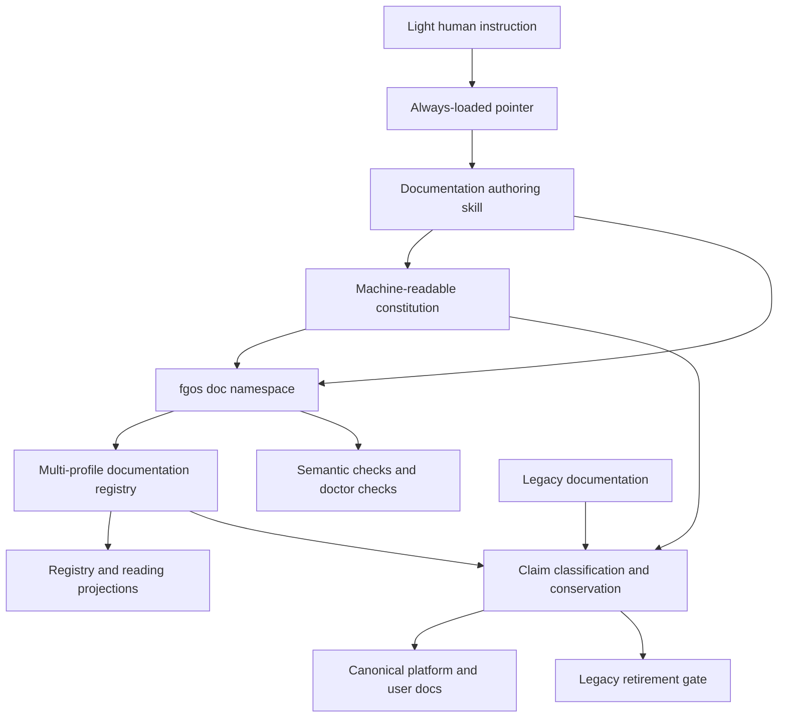

# Retained proposal and navigation: bounded conservation pack 1

Author session: codex-session:21@2026-10-14
Content commit: 55ec1e0c40410b70b1e4024232a233d4e3d96b3d

## claim_5bd3c22115aa03554a9321bbdd93d518

Source: `docs/platform/proposals/documentation-system-unification.md#proposal-unified-documentation-operating-system`

Source unit SHA256: `11d27fedde0b057aa8b8f62c24bfee5daaea16a1b72017822a451bbe9e35ddb2`
Shown source SHA256: `7cb4afcb4d5368817c37933d078fd5e89e68e921cda1a8867a1b10f1aca42f17`
Target: none (explicit retained exception, not a missing carrier).
Target digest: none.
Class: Judgment.

```json
{
  "claimId": "claim_5bd3c22115aa03554a9321bbdd93d518",
  "sourceUnitDigest": "11d27fedde0b057aa8b8f62c24bfee5daaea16a1b72017822a451bbe9e35ddb2",
  "claimKind": "historical-context",
  "disposition": "retain-as-evidence",
  "reviewStatus": "pending",
  "authoredBy": "codex-session:21@2026-10-14",
  "rationale": "Frozen map retains the already-in-topology non-canonical proposal at its existing path. Preserve this complete source unit unchanged as evidence of the proposed design; no source-to-itself carry proof, acceptance, authority change or truth certification is claimed. Source docs/platform/proposals/documentation-system-unification.md#proposal-unified-documentation-operating-system remains byte-identical."
}
```

Full shown source, retained byte-identically in place:

````text
# Proposal: Unified Documentation Operating System

```txt
Document type: Proposal
Audience: Human reviewer, platform architect, maintainer, documentation agent
Purpose: Preserve the proposed unification of fgOS documentation governance, authoring, registry, migration, and retirement
Design status: Proposed
Implementation: Existing end-user registry foundation; platform-authority unification not implemented
Provenance: Human + agent coauthor
Writer type: Human + agent coauthor
Canonical for: nothing until accepted and promoted
Use this when: Continuing the documentation-system discussion or evaluating its implementation shape
Do not use this for: Current documentation authority or current product behavior
Last reviewed: 2026-09-25
Related:
- `../../doc-governance.md`
- `../../reading-map.md`
- `../README.md`
- `../../../plans/260925-documentation-authority-unification/plan.md`
- `../../../plans/260825-1841-knowledge-registry/plan.md`
- `../../architect/documentation-system-design.md`
- `../../architect/knowledge-registry-redesign.md`
```

This proposal preserves the complete discussion so it can continue without chat
history. It is deliberately non-canonical. Current authority remains with the
existing governance and current source documents until this proposal is accepted,
implemented, verified, and promoted.
````

Diff: no document text change; disposition only, no target proposed.

## claim_edc94e3e27bbbb2890cf4d7ab50827ca

Source: `docs/platform/proposals/documentation-system-unification.md#unheaded-block-1`

Source unit SHA256: `41500ca4a62304f8f479c9ffb8e4ef7f4b4e9ad16fd1faf30831779f7ffa5dd2`
Shown source SHA256: `41500ca4a62304f8f479c9ffb8e4ef7f4b4e9ad16fd1faf30831779f7ffa5dd2`
Target: none (explicit retained exception, not a missing carrier).
Target digest: none.
Class: Judgment.

```json
{
  "claimId": "claim_edc94e3e27bbbb2890cf4d7ab50827ca",
  "sourceUnitDigest": "41500ca4a62304f8f479c9ffb8e4ef7f4b4e9ad16fd1faf30831779f7ffa5dd2",
  "claimKind": "historical-context",
  "disposition": "retain-as-evidence",
  "reviewStatus": "pending",
  "authoredBy": "codex-session:21@2026-10-14",
  "rationale": "Frozen map retains the already-in-topology non-canonical proposal at its existing path. Preserve this complete source unit unchanged as evidence of the proposed design; no source-to-itself carry proof, acceptance, authority change or truth certification is claimed. Source docs/platform/proposals/documentation-system-unification.md#unheaded-block-1 remains byte-identical."
}
```

Full shown source, retained byte-identically in place:

````text
```txt
Document type: Proposal
Audience: Human reviewer, platform architect, maintainer, documentation agent
Purpose: Preserve the proposed unification of fgOS documentation governance, authoring, registry, migration, and retirement
Design status: Proposed
Implementation: Existing end-user registry foundation; platform-authority unification not implemented
Provenance: Human + agent coauthor
Writer type: Human + agent coauthor
Canonical for: nothing until accepted and promoted
Use this when: Continuing the documentation-system discussion or evaluating its implementation shape
Do not use this for: Current documentation authority or current product behavior
Last reviewed: 2026-09-25
Related:
- `../../doc-governance.md`
- `../../reading-map.md`
- `../README.md`
- `../../../plans/260925-documentation-authority-unification/plan.md`
- `../../../plans/260825-1841-knowledge-registry/plan.md`
- `../../architect/documentation-system-design.md`
- `../../architect/knowledge-registry-redesign.md`
```
````

Diff: no document text change; disposition only, no target proposed.

## claim_249e32f351bda11c2f869c0060c024bb

Source: `docs/platform/proposals/documentation-system-unification.md#unheaded-block-2`

Source unit SHA256: `c9945ccd126c5a0fd589283ae07cf46d30f2ced2d08d553267c9210c4ebef0e7`
Shown source SHA256: `c9945ccd126c5a0fd589283ae07cf46d30f2ced2d08d553267c9210c4ebef0e7`
Target: none (explicit retained exception, not a missing carrier).
Target digest: none.
Class: Judgment.

```json
{
  "claimId": "claim_249e32f351bda11c2f869c0060c024bb",
  "sourceUnitDigest": "c9945ccd126c5a0fd589283ae07cf46d30f2ced2d08d553267c9210c4ebef0e7",
  "claimKind": "historical-context",
  "disposition": "retain-as-evidence",
  "reviewStatus": "pending",
  "authoredBy": "codex-session:21@2026-10-14",
  "rationale": "Frozen map retains the already-in-topology non-canonical proposal at its existing path. Preserve this complete source unit unchanged as evidence of the proposed design; no source-to-itself carry proof, acceptance, authority change or truth certification is claimed. Source docs/platform/proposals/documentation-system-unification.md#unheaded-block-2 remains byte-identical."
}
```

Full shown source, retained byte-identically in place:

```text
This proposal preserves the complete discussion so it can continue without chat
history. It is deliberately non-canonical. Current authority remains with the
existing governance and current source documents until this proposal is accepted,
implemented, verified, and promoted.
```

Diff: no document text change; disposition only, no target proposed.

## claim_a764b2b96b9439766cbcc519af988893

Source: `docs/platform/proposals/documentation-system-unification.md#0-how-to-use-this-proposal`

Source unit SHA256: `df759c915a483d85f1de4b53cd8bcae7a78d0bee832a14d5ebd812ccc09e4e37`
Shown source SHA256: `d9424871c6f0390fa87f9e2e9bc8e1621118f539ce84cdc8482fc17311b4db33`
Target: none (explicit retained exception, not a missing carrier).
Target digest: none.
Class: Judgment.

```json
{
  "claimId": "claim_a764b2b96b9439766cbcc519af988893",
  "sourceUnitDigest": "df759c915a483d85f1de4b53cd8bcae7a78d0bee832a14d5ebd812ccc09e4e37",
  "claimKind": "procedure",
  "disposition": "retain-as-evidence",
  "reviewStatus": "pending",
  "authoredBy": "codex-session:21@2026-10-14",
  "rationale": "Frozen map retains the already-in-topology non-canonical proposal at its existing path. Preserve this complete source unit unchanged as evidence of the proposed design; no source-to-itself carry proof, acceptance, authority change or truth certification is claimed. Source docs/platform/proposals/documentation-system-unification.md#0-how-to-use-this-proposal remains byte-identical."
}
```

Full shown source, retained byte-identically in place:

```text
## 0. How To Use This Proposal

This document is the **full-horizon architecture**, not one executable plan. It
holds three horizons together so near-term delivery does not erase the intended
system:

| Horizon | Outcome | Relationship to current work |
|---|---|---|
| H1 — Platform authority unification | End the active split between `docs/platform/**` and legacy/current `docs/specs/**` + `docs/architect/**`; switch all platform readers/writers in one cutover | Active priority; execution plan: `plans/260925-documentation-authority-unification/plan.md` |
| H2 — Knowledge and Documentation Engine | Generalize the existing end-user registry into the durable multi-profile authority for documents, claims, decisions, provenance, graph relationships, and read models | Preserved future architecture; maintenance MVP begins after H1 cutover |
| H3 — Agent Context Engine | Compile instructions, effective decisions, and budgeted task-scoped reading plans from canonical authority | Preserved future architecture; never a blocker for H1 |

The already-implemented `tsk-28x` twelve-phase plan is historical foundation,
not this proposal's implementation plan. It lives at
`plans/260825-1841-knowledge-registry/` and covers the end-user
knowledge/Diataxis registry whose code foundation landed at commit
`5c948d2a4`. Enforcement flipped at `6cce97ab3` on 2026-08-27 before the 332
`tsk-5mh` migration commits later that day; projections were regenerated at
`1c6aa7a4`. Its historical path `plans/260825-1841-knowledge-registry/` is
preserved, and current-state corrections live beside it rather than rewriting
its historical phase files. It must not be renamed to imply a whole-platform engine or interpreted
as completion of the future Knowledge and Documentation Engine.
```

Diff: no document text change; disposition only, no target proposed.

## claim_1f12e2dcff3eddf28e74280af1bfaa75

Source: `docs/platform/proposals/documentation-system-unification.md#unheaded-block-3`

Source unit SHA256: `813b142b551b9e60568b368399072d141497e6b1b3e9d30dda929c82f9cc978b`
Shown source SHA256: `813b142b551b9e60568b368399072d141497e6b1b3e9d30dda929c82f9cc978b`
Target: none (explicit retained exception, not a missing carrier).
Target digest: none.
Class: Judgment.

```json
{
  "claimId": "claim_1f12e2dcff3eddf28e74280af1bfaa75",
  "sourceUnitDigest": "813b142b551b9e60568b368399072d141497e6b1b3e9d30dda929c82f9cc978b",
  "claimKind": "architecture",
  "disposition": "retain-as-evidence",
  "reviewStatus": "pending",
  "authoredBy": "codex-session:21@2026-10-14",
  "rationale": "Frozen map retains the already-in-topology non-canonical proposal at its existing path. Preserve this complete source unit unchanged as evidence of the proposed design; no source-to-itself carry proof, acceptance, authority change or truth certification is claimed. Source docs/platform/proposals/documentation-system-unification.md#unheaded-block-3 remains byte-identical."
}
```

Full shown source, retained byte-identically in place:

```text
This document is the **full-horizon architecture**, not one executable plan. It
holds three horizons together so near-term delivery does not erase the intended
system:
```

Diff: no document text change; disposition only, no target proposed.

## claim_d826963dfc14fdb8731a83bedbb843c8

Source: `docs/platform/proposals/documentation-system-unification.md#unheaded-block-4`

Source unit SHA256: `3b5b1a2b3b09cc7a962ee366a2a93002b02a00974ce14c5a8cbfa25f32b11cc7`
Shown source SHA256: `3b5b1a2b3b09cc7a962ee366a2a93002b02a00974ce14c5a8cbfa25f32b11cc7`
Target: none (explicit retained exception, not a missing carrier).
Target digest: none.
Class: Judgment.

```json
{
  "claimId": "claim_d826963dfc14fdb8731a83bedbb843c8",
  "sourceUnitDigest": "3b5b1a2b3b09cc7a962ee366a2a93002b02a00974ce14c5a8cbfa25f32b11cc7",
  "claimKind": "historical-context",
  "disposition": "retain-as-evidence",
  "reviewStatus": "pending",
  "authoredBy": "codex-session:21@2026-10-14",
  "rationale": "Frozen map retains the already-in-topology non-canonical proposal at its existing path. Preserve this complete source unit unchanged as evidence of the proposed design; no source-to-itself carry proof, acceptance, authority change or truth certification is claimed. Source docs/platform/proposals/documentation-system-unification.md#unheaded-block-4 remains byte-identical."
}
```

Full shown source, retained byte-identically in place:

```text
| Horizon | Outcome | Relationship to current work |
|---|---|---|
| H1 — Platform authority unification | End the active split between `docs/platform/**` and legacy/current `docs/specs/**` + `docs/architect/**`; switch all platform readers/writers in one cutover | Active priority; execution plan: `plans/260925-documentation-authority-unification/plan.md` |
| H2 — Knowledge and Documentation Engine | Generalize the existing end-user registry into the durable multi-profile authority for documents, claims, decisions, provenance, graph relationships, and read models | Preserved future architecture; maintenance MVP begins after H1 cutover |
| H3 — Agent Context Engine | Compile instructions, effective decisions, and budgeted task-scoped reading plans from canonical authority | Preserved future architecture; never a blocker for H1 |
```

Diff: no document text change; disposition only, no target proposed.

## claim_5815b1e0b30471fe4a07f02c1656e79f

Source: `docs/platform/proposals/documentation-system-unification.md#unheaded-block-5`

Source unit SHA256: `17b673b775af84377154cb5485aeeb1ea1eee02dd0bb40ea2a35619ec103e9c2`
Shown source SHA256: `17b673b775af84377154cb5485aeeb1ea1eee02dd0bb40ea2a35619ec103e9c2`
Target: none (explicit retained exception, not a missing carrier).
Target digest: none.
Class: Judgment.

```json
{
  "claimId": "claim_5815b1e0b30471fe4a07f02c1656e79f",
  "sourceUnitDigest": "17b673b775af84377154cb5485aeeb1ea1eee02dd0bb40ea2a35619ec103e9c2",
  "claimKind": "historical-context",
  "disposition": "retain-as-evidence",
  "reviewStatus": "pending",
  "authoredBy": "codex-session:21@2026-10-14",
  "rationale": "Frozen map retains the already-in-topology non-canonical proposal at its existing path. Preserve this complete source unit unchanged as evidence of the proposed design; no source-to-itself carry proof, acceptance, authority change or truth certification is claimed. Source docs/platform/proposals/documentation-system-unification.md#unheaded-block-5 remains byte-identical."
}
```

Full shown source, retained byte-identically in place:

```text
The already-implemented `tsk-28x` twelve-phase plan is historical foundation,
not this proposal's implementation plan. It lives at
`plans/260825-1841-knowledge-registry/` and covers the end-user
knowledge/Diataxis registry whose code foundation landed at commit
`5c948d2a4`. Enforcement flipped at `6cce97ab3` on 2026-08-27 before the 332
`tsk-5mh` migration commits later that day; projections were regenerated at
`1c6aa7a4`. Its historical path `plans/260825-1841-knowledge-registry/` is
preserved, and current-state corrections live beside it rather than rewriting
its historical phase files. It must not be renamed to imply a whole-platform engine or interpreted
as completion of the future Knowledge and Documentation Engine.
```

Diff: no document text change; disposition only, no target proposed.

## claim_e18fa9aef3ce87a09592daf404cca517

Source: `docs/platform/proposals/documentation-system-unification.md#01-immediate-problem-statement`

Source unit SHA256: `c1fbc48cd103895621c63a045ee72e8fc1c81d5749752df57ada2f78ba4539ec`
Shown source SHA256: `dffd40a6ecfd8d9ae547ecc78bcebaa6a2b5a1f6a8c13fe8b8d0a63b0f73c026`
Target: none (explicit retained exception, not a missing carrier).
Target digest: none.
Class: Judgment.

```json
{
  "claimId": "claim_e18fa9aef3ce87a09592daf404cca517",
  "sourceUnitDigest": "c1fbc48cd103895621c63a045ee72e8fc1c81d5749752df57ada2f78ba4539ec",
  "claimKind": "historical-context",
  "disposition": "retain-as-evidence",
  "reviewStatus": "pending",
  "authoredBy": "codex-session:21@2026-10-14",
  "rationale": "Frozen map retains the already-in-topology non-canonical proposal at its existing path. Preserve this complete source unit unchanged as evidence of the proposed design; no source-to-itself carry proof, acceptance, authority change or truth certification is claimed. Source docs/platform/proposals/documentation-system-unification.md#01-immediate-problem-statement remains byte-identical."
}
```

Full shown source, retained byte-identically in place:

```text
### 0.1. Immediate problem statement

The hot problem is simpler than the full architecture: fgOS has fragmented
platform authority across `docs/platform/**`, `docs/specs/**`,
`docs/architect/**`, and root authority documents. Some areas have already been
promoted independently while others remain candidate or legacy/current, so this
is not a clean two-tree starting state. The first success is one explicit
platform authority model and route, not a completed knowledge platform.
```

Diff: no document text change; disposition only, no target proposed.

## claim_7a76875fb28b4a2c8f812d83f30e8a70

Source: `docs/platform/proposals/documentation-system-unification.md#unheaded-block-6`

Source unit SHA256: `d31b0b03f3dbe72d1c0e1e6b4ec9f995427cfb7537356ba4138e5c62acb49187`
Shown source SHA256: `d31b0b03f3dbe72d1c0e1e6b4ec9f995427cfb7537356ba4138e5c62acb49187`
Target: none (explicit retained exception, not a missing carrier).
Target digest: none.
Class: Judgment.

```json
{
  "claimId": "claim_7a76875fb28b4a2c8f812d83f30e8a70",
  "sourceUnitDigest": "d31b0b03f3dbe72d1c0e1e6b4ec9f995427cfb7537356ba4138e5c62acb49187",
  "claimKind": "architecture",
  "disposition": "retain-as-evidence",
  "reviewStatus": "pending",
  "authoredBy": "codex-session:21@2026-10-14",
  "rationale": "Frozen map retains the already-in-topology non-canonical proposal at its existing path. Preserve this complete source unit unchanged as evidence of the proposed design; no source-to-itself carry proof, acceptance, authority change or truth certification is claimed. Source docs/platform/proposals/documentation-system-unification.md#unheaded-block-6 remains byte-identical."
}
```

Full shown source, retained byte-identically in place:

```text
The hot problem is simpler than the full architecture: fgOS has fragmented
platform authority across `docs/platform/**`, `docs/specs/**`,
`docs/architect/**`, and root authority documents. Some areas have already been
promoted independently while others remain candidate or legacy/current, so this
is not a clean two-tree starting state. The first success is one explicit
platform authority model and route, not a completed knowledge platform.
```

Diff: no document text change; disposition only, no target proposed.

## claim_5f508548ea6592c6f5065286711181f7

Source: `docs/platform/proposals/documentation-system-unification.md#02-sequence-law`

Source unit SHA256: `a2387e90429adb92eba092ef138030f91420c8a56cf6f8020b84d593e6fe2f3d`
Shown source SHA256: `4b0d8be8ca21e19857537fdaf96586603095a32b150c7338fa73f4d6c9d7e8bf`
Target: none (explicit retained exception, not a missing carrier).
Target digest: none.
Class: Judgment.

```json
{
  "claimId": "claim_5f508548ea6592c6f5065286711181f7",
  "sourceUnitDigest": "a2387e90429adb92eba092ef138030f91420c8a56cf6f8020b84d593e6fe2f3d",
  "claimKind": "historical-context",
  "disposition": "retain-as-evidence",
  "reviewStatus": "pending",
  "authoredBy": "codex-session:21@2026-10-14",
  "rationale": "Frozen map retains the already-in-topology non-canonical proposal at its existing path. Preserve this complete source unit unchanged as evidence of the proposed design; no source-to-itself carry proof, acceptance, authority change or truth certification is claimed. Source docs/platform/proposals/documentation-system-unification.md#02-sequence-law remains byte-identical."
}
```

Full shown source, retained byte-identically in place:

````text
### 0.2. Sequence law

```text
minimum migration control plane
→ claim-conserving candidate transformation
→ repository-wide authority cutover
→ maintenance system
→ dynamic agent context
```

“Content before tooling” means do not build the full engine before learning from
the corpus. It does not permit bulk rewriting without inventory identity,
disposition, conservation, legacy-growth containment, and rollback proof.
````

Diff: no document text change; disposition only, no target proposed.

## claim_f99920569f3401cc3aab466ebab99589

Source: `docs/platform/proposals/documentation-system-unification.md#unheaded-block-7`

Source unit SHA256: `19378c0c1607cb23975d64d7b604830395d729aa5c9d2e21bd4f7d31757aec9c`
Shown source SHA256: `19378c0c1607cb23975d64d7b604830395d729aa5c9d2e21bd4f7d31757aec9c`
Target: none (explicit retained exception, not a missing carrier).
Target digest: none.
Class: Judgment.

```json
{
  "claimId": "claim_f99920569f3401cc3aab466ebab99589",
  "sourceUnitDigest": "19378c0c1607cb23975d64d7b604830395d729aa5c9d2e21bd4f7d31757aec9c",
  "claimKind": "historical-context",
  "disposition": "retain-as-evidence",
  "reviewStatus": "pending",
  "authoredBy": "codex-session:21@2026-10-14",
  "rationale": "Frozen map retains the already-in-topology non-canonical proposal at its existing path. Preserve this complete source unit unchanged as evidence of the proposed design; no source-to-itself carry proof, acceptance, authority change or truth certification is claimed. Source docs/platform/proposals/documentation-system-unification.md#unheaded-block-7 remains byte-identical."
}
```

Full shown source, retained byte-identically in place:

````text
```text
minimum migration control plane
→ claim-conserving candidate transformation
→ repository-wide authority cutover
→ maintenance system
→ dynamic agent context
```
````

Diff: no document text change; disposition only, no target proposed.

## claim_422a5613984762c4f83a8fdada331c28

Source: `docs/platform/proposals/documentation-system-unification.md#unheaded-block-8`

Source unit SHA256: `01cdc3e39f2cf88e5ce0c8e3f52cf433caefc6238680a6096e025d114c85bad4`
Shown source SHA256: `01cdc3e39f2cf88e5ce0c8e3f52cf433caefc6238680a6096e025d114c85bad4`
Target: none (explicit retained exception, not a missing carrier).
Target digest: none.
Class: Judgment.

```json
{
  "claimId": "claim_422a5613984762c4f83a8fdada331c28",
  "sourceUnitDigest": "01cdc3e39f2cf88e5ce0c8e3f52cf433caefc6238680a6096e025d114c85bad4",
  "claimKind": "historical-context",
  "disposition": "retain-as-evidence",
  "reviewStatus": "pending",
  "authoredBy": "codex-session:21@2026-10-14",
  "rationale": "Frozen map retains the already-in-topology non-canonical proposal at its existing path. Preserve this complete source unit unchanged as evidence of the proposed design; no source-to-itself carry proof, acceptance, authority change or truth certification is claimed. Source docs/platform/proposals/documentation-system-unification.md#unheaded-block-8 remains byte-identical."
}
```

Full shown source, retained byte-identically in place:

```text
“Content before tooling” means do not build the full engine before learning from
the corpus. It does not permit bulk rewriting without inventory identity,
disposition, conservation, legacy-growth containment, and rollback proof.
```

Diff: no document text change; disposition only, no target proposed.

## claim_2d6be6a5fab4b43bf96e1f389bacabf5

Source: `docs/platform/proposals/documentation-system-unification.md#03-non-preclusion-law`

Source unit SHA256: `e4b52cc75e04b6ff81120cb905da5d39967ef167aaa886aa8b8adc563d63c991`
Shown source SHA256: `8f4ebf8b5abbf4df7207b06d6cdaf492b6e4b4040e18a9e4bffb80c8a7f139de`
Target: none (explicit retained exception, not a missing carrier).
Target digest: none.
Class: Judgment.

```json
{
  "claimId": "claim_2d6be6a5fab4b43bf96e1f389bacabf5",
  "sourceUnitDigest": "e4b52cc75e04b6ff81120cb905da5d39967ef167aaa886aa8b8adc563d63c991",
  "claimKind": "historical-context",
  "disposition": "retain-as-evidence",
  "reviewStatus": "pending",
  "authoredBy": "codex-session:21@2026-10-14",
  "rationale": "Frozen map retains the already-in-topology non-canonical proposal at its existing path. Preserve this complete source unit unchanged as evidence of the proposed design; no source-to-itself carry proof, acceptance, authority change or truth certification is claimed. Source docs/platform/proposals/documentation-system-unification.md#03-non-preclusion-law remains byte-identical."
}
```

Full shown source, retained byte-identically in place:

```text
### 0.3. Non-preclusion law

A near-term slice may defer an H2/H3 capability only when it records:

- the preserved intent;
- what the current slice implements;
- what the slice must not preclude;
- an objective revisit trigger;
- evidence or a source pointer.

Omission, implementation inconvenience, or absence from the active plan does not
supersede this proposal. Preserved commitments are projected into
`docs/platform/intent-preservation-ledger.md`.
```

Diff: no document text change; disposition only, no target proposed.

## claim_eafc5552d37d6f1d6770f5cd63b62f74

Source: `docs/platform/proposals/documentation-system-unification.md#unheaded-block-9`

Source unit SHA256: `2be80ad3b63067d6f093db67da11acbd249b09825685a029574efd76a5839af8`
Shown source SHA256: `2be80ad3b63067d6f093db67da11acbd249b09825685a029574efd76a5839af8`
Target: none (explicit retained exception, not a missing carrier).
Target digest: none.
Class: Judgment.

```json
{
  "claimId": "claim_eafc5552d37d6f1d6770f5cd63b62f74",
  "sourceUnitDigest": "2be80ad3b63067d6f093db67da11acbd249b09825685a029574efd76a5839af8",
  "claimKind": "historical-context",
  "disposition": "retain-as-evidence",
  "reviewStatus": "pending",
  "authoredBy": "codex-session:21@2026-10-14",
  "rationale": "Frozen map retains the already-in-topology non-canonical proposal at its existing path. Preserve this complete source unit unchanged as evidence of the proposed design; no source-to-itself carry proof, acceptance, authority change or truth certification is claimed. Source docs/platform/proposals/documentation-system-unification.md#unheaded-block-9 remains byte-identical."
}
```

Full shown source, retained byte-identically in place:

```text
A near-term slice may defer an H2/H3 capability only when it records:
```

Diff: no document text change; disposition only, no target proposed.

## claim_02b5afb142e5b800a68c406d40cfe4ab

Source: `docs/platform/proposals/documentation-system-unification.md#unheaded-block-10`

Source unit SHA256: `1fa0542bbf43b1f7c06805abec72f17322bd52aa565208b9db07cce9f654204d`
Shown source SHA256: `1fa0542bbf43b1f7c06805abec72f17322bd52aa565208b9db07cce9f654204d`
Target: none (explicit retained exception, not a missing carrier).
Target digest: none.
Class: Judgment.

```json
{
  "claimId": "claim_02b5afb142e5b800a68c406d40cfe4ab",
  "sourceUnitDigest": "1fa0542bbf43b1f7c06805abec72f17322bd52aa565208b9db07cce9f654204d",
  "claimKind": "verification",
  "disposition": "retain-as-evidence",
  "reviewStatus": "pending",
  "authoredBy": "codex-session:21@2026-10-14",
  "rationale": "Frozen map retains the already-in-topology non-canonical proposal at its existing path. Preserve this complete source unit unchanged as evidence of the proposed design; no source-to-itself carry proof, acceptance, authority change or truth certification is claimed. Source docs/platform/proposals/documentation-system-unification.md#unheaded-block-10 remains byte-identical."
}
```

Full shown source, retained byte-identically in place:

```text
- the preserved intent;
- what the current slice implements;
- what the slice must not preclude;
- an objective revisit trigger;
- evidence or a source pointer.
```

Diff: no document text change; disposition only, no target proposed.

## claim_a475bfb2de863c23c3a1e77357f129be

Source: `docs/platform/proposals/documentation-system-unification.md#unheaded-block-11`

Source unit SHA256: `444494308f2810ba529df859a2aa2059ce92f0d883d800cfb7c9c6dd407a08cc`
Shown source SHA256: `444494308f2810ba529df859a2aa2059ce92f0d883d800cfb7c9c6dd407a08cc`
Target: none (explicit retained exception, not a missing carrier).
Target digest: none.
Class: Judgment.

```json
{
  "claimId": "claim_a475bfb2de863c23c3a1e77357f129be",
  "sourceUnitDigest": "444494308f2810ba529df859a2aa2059ce92f0d883d800cfb7c9c6dd407a08cc",
  "claimKind": "vision",
  "disposition": "retain-as-evidence",
  "reviewStatus": "pending",
  "authoredBy": "codex-session:21@2026-10-14",
  "rationale": "Frozen map retains the already-in-topology non-canonical proposal at its existing path. Preserve this complete source unit unchanged as evidence of the proposed design; no source-to-itself carry proof, acceptance, authority change or truth certification is claimed. Source docs/platform/proposals/documentation-system-unification.md#unheaded-block-11 remains byte-identical."
}
```

Full shown source, retained byte-identically in place:

```text
Omission, implementation inconvenience, or absence from the active plan does not
supersede this proposal. Preserved commitments are projected into
`docs/platform/intent-preservation-ledger.md`.
```

Diff: no document text change; disposition only, no target proposed.

## claim_a6e94349126116aea975e855e70d4f3c

Source: `docs/platform/proposals/documentation-system-unification.md#1-problem`

Source unit SHA256: `5c33a0db600802ff3d68355f073a343073e1006130b2a2498c2f85956c033735`
Shown source SHA256: `3d9d72f631c84bf16cd8a96e64da91f404f099c0516c3c0f16897e5751673e9b`
Target: none (explicit retained exception, not a missing carrier).
Target digest: none.
Class: Judgment.

```json
{
  "claimId": "claim_a6e94349126116aea975e855e70d4f3c",
  "sourceUnitDigest": "5c33a0db600802ff3d68355f073a343073e1006130b2a2498c2f85956c033735",
  "claimKind": "historical-context",
  "disposition": "retain-as-evidence",
  "reviewStatus": "pending",
  "authoredBy": "codex-session:21@2026-10-14",
  "rationale": "Frozen map retains the already-in-topology non-canonical proposal at its existing path. Preserve this complete source unit unchanged as evidence of the proposed design; no source-to-itself carry proof, acceptance, authority change or truth certification is claimed. Source docs/platform/proposals/documentation-system-unification.md#1-problem remains byte-identical."
}
```

Full shown source, retained byte-identically in place:

```text
## 1. Problem

fgOS already has substantial documentation doctrine and tooling, but the system
is split across canonical targets, legacy-current trees, end-user knowledge
machinery, templates, instructions, and generated projections. An agent asked to
“write the architecture doc” must still reconstruct the workflow: classify the
claim, find its owner, choose a type and path, locate a template, update related
links and proof, regenerate projections, and determine which checks apply.

The intended improvement must do more than make new documents easier to author.
Every retained detail in `docs/specs/**` and `docs/architect/**` must be migrated
to the new system. Those legacy trees must then be retired and removed; they must
not remain indefinitely as compatibility or “legacy-current” sources. Legacy
root-level user-documentation directories must likewise converge on one final
layout.
```

Diff: no document text change; disposition only, no target proposed.

## claim_4b938e571093f110cbe3864ea1463c35

Source: `docs/platform/proposals/documentation-system-unification.md#unheaded-block-12`

Source unit SHA256: `1fb67da1c82054ddaf25b5ebfceb0927f1f82051ad393bd6be35a031693fe10c`
Shown source SHA256: `1fb67da1c82054ddaf25b5ebfceb0927f1f82051ad393bd6be35a031693fe10c`
Target: none (explicit retained exception, not a missing carrier).
Target digest: none.
Class: Judgment.

```json
{
  "claimId": "claim_4b938e571093f110cbe3864ea1463c35",
  "sourceUnitDigest": "1fb67da1c82054ddaf25b5ebfceb0927f1f82051ad393bd6be35a031693fe10c",
  "claimKind": "historical-context",
  "disposition": "retain-as-evidence",
  "reviewStatus": "pending",
  "authoredBy": "codex-session:21@2026-10-14",
  "rationale": "Frozen map retains the already-in-topology non-canonical proposal at its existing path. Preserve this complete source unit unchanged as evidence of the proposed design; no source-to-itself carry proof, acceptance, authority change or truth certification is claimed. Source docs/platform/proposals/documentation-system-unification.md#unheaded-block-12 remains byte-identical."
}
```

Full shown source, retained byte-identically in place:

```text
fgOS already has substantial documentation doctrine and tooling, but the system
is split across canonical targets, legacy-current trees, end-user knowledge
machinery, templates, instructions, and generated projections. An agent asked to
“write the architecture doc” must still reconstruct the workflow: classify the
claim, find its owner, choose a type and path, locate a template, update related
links and proof, regenerate projections, and determine which checks apply.
```

Diff: no document text change; disposition only, no target proposed.

## claim_e79273a6717efeaeddb29e7ffbd082b9

Source: `docs/platform/proposals/documentation-system-unification.md#unheaded-block-13`

Source unit SHA256: `8b9c715fa0bafb99f86f38bf643d8369c3562d889bb556779423b978217664bd`
Shown source SHA256: `8b9c715fa0bafb99f86f38bf643d8369c3562d889bb556779423b978217664bd`
Target: none (explicit retained exception, not a missing carrier).
Target digest: none.
Class: Judgment.

```json
{
  "claimId": "claim_e79273a6717efeaeddb29e7ffbd082b9",
  "sourceUnitDigest": "8b9c715fa0bafb99f86f38bf643d8369c3562d889bb556779423b978217664bd",
  "claimKind": "historical-context",
  "disposition": "retain-as-evidence",
  "reviewStatus": "pending",
  "authoredBy": "codex-session:21@2026-10-14",
  "rationale": "Frozen map retains the already-in-topology non-canonical proposal at its existing path. Preserve this complete source unit unchanged as evidence of the proposed design; no source-to-itself carry proof, acceptance, authority change or truth certification is claimed. Source docs/platform/proposals/documentation-system-unification.md#unheaded-block-13 remains byte-identical."
}
```

Full shown source, retained byte-identically in place:

```text
The intended improvement must do more than make new documents easier to author.
Every retained detail in `docs/specs/**` and `docs/architect/**` must be migrated
to the new system. Those legacy trees must then be retired and removed; they must
not remain indefinitely as compatibility or “legacy-current” sources. Legacy
root-level user-documentation directories must likewise converge on one final
layout.
```

Diff: no document text change; disposition only, no target proposed.

## claim_2d4590ea661b5f7473a415fa40ae49a7

Source: `docs/platform/proposals/documentation-system-unification.md#2-existing-foundations`

Source unit SHA256: `67159956e453715e79a5eeb23b58d03a7762e4dadf95703e05dbee312b3bcdbc`
Shown source SHA256: `4dceddb64b39a2b24fcb9ed61e33d21fd40d90ac09db16ef54b17c5f9fe57fc6`
Target: none (explicit retained exception, not a missing carrier).
Target digest: none.
Class: Judgment.

```json
{
  "claimId": "claim_2d4590ea661b5f7473a415fa40ae49a7",
  "sourceUnitDigest": "67159956e453715e79a5eeb23b58d03a7762e4dadf95703e05dbee312b3bcdbc",
  "claimKind": "historical-context",
  "disposition": "retain-as-evidence",
  "reviewStatus": "pending",
  "authoredBy": "codex-session:21@2026-10-14",
  "rationale": "Frozen map retains the already-in-topology non-canonical proposal at its existing path. Preserve this complete source unit unchanged as evidence of the proposed design; no source-to-itself carry proof, acceptance, authority change or truth certification is claimed. Source docs/platform/proposals/documentation-system-unification.md#2-existing-foundations remains byte-identical."
}
```

Full shown source, retained byte-identically in place:

```text
## 2. Existing Foundations
```

Diff: no document text change; disposition only, no target proposed.

## claim_648cee9d0afc31ea654c87b23d8cdb3e

Source: `docs/platform/proposals/documentation-system-unification.md#21-governance-and-templates`

Source unit SHA256: `1d718c0ded7e0ce710faced2757ba347154bc47c691c426a106a98177ec1da06`
Shown source SHA256: `244f39164e9a413573c9106de374a4e19cfb0b97766030affc514196d0a6751d`
Target: none (explicit retained exception, not a missing carrier).
Target digest: none.
Class: Judgment.

```json
{
  "claimId": "claim_648cee9d0afc31ea654c87b23d8cdb3e",
  "sourceUnitDigest": "1d718c0ded7e0ce710faced2757ba347154bc47c691c426a106a98177ec1da06",
  "claimKind": "historical-context",
  "disposition": "retain-as-evidence",
  "reviewStatus": "pending",
  "authoredBy": "codex-session:21@2026-10-14",
  "rationale": "Frozen map retains the already-in-topology non-canonical proposal at its existing path. Preserve this complete source unit unchanged as evidence of the proposed design; no source-to-itself carry proof, acceptance, authority change or truth certification is claimed. Source docs/platform/proposals/documentation-system-unification.md#21-governance-and-templates remains byte-identical."
}
```

Full shown source, retained byte-identically in place:

```text
### 2.1. Governance and templates

The repository already defines:

- human presence: a reader can understand and challenge the system without chat;
- one claim, one owner;
- provenance is not authority;
- generated output never outranks its source;
- separate authority for vision, spec, architecture, contract, decision,
  verification, proposal, discussion, history, and generated documents;
- discussion promotion and drainage;
- intent preservation when implementation narrows a larger design;
- one H1, numbered sections for maintained canonical documents, and deliberate
  links forming a reading graph;
- eleven templates for the main maintained document types.

The primary current sources are `docs/doc-governance.md`,
`docs/reading-map.md`, `docs/platform/README.md`, and `docs/templates/**`.
```

Diff: no document text change; disposition only, no target proposed.

## claim_3bd0e3e54893e6106f4204994592f7f9

Source: `docs/platform/proposals/documentation-system-unification.md#unheaded-block-14`

Source unit SHA256: `5c52d0ca2004b370b8bd545a1208b9f38412764c4404ac88df216619fc7d15cd`
Shown source SHA256: `5c52d0ca2004b370b8bd545a1208b9f38412764c4404ac88df216619fc7d15cd`
Target: none (explicit retained exception, not a missing carrier).
Target digest: none.
Class: Judgment.

```json
{
  "claimId": "claim_3bd0e3e54893e6106f4204994592f7f9",
  "sourceUnitDigest": "5c52d0ca2004b370b8bd545a1208b9f38412764c4404ac88df216619fc7d15cd",
  "claimKind": "historical-context",
  "disposition": "retain-as-evidence",
  "reviewStatus": "pending",
  "authoredBy": "codex-session:21@2026-10-14",
  "rationale": "Frozen map retains the already-in-topology non-canonical proposal at its existing path. Preserve this complete source unit unchanged as evidence of the proposed design; no source-to-itself carry proof, acceptance, authority change or truth certification is claimed. Source docs/platform/proposals/documentation-system-unification.md#unheaded-block-14 remains byte-identical."
}
```

Full shown source, retained byte-identically in place:

```text
The repository already defines:
```

Diff: no document text change; disposition only, no target proposed.

## claim_5b8fbebe12e2c89c01c598adeed1378e

Source: `docs/platform/proposals/documentation-system-unification.md#unheaded-block-15`

Source unit SHA256: `4821cf9255eaf5d0fad3062b720ec6608310835714829e369ba123217b3caef8`
Shown source SHA256: `4821cf9255eaf5d0fad3062b720ec6608310835714829e369ba123217b3caef8`
Target: none (explicit retained exception, not a missing carrier).
Target digest: none.
Class: Judgment.

```json
{
  "claimId": "claim_5b8fbebe12e2c89c01c598adeed1378e",
  "sourceUnitDigest": "4821cf9255eaf5d0fad3062b720ec6608310835714829e369ba123217b3caef8",
  "claimKind": "historical-context",
  "disposition": "retain-as-evidence",
  "reviewStatus": "pending",
  "authoredBy": "codex-session:21@2026-10-14",
  "rationale": "Frozen map retains the already-in-topology non-canonical proposal at its existing path. Preserve this complete source unit unchanged as evidence of the proposed design; no source-to-itself carry proof, acceptance, authority change or truth certification is claimed. Source docs/platform/proposals/documentation-system-unification.md#unheaded-block-15 remains byte-identical."
}
```

Full shown source, retained byte-identically in place:

```text
- human presence: a reader can understand and challenge the system without chat;
- one claim, one owner;
- provenance is not authority;
- generated output never outranks its source;
- separate authority for vision, spec, architecture, contract, decision,
  verification, proposal, discussion, history, and generated documents;
- discussion promotion and drainage;
- intent preservation when implementation narrows a larger design;
- one H1, numbered sections for maintained canonical documents, and deliberate
  links forming a reading graph;
- eleven templates for the main maintained document types.
```

Diff: no document text change; disposition only, no target proposed.

## claim_3478db87f5921980627c4725cacf5e67

Source: `docs/platform/proposals/documentation-system-unification.md#unheaded-block-16`

Source unit SHA256: `dae319b6f4e30ec23df33bc6215b7a56b477781420b797e483681f5791591c95`
Shown source SHA256: `dae319b6f4e30ec23df33bc6215b7a56b477781420b797e483681f5791591c95`
Target: none (explicit retained exception, not a missing carrier).
Target digest: none.
Class: Judgment.

```json
{
  "claimId": "claim_3478db87f5921980627c4725cacf5e67",
  "sourceUnitDigest": "dae319b6f4e30ec23df33bc6215b7a56b477781420b797e483681f5791591c95",
  "claimKind": "historical-context",
  "disposition": "retain-as-evidence",
  "reviewStatus": "pending",
  "authoredBy": "codex-session:21@2026-10-14",
  "rationale": "Frozen map retains the already-in-topology non-canonical proposal at its existing path. Preserve this complete source unit unchanged as evidence of the proposed design; no source-to-itself carry proof, acceptance, authority change or truth certification is claimed. Source docs/platform/proposals/documentation-system-unification.md#unheaded-block-16 remains byte-identical."
}
```

Full shown source, retained byte-identically in place:

```text
The primary current sources are `docs/doc-governance.md`,
`docs/reading-map.md`, `docs/platform/README.md`, and `docs/templates/**`.
```

Diff: no document text change; disposition only, no target proposed.

## claim_bdffa8989b982641cd1a515686c2d7c5

Source: `docs/platform/proposals/documentation-system-unification.md#22-existing-cli-and-registry`

Source unit SHA256: `2c77a99c8c937390d9b45e79f661fdbaed72b98bfd4dd25716efe8fdeee00db3`
Shown source SHA256: `b88014dd901802d1ff9c450fa5258c7b48090bce129dbfe7fa84858b9a07c987`
Target: none (explicit retained exception, not a missing carrier).
Target digest: none.
Class: Judgment.

```json
{
  "claimId": "claim_bdffa8989b982641cd1a515686c2d7c5",
  "sourceUnitDigest": "2c77a99c8c937390d9b45e79f661fdbaed72b98bfd4dd25716efe8fdeee00db3",
  "claimKind": "historical-context",
  "disposition": "retain-as-evidence",
  "reviewStatus": "pending",
  "authoredBy": "codex-session:21@2026-10-14",
  "rationale": "Frozen map retains the already-in-topology non-canonical proposal at its existing path. Preserve this complete source unit unchanged as evidence of the proposed design; no source-to-itself carry proof, acceptance, authority change or truth certification is claimed. Source docs/platform/proposals/documentation-system-unification.md#22-existing-cli-and-registry remains byte-identical."
}
```

Full shown source, retained byte-identically in place:

````text
### 2.2. Existing CLI and registry

The current implementation is more than a simple index. It includes:

- an event-sourced topic/document registry;
- stable document identity;
- lifecycle `reserved -> provisional -> active -> superseded|retired`;
- one active document per `(topicId, role)` slot;
- current paths, aliases, supersession chains, topic lineage, and capture links;
- safe path validation;
- current/old-path resolution;
- machine and human registry projections;
- classifier, bootstrap, canary, migration dry-run/apply, and conservation tools;
- doctor checks for stale projections, duplicate active slots, broken aliases,
  missing current paths, source reachability, conservation, provisional age,
  topic size, and role usage.

Existing public surfaces include:

```sh
fgos topic register|split|merge|rename|retire
fgos doc reserve|register|mark-rendered|move-path|promote|demote|supersede|retire
fgos knowledge status|attest
fgos doc-registry
fgos docs-index
fgos doc-sources
```

Existing implementation anchors include:

- `src/state/knowledge-registry.mjs`;
- `src/report/knowledge-resolver.mjs`;
- `src/report/knowledge-projection.mjs`;
- `scripts/knowledge-classifier.mjs`;
- `scripts/knowledge-bootstrap.mjs`;
- `scripts/knowledge-migration.mjs`;
- `scripts/knowledge-canary.mjs`;
- knowledge/doc checks in `src/setup/registrations.mjs`.
````

Diff: no document text change; disposition only, no target proposed.

## claim_76c7235748b4d81a9766d3b7a2748086

Source: `docs/platform/proposals/documentation-system-unification.md#unheaded-block-17`

Source unit SHA256: `153cd57927950834e8aba744af4d9cbdf72bd77779eabed0bc39cc0d3e19cf81`
Shown source SHA256: `153cd57927950834e8aba744af4d9cbdf72bd77779eabed0bc39cc0d3e19cf81`
Target: none (explicit retained exception, not a missing carrier).
Target digest: none.
Class: Judgment.

```json
{
  "claimId": "claim_76c7235748b4d81a9766d3b7a2748086",
  "sourceUnitDigest": "153cd57927950834e8aba744af4d9cbdf72bd77779eabed0bc39cc0d3e19cf81",
  "claimKind": "historical-context",
  "disposition": "retain-as-evidence",
  "reviewStatus": "pending",
  "authoredBy": "codex-session:21@2026-10-14",
  "rationale": "Frozen map retains the already-in-topology non-canonical proposal at its existing path. Preserve this complete source unit unchanged as evidence of the proposed design; no source-to-itself carry proof, acceptance, authority change or truth certification is claimed. Source docs/platform/proposals/documentation-system-unification.md#unheaded-block-17 remains byte-identical."
}
```

Full shown source, retained byte-identically in place:

```text
The current implementation is more than a simple index. It includes:
```

Diff: no document text change; disposition only, no target proposed.

## claim_397a7d5418ad3c02740c7963006418cf

Source: `docs/platform/proposals/documentation-system-unification.md#unheaded-block-18`

Source unit SHA256: `d598971d8631b18191436cc3ae6680cd1e78de1986d6555cbc76cbab220cdae1`
Shown source SHA256: `d598971d8631b18191436cc3ae6680cd1e78de1986d6555cbc76cbab220cdae1`
Target: none (explicit retained exception, not a missing carrier).
Target digest: none.
Class: Judgment.

```json
{
  "claimId": "claim_397a7d5418ad3c02740c7963006418cf",
  "sourceUnitDigest": "d598971d8631b18191436cc3ae6680cd1e78de1986d6555cbc76cbab220cdae1",
  "claimKind": "specification",
  "disposition": "retain-as-evidence",
  "reviewStatus": "pending",
  "authoredBy": "codex-session:21@2026-10-14",
  "rationale": "Frozen map retains the already-in-topology non-canonical proposal at its existing path. Preserve this complete source unit unchanged as evidence of the proposed design; no source-to-itself carry proof, acceptance, authority change or truth certification is claimed. Source docs/platform/proposals/documentation-system-unification.md#unheaded-block-18 remains byte-identical."
}
```

Full shown source, retained byte-identically in place:

```text
- an event-sourced topic/document registry;
- stable document identity;
- lifecycle `reserved -> provisional -> active -> superseded|retired`;
- one active document per `(topicId, role)` slot;
- current paths, aliases, supersession chains, topic lineage, and capture links;
- safe path validation;
- current/old-path resolution;
- machine and human registry projections;
- classifier, bootstrap, canary, migration dry-run/apply, and conservation tools;
- doctor checks for stale projections, duplicate active slots, broken aliases,
  missing current paths, source reachability, conservation, provisional age,
  topic size, and role usage.
```

Diff: no document text change; disposition only, no target proposed.

## claim_2f78005c023bdf71f259753297bcb740

Source: `docs/platform/proposals/documentation-system-unification.md#unheaded-block-19`

Source unit SHA256: `5fcceca336e3c6269bb002bd7f5b0e3edfa181158c2db7c86e2a3db64c5d1883`
Shown source SHA256: `5fcceca336e3c6269bb002bd7f5b0e3edfa181158c2db7c86e2a3db64c5d1883`
Target: none (explicit retained exception, not a missing carrier).
Target digest: none.
Class: Judgment.

```json
{
  "claimId": "claim_2f78005c023bdf71f259753297bcb740",
  "sourceUnitDigest": "5fcceca336e3c6269bb002bd7f5b0e3edfa181158c2db7c86e2a3db64c5d1883",
  "claimKind": "historical-context",
  "disposition": "retain-as-evidence",
  "reviewStatus": "pending",
  "authoredBy": "codex-session:21@2026-10-14",
  "rationale": "Frozen map retains the already-in-topology non-canonical proposal at its existing path. Preserve this complete source unit unchanged as evidence of the proposed design; no source-to-itself carry proof, acceptance, authority change or truth certification is claimed. Source docs/platform/proposals/documentation-system-unification.md#unheaded-block-19 remains byte-identical."
}
```

Full shown source, retained byte-identically in place:

```text
Existing public surfaces include:
```

Diff: no document text change; disposition only, no target proposed.

## claim_062444f4a750d7cd3d99f044edf5a558

Source: `docs/platform/proposals/documentation-system-unification.md#unheaded-block-20`

Source unit SHA256: `e9b70091b9817456b0d9d256fe3c7f0d94ef6f87ca32ac572caaaeacf8e4ead5`
Shown source SHA256: `e9b70091b9817456b0d9d256fe3c7f0d94ef6f87ca32ac572caaaeacf8e4ead5`
Target: none (explicit retained exception, not a missing carrier).
Target digest: none.
Class: Judgment.

```json
{
  "claimId": "claim_062444f4a750d7cd3d99f044edf5a558",
  "sourceUnitDigest": "e9b70091b9817456b0d9d256fe3c7f0d94ef6f87ca32ac572caaaeacf8e4ead5",
  "claimKind": "historical-context",
  "disposition": "retain-as-evidence",
  "reviewStatus": "pending",
  "authoredBy": "codex-session:21@2026-10-14",
  "rationale": "Frozen map retains the already-in-topology non-canonical proposal at its existing path. Preserve this complete source unit unchanged as evidence of the proposed design; no source-to-itself carry proof, acceptance, authority change or truth certification is claimed. Source docs/platform/proposals/documentation-system-unification.md#unheaded-block-20 remains byte-identical."
}
```

Full shown source, retained byte-identically in place:

````text
```sh
fgos topic register|split|merge|rename|retire
fgos doc reserve|register|mark-rendered|move-path|promote|demote|supersede|retire
fgos knowledge status|attest
fgos doc-registry
fgos docs-index
fgos doc-sources
```
````

Diff: no document text change; disposition only, no target proposed.

## claim_6cf08941de1a254cbd5ef4b7f4b6944a

Source: `docs/platform/proposals/documentation-system-unification.md#unheaded-block-21`

Source unit SHA256: `038aba5cfa585ba85bd0a62eaf0bd72a1886b61774db89d10e1f1bb17c28fb83`
Shown source SHA256: `038aba5cfa585ba85bd0a62eaf0bd72a1886b61774db89d10e1f1bb17c28fb83`
Target: none (explicit retained exception, not a missing carrier).
Target digest: none.
Class: Judgment.

```json
{
  "claimId": "claim_6cf08941de1a254cbd5ef4b7f4b6944a",
  "sourceUnitDigest": "038aba5cfa585ba85bd0a62eaf0bd72a1886b61774db89d10e1f1bb17c28fb83",
  "claimKind": "historical-context",
  "disposition": "retain-as-evidence",
  "reviewStatus": "pending",
  "authoredBy": "codex-session:21@2026-10-14",
  "rationale": "Frozen map retains the already-in-topology non-canonical proposal at its existing path. Preserve this complete source unit unchanged as evidence of the proposed design; no source-to-itself carry proof, acceptance, authority change or truth certification is claimed. Source docs/platform/proposals/documentation-system-unification.md#unheaded-block-21 remains byte-identical."
}
```

Full shown source, retained byte-identically in place:

```text
Existing implementation anchors include:
```

Diff: no document text change; disposition only, no target proposed.

## claim_08f10e3688fac4cb0ff6bef19c925f66

Source: `docs/platform/proposals/documentation-system-unification.md#unheaded-block-22`

Source unit SHA256: `af7ab16ea31477911e6484b3284b09e317f9185cd51f58c78dbbac98686ddd63`
Shown source SHA256: `af7ab16ea31477911e6484b3284b09e317f9185cd51f58c78dbbac98686ddd63`
Target: none (explicit retained exception, not a missing carrier).
Target digest: none.
Class: Judgment.

```json
{
  "claimId": "claim_08f10e3688fac4cb0ff6bef19c925f66",
  "sourceUnitDigest": "af7ab16ea31477911e6484b3284b09e317f9185cd51f58c78dbbac98686ddd63",
  "claimKind": "specification",
  "disposition": "retain-as-evidence",
  "reviewStatus": "pending",
  "authoredBy": "codex-session:21@2026-10-14",
  "rationale": "Frozen map retains the already-in-topology non-canonical proposal at its existing path. Preserve this complete source unit unchanged as evidence of the proposed design; no source-to-itself carry proof, acceptance, authority change or truth certification is claimed. Source docs/platform/proposals/documentation-system-unification.md#unheaded-block-22 remains byte-identical."
}
```

Full shown source, retained byte-identically in place:

```text
- `src/state/knowledge-registry.mjs`;
- `src/report/knowledge-resolver.mjs`;
- `src/report/knowledge-projection.mjs`;
- `scripts/knowledge-classifier.mjs`;
- `scripts/knowledge-bootstrap.mjs`;
- `scripts/knowledge-migration.mjs`;
- `scripts/knowledge-canary.mjs`;
- knowledge/doc checks in `src/setup/registrations.mjs`.
```

Diff: no document text change; disposition only, no target proposed.

## claim_a07987817ed1170f1d0e12c74a2cf47b

Source: `docs/platform/proposals/documentation-system-unification.md#23-where-the-current-implementation-does-not-fit`

Source unit SHA256: `1a1fb459edc1eb23e474362537a345d4f062ecc933b3f3a16af2650e1e84916f`
Shown source SHA256: `14a71c2ee3baf8cb19a9b5e5c067d5a478901f3808896289c0903204f87432a1`
Target: none (explicit retained exception, not a missing carrier).
Target digest: none.
Class: Judgment.

```json
{
  "claimId": "claim_a07987817ed1170f1d0e12c74a2cf47b",
  "sourceUnitDigest": "1a1fb459edc1eb23e474362537a345d4f062ecc933b3f3a16af2650e1e84916f",
  "claimKind": "historical-context",
  "disposition": "retain-as-evidence",
  "reviewStatus": "pending",
  "authoredBy": "codex-session:21@2026-10-14",
  "rationale": "Frozen map retains the already-in-topology non-canonical proposal at its existing path. Preserve this complete source unit unchanged as evidence of the proposed design; no source-to-itself carry proof, acceptance, authority change or truth certification is claimed. Source docs/platform/proposals/documentation-system-unification.md#23-where-the-current-implementation-does-not-fit remains byte-identical."
}
```

Full shown source, retained byte-identically in place:

```text
### 2.3. Where the current implementation does not fit

The current registry is designed around end-user knowledge:

- only the `diataxis` framework is registered;
- modes are tutorial, how-to, reference, and explanation;
- the classifier scans only user-facing quadrant roots and decisions;
- target paths are shaped as `docs/knowledge/<purpose>/<role>.md`;
- identity emphasizes topic and role;
- it does not model platform area, subcomponent, document type, authority kind,
  singleton versus collection cardinality, required sections, templates, or
  typed relationships;
- its migration assumes a much narrower source-to-target relationship than the
  mixed claims found in `docs/specs/**` and `docs/architect/**`.

Therefore the existing subsystem is the correct lifecycle and migration
foundation, but it cannot be applied unchanged to platform documentation.
```

Diff: no document text change; disposition only, no target proposed.

## claim_ae7312bf0a4da24a71b906e873acabbb

Source: `docs/platform/proposals/documentation-system-unification.md#unheaded-block-23`

Source unit SHA256: `6f12d7c4e0881cec00cd38f131dfab97638f78ae866e5d075f52abd2f1b0b4f3`
Shown source SHA256: `6f12d7c4e0881cec00cd38f131dfab97638f78ae866e5d075f52abd2f1b0b4f3`
Target: none (explicit retained exception, not a missing carrier).
Target digest: none.
Class: Judgment.

```json
{
  "claimId": "claim_ae7312bf0a4da24a71b906e873acabbb",
  "sourceUnitDigest": "6f12d7c4e0881cec00cd38f131dfab97638f78ae866e5d075f52abd2f1b0b4f3",
  "claimKind": "historical-context",
  "disposition": "retain-as-evidence",
  "reviewStatus": "pending",
  "authoredBy": "codex-session:21@2026-10-14",
  "rationale": "Frozen map retains the already-in-topology non-canonical proposal at its existing path. Preserve this complete source unit unchanged as evidence of the proposed design; no source-to-itself carry proof, acceptance, authority change or truth certification is claimed. Source docs/platform/proposals/documentation-system-unification.md#unheaded-block-23 remains byte-identical."
}
```

Full shown source, retained byte-identically in place:

```text
The current registry is designed around end-user knowledge:
```

Diff: no document text change; disposition only, no target proposed.

## claim_5b10ddbd797e69524903d231e2a9e871

Source: `docs/platform/proposals/documentation-system-unification.md#unheaded-block-24`

Source unit SHA256: `346cf13d12a1b660d427e145b9750a20d6d36d03b14287386efe693275cd25f2`
Shown source SHA256: `346cf13d12a1b660d427e145b9750a20d6d36d03b14287386efe693275cd25f2`
Target: none (explicit retained exception, not a missing carrier).
Target digest: none.
Class: Judgment.

```json
{
  "claimId": "claim_5b10ddbd797e69524903d231e2a9e871",
  "sourceUnitDigest": "346cf13d12a1b660d427e145b9750a20d6d36d03b14287386efe693275cd25f2",
  "claimKind": "historical-context",
  "disposition": "retain-as-evidence",
  "reviewStatus": "pending",
  "authoredBy": "codex-session:21@2026-10-14",
  "rationale": "Frozen map retains the already-in-topology non-canonical proposal at its existing path. Preserve this complete source unit unchanged as evidence of the proposed design; no source-to-itself carry proof, acceptance, authority change or truth certification is claimed. Source docs/platform/proposals/documentation-system-unification.md#unheaded-block-24 remains byte-identical."
}
```

Full shown source, retained byte-identically in place:

```text
- only the `diataxis` framework is registered;
- modes are tutorial, how-to, reference, and explanation;
- the classifier scans only user-facing quadrant roots and decisions;
- target paths are shaped as `docs/knowledge/<purpose>/<role>.md`;
- identity emphasizes topic and role;
- it does not model platform area, subcomponent, document type, authority kind,
  singleton versus collection cardinality, required sections, templates, or
  typed relationships;
- its migration assumes a much narrower source-to-target relationship than the
  mixed claims found in `docs/specs/**` and `docs/architect/**`.
```

Diff: no document text change; disposition only, no target proposed.

## claim_8ca36cf7aeaab79b65774b29c3525a1c

Source: `docs/platform/proposals/documentation-system-unification.md#unheaded-block-25`

Source unit SHA256: `16efe2411229947b78f037b6a5c6cb9dc4189f9844052d00101ae2005cba5798`
Shown source SHA256: `16efe2411229947b78f037b6a5c6cb9dc4189f9844052d00101ae2005cba5798`
Target: none (explicit retained exception, not a missing carrier).
Target digest: none.
Class: Judgment.

```json
{
  "claimId": "claim_8ca36cf7aeaab79b65774b29c3525a1c",
  "sourceUnitDigest": "16efe2411229947b78f037b6a5c6cb9dc4189f9844052d00101ae2005cba5798",
  "claimKind": "specification",
  "disposition": "retain-as-evidence",
  "reviewStatus": "pending",
  "authoredBy": "codex-session:21@2026-10-14",
  "rationale": "Frozen map retains the already-in-topology non-canonical proposal at its existing path. Preserve this complete source unit unchanged as evidence of the proposed design; no source-to-itself carry proof, acceptance, authority change or truth certification is claimed. Source docs/platform/proposals/documentation-system-unification.md#unheaded-block-25 remains byte-identical."
}
```

Full shown source, retained byte-identically in place:

```text
Therefore the existing subsystem is the correct lifecycle and migration
foundation, but it cannot be applied unchanged to platform documentation.
```

Diff: no document text change; disposition only, no target proposed.

## claim_c4671615202257c2678db7c4441f76d2

Source: `docs/platform/proposals/documentation-system-unification.md#3-proposed-end-state`

Source unit SHA256: `3f3c86d3becfb48e65c917c8965fd0459e9918b3f0227639b042ad06a7bc0144`
Shown source SHA256: `39fe9bf85a0c9220c3db2a39bc39082b0ea8da0a43749438ae0cf955c3c5a3e3`
Target: none (explicit retained exception, not a missing carrier).
Target digest: none.
Class: Judgment.

```json
{
  "claimId": "claim_c4671615202257c2678db7c4441f76d2",
  "sourceUnitDigest": "3f3c86d3becfb48e65c917c8965fd0459e9918b3f0227639b042ad06a7bc0144",
  "claimKind": "specification",
  "disposition": "retain-as-evidence",
  "reviewStatus": "pending",
  "authoredBy": "codex-session:21@2026-10-14",
  "rationale": "Frozen map retains the already-in-topology non-canonical proposal at its existing path. Preserve this complete source unit unchanged as evidence of the proposed design; no source-to-itself carry proof, acceptance, authority change or truth certification is claimed. Source docs/platform/proposals/documentation-system-unification.md#3-proposed-end-state remains byte-identical."
}
```

Full shown source, retained byte-identically in place:

```text
## 3. Proposed End State
```

Diff: no document text change; disposition only, no target proposed.

## claim_f88782e175387eef131fadd152d93fd4

Source: `docs/platform/proposals/documentation-system-unification.md#31-one-canonical-documentation-topology`

Source unit SHA256: `5d9112dff3144fc23c48b39c636f238ef76b162b29f9f31cd85e48fb1e648339`
Shown source SHA256: `6b824fbafec4b4771264f37e37e76cba05f2f38d04f22b5ccef7808f8d94c9bf`
Target: none (explicit retained exception, not a missing carrier).
Target digest: none.
Class: Judgment.

```json
{
  "claimId": "claim_f88782e175387eef131fadd152d93fd4",
  "sourceUnitDigest": "5d9112dff3144fc23c48b39c636f238ef76b162b29f9f31cd85e48fb1e648339",
  "claimKind": "architecture",
  "disposition": "retain-as-evidence",
  "reviewStatus": "pending",
  "authoredBy": "codex-session:21@2026-10-14",
  "rationale": "Frozen map retains the already-in-topology non-canonical proposal at its existing path. Preserve this complete source unit unchanged as evidence of the proposed design; no source-to-itself carry proof, acceptance, authority change or truth certification is claimed. Source docs/platform/proposals/documentation-system-unification.md#31-one-canonical-documentation-topology remains byte-identical."
}
```

Full shown source, retained byte-identically in place:

````text
### 3.1. One canonical documentation topology

```text
docs/
├── README.md
├── doc-governance.md
├── reading-map.md
├── templates/
├── platform/
│   ├── README.md
│   ├── vision.md
│   ├── platform-foundations.md
│   ├── architecture-map.md
│   ├── component-boundary.md
│   ├── intent-preservation-ledger.md
│   ├── contracts/
│   ├── decisions/
│   ├── verification/
│   ├── history/
│   └── <area>/
│       ├── README.md
│       ├── vision.md
│       ├── intent-preservation-ledger.md
│       ├── spec.md
│       ├── subcomponents/
│       ├── architecture/
│       ├── contracts/
│       ├── decisions/
│       ├── verification/
│       ├── operations/
│       ├── proposals/
│       └── history/
├── user/
│   ├── README.md
│   ├── tutorials/
│   ├── how-to/
│   ├── reference/
│   └── explanation/
├── generated/
├── knowledge/
└── history/
```

The continuing roles of top-level `knowledge/` and `history/` require a final
decision. The non-negotiable outcome is that `docs/specs/**`,
`docs/architect/**`, and legacy root-level user quadrants do not remain active
documentation systems after cutover.
````

Diff: no document text change; disposition only, no target proposed.

## claim_0b2c08486f5947994849e6358c1586b8

Source: `docs/platform/proposals/documentation-system-unification.md#unheaded-block-26`

Source unit SHA256: `48018420a015acde1d43ea00aab20f89131d34df31b9d44289b310350f381900`
Shown source SHA256: `48018420a015acde1d43ea00aab20f89131d34df31b9d44289b310350f381900`
Target: none (explicit retained exception, not a missing carrier).
Target digest: none.
Class: Judgment.

```json
{
  "claimId": "claim_0b2c08486f5947994849e6358c1586b8",
  "sourceUnitDigest": "48018420a015acde1d43ea00aab20f89131d34df31b9d44289b310350f381900",
  "claimKind": "vision",
  "disposition": "retain-as-evidence",
  "reviewStatus": "pending",
  "authoredBy": "codex-session:21@2026-10-14",
  "rationale": "Frozen map retains the already-in-topology non-canonical proposal at its existing path. Preserve this complete source unit unchanged as evidence of the proposed design; no source-to-itself carry proof, acceptance, authority change or truth certification is claimed. Source docs/platform/proposals/documentation-system-unification.md#unheaded-block-26 remains byte-identical."
}
```

Full shown source, retained byte-identically in place:

````text
```text
docs/
├── README.md
├── doc-governance.md
├── reading-map.md
├── templates/
├── platform/
│   ├── README.md
│   ├── vision.md
│   ├── platform-foundations.md
│   ├── architecture-map.md
│   ├── component-boundary.md
│   ├── intent-preservation-ledger.md
│   ├── contracts/
│   ├── decisions/
│   ├── verification/
│   ├── history/
│   └── <area>/
│       ├── README.md
│       ├── vision.md
│       ├── intent-preservation-ledger.md
│       ├── spec.md
│       ├── subcomponents/
│       ├── architecture/
│       ├── contracts/
│       ├── decisions/
│       ├── verification/
│       ├── operations/
│       ├── proposals/
│       └── history/
├── user/
│   ├── README.md
│   ├── tutorials/
│   ├── how-to/
│   ├── reference/
│   └── explanation/
├── generated/
├── knowledge/
└── history/
```
````

Diff: no document text change; disposition only, no target proposed.

## claim_e7a507ae76fe5120a008b938b12bf559

Source: `docs/platform/proposals/documentation-system-unification.md#unheaded-block-27`

Source unit SHA256: `86bd643671b21a49ea299724628657c1373ac5b317acdc66a142bb4fd9ecc709`
Shown source SHA256: `86bd643671b21a49ea299724628657c1373ac5b317acdc66a142bb4fd9ecc709`
Target: none (explicit retained exception, not a missing carrier).
Target digest: none.
Class: Judgment.

```json
{
  "claimId": "claim_e7a507ae76fe5120a008b938b12bf559",
  "sourceUnitDigest": "86bd643671b21a49ea299724628657c1373ac5b317acdc66a142bb4fd9ecc709",
  "claimKind": "decision",
  "disposition": "retain-as-evidence",
  "reviewStatus": "pending",
  "authoredBy": "codex-session:21@2026-10-14",
  "rationale": "Frozen map retains the already-in-topology non-canonical proposal at its existing path. Preserve this complete source unit unchanged as evidence of the proposed design; no source-to-itself carry proof, acceptance, authority change or truth certification is claimed. Source docs/platform/proposals/documentation-system-unification.md#unheaded-block-27 remains byte-identical."
}
```

Full shown source, retained byte-identically in place:

```text
The continuing roles of top-level `knowledge/` and `history/` require a final
decision. The non-negotiable outcome is that `docs/specs/**`,
`docs/architect/**`, and legacy root-level user quadrants do not remain active
documentation systems after cutover.
```

Diff: no document text change; disposition only, no target proposed.

## claim_89dc4177e59e0525e9eb70ec1eb9d4d4

Source: `docs/platform/proposals/documentation-system-unification.md#32-authority-by-claim-kind`

Source unit SHA256: `9c67ed5d92b60e49ff32d2219097984a0ff8b83894b0fb81494c9f06a62cb25b`
Shown source SHA256: `5519f91d0b5b73ca4ebb50afa3bb96ce0c53efe5dbc3552ed6826b8771918946`
Target: none (explicit retained exception, not a missing carrier).
Target digest: none.
Class: Judgment.

```json
{
  "claimId": "claim_89dc4177e59e0525e9eb70ec1eb9d4d4",
  "sourceUnitDigest": "9c67ed5d92b60e49ff32d2219097984a0ff8b83894b0fb81494c9f06a62cb25b",
  "claimKind": "historical-context",
  "disposition": "retain-as-evidence",
  "reviewStatus": "pending",
  "authoredBy": "codex-session:21@2026-10-14",
  "rationale": "Frozen map retains the already-in-topology non-canonical proposal at its existing path. Preserve this complete source unit unchanged as evidence of the proposed design; no source-to-itself carry proof, acceptance, authority change or truth certification is claimed. Source docs/platform/proposals/documentation-system-unification.md#32-authority-by-claim-kind remains byte-identical."
}
```

Full shown source, retained byte-identically in place:

```text
### 3.2. Authority by claim kind

Authority should be determined by the claim being sought, not a single linear
precedence list:

| Question | Canonical owner |
|---|---|
| What direction is intended? | Vision |
| What is currently true? | Spec |
| What exact obligation applies? | Contract |
| Why does the system have this shape? | Architecture |
| What choice was made or superseded? | Decision / ADR |
| What proves the claim? | Verification |
| Where should a reader go next? | Portal / reading map |
| What is a derived view? | Generated projection |
| What is preserved old context? | History |

Area-local governance may add stricter constraints through a declared extension
mechanism, but must not silently redefine global precedence.
```

Diff: no document text change; disposition only, no target proposed.

## claim_c9e62492dcf4e6b04216313b649e62af

Source: `docs/platform/proposals/documentation-system-unification.md#unheaded-block-28`

Source unit SHA256: `3080e513e9253b07aacf24e551debcf47f49128b8b95f15b20c46cde5e2870d3`
Shown source SHA256: `3080e513e9253b07aacf24e551debcf47f49128b8b95f15b20c46cde5e2870d3`
Target: none (explicit retained exception, not a missing carrier).
Target digest: none.
Class: Judgment.

```json
{
  "claimId": "claim_c9e62492dcf4e6b04216313b649e62af",
  "sourceUnitDigest": "3080e513e9253b07aacf24e551debcf47f49128b8b95f15b20c46cde5e2870d3",
  "claimKind": "historical-context",
  "disposition": "retain-as-evidence",
  "reviewStatus": "pending",
  "authoredBy": "codex-session:21@2026-10-14",
  "rationale": "Frozen map retains the already-in-topology non-canonical proposal at its existing path. Preserve this complete source unit unchanged as evidence of the proposed design; no source-to-itself carry proof, acceptance, authority change or truth certification is claimed. Source docs/platform/proposals/documentation-system-unification.md#unheaded-block-28 remains byte-identical."
}
```

Full shown source, retained byte-identically in place:

```text
Authority should be determined by the claim being sought, not a single linear
precedence list:
```

Diff: no document text change; disposition only, no target proposed.

## claim_5d85bc63ad337b8335ad8858e6b178c7

Source: `docs/platform/proposals/documentation-system-unification.md#unheaded-block-29`

Source unit SHA256: `0888713963db375d0f88b621c9b801261e3ace08438365e366b6ff909f121c85`
Shown source SHA256: `0888713963db375d0f88b621c9b801261e3ace08438365e366b6ff909f121c85`
Target: none (explicit retained exception, not a missing carrier).
Target digest: none.
Class: Judgment.

```json
{
  "claimId": "claim_5d85bc63ad337b8335ad8858e6b178c7",
  "sourceUnitDigest": "0888713963db375d0f88b621c9b801261e3ace08438365e366b6ff909f121c85",
  "claimKind": "contract",
  "disposition": "retain-as-evidence",
  "reviewStatus": "pending",
  "authoredBy": "codex-session:21@2026-10-14",
  "rationale": "Frozen map retains the already-in-topology non-canonical proposal at its existing path. Preserve this complete source unit unchanged as evidence of the proposed design; no source-to-itself carry proof, acceptance, authority change or truth certification is claimed. Source docs/platform/proposals/documentation-system-unification.md#unheaded-block-29 remains byte-identical."
}
```

Full shown source, retained byte-identically in place:

```text
| Question | Canonical owner |
|---|---|
| What direction is intended? | Vision |
| What is currently true? | Spec |
| What exact obligation applies? | Contract |
| Why does the system have this shape? | Architecture |
| What choice was made or superseded? | Decision / ADR |
| What proves the claim? | Verification |
| Where should a reader go next? | Portal / reading map |
| What is a derived view? | Generated projection |
| What is preserved old context? | History |
```

Diff: no document text change; disposition only, no target proposed.

## claim_b1b2961a2a3dffb7495088795de96afc

Source: `docs/platform/proposals/documentation-system-unification.md#unheaded-block-30`

Source unit SHA256: `c885e0d6bd8def00d646ddcab61a509e02eaa0d33bea392da0e65e57bad06db2`
Shown source SHA256: `c885e0d6bd8def00d646ddcab61a509e02eaa0d33bea392da0e65e57bad06db2`
Target: none (explicit retained exception, not a missing carrier).
Target digest: none.
Class: Judgment.

```json
{
  "claimId": "claim_b1b2961a2a3dffb7495088795de96afc",
  "sourceUnitDigest": "c885e0d6bd8def00d646ddcab61a509e02eaa0d33bea392da0e65e57bad06db2",
  "claimKind": "historical-context",
  "disposition": "retain-as-evidence",
  "reviewStatus": "pending",
  "authoredBy": "codex-session:21@2026-10-14",
  "rationale": "Frozen map retains the already-in-topology non-canonical proposal at its existing path. Preserve this complete source unit unchanged as evidence of the proposed design; no source-to-itself carry proof, acceptance, authority change or truth certification is claimed. Source docs/platform/proposals/documentation-system-unification.md#unheaded-block-30 remains byte-identical."
}
```

Full shown source, retained byte-identically in place:

```text
Area-local governance may add stricter constraints through a declared extension
mechanism, but must not silently redefine global precedence.
```

Diff: no document text change; disposition only, no target proposed.

## claim_0b776e87b3de9addf34368d2640f8352

Source: `docs/platform/proposals/documentation-system-unification.md#33-independent-classification-axes`

Source unit SHA256: `0f90c26aac98d260fe3a3136235929919a96fe4bc8263d5925b814cbbdb6f1cc`
Shown source SHA256: `8c9c2ac2b96b25d9d8a740517889e034709e2e9f9db0898b95dbc2193e3663d3`
Target: none (explicit retained exception, not a missing carrier).
Target digest: none.
Class: Judgment.

```json
{
  "claimId": "claim_0b776e87b3de9addf34368d2640f8352",
  "sourceUnitDigest": "0f90c26aac98d260fe3a3136235929919a96fe4bc8263d5925b814cbbdb6f1cc",
  "claimKind": "historical-context",
  "disposition": "retain-as-evidence",
  "reviewStatus": "pending",
  "authoredBy": "codex-session:21@2026-10-14",
  "rationale": "Frozen map retains the already-in-topology non-canonical proposal at its existing path. Preserve this complete source unit unchanged as evidence of the proposed design; no source-to-itself carry proof, acceptance, authority change or truth certification is claimed. Source docs/platform/proposals/documentation-system-unification.md#33-independent-classification-axes remains byte-identical."
}
```

Full shown source, retained byte-identically in place:

````text
### 3.3. Independent classification axes

The constitution must not collapse every concern into one `type` enum. A
maintained document needs four independent classification axes:

| Axis | Question answered |
|---|---|
| `documentType` | What kind of governed artifact is this? |
| `purpose` | What job does it help a reader perform? |
| `audience` | Who is expected to use it? |
| `authorityKind` | What kind of claim may it establish? |

`documentType` is singular. `purpose`, `audience`, and `authorityKind` may be
plural within combinations allowed by the constitution.

How content was created is not a stable classification axis. A living spec can
start in human-agent discussion, later receive evidence-based agent synthesis,
then be corrected manually or migrated. Reducing that history to one mutable
`creationProcess` field would become false; accumulating values would lose which
change came from which workflow and evidence.

Production history is therefore modeled separately:

| Concern | Model |
|---|---|
| How the document first appeared | Stable `originKind` provenance |
| How each later change happened | Append-only contribution event |
| What makes the resulting claim canonical | `authorityPolicy` plus evidence and approval gates |

Initial `originKind` values may include `human-authored`,
`collaborative-shaped`, `work-synthesized`, `migrated`, and `generated`.
`originKind` never grants authority and does not change when the document is
later updated through another workflow.

Contribution events should record at least the document, contribution kind,
actor, source/evidence, changed claims, timestamp, and approval when required.
Candidate contribution kinds include `direct-curation`, `discussion-promotion`,
`post-work-synthesis`, `retrospective-learning`, `migration`,
`generated-projection`, and `corrective-maintenance`.

```yaml
eventType: doc.claims-promoted
docId: agent-coordination:architecture:runtime-model
contributionKind: discussion-promotion
sourceDocs: [docs/platform/agent-coordination/history/runtime-redesign.md]
decisionIds: [AC-D014]
changedClaims: [runtime-ownership-boundary]
approvedBy: {kind: human}
```

```yaml
eventType: doc.content-contributed
docId: runner:spec
contributionKind: post-work-synthesis
sourceIds: [tsk-123]
evidence: [src/runner/dispatch.mjs, test/runner/dispatch.test.mjs]
changedClaims: [runner-dispatch-fallback]
actor: {kind: agent}
```

The Markdown header should remain compact. It may expose `Origin`, current
authority policy, provenance, and last review, while full contribution history
stays in the event-sourced registry and is projected through read commands.
````

Diff: no document text change; disposition only, no target proposed.

## claim_b244d3adea04fef9ac40b29b670bc456

Source: `docs/platform/proposals/documentation-system-unification.md#unheaded-block-31`

Source unit SHA256: `61f0053cbd845ff27358dd53f9d2fe34a683047182c8161955260c4ea3236e53`
Shown source SHA256: `61f0053cbd845ff27358dd53f9d2fe34a683047182c8161955260c4ea3236e53`
Target: none (explicit retained exception, not a missing carrier).
Target digest: none.
Class: Judgment.

```json
{
  "claimId": "claim_b244d3adea04fef9ac40b29b670bc456",
  "sourceUnitDigest": "61f0053cbd845ff27358dd53f9d2fe34a683047182c8161955260c4ea3236e53",
  "claimKind": "historical-context",
  "disposition": "retain-as-evidence",
  "reviewStatus": "pending",
  "authoredBy": "codex-session:21@2026-10-14",
  "rationale": "Frozen map retains the already-in-topology non-canonical proposal at its existing path. Preserve this complete source unit unchanged as evidence of the proposed design; no source-to-itself carry proof, acceptance, authority change or truth certification is claimed. Source docs/platform/proposals/documentation-system-unification.md#unheaded-block-31 remains byte-identical."
}
```

Full shown source, retained byte-identically in place:

```text
The constitution must not collapse every concern into one `type` enum. A
maintained document needs four independent classification axes:
```

Diff: no document text change; disposition only, no target proposed.

## claim_99e49b0cddb7df11dfa742363893006d

Source: `docs/platform/proposals/documentation-system-unification.md#unheaded-block-32`

Source unit SHA256: `fd01c4f01ec9cb3bb284687a6865af6417912d2cd4c09b26373998214d68c97f`
Shown source SHA256: `fd01c4f01ec9cb3bb284687a6865af6417912d2cd4c09b26373998214d68c97f`
Target: none (explicit retained exception, not a missing carrier).
Target digest: none.
Class: Judgment.

```json
{
  "claimId": "claim_99e49b0cddb7df11dfa742363893006d",
  "sourceUnitDigest": "fd01c4f01ec9cb3bb284687a6865af6417912d2cd4c09b26373998214d68c97f",
  "claimKind": "historical-context",
  "disposition": "retain-as-evidence",
  "reviewStatus": "pending",
  "authoredBy": "codex-session:21@2026-10-14",
  "rationale": "Frozen map retains the already-in-topology non-canonical proposal at its existing path. Preserve this complete source unit unchanged as evidence of the proposed design; no source-to-itself carry proof, acceptance, authority change or truth certification is claimed. Source docs/platform/proposals/documentation-system-unification.md#unheaded-block-32 remains byte-identical."
}
```

Full shown source, retained byte-identically in place:

```text
| Axis | Question answered |
|---|---|
| `documentType` | What kind of governed artifact is this? |
| `purpose` | What job does it help a reader perform? |
| `audience` | Who is expected to use it? |
| `authorityKind` | What kind of claim may it establish? |
```

Diff: no document text change; disposition only, no target proposed.

## claim_09fcb0fd356fb90c03cf84d991b3c3a7

Source: `docs/platform/proposals/documentation-system-unification.md#unheaded-block-33`

Source unit SHA256: `f078516267df0ea5707d17b8637475047215b92a8d8d8cf3c338235a8219da78`
Shown source SHA256: `f078516267df0ea5707d17b8637475047215b92a8d8d8cf3c338235a8219da78`
Target: none (explicit retained exception, not a missing carrier).
Target digest: none.
Class: Judgment.

```json
{
  "claimId": "claim_09fcb0fd356fb90c03cf84d991b3c3a7",
  "sourceUnitDigest": "f078516267df0ea5707d17b8637475047215b92a8d8d8cf3c338235a8219da78",
  "claimKind": "historical-context",
  "disposition": "retain-as-evidence",
  "reviewStatus": "pending",
  "authoredBy": "codex-session:21@2026-10-14",
  "rationale": "Frozen map retains the already-in-topology non-canonical proposal at its existing path. Preserve this complete source unit unchanged as evidence of the proposed design; no source-to-itself carry proof, acceptance, authority change or truth certification is claimed. Source docs/platform/proposals/documentation-system-unification.md#unheaded-block-33 remains byte-identical."
}
```

Full shown source, retained byte-identically in place:

```text
`documentType` is singular. `purpose`, `audience`, and `authorityKind` may be
plural within combinations allowed by the constitution.
```

Diff: no document text change; disposition only, no target proposed.

## claim_cb8ea7403eab2285d7fe8e41601b780e

Source: `docs/platform/proposals/documentation-system-unification.md#unheaded-block-34`

Source unit SHA256: `d1de0895f83bbbfa42c07279e75a025b1244abe9f2c109d6f1664728a1e55c75`
Shown source SHA256: `d1de0895f83bbbfa42c07279e75a025b1244abe9f2c109d6f1664728a1e55c75`
Target: none (explicit retained exception, not a missing carrier).
Target digest: none.
Class: Judgment.

```json
{
  "claimId": "claim_cb8ea7403eab2285d7fe8e41601b780e",
  "sourceUnitDigest": "d1de0895f83bbbfa42c07279e75a025b1244abe9f2c109d6f1664728a1e55c75",
  "claimKind": "specification",
  "disposition": "retain-as-evidence",
  "reviewStatus": "pending",
  "authoredBy": "codex-session:21@2026-10-14",
  "rationale": "Frozen map retains the already-in-topology non-canonical proposal at its existing path. Preserve this complete source unit unchanged as evidence of the proposed design; no source-to-itself carry proof, acceptance, authority change or truth certification is claimed. Source docs/platform/proposals/documentation-system-unification.md#unheaded-block-34 remains byte-identical."
}
```

Full shown source, retained byte-identically in place:

```text
How content was created is not a stable classification axis. A living spec can
start in human-agent discussion, later receive evidence-based agent synthesis,
then be corrected manually or migrated. Reducing that history to one mutable
`creationProcess` field would become false; accumulating values would lose which
change came from which workflow and evidence.
```

Diff: no document text change; disposition only, no target proposed.

## claim_cceae70b591cc8d0a12150571ce89c8d

Source: `docs/platform/proposals/documentation-system-unification.md#unheaded-block-35`

Source unit SHA256: `5d93660b0377aa31875e805206ea81629c2c83cec16224974fbbfd1cf58e3122`
Shown source SHA256: `5d93660b0377aa31875e805206ea81629c2c83cec16224974fbbfd1cf58e3122`
Target: none (explicit retained exception, not a missing carrier).
Target digest: none.
Class: Judgment.

```json
{
  "claimId": "claim_cceae70b591cc8d0a12150571ce89c8d",
  "sourceUnitDigest": "5d93660b0377aa31875e805206ea81629c2c83cec16224974fbbfd1cf58e3122",
  "claimKind": "historical-context",
  "disposition": "retain-as-evidence",
  "reviewStatus": "pending",
  "authoredBy": "codex-session:21@2026-10-14",
  "rationale": "Frozen map retains the already-in-topology non-canonical proposal at its existing path. Preserve this complete source unit unchanged as evidence of the proposed design; no source-to-itself carry proof, acceptance, authority change or truth certification is claimed. Source docs/platform/proposals/documentation-system-unification.md#unheaded-block-35 remains byte-identical."
}
```

Full shown source, retained byte-identically in place:

```text
Production history is therefore modeled separately:
```

Diff: no document text change; disposition only, no target proposed.

## claim_1c420c40e2af6792d1b7d06317e25156

Source: `docs/platform/proposals/documentation-system-unification.md#unheaded-block-36`

Source unit SHA256: `f308caf563c50af587eaaf47c17aff2abb4cfe947cb9b8335639b1473d217dc4`
Shown source SHA256: `f308caf563c50af587eaaf47c17aff2abb4cfe947cb9b8335639b1473d217dc4`
Target: none (explicit retained exception, not a missing carrier).
Target digest: none.
Class: Judgment.

```json
{
  "claimId": "claim_1c420c40e2af6792d1b7d06317e25156",
  "sourceUnitDigest": "f308caf563c50af587eaaf47c17aff2abb4cfe947cb9b8335639b1473d217dc4",
  "claimKind": "historical-context",
  "disposition": "retain-as-evidence",
  "reviewStatus": "pending",
  "authoredBy": "codex-session:21@2026-10-14",
  "rationale": "Frozen map retains the already-in-topology non-canonical proposal at its existing path. Preserve this complete source unit unchanged as evidence of the proposed design; no source-to-itself carry proof, acceptance, authority change or truth certification is claimed. Source docs/platform/proposals/documentation-system-unification.md#unheaded-block-36 remains byte-identical."
}
```

Full shown source, retained byte-identically in place:

```text
| Concern | Model |
|---|---|
| How the document first appeared | Stable `originKind` provenance |
| How each later change happened | Append-only contribution event |
| What makes the resulting claim canonical | `authorityPolicy` plus evidence and approval gates |
```

Diff: no document text change; disposition only, no target proposed.

## claim_b9a133115a9112f841d776b94db0177f

Source: `docs/platform/proposals/documentation-system-unification.md#unheaded-block-37`

Source unit SHA256: `35212b9473ffafd825a7fe0048a23a592a8a08446e7bac18e45e79b9c60e0ce3`
Shown source SHA256: `35212b9473ffafd825a7fe0048a23a592a8a08446e7bac18e45e79b9c60e0ce3`
Target: none (explicit retained exception, not a missing carrier).
Target digest: none.
Class: Judgment.

```json
{
  "claimId": "claim_b9a133115a9112f841d776b94db0177f",
  "sourceUnitDigest": "35212b9473ffafd825a7fe0048a23a592a8a08446e7bac18e45e79b9c60e0ce3",
  "claimKind": "historical-context",
  "disposition": "retain-as-evidence",
  "reviewStatus": "pending",
  "authoredBy": "codex-session:21@2026-10-14",
  "rationale": "Frozen map retains the already-in-topology non-canonical proposal at its existing path. Preserve this complete source unit unchanged as evidence of the proposed design; no source-to-itself carry proof, acceptance, authority change or truth certification is claimed. Source docs/platform/proposals/documentation-system-unification.md#unheaded-block-37 remains byte-identical."
}
```

Full shown source, retained byte-identically in place:

```text
Initial `originKind` values may include `human-authored`,
`collaborative-shaped`, `work-synthesized`, `migrated`, and `generated`.
`originKind` never grants authority and does not change when the document is
later updated through another workflow.
```

Diff: no document text change; disposition only, no target proposed.

## claim_caabfa82d5245b954c00d29a894d4b37

Source: `docs/platform/proposals/documentation-system-unification.md#unheaded-block-38`

Source unit SHA256: `cd02f8bcccb75e8f8be5bfeaaaab0e4a437acdfbdbaa8933e6bce49b3aedccfc`
Shown source SHA256: `cd02f8bcccb75e8f8be5bfeaaaab0e4a437acdfbdbaa8933e6bce49b3aedccfc`
Target: none (explicit retained exception, not a missing carrier).
Target digest: none.
Class: Judgment.

```json
{
  "claimId": "claim_caabfa82d5245b954c00d29a894d4b37",
  "sourceUnitDigest": "cd02f8bcccb75e8f8be5bfeaaaab0e4a437acdfbdbaa8933e6bce49b3aedccfc",
  "claimKind": "verification",
  "disposition": "retain-as-evidence",
  "reviewStatus": "pending",
  "authoredBy": "codex-session:21@2026-10-14",
  "rationale": "Frozen map retains the already-in-topology non-canonical proposal at its existing path. Preserve this complete source unit unchanged as evidence of the proposed design; no source-to-itself carry proof, acceptance, authority change or truth certification is claimed. Source docs/platform/proposals/documentation-system-unification.md#unheaded-block-38 remains byte-identical."
}
```

Full shown source, retained byte-identically in place:

```text
Contribution events should record at least the document, contribution kind,
actor, source/evidence, changed claims, timestamp, and approval when required.
Candidate contribution kinds include `direct-curation`, `discussion-promotion`,
`post-work-synthesis`, `retrospective-learning`, `migration`,
`generated-projection`, and `corrective-maintenance`.
```

Diff: no document text change; disposition only, no target proposed.

## claim_a92caf9d53172648be0e7c17ee47e53e

Source: `docs/platform/proposals/documentation-system-unification.md#unheaded-block-39`

Source unit SHA256: `d46eb76239c46283dcaaff1253eda0200776541cc5b416e2a7c54ae6bbe6f352`
Shown source SHA256: `d46eb76239c46283dcaaff1253eda0200776541cc5b416e2a7c54ae6bbe6f352`
Target: none (explicit retained exception, not a missing carrier).
Target digest: none.
Class: Judgment.

```json
{
  "claimId": "claim_a92caf9d53172648be0e7c17ee47e53e",
  "sourceUnitDigest": "d46eb76239c46283dcaaff1253eda0200776541cc5b416e2a7c54ae6bbe6f352",
  "claimKind": "architecture",
  "disposition": "retain-as-evidence",
  "reviewStatus": "pending",
  "authoredBy": "codex-session:21@2026-10-14",
  "rationale": "Frozen map retains the already-in-topology non-canonical proposal at its existing path. Preserve this complete source unit unchanged as evidence of the proposed design; no source-to-itself carry proof, acceptance, authority change or truth certification is claimed. Source docs/platform/proposals/documentation-system-unification.md#unheaded-block-39 remains byte-identical."
}
```

Full shown source, retained byte-identically in place:

````text
```yaml
eventType: doc.claims-promoted
docId: agent-coordination:architecture:runtime-model
contributionKind: discussion-promotion
sourceDocs: [docs/platform/agent-coordination/history/runtime-redesign.md]
decisionIds: [AC-D014]
changedClaims: [runtime-ownership-boundary]
approvedBy: {kind: human}
```
````

Diff: no document text change; disposition only, no target proposed.

## claim_05b59f166f1098f854765d300cf6c3c1

Source: `docs/platform/proposals/documentation-system-unification.md#unheaded-block-40`

Source unit SHA256: `b203b38976a8a0dbe926980ff53383790f1660b0e61d833797570324018693ec`
Shown source SHA256: `b203b38976a8a0dbe926980ff53383790f1660b0e61d833797570324018693ec`
Target: none (explicit retained exception, not a missing carrier).
Target digest: none.
Class: Judgment.

```json
{
  "claimId": "claim_05b59f166f1098f854765d300cf6c3c1",
  "sourceUnitDigest": "b203b38976a8a0dbe926980ff53383790f1660b0e61d833797570324018693ec",
  "claimKind": "specification",
  "disposition": "retain-as-evidence",
  "reviewStatus": "pending",
  "authoredBy": "codex-session:21@2026-10-14",
  "rationale": "Frozen map retains the already-in-topology non-canonical proposal at its existing path. Preserve this complete source unit unchanged as evidence of the proposed design; no source-to-itself carry proof, acceptance, authority change or truth certification is claimed. Source docs/platform/proposals/documentation-system-unification.md#unheaded-block-40 remains byte-identical."
}
```

Full shown source, retained byte-identically in place:

````text
```yaml
eventType: doc.content-contributed
docId: runner:spec
contributionKind: post-work-synthesis
sourceIds: [tsk-123]
evidence: [src/runner/dispatch.mjs, test/runner/dispatch.test.mjs]
changedClaims: [runner-dispatch-fallback]
actor: {kind: agent}
```
````

Diff: no document text change; disposition only, no target proposed.

## claim_10e9f310b4684e9f90098d96ebcf2512

Source: `docs/platform/proposals/documentation-system-unification.md#unheaded-block-41`

Source unit SHA256: `900ed12134db5436f99ce4cd7e4c11652d93f17f3d334fd1006ec92647a724ad`
Shown source SHA256: `900ed12134db5436f99ce4cd7e4c11652d93f17f3d334fd1006ec92647a724ad`
Target: none (explicit retained exception, not a missing carrier).
Target digest: none.
Class: Judgment.

```json
{
  "claimId": "claim_10e9f310b4684e9f90098d96ebcf2512",
  "sourceUnitDigest": "900ed12134db5436f99ce4cd7e4c11652d93f17f3d334fd1006ec92647a724ad",
  "claimKind": "historical-context",
  "disposition": "retain-as-evidence",
  "reviewStatus": "pending",
  "authoredBy": "codex-session:21@2026-10-14",
  "rationale": "Frozen map retains the already-in-topology non-canonical proposal at its existing path. Preserve this complete source unit unchanged as evidence of the proposed design; no source-to-itself carry proof, acceptance, authority change or truth certification is claimed. Source docs/platform/proposals/documentation-system-unification.md#unheaded-block-41 remains byte-identical."
}
```

Full shown source, retained byte-identically in place:

```text
The Markdown header should remain compact. It may expose `Origin`, current
authority policy, provenance, and last review, while full contribution history
stays in the event-sourced registry and is projected through read commands.
```

Diff: no document text change; disposition only, no target proposed.

## claim_dcb3f43af9ec5a04defcb9cd440d63da

Source: `docs/platform/proposals/documentation-system-unification.md#4-proposed-operating-architecture`

Source unit SHA256: `b9b71dfa0d7bf2444e48d68b203951f4a9e19c6d8d1c3fa3921aff870f73e60e`
Shown source SHA256: `5a688387acf7f949b618f01dd3252a072827c6558dc4bdf16f18b8c22439d9bc`
Target: none (explicit retained exception, not a missing carrier).
Target digest: none.
Class: Judgment.

```json
{
  "claimId": "claim_dcb3f43af9ec5a04defcb9cd440d63da",
  "sourceUnitDigest": "b9b71dfa0d7bf2444e48d68b203951f4a9e19c6d8d1c3fa3921aff870f73e60e",
  "claimKind": "architecture",
  "disposition": "retain-as-evidence",
  "reviewStatus": "pending",
  "authoredBy": "codex-session:21@2026-10-14",
  "rationale": "Frozen map retains the already-in-topology non-canonical proposal at its existing path. Preserve this complete source unit unchanged as evidence of the proposed design; no source-to-itself carry proof, acceptance, authority change or truth certification is claimed. Source docs/platform/proposals/documentation-system-unification.md#4-proposed-operating-architecture remains byte-identical."
}
```

Full shown source, retained byte-identically in place:

````text
## 4. Proposed Operating Architecture


````

Diff: no document text change; disposition only, no target proposed.

## claim_590bdc3cab3097f498826870f77537db

Source: `docs/platform/proposals/documentation-system-unification.md#unheaded-block-42`

Source unit SHA256: `9d52cc42cde59f10756ce9e4757800b5aed41c7ac98fc9f0f2971a1118ec99ec`
Shown source SHA256: `9d52cc42cde59f10756ce9e4757800b5aed41c7ac98fc9f0f2971a1118ec99ec`
Target: none (explicit retained exception, not a missing carrier).
Target digest: none.
Class: Judgment.

```json
{
  "claimId": "claim_590bdc3cab3097f498826870f77537db",
  "sourceUnitDigest": "9d52cc42cde59f10756ce9e4757800b5aed41c7ac98fc9f0f2971a1118ec99ec",
  "claimKind": "historical-context",
  "disposition": "retain-as-evidence",
  "reviewStatus": "pending",
  "authoredBy": "codex-session:21@2026-10-14",
  "rationale": "Frozen map retains the already-in-topology non-canonical proposal at its existing path. Preserve this complete source unit unchanged as evidence of the proposed design; no source-to-itself carry proof, acceptance, authority change or truth certification is claimed. Source docs/platform/proposals/documentation-system-unification.md#unheaded-block-42 remains byte-identical."
}
```

Full shown source, retained byte-identically in place:

````text

````

Diff: no document text change; disposition only, no target proposed.

## claim_c8cfb9029cdff98a532b3fd610903269

Source: `docs/platform/proposals/documentation-system-unification.md#41-canonical-prose-governance`

Source unit SHA256: `a551e3e1cb80e18bc936a0819df446f635aeac27c0aab026b0c197d2830e5f92`
Shown source SHA256: `d9482e62cb981e303ab698933797e38880cd253af1214ba2e5016607bb26fb01`
Target: none (explicit retained exception, not a missing carrier).
Target digest: none.
Class: Judgment.

```json
{
  "claimId": "claim_c8cfb9029cdff98a532b3fd610903269",
  "sourceUnitDigest": "a551e3e1cb80e18bc936a0819df446f635aeac27c0aab026b0c197d2830e5f92",
  "claimKind": "historical-context",
  "disposition": "retain-as-evidence",
  "reviewStatus": "pending",
  "authoredBy": "codex-session:21@2026-10-14",
  "rationale": "Frozen map retains the already-in-topology non-canonical proposal at its existing path. Preserve this complete source unit unchanged as evidence of the proposed design; no source-to-itself carry proof, acceptance, authority change or truth certification is claimed. Source docs/platform/proposals/documentation-system-unification.md#41-canonical-prose-governance remains byte-identical."
}
```

Full shown source, retained byte-identically in place:

```text
### 4.1. Canonical prose governance

`docs/doc-governance.md` remains the human-readable authority explaining the
rules and rationale. The proposal must not create a second prose constitution.
```

Diff: no document text change; disposition only, no target proposed.

## claim_36d88bb11f6da781b6b8d747b0906ab0

Source: `docs/platform/proposals/documentation-system-unification.md#unheaded-block-43`

Source unit SHA256: `76a2788c0339e8ee30984f966e76d094ea57c60ae31de51a6c52ab00c8574ced`
Shown source SHA256: `76a2788c0339e8ee30984f966e76d094ea57c60ae31de51a6c52ab00c8574ced`
Target: none (explicit retained exception, not a missing carrier).
Target digest: none.
Class: Judgment.

```json
{
  "claimId": "claim_36d88bb11f6da781b6b8d747b0906ab0",
  "sourceUnitDigest": "76a2788c0339e8ee30984f966e76d094ea57c60ae31de51a6c52ab00c8574ced",
  "claimKind": "historical-context",
  "disposition": "retain-as-evidence",
  "reviewStatus": "pending",
  "authoredBy": "codex-session:21@2026-10-14",
  "rationale": "Frozen map retains the already-in-topology non-canonical proposal at its existing path. Preserve this complete source unit unchanged as evidence of the proposed design; no source-to-itself carry proof, acceptance, authority change or truth certification is claimed. Source docs/platform/proposals/documentation-system-unification.md#unheaded-block-43 remains byte-identical."
}
```

Full shown source, retained byte-identically in place:

```text
`docs/doc-governance.md` remains the human-readable authority explaining the
rules and rationale. The proposal must not create a second prose constitution.
```

Diff: no document text change; disposition only, no target proposed.

## claim_537d8a64d12858524f08fa3ddb869c7a

Source: `docs/platform/proposals/documentation-system-unification.md#42-machine-readable-documentation-constitution`

Source unit SHA256: `61245608eccbd0a06163ffbc5e1223da23acf785b6603b0504296069e6e16c16`
Shown source SHA256: `701837dce1426539e531839f88c42b1202223847d165368d9377321c6e1c24cc`
Target: none (explicit retained exception, not a missing carrier).
Target digest: none.
Class: Judgment.

```json
{
  "claimId": "claim_537d8a64d12858524f08fa3ddb869c7a",
  "sourceUnitDigest": "61245608eccbd0a06163ffbc5e1223da23acf785b6603b0504296069e6e16c16",
  "claimKind": "historical-context",
  "disposition": "retain-as-evidence",
  "reviewStatus": "pending",
  "authoredBy": "codex-session:21@2026-10-14",
  "rationale": "Frozen map retains the already-in-topology non-canonical proposal at its existing path. Preserve this complete source unit unchanged as evidence of the proposed design; no source-to-itself carry proof, acceptance, authority change or truth certification is claimed. Source docs/platform/proposals/documentation-system-unification.md#42-machine-readable-documentation-constitution remains byte-identical."
}
```

Full shown source, retained byte-identically in place:

```text
### 4.2. Machine-readable documentation constitution

A manifest such as `docs/doc-types.yaml` should define, per profile and type:

- authority kind;
- canonical placement;
- singleton or collection cardinality;
- required metadata and sections;
- allowed lifecycle states and transitions;
- required typed relationships;
- promotion and retirement rules;
- template;
- applicable semantic checks;
- generator and freshness rules for derived artifacts.

It should also register valid `purpose`, `audience`, and `authorityKind`
vocabularies and their allowed combinations. Per document type and claim kind,
it defines `authorityPolicy`: the evidence, compatibility review, human approval,
or source-derived regeneration required before a contribution becomes canonical.

This manifest is the shared contract for the authoring skill, CLI, validator,
migration tooling, and projections. It complements rather than replaces the
human-readable governance.
```

Diff: no document text change; disposition only, no target proposed.

## claim_62f45ff4f000fefdaa58b22fb470da07

Source: `docs/platform/proposals/documentation-system-unification.md#unheaded-block-44`

Source unit SHA256: `2ce8bcf8b25ff1b19d0acc532d398287b1acc5df1ab1436990078ef5099c3dd7`
Shown source SHA256: `2ce8bcf8b25ff1b19d0acc532d398287b1acc5df1ab1436990078ef5099c3dd7`
Target: none (explicit retained exception, not a missing carrier).
Target digest: none.
Class: Judgment.

```json
{
  "claimId": "claim_62f45ff4f000fefdaa58b22fb470da07",
  "sourceUnitDigest": "2ce8bcf8b25ff1b19d0acc532d398287b1acc5df1ab1436990078ef5099c3dd7",
  "claimKind": "historical-context",
  "disposition": "retain-as-evidence",
  "reviewStatus": "pending",
  "authoredBy": "codex-session:21@2026-10-14",
  "rationale": "Frozen map retains the already-in-topology non-canonical proposal at its existing path. Preserve this complete source unit unchanged as evidence of the proposed design; no source-to-itself carry proof, acceptance, authority change or truth certification is claimed. Source docs/platform/proposals/documentation-system-unification.md#unheaded-block-44 remains byte-identical."
}
```

Full shown source, retained byte-identically in place:

```text
A manifest such as `docs/doc-types.yaml` should define, per profile and type:
```

Diff: no document text change; disposition only, no target proposed.

## claim_a2ba0b20631e85346a359c3e84e87146

Source: `docs/platform/proposals/documentation-system-unification.md#unheaded-block-45`

Source unit SHA256: `b0a0708757ecc51331c1e65b53c52321afce4803e12803e64aa1d8a44d034957`
Shown source SHA256: `b0a0708757ecc51331c1e65b53c52321afce4803e12803e64aa1d8a44d034957`
Target: none (explicit retained exception, not a missing carrier).
Target digest: none.
Class: Judgment.

```json
{
  "claimId": "claim_a2ba0b20631e85346a359c3e84e87146",
  "sourceUnitDigest": "b0a0708757ecc51331c1e65b53c52321afce4803e12803e64aa1d8a44d034957",
  "claimKind": "specification",
  "disposition": "retain-as-evidence",
  "reviewStatus": "pending",
  "authoredBy": "codex-session:21@2026-10-14",
  "rationale": "Frozen map retains the already-in-topology non-canonical proposal at its existing path. Preserve this complete source unit unchanged as evidence of the proposed design; no source-to-itself carry proof, acceptance, authority change or truth certification is claimed. Source docs/platform/proposals/documentation-system-unification.md#unheaded-block-45 remains byte-identical."
}
```

Full shown source, retained byte-identically in place:

```text
- authority kind;
- canonical placement;
- singleton or collection cardinality;
- required metadata and sections;
- allowed lifecycle states and transitions;
- required typed relationships;
- promotion and retirement rules;
- template;
- applicable semantic checks;
- generator and freshness rules for derived artifacts.
```

Diff: no document text change; disposition only, no target proposed.

## claim_a47e985236d9b78b00a68f05d16aeaeb

Source: `docs/platform/proposals/documentation-system-unification.md#unheaded-block-46`

Source unit SHA256: `70056d0d5fe5466da3265f8659739d561b6445233e566d5b85be747637dc466d`
Shown source SHA256: `70056d0d5fe5466da3265f8659739d561b6445233e566d5b85be747637dc466d`
Target: none (explicit retained exception, not a missing carrier).
Target digest: none.
Class: Judgment.

```json
{
  "claimId": "claim_a47e985236d9b78b00a68f05d16aeaeb",
  "sourceUnitDigest": "70056d0d5fe5466da3265f8659739d561b6445233e566d5b85be747637dc466d",
  "claimKind": "historical-context",
  "disposition": "retain-as-evidence",
  "reviewStatus": "pending",
  "authoredBy": "codex-session:21@2026-10-14",
  "rationale": "Frozen map retains the already-in-topology non-canonical proposal at its existing path. Preserve this complete source unit unchanged as evidence of the proposed design; no source-to-itself carry proof, acceptance, authority change or truth certification is claimed. Source docs/platform/proposals/documentation-system-unification.md#unheaded-block-46 remains byte-identical."
}
```

Full shown source, retained byte-identically in place:

```text
It should also register valid `purpose`, `audience`, and `authorityKind`
vocabularies and their allowed combinations. Per document type and claim kind,
it defines `authorityPolicy`: the evidence, compatibility review, human approval,
or source-derived regeneration required before a contribution becomes canonical.
```

Diff: no document text change; disposition only, no target proposed.

## claim_7c8e381b28d83156aeb20b57460af9da

Source: `docs/platform/proposals/documentation-system-unification.md#unheaded-block-47`

Source unit SHA256: `9156f514565ee3aed61254167e050a1acee0559e8a8c170b32a572fabfbfe76a`
Shown source SHA256: `9156f514565ee3aed61254167e050a1acee0559e8a8c170b32a572fabfbfe76a`
Target: none (explicit retained exception, not a missing carrier).
Target digest: none.
Class: Judgment.

```json
{
  "claimId": "claim_7c8e381b28d83156aeb20b57460af9da",
  "sourceUnitDigest": "9156f514565ee3aed61254167e050a1acee0559e8a8c170b32a572fabfbfe76a",
  "claimKind": "contract",
  "disposition": "retain-as-evidence",
  "reviewStatus": "pending",
  "authoredBy": "codex-session:21@2026-10-14",
  "rationale": "Frozen map retains the already-in-topology non-canonical proposal at its existing path. Preserve this complete source unit unchanged as evidence of the proposed design; no source-to-itself carry proof, acceptance, authority change or truth certification is claimed. Source docs/platform/proposals/documentation-system-unification.md#unheaded-block-47 remains byte-identical."
}
```

Full shown source, retained byte-identically in place:

```text
This manifest is the shared contract for the authoring skill, CLI, validator,
migration tooling, and projections. It complements rather than replaces the
human-readable governance.
```

Diff: no document text change; disposition only, no target proposed.

## claim_e2bae3afb302a324ac2c7d76d5ca061d

Source: `docs/platform/proposals/documentation-system-unification.md#43-existing-registry-generalized-by-profile`

Source unit SHA256: `934d212ad0a51549bce5c267873d314b8a868167b2704945a8f6594cd68d0515`
Shown source SHA256: `2673fa3846182032fe31023a44a5672896045803a29ea5919f14a484b2c0e749`
Target: none (explicit retained exception, not a missing carrier).
Target digest: none.
Class: Judgment.

```json
{
  "claimId": "claim_e2bae3afb302a324ac2c7d76d5ca061d",
  "sourceUnitDigest": "934d212ad0a51549bce5c267873d314b8a868167b2704945a8f6594cd68d0515",
  "claimKind": "historical-context",
  "disposition": "retain-as-evidence",
  "reviewStatus": "pending",
  "authoredBy": "codex-session:21@2026-10-14",
  "rationale": "Frozen map retains the already-in-topology non-canonical proposal at its existing path. Preserve this complete source unit unchanged as evidence of the proposed design; no source-to-itself carry proof, acceptance, authority change or truth certification is claimed. Source docs/platform/proposals/documentation-system-unification.md#43-existing-registry-generalized-by-profile remains byte-identical."
}
```

Full shown source, retained byte-identically in place:

````text
### 4.3. Existing registry generalized by profile

The existing registry should evolve into a multi-profile documentation registry,
not be replaced by a parallel registry.

```text
knowledge profile:
  framework = diataxis
  modes = tutorial | how-to | reference | explanation
  identity emphasizes topic + role

platform-docs profile:
  types = portal | vision | intent-ledger | spec | architecture |
          contract | decision | verification | proposal | discussion |
          operations | history | generated
  identity emphasizes platform/area/subcomponent + type + scope
  authorityKind and cardinality are explicit
```

Existing lifecycle, event sourcing, aliases, supersession, capture linkage,
resolver, projections, and conservation mechanisms should be reused. Fields such
as `framework` and `mode` become profile-specific rather than mandatory for all
documents.

An illustrative platform registry row is:

```yaml
docId: runner:spec
profile: platform-docs
area: runner
subcomponent: null
docType: spec
authorityKind: current-state
cardinality: singleton
currentPath: docs/platform/runner/spec.md
aliases:
  - docs/specs/runner.md
docLifecycle: active
sourcePaths:
  - docs/specs/runner.md
```
````

Diff: no document text change; disposition only, no target proposed.

## claim_28a4de845ac326b9e95f59bf455a74c0

Source: `docs/platform/proposals/documentation-system-unification.md#unheaded-block-48`

Source unit SHA256: `e5af0ea170b2c0198088631c8bcaa13e818d0d23a125c392a14de9113c9b9aa2`
Shown source SHA256: `e5af0ea170b2c0198088631c8bcaa13e818d0d23a125c392a14de9113c9b9aa2`
Target: none (explicit retained exception, not a missing carrier).
Target digest: none.
Class: Judgment.

```json
{
  "claimId": "claim_28a4de845ac326b9e95f59bf455a74c0",
  "sourceUnitDigest": "e5af0ea170b2c0198088631c8bcaa13e818d0d23a125c392a14de9113c9b9aa2",
  "claimKind": "historical-context",
  "disposition": "retain-as-evidence",
  "reviewStatus": "pending",
  "authoredBy": "codex-session:21@2026-10-14",
  "rationale": "Frozen map retains the already-in-topology non-canonical proposal at its existing path. Preserve this complete source unit unchanged as evidence of the proposed design; no source-to-itself carry proof, acceptance, authority change or truth certification is claimed. Source docs/platform/proposals/documentation-system-unification.md#unheaded-block-48 remains byte-identical."
}
```

Full shown source, retained byte-identically in place:

```text
The existing registry should evolve into a multi-profile documentation registry,
not be replaced by a parallel registry.
```

Diff: no document text change; disposition only, no target proposed.

## claim_a878fd8ccdcb4fc9352d85e3836eb955

Source: `docs/platform/proposals/documentation-system-unification.md#unheaded-block-49`

Source unit SHA256: `14b35c578db435e3857486912aeefe9d6712fed16977f89b004af8372a128019`
Shown source SHA256: `14b35c578db435e3857486912aeefe9d6712fed16977f89b004af8372a128019`
Target: none (explicit retained exception, not a missing carrier).
Target digest: none.
Class: Judgment.

```json
{
  "claimId": "claim_a878fd8ccdcb4fc9352d85e3836eb955",
  "sourceUnitDigest": "14b35c578db435e3857486912aeefe9d6712fed16977f89b004af8372a128019",
  "claimKind": "historical-context",
  "disposition": "retain-as-evidence",
  "reviewStatus": "pending",
  "authoredBy": "codex-session:21@2026-10-14",
  "rationale": "Frozen map retains the already-in-topology non-canonical proposal at its existing path. Preserve this complete source unit unchanged as evidence of the proposed design; no source-to-itself carry proof, acceptance, authority change or truth certification is claimed. Source docs/platform/proposals/documentation-system-unification.md#unheaded-block-49 remains byte-identical."
}
```

Full shown source, retained byte-identically in place:

````text
```text
knowledge profile:
  framework = diataxis
  modes = tutorial | how-to | reference | explanation
  identity emphasizes topic + role

platform-docs profile:
  types = portal | vision | intent-ledger | spec | architecture |
          contract | decision | verification | proposal | discussion |
          operations | history | generated
  identity emphasizes platform/area/subcomponent + type + scope
  authorityKind and cardinality are explicit
```
````

Diff: no document text change; disposition only, no target proposed.

## claim_f98741ec21c1331569ed2e19e34929c5

Source: `docs/platform/proposals/documentation-system-unification.md#unheaded-block-50`

Source unit SHA256: `8d595582e4cb2b4e36bfa36b86b6a6529ad4b79e8ddc1aeecb821599ed518cd9`
Shown source SHA256: `8d595582e4cb2b4e36bfa36b86b6a6529ad4b79e8ddc1aeecb821599ed518cd9`
Target: none (explicit retained exception, not a missing carrier).
Target digest: none.
Class: Judgment.

```json
{
  "claimId": "claim_f98741ec21c1331569ed2e19e34929c5",
  "sourceUnitDigest": "8d595582e4cb2b4e36bfa36b86b6a6529ad4b79e8ddc1aeecb821599ed518cd9",
  "claimKind": "specification",
  "disposition": "retain-as-evidence",
  "reviewStatus": "pending",
  "authoredBy": "codex-session:21@2026-10-14",
  "rationale": "Frozen map retains the already-in-topology non-canonical proposal at its existing path. Preserve this complete source unit unchanged as evidence of the proposed design; no source-to-itself carry proof, acceptance, authority change or truth certification is claimed. Source docs/platform/proposals/documentation-system-unification.md#unheaded-block-50 remains byte-identical."
}
```

Full shown source, retained byte-identically in place:

```text
Existing lifecycle, event sourcing, aliases, supersession, capture linkage,
resolver, projections, and conservation mechanisms should be reused. Fields such
as `framework` and `mode` become profile-specific rather than mandatory for all
documents.
```

Diff: no document text change; disposition only, no target proposed.

## claim_0b51207cb1cf01f22958793901fbc60f

Source: `docs/platform/proposals/documentation-system-unification.md#unheaded-block-51`

Source unit SHA256: `06684ce6a5f3693c1222a3d4dce2b6aa419fd58f20a8a64bc4b5b48c7022ce25`
Shown source SHA256: `06684ce6a5f3693c1222a3d4dce2b6aa419fd58f20a8a64bc4b5b48c7022ce25`
Target: none (explicit retained exception, not a missing carrier).
Target digest: none.
Class: Judgment.

```json
{
  "claimId": "claim_0b51207cb1cf01f22958793901fbc60f",
  "sourceUnitDigest": "06684ce6a5f3693c1222a3d4dce2b6aa419fd58f20a8a64bc4b5b48c7022ce25",
  "claimKind": "historical-context",
  "disposition": "retain-as-evidence",
  "reviewStatus": "pending",
  "authoredBy": "codex-session:21@2026-10-14",
  "rationale": "Frozen map retains the already-in-topology non-canonical proposal at its existing path. Preserve this complete source unit unchanged as evidence of the proposed design; no source-to-itself carry proof, acceptance, authority change or truth certification is claimed. Source docs/platform/proposals/documentation-system-unification.md#unheaded-block-51 remains byte-identical."
}
```

Full shown source, retained byte-identically in place:

```text
An illustrative platform registry row is:
```

Diff: no document text change; disposition only, no target proposed.

## claim_2d127c975195c99e119c482703604d93

Source: `docs/platform/proposals/documentation-system-unification.md#unheaded-block-52`

Source unit SHA256: `4ff77a09e25d96d54b3bb0472f9fd221ee74a3ebe8510d8bd244e5d4daea2a46`
Shown source SHA256: `4ff77a09e25d96d54b3bb0472f9fd221ee74a3ebe8510d8bd244e5d4daea2a46`
Target: none (explicit retained exception, not a missing carrier).
Target digest: none.
Class: Judgment.

```json
{
  "claimId": "claim_2d127c975195c99e119c482703604d93",
  "sourceUnitDigest": "4ff77a09e25d96d54b3bb0472f9fd221ee74a3ebe8510d8bd244e5d4daea2a46",
  "claimKind": "specification",
  "disposition": "retain-as-evidence",
  "reviewStatus": "pending",
  "authoredBy": "codex-session:21@2026-10-14",
  "rationale": "Frozen map retains the already-in-topology non-canonical proposal at its existing path. Preserve this complete source unit unchanged as evidence of the proposed design; no source-to-itself carry proof, acceptance, authority change or truth certification is claimed. Source docs/platform/proposals/documentation-system-unification.md#unheaded-block-52 remains byte-identical."
}
```

Full shown source, retained byte-identically in place:

````text
```yaml
docId: runner:spec
profile: platform-docs
area: runner
subcomponent: null
docType: spec
authorityKind: current-state
cardinality: singleton
currentPath: docs/platform/runner/spec.md
aliases:
  - docs/specs/runner.md
docLifecycle: active
sourcePaths:
  - docs/specs/runner.md
```
````

Diff: no document text change; disposition only, no target proposed.

## claim_1bb72552416f65b0c061e0bdc245f793

Source: `docs/platform/proposals/documentation-system-unification.md#44-one-authoring-door`

Source unit SHA256: `d5314e11b0e603edb5d7d83c0228a1fbe6c5e336c3d2255db66d8ed8b304f0e5`
Shown source SHA256: `09308f221a6ed0ff2b83ec2d0bd734ecb9060ead3d6bd1847d308d5077f0d43d`
Target: none (explicit retained exception, not a missing carrier).
Target digest: none.
Class: Judgment.

```json
{
  "claimId": "claim_1bb72552416f65b0c061e0bdc245f793",
  "sourceUnitDigest": "d5314e11b0e603edb5d7d83c0228a1fbe6c5e336c3d2255db66d8ed8b304f0e5",
  "claimKind": "historical-context",
  "disposition": "retain-as-evidence",
  "reviewStatus": "pending",
  "authoredBy": "codex-session:21@2026-10-14",
  "rationale": "Frozen map retains the already-in-topology non-canonical proposal at its existing path. Preserve this complete source unit unchanged as evidence of the proposed design; no source-to-itself carry proof, acceptance, authority change or truth certification is claimed. Source docs/platform/proposals/documentation-system-unification.md#44-one-authoring-door remains byte-identical."
}
```

Full shown source, retained byte-identically in place:

````text
### 4.4. One authoring door

The always-loaded instruction should contain only a stable pointer:

> When creating, changing, moving, or retiring maintained documentation, use the
> documentation authoring skill; do not choose a type, path, template, or skip
> documentation checks independently.

The detailed rules remain in governance, constitution, and skill resources so
they do not drift inside every generated AGENTS file.

The skill performs:

```text
classify intent and claims
→ resolve profile, area, type, and canonical owner
→ find the existing document slot
→ choose grow/create/discuss/promote/supersede/retire
→ scaffold or edit
→ update links, evidence, and intent implications
→ run semantic checks
→ regenerate projections
→ preview when required
→ report disposition and proof
```

The authoring door routes by intended contribution workflow as well as document
type. A request to discuss and shape architecture opens a non-canonical
discussion and later promotes stable claims. Completion of real work may trigger
post-work synthesis from actual diff, decisions, tests, captures, and outcomes.
Both paths share classification, registry, validation, and promotion
infrastructure, but canonicality is decided by `authorityPolicy`, not by whether
a human or agent produced the prose.

It should refuse free-form canonical paths, duplicate owners, direct edits to
generated files, accepted claims written only into discussion, and current-state
claims stored only as architectural rationale.
````

Diff: no document text change; disposition only, no target proposed.

## claim_35f61a4df4987727fa3c03007bfd98db

Source: `docs/platform/proposals/documentation-system-unification.md#unheaded-block-53`

Source unit SHA256: `9cfc86538927723809e337134fff46c7fe6299645be1d91d554aeb268c45adbb`
Shown source SHA256: `9cfc86538927723809e337134fff46c7fe6299645be1d91d554aeb268c45adbb`
Target: none (explicit retained exception, not a missing carrier).
Target digest: none.
Class: Judgment.

```json
{
  "claimId": "claim_35f61a4df4987727fa3c03007bfd98db",
  "sourceUnitDigest": "9cfc86538927723809e337134fff46c7fe6299645be1d91d554aeb268c45adbb",
  "claimKind": "historical-context",
  "disposition": "retain-as-evidence",
  "reviewStatus": "pending",
  "authoredBy": "codex-session:21@2026-10-14",
  "rationale": "Frozen map retains the already-in-topology non-canonical proposal at its existing path. Preserve this complete source unit unchanged as evidence of the proposed design; no source-to-itself carry proof, acceptance, authority change or truth certification is claimed. Source docs/platform/proposals/documentation-system-unification.md#unheaded-block-53 remains byte-identical."
}
```

Full shown source, retained byte-identically in place:

```text
The always-loaded instruction should contain only a stable pointer:
```

Diff: no document text change; disposition only, no target proposed.

## claim_e8fe639c8484ca32dc90ab91a34dc8f2

Source: `docs/platform/proposals/documentation-system-unification.md#unheaded-block-54`

Source unit SHA256: `f0023429a7ce9aa6c36c3d3b6c822a0c8a775e9eec89b4b5a68c44fe064af7c2`
Shown source SHA256: `f0023429a7ce9aa6c36c3d3b6c822a0c8a775e9eec89b4b5a68c44fe064af7c2`
Target: none (explicit retained exception, not a missing carrier).
Target digest: none.
Class: Judgment.

```json
{
  "claimId": "claim_e8fe639c8484ca32dc90ab91a34dc8f2",
  "sourceUnitDigest": "f0023429a7ce9aa6c36c3d3b6c822a0c8a775e9eec89b4b5a68c44fe064af7c2",
  "claimKind": "historical-context",
  "disposition": "retain-as-evidence",
  "reviewStatus": "pending",
  "authoredBy": "codex-session:21@2026-10-14",
  "rationale": "Frozen map retains the already-in-topology non-canonical proposal at its existing path. Preserve this complete source unit unchanged as evidence of the proposed design; no source-to-itself carry proof, acceptance, authority change or truth certification is claimed. Source docs/platform/proposals/documentation-system-unification.md#unheaded-block-54 remains byte-identical."
}
```

Full shown source, retained byte-identically in place:

```text
> When creating, changing, moving, or retiring maintained documentation, use the
> documentation authoring skill; do not choose a type, path, template, or skip
> documentation checks independently.
```

Diff: no document text change; disposition only, no target proposed.

## claim_532b7aa8298dae4397f514ac8609a5e1

Source: `docs/platform/proposals/documentation-system-unification.md#unheaded-block-55`

Source unit SHA256: `538dc6f6c767802e344e847076d0556b5574d0d4dff874f517a487b57349fc32`
Shown source SHA256: `538dc6f6c767802e344e847076d0556b5574d0d4dff874f517a487b57349fc32`
Target: none (explicit retained exception, not a missing carrier).
Target digest: none.
Class: Judgment.

```json
{
  "claimId": "claim_532b7aa8298dae4397f514ac8609a5e1",
  "sourceUnitDigest": "538dc6f6c767802e344e847076d0556b5574d0d4dff874f517a487b57349fc32",
  "claimKind": "historical-context",
  "disposition": "retain-as-evidence",
  "reviewStatus": "pending",
  "authoredBy": "codex-session:21@2026-10-14",
  "rationale": "Frozen map retains the already-in-topology non-canonical proposal at its existing path. Preserve this complete source unit unchanged as evidence of the proposed design; no source-to-itself carry proof, acceptance, authority change or truth certification is claimed. Source docs/platform/proposals/documentation-system-unification.md#unheaded-block-55 remains byte-identical."
}
```

Full shown source, retained byte-identically in place:

```text
The detailed rules remain in governance, constitution, and skill resources so
they do not drift inside every generated AGENTS file.
```

Diff: no document text change; disposition only, no target proposed.

## claim_5f49b601aa8745fbc6a79d6d000dea1c

Source: `docs/platform/proposals/documentation-system-unification.md#unheaded-block-56`

Source unit SHA256: `6ab99deb51dd6c65ef99e23b1bcfde1cc2a9a1bba61ddbc288b06f048b473377`
Shown source SHA256: `6ab99deb51dd6c65ef99e23b1bcfde1cc2a9a1bba61ddbc288b06f048b473377`
Target: none (explicit retained exception, not a missing carrier).
Target digest: none.
Class: Judgment.

```json
{
  "claimId": "claim_5f49b601aa8745fbc6a79d6d000dea1c",
  "sourceUnitDigest": "6ab99deb51dd6c65ef99e23b1bcfde1cc2a9a1bba61ddbc288b06f048b473377",
  "claimKind": "vision",
  "disposition": "retain-as-evidence",
  "reviewStatus": "pending",
  "authoredBy": "codex-session:21@2026-10-14",
  "rationale": "Frozen map retains the already-in-topology non-canonical proposal at its existing path. Preserve this complete source unit unchanged as evidence of the proposed design; no source-to-itself carry proof, acceptance, authority change or truth certification is claimed. Source docs/platform/proposals/documentation-system-unification.md#unheaded-block-56 remains byte-identical."
}
```

Full shown source, retained byte-identically in place:

````text
The skill performs:

```text
classify intent and claims
→ resolve profile, area, type, and canonical owner
→ find the existing document slot
→ choose grow/create/discuss/promote/supersede/retire
→ scaffold or edit
→ update links, evidence, and intent implications
→ run semantic checks
→ regenerate projections
→ preview when required
→ report disposition and proof
```
````

Diff: no document text change; disposition only, no target proposed.

