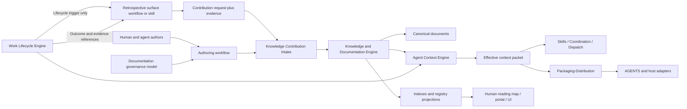

# Retained proposal and navigation: bounded conservation pack 2

Author session: codex-session:21@2026-10-14
Content commit: 55ec1e0c40410b70b1e4024232a233d4e3d96b3d

## claim_4d0848d63e81dd8bbd5da12766de0078

Source: `docs/platform/proposals/documentation-system-unification.md#unheaded-block-57`

Source unit SHA256: `d3ebe2ab547637b54a6ab88ac67964e2fc74fc30172883ca0ac8f76dc2e89f9d`
Shown source SHA256: `d3ebe2ab547637b54a6ab88ac67964e2fc74fc30172883ca0ac8f76dc2e89f9d`
Target: none (explicit retained exception, not a missing carrier).
Target digest: none.
Class: Judgment.

```json
{
  "claimId": "claim_4d0848d63e81dd8bbd5da12766de0078",
  "sourceUnitDigest": "d3ebe2ab547637b54a6ab88ac67964e2fc74fc30172883ca0ac8f76dc2e89f9d",
  "claimKind": "architecture",
  "disposition": "retain-as-evidence",
  "reviewStatus": "pending",
  "authoredBy": "codex-session:21@2026-10-14",
  "rationale": "Frozen map retains the already-in-topology non-canonical proposal at its existing path. Preserve this complete source unit unchanged as evidence of the proposed design; no source-to-itself carry proof, acceptance, authority change or truth certification is claimed. Source docs/platform/proposals/documentation-system-unification.md#unheaded-block-57 remains byte-identical."
}
```

Full shown source, retained byte-identically in place:

```text
The authoring door routes by intended contribution workflow as well as document
type. A request to discuss and shape architecture opens a non-canonical
discussion and later promotes stable claims. Completion of real work may trigger
post-work synthesis from actual diff, decisions, tests, captures, and outcomes.
Both paths share classification, registry, validation, and promotion
infrastructure, but canonicality is decided by `authorityPolicy`, not by whether
a human or agent produced the prose.
```

Diff: no document text change; disposition only, no target proposed.

## claim_9d1f68bfc23d3f4f410a67e4eb2d24e1

Source: `docs/platform/proposals/documentation-system-unification.md#unheaded-block-58`

Source unit SHA256: `c7474733496f3098e90e2cd11b51ff9cf83a9dfbc477a0a3ec847c676d05f57f`
Shown source SHA256: `c7474733496f3098e90e2cd11b51ff9cf83a9dfbc477a0a3ec847c676d05f57f`
Target: none (explicit retained exception, not a missing carrier).
Target digest: none.
Class: Judgment.

```json
{
  "claimId": "claim_9d1f68bfc23d3f4f410a67e4eb2d24e1",
  "sourceUnitDigest": "c7474733496f3098e90e2cd11b51ff9cf83a9dfbc477a0a3ec847c676d05f57f",
  "claimKind": "specification",
  "disposition": "retain-as-evidence",
  "reviewStatus": "pending",
  "authoredBy": "codex-session:21@2026-10-14",
  "rationale": "Frozen map retains the already-in-topology non-canonical proposal at its existing path. Preserve this complete source unit unchanged as evidence of the proposed design; no source-to-itself carry proof, acceptance, authority change or truth certification is claimed. Source docs/platform/proposals/documentation-system-unification.md#unheaded-block-58 remains byte-identical."
}
```

Full shown source, retained byte-identically in place:

```text
It should refuse free-form canonical paths, duplicate owners, direct edits to
generated files, accepted claims written only into discussion, and current-state
claims stored only as architectural rationale.
```

Diff: no document text change; disposition only, no target proposed.

## claim_c1c06183c888c84b4cba75310d3202b4

Source: `docs/platform/proposals/documentation-system-unification.md#45-extend-the-existing-cli-namespace`

Source unit SHA256: `e67021ab88f2e624d4d83868f69797f8c3e6b6a34fb8eef01b2fde9ef20b63f5`
Shown source SHA256: `3932d4c52c2762d71c71663b443caa6cb8cc0d413c777971918b51167101acec`
Target: none (explicit retained exception, not a missing carrier).
Target digest: none.
Class: Judgment.

```json
{
  "claimId": "claim_c1c06183c888c84b4cba75310d3202b4",
  "sourceUnitDigest": "e67021ab88f2e624d4d83868f69797f8c3e6b6a34fb8eef01b2fde9ef20b63f5",
  "claimKind": "historical-context",
  "disposition": "retain-as-evidence",
  "reviewStatus": "pending",
  "authoredBy": "codex-session:21@2026-10-14",
  "rationale": "Frozen map retains the already-in-topology non-canonical proposal at its existing path. Preserve this complete source unit unchanged as evidence of the proposed design; no source-to-itself carry proof, acceptance, authority change or truth certification is claimed. Source docs/platform/proposals/documentation-system-unification.md#45-extend-the-existing-cli-namespace remains byte-identical."
}
```

Full shown source, retained byte-identically in place:

````text
### 4.5. Extend the existing CLI namespace

Keep all existing lifecycle verbs. Add authoring and migration behavior under
the existing `fgos doc` namespace:

```sh
fgos doc classify <path-or-intent>
fgos doc new --type <type> --area <area> [--subcomponent <name>]
fgos doc check [--changed | <paths...>]
fgos doc inventory
fgos doc migrate --inventory <path> [--dry-run | --apply]
fgos doc retirement-check
```

`fgos docs-index` remains the discovery index for user-facing Diataxis docs.
`fgos doc-registry` remains the whole registry projection. `fgos doctor` checks
environment/configuration/projection health; `fgos doc check` checks document
semantics and changed content.

The semantic checker should understand file classes and validate only applicable
rules. Candidate checks include:

- one H1 and numbered maintained sections;
- required metadata and sections;
- allowed placement and cardinality;
- broken or missing typed links;
- duplicate claim ownership;
- generated-file immutability and freshness;
- decision supersession consistency;
- component-boundary declaration;
- intent-ledger impact;
- registry and index freshness;
- preview requirement for long, tabular, Mermaid, or multi-file documents.

Raw proof logs, requests, and result payloads must not be linted as maintained
canonical prose.
````

Diff: no document text change; disposition only, no target proposed.

## claim_8aeed2d1ca641df65df49e93a0204e0d

Source: `docs/platform/proposals/documentation-system-unification.md#unheaded-block-59`

Source unit SHA256: `6b7c3e8ea826dc57363729d594579615e6de7e7e4211436c4bcacd6154c23941`
Shown source SHA256: `6b7c3e8ea826dc57363729d594579615e6de7e7e4211436c4bcacd6154c23941`
Target: none (explicit retained exception, not a missing carrier).
Target digest: none.
Class: Judgment.

```json
{
  "claimId": "claim_8aeed2d1ca641df65df49e93a0204e0d",
  "sourceUnitDigest": "6b7c3e8ea826dc57363729d594579615e6de7e7e4211436c4bcacd6154c23941",
  "claimKind": "specification",
  "disposition": "retain-as-evidence",
  "reviewStatus": "pending",
  "authoredBy": "codex-session:21@2026-10-14",
  "rationale": "Frozen map retains the already-in-topology non-canonical proposal at its existing path. Preserve this complete source unit unchanged as evidence of the proposed design; no source-to-itself carry proof, acceptance, authority change or truth certification is claimed. Source docs/platform/proposals/documentation-system-unification.md#unheaded-block-59 remains byte-identical."
}
```

Full shown source, retained byte-identically in place:

```text
Keep all existing lifecycle verbs. Add authoring and migration behavior under
the existing `fgos doc` namespace:
```

Diff: no document text change; disposition only, no target proposed.

## claim_27b411616bbc1720ee6b63b49e0e9f6b

Source: `docs/platform/proposals/documentation-system-unification.md#unheaded-block-60`

Source unit SHA256: `11e8de78d632f95a5e04f0a2fc9d80de237949aa4945f1a2c0ce129a241e394e`
Shown source SHA256: `11e8de78d632f95a5e04f0a2fc9d80de237949aa4945f1a2c0ce129a241e394e`
Target: none (explicit retained exception, not a missing carrier).
Target digest: none.
Class: Judgment.

```json
{
  "claimId": "claim_27b411616bbc1720ee6b63b49e0e9f6b",
  "sourceUnitDigest": "11e8de78d632f95a5e04f0a2fc9d80de237949aa4945f1a2c0ce129a241e394e",
  "claimKind": "vision",
  "disposition": "retain-as-evidence",
  "reviewStatus": "pending",
  "authoredBy": "codex-session:21@2026-10-14",
  "rationale": "Frozen map retains the already-in-topology non-canonical proposal at its existing path. Preserve this complete source unit unchanged as evidence of the proposed design; no source-to-itself carry proof, acceptance, authority change or truth certification is claimed. Source docs/platform/proposals/documentation-system-unification.md#unheaded-block-60 remains byte-identical."
}
```

Full shown source, retained byte-identically in place:

````text
```sh
fgos doc classify <path-or-intent>
fgos doc new --type <type> --area <area> [--subcomponent <name>]
fgos doc check [--changed | <paths...>]
fgos doc inventory
fgos doc migrate --inventory <path> [--dry-run | --apply]
fgos doc retirement-check
```
````

Diff: no document text change; disposition only, no target proposed.

## claim_728f820bc03c651e158d6f94e4bdaad6

Source: `docs/platform/proposals/documentation-system-unification.md#unheaded-block-61`

Source unit SHA256: `f86f60b21a4d3b2e5d2618e32990e4978e6b7ef2a6fd3760b52e8ceaca6f6167`
Shown source SHA256: `f86f60b21a4d3b2e5d2618e32990e4978e6b7ef2a6fd3760b52e8ceaca6f6167`
Target: none (explicit retained exception, not a missing carrier).
Target digest: none.
Class: Judgment.

```json
{
  "claimId": "claim_728f820bc03c651e158d6f94e4bdaad6",
  "sourceUnitDigest": "f86f60b21a4d3b2e5d2618e32990e4978e6b7ef2a6fd3760b52e8ceaca6f6167",
  "claimKind": "historical-context",
  "disposition": "retain-as-evidence",
  "reviewStatus": "pending",
  "authoredBy": "codex-session:21@2026-10-14",
  "rationale": "Frozen map retains the already-in-topology non-canonical proposal at its existing path. Preserve this complete source unit unchanged as evidence of the proposed design; no source-to-itself carry proof, acceptance, authority change or truth certification is claimed. Source docs/platform/proposals/documentation-system-unification.md#unheaded-block-61 remains byte-identical."
}
```

Full shown source, retained byte-identically in place:

```text
`fgos docs-index` remains the discovery index for user-facing Diataxis docs.
`fgos doc-registry` remains the whole registry projection. `fgos doctor` checks
environment/configuration/projection health; `fgos doc check` checks document
semantics and changed content.
```

Diff: no document text change; disposition only, no target proposed.

## claim_61fc89ab5b10e5284f898e766e155384

Source: `docs/platform/proposals/documentation-system-unification.md#unheaded-block-62`

Source unit SHA256: `3489605c4f76c4df24cf961b827f1f977b29b7d3805cdda06974392287b74b87`
Shown source SHA256: `3489605c4f76c4df24cf961b827f1f977b29b7d3805cdda06974392287b74b87`
Target: none (explicit retained exception, not a missing carrier).
Target digest: none.
Class: Judgment.

```json
{
  "claimId": "claim_61fc89ab5b10e5284f898e766e155384",
  "sourceUnitDigest": "3489605c4f76c4df24cf961b827f1f977b29b7d3805cdda06974392287b74b87",
  "claimKind": "historical-context",
  "disposition": "retain-as-evidence",
  "reviewStatus": "pending",
  "authoredBy": "codex-session:21@2026-10-14",
  "rationale": "Frozen map retains the already-in-topology non-canonical proposal at its existing path. Preserve this complete source unit unchanged as evidence of the proposed design; no source-to-itself carry proof, acceptance, authority change or truth certification is claimed. Source docs/platform/proposals/documentation-system-unification.md#unheaded-block-62 remains byte-identical."
}
```

Full shown source, retained byte-identically in place:

```text
The semantic checker should understand file classes and validate only applicable
rules. Candidate checks include:
```

Diff: no document text change; disposition only, no target proposed.

## claim_b8632145d961ea51e6fe8793369ba718

Source: `docs/platform/proposals/documentation-system-unification.md#unheaded-block-63`

Source unit SHA256: `afdb4f5ff5bc5f89a22863ba23b032ae8538e2fc1731ed81a86833f058a92ff7`
Shown source SHA256: `afdb4f5ff5bc5f89a22863ba23b032ae8538e2fc1731ed81a86833f058a92ff7`
Target: none (explicit retained exception, not a missing carrier).
Target digest: none.
Class: Judgment.

```json
{
  "claimId": "claim_b8632145d961ea51e6fe8793369ba718",
  "sourceUnitDigest": "afdb4f5ff5bc5f89a22863ba23b032ae8538e2fc1731ed81a86833f058a92ff7",
  "claimKind": "historical-context",
  "disposition": "retain-as-evidence",
  "reviewStatus": "pending",
  "authoredBy": "codex-session:21@2026-10-14",
  "rationale": "Frozen map retains the already-in-topology non-canonical proposal at its existing path. Preserve this complete source unit unchanged as evidence of the proposed design; no source-to-itself carry proof, acceptance, authority change or truth certification is claimed. Source docs/platform/proposals/documentation-system-unification.md#unheaded-block-63 remains byte-identical."
}
```

Full shown source, retained byte-identically in place:

```text
- one H1 and numbered maintained sections;
- required metadata and sections;
- allowed placement and cardinality;
- broken or missing typed links;
- duplicate claim ownership;
- generated-file immutability and freshness;
- decision supersession consistency;
- component-boundary declaration;
- intent-ledger impact;
- registry and index freshness;
- preview requirement for long, tabular, Mermaid, or multi-file documents.
```

Diff: no document text change; disposition only, no target proposed.

## claim_e7092f2ce7f544fd93ac28970271f415

Source: `docs/platform/proposals/documentation-system-unification.md#unheaded-block-64`

Source unit SHA256: `566fe73efc56a6a19a28a1dd7cb4f98e84c9b8b1154d71b93bb91391c6a3d26a`
Shown source SHA256: `566fe73efc56a6a19a28a1dd7cb4f98e84c9b8b1154d71b93bb91391c6a3d26a`
Target: none (explicit retained exception, not a missing carrier).
Target digest: none.
Class: Judgment.

```json
{
  "claimId": "claim_e7092f2ce7f544fd93ac28970271f415",
  "sourceUnitDigest": "566fe73efc56a6a19a28a1dd7cb4f98e84c9b8b1154d71b93bb91391c6a3d26a",
  "claimKind": "verification",
  "disposition": "retain-as-evidence",
  "reviewStatus": "pending",
  "authoredBy": "codex-session:21@2026-10-14",
  "rationale": "Frozen map retains the already-in-topology non-canonical proposal at its existing path. Preserve this complete source unit unchanged as evidence of the proposed design; no source-to-itself carry proof, acceptance, authority change or truth certification is claimed. Source docs/platform/proposals/documentation-system-unification.md#unheaded-block-64 remains byte-identical."
}
```

Full shown source, retained byte-identically in place:

```text
Raw proof logs, requests, and result payloads must not be linted as maintained
canonical prose.
```

Diff: no document text change; disposition only, no target proposed.

## claim_241e6dc3d1ecd0fc1d18a2c3bfb7b5d2

Source: `docs/platform/proposals/documentation-system-unification.md#46-distilled-agent-read-surface`

Source unit SHA256: `93526ec5239b4d744a1d545e6b3e51da9797b89710dc49cb337b5332e22fddcc`
Shown source SHA256: `1d3bc7c33de3b0ee9a4e0499d240aaecaf89b10abb80b4df2595102530fac640`
Target: none (explicit retained exception, not a missing carrier).
Target digest: none.
Class: Judgment.

```json
{
  "claimId": "claim_241e6dc3d1ecd0fc1d18a2c3bfb7b5d2",
  "sourceUnitDigest": "93526ec5239b4d744a1d545e6b3e51da9797b89710dc49cb337b5332e22fddcc",
  "claimKind": "historical-context",
  "disposition": "retain-as-evidence",
  "reviewStatus": "pending",
  "authoredBy": "codex-session:21@2026-10-14",
  "rationale": "Frozen map retains the already-in-topology non-canonical proposal at its existing path. Preserve this complete source unit unchanged as evidence of the proposed design; no source-to-itself carry proof, acceptance, authority change or truth certification is claimed. Source docs/platform/proposals/documentation-system-unification.md#46-distilled-agent-read-surface remains byte-identical."
}
```

Full shown source, retained byte-identically in place:

````text
### 4.6. Distilled agent read surface

The canonical documentation graph is too large to load for every agent action.
Requiring every agent to read the full governance, platform, area, contract,
decision, and history corpus would waste tokens and wall time while increasing
the chance that obsolete context is mistaken for current instruction. The system
therefore needs a generated, progressively disclosed agent read surface.

This is not a new authority layer. It is a projection compiled from canonical
instruction sources, active rules, effective decisions, and documentation
registry relationships. Every projected statement retains a source pointer and
freshness digest; missing or ambiguous authority fails projection rather than
being summarized by guesswork.

The repository already has part of this foundation:

- `src/setup/instruction-registry.mjs` discovers canonical instruction units;
- `src/setup/instruction-composition.mjs` composes laws, boundaries, procedures,
  preferences, host adapters, refinement, override, conflict, and supersession;
- `src/setup/instruction-projections.mjs` materializes an effective-set JSON and
  a managed `AGENTS.md` block with a projection ledger;
- setup/doctor detects and repairs stale instruction projections;
- `fgos decision-index` generates a deterministic decision history projection;
- skills carry detailed procedures that can be loaded only when triggered.

This foundation is implemented but not yet sufficient as the complete agent read
surface. The current repo effective set contains only the platform-laws unit;
domain instructions are not a repo-scoped task packet; the decision index is a
chronological history that still displays superseded and partially superseded
decisions; and there is no generated, area/task-scoped packet with an explicit
token budget.

The target should use progressive disclosure:

| Level | Content | Default loading |
|---|---|---|
| L0 — Trigger | Tiny standing directives telling the agent which skill/door to use | Always loaded |
| L1 — Effective brief | Applicable prose instructions, RULES, boundaries, and active decision conclusions | Loaded for the selected repo/domain/area/task scope |
| L2 — Scoped context packet | Relevant current spec/contract summaries, ownership, verification expectations, and exact deep links | Loaded when a task is classified or claimed |
| L3 — Canonical source | Full specs, architecture, contracts, decisions, and guides | Read on demand when detail is required |
| L4 — History and evidence | Superseded ADRs, discussions, migrations, raw proof, and audit trail | Read only for rationale, dispute, or forensic work |

L1 must distinguish three compiled sections rather than flattening them into one
summary:

1. **Prose instructions** — concise operating guidance and routing pointers.
2. **RULES** — enforceable laws, boundaries, procedures, and prohibitions with
   their force and owner preserved.
3. **Effective decisions** — the current conclusion for each decision scope after
   supersession, with a pointer to the full decision chain.

The effective-decision view must not delete decision history. It hides inactive
ancestors from the default brief while retaining a trace such as:

```text
current decision → supersedes/partially supersedes → prior decisions → evidence
```

Partial supersession requires claim- or clause-level modeling. A document-level
“latest ADR wins” rule is unsafe when a newer decision replaces only terminology
or one constraint while leaving the rest of an older decision active.

The projection compiler should select content using registry metadata and real
task context: target repo/domain/component/area/subcomponent, document authority,
changed paths or declared footprint, skill/command, and host. Selection must be
deterministic and inspectable: an agent or maintainer can ask why a rule or
decision was included, excluded, or considered superseded.

Each effective brief or context packet should declare:

- target scope and host;
- source document/decision/instruction IDs;
- source and effective-set digests;
- generated time and freshness check;
- token or byte budget;
- omitted sections with links for deeper reading;
- conflicts or unresolved supersession, which fail closed rather than silently
  choosing one text.

The desired outcome is not “the agent never reads detailed docs.” It is that the
agent starts with a small, current, unambiguous execution surface and follows
typed links into canonical detail or history only when the task requires it.
````

Diff: no document text change; disposition only, no target proposed.

## claim_49e8dfa791ac2028dab26f63410c8c88

Source: `docs/platform/proposals/documentation-system-unification.md#unheaded-block-65`

Source unit SHA256: `8a90425767c2ccd36cc76aeb9cabf083dc4276cdc931fed4ca2eca2cb518de54`
Shown source SHA256: `8a90425767c2ccd36cc76aeb9cabf083dc4276cdc931fed4ca2eca2cb518de54`
Target: none (explicit retained exception, not a missing carrier).
Target digest: none.
Class: Judgment.

```json
{
  "claimId": "claim_49e8dfa791ac2028dab26f63410c8c88",
  "sourceUnitDigest": "8a90425767c2ccd36cc76aeb9cabf083dc4276cdc931fed4ca2eca2cb518de54",
  "claimKind": "decision",
  "disposition": "retain-as-evidence",
  "reviewStatus": "pending",
  "authoredBy": "codex-session:21@2026-10-14",
  "rationale": "Frozen map retains the already-in-topology non-canonical proposal at its existing path. Preserve this complete source unit unchanged as evidence of the proposed design; no source-to-itself carry proof, acceptance, authority change or truth certification is claimed. Source docs/platform/proposals/documentation-system-unification.md#unheaded-block-65 remains byte-identical."
}
```

Full shown source, retained byte-identically in place:

```text
The canonical documentation graph is too large to load for every agent action.
Requiring every agent to read the full governance, platform, area, contract,
decision, and history corpus would waste tokens and wall time while increasing
the chance that obsolete context is mistaken for current instruction. The system
therefore needs a generated, progressively disclosed agent read surface.
```

Diff: no document text change; disposition only, no target proposed.

## claim_3278fe886264a6bd21ca500952a41b10

Source: `docs/platform/proposals/documentation-system-unification.md#unheaded-block-66`

Source unit SHA256: `bc072522957cf8ccdf89815dacb61bf26f4b86d9a5e07de0e3b71edd674d8877`
Shown source SHA256: `bc072522957cf8ccdf89815dacb61bf26f4b86d9a5e07de0e3b71edd674d8877`
Target: none (explicit retained exception, not a missing carrier).
Target digest: none.
Class: Judgment.

```json
{
  "claimId": "claim_3278fe886264a6bd21ca500952a41b10",
  "sourceUnitDigest": "bc072522957cf8ccdf89815dacb61bf26f4b86d9a5e07de0e3b71edd674d8877",
  "claimKind": "historical-context",
  "disposition": "retain-as-evidence",
  "reviewStatus": "pending",
  "authoredBy": "codex-session:21@2026-10-14",
  "rationale": "Frozen map retains the already-in-topology non-canonical proposal at its existing path. Preserve this complete source unit unchanged as evidence of the proposed design; no source-to-itself carry proof, acceptance, authority change or truth certification is claimed. Source docs/platform/proposals/documentation-system-unification.md#unheaded-block-66 remains byte-identical."
}
```

Full shown source, retained byte-identically in place:

```text
This is not a new authority layer. It is a projection compiled from canonical
instruction sources, active rules, effective decisions, and documentation
registry relationships. Every projected statement retains a source pointer and
freshness digest; missing or ambiguous authority fails projection rather than
being summarized by guesswork.
```

Diff: no document text change; disposition only, no target proposed.

## claim_1712c4e12e7103d9c498520ff9944dac

Source: `docs/platform/proposals/documentation-system-unification.md#unheaded-block-67`

Source unit SHA256: `b6659af009c3a2701a42bf880ec5ed4da74a45e73f7f4ceee5c98294be5ca7ef`
Shown source SHA256: `b6659af009c3a2701a42bf880ec5ed4da74a45e73f7f4ceee5c98294be5ca7ef`
Target: none (explicit retained exception, not a missing carrier).
Target digest: none.
Class: Judgment.

```json
{
  "claimId": "claim_1712c4e12e7103d9c498520ff9944dac",
  "sourceUnitDigest": "b6659af009c3a2701a42bf880ec5ed4da74a45e73f7f4ceee5c98294be5ca7ef",
  "claimKind": "historical-context",
  "disposition": "retain-as-evidence",
  "reviewStatus": "pending",
  "authoredBy": "codex-session:21@2026-10-14",
  "rationale": "Frozen map retains the already-in-topology non-canonical proposal at its existing path. Preserve this complete source unit unchanged as evidence of the proposed design; no source-to-itself carry proof, acceptance, authority change or truth certification is claimed. Source docs/platform/proposals/documentation-system-unification.md#unheaded-block-67 remains byte-identical."
}
```

Full shown source, retained byte-identically in place:

```text
The repository already has part of this foundation:
```

Diff: no document text change; disposition only, no target proposed.

## claim_feb2d0f01a681ec1509602bf941effa2

Source: `docs/platform/proposals/documentation-system-unification.md#unheaded-block-68`

Source unit SHA256: `b330e3de563a87e3a65d5d51e47fd5f4cd1daeab4cf56d00ba1625747d125c1f`
Shown source SHA256: `b330e3de563a87e3a65d5d51e47fd5f4cd1daeab4cf56d00ba1625747d125c1f`
Target: none (explicit retained exception, not a missing carrier).
Target digest: none.
Class: Judgment.

```json
{
  "claimId": "claim_feb2d0f01a681ec1509602bf941effa2",
  "sourceUnitDigest": "b330e3de563a87e3a65d5d51e47fd5f4cd1daeab4cf56d00ba1625747d125c1f",
  "claimKind": "historical-context",
  "disposition": "retain-as-evidence",
  "reviewStatus": "pending",
  "authoredBy": "codex-session:21@2026-10-14",
  "rationale": "Frozen map retains the already-in-topology non-canonical proposal at its existing path. Preserve this complete source unit unchanged as evidence of the proposed design; no source-to-itself carry proof, acceptance, authority change or truth certification is claimed. Source docs/platform/proposals/documentation-system-unification.md#unheaded-block-68 remains byte-identical."
}
```

Full shown source, retained byte-identically in place:

```text
- `src/setup/instruction-registry.mjs` discovers canonical instruction units;
- `src/setup/instruction-composition.mjs` composes laws, boundaries, procedures,
  preferences, host adapters, refinement, override, conflict, and supersession;
- `src/setup/instruction-projections.mjs` materializes an effective-set JSON and
  a managed `AGENTS.md` block with a projection ledger;
- setup/doctor detects and repairs stale instruction projections;
- `fgos decision-index` generates a deterministic decision history projection;
- skills carry detailed procedures that can be loaded only when triggered.
```

Diff: no document text change; disposition only, no target proposed.

## claim_f6d5a98f7622e5ccdce5a26bcefc4741

Source: `docs/platform/proposals/documentation-system-unification.md#unheaded-block-69`

Source unit SHA256: `aacace03eeca9bb7bbf5c680c015e5bc71c8e3179ca2bce7eeca9eedce78580e`
Shown source SHA256: `aacace03eeca9bb7bbf5c680c015e5bc71c8e3179ca2bce7eeca9eedce78580e`
Target: none (explicit retained exception, not a missing carrier).
Target digest: none.
Class: Judgment.

```json
{
  "claimId": "claim_f6d5a98f7622e5ccdce5a26bcefc4741",
  "sourceUnitDigest": "aacace03eeca9bb7bbf5c680c015e5bc71c8e3179ca2bce7eeca9eedce78580e",
  "claimKind": "historical-context",
  "disposition": "retain-as-evidence",
  "reviewStatus": "pending",
  "authoredBy": "codex-session:21@2026-10-14",
  "rationale": "Frozen map retains the already-in-topology non-canonical proposal at its existing path. Preserve this complete source unit unchanged as evidence of the proposed design; no source-to-itself carry proof, acceptance, authority change or truth certification is claimed. Source docs/platform/proposals/documentation-system-unification.md#unheaded-block-69 remains byte-identical."
}
```

Full shown source, retained byte-identically in place:

```text
This foundation is implemented but not yet sufficient as the complete agent read
surface. The current repo effective set contains only the platform-laws unit;
domain instructions are not a repo-scoped task packet; the decision index is a
chronological history that still displays superseded and partially superseded
decisions; and there is no generated, area/task-scoped packet with an explicit
token budget.
```

Diff: no document text change; disposition only, no target proposed.

## claim_c5b2308653b81a6779a2c664f2dac401

Source: `docs/platform/proposals/documentation-system-unification.md#unheaded-block-70`

Source unit SHA256: `08782cee5fccef18f36777e986fc2ba5a398d10d956b8f752ee743e52dea0298`
Shown source SHA256: `08782cee5fccef18f36777e986fc2ba5a398d10d956b8f752ee743e52dea0298`
Target: none (explicit retained exception, not a missing carrier).
Target digest: none.
Class: Judgment.

```json
{
  "claimId": "claim_c5b2308653b81a6779a2c664f2dac401",
  "sourceUnitDigest": "08782cee5fccef18f36777e986fc2ba5a398d10d956b8f752ee743e52dea0298",
  "claimKind": "historical-context",
  "disposition": "retain-as-evidence",
  "reviewStatus": "pending",
  "authoredBy": "codex-session:21@2026-10-14",
  "rationale": "Frozen map retains the already-in-topology non-canonical proposal at its existing path. Preserve this complete source unit unchanged as evidence of the proposed design; no source-to-itself carry proof, acceptance, authority change or truth certification is claimed. Source docs/platform/proposals/documentation-system-unification.md#unheaded-block-70 remains byte-identical."
}
```

Full shown source, retained byte-identically in place:

```text
The target should use progressive disclosure:
```

Diff: no document text change; disposition only, no target proposed.

## claim_4b7ef6279036bba613322911fb43572c

Source: `docs/platform/proposals/documentation-system-unification.md#unheaded-block-71`

Source unit SHA256: `5a02a8bb7cc498be56a8ac969f737adc23d9b4a4dd63a8d8869cd07842a0d316`
Shown source SHA256: `5a02a8bb7cc498be56a8ac969f737adc23d9b4a4dd63a8d8869cd07842a0d316`
Target: none (explicit retained exception, not a missing carrier).
Target digest: none.
Class: Judgment.

```json
{
  "claimId": "claim_4b7ef6279036bba613322911fb43572c",
  "sourceUnitDigest": "5a02a8bb7cc498be56a8ac969f737adc23d9b4a4dd63a8d8869cd07842a0d316",
  "claimKind": "historical-context",
  "disposition": "retain-as-evidence",
  "reviewStatus": "pending",
  "authoredBy": "codex-session:21@2026-10-14",
  "rationale": "Frozen map retains the already-in-topology non-canonical proposal at its existing path. Preserve this complete source unit unchanged as evidence of the proposed design; no source-to-itself carry proof, acceptance, authority change or truth certification is claimed. Source docs/platform/proposals/documentation-system-unification.md#unheaded-block-71 remains byte-identical."
}
```

Full shown source, retained byte-identically in place:

```text
| Level | Content | Default loading |
|---|---|---|
| L0 — Trigger | Tiny standing directives telling the agent which skill/door to use | Always loaded |
| L1 — Effective brief | Applicable prose instructions, RULES, boundaries, and active decision conclusions | Loaded for the selected repo/domain/area/task scope |
| L2 — Scoped context packet | Relevant current spec/contract summaries, ownership, verification expectations, and exact deep links | Loaded when a task is classified or claimed |
| L3 — Canonical source | Full specs, architecture, contracts, decisions, and guides | Read on demand when detail is required |
| L4 — History and evidence | Superseded ADRs, discussions, migrations, raw proof, and audit trail | Read only for rationale, dispute, or forensic work |
```

Diff: no document text change; disposition only, no target proposed.

## claim_5fc2d47188521e436babc480cbbf7ebf

Source: `docs/platform/proposals/documentation-system-unification.md#unheaded-block-72`

Source unit SHA256: `45b0e8443726452d379796827fb10bb02ea803a84a062ca137a1331404258ddc`
Shown source SHA256: `45b0e8443726452d379796827fb10bb02ea803a84a062ca137a1331404258ddc`
Target: none (explicit retained exception, not a missing carrier).
Target digest: none.
Class: Judgment.

```json
{
  "claimId": "claim_5fc2d47188521e436babc480cbbf7ebf",
  "sourceUnitDigest": "45b0e8443726452d379796827fb10bb02ea803a84a062ca137a1331404258ddc",
  "claimKind": "historical-context",
  "disposition": "retain-as-evidence",
  "reviewStatus": "pending",
  "authoredBy": "codex-session:21@2026-10-14",
  "rationale": "Frozen map retains the already-in-topology non-canonical proposal at its existing path. Preserve this complete source unit unchanged as evidence of the proposed design; no source-to-itself carry proof, acceptance, authority change or truth certification is claimed. Source docs/platform/proposals/documentation-system-unification.md#unheaded-block-72 remains byte-identical."
}
```

Full shown source, retained byte-identically in place:

```text
L1 must distinguish three compiled sections rather than flattening them into one
summary:
```

Diff: no document text change; disposition only, no target proposed.

## claim_e34913b2086b992db1df68457994f327

Source: `docs/platform/proposals/documentation-system-unification.md#unheaded-block-73`

Source unit SHA256: `ddbcb53b1f15a4c348beb1aaf8860c55506276e42b10fd9155a834d03e767587`
Shown source SHA256: `ddbcb53b1f15a4c348beb1aaf8860c55506276e42b10fd9155a834d03e767587`
Target: none (explicit retained exception, not a missing carrier).
Target digest: none.
Class: Judgment.

```json
{
  "claimId": "claim_e34913b2086b992db1df68457994f327",
  "sourceUnitDigest": "ddbcb53b1f15a4c348beb1aaf8860c55506276e42b10fd9155a834d03e767587",
  "claimKind": "historical-context",
  "disposition": "retain-as-evidence",
  "reviewStatus": "pending",
  "authoredBy": "codex-session:21@2026-10-14",
  "rationale": "Frozen map retains the already-in-topology non-canonical proposal at its existing path. Preserve this complete source unit unchanged as evidence of the proposed design; no source-to-itself carry proof, acceptance, authority change or truth certification is claimed. Source docs/platform/proposals/documentation-system-unification.md#unheaded-block-73 remains byte-identical."
}
```

Full shown source, retained byte-identically in place:

```text
1. **Prose instructions** — concise operating guidance and routing pointers.
2. **RULES** — enforceable laws, boundaries, procedures, and prohibitions with
   their force and owner preserved.
3. **Effective decisions** — the current conclusion for each decision scope after
   supersession, with a pointer to the full decision chain.
```

Diff: no document text change; disposition only, no target proposed.

## claim_d27c09fa1dcb27383b73fb8a774db879

Source: `docs/platform/proposals/documentation-system-unification.md#unheaded-block-74`

Source unit SHA256: `6484f6dd24c118965efe15ae2ffacb7ec6056d328b32417ede56e31110019837`
Shown source SHA256: `6484f6dd24c118965efe15ae2ffacb7ec6056d328b32417ede56e31110019837`
Target: none (explicit retained exception, not a missing carrier).
Target digest: none.
Class: Judgment.

```json
{
  "claimId": "claim_d27c09fa1dcb27383b73fb8a774db879",
  "sourceUnitDigest": "6484f6dd24c118965efe15ae2ffacb7ec6056d328b32417ede56e31110019837",
  "claimKind": "decision",
  "disposition": "retain-as-evidence",
  "reviewStatus": "pending",
  "authoredBy": "codex-session:21@2026-10-14",
  "rationale": "Frozen map retains the already-in-topology non-canonical proposal at its existing path. Preserve this complete source unit unchanged as evidence of the proposed design; no source-to-itself carry proof, acceptance, authority change or truth certification is claimed. Source docs/platform/proposals/documentation-system-unification.md#unheaded-block-74 remains byte-identical."
}
```

Full shown source, retained byte-identically in place:

```text
The effective-decision view must not delete decision history. It hides inactive
ancestors from the default brief while retaining a trace such as:
```

Diff: no document text change; disposition only, no target proposed.

## claim_aaaa1260d601882391736fdd8a977767

Source: `docs/platform/proposals/documentation-system-unification.md#unheaded-block-75`

Source unit SHA256: `44d8a53ad2ba3c643ccceda5a822b47e87b7a8ab92f5657c49bc2c63137845ce`
Shown source SHA256: `44d8a53ad2ba3c643ccceda5a822b47e87b7a8ab92f5657c49bc2c63137845ce`
Target: none (explicit retained exception, not a missing carrier).
Target digest: none.
Class: Judgment.

```json
{
  "claimId": "claim_aaaa1260d601882391736fdd8a977767",
  "sourceUnitDigest": "44d8a53ad2ba3c643ccceda5a822b47e87b7a8ab92f5657c49bc2c63137845ce",
  "claimKind": "decision",
  "disposition": "retain-as-evidence",
  "reviewStatus": "pending",
  "authoredBy": "codex-session:21@2026-10-14",
  "rationale": "Frozen map retains the already-in-topology non-canonical proposal at its existing path. Preserve this complete source unit unchanged as evidence of the proposed design; no source-to-itself carry proof, acceptance, authority change or truth certification is claimed. Source docs/platform/proposals/documentation-system-unification.md#unheaded-block-75 remains byte-identical."
}
```

Full shown source, retained byte-identically in place:

````text
```text
current decision → supersedes/partially supersedes → prior decisions → evidence
```
````

Diff: no document text change; disposition only, no target proposed.

## claim_e0f573100368f5f3d59f31b74e2ed5a5

Source: `docs/platform/proposals/documentation-system-unification.md#unheaded-block-76`

Source unit SHA256: `f7cec73a4d110ce16ff5498a8632b77499f9153524b35b965556457b745f6e31`
Shown source SHA256: `f7cec73a4d110ce16ff5498a8632b77499f9153524b35b965556457b745f6e31`
Target: none (explicit retained exception, not a missing carrier).
Target digest: none.
Class: Judgment.

```json
{
  "claimId": "claim_e0f573100368f5f3d59f31b74e2ed5a5",
  "sourceUnitDigest": "f7cec73a4d110ce16ff5498a8632b77499f9153524b35b965556457b745f6e31",
  "claimKind": "decision",
  "disposition": "retain-as-evidence",
  "reviewStatus": "pending",
  "authoredBy": "codex-session:21@2026-10-14",
  "rationale": "Frozen map retains the already-in-topology non-canonical proposal at its existing path. Preserve this complete source unit unchanged as evidence of the proposed design; no source-to-itself carry proof, acceptance, authority change or truth certification is claimed. Source docs/platform/proposals/documentation-system-unification.md#unheaded-block-76 remains byte-identical."
}
```

Full shown source, retained byte-identically in place:

```text
Partial supersession requires claim- or clause-level modeling. A document-level
“latest ADR wins” rule is unsafe when a newer decision replaces only terminology
or one constraint while leaving the rest of an older decision active.
```

Diff: no document text change; disposition only, no target proposed.

## claim_f5e48ab618535bf3fff06b7cc4832520

Source: `docs/platform/proposals/documentation-system-unification.md#unheaded-block-77`

Source unit SHA256: `d8c35ce4c9110cdf789b0f347491256e3dfa3a36ff4c7689fcf8d8caaa2cf4f0`
Shown source SHA256: `d8c35ce4c9110cdf789b0f347491256e3dfa3a36ff4c7689fcf8d8caaa2cf4f0`
Target: none (explicit retained exception, not a missing carrier).
Target digest: none.
Class: Judgment.

```json
{
  "claimId": "claim_f5e48ab618535bf3fff06b7cc4832520",
  "sourceUnitDigest": "d8c35ce4c9110cdf789b0f347491256e3dfa3a36ff4c7689fcf8d8caaa2cf4f0",
  "claimKind": "architecture",
  "disposition": "retain-as-evidence",
  "reviewStatus": "pending",
  "authoredBy": "codex-session:21@2026-10-14",
  "rationale": "Frozen map retains the already-in-topology non-canonical proposal at its existing path. Preserve this complete source unit unchanged as evidence of the proposed design; no source-to-itself carry proof, acceptance, authority change or truth certification is claimed. Source docs/platform/proposals/documentation-system-unification.md#unheaded-block-77 remains byte-identical."
}
```

Full shown source, retained byte-identically in place:

```text
The projection compiler should select content using registry metadata and real
task context: target repo/domain/component/area/subcomponent, document authority,
changed paths or declared footprint, skill/command, and host. Selection must be
deterministic and inspectable: an agent or maintainer can ask why a rule or
decision was included, excluded, or considered superseded.
```

Diff: no document text change; disposition only, no target proposed.

## claim_4a5fdbb81aaaeb053ffb8ac5716fbd5e

Source: `docs/platform/proposals/documentation-system-unification.md#unheaded-block-78`

Source unit SHA256: `eb45711df771b567638bf9de058da48d9eb713ed89362aa47086f32dd705c4a7`
Shown source SHA256: `eb45711df771b567638bf9de058da48d9eb713ed89362aa47086f32dd705c4a7`
Target: none (explicit retained exception, not a missing carrier).
Target digest: none.
Class: Judgment.

```json
{
  "claimId": "claim_4a5fdbb81aaaeb053ffb8ac5716fbd5e",
  "sourceUnitDigest": "eb45711df771b567638bf9de058da48d9eb713ed89362aa47086f32dd705c4a7",
  "claimKind": "historical-context",
  "disposition": "retain-as-evidence",
  "reviewStatus": "pending",
  "authoredBy": "codex-session:21@2026-10-14",
  "rationale": "Frozen map retains the already-in-topology non-canonical proposal at its existing path. Preserve this complete source unit unchanged as evidence of the proposed design; no source-to-itself carry proof, acceptance, authority change or truth certification is claimed. Source docs/platform/proposals/documentation-system-unification.md#unheaded-block-78 remains byte-identical."
}
```

Full shown source, retained byte-identically in place:

```text
Each effective brief or context packet should declare:
```

Diff: no document text change; disposition only, no target proposed.

## claim_729b7a5ed0df53624dfa7cdbebc10a5b

Source: `docs/platform/proposals/documentation-system-unification.md#unheaded-block-79`

Source unit SHA256: `a2975222a52b981fb08492c3a0d57176ff1647ce1e0ce1883628fcc7e60a7601`
Shown source SHA256: `a2975222a52b981fb08492c3a0d57176ff1647ce1e0ce1883628fcc7e60a7601`
Target: none (explicit retained exception, not a missing carrier).
Target digest: none.
Class: Judgment.

```json
{
  "claimId": "claim_729b7a5ed0df53624dfa7cdbebc10a5b",
  "sourceUnitDigest": "a2975222a52b981fb08492c3a0d57176ff1647ce1e0ce1883628fcc7e60a7601",
  "claimKind": "decision",
  "disposition": "retain-as-evidence",
  "reviewStatus": "pending",
  "authoredBy": "codex-session:21@2026-10-14",
  "rationale": "Frozen map retains the already-in-topology non-canonical proposal at its existing path. Preserve this complete source unit unchanged as evidence of the proposed design; no source-to-itself carry proof, acceptance, authority change or truth certification is claimed. Source docs/platform/proposals/documentation-system-unification.md#unheaded-block-79 remains byte-identical."
}
```

Full shown source, retained byte-identically in place:

```text
- target scope and host;
- source document/decision/instruction IDs;
- source and effective-set digests;
- generated time and freshness check;
- token or byte budget;
- omitted sections with links for deeper reading;
- conflicts or unresolved supersession, which fail closed rather than silently
  choosing one text.
```

Diff: no document text change; disposition only, no target proposed.

## claim_5e175669c2997a0ebabb8e88048c5e57

Source: `docs/platform/proposals/documentation-system-unification.md#unheaded-block-80`

Source unit SHA256: `fd3686d72fbbbdd499d312e151ed915074917c558202d2612b8089772b6dd388`
Shown source SHA256: `fd3686d72fbbbdd499d312e151ed915074917c558202d2612b8089772b6dd388`
Target: none (explicit retained exception, not a missing carrier).
Target digest: none.
Class: Judgment.

```json
{
  "claimId": "claim_5e175669c2997a0ebabb8e88048c5e57",
  "sourceUnitDigest": "fd3686d72fbbbdd499d312e151ed915074917c558202d2612b8089772b6dd388",
  "claimKind": "historical-context",
  "disposition": "retain-as-evidence",
  "reviewStatus": "pending",
  "authoredBy": "codex-session:21@2026-10-14",
  "rationale": "Frozen map retains the already-in-topology non-canonical proposal at its existing path. Preserve this complete source unit unchanged as evidence of the proposed design; no source-to-itself carry proof, acceptance, authority change or truth certification is claimed. Source docs/platform/proposals/documentation-system-unification.md#unheaded-block-80 remains byte-identical."
}
```

Full shown source, retained byte-identically in place:

```text
The desired outcome is not “the agent never reads detailed docs.” It is that the
agent starts with a small, current, unambiguous execution surface and follows
typed links into canonical detail or history only when the task requires it.
```

Diff: no document text change; disposition only, no target proposed.

## claim_2375dccd6587bf2aaa2d9aa17ee4f8c9

Source: `docs/platform/proposals/documentation-system-unification.md#461-static-human-map-versus-dynamic-agent-reading-plan`

Source unit SHA256: `62aa59d81f1d06c6fe31e84a491431af32c35f7e66f696582c72ab34607cfc2b`
Shown source SHA256: `1e5a488c0ad056748949242d4fea918308709dbe2ca9fab6c706fe1b03b87051`
Target: none (explicit retained exception, not a missing carrier).
Target digest: none.
Class: Judgment.

```json
{
  "claimId": "claim_2375dccd6587bf2aaa2d9aa17ee4f8c9",
  "sourceUnitDigest": "62aa59d81f1d06c6fe31e84a491431af32c35f7e66f696582c72ab34607cfc2b",
  "claimKind": "historical-context",
  "disposition": "retain-as-evidence",
  "reviewStatus": "pending",
  "authoredBy": "codex-session:21@2026-10-14",
  "rationale": "Frozen map retains the already-in-topology non-canonical proposal at its existing path. Preserve this complete source unit unchanged as evidence of the proposed design; no source-to-itself carry proof, acceptance, authority change or truth certification is claimed. Source docs/platform/proposals/documentation-system-unification.md#461-static-human-map-versus-dynamic-agent-reading-plan remains byte-identical."
}
```

Full shown source, retained byte-identically in place:

````text
#### 4.6.1. Static human map versus dynamic agent reading plan

`docs/reading-map.md` should remain a small human portal: it answers where a
person starts and how the documentation system is organized. It should not be
the payload every agent receives, and it should not attempt to enumerate every
area, contract, decision, proof, or source path. A large static map duplicates
the registry, becomes stale, and spends agent context before the task is known.

For agents, replace “read the reading map” with a dynamic reading-plan compiler.
Given real task context, it returns the smallest sufficient ordered set of
instruction fragments, current claims, source sections, and deeper links.

```text
Task intent + operation + stage + domain/area + affected paths + audience
    -> scope resolver
    -> applicable instruction/rule composition
    -> active decision reduction
    -> document-graph traversal
    -> budgeted reading plan
```

The reading plan is a manifest, not another prose document. A candidate surface
is:

```sh
fgos doc context \
  --for implement \
  --area runner \
  --paths src/runner/dispatch.mjs,test/runner/dispatch.test.mjs \
  --stage executing \
  --budget 6000
```

Its result separates:

| Bucket | Meaning |
|---|---|
| `mustRead` | Sources required before the requested operation is safe or valid |
| `inlineBrief` | Small current instruction/rule/decision content injected directly |
| `readOnDemand` | Canonical detail linked for a likely branch of the work |
| `historyOnDemand` | Superseded decisions and evidence needed only for rationale or dispute |
| `excluded` | Candidates omitted because they are irrelevant, superseded, lower authority, or outside budget, with reasons |

Selection should be deterministic before semantic ranking. Hard inclusion comes
from authority and declared relationships: applicable laws/boundaries,
document-authoring rules when docs are touched, the owning area and current spec,
contracts whose owned/consumed edges intersect the change, active decisions for
those scopes, and declared verification obligations. Semantic similarity may
rank optional material but must not decide whether a normative rule applies.

The graph needs typed edges such as `owns`, `constrains`, `implements`,
`consumes`, `evidencedBy`, `supersedes`, `refines`, `routesTo`, and
`appliesToPath`. The registry and constitution provide nodes and policy; the
dynamic resolver walks only the edges relevant to the requested operation.

Budgeting must degrade by depth, not by arbitrary truncation:

1. Never omit applicable laws, authority boundaries, or exact contracts solely
   to meet a budget; fail and request a larger budget if the mandatory set is too
   large.
2. Inline conclusions and precise section anchors before full documents.
3. Drop optional explanation and history before current spec or contract detail.
4. Report every omitted candidate and the link by which it can be loaded later.

The plan should be expandable during execution. When an agent encounters a new
component, contract, decision ID, or ambiguity, it asks for a delta packet rather
than recompiling or rereading the whole corpus:

```sh
fgos doc context --continue <context-id> --add-scope <scope-or-path>
```

Each packet records its input fingerprint, selected source digests, effective
decision revision, budget, and selection reasons. This makes context use
reproducible and lets doctor/CI detect a stale packet or a rule that was wrongly
omitted.
````

Diff: no document text change; disposition only, no target proposed.

## claim_dea3e06a8716226f8f25c5b01982b4db

Source: `docs/platform/proposals/documentation-system-unification.md#unheaded-block-81`

Source unit SHA256: `01c0e90f9c3d5a770c5b00447331c9d8250adf5fe5015f03c89cb8aa684332b4`
Shown source SHA256: `01c0e90f9c3d5a770c5b00447331c9d8250adf5fe5015f03c89cb8aa684332b4`
Target: none (explicit retained exception, not a missing carrier).
Target digest: none.
Class: Judgment.

```json
{
  "claimId": "claim_dea3e06a8716226f8f25c5b01982b4db",
  "sourceUnitDigest": "01c0e90f9c3d5a770c5b00447331c9d8250adf5fe5015f03c89cb8aa684332b4",
  "claimKind": "historical-context",
  "disposition": "retain-as-evidence",
  "reviewStatus": "pending",
  "authoredBy": "codex-session:21@2026-10-14",
  "rationale": "Frozen map retains the already-in-topology non-canonical proposal at its existing path. Preserve this complete source unit unchanged as evidence of the proposed design; no source-to-itself carry proof, acceptance, authority change or truth certification is claimed. Source docs/platform/proposals/documentation-system-unification.md#unheaded-block-81 remains byte-identical."
}
```

Full shown source, retained byte-identically in place:

```text
`docs/reading-map.md` should remain a small human portal: it answers where a
person starts and how the documentation system is organized. It should not be
the payload every agent receives, and it should not attempt to enumerate every
area, contract, decision, proof, or source path. A large static map duplicates
the registry, becomes stale, and spends agent context before the task is known.
```

Diff: no document text change; disposition only, no target proposed.

## claim_8696b3d46c61f0a631656d6619732771

Source: `docs/platform/proposals/documentation-system-unification.md#unheaded-block-82`

Source unit SHA256: `e7b9ce7e2dc6ad1d51945c37e822df265a0232f5e0b98b85f31e5d5870dd96c9`
Shown source SHA256: `e7b9ce7e2dc6ad1d51945c37e822df265a0232f5e0b98b85f31e5d5870dd96c9`
Target: none (explicit retained exception, not a missing carrier).
Target digest: none.
Class: Judgment.

```json
{
  "claimId": "claim_8696b3d46c61f0a631656d6619732771",
  "sourceUnitDigest": "e7b9ce7e2dc6ad1d51945c37e822df265a0232f5e0b98b85f31e5d5870dd96c9",
  "claimKind": "historical-context",
  "disposition": "retain-as-evidence",
  "reviewStatus": "pending",
  "authoredBy": "codex-session:21@2026-10-14",
  "rationale": "Frozen map retains the already-in-topology non-canonical proposal at its existing path. Preserve this complete source unit unchanged as evidence of the proposed design; no source-to-itself carry proof, acceptance, authority change or truth certification is claimed. Source docs/platform/proposals/documentation-system-unification.md#unheaded-block-82 remains byte-identical."
}
```

Full shown source, retained byte-identically in place:

```text
For agents, replace “read the reading map” with a dynamic reading-plan compiler.
Given real task context, it returns the smallest sufficient ordered set of
instruction fragments, current claims, source sections, and deeper links.
```

Diff: no document text change; disposition only, no target proposed.

## claim_4539a06cdf8333746ad6bce11585beec

Source: `docs/platform/proposals/documentation-system-unification.md#unheaded-block-83`

Source unit SHA256: `e0e374a3ef4887dfbf7dfdbae18e69a500eec508ffab262ca19c2dd5432c9c1c`
Shown source SHA256: `e0e374a3ef4887dfbf7dfdbae18e69a500eec508ffab262ca19c2dd5432c9c1c`
Target: none (explicit retained exception, not a missing carrier).
Target digest: none.
Class: Judgment.

```json
{
  "claimId": "claim_4539a06cdf8333746ad6bce11585beec",
  "sourceUnitDigest": "e0e374a3ef4887dfbf7dfdbae18e69a500eec508ffab262ca19c2dd5432c9c1c",
  "claimKind": "decision",
  "disposition": "retain-as-evidence",
  "reviewStatus": "pending",
  "authoredBy": "codex-session:21@2026-10-14",
  "rationale": "Frozen map retains the already-in-topology non-canonical proposal at its existing path. Preserve this complete source unit unchanged as evidence of the proposed design; no source-to-itself carry proof, acceptance, authority change or truth certification is claimed. Source docs/platform/proposals/documentation-system-unification.md#unheaded-block-83 remains byte-identical."
}
```

Full shown source, retained byte-identically in place:

````text
```text
Task intent + operation + stage + domain/area + affected paths + audience
    -> scope resolver
    -> applicable instruction/rule composition
    -> active decision reduction
    -> document-graph traversal
    -> budgeted reading plan
```
````

Diff: no document text change; disposition only, no target proposed.

## claim_018c023455ef971d56034386a0ba12ff

Source: `docs/platform/proposals/documentation-system-unification.md#unheaded-block-84`

Source unit SHA256: `065ababd86d321c34db01326079cf749e27a16cb90732962a8b5fcc4c9b7680f`
Shown source SHA256: `065ababd86d321c34db01326079cf749e27a16cb90732962a8b5fcc4c9b7680f`
Target: none (explicit retained exception, not a missing carrier).
Target digest: none.
Class: Judgment.

```json
{
  "claimId": "claim_018c023455ef971d56034386a0ba12ff",
  "sourceUnitDigest": "065ababd86d321c34db01326079cf749e27a16cb90732962a8b5fcc4c9b7680f",
  "claimKind": "historical-context",
  "disposition": "retain-as-evidence",
  "reviewStatus": "pending",
  "authoredBy": "codex-session:21@2026-10-14",
  "rationale": "Frozen map retains the already-in-topology non-canonical proposal at its existing path. Preserve this complete source unit unchanged as evidence of the proposed design; no source-to-itself carry proof, acceptance, authority change or truth certification is claimed. Source docs/platform/proposals/documentation-system-unification.md#unheaded-block-84 remains byte-identical."
}
```

Full shown source, retained byte-identically in place:

```text
The reading plan is a manifest, not another prose document. A candidate surface
is:
```

Diff: no document text change; disposition only, no target proposed.

## claim_822207b8b86bc32abcc4150a0ab15872

Source: `docs/platform/proposals/documentation-system-unification.md#unheaded-block-85`

Source unit SHA256: `f5f594495ae54b86f9f3656d0bfb4ff091b4ebb26eeebe0c989215a59b0a5f08`
Shown source SHA256: `f5f594495ae54b86f9f3656d0bfb4ff091b4ebb26eeebe0c989215a59b0a5f08`
Target: none (explicit retained exception, not a missing carrier).
Target digest: none.
Class: Judgment.

```json
{
  "claimId": "claim_822207b8b86bc32abcc4150a0ab15872",
  "sourceUnitDigest": "f5f594495ae54b86f9f3656d0bfb4ff091b4ebb26eeebe0c989215a59b0a5f08",
  "claimKind": "verification",
  "disposition": "retain-as-evidence",
  "reviewStatus": "pending",
  "authoredBy": "codex-session:21@2026-10-14",
  "rationale": "Frozen map retains the already-in-topology non-canonical proposal at its existing path. Preserve this complete source unit unchanged as evidence of the proposed design; no source-to-itself carry proof, acceptance, authority change or truth certification is claimed. Source docs/platform/proposals/documentation-system-unification.md#unheaded-block-85 remains byte-identical."
}
```

Full shown source, retained byte-identically in place:

````text
```sh
fgos doc context \
  --for implement \
  --area runner \
  --paths src/runner/dispatch.mjs,test/runner/dispatch.test.mjs \
  --stage executing \
  --budget 6000
```
````

Diff: no document text change; disposition only, no target proposed.

## claim_2407de422e3a2f9009eb409a1b6fdfbc

Source: `docs/platform/proposals/documentation-system-unification.md#unheaded-block-86`

Source unit SHA256: `081cf9e87684e480c2a7e9b4713e530a443e29b552a34591487f6a9a764288eb`
Shown source SHA256: `081cf9e87684e480c2a7e9b4713e530a443e29b552a34591487f6a9a764288eb`
Target: none (explicit retained exception, not a missing carrier).
Target digest: none.
Class: Judgment.

```json
{
  "claimId": "claim_2407de422e3a2f9009eb409a1b6fdfbc",
  "sourceUnitDigest": "081cf9e87684e480c2a7e9b4713e530a443e29b552a34591487f6a9a764288eb",
  "claimKind": "historical-context",
  "disposition": "retain-as-evidence",
  "reviewStatus": "pending",
  "authoredBy": "codex-session:21@2026-10-14",
  "rationale": "Frozen map retains the already-in-topology non-canonical proposal at its existing path. Preserve this complete source unit unchanged as evidence of the proposed design; no source-to-itself carry proof, acceptance, authority change or truth certification is claimed. Source docs/platform/proposals/documentation-system-unification.md#unheaded-block-86 remains byte-identical."
}
```

Full shown source, retained byte-identically in place:

```text
Its result separates:

| Bucket | Meaning |
|---|---|
| `mustRead` | Sources required before the requested operation is safe or valid |
| `inlineBrief` | Small current instruction/rule/decision content injected directly |
| `readOnDemand` | Canonical detail linked for a likely branch of the work |
| `historyOnDemand` | Superseded decisions and evidence needed only for rationale or dispute |
| `excluded` | Candidates omitted because they are irrelevant, superseded, lower authority, or outside budget, with reasons |
```

Diff: no document text change; disposition only, no target proposed.

## claim_dc00790b74b231f933bb863f3c34e126

Source: `docs/platform/proposals/documentation-system-unification.md#unheaded-block-87`

Source unit SHA256: `39f032308d369ea719662617e32ff269521c6284c6e40cd189e2b6a9e953ed83`
Shown source SHA256: `39f032308d369ea719662617e32ff269521c6284c6e40cd189e2b6a9e953ed83`
Target: none (explicit retained exception, not a missing carrier).
Target digest: none.
Class: Judgment.

```json
{
  "claimId": "claim_dc00790b74b231f933bb863f3c34e126",
  "sourceUnitDigest": "39f032308d369ea719662617e32ff269521c6284c6e40cd189e2b6a9e953ed83",
  "claimKind": "historical-context",
  "disposition": "retain-as-evidence",
  "reviewStatus": "pending",
  "authoredBy": "codex-session:21@2026-10-14",
  "rationale": "Frozen map retains the already-in-topology non-canonical proposal at its existing path. Preserve this complete source unit unchanged as evidence of the proposed design; no source-to-itself carry proof, acceptance, authority change or truth certification is claimed. Source docs/platform/proposals/documentation-system-unification.md#unheaded-block-87 remains byte-identical."
}
```

Full shown source, retained byte-identically in place:

```text
Selection should be deterministic before semantic ranking. Hard inclusion comes
from authority and declared relationships: applicable laws/boundaries,
document-authoring rules when docs are touched, the owning area and current spec,
contracts whose owned/consumed edges intersect the change, active decisions for
those scopes, and declared verification obligations. Semantic similarity may
rank optional material but must not decide whether a normative rule applies.
```

Diff: no document text change; disposition only, no target proposed.

## claim_b51281b06e758e54ee96628534478e32

Source: `docs/platform/proposals/documentation-system-unification.md#unheaded-block-88`

Source unit SHA256: `5d8d8f3ec84ad05c28f692a49577bae5dbe3d2c19d28b84c67c4e6c0465f0d9d`
Shown source SHA256: `5d8d8f3ec84ad05c28f692a49577bae5dbe3d2c19d28b84c67c4e6c0465f0d9d`
Target: none (explicit retained exception, not a missing carrier).
Target digest: none.
Class: Judgment.

```json
{
  "claimId": "claim_b51281b06e758e54ee96628534478e32",
  "sourceUnitDigest": "5d8d8f3ec84ad05c28f692a49577bae5dbe3d2c19d28b84c67c4e6c0465f0d9d",
  "claimKind": "decision",
  "disposition": "retain-as-evidence",
  "reviewStatus": "pending",
  "authoredBy": "codex-session:21@2026-10-14",
  "rationale": "Frozen map retains the already-in-topology non-canonical proposal at its existing path. Preserve this complete source unit unchanged as evidence of the proposed design; no source-to-itself carry proof, acceptance, authority change or truth certification is claimed. Source docs/platform/proposals/documentation-system-unification.md#unheaded-block-88 remains byte-identical."
}
```

Full shown source, retained byte-identically in place:

```text
The graph needs typed edges such as `owns`, `constrains`, `implements`,
`consumes`, `evidencedBy`, `supersedes`, `refines`, `routesTo`, and
`appliesToPath`. The registry and constitution provide nodes and policy; the
dynamic resolver walks only the edges relevant to the requested operation.
```

Diff: no document text change; disposition only, no target proposed.

## claim_65b871b2da895febb00eb77a8226e370

Source: `docs/platform/proposals/documentation-system-unification.md#unheaded-block-89`

Source unit SHA256: `cf802ca70a533f9984a1bf04f8135b8d30676f9e3d57ea881e0a5ce01dbca520`
Shown source SHA256: `cf802ca70a533f9984a1bf04f8135b8d30676f9e3d57ea881e0a5ce01dbca520`
Target: none (explicit retained exception, not a missing carrier).
Target digest: none.
Class: Judgment.

```json
{
  "claimId": "claim_65b871b2da895febb00eb77a8226e370",
  "sourceUnitDigest": "cf802ca70a533f9984a1bf04f8135b8d30676f9e3d57ea881e0a5ce01dbca520",
  "claimKind": "historical-context",
  "disposition": "retain-as-evidence",
  "reviewStatus": "pending",
  "authoredBy": "codex-session:21@2026-10-14",
  "rationale": "Frozen map retains the already-in-topology non-canonical proposal at its existing path. Preserve this complete source unit unchanged as evidence of the proposed design; no source-to-itself carry proof, acceptance, authority change or truth certification is claimed. Source docs/platform/proposals/documentation-system-unification.md#unheaded-block-89 remains byte-identical."
}
```

Full shown source, retained byte-identically in place:

```text
Budgeting must degrade by depth, not by arbitrary truncation:
```

Diff: no document text change; disposition only, no target proposed.

## claim_2b4c5357b6836191574cc956c864505f

Source: `docs/platform/proposals/documentation-system-unification.md#unheaded-block-90`

Source unit SHA256: `53cb7d1a5df0cd44254194ebebd778d94bd65e959c292ef0c794a11e9cc31ad7`
Shown source SHA256: `53cb7d1a5df0cd44254194ebebd778d94bd65e959c292ef0c794a11e9cc31ad7`
Target: none (explicit retained exception, not a missing carrier).
Target digest: none.
Class: Judgment.

```json
{
  "claimId": "claim_2b4c5357b6836191574cc956c864505f",
  "sourceUnitDigest": "53cb7d1a5df0cd44254194ebebd778d94bd65e959c292ef0c794a11e9cc31ad7",
  "claimKind": "historical-context",
  "disposition": "retain-as-evidence",
  "reviewStatus": "pending",
  "authoredBy": "codex-session:21@2026-10-14",
  "rationale": "Frozen map retains the already-in-topology non-canonical proposal at its existing path. Preserve this complete source unit unchanged as evidence of the proposed design; no source-to-itself carry proof, acceptance, authority change or truth certification is claimed. Source docs/platform/proposals/documentation-system-unification.md#unheaded-block-90 remains byte-identical."
}
```

Full shown source, retained byte-identically in place:

```text
1. Never omit applicable laws, authority boundaries, or exact contracts solely
   to meet a budget; fail and request a larger budget if the mandatory set is too
   large.
2. Inline conclusions and precise section anchors before full documents.
3. Drop optional explanation and history before current spec or contract detail.
4. Report every omitted candidate and the link by which it can be loaded later.
```

Diff: no document text change; disposition only, no target proposed.

## claim_5efb988e847690127e03b4aebbc934f5

Source: `docs/platform/proposals/documentation-system-unification.md#unheaded-block-91`

Source unit SHA256: `77317d41646e8e3d31e5b095c554200f0c1c1223f44388a2cbcf6abfed1363ce`
Shown source SHA256: `77317d41646e8e3d31e5b095c554200f0c1c1223f44388a2cbcf6abfed1363ce`
Target: none (explicit retained exception, not a missing carrier).
Target digest: none.
Class: Judgment.

```json
{
  "claimId": "claim_5efb988e847690127e03b4aebbc934f5",
  "sourceUnitDigest": "77317d41646e8e3d31e5b095c554200f0c1c1223f44388a2cbcf6abfed1363ce",
  "claimKind": "decision",
  "disposition": "retain-as-evidence",
  "reviewStatus": "pending",
  "authoredBy": "codex-session:21@2026-10-14",
  "rationale": "Frozen map retains the already-in-topology non-canonical proposal at its existing path. Preserve this complete source unit unchanged as evidence of the proposed design; no source-to-itself carry proof, acceptance, authority change or truth certification is claimed. Source docs/platform/proposals/documentation-system-unification.md#unheaded-block-91 remains byte-identical."
}
```

Full shown source, retained byte-identically in place:

```text
The plan should be expandable during execution. When an agent encounters a new
component, contract, decision ID, or ambiguity, it asks for a delta packet rather
than recompiling or rereading the whole corpus:
```

Diff: no document text change; disposition only, no target proposed.

## claim_8419838b30713424bc046cf0c7a7ca62

Source: `docs/platform/proposals/documentation-system-unification.md#unheaded-block-92`

Source unit SHA256: `104d3ffc6465f3cb2fa295d6310df8e81d26a586d8e562ca2f00aebf50970def`
Shown source SHA256: `104d3ffc6465f3cb2fa295d6310df8e81d26a586d8e562ca2f00aebf50970def`
Target: none (explicit retained exception, not a missing carrier).
Target digest: none.
Class: Judgment.

```json
{
  "claimId": "claim_8419838b30713424bc046cf0c7a7ca62",
  "sourceUnitDigest": "104d3ffc6465f3cb2fa295d6310df8e81d26a586d8e562ca2f00aebf50970def",
  "claimKind": "historical-context",
  "disposition": "retain-as-evidence",
  "reviewStatus": "pending",
  "authoredBy": "codex-session:21@2026-10-14",
  "rationale": "Frozen map retains the already-in-topology non-canonical proposal at its existing path. Preserve this complete source unit unchanged as evidence of the proposed design; no source-to-itself carry proof, acceptance, authority change or truth certification is claimed. Source docs/platform/proposals/documentation-system-unification.md#unheaded-block-92 remains byte-identical."
}
```

Full shown source, retained byte-identically in place:

````text
```sh
fgos doc context --continue <context-id> --add-scope <scope-or-path>
```
````

Diff: no document text change; disposition only, no target proposed.

## claim_141b5954500b6e58c4b7267cca95e0e5

Source: `docs/platform/proposals/documentation-system-unification.md#unheaded-block-93`

Source unit SHA256: `2a26e447a7b003400ba0d941d068d3029b4ef817d2a676f640a2f293487bc39f`
Shown source SHA256: `2a26e447a7b003400ba0d941d068d3029b4ef817d2a676f640a2f293487bc39f`
Target: none (explicit retained exception, not a missing carrier).
Target digest: none.
Class: Judgment.

```json
{
  "claimId": "claim_141b5954500b6e58c4b7267cca95e0e5",
  "sourceUnitDigest": "2a26e447a7b003400ba0d941d068d3029b4ef817d2a676f640a2f293487bc39f",
  "claimKind": "decision",
  "disposition": "retain-as-evidence",
  "reviewStatus": "pending",
  "authoredBy": "codex-session:21@2026-10-14",
  "rationale": "Frozen map retains the already-in-topology non-canonical proposal at its existing path. Preserve this complete source unit unchanged as evidence of the proposed design; no source-to-itself carry proof, acceptance, authority change or truth certification is claimed. Source docs/platform/proposals/documentation-system-unification.md#unheaded-block-93 remains byte-identical."
}
```

Full shown source, retained byte-identically in place:

```text
Each packet records its input fingerprint, selected source digests, effective
decision revision, budget, and selection reasons. This makes context use
reproducible and lets doctor/CI detect a stale packet or a rule that was wrongly
omitted.
```

Diff: no document text change; disposition only, no target proposed.

## claim_7ad75024d6d5da8b503260e5d439d547

Source: `docs/platform/proposals/documentation-system-unification.md#47-proposed-component-and-authority-map`

Source unit SHA256: `db807a7a627b90199540c42db8466c8d3228bafc527de62cc71be8f74dec283d`
Shown source SHA256: `7d9c108140ef2a41ec50ebd6b160ec2424ceb0b275635a0e3a593a6ab4cd3e42`
Target: none (explicit retained exception, not a missing carrier).
Target digest: none.
Class: Judgment.

```json
{
  "claimId": "claim_7ad75024d6d5da8b503260e5d439d547",
  "sourceUnitDigest": "db807a7a627b90199540c42db8466c8d3228bafc527de62cc71be8f74dec283d",
  "claimKind": "architecture",
  "disposition": "retain-as-evidence",
  "reviewStatus": "pending",
  "authoredBy": "codex-session:21@2026-10-14",
  "rationale": "Frozen map retains the already-in-topology non-canonical proposal at its existing path. Preserve this complete source unit unchanged as evidence of the proposed design; no source-to-itself carry proof, acceptance, authority change or truth certification is claimed. Source docs/platform/proposals/documentation-system-unification.md#47-proposed-component-and-authority-map remains byte-identical."
}
```

Full shown source, retained byte-identically in place:

```text
### 4.7. Proposed component and authority map

The system should not become one oversized “Documentation Registry” component.
Two enduring runtime authorities are materially different and should remain
separate: the authority that records governed knowledge and documentation, and
the authority that compiles the minimum applicable context for an agent action.
```

Diff: no document text change; disposition only, no target proposed.

## claim_501b4f6057a8cfef27a7cd7b7f9a3fd7

Source: `docs/platform/proposals/documentation-system-unification.md#unheaded-block-94`

Source unit SHA256: `9b8d4699c12bf6c00ddd33a852a20e4338ebc51d767cb489e6f5bc5573c6bce3`
Shown source SHA256: `9b8d4699c12bf6c00ddd33a852a20e4338ebc51d767cb489e6f5bc5573c6bce3`
Target: none (explicit retained exception, not a missing carrier).
Target digest: none.
Class: Judgment.

```json
{
  "claimId": "claim_501b4f6057a8cfef27a7cd7b7f9a3fd7",
  "sourceUnitDigest": "9b8d4699c12bf6c00ddd33a852a20e4338ebc51d767cb489e6f5bc5573c6bce3",
  "claimKind": "architecture",
  "disposition": "retain-as-evidence",
  "reviewStatus": "pending",
  "authoredBy": "codex-session:21@2026-10-14",
  "rationale": "Frozen map retains the already-in-topology non-canonical proposal at its existing path. Preserve this complete source unit unchanged as evidence of the proposed design; no source-to-itself carry proof, acceptance, authority change or truth certification is claimed. Source docs/platform/proposals/documentation-system-unification.md#unheaded-block-94 remains byte-identical."
}
```

Full shown source, retained byte-identically in place:

```text
The system should not become one oversized “Documentation Registry” component.
Two enduring runtime authorities are materially different and should remain
separate: the authority that records governed knowledge and documentation, and
the authority that compiles the minimum applicable context for an agent action.
```

Diff: no document text change; disposition only, no target proposed.

## claim_b92ec2dc43b100facea7b2992e050908

Source: `docs/platform/proposals/documentation-system-unification.md#471-knowledge-and-documentation-engine`

Source unit SHA256: `9e6648c5c895fa7734866f9e32493745bf8e8e44d8932bd2096c05872e992007`
Shown source SHA256: `5eb98c9f083380ba7118b5b65375bcad78efa541a0bd42ee4da5965884feae23`
Target: none (explicit retained exception, not a missing carrier).
Target digest: none.
Class: Judgment.

```json
{
  "claimId": "claim_b92ec2dc43b100facea7b2992e050908",
  "sourceUnitDigest": "9e6648c5c895fa7734866f9e32493745bf8e8e44d8932bd2096c05872e992007",
  "claimKind": "historical-context",
  "disposition": "retain-as-evidence",
  "reviewStatus": "pending",
  "authoredBy": "codex-session:21@2026-10-14",
  "rationale": "Frozen map retains the already-in-topology non-canonical proposal at its existing path. Preserve this complete source unit unchanged as evidence of the proposed design; no source-to-itself carry proof, acceptance, authority change or truth certification is claimed. Source docs/platform/proposals/documentation-system-unification.md#471-knowledge-and-documentation-engine remains byte-identical."
}
```

Full shown source, retained byte-identically in place:

```text
#### 4.7.1. Knowledge and Documentation Engine

Recommended top-level name: **Knowledge and Documentation Engine**. Remove
“Learning” from the existing component name: learning workflows produce
knowledge contributions, but they must not own document identity, canonicality,
or publication state.

This component owns durable documentation knowledge:

- document identity and lifecycle;
- claim identity and canonical owner;
- document type, purpose, audience, and authority-kind vocabulary;
- typed documentation graph relationships;
- contribution provenance and evidence links;
- decision records and claim/clause-level supersession graph;
- aliases and legacy-path lineage;
- generated registry and index read models.

Its subcomponents are:

| Subcomponent | Owns | Must not own |
|---|---|---|
| Documentation Governance Model | Constitution, valid vocabularies, authority and cardinality policies, placement rules | Runtime task selection or host rendering |
| Documentation Registry | Document slots, lifecycle, paths, aliases, contribution events, source reachability | Prose content or workflow decisions |
| Claim and Decision Registry | Claim identity, decision provenance, full/partial supersession, effective/inactive status | Agent prompt assembly |
| Documentation Graph | Typed relationships between documents, claims, areas, contracts, evidence, code scopes, and decisions | Semantic authority inferred only from similarity |
| Documentation Read Models | Human/machine registry projections, discovery indexes, source/history lookup | New authority or hand-authored policy |

The existing `src/state/knowledge-registry.mjs`, knowledge resolver/projection,
decision state/projection, end-user index, and future constitution belong on this
side of the boundary after consolidation.
```

Diff: no document text change; disposition only, no target proposed.

## claim_8119760da1ad2f60f042ebfaa4d03d23

Source: `docs/platform/proposals/documentation-system-unification.md#unheaded-block-95`

Source unit SHA256: `a94c2cee0c1e6474208d3c751148e13b9f56ee89970129478554feb83dfa1d7b`
Shown source SHA256: `a94c2cee0c1e6474208d3c751148e13b9f56ee89970129478554feb83dfa1d7b`
Target: none (explicit retained exception, not a missing carrier).
Target digest: none.
Class: Judgment.

```json
{
  "claimId": "claim_8119760da1ad2f60f042ebfaa4d03d23",
  "sourceUnitDigest": "a94c2cee0c1e6474208d3c751148e13b9f56ee89970129478554feb83dfa1d7b",
  "claimKind": "architecture",
  "disposition": "retain-as-evidence",
  "reviewStatus": "pending",
  "authoredBy": "codex-session:21@2026-10-14",
  "rationale": "Frozen map retains the already-in-topology non-canonical proposal at its existing path. Preserve this complete source unit unchanged as evidence of the proposed design; no source-to-itself carry proof, acceptance, authority change or truth certification is claimed. Source docs/platform/proposals/documentation-system-unification.md#unheaded-block-95 remains byte-identical."
}
```

Full shown source, retained byte-identically in place:

```text
Recommended top-level name: **Knowledge and Documentation Engine**. Remove
“Learning” from the existing component name: learning workflows produce
knowledge contributions, but they must not own document identity, canonicality,
or publication state.
```

Diff: no document text change; disposition only, no target proposed.

## claim_e0157366155a6611d14dd86de1c81ede

Source: `docs/platform/proposals/documentation-system-unification.md#unheaded-block-96`

Source unit SHA256: `beab56732fc8493fe0001d635a9dbcbb8b7a445dd20111c982b505b0a57b9025`
Shown source SHA256: `beab56732fc8493fe0001d635a9dbcbb8b7a445dd20111c982b505b0a57b9025`
Target: none (explicit retained exception, not a missing carrier).
Target digest: none.
Class: Judgment.

```json
{
  "claimId": "claim_e0157366155a6611d14dd86de1c81ede",
  "sourceUnitDigest": "beab56732fc8493fe0001d635a9dbcbb8b7a445dd20111c982b505b0a57b9025",
  "claimKind": "architecture",
  "disposition": "retain-as-evidence",
  "reviewStatus": "pending",
  "authoredBy": "codex-session:21@2026-10-14",
  "rationale": "Frozen map retains the already-in-topology non-canonical proposal at its existing path. Preserve this complete source unit unchanged as evidence of the proposed design; no source-to-itself carry proof, acceptance, authority change or truth certification is claimed. Source docs/platform/proposals/documentation-system-unification.md#unheaded-block-96 remains byte-identical."
}
```

Full shown source, retained byte-identically in place:

```text
This component owns durable documentation knowledge:
```

Diff: no document text change; disposition only, no target proposed.

## claim_f5b8f8538e50d36e9c3968bb4c0ff4e6

Source: `docs/platform/proposals/documentation-system-unification.md#unheaded-block-97`

Source unit SHA256: `3a3412492e63c241c48482e616f0b65aa1af03ffe35553bf8a1a1a18389293ba`
Shown source SHA256: `3a3412492e63c241c48482e616f0b65aa1af03ffe35553bf8a1a1a18389293ba`
Target: none (explicit retained exception, not a missing carrier).
Target digest: none.
Class: Judgment.

```json
{
  "claimId": "claim_f5b8f8538e50d36e9c3968bb4c0ff4e6",
  "sourceUnitDigest": "3a3412492e63c241c48482e616f0b65aa1af03ffe35553bf8a1a1a18389293ba",
  "claimKind": "specification",
  "disposition": "retain-as-evidence",
  "reviewStatus": "pending",
  "authoredBy": "codex-session:21@2026-10-14",
  "rationale": "Frozen map retains the already-in-topology non-canonical proposal at its existing path. Preserve this complete source unit unchanged as evidence of the proposed design; no source-to-itself carry proof, acceptance, authority change or truth certification is claimed. Source docs/platform/proposals/documentation-system-unification.md#unheaded-block-97 remains byte-identical."
}
```

Full shown source, retained byte-identically in place:

```text
- document identity and lifecycle;
- claim identity and canonical owner;
- document type, purpose, audience, and authority-kind vocabulary;
- typed documentation graph relationships;
- contribution provenance and evidence links;
- decision records and claim/clause-level supersession graph;
- aliases and legacy-path lineage;
- generated registry and index read models.
```

Diff: no document text change; disposition only, no target proposed.

## claim_c43fe73c31c85d7838c9ef402aba8c6c

Source: `docs/platform/proposals/documentation-system-unification.md#unheaded-block-98`

Source unit SHA256: `e001e092d8fb4d0203f9e83cb2725ee9df1420a84efac3d091eb79841ebf7a4b`
Shown source SHA256: `e001e092d8fb4d0203f9e83cb2725ee9df1420a84efac3d091eb79841ebf7a4b`
Target: none (explicit retained exception, not a missing carrier).
Target digest: none.
Class: Judgment.

```json
{
  "claimId": "claim_c43fe73c31c85d7838c9ef402aba8c6c",
  "sourceUnitDigest": "e001e092d8fb4d0203f9e83cb2725ee9df1420a84efac3d091eb79841ebf7a4b",
  "claimKind": "historical-context",
  "disposition": "retain-as-evidence",
  "reviewStatus": "pending",
  "authoredBy": "codex-session:21@2026-10-14",
  "rationale": "Frozen map retains the already-in-topology non-canonical proposal at its existing path. Preserve this complete source unit unchanged as evidence of the proposed design; no source-to-itself carry proof, acceptance, authority change or truth certification is claimed. Source docs/platform/proposals/documentation-system-unification.md#unheaded-block-98 remains byte-identical."
}
```

Full shown source, retained byte-identically in place:

```text
Its subcomponents are:
```

Diff: no document text change; disposition only, no target proposed.

## claim_3750e37f90586795c90a9d0c2e77f3bd

Source: `docs/platform/proposals/documentation-system-unification.md#unheaded-block-99`

Source unit SHA256: `d54de93ed111435c0f13e1501a3f04e80c65a6c5bbde37811367a2a1ec119685`
Shown source SHA256: `d54de93ed111435c0f13e1501a3f04e80c65a6c5bbde37811367a2a1ec119685`
Target: none (explicit retained exception, not a missing carrier).
Target digest: none.
Class: Judgment.

```json
{
  "claimId": "claim_3750e37f90586795c90a9d0c2e77f3bd",
  "sourceUnitDigest": "d54de93ed111435c0f13e1501a3f04e80c65a6c5bbde37811367a2a1ec119685",
  "claimKind": "historical-context",
  "disposition": "retain-as-evidence",
  "reviewStatus": "pending",
  "authoredBy": "codex-session:21@2026-10-14",
  "rationale": "Frozen map retains the already-in-topology non-canonical proposal at its existing path. Preserve this complete source unit unchanged as evidence of the proposed design; no source-to-itself carry proof, acceptance, authority change or truth certification is claimed. Source docs/platform/proposals/documentation-system-unification.md#unheaded-block-99 remains byte-identical."
}
```

Full shown source, retained byte-identically in place:

```text
| Subcomponent | Owns | Must not own |
|---|---|---|
| Documentation Governance Model | Constitution, valid vocabularies, authority and cardinality policies, placement rules | Runtime task selection or host rendering |
| Documentation Registry | Document slots, lifecycle, paths, aliases, contribution events, source reachability | Prose content or workflow decisions |
| Claim and Decision Registry | Claim identity, decision provenance, full/partial supersession, effective/inactive status | Agent prompt assembly |
| Documentation Graph | Typed relationships between documents, claims, areas, contracts, evidence, code scopes, and decisions | Semantic authority inferred only from similarity |
| Documentation Read Models | Human/machine registry projections, discovery indexes, source/history lookup | New authority or hand-authored policy |
```

Diff: no document text change; disposition only, no target proposed.

## claim_87dcaf624b39216621816bf6accd6a0b

Source: `docs/platform/proposals/documentation-system-unification.md#unheaded-block-100`

Source unit SHA256: `dd880ad96fdc210567b6f4b302cc23eddbebb07e8012e194bb04deb756848b19`
Shown source SHA256: `dd880ad96fdc210567b6f4b302cc23eddbebb07e8012e194bb04deb756848b19`
Target: none (explicit retained exception, not a missing carrier).
Target digest: none.
Class: Judgment.

```json
{
  "claimId": "claim_87dcaf624b39216621816bf6accd6a0b",
  "sourceUnitDigest": "dd880ad96fdc210567b6f4b302cc23eddbebb07e8012e194bb04deb756848b19",
  "claimKind": "decision",
  "disposition": "retain-as-evidence",
  "reviewStatus": "pending",
  "authoredBy": "codex-session:21@2026-10-14",
  "rationale": "Frozen map retains the already-in-topology non-canonical proposal at its existing path. Preserve this complete source unit unchanged as evidence of the proposed design; no source-to-itself carry proof, acceptance, authority change or truth certification is claimed. Source docs/platform/proposals/documentation-system-unification.md#unheaded-block-100 remains byte-identical."
}
```

Full shown source, retained byte-identically in place:

```text
The existing `src/state/knowledge-registry.mjs`, knowledge resolver/projection,
decision state/projection, end-user index, and future constitution belong on this
side of the boundary after consolidation.
```

Diff: no document text change; disposition only, no target proposed.

## claim_5412e08af8b79d15c6e061c3aea2dfe0

Source: `docs/platform/proposals/documentation-system-unification.md#472-agent-context-engine`

Source unit SHA256: `28636e69c7787606936a88834f32509a9bb8a9cba2c6df3bcad3bb06c5d91195`
Shown source SHA256: `b9f75139f06c5e8418860ace7015af81e9fbb11efe489d7967f248c55dfbc3dd`
Target: none (explicit retained exception, not a missing carrier).
Target digest: none.
Class: Judgment.

```json
{
  "claimId": "claim_5412e08af8b79d15c6e061c3aea2dfe0",
  "sourceUnitDigest": "28636e69c7787606936a88834f32509a9bb8a9cba2c6df3bcad3bb06c5d91195",
  "claimKind": "historical-context",
  "disposition": "retain-as-evidence",
  "reviewStatus": "pending",
  "authoredBy": "codex-session:21@2026-10-14",
  "rationale": "Frozen map retains the already-in-topology non-canonical proposal at its existing path. Preserve this complete source unit unchanged as evidence of the proposed design; no source-to-itself carry proof, acceptance, authority change or truth certification is claimed. Source docs/platform/proposals/documentation-system-unification.md#472-agent-context-engine remains byte-identical."
}
```

Full shown source, retained byte-identically in place:

```text
#### 4.7.2. Agent Context Engine

Recommended top-level name: **Agent Context Engine**. “Instruction Projection”
is too narrow because the target combines instructions, enforceable rules,
effective decisions, document ownership, current specs/contracts, and budgeted
reading plans.

This component owns derived, task-scoped context selection:

- instruction source registry and semantic composition;
- applicable law/boundary/procedure resolution;
- effective-decision reduction for a requested scope;
- deterministic document-graph traversal;
- mandatory versus optional reading classification;
- context budgeting and progressive disclosure;
- delta expansion of a prior context packet;
- inclusion/exclusion explanations and source digests;
- immutable context-packet manifests.

It never owns canonical documentation, decisions, claims, or work state. It reads
those authorities and emits a derived packet. It must fail closed on unresolved
authority conflicts or an over-budget mandatory set.

Suggested subcomponents:

| Subcomponent | Owns |
|---|---|
| Instruction Composer | Laws, boundaries, procedures, preferences, refinement, conflict, supersession |
| Effective Decision Reducer | Current claim conclusions plus trace pointers into decision history |
| Reading Plan Compiler | Scope/path/operation traversal over the documentation graph |
| Context Budgeter | Mandatory-set protection, inline/deep-link choices, staged/delta packets |
| Context Explainability | Why-included, why-excluded, source/freshness fingerprint |

The existing instruction registry/composition code is the seed of this engine.
Its current location under `src/setup/` reflects the implemented projection path,
not the final semantic owner.
```

Diff: no document text change; disposition only, no target proposed.

## claim_2b48c25fa2eeec344a82d07f9b1ab296

Source: `docs/platform/proposals/documentation-system-unification.md#unheaded-block-101`

Source unit SHA256: `c9f5aeede618a877b69d8691976df384ed0598cfae4e20513b90af8b8874d411`
Shown source SHA256: `c9f5aeede618a877b69d8691976df384ed0598cfae4e20513b90af8b8874d411`
Target: none (explicit retained exception, not a missing carrier).
Target digest: none.
Class: Judgment.

```json
{
  "claimId": "claim_2b48c25fa2eeec344a82d07f9b1ab296",
  "sourceUnitDigest": "c9f5aeede618a877b69d8691976df384ed0598cfae4e20513b90af8b8874d411",
  "claimKind": "historical-context",
  "disposition": "retain-as-evidence",
  "reviewStatus": "pending",
  "authoredBy": "codex-session:21@2026-10-14",
  "rationale": "Frozen map retains the already-in-topology non-canonical proposal at its existing path. Preserve this complete source unit unchanged as evidence of the proposed design; no source-to-itself carry proof, acceptance, authority change or truth certification is claimed. Source docs/platform/proposals/documentation-system-unification.md#unheaded-block-101 remains byte-identical."
}
```

Full shown source, retained byte-identically in place:

```text
Recommended top-level name: **Agent Context Engine**. “Instruction Projection”
is too narrow because the target combines instructions, enforceable rules,
effective decisions, document ownership, current specs/contracts, and budgeted
reading plans.
```

Diff: no document text change; disposition only, no target proposed.

## claim_a6b1fe714901f797ae217306e94d20bb

Source: `docs/platform/proposals/documentation-system-unification.md#unheaded-block-102`

Source unit SHA256: `f0391b604445168d975fb43fec07db1b78efe391f2d894d8ca91e92a2da8d1dc`
Shown source SHA256: `f0391b604445168d975fb43fec07db1b78efe391f2d894d8ca91e92a2da8d1dc`
Target: none (explicit retained exception, not a missing carrier).
Target digest: none.
Class: Judgment.

```json
{
  "claimId": "claim_a6b1fe714901f797ae217306e94d20bb",
  "sourceUnitDigest": "f0391b604445168d975fb43fec07db1b78efe391f2d894d8ca91e92a2da8d1dc",
  "claimKind": "architecture",
  "disposition": "retain-as-evidence",
  "reviewStatus": "pending",
  "authoredBy": "codex-session:21@2026-10-14",
  "rationale": "Frozen map retains the already-in-topology non-canonical proposal at its existing path. Preserve this complete source unit unchanged as evidence of the proposed design; no source-to-itself carry proof, acceptance, authority change or truth certification is claimed. Source docs/platform/proposals/documentation-system-unification.md#unheaded-block-102 remains byte-identical."
}
```

Full shown source, retained byte-identically in place:

```text
This component owns derived, task-scoped context selection:
```

Diff: no document text change; disposition only, no target proposed.

## claim_0b82190d807e4d46d8cba0d9926d706a

Source: `docs/platform/proposals/documentation-system-unification.md#unheaded-block-103`

Source unit SHA256: `d58612bd47722aa78e1eee275cfbc748ebacd95e9ea60aed8e6d4b1cf57f9c7a`
Shown source SHA256: `d58612bd47722aa78e1eee275cfbc748ebacd95e9ea60aed8e6d4b1cf57f9c7a`
Target: none (explicit retained exception, not a missing carrier).
Target digest: none.
Class: Judgment.

```json
{
  "claimId": "claim_0b82190d807e4d46d8cba0d9926d706a",
  "sourceUnitDigest": "d58612bd47722aa78e1eee275cfbc748ebacd95e9ea60aed8e6d4b1cf57f9c7a",
  "claimKind": "decision",
  "disposition": "retain-as-evidence",
  "reviewStatus": "pending",
  "authoredBy": "codex-session:21@2026-10-14",
  "rationale": "Frozen map retains the already-in-topology non-canonical proposal at its existing path. Preserve this complete source unit unchanged as evidence of the proposed design; no source-to-itself carry proof, acceptance, authority change or truth certification is claimed. Source docs/platform/proposals/documentation-system-unification.md#unheaded-block-103 remains byte-identical."
}
```

Full shown source, retained byte-identically in place:

```text
- instruction source registry and semantic composition;
- applicable law/boundary/procedure resolution;
- effective-decision reduction for a requested scope;
- deterministic document-graph traversal;
- mandatory versus optional reading classification;
- context budgeting and progressive disclosure;
- delta expansion of a prior context packet;
- inclusion/exclusion explanations and source digests;
- immutable context-packet manifests.
```

Diff: no document text change; disposition only, no target proposed.

## claim_5c81116543e3ab32514d9ce9c3cc32d8

Source: `docs/platform/proposals/documentation-system-unification.md#unheaded-block-104`

Source unit SHA256: `383ee22342c3bfec21c60faaac0267305ea0353571588b454de56ff31d82d4c7`
Shown source SHA256: `383ee22342c3bfec21c60faaac0267305ea0353571588b454de56ff31d82d4c7`
Target: none (explicit retained exception, not a missing carrier).
Target digest: none.
Class: Judgment.

```json
{
  "claimId": "claim_5c81116543e3ab32514d9ce9c3cc32d8",
  "sourceUnitDigest": "383ee22342c3bfec21c60faaac0267305ea0353571588b454de56ff31d82d4c7",
  "claimKind": "specification",
  "disposition": "retain-as-evidence",
  "reviewStatus": "pending",
  "authoredBy": "codex-session:21@2026-10-14",
  "rationale": "Frozen map retains the already-in-topology non-canonical proposal at its existing path. Preserve this complete source unit unchanged as evidence of the proposed design; no source-to-itself carry proof, acceptance, authority change or truth certification is claimed. Source docs/platform/proposals/documentation-system-unification.md#unheaded-block-104 remains byte-identical."
}
```

Full shown source, retained byte-identically in place:

```text
It never owns canonical documentation, decisions, claims, or work state. It reads
those authorities and emits a derived packet. It must fail closed on unresolved
authority conflicts or an over-budget mandatory set.
```

Diff: no document text change; disposition only, no target proposed.

## claim_9c9496c7d6f5c4ab14e93141098030ef

Source: `docs/platform/proposals/documentation-system-unification.md#unheaded-block-105`

Source unit SHA256: `c3c8fe9d4c4356de413437ef6fb8207e7ae14323b1badb1e1574a6c92c18d0e0`
Shown source SHA256: `c3c8fe9d4c4356de413437ef6fb8207e7ae14323b1badb1e1574a6c92c18d0e0`
Target: none (explicit retained exception, not a missing carrier).
Target digest: none.
Class: Judgment.

```json
{
  "claimId": "claim_9c9496c7d6f5c4ab14e93141098030ef",
  "sourceUnitDigest": "c3c8fe9d4c4356de413437ef6fb8207e7ae14323b1badb1e1574a6c92c18d0e0",
  "claimKind": "historical-context",
  "disposition": "retain-as-evidence",
  "reviewStatus": "pending",
  "authoredBy": "codex-session:21@2026-10-14",
  "rationale": "Frozen map retains the already-in-topology non-canonical proposal at its existing path. Preserve this complete source unit unchanged as evidence of the proposed design; no source-to-itself carry proof, acceptance, authority change or truth certification is claimed. Source docs/platform/proposals/documentation-system-unification.md#unheaded-block-105 remains byte-identical."
}
```

Full shown source, retained byte-identically in place:

```text
Suggested subcomponents:
```

Diff: no document text change; disposition only, no target proposed.

## claim_0e97c044a051b8a41fdad572dce9f87e

Source: `docs/platform/proposals/documentation-system-unification.md#unheaded-block-106`

Source unit SHA256: `d447d72d34e741ff3218a6cca7b6c7a717961910e24b6ae0df9e9747c8c1aae1`
Shown source SHA256: `d447d72d34e741ff3218a6cca7b6c7a717961910e24b6ae0df9e9747c8c1aae1`
Target: none (explicit retained exception, not a missing carrier).
Target digest: none.
Class: Judgment.

```json
{
  "claimId": "claim_0e97c044a051b8a41fdad572dce9f87e",
  "sourceUnitDigest": "d447d72d34e741ff3218a6cca7b6c7a717961910e24b6ae0df9e9747c8c1aae1",
  "claimKind": "decision",
  "disposition": "retain-as-evidence",
  "reviewStatus": "pending",
  "authoredBy": "codex-session:21@2026-10-14",
  "rationale": "Frozen map retains the already-in-topology non-canonical proposal at its existing path. Preserve this complete source unit unchanged as evidence of the proposed design; no source-to-itself carry proof, acceptance, authority change or truth certification is claimed. Source docs/platform/proposals/documentation-system-unification.md#unheaded-block-106 remains byte-identical."
}
```

Full shown source, retained byte-identically in place:

```text
| Subcomponent | Owns |
|---|---|
| Instruction Composer | Laws, boundaries, procedures, preferences, refinement, conflict, supersession |
| Effective Decision Reducer | Current claim conclusions plus trace pointers into decision history |
| Reading Plan Compiler | Scope/path/operation traversal over the documentation graph |
| Context Budgeter | Mandatory-set protection, inline/deep-link choices, staged/delta packets |
| Context Explainability | Why-included, why-excluded, source/freshness fingerprint |
```

Diff: no document text change; disposition only, no target proposed.

## claim_21c7afed1a730d654788303a4e42ab6c

Source: `docs/platform/proposals/documentation-system-unification.md#unheaded-block-107`

Source unit SHA256: `02e2cb9e02476929f1de51af117b66eb34287f5193b63c500153ded53790b7af`
Shown source SHA256: `02e2cb9e02476929f1de51af117b66eb34287f5193b63c500153ded53790b7af`
Target: none (explicit retained exception, not a missing carrier).
Target digest: none.
Class: Judgment.

```json
{
  "claimId": "claim_21c7afed1a730d654788303a4e42ab6c",
  "sourceUnitDigest": "02e2cb9e02476929f1de51af117b66eb34287f5193b63c500153ded53790b7af",
  "claimKind": "historical-context",
  "disposition": "retain-as-evidence",
  "reviewStatus": "pending",
  "authoredBy": "codex-session:21@2026-10-14",
  "rationale": "Frozen map retains the already-in-topology non-canonical proposal at its existing path. Preserve this complete source unit unchanged as evidence of the proposed design; no source-to-itself carry proof, acceptance, authority change or truth certification is claimed. Source docs/platform/proposals/documentation-system-unification.md#unheaded-block-107 remains byte-identical."
}
```

Full shown source, retained byte-identically in place:

```text
The existing instruction registry/composition code is the seed of this engine.
Its current location under `src/setup/` reflects the implemented projection path,
not the final semantic owner.
```

Diff: no document text change; disposition only, no target proposed.

## claim_ce4d9ea0b70c923138d652cc75143452

Source: `docs/platform/proposals/documentation-system-unification.md#473-components-and-surfaces-that-consume-these-authorities`

Source unit SHA256: `fb7535ed10eb44b728c026f3dc11d23dae8481710583466bf9e32fc9bd7e816f`
Shown source SHA256: `4b109ab7f649ad0372cf144336b4eadf66220d481e705a930221eb757ead46c6`
Target: none (explicit retained exception, not a missing carrier).
Target digest: none.
Class: Judgment.

```json
{
  "claimId": "claim_ce4d9ea0b70c923138d652cc75143452",
  "sourceUnitDigest": "fb7535ed10eb44b728c026f3dc11d23dae8481710583466bf9e32fc9bd7e816f",
  "claimKind": "historical-context",
  "disposition": "retain-as-evidence",
  "reviewStatus": "pending",
  "authoredBy": "codex-session:21@2026-10-14",
  "rationale": "Frozen map retains the already-in-topology non-canonical proposal at its existing path. Preserve this complete source unit unchanged as evidence of the proposed design; no source-to-itself carry proof, acceptance, authority change or truth certification is claimed. Source docs/platform/proposals/documentation-system-unification.md#473-components-and-surfaces-that-consume-these-authorities remains byte-identical."
}
```

Full shown source, retained byte-identically in place:

```text
#### 4.7.3. Components and surfaces that consume these authorities

| Existing component/surface | Correct responsibility |
|---|---|
| Work Lifecycle Engine | Own work state and lifecycle transitions. At the configured lifecycle point it emits a trigger/eligibility signal for retrospective; it does not know how retrospective is performed or what knowledge it produces |
| Retrospective workflow/skill | A surface-level orchestrator that reacts to the lifecycle trigger, reads work outcomes and evidence through public contracts, synthesizes candidate learning, and submits a knowledge-contribution request |
| Knowledge Contribution Intake | A use-case boundary inside the Knowledge and Documentation Engine: validate, deduplicate, classify, route, and gate contribution requests before the canonical owner is changed |
| Documentation Registry | Record append-only contribution events and provenance such as `post-work-synthesis`, `retrospective-learning`, and `corrective-maintenance` |
| Agent Context Engine | Project only accepted, effective knowledge into agent briefs and context packets; pending retrospective material is excluded by default |
| Domain skills | Orchestrate authoring/review workflows using public documentation and context contracts |
| Host and Surface Layer | Expose `fgos doc *`, context-query, registry-query, and preview commands; contains no documentation policy |
| Packaging-Distribution | Discover/install canonical instruction sources, render effective packets into host-specific files, own projection ledger and repair; does not decide semantic composition |
| Setup/Doctor | Aggregate component-provided health checks and fixes; does not reimplement validation logic |
| Agent Coordination / Dispatch | Consumes bounded context packets; does not select or silently broaden their authority scope |
| UI / documentation portal | Presents registry/read-model data; never becomes a source of truth |

The existing **Learning / Retrospective** component is therefore retired as a
top-level authority, but its capability is not removed. Its responsibilities are
split by the truth each responsibility changes:

- the Work Lifecycle Engine exposes only the lifecycle point and trigger;
- retrospective orchestration remains a replaceable surface workflow/skill,
  outside the Work Engine;
- contribution intake, provenance, promotion, and canonical routing move to the
  Knowledge and Documentation Engine;
- delivery of accepted learning to agents moves to the Agent Context Engine;
- end-user documentation synthesis remains an authoring workflow/skill rather
  than becoming another knowledge store.

There must be no independent `learning docs` corpus. Before promotion, a learning
is a candidate plus evidence in the work/contribution log. After promotion, its
durable claim lives only in the correct canonical owner: spec, architecture,
contract, rule, decision, verification, or user documentation.

The Work Engine must not import retrospective policy, prompt logic, document
taxonomy, or contribution semantics. Its contract ends after exposing the work
identity, lifecycle state, outcome/evidence references, and trigger. The
retrospective workflow may evolve, be replaced, or be disabled without changing
the Work Engine's state model.
```

Diff: no document text change; disposition only, no target proposed.

## claim_0a3dd990f162b32ed27febebe4e6d4a5

Source: `docs/platform/proposals/documentation-system-unification.md#unheaded-block-108`

Source unit SHA256: `dff679077dc3bd63fe3ac7840f41ad19e033dd4e02235db15b06b89e296b8b3c`
Shown source SHA256: `dff679077dc3bd63fe3ac7840f41ad19e033dd4e02235db15b06b89e296b8b3c`
Target: none (explicit retained exception, not a missing carrier).
Target digest: none.
Class: Judgment.

```json
{
  "claimId": "claim_0a3dd990f162b32ed27febebe4e6d4a5",
  "sourceUnitDigest": "dff679077dc3bd63fe3ac7840f41ad19e033dd4e02235db15b06b89e296b8b3c",
  "claimKind": "architecture",
  "disposition": "retain-as-evidence",
  "reviewStatus": "pending",
  "authoredBy": "codex-session:21@2026-10-14",
  "rationale": "Frozen map retains the already-in-topology non-canonical proposal at its existing path. Preserve this complete source unit unchanged as evidence of the proposed design; no source-to-itself carry proof, acceptance, authority change or truth certification is claimed. Source docs/platform/proposals/documentation-system-unification.md#unheaded-block-108 remains byte-identical."
}
```

Full shown source, retained byte-identically in place:

```text
| Existing component/surface | Correct responsibility |
|---|---|
| Work Lifecycle Engine | Own work state and lifecycle transitions. At the configured lifecycle point it emits a trigger/eligibility signal for retrospective; it does not know how retrospective is performed or what knowledge it produces |
| Retrospective workflow/skill | A surface-level orchestrator that reacts to the lifecycle trigger, reads work outcomes and evidence through public contracts, synthesizes candidate learning, and submits a knowledge-contribution request |
| Knowledge Contribution Intake | A use-case boundary inside the Knowledge and Documentation Engine: validate, deduplicate, classify, route, and gate contribution requests before the canonical owner is changed |
| Documentation Registry | Record append-only contribution events and provenance such as `post-work-synthesis`, `retrospective-learning`, and `corrective-maintenance` |
| Agent Context Engine | Project only accepted, effective knowledge into agent briefs and context packets; pending retrospective material is excluded by default |
| Domain skills | Orchestrate authoring/review workflows using public documentation and context contracts |
| Host and Surface Layer | Expose `fgos doc *`, context-query, registry-query, and preview commands; contains no documentation policy |
| Packaging-Distribution | Discover/install canonical instruction sources, render effective packets into host-specific files, own projection ledger and repair; does not decide semantic composition |
| Setup/Doctor | Aggregate component-provided health checks and fixes; does not reimplement validation logic |
| Agent Coordination / Dispatch | Consumes bounded context packets; does not select or silently broaden their authority scope |
| UI / documentation portal | Presents registry/read-model data; never becomes a source of truth |
```

Diff: no document text change; disposition only, no target proposed.

## claim_8a9b550ed555ce26bcaad11fbc3e668f

Source: `docs/platform/proposals/documentation-system-unification.md#unheaded-block-109`

Source unit SHA256: `b71b11013ad4d2d2b879c15be102425759420b862339e878499e280dfd7d512b`
Shown source SHA256: `b71b11013ad4d2d2b879c15be102425759420b862339e878499e280dfd7d512b`
Target: none (explicit retained exception, not a missing carrier).
Target digest: none.
Class: Judgment.

```json
{
  "claimId": "claim_8a9b550ed555ce26bcaad11fbc3e668f",
  "sourceUnitDigest": "b71b11013ad4d2d2b879c15be102425759420b862339e878499e280dfd7d512b",
  "claimKind": "architecture",
  "disposition": "retain-as-evidence",
  "reviewStatus": "pending",
  "authoredBy": "codex-session:21@2026-10-14",
  "rationale": "Frozen map retains the already-in-topology non-canonical proposal at its existing path. Preserve this complete source unit unchanged as evidence of the proposed design; no source-to-itself carry proof, acceptance, authority change or truth certification is claimed. Source docs/platform/proposals/documentation-system-unification.md#unheaded-block-109 remains byte-identical."
}
```

Full shown source, retained byte-identically in place:

```text
The existing **Learning / Retrospective** component is therefore retired as a
top-level authority, but its capability is not removed. Its responsibilities are
split by the truth each responsibility changes:
```

Diff: no document text change; disposition only, no target proposed.

## claim_eeb2e0f97af67517d92f68a5dca4b396

Source: `docs/platform/proposals/documentation-system-unification.md#unheaded-block-110`

Source unit SHA256: `348f2a44e1ef25ba0d0e29cc56425ad5f5d77dae5337b33422ae414285ddc8e9`
Shown source SHA256: `348f2a44e1ef25ba0d0e29cc56425ad5f5d77dae5337b33422ae414285ddc8e9`
Target: none (explicit retained exception, not a missing carrier).
Target digest: none.
Class: Judgment.

```json
{
  "claimId": "claim_eeb2e0f97af67517d92f68a5dca4b396",
  "sourceUnitDigest": "348f2a44e1ef25ba0d0e29cc56425ad5f5d77dae5337b33422ae414285ddc8e9",
  "claimKind": "specification",
  "disposition": "retain-as-evidence",
  "reviewStatus": "pending",
  "authoredBy": "codex-session:21@2026-10-14",
  "rationale": "Frozen map retains the already-in-topology non-canonical proposal at its existing path. Preserve this complete source unit unchanged as evidence of the proposed design; no source-to-itself carry proof, acceptance, authority change or truth certification is claimed. Source docs/platform/proposals/documentation-system-unification.md#unheaded-block-110 remains byte-identical."
}
```

Full shown source, retained byte-identically in place:

```text
- the Work Lifecycle Engine exposes only the lifecycle point and trigger;
- retrospective orchestration remains a replaceable surface workflow/skill,
  outside the Work Engine;
- contribution intake, provenance, promotion, and canonical routing move to the
  Knowledge and Documentation Engine;
- delivery of accepted learning to agents moves to the Agent Context Engine;
- end-user documentation synthesis remains an authoring workflow/skill rather
  than becoming another knowledge store.
```

Diff: no document text change; disposition only, no target proposed.

## claim_338fb0fb19d196c311de77b381f40afd

Source: `docs/platform/proposals/documentation-system-unification.md#unheaded-block-111`

Source unit SHA256: `b078f41a9ba3ccdaa89cec3f43d7da535aaf611a71e5fa7102c5ad53ec9a4ffe`
Shown source SHA256: `b078f41a9ba3ccdaa89cec3f43d7da535aaf611a71e5fa7102c5ad53ec9a4ffe`
Target: none (explicit retained exception, not a missing carrier).
Target digest: none.
Class: Judgment.

```json
{
  "claimId": "claim_338fb0fb19d196c311de77b381f40afd",
  "sourceUnitDigest": "b078f41a9ba3ccdaa89cec3f43d7da535aaf611a71e5fa7102c5ad53ec9a4ffe",
  "claimKind": "verification",
  "disposition": "retain-as-evidence",
  "reviewStatus": "pending",
  "authoredBy": "codex-session:21@2026-10-14",
  "rationale": "Frozen map retains the already-in-topology non-canonical proposal at its existing path. Preserve this complete source unit unchanged as evidence of the proposed design; no source-to-itself carry proof, acceptance, authority change or truth certification is claimed. Source docs/platform/proposals/documentation-system-unification.md#unheaded-block-111 remains byte-identical."
}
```

Full shown source, retained byte-identically in place:

```text
There must be no independent `learning docs` corpus. Before promotion, a learning
is a candidate plus evidence in the work/contribution log. After promotion, its
durable claim lives only in the correct canonical owner: spec, architecture,
contract, rule, decision, verification, or user documentation.
```

Diff: no document text change; disposition only, no target proposed.

## claim_5290207ab5bb5b444d7336e3c6759bae

Source: `docs/platform/proposals/documentation-system-unification.md#unheaded-block-112`

Source unit SHA256: `8ee032e6aadcfda19e092309a76ace73fcf4ea694d620257789e47a2e11b0a22`
Shown source SHA256: `8ee032e6aadcfda19e092309a76ace73fcf4ea694d620257789e47a2e11b0a22`
Target: none (explicit retained exception, not a missing carrier).
Target digest: none.
Class: Judgment.

```json
{
  "claimId": "claim_5290207ab5bb5b444d7336e3c6759bae",
  "sourceUnitDigest": "8ee032e6aadcfda19e092309a76ace73fcf4ea694d620257789e47a2e11b0a22",
  "claimKind": "contract",
  "disposition": "retain-as-evidence",
  "reviewStatus": "pending",
  "authoredBy": "codex-session:21@2026-10-14",
  "rationale": "Frozen map retains the already-in-topology non-canonical proposal at its existing path. Preserve this complete source unit unchanged as evidence of the proposed design; no source-to-itself carry proof, acceptance, authority change or truth certification is claimed. Source docs/platform/proposals/documentation-system-unification.md#unheaded-block-112 remains byte-identical."
}
```

Full shown source, retained byte-identically in place:

```text
The Work Engine must not import retrospective policy, prompt logic, document
taxonomy, or contribution semantics. Its contract ends after exposing the work
identity, lifecycle state, outcome/evidence references, and trigger. The
retrospective workflow may evolve, be replaced, or be disabled without changing
the Work Engine's state model.
```

Diff: no document text change; disposition only, no target proposed.

## claim_c3e25044d0f71ac47cddbca7c3c16410

Source: `docs/platform/proposals/documentation-system-unification.md#474-capabilities-not-permanent-components`

Source unit SHA256: `06d6886cdd95a0e860b156cbc470fb6d3d80d1a3cf12e81830dfb71a1d7593c2`
Shown source SHA256: `566d2124cc2c69b5b8d0ebf017d41661030aacc5a6f87dcc9908e14fccfdde73`
Target: none (explicit retained exception, not a missing carrier).
Target digest: none.
Class: Judgment.

```json
{
  "claimId": "claim_c3e25044d0f71ac47cddbca7c3c16410",
  "sourceUnitDigest": "06d6886cdd95a0e860b156cbc470fb6d3d80d1a3cf12e81830dfb71a1d7593c2",
  "claimKind": "historical-context",
  "disposition": "retain-as-evidence",
  "reviewStatus": "pending",
  "authoredBy": "codex-session:21@2026-10-14",
  "rationale": "Frozen map retains the already-in-topology non-canonical proposal at its existing path. Preserve this complete source unit unchanged as evidence of the proposed design; no source-to-itself carry proof, acceptance, authority change or truth certification is claimed. Source docs/platform/proposals/documentation-system-unification.md#474-capabilities-not-permanent-components remains byte-identical."
}
```

Full shown source, retained byte-identically in place:

```text
#### 4.7.4. Capabilities, not permanent components

The following should not become new top-level components:

- **Documentation authoring** is a use-case/orchestration capability over the
  Knowledge and Documentation Engine, not a separate truth owner.
- **Semantic linting** is conformance logic owned by the governance model and
  exposed through CLI/doctor/CI, not a standalone platform authority.
- **Migration and retirement** is a temporary program/tooling capability. It
  reads legacy sources, writes through registry/document contracts, produces
  conservation evidence, then is retired or reduced to generic import tooling.
- **Reading map** is a human-facing portal/read model, not an engine.
- **Templates** are governed assets selected by constitution, not a component.
- **CLI commands** and **skills** are adapters/workflows, not owners of truth.
```

Diff: no document text change; disposition only, no target proposed.

## claim_506d638ba1b45d2b6b021fbb2e9df0e8

Source: `docs/platform/proposals/documentation-system-unification.md#unheaded-block-113`

Source unit SHA256: `741a36ad1cffa3873d57286c84787e6e201094c997735f8fb743b8fda4910c36`
Shown source SHA256: `741a36ad1cffa3873d57286c84787e6e201094c997735f8fb743b8fda4910c36`
Target: none (explicit retained exception, not a missing carrier).
Target digest: none.
Class: Judgment.

```json
{
  "claimId": "claim_506d638ba1b45d2b6b021fbb2e9df0e8",
  "sourceUnitDigest": "741a36ad1cffa3873d57286c84787e6e201094c997735f8fb743b8fda4910c36",
  "claimKind": "historical-context",
  "disposition": "retain-as-evidence",
  "reviewStatus": "pending",
  "authoredBy": "codex-session:21@2026-10-14",
  "rationale": "Frozen map retains the already-in-topology non-canonical proposal at its existing path. Preserve this complete source unit unchanged as evidence of the proposed design; no source-to-itself carry proof, acceptance, authority change or truth certification is claimed. Source docs/platform/proposals/documentation-system-unification.md#unheaded-block-113 remains byte-identical."
}
```

Full shown source, retained byte-identically in place:

```text
The following should not become new top-level components:
```

Diff: no document text change; disposition only, no target proposed.

## claim_f3dd46fe14b819e3360595b9dda66dd3

Source: `docs/platform/proposals/documentation-system-unification.md#unheaded-block-114`

Source unit SHA256: `a02da79a96d74897a2c6d472156500a865b95095397407a3f52cc342ab7859b0`
Shown source SHA256: `a02da79a96d74897a2c6d472156500a865b95095397407a3f52cc342ab7859b0`
Target: none (explicit retained exception, not a missing carrier).
Target digest: none.
Class: Judgment.

```json
{
  "claimId": "claim_f3dd46fe14b819e3360595b9dda66dd3",
  "sourceUnitDigest": "a02da79a96d74897a2c6d472156500a865b95095397407a3f52cc342ab7859b0",
  "claimKind": "historical-context",
  "disposition": "retain-as-evidence",
  "reviewStatus": "pending",
  "authoredBy": "codex-session:21@2026-10-14",
  "rationale": "Frozen map retains the already-in-topology non-canonical proposal at its existing path. Preserve this complete source unit unchanged as evidence of the proposed design; no source-to-itself carry proof, acceptance, authority change or truth certification is claimed. Source docs/platform/proposals/documentation-system-unification.md#unheaded-block-114 remains byte-identical."
}
```

Full shown source, retained byte-identically in place:

```text
- **Documentation authoring** is a use-case/orchestration capability over the
  Knowledge and Documentation Engine, not a separate truth owner.
- **Semantic linting** is conformance logic owned by the governance model and
  exposed through CLI/doctor/CI, not a standalone platform authority.
- **Migration and retirement** is a temporary program/tooling capability. It
  reads legacy sources, writes through registry/document contracts, produces
  conservation evidence, then is retired or reduced to generic import tooling.
- **Reading map** is a human-facing portal/read model, not an engine.
- **Templates** are governed assets selected by constitution, not a component.
- **CLI commands** and **skills** are adapters/workflows, not owners of truth.
```

Diff: no document text change; disposition only, no target proposed.

## claim_12b4e578f6947b03b72c8e18314359f2

Source: `docs/platform/proposals/documentation-system-unification.md#475-authority-flow`

Source unit SHA256: `7f73e865a73b8b26ec1336dbb13011fa63ae55394f1043edba7bbadec263fe86`
Shown source SHA256: `588d7aff1fe97851ed411e3f99dcde48f5ad2b4821314c433ed82c1fe2d7f42f`
Target: none (explicit retained exception, not a missing carrier).
Target digest: none.
Class: Judgment.

```json
{
  "claimId": "claim_12b4e578f6947b03b72c8e18314359f2",
  "sourceUnitDigest": "7f73e865a73b8b26ec1336dbb13011fa63ae55394f1043edba7bbadec263fe86",
  "claimKind": "historical-context",
  "disposition": "retain-as-evidence",
  "reviewStatus": "pending",
  "authoredBy": "codex-session:21@2026-10-14",
  "rationale": "Frozen map retains the already-in-topology non-canonical proposal at its existing path. Preserve this complete source unit unchanged as evidence of the proposed design; no source-to-itself carry proof, acceptance, authority change or truth certification is claimed. Source docs/platform/proposals/documentation-system-unification.md#475-authority-flow remains byte-identical."
}
```

Full shown source, retained byte-identically in place:

````text
#### 4.7.5. Authority flow



Write authority remains one-directional:

- authoring and retrospective workflows request documented mutations through
  Knowledge Contribution Intake;
- retrospective output remains non-canonical until the applicable authority
  policy and evidence/approval gates pass;
- only that engine records document/claim/decision lifecycle truth;
- Agent Context reads those truths and writes only derived context packets;
- Packaging-Distribution materializes packets but cannot change their semantics;
- consumers never write back into either authority through a generated view.
````

Diff: no document text change; disposition only, no target proposed.

## claim_256fa26144bc1af582f179e956176e3b

Source: `docs/platform/proposals/documentation-system-unification.md#unheaded-block-115`

Source unit SHA256: `9a7ff06ca64ece5ca91484925dd6a52415ac5160c330b24695b18aeffd5cbe55`
Shown source SHA256: `9a7ff06ca64ece5ca91484925dd6a52415ac5160c330b24695b18aeffd5cbe55`
Target: none (explicit retained exception, not a missing carrier).
Target digest: none.
Class: Judgment.

```json
{
  "claimId": "claim_256fa26144bc1af582f179e956176e3b",
  "sourceUnitDigest": "9a7ff06ca64ece5ca91484925dd6a52415ac5160c330b24695b18aeffd5cbe55",
  "claimKind": "specification",
  "disposition": "retain-as-evidence",
  "reviewStatus": "pending",
  "authoredBy": "codex-session:21@2026-10-14",
  "rationale": "Frozen map retains the already-in-topology non-canonical proposal at its existing path. Preserve this complete source unit unchanged as evidence of the proposed design; no source-to-itself carry proof, acceptance, authority change or truth certification is claimed. Source docs/platform/proposals/documentation-system-unification.md#unheaded-block-115 remains byte-identical."
}
```

Full shown source, retained byte-identically in place:

````text

````

Diff: no document text change; disposition only, no target proposed.

## claim_51d9c63fd58f5a53962d81e423e2f22e

Source: `docs/platform/proposals/documentation-system-unification.md#unheaded-block-116`

Source unit SHA256: `81ba3d910e8a780a0aaa7be31462e729a684a2d7fdfce3fe3cdbfeeabfdcdda1`
Shown source SHA256: `81ba3d910e8a780a0aaa7be31462e729a684a2d7fdfce3fe3cdbfeeabfdcdda1`
Target: none (explicit retained exception, not a missing carrier).
Target digest: none.
Class: Judgment.

```json
{
  "claimId": "claim_51d9c63fd58f5a53962d81e423e2f22e",
  "sourceUnitDigest": "81ba3d910e8a780a0aaa7be31462e729a684a2d7fdfce3fe3cdbfeeabfdcdda1",
  "claimKind": "historical-context",
  "disposition": "retain-as-evidence",
  "reviewStatus": "pending",
  "authoredBy": "codex-session:21@2026-10-14",
  "rationale": "Frozen map retains the already-in-topology non-canonical proposal at its existing path. Preserve this complete source unit unchanged as evidence of the proposed design; no source-to-itself carry proof, acceptance, authority change or truth certification is claimed. Source docs/platform/proposals/documentation-system-unification.md#unheaded-block-116 remains byte-identical."
}
```

Full shown source, retained byte-identically in place:

```text
Write authority remains one-directional:
```

Diff: no document text change; disposition only, no target proposed.

## claim_e8716c9e287de0d862f4ec87c6f84966

Source: `docs/platform/proposals/documentation-system-unification.md#unheaded-block-117`

Source unit SHA256: `8f00158574903878730524ad340a8b0dcf795a27fc8276de7c26a9762c9628ed`
Shown source SHA256: `8f00158574903878730524ad340a8b0dcf795a27fc8276de7c26a9762c9628ed`
Target: none (explicit retained exception, not a missing carrier).
Target digest: none.
Class: Judgment.

```json
{
  "claimId": "claim_e8716c9e287de0d862f4ec87c6f84966",
  "sourceUnitDigest": "8f00158574903878730524ad340a8b0dcf795a27fc8276de7c26a9762c9628ed",
  "claimKind": "historical-context",
  "disposition": "retain-as-evidence",
  "reviewStatus": "pending",
  "authoredBy": "codex-session:21@2026-10-14",
  "rationale": "Frozen map retains the already-in-topology non-canonical proposal at its existing path. Preserve this complete source unit unchanged as evidence of the proposed design; no source-to-itself carry proof, acceptance, authority change or truth certification is claimed. Source docs/platform/proposals/documentation-system-unification.md#unheaded-block-117 remains byte-identical."
}
```

Full shown source, retained byte-identically in place:

```text
- authoring and retrospective workflows request documented mutations through
  Knowledge Contribution Intake;
- retrospective output remains non-canonical until the applicable authority
  policy and evidence/approval gates pass;
- only that engine records document/claim/decision lifecycle truth;
- Agent Context reads those truths and writes only derived context packets;
- Packaging-Distribution materializes packets but cannot change their semantics;
- consumers never write back into either authority through a generated view.
```

Diff: no document text change; disposition only, no target proposed.

## claim_25f73d15ffe5bca8fec896066e8d24c3

Source: `docs/platform/proposals/documentation-system-unification.md#48-lessons-preserved-from-okf-v02`

Source unit SHA256: `282c13528aa76f4c32fd32bf1391f3604614119f3b53009e54bf4de96f3a36e9`
Shown source SHA256: `7bb2c46303749401380e4d8ae8c89dd31499bb3f1d6039b2b0f643f70104f041`
Target: none (explicit retained exception, not a missing carrier).
Target digest: none.
Class: Judgment.

```json
{
  "claimId": "claim_25f73d15ffe5bca8fec896066e8d24c3",
  "sourceUnitDigest": "282c13528aa76f4c32fd32bf1391f3604614119f3b53009e54bf4de96f3a36e9",
  "claimKind": "historical-context",
  "disposition": "retain-as-evidence",
  "reviewStatus": "pending",
  "authoredBy": "codex-session:21@2026-10-14",
  "rationale": "Frozen map retains the already-in-topology non-canonical proposal at its existing path. Preserve this complete source unit unchanged as evidence of the proposed design; no source-to-itself carry proof, acceptance, authority change or truth certification is claimed. Source docs/platform/proposals/documentation-system-unification.md#48-lessons-preserved-from-okf-v02 remains byte-identical."
}
```

Full shown source, retained byte-identically in place:

```text
### 4.8. Lessons Preserved From OKF v0.2

OKF v0.2 is useful as an interchange and metadata reference, not as a replacement
for fgOS authority governance. The future Knowledge and Documentation Engine
should preserve these lessons:

1. **Independent metadata families.** Source provenance, initial origin,
   generation, verification, lifecycle, freshness, and canonical authority are
   separate axes. `verified` is a trust signal, never automatic promotion.
2. **Stable source identity.** Per-claim attribution joins through stable source
   ids, never positional array indexes that an agent rewrite can reorder.
3. **Objective credibility signals.** Record source author, usage window,
   modification time, and other evidence facts; consumers may derive trust, but
   the registry should not freeze one subjective credibility score as truth.
4. **Two-level conformance.** A small permissive interchange floor accepts
   unknown types/keys and missing optional families; maintained fgOS profiles
   then apply stricter placement, authority, cardinality, and semantic rules.
5. **Progressive indexes are projections.** Directory indexes can improve human
   and agent navigation but remain generated read models with freshness/source
   links, never authority.
6. **Executable proof has two timescales.** Document verification establishes
   that a definition matches policy; per-run attestation establishes that one
   result used the sanctioned computation. The model is worth preserving, but
   OKF's deferred receipt wire format, attester ABI, sandbox, and runtime must
   not enter the platform-authority cutover critical path.
7. **External enrichment is bounded.** Explicit seeds, allowed scope/hosts, and
   hard budgets belong at the tool boundary. Fetched content is evidence/data,
   never instruction.

Near-term migration consumes only stable source ids, source/evidence lineage,
and the distinction between verification and authority. The richer metadata and
proof contract belong to H2 after cutover.
```

Diff: no document text change; disposition only, no target proposed.

## claim_fdb17e2bf80553ebd5e6e4dbe9f3cfe7

Source: `docs/platform/proposals/documentation-system-unification.md#unheaded-block-118`

Source unit SHA256: `25edaecd799e35d452491277d2d6eb8b0f83229e69bf74047c7cbaf0fb81200d`
Shown source SHA256: `25edaecd799e35d452491277d2d6eb8b0f83229e69bf74047c7cbaf0fb81200d`
Target: none (explicit retained exception, not a missing carrier).
Target digest: none.
Class: Judgment.

```json
{
  "claimId": "claim_fdb17e2bf80553ebd5e6e4dbe9f3cfe7",
  "sourceUnitDigest": "25edaecd799e35d452491277d2d6eb8b0f83229e69bf74047c7cbaf0fb81200d",
  "claimKind": "historical-context",
  "disposition": "retain-as-evidence",
  "reviewStatus": "pending",
  "authoredBy": "codex-session:21@2026-10-14",
  "rationale": "Frozen map retains the already-in-topology non-canonical proposal at its existing path. Preserve this complete source unit unchanged as evidence of the proposed design; no source-to-itself carry proof, acceptance, authority change or truth certification is claimed. Source docs/platform/proposals/documentation-system-unification.md#unheaded-block-118 remains byte-identical."
}
```

Full shown source, retained byte-identically in place:

```text
OKF v0.2 is useful as an interchange and metadata reference, not as a replacement
for fgOS authority governance. The future Knowledge and Documentation Engine
should preserve these lessons:
```

Diff: no document text change; disposition only, no target proposed.

## claim_612ab12a669e4e7746156f4211ec893f

Source: `docs/platform/proposals/documentation-system-unification.md#unheaded-block-119`

Source unit SHA256: `be51ea9edbd2eb6a8060be78a5254ea03604d4aa77700376ced1294a0f62a49f`
Shown source SHA256: `be51ea9edbd2eb6a8060be78a5254ea03604d4aa77700376ced1294a0f62a49f`
Target: none (explicit retained exception, not a missing carrier).
Target digest: none.
Class: Judgment.

```json
{
  "claimId": "claim_612ab12a669e4e7746156f4211ec893f",
  "sourceUnitDigest": "be51ea9edbd2eb6a8060be78a5254ea03604d4aa77700376ced1294a0f62a49f",
  "claimKind": "specification",
  "disposition": "retain-as-evidence",
  "reviewStatus": "pending",
  "authoredBy": "codex-session:21@2026-10-14",
  "rationale": "Frozen map retains the already-in-topology non-canonical proposal at its existing path. Preserve this complete source unit unchanged as evidence of the proposed design; no source-to-itself carry proof, acceptance, authority change or truth certification is claimed. Source docs/platform/proposals/documentation-system-unification.md#unheaded-block-119 remains byte-identical."
}
```

Full shown source, retained byte-identically in place:

```text
1. **Independent metadata families.** Source provenance, initial origin,
   generation, verification, lifecycle, freshness, and canonical authority are
   separate axes. `verified` is a trust signal, never automatic promotion.
2. **Stable source identity.** Per-claim attribution joins through stable source
   ids, never positional array indexes that an agent rewrite can reorder.
3. **Objective credibility signals.** Record source author, usage window,
   modification time, and other evidence facts; consumers may derive trust, but
   the registry should not freeze one subjective credibility score as truth.
4. **Two-level conformance.** A small permissive interchange floor accepts
   unknown types/keys and missing optional families; maintained fgOS profiles
   then apply stricter placement, authority, cardinality, and semantic rules.
5. **Progressive indexes are projections.** Directory indexes can improve human
   and agent navigation but remain generated read models with freshness/source
   links, never authority.
6. **Executable proof has two timescales.** Document verification establishes
   that a definition matches policy; per-run attestation establishes that one
   result used the sanctioned computation. The model is worth preserving, but
   OKF's deferred receipt wire format, attester ABI, sandbox, and runtime must
   not enter the platform-authority cutover critical path.
7. **External enrichment is bounded.** Explicit seeds, allowed scope/hosts, and
   hard budgets belong at the tool boundary. Fetched content is evidence/data,
   never instruction.
```

Diff: no document text change; disposition only, no target proposed.

## claim_b875023cc8cc645edad501eac5f37655

Source: `docs/platform/proposals/documentation-system-unification.md#unheaded-block-120`

Source unit SHA256: `53931fda0e49b4570f170765f0db6b17c88836cbd9acdf5f86c1ab4797b619dc`
Shown source SHA256: `53931fda0e49b4570f170765f0db6b17c88836cbd9acdf5f86c1ab4797b619dc`
Target: none (explicit retained exception, not a missing carrier).
Target digest: none.
Class: Judgment.

```json
{
  "claimId": "claim_b875023cc8cc645edad501eac5f37655",
  "sourceUnitDigest": "53931fda0e49b4570f170765f0db6b17c88836cbd9acdf5f86c1ab4797b619dc",
  "claimKind": "contract",
  "disposition": "retain-as-evidence",
  "reviewStatus": "pending",
  "authoredBy": "codex-session:21@2026-10-14",
  "rationale": "Frozen map retains the already-in-topology non-canonical proposal at its existing path. Preserve this complete source unit unchanged as evidence of the proposed design; no source-to-itself carry proof, acceptance, authority change or truth certification is claimed. Source docs/platform/proposals/documentation-system-unification.md#unheaded-block-120 remains byte-identical."
}
```

Full shown source, retained byte-identically in place:

```text
Near-term migration consumes only stable source ids, source/evidence lineage,
and the distinction between verification and authority. The richer metadata and
proof contract belong to H2 after cutover.
```

Diff: no document text change; disposition only, no target proposed.

## claim_cac3b2fb52a3bafb9ce70f74e3c2442c

Source: `docs/platform/proposals/documentation-system-unification.md#5-migration-and-retirement`

Source unit SHA256: `0d0d360785318155aec414e70259f28562bfebaecfa70b146bb4f5b68c996c31`
Shown source SHA256: `49057b034954f3ebd5283acad539cb0a8122fddf13bf90d169b78d111e1ebb56`
Target: none (explicit retained exception, not a missing carrier).
Target digest: none.
Class: Judgment.

```json
{
  "claimId": "claim_cac3b2fb52a3bafb9ce70f74e3c2442c",
  "sourceUnitDigest": "0d0d360785318155aec414e70259f28562bfebaecfa70b146bb4f5b68c996c31",
  "claimKind": "historical-context",
  "disposition": "retain-as-evidence",
  "reviewStatus": "pending",
  "authoredBy": "codex-session:21@2026-10-14",
  "rationale": "Frozen map retains the already-in-topology non-canonical proposal at its existing path. Preserve this complete source unit unchanged as evidence of the proposed design; no source-to-itself carry proof, acceptance, authority change or truth certification is claimed. Source docs/platform/proposals/documentation-system-unification.md#5-migration-and-retirement remains byte-identical."
}
```

Full shown source, retained byte-identically in place:

```text
## 5. Migration and Retirement
```

Diff: no document text change; disposition only, no target proposed.

