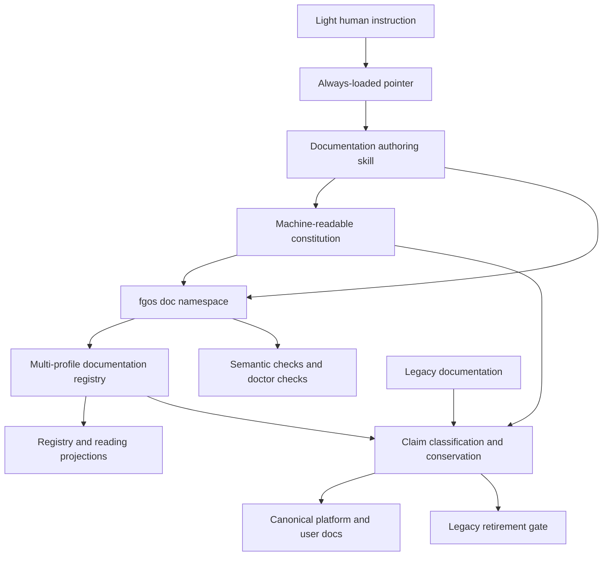
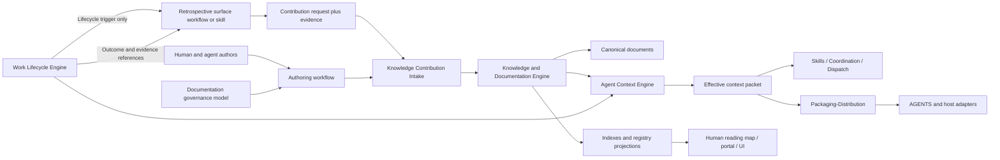

# Bounded review: root-pending-resume

Author session: codex-session:28@2026-10-15
Content commit: b1e53b4fb0e99963328e84b63a4764c0d87abb21
Entries: 18
Review status: pending
Review scope: A36: previous bounded alias, reopened decision and retained-path wording re-review

All displayed bytes are complete, with explicit historical pins. No prior approval certifies changed content. Ordinary claims use the existing Claim | Verdict | Note | Source digest | Target digest contract; proposal, truth and merge accounting IDs use separately labelled accounting verdicts. Never fabricate claim IDs for accounting. Full shown-text digests accompany native unit digests.

## Required differing-digest reads (A36)

- claim_0956ea2eadf0a32787b7fd0e51d693a6
- claim_f0b2a4079764d68b1102ddddb08776ce
- claim_c295c4c899afa37544bda841421c92e4
- claim_d7660c15ae6c2d2e7d610c1aa571101c
- claim_743cde02b9562c5f8e4724512ee6fc8f
- claim_56db2b3b7a6258289e1ab13f5c69d47f
- claim_60329d1f27688d4a78c094951d5ac119
- claim_337ac8c09351c841eae612279299eb52
- claim_1be7573f879e8eda05723b6d40b3b84e
- root-authorities-draft-0263
- root-authorities-draft-0300
- retained-path-01
- retained-path-02
- retained-path-04
- retained-path-05
- retained-path-06

## Absent targets

- claim_0956ea2eadf0a32787b7fd0e51d693a6
- claim_f0b2a4079764d68b1102ddddb08776ce
- claim_c295c4c899afa37544bda841421c92e4
- claim_d7660c15ae6c2d2e7d610c1aa571101c
- claim_743cde02b9562c5f8e4724512ee6fc8f
- claim_56db2b3b7a6258289e1ab13f5c69d47f
- retained-path-01
- retained-path-02
- retained-path-04
- retained-path-05
- retained-path-06

## claim_0956ea2eadf0a32787b7fd0e51d693a6

Entry kind: ordinary-registryGaps
Class: Judgment
Source digest: 8af4c326a8034fa8b4584cb6795459a32d8e9c0afbc616540092a7d8400382c1
Target digest: none

Shard: plans/260925-documentation-authority-unification/ledger/decisions/s5-root-historical-gaps.json

### Previous decision

```json
{
  "claimId": "claim_0956ea2eadf0a32787b7fd0e51d693a6",
  "sourcePath": "docs/backlog.md",
  "sourceAnchor": "unheaded-block-2",
  "sourceUnitDigest": "8af4c326a8034fa8b4584cb6795459a32d8e9c0afbc616540092a7d8400382c1",
  "disposition": "regenerate-from-source",
  "reviewStatus": "reviewed",
  "authoredBy": "codex-session:23@2026-10-14",
  "rationale": "This identity is a historical version of the generated active PBI block, not an unaccounted maintained platform claim. The source header explicitly labels the backlog GENERATED FILE and names bee backlog render from event-sourced PBI records. Preserve the exact old projection in its immutable source blob and the supplied full-text evidence; the five current backlog units remain pending regenerate-from-source decisions outside platform authority under the frozen product-backlog exception. No historical status is asserted current, no PBI is deleted or archived here, and regeneration or source-store availability is not claimed.",
  "reviewNote": "deep: old backlog block at 9fe599733 (lines 11-47, blob bb642bf5) is a strict subset of the current block 2 (every old row is present, 3 rows were added later), header at that commit is the same GENERATED FILE text, so nothing is lost and regenerate-from-source with no target is consistent with the five current rows",
  "reviewedBy": "reviewer:claude-session:a4954387@2026-10-14",
  "reviewedAt": "2026-10-14",
  "reviewReport": "plans/260925-documentation-authority-unification/reports/phase-06/review-261014-2105-root-closure.md",
  "reviewMode": "ordinary",
  "reviewReportCommit": "b20dc73158d6c0a636522555da23de8428e1fc59"
}
```
### Current pending decision

```json
{
  "claimId": "claim_0956ea2eadf0a32787b7fd0e51d693a6",
  "sourcePath": "docs/backlog.md",
  "sourceAnchor": "unheaded-block-2",
  "sourceUnitDigest": "8af4c326a8034fa8b4584cb6795459a32d8e9c0afbc616540092a7d8400382c1",
  "disposition": "regenerate-from-source",
  "reviewStatus": "pending",
  "authoredBy": "codex-session:25@2026-10-14",
  "rationale": "This identity is a historical version of the generated active PBI block, not an unaccounted maintained platform claim. The source header explicitly labels the backlog GENERATED FILE and names bee backlog render from event-sourced PBI records. Preserve the exact old projection in its immutable source blob and the supplied full-text evidence; the five current backlog units remain pending regenerate-from-source decisions outside platform authority under the frozen product-backlog exception. No historical status is asserted current, no PBI is deleted or archived here, and regeneration or source-store availability is not claimed. The renderer input .bee/backlog.jsonl is not in the repository and the bee tool is not installed. Commit b6763388b added PBI rows p-c3a41d07, p-c7e90b52 and p-cf1280a6 by hand to docs/backlog.md. docs/backlog.md stays at its existing path and must not be deleted or regenerated at cutover until a real source exists; regenerate-from-source is a future workflow disposition, not permission to discard these bytes."
}
```

### Complete source / predecessor

Path/anchor: docs/backlog.md#unheaded-block-2
Content commit: e63a17b8e
Native digest: 8af4c326a8034fa8b4584cb6795459a32d8e9c0afbc616540092a7d8400382c1
Shown text SHA256: 8af4c326a8034fa8b4584cb6795459a32d8e9c0afbc616540092a7d8400382c1
Lines: 11 to 47

```text
| ID | Story | CoS | Status | Feature |
|----|-------|-----|--------|---------|
| tsk-p7-shadow-binders | Retire the two remaining self-verifying shadow binders in `src/runner/dispatch/placement-policy.mjs` (`resolveVerifiedPlacementModel`) and `src/runner/dispatch/provider-adapter.mjs` (`resolveVerifiedProviderArgs`) — dispatch-engine-liveness-hardening Phase 7 (C1) investigated both and found real, if now near-zero, historical production divergence (not near-zero for two OTHER shadow binders in the same audit finding, which Phase 7 already deleted outright since their own two sides always called the identical primitive with identical inputs). Kept these two in shadow mode rather than retiring, with durable local telemetry added (`recordShadowBinderDivergence`, `.fgos/dispatch/shadow-binder-divergence.jsonl`, surfaced by the `shadow-binder-divergence` doctor check) so a future retirement decision has real evidence instead of the ephemeral-stderr-only visibility this phase found (had to manually grep ~800 historical `.fgos/assignments/*/runs/*/stderr.log` files to find the one real divergence window this phase traced). Target: 2026-10-31, or sooner once enough durable telemetry accumulates to re-evaluate. Enumerated divergence classes still open, each needing a decided winner + a matrix test in `test/runner/placement-policy-matrix-coverage.test.mjs`/`test/runner/provider-adapter.test.mjs` before flipping: (a) `resolveVerifiedPlacementModel` — an executor with no declared `providerModel` defaults to `claude`'s model table on the legacy side (`resolve.mjs`'s `modelForTier`) but derives its real family via `deriveProviderFamily` on the PlacementPolicy side; (b) `resolveVerifiedPlacementModel` — an `executors.<id>.model` literal is read by PlacementPolicy's `buildPlacementPolicyCandidate` but ignored by the legacy `modelForTier` formula (masked today only because `cli.mjs`'s `executeExecutorCli` re-applies `executor?.model` as an explicit override after the binder returns; NOT masked in `spawnWorker`, a real live gap); (d) `resolveVerifiedPlacementModel`/C3's `cfg.models` dual-keying — with no `cfg.modelPolicies` table present, the legacy path reads `cfg.models` keyed by WORK tier (light/standard/heavy) while `resolvePolicyTierModel` reads the SAME field keyed by POLICY tier (lightweight/standard/.../critical); real production config always declares `modelPolicies` today (confirmed: `.fgos/config.json` has both `modelPolicies` and a flat `models` key), so this is dormant for this repo's own dispatch but live for any consuming project whose config omits `modelPolicies`; (i) `resolveVerifiedProviderArgs` — an executor's args template with no `{model}` placeholder and no literal `--model` gets `--model <resolved>` appended by `ClaudeProviderAdapter.render()` but nothing appended by the legacy string-substitution path (the ONLY class with real historical production evidence: 126 confirmed real divergences, all dated 2026-09-18, root-caused to a since-fixed `.fgos/config.json` args-template gap — re-verified empirically against every currently-registered production claude-family executor invocation on 2026-09-29: 0/5 diverge today); (ii) `resolveVerifiedProviderArgs` — a combined `--model=value` argv form (not the separate `'--model', 'value'` token pair every currently-registered executor actually uses) would not be detected by the adapter's `renderedArgs.includes('--model')` check, causing a spurious double `--model` append; unexercised by any currently-registered executor, but a real gap the adapter's own check needs a `startsWith('--model=')` branch to close before that specific binder could ever be made unconditionally authoritative. | Each of the 5 enumerated classes above has a decided winner (legacy or PlacementPolicy/ProviderAdapter) backed by a real matrix test, OR the `cfg.models` dual-keying gap (class d) is fixed directly; once all classes are closed, `resolveVerifiedPlacementModel`/`resolveVerifiedProviderArgs` retire the same way the other two shadow binders already did in this same phase (call the target function directly, delete the legacy fallback computation) | proposed | dispatch-engine-liveness-hardening |
| STR73 | **Done-flip của PBI phải KIỂM từng mệnh đề CoS thực-giao, không chỉ "feature tham chiếu đã đóng" — nếu không, PBI có CoS rộng hơn scope feature bị mark `done` NON (premature)** (đào tận gốc 2026-07-21 từ ca STR64). **Bằng chứng cơ chế:** luật done-flip của bee trigger theo FEATURE-đóng + khớp-row, KHÔNG theo CoS-thỏa: `bee-scribing/SKILL.md:94` — *"when this scribing run closes a feature that matches a backlog row, flip that row to `done`"*; `bee-compounding/SKILL.md:81` — *"backlog done-flip specifically remains prose-ruled"*. Cột `CoS` (định nghĩa `scribing-reference.md:297` = "the one-line acceptance signal") **tồn tại nhưng KHÔNG bao giờ được đối chiếu** với artifact thực-giao trước khi flip. **Hệ quả cụ thể:** STR64 CoS đòi 3 mệnh đề (taxonomy + tag capture-time + *"≥1 tài liệu end-user tích luỹ qua ĐÚNG skill export"*); feature `compound-learn-enduser-docs` chỉ giao acceptance HẸP của CONTEXT ("≥1 doc tại capture-time") — một SUBSET; done-flip đánh đồng "feature tham chiếu PBI đã xong" = "PBI thỏa CoS" và mark `done` khi bước 3 (export skill) + bước 4 (backfill) chưa có. **Anh em STR72:** cùng lỗi gốc — tin tín hiệu cục bộ (feature-close) mà không reconcile ngược về nguồn thẩm quyền (PBI-CoS). **Áp fgOS y hệt:** cổng `done` fgOS (FSM compound-learn) ép item qua stage nhưng KHÔNG kiểm acceptance/CoS của chính item; một parent có thể `done` khi mới thỏa một phần con/CoS → cùng bug premature-done. **Đề xuất (bee-exploring shape chi tiết):** (1) done-flip đối chiếu TỪNG mệnh đề CoS với artifact thực-giao (evidence-linked), chỉ flip `done` khi mọi mệnh đề thỏa; thỏa một phần → giữ `in-flight` + liệt kê mệnh đề còn thiếu; (2) khi feature-acceptance (CONTEXT) HẸP hơn PBI-CoS, buộc khai rõ "feature này giao slice X của PBI", cấm auto-equate feature-done = PBI-done; (3) trong fgOS: cổng `done` của item kiểm acceptance/CoS của chính item, không chỉ FSM-stage. | Một PBI chỉ được flip `done` khi mọi mệnh đề CoS có evidence thực-giao; CoS thỏa một phần giữ `in-flight` và liệt kê phần thiếu; feature giao subset của PBI phải khai rõ slice, không đóng cả PBI. Dogfood: STR64 không tự flip `done` khi bước 3/4 chưa có | in-flight | — |
| p-09351985 | **Tách core verb-logic thành lib gọi được độc lập CLI** — prerequisite móng mà decision 0014 nêu ("tách core (verb-logic) thành lib gọi được độc lập CLI — hôm nay logic nằm trong CLI thì kéo ra, CLI thành client mỏng"). Refactor nội bộ thuần, KHÔNG đổi hành vi; đường ghi single-door (CTR002) và lock giữ nguyên. Tách khỏi STR46 khi mở exploring 2026-07-27 vì verify của nó khác hẳn phần hợp đồng in/out (tương đương hành vi, không phải hình dạng contract). Đứng dưới mọi consumer sau: daemon (STR48) không link lib theo 0014, nhưng TUI local và code cùng-tiến-trình thì có. | Verb-logic gọi được từ code Node mà không spawn CLI; CLI trở thành client mỏng của chính lib đó; toàn bộ test hiện có xanh không sửa một assertion nào (chứng minh không đổi hành vi) | proposed | — |
| p-28dd950c | Multi-focus: support more than one simultaneously active goal, each with its own goal-scoped ranking | A user can declare 2+ active goals (e.g. per-epic milestones) at once and get separate (or explicitly merged) goal-scoped rankings per goal, building on STR67's single-focus design | proposed | — |
| p-2a39f940 | Neither fgOS trigger path (interactive pick, headless runner) reaches an MVP2-equivalent outcome on its own terms — different failure shapes, not equivalent | Case 1 (interactive /fgOS:pick, tsk-57u, docs/history/mvp2-scope-test-infra/reports/case-1-interactive.md) reaches all three literal artifacts -- green verify (23 pass/0 fail), a real commit (4f501f1) on the item's own fgw/tsk-57u branch, and a clean worktree teardown -- but fgos return's fresh-claim path measures only the ORIGINAL checkout's HEAD, never the fgw/<id> branch pick itself created, so return structurally refuses to register the completed work and the item is stuck at awaiting-human instead of proposed/done. Case 2 (headless fgos-runner --once, docs/history/mvp2-scope-test-infra/reports/case-2-headless.md) never reaches ANY of the three artifacts: fgos-runner.mjs resolves repoRoot via git rev-parse --show-toplevel with no override flag/env, dogfood-fixture is not its own git repo, so a real --once invocation would claim and dispatch real forgent work off the live repo/.fgos/state.json (8 real items) -- confirmed unsafe twice, never invoked for real. Fix scope: (a) fgos return's branch-aware path (bin/fgos.mjs:1306) must also accept a first, ordinary interactive pick's fgw/<id> branch, not only a re-claimed already-blocked item's branchHeadAtTake; (b) fgos-runner needs a cwd-rooted root override (e.g. --root/FGOS_ROOT) parallel to the fgos.mjs verbs' existing process.cwd()-derived isolation, so the headless trigger can be pointed at a testbed instead of always resolving through git toplevel. Done when both cases can independently reach green verify + commit on own branch + clean teardown AND the engine registers completion (proposed/done), proven by re-running this feature's two live cases. | proposed | mvp2-scope-test-infra |
| p-51f4eb7e | **Bù version token cho CTR006 (routing-handoff)** — decision 0011 bắt mọi contract mang `<name>/v<N>`; CTR006 khai "designed — spec đầy đủ, chưa có code implement" (architecture-map.md:350) và `routing-handoff-contract.md` không mang field version nào. Để NGOÀI biên STR46 khi chốt exploring 2026-07-27: dán version lên thứ chưa chạy là đóng dấu cho giả định, không phải cho hành vi. Làm khi CTR006 có code thật, cùng lượt với lần implement đầu tiên. | CTR006 mang version token đúng khuôn 0011, và token đó đối chiếu được với code đang chạy chứ không chỉ với spec | proposed | — |
| p-782e25aa | STR46 buoc merge: viet lai kho fgos-test-drive tu ngoai worktree str46 | Kho /home/vantt/projects/fgos-test-drive/.fgos KHONG viet duoc tu worktree str46: write guard tu choi moi duong dan khong nam gon trong worktree vat ly (da do bang probe that, khong phai suy doan). Vi vay no roi khoi lat 1 cung ly do da doi kho song ra. Pham vi: events.jsonl 26 dong, 12 dong mang ten cu, 0 dang predicted long, tat ca deu mang truong version. Kho la mot repo git nhung .fgos KHONG duoc theo doi nen khong co nghia vu commit. Dung script scripts/migrate-actor-to-role.mjs (cell str46-io-contract-r3-6), chay --dry-run truoc, backup ra ngoai thu muc kho. Sau do chay lai ban chieu bang cach dat thu muc lam viec VAO chinh kho do roi goi bin/fgos.mjs rebuild - fgos lay kho tu process.cwd() va KHONG co co --dir nao, nen goi tu cho khac se nham vao kho sai. Xong: log khong con ten cu, khong con dong khai version 2, moi dong parse duoc, 26 dong, seq lien tuc. Chay cung dip voi PBI p-b822cf9f (kho song), tu mot noi co quyen ghi ca hai. | proposed | str46-io-contract |
| p-88b4ae1e | Audit every reservations release / releaseHolds call site for the same missing-session-filter gap xwh-3 fixed at one call site | Every call site that scopes a cross-worktree hold release derives and passes session (or documents why it legitimately cannot), not just cell -- confirmed via code read across the whole .bee/bin tree, not just handleReservationsRelease | proposed | — |
| p-99592f2a | anti-loop suy ra co-nguoi-can-thiep tu su-kien-mang-vai-nguoi, va dai dien do suy thoai dan | anti-loop.mjs:88-93 dung dieu kien vai la human VA co answer hoac reason lam dai dien cho cau hoi that su la co nguoi can thiep khong. Dai dien do chi dung khi gia tri human chi xuat hien o cho nguoi that su quyet dinh. STR46 lam human xuat hien o nhung canh ma nguoi chi go lenh con may moi la thu quyet dinh (park tu dong trong return va approve), va STR46 phai them mot gia tri vai thu tu (system) chi de tranh dai dien nay. Moi lan gan vai len nhieu canh hon thi dai dien lai suy thoai them. Viec can lam: thay dai dien bang mot dau hieu tuong minh tren chinh su kien (vi du mot co human-intervention) thay vi suy ra tu vai. CHAM RUL29 (cong chong-lap reset theo can thiep nguoi cuoi cung, per-item, executing-phase-only) nen phai co quyet dinh rieng, khong sua qua cua sau tu mot feature khac. | proposed | str46-io-contract |
| p-b822cf9f | STR46 buoc merge: viet lai kho .fgos song tu checkout chinh, cung luc ma moi dap xuong main | Chay tu /home/vantt/projects/forgent/repo (checkout chinh), KHONG tu worktree str46 - o day .fgos la symlink va cac file cua no bao la da xoa. Dieu kien tien quyet: khong phien nao khac dang ghi (kiem .fgos/sessions.json va .fgos/events.lock truoc khi bat dau). Dung script scripts/migrate-actor-to-role.mjs do cell str46-io-contract-r3-6 tao ra, chay --dry-run truoc. Pham vi mot kho: chi events.jsonl (111 dong, 54 mang ten cu, 5 trong so do la dang predicted long); state.json dung lai bang fgos rebuild, khong sua tay; coexistence.json va entropy-history.jsonl mang 0 ten cu nen ngoai pham vi. Sau khi xong: log khong con ten cu, khong con dong khai version 2, moi dong parse duoc, so dong van la 111, seq lien tuc. Ba file duoc theo doi trong checkout chinh (coexistence.json, entropy-history.jsonl, events.jsonl) nam trong dung mot commit voi lan merge. TUYET DOI khong cham repo/test/fixtures/phase1-events.jsonl. Can mien tru pre-release cua ban ghi 0017 (cell str46-io-contract-r3-1) da ton tai truoc khi chay. | proposed | str46-io-contract |
| p-bb89e653 | resolveHoldTopology ignores its own root argument, always resolves holder from process.cwd() -- candidate mechanism for cross-worktree holder collisions | resolveHoldTopology(root) resolves holder identity from the passed root, not unconditionally process.cwd() -- fixes every caller of the function, not just reservations release; a regression test proves a call with root != process.cwd() resolves the correct worktree-specific holder | proposed | — |
| p-dc785743 | bee write-guard's control-root resolution races against concurrent sessions for git/write checks in a worktree | A worktree session's own git add/commit/Edit calls resolve the intake-gate phase check against ITS OWN .bee store consistently -- never transiently against another concurrent session's control-root state (observed: two independent str92 swarming workers, and the orchestrator itself, each hit a spurious 'phase: compounding-complete' / 'phase: idle' denial while this worktree's own bee.mjs status correctly showed phase=swarming; retrying, or invoking git via a node subprocess instead of a literal git Bash command, worked around it every time without disabling any guard). Root-caused during str92 (2026-07-26): likely a resolveContext/controlRoot race under concurrent multi-session load, not a cwd-pin bug (ruled out by at least one worker whose pwd/bee status were confirmed correct at the moment of the false denial). | proposed | str92 |
| STR27 | Orchestrator service tầng fleet: registry worker + heartbeat + push assignment + lease/liveness + capacity + giao thức/auth cho worker từ xa — đắp TRÊN cùng event log (per stage-decompose: pull là móng, không đập lại) | Chỉ mở khi có nhu cầu fleet thật (worker từ xa/luôn-bật); thiết kế đứng trên log + claim sẵn có | proposed | — |
| STR36 | Metric riêng cho từng fix của vòng evolving (per STR13), chỉ mở khi entropy-trend chứng minh không đủ nhạy ở quy mô 1 fix/lần | Có điểm số đo được trước/sau một fix đơn lẻ, độc lập với entropy-trend tổng | proposed | — |
| STR38 | Human-UI listener (web/chat) trên đất Host Adapter (D b2d18cc7): translator nhận transport (HTTP/chat) → dịch sang verb → spawn `fgos <verb>` → đọc envelope + exit code; kèm identity gate "ai được nói verb nào" trước khi dịch xuống CTR001 (trust invariant dispatch.mjs: `verify` chạy như shell — intake nguồn chưa kiểm là injection vector); KHÔNG fgos-serve in-process khi CTR002 một-cửa-ghi còn per-process; chiều ra tạm poll list/catchup + so data_hash, CTR008 attention envelope chờ lực kéo thật. Đứng trên STR37. **Chốt qua thảo luận RUL42 (STANCE trí-tuệ-giao-việc — picker luôn cơ học, trí tuệ chỉ vào qua field ghi sẵn hoặc cửa pull take/return) (runner) (per bàn STR42, 2026-07-17):** STR38 bao gồm một verb chat cho người GỢI Ý priority/intent (phục vụ STR7/STR8) — verb này ghi một field GỢI Ý, KHÔNG PHẢI field cuối cùng; bộ não thông minh ở giai đoạn planning/scoring (clarify/decompose hôm nay, STR7/STR8 mai sau) đọc gợi ý này làm một tín hiệu đầu vào rồi TỰ quyết field cuối qua cửa ghi chuẩn — có thể theo đúng gợi ý hoặc đổi khác nếu thấy hợp lý hơn, nhưng gợi ý luôn được cân nhắc, không bao giờ bị bỏ qua và không bao giờ tự nó là giá trị cuối. Giữ đúng RUL42 (runner: STANCE trí-tuệ-giao-việc — đúng một actor ghi field cuối, picker vẫn cơ học) | Một người dùng qua web/chat submit được vấn đề, trả lời ask, duyệt approve/reject, VÀ gợi ý priority/intent cho một item — tất cả qua verb CTR001, không đường ghi riêng; caller chưa xác danh không gọi được verb mutation; gợi ý priority/intent của người được planning-stage đọc và cân nhắc (không tự động trở thành field cuối) | proposed | — |
| STR48 | **Kênh attention/push ("cần bạn") như một subsystem có delivery-semantics** — tách từ STR46 vì chiều-ra chủ động KHÔNG phải bolt-on mà là hệ con riêng, đòn bẩy UX cao nhất + rủi ro cao nhất. Phải chốt 5 thuộc tính: **at-least-once** (item chờ lâu chắc chắn người được ping, không rơi), **dedup** (một gate không ping N lần), **routing** (người/thiết bị/kênh nào), **ack** (đã xem chưa), **escalation** (không đáp trong ngưỡng → ping lại / đổi kênh / đổi người). Sống ở **CONSUMER daemon** (poll data_hash STR37 / tail log STR39 + giữ kênh outbound), **core fgOS vẫn passive** — đây là chỗ hiện thực hoá "không bị động" mà lõi KHÔNG mọc organ push nội tại. Đứng trên STR46 (contract in/out), STR39 (log substrate), STR37 (poll rẻ). Reference pattern: airemote notify (at-least-once, watcher-fed) trên herdr-gateway; herdr `notification.show`. | Một spec kênh attention nêu rõ 5 thuộc tính (at-least-once/dedup/routing/ack/escalation); một "cần bạn" thật của item chờ-người được giao ĐÚNG-MỘT-LẦN tới người, có ack, không đáp trong ngưỡng thì escalate đúng — chứng minh trên item thật, core không thêm trạng thái push nội tại | proposed | — |
| STR52 | **Domain thứ hai THẬT: marketing** (nêu ra 2026-07-18 trong lúc bàn STR50) — invalidate tiền đề trước đó ("hiện chỉ có 1 domain thực"): người dùng có sẵn workflow marketing ở MỘT PROJECT KHÁC và muốn điều phối marketing qua fgOS. Hạ tầng kernel đã chứng minh đa-domain chạy được về nguyên tắc (domain `synthetic` sống song song `coding` hôm nay, STR18 base-workflow+domain-extension đã done), nhưng marketing THẬT còn thiếu: (a) registry entry riêng trong `domains.mjs` (stages/stepMap/transitions cho chu trình marketing, khác `clarify/decompose/executing`), (b) retrofit `discovery.mjs`/`decompose.mjs` — hai module này đang hardcode literal stage-name của coding, domain khác vào `clarify`/`decompose` sẽ bị ghi đè sai (cảnh báo đã có sẵn trong comment `domains.mjs:29-34`), (c) bộ skill nội dung riêng cho domain-extension "marketing" (song song bộ STR50 đang trích cho coding, KHÔNG phải `fgos-routing` — module đó domain-agnostic, không cần đổi), (d) STR51 mở rộng thêm field `domain` vào output classify (chỗ nối tự nhiên — cùng cơ chế, chỉ thêm 1 field). **CÂU HỎI SCOPE CHƯA TRẢ LỜI (quan trọng, quyết định đây là 1 feature hay 2):** project marketing kia dùng CHUNG một store/event-log với fgOS hiện tại (khác domain field trên cùng một hệ), hay là một CÀI ĐẶT fgOS RIÊNG cho project đó? Khuyến nghị: không gộp vào STR50 đang chạy (đã khoá scope hẹp cho coding, mode standard, đang thực thi) — mở feature riêng qua bee-hive/bee-exploring khi câu hỏi scope trên có câu trả lời. | Một decision record trả lời rõ câu hỏi scope (chung store hay cài đặt riêng); nếu chung store: registry entry `marketing` thật + retrofit discovery/decompose + bộ skill marketing chạy được một case study thật, domain `coding` không bị ảnh hưởng | proposed | — |
| STR62 | **Sibling-aware / agent-driven on-demand cross-item context** (deferred idea từ STR61 exploring, 2026-07-19): hai option bị loại ở STR61's own parent-only decision — (a) tự động kèm cả sibling (không chỉ parent) khi trả lời gate người, (b) agent tự quyết kéo thêm bối cảnh cha/sibling động thay vì cố định. Cả hai cần khái niệm "sibling" mới trong data model (hiện chỉ có `parent`/`deps`/`blocks`, `work-state.md:864`) — không xây bây giờ, chỉ mở lại nếu baseline "parent-only" của STR61 chứng minh không đủ trong thực tế | Chưa xác định — chờ bằng chứng thiếu-bối-cảnh thật từ STR61 chạy production trước khi chốt CoS | proposed | — |
| STR69b | **Vệt event gần nhất + diff giàu hơn khi người quay lại gate (cần chốt lại STR61's own "material" decision trước)** — nửa còn lại của STR69. Khác STR69a ở chỗ có thiết kế thật cần chốt: nới `MATERIAL_FIELDS` (`repo/src/state/awaiting-context.mjs:15`, hiện chỉ `title`/`status`) và chọn bao nhiêu event chạm TRỰC TIẾP vào STR61's own "material" decision ("chỉ báo khi thay đổi ảnh hưởng câu hỏi/trả lời gốc, im lặng nếu không") — nới bộ trường = nới định nghĩa "material" mà quyết định đó cố tình giữ hẹp. Cũng là lớp validity-check cho STR70a (changed-since làm lộ leaning stale). Vẫn thuần read-projection, không lật STR46's own foundational decision; scope đợt đầu KHÔNG gồm sibling (trần parent-only). | Người mở lại item awaiting-human phiên mới thấy vệt event gần nhất + diff parent giàu hơn; quyết định nới/không-nới `MATERIAL_FIELDS` ghi lại có lý do đối chiếu STR61's own "material" decision | proposed | — |
| STR70a | **Checkpoint distillate + record chốt 3-phần lên gate (fgOS core, KHÔNG bị chặn)** — nửa không-vướng của STR70 (tách 2026-07-21, per `docs/history/gate-dialogue-continuity/CONTEXT.md`'s locked decisions). Verb non-transitioning ghi distillate {câu hỏi diễn giải lại, options + trục so sánh, leaning + lý do quote nguyên văn người, đã-loại, còn-treo} lên `gates[id]`, LWW, chiếu qua `awaitingContext`; verb DÙNG CHUNG người/agent — nhưng ĐIỀU KIỆN TIÊN QUYẾT là fold `actor` vào gate record (hiện `gates[id]` chỉ giữ `ask`/`answer`/`parentSnapshotAtAsk`, KHÔNG actor — `repo/src/state/replay.mjs:126-134`) để phân biệt note-người vs tóm-tắt-agent. Record bền lúc chốt nở thành CẤU TRÚC 3 phần: vì-sao / mốc-trao-đổi / đánh-đổi (không còn `reason` một dòng). Tiền lệ verb non-transitioning đã có: `decision`/`outcome` (`repo/docs/specs/work-state.md:647-675`). Đều là fact bền hợp core, KHÔNG lật STR46's own foundational decision. | `awaitingContext` mang distillate + record 3-phần; `actor` chiếu vào gate phân biệt được nguồn; distillate human-overridable, chỉ `answer` authoritative | proposed | — |
| STR70b | **Raw backstop cho cuộc bàn ở gate — CHỜ Q1 (chưa có nhà hợp lệ)** — nửa bị-chặn của STR70. Giữ lượt thô để khi người phủ định distillate thì đưa lại nguyên văn, drop khi chốt. Đào 2026-07-21 (`CONTEXT.md` Q1) LOẠI O1 (raw thành event core): log fgOS append-only bất khả xâm phạm (L3 `platform-foundations.md:73-74`; RUL11 (tiến hóa schema) `work-state.md`; KHÔNG cơ chế redact/prune/TTL nào trong `repo/src`) → "drop khi chốt" bất khả thi. Còn lại: O2 (kho phụ trong core, không phải log) vướng L1 (`platform-foundations.md:17-20` — mọi dữ liệu bền phải là log HOẶC state; raw không thuộc ô nào) ⇒ phải mở L1; O3 (daemon-consumer) đúng nhà theo decision `0014` nhưng lớp đó CHƯA TỒN TẠI (không file daemon/consumer trong `repo/src`\|`repo/bin`; STR46/STR48 còn proposed). HOÃN có chủ đích: quyết bằng số đo thật (người phủ định distillate bao nhiêu lần) chứ không suy luận; luồng phủ định không gãy khi thiếu raw vì distillate vốn không-authoritative. | Q1 chốt được nhà cho raw (O2 mở L1 / O3 chờ consumer) dựa trên tần suất phủ định thực tế; tới lúc đó STR70b nằm chờ, không chặn STR70a | proposed | — |
| STR71 | **Chất lượng câu hỏi gate (ask self-sufficiency, phòng ngừa — bổ trợ STR70a)** — người trả lời gate thường "không rõ nó đang hỏi gì", phải mở một vòng chat chỉ-để-hiểu-câu-hỏi trước khi bàn nội dung. Giải phòng-ngừa: cell viết `ask` đủ tự-đứng (kèm context để câu hỏi hiểu được ngay). KHÔNG thay STR70a (tư vấn/so sánh vẫn cần chat dù câu hỏi rõ); chỉ cắt phần vòng exploring bị đốt để giải mã câu hỏi. Chưa ưu tiên đợt đầu. | Một gate mới mang câu hỏi người đọc-hiểu-ngay, không phải hỏi lại "đang hỏi gì"; đo bằng giảm số lượt làm-rõ-câu-hỏi trước khi vào nội dung | proposed | — |
| STR80 | **Trang trí thêm quy ước OKF cho enduser-docs-index: `index.md` mỗi ngăn (progressive disclosure) + `log.md` lịch sử đổi theo ngày** (nêu ra 2026-07-22 lúc bàn str64-backfill, deferred idea của CONTEXT.md area này) — hiện chỉ mục máy-đọc (`docs/enduser-docs-index.json`) là bảng tra duy nhất; một `index.md` per-thư-mục cho người/agent duyệt nhẹ một ngăn mà không cần load cả manifest. Chưa cần ngay — chỉ đáng làm khi số tài liệu mỗi ngăn tăng thật (hiện `explanation` mới 23 mục, `how-to` 1 mục) | Mỗi thư mục `docs/<quadrant>/` có `index.md` liệt kê + mô tả ngắn các tài liệu trong đó; không đổi hành vi chỉ mục JSON hiện có | proposed | — |
| STR81 | **Kiểm tra lệch giữa đầu-mô-tả (frontmatter) và log cho `enduser-docs-index`** (nêu ra 2026-07-22, deferred idea của str64-backfill) — `móc-liên-kết-nguồn` trong đầu-mô-tả mỗi tài liệu là bản sao ghi-lúc-soạn, không phải nguồn thẩm quyền (log qua `fgos doc-sources` mới là nguồn thật); nếu một tài liệu được liên kết lại sau khi đầu-mô-tả đã ghi, hai bên có thể lệch mà không ai biết. Chưa xây — ưu tiên thấp, chỉ cần khi quan sát thấy lệch thật | Một lượt kiểm (khả dĩ trong bee-grooming) phát hiện tài liệu có `móc-liên-kết-nguồn` khác với kết quả `fgos doc-sources` cho cùng đường dẫn, báo cáo rõ ràng — không tự sửa | proposed | — |
| p-4b7dd2ed | `fgos-coding-exploring/SKILL.md` đòi commit CONTEXT.md lên nhánh `fgw/<id>` trước khi gọi `fgos discover` ("uncommitted CONTEXT.md invisible tới phiên re-claim sau"), nhưng `.gitignore:45` loại trừ TOÀN BỘ `/docs/history/` — CONTEXT.md không bao giờ commit được như luật đòi. Phát hiện dogfood thật (decision 0018, scenario `expr-eval-chain`, item `tsk-1wd`, 2026-07-28) khi chạy làm-rõ thật lần đầu qua `fgos-coding-exploring`. **Đã fix tại `fgw/tsk-1wd` (commit `ffd211a`)** — un-ignore `/docs/history/` (+3 path liên đới cùng gốc). **Đã xác minh lại + đóng vòng qua fgOS (tsk-2gw, 2026-08-21)**: `.gitignore` hiện tại (main) xác nhận không còn loại trừ `docs/history/` (`git check-ignore` sạch trên `docs/history/*/CONTEXT.md`/`plan.md`/`RESEARCH.md`, tự động hoá tại `test/setup/gitignore-docs-history-not-excluded.test.mjs`); bằng chứng sống thêm cùng đêm: `tsk-1i3`'s own `CONTEXT.md`/`plan.md`/`RESEARCH.md` commit sạch lên `fgw/tsk-1i3` không trở ngại gì. | `.gitignore` và luật commit của `fgos-coding-exploring` nhất quán với nhau — hoặc bỏ `/docs/history/` khỏi `.gitignore` (cho phép commit CONTEXT.md thật), hoặc sửa luật skill để không đòi commit (đổi nơi lưu / chấp nhận local-only tường minh); chọn một, áp dụng, dogfood xác nhận CONTEXT.md sống sót qua một lượt re-claim — **ĐÃ ĐẠT, xem tsk-2gw** | proposed | — |
| p-af05e742 | `fgos discover`'s context-discovery judgment (`buildDiscoveryPrompt`, `src/intake/discovery.mjs:113-137`) đòi model "đề xuất một lệnh `verify` chạy được thật" nhưng KHÔNG đưa bất kỳ thông tin cwd/cấu trúc thư mục repo nào vào prompt (chỉ title/description/refs/deps/graph-context/QA history) — model không thể biết verify chạy từ đâu (`goal-check.mjs`: `spawn(item.verify, {cwd: repoRoot của worktree})`) hay một feature nằm trong nested package (vd `dogfood-fixture/`, có `test/` + `package.json` riêng) cần prefix path. Phát hiện dogfood thật (decision 0018, item `tsk-1wd`, 2026-07-28, `fgos-coding-validating`): verdict `clear=true` gắn `verify: "node --test test/expr/*.test.mjs"`, chạy từ cwd thật ra `no matches found` (exit 1) vì thiếu prefix `dogfood-fixture/`. Systemic — tái diễn cho BẤT KỲ item nào có file trong subdirectory/nested package, không riêng cách diễn đạt item này. | `buildDiscoveryPrompt` (và anh em split-work judgment tương tự nếu có) đưa vào prompt đủ ngữ cảnh cwd/layout để model đề xuất `verify` đúng path chạy-được — vd cây thư mục top-level + package.json con nào tồn tại; test dogfood chứng minh một item nested-package nhận `verify` đúng ngay từ discover, không cần sửa tay sau ở `fgos-coding-validating` | proposed | — |
| p-4c81ca74 | `fgos plan`'s split-work judgment (`buildDecomposePrompt`, `src/intake/plan.mjs`, cơ chế LLM thật qua nested `claude -p` — không phải mechanical) chỉ nhận title/kind/risk/verify/refs/deps — KHÔNG BAO GIỜ đọc `work.description` (đầy đủ, không cắt) VÀ KHÔNG BAO GIỜ đọc `docsRef`-trỏ CONTEXT.md/plan.md mà `fgos-coding-exploring`/`fgos-coding-planning` vừa khoá. Phát hiện dogfood thật (decision 0018, item `tsk-1wd`, 2026-07-28): `title` bị cắt giữa câu lúc submit (dừng ngay trước phần evaluate/evaluateExpr/precedence); split-work model chỉ thấy tiêu đề cụt, tự bịa kiến trúc AST (`parse(tokens)` → `evaluate(ast)`) hoàn toàn khác 3 hàm đã khoá trong CONTEXT.md (`tokenize`→`evaluate(tokens)`→`evaluateExpr(string)`, không AST). `discovery.mjs` (stage `discovery`) có cùng lỗ hổng gốc (không đọc docsRef), CHƯA sửa ở đây — chỉ split-work judgment được reproduce+fix trực tiếp. **Đã fix tại `fgw/tsk-1wd`**: `buildDecomposePrompt` giờ nhận thêm `description` đầy đủ + nội dung CONTEXT.md/plan.md (đọc best-effort qua `docsRef`, không lỗi nếu thiếu); test suite 1463/1463 xanh sau sửa. 3 con sai (`tsk-1wd-1/2/3`, đã tạo trước khi phát hiện) được sửa tay qua `fgos edit` để khớp lại plan đã khoá. | `buildDecomposePrompt` (đã fix) + xét áp cùng pattern cho `buildDiscoveryPrompt`/`discovery.mjs` (chưa fix, cùng lỗ hổng); dogfood xác nhận một item nested-decision (CONTEXT.md/plan.md có nội dung khác title) nhận split-work verdict khớp quyết định đã khoá, không tự bịa kiến trúc khác | proposed | — |
| p-810b034e | Ý tưởng nêu ra lúc điều tra `p-4c81ca74` (2026-07-28, dogfood `tsk-1wd`): `bin/fgos.mjs` là cửa CLI duy nhất cho mọi verb, nhưng KHÔNG có tầng kiểm cú pháp/đầu vào chung nào ghi lại NƠI GỌI SAI khi một lời gọi verb bị sai (thiếu flag bắt buộc, id không hợp lệ, cwd sai khiến verb đọc nhầm store — như `p-af05e742`/`p-4c81ca74` từng gặp) — lỗi hiện chỉ trồi lên như StoreError/exit-code tại điểm gọi, KHÔNG có provenance (session nào, skill nào, lệnh gốc nào) được ghi lại để soi lại sau. Khác root cause với `p-af05e742` (đó là thiếu ngữ cảnh TRONG prompt gửi model, không phải cú pháp gọi binary sai) — tách riêng theo đúng ranh giới root cause. Chưa rõ hình dạng cụ thể (guard wrapper quanh spawn? log riêng caller-id vào `.fgos/`? convention đặt tên session/skill để tự khai báo?) — cần `fgos-coding-exploring` thật cho item này trước khi thi công, không tự quyết kiến trúc ở đây. | Một quyết định rõ hình dạng cơ chế kiểm-đầu-vào (nếu làm) + bằng chứng dogfood: một lời gọi verb sai cú pháp/cwd được ghi lại kèm nơi gọi (session/skill/lệnh gốc), không chỉ lỗi exit-code trần tại điểm gọi | proposed | — |
| p-58f890f3 | Case A (phiên tương tác, `/fgOS:pick` + `EnterWorktree`) không có hướng dẫn cho trường hợp root decompose ra children, mỗi con cần worktree/nhánh RIÊNG (`fgw/<child-id>`), NGAY TRONG CÙNG một phiên đang đứng sẵn trong worktree của root. Phát hiện dogfood thật (decision 0018, item `tsk-1wd`→`tsk-1wd-1`, 2026-07-28): phiên đã `EnterWorktree` vào `fgw/tsk-1wd` (root, lần 1, OK); `pick tsk-1wd-1` tạo tree con `fgw/tsk-1wd-1` thành công (fgOS-side, không lỗi), nhưng `EnterWorktree` LẦN 2 vào tree đó bị harness từ chối — "`/home/vantt/projects/forgentX/.claude/worktrees` does not exist, so `<path>` cannot be a worktree managed by Claude Code" (khác thông báo STR83 "refuses to chain" đã biết cho root-pick, đây là root cause riêng: fgOS tạo worktree ở `/tmp/fgos-worktrees/`, không phải dưới `.claude/worktrees/` mà harness đòi cho một lần switch THỨ HAI trở đi). Scenario doc + `pick`/`fgos-routing` skill chỉ cảnh báo về giới hạn 1-lớp (root không được nested sẵn trong tree khác) — KHÔNG hề nhắc gì tới việc chính root TỰ decompose ra children cần tree riêng trong lúc phiên đang sống. Case B (headless `fgos-runner --once`) không dính lỗi này — mỗi item dispatch ở tiến trình riêng, không có khái niệm phiên-đang-đứng-trong-tree-nào. Workaround dùng tạm: thao tác trực tiếp qua Bash/absolute-path vào tree con thay vì `EnterWorktree`, không dùng cơ chế switch của harness. | Case A's skill doc (pick/fgos-routing/hoặc scenario doc riêng) nói rõ: khi root decompose ra children, phiên hiện tại làm gì tiếp — mở phiên mới mỗi con (đúng chuẩn), hay có đường chính thức nào khác (di chuyển bằng path trực tiếp, hay `.claude/worktrees`-hoá worktree của fgOS); dogfood xác nhận một item multi-child chạy hết Case A mà không cần workaround thủ công | proposed | — |
| p-26c4a4fd | `pick` (`bin/fgos.mjs`, case `'pick'`, ~dòng 1248-1303) tạo worktree mới cho MỌI item (root lẫn leaf) luôn fork từ `currentHead(repoRoot)` (main) — KHÔNG có phân biệt leaf-vs-root base-branch như `review`/`approve` đã có sẵn: `approve` cho leaf (`resolveRoot(id) !== id`) merge branch con vào `fgw/<rootId>` qua ephemeral worktree đứng trên `fgw/<rootId>`, KHÔNG BAO GIỜ main trực tiếp (`bin/fgos.mjs:1704-1721`); `review` cũng diff leaf so với `branchNameFor(rootId)`, không phải trunk (`bin/fgos.mjs:1525-1532`, comment tự ghi "leaf-vs-root split"). `pick` không áp cùng pattern này. Phát hiện dogfood thật (decision 0018, item `tsk-1wd`→`tsk-1wd-3`, 2026-07-28): `tsk-1wd-3` (`evaluateExpr`, `deps: ["tsk-1wd-2"]`, `parent: tsk-1wd`) cần `import` cả `tokenize.mjs` (từ `tsk-1wd-1`) lẫn `evaluate.mjs` (từ `tsk-1wd-2`), nhưng nhánh `fgw/tsk-1wd-3` (fork từ main) không có file nào của hai anh em — vì cả hai còn ở `fgw/tsk-1wd-1`/`fgw/tsk-1wd-2` riêng, CHƯA approve/merge vào `fgw/tsk-1wd`, và dù có approve rồi thì `pick` vẫn fork `tsk-1wd-3` từ main chứ không phải từ `fgw/tsk-1wd`. Đúng model đã có ở `approve`/`review`: integration LUÔN đi qua cha (`fgw/<rootId>`), không bao giờ sibling-to-sibling, không bao giờ main cho tới khi root tự merge. Workaround thủ công: `approve` từng con xong theo `deps` order rồi `git merge fgw/<rootId>` vào worktree con tiếp theo trước khi code. | `pick` áp cùng leaf-vs-root logic `resolveRoot`/`branchNameFor(rootId)` đã có ở `review`/`approve`: fork worktree của một leaf từ `fgw/<rootId>` (branch cha) thay vì main; dogfood xác nhận một chain nhiều con phụ thuộc nhau (`deps`) build được liên tục qua `pick` mà không cần merge tay | proposed | — |
| p-73d99989 | **[NGHIÊM TRỌNG — rủi ro mất dữ liệu thật]** `reclaimOrphanedCheckout` (`src/runner/worktree.mjs:130-161`) force-remove (`git worktree remove --force`) BẤT KỲ checkout nào đang tồn tại của một branch, không hề kiểm tra checkout đó có thật sự "orphaned" (bị bỏ hoang) hay đang là một session/worktree SỐNG đang được dùng. `createWorktree` gọi hàm này bất cứ khi nào `branchExists(...)===true` (nhánh "reused"). `approve` cho một leaf item tạo ephemeral worktree đứng trên `fgw/<rootId>` để merge (`createWorktree(repoRoot, rootId, {})`, `bin/fgos.mjs:1721`) — NẾU `fgw/<rootId>` đã có checkout sống (chính là worktree người/phiên đang đứng làm việc thật), lệnh `approve` một CON sẽ ÂM THẦM XOÁ SẠCH worktree của CHA đang sống, không cảnh báo, không hỏi. Phát hiện dogfood thật (decision 0018, item `tsk-1wd`, 2026-07-28): chạy `approve tsk-1wd-1` (một leaf), worktree gốc `/tmp/fgos-worktrees/tsk-1wd-lVclki` — nơi cả phiên này đang đứng làm việc `tsk-1wd` từ đầu — biến mất ngay sau lệnh, phát hiện tình cờ lúc `ls /tmp/fgos-worktrees/` để tìm file khác. May mắn: mọi commit đã nằm trên `fgw/tsk-1wd` (8 commit, xác nhận nguyên vẹn qua `git log`) nên không mất code thật, chỉ mất thư mục checkout (khôi phục ngay bằng `git worktree add` mới). Nếu phiên CHƯA commit tại thời điểm đó, đây sẽ là mất trắng thật. | `reclaimOrphanedCheckout` phải phân biệt được checkout thật-sự-orphan (không tiến trình nào sống trong đó, ví dụ tra registry phiên như `approve`'s multi-session guard đã làm ở chỗ khác, `bin/fgos.mjs:1591-1617`) với checkout đang có phiên/session sống — chỉ force-remove trường hợp đầu; dogfood xác nhận `approve` một leaf KHÔNG xoá worktree gốc đang có phiên sống, kể cả khi branch cha đó "reused" | proposed | — |
| p-b91d487a | `mergeRunnerItem` (`src/runner/merge.mjs:293-322`) không có kiểm "đã merge sẵn rồi" trước khi thử `git commit --no-edit` sau `git merge --no-commit --no-ff`: nếu nhánh con ĐÃ được merge vào nhánh cha từ một lượt `approve` trước (thành công tới bước merge nhưng lỗi ở bước SAU đó — vd `p-73d99989`'s tình huống, hoặc bất kỳ lỗi nào khác xảy ra sau merge-commit nhưng trước status-move `done`), `git merge --no-commit --no-ff` lần sau là no-op (không gì để merge), verify vẫn chạy qua vì code đã có sẵn, nhưng `git commit --no-edit` chết vì "nothing to commit" — approve ném lỗi `MergeError` mập mờ ("verify passed but git commit failed") thay vì nhận ra merge đã xong và tiến thẳng qua bước status-move. Phát hiện dogfood thật (decision 0018, item `tsk-1wd-1`, 2026-07-28): lượt `approve` đầu tiên merge THÀNH CÔNG (`c90c5bb` lên `fgw/tsk-1wd`, xác nhận qua `git log`) nhưng chết ở bước status-move `done` vì thiếu stage `compound-learn` (lỗi độc lập, xem chú thích); chạy `fgos compound tsk-1wd-1` xong rồi approve LẦN 2 thì dính đúng lỗi này — không có đường retry sạch, phải tự tay `fgos move` qua trạng thái `done` để gỡ. Hệ quả chung: BẤT KỲ lỗi nào xảy ra sau khi merge-commit đã landed nhưng trước status-move hoàn tất đều khiến item kẹt vĩnh viễn ở retry — không riêng tình huống compound-learn cụ thể này. | `mergeRunnerItem` kiểm nhánh con đã w-merged-vào-cha chưa (vd `git merge-base --is-ancestor <branch> HEAD`) trước khi thử merge; nếu đã merge sẵn, coi như `outcome: 'merged'` luôn (idempotent), không thử commit lại; dogfood xác nhận `approve` retry sau một lỗi hậu-merge (bất kỳ nguyên nhân nào) tự phục hồi sạch, không cần `fgos move` tay | proposed | — |
| p-e6425aa9 | 5 follow-up đặt tên lúc đóng track `dispatch-engine-liveness-hardening` (2026-09-29, plan.md's "Explicitly deferred" list, mục 2-6 — mục 1/shadow-binders đã có row riêng `tsk-p7-shadow-binders`): (a) `--force-new-attempt` chưa từng được wire vào một CLI flag thật; (b) chưa có test SIGKILL-probe riêng cho `isHerdrSpawnRunStillWorking` (bộ test herdr hiện có chỉ chứng minh không regression, không tái hiện đúng lớp bug đó); (c) `providerCapacityIsRunWorkerAlive` (lease reclaim) có cùng điểm mù cli-spawn-only cho herdr-spawn mà M1 từng có trước Phase 8a — cùng lớp gap, chỗ gọi khác, chưa sửa; (d) một race có sẵn, không liên quan, trong cơ chế tự-heal "assignment-created event has no assignmentRefs entry" của `replay.mjs`, phát hiện lúc stress-test Phase 5 (tái hiện y hệt trên main trước Phase 5, xác nhận không phải regression của track này); (e) tài liệu/CLI-help còn trỏ tới action `clear-assignment-claim` đã bị retire (Phase 5), chưa quét sạch. | Mỗi mục trong 5 mục có quyết định sửa thật hoặc ghi rõ won't-fix: `--force-new-attempt` có CLI flag thật; có test SIGKILL-probe cho `isHerdrSpawnRunStillWorking`; điểm mù herdr-spawn của `providerCapacityIsRunWorkerAlive` được đóng (hoặc ghi rõ vì sao ngoài scope); race của `replay.mjs` được sửa hoặc tách file riêng; hết tham chiếu `clear-assignment-claim` còn sót | proposed | dispatch-engine-liveness-hardening |
| p-3c7681b8 | Test rò rỉ fixture directory phiên coordination thật vào `.fgos/coordination/sessions/` sống của repo thay vì một tmp dir cô lập (quan sát 2026-09-29 lúc điều tra doctor check `coordination-sessions-closed`: 506 phiên "active" quá 7 ngày, một phần lớn là rác test). Một số trace về code đã fix từ 2026-09-05; một phiên khác trace về code CHƯA TỪNG commit vào git (chạy tay/WIP) — root cause tản mát, không phải một bug đơn sửa được một lần. Đã thảo luận mục tiêu với user (2026-09-29) nhưng CHƯA chốt: ưu tiên (1) chặn rò rỉ tương lai bằng test-isolation guard hay (2) dọn rác lịch sử trước — câu hỏi còn treo, chưa trả lời. | Quyết định scope (guard / dọn / cả hai) + phần đã chọn được làm: fixture phiên coordination mới của test không bao giờ đụng `.fgos/coordination/sessions/` thật, và/hoặc rác phiên lịch sử được dọn an toàn | proposed | dispatch-engine-liveness-hardening |
| p-36af7086 | `research-260929-1203-herdr-cook-plan-vs-fgos-dispatch-coordination.md` đề xuất chạy thật một plan 3-4 phase qua cả `thieung/herdr-cook-plan` lẫn engine dispatch/coordination riêng của fgOS trên MỘT PROJECT NGOÀI repo này (đúng mission #1/#2, D-ADR0035 (ranh giới sứ mệnh fgOS) trong `docs/platform-foundations.md` — fgOS tồn tại để phát triển project khác, không phải tự phát triển chính nó), để so sánh throughput/friction thật thay vì chỉ so code tĩnh. Chưa bắt đầu. | Một plan thật (3-4 phase) chạy xong trọn vẹn một lượt qua `herdr-cook-plan` và một lượt qua chính engine fgOS, trên cùng một project ngoài; có ghi chú so sánh friction/throughput cụ thể, không chỉ lý thuyết | proposed | — |
```

### Complete target / successor

none (no target is asserted).

## claim_f0b2a4079764d68b1102ddddb08776ce

Entry kind: ordinary-claims
Class: Judgment
Source digest: 800732106a25d1de145c1e71fdda4347cf26f60d8625771d1f42c540228cfc0a
Target digest: none

Shard: plans/260925-documentation-authority-unification/ledger/decisions/s5-root-generated-backlog.json

### Previous decision

```json
{
  "claimId": "claim_f0b2a4079764d68b1102ddddb08776ce",
  "sourceUnitDigest": "800732106a25d1de145c1e71fdda4347cf26f60d8625771d1f42c540228cfc0a",
  "claimKind": "navigation",
  "disposition": "regenerate-from-source",
  "targetOwner": null,
  "targetAnchor": null,
  "reviewStatus": "reviewed",
  "authoredBy": "codex-session:23@2026-10-14",
  "rationale": "The complete product-backlog unit is part of the non-authority generated product-backlog projection. Its header names bee backlog render and the event-sourced PBI input; the frozen root map retains the backlog outside platform authority. Keep the projection at its existing path and regenerate through its owning source workflow when that workflow changes, rather than hand-copying PBI statuses into a candidate spec or treating an exact source-to-itself match as carriage. Full current text and native digest are supplied for independent disposition review. This approves no renderer run, underlying store freshness, historical status truth, retirement, reader cutover or platform promotion.",
  "reviewNote": "deep: heading \"Product Backlog\" lines 1-1, digest recomputed from blob 62aaf1a54; header comment names `bee backlog render` and .bee/backlog.jsonl, but see Notes: that store and tool are absent here and rows were hand-added, so keep the file at its path",
  "reviewedBy": "reviewer:claude-session:a4954387@2026-10-14",
  "reviewedAt": "2026-10-14",
  "reviewReport": "plans/260925-documentation-authority-unification/reports/phase-06/review-261014-2105-root-closure.md",
  "reviewMode": "ordinary",
  "reviewReportCommit": "b20dc73158d6c0a636522555da23de8428e1fc59"
}
```
### Current pending decision

```json
{
  "claimId": "claim_f0b2a4079764d68b1102ddddb08776ce",
  "sourceUnitDigest": "800732106a25d1de145c1e71fdda4347cf26f60d8625771d1f42c540228cfc0a",
  "claimKind": "navigation",
  "disposition": "regenerate-from-source",
  "targetOwner": null,
  "targetAnchor": null,
  "reviewStatus": "pending",
  "authoredBy": "codex-session:25@2026-10-14",
  "rationale": "The complete product-backlog unit is part of the non-authority generated product-backlog projection. Its header names bee backlog render and the event-sourced PBI input; the frozen root map retains the backlog outside platform authority. Keep the projection at its existing path and regenerate through its owning source workflow when that workflow changes, rather than hand-copying PBI statuses into a candidate spec or treating an exact source-to-itself match as carriage. Full current text and native digest are supplied for independent disposition review. This approves no renderer run, underlying store freshness, historical status truth, retirement, reader cutover or platform promotion. The renderer input .bee/backlog.jsonl is not in the repository and the bee tool is not installed. Commit b6763388b added PBI rows p-c3a41d07, p-c7e90b52 and p-cf1280a6 by hand to docs/backlog.md. docs/backlog.md stays at its existing path and must not be deleted or regenerated at cutover until a real source exists; regenerate-from-source is a future workflow disposition, not permission to discard these bytes."
}
```

### Complete source / predecessor

Path/anchor: docs/backlog.md#product-backlog
Content commit: b1e53b4fb0e99963328e84b63a4764c0d87abb21
Native digest: 800732106a25d1de145c1e71fdda4347cf26f60d8625771d1f42c540228cfc0a
Shown text SHA256: fdfedf03ffb6ae08a251a913e5934e251ae32a812010a689ba34ec052adb348d
Lines: 1 to 1

```text
# Product Backlog

<!--
GENERATED FILE — do not hand-edit.
Rendered by `bee backlog render` from event-sourced PBI records in .bee/backlog.jsonl (per backlog-unification).
Regenerate: `bee backlog render --write`. Check freshness: `bee backlog render --check`.
Deterministic: byte-identical for the same backlog.jsonl contents — status-grouped, id-sorted entries, LF endings,
never a generation timestamp or any other wall-clock value.
-->

| ID | Story | CoS | Status | Feature |
|----|-------|-----|--------|---------|
| tsk-p7-shadow-binders | Retire the two remaining self-verifying shadow binders in `src/runner/dispatch/placement-policy.mjs` (`resolveVerifiedPlacementModel`) and `src/runner/dispatch/provider-adapter.mjs` (`resolveVerifiedProviderArgs`) — dispatch-engine-liveness-hardening Phase 7 (C1) investigated both and found real, if now near-zero, historical production divergence (not near-zero for two OTHER shadow binders in the same audit finding, which Phase 7 already deleted outright since their own two sides always called the identical primitive with identical inputs). Kept these two in shadow mode rather than retiring, with durable local telemetry added (`recordShadowBinderDivergence`, `.fgos/dispatch/shadow-binder-divergence.jsonl`, surfaced by the `shadow-binder-divergence` doctor check) so a future retirement decision has real evidence instead of the ephemeral-stderr-only visibility this phase found (had to manually grep ~800 historical `.fgos/assignments/*/runs/*/stderr.log` files to find the one real divergence window this phase traced). Target: 2026-10-31, or sooner once enough durable telemetry accumulates to re-evaluate. Enumerated divergence classes still open, each needing a decided winner + a matrix test in `test/runner/placement-policy-matrix-coverage.test.mjs`/`test/runner/provider-adapter.test.mjs` before flipping: (a) `resolveVerifiedPlacementModel` — an executor with no declared `providerModel` defaults to `claude`'s model table on the legacy side (`resolve.mjs`'s `modelForTier`) but derives its real family via `deriveProviderFamily` on the PlacementPolicy side; (b) `resolveVerifiedPlacementModel` — an `executors.<id>.model` literal is read by PlacementPolicy's `buildPlacementPolicyCandidate` but ignored by the legacy `modelForTier` formula (masked today only because `cli.mjs`'s `executeExecutorCli` re-applies `executor?.model` as an explicit override after the binder returns; NOT masked in `spawnWorker`, a real live gap); (d) `resolveVerifiedPlacementModel`/C3's `cfg.models` dual-keying — with no `cfg.modelPolicies` table present, the legacy path reads `cfg.models` keyed by WORK tier (light/standard/heavy) while `resolvePolicyTierModel` reads the SAME field keyed by POLICY tier (lightweight/standard/.../critical); real production config always declares `modelPolicies` today (confirmed: `.fgos/config.json` has both `modelPolicies` and a flat `models` key), so this is dormant for this repo's own dispatch but live for any consuming project whose config omits `modelPolicies`; (i) `resolveVerifiedProviderArgs` — an executor's args template with no `{model}` placeholder and no literal `--model` gets `--model <resolved>` appended by `ClaudeProviderAdapter.render()` but nothing appended by the legacy string-substitution path (the ONLY class with real historical production evidence: 126 confirmed real divergences, all dated 2026-09-18, root-caused to a since-fixed `.fgos/config.json` args-template gap — re-verified empirically against every currently-registered production claude-family executor invocation on 2026-09-29: 0/5 diverge today); (ii) `resolveVerifiedProviderArgs` — a combined `--model=value` argv form (not the separate `'--model', 'value'` token pair every currently-registered executor actually uses) would not be detected by the adapter's `renderedArgs.includes('--model')` check, causing a spurious double `--model` append; unexercised by any currently-registered executor, but a real gap the adapter's own check needs a `startsWith('--model=')` branch to close before that specific binder could ever be made unconditionally authoritative. | Each of the 5 enumerated classes above has a decided winner (legacy or PlacementPolicy/ProviderAdapter) backed by a real matrix test, OR the `cfg.models` dual-keying gap (class d) is fixed directly; once all classes are closed, `resolveVerifiedPlacementModel`/`resolveVerifiedProviderArgs` retire the same way the other two shadow binders already did in this same phase (call the target function directly, delete the legacy fallback computation) | proposed | dispatch-engine-liveness-hardening |
| STR73 | **Done-flip của PBI phải KIỂM từng mệnh đề CoS thực-giao, không chỉ "feature tham chiếu đã đóng" — nếu không, PBI có CoS rộng hơn scope feature bị mark `done` NON (premature)** (đào tận gốc 2026-07-21 từ ca STR64). **Bằng chứng cơ chế:** luật done-flip của bee trigger theo FEATURE-đóng + khớp-row, KHÔNG theo CoS-thỏa: `bee-scribing/SKILL.md:94` — *"when this scribing run closes a feature that matches a backlog row, flip that row to `done`"*; `bee-compounding/SKILL.md:81` — *"backlog done-flip specifically remains prose-ruled"*. Cột `CoS` (định nghĩa `scribing-reference.md:297` = "the one-line acceptance signal") **tồn tại nhưng KHÔNG bao giờ được đối chiếu** với artifact thực-giao trước khi flip. **Hệ quả cụ thể:** STR64 CoS đòi 3 mệnh đề (taxonomy + tag capture-time + *"≥1 tài liệu end-user tích luỹ qua ĐÚNG skill export"*); feature `compound-learn-enduser-docs` chỉ giao acceptance HẸP của CONTEXT ("≥1 doc tại capture-time") — một SUBSET; done-flip đánh đồng "feature tham chiếu PBI đã xong" = "PBI thỏa CoS" và mark `done` khi bước 3 (export skill) + bước 4 (backfill) chưa có. **Anh em STR72:** cùng lỗi gốc — tin tín hiệu cục bộ (feature-close) mà không reconcile ngược về nguồn thẩm quyền (PBI-CoS). **Áp fgOS y hệt:** cổng `done` fgOS (FSM compound-learn) ép item qua stage nhưng KHÔNG kiểm acceptance/CoS của chính item; một parent có thể `done` khi mới thỏa một phần con/CoS → cùng bug premature-done. **Đề xuất (bee-exploring shape chi tiết):** (1) done-flip đối chiếu TỪNG mệnh đề CoS với artifact thực-giao (evidence-linked), chỉ flip `done` khi mọi mệnh đề thỏa; thỏa một phần → giữ `in-flight` + liệt kê mệnh đề còn thiếu; (2) khi feature-acceptance (CONTEXT) HẸP hơn PBI-CoS, buộc khai rõ "feature này giao slice X của PBI", cấm auto-equate feature-done = PBI-done; (3) trong fgOS: cổng `done` của item kiểm acceptance/CoS của chính item, không chỉ FSM-stage. | Một PBI chỉ được flip `done` khi mọi mệnh đề CoS có evidence thực-giao; CoS thỏa một phần giữ `in-flight` và liệt kê phần thiếu; feature giao subset của PBI phải khai rõ slice, không đóng cả PBI. Dogfood: STR64 không tự flip `done` khi bước 3/4 chưa có | in-flight | — |
| p-09351985 | **Tách core verb-logic thành lib gọi được độc lập CLI** — prerequisite móng mà decision 0014 nêu ("tách core (verb-logic) thành lib gọi được độc lập CLI — hôm nay logic nằm trong CLI thì kéo ra, CLI thành client mỏng"). Refactor nội bộ thuần, KHÔNG đổi hành vi; đường ghi single-door (CTR002) và lock giữ nguyên. Tách khỏi STR46 khi mở exploring 2026-07-27 vì verify của nó khác hẳn phần hợp đồng in/out (tương đương hành vi, không phải hình dạng contract). Đứng dưới mọi consumer sau: daemon (STR48) không link lib theo 0014, nhưng TUI local và code cùng-tiến-trình thì có. | Verb-logic gọi được từ code Node mà không spawn CLI; CLI trở thành client mỏng của chính lib đó; toàn bộ test hiện có xanh không sửa một assertion nào (chứng minh không đổi hành vi) | proposed | — |
| p-28dd950c | Multi-focus: support more than one simultaneously active goal, each with its own goal-scoped ranking | A user can declare 2+ active goals (e.g. per-epic milestones) at once and get separate (or explicitly merged) goal-scoped rankings per goal, building on STR67's single-focus design | proposed | — |
| p-2a39f940 | Neither fgOS trigger path (interactive pick, headless runner) reaches an MVP2-equivalent outcome on its own terms — different failure shapes, not equivalent | Case 1 (interactive /fgOS:pick, tsk-57u, docs/history/mvp2-scope-test-infra/reports/case-1-interactive.md) reaches all three literal artifacts -- green verify (23 pass/0 fail), a real commit (4f501f1) on the item's own fgw/tsk-57u branch, and a clean worktree teardown -- but fgos return's fresh-claim path measures only the ORIGINAL checkout's HEAD, never the fgw/<id> branch pick itself created, so return structurally refuses to register the completed work and the item is stuck at awaiting-human instead of proposed/done. Case 2 (headless fgos-runner --once, docs/history/mvp2-scope-test-infra/reports/case-2-headless.md) never reaches ANY of the three artifacts: fgos-runner.mjs resolves repoRoot via git rev-parse --show-toplevel with no override flag/env, dogfood-fixture is not its own git repo, so a real --once invocation would claim and dispatch real forgent work off the live repo/.fgos/state.json (8 real items) -- confirmed unsafe twice, never invoked for real. Fix scope: (a) fgos return's branch-aware path (bin/fgos.mjs:1306) must also accept a first, ordinary interactive pick's fgw/<id> branch, not only a re-claimed already-blocked item's branchHeadAtTake; (b) fgos-runner needs a cwd-rooted root override (e.g. --root/FGOS_ROOT) parallel to the fgos.mjs verbs' existing process.cwd()-derived isolation, so the headless trigger can be pointed at a testbed instead of always resolving through git toplevel. Done when both cases can independently reach green verify + commit on own branch + clean teardown AND the engine registers completion (proposed/done), proven by re-running this feature's two live cases. | proposed | mvp2-scope-test-infra |
| p-51f4eb7e | **Bù version token cho CTR006 (routing-handoff)** — decision 0011 bắt mọi contract mang `<name>/v<N>`; CTR006 khai "designed — spec đầy đủ, chưa có code implement" (architecture-map.md:350) và `routing-handoff-contract.md` không mang field version nào. Để NGOÀI biên STR46 khi chốt exploring 2026-07-27: dán version lên thứ chưa chạy là đóng dấu cho giả định, không phải cho hành vi. Làm khi CTR006 có code thật, cùng lượt với lần implement đầu tiên. | CTR006 mang version token đúng khuôn 0011, và token đó đối chiếu được với code đang chạy chứ không chỉ với spec | proposed | — |
| p-782e25aa | STR46 buoc merge: viet lai kho fgos-test-drive tu ngoai worktree str46 | Kho /home/vantt/projects/fgos-test-drive/.fgos KHONG viet duoc tu worktree str46: write guard tu choi moi duong dan khong nam gon trong worktree vat ly (da do bang probe that, khong phai suy doan). Vi vay no roi khoi lat 1 cung ly do da doi kho song ra. Pham vi: events.jsonl 26 dong, 12 dong mang ten cu, 0 dang predicted long, tat ca deu mang truong version. Kho la mot repo git nhung .fgos KHONG duoc theo doi nen khong co nghia vu commit. Dung script scripts/migrate-actor-to-role.mjs (cell str46-io-contract-r3-6), chay --dry-run truoc, backup ra ngoai thu muc kho. Sau do chay lai ban chieu bang cach dat thu muc lam viec VAO chinh kho do roi goi bin/fgos.mjs rebuild - fgos lay kho tu process.cwd() va KHONG co co --dir nao, nen goi tu cho khac se nham vao kho sai. Xong: log khong con ten cu, khong con dong khai version 2, moi dong parse duoc, 26 dong, seq lien tuc. Chay cung dip voi PBI p-b822cf9f (kho song), tu mot noi co quyen ghi ca hai. | proposed | str46-io-contract |
| p-88b4ae1e | Audit every reservations release / releaseHolds call site for the same missing-session-filter gap xwh-3 fixed at one call site | Every call site that scopes a cross-worktree hold release derives and passes session (or documents why it legitimately cannot), not just cell -- confirmed via code read across the whole .bee/bin tree, not just handleReservationsRelease | proposed | — |
| p-99592f2a | anti-loop suy ra co-nguoi-can-thiep tu su-kien-mang-vai-nguoi, va dai dien do suy thoai dan | anti-loop.mjs:88-93 dung dieu kien vai la human VA co answer hoac reason lam dai dien cho cau hoi that su la co nguoi can thiep khong. Dai dien do chi dung khi gia tri human chi xuat hien o cho nguoi that su quyet dinh. STR46 lam human xuat hien o nhung canh ma nguoi chi go lenh con may moi la thu quyet dinh (park tu dong trong return va approve), va STR46 phai them mot gia tri vai thu tu (system) chi de tranh dai dien nay. Moi lan gan vai len nhieu canh hon thi dai dien lai suy thoai them. Viec can lam: thay dai dien bang mot dau hieu tuong minh tren chinh su kien (vi du mot co human-intervention) thay vi suy ra tu vai. CHAM RUL29 (cong chong-lap reset theo can thiep nguoi cuoi cung, per-item, executing-phase-only) nen phai co quyet dinh rieng, khong sua qua cua sau tu mot feature khac. | proposed | str46-io-contract |
| p-b822cf9f | STR46 buoc merge: viet lai kho .fgos song tu checkout chinh, cung luc ma moi dap xuong main | Chay tu /home/vantt/projects/forgent/repo (checkout chinh), KHONG tu worktree str46 - o day .fgos la symlink va cac file cua no bao la da xoa. Dieu kien tien quyet: khong phien nao khac dang ghi (kiem .fgos/sessions.json va .fgos/events.lock truoc khi bat dau). Dung script scripts/migrate-actor-to-role.mjs do cell str46-io-contract-r3-6 tao ra, chay --dry-run truoc. Pham vi mot kho: chi events.jsonl (111 dong, 54 mang ten cu, 5 trong so do la dang predicted long); state.json dung lai bang fgos rebuild, khong sua tay; coexistence.json va entropy-history.jsonl mang 0 ten cu nen ngoai pham vi. Sau khi xong: log khong con ten cu, khong con dong khai version 2, moi dong parse duoc, so dong van la 111, seq lien tuc. Ba file duoc theo doi trong checkout chinh (coexistence.json, entropy-history.jsonl, events.jsonl) nam trong dung mot commit voi lan merge. TUYET DOI khong cham repo/test/fixtures/phase1-events.jsonl. Can mien tru pre-release cua ban ghi 0017 (cell str46-io-contract-r3-1) da ton tai truoc khi chay. | proposed | str46-io-contract |
| p-bb89e653 | resolveHoldTopology ignores its own root argument, always resolves holder from process.cwd() -- candidate mechanism for cross-worktree holder collisions | resolveHoldTopology(root) resolves holder identity from the passed root, not unconditionally process.cwd() -- fixes every caller of the function, not just reservations release; a regression test proves a call with root != process.cwd() resolves the correct worktree-specific holder | proposed | — |
| p-c3a41d07 | Bind the confinement ownership marker to its herdr pane when the pane is created, not only on failure. Today the marker gets `paneId` and `herdrSession` late (`src/runner/dispatch/confinement/cleanup.mjs:72-81`, `confinement/authority.mjs:1172`), so a controller that dies between pane creation and the late write leaves a live worker's private home looking like an orphan to the reaper. Left out of dispatch-worker-hygiene-and-recovery phase 03 under its descope rule (more than 25 lines of plumbing to reach the bind handle from the round). Open it when a reaper deletion of a live worker's home is observed, or when that plumbing is touched anyway. | A worker's ownership marker carries its pane and session from the moment the pane exists; a test kills the controller after the split and shows the reaper keeps the home until the pane closes | proposed | dispatch-worker-hygiene-and-recovery |
| p-c7e90b52 | OMP and Pi extension hook commands still resolve from the session cwd. The codex and agy hook files were moved to an absolute shim path; a relative hook command run from a directory without `.fgos/installation` exits 127 and the worker's tools are blocked. Open it when an OMP or Pi worker is seen blocked by a failing hook, or when those hook files are next generated by `fgos setup`. | OMP and Pi hook commands are written with the absolute shim path like the codex and agy ones, and a test runs the hook from an unrelated cwd without exit 127 | proposed | dispatch-worker-hygiene-and-recovery |
| p-cf1280a6 | A codex council seat in a worktree without project hooks stopped at `Continue anyway? [y/N]` once (council-lite, 2026-10-09); not reproduced, cause unknown. A failed round that closes its pane now keeps the last 40 screen lines in its failure record, so the next occurrence has evidence. Open it when it recurs: read the `screen` field of the failure record, find what asked, then decide the fix. | The dialog's full text is captured from a real recurrence and the seat no longer stops on it, proven by one named run | proposed | dispatch-worker-hygiene-and-recovery |
| p-dc785743 | bee write-guard's control-root resolution races against concurrent sessions for git/write checks in a worktree | A worktree session's own git add/commit/Edit calls resolve the intake-gate phase check against ITS OWN .bee store consistently -- never transiently against another concurrent session's control-root state (observed: two independent str92 swarming workers, and the orchestrator itself, each hit a spurious 'phase: compounding-complete' / 'phase: idle' denial while this worktree's own bee.mjs status correctly showed phase=swarming; retrying, or invoking git via a node subprocess instead of a literal git Bash command, worked around it every time without disabling any guard). Root-caused during str92 (2026-07-26): likely a resolveContext/controlRoot race under concurrent multi-session load, not a cwd-pin bug (ruled out by at least one worker whose pwd/bee status were confirmed correct at the moment of the false denial). | proposed | str92 |
| STR27 | Orchestrator service tầng fleet: registry worker + heartbeat + push assignment + lease/liveness + capacity + giao thức/auth cho worker từ xa — đắp TRÊN cùng event log (per stage-decompose: pull là móng, không đập lại) | Chỉ mở khi có nhu cầu fleet thật (worker từ xa/luôn-bật); thiết kế đứng trên log + claim sẵn có | proposed | — |
| STR36 | Metric riêng cho từng fix của vòng evolving (per STR13), chỉ mở khi entropy-trend chứng minh không đủ nhạy ở quy mô 1 fix/lần | Có điểm số đo được trước/sau một fix đơn lẻ, độc lập với entropy-trend tổng | proposed | — |
| STR38 | Human-UI listener (web/chat) trên đất Host Adapter (D b2d18cc7): translator nhận transport (HTTP/chat) → dịch sang verb → spawn `fgos <verb>` → đọc envelope + exit code; kèm identity gate "ai được nói verb nào" trước khi dịch xuống CTR001 (trust invariant dispatch.mjs: `verify` chạy như shell — intake nguồn chưa kiểm là injection vector); KHÔNG fgos-serve in-process khi CTR002 một-cửa-ghi còn per-process; chiều ra tạm poll list/catchup + so data_hash, CTR008 attention envelope chờ lực kéo thật. Đứng trên STR37. **Chốt qua thảo luận RUL42 (STANCE trí-tuệ-giao-việc — picker luôn cơ học, trí tuệ chỉ vào qua field ghi sẵn hoặc cửa pull take/return) (runner) (per bàn STR42, 2026-07-17):** STR38 bao gồm một verb chat cho người GỢI Ý priority/intent (phục vụ STR7/STR8) — verb này ghi một field GỢI Ý, KHÔNG PHẢI field cuối cùng; bộ não thông minh ở giai đoạn planning/scoring (clarify/decompose hôm nay, STR7/STR8 mai sau) đọc gợi ý này làm một tín hiệu đầu vào rồi TỰ quyết field cuối qua cửa ghi chuẩn — có thể theo đúng gợi ý hoặc đổi khác nếu thấy hợp lý hơn, nhưng gợi ý luôn được cân nhắc, không bao giờ bị bỏ qua và không bao giờ tự nó là giá trị cuối. Giữ đúng RUL42 (runner: STANCE trí-tuệ-giao-việc — đúng một actor ghi field cuối, picker vẫn cơ học) | Một người dùng qua web/chat submit được vấn đề, trả lời ask, duyệt approve/reject, VÀ gợi ý priority/intent cho một item — tất cả qua verb CTR001, không đường ghi riêng; caller chưa xác danh không gọi được verb mutation; gợi ý priority/intent của người được planning-stage đọc và cân nhắc (không tự động trở thành field cuối) | proposed | — |
| STR48 | **Kênh attention/push ("cần bạn") như một subsystem có delivery-semantics** — tách từ STR46 vì chiều-ra chủ động KHÔNG phải bolt-on mà là hệ con riêng, đòn bẩy UX cao nhất + rủi ro cao nhất. Phải chốt 5 thuộc tính: **at-least-once** (item chờ lâu chắc chắn người được ping, không rơi), **dedup** (một gate không ping N lần), **routing** (người/thiết bị/kênh nào), **ack** (đã xem chưa), **escalation** (không đáp trong ngưỡng → ping lại / đổi kênh / đổi người). Sống ở **CONSUMER daemon** (poll data_hash STR37 / tail log STR39 + giữ kênh outbound), **core fgOS vẫn passive** — đây là chỗ hiện thực hoá "không bị động" mà lõi KHÔNG mọc organ push nội tại. Đứng trên STR46 (contract in/out), STR39 (log substrate), STR37 (poll rẻ). Reference pattern: airemote notify (at-least-once, watcher-fed) trên herdr-gateway; herdr `notification.show`. | Một spec kênh attention nêu rõ 5 thuộc tính (at-least-once/dedup/routing/ack/escalation); một "cần bạn" thật của item chờ-người được giao ĐÚNG-MỘT-LẦN tới người, có ack, không đáp trong ngưỡng thì escalate đúng — chứng minh trên item thật, core không thêm trạng thái push nội tại | proposed | — |
| STR52 | **Domain thứ hai THẬT: marketing** (nêu ra 2026-07-18 trong lúc bàn STR50) — invalidate tiền đề trước đó ("hiện chỉ có 1 domain thực"): người dùng có sẵn workflow marketing ở MỘT PROJECT KHÁC và muốn điều phối marketing qua fgOS. Hạ tầng kernel đã chứng minh đa-domain chạy được về nguyên tắc (domain `synthetic` sống song song `coding` hôm nay, STR18 base-workflow+domain-extension đã done), nhưng marketing THẬT còn thiếu: (a) registry entry riêng trong `domains.mjs` (stages/stepMap/transitions cho chu trình marketing, khác `clarify/decompose/executing`), (b) retrofit `discovery.mjs`/`decompose.mjs` — hai module này đang hardcode literal stage-name của coding, domain khác vào `clarify`/`decompose` sẽ bị ghi đè sai (cảnh báo đã có sẵn trong comment `domains.mjs:29-34`), (c) bộ skill nội dung riêng cho domain-extension "marketing" (song song bộ STR50 đang trích cho coding, KHÔNG phải `fgos-routing` — module đó domain-agnostic, không cần đổi), (d) STR51 mở rộng thêm field `domain` vào output classify (chỗ nối tự nhiên — cùng cơ chế, chỉ thêm 1 field). **CÂU HỎI SCOPE CHƯA TRẢ LỜI (quan trọng, quyết định đây là 1 feature hay 2):** project marketing kia dùng CHUNG một store/event-log với fgOS hiện tại (khác domain field trên cùng một hệ), hay là một CÀI ĐẶT fgOS RIÊNG cho project đó? Khuyến nghị: không gộp vào STR50 đang chạy (đã khoá scope hẹp cho coding, mode standard, đang thực thi) — mở feature riêng qua bee-hive/bee-exploring khi câu hỏi scope trên có câu trả lời. | Một decision record trả lời rõ câu hỏi scope (chung store hay cài đặt riêng); nếu chung store: registry entry `marketing` thật + retrofit discovery/decompose + bộ skill marketing chạy được một case study thật, domain `coding` không bị ảnh hưởng | proposed | — |
| STR62 | **Sibling-aware / agent-driven on-demand cross-item context** (deferred idea từ STR61 exploring, 2026-07-19): hai option bị loại ở STR61's own parent-only decision — (a) tự động kèm cả sibling (không chỉ parent) khi trả lời gate người, (b) agent tự quyết kéo thêm bối cảnh cha/sibling động thay vì cố định. Cả hai cần khái niệm "sibling" mới trong data model (hiện chỉ có `parent`/`deps`/`blocks`, `work-state.md:864`) — không xây bây giờ, chỉ mở lại nếu baseline "parent-only" của STR61 chứng minh không đủ trong thực tế | Chưa xác định — chờ bằng chứng thiếu-bối-cảnh thật từ STR61 chạy production trước khi chốt CoS | proposed | — |
| STR69b | **Vệt event gần nhất + diff giàu hơn khi người quay lại gate (cần chốt lại STR61's own "material" decision trước)** — nửa còn lại của STR69. Khác STR69a ở chỗ có thiết kế thật cần chốt: nới `MATERIAL_FIELDS` (`repo/src/state/awaiting-context.mjs:15`, hiện chỉ `title`/`status`) và chọn bao nhiêu event chạm TRỰC TIẾP vào STR61's own "material" decision ("chỉ báo khi thay đổi ảnh hưởng câu hỏi/trả lời gốc, im lặng nếu không") — nới bộ trường = nới định nghĩa "material" mà quyết định đó cố tình giữ hẹp. Cũng là lớp validity-check cho STR70a (changed-since làm lộ leaning stale). Vẫn thuần read-projection, không lật STR46's own foundational decision; scope đợt đầu KHÔNG gồm sibling (trần parent-only). | Người mở lại item awaiting-human phiên mới thấy vệt event gần nhất + diff parent giàu hơn; quyết định nới/không-nới `MATERIAL_FIELDS` ghi lại có lý do đối chiếu STR61's own "material" decision | proposed | — |
| STR70a | **Checkpoint distillate + record chốt 3-phần lên gate (fgOS core, KHÔNG bị chặn)** — nửa không-vướng của STR70 (tách 2026-07-21, per `docs/history/gate-dialogue-continuity/CONTEXT.md`'s locked decisions). Verb non-transitioning ghi distillate {câu hỏi diễn giải lại, options + trục so sánh, leaning + lý do quote nguyên văn người, đã-loại, còn-treo} lên `gates[id]`, LWW, chiếu qua `awaitingContext`; verb DÙNG CHUNG người/agent — nhưng ĐIỀU KIỆN TIÊN QUYẾT là fold `actor` vào gate record (hiện `gates[id]` chỉ giữ `ask`/`answer`/`parentSnapshotAtAsk`, KHÔNG actor — `repo/src/state/replay.mjs:126-134`) để phân biệt note-người vs tóm-tắt-agent. Record bền lúc chốt nở thành CẤU TRÚC 3 phần: vì-sao / mốc-trao-đổi / đánh-đổi (không còn `reason` một dòng). Tiền lệ verb non-transitioning đã có: `decision`/`outcome` (`repo/docs/specs/work-state.md:647-675`). Đều là fact bền hợp core, KHÔNG lật STR46's own foundational decision. | `awaitingContext` mang distillate + record 3-phần; `actor` chiếu vào gate phân biệt được nguồn; distillate human-overridable, chỉ `answer` authoritative | proposed | — |
| STR70b | **Raw backstop cho cuộc bàn ở gate — CHỜ Q1 (chưa có nhà hợp lệ)** — nửa bị-chặn của STR70. Giữ lượt thô để khi người phủ định distillate thì đưa lại nguyên văn, drop khi chốt. Đào 2026-07-21 (`CONTEXT.md` Q1) LOẠI O1 (raw thành event core): log fgOS append-only bất khả xâm phạm (L3 `platform-foundations.md:73-74`; RUL11 (tiến hóa schema) `work-state.md`; KHÔNG cơ chế redact/prune/TTL nào trong `repo/src`) → "drop khi chốt" bất khả thi. Còn lại: O2 (kho phụ trong core, không phải log) vướng L1 (`platform-foundations.md:17-20` — mọi dữ liệu bền phải là log HOẶC state; raw không thuộc ô nào) ⇒ phải mở L1; O3 (daemon-consumer) đúng nhà theo decision `0014` nhưng lớp đó CHƯA TỒN TẠI (không file daemon/consumer trong `repo/src`\|`repo/bin`; STR46/STR48 còn proposed). HOÃN có chủ đích: quyết bằng số đo thật (người phủ định distillate bao nhiêu lần) chứ không suy luận; luồng phủ định không gãy khi thiếu raw vì distillate vốn không-authoritative. | Q1 chốt được nhà cho raw (O2 mở L1 / O3 chờ consumer) dựa trên tần suất phủ định thực tế; tới lúc đó STR70b nằm chờ, không chặn STR70a | proposed | — |
| STR71 | **Chất lượng câu hỏi gate (ask self-sufficiency, phòng ngừa — bổ trợ STR70a)** — người trả lời gate thường "không rõ nó đang hỏi gì", phải mở một vòng chat chỉ-để-hiểu-câu-hỏi trước khi bàn nội dung. Giải phòng-ngừa: cell viết `ask` đủ tự-đứng (kèm context để câu hỏi hiểu được ngay). KHÔNG thay STR70a (tư vấn/so sánh vẫn cần chat dù câu hỏi rõ); chỉ cắt phần vòng exploring bị đốt để giải mã câu hỏi. Chưa ưu tiên đợt đầu. | Một gate mới mang câu hỏi người đọc-hiểu-ngay, không phải hỏi lại "đang hỏi gì"; đo bằng giảm số lượt làm-rõ-câu-hỏi trước khi vào nội dung | proposed | — |
| STR80 | **Trang trí thêm quy ước OKF cho enduser-docs-index: `index.md` mỗi ngăn (progressive disclosure) + `log.md` lịch sử đổi theo ngày** (nêu ra 2026-07-22 lúc bàn str64-backfill, deferred idea của CONTEXT.md area này) — hiện chỉ mục máy-đọc (`docs/enduser-docs-index.json`) là bảng tra duy nhất; một `index.md` per-thư-mục cho người/agent duyệt nhẹ một ngăn mà không cần load cả manifest. Chưa cần ngay — chỉ đáng làm khi số tài liệu mỗi ngăn tăng thật (hiện `explanation` mới 23 mục, `how-to` 1 mục) | Mỗi thư mục `docs/<quadrant>/` có `index.md` liệt kê + mô tả ngắn các tài liệu trong đó; không đổi hành vi chỉ mục JSON hiện có | proposed | — |
| STR81 | **Kiểm tra lệch giữa đầu-mô-tả (frontmatter) và log cho `enduser-docs-index`** (nêu ra 2026-07-22, deferred idea của str64-backfill) — `móc-liên-kết-nguồn` trong đầu-mô-tả mỗi tài liệu là bản sao ghi-lúc-soạn, không phải nguồn thẩm quyền (log qua `fgos doc-sources` mới là nguồn thật); nếu một tài liệu được liên kết lại sau khi đầu-mô-tả đã ghi, hai bên có thể lệch mà không ai biết. Chưa xây — ưu tiên thấp, chỉ cần khi quan sát thấy lệch thật | Một lượt kiểm (khả dĩ trong bee-grooming) phát hiện tài liệu có `móc-liên-kết-nguồn` khác với kết quả `fgos doc-sources` cho cùng đường dẫn, báo cáo rõ ràng — không tự sửa | proposed | — |
| p-4b7dd2ed | `fgos-coding-exploring/SKILL.md` đòi commit CONTEXT.md lên nhánh `fgw/<id>` trước khi gọi `fgos discover` ("uncommitted CONTEXT.md invisible tới phiên re-claim sau"), nhưng `.gitignore:45` loại trừ TOÀN BỘ `/docs/history/` — CONTEXT.md không bao giờ commit được như luật đòi. Phát hiện dogfood thật (decision 0018, scenario `expr-eval-chain`, item `tsk-1wd`, 2026-07-28) khi chạy làm-rõ thật lần đầu qua `fgos-coding-exploring`. **Đã fix tại `fgw/tsk-1wd` (commit `ffd211a`)** — un-ignore `/docs/history/` (+3 path liên đới cùng gốc). **Đã xác minh lại + đóng vòng qua fgOS (tsk-2gw, 2026-08-21)**: `.gitignore` hiện tại (main) xác nhận không còn loại trừ `docs/history/` (`git check-ignore` sạch trên `docs/history/*/CONTEXT.md`/`plan.md`/`RESEARCH.md`, tự động hoá tại `test/setup/gitignore-docs-history-not-excluded.test.mjs`); bằng chứng sống thêm cùng đêm: `tsk-1i3`'s own `CONTEXT.md`/`plan.md`/`RESEARCH.md` commit sạch lên `fgw/tsk-1i3` không trở ngại gì. | `.gitignore` và luật commit của `fgos-coding-exploring` nhất quán với nhau — hoặc bỏ `/docs/history/` khỏi `.gitignore` (cho phép commit CONTEXT.md thật), hoặc sửa luật skill để không đòi commit (đổi nơi lưu / chấp nhận local-only tường minh); chọn một, áp dụng, dogfood xác nhận CONTEXT.md sống sót qua một lượt re-claim — **ĐÃ ĐẠT, xem tsk-2gw** | proposed | — |
| p-af05e742 | `fgos discover`'s context-discovery judgment (`buildDiscoveryPrompt`, `src/intake/discovery.mjs:113-137`) đòi model "đề xuất một lệnh `verify` chạy được thật" nhưng KHÔNG đưa bất kỳ thông tin cwd/cấu trúc thư mục repo nào vào prompt (chỉ title/description/refs/deps/graph-context/QA history) — model không thể biết verify chạy từ đâu (`goal-check.mjs`: `spawn(item.verify, {cwd: repoRoot của worktree})`) hay một feature nằm trong nested package (vd `dogfood-fixture/`, có `test/` + `package.json` riêng) cần prefix path. Phát hiện dogfood thật (decision 0018, item `tsk-1wd`, 2026-07-28, `fgos-coding-validating`): verdict `clear=true` gắn `verify: "node --test test/expr/*.test.mjs"`, chạy từ cwd thật ra `no matches found` (exit 1) vì thiếu prefix `dogfood-fixture/`. Systemic — tái diễn cho BẤT KỲ item nào có file trong subdirectory/nested package, không riêng cách diễn đạt item này. | `buildDiscoveryPrompt` (và anh em split-work judgment tương tự nếu có) đưa vào prompt đủ ngữ cảnh cwd/layout để model đề xuất `verify` đúng path chạy-được — vd cây thư mục top-level + package.json con nào tồn tại; test dogfood chứng minh một item nested-package nhận `verify` đúng ngay từ discover, không cần sửa tay sau ở `fgos-coding-validating` | proposed | — |
| p-4c81ca74 | `fgos plan`'s split-work judgment (`buildDecomposePrompt`, `src/intake/plan.mjs`, cơ chế LLM thật qua nested `claude -p` — không phải mechanical) chỉ nhận title/kind/risk/verify/refs/deps — KHÔNG BAO GIỜ đọc `work.description` (đầy đủ, không cắt) VÀ KHÔNG BAO GIỜ đọc `docsRef`-trỏ CONTEXT.md/plan.md mà `fgos-coding-exploring`/`fgos-coding-planning` vừa khoá. Phát hiện dogfood thật (decision 0018, item `tsk-1wd`, 2026-07-28): `title` bị cắt giữa câu lúc submit (dừng ngay trước phần evaluate/evaluateExpr/precedence); split-work model chỉ thấy tiêu đề cụt, tự bịa kiến trúc AST (`parse(tokens)` → `evaluate(ast)`) hoàn toàn khác 3 hàm đã khoá trong CONTEXT.md (`tokenize`→`evaluate(tokens)`→`evaluateExpr(string)`, không AST). `discovery.mjs` (stage `discovery`) có cùng lỗ hổng gốc (không đọc docsRef), CHƯA sửa ở đây — chỉ split-work judgment được reproduce+fix trực tiếp. **Đã fix tại `fgw/tsk-1wd`**: `buildDecomposePrompt` giờ nhận thêm `description` đầy đủ + nội dung CONTEXT.md/plan.md (đọc best-effort qua `docsRef`, không lỗi nếu thiếu); test suite 1463/1463 xanh sau sửa. 3 con sai (`tsk-1wd-1/2/3`, đã tạo trước khi phát hiện) được sửa tay qua `fgos edit` để khớp lại plan đã khoá. | `buildDecomposePrompt` (đã fix) + xét áp cùng pattern cho `buildDiscoveryPrompt`/`discovery.mjs` (chưa fix, cùng lỗ hổng); dogfood xác nhận một item nested-decision (CONTEXT.md/plan.md có nội dung khác title) nhận split-work verdict khớp quyết định đã khoá, không tự bịa kiến trúc khác | proposed | — |
| p-810b034e | Ý tưởng nêu ra lúc điều tra `p-4c81ca74` (2026-07-28, dogfood `tsk-1wd`): `bin/fgos.mjs` là cửa CLI duy nhất cho mọi verb, nhưng KHÔNG có tầng kiểm cú pháp/đầu vào chung nào ghi lại NƠI GỌI SAI khi một lời gọi verb bị sai (thiếu flag bắt buộc, id không hợp lệ, cwd sai khiến verb đọc nhầm store — như `p-af05e742`/`p-4c81ca74` từng gặp) — lỗi hiện chỉ trồi lên như StoreError/exit-code tại điểm gọi, KHÔNG có provenance (session nào, skill nào, lệnh gốc nào) được ghi lại để soi lại sau. Khác root cause với `p-af05e742` (đó là thiếu ngữ cảnh TRONG prompt gửi model, không phải cú pháp gọi binary sai) — tách riêng theo đúng ranh giới root cause. Chưa rõ hình dạng cụ thể (guard wrapper quanh spawn? log riêng caller-id vào `.fgos/`? convention đặt tên session/skill để tự khai báo?) — cần `fgos-coding-exploring` thật cho item này trước khi thi công, không tự quyết kiến trúc ở đây. | Một quyết định rõ hình dạng cơ chế kiểm-đầu-vào (nếu làm) + bằng chứng dogfood: một lời gọi verb sai cú pháp/cwd được ghi lại kèm nơi gọi (session/skill/lệnh gốc), không chỉ lỗi exit-code trần tại điểm gọi | proposed | — |
| p-58f890f3 | Case A (phiên tương tác, `/fgOS:pick` + `EnterWorktree`) không có hướng dẫn cho trường hợp root decompose ra children, mỗi con cần worktree/nhánh RIÊNG (`fgw/<child-id>`), NGAY TRONG CÙNG một phiên đang đứng sẵn trong worktree của root. Phát hiện dogfood thật (decision 0018, item `tsk-1wd`→`tsk-1wd-1`, 2026-07-28): phiên đã `EnterWorktree` vào `fgw/tsk-1wd` (root, lần 1, OK); `pick tsk-1wd-1` tạo tree con `fgw/tsk-1wd-1` thành công (fgOS-side, không lỗi), nhưng `EnterWorktree` LẦN 2 vào tree đó bị harness từ chối — "`/home/vantt/projects/forgentX/.claude/worktrees` does not exist, so `<path>` cannot be a worktree managed by Claude Code" (khác thông báo STR83 "refuses to chain" đã biết cho root-pick, đây là root cause riêng: fgOS tạo worktree ở `/tmp/fgos-worktrees/`, không phải dưới `.claude/worktrees/` mà harness đòi cho một lần switch THỨ HAI trở đi). Scenario doc + `pick`/`fgos-routing` skill chỉ cảnh báo về giới hạn 1-lớp (root không được nested sẵn trong tree khác) — KHÔNG hề nhắc gì tới việc chính root TỰ decompose ra children cần tree riêng trong lúc phiên đang sống. Case B (headless `fgos-runner --once`) không dính lỗi này — mỗi item dispatch ở tiến trình riêng, không có khái niệm phiên-đang-đứng-trong-tree-nào. Workaround dùng tạm: thao tác trực tiếp qua Bash/absolute-path vào tree con thay vì `EnterWorktree`, không dùng cơ chế switch của harness. | Case A's skill doc (pick/fgos-routing/hoặc scenario doc riêng) nói rõ: khi root decompose ra children, phiên hiện tại làm gì tiếp — mở phiên mới mỗi con (đúng chuẩn), hay có đường chính thức nào khác (di chuyển bằng path trực tiếp, hay `.claude/worktrees`-hoá worktree của fgOS); dogfood xác nhận một item multi-child chạy hết Case A mà không cần workaround thủ công | proposed | — |
| p-26c4a4fd | `pick` (`bin/fgos.mjs`, case `'pick'`, ~dòng 1248-1303) tạo worktree mới cho MỌI item (root lẫn leaf) luôn fork từ `currentHead(repoRoot)` (main) — KHÔNG có phân biệt leaf-vs-root base-branch như `review`/`approve` đã có sẵn: `approve` cho leaf (`resolveRoot(id) !== id`) merge branch con vào `fgw/<rootId>` qua ephemeral worktree đứng trên `fgw/<rootId>`, KHÔNG BAO GIỜ main trực tiếp (`bin/fgos.mjs:1704-1721`); `review` cũng diff leaf so với `branchNameFor(rootId)`, không phải trunk (`bin/fgos.mjs:1525-1532`, comment tự ghi "leaf-vs-root split"). `pick` không áp cùng pattern này. Phát hiện dogfood thật (decision 0018, item `tsk-1wd`→`tsk-1wd-3`, 2026-07-28): `tsk-1wd-3` (`evaluateExpr`, `deps: ["tsk-1wd-2"]`, `parent: tsk-1wd`) cần `import` cả `tokenize.mjs` (từ `tsk-1wd-1`) lẫn `evaluate.mjs` (từ `tsk-1wd-2`), nhưng nhánh `fgw/tsk-1wd-3` (fork từ main) không có file nào của hai anh em — vì cả hai còn ở `fgw/tsk-1wd-1`/`fgw/tsk-1wd-2` riêng, CHƯA approve/merge vào `fgw/tsk-1wd`, và dù có approve rồi thì `pick` vẫn fork `tsk-1wd-3` từ main chứ không phải từ `fgw/tsk-1wd`. Đúng model đã có ở `approve`/`review`: integration LUÔN đi qua cha (`fgw/<rootId>`), không bao giờ sibling-to-sibling, không bao giờ main cho tới khi root tự merge. Workaround thủ công: `approve` từng con xong theo `deps` order rồi `git merge fgw/<rootId>` vào worktree con tiếp theo trước khi code. | `pick` áp cùng leaf-vs-root logic `resolveRoot`/`branchNameFor(rootId)` đã có ở `review`/`approve`: fork worktree của một leaf từ `fgw/<rootId>` (branch cha) thay vì main; dogfood xác nhận một chain nhiều con phụ thuộc nhau (`deps`) build được liên tục qua `pick` mà không cần merge tay | proposed | — |
| p-73d99989 | **[NGHIÊM TRỌNG — rủi ro mất dữ liệu thật]** `reclaimOrphanedCheckout` (`src/runner/worktree.mjs:130-161`) force-remove (`git worktree remove --force`) BẤT KỲ checkout nào đang tồn tại của một branch, không hề kiểm tra checkout đó có thật sự "orphaned" (bị bỏ hoang) hay đang là một session/worktree SỐNG đang được dùng. `createWorktree` gọi hàm này bất cứ khi nào `branchExists(...)===true` (nhánh "reused"). `approve` cho một leaf item tạo ephemeral worktree đứng trên `fgw/<rootId>` để merge (`createWorktree(repoRoot, rootId, {})`, `bin/fgos.mjs:1721`) — NẾU `fgw/<rootId>` đã có checkout sống (chính là worktree người/phiên đang đứng làm việc thật), lệnh `approve` một CON sẽ ÂM THẦM XOÁ SẠCH worktree của CHA đang sống, không cảnh báo, không hỏi. Phát hiện dogfood thật (decision 0018, item `tsk-1wd`, 2026-07-28): chạy `approve tsk-1wd-1` (một leaf), worktree gốc `/tmp/fgos-worktrees/tsk-1wd-lVclki` — nơi cả phiên này đang đứng làm việc `tsk-1wd` từ đầu — biến mất ngay sau lệnh, phát hiện tình cờ lúc `ls /tmp/fgos-worktrees/` để tìm file khác. May mắn: mọi commit đã nằm trên `fgw/tsk-1wd` (8 commit, xác nhận nguyên vẹn qua `git log`) nên không mất code thật, chỉ mất thư mục checkout (khôi phục ngay bằng `git worktree add` mới). Nếu phiên CHƯA commit tại thời điểm đó, đây sẽ là mất trắng thật. | `reclaimOrphanedCheckout` phải phân biệt được checkout thật-sự-orphan (không tiến trình nào sống trong đó, ví dụ tra registry phiên như `approve`'s multi-session guard đã làm ở chỗ khác, `bin/fgos.mjs:1591-1617`) với checkout đang có phiên/session sống — chỉ force-remove trường hợp đầu; dogfood xác nhận `approve` một leaf KHÔNG xoá worktree gốc đang có phiên sống, kể cả khi branch cha đó "reused" | proposed | — |
| p-b91d487a | `mergeRunnerItem` (`src/runner/merge.mjs:293-322`) không có kiểm "đã merge sẵn rồi" trước khi thử `git commit --no-edit` sau `git merge --no-commit --no-ff`: nếu nhánh con ĐÃ được merge vào nhánh cha từ một lượt `approve` trước (thành công tới bước merge nhưng lỗi ở bước SAU đó — vd `p-73d99989`'s tình huống, hoặc bất kỳ lỗi nào khác xảy ra sau merge-commit nhưng trước status-move `done`), `git merge --no-commit --no-ff` lần sau là no-op (không gì để merge), verify vẫn chạy qua vì code đã có sẵn, nhưng `git commit --no-edit` chết vì "nothing to commit" — approve ném lỗi `MergeError` mập mờ ("verify passed but git commit failed") thay vì nhận ra merge đã xong và tiến thẳng qua bước status-move. Phát hiện dogfood thật (decision 0018, item `tsk-1wd-1`, 2026-07-28): lượt `approve` đầu tiên merge THÀNH CÔNG (`c90c5bb` lên `fgw/tsk-1wd`, xác nhận qua `git log`) nhưng chết ở bước status-move `done` vì thiếu stage `compound-learn` (lỗi độc lập, xem chú thích); chạy `fgos compound tsk-1wd-1` xong rồi approve LẦN 2 thì dính đúng lỗi này — không có đường retry sạch, phải tự tay `fgos move` qua trạng thái `done` để gỡ. Hệ quả chung: BẤT KỲ lỗi nào xảy ra sau khi merge-commit đã landed nhưng trước status-move hoàn tất đều khiến item kẹt vĩnh viễn ở retry — không riêng tình huống compound-learn cụ thể này. | `mergeRunnerItem` kiểm nhánh con đã w-merged-vào-cha chưa (vd `git merge-base --is-ancestor <branch> HEAD`) trước khi thử merge; nếu đã merge sẵn, coi như `outcome: 'merged'` luôn (idempotent), không thử commit lại; dogfood xác nhận `approve` retry sau một lỗi hậu-merge (bất kỳ nguyên nhân nào) tự phục hồi sạch, không cần `fgos move` tay | proposed | — |
| p-e6425aa9 | 5 follow-up đặt tên lúc đóng track `dispatch-engine-liveness-hardening` (2026-09-29, plan.md's "Explicitly deferred" list, mục 2-6 — mục 1/shadow-binders đã có row riêng `tsk-p7-shadow-binders`): (a) `--force-new-attempt` chưa từng được wire vào một CLI flag thật; (b) chưa có test SIGKILL-probe riêng cho `isHerdrSpawnRunStillWorking` (bộ test herdr hiện có chỉ chứng minh không regression, không tái hiện đúng lớp bug đó); (c) `providerCapacityIsRunWorkerAlive` (lease reclaim) có cùng điểm mù cli-spawn-only cho herdr-spawn mà M1 từng có trước Phase 8a — cùng lớp gap, chỗ gọi khác, chưa sửa; (d) một race có sẵn, không liên quan, trong cơ chế tự-heal "assignment-created event has no assignmentRefs entry" của `replay.mjs`, phát hiện lúc stress-test Phase 5 (tái hiện y hệt trên main trước Phase 5, xác nhận không phải regression của track này); (e) tài liệu/CLI-help còn trỏ tới action `clear-assignment-claim` đã bị retire (Phase 5), chưa quét sạch. | Mỗi mục trong 5 mục có quyết định sửa thật hoặc ghi rõ won't-fix: `--force-new-attempt` có CLI flag thật; có test SIGKILL-probe cho `isHerdrSpawnRunStillWorking`; điểm mù herdr-spawn của `providerCapacityIsRunWorkerAlive` được đóng (hoặc ghi rõ vì sao ngoài scope); race của `replay.mjs` được sửa hoặc tách file riêng; hết tham chiếu `clear-assignment-claim` còn sót | proposed | dispatch-engine-liveness-hardening |
| p-3c7681b8 | Test rò rỉ fixture directory phiên coordination thật vào `.fgos/coordination/sessions/` sống của repo thay vì một tmp dir cô lập (quan sát 2026-09-29 lúc điều tra doctor check `coordination-sessions-closed`: 506 phiên "active" quá 7 ngày, một phần lớn là rác test). Một số trace về code đã fix từ 2026-09-05; một phiên khác trace về code CHƯA TỪNG commit vào git (chạy tay/WIP) — root cause tản mát, không phải một bug đơn sửa được một lần. Đã thảo luận mục tiêu với user (2026-09-29) nhưng CHƯA chốt: ưu tiên (1) chặn rò rỉ tương lai bằng test-isolation guard hay (2) dọn rác lịch sử trước — câu hỏi còn treo, chưa trả lời. | Quyết định scope (guard / dọn / cả hai) + phần đã chọn được làm: fixture phiên coordination mới của test không bao giờ đụng `.fgos/coordination/sessions/` thật, và/hoặc rác phiên lịch sử được dọn an toàn | proposed | dispatch-engine-liveness-hardening |
| p-36af7086 | `research-260929-1203-herdr-cook-plan-vs-fgos-dispatch-coordination.md` đề xuất chạy thật một plan 3-4 phase qua cả `thieung/herdr-cook-plan` lẫn engine dispatch/coordination riêng của fgOS trên MỘT PROJECT NGOÀI repo này (đúng mission #1/#2, D-ADR0035 (ranh giới sứ mệnh fgOS) trong `docs/platform-foundations.md` — fgOS tồn tại để phát triển project khác, không phải tự phát triển chính nó), để so sánh throughput/friction thật thay vì chỉ so code tĩnh. Chưa bắt đầu. | Một plan thật (3-4 phase) chạy xong trọn vẹn một lượt qua `herdr-cook-plan` và một lượt qua chính engine fgOS, trên cùng một project ngoài; có ghi chú so sánh friction/throughput cụ thể, không chỉ lý thuyết | proposed | — |
```

### Complete target / successor

none (no target is asserted).

## claim_c295c4c899afa37544bda841421c92e4

Entry kind: ordinary-claims
Class: Judgment
Source digest: 8311fcb74e3e13baa695bd62a6077eaba69a7a78ecf0448414e4f240a345188a
Target digest: none

Shard: plans/260925-documentation-authority-unification/ledger/decisions/s5-root-generated-backlog.json

### Previous decision

```json
{
  "claimId": "claim_c295c4c899afa37544bda841421c92e4",
  "sourceUnitDigest": "8311fcb74e3e13baa695bd62a6077eaba69a7a78ecf0448414e4f240a345188a",
  "claimKind": "procedure",
  "disposition": "regenerate-from-source",
  "targetOwner": null,
  "targetAnchor": null,
  "reviewStatus": "reviewed",
  "authoredBy": "codex-session:23@2026-10-14",
  "rationale": "The complete unheaded-block-1 unit is part of the non-authority generated product-backlog projection. Its header names bee backlog render and the event-sourced PBI input; the frozen root map retains the backlog outside platform authority. Keep the projection at its existing path and regenerate through its owning source workflow when that workflow changes, rather than hand-copying PBI statuses into a candidate spec or treating an exact source-to-itself match as carriage. Full current text and native digest are supplied for independent disposition review. This approves no renderer run, underlying store freshness, historical status truth, retirement, reader cutover or platform promotion.",
  "reviewNote": "deep: lines 3-9 are the GENERATED FILE header comment (renderer, input, regenerate and check commands, determinism clause), text equal to HEAD; claim kind procedure is acceptable for a regenerate instruction; no target needed, text stays in place",
  "reviewedBy": "reviewer:claude-session:a4954387@2026-10-14",
  "reviewedAt": "2026-10-14",
  "reviewReport": "plans/260925-documentation-authority-unification/reports/phase-06/review-261014-2105-root-closure.md",
  "reviewMode": "ordinary",
  "reviewReportCommit": "b20dc73158d6c0a636522555da23de8428e1fc59"
}
```
### Current pending decision

```json
{
  "claimId": "claim_c295c4c899afa37544bda841421c92e4",
  "sourceUnitDigest": "8311fcb74e3e13baa695bd62a6077eaba69a7a78ecf0448414e4f240a345188a",
  "claimKind": "procedure",
  "disposition": "regenerate-from-source",
  "targetOwner": null,
  "targetAnchor": null,
  "reviewStatus": "pending",
  "authoredBy": "codex-session:25@2026-10-14",
  "rationale": "The complete unheaded-block-1 unit is part of the non-authority generated product-backlog projection. Its header names bee backlog render and the event-sourced PBI input; the frozen root map retains the backlog outside platform authority. Keep the projection at its existing path and regenerate through its owning source workflow when that workflow changes, rather than hand-copying PBI statuses into a candidate spec or treating an exact source-to-itself match as carriage. Full current text and native digest are supplied for independent disposition review. This approves no renderer run, underlying store freshness, historical status truth, retirement, reader cutover or platform promotion. The renderer input .bee/backlog.jsonl is not in the repository and the bee tool is not installed. Commit b6763388b added PBI rows p-c3a41d07, p-c7e90b52 and p-cf1280a6 by hand to docs/backlog.md. docs/backlog.md stays at its existing path and must not be deleted or regenerated at cutover until a real source exists; regenerate-from-source is a future workflow disposition, not permission to discard these bytes."
}
```

### Complete source / predecessor

Path/anchor: docs/backlog.md#unheaded-block-1
Content commit: b1e53b4fb0e99963328e84b63a4764c0d87abb21
Native digest: 8311fcb74e3e13baa695bd62a6077eaba69a7a78ecf0448414e4f240a345188a
Shown text SHA256: 8311fcb74e3e13baa695bd62a6077eaba69a7a78ecf0448414e4f240a345188a
Lines: 3 to 9

```text
<!--
GENERATED FILE — do not hand-edit.
Rendered by `bee backlog render` from event-sourced PBI records in .bee/backlog.jsonl (per backlog-unification).
Regenerate: `bee backlog render --write`. Check freshness: `bee backlog render --check`.
Deterministic: byte-identical for the same backlog.jsonl contents — status-grouped, id-sorted entries, LF endings,
never a generation timestamp or any other wall-clock value.
-->
```

### Complete target / successor

none (no target is asserted).

## claim_d7660c15ae6c2d2e7d610c1aa571101c

Entry kind: ordinary-claims
Class: Judgment
Source digest: 57afbc488deb465cf96541393acb2cef97bed4c9acdea33bec65ef009c0c9a86
Target digest: none

Shard: plans/260925-documentation-authority-unification/ledger/decisions/s5-root-generated-backlog.json

### Previous decision

```json
{
  "claimId": "claim_d7660c15ae6c2d2e7d610c1aa571101c",
  "sourceUnitDigest": "57afbc488deb465cf96541393acb2cef97bed4c9acdea33bec65ef009c0c9a86",
  "claimKind": "historical-context",
  "disposition": "regenerate-from-source",
  "targetOwner": null,
  "targetAnchor": null,
  "reviewStatus": "reviewed",
  "authoredBy": "codex-session:23@2026-10-14",
  "rationale": "The complete unheaded-block-2 unit is part of the non-authority generated product-backlog projection. Its header names bee backlog render and the event-sourced PBI input; the frozen root map retains the backlog outside platform authority. Keep the projection at its existing path and regenerate through its owning source workflow when that workflow changes, rather than hand-copying PBI statuses into a candidate spec or treating an exact source-to-itself match as carriage. Full current text and native digest are supplied for independent disposition review. This approves no renderer run, underlying store freshness, historical status truth, retirement, reader cutover or platform promotion.",
  "reviewNote": "deep: lines 11-50, the active PBI table (40 lines, 43018 chars) equals HEAD text; same digest as the currentSource shown in the historical backlog gap, so the historical to current chain is consistent; historical-context kind fits a status table",
  "reviewedBy": "reviewer:claude-session:a4954387@2026-10-14",
  "reviewedAt": "2026-10-14",
  "reviewReport": "plans/260925-documentation-authority-unification/reports/phase-06/review-261014-2105-root-closure.md",
  "reviewMode": "ordinary",
  "reviewReportCommit": "b20dc73158d6c0a636522555da23de8428e1fc59"
}
```
### Current pending decision

```json
{
  "claimId": "claim_d7660c15ae6c2d2e7d610c1aa571101c",
  "sourceUnitDigest": "57afbc488deb465cf96541393acb2cef97bed4c9acdea33bec65ef009c0c9a86",
  "claimKind": "historical-context",
  "disposition": "regenerate-from-source",
  "targetOwner": null,
  "targetAnchor": null,
  "reviewStatus": "pending",
  "authoredBy": "codex-session:25@2026-10-14",
  "rationale": "The complete unheaded-block-2 unit is part of the non-authority generated product-backlog projection. Its header names bee backlog render and the event-sourced PBI input; the frozen root map retains the backlog outside platform authority. Keep the projection at its existing path and regenerate through its owning source workflow when that workflow changes, rather than hand-copying PBI statuses into a candidate spec or treating an exact source-to-itself match as carriage. Full current text and native digest are supplied for independent disposition review. This approves no renderer run, underlying store freshness, historical status truth, retirement, reader cutover or platform promotion. The renderer input .bee/backlog.jsonl is not in the repository and the bee tool is not installed. Commit b6763388b added PBI rows p-c3a41d07, p-c7e90b52 and p-cf1280a6 by hand to docs/backlog.md. docs/backlog.md stays at its existing path and must not be deleted or regenerated at cutover until a real source exists; regenerate-from-source is a future workflow disposition, not permission to discard these bytes."
}
```

### Complete source / predecessor

Path/anchor: docs/backlog.md#unheaded-block-2
Content commit: b1e53b4fb0e99963328e84b63a4764c0d87abb21
Native digest: 57afbc488deb465cf96541393acb2cef97bed4c9acdea33bec65ef009c0c9a86
Shown text SHA256: 57afbc488deb465cf96541393acb2cef97bed4c9acdea33bec65ef009c0c9a86
Lines: 11 to 50

```text
| ID | Story | CoS | Status | Feature |
|----|-------|-----|--------|---------|
| tsk-p7-shadow-binders | Retire the two remaining self-verifying shadow binders in `src/runner/dispatch/placement-policy.mjs` (`resolveVerifiedPlacementModel`) and `src/runner/dispatch/provider-adapter.mjs` (`resolveVerifiedProviderArgs`) — dispatch-engine-liveness-hardening Phase 7 (C1) investigated both and found real, if now near-zero, historical production divergence (not near-zero for two OTHER shadow binders in the same audit finding, which Phase 7 already deleted outright since their own two sides always called the identical primitive with identical inputs). Kept these two in shadow mode rather than retiring, with durable local telemetry added (`recordShadowBinderDivergence`, `.fgos/dispatch/shadow-binder-divergence.jsonl`, surfaced by the `shadow-binder-divergence` doctor check) so a future retirement decision has real evidence instead of the ephemeral-stderr-only visibility this phase found (had to manually grep ~800 historical `.fgos/assignments/*/runs/*/stderr.log` files to find the one real divergence window this phase traced). Target: 2026-10-31, or sooner once enough durable telemetry accumulates to re-evaluate. Enumerated divergence classes still open, each needing a decided winner + a matrix test in `test/runner/placement-policy-matrix-coverage.test.mjs`/`test/runner/provider-adapter.test.mjs` before flipping: (a) `resolveVerifiedPlacementModel` — an executor with no declared `providerModel` defaults to `claude`'s model table on the legacy side (`resolve.mjs`'s `modelForTier`) but derives its real family via `deriveProviderFamily` on the PlacementPolicy side; (b) `resolveVerifiedPlacementModel` — an `executors.<id>.model` literal is read by PlacementPolicy's `buildPlacementPolicyCandidate` but ignored by the legacy `modelForTier` formula (masked today only because `cli.mjs`'s `executeExecutorCli` re-applies `executor?.model` as an explicit override after the binder returns; NOT masked in `spawnWorker`, a real live gap); (d) `resolveVerifiedPlacementModel`/C3's `cfg.models` dual-keying — with no `cfg.modelPolicies` table present, the legacy path reads `cfg.models` keyed by WORK tier (light/standard/heavy) while `resolvePolicyTierModel` reads the SAME field keyed by POLICY tier (lightweight/standard/.../critical); real production config always declares `modelPolicies` today (confirmed: `.fgos/config.json` has both `modelPolicies` and a flat `models` key), so this is dormant for this repo's own dispatch but live for any consuming project whose config omits `modelPolicies`; (i) `resolveVerifiedProviderArgs` — an executor's args template with no `{model}` placeholder and no literal `--model` gets `--model <resolved>` appended by `ClaudeProviderAdapter.render()` but nothing appended by the legacy string-substitution path (the ONLY class with real historical production evidence: 126 confirmed real divergences, all dated 2026-09-18, root-caused to a since-fixed `.fgos/config.json` args-template gap — re-verified empirically against every currently-registered production claude-family executor invocation on 2026-09-29: 0/5 diverge today); (ii) `resolveVerifiedProviderArgs` — a combined `--model=value` argv form (not the separate `'--model', 'value'` token pair every currently-registered executor actually uses) would not be detected by the adapter's `renderedArgs.includes('--model')` check, causing a spurious double `--model` append; unexercised by any currently-registered executor, but a real gap the adapter's own check needs a `startsWith('--model=')` branch to close before that specific binder could ever be made unconditionally authoritative. | Each of the 5 enumerated classes above has a decided winner (legacy or PlacementPolicy/ProviderAdapter) backed by a real matrix test, OR the `cfg.models` dual-keying gap (class d) is fixed directly; once all classes are closed, `resolveVerifiedPlacementModel`/`resolveVerifiedProviderArgs` retire the same way the other two shadow binders already did in this same phase (call the target function directly, delete the legacy fallback computation) | proposed | dispatch-engine-liveness-hardening |
| STR73 | **Done-flip của PBI phải KIỂM từng mệnh đề CoS thực-giao, không chỉ "feature tham chiếu đã đóng" — nếu không, PBI có CoS rộng hơn scope feature bị mark `done` NON (premature)** (đào tận gốc 2026-07-21 từ ca STR64). **Bằng chứng cơ chế:** luật done-flip của bee trigger theo FEATURE-đóng + khớp-row, KHÔNG theo CoS-thỏa: `bee-scribing/SKILL.md:94` — *"when this scribing run closes a feature that matches a backlog row, flip that row to `done`"*; `bee-compounding/SKILL.md:81` — *"backlog done-flip specifically remains prose-ruled"*. Cột `CoS` (định nghĩa `scribing-reference.md:297` = "the one-line acceptance signal") **tồn tại nhưng KHÔNG bao giờ được đối chiếu** với artifact thực-giao trước khi flip. **Hệ quả cụ thể:** STR64 CoS đòi 3 mệnh đề (taxonomy + tag capture-time + *"≥1 tài liệu end-user tích luỹ qua ĐÚNG skill export"*); feature `compound-learn-enduser-docs` chỉ giao acceptance HẸP của CONTEXT ("≥1 doc tại capture-time") — một SUBSET; done-flip đánh đồng "feature tham chiếu PBI đã xong" = "PBI thỏa CoS" và mark `done` khi bước 3 (export skill) + bước 4 (backfill) chưa có. **Anh em STR72:** cùng lỗi gốc — tin tín hiệu cục bộ (feature-close) mà không reconcile ngược về nguồn thẩm quyền (PBI-CoS). **Áp fgOS y hệt:** cổng `done` fgOS (FSM compound-learn) ép item qua stage nhưng KHÔNG kiểm acceptance/CoS của chính item; một parent có thể `done` khi mới thỏa một phần con/CoS → cùng bug premature-done. **Đề xuất (bee-exploring shape chi tiết):** (1) done-flip đối chiếu TỪNG mệnh đề CoS với artifact thực-giao (evidence-linked), chỉ flip `done` khi mọi mệnh đề thỏa; thỏa một phần → giữ `in-flight` + liệt kê mệnh đề còn thiếu; (2) khi feature-acceptance (CONTEXT) HẸP hơn PBI-CoS, buộc khai rõ "feature này giao slice X của PBI", cấm auto-equate feature-done = PBI-done; (3) trong fgOS: cổng `done` của item kiểm acceptance/CoS của chính item, không chỉ FSM-stage. | Một PBI chỉ được flip `done` khi mọi mệnh đề CoS có evidence thực-giao; CoS thỏa một phần giữ `in-flight` và liệt kê phần thiếu; feature giao subset của PBI phải khai rõ slice, không đóng cả PBI. Dogfood: STR64 không tự flip `done` khi bước 3/4 chưa có | in-flight | — |
| p-09351985 | **Tách core verb-logic thành lib gọi được độc lập CLI** — prerequisite móng mà decision 0014 nêu ("tách core (verb-logic) thành lib gọi được độc lập CLI — hôm nay logic nằm trong CLI thì kéo ra, CLI thành client mỏng"). Refactor nội bộ thuần, KHÔNG đổi hành vi; đường ghi single-door (CTR002) và lock giữ nguyên. Tách khỏi STR46 khi mở exploring 2026-07-27 vì verify của nó khác hẳn phần hợp đồng in/out (tương đương hành vi, không phải hình dạng contract). Đứng dưới mọi consumer sau: daemon (STR48) không link lib theo 0014, nhưng TUI local và code cùng-tiến-trình thì có. | Verb-logic gọi được từ code Node mà không spawn CLI; CLI trở thành client mỏng của chính lib đó; toàn bộ test hiện có xanh không sửa một assertion nào (chứng minh không đổi hành vi) | proposed | — |
| p-28dd950c | Multi-focus: support more than one simultaneously active goal, each with its own goal-scoped ranking | A user can declare 2+ active goals (e.g. per-epic milestones) at once and get separate (or explicitly merged) goal-scoped rankings per goal, building on STR67's single-focus design | proposed | — |
| p-2a39f940 | Neither fgOS trigger path (interactive pick, headless runner) reaches an MVP2-equivalent outcome on its own terms — different failure shapes, not equivalent | Case 1 (interactive /fgOS:pick, tsk-57u, docs/history/mvp2-scope-test-infra/reports/case-1-interactive.md) reaches all three literal artifacts -- green verify (23 pass/0 fail), a real commit (4f501f1) on the item's own fgw/tsk-57u branch, and a clean worktree teardown -- but fgos return's fresh-claim path measures only the ORIGINAL checkout's HEAD, never the fgw/<id> branch pick itself created, so return structurally refuses to register the completed work and the item is stuck at awaiting-human instead of proposed/done. Case 2 (headless fgos-runner --once, docs/history/mvp2-scope-test-infra/reports/case-2-headless.md) never reaches ANY of the three artifacts: fgos-runner.mjs resolves repoRoot via git rev-parse --show-toplevel with no override flag/env, dogfood-fixture is not its own git repo, so a real --once invocation would claim and dispatch real forgent work off the live repo/.fgos/state.json (8 real items) -- confirmed unsafe twice, never invoked for real. Fix scope: (a) fgos return's branch-aware path (bin/fgos.mjs:1306) must also accept a first, ordinary interactive pick's fgw/<id> branch, not only a re-claimed already-blocked item's branchHeadAtTake; (b) fgos-runner needs a cwd-rooted root override (e.g. --root/FGOS_ROOT) parallel to the fgos.mjs verbs' existing process.cwd()-derived isolation, so the headless trigger can be pointed at a testbed instead of always resolving through git toplevel. Done when both cases can independently reach green verify + commit on own branch + clean teardown AND the engine registers completion (proposed/done), proven by re-running this feature's two live cases. | proposed | mvp2-scope-test-infra |
| p-51f4eb7e | **Bù version token cho CTR006 (routing-handoff)** — decision 0011 bắt mọi contract mang `<name>/v<N>`; CTR006 khai "designed — spec đầy đủ, chưa có code implement" (architecture-map.md:350) và `routing-handoff-contract.md` không mang field version nào. Để NGOÀI biên STR46 khi chốt exploring 2026-07-27: dán version lên thứ chưa chạy là đóng dấu cho giả định, không phải cho hành vi. Làm khi CTR006 có code thật, cùng lượt với lần implement đầu tiên. | CTR006 mang version token đúng khuôn 0011, và token đó đối chiếu được với code đang chạy chứ không chỉ với spec | proposed | — |
| p-782e25aa | STR46 buoc merge: viet lai kho fgos-test-drive tu ngoai worktree str46 | Kho /home/vantt/projects/fgos-test-drive/.fgos KHONG viet duoc tu worktree str46: write guard tu choi moi duong dan khong nam gon trong worktree vat ly (da do bang probe that, khong phai suy doan). Vi vay no roi khoi lat 1 cung ly do da doi kho song ra. Pham vi: events.jsonl 26 dong, 12 dong mang ten cu, 0 dang predicted long, tat ca deu mang truong version. Kho la mot repo git nhung .fgos KHONG duoc theo doi nen khong co nghia vu commit. Dung script scripts/migrate-actor-to-role.mjs (cell str46-io-contract-r3-6), chay --dry-run truoc, backup ra ngoai thu muc kho. Sau do chay lai ban chieu bang cach dat thu muc lam viec VAO chinh kho do roi goi bin/fgos.mjs rebuild - fgos lay kho tu process.cwd() va KHONG co co --dir nao, nen goi tu cho khac se nham vao kho sai. Xong: log khong con ten cu, khong con dong khai version 2, moi dong parse duoc, 26 dong, seq lien tuc. Chay cung dip voi PBI p-b822cf9f (kho song), tu mot noi co quyen ghi ca hai. | proposed | str46-io-contract |
| p-88b4ae1e | Audit every reservations release / releaseHolds call site for the same missing-session-filter gap xwh-3 fixed at one call site | Every call site that scopes a cross-worktree hold release derives and passes session (or documents why it legitimately cannot), not just cell -- confirmed via code read across the whole .bee/bin tree, not just handleReservationsRelease | proposed | — |
| p-99592f2a | anti-loop suy ra co-nguoi-can-thiep tu su-kien-mang-vai-nguoi, va dai dien do suy thoai dan | anti-loop.mjs:88-93 dung dieu kien vai la human VA co answer hoac reason lam dai dien cho cau hoi that su la co nguoi can thiep khong. Dai dien do chi dung khi gia tri human chi xuat hien o cho nguoi that su quyet dinh. STR46 lam human xuat hien o nhung canh ma nguoi chi go lenh con may moi la thu quyet dinh (park tu dong trong return va approve), va STR46 phai them mot gia tri vai thu tu (system) chi de tranh dai dien nay. Moi lan gan vai len nhieu canh hon thi dai dien lai suy thoai them. Viec can lam: thay dai dien bang mot dau hieu tuong minh tren chinh su kien (vi du mot co human-intervention) thay vi suy ra tu vai. CHAM RUL29 (cong chong-lap reset theo can thiep nguoi cuoi cung, per-item, executing-phase-only) nen phai co quyet dinh rieng, khong sua qua cua sau tu mot feature khac. | proposed | str46-io-contract |
| p-b822cf9f | STR46 buoc merge: viet lai kho .fgos song tu checkout chinh, cung luc ma moi dap xuong main | Chay tu /home/vantt/projects/forgent/repo (checkout chinh), KHONG tu worktree str46 - o day .fgos la symlink va cac file cua no bao la da xoa. Dieu kien tien quyet: khong phien nao khac dang ghi (kiem .fgos/sessions.json va .fgos/events.lock truoc khi bat dau). Dung script scripts/migrate-actor-to-role.mjs do cell str46-io-contract-r3-6 tao ra, chay --dry-run truoc. Pham vi mot kho: chi events.jsonl (111 dong, 54 mang ten cu, 5 trong so do la dang predicted long); state.json dung lai bang fgos rebuild, khong sua tay; coexistence.json va entropy-history.jsonl mang 0 ten cu nen ngoai pham vi. Sau khi xong: log khong con ten cu, khong con dong khai version 2, moi dong parse duoc, so dong van la 111, seq lien tuc. Ba file duoc theo doi trong checkout chinh (coexistence.json, entropy-history.jsonl, events.jsonl) nam trong dung mot commit voi lan merge. TUYET DOI khong cham repo/test/fixtures/phase1-events.jsonl. Can mien tru pre-release cua ban ghi 0017 (cell str46-io-contract-r3-1) da ton tai truoc khi chay. | proposed | str46-io-contract |
| p-bb89e653 | resolveHoldTopology ignores its own root argument, always resolves holder from process.cwd() -- candidate mechanism for cross-worktree holder collisions | resolveHoldTopology(root) resolves holder identity from the passed root, not unconditionally process.cwd() -- fixes every caller of the function, not just reservations release; a regression test proves a call with root != process.cwd() resolves the correct worktree-specific holder | proposed | — |
| p-c3a41d07 | Bind the confinement ownership marker to its herdr pane when the pane is created, not only on failure. Today the marker gets `paneId` and `herdrSession` late (`src/runner/dispatch/confinement/cleanup.mjs:72-81`, `confinement/authority.mjs:1172`), so a controller that dies between pane creation and the late write leaves a live worker's private home looking like an orphan to the reaper. Left out of dispatch-worker-hygiene-and-recovery phase 03 under its descope rule (more than 25 lines of plumbing to reach the bind handle from the round). Open it when a reaper deletion of a live worker's home is observed, or when that plumbing is touched anyway. | A worker's ownership marker carries its pane and session from the moment the pane exists; a test kills the controller after the split and shows the reaper keeps the home until the pane closes | proposed | dispatch-worker-hygiene-and-recovery |
| p-c7e90b52 | OMP and Pi extension hook commands still resolve from the session cwd. The codex and agy hook files were moved to an absolute shim path; a relative hook command run from a directory without `.fgos/installation` exits 127 and the worker's tools are blocked. Open it when an OMP or Pi worker is seen blocked by a failing hook, or when those hook files are next generated by `fgos setup`. | OMP and Pi hook commands are written with the absolute shim path like the codex and agy ones, and a test runs the hook from an unrelated cwd without exit 127 | proposed | dispatch-worker-hygiene-and-recovery |
| p-cf1280a6 | A codex council seat in a worktree without project hooks stopped at `Continue anyway? [y/N]` once (council-lite, 2026-10-09); not reproduced, cause unknown. A failed round that closes its pane now keeps the last 40 screen lines in its failure record, so the next occurrence has evidence. Open it when it recurs: read the `screen` field of the failure record, find what asked, then decide the fix. | The dialog's full text is captured from a real recurrence and the seat no longer stops on it, proven by one named run | proposed | dispatch-worker-hygiene-and-recovery |
| p-dc785743 | bee write-guard's control-root resolution races against concurrent sessions for git/write checks in a worktree | A worktree session's own git add/commit/Edit calls resolve the intake-gate phase check against ITS OWN .bee store consistently -- never transiently against another concurrent session's control-root state (observed: two independent str92 swarming workers, and the orchestrator itself, each hit a spurious 'phase: compounding-complete' / 'phase: idle' denial while this worktree's own bee.mjs status correctly showed phase=swarming; retrying, or invoking git via a node subprocess instead of a literal git Bash command, worked around it every time without disabling any guard). Root-caused during str92 (2026-07-26): likely a resolveContext/controlRoot race under concurrent multi-session load, not a cwd-pin bug (ruled out by at least one worker whose pwd/bee status were confirmed correct at the moment of the false denial). | proposed | str92 |
| STR27 | Orchestrator service tầng fleet: registry worker + heartbeat + push assignment + lease/liveness + capacity + giao thức/auth cho worker từ xa — đắp TRÊN cùng event log (per stage-decompose: pull là móng, không đập lại) | Chỉ mở khi có nhu cầu fleet thật (worker từ xa/luôn-bật); thiết kế đứng trên log + claim sẵn có | proposed | — |
| STR36 | Metric riêng cho từng fix của vòng evolving (per STR13), chỉ mở khi entropy-trend chứng minh không đủ nhạy ở quy mô 1 fix/lần | Có điểm số đo được trước/sau một fix đơn lẻ, độc lập với entropy-trend tổng | proposed | — |
| STR38 | Human-UI listener (web/chat) trên đất Host Adapter (D b2d18cc7): translator nhận transport (HTTP/chat) → dịch sang verb → spawn `fgos <verb>` → đọc envelope + exit code; kèm identity gate "ai được nói verb nào" trước khi dịch xuống CTR001 (trust invariant dispatch.mjs: `verify` chạy như shell — intake nguồn chưa kiểm là injection vector); KHÔNG fgos-serve in-process khi CTR002 một-cửa-ghi còn per-process; chiều ra tạm poll list/catchup + so data_hash, CTR008 attention envelope chờ lực kéo thật. Đứng trên STR37. **Chốt qua thảo luận RUL42 (STANCE trí-tuệ-giao-việc — picker luôn cơ học, trí tuệ chỉ vào qua field ghi sẵn hoặc cửa pull take/return) (runner) (per bàn STR42, 2026-07-17):** STR38 bao gồm một verb chat cho người GỢI Ý priority/intent (phục vụ STR7/STR8) — verb này ghi một field GỢI Ý, KHÔNG PHẢI field cuối cùng; bộ não thông minh ở giai đoạn planning/scoring (clarify/decompose hôm nay, STR7/STR8 mai sau) đọc gợi ý này làm một tín hiệu đầu vào rồi TỰ quyết field cuối qua cửa ghi chuẩn — có thể theo đúng gợi ý hoặc đổi khác nếu thấy hợp lý hơn, nhưng gợi ý luôn được cân nhắc, không bao giờ bị bỏ qua và không bao giờ tự nó là giá trị cuối. Giữ đúng RUL42 (runner: STANCE trí-tuệ-giao-việc — đúng một actor ghi field cuối, picker vẫn cơ học) | Một người dùng qua web/chat submit được vấn đề, trả lời ask, duyệt approve/reject, VÀ gợi ý priority/intent cho một item — tất cả qua verb CTR001, không đường ghi riêng; caller chưa xác danh không gọi được verb mutation; gợi ý priority/intent của người được planning-stage đọc và cân nhắc (không tự động trở thành field cuối) | proposed | — |
| STR48 | **Kênh attention/push ("cần bạn") như một subsystem có delivery-semantics** — tách từ STR46 vì chiều-ra chủ động KHÔNG phải bolt-on mà là hệ con riêng, đòn bẩy UX cao nhất + rủi ro cao nhất. Phải chốt 5 thuộc tính: **at-least-once** (item chờ lâu chắc chắn người được ping, không rơi), **dedup** (một gate không ping N lần), **routing** (người/thiết bị/kênh nào), **ack** (đã xem chưa), **escalation** (không đáp trong ngưỡng → ping lại / đổi kênh / đổi người). Sống ở **CONSUMER daemon** (poll data_hash STR37 / tail log STR39 + giữ kênh outbound), **core fgOS vẫn passive** — đây là chỗ hiện thực hoá "không bị động" mà lõi KHÔNG mọc organ push nội tại. Đứng trên STR46 (contract in/out), STR39 (log substrate), STR37 (poll rẻ). Reference pattern: airemote notify (at-least-once, watcher-fed) trên herdr-gateway; herdr `notification.show`. | Một spec kênh attention nêu rõ 5 thuộc tính (at-least-once/dedup/routing/ack/escalation); một "cần bạn" thật của item chờ-người được giao ĐÚNG-MỘT-LẦN tới người, có ack, không đáp trong ngưỡng thì escalate đúng — chứng minh trên item thật, core không thêm trạng thái push nội tại | proposed | — |
| STR52 | **Domain thứ hai THẬT: marketing** (nêu ra 2026-07-18 trong lúc bàn STR50) — invalidate tiền đề trước đó ("hiện chỉ có 1 domain thực"): người dùng có sẵn workflow marketing ở MỘT PROJECT KHÁC và muốn điều phối marketing qua fgOS. Hạ tầng kernel đã chứng minh đa-domain chạy được về nguyên tắc (domain `synthetic` sống song song `coding` hôm nay, STR18 base-workflow+domain-extension đã done), nhưng marketing THẬT còn thiếu: (a) registry entry riêng trong `domains.mjs` (stages/stepMap/transitions cho chu trình marketing, khác `clarify/decompose/executing`), (b) retrofit `discovery.mjs`/`decompose.mjs` — hai module này đang hardcode literal stage-name của coding, domain khác vào `clarify`/`decompose` sẽ bị ghi đè sai (cảnh báo đã có sẵn trong comment `domains.mjs:29-34`), (c) bộ skill nội dung riêng cho domain-extension "marketing" (song song bộ STR50 đang trích cho coding, KHÔNG phải `fgos-routing` — module đó domain-agnostic, không cần đổi), (d) STR51 mở rộng thêm field `domain` vào output classify (chỗ nối tự nhiên — cùng cơ chế, chỉ thêm 1 field). **CÂU HỎI SCOPE CHƯA TRẢ LỜI (quan trọng, quyết định đây là 1 feature hay 2):** project marketing kia dùng CHUNG một store/event-log với fgOS hiện tại (khác domain field trên cùng một hệ), hay là một CÀI ĐẶT fgOS RIÊNG cho project đó? Khuyến nghị: không gộp vào STR50 đang chạy (đã khoá scope hẹp cho coding, mode standard, đang thực thi) — mở feature riêng qua bee-hive/bee-exploring khi câu hỏi scope trên có câu trả lời. | Một decision record trả lời rõ câu hỏi scope (chung store hay cài đặt riêng); nếu chung store: registry entry `marketing` thật + retrofit discovery/decompose + bộ skill marketing chạy được một case study thật, domain `coding` không bị ảnh hưởng | proposed | — |
| STR62 | **Sibling-aware / agent-driven on-demand cross-item context** (deferred idea từ STR61 exploring, 2026-07-19): hai option bị loại ở STR61's own parent-only decision — (a) tự động kèm cả sibling (không chỉ parent) khi trả lời gate người, (b) agent tự quyết kéo thêm bối cảnh cha/sibling động thay vì cố định. Cả hai cần khái niệm "sibling" mới trong data model (hiện chỉ có `parent`/`deps`/`blocks`, `work-state.md:864`) — không xây bây giờ, chỉ mở lại nếu baseline "parent-only" của STR61 chứng minh không đủ trong thực tế | Chưa xác định — chờ bằng chứng thiếu-bối-cảnh thật từ STR61 chạy production trước khi chốt CoS | proposed | — |
| STR69b | **Vệt event gần nhất + diff giàu hơn khi người quay lại gate (cần chốt lại STR61's own "material" decision trước)** — nửa còn lại của STR69. Khác STR69a ở chỗ có thiết kế thật cần chốt: nới `MATERIAL_FIELDS` (`repo/src/state/awaiting-context.mjs:15`, hiện chỉ `title`/`status`) và chọn bao nhiêu event chạm TRỰC TIẾP vào STR61's own "material" decision ("chỉ báo khi thay đổi ảnh hưởng câu hỏi/trả lời gốc, im lặng nếu không") — nới bộ trường = nới định nghĩa "material" mà quyết định đó cố tình giữ hẹp. Cũng là lớp validity-check cho STR70a (changed-since làm lộ leaning stale). Vẫn thuần read-projection, không lật STR46's own foundational decision; scope đợt đầu KHÔNG gồm sibling (trần parent-only). | Người mở lại item awaiting-human phiên mới thấy vệt event gần nhất + diff parent giàu hơn; quyết định nới/không-nới `MATERIAL_FIELDS` ghi lại có lý do đối chiếu STR61's own "material" decision | proposed | — |
| STR70a | **Checkpoint distillate + record chốt 3-phần lên gate (fgOS core, KHÔNG bị chặn)** — nửa không-vướng của STR70 (tách 2026-07-21, per `docs/history/gate-dialogue-continuity/CONTEXT.md`'s locked decisions). Verb non-transitioning ghi distillate {câu hỏi diễn giải lại, options + trục so sánh, leaning + lý do quote nguyên văn người, đã-loại, còn-treo} lên `gates[id]`, LWW, chiếu qua `awaitingContext`; verb DÙNG CHUNG người/agent — nhưng ĐIỀU KIỆN TIÊN QUYẾT là fold `actor` vào gate record (hiện `gates[id]` chỉ giữ `ask`/`answer`/`parentSnapshotAtAsk`, KHÔNG actor — `repo/src/state/replay.mjs:126-134`) để phân biệt note-người vs tóm-tắt-agent. Record bền lúc chốt nở thành CẤU TRÚC 3 phần: vì-sao / mốc-trao-đổi / đánh-đổi (không còn `reason` một dòng). Tiền lệ verb non-transitioning đã có: `decision`/`outcome` (`repo/docs/specs/work-state.md:647-675`). Đều là fact bền hợp core, KHÔNG lật STR46's own foundational decision. | `awaitingContext` mang distillate + record 3-phần; `actor` chiếu vào gate phân biệt được nguồn; distillate human-overridable, chỉ `answer` authoritative | proposed | — |
| STR70b | **Raw backstop cho cuộc bàn ở gate — CHỜ Q1 (chưa có nhà hợp lệ)** — nửa bị-chặn của STR70. Giữ lượt thô để khi người phủ định distillate thì đưa lại nguyên văn, drop khi chốt. Đào 2026-07-21 (`CONTEXT.md` Q1) LOẠI O1 (raw thành event core): log fgOS append-only bất khả xâm phạm (L3 `platform-foundations.md:73-74`; RUL11 (tiến hóa schema) `work-state.md`; KHÔNG cơ chế redact/prune/TTL nào trong `repo/src`) → "drop khi chốt" bất khả thi. Còn lại: O2 (kho phụ trong core, không phải log) vướng L1 (`platform-foundations.md:17-20` — mọi dữ liệu bền phải là log HOẶC state; raw không thuộc ô nào) ⇒ phải mở L1; O3 (daemon-consumer) đúng nhà theo decision `0014` nhưng lớp đó CHƯA TỒN TẠI (không file daemon/consumer trong `repo/src`\|`repo/bin`; STR46/STR48 còn proposed). HOÃN có chủ đích: quyết bằng số đo thật (người phủ định distillate bao nhiêu lần) chứ không suy luận; luồng phủ định không gãy khi thiếu raw vì distillate vốn không-authoritative. | Q1 chốt được nhà cho raw (O2 mở L1 / O3 chờ consumer) dựa trên tần suất phủ định thực tế; tới lúc đó STR70b nằm chờ, không chặn STR70a | proposed | — |
| STR71 | **Chất lượng câu hỏi gate (ask self-sufficiency, phòng ngừa — bổ trợ STR70a)** — người trả lời gate thường "không rõ nó đang hỏi gì", phải mở một vòng chat chỉ-để-hiểu-câu-hỏi trước khi bàn nội dung. Giải phòng-ngừa: cell viết `ask` đủ tự-đứng (kèm context để câu hỏi hiểu được ngay). KHÔNG thay STR70a (tư vấn/so sánh vẫn cần chat dù câu hỏi rõ); chỉ cắt phần vòng exploring bị đốt để giải mã câu hỏi. Chưa ưu tiên đợt đầu. | Một gate mới mang câu hỏi người đọc-hiểu-ngay, không phải hỏi lại "đang hỏi gì"; đo bằng giảm số lượt làm-rõ-câu-hỏi trước khi vào nội dung | proposed | — |
| STR80 | **Trang trí thêm quy ước OKF cho enduser-docs-index: `index.md` mỗi ngăn (progressive disclosure) + `log.md` lịch sử đổi theo ngày** (nêu ra 2026-07-22 lúc bàn str64-backfill, deferred idea của CONTEXT.md area này) — hiện chỉ mục máy-đọc (`docs/enduser-docs-index.json`) là bảng tra duy nhất; một `index.md` per-thư-mục cho người/agent duyệt nhẹ một ngăn mà không cần load cả manifest. Chưa cần ngay — chỉ đáng làm khi số tài liệu mỗi ngăn tăng thật (hiện `explanation` mới 23 mục, `how-to` 1 mục) | Mỗi thư mục `docs/<quadrant>/` có `index.md` liệt kê + mô tả ngắn các tài liệu trong đó; không đổi hành vi chỉ mục JSON hiện có | proposed | — |
| STR81 | **Kiểm tra lệch giữa đầu-mô-tả (frontmatter) và log cho `enduser-docs-index`** (nêu ra 2026-07-22, deferred idea của str64-backfill) — `móc-liên-kết-nguồn` trong đầu-mô-tả mỗi tài liệu là bản sao ghi-lúc-soạn, không phải nguồn thẩm quyền (log qua `fgos doc-sources` mới là nguồn thật); nếu một tài liệu được liên kết lại sau khi đầu-mô-tả đã ghi, hai bên có thể lệch mà không ai biết. Chưa xây — ưu tiên thấp, chỉ cần khi quan sát thấy lệch thật | Một lượt kiểm (khả dĩ trong bee-grooming) phát hiện tài liệu có `móc-liên-kết-nguồn` khác với kết quả `fgos doc-sources` cho cùng đường dẫn, báo cáo rõ ràng — không tự sửa | proposed | — |
| p-4b7dd2ed | `fgos-coding-exploring/SKILL.md` đòi commit CONTEXT.md lên nhánh `fgw/<id>` trước khi gọi `fgos discover` ("uncommitted CONTEXT.md invisible tới phiên re-claim sau"), nhưng `.gitignore:45` loại trừ TOÀN BỘ `/docs/history/` — CONTEXT.md không bao giờ commit được như luật đòi. Phát hiện dogfood thật (decision 0018, scenario `expr-eval-chain`, item `tsk-1wd`, 2026-07-28) khi chạy làm-rõ thật lần đầu qua `fgos-coding-exploring`. **Đã fix tại `fgw/tsk-1wd` (commit `ffd211a`)** — un-ignore `/docs/history/` (+3 path liên đới cùng gốc). **Đã xác minh lại + đóng vòng qua fgOS (tsk-2gw, 2026-08-21)**: `.gitignore` hiện tại (main) xác nhận không còn loại trừ `docs/history/` (`git check-ignore` sạch trên `docs/history/*/CONTEXT.md`/`plan.md`/`RESEARCH.md`, tự động hoá tại `test/setup/gitignore-docs-history-not-excluded.test.mjs`); bằng chứng sống thêm cùng đêm: `tsk-1i3`'s own `CONTEXT.md`/`plan.md`/`RESEARCH.md` commit sạch lên `fgw/tsk-1i3` không trở ngại gì. | `.gitignore` và luật commit của `fgos-coding-exploring` nhất quán với nhau — hoặc bỏ `/docs/history/` khỏi `.gitignore` (cho phép commit CONTEXT.md thật), hoặc sửa luật skill để không đòi commit (đổi nơi lưu / chấp nhận local-only tường minh); chọn một, áp dụng, dogfood xác nhận CONTEXT.md sống sót qua một lượt re-claim — **ĐÃ ĐẠT, xem tsk-2gw** | proposed | — |
| p-af05e742 | `fgos discover`'s context-discovery judgment (`buildDiscoveryPrompt`, `src/intake/discovery.mjs:113-137`) đòi model "đề xuất một lệnh `verify` chạy được thật" nhưng KHÔNG đưa bất kỳ thông tin cwd/cấu trúc thư mục repo nào vào prompt (chỉ title/description/refs/deps/graph-context/QA history) — model không thể biết verify chạy từ đâu (`goal-check.mjs`: `spawn(item.verify, {cwd: repoRoot của worktree})`) hay một feature nằm trong nested package (vd `dogfood-fixture/`, có `test/` + `package.json` riêng) cần prefix path. Phát hiện dogfood thật (decision 0018, item `tsk-1wd`, 2026-07-28, `fgos-coding-validating`): verdict `clear=true` gắn `verify: "node --test test/expr/*.test.mjs"`, chạy từ cwd thật ra `no matches found` (exit 1) vì thiếu prefix `dogfood-fixture/`. Systemic — tái diễn cho BẤT KỲ item nào có file trong subdirectory/nested package, không riêng cách diễn đạt item này. | `buildDiscoveryPrompt` (và anh em split-work judgment tương tự nếu có) đưa vào prompt đủ ngữ cảnh cwd/layout để model đề xuất `verify` đúng path chạy-được — vd cây thư mục top-level + package.json con nào tồn tại; test dogfood chứng minh một item nested-package nhận `verify` đúng ngay từ discover, không cần sửa tay sau ở `fgos-coding-validating` | proposed | — |
| p-4c81ca74 | `fgos plan`'s split-work judgment (`buildDecomposePrompt`, `src/intake/plan.mjs`, cơ chế LLM thật qua nested `claude -p` — không phải mechanical) chỉ nhận title/kind/risk/verify/refs/deps — KHÔNG BAO GIỜ đọc `work.description` (đầy đủ, không cắt) VÀ KHÔNG BAO GIỜ đọc `docsRef`-trỏ CONTEXT.md/plan.md mà `fgos-coding-exploring`/`fgos-coding-planning` vừa khoá. Phát hiện dogfood thật (decision 0018, item `tsk-1wd`, 2026-07-28): `title` bị cắt giữa câu lúc submit (dừng ngay trước phần evaluate/evaluateExpr/precedence); split-work model chỉ thấy tiêu đề cụt, tự bịa kiến trúc AST (`parse(tokens)` → `evaluate(ast)`) hoàn toàn khác 3 hàm đã khoá trong CONTEXT.md (`tokenize`→`evaluate(tokens)`→`evaluateExpr(string)`, không AST). `discovery.mjs` (stage `discovery`) có cùng lỗ hổng gốc (không đọc docsRef), CHƯA sửa ở đây — chỉ split-work judgment được reproduce+fix trực tiếp. **Đã fix tại `fgw/tsk-1wd`**: `buildDecomposePrompt` giờ nhận thêm `description` đầy đủ + nội dung CONTEXT.md/plan.md (đọc best-effort qua `docsRef`, không lỗi nếu thiếu); test suite 1463/1463 xanh sau sửa. 3 con sai (`tsk-1wd-1/2/3`, đã tạo trước khi phát hiện) được sửa tay qua `fgos edit` để khớp lại plan đã khoá. | `buildDecomposePrompt` (đã fix) + xét áp cùng pattern cho `buildDiscoveryPrompt`/`discovery.mjs` (chưa fix, cùng lỗ hổng); dogfood xác nhận một item nested-decision (CONTEXT.md/plan.md có nội dung khác title) nhận split-work verdict khớp quyết định đã khoá, không tự bịa kiến trúc khác | proposed | — |
| p-810b034e | Ý tưởng nêu ra lúc điều tra `p-4c81ca74` (2026-07-28, dogfood `tsk-1wd`): `bin/fgos.mjs` là cửa CLI duy nhất cho mọi verb, nhưng KHÔNG có tầng kiểm cú pháp/đầu vào chung nào ghi lại NƠI GỌI SAI khi một lời gọi verb bị sai (thiếu flag bắt buộc, id không hợp lệ, cwd sai khiến verb đọc nhầm store — như `p-af05e742`/`p-4c81ca74` từng gặp) — lỗi hiện chỉ trồi lên như StoreError/exit-code tại điểm gọi, KHÔNG có provenance (session nào, skill nào, lệnh gốc nào) được ghi lại để soi lại sau. Khác root cause với `p-af05e742` (đó là thiếu ngữ cảnh TRONG prompt gửi model, không phải cú pháp gọi binary sai) — tách riêng theo đúng ranh giới root cause. Chưa rõ hình dạng cụ thể (guard wrapper quanh spawn? log riêng caller-id vào `.fgos/`? convention đặt tên session/skill để tự khai báo?) — cần `fgos-coding-exploring` thật cho item này trước khi thi công, không tự quyết kiến trúc ở đây. | Một quyết định rõ hình dạng cơ chế kiểm-đầu-vào (nếu làm) + bằng chứng dogfood: một lời gọi verb sai cú pháp/cwd được ghi lại kèm nơi gọi (session/skill/lệnh gốc), không chỉ lỗi exit-code trần tại điểm gọi | proposed | — |
| p-58f890f3 | Case A (phiên tương tác, `/fgOS:pick` + `EnterWorktree`) không có hướng dẫn cho trường hợp root decompose ra children, mỗi con cần worktree/nhánh RIÊNG (`fgw/<child-id>`), NGAY TRONG CÙNG một phiên đang đứng sẵn trong worktree của root. Phát hiện dogfood thật (decision 0018, item `tsk-1wd`→`tsk-1wd-1`, 2026-07-28): phiên đã `EnterWorktree` vào `fgw/tsk-1wd` (root, lần 1, OK); `pick tsk-1wd-1` tạo tree con `fgw/tsk-1wd-1` thành công (fgOS-side, không lỗi), nhưng `EnterWorktree` LẦN 2 vào tree đó bị harness từ chối — "`/home/vantt/projects/forgentX/.claude/worktrees` does not exist, so `<path>` cannot be a worktree managed by Claude Code" (khác thông báo STR83 "refuses to chain" đã biết cho root-pick, đây là root cause riêng: fgOS tạo worktree ở `/tmp/fgos-worktrees/`, không phải dưới `.claude/worktrees/` mà harness đòi cho một lần switch THỨ HAI trở đi). Scenario doc + `pick`/`fgos-routing` skill chỉ cảnh báo về giới hạn 1-lớp (root không được nested sẵn trong tree khác) — KHÔNG hề nhắc gì tới việc chính root TỰ decompose ra children cần tree riêng trong lúc phiên đang sống. Case B (headless `fgos-runner --once`) không dính lỗi này — mỗi item dispatch ở tiến trình riêng, không có khái niệm phiên-đang-đứng-trong-tree-nào. Workaround dùng tạm: thao tác trực tiếp qua Bash/absolute-path vào tree con thay vì `EnterWorktree`, không dùng cơ chế switch của harness. | Case A's skill doc (pick/fgos-routing/hoặc scenario doc riêng) nói rõ: khi root decompose ra children, phiên hiện tại làm gì tiếp — mở phiên mới mỗi con (đúng chuẩn), hay có đường chính thức nào khác (di chuyển bằng path trực tiếp, hay `.claude/worktrees`-hoá worktree của fgOS); dogfood xác nhận một item multi-child chạy hết Case A mà không cần workaround thủ công | proposed | — |
| p-26c4a4fd | `pick` (`bin/fgos.mjs`, case `'pick'`, ~dòng 1248-1303) tạo worktree mới cho MỌI item (root lẫn leaf) luôn fork từ `currentHead(repoRoot)` (main) — KHÔNG có phân biệt leaf-vs-root base-branch như `review`/`approve` đã có sẵn: `approve` cho leaf (`resolveRoot(id) !== id`) merge branch con vào `fgw/<rootId>` qua ephemeral worktree đứng trên `fgw/<rootId>`, KHÔNG BAO GIỜ main trực tiếp (`bin/fgos.mjs:1704-1721`); `review` cũng diff leaf so với `branchNameFor(rootId)`, không phải trunk (`bin/fgos.mjs:1525-1532`, comment tự ghi "leaf-vs-root split"). `pick` không áp cùng pattern này. Phát hiện dogfood thật (decision 0018, item `tsk-1wd`→`tsk-1wd-3`, 2026-07-28): `tsk-1wd-3` (`evaluateExpr`, `deps: ["tsk-1wd-2"]`, `parent: tsk-1wd`) cần `import` cả `tokenize.mjs` (từ `tsk-1wd-1`) lẫn `evaluate.mjs` (từ `tsk-1wd-2`), nhưng nhánh `fgw/tsk-1wd-3` (fork từ main) không có file nào của hai anh em — vì cả hai còn ở `fgw/tsk-1wd-1`/`fgw/tsk-1wd-2` riêng, CHƯA approve/merge vào `fgw/tsk-1wd`, và dù có approve rồi thì `pick` vẫn fork `tsk-1wd-3` từ main chứ không phải từ `fgw/tsk-1wd`. Đúng model đã có ở `approve`/`review`: integration LUÔN đi qua cha (`fgw/<rootId>`), không bao giờ sibling-to-sibling, không bao giờ main cho tới khi root tự merge. Workaround thủ công: `approve` từng con xong theo `deps` order rồi `git merge fgw/<rootId>` vào worktree con tiếp theo trước khi code. | `pick` áp cùng leaf-vs-root logic `resolveRoot`/`branchNameFor(rootId)` đã có ở `review`/`approve`: fork worktree của một leaf từ `fgw/<rootId>` (branch cha) thay vì main; dogfood xác nhận một chain nhiều con phụ thuộc nhau (`deps`) build được liên tục qua `pick` mà không cần merge tay | proposed | — |
| p-73d99989 | **[NGHIÊM TRỌNG — rủi ro mất dữ liệu thật]** `reclaimOrphanedCheckout` (`src/runner/worktree.mjs:130-161`) force-remove (`git worktree remove --force`) BẤT KỲ checkout nào đang tồn tại của một branch, không hề kiểm tra checkout đó có thật sự "orphaned" (bị bỏ hoang) hay đang là một session/worktree SỐNG đang được dùng. `createWorktree` gọi hàm này bất cứ khi nào `branchExists(...)===true` (nhánh "reused"). `approve` cho một leaf item tạo ephemeral worktree đứng trên `fgw/<rootId>` để merge (`createWorktree(repoRoot, rootId, {})`, `bin/fgos.mjs:1721`) — NẾU `fgw/<rootId>` đã có checkout sống (chính là worktree người/phiên đang đứng làm việc thật), lệnh `approve` một CON sẽ ÂM THẦM XOÁ SẠCH worktree của CHA đang sống, không cảnh báo, không hỏi. Phát hiện dogfood thật (decision 0018, item `tsk-1wd`, 2026-07-28): chạy `approve tsk-1wd-1` (một leaf), worktree gốc `/tmp/fgos-worktrees/tsk-1wd-lVclki` — nơi cả phiên này đang đứng làm việc `tsk-1wd` từ đầu — biến mất ngay sau lệnh, phát hiện tình cờ lúc `ls /tmp/fgos-worktrees/` để tìm file khác. May mắn: mọi commit đã nằm trên `fgw/tsk-1wd` (8 commit, xác nhận nguyên vẹn qua `git log`) nên không mất code thật, chỉ mất thư mục checkout (khôi phục ngay bằng `git worktree add` mới). Nếu phiên CHƯA commit tại thời điểm đó, đây sẽ là mất trắng thật. | `reclaimOrphanedCheckout` phải phân biệt được checkout thật-sự-orphan (không tiến trình nào sống trong đó, ví dụ tra registry phiên như `approve`'s multi-session guard đã làm ở chỗ khác, `bin/fgos.mjs:1591-1617`) với checkout đang có phiên/session sống — chỉ force-remove trường hợp đầu; dogfood xác nhận `approve` một leaf KHÔNG xoá worktree gốc đang có phiên sống, kể cả khi branch cha đó "reused" | proposed | — |
| p-b91d487a | `mergeRunnerItem` (`src/runner/merge.mjs:293-322`) không có kiểm "đã merge sẵn rồi" trước khi thử `git commit --no-edit` sau `git merge --no-commit --no-ff`: nếu nhánh con ĐÃ được merge vào nhánh cha từ một lượt `approve` trước (thành công tới bước merge nhưng lỗi ở bước SAU đó — vd `p-73d99989`'s tình huống, hoặc bất kỳ lỗi nào khác xảy ra sau merge-commit nhưng trước status-move `done`), `git merge --no-commit --no-ff` lần sau là no-op (không gì để merge), verify vẫn chạy qua vì code đã có sẵn, nhưng `git commit --no-edit` chết vì "nothing to commit" — approve ném lỗi `MergeError` mập mờ ("verify passed but git commit failed") thay vì nhận ra merge đã xong và tiến thẳng qua bước status-move. Phát hiện dogfood thật (decision 0018, item `tsk-1wd-1`, 2026-07-28): lượt `approve` đầu tiên merge THÀNH CÔNG (`c90c5bb` lên `fgw/tsk-1wd`, xác nhận qua `git log`) nhưng chết ở bước status-move `done` vì thiếu stage `compound-learn` (lỗi độc lập, xem chú thích); chạy `fgos compound tsk-1wd-1` xong rồi approve LẦN 2 thì dính đúng lỗi này — không có đường retry sạch, phải tự tay `fgos move` qua trạng thái `done` để gỡ. Hệ quả chung: BẤT KỲ lỗi nào xảy ra sau khi merge-commit đã landed nhưng trước status-move hoàn tất đều khiến item kẹt vĩnh viễn ở retry — không riêng tình huống compound-learn cụ thể này. | `mergeRunnerItem` kiểm nhánh con đã w-merged-vào-cha chưa (vd `git merge-base --is-ancestor <branch> HEAD`) trước khi thử merge; nếu đã merge sẵn, coi như `outcome: 'merged'` luôn (idempotent), không thử commit lại; dogfood xác nhận `approve` retry sau một lỗi hậu-merge (bất kỳ nguyên nhân nào) tự phục hồi sạch, không cần `fgos move` tay | proposed | — |
| p-e6425aa9 | 5 follow-up đặt tên lúc đóng track `dispatch-engine-liveness-hardening` (2026-09-29, plan.md's "Explicitly deferred" list, mục 2-6 — mục 1/shadow-binders đã có row riêng `tsk-p7-shadow-binders`): (a) `--force-new-attempt` chưa từng được wire vào một CLI flag thật; (b) chưa có test SIGKILL-probe riêng cho `isHerdrSpawnRunStillWorking` (bộ test herdr hiện có chỉ chứng minh không regression, không tái hiện đúng lớp bug đó); (c) `providerCapacityIsRunWorkerAlive` (lease reclaim) có cùng điểm mù cli-spawn-only cho herdr-spawn mà M1 từng có trước Phase 8a — cùng lớp gap, chỗ gọi khác, chưa sửa; (d) một race có sẵn, không liên quan, trong cơ chế tự-heal "assignment-created event has no assignmentRefs entry" của `replay.mjs`, phát hiện lúc stress-test Phase 5 (tái hiện y hệt trên main trước Phase 5, xác nhận không phải regression của track này); (e) tài liệu/CLI-help còn trỏ tới action `clear-assignment-claim` đã bị retire (Phase 5), chưa quét sạch. | Mỗi mục trong 5 mục có quyết định sửa thật hoặc ghi rõ won't-fix: `--force-new-attempt` có CLI flag thật; có test SIGKILL-probe cho `isHerdrSpawnRunStillWorking`; điểm mù herdr-spawn của `providerCapacityIsRunWorkerAlive` được đóng (hoặc ghi rõ vì sao ngoài scope); race của `replay.mjs` được sửa hoặc tách file riêng; hết tham chiếu `clear-assignment-claim` còn sót | proposed | dispatch-engine-liveness-hardening |
| p-3c7681b8 | Test rò rỉ fixture directory phiên coordination thật vào `.fgos/coordination/sessions/` sống của repo thay vì một tmp dir cô lập (quan sát 2026-09-29 lúc điều tra doctor check `coordination-sessions-closed`: 506 phiên "active" quá 7 ngày, một phần lớn là rác test). Một số trace về code đã fix từ 2026-09-05; một phiên khác trace về code CHƯA TỪNG commit vào git (chạy tay/WIP) — root cause tản mát, không phải một bug đơn sửa được một lần. Đã thảo luận mục tiêu với user (2026-09-29) nhưng CHƯA chốt: ưu tiên (1) chặn rò rỉ tương lai bằng test-isolation guard hay (2) dọn rác lịch sử trước — câu hỏi còn treo, chưa trả lời. | Quyết định scope (guard / dọn / cả hai) + phần đã chọn được làm: fixture phiên coordination mới của test không bao giờ đụng `.fgos/coordination/sessions/` thật, và/hoặc rác phiên lịch sử được dọn an toàn | proposed | dispatch-engine-liveness-hardening |
| p-36af7086 | `research-260929-1203-herdr-cook-plan-vs-fgos-dispatch-coordination.md` đề xuất chạy thật một plan 3-4 phase qua cả `thieung/herdr-cook-plan` lẫn engine dispatch/coordination riêng của fgOS trên MỘT PROJECT NGOÀI repo này (đúng mission #1/#2, D-ADR0035 (ranh giới sứ mệnh fgOS) trong `docs/platform-foundations.md` — fgOS tồn tại để phát triển project khác, không phải tự phát triển chính nó), để so sánh throughput/friction thật thay vì chỉ so code tĩnh. Chưa bắt đầu. | Một plan thật (3-4 phase) chạy xong trọn vẹn một lượt qua `herdr-cook-plan` và một lượt qua chính engine fgOS, trên cùng một project ngoài; có ghi chú so sánh friction/throughput cụ thể, không chỉ lý thuyết | proposed | — |
```

### Complete target / successor

none (no target is asserted).

## claim_743cde02b9562c5f8e4724512ee6fc8f

Entry kind: ordinary-claims
Class: Judgment
Source digest: 10c0d318f58b298007a8542c4f027f45383236691ef788a521c249c3a49f398c
Target digest: none

Shard: plans/260925-documentation-authority-unification/ledger/decisions/s5-root-generated-backlog.json

### Previous decision

```json
{
  "claimId": "claim_743cde02b9562c5f8e4724512ee6fc8f",
  "sourceUnitDigest": "10c0d318f58b298007a8542c4f027f45383236691ef788a521c249c3a49f398c",
  "claimKind": "navigation",
  "disposition": "regenerate-from-source",
  "targetOwner": null,
  "targetAnchor": null,
  "reviewStatus": "reviewed",
  "authoredBy": "codex-session:23@2026-10-14",
  "rationale": "The complete done-declined unit is part of the non-authority generated product-backlog projection. Its header names bee backlog render and the event-sourced PBI input; the frozen root map retains the backlog outside platform authority. Keep the projection at its existing path and regenerate through its owning source workflow when that workflow changes, rather than hand-copying PBI statuses into a candidate spec or treating an exact source-to-itself match as carriage. Full current text and native digest are supplied for independent disposition review. This approves no renderer run, underlying store freshness, historical status truth, retirement, reader cutover or platform promotion.",
  "reviewNote": "deep: heading \"Done / Declined\" line 52, heading digest binds section payload lines 54-145 which are unit 5; text equal to HEAD, regenerate-from-source with no target fits the generated class",
  "reviewedBy": "reviewer:claude-session:a4954387@2026-10-14",
  "reviewedAt": "2026-10-14",
  "reviewReport": "plans/260925-documentation-authority-unification/reports/phase-06/review-261014-2105-root-closure.md",
  "reviewMode": "ordinary",
  "reviewReportCommit": "b20dc73158d6c0a636522555da23de8428e1fc59"
}
```
### Current pending decision

```json
{
  "claimId": "claim_743cde02b9562c5f8e4724512ee6fc8f",
  "sourceUnitDigest": "10c0d318f58b298007a8542c4f027f45383236691ef788a521c249c3a49f398c",
  "claimKind": "navigation",
  "disposition": "regenerate-from-source",
  "targetOwner": null,
  "targetAnchor": null,
  "reviewStatus": "pending",
  "authoredBy": "codex-session:25@2026-10-14",
  "rationale": "The complete done-declined unit is part of the non-authority generated product-backlog projection. Its header names bee backlog render and the event-sourced PBI input; the frozen root map retains the backlog outside platform authority. Keep the projection at its existing path and regenerate through its owning source workflow when that workflow changes, rather than hand-copying PBI statuses into a candidate spec or treating an exact source-to-itself match as carriage. Full current text and native digest are supplied for independent disposition review. This approves no renderer run, underlying store freshness, historical status truth, retirement, reader cutover or platform promotion. The renderer input .bee/backlog.jsonl is not in the repository and the bee tool is not installed. Commit b6763388b added PBI rows p-c3a41d07, p-c7e90b52 and p-cf1280a6 by hand to docs/backlog.md. docs/backlog.md stays at its existing path and must not be deleted or regenerated at cutover until a real source exists; regenerate-from-source is a future workflow disposition, not permission to discard these bytes."
}
```

### Complete source / predecessor

Path/anchor: docs/backlog.md#done-declined
Content commit: b1e53b4fb0e99963328e84b63a4764c0d87abb21
Native digest: 10c0d318f58b298007a8542c4f027f45383236691ef788a521c249c3a49f398c
Shown text SHA256: 1443da54b79f23ba674986d1ffa5362e83148cf417aa1c735527128d4ccb2820
Lines: 52 to 52

```text
## Done / Declined

- [p-2d71dfc3] fgOS: detect backlog-row/spec citing a since-superseded decision (STR72 CoS clause 2 -- not covered by p-9fb81485) — done
- [p-52601a01] Chuẩn bị điều kiện (scope + hạ tầng test) để chạy real test cho cột mốc MVP2 của fgOS, mở rộng sau decision 0016 — done
- [p-9fb81485] fgOS: build automated detection check for supersede-without-backward-pointer (follow-up to STR72) — done
- [p-aa00ed92] Fix false version-drift failure in bee upgrade verification when bee and plugin versions already match — done
- [p-f86134a0] fgOS split-children creation has no footprint carry-through (decompose.mjs verdict.children / bin/fgos.mjs add both lack a footprint slot for parent-linked items) — done
- [p-fgos-session-gc] fgos session pool has no PID-liveness check, letting dead sessions accumulate and false-positive-trip repo/'s pre-commit concurrency guard — done
- [STR1] forgent tự quản work-state của chính nó qua tầng state/FSM (Phase 1: store zero-dep, transition có precondition, single-door, CAS, decisions event-sourced) — done
- [STR10] Install/coexistence story của fgOS: cài vào project/global không giao thoa tiến trình với harness khác (doctrine scope lãnh địa, hook gate theo path, một-nhạc-trưởng-mỗi-phiên, phát hiện marker harness khác lúc cài) — done
- [STR11] Ly khai bee (xưởng, gốc) ↔ forgent (sản phẩm, ./repo): artifacts hai bên tách tuyệt đối, release sạch không rác — done
- [STR12] Export chưng cất sử ký sản phẩm: sinh decision-records/changelog vào docs/decisions/ của forgent từ hồ sơ xưởng (per repo-divorce) — done
- [STR13] Evolving loop human-gated (F5): tự-sửa 2-gate (Gate A chọn / Gate B duyệt diff), explicit-accept-per-item, Iron Law cho skill sửa hệ, push never automatic — done
- [STR14] Stage Intake: người submit vấn đề, 2 chế độ (a) un-attended rồi bỏ đi / (b) collaborate-now; hệ ghi nhận + auto-classify work-item (per work-item-lifecycle-vision.md §3-4 bước 1-2) — done
- [STR15] Stage Làm-rõ: runner sơ khởi chạy phân loại + context-discovery; task đơn giản → `ready`, task phức tạp → `need-exploring` rồi kích hoạt exploring trong-sản-phẩm (lifecycle §4 bước 3,5,6) — done
- [STR16] Stage Chia-việc: auto làm giàu context + planning, decompose thành n item nhỏ độc lập (dependency rõ) đẩy vào queue (lifecycle §4 bước 7; câu hỏi mở: có cổng-người ở planning không). Ràng buộc đã khóa từ stage-clarify: item con mang field `parent` (lineage, không field `origin` riêng); item gốc là mỏ neo chú ý người, không dispatch khi con dang dở; deps giữ nguyên nghĩa chặn, tách khỏi parent; id con dùng chung generateId — done
- [STR17] Stage PR lifecycle: tạo PR từ nhánh đề xuất, cổng review người, auto-merge khi duyệt sạch (lifecycle §4 bước 9-11; gồm STR9). Câu hỏi mở: worktree-mỗi-item vs chung, PR-mỗi-item vs gom-theo-human-submit — done
- [STR18] Mô hình base-workflow + domain-extension: một chu trình chung nền tảng (init→làm rõ→chia việc→thực thi→compound-learn) mà coding/marketing/HR/finance kế thừa và thêm stage riêng (work-item-lifecycle-vision.md §2) — done
- [STR19] Async human-gate primitive: work-item đậu chờ người quyết (state `awaiting-human`), ghi 'chờ gì', resume khi người trả lời — bất đồng bộ, không chặn; spine dùng lại cho mọi cổng-người của lifecycle (work-item-lifecycle-vision.md). Không làm intake/exploring stage — chỉ primitive — done
- [STR2] Routing trên state (Phase 2): frontier sẵn-sàng thành lệnh, chain handoff, recovery matrix + anti-loop, runner tuần tự — done
- [STR20] Registry-manifest máy-đọc cho architecture-map + script 2 phép kiểm trong verify: (a) chiều import một-chiều-xuống theo nhà đã khai, (b) đủ sổ — mọi file src/** bin/** có row (architecture-map §9.3, record ADR0010 (bản đồ kiến trúc là bản chuẩn); đứng trước S2-friction) — done
- [STR21] Backlog-triage (cửa 2 của triage, phân biệt với STR14 intake-triage = cửa 1): forgent cần một cửa quyết "việc nào nổi lên chú ý" (impact/value ranking) tách bạch khỏi "việc này rủi ro/lane gì" — hiện chưa có (per deep-dive work-item-management.md:106, đúc kết từ beads-viewer-rust ranking) — done
- [STR22] Số phận verb `add`: đã hạ cấp khỏi câu chuyện public (per stage-clarify — submit là cửa công khai duy nhất; id tự đặt phá nhất quán id tự sinh); quyết xóa hẳn hay giữ làm bề mặt nội bộ cho test/tooling — done
- [STR23] Verb update/edit field công khai cho work-item (ghi đè kind/risk do classify gợi ý, sửa verify tay...) — "luôn ghi đè được" (per stage-intake) hiện chưa có bề mặt CLI nào thực hiện được — done
- [STR24] Rollup view theo "bộ" (per stage-clarify): human hỏi "việc tôi nộp tới đâu rồi" — xem item gốc + tiến độ hậu duệ (n/m xong), dựa trên field parent (STR16 dựng) — done
- [STR25] Mốc dogfood tự-phát-triển: dùng fgos tại xưởng điều phối phát triển chính fgos sản phẩm (thay vai bee hiện tại — xưởng điều phối, `./repo` là đối tượng). Điều kiện tối thiểu: STR16 + STR17 khép kín vòng giao việc→nghiệm thu; STR10 coexistence trước khi chạy thật trong xưởng đang có bee. Bee chủ động báo người dùng khi đủ điều kiện (standing request 2026-07-16, kiểm tại mỗi feature close) — done
- [STR26] Cửa pull giao–nhận việc (take/return): tác nhân ngoài runner (người/phiên/runner khác) nhận đúng một item từ queue qua claim CAS, trả kết quả qua cửa event; runner vẫn tự dispatch khi không ai cầm — mô hình hóa attend/unattend (per stage-decompose) — done
- [STR28] GitHub adapter cho PR lifecycle: transport remote (tạo PR thật, duyệt trên web, auto-merge qua API) đứng trên CÙNG cổng duyệt nội bộ của STR17 (per pr-lifecycle — local-first, adapter chỉ đổi transport) — done
- [STR29] Packaging/install thật của fgOS (npm/global/copy-bin): câu chuyện phân phối đứng trên nền coexistence STR10 (per install-coexistence — đợt STR10 chỉ chạy-tại-chỗ) — done
- [STR3] Compound-learning trên routing (Phase 3): vòng predicted→actual, capture 2 kênh, entropy-trend, evolving human-gated — done
- [STR30] Discovery prompt đủ ngữ cảnh: buildDiscoveryPrompt (src/intake/discovery.mjs) hiện chỉ đưa title-cắt/kind/risk/refs/deps — THIẾU description đầy đủ + toàn bộ ask/answer history (gates) + discovery history → vòng làm-rõ không hội tụ, hỏi lặp rồi fail-safe park (dogfood STR25 run-1 phát hiện, 2026-07-16) — done
- [STR31] Worker execution thật cho dogfood: run-2 (2026-07-17) worker được dispatch nhưng nhánh fgw rỗng (aheadCount 0, verify-miss ×2 → parked đúng luật) — điều tra executor config/worker prompt của dispatch cho task implementation thật (model nào, prompt đủ chưa, timeout, làm sao thấy log worker) — done
- [STR32] Persist log worker dispatch (observability): hiện output worker chỉ console-tail per luật security-panel (loop.mjs output-discipline — KHÔNG persist vào path committed); muốn log file .fgos/logs cần SUPERSEDE quyết định đó tường minh + gitignore + một cửa ghi (single-door .fgos) + đính stdout vào DispatchError cho timeout/spawn-fail (plan-checker STR31 B1/W1/W2 đã map đủ ràng buộc) — done
- [STR33] Feedback người tới worker: prompt worker (buildPrompt) thiếu answer từ gates + lý do reject mới nhất → vòng reject không hội tụ (run-3: reject kèm yêu cầu test, worker round-2 no-op vì không thấy lý do); kiểm fold `reason` trên work.move (đường destructure — critical pattern fold-allowlist) — done
- [STR34] Anti-loop vs vòng người: (a) reject/answer của NGƯỜI hiện ăn cùng ngân sách visit với vòng lỗi → item bị park 3/3 TRƯỚC khi worker kịp thấy lý do reject (run-4); (b) item nhánh-runner bị anti-loop park xong thì KHÔNG còn cửa công khai nào cho người hoàn tất đề xuất (pull-door đo main, không hợp việc trên nhánh; classifier cũng chặn đẩy tay — đúng tinh thần). Thiết kế: can thiệp người (answer/reject) làm mới/mở rộng ngân sách visit? verb người-tiếp-quản-nhánh? — done
- [STR35] fgos multi-session trên CÙNG checkout (dogfood run-6, 2026-07-17, phiên khác đang chạy STR32 song song lần đầu tiên): (a) `isWorkingTreeClean` của `approve`/`return` không phân biệt "bẩn của phiên nào" — một phiên khác merge song song có thể chặn approve của phiên này 2 lần liền; (b) soát diff nhánh runner trước khi hỏi người approve mà diff thẳng với ref `main` đang di chuyển (thay vì `git merge-base`) tạo báo động giả khi có phiên khác merge song song — run-6 tự gây 1 reject oan vì lỗi này — done
- [STR37] Chuẩn hóa entry cho multi-surface (D b2d18cc7): (a) envelope fgos.v1 trên MỌI verb — hoàn tất vế envelope của CTR001 (hiện chỉ submit/discover có; các verb còn lại in chữ thường, UI nào bám vào cũng là bám regex); (b) verb manifest máy-đọc `fgos --help --json` trả `{verb, params, mô tả, read/mutation}` để listener/UI sinh form-lệnh thay vì hard-code (tiền lệ: bee.mjs --help --json) — done
- [STR39] Xem live output worker (D 644916a4): (a) tee stdout/stderr của worker TỪNG CHUNK vào `.fgos/logs/<id>.log` ngay khi đến — qua đúng cửa worker-log (một-cửa của worker-dispatch-log), giữ nguyên khối kết-cục cuối (timeout/hỏng-spawn vẫn bắt được, resolve trên exit không đổi) → `tail -f` thành cửa sổ xem live per-item, N worker song song không giẫm dòng nhau; (b) tùy chọn stream-json qua executor args trong config runner — thuần Host Adapter, zero code. File log live là chất nền cho chiều-ra của STR38 (UI tail + đẩy) — done
- [STR4] Distillery lên state layer làm consumer thứ hai (porting lifecycle thành FSM) — done
- [STR40] Chế độ vận hành qua herdr (D d3dbe7f5, supersedes ef6ed305 — chốt 2026-07-18, user xác nhận đổi tmux→herdr vì operator thật đã dùng sẵn herdr): phiên herdr chuẩn 4 pane — (1) runner loop `while … fgos-runner --once … sleep` (đứng trên runner.lock + idempotent, không cần flag mới), (2) `tail -F` log live per-item (đứng trên STR39), (3) cửa người submit/answer/review/approve/reject, (4) dashboard poll `fgos list` + chuông chờ-người gộp một pane (`herdr notification show` native, đúng một lần mỗi lượt việc mới vào `awaiting-human`). **LUẬT CỨNG:** herdr chỉ làm chrome — không bao giờ gọi `agent start`/đọc `agent_status` làm tín hiệu quyết định. Đa pane chung checkout đòi STR35 đóng (đã đóng) — done
- [STR41] Per-tier executor + executor port hexagonal-lite (D a4fe4c2b): (a) config runner cho MỖI TIER khai executor riêng `{command, args}` — light/standard/heavy cắm CLI khác nhau trong CÙNG một lượt drain; tier không khai riêng rơi về executor chung (config cũ chạy nguyên, backward-compat); (b) dispatch nâng CTR009 từ "mẫu spawn" thành interface executor CÓ TÊN (CTR009 v2) với adapter — hôm nay đúng một adapter `cli-spawn` (argv, shell:false, hành xử giữ nguyên); adapter `rpc/app-server` (vd codex app-server giao tiếp RPC, không phải CLI) chỉ xây khi có nhu cầu cắm thật — mua cái TÊN của bậc trừu tượng, chưa mua bậc — done
- [STR42] Kiểm định "sự thông minh của giao việc nằm ở đâu": audit ranh giới planner-vs-orchestrator và chốt bằng decision record — hiện loop là cỗ máy CƠ HỌC (FIFO theo seq, tier→model tra bảng, ngân sách visit, ma trận recovery — không gọi LLM nào trong vòng chọn-giao), trí tuệ nằm ở BIÊN stage (clarify/discovery + decompose gọi model, classify intake cơ học); quyết giữ đạo lý "orchestrator ngu — trí tuệ ở biên" hay cho phép thông minh vào vòng chọn việc, và nếu vào thì qua cửa nào — done
- [STR43] Work-graph metrics surface (D f176c18a, dưới stance RUL42 (STANCE trí-tuệ-giao-việc — picker cơ học vĩnh viễn) (runner)): một verb đọc-thuần trả metrics graph CƠ HỌC fold từ event log — unblock-set transitive, critical path/depth, connected-components (mấy mũi song song độc lập), chuỗi kẹt/stale-blocked — qua envelope; consumer KÉP: khóa sort tương lai của picker (STR7, vẫn tra bảng — không phạm RUL42 (STANCE trí-tuệ-giao-việc — picker cơ học vĩnh viễn) (runner)) + digest cho planner-brain (STR8, LLM hết phải đếm cạnh). Chất liệu distillery ĐÃ ĐÀO, tham khảo bắt buộc khi planning: bvr transparent-triage 8 thành phần giải trình được + greedy-submodular top-k-unblock + what-if + connected-components=parallel-tracks (`docs/distillery/sources/beads-viewer-rust.md` xưởng); beads 10-loại dependency + unified cycle detection (`docs/distillery/sources/beads.md`); graph-drift 6 trục làm health gate; five-tier eligibility stack (`docs/distillery/deep-dives/work-item-management.md` §4 — fgOS đang tier 1-2, STR43+STR7+STR8 leo tier 3-4) — done
- [STR44] Approve session-nesting guard (STR35 Epic 2) chỉ nhận diện worktree đăng ký qua `fgos session start` — một `git worktree add` thủ công, không qua registry, vẫn lọt đúng nguy cơ pull/legacy false-verification (goal-check chạy trên code cũ, báo "verified on main") một cách âm thầm — done
- [STR45] `.fgos/events.lock` (STR35 Epic 3) chỉ đóng đua trùng-seq tại chính `appendEvent` — không làm các thao tác đọc-sửa-ghi cấp cao ở `store.mjs` (kiểm id-đã-tồn-tại của `addWork`, CAS `expectedStatus` của `moveWork`) nguyên tử liên-tiến-trình; hai lệnh `fgos` tương tác song song trên CÙNG một id vẫn có thể mỗi bên qua tiền-kiểm cũ rồi ghi hai sự kiện hợp-lệ-nhưng-mâu-thuẫn — done
- [STR46] **Hợp đồng giao tiếp VÀO/RA của fgOS như một bề mặt I/O hạng nhất** — review chặt + hợp nhất các mảnh in/out đang rải rác theo từng stage thành MỘT hợp đồng mạch lạc, để bất kỳ transport nào (terminal, pane, chat, web, thứ chưa nghĩ ra) cắm vào đồng nhất và fgOS **chủ động được cả chiều ra**, không chỉ bị poll (chống "bị động"). Hiện trạng cần soát: chiều VÀO đã có cửa chuẩn (verb/CTR001, Host Adapter `b2d18cc7`, listener STR38) nhưng đường vào rải theo stage (submit STR14, answer/async-human-gate STR19, pull-door take/return STR26); chiều RA đang **bị động** — envelope + poll list/catchup + data_hash (STR37), log worker STR39, còn **đẩy/khởi-xướng (attention-envelope CTR008) thì deferred "chờ lực kéo"**. Việc: kiểm toàn bộ điểm in/out, chốt một hợp đồng in-out **tự-mô-tả** (vào=verb/CTR001 + identity gate; ra=envelope + attention/CTR008 push + self-description để thêm surface là dịch-transport→verb + đọc-envelope, không đường ghi riêng), và **nâng chiều-ra/khởi-xướng thành hạng nhất** thay vì phần phụ. **Câu hỏi CỬA-CHUẨN (escalate 2026-07-18, trong scope review):** bản thân "cửa chuẩn giao tiếp với người" CHƯA CHẮC là CLI-verb-spawn hôm nay — spawn-rồi-chết về bản chất không giữ kết nối để đẩy, nên "bị động" là hệ quả TẤT YẾU của model này, không phải bug. Ba mô hình phải cân: (1) CLI-spawn = cửa (b2d18cc7 hiện tại); (2) một **daemon nuôi MỘT cửa protocol chuẩn máy-đọc — không phải UI** (socket/JSON-RPC/MCP) để CLI+UI+remote đều là client, push/stream/remote thành bản chất — đây đúng là kiến trúc INTERFACE của herdr (không phải runtime của nó); (3) core-library + adapter mỏng (hợp STR41 executor-port), daemon chỉ bật khi cần remote/push. **CHỐT hướng 2026-07-18: model (3), Ở MỨC INTERFACE.** Contract chuẩn = **SCHEMA event-log + giao thức append/read/subscribe** (fgOS đã event-sourced), **KHÔNG phải một lib link được**. **Lib chỉ là CLIENT tham chiếu (Node) của contract đó**, không phải bản thân contract → daemon/UI-backend có thể viết bằng ngôn ngữ khác miễn nói đúng log-format (chống Node-monoculture, hợp mục tiêu substrate đa-app). CLI = adapter local dùng lib; daemon = consumer (xem chốt dưới); CLI standalone chạy đủ. **Chỉ code CÙNG-TIẾN-TRÌNH (CLI, TUI local) mới gọi lib TRỰC TIẾP; mọi UI web/mobile/remote KHÔNG chạm lib — chúng là client của CỬA MẠNG do daemon phơi ra → daemon là điều kiện CẦN cho bất kỳ UI ngoài terminal.** **Prerequisite móng:** tách core (verb-logic) thành lib gọi được độc lập CLI — refactor nội bộ, không đổi hành vi. **Phạm vi quyết định này CHỈ là interface (hình dạng cửa); tầng OWNER — ai ghi, đồng thời, lock CTR002, nguyên-tử STR45 — là layer RIÊNG, CHƯA xét ở đây.** **CHỐT thêm 2026-07-18: daemon RA KHỎI core — là CONSUMER giao tiếp QUA CLI** (`spawn fgos <verb>` cho ghi + poll `fgos list`/`rollup` + data_hash cho chiều-ra), KHÔNG link lib. Hệ quả: daemon thừa hưởng identity-gate + validation + single-door-lock của CLI miễn phí, không chế được đường ghi mới → **b2d18cc7 (Host-Adapter) được GIỮ + FULFILL, KHÔNG bị siêu-việt** (daemon chính là "lực kéo" mà CTR008 chờ) → **không cần decision-record-phá-luật.** Push nằm ở consumer sống-lâu (poll rẻ + giữ kênh outbound); core fgOS vẫn passive (chỉ CLI+log). Đây là **airemote tổng quát hoá** (consumer spawn-verb + poll + bridge remote). Sub-choice deferrable: poll-qua-CLI (đơn giản, một đường — nghiêng cái này trước) vs tail-event-log (push tức thì nhưng khoá log-format). CHỈ nếu sau muốn daemon **link-lib in-process** (3b) mới đụng b2d18cc7 → khi đó mới cần record. Kèm: **CLI tự nó phải chuẩn hoá lại** (verb surface + envelope + exit-code + self-describing schema) dù chọn model nào. Reference kiến trúc cửa đã có trong distill: `herdr:socket-api-control-surface`, `herdr:self-describing-protocol-schema`, `herdr:session-snapshot-bootstrap-rpc`. **Trước mắt (increment đầu, không chờ contract xong):** giao tiếp trực tiếp qua terminal/agent + vài pane thiết kế riêng show trạng thái work-item; nói với terminal-agent "vào tiến trình trả lời item X" / "vào exploring item X" rồi chat tiếp — chat modal item-scoped là client ĐẦU TIÊN của cổng. Là móng nằm DƯỚI STR38/STR39/STR40 và mọi UI sau; đứng trên STR37. Chất liệu distill tham khảo: `docs/distillery/deep-dives/herdr-vs-tmux-observation.md` (xưởng — vì sao surface là client của cổng, không phải runtime), airemote (path-allowlist/send-confirm cho bề mặt chat-untrusted) — done
- [STR47] Audit thống nhất **loại-hình công việc** + **hệ đặt tên/đánh mã** đang chạy song song trong hệ thống — chưa có review nào gộp chung: (a) `kind` work-item (`classify.mjs`: bug/feature/chore/docs, mặc định `task`) — đủ chưa, thiếu loại nào (vd spike, review); (b) nhiều hệ mã số tách biệt cùng sống mà chưa giải thích ranh giới ở một chỗ: P# tuần tự (docs/backlog.md, PBI sản phẩm), D-hex (decision record, per-feature CONTEXT.md + `.bee/decisions.jsonl`), R# (rule trong docs/specs/runner.md), C1-C9 (contract trong architecture-map.md), cell-id `<feature>-N` (bee); (c) tên feature kebab-case tự đặt tay, không qua cửa sinh id nào — dễ trùng/lệch nghĩa khi hai việc đặt tên gần nhau — done
- [STR49] **Tách prompt worker thành file template riêng + registry agent-type** (thảo luận 2026-07-18): `buildPrompt` (dispatch.mjs) hiện hard-code chuỗi trong code — tune câu chữ phải sửa code; tách ra file template versioned trong repo để review/diff/tune prompt như tài liệu. Chọn template qua **bảng tra cơ học** kind/tier/domain → file (cùng họ bảng tra tier→model, hợp RUL42 (STANCE trí-tuệ-giao-việc — picker cơ học vĩnh viễn) (runner) — không LLM trong vòng chọn; cùng hướng STR41 per-tier executor + STR18 domain registry). Prompt mỏng thành: định danh vai (agent type) + trỏ skill cần dùng + data item — worker chạy trong worktree của repo nên **tự nạp được skill** từ thư mục skill của repo. **Hai điều kiện giữ từ thiết kế hiện tại:** (1) substitution vẫn `{placeholder}` string-replace thuần, KHÔNG template engine có logic — giữ guarantee `shell:false` + prompt đoán-trước-được; (2) template là artifact có golden-file test (item mẫu → prompt kỳ vọng). Log dispatch (STR32/STR39) ghi kèm tên + hash template đã dùng để trace "worker sai vì prompt version nào" — done
- [STR5] Xem xét thay bee bằng state layer của forgent — chỉ mở khi forgent đạt F3 (ngưỡng tên, per phase-1-state-layer) — done
- [STR50] **Extract/induct bộ skill-workflow kiểu bee vào fgOS — bee gốc GIỮ NGUYÊN, không modify** (thảo luận 2026-07-18; là STR5 mở lại đúng hẹn — per bee-fgos-decision: "mở lại khi STR35 đóng", STR35 đã đóng): fgOS có xương sống cơ học mạnh (event-sourced, single-door, CAS, goal-check không-tin-lời, anti-loop, session worktree) nhưng trí tuệ workflow mỏng (3 điểm biên headless one-shot); bee có workflow trí-tuệ-giàu (exploring/planning/validating/reviewing nhiều vòng, gate) trên nền JSON + kỷ luật. Việc: **trích/chưng cất bộ skill workflow vào fgOS như một layer sản phẩm** (induct vào repo fgOS, KHÔNG sửa bee đang chạy ở xưởng), bản inducted đi qua cửa chính danh: phiên skill-based `take`/`return` (STR26 — RUL42 (STANCE trí-tuệ-giao-việc — picker cơ học vĩnh viễn) (runner) ghi rõ cửa pull là ngoại lệ chính danh cho trí tuệ vào hệ) làm bề mặt nhận-trả việc; gate-người map vào `awaiting-human` + ask/answer (STR19); cell ≈ work-item con mang `parent` (STR16); goal-check vẫn tự verify. **Một cửa ghi duy nhất:** bản inducted KHÔNG mang sổ state song song kiểu `.bee/` — work-item state chỉ qua verb CTR001/CTR002. **Kèm vòng học liên tục:** đăng ký bee làm **reference source của distillery** (delta scan theo cursor) — theo dõi bee tiến hóa ở xưởng để bản inducted học tiếp từ nó, không phải chép-một-lần-rồi-lệch — done
- [STR51] Skill LLM-assist trước `submit`: nhận text tự do kiểu "thêm vào backlog: làm X", chạy một LLM đơn giản để gợi ý phân loại (tier/kind/domain/risk) rồi mới gọi `fgos submit`/`add` với field đã điền — thay vì chỉ có `classify.mjs` cơ học (đếm từ khoá) và `--domain` thủ công (fold-về-coding nếu bỏ qua, `domains.mjs:81-90`) như hiện nay. Không phạm RUL42 (STANCE trí-tuệ-giao-việc — picker cơ học vĩnh viễn) (runner) (stance STR42, decision `f69951df`): đi qua đúng cửa field-trên-item — skill TỰ GHI field đã suy luận qua verb chuẩn, giống hệt một người tự tay truyền `--domain`/`--risk`, không phải orchestrator/picker gọi LLM trong vòng chọn-giao. Cân nhắc khi thiết kế: `submit` hôm nay không có flag override cho tier/kind/risk (chỉ `add` có) — có thể cần thêm override flags cho `submit`, hoặc skill route qua `add`. Khác STR8 (intent-scoring — chấm priority SAU khi item đã tồn tại, dùng graph metrics) và khác p50-workflow-induct's own domain-classifier decision (domain-classifier thông minh, deferred tới khi có domain thứ hai thật) — STR51 rộng hơn decision đó (gồm cả tier/kind/risk, không chỉ domain) và là một SKILL client-side, không phải thay đổi trong picker/orchestrator. Nêu ra 2026-07-18 trong lúc bàn p50-workflow-induct; không thuộc scope STR50. **Chốt 2026-07-18 (bàn cùng ngày với STR50): gộp vào Phase 2 (skill authoring) của p50-workflow-induct thay vì tách phase riêng — thiết kế đúng (skill ở tầng gọi trước submit, không sửa lõi) không đụng external-provider vào core code nên không đổi mode `standard` của STR50.** — done
- [STR53] **`work.id` bỏ slug-title, đổi sang `TSK<hash>`** (chốt tại `docs/id-systems-audit.md` §1/§2, thảo luận 2026-07-18, làm ĐẦU TIÊN trong nhóm STR53-STR58 — độc lập kỹ thuật, không phụ thuộc STR54-STR58): `generateId()` (`classify.mjs:124`) hiện sinh `slugify(title,≤40 ký tự)+hash` — dài, gần như chép nguyên title (ví dụ thật 44 ký tự trong `.fgos/events.jsonl`). Đổi thành hash-only ngắn (base36 6-8 ký tự), giữ nguyên cơ chế chống trùng đã có. Con (sinh qua `decompose.mjs:245`) dùng `<parentId>-<n>` (n = thứ tự trong lứa con, đệ quy theo `parent` — an toàn tuyệt đối vì `parent` KHÔNG nằm trong `EDITABLE_FIELDS`, `store.mjs:184,232`, không bao giờ đổi sau khi tạo). `TSK` dùng CHUNG cho mọi `kind` — KHÔNG mã hoá kind vào tiền tố, vì `kind` CÓ trong `EDITABLE_FIELDS` (sửa được qua `fgos edit`), mã hoá vào id bất biến sẽ khiến id nói dối sau khi edit; cũng khớp decision ADR0002 (flat work-item model — one item kind, one FSM, loại việc là field, không phải shape id riêng). id CŨ trong log giữ nguyên, không backfill (bất biến). Muốn hiển thị dễ hiểu (đọc nhanh là việc gì) thì ghép slug(title) lúc RENDER (CLI list/trích dẫn), không lưu vào id. — done
- [STR54] **`C1`-`C9` contract → `CTR<n>`** (chốt tại `docs/id-systems-audit.md`, làm SỚM trong nhóm docs-rename — rẻ nhất, dùng để validate mẫu tiền tố trước khi làm STR56/STR57 tốn hơn): đổi bảng registry `architecture-map.md` §7 (`:330-340`) + mermaid diagram liên quan + mọi chỗ trích (`reading-map.md`, các spec) từ `C1..C9` sang `CTR1..CTR9`, qua decision record + version bump theo đúng luật riêng của map (`architecture-map.md:436-437`) — done
- [STR55] **Chuẩn hoá trích dẫn rút gọn ADR → `ADR<n>`** (chốt tại `docs/id-systems-audit.md`, làm cùng đợt rẻ với STR54): tên file đầy đủ `NNNN-slug.md` giữ nguyên, không đổi; mọi trích dẫn RÚT GỌN trong văn xuôi (hiện có chỗ viết bare số, ví dụ "0013") đổi thành ADR0013 (kênh báo-cáo-không-ghi cho discovered-from). `docs/decisions/0000-index.md` ghi rõ quy ước trích dẫn mới — done
- [STR56] **`R#` business rule → `RUL<n>`** (chốt tại `docs/id-systems-audit.md`, làm SAU STR54/STR55 để mẫu tiền tố đã chạy trơn): `runner.md` (R1-R43) + 4 spec khác đang có `R#` riêng (`platform-foundations.md`, `distribution.md`, `work-state.md`, và spec còn lại) đều đổi tiền tố. Bước đầu BẮT BUỘC: liệt kê ĐỦ mọi chỗ `R[0-9]+` xuất hiện (định nghĩa lẫn trích dẫn) trước khi đổi, không chỉ sửa định nghĩa gốc — đây là migration có quy mô, không phải rename 1 chỗ. `R#` vẫn KHÔNG unique toàn cục sau đổi tên (mỗi spec tự đếm riêng) — trích dẫn NGOÀI spec gốc phải kèm tên area (vd `RUL42 (STANCE trí-tuệ-giao-việc) (runner)`) — done
- [STR57] **Story (đổi tên khỏi "PBI") `P<n>` → `STR<n>`** (chốt tại `docs/id-systems-audit.md`, làm SAU CÙNG trong nhóm docs-rename — rủi ro/chi phí cao nhất, đụng ID đang SỐNG): đổi ID mọi dòng `docs/backlog.md` hiện có (P1..P52) sang `STR<n>` giữ nguyên số, cập nhật quy ước sinh id tại `.claude/skills/bee-scribing/references/scribing-reference.md:297,303`, quét mọi trích dẫn "P<n>" trong `docs/specs/*.md`, `docs/architecture-map.md`, `docs/history/*/CONTEXT.md` đổi theo. Giải quyết dứt điểm va chạm ký tự với severity `P1/P2/P3` (không cần đổi severity, xem `docs/id-systems-audit.md` #11) — done
- [STR58] **Script `next-doc-id` cho họ "next free integer thủ công"** (Story/Rule/ADR — chốt tại `docs/id-systems-audit.md`, mục gen-id; KHÔNG chặn STR53-STR57, làm sau hoặc song song): tránh trùng khi 2 phiên cùng tự tay chọn số kế tiếp. Đặt trong `repo/scripts/` (fgOS tự sở hữu, không đặt trong bee — theo khung "fgOS tự vận hành" trong `docs/id-systems-audit.md` §Bối cảnh, decision ADR0004 (phạm vi & non-goal — domain đầu là work-state của chính forgent) + STR50), 1 script tham số hoá đọc 1 file + pattern, trả số free kế tiếp; KHÔNG áp dụng cho CTR001-CTR009 (chỉ 9 slot cố định, không cần) — done
- [STR59] **Sample project nhỏ để test khả năng vận hành thật của fgOS** (nêu ra 2026-07-18, trước khi tiếp tục STR50) — STR25 đã dogfood một lần bằng chính backlog/repo forgent làm test subject (2 item thật đi trọn vòng, `docs/history/dogfood-p25-run1/`); STR50 Phase 3 cũng cần một case-study thật nhưng đang deferred tới khi Phase 1+2 của STR50 xong (`docs/history/p50-workflow-induct/plan.md` Gate 2 #3). Việc: chốt qua bee-exploring xem sample project này target cái gì (fgOS hiện tại đã ship, hay layer skill-induction STR50 tương lai, hay cả hai), sống ở đâu (fixture trong `repo/`, repo riêng disposable, hay tái dùng chính repo forgent kiểu STR25), và có phải regression fixture bền hay chỉ chứng minh một lần. **Chốt 2026-07-18 (bee-exploring, `docs/history/fgos-sample-testbed/CONTEXT.md`):** cả hai target tuần tự (fgOS hôm nay trước, layer skill STR50 sau khi ship); fixture riêng trong `repo/`, không tái dùng backlog thật; regression fixture bền, giữ lại; Pass 2 của fixture này CHÍNH LÀ case-study STR50 Phase 3 đang deferred (một fixture, hai CoS) — done
- [STR6] Fan-out song song N worker trên frontier — done
- [STR60] **Bug thật: `fgos return`'s working-tree-cleanliness check (`isFgosOnlyStatusLine`, `bin/fgos.mjs`/`src/runner/merge.mjs`) chỉ loại trừ status line có tiền tố `.fgos/` literal** — tìm ra qua dogfood STR59 (cell `fgos-sample-testbed-2`, 2026-07-18): khi cwd nằm trong một thư mục con của repo git thật (vd `repo/dogfood-fixture/`, không phải root), `git status` báo path theo dạng `<subdir>/.fgos/...` (tương đối với git top-level thật), không phải `.fgos/...` — nên exclusion không bao giờ khớp, và `return` liên tục từ chối "working tree not clean" dù state store của chính nó vừa tự sinh ra. Workaround đã dùng (không sửa source fgOS): commit kèm luôn các file `.fgos/*` tự sinh của fixture trong cùng commit với code change. **Mở rộng phát hiện (cell `fgos-sample-testbed-5`, item `divide`, cùng ngày):** gate này KHÔNG chỉ vướng bởi leftover `.fgos/*` — `isWorkingTreeClean` scan `git status` của TOÀN BỘ repo thật (`repo/`), không giới hạn trong cwd/subdirectory đang chạy, nên BẤT KỲ file nào khác trong `repo/` đang uncommitted (ví dụ `docs/backlog.md` do orchestrator sửa song song) cũng chặn `return` y hệt. Phạm vi bug rộng hơn ban đầu: không phải riêng `.fgos/` path-prefix, mà là toàn bộ cleanliness-check chưa cwd-scope đúng cho một fixture nằm trong subdirectory — done
- [STR61] **Context continuity cho chat-in-the-middle & ngắt quãng dài khi item bị chia async** (nêu ra 2026-07-19, kèm 2 câu hỏi mở của người dùng khi cung cấp thêm input cho STR38/STR46): (1) work item bị chia nhỏ thành task con độc lập (async) — bối cảnh trao đổi người-hệ thống có bị giới hạn theo từng task con, không gộp được bối cảnh parent/sibling khi cần hỏi-đáp người; (2) trao đổi ngắt quãng dài (người trả lời rồi vắng nhiều giờ mới quay lại) — giữ session/bối cảnh trọn vẹn thế nào để chất lượng trao đổi không giảm. Người dùng tự nhận KHÔNG vướng ở cổng giao tiếp/transport (STR46/STR38 — cho là không phức tạp), CHỈ vướng ở lớp NỘI DUNG bối cảnh chảy QUA cổng đó — STR61 tách riêng đúng ranh giới này. Liên quan STR19 (async-human-gate: item đậu `awaiting-human`, câu hỏi/trả lời là một cặp ghi log, không timeout, không có khái niệm session/transcript) và STR48 (attention channel sống ở daemon-consumer, core vẫn passive). Chưa có khái niệm "sibling" trong data model hiện tại (`work-state.md:864` chỉ có `parent`/`deps`/`blocks`) — cần chốt qua exploring. **Chốt qua bee-exploring 2026-07-19 (`docs/history/str61-chat-context-continuity/CONTEXT.md`):** bối cảnh dựng lại từ state/log mỗi lần đọc, không lưu transcript; tự động kèm đúng 1 cấp cha (không sibling); chỉ báo "đã đổi" khi thay đổi ảnh hưởng câu hỏi/trả lời gốc, im lặng nếu không — done
- [STR63] **Frozen-judge tương đương cho fgOS** (nêu ra 2026-07-20, lúc so sánh kiến trúc bee↔fgOS) — fgOS đã có `footprintOverlap`/`footprintConflicts` (work-graph-intelligence S9, `graph-metrics.mjs:371`, `store.mjs:587`) ngừa xung đột GIỮA 2 work-item TRƯỚC dispatch (so `footprint` tự khai của item A với item B, gợi ý sequence/hoist/re-slice). Bee's frozen-judge (`cells.mjs:679-750`) giải bài toán KHÁC, bổ sung chứ không trùng: kiểm SAU khi return xong, MỘT item có tự ý đụng nhóm file nhạy cảm (test/CI/lockfile/manifest) NGOÀI phạm vi `footprint` đã khai của CHÍNH nó không — fgOS hiện chưa có lớp này — done
- [STR64] **[fgOS work — per decision `df90b761`, KHÔNG phải bee-tooling; mọi tham chiếu `bee-*`/`scribing`/`compounding`/`docs-manager` dưới đây là NGUỒN DISTILL, không phải đích sửa — xem compound-learn-enduser-docs's own decision on this]** **Reconcile map:** "scribing+compounding" → khâu compound-learn của fgOS; "skill export/docs-manager/documentation-management.md" → skill export/tích luỹ đọc-theo-tag của fgOS (CHƯA xây). **Đã giao (feature compound-learn-enduser-docs, ~slice 1-2, reviewed):** bước (1) taxonomy Diataxis + bước (2) tag `docType` capture-time + 1 doc how-to thật. **CÒN LẠI (lý do reopen từ `done`, per STR73 premature-done + decision `f5f7f6d3`):** bước (3) skill export/tích luỹ đọc-theo-tag (soát `docs-manager`/`documentation-management.md` trước khi viết mới, YAGNI) + bước (4) backfill; mới 1/4 quadrant (how-to). **[bước-3 shape locked 2026-07-21, decision `1d336d8a` / CONTEXT's locked decisions]:** bước-3 giao **INDEX đọc-theo-tag** (machine-readable, key theo quadrant + purpose/audience + source-capture linkage), KHÔNG gộp/viết lại doc; docs-manager/ck:docs/documentation-management.md đã soát — không tái dùng được, build skill fgOS mới. CoS bậc-3 diễn giải lại + **user-accepted**: index đóng bước-3, phần gộp tài liệu ("gộp sống") là slice sau. **Row KHÔNG flip `done` chỉ vì xong bước-3** (per STR73). — nguyên văn ticket gốc (design reference): **Compound-learn embodiment (p50-workflow-induct slice 2) + tài liệu hướng end-user** — p50-workflow-induct's own decision đã defer "compound-learn" sang slice 2 từ đầu. Đào sâu `bee-compounding`/`bee-scribing`/`feedback.mjs` (2026-07-20) cho thấy bee có input cơ học ổn (CONTEXT/plan/report/cell-trace) và output "spec hiện trạng" ổn (`docs/specs/`, việc của scribing), nhưng **thiếu hẳn trục tài liệu HƯỚNG END-USER** (installation guide/runbook/usage/domain-knowledge/workflow-guide/Q&A) — bee chỉ phân loại theo trục kỹ sư (`pattern/decision/failure`). Đề xuất, người dùng đã đồng ý toàn bộ 2026-07-20, xếp theo impact: (1) chốt taxonomy trước — map vào khung **Diataxis** (Tutorial/How-to/Reference/Explanation) thay vì bịa danh sách riêng; (2) gắn tag phân loại NGAY tại khâu `scribing`+`compounding` lúc ghi nhận (field nhỏ thêm vào, không xây cơ chế mới) — tránh dồn nợ raw-chưa-phân-loại; (3) SAU ĐÓ mới xây skill export/tích luỹ đọc theo tag — soát lại `docs-manager` agent + skill `docs`/`documentation-management.md` đã có trước khi viết mới (YAGNI); (4) backfill nội dung cũ (critical-patterns.md, docs/decisions/) ưu tiên thấp nhất — done
- [STR65] **Worktree isolation cho phiên bee song song trong cùng checkout** (điều tra tận gốc 2026-07-20, xuất phát từ 3 lần commit lạ `"worker: output.txt"` đè mất dòng `docsRef` trong `bin/fgos.mjs` giữa lúc p50-workflow-induct Phase 2 thi công) — xác nhận bằng transcript trực tiếp (`~/.claude/projects/.../d728e552-....jsonl`, 2026-07-19 17:41:46): KHÔNG phải bee tự động (bee không có cơ chế tự git-commit), KHÔNG phải bug test suite (`test/runner/loop.test.mjs:29` cô lập đúng qua `fs.mkdtempSync`), KHÔNG phải tiến trình lạ trên máy (ps/cron/systemd đã kiểm, không có gì chạm checkout) — là **3 phiên bee ĐỘC LẬP chạy thật, song song, trong CÙNG một checkout**: `fgos-sample-testbed` (dispatch `fixture-worker-multiply`/`builder-fgos-sample-testbed-1`), `str60-fgos-return-cleanliness-fix`, `p50-workflow-induct`. Cơ chế: race trên `.git/index` dùng chung — đúng critical-pattern đã ghi ngày 20260718 ("git-add-scope": broad add/commit quét nhầm thay đổi chưa commit của phiên khác). AGENTS.md rule 14 đã có paved road (`bee worktree new --feature <slug>`) nhưng không phiên nào trong 3 phiên trên dùng. **Thêm bằng chứng (2026-07-20, grooming p50-workflow-induct):** một occurrence khác cùng nguyên nhân gốc, filed riêng làm review-finding #1 của p50-workflow-induct's review (đóng làm duplicate của STR65 này, không fix riêng) — 2 sự cố cụ thể có SHA: commit `b63c530` âm thầm nuốt một sửa test của cell này vào commit đã amend của phiên khác; commit `d2fd615` xoá mất 7 dòng vừa commit (docsRef wiring trong `bin/fgos.mjs`), gây regression 2 test CLI. Chi tiết đầy đủ: `.bee/backlog.jsonl` (title "worker: output.txt" auto-commits, 2026-07-19T10:40:40Z). **Escalation count (grooming failure-analysis, 2026-07-20):** đây KHÔNG phải sự cố hiếm — đếm được 12 occurrence riêng biệt trong `.bee/backlog.jsonl`, leo thang P3→P2→P1 trải dài 2026-07-17 tới 2026-07-19 (reservation bị giữ bởi phiên khác, `state.json` bị race, `git add -A`/`git commit -- <pathspec>` quét nhầm 487 file của phiên khác, subagent tự commit dù được dặn để nguyên, v.v.). Nghi vấn thêm: test flaky lặp lại ở `test/state/events.test.mjs`'s concurrent-OS-process seq test (thấy lại 2026-07-20 trong groom-cleanup-1, "pass khi chạy riêng/pass lại lần 2" — ĐÃ bị kết luận là flaky nhưng KHÔNG được đối chiếu với STR65) có thể là canary của chính race này, không phải flaky thuần. Cơ chế fix đã tồn tại từ 2026-07-17 (`fgos-multi-session-checkout`, `bee worktree new --feature <slug>`) — vấn đề còn lại là KHÔNG CÓ GÌ ép buộc dùng nó, không phải thiếu cơ chế. **Scope quyết định 2026-07-23:** cả 3 sự cố có SHA đều là race trên `repo/`'s `.git/index` (decision `af7d1dc1`, `scope: "repo"`), không phải workshop's `.git` — nên fix vòng này scope vào fgOS side (`bin/fgos.mjs`/runner: phát hiện phiên khác đang live cùng `repo/` checkout, chặn/guard commit trần); bee-core enforcement (`bee worktree new` ép `--with-companion` khi đụng `repo/`) tách thành backlog item riêng, không block STR65 — done
- [STR66] **Rename `src/state/domains.mjs` → `workflow-stage-graphs.mjs`** (nêu ra 2026-07-20, lúc bạn đọc thấy naming "domain" dễ nhầm với domain nghiệp vụ) — file thực chất là registry stage+transition-graph theo loại việc (`coding`/`synthetic`), không phải "domain" theo nghĩa DDD. Đã cân nhắc `workflow-shapes.mjs` vs `workflow-stage-graphs.mjs`, chọn vế sau vì cạnh chuyển-trạng-thái (transitions) là phần chính, không chỉ danh sách stage — tên phải nói rõ có "graph". Việc rename thật đụng mọi nơi import (`work.mjs`, `frontier.mjs`, `loop.mjs`, `stage.mjs`) — refactor thật, chưa làm, chỉ ghi nhận — done
- [STR67] **Goal-directed planning: người dùng khai MVP/milestone, fgOS tự sắp xếp việc hướng tới nó nhanh nhất** (nêu ra + escalate 2026-07-20, trong lúc bàn P50 và soạn câu MVP nháp cho chính fgOS) — KHÔNG phải thói quen roadmap nội bộ của team fgOS, mà là **tính năng sản phẩm cấp cho người dùng cuối**: một người dùng fgOS xây agent app của họ tự khai mục tiêu (MVP/milestone) của dự án HỌ, và fgOS tự sắp xếp/ưu tiên backlog hướng tới mục tiêu đó nhanh nhất — câu MVP nháp của chính fgOS (`docs/history/p50-workflow-induct/reports/...` artifact 2026-07-20) trở thành ca dogfood ĐẦU TIÊN của chính tính năng này, không phải một quyết định nội bộ rời rạc. **Đã có building block liên quan** trong `work-graph-intelligence` (`src/state/graph-metrics.mjs`): `criticalPath(view)` (chuỗi phụ thuộc dài nhất, số bước tối thiểu) và `greedyTopUnblock(view, k)` (greedy xếp hạng việc chưa xong theo mức mở-khoá, thuật toán submodular-cover) — cả hai hiện tính trên TOÀN BỘ graph ("mở khoá mọi thứ"); tính năng mới cần biến thể SCOPED THEO GOAL (chỉ xếp hạng việc nằm trên đường tới một target đã khai, không phải mọi thứ). Cần bee-exploring riêng trước khi shape — còn gray-area thật: "goal" là work-item hay entity mới? liên hệ thế nào với dep-graph/parent hiện có? — done
- [STR68] **`discovery.mjs`'s judge call can return prose instead of JSON when nested inside an already-running dispatched worker session, causing a spurious `awaiting-human` fail-safe park** (phát hiện 2026-07-20, trong p50-workflow-induct Phase 3 case-study, item `tsk-5gc` trong `dogfood-fixture`) — `judgeDiscovery` (`src/intake/discovery.mjs`) spawn `claude -p {prompt} --model {model} ...` (theo `.fgos-runner.json`) và bắt buộc stdout `JSON.parse` được thành `{clear: boolean, ...}`; bất kỳ lỗi nào (exit khác 0, timeout, stdout không parse được) đều gộp vào cùng fail-safe `{clear:false, question: DEFAULT_UNCLEAR_QUESTION}` — đúng thiết kế "không bao giờ coi phán đoán không chắc là pass" (module's own fail-safe comment). Nhưng khi lệnh `claude -p` này được gọi TỪ BÊN TRONG một phiên Claude subagent đã đang chạy (dispatched worker), model con đôi khi trả lời bằng văn xuôi thay vì JSON thuần (tái hiện thủ công, read-only: `claude -p "Reply with exactly this JSON..." --model sonnet ...` trả về văn xuôi từ chối, không phải JSON) — item hoàn toàn rõ ràng (`power(base, exponent)`, linear, không mơ hồ) vẫn bị park `awaiting-human` oan, không phải vì item thật sự mơ hồ mà vì lớp gọi lồng-nhau không ổn định. Full evidence: `docs/history/p50-workflow-induct/reports/p50-workflow-induct-6.md` §6 (Root-cause diagnostic) — done
- [STR69a] **Chiếu nguyên văn `ask` vào `awaitingContext` (gần như free, dọn đường STR70a)** — tách từ STR69 (2026-07-21, per `docs/history/gate-dialogue-continuity/CONTEXT.md`'s locked decisions). Dữ liệu ĐÃ lưu sẵn: `gates[id].ask` (`repo/src/state/replay.mjs:130-132`), và `computeAwaitingContext` (`repo/src/state/awaiting-context.mjs:49-73`) đã đọc đúng `view.gates[id]` để tính `changedSinceAsk` nhưng bỏ qua `ask` nằm ngay cạnh. Không dữ liệu mới, không verb/event/contract mới, KHÔNG đụng STR61's own "material" decision. Bước đầu tiên của cụm, làm trước STR70a. — done
- [STR7] Trường priority cho frontier ordering. **Chốt qua thảo luận RUL42 (STANCE trí-tuệ-giao-việc — picker cơ học vĩnh viễn) (runner) (per STR38, 2026-07-17):** khi STR38 tồn tại, priority có thể nhận một GỢI Ý từ người qua chat — STR7's thiết kế đọc gợi ý đó làm một tín hiệu đầu vào (không phải field cuối áp thẳng) khi tính field priority thật — done
- [STR72] **Decision-supersession phải đồng bộ NGƯỢC về artifact nguồn (ticket/backlog/spec/CONTEXT), không chỉ ghi decision-log — nếu không, framing đã-bị-supersede tái xuất và tái sinh kết luận sai** (đào tận gốc 2026-07-21 từ hiện tượng "mọi phiên đọc STR64 là bee-tooling dù đã chốt fgOS"). **Root cause:** khi một quyết định đổi chiều (supersede), thay đổi rơi vào decision-log NHƯNG không lan về artifact nguồn đã gieo quyết định gốc — dòng STR64 trong `backlog.md` vẫn viết như bee-tooling, nên mọi phiên vào bằng entry-point tự nhiên (ticket ở mặt chữ) tái-suy kết luận cũ; bản sửa (`df90b761`) nằm ở artifact RIÊNG (log) họ không đối chiếu, và ban đầu còn chỉ "narrated in prose", chưa gọi CLI verb → chuỗi decision máy-đọc còn không thấy supersession một thời gian (phải tới `27052dd7` mới formal). Source cũ là attractor mạnh hơn một correction chôn trong log. **Áp cho fgOS y hệt:** một work-item đổi framing mà ticket/`docs/specs` không cập nhật → phiên fgOS tái-suy kết luận cũ; đây là năng lực compound-engineering fgOS phải có, không chỉ vá bee. **Đề xuất (cần bee-exploring shape chi tiết):** (1) supersede kèm bước bắt buộc "reconcile source artifacts" — cập nhật/đánh dấu ticket/backlog/spec/CONTEXT mà decision-bị-supersede đã trích; (2) hoặc backlog-row/spec mang con trỏ tới decision cai-quản, để người đọc thấy inline "framing dòng này đã bị supersede bởi X"; (3) consistency-check (grooming) phát hiện row/spec mâu thuẫn với một active decision đã supersede framing gốc; (4) supersede LUÔN qua CLI verb máy-đọc, không chỉ prose. — done
- [STR74] **Lưới an toàn chặn test-leak artifact bị commit (belt cho STR75, cắt cơ chế clobber STR65 nhanh)** (2026-07-21). Bổ sung `repo/.gitignore`: `output.txt`, `*-output.txt` (bọc họ fixture `worker-output.txt`/`synth-output.txt`/`coding-output.txt`), `.fgos/sessions.json` (ephemeral runtime, cùng lớp `.fgos/state.json` đã ignore); và `git rm --cached output.txt` (rác đang tracked từ `595db87`, không xoá logic). Chỉ là lưới — KHÔNG thay STR75 (fix gốc cô lập cwd); và không chặn được nếu code `git add` đúng tên file, chỉ chặn kiểu quét rộng `git add -A` (đúng cơ chế clobber STR65). — done
- [STR76] **[MVP-BLOCKER · P1, DONE] Sau khi cài bản shipped, KHÔNG có đường discoverable-qua-PATH để khởi động vòng tự hành — người mới submit 1 request KHÔNG BAO GIỜ nhận lại code merge được (autonomous loop never starts)** (tìm ra 2026-07-21 qua đo gap MVP 0016; cả desk-audit lẫn live dry-run npm-install-thật đâm CÙNG bức tường). Cụ thể: `package.json` `bin` chỉ map `fgos` (KHÔNG có entry `fgos-runner`); `fgos init` KHÔNG sinh `.fgos-runner.json`; bước doc chỉ dẫn `fgos discover <id>` chết `ENOENT .fgos-runner.json`, không có hướng khắc phục nào được doc (`bin/fgos.mjs:530-542,633-634`; `docs/history/mvp-gap-measure/reports/dry-run-findings.md:129-156`). KHÔNG phải "loop kẹt cần người gỡ" — tệ hơn: loop KHÔNG TỚI ĐƯỢC chỗ con người có thể can thiệp. — done
- [STR77] **[MVP doc gap · P2] `fgos submit --help` mâu thuẫn hành vi shipped** (đo gap MVP 2026-07-21) — help ghi `required: --text` (một flag) nhưng arg thật là POSITIONAL (`fgos submit "<description>"`) — `src/cli/command-registry.mjs:69,74`, `bin/fgos.mjs:610,1897`. Người mới tự sửa qua error string, nhưng doc-shipped vẫn sai. — done
- [STR78] **[MVP doc gap · P2] Link "Documentation" trong README CHẾT trong gói npm shipped** (đo gap MVP 2026-07-21, live dry-run bắt — desk-audit không thấy vì đọc in-repo chứ không phải tarball) — `package.json` `files` allowlist (`bin`,`src`,`README.md`,`LICENSE`) loại `docs/` + `.agents/`, nên mọi doc README trỏ tới KHÔNG ship (`docs/history/mvp-gap-measure/reports/dry-run-findings.md:166-170`). Người lạ mở link → không có file. — done
- [STR79] **[MVP doc gap · P2] `--help` không nhất quán theo subcommand** (đo gap MVP 2026-07-21) — `submit`/`discover`/`take --help` exit 4 + báo lỗi một dòng thay vì help thật; `init --help` lặng lẽ bỏ qua flag và rerun init (exit 0) (`dry-run-findings.md:160-165`). `--help` không phải đường khám phá đáng tin cho người mới. — done
- [STR8] Intent-scoring + signal-driven chaining (hướng đã chốt từ consult). **Chốt qua thảo luận RUL42 (STANCE trí-tuệ-giao-việc — picker cơ học vĩnh viễn) (runner) (per STR38, 2026-07-17):** khi STR38 tồn tại, intent có thể nhận một GỢI Ý từ người qua chat — STR8's thiết kế đọc gợi ý đó làm một tín hiệu đầu vào (không phải field cuối áp thẳng) khi tính intent-score thật — done
- [STR82] **Auto-detect CLI trợ lý có sẵn trên máy làm executor mặc định cho `.fgos-runner.json` tự sinh, thay vì luôn giả định `claude`** (nêu ra 2026-07-22, deferred idea của str76-runner-bootstrap) — str76-runner-bootstrap's own decision khoá `claude` làm executor mặc định vì thiếu bằng chứng thật về người dùng không-Claude; ý tưởng auto-detect (`command -v claude`/`command -v codex`/... rồi điền template tương ứng, rơi về placeholder báo-lỗi-rõ nếu không tìm thấy CLI nào) đã bị loại ở vòng explore đầu vì thêm logic detect cần bảo trì danh sách CLI biết trước, và MVP giả định đối tượng dùng đã có sẵn Claude Code. Chỉ đáng làm khi có bằng chứng dogfood thật cho thấy người dùng thật đang chạy trên CLI khác `claude` và chạm lỗi "command not found" ở bước dispatch — done
- [STR83] **Slash-command surface (`/fgOS:submit`, `/fgOS:pick`) cho người ngồi trong AI terminal (Claude Code)** (nêu ra 2026-07-23, người dùng chỉ ra hôm nay phải tự gõ `fgos submit "..."` như một shell comment) — thay vì tay gõ CLI, `/fgOS:submit <text>` dịch xuống đúng verb `submit` sẵn có (`src/cli/command-registry.mjs:64`, tự phân loại tier/kind/risk + sinh id, per CTR001 một-cửa-ghi) KHÔNG mở đường ghi riêng; điểm MỚI so với `submit` hôm nay: trước khi gọi verb, đối chiếu text với các item đang có trong view (`fgos list`/`.fgos` state) để GỢI Ý `deps` khi mô tả rõ ràng phụ thuộc một item đã tồn tại — người xác nhận gợi ý trước khi ghi (rủi ro suy luận sai; không tự động áp, cùng nguyên tắc RUL42 (STANCE trí-tuệ-giao-việc) "gợi ý là input, không phải field cuối" mà STR7/STR8/STR38 đã chốt). `/fgOS:pick [id]` claim một item `ready` (frontier.mjs hoặc `fgos take`), rồi tự `createWorktree` (`src/runner/worktree.mjs`, hạ tầng ĐÃ CÓ cho runner) và chuyển phiên làm việc sang path đó, chạy tới khi item xong — cùng pattern dispatch-vào-worktree-mới mà `bee-herding` đã chứng minh cho backlog nội bộ của bee, áp lại cho backlog `.fgos` của người dùng cuối fgOS. **Liên quan trực tiếp STR38** (Human-UI listener: "increment đầu, không chờ contract xong — giao tiếp trực tiếp qua terminal/agent... chat modal item-scoped là client ĐẦU TIÊN của cổng") — feature này CHÍNH LÀ một hiện-thực cụ thể của increment đó, không phải ý mới; và **STR46** (hợp đồng in/out hạng nhất mọi transport cắm vào) là tầng trên nếu contract đó xong trước — cả hai vẫn `proposed`, chưa xây, nên feature này có thể đứng độc lập trước, không bắt buộc chờ. Cần bee-exploring riêng trước khi shape — gray-area thật: "chạy tới khi xong" của `/fgOS:pick` nghĩa là gì (một cell hay nhiều? review/approve gate ở đâu, ai là actor ghi field cuối khi agent trong worktree tự gọi verb — giữ đúng-một-actor theo RUL42 (STANCE trí-tuệ-giao-việc)?); và gợi-ý-dep tự động cần UX xác nhận cụ thể ra sao trước khi ghi `deps` — done
- [STR84] **bee-core: ép `bee worktree new` dùng `--with-companion` (hoặc từ chối) khi phiên sắp đụng `repo/`** (tách ra 2026-07-23 từ STR65 — scope quyết định: STR65 vòng này chỉ sửa fgOS side; phần bee-core `isConcurrentMode()` (`.bee/bin/lib/claims.mjs`) đã có tín hiệu phiên-khác-đang-live nhưng `bee-write-guard.mjs` chưa dùng nó để chặn ghi trần vào `repo/` dùng chung — cần beegog (bee-core), không phải file vendored/hash-tracked trong workshop này) — done
- [STR85] **`worktree-companion` mount (symlink `repo` + `.bee/companion-session.json`, backed bởi fgOS session dưới `/tmp/fgos-sessions/<id>/`) tự biến mất giữa phiên, không có `rm` nào trong transcript** (ghi nhận 2026-07-23 từ 2 friction độc lập trong `.bee/backlog.jsonl`: str77-79-doc-gap-fixes 2026-07-22T14:58 — symlink+marker mất, dữ liệu `/tmp` còn nguyên; str76-runner-bootstrap-e5 2026-07-23T05:42 — nặng hơn, cả target `/tmp/fgos-sessions/<id>/` cũng mất) — root cause CHƯA xác định (nghi: `/tmp` TTL/cleanup sweep, race với phiên worktree khác, hoặc lifecycle của chính cơ chế `fgos session`/`src/runner/worktree.mjs`). Đi kèm 2 friction phụ tái hiện cùng mount (bounded, có thể tách cell riêng khi ai đó nhận việc): `commands.verify`'s distill-check step vỡ vì `../` relative từ trong symlink leo lên `/tmp/fgos-sessions/` thay vì workshop root; workshop `.gitignore`'s `repo/` (dir-only) không match symlink tên `repo` (`git check-ignore -v repo` xác nhận exit 1). (Friction thứ 3 — bee-write-guard.mjs thiếu companion-marker awareness — đã fix ở commit `0c30cf4`, rút khỏi scope item này.) Cùng họ scope-split với STR65/STR84: có thể là bee-core (beegog) hoặc fgOS runner session lifecycle (`repo/src/runner/`), chưa biết trước khi root-cause. Context đầy đủ: `docs/history/worktree-companion-mount-ephemeral/CONTEXT.md` — done
- [STR86] **`fgos-runner` crash ngay lần chạy đầu trên project mới: `git worktree add` chết vì repo chưa có commit nào (`HEAD` không resolve)** (ghi nhận 2026-07-23 từ friction `.bee/backlog.jsonl` ts `2026-07-23T07:12:51.773Z`, layer `runner`) — người dùng báo: trong một project fresh-init, `fgos-runner --once` lỗi ngay: `git worktree add -b fgw/<id> <path>` trả `fatal: Not a valid object name: 'HEAD'`. Root cause: repo chưa từng commit nên `HEAD` không resolve, mà `git worktree add -b <branch> <path>` cần một start-point hợp lệ. **Bằng chứng thật (2026-07-23, task `tsk-2rl5`):** claim `todo -> doing` thành công, nhưng cả 2 lần thử đều fail y hệt (`worktree-fail` attempt 1 và attempt 2, kể cả sau khi retry với worktree/branch mới) — chứng minh retry KHÔNG tự hồi phục được điều kiện này (branch reuse không đổi việc `HEAD` vẫn không resolve) — runner đốt 2 attempt rồi `parked` item thay vì phát hiện sớm. Chưa có message hướng dẫn rõ nguyên nhân, người dùng phải tự đoán "chạy `git commit` trước". **Cần quyết định trước khi shape:** fgos-runner nên tự tạo initial commit (nếu quy ước project cho phép) hay chỉ fail sớm với message rõ "cần `git commit` trước khi chạy runner" — gray-area thật, cần chốt trước khi vào planning. **Hướng thêm (2026-07-23, người dùng gợi ý khi review item này):** thay vì (chỉ) chặn ở runner lúc fail, cân nhắc chặn SỚM HƠN ở `fgos init` — sau khi init xong, chủ động báo người dùng tự `git commit` nếu repo còn HEAD-less, thay vì để runner mới phát hiện ở lần chạy đầu. Hai hướng (init-time nudge vs runner-time detect-and-fail vs runner auto-commit) không loại trừ nhau, cần cân nhắc chung khi shape. — done
- [STR87] **fgOS install/setup chưa thuận tiện & thiếu chuyên nghiệp** (đề xuất người dùng 2026-07-23, ghi nhận từ proposal `.bee/backlog.jsonl` ts `2026-07-23T13:56:59.000Z`, layer `install`) — hiện chưa có install script tập trung xử lý tốt custom settings đa dạng, merge default settings mới vào settings hiện có của user, hay tự chẩn đoán môi trường (`doctor`). **Cần quyết định trước khi shape:** có nên viết lại install script bằng Rust hoặc Go để có UX tốt hơn và dễ handle nhiều platform/shell (bash/zsh) hơn shell script thuần — gray-area thật, ngôn ngữ cuối CHƯA chốt, cần cân nhắc ở bee-exploring/bee-planning. **First slice (không chờ quyết Rust/Go):** cập nhật phần bash để TỰ TÍNH ra path của fgos bin bằng đúng logic `git rev-parse --path-format=absolute --git-common-dir` (bee.mjs đã dùng logic này) để chạy đúng dù đứng ở đâu trong repo, kể cả trong worktree; ví dụ tham chiếu (zsh function) người dùng đưa ra: `bee() { local common_dir; if ! common_dir=$(git rev-parse --path-format=absolute --git-common-dir 2>/dev/null); then return 1; fi; node "$(dirname "$common_dir")/.bee/bin/bee.mjs" "$@"; }`. — done
- [STR88] **Bộ plugin `/fgOS:*` mới bọc 2/31 verb (`submit`, `pick`) — thêm vài verb wrapper mới cho tiện thao tác/theo dõi/kiểm tra, không cần phủ hết** (đề xuất người dùng 2026-07-23) — quét `node repo/bin/fgos.mjs --help` ra đủ 31 verb CLI, nhóm theo chức năng: **thao tác/mutation (20):** `init, add, submit✓, discover, move, compound, edit, ask, answer, decision, rebuild, repair, take, pick✓, return, review, approve, reject, catchup, evolve, session`; **theo dõi/read (5):** `list, ready, stale, rollup, triage`; **kiểm tra/read (6):** `check, graph, conflicts, docs-index, doc-sources`. Chỉ `submit` và `pick` có wrapper `/fgOS:*` hiện nay (`repo/plugins/fgOS/skills/{submit,pick}/SKILL.md`) — mọi verb khác người dùng phải tự gõ `node repo/bin/fgos.mjs <verb>` trần, không qua plugin. **Yêu cầu người dùng:** thêm verb wrapper mới, giới hạn ở 3 nhóm chức năng thao tác/theo dõi/kiểm tra — KHÔNG cần bao phủ đầy đủ 31 verb. **Danh sách verb cần làm (đã chốt với người dùng 2026-07-23, 10 verb):** thao tác — `move, return, ask, answer`; theo dõi — `ready, stale, rollup`; kiểm tra — `check, graph, conflicts`. — done
- [STR89] **Foundation-core skill (`fgos-routing` + chuỗi con) chưa domain-pluggable; ô `executing` hoàn toàn chưa có skill** (thảo luận 2026-07-23, tiếp nối STR50/STR18/STR52) — `fgos-routing` (`.claude/skills/fgos-routing/SKILL.md:79-83`) tự thú nhận "never decides which domain an item belongs to... the only domain this induction targets [is coding]"; bảng route-by-stage của nó (`:62-68`) bỏ trống đúng ô `executing`: "no skill to load here — mechanical build/verify/return path". Trong khi đó `src/state/workflow-stage-graphs.mjs` (STR18, done) đã chứng minh hạ tầng FSM đa-domain chạy được (`coding` 4-stage + `synthetic` minh hoạ song song) — chỉ thiếu tầng SKILL tương ứng theo domain, đúng cái STR52 (marketing domain thật) sẽ cần. Việc: (1) domain-pluggable hoá `fgos-routing` — đọc `item.domain`, tra `DOMAINS` registry, chọn đúng bộ skill theo domain thay vì hardcode coding; (2) xây skill mới lấp ô `executing` cho domain `coding`/software-dev trước (nội dung distill TAY — không tự động — từ kỷ luật implement→verify→cap của `bee-executing`, qua skill `distill` đã có); (3) domain `marketing` làm SAU, cùng khuôn, khi STR52's câu hỏi scope (chung store hay cài riêng) đã trả lời — không chặn slice software-dev. Người dùng xác nhận thứ tự: software-dev trước, marketing sau; và xác nhận cách distill: chủ động làm tay qua skill `distill`, chưa cần tự động hoá. **Ghi nhận thêm (audit 2026-07-23, finding #2):** `fgos-validating/SKILL.md` diễn đạt cạnh `decompose`→`executing` như một quy luật phổ quát, không check `transitions` registry của domain đang xử lý — an toàn hôm nay vì CAS (`stage.mjs`) chặn move bất hợp lệ ở tầng engine và domain `synthetic` (transitions rỗng) không có stage `decompose` nên chưa reachable, nhưng khi domain `marketing` (việc (3) trên) có `decompose` với transitions khác, `fgos-validating` cần cập nhật để không còn giả định cạnh này là phổ quát — đưa vào scope khi shape việc (3). — done
- [STR9] Merge tự động đề xuất của worker khi review sạch — done
- [STR90] **`/fgOS:pick` (plugin, STR88) chỉ shell thẳng `fgos.mjs pick`, không mang trí tuệ của `fgos-routing`** (thảo luận 2026-07-23, refine STR83) — `plugins/fgOS/skills/pick/SKILL.md:27-31` action step là đúng một dòng `node ${CLAUDE_PROJECT_DIR}/repo/bin/fgos.mjs pick $ARGUMENTS`, không nạp `fgos-routing`/`fgos-exploring`/`fgos-planning`/`fgos-validating` — trong khi `.claude/skills/fgos-routing/SKILL.md` (STR50 induction) đã là đúng chuỗi orient→claim→route-by-stage→work→return mà một phiên dev-fgOS nội bộ dùng hôm nay. Kết quả: người ngồi trong project khác (dùng plugin `/fgOS:*` đã ship) claim xong bị bỏ lại tự improvise, không theo cùng kịch bản mà `fgos-runner` (headless) hay một phiên dev-fgOS nội bộ nhận được. Việc: đổi `/fgOS:pick` để nạp `fgos-routing` (bản domain-pluggable hoá ở STR89) ngay sau khi claim, thay vì dừng lại sau dòng shell CLI — giải luôn gray-area STR83 tự flag ("chạy tới khi xong nghĩa là gì? review/gate ở đâu?"): trả lời là "chạy đúng theo state machine mà `fgos-routing`+chuỗi stage-skill định nghĩa, dừng đúng gate mà skill đang tải quy định", không phải một vòng lặp mới. Không cần đổi tên verb — giữ `/fgOS:pick`, không thêm `/fgOS:claim` (một việc, một tên, theo DRY). — done
- [STR91] **Runner headless (`fgos-runner`) chưa trỏ vào cùng nguồn skill với phiên tương tác — hoàn thiện phần "agent-type + tự nạp skill" mà STR49 để treo** (thảo luận 2026-07-23) — `dispatch.mjs`/`prompt-templates.mjs` (STR49, done) đã tách prompt thành template + bảng tra kind/tier/domain→file, nhưng dòng backlog STR49 tự ghi: "Agent-type + tự nạp skill" trong Story vẫn là hướng tương lai, chưa nằm trong CoS đã chốt vòng này. Prompt runner hôm nay (`worker-prompt-default.txt`) vẫn nhồi toàn văn Goal/Description/Worktree/Verify, không trỏ tới skill file nào. Việc: mở rộng bảng tra của `prompt-templates.mjs` để render prompt MỎNG ("bạn là agent-type X, load skill tại `repo/skills/<stage>/SKILL.md`" — cùng skill file mà STR89/STR90 dùng cho domain/stage đó), subprocess `claude -p` tự đọc skill trong chính worktree nó đang đứng (đã có checkout). Giữ nguyên 2 điều kiện khoá của STR49 (substitution thuần `{placeholder}`, không template-engine có logic; golden-file test). Kết quả cuối: `fgos-runner` (headless, spawn subprocess) và `/fgOS:pick` (interactive, STR90) HỘI TỤ vào đúng MỘT nguồn skill — khác nhau đúng một chỗ: ai nạp prompt (subprocess mới hay chính phiên đang mở). — done
- [STR92] **Audit 2026-07-23: 6 skill `.claude/skills/*` + 12 plugin `plugins/fgOS/skills/*` chưa tận dụng hết năng lực cơ học fgOS đã có sẵn** (quét thật `node bin/fgos.mjs --help` (31 verb) + đọc toàn bộ 18 SKILL.md, đối chiếu). **Load-bearing nhất:** (1) `fgos-planning` (`SKILL.md:69-96`, bước "Approach" + "Decide the split") không hề gọi `fgos graph` — `src/state/graph-metrics.mjs`'s `criticalPath`/`greedyTopUnblock` tính sẵn thứ tự phụ thuộc dài nhất + xếp hạng unblock, nhưng skill tự đoán thứ tự bằng judgment thuần thay vì đọc từ graph. (2) Bước split (`SKILL.md:82-90`) tạo item con qua `parent` nhưng KHÔNG set `--footprint` — item vừa tách là cặp dễ đụng file nhau nhất, nhưng thiếu footprint thì `fgos conflicts` không có gì để so. (3) `fgos-exploring` khoá quyết định chỉ ghi vào `CONTEXT.md`, không bao giờ gọi `fgos decision --text "..."` (verb log-native, `bin/fgos.mjs:816-819`) — quyết định khoá ở đây KHÔNG xuất hiện trong `view.decisions`/`fgos list` cho bất kỳ ai đọc máy thay vì grep doc. **Nhẹ hơn:** (4) `plugins/fgOS/skills/graph/SKILL.md:4-9,48-53` mô tả thiếu — `graphMetrics()` trả về cả `criticalPath`/`topUnblock`/`staleBlocked` nhưng wrapper chỉ nhắc tới component/what-if, khiến agent theo skill này báo cáo thiếu đúng JSON nó vừa lấy về. (5) `fgos-routing`'s Orient (`SKILL.md:19-27`) chỉ đọc `list`/`ready`, chưa nhắc `triage`/`stale`/`rollup` dù mô tả skill có nhận câu hỏi "what should I work on next" mà `triage` trả lời trực tiếp. **Sạch, không cần sửa:** `fgos-validating`, `fgos-compounding`, `fgos-indexing`, cả 12 plugin verb-wrapper (verb/flag khớp đúng, không lệch tên). **Không phải gap (informational):** `init/discover/edit/rebuild/repair/review/approve/reject/catchup/evolve/session` chưa được skill nào nhắc tới — đây là verb admin/engine-internal hoặc dành cho người, không phải lỗ hổng. — done
- [STR93] **`fgos-exploring` không đọc lại phán quyết đã lưu của `judgeDiscovery` trước khi tự phán lại clarity; nhãn "decompose early/late" của `fgos-routing` trùng tên ngẫu nhiên với `judgeDecompose`, nên đổi cho rõ** (audit 2026-07-23, tiếp nối STR50/induction). **Việc chính (load-bearing):** `judgeDiscovery` (`src/intake/discovery.mjs:129-157`) trả `{clear, question?, verify?}`, lưu vào `view.discovery[id]` qua `addDiscovery` (`:187`) — nhưng `fgos-exploring/SKILL.md` không hề đọc lại discovery record này trước khi tự đặt câu hỏi Socratic từ đầu; `fgos-routing`'s "Precedence" (`:85-95`) chỉ coi judge là trọng tài khi TRANH CHẤP, không phải input đầu vào cho suy luận — hệ quả: skill có thể tự sinh câu hỏi khác, mâu thuẫn với câu hỏi máy đã hỏi, tốn vòng hỏi-người thừa. **Việc phụ (naming, bounded, không đổi hành vi/FSM):** `fgos-routing`'s routing table dùng nhãn "decompose, early" / "decompose, late" — trùng tên ngẫu nhiên với `judgeDecompose` (khác trục hoàn toàn: routing table quyết route tới `fgos-planning` hay `fgos-validating`; `judgeDecompose` quyết pass-through/split/need-human/invalid — xác nhận không phải cùng một giá trị tính ra, chỉ trùng chữ). **Người dùng chốt 2026-07-23:** đổi nhãn thành **"decompose — shaping"** (→ `fgos-planning`) / **"decompose — proving"** (→ `fgos-validating`), khớp cách STR50's case-study đã mô tả (decompose(planning→validating)), không đổi stage data value `decompose`. — done
- [STR94] **`pnpm add -g github:vantt/forgent` fails: `ERR_PNPM_GIT_DEP_PREPARE_NOT_ALLOWED`** (renumbered from STR88 -- ID collision found at merge time: main's own STR88, from a separate unpushed session, is an unrelated fgOS-plugin verb-wrapper feature. Feature slug `str88-fgos-pnpm-lifecycle` in `docs/history/` and bee decisions is unchanged, internal-only.) (ghi nhận 2026-07-23 từ friction `.bee/backlog.jsonl`, layer `install`, người dùng báo lỗi thật + đồng chốt root cause với một phiên agent khác) — `package.json`'s `scripts.prepare` chạy `node scripts/install-git-hooks.mjs`; script này đã no-op an toàn khi không có thư mục git metadata (`repo/scripts/install-git-hooks.mjs:8-20`, đã xác nhận đúng) — **lỗi không nằm ở logic script**. pnpm 10+ (qua `allowBuilds`) chặn CHẠY bất kỳ lifecycle script nào của một git-hosted dependency trước khi chạy nó, bất kể script đó làm gì — nên mọi user dùng `pnpm add -g github:vantt/forgent` đều dính `ERR_PNPM_GIT_DEP_PREPARE_NOT_ALLOWED`, phải tự sửa `allowBuilds` trong `pnpm-workspace.yaml` mới cài được. Tái diễn với MỌI lần cài qua pnpm, không phải lỗi môi trường một lần; nhiều khả năng cũng ảnh hưởng các package manager strict khác (vd yarn PnP sau này) theo cùng cơ chế. **Fix đề xuất (đã thống nhất, per `str88-fgos-pnpm-lifecycle`):** bỏ `prepare` khỏi lifecycle tự động trong `package.json`; thêm `scripts.setup:hooks` (cùng lệnh) làm việc dev thủ công chạy 1 lần sau khi clone; thêm test chống-hồi-quy khẳng định `package.json` không còn `prepare` — loại bỏ hẳn trigger cho MỌI package manager, không riêng pnpm. Trade-off: contributor phải tự nhớ chạy lệnh setup 1 lần sau clone, đổi lại loại bỏ hoàn toàn friction cài đặt cho mọi người dùng cài qua git. Liên quan trực tiếp STR87 (cùng vùng install/setup) nhưng tách riêng vì đây là bug thật đang chặn cài đặt, cần fix độc lập, không chờ câu hỏi Rust-vs-Go của STR87. — done
- [p-22c1a345] bee-core (beegog): reorder companion-mount teardown in 'bee worktree merge' to run after its dirty-tree checks, and add a liveness/occupancy check before destroying a companion mount — declined
- [p-52815b3f] Extend fgos-runner startup preflight gate with clean-worktree, git-version, and disk-space checks — declined
- [p-6a7ef170] bee write-guard's idle-gate phase check reads readConfig(root) instead of readConfig(controlRoot) for companion-mounted paths (guards.mjs ~line 1041) — declined
- [STR75] **Cô lập cwd của test e2e/runner để fixture không rò rỉ vào working tree repo thật (FIX GỐC của STR65 "worker: output.txt")** (truy ra 2026-07-21 khi test `fgos session`). **Root cause đã xác định:** các test dựng "worker giả" ghi `output.txt`="produced by worker" rồi runner commit nó — `test/e2e/{runner-loop,pr-gate,self-improve-loop,synthetic-domain}.test.mjs` + `test/runner/{loop,worktree}.test.mjs` (`writeCommittingExecutor`/`commitOnWorktree`, đường dẫn tương đối theo cwd). Khi cwd không cô lập chặt, artifact rơi vào `repo/` thật; lịch sử `git log -- output.txt` chứng minh tái diễn: `30a9277 worker: output.txt` → `87c8a39 chore: remove ... accidental e2e-fixture artifact` → `595db87 worker: output.txt` (thêm lại). Đây là nguồn "worker: output.txt" auto-commit mà STR65 từng ghi "source chưa xác định". **Đề xuất (bee-exploring/small shape):** mọi test tạo artifact/commit trong temp/throwaway checkout riêng (mkdtemp) và tự dọn; hoặc runner-trong-test bị chặn commit ra ngoài worktree được cấp. — declined
```

### Complete target / successor

none (no target is asserted).

## claim_56db2b3b7a6258289e1ab13f5c69d47f

Entry kind: ordinary-claims
Class: Judgment
Source digest: 2d178e51f8fe1a5c85ac2d34c157fbfda0cf33be4f71ddd9edcf39898e154861
Target digest: none

Shard: plans/260925-documentation-authority-unification/ledger/decisions/s5-root-generated-backlog.json

### Previous decision

```json
{
  "claimId": "claim_56db2b3b7a6258289e1ab13f5c69d47f",
  "sourceUnitDigest": "2d178e51f8fe1a5c85ac2d34c157fbfda0cf33be4f71ddd9edcf39898e154861",
  "claimKind": "historical-context",
  "disposition": "regenerate-from-source",
  "targetOwner": null,
  "targetAnchor": null,
  "reviewStatus": "reviewed",
  "authoredBy": "codex-session:23@2026-10-14",
  "rationale": "The complete unheaded-block-3 unit is part of the non-authority generated product-backlog projection. Its header names bee backlog render and the event-sourced PBI input; the frozen root map retains the backlog outside platform authority. Keep the projection at its existing path and regenerate through its owning source workflow when that workflow changes, rather than hand-copying PBI statuses into a candidate spec or treating an exact source-to-itself match as carriage. Full current text and native digest are supplied for independent disposition review. This approves no renderer run, underlying store freshness, historical status truth, retirement, reader cutover or platform promotion.",
  "reviewNote": "deep: lines 54-145 (92 lines, 64016 chars) done/declined list equals HEAD text; the five units cover all non-blank lines 1-145 so no backlog content falls outside a disposition",
  "reviewedBy": "reviewer:claude-session:a4954387@2026-10-14",
  "reviewedAt": "2026-10-14",
  "reviewReport": "plans/260925-documentation-authority-unification/reports/phase-06/review-261014-2105-root-closure.md",
  "reviewMode": "ordinary",
  "reviewReportCommit": "b20dc73158d6c0a636522555da23de8428e1fc59"
}
```
### Current pending decision

```json
{
  "claimId": "claim_56db2b3b7a6258289e1ab13f5c69d47f",
  "sourceUnitDigest": "2d178e51f8fe1a5c85ac2d34c157fbfda0cf33be4f71ddd9edcf39898e154861",
  "claimKind": "historical-context",
  "disposition": "regenerate-from-source",
  "targetOwner": null,
  "targetAnchor": null,
  "reviewStatus": "pending",
  "authoredBy": "codex-session:25@2026-10-14",
  "rationale": "The complete unheaded-block-3 unit is part of the non-authority generated product-backlog projection. Its header names bee backlog render and the event-sourced PBI input; the frozen root map retains the backlog outside platform authority. Keep the projection at its existing path and regenerate through its owning source workflow when that workflow changes, rather than hand-copying PBI statuses into a candidate spec or treating an exact source-to-itself match as carriage. Full current text and native digest are supplied for independent disposition review. This approves no renderer run, underlying store freshness, historical status truth, retirement, reader cutover or platform promotion. The renderer input .bee/backlog.jsonl is not in the repository and the bee tool is not installed. Commit b6763388b added PBI rows p-c3a41d07, p-c7e90b52 and p-cf1280a6 by hand to docs/backlog.md. docs/backlog.md stays at its existing path and must not be deleted or regenerated at cutover until a real source exists; regenerate-from-source is a future workflow disposition, not permission to discard these bytes."
}
```

### Complete source / predecessor

Path/anchor: docs/backlog.md#unheaded-block-3
Content commit: b1e53b4fb0e99963328e84b63a4764c0d87abb21
Native digest: 2d178e51f8fe1a5c85ac2d34c157fbfda0cf33be4f71ddd9edcf39898e154861
Shown text SHA256: 2d178e51f8fe1a5c85ac2d34c157fbfda0cf33be4f71ddd9edcf39898e154861
Lines: 54 to 145

```text
- [p-2d71dfc3] fgOS: detect backlog-row/spec citing a since-superseded decision (STR72 CoS clause 2 -- not covered by p-9fb81485) — done
- [p-52601a01] Chuẩn bị điều kiện (scope + hạ tầng test) để chạy real test cho cột mốc MVP2 của fgOS, mở rộng sau decision 0016 — done
- [p-9fb81485] fgOS: build automated detection check for supersede-without-backward-pointer (follow-up to STR72) — done
- [p-aa00ed92] Fix false version-drift failure in bee upgrade verification when bee and plugin versions already match — done
- [p-f86134a0] fgOS split-children creation has no footprint carry-through (decompose.mjs verdict.children / bin/fgos.mjs add both lack a footprint slot for parent-linked items) — done
- [p-fgos-session-gc] fgos session pool has no PID-liveness check, letting dead sessions accumulate and false-positive-trip repo/'s pre-commit concurrency guard — done
- [STR1] forgent tự quản work-state của chính nó qua tầng state/FSM (Phase 1: store zero-dep, transition có precondition, single-door, CAS, decisions event-sourced) — done
- [STR10] Install/coexistence story của fgOS: cài vào project/global không giao thoa tiến trình với harness khác (doctrine scope lãnh địa, hook gate theo path, một-nhạc-trưởng-mỗi-phiên, phát hiện marker harness khác lúc cài) — done
- [STR11] Ly khai bee (xưởng, gốc) ↔ forgent (sản phẩm, ./repo): artifacts hai bên tách tuyệt đối, release sạch không rác — done
- [STR12] Export chưng cất sử ký sản phẩm: sinh decision-records/changelog vào docs/decisions/ của forgent từ hồ sơ xưởng (per repo-divorce) — done
- [STR13] Evolving loop human-gated (F5): tự-sửa 2-gate (Gate A chọn / Gate B duyệt diff), explicit-accept-per-item, Iron Law cho skill sửa hệ, push never automatic — done
- [STR14] Stage Intake: người submit vấn đề, 2 chế độ (a) un-attended rồi bỏ đi / (b) collaborate-now; hệ ghi nhận + auto-classify work-item (per work-item-lifecycle-vision.md §3-4 bước 1-2) — done
- [STR15] Stage Làm-rõ: runner sơ khởi chạy phân loại + context-discovery; task đơn giản → `ready`, task phức tạp → `need-exploring` rồi kích hoạt exploring trong-sản-phẩm (lifecycle §4 bước 3,5,6) — done
- [STR16] Stage Chia-việc: auto làm giàu context + planning, decompose thành n item nhỏ độc lập (dependency rõ) đẩy vào queue (lifecycle §4 bước 7; câu hỏi mở: có cổng-người ở planning không). Ràng buộc đã khóa từ stage-clarify: item con mang field `parent` (lineage, không field `origin` riêng); item gốc là mỏ neo chú ý người, không dispatch khi con dang dở; deps giữ nguyên nghĩa chặn, tách khỏi parent; id con dùng chung generateId — done
- [STR17] Stage PR lifecycle: tạo PR từ nhánh đề xuất, cổng review người, auto-merge khi duyệt sạch (lifecycle §4 bước 9-11; gồm STR9). Câu hỏi mở: worktree-mỗi-item vs chung, PR-mỗi-item vs gom-theo-human-submit — done
- [STR18] Mô hình base-workflow + domain-extension: một chu trình chung nền tảng (init→làm rõ→chia việc→thực thi→compound-learn) mà coding/marketing/HR/finance kế thừa và thêm stage riêng (work-item-lifecycle-vision.md §2) — done
- [STR19] Async human-gate primitive: work-item đậu chờ người quyết (state `awaiting-human`), ghi 'chờ gì', resume khi người trả lời — bất đồng bộ, không chặn; spine dùng lại cho mọi cổng-người của lifecycle (work-item-lifecycle-vision.md). Không làm intake/exploring stage — chỉ primitive — done
- [STR2] Routing trên state (Phase 2): frontier sẵn-sàng thành lệnh, chain handoff, recovery matrix + anti-loop, runner tuần tự — done
- [STR20] Registry-manifest máy-đọc cho architecture-map + script 2 phép kiểm trong verify: (a) chiều import một-chiều-xuống theo nhà đã khai, (b) đủ sổ — mọi file src/** bin/** có row (architecture-map §9.3, record ADR0010 (bản đồ kiến trúc là bản chuẩn); đứng trước S2-friction) — done
- [STR21] Backlog-triage (cửa 2 của triage, phân biệt với STR14 intake-triage = cửa 1): forgent cần một cửa quyết "việc nào nổi lên chú ý" (impact/value ranking) tách bạch khỏi "việc này rủi ro/lane gì" — hiện chưa có (per deep-dive work-item-management.md:106, đúc kết từ beads-viewer-rust ranking) — done
- [STR22] Số phận verb `add`: đã hạ cấp khỏi câu chuyện public (per stage-clarify — submit là cửa công khai duy nhất; id tự đặt phá nhất quán id tự sinh); quyết xóa hẳn hay giữ làm bề mặt nội bộ cho test/tooling — done
- [STR23] Verb update/edit field công khai cho work-item (ghi đè kind/risk do classify gợi ý, sửa verify tay...) — "luôn ghi đè được" (per stage-intake) hiện chưa có bề mặt CLI nào thực hiện được — done
- [STR24] Rollup view theo "bộ" (per stage-clarify): human hỏi "việc tôi nộp tới đâu rồi" — xem item gốc + tiến độ hậu duệ (n/m xong), dựa trên field parent (STR16 dựng) — done
- [STR25] Mốc dogfood tự-phát-triển: dùng fgos tại xưởng điều phối phát triển chính fgos sản phẩm (thay vai bee hiện tại — xưởng điều phối, `./repo` là đối tượng). Điều kiện tối thiểu: STR16 + STR17 khép kín vòng giao việc→nghiệm thu; STR10 coexistence trước khi chạy thật trong xưởng đang có bee. Bee chủ động báo người dùng khi đủ điều kiện (standing request 2026-07-16, kiểm tại mỗi feature close) — done
- [STR26] Cửa pull giao–nhận việc (take/return): tác nhân ngoài runner (người/phiên/runner khác) nhận đúng một item từ queue qua claim CAS, trả kết quả qua cửa event; runner vẫn tự dispatch khi không ai cầm — mô hình hóa attend/unattend (per stage-decompose) — done
- [STR28] GitHub adapter cho PR lifecycle: transport remote (tạo PR thật, duyệt trên web, auto-merge qua API) đứng trên CÙNG cổng duyệt nội bộ của STR17 (per pr-lifecycle — local-first, adapter chỉ đổi transport) — done
- [STR29] Packaging/install thật của fgOS (npm/global/copy-bin): câu chuyện phân phối đứng trên nền coexistence STR10 (per install-coexistence — đợt STR10 chỉ chạy-tại-chỗ) — done
- [STR3] Compound-learning trên routing (Phase 3): vòng predicted→actual, capture 2 kênh, entropy-trend, evolving human-gated — done
- [STR30] Discovery prompt đủ ngữ cảnh: buildDiscoveryPrompt (src/intake/discovery.mjs) hiện chỉ đưa title-cắt/kind/risk/refs/deps — THIẾU description đầy đủ + toàn bộ ask/answer history (gates) + discovery history → vòng làm-rõ không hội tụ, hỏi lặp rồi fail-safe park (dogfood STR25 run-1 phát hiện, 2026-07-16) — done
- [STR31] Worker execution thật cho dogfood: run-2 (2026-07-17) worker được dispatch nhưng nhánh fgw rỗng (aheadCount 0, verify-miss ×2 → parked đúng luật) — điều tra executor config/worker prompt của dispatch cho task implementation thật (model nào, prompt đủ chưa, timeout, làm sao thấy log worker) — done
- [STR32] Persist log worker dispatch (observability): hiện output worker chỉ console-tail per luật security-panel (loop.mjs output-discipline — KHÔNG persist vào path committed); muốn log file .fgos/logs cần SUPERSEDE quyết định đó tường minh + gitignore + một cửa ghi (single-door .fgos) + đính stdout vào DispatchError cho timeout/spawn-fail (plan-checker STR31 B1/W1/W2 đã map đủ ràng buộc) — done
- [STR33] Feedback người tới worker: prompt worker (buildPrompt) thiếu answer từ gates + lý do reject mới nhất → vòng reject không hội tụ (run-3: reject kèm yêu cầu test, worker round-2 no-op vì không thấy lý do); kiểm fold `reason` trên work.move (đường destructure — critical pattern fold-allowlist) — done
- [STR34] Anti-loop vs vòng người: (a) reject/answer của NGƯỜI hiện ăn cùng ngân sách visit với vòng lỗi → item bị park 3/3 TRƯỚC khi worker kịp thấy lý do reject (run-4); (b) item nhánh-runner bị anti-loop park xong thì KHÔNG còn cửa công khai nào cho người hoàn tất đề xuất (pull-door đo main, không hợp việc trên nhánh; classifier cũng chặn đẩy tay — đúng tinh thần). Thiết kế: can thiệp người (answer/reject) làm mới/mở rộng ngân sách visit? verb người-tiếp-quản-nhánh? — done
- [STR35] fgos multi-session trên CÙNG checkout (dogfood run-6, 2026-07-17, phiên khác đang chạy STR32 song song lần đầu tiên): (a) `isWorkingTreeClean` của `approve`/`return` không phân biệt "bẩn của phiên nào" — một phiên khác merge song song có thể chặn approve của phiên này 2 lần liền; (b) soát diff nhánh runner trước khi hỏi người approve mà diff thẳng với ref `main` đang di chuyển (thay vì `git merge-base`) tạo báo động giả khi có phiên khác merge song song — run-6 tự gây 1 reject oan vì lỗi này — done
- [STR37] Chuẩn hóa entry cho multi-surface (D b2d18cc7): (a) envelope fgos.v1 trên MỌI verb — hoàn tất vế envelope của CTR001 (hiện chỉ submit/discover có; các verb còn lại in chữ thường, UI nào bám vào cũng là bám regex); (b) verb manifest máy-đọc `fgos --help --json` trả `{verb, params, mô tả, read/mutation}` để listener/UI sinh form-lệnh thay vì hard-code (tiền lệ: bee.mjs --help --json) — done
- [STR39] Xem live output worker (D 644916a4): (a) tee stdout/stderr của worker TỪNG CHUNK vào `.fgos/logs/<id>.log` ngay khi đến — qua đúng cửa worker-log (một-cửa của worker-dispatch-log), giữ nguyên khối kết-cục cuối (timeout/hỏng-spawn vẫn bắt được, resolve trên exit không đổi) → `tail -f` thành cửa sổ xem live per-item, N worker song song không giẫm dòng nhau; (b) tùy chọn stream-json qua executor args trong config runner — thuần Host Adapter, zero code. File log live là chất nền cho chiều-ra của STR38 (UI tail + đẩy) — done
- [STR4] Distillery lên state layer làm consumer thứ hai (porting lifecycle thành FSM) — done
- [STR40] Chế độ vận hành qua herdr (D d3dbe7f5, supersedes ef6ed305 — chốt 2026-07-18, user xác nhận đổi tmux→herdr vì operator thật đã dùng sẵn herdr): phiên herdr chuẩn 4 pane — (1) runner loop `while … fgos-runner --once … sleep` (đứng trên runner.lock + idempotent, không cần flag mới), (2) `tail -F` log live per-item (đứng trên STR39), (3) cửa người submit/answer/review/approve/reject, (4) dashboard poll `fgos list` + chuông chờ-người gộp một pane (`herdr notification show` native, đúng một lần mỗi lượt việc mới vào `awaiting-human`). **LUẬT CỨNG:** herdr chỉ làm chrome — không bao giờ gọi `agent start`/đọc `agent_status` làm tín hiệu quyết định. Đa pane chung checkout đòi STR35 đóng (đã đóng) — done
- [STR41] Per-tier executor + executor port hexagonal-lite (D a4fe4c2b): (a) config runner cho MỖI TIER khai executor riêng `{command, args}` — light/standard/heavy cắm CLI khác nhau trong CÙNG một lượt drain; tier không khai riêng rơi về executor chung (config cũ chạy nguyên, backward-compat); (b) dispatch nâng CTR009 từ "mẫu spawn" thành interface executor CÓ TÊN (CTR009 v2) với adapter — hôm nay đúng một adapter `cli-spawn` (argv, shell:false, hành xử giữ nguyên); adapter `rpc/app-server` (vd codex app-server giao tiếp RPC, không phải CLI) chỉ xây khi có nhu cầu cắm thật — mua cái TÊN của bậc trừu tượng, chưa mua bậc — done
- [STR42] Kiểm định "sự thông minh của giao việc nằm ở đâu": audit ranh giới planner-vs-orchestrator và chốt bằng decision record — hiện loop là cỗ máy CƠ HỌC (FIFO theo seq, tier→model tra bảng, ngân sách visit, ma trận recovery — không gọi LLM nào trong vòng chọn-giao), trí tuệ nằm ở BIÊN stage (clarify/discovery + decompose gọi model, classify intake cơ học); quyết giữ đạo lý "orchestrator ngu — trí tuệ ở biên" hay cho phép thông minh vào vòng chọn việc, và nếu vào thì qua cửa nào — done
- [STR43] Work-graph metrics surface (D f176c18a, dưới stance RUL42 (STANCE trí-tuệ-giao-việc — picker cơ học vĩnh viễn) (runner)): một verb đọc-thuần trả metrics graph CƠ HỌC fold từ event log — unblock-set transitive, critical path/depth, connected-components (mấy mũi song song độc lập), chuỗi kẹt/stale-blocked — qua envelope; consumer KÉP: khóa sort tương lai của picker (STR7, vẫn tra bảng — không phạm RUL42 (STANCE trí-tuệ-giao-việc — picker cơ học vĩnh viễn) (runner)) + digest cho planner-brain (STR8, LLM hết phải đếm cạnh). Chất liệu distillery ĐÃ ĐÀO, tham khảo bắt buộc khi planning: bvr transparent-triage 8 thành phần giải trình được + greedy-submodular top-k-unblock + what-if + connected-components=parallel-tracks (`docs/distillery/sources/beads-viewer-rust.md` xưởng); beads 10-loại dependency + unified cycle detection (`docs/distillery/sources/beads.md`); graph-drift 6 trục làm health gate; five-tier eligibility stack (`docs/distillery/deep-dives/work-item-management.md` §4 — fgOS đang tier 1-2, STR43+STR7+STR8 leo tier 3-4) — done
- [STR44] Approve session-nesting guard (STR35 Epic 2) chỉ nhận diện worktree đăng ký qua `fgos session start` — một `git worktree add` thủ công, không qua registry, vẫn lọt đúng nguy cơ pull/legacy false-verification (goal-check chạy trên code cũ, báo "verified on main") một cách âm thầm — done
- [STR45] `.fgos/events.lock` (STR35 Epic 3) chỉ đóng đua trùng-seq tại chính `appendEvent` — không làm các thao tác đọc-sửa-ghi cấp cao ở `store.mjs` (kiểm id-đã-tồn-tại của `addWork`, CAS `expectedStatus` của `moveWork`) nguyên tử liên-tiến-trình; hai lệnh `fgos` tương tác song song trên CÙNG một id vẫn có thể mỗi bên qua tiền-kiểm cũ rồi ghi hai sự kiện hợp-lệ-nhưng-mâu-thuẫn — done
- [STR46] **Hợp đồng giao tiếp VÀO/RA của fgOS như một bề mặt I/O hạng nhất** — review chặt + hợp nhất các mảnh in/out đang rải rác theo từng stage thành MỘT hợp đồng mạch lạc, để bất kỳ transport nào (terminal, pane, chat, web, thứ chưa nghĩ ra) cắm vào đồng nhất và fgOS **chủ động được cả chiều ra**, không chỉ bị poll (chống "bị động"). Hiện trạng cần soát: chiều VÀO đã có cửa chuẩn (verb/CTR001, Host Adapter `b2d18cc7`, listener STR38) nhưng đường vào rải theo stage (submit STR14, answer/async-human-gate STR19, pull-door take/return STR26); chiều RA đang **bị động** — envelope + poll list/catchup + data_hash (STR37), log worker STR39, còn **đẩy/khởi-xướng (attention-envelope CTR008) thì deferred "chờ lực kéo"**. Việc: kiểm toàn bộ điểm in/out, chốt một hợp đồng in-out **tự-mô-tả** (vào=verb/CTR001 + identity gate; ra=envelope + attention/CTR008 push + self-description để thêm surface là dịch-transport→verb + đọc-envelope, không đường ghi riêng), và **nâng chiều-ra/khởi-xướng thành hạng nhất** thay vì phần phụ. **Câu hỏi CỬA-CHUẨN (escalate 2026-07-18, trong scope review):** bản thân "cửa chuẩn giao tiếp với người" CHƯA CHẮC là CLI-verb-spawn hôm nay — spawn-rồi-chết về bản chất không giữ kết nối để đẩy, nên "bị động" là hệ quả TẤT YẾU của model này, không phải bug. Ba mô hình phải cân: (1) CLI-spawn = cửa (b2d18cc7 hiện tại); (2) một **daemon nuôi MỘT cửa protocol chuẩn máy-đọc — không phải UI** (socket/JSON-RPC/MCP) để CLI+UI+remote đều là client, push/stream/remote thành bản chất — đây đúng là kiến trúc INTERFACE của herdr (không phải runtime của nó); (3) core-library + adapter mỏng (hợp STR41 executor-port), daemon chỉ bật khi cần remote/push. **CHỐT hướng 2026-07-18: model (3), Ở MỨC INTERFACE.** Contract chuẩn = **SCHEMA event-log + giao thức append/read/subscribe** (fgOS đã event-sourced), **KHÔNG phải một lib link được**. **Lib chỉ là CLIENT tham chiếu (Node) của contract đó**, không phải bản thân contract → daemon/UI-backend có thể viết bằng ngôn ngữ khác miễn nói đúng log-format (chống Node-monoculture, hợp mục tiêu substrate đa-app). CLI = adapter local dùng lib; daemon = consumer (xem chốt dưới); CLI standalone chạy đủ. **Chỉ code CÙNG-TIẾN-TRÌNH (CLI, TUI local) mới gọi lib TRỰC TIẾP; mọi UI web/mobile/remote KHÔNG chạm lib — chúng là client của CỬA MẠNG do daemon phơi ra → daemon là điều kiện CẦN cho bất kỳ UI ngoài terminal.** **Prerequisite móng:** tách core (verb-logic) thành lib gọi được độc lập CLI — refactor nội bộ, không đổi hành vi. **Phạm vi quyết định này CHỈ là interface (hình dạng cửa); tầng OWNER — ai ghi, đồng thời, lock CTR002, nguyên-tử STR45 — là layer RIÊNG, CHƯA xét ở đây.** **CHỐT thêm 2026-07-18: daemon RA KHỎI core — là CONSUMER giao tiếp QUA CLI** (`spawn fgos <verb>` cho ghi + poll `fgos list`/`rollup` + data_hash cho chiều-ra), KHÔNG link lib. Hệ quả: daemon thừa hưởng identity-gate + validation + single-door-lock của CLI miễn phí, không chế được đường ghi mới → **b2d18cc7 (Host-Adapter) được GIỮ + FULFILL, KHÔNG bị siêu-việt** (daemon chính là "lực kéo" mà CTR008 chờ) → **không cần decision-record-phá-luật.** Push nằm ở consumer sống-lâu (poll rẻ + giữ kênh outbound); core fgOS vẫn passive (chỉ CLI+log). Đây là **airemote tổng quát hoá** (consumer spawn-verb + poll + bridge remote). Sub-choice deferrable: poll-qua-CLI (đơn giản, một đường — nghiêng cái này trước) vs tail-event-log (push tức thì nhưng khoá log-format). CHỈ nếu sau muốn daemon **link-lib in-process** (3b) mới đụng b2d18cc7 → khi đó mới cần record. Kèm: **CLI tự nó phải chuẩn hoá lại** (verb surface + envelope + exit-code + self-describing schema) dù chọn model nào. Reference kiến trúc cửa đã có trong distill: `herdr:socket-api-control-surface`, `herdr:self-describing-protocol-schema`, `herdr:session-snapshot-bootstrap-rpc`. **Trước mắt (increment đầu, không chờ contract xong):** giao tiếp trực tiếp qua terminal/agent + vài pane thiết kế riêng show trạng thái work-item; nói với terminal-agent "vào tiến trình trả lời item X" / "vào exploring item X" rồi chat tiếp — chat modal item-scoped là client ĐẦU TIÊN của cổng. Là móng nằm DƯỚI STR38/STR39/STR40 và mọi UI sau; đứng trên STR37. Chất liệu distill tham khảo: `docs/distillery/deep-dives/herdr-vs-tmux-observation.md` (xưởng — vì sao surface là client của cổng, không phải runtime), airemote (path-allowlist/send-confirm cho bề mặt chat-untrusted) — done
- [STR47] Audit thống nhất **loại-hình công việc** + **hệ đặt tên/đánh mã** đang chạy song song trong hệ thống — chưa có review nào gộp chung: (a) `kind` work-item (`classify.mjs`: bug/feature/chore/docs, mặc định `task`) — đủ chưa, thiếu loại nào (vd spike, review); (b) nhiều hệ mã số tách biệt cùng sống mà chưa giải thích ranh giới ở một chỗ: P# tuần tự (docs/backlog.md, PBI sản phẩm), D-hex (decision record, per-feature CONTEXT.md + `.bee/decisions.jsonl`), R# (rule trong docs/specs/runner.md), C1-C9 (contract trong architecture-map.md), cell-id `<feature>-N` (bee); (c) tên feature kebab-case tự đặt tay, không qua cửa sinh id nào — dễ trùng/lệch nghĩa khi hai việc đặt tên gần nhau — done
- [STR49] **Tách prompt worker thành file template riêng + registry agent-type** (thảo luận 2026-07-18): `buildPrompt` (dispatch.mjs) hiện hard-code chuỗi trong code — tune câu chữ phải sửa code; tách ra file template versioned trong repo để review/diff/tune prompt như tài liệu. Chọn template qua **bảng tra cơ học** kind/tier/domain → file (cùng họ bảng tra tier→model, hợp RUL42 (STANCE trí-tuệ-giao-việc — picker cơ học vĩnh viễn) (runner) — không LLM trong vòng chọn; cùng hướng STR41 per-tier executor + STR18 domain registry). Prompt mỏng thành: định danh vai (agent type) + trỏ skill cần dùng + data item — worker chạy trong worktree của repo nên **tự nạp được skill** từ thư mục skill của repo. **Hai điều kiện giữ từ thiết kế hiện tại:** (1) substitution vẫn `{placeholder}` string-replace thuần, KHÔNG template engine có logic — giữ guarantee `shell:false` + prompt đoán-trước-được; (2) template là artifact có golden-file test (item mẫu → prompt kỳ vọng). Log dispatch (STR32/STR39) ghi kèm tên + hash template đã dùng để trace "worker sai vì prompt version nào" — done
- [STR5] Xem xét thay bee bằng state layer của forgent — chỉ mở khi forgent đạt F3 (ngưỡng tên, per phase-1-state-layer) — done
- [STR50] **Extract/induct bộ skill-workflow kiểu bee vào fgOS — bee gốc GIỮ NGUYÊN, không modify** (thảo luận 2026-07-18; là STR5 mở lại đúng hẹn — per bee-fgos-decision: "mở lại khi STR35 đóng", STR35 đã đóng): fgOS có xương sống cơ học mạnh (event-sourced, single-door, CAS, goal-check không-tin-lời, anti-loop, session worktree) nhưng trí tuệ workflow mỏng (3 điểm biên headless one-shot); bee có workflow trí-tuệ-giàu (exploring/planning/validating/reviewing nhiều vòng, gate) trên nền JSON + kỷ luật. Việc: **trích/chưng cất bộ skill workflow vào fgOS như một layer sản phẩm** (induct vào repo fgOS, KHÔNG sửa bee đang chạy ở xưởng), bản inducted đi qua cửa chính danh: phiên skill-based `take`/`return` (STR26 — RUL42 (STANCE trí-tuệ-giao-việc — picker cơ học vĩnh viễn) (runner) ghi rõ cửa pull là ngoại lệ chính danh cho trí tuệ vào hệ) làm bề mặt nhận-trả việc; gate-người map vào `awaiting-human` + ask/answer (STR19); cell ≈ work-item con mang `parent` (STR16); goal-check vẫn tự verify. **Một cửa ghi duy nhất:** bản inducted KHÔNG mang sổ state song song kiểu `.bee/` — work-item state chỉ qua verb CTR001/CTR002. **Kèm vòng học liên tục:** đăng ký bee làm **reference source của distillery** (delta scan theo cursor) — theo dõi bee tiến hóa ở xưởng để bản inducted học tiếp từ nó, không phải chép-một-lần-rồi-lệch — done
- [STR51] Skill LLM-assist trước `submit`: nhận text tự do kiểu "thêm vào backlog: làm X", chạy một LLM đơn giản để gợi ý phân loại (tier/kind/domain/risk) rồi mới gọi `fgos submit`/`add` với field đã điền — thay vì chỉ có `classify.mjs` cơ học (đếm từ khoá) và `--domain` thủ công (fold-về-coding nếu bỏ qua, `domains.mjs:81-90`) như hiện nay. Không phạm RUL42 (STANCE trí-tuệ-giao-việc — picker cơ học vĩnh viễn) (runner) (stance STR42, decision `f69951df`): đi qua đúng cửa field-trên-item — skill TỰ GHI field đã suy luận qua verb chuẩn, giống hệt một người tự tay truyền `--domain`/`--risk`, không phải orchestrator/picker gọi LLM trong vòng chọn-giao. Cân nhắc khi thiết kế: `submit` hôm nay không có flag override cho tier/kind/risk (chỉ `add` có) — có thể cần thêm override flags cho `submit`, hoặc skill route qua `add`. Khác STR8 (intent-scoring — chấm priority SAU khi item đã tồn tại, dùng graph metrics) và khác p50-workflow-induct's own domain-classifier decision (domain-classifier thông minh, deferred tới khi có domain thứ hai thật) — STR51 rộng hơn decision đó (gồm cả tier/kind/risk, không chỉ domain) và là một SKILL client-side, không phải thay đổi trong picker/orchestrator. Nêu ra 2026-07-18 trong lúc bàn p50-workflow-induct; không thuộc scope STR50. **Chốt 2026-07-18 (bàn cùng ngày với STR50): gộp vào Phase 2 (skill authoring) của p50-workflow-induct thay vì tách phase riêng — thiết kế đúng (skill ở tầng gọi trước submit, không sửa lõi) không đụng external-provider vào core code nên không đổi mode `standard` của STR50.** — done
- [STR53] **`work.id` bỏ slug-title, đổi sang `TSK<hash>`** (chốt tại `docs/id-systems-audit.md` §1/§2, thảo luận 2026-07-18, làm ĐẦU TIÊN trong nhóm STR53-STR58 — độc lập kỹ thuật, không phụ thuộc STR54-STR58): `generateId()` (`classify.mjs:124`) hiện sinh `slugify(title,≤40 ký tự)+hash` — dài, gần như chép nguyên title (ví dụ thật 44 ký tự trong `.fgos/events.jsonl`). Đổi thành hash-only ngắn (base36 6-8 ký tự), giữ nguyên cơ chế chống trùng đã có. Con (sinh qua `decompose.mjs:245`) dùng `<parentId>-<n>` (n = thứ tự trong lứa con, đệ quy theo `parent` — an toàn tuyệt đối vì `parent` KHÔNG nằm trong `EDITABLE_FIELDS`, `store.mjs:184,232`, không bao giờ đổi sau khi tạo). `TSK` dùng CHUNG cho mọi `kind` — KHÔNG mã hoá kind vào tiền tố, vì `kind` CÓ trong `EDITABLE_FIELDS` (sửa được qua `fgos edit`), mã hoá vào id bất biến sẽ khiến id nói dối sau khi edit; cũng khớp decision ADR0002 (flat work-item model — one item kind, one FSM, loại việc là field, không phải shape id riêng). id CŨ trong log giữ nguyên, không backfill (bất biến). Muốn hiển thị dễ hiểu (đọc nhanh là việc gì) thì ghép slug(title) lúc RENDER (CLI list/trích dẫn), không lưu vào id. — done
- [STR54] **`C1`-`C9` contract → `CTR<n>`** (chốt tại `docs/id-systems-audit.md`, làm SỚM trong nhóm docs-rename — rẻ nhất, dùng để validate mẫu tiền tố trước khi làm STR56/STR57 tốn hơn): đổi bảng registry `architecture-map.md` §7 (`:330-340`) + mermaid diagram liên quan + mọi chỗ trích (`reading-map.md`, các spec) từ `C1..C9` sang `CTR1..CTR9`, qua decision record + version bump theo đúng luật riêng của map (`architecture-map.md:436-437`) — done
- [STR55] **Chuẩn hoá trích dẫn rút gọn ADR → `ADR<n>`** (chốt tại `docs/id-systems-audit.md`, làm cùng đợt rẻ với STR54): tên file đầy đủ `NNNN-slug.md` giữ nguyên, không đổi; mọi trích dẫn RÚT GỌN trong văn xuôi (hiện có chỗ viết bare số, ví dụ "0013") đổi thành ADR0013 (kênh báo-cáo-không-ghi cho discovered-from). `docs/decisions/0000-index.md` ghi rõ quy ước trích dẫn mới — done
- [STR56] **`R#` business rule → `RUL<n>`** (chốt tại `docs/id-systems-audit.md`, làm SAU STR54/STR55 để mẫu tiền tố đã chạy trơn): `runner.md` (R1-R43) + 4 spec khác đang có `R#` riêng (`platform-foundations.md`, `distribution.md`, `work-state.md`, và spec còn lại) đều đổi tiền tố. Bước đầu BẮT BUỘC: liệt kê ĐỦ mọi chỗ `R[0-9]+` xuất hiện (định nghĩa lẫn trích dẫn) trước khi đổi, không chỉ sửa định nghĩa gốc — đây là migration có quy mô, không phải rename 1 chỗ. `R#` vẫn KHÔNG unique toàn cục sau đổi tên (mỗi spec tự đếm riêng) — trích dẫn NGOÀI spec gốc phải kèm tên area (vd `RUL42 (STANCE trí-tuệ-giao-việc) (runner)`) — done
- [STR57] **Story (đổi tên khỏi "PBI") `P<n>` → `STR<n>`** (chốt tại `docs/id-systems-audit.md`, làm SAU CÙNG trong nhóm docs-rename — rủi ro/chi phí cao nhất, đụng ID đang SỐNG): đổi ID mọi dòng `docs/backlog.md` hiện có (P1..P52) sang `STR<n>` giữ nguyên số, cập nhật quy ước sinh id tại `.claude/skills/bee-scribing/references/scribing-reference.md:297,303`, quét mọi trích dẫn "P<n>" trong `docs/specs/*.md`, `docs/architecture-map.md`, `docs/history/*/CONTEXT.md` đổi theo. Giải quyết dứt điểm va chạm ký tự với severity `P1/P2/P3` (không cần đổi severity, xem `docs/id-systems-audit.md` #11) — done
- [STR58] **Script `next-doc-id` cho họ "next free integer thủ công"** (Story/Rule/ADR — chốt tại `docs/id-systems-audit.md`, mục gen-id; KHÔNG chặn STR53-STR57, làm sau hoặc song song): tránh trùng khi 2 phiên cùng tự tay chọn số kế tiếp. Đặt trong `repo/scripts/` (fgOS tự sở hữu, không đặt trong bee — theo khung "fgOS tự vận hành" trong `docs/id-systems-audit.md` §Bối cảnh, decision ADR0004 (phạm vi & non-goal — domain đầu là work-state của chính forgent) + STR50), 1 script tham số hoá đọc 1 file + pattern, trả số free kế tiếp; KHÔNG áp dụng cho CTR001-CTR009 (chỉ 9 slot cố định, không cần) — done
- [STR59] **Sample project nhỏ để test khả năng vận hành thật của fgOS** (nêu ra 2026-07-18, trước khi tiếp tục STR50) — STR25 đã dogfood một lần bằng chính backlog/repo forgent làm test subject (2 item thật đi trọn vòng, `docs/history/dogfood-p25-run1/`); STR50 Phase 3 cũng cần một case-study thật nhưng đang deferred tới khi Phase 1+2 của STR50 xong (`docs/history/p50-workflow-induct/plan.md` Gate 2 #3). Việc: chốt qua bee-exploring xem sample project này target cái gì (fgOS hiện tại đã ship, hay layer skill-induction STR50 tương lai, hay cả hai), sống ở đâu (fixture trong `repo/`, repo riêng disposable, hay tái dùng chính repo forgent kiểu STR25), và có phải regression fixture bền hay chỉ chứng minh một lần. **Chốt 2026-07-18 (bee-exploring, `docs/history/fgos-sample-testbed/CONTEXT.md`):** cả hai target tuần tự (fgOS hôm nay trước, layer skill STR50 sau khi ship); fixture riêng trong `repo/`, không tái dùng backlog thật; regression fixture bền, giữ lại; Pass 2 của fixture này CHÍNH LÀ case-study STR50 Phase 3 đang deferred (một fixture, hai CoS) — done
- [STR6] Fan-out song song N worker trên frontier — done
- [STR60] **Bug thật: `fgos return`'s working-tree-cleanliness check (`isFgosOnlyStatusLine`, `bin/fgos.mjs`/`src/runner/merge.mjs`) chỉ loại trừ status line có tiền tố `.fgos/` literal** — tìm ra qua dogfood STR59 (cell `fgos-sample-testbed-2`, 2026-07-18): khi cwd nằm trong một thư mục con của repo git thật (vd `repo/dogfood-fixture/`, không phải root), `git status` báo path theo dạng `<subdir>/.fgos/...` (tương đối với git top-level thật), không phải `.fgos/...` — nên exclusion không bao giờ khớp, và `return` liên tục từ chối "working tree not clean" dù state store của chính nó vừa tự sinh ra. Workaround đã dùng (không sửa source fgOS): commit kèm luôn các file `.fgos/*` tự sinh của fixture trong cùng commit với code change. **Mở rộng phát hiện (cell `fgos-sample-testbed-5`, item `divide`, cùng ngày):** gate này KHÔNG chỉ vướng bởi leftover `.fgos/*` — `isWorkingTreeClean` scan `git status` của TOÀN BỘ repo thật (`repo/`), không giới hạn trong cwd/subdirectory đang chạy, nên BẤT KỲ file nào khác trong `repo/` đang uncommitted (ví dụ `docs/backlog.md` do orchestrator sửa song song) cũng chặn `return` y hệt. Phạm vi bug rộng hơn ban đầu: không phải riêng `.fgos/` path-prefix, mà là toàn bộ cleanliness-check chưa cwd-scope đúng cho một fixture nằm trong subdirectory — done
- [STR61] **Context continuity cho chat-in-the-middle & ngắt quãng dài khi item bị chia async** (nêu ra 2026-07-19, kèm 2 câu hỏi mở của người dùng khi cung cấp thêm input cho STR38/STR46): (1) work item bị chia nhỏ thành task con độc lập (async) — bối cảnh trao đổi người-hệ thống có bị giới hạn theo từng task con, không gộp được bối cảnh parent/sibling khi cần hỏi-đáp người; (2) trao đổi ngắt quãng dài (người trả lời rồi vắng nhiều giờ mới quay lại) — giữ session/bối cảnh trọn vẹn thế nào để chất lượng trao đổi không giảm. Người dùng tự nhận KHÔNG vướng ở cổng giao tiếp/transport (STR46/STR38 — cho là không phức tạp), CHỈ vướng ở lớp NỘI DUNG bối cảnh chảy QUA cổng đó — STR61 tách riêng đúng ranh giới này. Liên quan STR19 (async-human-gate: item đậu `awaiting-human`, câu hỏi/trả lời là một cặp ghi log, không timeout, không có khái niệm session/transcript) và STR48 (attention channel sống ở daemon-consumer, core vẫn passive). Chưa có khái niệm "sibling" trong data model hiện tại (`work-state.md:864` chỉ có `parent`/`deps`/`blocks`) — cần chốt qua exploring. **Chốt qua bee-exploring 2026-07-19 (`docs/history/str61-chat-context-continuity/CONTEXT.md`):** bối cảnh dựng lại từ state/log mỗi lần đọc, không lưu transcript; tự động kèm đúng 1 cấp cha (không sibling); chỉ báo "đã đổi" khi thay đổi ảnh hưởng câu hỏi/trả lời gốc, im lặng nếu không — done
- [STR63] **Frozen-judge tương đương cho fgOS** (nêu ra 2026-07-20, lúc so sánh kiến trúc bee↔fgOS) — fgOS đã có `footprintOverlap`/`footprintConflicts` (work-graph-intelligence S9, `graph-metrics.mjs:371`, `store.mjs:587`) ngừa xung đột GIỮA 2 work-item TRƯỚC dispatch (so `footprint` tự khai của item A với item B, gợi ý sequence/hoist/re-slice). Bee's frozen-judge (`cells.mjs:679-750`) giải bài toán KHÁC, bổ sung chứ không trùng: kiểm SAU khi return xong, MỘT item có tự ý đụng nhóm file nhạy cảm (test/CI/lockfile/manifest) NGOÀI phạm vi `footprint` đã khai của CHÍNH nó không — fgOS hiện chưa có lớp này — done
- [STR64] **[fgOS work — per decision `df90b761`, KHÔNG phải bee-tooling; mọi tham chiếu `bee-*`/`scribing`/`compounding`/`docs-manager` dưới đây là NGUỒN DISTILL, không phải đích sửa — xem compound-learn-enduser-docs's own decision on this]** **Reconcile map:** "scribing+compounding" → khâu compound-learn của fgOS; "skill export/docs-manager/documentation-management.md" → skill export/tích luỹ đọc-theo-tag của fgOS (CHƯA xây). **Đã giao (feature compound-learn-enduser-docs, ~slice 1-2, reviewed):** bước (1) taxonomy Diataxis + bước (2) tag `docType` capture-time + 1 doc how-to thật. **CÒN LẠI (lý do reopen từ `done`, per STR73 premature-done + decision `f5f7f6d3`):** bước (3) skill export/tích luỹ đọc-theo-tag (soát `docs-manager`/`documentation-management.md` trước khi viết mới, YAGNI) + bước (4) backfill; mới 1/4 quadrant (how-to). **[bước-3 shape locked 2026-07-21, decision `1d336d8a` / CONTEXT's locked decisions]:** bước-3 giao **INDEX đọc-theo-tag** (machine-readable, key theo quadrant + purpose/audience + source-capture linkage), KHÔNG gộp/viết lại doc; docs-manager/ck:docs/documentation-management.md đã soát — không tái dùng được, build skill fgOS mới. CoS bậc-3 diễn giải lại + **user-accepted**: index đóng bước-3, phần gộp tài liệu ("gộp sống") là slice sau. **Row KHÔNG flip `done` chỉ vì xong bước-3** (per STR73). — nguyên văn ticket gốc (design reference): **Compound-learn embodiment (p50-workflow-induct slice 2) + tài liệu hướng end-user** — p50-workflow-induct's own decision đã defer "compound-learn" sang slice 2 từ đầu. Đào sâu `bee-compounding`/`bee-scribing`/`feedback.mjs` (2026-07-20) cho thấy bee có input cơ học ổn (CONTEXT/plan/report/cell-trace) và output "spec hiện trạng" ổn (`docs/specs/`, việc của scribing), nhưng **thiếu hẳn trục tài liệu HƯỚNG END-USER** (installation guide/runbook/usage/domain-knowledge/workflow-guide/Q&A) — bee chỉ phân loại theo trục kỹ sư (`pattern/decision/failure`). Đề xuất, người dùng đã đồng ý toàn bộ 2026-07-20, xếp theo impact: (1) chốt taxonomy trước — map vào khung **Diataxis** (Tutorial/How-to/Reference/Explanation) thay vì bịa danh sách riêng; (2) gắn tag phân loại NGAY tại khâu `scribing`+`compounding` lúc ghi nhận (field nhỏ thêm vào, không xây cơ chế mới) — tránh dồn nợ raw-chưa-phân-loại; (3) SAU ĐÓ mới xây skill export/tích luỹ đọc theo tag — soát lại `docs-manager` agent + skill `docs`/`documentation-management.md` đã có trước khi viết mới (YAGNI); (4) backfill nội dung cũ (critical-patterns.md, docs/decisions/) ưu tiên thấp nhất — done
- [STR65] **Worktree isolation cho phiên bee song song trong cùng checkout** (điều tra tận gốc 2026-07-20, xuất phát từ 3 lần commit lạ `"worker: output.txt"` đè mất dòng `docsRef` trong `bin/fgos.mjs` giữa lúc p50-workflow-induct Phase 2 thi công) — xác nhận bằng transcript trực tiếp (`~/.claude/projects/.../d728e552-....jsonl`, 2026-07-19 17:41:46): KHÔNG phải bee tự động (bee không có cơ chế tự git-commit), KHÔNG phải bug test suite (`test/runner/loop.test.mjs:29` cô lập đúng qua `fs.mkdtempSync`), KHÔNG phải tiến trình lạ trên máy (ps/cron/systemd đã kiểm, không có gì chạm checkout) — là **3 phiên bee ĐỘC LẬP chạy thật, song song, trong CÙNG một checkout**: `fgos-sample-testbed` (dispatch `fixture-worker-multiply`/`builder-fgos-sample-testbed-1`), `str60-fgos-return-cleanliness-fix`, `p50-workflow-induct`. Cơ chế: race trên `.git/index` dùng chung — đúng critical-pattern đã ghi ngày 20260718 ("git-add-scope": broad add/commit quét nhầm thay đổi chưa commit của phiên khác). AGENTS.md rule 14 đã có paved road (`bee worktree new --feature <slug>`) nhưng không phiên nào trong 3 phiên trên dùng. **Thêm bằng chứng (2026-07-20, grooming p50-workflow-induct):** một occurrence khác cùng nguyên nhân gốc, filed riêng làm review-finding #1 của p50-workflow-induct's review (đóng làm duplicate của STR65 này, không fix riêng) — 2 sự cố cụ thể có SHA: commit `b63c530` âm thầm nuốt một sửa test của cell này vào commit đã amend của phiên khác; commit `d2fd615` xoá mất 7 dòng vừa commit (docsRef wiring trong `bin/fgos.mjs`), gây regression 2 test CLI. Chi tiết đầy đủ: `.bee/backlog.jsonl` (title "worker: output.txt" auto-commits, 2026-07-19T10:40:40Z). **Escalation count (grooming failure-analysis, 2026-07-20):** đây KHÔNG phải sự cố hiếm — đếm được 12 occurrence riêng biệt trong `.bee/backlog.jsonl`, leo thang P3→P2→P1 trải dài 2026-07-17 tới 2026-07-19 (reservation bị giữ bởi phiên khác, `state.json` bị race, `git add -A`/`git commit -- <pathspec>` quét nhầm 487 file của phiên khác, subagent tự commit dù được dặn để nguyên, v.v.). Nghi vấn thêm: test flaky lặp lại ở `test/state/events.test.mjs`'s concurrent-OS-process seq test (thấy lại 2026-07-20 trong groom-cleanup-1, "pass khi chạy riêng/pass lại lần 2" — ĐÃ bị kết luận là flaky nhưng KHÔNG được đối chiếu với STR65) có thể là canary của chính race này, không phải flaky thuần. Cơ chế fix đã tồn tại từ 2026-07-17 (`fgos-multi-session-checkout`, `bee worktree new --feature <slug>`) — vấn đề còn lại là KHÔNG CÓ GÌ ép buộc dùng nó, không phải thiếu cơ chế. **Scope quyết định 2026-07-23:** cả 3 sự cố có SHA đều là race trên `repo/`'s `.git/index` (decision `af7d1dc1`, `scope: "repo"`), không phải workshop's `.git` — nên fix vòng này scope vào fgOS side (`bin/fgos.mjs`/runner: phát hiện phiên khác đang live cùng `repo/` checkout, chặn/guard commit trần); bee-core enforcement (`bee worktree new` ép `--with-companion` khi đụng `repo/`) tách thành backlog item riêng, không block STR65 — done
- [STR66] **Rename `src/state/domains.mjs` → `workflow-stage-graphs.mjs`** (nêu ra 2026-07-20, lúc bạn đọc thấy naming "domain" dễ nhầm với domain nghiệp vụ) — file thực chất là registry stage+transition-graph theo loại việc (`coding`/`synthetic`), không phải "domain" theo nghĩa DDD. Đã cân nhắc `workflow-shapes.mjs` vs `workflow-stage-graphs.mjs`, chọn vế sau vì cạnh chuyển-trạng-thái (transitions) là phần chính, không chỉ danh sách stage — tên phải nói rõ có "graph". Việc rename thật đụng mọi nơi import (`work.mjs`, `frontier.mjs`, `loop.mjs`, `stage.mjs`) — refactor thật, chưa làm, chỉ ghi nhận — done
- [STR67] **Goal-directed planning: người dùng khai MVP/milestone, fgOS tự sắp xếp việc hướng tới nó nhanh nhất** (nêu ra + escalate 2026-07-20, trong lúc bàn P50 và soạn câu MVP nháp cho chính fgOS) — KHÔNG phải thói quen roadmap nội bộ của team fgOS, mà là **tính năng sản phẩm cấp cho người dùng cuối**: một người dùng fgOS xây agent app của họ tự khai mục tiêu (MVP/milestone) của dự án HỌ, và fgOS tự sắp xếp/ưu tiên backlog hướng tới mục tiêu đó nhanh nhất — câu MVP nháp của chính fgOS (`docs/history/p50-workflow-induct/reports/...` artifact 2026-07-20) trở thành ca dogfood ĐẦU TIÊN của chính tính năng này, không phải một quyết định nội bộ rời rạc. **Đã có building block liên quan** trong `work-graph-intelligence` (`src/state/graph-metrics.mjs`): `criticalPath(view)` (chuỗi phụ thuộc dài nhất, số bước tối thiểu) và `greedyTopUnblock(view, k)` (greedy xếp hạng việc chưa xong theo mức mở-khoá, thuật toán submodular-cover) — cả hai hiện tính trên TOÀN BỘ graph ("mở khoá mọi thứ"); tính năng mới cần biến thể SCOPED THEO GOAL (chỉ xếp hạng việc nằm trên đường tới một target đã khai, không phải mọi thứ). Cần bee-exploring riêng trước khi shape — còn gray-area thật: "goal" là work-item hay entity mới? liên hệ thế nào với dep-graph/parent hiện có? — done
- [STR68] **`discovery.mjs`'s judge call can return prose instead of JSON when nested inside an already-running dispatched worker session, causing a spurious `awaiting-human` fail-safe park** (phát hiện 2026-07-20, trong p50-workflow-induct Phase 3 case-study, item `tsk-5gc` trong `dogfood-fixture`) — `judgeDiscovery` (`src/intake/discovery.mjs`) spawn `claude -p {prompt} --model {model} ...` (theo `.fgos-runner.json`) và bắt buộc stdout `JSON.parse` được thành `{clear: boolean, ...}`; bất kỳ lỗi nào (exit khác 0, timeout, stdout không parse được) đều gộp vào cùng fail-safe `{clear:false, question: DEFAULT_UNCLEAR_QUESTION}` — đúng thiết kế "không bao giờ coi phán đoán không chắc là pass" (module's own fail-safe comment). Nhưng khi lệnh `claude -p` này được gọi TỪ BÊN TRONG một phiên Claude subagent đã đang chạy (dispatched worker), model con đôi khi trả lời bằng văn xuôi thay vì JSON thuần (tái hiện thủ công, read-only: `claude -p "Reply with exactly this JSON..." --model sonnet ...` trả về văn xuôi từ chối, không phải JSON) — item hoàn toàn rõ ràng (`power(base, exponent)`, linear, không mơ hồ) vẫn bị park `awaiting-human` oan, không phải vì item thật sự mơ hồ mà vì lớp gọi lồng-nhau không ổn định. Full evidence: `docs/history/p50-workflow-induct/reports/p50-workflow-induct-6.md` §6 (Root-cause diagnostic) — done
- [STR69a] **Chiếu nguyên văn `ask` vào `awaitingContext` (gần như free, dọn đường STR70a)** — tách từ STR69 (2026-07-21, per `docs/history/gate-dialogue-continuity/CONTEXT.md`'s locked decisions). Dữ liệu ĐÃ lưu sẵn: `gates[id].ask` (`repo/src/state/replay.mjs:130-132`), và `computeAwaitingContext` (`repo/src/state/awaiting-context.mjs:49-73`) đã đọc đúng `view.gates[id]` để tính `changedSinceAsk` nhưng bỏ qua `ask` nằm ngay cạnh. Không dữ liệu mới, không verb/event/contract mới, KHÔNG đụng STR61's own "material" decision. Bước đầu tiên của cụm, làm trước STR70a. — done
- [STR7] Trường priority cho frontier ordering. **Chốt qua thảo luận RUL42 (STANCE trí-tuệ-giao-việc — picker cơ học vĩnh viễn) (runner) (per STR38, 2026-07-17):** khi STR38 tồn tại, priority có thể nhận một GỢI Ý từ người qua chat — STR7's thiết kế đọc gợi ý đó làm một tín hiệu đầu vào (không phải field cuối áp thẳng) khi tính field priority thật — done
- [STR72] **Decision-supersession phải đồng bộ NGƯỢC về artifact nguồn (ticket/backlog/spec/CONTEXT), không chỉ ghi decision-log — nếu không, framing đã-bị-supersede tái xuất và tái sinh kết luận sai** (đào tận gốc 2026-07-21 từ hiện tượng "mọi phiên đọc STR64 là bee-tooling dù đã chốt fgOS"). **Root cause:** khi một quyết định đổi chiều (supersede), thay đổi rơi vào decision-log NHƯNG không lan về artifact nguồn đã gieo quyết định gốc — dòng STR64 trong `backlog.md` vẫn viết như bee-tooling, nên mọi phiên vào bằng entry-point tự nhiên (ticket ở mặt chữ) tái-suy kết luận cũ; bản sửa (`df90b761`) nằm ở artifact RIÊNG (log) họ không đối chiếu, và ban đầu còn chỉ "narrated in prose", chưa gọi CLI verb → chuỗi decision máy-đọc còn không thấy supersession một thời gian (phải tới `27052dd7` mới formal). Source cũ là attractor mạnh hơn một correction chôn trong log. **Áp cho fgOS y hệt:** một work-item đổi framing mà ticket/`docs/specs` không cập nhật → phiên fgOS tái-suy kết luận cũ; đây là năng lực compound-engineering fgOS phải có, không chỉ vá bee. **Đề xuất (cần bee-exploring shape chi tiết):** (1) supersede kèm bước bắt buộc "reconcile source artifacts" — cập nhật/đánh dấu ticket/backlog/spec/CONTEXT mà decision-bị-supersede đã trích; (2) hoặc backlog-row/spec mang con trỏ tới decision cai-quản, để người đọc thấy inline "framing dòng này đã bị supersede bởi X"; (3) consistency-check (grooming) phát hiện row/spec mâu thuẫn với một active decision đã supersede framing gốc; (4) supersede LUÔN qua CLI verb máy-đọc, không chỉ prose. — done
- [STR74] **Lưới an toàn chặn test-leak artifact bị commit (belt cho STR75, cắt cơ chế clobber STR65 nhanh)** (2026-07-21). Bổ sung `repo/.gitignore`: `output.txt`, `*-output.txt` (bọc họ fixture `worker-output.txt`/`synth-output.txt`/`coding-output.txt`), `.fgos/sessions.json` (ephemeral runtime, cùng lớp `.fgos/state.json` đã ignore); và `git rm --cached output.txt` (rác đang tracked từ `595db87`, không xoá logic). Chỉ là lưới — KHÔNG thay STR75 (fix gốc cô lập cwd); và không chặn được nếu code `git add` đúng tên file, chỉ chặn kiểu quét rộng `git add -A` (đúng cơ chế clobber STR65). — done
- [STR76] **[MVP-BLOCKER · P1, DONE] Sau khi cài bản shipped, KHÔNG có đường discoverable-qua-PATH để khởi động vòng tự hành — người mới submit 1 request KHÔNG BAO GIỜ nhận lại code merge được (autonomous loop never starts)** (tìm ra 2026-07-21 qua đo gap MVP 0016; cả desk-audit lẫn live dry-run npm-install-thật đâm CÙNG bức tường). Cụ thể: `package.json` `bin` chỉ map `fgos` (KHÔNG có entry `fgos-runner`); `fgos init` KHÔNG sinh `.fgos-runner.json`; bước doc chỉ dẫn `fgos discover <id>` chết `ENOENT .fgos-runner.json`, không có hướng khắc phục nào được doc (`bin/fgos.mjs:530-542,633-634`; `docs/history/mvp-gap-measure/reports/dry-run-findings.md:129-156`). KHÔNG phải "loop kẹt cần người gỡ" — tệ hơn: loop KHÔNG TỚI ĐƯỢC chỗ con người có thể can thiệp. — done
- [STR77] **[MVP doc gap · P2] `fgos submit --help` mâu thuẫn hành vi shipped** (đo gap MVP 2026-07-21) — help ghi `required: --text` (một flag) nhưng arg thật là POSITIONAL (`fgos submit "<description>"`) — `src/cli/command-registry.mjs:69,74`, `bin/fgos.mjs:610,1897`. Người mới tự sửa qua error string, nhưng doc-shipped vẫn sai. — done
- [STR78] **[MVP doc gap · P2] Link "Documentation" trong README CHẾT trong gói npm shipped** (đo gap MVP 2026-07-21, live dry-run bắt — desk-audit không thấy vì đọc in-repo chứ không phải tarball) — `package.json` `files` allowlist (`bin`,`src`,`README.md`,`LICENSE`) loại `docs/` + `.agents/`, nên mọi doc README trỏ tới KHÔNG ship (`docs/history/mvp-gap-measure/reports/dry-run-findings.md:166-170`). Người lạ mở link → không có file. — done
- [STR79] **[MVP doc gap · P2] `--help` không nhất quán theo subcommand** (đo gap MVP 2026-07-21) — `submit`/`discover`/`take --help` exit 4 + báo lỗi một dòng thay vì help thật; `init --help` lặng lẽ bỏ qua flag và rerun init (exit 0) (`dry-run-findings.md:160-165`). `--help` không phải đường khám phá đáng tin cho người mới. — done
- [STR8] Intent-scoring + signal-driven chaining (hướng đã chốt từ consult). **Chốt qua thảo luận RUL42 (STANCE trí-tuệ-giao-việc — picker cơ học vĩnh viễn) (runner) (per STR38, 2026-07-17):** khi STR38 tồn tại, intent có thể nhận một GỢI Ý từ người qua chat — STR8's thiết kế đọc gợi ý đó làm một tín hiệu đầu vào (không phải field cuối áp thẳng) khi tính intent-score thật — done
- [STR82] **Auto-detect CLI trợ lý có sẵn trên máy làm executor mặc định cho `.fgos-runner.json` tự sinh, thay vì luôn giả định `claude`** (nêu ra 2026-07-22, deferred idea của str76-runner-bootstrap) — str76-runner-bootstrap's own decision khoá `claude` làm executor mặc định vì thiếu bằng chứng thật về người dùng không-Claude; ý tưởng auto-detect (`command -v claude`/`command -v codex`/... rồi điền template tương ứng, rơi về placeholder báo-lỗi-rõ nếu không tìm thấy CLI nào) đã bị loại ở vòng explore đầu vì thêm logic detect cần bảo trì danh sách CLI biết trước, và MVP giả định đối tượng dùng đã có sẵn Claude Code. Chỉ đáng làm khi có bằng chứng dogfood thật cho thấy người dùng thật đang chạy trên CLI khác `claude` và chạm lỗi "command not found" ở bước dispatch — done
- [STR83] **Slash-command surface (`/fgOS:submit`, `/fgOS:pick`) cho người ngồi trong AI terminal (Claude Code)** (nêu ra 2026-07-23, người dùng chỉ ra hôm nay phải tự gõ `fgos submit "..."` như một shell comment) — thay vì tay gõ CLI, `/fgOS:submit <text>` dịch xuống đúng verb `submit` sẵn có (`src/cli/command-registry.mjs:64`, tự phân loại tier/kind/risk + sinh id, per CTR001 một-cửa-ghi) KHÔNG mở đường ghi riêng; điểm MỚI so với `submit` hôm nay: trước khi gọi verb, đối chiếu text với các item đang có trong view (`fgos list`/`.fgos` state) để GỢI Ý `deps` khi mô tả rõ ràng phụ thuộc một item đã tồn tại — người xác nhận gợi ý trước khi ghi (rủi ro suy luận sai; không tự động áp, cùng nguyên tắc RUL42 (STANCE trí-tuệ-giao-việc) "gợi ý là input, không phải field cuối" mà STR7/STR8/STR38 đã chốt). `/fgOS:pick [id]` claim một item `ready` (frontier.mjs hoặc `fgos take`), rồi tự `createWorktree` (`src/runner/worktree.mjs`, hạ tầng ĐÃ CÓ cho runner) và chuyển phiên làm việc sang path đó, chạy tới khi item xong — cùng pattern dispatch-vào-worktree-mới mà `bee-herding` đã chứng minh cho backlog nội bộ của bee, áp lại cho backlog `.fgos` của người dùng cuối fgOS. **Liên quan trực tiếp STR38** (Human-UI listener: "increment đầu, không chờ contract xong — giao tiếp trực tiếp qua terminal/agent... chat modal item-scoped là client ĐẦU TIÊN của cổng") — feature này CHÍNH LÀ một hiện-thực cụ thể của increment đó, không phải ý mới; và **STR46** (hợp đồng in/out hạng nhất mọi transport cắm vào) là tầng trên nếu contract đó xong trước — cả hai vẫn `proposed`, chưa xây, nên feature này có thể đứng độc lập trước, không bắt buộc chờ. Cần bee-exploring riêng trước khi shape — gray-area thật: "chạy tới khi xong" của `/fgOS:pick` nghĩa là gì (một cell hay nhiều? review/approve gate ở đâu, ai là actor ghi field cuối khi agent trong worktree tự gọi verb — giữ đúng-một-actor theo RUL42 (STANCE trí-tuệ-giao-việc)?); và gợi-ý-dep tự động cần UX xác nhận cụ thể ra sao trước khi ghi `deps` — done
- [STR84] **bee-core: ép `bee worktree new` dùng `--with-companion` (hoặc từ chối) khi phiên sắp đụng `repo/`** (tách ra 2026-07-23 từ STR65 — scope quyết định: STR65 vòng này chỉ sửa fgOS side; phần bee-core `isConcurrentMode()` (`.bee/bin/lib/claims.mjs`) đã có tín hiệu phiên-khác-đang-live nhưng `bee-write-guard.mjs` chưa dùng nó để chặn ghi trần vào `repo/` dùng chung — cần beegog (bee-core), không phải file vendored/hash-tracked trong workshop này) — done
- [STR85] **`worktree-companion` mount (symlink `repo` + `.bee/companion-session.json`, backed bởi fgOS session dưới `/tmp/fgos-sessions/<id>/`) tự biến mất giữa phiên, không có `rm` nào trong transcript** (ghi nhận 2026-07-23 từ 2 friction độc lập trong `.bee/backlog.jsonl`: str77-79-doc-gap-fixes 2026-07-22T14:58 — symlink+marker mất, dữ liệu `/tmp` còn nguyên; str76-runner-bootstrap-e5 2026-07-23T05:42 — nặng hơn, cả target `/tmp/fgos-sessions/<id>/` cũng mất) — root cause CHƯA xác định (nghi: `/tmp` TTL/cleanup sweep, race với phiên worktree khác, hoặc lifecycle của chính cơ chế `fgos session`/`src/runner/worktree.mjs`). Đi kèm 2 friction phụ tái hiện cùng mount (bounded, có thể tách cell riêng khi ai đó nhận việc): `commands.verify`'s distill-check step vỡ vì `../` relative từ trong symlink leo lên `/tmp/fgos-sessions/` thay vì workshop root; workshop `.gitignore`'s `repo/` (dir-only) không match symlink tên `repo` (`git check-ignore -v repo` xác nhận exit 1). (Friction thứ 3 — bee-write-guard.mjs thiếu companion-marker awareness — đã fix ở commit `0c30cf4`, rút khỏi scope item này.) Cùng họ scope-split với STR65/STR84: có thể là bee-core (beegog) hoặc fgOS runner session lifecycle (`repo/src/runner/`), chưa biết trước khi root-cause. Context đầy đủ: `docs/history/worktree-companion-mount-ephemeral/CONTEXT.md` — done
- [STR86] **`fgos-runner` crash ngay lần chạy đầu trên project mới: `git worktree add` chết vì repo chưa có commit nào (`HEAD` không resolve)** (ghi nhận 2026-07-23 từ friction `.bee/backlog.jsonl` ts `2026-07-23T07:12:51.773Z`, layer `runner`) — người dùng báo: trong một project fresh-init, `fgos-runner --once` lỗi ngay: `git worktree add -b fgw/<id> <path>` trả `fatal: Not a valid object name: 'HEAD'`. Root cause: repo chưa từng commit nên `HEAD` không resolve, mà `git worktree add -b <branch> <path>` cần một start-point hợp lệ. **Bằng chứng thật (2026-07-23, task `tsk-2rl5`):** claim `todo -> doing` thành công, nhưng cả 2 lần thử đều fail y hệt (`worktree-fail` attempt 1 và attempt 2, kể cả sau khi retry với worktree/branch mới) — chứng minh retry KHÔNG tự hồi phục được điều kiện này (branch reuse không đổi việc `HEAD` vẫn không resolve) — runner đốt 2 attempt rồi `parked` item thay vì phát hiện sớm. Chưa có message hướng dẫn rõ nguyên nhân, người dùng phải tự đoán "chạy `git commit` trước". **Cần quyết định trước khi shape:** fgos-runner nên tự tạo initial commit (nếu quy ước project cho phép) hay chỉ fail sớm với message rõ "cần `git commit` trước khi chạy runner" — gray-area thật, cần chốt trước khi vào planning. **Hướng thêm (2026-07-23, người dùng gợi ý khi review item này):** thay vì (chỉ) chặn ở runner lúc fail, cân nhắc chặn SỚM HƠN ở `fgos init` — sau khi init xong, chủ động báo người dùng tự `git commit` nếu repo còn HEAD-less, thay vì để runner mới phát hiện ở lần chạy đầu. Hai hướng (init-time nudge vs runner-time detect-and-fail vs runner auto-commit) không loại trừ nhau, cần cân nhắc chung khi shape. — done
- [STR87] **fgOS install/setup chưa thuận tiện & thiếu chuyên nghiệp** (đề xuất người dùng 2026-07-23, ghi nhận từ proposal `.bee/backlog.jsonl` ts `2026-07-23T13:56:59.000Z`, layer `install`) — hiện chưa có install script tập trung xử lý tốt custom settings đa dạng, merge default settings mới vào settings hiện có của user, hay tự chẩn đoán môi trường (`doctor`). **Cần quyết định trước khi shape:** có nên viết lại install script bằng Rust hoặc Go để có UX tốt hơn và dễ handle nhiều platform/shell (bash/zsh) hơn shell script thuần — gray-area thật, ngôn ngữ cuối CHƯA chốt, cần cân nhắc ở bee-exploring/bee-planning. **First slice (không chờ quyết Rust/Go):** cập nhật phần bash để TỰ TÍNH ra path của fgos bin bằng đúng logic `git rev-parse --path-format=absolute --git-common-dir` (bee.mjs đã dùng logic này) để chạy đúng dù đứng ở đâu trong repo, kể cả trong worktree; ví dụ tham chiếu (zsh function) người dùng đưa ra: `bee() { local common_dir; if ! common_dir=$(git rev-parse --path-format=absolute --git-common-dir 2>/dev/null); then return 1; fi; node "$(dirname "$common_dir")/.bee/bin/bee.mjs" "$@"; }`. — done
- [STR88] **Bộ plugin `/fgOS:*` mới bọc 2/31 verb (`submit`, `pick`) — thêm vài verb wrapper mới cho tiện thao tác/theo dõi/kiểm tra, không cần phủ hết** (đề xuất người dùng 2026-07-23) — quét `node repo/bin/fgos.mjs --help` ra đủ 31 verb CLI, nhóm theo chức năng: **thao tác/mutation (20):** `init, add, submit✓, discover, move, compound, edit, ask, answer, decision, rebuild, repair, take, pick✓, return, review, approve, reject, catchup, evolve, session`; **theo dõi/read (5):** `list, ready, stale, rollup, triage`; **kiểm tra/read (6):** `check, graph, conflicts, docs-index, doc-sources`. Chỉ `submit` và `pick` có wrapper `/fgOS:*` hiện nay (`repo/plugins/fgOS/skills/{submit,pick}/SKILL.md`) — mọi verb khác người dùng phải tự gõ `node repo/bin/fgos.mjs <verb>` trần, không qua plugin. **Yêu cầu người dùng:** thêm verb wrapper mới, giới hạn ở 3 nhóm chức năng thao tác/theo dõi/kiểm tra — KHÔNG cần bao phủ đầy đủ 31 verb. **Danh sách verb cần làm (đã chốt với người dùng 2026-07-23, 10 verb):** thao tác — `move, return, ask, answer`; theo dõi — `ready, stale, rollup`; kiểm tra — `check, graph, conflicts`. — done
- [STR89] **Foundation-core skill (`fgos-routing` + chuỗi con) chưa domain-pluggable; ô `executing` hoàn toàn chưa có skill** (thảo luận 2026-07-23, tiếp nối STR50/STR18/STR52) — `fgos-routing` (`.claude/skills/fgos-routing/SKILL.md:79-83`) tự thú nhận "never decides which domain an item belongs to... the only domain this induction targets [is coding]"; bảng route-by-stage của nó (`:62-68`) bỏ trống đúng ô `executing`: "no skill to load here — mechanical build/verify/return path". Trong khi đó `src/state/workflow-stage-graphs.mjs` (STR18, done) đã chứng minh hạ tầng FSM đa-domain chạy được (`coding` 4-stage + `synthetic` minh hoạ song song) — chỉ thiếu tầng SKILL tương ứng theo domain, đúng cái STR52 (marketing domain thật) sẽ cần. Việc: (1) domain-pluggable hoá `fgos-routing` — đọc `item.domain`, tra `DOMAINS` registry, chọn đúng bộ skill theo domain thay vì hardcode coding; (2) xây skill mới lấp ô `executing` cho domain `coding`/software-dev trước (nội dung distill TAY — không tự động — từ kỷ luật implement→verify→cap của `bee-executing`, qua skill `distill` đã có); (3) domain `marketing` làm SAU, cùng khuôn, khi STR52's câu hỏi scope (chung store hay cài riêng) đã trả lời — không chặn slice software-dev. Người dùng xác nhận thứ tự: software-dev trước, marketing sau; và xác nhận cách distill: chủ động làm tay qua skill `distill`, chưa cần tự động hoá. **Ghi nhận thêm (audit 2026-07-23, finding #2):** `fgos-validating/SKILL.md` diễn đạt cạnh `decompose`→`executing` như một quy luật phổ quát, không check `transitions` registry của domain đang xử lý — an toàn hôm nay vì CAS (`stage.mjs`) chặn move bất hợp lệ ở tầng engine và domain `synthetic` (transitions rỗng) không có stage `decompose` nên chưa reachable, nhưng khi domain `marketing` (việc (3) trên) có `decompose` với transitions khác, `fgos-validating` cần cập nhật để không còn giả định cạnh này là phổ quát — đưa vào scope khi shape việc (3). — done
- [STR9] Merge tự động đề xuất của worker khi review sạch — done
- [STR90] **`/fgOS:pick` (plugin, STR88) chỉ shell thẳng `fgos.mjs pick`, không mang trí tuệ của `fgos-routing`** (thảo luận 2026-07-23, refine STR83) — `plugins/fgOS/skills/pick/SKILL.md:27-31` action step là đúng một dòng `node ${CLAUDE_PROJECT_DIR}/repo/bin/fgos.mjs pick $ARGUMENTS`, không nạp `fgos-routing`/`fgos-exploring`/`fgos-planning`/`fgos-validating` — trong khi `.claude/skills/fgos-routing/SKILL.md` (STR50 induction) đã là đúng chuỗi orient→claim→route-by-stage→work→return mà một phiên dev-fgOS nội bộ dùng hôm nay. Kết quả: người ngồi trong project khác (dùng plugin `/fgOS:*` đã ship) claim xong bị bỏ lại tự improvise, không theo cùng kịch bản mà `fgos-runner` (headless) hay một phiên dev-fgOS nội bộ nhận được. Việc: đổi `/fgOS:pick` để nạp `fgos-routing` (bản domain-pluggable hoá ở STR89) ngay sau khi claim, thay vì dừng lại sau dòng shell CLI — giải luôn gray-area STR83 tự flag ("chạy tới khi xong nghĩa là gì? review/gate ở đâu?"): trả lời là "chạy đúng theo state machine mà `fgos-routing`+chuỗi stage-skill định nghĩa, dừng đúng gate mà skill đang tải quy định", không phải một vòng lặp mới. Không cần đổi tên verb — giữ `/fgOS:pick`, không thêm `/fgOS:claim` (một việc, một tên, theo DRY). — done
- [STR91] **Runner headless (`fgos-runner`) chưa trỏ vào cùng nguồn skill với phiên tương tác — hoàn thiện phần "agent-type + tự nạp skill" mà STR49 để treo** (thảo luận 2026-07-23) — `dispatch.mjs`/`prompt-templates.mjs` (STR49, done) đã tách prompt thành template + bảng tra kind/tier/domain→file, nhưng dòng backlog STR49 tự ghi: "Agent-type + tự nạp skill" trong Story vẫn là hướng tương lai, chưa nằm trong CoS đã chốt vòng này. Prompt runner hôm nay (`worker-prompt-default.txt`) vẫn nhồi toàn văn Goal/Description/Worktree/Verify, không trỏ tới skill file nào. Việc: mở rộng bảng tra của `prompt-templates.mjs` để render prompt MỎNG ("bạn là agent-type X, load skill tại `repo/skills/<stage>/SKILL.md`" — cùng skill file mà STR89/STR90 dùng cho domain/stage đó), subprocess `claude -p` tự đọc skill trong chính worktree nó đang đứng (đã có checkout). Giữ nguyên 2 điều kiện khoá của STR49 (substitution thuần `{placeholder}`, không template-engine có logic; golden-file test). Kết quả cuối: `fgos-runner` (headless, spawn subprocess) và `/fgOS:pick` (interactive, STR90) HỘI TỤ vào đúng MỘT nguồn skill — khác nhau đúng một chỗ: ai nạp prompt (subprocess mới hay chính phiên đang mở). — done
- [STR92] **Audit 2026-07-23: 6 skill `.claude/skills/*` + 12 plugin `plugins/fgOS/skills/*` chưa tận dụng hết năng lực cơ học fgOS đã có sẵn** (quét thật `node bin/fgos.mjs --help` (31 verb) + đọc toàn bộ 18 SKILL.md, đối chiếu). **Load-bearing nhất:** (1) `fgos-planning` (`SKILL.md:69-96`, bước "Approach" + "Decide the split") không hề gọi `fgos graph` — `src/state/graph-metrics.mjs`'s `criticalPath`/`greedyTopUnblock` tính sẵn thứ tự phụ thuộc dài nhất + xếp hạng unblock, nhưng skill tự đoán thứ tự bằng judgment thuần thay vì đọc từ graph. (2) Bước split (`SKILL.md:82-90`) tạo item con qua `parent` nhưng KHÔNG set `--footprint` — item vừa tách là cặp dễ đụng file nhau nhất, nhưng thiếu footprint thì `fgos conflicts` không có gì để so. (3) `fgos-exploring` khoá quyết định chỉ ghi vào `CONTEXT.md`, không bao giờ gọi `fgos decision --text "..."` (verb log-native, `bin/fgos.mjs:816-819`) — quyết định khoá ở đây KHÔNG xuất hiện trong `view.decisions`/`fgos list` cho bất kỳ ai đọc máy thay vì grep doc. **Nhẹ hơn:** (4) `plugins/fgOS/skills/graph/SKILL.md:4-9,48-53` mô tả thiếu — `graphMetrics()` trả về cả `criticalPath`/`topUnblock`/`staleBlocked` nhưng wrapper chỉ nhắc tới component/what-if, khiến agent theo skill này báo cáo thiếu đúng JSON nó vừa lấy về. (5) `fgos-routing`'s Orient (`SKILL.md:19-27`) chỉ đọc `list`/`ready`, chưa nhắc `triage`/`stale`/`rollup` dù mô tả skill có nhận câu hỏi "what should I work on next" mà `triage` trả lời trực tiếp. **Sạch, không cần sửa:** `fgos-validating`, `fgos-compounding`, `fgos-indexing`, cả 12 plugin verb-wrapper (verb/flag khớp đúng, không lệch tên). **Không phải gap (informational):** `init/discover/edit/rebuild/repair/review/approve/reject/catchup/evolve/session` chưa được skill nào nhắc tới — đây là verb admin/engine-internal hoặc dành cho người, không phải lỗ hổng. — done
- [STR93] **`fgos-exploring` không đọc lại phán quyết đã lưu của `judgeDiscovery` trước khi tự phán lại clarity; nhãn "decompose early/late" của `fgos-routing` trùng tên ngẫu nhiên với `judgeDecompose`, nên đổi cho rõ** (audit 2026-07-23, tiếp nối STR50/induction). **Việc chính (load-bearing):** `judgeDiscovery` (`src/intake/discovery.mjs:129-157`) trả `{clear, question?, verify?}`, lưu vào `view.discovery[id]` qua `addDiscovery` (`:187`) — nhưng `fgos-exploring/SKILL.md` không hề đọc lại discovery record này trước khi tự đặt câu hỏi Socratic từ đầu; `fgos-routing`'s "Precedence" (`:85-95`) chỉ coi judge là trọng tài khi TRANH CHẤP, không phải input đầu vào cho suy luận — hệ quả: skill có thể tự sinh câu hỏi khác, mâu thuẫn với câu hỏi máy đã hỏi, tốn vòng hỏi-người thừa. **Việc phụ (naming, bounded, không đổi hành vi/FSM):** `fgos-routing`'s routing table dùng nhãn "decompose, early" / "decompose, late" — trùng tên ngẫu nhiên với `judgeDecompose` (khác trục hoàn toàn: routing table quyết route tới `fgos-planning` hay `fgos-validating`; `judgeDecompose` quyết pass-through/split/need-human/invalid — xác nhận không phải cùng một giá trị tính ra, chỉ trùng chữ). **Người dùng chốt 2026-07-23:** đổi nhãn thành **"decompose — shaping"** (→ `fgos-planning`) / **"decompose — proving"** (→ `fgos-validating`), khớp cách STR50's case-study đã mô tả (decompose(planning→validating)), không đổi stage data value `decompose`. — done
- [STR94] **`pnpm add -g github:vantt/forgent` fails: `ERR_PNPM_GIT_DEP_PREPARE_NOT_ALLOWED`** (renumbered from STR88 -- ID collision found at merge time: main's own STR88, from a separate unpushed session, is an unrelated fgOS-plugin verb-wrapper feature. Feature slug `str88-fgos-pnpm-lifecycle` in `docs/history/` and bee decisions is unchanged, internal-only.) (ghi nhận 2026-07-23 từ friction `.bee/backlog.jsonl`, layer `install`, người dùng báo lỗi thật + đồng chốt root cause với một phiên agent khác) — `package.json`'s `scripts.prepare` chạy `node scripts/install-git-hooks.mjs`; script này đã no-op an toàn khi không có thư mục git metadata (`repo/scripts/install-git-hooks.mjs:8-20`, đã xác nhận đúng) — **lỗi không nằm ở logic script**. pnpm 10+ (qua `allowBuilds`) chặn CHẠY bất kỳ lifecycle script nào của một git-hosted dependency trước khi chạy nó, bất kể script đó làm gì — nên mọi user dùng `pnpm add -g github:vantt/forgent` đều dính `ERR_PNPM_GIT_DEP_PREPARE_NOT_ALLOWED`, phải tự sửa `allowBuilds` trong `pnpm-workspace.yaml` mới cài được. Tái diễn với MỌI lần cài qua pnpm, không phải lỗi môi trường một lần; nhiều khả năng cũng ảnh hưởng các package manager strict khác (vd yarn PnP sau này) theo cùng cơ chế. **Fix đề xuất (đã thống nhất, per `str88-fgos-pnpm-lifecycle`):** bỏ `prepare` khỏi lifecycle tự động trong `package.json`; thêm `scripts.setup:hooks` (cùng lệnh) làm việc dev thủ công chạy 1 lần sau khi clone; thêm test chống-hồi-quy khẳng định `package.json` không còn `prepare` — loại bỏ hẳn trigger cho MỌI package manager, không riêng pnpm. Trade-off: contributor phải tự nhớ chạy lệnh setup 1 lần sau clone, đổi lại loại bỏ hoàn toàn friction cài đặt cho mọi người dùng cài qua git. Liên quan trực tiếp STR87 (cùng vùng install/setup) nhưng tách riêng vì đây là bug thật đang chặn cài đặt, cần fix độc lập, không chờ câu hỏi Rust-vs-Go của STR87. — done
- [p-22c1a345] bee-core (beegog): reorder companion-mount teardown in 'bee worktree merge' to run after its dirty-tree checks, and add a liveness/occupancy check before destroying a companion mount — declined
- [p-52815b3f] Extend fgos-runner startup preflight gate with clean-worktree, git-version, and disk-space checks — declined
- [p-6a7ef170] bee write-guard's idle-gate phase check reads readConfig(root) instead of readConfig(controlRoot) for companion-mounted paths (guards.mjs ~line 1041) — declined
- [STR75] **Cô lập cwd của test e2e/runner để fixture không rò rỉ vào working tree repo thật (FIX GỐC của STR65 "worker: output.txt")** (truy ra 2026-07-21 khi test `fgos session`). **Root cause đã xác định:** các test dựng "worker giả" ghi `output.txt`="produced by worker" rồi runner commit nó — `test/e2e/{runner-loop,pr-gate,self-improve-loop,synthetic-domain}.test.mjs` + `test/runner/{loop,worktree}.test.mjs` (`writeCommittingExecutor`/`commitOnWorktree`, đường dẫn tương đối theo cwd). Khi cwd không cô lập chặt, artifact rơi vào `repo/` thật; lịch sử `git log -- output.txt` chứng minh tái diễn: `30a9277 worker: output.txt` → `87c8a39 chore: remove ... accidental e2e-fixture artifact` → `595db87 worker: output.txt` (thêm lại). Đây là nguồn "worker: output.txt" auto-commit mà STR65 từng ghi "source chưa xác định". **Đề xuất (bee-exploring/small shape):** mọi test tạo artifact/commit trong temp/throwaway checkout riêng (mkdtemp) và tự dọn; hoặc runner-trong-test bị chặn commit ra ngoài worktree được cấp. — declined
```

### Complete target / successor

none (no target is asserted).

## claim_60329d1f27688d4a78c094951d5ac119

Entry kind: ordinary-claims
Class: Judgment
Source digest: 7925a22c5b9ca7992f7053732f7597773fa8efdfdb2d9a443a1ee090f772c7d0
Target digest: 06fb53a3c6d19df7acef7ce97786b4304fb88eb4797869e216cf75ba31f52d80

Shard: plans/260925-documentation-authority-unification/ledger/decisions/s5-root-mapped-conservation.json

### Previous decision

```json
{
  "claimId": "claim_60329d1f27688d4a78c094951d5ac119",
  "sourceUnitDigest": "7925a22c5b9ca7992f7053732f7597773fa8efdfdb2d9a443a1ee090f772c7d0",
  "targetOwner": "docs/platform/packaging-distribution/history/distribution-vision.md",
  "targetAnchor": "cài-đặt-setup-doctor-của-fgos-tầm-nhìn-nền-tảng",
  "claimKind": "historical-context",
  "disposition": "archive-with-reason",
  "reviewStatus": "reviewed",
  "authoredBy": "codex-session:20@2026-10-14",
  "rationale": "Frozen root map assigns docs/distribution-vision.md#cài-đặt-setup-doctor-của-fgos-tầm-nhìn-nền-tảng to docs/platform/packaging-distribution/history/distribution-vision.md#cài-đặt-setup-doctor-của-fgos-tầm-nhìn-nền-tảng. Retain the complete source unit as non-canonical history; the source remains active/retained until cutover. Full source/target text and diff are submitted for independent whole-unit conservation review; wrapping/header/relative-path changes grant no truth approval. No source retirement, promotion or component-boundary change.",
  "reviewNote": "Heading \"# Cài đặt / Setup / Doctor của fgOS — tầm nhìn n\" (source 1-1, target 1-1) identical in level, title and full section payload, digests equal; body blocks carried by their own rows; Candidate header insertion only shifts lines.",
  "reviewedBy": "reviewer:claude-session:a4954387@2026-10-14",
  "reviewedAt": "2026-10-14",
  "reviewReport": "plans/260925-documentation-authority-unification/reports/phase-06/review-5-mapped-root-conservation-03.md",
  "reviewMode": "ordinary",
  "targetUnitDigest": "06fb53a3c6d19df7acef7ce97786b4304fb88eb4797869e216cf75ba31f52d80",
  "targetAncestry": [],
  "reviewReportCommit": "729bea7588017b285553332d838543bedecd2605"
}
```
### Current pending decision

```json
{
  "claimId": "claim_60329d1f27688d4a78c094951d5ac119",
  "sourceUnitDigest": "7925a22c5b9ca7992f7053732f7597773fa8efdfdb2d9a443a1ee090f772c7d0",
  "targetOwner": "docs/platform/packaging-distribution/history/distribution-vision.md",
  "targetAnchor": "cài-đặt-setup-doctor-của-fgos-tầm-nhìn-nền-tảng",
  "claimKind": "historical-context",
  "disposition": "archive-with-reason",
  "reviewStatus": "pending",
  "authoredBy": "codex-session:25@2026-10-14",
  "rationale": "Frozen root map assigns docs/distribution-vision.md#cài-đặt-setup-doctor-của-fgos-tầm-nhìn-nền-tảng to docs/platform/packaging-distribution/history/distribution-vision.md#cài-đặt-setup-doctor-của-fgos-tầm-nhìn-nền-tảng. Retain the complete source unit as non-canonical history; the source remains active/retained until cutover. Full source/target text and diff are submitted for independent whole-unit conservation review; wrapping/header/relative-path changes grant no truth approval. No source retirement, promotion or component-boundary change. The heading title is identical; the full section digests differ because the candidate header was inserted. Body blocks retain their own conservation bindings. Equality of full section digests is not claimed.",
  "targetUnitDigest": "06fb53a3c6d19df7acef7ce97786b4304fb88eb4797869e216cf75ba31f52d80",
  "targetAncestry": [],
  "reviewNote": "Author correction of the stale equal-digests note: source and target full section digests differ due to the inserted candidate header; heading title and separately bound body conservation are unchanged. Independent re-review owed."
}
```

### Complete source / predecessor

Path/anchor: docs/distribution-vision.md#cài-đặt-setup-doctor-của-fgos-tầm-nhìn-nền-tảng
Content commit: b1e53b4fb0e99963328e84b63a4764c0d87abb21
Native digest: 7925a22c5b9ca7992f7053732f7597773fa8efdfdb2d9a443a1ee090f772c7d0
Shown text SHA256: 92b6e0e2eeb9014ee26800ba103e45c17c87fbfa449a0d37e157ff21df99c2aa
Lines: 1 to 1

````text
# Cài đặt / Setup / Doctor của fgOS — tầm nhìn nền tảng

```txt
Legacy status: Promoted source
Promoted to: docs/platform/packaging-distribution/vision.md
Current reader entry: docs/platform/packaging-distribution/README.md
Use this legacy file for: Historical wording, original rationale, and supersession trace
Do not use this legacy file for: Current implementation status or canonical area navigation
Last reviewed: 2026-09-13
```

**Trạng thái:** TẦM NHÌN / ĐỊNH HƯỚNG — chưa khoá thành luật (platform-foundations)
hay spec đầy đủ; nhiều điểm còn là câu hỏi mở kiến trúc. **Ngày:** 2026-08-01.
**Nguồn:** định hướng của chủ sản phẩm.

Tài liệu này ghi lại tầm nhìn cho mảng cài đặt/setup/doctor để không mất, và
làm khung cho backlog kế tiếp của mảng này. Nó mở rộng — không thay — spec
hiện có: `docs/specs/distribution.md` (area: distribution) và
`docs/coexistence.md` (doctrine chạy cạnh harness khác). Một số điểm dưới đây
**đảo ngược** một quyết định đã chốt trong distribution.md (nêu rõ ở §3).
````

### Complete target / successor

Path/anchor: docs/platform/packaging-distribution/history/distribution-vision.md#cài-đặt-setup-doctor-của-fgos-tầm-nhìn-nền-tảng
Content commit: b1e53b4fb0e99963328e84b63a4764c0d87abb21
Native digest: 06fb53a3c6d19df7acef7ce97786b4304fb88eb4797869e216cf75ba31f52d80
Shown text SHA256: 7b10a9b912a5433f1779ddff4d03f0327f19cf303b123d805e34e79adef8af49
Lines: 1 to 1

````text
# Cài đặt / Setup / Doctor của fgOS — tầm nhìn nền tảng

```txt
Document type: History
Audience: Documentation migration reviewer, maintainer, agent
Purpose: Preserve the mapped source as candidate material for conservation review
Design status: Candidate
Implementation: Historical source retained; current truth not certified
Provenance: docs/distribution-vision.md at ad2ca83e245bbd76c0d275cc30366457b26c8df3
Writer type: Agent draft writer
Canonical: No
Canonical for: None; candidate only
Use this when: Reviewing conservation of the mapped legacy source
Do not use this for: Current canonical authority or proof of implemented behavior
Last reviewed: 2026-10-14
Related:
- docs/distribution-vision.md
Supersedes: None; candidate only
Superseded by: None
```

```txt
Legacy status: Promoted source
Promoted to: docs/platform/packaging-distribution/vision.md
Current reader entry: docs/platform/packaging-distribution/README.md
Use this legacy file for: Historical wording, original rationale, and supersession trace
Do not use this legacy file for: Current implementation status or canonical area navigation
Last reviewed: 2026-09-13
```

**Trạng thái:** TẦM NHÌN / ĐỊNH HƯỚNG — chưa khoá thành luật (platform-foundations)
hay spec đầy đủ; nhiều điểm còn là câu hỏi mở kiến trúc. **Ngày:** 2026-08-01.
**Nguồn:** định hướng của chủ sản phẩm.

Tài liệu này ghi lại tầm nhìn cho mảng cài đặt/setup/doctor để không mất, và
làm khung cho backlog kế tiếp của mảng này. Nó mở rộng — không thay — spec
hiện có: `docs/specs/distribution.md` (area: distribution) và
`docs/coexistence.md` (doctrine chạy cạnh harness khác). Một số điểm dưới đây
**đảo ngược** một quyết định đã chốt trong distribution.md (nêu rõ ở §3).
````

### Full diff

````diff
--- source
+++ target
@@ -1,4 +1,23 @@
 # Cài đặt / Setup / Doctor của fgOS — tầm nhìn nền tảng
+
+```txt
+Document type: History
+Audience: Documentation migration reviewer, maintainer, agent
+Purpose: Preserve the mapped source as candidate material for conservation review
+Design status: Candidate
+Implementation: Historical source retained; current truth not certified
+Provenance: docs/distribution-vision.md at ad2ca83e245bbd76c0d275cc30366457b26c8df3
+Writer type: Agent draft writer
+Canonical: No
+Canonical for: None; candidate only
+Use this when: Reviewing conservation of the mapped legacy source
+Do not use this for: Current canonical authority or proof of implemented behavior
+Last reviewed: 2026-10-14
+Related:
+- docs/distribution-vision.md
+Supersedes: None; candidate only
+Superseded by: None
+```
 
 ```txt
 Legacy status: Promoted source

````

## claim_337ac8c09351c841eae612279299eb52

Entry kind: ordinary-claims
Class: Judgment
Source digest: 5fed1d998b596d176f367ea242a30876d9b3eb2008943763347d72e1b5daf9eb
Target digest: 223371878b16c2d9f46034406f6367f06e028bf62ab898f631e939c96fa3b0cb

Shard: plans/260925-documentation-authority-unification/ledger/decisions/s5-root-mapped-conservation.json

### Previous decision

```json
{
  "claimId": "claim_337ac8c09351c841eae612279299eb52",
  "sourceUnitDigest": "5fed1d998b596d176f367ea242a30876d9b3eb2008943763347d72e1b5daf9eb",
  "targetOwner": "docs/platform/documentation/switchboard.md",
  "targetAnchor": "4-resolution-algorithm-for-readers-and-writers",
  "claimKind": "navigation",
  "disposition": "supersede",
  "reviewStatus": "reviewed",
  "authoredBy": "codex-session:20@2026-10-14",
  "rationale": "Frozen root map assigns docs/transitional-switchboard.md#4-resolution-algorithm-for-readers-and-writers to docs/platform/documentation/switchboard.md#4-resolution-algorithm-for-readers-and-writers. Carry the complete unit into its candidate switchboard doc owner. This unit includes 2 documented link spelling adjustment(s): [docs/platform/migration-authoring-rules.md](platform/migration-authoring-rules.md) becomes [docs/platform/migration-authoring-rules.md](../migration-authoring-rules.md) (Relative spelling changes only; original repository destination conserved.); [docs/platform/migration-authoring-rules.md](platform/migration-authoring-rules.md) becomes [docs/platform/migration-authoring-rules.md](../migration-authoring-rules.md) (Relative spelling changes only; original repository destination conserved.). Full source/target text and diff are submitted for independent whole-unit conservation review; wrapping/header/relative-path changes grant no truth approval. No source retirement, promotion or component-boundary change.",
  "reviewNote": "Section 4 resolution-algorithm heading (src 90, tgt 89): payload differs only by the one link [migration-authoring-rules](platform/migration-authoring-rules.md) -> (../migration-authoring-rules.md), both resolve to docs/platform/migration-authoring-rules.md (my path-normalising diff gives equal text). Rationale says 2 adjustments but the unit has 1; tool-generated listing repeats it, a count nit not a conservation defect.",
  "reviewedBy": "reviewer:claude-session:a4954387@2026-10-14",
  "reviewedAt": "2026-10-14",
  "reviewReport": "plans/260925-documentation-authority-unification/reports/phase-06/review-5-mapped-root-conservation-04.md",
  "reviewMode": "ordinary",
  "targetUnitDigest": "223371878b16c2d9f46034406f6367f06e028bf62ab898f631e939c96fa3b0cb",
  "targetAncestry": [
    "Transitional Documentation Authority Switchboard"
  ],
  "reviewReportCommit": "729bea7588017b285553332d838543bedecd2605"
}
```
### Current pending decision

```json
{
  "claimId": "claim_337ac8c09351c841eae612279299eb52",
  "sourceUnitDigest": "5fed1d998b596d176f367ea242a30876d9b3eb2008943763347d72e1b5daf9eb",
  "targetOwner": "docs/platform/documentation/switchboard.md",
  "targetAnchor": "4-resolution-algorithm-for-readers-and-writers",
  "claimKind": "navigation",
  "disposition": "supersede",
  "reviewStatus": "pending",
  "authoredBy": "codex-session:25@2026-10-14",
  "rationale": "Frozen root map assigns docs/transitional-switchboard.md#4-resolution-algorithm-for-readers-and-writers to docs/platform/documentation/switchboard.md#4-resolution-algorithm-for-readers-and-writers. Carry the complete unit into its candidate switchboard doc owner. This unit includes 1 documented link spelling adjustment(s): [docs/platform/migration-authoring-rules.md](platform/migration-authoring-rules.md) becomes [docs/platform/migration-authoring-rules.md](../migration-authoring-rules.md) (Relative spelling changes only; original repository destination conserved.). Full source/target text and diff are submitted for independent whole-unit conservation review; wrapping/header/relative-path changes grant no truth approval. No source retirement, promotion or component-boundary change.",
  "targetUnitDigest": "223371878b16c2d9f46034406f6367f06e028bf62ab898f631e939c96fa3b0cb",
  "targetAncestry": [
    "Transitional Documentation Authority Switchboard"
  ]
}
```

### Complete source / predecessor

Path/anchor: docs/transitional-switchboard.md#4-resolution-algorithm-for-readers-and-writers
Content commit: b1e53b4fb0e99963328e84b63a4764c0d87abb21
Native digest: 5fed1d998b596d176f367ea242a30876d9b3eb2008943763347d72e1b5daf9eb
Shown text SHA256: 26e44b2ddf2375ac812930538c76bf51aeb4a4a3a5f96b50129a85eef47a5eb5
Lines: 90 to 90

```text
## 4. Resolution Algorithm for Readers and Writers

1. **Identify the topic or claim** you need to read or update.
2. **Find the surface row** in Section 2 (Area Authority Routes) or Section 3 (Root Document Routes).
3. **If `authorityStatus` is `promoted`:**
   - Navigate to the promoted portal (`docs/platform/<area>/README.md`).
   - Follow the portal's explicit current-source mapping.
   - If the portal delegates the specific contract, ADR, or proof to a retained source, that retained source owns that claim.
4. **If `authorityStatus` is `legacy-current`:**
   - Navigate directly to the current canonical route listed in the table (typically `docs/specs/<area>.md` or root doc).
   - Do NOT attempt to read or author candidate files under `docs/platform/<area>/` for that topic.
5. **If `authorityStatus` is `candidate`:**
   - Enter at the target portal for orientation, but use the retained legacy source for binding claims.
   - Do not treat candidate text as binding authority until Phase 08 promotion.
6. **For authors during migration:**
   - Consult [docs/platform/migration-authoring-rules.md](platform/migration-authoring-rules.md).
   - Update only the single declared current owner.
   - Never dual-author.
   - Edits under legacy roots (`docs/specs`, `docs/architect`) require a reviewed exception in `scripts/check-legacy-docs-ratchet.exceptions.json`.
```

### Complete target / successor

Path/anchor: docs/platform/documentation/switchboard.md#4-resolution-algorithm-for-readers-and-writers
Content commit: b1e53b4fb0e99963328e84b63a4764c0d87abb21
Native digest: 223371878b16c2d9f46034406f6367f06e028bf62ab898f631e939c96fa3b0cb
Shown text SHA256: 70481e5db10ac213616ee48e6fdfd497ef708f4a5b613a8ccd16665da2cd52a4
Lines: 89 to 89

```text
## 4. Resolution Algorithm for Readers and Writers

1. **Identify the topic or claim** you need to read or update.
2. **Find the surface row** in Section 2 (Area Authority Routes) or Section 3 (Root Document Routes).
3. **If `authorityStatus` is `promoted`:**
   - Navigate to the promoted portal (`docs/platform/<area>/README.md`).
   - Follow the portal's explicit current-source mapping.
   - If the portal delegates the specific contract, ADR, or proof to a retained source, that retained source owns that claim.
4. **If `authorityStatus` is `legacy-current`:**
   - Navigate directly to the current canonical route listed in the table (typically `docs/specs/<area>.md` or root doc).
   - Do NOT attempt to read or author candidate files under `docs/platform/<area>/` for that topic.
5. **If `authorityStatus` is `candidate`:**
   - Enter at the target portal for orientation, but use the retained legacy source for binding claims.
   - Do not treat candidate text as binding authority until Phase 08 promotion.
6. **For authors during migration:**
   - Consult [docs/platform/migration-authoring-rules.md](../migration-authoring-rules.md).
   - Update only the single declared current owner.
   - Never dual-author.
   - Edits under legacy roots (`docs/specs`, `docs/architect`) require a reviewed exception in `scripts/check-legacy-docs-ratchet.exceptions.json`.
```

### Full diff

```diff
--- source
+++ target
@@ -13,7 +13,7 @@
    - Enter at the target portal for orientation, but use the retained legacy source for binding claims.
    - Do not treat candidate text as binding authority until Phase 08 promotion.
 6. **For authors during migration:**
-   - Consult [docs/platform/migration-authoring-rules.md](platform/migration-authoring-rules.md).
+   - Consult [docs/platform/migration-authoring-rules.md](../migration-authoring-rules.md).
    - Update only the single declared current owner.
    - Never dual-author.
    - Edits under legacy roots (`docs/specs`, `docs/architect`) require a reviewed exception in `scripts/check-legacy-docs-ratchet.exceptions.json`.
```

## claim_1be7573f879e8eda05723b6d40b3b84e

Entry kind: ordinary-claims
Class: Judgment
Source digest: 12b28da343768f1576f3797fb78cc9f5e32b1875275d52d38a1b56ffd6a5d467
Target digest: 2d0fdc58ccca8953ac6055bbba12e78356832d27d4750032b8b336c46ab5566d

Shard: plans/260925-documentation-authority-unification/ledger/decisions/s5-root-mapped-conservation.json

### Previous decision

```json
{
  "claimId": "claim_1be7573f879e8eda05723b6d40b3b84e",
  "sourceUnitDigest": "12b28da343768f1576f3797fb78cc9f5e32b1875275d52d38a1b56ffd6a5d467",
  "targetOwner": "docs/platform/documentation/switchboard.md",
  "targetAnchor": "5-related-files",
  "claimKind": "navigation",
  "disposition": "supersede",
  "reviewStatus": "reviewed",
  "authoredBy": "codex-session:20@2026-10-14",
  "rationale": "Frozen root map assigns docs/transitional-switchboard.md#5-related-files to docs/platform/documentation/switchboard.md#5-related-files. Carry the complete unit into its candidate switchboard doc owner. This unit includes 7 documented link spelling adjustment(s): [docs/platform/migration-authoring-rules.md](platform/migration-authoring-rules.md) becomes [docs/platform/migration-authoring-rules.md](../migration-authoring-rules.md) (Relative spelling changes only; original repository destination conserved.); [docs/reading-map.md](reading-map.md) becomes [docs/reading-map.md](../../reading-map.md) (Relative spelling changes only; original repository destination conserved.); [docs/platform/README.md](platform/README.md) becomes [docs/platform/README.md](../README.md) (Relative spelling changes only; original repository destination conserved.); [docs/doc-governance.md](doc-governance.md) becomes [docs/doc-governance.md](../../doc-governance.md) (Relative spelling changes only; original repository destination conserved.); [docs/platform/migration-authoring-rules.md](platform/migration-authoring-rules.md) becomes [docs/platform/migration-authoring-rules.md](../migration-authoring-rules.md) (Relative spelling changes only; original repository destination conserved.); [plans/260925-documentation-authority-unification/current-authority-map-2026-09-25.md](../plans/260925-documentation-authority-unification/current-authority-map-2026-09-25.md) becomes [plans/260925-documentation-authority-unification/current-authority-map-2026-09-25.md](../../../plans/260925-documentation-authority-unification/current-authority-map-2026-09-25.md) (Relative spelling changes only; original repository destination conserved.); [plans/260925-documentation-authority-unification/plan.md](../plans/260925-documentation-authority-unification/plan.md) becomes [plans/260925-documentation-authority-unification/plan.md](../../../plans/260925-documentation-authority-unification/plan.md) (Relative spelling changes only; original repository destination conserved.). Full source/target text and diff are submitted for independent whole-unit conservation review; wrapping/header/relative-path changes grant no truth approval. No source retirement, promotion or component-boundary change.",
  "reviewNote": "Section 5 related-files heading (src 110, tgt 109): six table links respelled (reading-map, platform/README, doc-governance, migration-authoring-rules, two plans/ paths); all six resolve to the same repo files, rest byte-equal; hand-recomputed digests match (seeded sample). Rationale says 7 adjustments, unit has 6 (the extra is the block 6 link), count nit.",
  "reviewedBy": "reviewer:claude-session:a4954387@2026-10-14",
  "reviewedAt": "2026-10-14",
  "reviewReport": "plans/260925-documentation-authority-unification/reports/phase-06/review-5-mapped-root-conservation-04.md",
  "reviewMode": "ordinary",
  "targetUnitDigest": "2d0fdc58ccca8953ac6055bbba12e78356832d27d4750032b8b336c46ab5566d",
  "targetAncestry": [
    "Transitional Documentation Authority Switchboard"
  ],
  "reviewReportCommit": "729bea7588017b285553332d838543bedecd2605"
}
```
### Current pending decision

```json
{
  "claimId": "claim_1be7573f879e8eda05723b6d40b3b84e",
  "sourceUnitDigest": "12b28da343768f1576f3797fb78cc9f5e32b1875275d52d38a1b56ffd6a5d467",
  "targetOwner": "docs/platform/documentation/switchboard.md",
  "targetAnchor": "5-related-files",
  "claimKind": "navigation",
  "disposition": "supersede",
  "reviewStatus": "pending",
  "authoredBy": "codex-session:25@2026-10-14",
  "rationale": "Frozen root map assigns docs/transitional-switchboard.md#5-related-files to docs/platform/documentation/switchboard.md#5-related-files. Carry the complete unit into its candidate switchboard doc owner. This unit includes 6 documented link spelling adjustment(s): [docs/reading-map.md](reading-map.md) becomes [docs/reading-map.md](../../reading-map.md) (Relative spelling changes only; original repository destination conserved.); [docs/platform/README.md](platform/README.md) becomes [docs/platform/README.md](../README.md) (Relative spelling changes only; original repository destination conserved.); [docs/doc-governance.md](doc-governance.md) becomes [docs/doc-governance.md](../../doc-governance.md) (Relative spelling changes only; original repository destination conserved.); [docs/platform/migration-authoring-rules.md](platform/migration-authoring-rules.md) becomes [docs/platform/migration-authoring-rules.md](../migration-authoring-rules.md) (Relative spelling changes only; original repository destination conserved.); [plans/260925-documentation-authority-unification/current-authority-map-2026-09-25.md](../plans/260925-documentation-authority-unification/current-authority-map-2026-09-25.md) becomes [plans/260925-documentation-authority-unification/current-authority-map-2026-09-25.md](../../../plans/260925-documentation-authority-unification/current-authority-map-2026-09-25.md) (Relative spelling changes only; original repository destination conserved.); [plans/260925-documentation-authority-unification/plan.md](../plans/260925-documentation-authority-unification/plan.md) becomes [plans/260925-documentation-authority-unification/plan.md](../../../plans/260925-documentation-authority-unification/plan.md) (Relative spelling changes only; original repository destination conserved.). Full source/target text and diff are submitted for independent whole-unit conservation review; wrapping/header/relative-path changes grant no truth approval. No source retirement, promotion or component-boundary change.",
  "targetUnitDigest": "2d0fdc58ccca8953ac6055bbba12e78356832d27d4750032b8b336c46ab5566d",
  "targetAncestry": [
    "Transitional Documentation Authority Switchboard"
  ]
}
```

### Complete source / predecessor

Path/anchor: docs/transitional-switchboard.md#5-related-files
Content commit: b1e53b4fb0e99963328e84b63a4764c0d87abb21
Native digest: 12b28da343768f1576f3797fb78cc9f5e32b1875275d52d38a1b56ffd6a5d467
Shown text SHA256: 5703c0551b0d9f1b41428503e13efada311b340725f0b6aa7fb6cedd1a94fba6
Lines: 110 to 110

```text
## 5. Related Files

| Relationship | File |
|---|---|
| reader orientation | [docs/reading-map.md](reading-map.md) |
| platform portal | [docs/platform/README.md](platform/README.md) |
| documentation governance | [docs/doc-governance.md](doc-governance.md) |
| migration authoring rules | [docs/platform/migration-authoring-rules.md](platform/migration-authoring-rules.md) |
| Phase 00 authority map (evidence) | [plans/260925-documentation-authority-unification/current-authority-map-2026-09-25.md](../plans/260925-documentation-authority-unification/current-authority-map-2026-09-25.md) |
| active unification plan | [plans/260925-documentation-authority-unification/plan.md](../plans/260925-documentation-authority-unification/plan.md) |
```

### Complete target / successor

Path/anchor: docs/platform/documentation/switchboard.md#5-related-files
Content commit: b1e53b4fb0e99963328e84b63a4764c0d87abb21
Native digest: 2d0fdc58ccca8953ac6055bbba12e78356832d27d4750032b8b336c46ab5566d
Shown text SHA256: 13da550edfda2a1b67829a84d903fb4137a318faa8fc8538de82deed0fa6b11c
Lines: 109 to 109

```text
## 5. Related Files

| Relationship | File |
|---|---|
| reader orientation | [docs/reading-map.md](../../reading-map.md) |
| platform portal | [docs/platform/README.md](../README.md) |
| documentation governance | [docs/doc-governance.md](../../doc-governance.md) |
| migration authoring rules | [docs/platform/migration-authoring-rules.md](../migration-authoring-rules.md) |
| Phase 00 authority map (evidence) | [plans/260925-documentation-authority-unification/current-authority-map-2026-09-25.md](../../../plans/260925-documentation-authority-unification/current-authority-map-2026-09-25.md) |
| active unification plan | [plans/260925-documentation-authority-unification/plan.md](../../../plans/260925-documentation-authority-unification/plan.md) |
```

### Full diff

```diff
--- source
+++ target
@@ -2,9 +2,9 @@
 
 | Relationship | File |
 |---|---|
-| reader orientation | [docs/reading-map.md](reading-map.md) |
-| platform portal | [docs/platform/README.md](platform/README.md) |
-| documentation governance | [docs/doc-governance.md](doc-governance.md) |
-| migration authoring rules | [docs/platform/migration-authoring-rules.md](platform/migration-authoring-rules.md) |
-| Phase 00 authority map (evidence) | [plans/260925-documentation-authority-unification/current-authority-map-2026-09-25.md](../plans/260925-documentation-authority-unification/current-authority-map-2026-09-25.md) |
-| active unification plan | [plans/260925-documentation-authority-unification/plan.md](../plans/260925-documentation-authority-unification/plan.md) |+| reader orientation | [docs/reading-map.md](../../reading-map.md) |
+| platform portal | [docs/platform/README.md](../README.md) |
+| documentation governance | [docs/doc-governance.md](../../doc-governance.md) |
+| migration authoring rules | [docs/platform/migration-authoring-rules.md](../migration-authoring-rules.md) |
+| Phase 00 authority map (evidence) | [plans/260925-documentation-authority-unification/current-authority-map-2026-09-25.md](../../../plans/260925-documentation-authority-unification/current-authority-map-2026-09-25.md) |
+| active unification plan | [plans/260925-documentation-authority-unification/plan.md](../../../plans/260925-documentation-authority-unification/plan.md) |
```

## root-authorities-draft-0263

Entry kind: alias-accounting
Class: Judgment
Source digest: 980f368c517dad90aa9a1426285d6d200633e4ef6f0c4625e40d1ee9923a0b0e
Target digest: d55f536a4f3df59ffc1e21235f864a9fe15cf7a00222bfb45f1ca9aa5396f900

### Previous proposal

```json
{
  "alias": {
    "aliasId": "root-authorities-draft-0263",
    "fromPath": "docs/templates/spec.md",
    "toOwner": "docs/platform/documentation/history/templates/README.md",
    "toAnchor": null,
    "kind": "merged",
    "evidenceRef": "plans/260925-documentation-authority-unification/ledger/decisions/s5-root-mapped-conservation.json",
    "immutableRefs": [],
    "recordedAt": "2026-10-14"
  },
  "binding": {
    "aliasId": "root-authorities-draft-0263",
    "sourcePath": "docs/templates/spec.md",
    "splitRouting": true,
    "ownerAlternatives": [
      "docs/platform/documentation/history/templates/spec.md",
      "docs/platform/documentation/history/templates/discussion.md"
    ],
    "decisionClaimIds": [
      "claim_ae24b8746d2322b51336a3964ffd6670",
      "claim_a45257049fe00947d73007e74910b25d",
      "claim_e8ad412db9d0a5f0df0fc2fef6b7ad0b",
      "claim_6b69104f02ec6acc77ff79b6bfdb3f25",
      "claim_85864e088f7eb72366a2044548466c80",
      "claim_7372546a17410211cf3b35ccbf2b7128",
      "claim_339d29403333adfe79f03f041551387a",
      "claim_70028f5aa4c6ad5558adc036ee45d9a0",
      "claim_de75118d33ad4375275fb4c8756e8090",
      "claim_7986021956540a45414a393ca74043f6",
      "claim_b7b51142eaf0ed740e342d67c09d2b4e",
      "claim_ef20b9eef53017a3399efa9ce1e24dc3",
      "claim_5d2966325bfa91d2aece7d2af6aac890",
      "claim_02e6e6be57caed3e7e38d7d74289abe4",
      "claim_650112b876998d4cb3aabc8821bd3b3d",
      "claim_6a6e84ef10e1642a3f82dc4d60846fbf",
      "claim_b902d33f6951d2bd4a86d0d166465c5a",
      "claim_2664791a3d04752b151ecf669a79f9e6",
      "claim_d1cc054c7b4e3e345619fd3da1af5adc",
      "claim_d6482c62c40b1d86ce2953a4fd074c0e",
      "claim_92432fc7ae23620e94e6f8e1aaefe0ea"
    ],
    "authoredBy": "codex-session:23@2026-10-14",
    "reviewStatus": "pending",
    "rationale": "Preview only: exact reviewed disposition identifies the owner; browser navigation uses a real containing heading while the native decision anchor/digest remain in this binding. Consumer files and the active alias table stay untouched. At cutover revalidate source/target bytes and independent review before activating this proposal."
  }
}
```
### Current pending proposal

```json
{
  "alias": {
    "aliasId": "root-authorities-draft-0263",
    "fromPath": "docs/templates/spec.md",
    "toOwner": "docs/platform/documentation/history/templates/spec.md",
    "toAnchor": null,
    "kind": "redirected",
    "evidenceRef": "plans/260925-documentation-authority-unification/ledger/decisions/s5-root-mapped-conservation.json",
    "immutableRefs": [],
    "recordedAt": "2026-10-14"
  },
  "binding": {
    "aliasId": "root-authorities-draft-0263",
    "sourcePath": "docs/templates/spec.md",
    "splitRouting": true,
    "ownerAlternatives": [
      "docs/platform/documentation/history/templates/spec.md",
      "docs/platform/documentation/history/templates/discussion.md"
    ],
    "decisionClaimIds": [
      "claim_ae24b8746d2322b51336a3964ffd6670",
      "claim_a45257049fe00947d73007e74910b25d",
      "claim_e8ad412db9d0a5f0df0fc2fef6b7ad0b",
      "claim_6b69104f02ec6acc77ff79b6bfdb3f25",
      "claim_85864e088f7eb72366a2044548466c80",
      "claim_7372546a17410211cf3b35ccbf2b7128",
      "claim_339d29403333adfe79f03f041551387a",
      "claim_70028f5aa4c6ad5558adc036ee45d9a0",
      "claim_de75118d33ad4375275fb4c8756e8090",
      "claim_7986021956540a45414a393ca74043f6",
      "claim_b7b51142eaf0ed740e342d67c09d2b4e",
      "claim_ef20b9eef53017a3399efa9ce1e24dc3",
      "claim_5d2966325bfa91d2aece7d2af6aac890",
      "claim_02e6e6be57caed3e7e38d7d74289abe4",
      "claim_650112b876998d4cb3aabc8821bd3b3d",
      "claim_6a6e84ef10e1642a3f82dc4d60846fbf",
      "claim_b902d33f6951d2bd4a86d0d166465c5a",
      "claim_2664791a3d04752b151ecf669a79f9e6",
      "claim_d1cc054c7b4e3e345619fd3da1af5adc",
      "claim_d6482c62c40b1d86ce2953a4fd074c0e",
      "claim_92432fc7ae23620e94e6f8e1aaefe0ea"
    ],
    "authoredBy": "codex-session:25@2026-10-14",
    "reviewStatus": "pending",
    "rationale": "Navigation preview routes to the template's own complete history carrier. The independently reviewed source decision remains the sole conservation owner; same-heading text equality permits this contextual navigation landing without changing decision ownership. Re-review this changed alias before activation.",
    "navigationOwner": "docs/platform/documentation/history/templates/spec.md",
    "navigationAnchor": null
  }
}
```
### Original immutable receipt

```json
{
  "id": "root-authorities-draft-0263",
  "verdict": "rework",
  "note": "deep: bare docs/templates/spec.md is aliased as merged to history/templates/README.md, but that README at the content commit indexes only architecture, area-readme and contract and never mentions spec; its own cited shard file-level decision places spec.md at history/templates/spec.md. All 357 consumer edges to this path would land on a page that does not name spec. Retarget the bare path to history/templates/spec.md (kind moved); per-anchor rows already cover the discussion.md unit.",
  "sourceDigest": "980f368c517dad90aa9a1426285d6d200633e4ef6f0c4625e40d1ee9923a0b0e",
  "targetDigest": "55727f0ef08080eb45f566ebe1c222eaae89cbc79e65c1f52899cf2704e5a1ba",
  "reviewer": "reviewer:claude-session:a4954387@2026-10-14",
  "reportPath": "plans/260925-documentation-authority-unification/reports/phase-06/review-261014-2105-root-alias-04.md",
  "reportCommit": "b20dc73158d6c0a636522555da23de8428e1fc59"
}
```

### Complete source / predecessor

Path/anchor: docs/templates/spec.md#(whole file)
Content commit: b1e53b4fb0e99963328e84b63a4764c0d87abb21
Native digest: whole-file bytes; shown digest below
Shown text SHA256: 980f368c517dad90aa9a1426285d6d200633e4ef6f0c4625e40d1ee9923a0b0e

````text
# Spec: <Area Name>

```txt
Document type: Spec
Audience: Human reviewer, implementer, agent
Purpose: Describe current behavior/state/reference for <area>
Design status: Draft
Implementation: N/A
Provenance: Human + agent curated
Writer type: Human + agent coauthor
Canonical for: Current behavior/state of <area>
Use this when: You need to implement, verify, maintain, or preserve current behavior
Do not use this for: Design alternatives, long rationale, or historical discussion
Last reviewed: YYYY-MM-DD
Related:
- `README.md`
```

## 1. Current Summary

## 2. Scope

## 3. Entry Points And Triggers

## 4. Actors And Access

## 5. Data / Concepts

## 6. Behaviors And Operations

For each operation, prefer this shape:

```txt
Runs when:
Blocked when:
What changes:
Afterwards / side effects:
```

## 7. Rules And Invariants

## 8. Contracts Owned

## 9. Contracts Consumed

## 10. Edge Cases Settled

## 11. Open Gaps

## 12. Implementation Alignment

| Behavior claim | Implementation status | Evidence | Gap / next action |
|---|---|---|---|
| <claim> | implemented / partial / planned / superseded / unknown | <links> | <gap> |

## 13. Verification

## 14. Related Files

| Relationship | File |
|---|---|
| area portal | [README.md](README.md) |
| design rationale | [architecture/](architecture/) |
| owned contracts | [contracts/](contracts/) |
| verification evidence | [verification/](verification/) |

## 15. Decision History Summary

````

### Complete target / successor

Path/anchor: docs/platform/documentation/history/templates/spec.md#(whole file)
Content commit: b1e53b4fb0e99963328e84b63a4764c0d87abb21
Native digest: whole-file bytes; shown digest below
Shown text SHA256: d55f536a4f3df59ffc1e21235f864a9fe15cf7a00222bfb45f1ca9aa5396f900

`````text
# Spec: <Area Name>

```txt
Document type: History
Audience: Documentation migration reviewer, maintainer, agent
Purpose: Preserve the mapped source as candidate material for conservation review
Design status: Candidate
Implementation: Historical source retained; current truth not certified
Provenance: docs/templates/spec.md at ad2ca83e245bbd76c0d275cc30366457b26c8df3
Writer type: Agent draft writer
Canonical: No
Canonical for: None; candidate only
Use this when: Reviewing conservation of the mapped legacy source
Do not use this for: Current canonical authority or proof of implemented behavior
Last reviewed: 2026-10-14
Related:
- docs/templates/spec.md
Supersedes: None; candidate only
Superseded by: None
```

## 1. Current Summary

## 2. Scope

## 3. Entry Points And Triggers

## 4. Actors And Access

## 5. Data / Concepts

## 6. Behaviors And Operations

For each operation, prefer this shape:

```txt
Runs when:
Blocked when:
What changes:
Afterwards / side effects:
```

## 7. Rules And Invariants

## 8. Contracts Owned

## 9. Contracts Consumed

## 10. Edge Cases Settled

## 11. Open Gaps

## 12. Implementation Alignment

| Behavior claim | Implementation status | Evidence | Gap / next action |
|---|---|---|---|
| <claim> | implemented / partial / planned / superseded / unknown | <links> | <gap> |

## 13. Verification

## 14. Related Files

```markdown
| Relationship | File |
|---|---|
| area portal | [README.md](README.md) |
| design rationale | [architecture/](architecture/) |
| owned contracts | [contracts/](contracts/) |
| verification evidence | [verification/](verification/) |
```

## 15. Decision History Summary


## Source Metadata (Added in candidate)

````text
```txt
Document type: Spec
Audience: Human reviewer, implementer, agent
Purpose: Describe current behavior/state/reference for <area>
Design status: Draft
Implementation: N/A
Provenance: Human + agent curated
Writer type: Human + agent coauthor
Canonical for: Current behavior/state of <area>
Use this when: You need to implement, verify, maintain, or preserve current behavior
Do not use this for: Design alternatives, long rationale, or historical discussion
Last reviewed: YYYY-MM-DD
Related:
- `README.md`
```
````

`````

### Full diff

`````diff
--- source
+++ target
@@ -1,19 +1,22 @@
 # Spec: <Area Name>
 
 ```txt
-Document type: Spec
-Audience: Human reviewer, implementer, agent
-Purpose: Describe current behavior/state/reference for <area>
-Design status: Draft
-Implementation: N/A
-Provenance: Human + agent curated
-Writer type: Human + agent coauthor
-Canonical for: Current behavior/state of <area>
-Use this when: You need to implement, verify, maintain, or preserve current behavior
-Do not use this for: Design alternatives, long rationale, or historical discussion
-Last reviewed: YYYY-MM-DD
+Document type: History
+Audience: Documentation migration reviewer, maintainer, agent
+Purpose: Preserve the mapped source as candidate material for conservation review
+Design status: Candidate
+Implementation: Historical source retained; current truth not certified
+Provenance: docs/templates/spec.md at ad2ca83e245bbd76c0d275cc30366457b26c8df3
+Writer type: Agent draft writer
+Canonical: No
+Canonical for: None; candidate only
+Use this when: Reviewing conservation of the mapped legacy source
+Do not use this for: Current canonical authority or proof of implemented behavior
+Last reviewed: 2026-10-14
 Related:
-- `README.md`
+- docs/templates/spec.md
+Supersedes: None; candidate only
+Superseded by: None
 ```
 
 ## 1. Current Summary
@@ -57,11 +60,34 @@
 
 ## 14. Related Files
 
+```markdown
 | Relationship | File |
 |---|---|
 | area portal | [README.md](README.md) |
 | design rationale | [architecture/](architecture/) |
 | owned contracts | [contracts/](contracts/) |
 | verification evidence | [verification/](verification/) |
+```
 
 ## 15. Decision History Summary
+
+
+## Source Metadata (Added in candidate)
+
+````text
+```txt
+Document type: Spec
+Audience: Human reviewer, implementer, agent
+Purpose: Describe current behavior/state/reference for <area>
+Design status: Draft
+Implementation: N/A
+Provenance: Human + agent curated
+Writer type: Human + agent coauthor
+Canonical for: Current behavior/state of <area>
+Use this when: You need to implement, verify, maintain, or preserve current behavior
+Do not use this for: Design alternatives, long rationale, or historical discussion
+Last reviewed: YYYY-MM-DD
+Related:
+- `README.md`
+```
+````

`````

## root-authorities-draft-0265

Entry kind: alias-accounting
Class: Judgment
Source digest: 8a8c8caeb0c74d79e39d3263c288acc22c451f971b366c6822ebec5a5ad5effe
Target digest: 8a8c8caeb0c74d79e39d3263c288acc22c451f971b366c6822ebec5a5ad5effe

### Previous proposal

```json
{
  "alias": {
    "aliasId": "root-authorities-draft-0265",
    "fromPath": "docs/templates/spec.md#1-current-summary",
    "toOwner": "docs/platform/documentation/history/templates/discussion.md",
    "toAnchor": "1-current-summary",
    "kind": "split",
    "evidenceRef": "plans/260925-documentation-authority-unification/reports/phase-06/review-5-mapped-root-conservation-01.md",
    "immutableRefs": [],
    "recordedAt": "2026-10-14"
  },
  "binding": {
    "aliasId": "root-authorities-draft-0265",
    "claimId": "claim_e8ad412db9d0a5f0df0fc2fef6b7ad0b",
    "sourcePath": "docs/templates/spec.md",
    "sourceAnchor": "1-current-summary",
    "sourceUnitDigest": "b4f4ae113f2bb06b797cf4343fc31eace2b66fcd98070172f36877405f9df170",
    "targetOwner": "docs/platform/documentation/history/templates/discussion.md",
    "targetNativeAnchor": "1-current-summary",
    "targetUnitDigest": "b4f4ae113f2bb06b797cf4343fc31eace2b66fcd98070172f36877405f9df170",
    "targetBrowserAnchor": "1-current-summary",
    "reviewReport": "plans/260925-documentation-authority-unification/reports/phase-06/review-5-mapped-root-conservation-01.md",
    "reviewReportCommit": "729bea7588017b285553332d838543bedecd2605",
    "authoredBy": "codex-session:23@2026-10-14",
    "reviewStatus": "pending",
    "rationale": "Preview only: exact reviewed disposition identifies the owner; browser navigation uses a real containing heading while the native decision anchor/digest remain in this binding. Consumer files and the active alias table stay untouched. At cutover revalidate source/target bytes and independent review before activating this proposal."
  }
}
```
### Current pending proposal

```json
{
  "alias": {
    "aliasId": "root-authorities-draft-0265",
    "fromPath": "docs/templates/spec.md#1-current-summary",
    "toOwner": "docs/platform/documentation/history/templates/spec.md",
    "toAnchor": "1-current-summary",
    "kind": "split",
    "evidenceRef": "plans/260925-documentation-authority-unification/reports/phase-06/review-5-mapped-root-conservation-01.md",
    "immutableRefs": [],
    "recordedAt": "2026-10-14"
  },
  "binding": {
    "aliasId": "root-authorities-draft-0265",
    "claimId": "claim_e8ad412db9d0a5f0df0fc2fef6b7ad0b",
    "sourcePath": "docs/templates/spec.md",
    "sourceAnchor": "1-current-summary",
    "sourceUnitDigest": "b4f4ae113f2bb06b797cf4343fc31eace2b66fcd98070172f36877405f9df170",
    "targetOwner": "docs/platform/documentation/history/templates/discussion.md",
    "targetNativeAnchor": "1-current-summary",
    "targetUnitDigest": "b4f4ae113f2bb06b797cf4343fc31eace2b66fcd98070172f36877405f9df170",
    "targetBrowserAnchor": "1-current-summary",
    "authoredBy": "codex-session:25@2026-10-14",
    "reviewStatus": "pending",
    "rationale": "Navigation preview routes to the template's own complete history carrier. The independently reviewed source decision remains the sole conservation owner; same-heading text equality permits this contextual navigation landing without changing decision ownership. Re-review this changed alias before activation.",
    "navigationOwner": "docs/platform/documentation/history/templates/spec.md",
    "navigationAnchor": "1-current-summary",
    "navigationUnitDigest": "b4f4ae113f2bb06b797cf4343fc31eace2b66fcd98070172f36877405f9df170",
    "decisionOwnerUnchanged": "docs/platform/documentation/history/templates/discussion.md",
    "sourceDecisionReviewReport": "plans/260925-documentation-authority-unification/reports/phase-06/review-5-mapped-root-conservation-01.md",
    "sourceDecisionReviewReportCommit": "729bea7588017b285553332d838543bedecd2605"
  }
}
```
### Original immutable receipt

```json
{
  "id": "root-authorities-draft-0265",
  "verdict": "rework",
  "note": "deep: docs/templates/spec.md#1-current-summary is routed to history/templates/discussion.md#1-current-summary (matches the shard decision, units are identical headings), but history/templates/spec.md carries the same anchor in the spec context (followed by 2. Scope) while the discussion carrier is followed by Open Questions; the other 14 spec anchors go to spec.md. A reader of the old spec link lands in a different template. Retarget the decision and alias to spec.md#1-current-summary or have the owner settle the identical-unit routing explicitly.",
  "sourceDigest": "b4f4ae113f2bb06b797cf4343fc31eace2b66fcd98070172f36877405f9df170",
  "targetDigest": "b4f4ae113f2bb06b797cf4343fc31eace2b66fcd98070172f36877405f9df170",
  "reviewer": "reviewer:claude-session:a4954387@2026-10-14",
  "reportPath": "plans/260925-documentation-authority-unification/reports/phase-06/review-261014-2105-root-alias-04.md",
  "reportCommit": "b20dc73158d6c0a636522555da23de8428e1fc59"
}
```

### Complete source / predecessor

Path/anchor: docs/templates/spec.md#1-current-summary
Content commit: b1e53b4fb0e99963328e84b63a4764c0d87abb21
Native digest: b4f4ae113f2bb06b797cf4343fc31eace2b66fcd98070172f36877405f9df170
Shown text SHA256: 8a8c8caeb0c74d79e39d3263c288acc22c451f971b366c6822ebec5a5ad5effe
Lines: 19 to 19

```text
## 1. Current Summary
```

### Complete target / successor

Path/anchor: docs/platform/documentation/history/templates/spec.md#1-current-summary
Content commit: b1e53b4fb0e99963328e84b63a4764c0d87abb21
Native digest: b4f4ae113f2bb06b797cf4343fc31eace2b66fcd98070172f36877405f9df170
Shown text SHA256: 8a8c8caeb0c74d79e39d3263c288acc22c451f971b366c6822ebec5a5ad5effe
Lines: 22 to 22

```text
## 1. Current Summary
```

### Full diff

```diff

```

## root-authorities-draft-0300

Entry kind: alias-accounting
Class: Judgment
Source digest: 61d867cd5921cb157c8cfbaa874f733fa94b4478c4d1710a59d6804dae57f622
Target digest: 3b1371f3ea56ce3a14db1d1330f1b1bee1053fc1278550983e6be831524be591

### Previous proposal

```json
{
  "alias": {
    "aliasId": "root-authorities-draft-0300",
    "fromPath": "docs/templates/vision.md",
    "toOwner": "docs/platform/documentation/history/templates/README.md",
    "toAnchor": null,
    "kind": "merged",
    "evidenceRef": "plans/260925-documentation-authority-unification/ledger/decisions/s5-root-mapped-conservation.json",
    "immutableRefs": [],
    "recordedAt": "2026-10-14"
  },
  "binding": {
    "aliasId": "root-authorities-draft-0300",
    "sourcePath": "docs/templates/vision.md",
    "splitRouting": true,
    "ownerAlternatives": [
      "docs/platform/documentation/history/templates/vision.md",
      "docs/platform/documentation/history/templates/intent-preservation-ledger.md"
    ],
    "decisionClaimIds": [
      "claim_07a6749be69305a6aa18ce2425f4582b",
      "claim_97c68529a35e8087f8d2dee188ae0dd2",
      "claim_fd36aa6d5ecde01def3d53c0007670ca",
      "claim_47b0f20bb3b210336db5f9c4042ee52e",
      "claim_6645662f1fbda88084ca672b0febb705",
      "claim_f3842d1ec913d8cc36f2ea86353a3225",
      "claim_20bc110149a3bd2a2e649115d1658eb1",
      "claim_d519a77e315a8b80326ff96c6e9b69a0",
      "claim_f30f14a4fee5cb27d7e215d30751d1ea",
      "claim_a3a1c2a0aa732e9c30068537f058f374",
      "claim_b69d6f3847b770edb3ba5d699591d0b5",
      "claim_bceeb9c028624cb642deccaba86b2688",
      "claim_8d6c0a21110220c459497ae1f42f44c4"
    ],
    "authoredBy": "codex-session:23@2026-10-14",
    "reviewStatus": "pending",
    "rationale": "Preview only: exact reviewed disposition identifies the owner; browser navigation uses a real containing heading while the native decision anchor/digest remain in this binding. Consumer files and the active alias table stay untouched. At cutover revalidate source/target bytes and independent review before activating this proposal."
  }
}
```
### Current pending proposal

```json
{
  "alias": {
    "aliasId": "root-authorities-draft-0300",
    "fromPath": "docs/templates/vision.md",
    "toOwner": "docs/platform/documentation/history/templates/vision.md",
    "toAnchor": null,
    "kind": "redirected",
    "evidenceRef": "plans/260925-documentation-authority-unification/ledger/decisions/s5-root-mapped-conservation.json",
    "immutableRefs": [],
    "recordedAt": "2026-10-14"
  },
  "binding": {
    "aliasId": "root-authorities-draft-0300",
    "sourcePath": "docs/templates/vision.md",
    "splitRouting": true,
    "ownerAlternatives": [
      "docs/platform/documentation/history/templates/vision.md",
      "docs/platform/documentation/history/templates/intent-preservation-ledger.md"
    ],
    "decisionClaimIds": [
      "claim_07a6749be69305a6aa18ce2425f4582b",
      "claim_97c68529a35e8087f8d2dee188ae0dd2",
      "claim_fd36aa6d5ecde01def3d53c0007670ca",
      "claim_47b0f20bb3b210336db5f9c4042ee52e",
      "claim_6645662f1fbda88084ca672b0febb705",
      "claim_f3842d1ec913d8cc36f2ea86353a3225",
      "claim_20bc110149a3bd2a2e649115d1658eb1",
      "claim_d519a77e315a8b80326ff96c6e9b69a0",
      "claim_f30f14a4fee5cb27d7e215d30751d1ea",
      "claim_a3a1c2a0aa732e9c30068537f058f374",
      "claim_b69d6f3847b770edb3ba5d699591d0b5",
      "claim_bceeb9c028624cb642deccaba86b2688",
      "claim_8d6c0a21110220c459497ae1f42f44c4"
    ],
    "authoredBy": "codex-session:25@2026-10-14",
    "reviewStatus": "pending",
    "rationale": "Navigation preview routes to the template's own complete history carrier. The independently reviewed source decision remains the sole conservation owner; same-heading text equality permits this contextual navigation landing without changing decision ownership. Re-review this changed alias before activation.",
    "navigationOwner": "docs/platform/documentation/history/templates/vision.md",
    "navigationAnchor": null
  }
}
```
### Original immutable receipt

```json
{
  "id": "root-authorities-draft-0300",
  "verdict": "rework",
  "note": "deep: bare docs/templates/vision.md is aliased as merged to history/templates/README.md, which indexes only architecture, area-readme and contract and never mentions vision; the cited shard file-level decision places vision.md at history/templates/vision.md. All 248 consumer edges to this path would land on a page that does not name vision. Retarget the bare path to history/templates/vision.md (kind moved).",
  "sourceDigest": "61d867cd5921cb157c8cfbaa874f733fa94b4478c4d1710a59d6804dae57f622",
  "targetDigest": "55727f0ef08080eb45f566ebe1c222eaae89cbc79e65c1f52899cf2704e5a1ba",
  "reviewer": "reviewer:claude-session:a4954387@2026-10-14",
  "reportPath": "plans/260925-documentation-authority-unification/reports/phase-06/review-261014-2105-root-alias-04.md",
  "reportCommit": "b20dc73158d6c0a636522555da23de8428e1fc59"
}
```

### Complete source / predecessor

Path/anchor: docs/templates/vision.md#(whole file)
Content commit: b1e53b4fb0e99963328e84b63a4764c0d87abb21
Native digest: whole-file bytes; shown digest below
Shown text SHA256: 61d867cd5921cb157c8cfbaa874f733fa94b4478c4d1710a59d6804dae57f622

````text
# Vision: <Area>

```txt
Document type: Vision
Audience: Human reviewer, architect, maintainer, agent
Purpose: State the full intended direction, mission fit, and non-scope for <area>
Design status: Draft
Implementation: N/A
Provenance: Human + agent coauthor
Writer type: Human + agent coauthor
Canonical for: Full intended direction for <area>
Use this when: You need the north star before accepting, narrowing, or staging <area> work
Do not use this for: Current behavior without checking spec.md, or proof without checking verification
Last reviewed: YYYY-MM-DD
Related:
- `intent-preservation-ledger.md`
- `spec.md`
```

## 1. Purpose

## 2. Mission Fit

## 3. Full Intended Shape

Describe the complete direction, even if implementation will ship in smaller
slices.

## 4. Non-Scope

## 5. Product Priorities And Trade-Offs

## 6. What Must Stay True

## 7. Implementation Staging Notes

Point to the intent preservation ledger for deferred or simplified parts of the
vision. A staged implementation does not shrink this vision by itself.

## 8. Related Files

| Relationship | File |
|---|---|
| preserves deferred intent | [intent-preservation-ledger.md](intent-preservation-ledger.md) |
| current behavior | [spec.md](spec.md) |

````

### Complete target / successor

Path/anchor: docs/platform/documentation/history/templates/vision.md#(whole file)
Content commit: b1e53b4fb0e99963328e84b63a4764c0d87abb21
Native digest: whole-file bytes; shown digest below
Shown text SHA256: 3b1371f3ea56ce3a14db1d1330f1b1bee1053fc1278550983e6be831524be591

`````text
# Vision: <Area>

```txt
Document type: History
Audience: Documentation migration reviewer, maintainer, agent
Purpose: Preserve the mapped source as candidate material for conservation review
Design status: Candidate
Implementation: Historical source retained; current truth not certified
Provenance: docs/templates/vision.md at ad2ca83e245bbd76c0d275cc30366457b26c8df3
Writer type: Agent draft writer
Canonical: No
Canonical for: None; candidate only
Use this when: Reviewing conservation of the mapped legacy source
Do not use this for: Current canonical authority or proof of implemented behavior
Last reviewed: 2026-10-14
Related:
- docs/templates/vision.md
Supersedes: None; candidate only
Superseded by: None
```

## 1. Purpose

## 2. Mission Fit

## 3. Full Intended Shape

Describe the complete direction, even if implementation will ship in smaller
slices.

## 4. Non-Scope

## 5. Product Priorities And Trade-Offs

## 6. What Must Stay True

## 7. Implementation Staging Notes

Point to the intent preservation ledger for deferred or simplified parts of the
vision. A staged implementation does not shrink this vision by itself.

## 8. Related Files

```markdown
| Relationship | File |
|---|---|
| preserves deferred intent | [intent-preservation-ledger.md](intent-preservation-ledger.md) |
| current behavior | [spec.md](spec.md) |
```


## Source Metadata (Added in candidate)

````text
```txt
Document type: Vision
Audience: Human reviewer, architect, maintainer, agent
Purpose: State the full intended direction, mission fit, and non-scope for <area>
Design status: Draft
Implementation: N/A
Provenance: Human + agent coauthor
Writer type: Human + agent coauthor
Canonical for: Full intended direction for <area>
Use this when: You need the north star before accepting, narrowing, or staging <area> work
Do not use this for: Current behavior without checking spec.md, or proof without checking verification
Last reviewed: YYYY-MM-DD
Related:
- `intent-preservation-ledger.md`
- `spec.md`
```
````

`````

### Full diff

`````diff
--- source
+++ target
@@ -1,20 +1,22 @@
 # Vision: <Area>
 
 ```txt
-Document type: Vision
-Audience: Human reviewer, architect, maintainer, agent
-Purpose: State the full intended direction, mission fit, and non-scope for <area>
-Design status: Draft
-Implementation: N/A
-Provenance: Human + agent coauthor
-Writer type: Human + agent coauthor
-Canonical for: Full intended direction for <area>
-Use this when: You need the north star before accepting, narrowing, or staging <area> work
-Do not use this for: Current behavior without checking spec.md, or proof without checking verification
-Last reviewed: YYYY-MM-DD
+Document type: History
+Audience: Documentation migration reviewer, maintainer, agent
+Purpose: Preserve the mapped source as candidate material for conservation review
+Design status: Candidate
+Implementation: Historical source retained; current truth not certified
+Provenance: docs/templates/vision.md at ad2ca83e245bbd76c0d275cc30366457b26c8df3
+Writer type: Agent draft writer
+Canonical: No
+Canonical for: None; candidate only
+Use this when: Reviewing conservation of the mapped legacy source
+Do not use this for: Current canonical authority or proof of implemented behavior
+Last reviewed: 2026-10-14
 Related:
-- `intent-preservation-ledger.md`
-- `spec.md`
+- docs/templates/vision.md
+Supersedes: None; candidate only
+Superseded by: None
 ```
 
 ## 1. Purpose
@@ -39,7 +41,31 @@
 
 ## 8. Related Files
 
+```markdown
 | Relationship | File |
 |---|---|
 | preserves deferred intent | [intent-preservation-ledger.md](intent-preservation-ledger.md) |
 | current behavior | [spec.md](spec.md) |
+```
+
+
+## Source Metadata (Added in candidate)
+
+````text
+```txt
+Document type: Vision
+Audience: Human reviewer, architect, maintainer, agent
+Purpose: State the full intended direction, mission fit, and non-scope for <area>
+Design status: Draft
+Implementation: N/A
+Provenance: Human + agent coauthor
+Writer type: Human + agent coauthor
+Canonical for: Full intended direction for <area>
+Use this when: You need the north star before accepting, narrowing, or staging <area> work
+Do not use this for: Current behavior without checking spec.md, or proof without checking verification
+Last reviewed: YYYY-MM-DD
+Related:
+- `intent-preservation-ledger.md`
+- `spec.md`
+```
+````

`````

## root-authorities-draft-0302

Entry kind: alias-accounting
Class: Judgment
Source digest: d554ba84b1559c01a9eb1628d110baa45b8e38e942fc3ac08a0a3bd32561b6c4
Target digest: d554ba84b1559c01a9eb1628d110baa45b8e38e942fc3ac08a0a3bd32561b6c4

### Previous proposal

```json
{
  "alias": {
    "aliasId": "root-authorities-draft-0302",
    "fromPath": "docs/templates/vision.md#1-purpose",
    "toOwner": "docs/platform/documentation/history/templates/intent-preservation-ledger.md",
    "toAnchor": "1-purpose",
    "kind": "split",
    "evidenceRef": "plans/260925-documentation-authority-unification/reports/phase-06/review-5-mapped-root-conservation-02.md",
    "immutableRefs": [],
    "recordedAt": "2026-10-14"
  },
  "binding": {
    "aliasId": "root-authorities-draft-0302",
    "claimId": "claim_fd36aa6d5ecde01def3d53c0007670ca",
    "sourcePath": "docs/templates/vision.md",
    "sourceAnchor": "1-purpose",
    "sourceUnitDigest": "e008f4420e278caad8afa31028a0c49c1ae2422e2bb99bbdfab4c0bd433d94ab",
    "targetOwner": "docs/platform/documentation/history/templates/intent-preservation-ledger.md",
    "targetNativeAnchor": "1-purpose",
    "targetUnitDigest": "e008f4420e278caad8afa31028a0c49c1ae2422e2bb99bbdfab4c0bd433d94ab",
    "targetBrowserAnchor": "1-purpose",
    "reviewReport": "plans/260925-documentation-authority-unification/reports/phase-06/review-5-mapped-root-conservation-02.md",
    "reviewReportCommit": "729bea7588017b285553332d838543bedecd2605",
    "authoredBy": "codex-session:23@2026-10-14",
    "reviewStatus": "pending",
    "rationale": "Preview only: exact reviewed disposition identifies the owner; browser navigation uses a real containing heading while the native decision anchor/digest remain in this binding. Consumer files and the active alias table stay untouched. At cutover revalidate source/target bytes and independent review before activating this proposal."
  }
}
```
### Current pending proposal

```json
{
  "alias": {
    "aliasId": "root-authorities-draft-0302",
    "fromPath": "docs/templates/vision.md#1-purpose",
    "toOwner": "docs/platform/documentation/history/templates/vision.md",
    "toAnchor": "1-purpose",
    "kind": "split",
    "evidenceRef": "plans/260925-documentation-authority-unification/reports/phase-06/review-5-mapped-root-conservation-02.md",
    "immutableRefs": [],
    "recordedAt": "2026-10-14"
  },
  "binding": {
    "aliasId": "root-authorities-draft-0302",
    "claimId": "claim_fd36aa6d5ecde01def3d53c0007670ca",
    "sourcePath": "docs/templates/vision.md",
    "sourceAnchor": "1-purpose",
    "sourceUnitDigest": "e008f4420e278caad8afa31028a0c49c1ae2422e2bb99bbdfab4c0bd433d94ab",
    "targetOwner": "docs/platform/documentation/history/templates/intent-preservation-ledger.md",
    "targetNativeAnchor": "1-purpose",
    "targetUnitDigest": "e008f4420e278caad8afa31028a0c49c1ae2422e2bb99bbdfab4c0bd433d94ab",
    "targetBrowserAnchor": "1-purpose",
    "authoredBy": "codex-session:25@2026-10-14",
    "reviewStatus": "pending",
    "rationale": "Navigation preview routes to the template's own complete history carrier. The independently reviewed source decision remains the sole conservation owner; same-heading text equality permits this contextual navigation landing without changing decision ownership. Re-review this changed alias before activation.",
    "navigationOwner": "docs/platform/documentation/history/templates/vision.md",
    "navigationAnchor": "1-purpose",
    "navigationUnitDigest": "e008f4420e278caad8afa31028a0c49c1ae2422e2bb99bbdfab4c0bd433d94ab",
    "decisionOwnerUnchanged": "docs/platform/documentation/history/templates/intent-preservation-ledger.md",
    "sourceDecisionReviewReport": "plans/260925-documentation-authority-unification/reports/phase-06/review-5-mapped-root-conservation-02.md",
    "sourceDecisionReviewReportCommit": "729bea7588017b285553332d838543bedecd2605"
  }
}
```
### Original immutable receipt

```json
{
  "id": "root-authorities-draft-0302",
  "verdict": "ok",
  "note": "mechanical: alias target equals the reviewed decision target ledger history#1-purpose; anchors exist at a125b4ec0 on both sides (list-doc-anchors); unit digests recomputed by extractor equal pack, binding and decision; resolver resolves the old ref exactly to it; flag: the unit is an empty heading with digest e008f442 identical to the ledger template heading, so the reviewed decision (identical-unit rule) and this alias send vision.md#1-purpose to history/templates/intent-preservation-ledger.md while the same unit also sits at history/templates/vision.md#1-purpose; conserved and equal to the decision, navigation only odd",
  "sourceDigest": "e008f4420e278caad8afa31028a0c49c1ae2422e2bb99bbdfab4c0bd433d94ab",
  "targetDigest": "e008f4420e278caad8afa31028a0c49c1ae2422e2bb99bbdfab4c0bd433d94ab",
  "reviewer": "reviewer:claude-session:a4954387@2026-10-14",
  "reportPath": "plans/260925-documentation-authority-unification/reports/phase-06/review-261014-2105-root-alias-05.md",
  "reportCommit": "b20dc73158d6c0a636522555da23de8428e1fc59"
}
```

### Complete source / predecessor

Path/anchor: docs/templates/vision.md#1-purpose
Content commit: b1e53b4fb0e99963328e84b63a4764c0d87abb21
Native digest: e008f4420e278caad8afa31028a0c49c1ae2422e2bb99bbdfab4c0bd433d94ab
Shown text SHA256: d554ba84b1559c01a9eb1628d110baa45b8e38e942fc3ac08a0a3bd32561b6c4
Lines: 20 to 20

```text
## 1. Purpose
```

### Complete target / successor

Path/anchor: docs/platform/documentation/history/templates/vision.md#1-purpose
Content commit: b1e53b4fb0e99963328e84b63a4764c0d87abb21
Native digest: e008f4420e278caad8afa31028a0c49c1ae2422e2bb99bbdfab4c0bd433d94ab
Shown text SHA256: d554ba84b1559c01a9eb1628d110baa45b8e38e942fc3ac08a0a3bd32561b6c4
Lines: 22 to 22

```text
## 1. Purpose
```

### Full diff

```diff

```

## retained-path-01

Entry kind: retained-path-accounting
Class: Judgment
Source digest: aeba8c2c451e1857f6145081e3d4e82a6a081867a40bf73687aa4bed9acc1844
Target digest: none

### Previous proposal

```json
{
  "path": "docs/doc-registry.json",
  "authoredBy": "codex-session:23@2026-10-14",
  "reviewStatus": "pending",
  "action": "retain-path-no-alias",
  "rationale": "Frozen root-map non-platform/retained exception: no reviewed platform target exists. Keep the original lookup; do not fabricate source-to-self proof or a platform alias. Generated backlog decisions still need independent review.",
  "claimIds": [
    "claim_1ac3dcd4a11d62a3397b6563d1e0a386"
  ]
}
```
### Current pending proposal

```json
{
  "path": "docs/doc-registry.json",
  "authoredBy": "codex-session:25@2026-10-14",
  "reviewStatus": "pending",
  "action": "retain-path-no-alias",
  "rationale": "Frozen root-map non-platform/retained exception: no reviewed platform target exists. Keep the original lookup; do not fabricate source-to-self proof or a platform alias.",
  "claimIds": [
    "claim_1ac3dcd4a11d62a3397b6563d1e0a386"
  ]
}
```
### Original immutable receipt

```json
{
  "id": "retained-path-01",
  "verdict": "ok",
  "note": "deep: doc-registry.json kept in place with no alias: frozen map row says reclassify-out-of-platform-scope, one reviewed decision of that disposition covers the single file unit; blob 345d9f48 equals the map pin and HEAD; rationale carries a copied sentence about generated backlog decisions that does not apply to this file, wording only",
  "sourceDigest": "aeba8c2c451e1857f6145081e3d4e82a6a081867a40bf73687aa4bed9acc1844",
  "targetDigest": null,
  "reviewer": "reviewer:claude-session:a4954387@2026-10-14",
  "reportPath": "plans/260925-documentation-authority-unification/reports/phase-06/review-261014-2105-root-alias-05.md",
  "reportCommit": "b20dc73158d6c0a636522555da23de8428e1fc59"
}
```

### Complete source / predecessor

Path/anchor: docs/doc-registry.json#(whole file)
Content commit: b1e53b4fb0e99963328e84b63a4764c0d87abb21
Native digest: whole-file bytes; shown digest below
Shown text SHA256: aeba8c2c451e1857f6145081e3d4e82a6a081867a40bf73687aa4bed9acc1844

```text
{
  "topics": [
    {
      "topicId": "how-to-add-a-changelog-md-entry-for-a-user-visible-change",
      "purposeSlug": "how-to-add-a-changelog-md-entry-for-a-user-visible-change",
      "purposeTitle": "How to add a CHANGELOG.md entry for a user-visible change",
      "entities": [],
      "status": "active",
      "lineage": null,
      "createdAt": "2026-08-26T00:16:10.633Z",
      "updatedAt": "2026-08-26T00:16:10.633Z"
    },
    {
      "topicId": "how-to-add-a-drift-guard-for-cli-registry-help-prose",
      "purposeSlug": "how-to-add-a-drift-guard-for-cli-registry-help-prose",
      "purposeTitle": "How to add a drift guard for CLI registry help prose",
      "entities": [],
      "status": "active",
      "lineage": null,
      "createdAt": "2026-08-26T00:16:11.217Z",
      "updatedAt": "2026-08-26T00:16:11.217Z"
    },
    {
      "topicId": "how-to-add-a-new-createworktree-call-site-without-hand-writing-cleanup",
      "purposeSlug": "how-to-add-a-new-createworktree-call-site-without-hand-writi",
      "purposeTitle": "How to add a new `createWorktree` call site without hand-writing cleanup",
      "entities": [
        "worktree",
        "choke-point"
      ],
      "status": "active",
      "lineage": {
        "renamedFrom": "how-to-add-a-new-createworktree-call-site-without-hand-writing-cleanup"
      },
      "createdAt": "2026-08-26T00:16:11.806Z",
      "updatedAt": "2026-08-27T07:11:50.033Z"
    },
    {
      "topicId": "add-a-new-npm-dependency-to-forgent",
      "purposeSlug": "add-a-new-npm-dependency-to-forgent",
      "purposeTitle": "Add a new npm dependency to forgent",
      "entities": [],
      "status": "active",
      "lineage": null,
      "createdAt": "2026-08-26T00:16:12.381Z",
      "updatedAt": "2026-08-26T00:16:12.381Z"
    },
    {
      "topicId": "add-a-read-only-fgos-verb-and-its-plugin-skill",
      "purposeSlug": "add-a-read-only-fgos-verb-and-its-plugin-skill",
      "purposeTitle": "Add a read-only fgOS verb and its plugin skill",
      "entities": [],
      "status": "active",
      "lineage": null,
      "createdAt": "2026-08-26T00:16:12.959Z",
      "updatedAt": "2026-08-26T00:16:12.959Z"
    },
    {
      "topicId": "how-to-grant-a-nested-claude-p-executor-call-its-own-scoped-allowedtools",
      "purposeSlug": "how-to-grant-a-nested-claude-p-executor-call-its-own-scoped",
      "purposeTitle": "How to grant a nested `claude -p` executor call its own scoped `allowedTools`",
      "entities": [
        "runner",
        "judge-executor",
        "allowedTools",
        "security"
      ],
      "status": "active",
      "lineage": {
        "renamedFrom": "how-to-grant-a-nested-claude-p-executor-call-its-own-scoped-allowedtools"
      },
      "createdAt": "2026-08-26T00:16:13.536Z",
      "updatedAt": "2026-08-27T07:12:18.873Z"
    },
    {
      "topicId": "add-a-single-item-id-filter-to-an-existing-list-style-verb",
      "purposeSlug": "add-a-single-item-id-filter-to-an-existing-list-style-verb",
      "purposeTitle": "Add a single-item `--id` filter to an existing `list`-style verb",
      "entities": [],
      "status": "active",
      "lineage": null,
      "createdAt": "2026-08-26T00:16:14.113Z",
      "updatedAt": "2026-08-26T00:16:14.113Z"
    },
    {
      "topicId": "add-a-stateful-fgos-verb-group-with-a-local-status-overlay",
      "purposeSlug": "add-a-stateful-fgos-verb-group-with-a-local-status-overlay",
      "purposeTitle": "Add a stateful fgOS verb-group with a local status overlay",
      "entities": [],
      "status": "active",
      "lineage": null,
      "createdAt": "2026-08-26T00:16:14.675Z",
      "updatedAt": "2026-08-26T00:16:14.675Z"
    },
    {
      "topicId": "how-to-advance-a-work-item-through-clarify-and-decompose-with-discover-decompose",
      "purposeSlug": "how-to-advance-a-work-item-through-clarify-and-decompose-wit",
      "purposeTitle": "How to advance a work item through `clarify` and `decompose` with `discover`/`decompose`",
      "entities": [
        "discover",
        "decompose",
        "clarify",
        "verbs"
      ],
      "status": "active",
      "lineage": {
        "renamedFrom": "how-to-advance-a-work-item-through-clarify-and-decompose-with-discover-decompose"
      },
      "createdAt": "2026-08-26T00:16:15.241Z",
      "updatedAt": "2026-08-27T07:12:19.258Z"
    },
    {
      "topicId": "how-to-avoid-a-hung-verify-command-on-fgos-return-approve-catchup",
      "purposeSlug": "how-to-avoid-a-hung-verify-command-on-fgos-return-approve-ca",
      "purposeTitle": "How to avoid a hung `verify` command on `fgos return`/`approve`/`catchup`",
      "entities": [],
      "status": "active",
      "lineage": {
        "renamedFrom": "how-to-avoid-a-hung-verify-command-on-fgos-return-approve-catchup"
      },
      "createdAt": "2026-08-26T00:16:15.795Z",
      "updatedAt": "2026-08-27T07:12:19.678Z"
    },
    {
      "topicId": "avoid-a-vacuous-pass-from-node-test-test-name-pattern",
      "purposeSlug": "avoid-a-vacuous-pass-from-node-test-test-name-pattern",
      "purposeTitle": "Avoid a vacuous pass from `node --test --test-name-pattern`",
      "entities": [],
      "status": "active",
      "lineage": null,
      "createdAt": "2026-08-26T00:16:16.389Z",
      "updatedAt": "2026-08-26T00:16:16.389Z"
    },
    {
      "topicId": "how-to-branch-fgos-coding-driving-s-claim-step-by-a-domain-s-worktreebacked-flag",
      "purposeSlug": "how-to-branch-fgos-coding-driving-s-claim-step-by-a-domain-s",
      "purposeTitle": "How to branch fgos-coding-driving's claim step by a domain's worktreeBacked flag",
      "entities": [],
      "status": "active",
      "lineage": {
        "renamedFrom": "how-to-branch-fgos-coding-driving-s-claim-step-by-a-domain-s-worktreebacked-flag"
      },
      "createdAt": "2026-08-26T00:16:16.972Z",
      "updatedAt": "2026-08-27T07:12:20.115Z"
    },
    {
      "topicId": "how-to-check-main-checkout-lock-status-before-retrying",
      "purposeSlug": "how-to-check-main-checkout-lock-status-before-retrying",
      "purposeTitle": "How to check main-checkout-lock status before retrying",
      "entities": [],
      "status": "active",
      "lineage": null,
      "createdAt": "2026-08-26T00:16:17.569Z",
      "updatedAt": "2026-08-26T00:16:17.569Z"
    },
    {
      "topicId": "how-to-check-a-root-item-s-progress-with-fgos-rollup",
      "purposeSlug": "how-to-check-a-root-item-s-progress-with-fgos-rollup",
      "purposeTitle": "How to check a root item's progress with `fgos rollup`",
      "entities": [],
      "status": "active",
      "lineage": null,
      "createdAt": "2026-08-26T00:16:18.138Z",
      "updatedAt": "2026-08-26T00:16:18.138Z"
    },
    {
      "topicId": "how-to-check-whether-a-suspected-racing-mechanism-ever-actually-fired-before-fixing-it",
      "purposeSlug": "how-to-check-whether-a-suspected-racing-mechanism-ever-actua",
      "purposeTitle": "How to check whether a suspected racing mechanism ever actually fired, before fixing it",
      "entities": [],
      "status": "active",
      "lineage": {
        "renamedFrom": "how-to-check-whether-a-suspected-racing-mechanism-ever-actually-fired-before-fixing-it"
      },
      "createdAt": "2026-08-26T00:16:18.707Z",
      "updatedAt": "2026-08-27T07:12:20.539Z"
    },
    {
      "topicId": "how-to-claim-an-item-that-is-still-at-stage-clarify-or-decompose",
      "purposeSlug": "how-to-claim-an-item-that-is-still-at-stage-clarify-or-decom",
      "purposeTitle": "How to claim an item that is still at stage `clarify` or `decompose`",
      "entities": [],
      "status": "active",
      "lineage": {
        "renamedFrom": "how-to-claim-an-item-that-is-still-at-stage-clarify-or-decompose"
      },
      "createdAt": "2026-08-26T00:16:19.296Z",
      "updatedAt": "2026-08-27T07:12:21.000Z"
    },
    {
      "topicId": "how-to-clear-a-stuck-fgos-main-checkout-lock",
      "purposeSlug": "how-to-clear-a-stuck-fgos-main-checkout-lock",
      "purposeTitle": "How to clear a stuck `.fgos/main-checkout.lock`",
      "entities": [],
      "status": "active",
      "lineage": null,
      "createdAt": "2026-08-26T00:16:19.865Z",
      "updatedAt": "2026-08-26T00:16:19.865Z"
    },
    {
      "topicId": "close-out-a-decomposed-root-item-after-all-its-children-are-done",
      "purposeSlug": "close-out-a-decomposed-root-item-after-all-its-children-are",
      "purposeTitle": "Close out a decomposed root item after all its children are done",
      "entities": [],
      "status": "active",
      "lineage": {
        "renamedFrom": "close-out-a-decomposed-root-item-after-all-its-children-are-done"
      },
      "createdAt": "2026-08-26T00:16:20.442Z",
      "updatedAt": "2026-08-27T07:12:21.410Z"
    },
    {
      "topicId": "how-to-close-out-a-goaltier-milestone-mvp-item-once-all-its-targets-are-done",
      "purposeSlug": "how-to-close-out-a-goaltier-milestone-mvp-item-once-all-its",
      "purposeTitle": "How to close out a goalTier milestone/MVP item once all its targets are done",
      "entities": [],
      "status": "active",
      "lineage": {
        "renamedFrom": "how-to-close-out-a-goaltier-milestone-mvp-item-once-all-its-targets-are-done"
      },
      "createdAt": "2026-08-26T00:16:21.010Z",
      "updatedAt": "2026-08-27T07:12:21.821Z"
    },
    {
      "topicId": "how-to-close-out-a-work-item-whose-real-work-was-already-done-before-this-claim",
      "purposeSlug": "how-to-close-out-a-work-item-whose-real-work-was-already-don",
      "purposeTitle": "How to close out a work item whose real work was already done before this claim",
      "entities": [],
      "status": "active",
      "lineage": {
        "renamedFrom": "how-to-close-out-a-work-item-whose-real-work-was-already-done-before-this-claim"
      },
      "createdAt": "2026-08-26T00:16:21.607Z",
      "updatedAt": "2026-08-27T07:12:22.246Z"
    },
    {
      "topicId": "how-to-compute-a-parallel-dispatch-wave-schedule",
      "purposeSlug": "how-to-compute-a-parallel-dispatch-wave-schedule",
      "purposeTitle": "How to compute a parallel dispatch wave schedule",
      "entities": [],
      "status": "active",
      "lineage": null,
      "createdAt": "2026-08-26T00:16:22.169Z",
      "updatedAt": "2026-08-26T00:16:22.169Z"
    },
    {
      "topicId": "how-to-configure-a-executor-to-dispatch-via-a-named-agent-instead-of-a-raw-command",
      "purposeSlug": "how-to-configure-a-executor-to-dispatch-via-a-named-agent-in",
      "purposeTitle": "How to configure a executor to dispatch via a named agent instead of a raw command",
      "entities": [],
      "status": "active",
      "lineage": {
        "renamedFrom": "how-to-configure-a-executor-to-dispatch-via-a-named-agent-instead-of-a-raw-command"
      },
      "createdAt": "2026-08-26T00:16:22.748Z",
      "updatedAt": "2026-08-27T07:12:22.686Z"
    },
    {
      "topicId": "how-to-continue-when-a-root-item-decomposes-into-children-mid-session",
      "purposeSlug": "how-to-continue-when-a-root-item-decomposes-into-children-mi",
      "purposeTitle": "How to continue when a root item decomposes into children mid-session",
      "entities": [],
      "status": "active",
      "lineage": {
        "renamedFrom": "how-to-continue-when-a-root-item-decomposes-into-children-mid-session"
      },
      "createdAt": "2026-08-26T00:16:23.331Z",
      "updatedAt": "2026-08-27T07:12:23.140Z"
    },
    {
      "topicId": "how-to-cut-a-fgos-release-tag",
      "purposeSlug": "how-to-cut-a-fgos-release-tag",
      "purposeTitle": "How to cut a fgOS release tag",
      "entities": [],
      "status": "active",
      "lineage": null,
      "createdAt": "2026-08-26T00:16:23.898Z",
      "updatedAt": "2026-08-26T00:16:23.898Z"
    },
    {
      "topicId": "how-to-declare-footprint-when-fgos-coding-planning-splits-an-item",
      "purposeSlug": "how-to-declare-footprint-when-fgos-coding-planning-splits-an",
      "purposeTitle": "How to declare `--footprint` when `fgos-coding-planning` splits an item",
      "entities": [],
      "status": "active",
      "lineage": {
        "renamedFrom": "how-to-declare-footprint-when-fgos-coding-planning-splits-an-item"
      },
      "createdAt": "2026-08-26T00:16:24.487Z",
      "updatedAt": "2026-08-27T07:12:23.584Z"
    },
    {
      "topicId": "how-to-diagnose-a-fgos-return-blocked-by-a-verify-failure-unrelated-to-your-change",
      "purposeSlug": "how-to-diagnose-a-fgos-return-blocked-by-a-verify-failure-un",
      "purposeTitle": "How to diagnose a `fgos return` blocked by a verify failure unrelated to your change",
      "entities": [],
      "status": "active",
      "lineage": {
        "renamedFrom": "how-to-diagnose-a-fgos-return-blocked-by-a-verify-failure-unrelated-to-your-change"
      },
      "createdAt": "2026-08-26T00:16:25.095Z",
      "updatedAt": "2026-08-27T07:12:24.033Z"
    },
    {
      "topicId": "how-to-diagnose-an-fgos-approve-blocked-by-verify-fail-post-merge",
      "purposeSlug": "how-to-diagnose-an-fgos-approve-blocked-by-verify-fail-post",
      "purposeTitle": "How to diagnose an `fgos approve` blocked by `verify-fail-post-merge`",
      "entities": [],
      "status": "active",
      "lineage": {
        "renamedFrom": "how-to-diagnose-an-fgos-approve-blocked-by-verify-fail-post-merge"
      },
      "createdAt": "2026-08-26T00:16:25.655Z",
      "updatedAt": "2026-08-27T07:12:24.491Z"
    },
    {
      "topicId": "how-to-label-a-herdr-pane-with-the-claimed-task-from-a-chrome-only-fgos-skill",
      "purposeSlug": "how-to-label-a-herdr-pane-with-the-claimed-task-from-a-chrom",
      "purposeTitle": "How to: label a herdr pane with the claimed task from a chrome-only fgOS skill",
      "entities": [],
      "status": "active",
      "lineage": {
        "renamedFrom": "how-to-label-a-herdr-pane-with-the-claimed-task-from-a-chrome-only-fgos-skill"
      },
      "createdAt": "2026-08-26T00:16:26.247Z",
      "updatedAt": "2026-08-27T07:12:24.945Z"
    },
    {
      "topicId": "how-to-find-every-caller-before-making-a-cli-flag-required",
      "purposeSlug": "how-to-find-every-caller-before-making-a-cli-flag-required",
      "purposeTitle": "How to find every caller before making a CLI flag required",
      "entities": [],
      "status": "active",
      "lineage": null,
      "createdAt": "2026-08-26T00:16:26.811Z",
      "updatedAt": "2026-08-26T00:16:26.811Z"
    },
    {
      "topicId": "fix-a-pre-existing-item-that-keeps-re-asking-an-already-answered-clarify-question",
      "purposeSlug": "fix-a-pre-existing-item-that-keeps-re-asking-an-already-answ",
      "purposeTitle": "Fix a pre-existing item that keeps re-asking an already-answered clarify question",
      "entities": [],
      "status": "active",
      "lineage": {
        "renamedFrom": "fix-a-pre-existing-item-that-keeps-re-asking-an-already-answered-clarify-question"
      },
      "createdAt": "2026-08-26T00:16:27.434Z",
      "updatedAt": "2026-08-27T07:12:25.381Z"
    },
    {
      "topicId": "how-to-fix-a-verify-command-that-mixes-prose-with-a-real-command",
      "purposeSlug": "how-to-fix-a-verify-command-that-mixes-prose-with-a-real-com",
      "purposeTitle": "How to fix a verify command that mixes prose with a real command",
      "entities": [],
      "status": "active",
      "lineage": {
        "renamedFrom": "how-to-fix-a-verify-command-that-mixes-prose-with-a-real-command"
      },
      "createdAt": "2026-08-26T00:16:28.037Z",
      "updatedAt": "2026-08-27T07:12:25.808Z"
    },
    {
      "topicId": "fix-dead-fgos-shell-rc-source-lines",
      "purposeSlug": "fix-dead-fgos-shell-rc-source-lines",
      "purposeTitle": "Fix dead fgOS shell-rc source lines",
      "entities": [],
      "status": "active",
      "lineage": null,
      "createdAt": "2026-08-26T00:16:28.602Z",
      "updatedAt": "2026-08-26T00:16:28.602Z"
    },
    {
      "topicId": "how-to-fix-a-fgos-write-rejected-merge-block-on-a-fgos-change",
      "purposeSlug": "how-to-fix-a-fgos-write-rejected-merge-block-on-a-fgos-chang",
      "purposeTitle": "How to fix a `fgos-write-rejected` merge block on a `.fgos/` change",
      "entities": [],
      "status": "active",
      "lineage": {
        "renamedFrom": "how-to-fix-a-fgos-write-rejected-merge-block-on-a-fgos-change"
      },
      "createdAt": "2026-08-26T00:16:29.193Z",
      "updatedAt": "2026-08-27T07:12:26.231Z"
    },
    {
      "topicId": "fix-a-project-skill-that-skill-reports-as-unknown-skill",
      "purposeSlug": "fix-a-project-skill-that-skill-reports-as-unknown-skill",
      "purposeTitle": "Fix a project skill that `Skill()` reports as \"Unknown skill\"",
      "entities": [],
      "status": "active",
      "lineage": null,
      "createdAt": "2026-08-26T00:16:29.821Z",
      "updatedAt": "2026-08-26T00:16:29.821Z"
    },
    {
      "topicId": "how-to-extract-a-judge-only-retry-helper-into-a-executor-agnostic-one",
      "purposeSlug": "how-to-extract-a-judge-only-retry-helper-into-a-executor-agn",
      "purposeTitle": "How to extract a judge-only retry helper into a executor-agnostic one",
      "entities": [
        "judge-executor",
        "retry",
        "executor-dispatch",
        "runner",
        "escalation"
      ],
      "status": "active",
      "lineage": {
        "renamedFrom": "how-to-extract-a-judge-only-retry-helper-into-a-executor-agnostic-one"
      },
      "createdAt": "2026-08-26T00:16:30.439Z",
      "updatedAt": "2026-08-27T07:12:26.660Z"
    },
    {
      "topicId": "how-to-hand-a-material-context-md-gap-back-from-fgos-coding-planning-to-fgos-coding-exploring",
      "purposeSlug": "how-to-hand-a-material-context-md-gap-back-from-fgos-coding",
      "purposeTitle": "How to hand a material CONTEXT.md gap back from fgos-coding-planning to fgos-coding-exploring",
      "entities": [
        "fgos-coding-planning",
        "fgos-coding-exploring",
        "decompose",
        "clarify",
        "context-md",
        "hand-back"
      ],
      "status": "active",
      "lineage": {
        "renamedFrom": "how-to-hand-a-material-context-md-gap-back-from-fgos-coding-planning-to-fgos-coding-exploring"
      },
      "createdAt": "2026-08-26T00:16:31.013Z",
      "updatedAt": "2026-08-27T07:12:27.081Z"
    },
    {
      "topicId": "how-to-close-a-duplicate-superseded-or-admin-decided-work-item",
      "purposeSlug": "how-to-close-a-duplicate-superseded-or-admin-decided-work-it",
      "purposeTitle": "How to close a duplicate, superseded, or admin-decided work item",
      "entities": [],
      "status": "active",
      "lineage": {
        "renamedFrom": "how-to-close-a-duplicate-superseded-or-admin-decided-work-item"
      },
      "createdAt": "2026-08-26T00:16:31.611Z",
      "updatedAt": "2026-08-27T07:12:27.508Z"
    },
    {
      "topicId": "how-to-hold-an-open-ended-design-brainstorm-with-fgos-coding-shaping",
      "purposeSlug": "how-to-hold-an-open-ended-design-brainstorm-with-fgos-coding",
      "purposeTitle": "How to hold an open-ended design brainstorm with `fgos-coding-shaping`",
      "entities": [
        "fgos-coding-shaping",
        "discussion",
        "brainstorm",
        "clarify"
      ],
      "status": "active",
      "lineage": {
        "renamedFrom": "how-to-hold-an-open-ended-design-brainstorm-with-fgos-coding-shaping"
      },
      "createdAt": "2026-08-26T00:16:32.183Z",
      "updatedAt": "2026-08-27T07:12:27.924Z"
    },
    {
      "topicId": "how-to-get-the-fgos-claude-code-plugin-installed-via-fgos-doctor",
      "purposeSlug": "how-to-get-the-fgos-claude-code-plugin-installed-via-fgos-do",
      "purposeTitle": "How to get the fgOS Claude Code plugin installed via `fgos doctor`",
      "entities": [],
      "status": "active",
      "lineage": {
        "renamedFrom": "how-to-get-the-fgos-claude-code-plugin-installed-via-fgos-doctor"
      },
      "createdAt": "2026-08-26T00:16:32.783Z",
      "updatedAt": "2026-08-27T07:12:28.337Z"
    },
    {
      "topicId": "keep-a-real-fs-writing-integration-test-from-leaving-a-tracked-file-dirty",
      "purposeSlug": "keep-a-real-fs-writing-integration-test-from-leaving-a-track",
      "purposeTitle": "Keep a real-fs-writing integration test from leaving a tracked file dirty",
      "entities": [],
      "status": "active",
      "lineage": {
        "renamedFrom": "keep-a-real-fs-writing-integration-test-from-leaving-a-tracked-file-dirty"
      },
      "createdAt": "2026-08-26T00:16:33.391Z",
      "updatedAt": "2026-08-27T07:12:28.752Z"
    },
    {
      "topicId": "how-to-land-a-work-item-s-branch-into-main-when-its-status-already-reads-delivered-but-the-branch-was-never-actually-merged",
      "purposeSlug": "how-to-land-a-work-item-s-branch-into-main-when-its-status-a",
      "purposeTitle": "how to land a work item's branch into main when its status already reads delivered but the branch was never actually merged",
      "entities": [
        "delivered",
        "orphaned-branch",
        "land",
        "approve",
        "status-machine"
      ],
      "status": "active",
      "lineage": {
        "renamedFrom": "how-to-land-a-work-item-s-branch-into-main-when-its-status-already-reads-delivered-but-the-branch-was-never-actually-merged"
      },
      "createdAt": "2026-08-26T00:16:33.969Z",
      "updatedAt": "2026-08-27T07:12:29.159Z"
    },
    {
      "topicId": "launch-claude-in-a-new-herdr-pane-from-a-plugin",
      "purposeSlug": "launch-claude-in-a-new-herdr-pane-from-a-plugin",
      "purposeTitle": "Launch claude in a new herdr pane from a plugin",
      "entities": [],
      "status": "active",
      "lineage": null,
      "createdAt": "2026-08-26T00:16:34.593Z",
      "updatedAt": "2026-08-26T00:16:34.593Z"
    },
    {
      "topicId": "make-a-fail-safe-catch-block-visible-without-breaking-it",
      "purposeSlug": "make-a-fail-safe-catch-block-visible-without-breaking-it",
      "purposeTitle": "Make a fail-safe catch block visible without breaking it",
      "entities": [],
      "status": "active",
      "lineage": null,
      "createdAt": "2026-08-26T00:16:35.233Z",
      "updatedAt": "2026-08-26T00:16:35.233Z"
    },
    {
      "topicId": "make-a-hardcoded-stage-check-domain-aware-via-stageforstep",
      "purposeSlug": "make-a-hardcoded-stage-check-domain-aware-via-stageforstep",
      "purposeTitle": "Make a hardcoded stage check domain-aware via `stageForStep`",
      "entities": [],
      "status": "active",
      "lineage": null,
      "createdAt": "2026-08-26T00:16:35.830Z",
      "updatedAt": "2026-08-26T00:16:35.830Z"
    },
    {
      "topicId": "how-to-pass-a-caller-supplied-verdict-to-fgos-discover-fgos-plan",
      "purposeSlug": "how-to-pass-a-caller-supplied-verdict-to-fgos-discover-fgos",
      "purposeTitle": "How to pass a caller-supplied verdict to `fgos discover`/`fgos plan`",
      "entities": [],
      "status": "active",
      "lineage": {
        "renamedFrom": "how-to-pass-a-caller-supplied-verdict-to-fgos-discover-fgos-plan"
      },
      "createdAt": "2026-08-26T00:16:36.442Z",
      "updatedAt": "2026-08-27T07:12:29.596Z"
    },
    {
      "topicId": "poll-fgos-cli-data-from-a-rust-plugin",
      "purposeSlug": "poll-fgos-cli-data-from-a-rust-plugin",
      "purposeTitle": "Poll fgOS CLI data from a Rust plugin",
      "entities": [],
      "status": "active",
      "lineage": null,
      "createdAt": "2026-08-26T00:16:37.036Z",
      "updatedAt": "2026-08-26T00:16:37.036Z"
    },
    {
      "topicId": "how-to-preserve-shell-escapes-when-transcribing-a-verify-command",
      "purposeSlug": "how-to-preserve-shell-escapes-when-transcribing-a-verify-com",
      "purposeTitle": "How to preserve shell escapes when transcribing a verify command",
      "entities": [],
      "status": "active",
      "lineage": {
        "renamedFrom": "how-to-preserve-shell-escapes-when-transcribing-a-verify-command"
      },
      "createdAt": "2026-08-26T00:16:37.632Z",
      "updatedAt": "2026-08-27T07:12:30.029Z"
    },
    {
      "topicId": "how-to-process-the-next-clarify-decompose-item-with-fgos-discover-next",
      "purposeSlug": "how-to-process-the-next-clarify-decompose-item-with-fgos-dis",
      "purposeTitle": "How to process the next clarify/decompose item with `/fgOS:discover-next`",
      "entities": [],
      "status": "active",
      "lineage": {
        "renamedFrom": "how-to-process-the-next-clarify-decompose-item-with-fgos-discover-next"
      },
      "createdAt": "2026-08-26T00:16:38.211Z",
      "updatedAt": "2026-08-27T07:12:30.449Z"
    },
    {
      "topicId": "produce-failing-test-first-proof-for-an-iron-law-gated-diff",
      "purposeSlug": "produce-failing-test-first-proof-for-an-iron-law-gated-diff",
      "purposeTitle": "Produce failing-test-first proof for an Iron Law-gated diff",
      "entities": [],
      "status": "active",
      "lineage": null,
      "createdAt": "2026-08-26T00:16:38.816Z",
      "updatedAt": "2026-08-26T00:16:38.816Z"
    },
    {
      "topicId": "how-to-read-a-critical-impact-analysis-result-before-treating-it-as-a-real-blocker",
      "purposeSlug": "how-to-read-a-critical-impact-analysis-result-before-treatin",
      "purposeTitle": "How to read a CRITICAL impact-analysis result before treating it as a real blocker",
      "entities": [],
      "status": "active",
      "lineage": {
        "renamedFrom": "how-to-read-a-critical-impact-analysis-result-before-treating-it-as-a-real-blocker"
      },
      "createdAt": "2026-08-26T00:16:39.472Z",
      "updatedAt": "2026-08-27T07:12:30.871Z"
    },
    {
      "topicId": "how-to-recognize-a-claude-code-hook-enoent-posix-spawn-bin-sh-failure",
      "purposeSlug": "how-to-recognize-a-claude-code-hook-enoent-posix-spawn-bin-s",
      "purposeTitle": "How to recognize a Claude Code hook `ENOENT posix_spawn '/bin/sh'` failure",
      "entities": [
        "claude-code",
        "hooks"
      ],
      "status": "active",
      "lineage": {
        "renamedFrom": "how-to-recognize-a-claude-code-hook-enoent-posix-spawn-bin-sh-failure"
      },
      "createdAt": "2026-08-26T00:16:40.050Z",
      "updatedAt": "2026-08-27T07:12:31.289Z"
    },
    {
      "topicId": "how-to-reconcile-a-blocked-item-after-a-leaf-into-root-merge-race",
      "purposeSlug": "how-to-reconcile-a-blocked-item-after-a-leaf-into-root-merge",
      "purposeTitle": "How to reconcile a blocked item after a leaf-into-root merge race",
      "entities": [],
      "status": "active",
      "lineage": {
        "renamedFrom": "how-to-reconcile-a-blocked-item-after-a-leaf-into-root-merge-race"
      },
      "createdAt": "2026-08-26T00:16:40.627Z",
      "updatedAt": "2026-08-27T07:12:31.718Z"
    },
    {
      "topicId": "reconcile-a-strategic-backlog-row-against-real-execution-state",
      "purposeSlug": "reconcile-a-strategic-backlog-row-against-real-execution-sta",
      "purposeTitle": "Reconcile a strategic backlog row against real execution state",
      "entities": [],
      "status": "active",
      "lineage": {
        "renamedFrom": "reconcile-a-strategic-backlog-row-against-real-execution-state"
      },
      "createdAt": "2026-08-26T00:16:41.263Z",
      "updatedAt": "2026-08-27T07:12:32.154Z"
    },
    {
      "topicId": "how-to-reconstruct-fgos-tracking-state-after-an-operator-mistake-discards-fgos-events-jsonl-mid-session",
      "purposeSlug": "how-to-reconstruct-fgos-tracking-state-after-an-operator-mis",
      "purposeTitle": "How to reconstruct fgOS tracking state after an operator mistake discards `.fgos/events.jsonl` mid-session",
      "entities": [],
      "status": "active",
      "lineage": {
        "renamedFrom": "how-to-reconstruct-fgos-tracking-state-after-an-operator-mistake-discards-fgos-events-jsonl-mid-session"
      },
      "createdAt": "2026-08-26T00:16:41.864Z",
      "updatedAt": "2026-08-27T07:12:32.592Z"
    },
    {
      "topicId": "how-to-recover-a-blocked-item-with-fgos-catchup-from-inside-its-own-worktree",
      "purposeSlug": "how-to-recover-a-blocked-item-with-fgos-catchup-from-inside",
      "purposeTitle": "How to recover a `blocked` item with `fgos catchup` from inside its own worktree",
      "entities": [
        "catchup",
        "worktree",
        "blocked",
        "verify-fail-post-merge"
      ],
      "status": "active",
      "lineage": {
        "renamedFrom": "how-to-recover-a-blocked-item-with-fgos-catchup-from-inside-its-own-worktree"
      },
      "createdAt": "2026-08-26T00:16:42.481Z",
      "updatedAt": "2026-08-27T07:12:33.002Z"
    },
    {
      "topicId": "how-to-recover-a-blocked-merge-conflict-item-when-fgos-catchup-itself-can-t-reconcile-it",
      "purposeSlug": "how-to-recover-a-blocked-merge-conflict-item-when-fgos-catch",
      "purposeTitle": "How to recover a blocked merge-conflict item when `fgos catchup` itself can't reconcile it",
      "entities": [],
      "status": "active",
      "lineage": {
        "renamedFrom": "how-to-recover-a-blocked-merge-conflict-item-when-fgos-catchup-itself-can-t-reconcile-it"
      },
      "createdAt": "2026-08-26T00:16:43.098Z",
      "updatedAt": "2026-08-27T07:12:33.412Z"
    },
    {
      "topicId": "how-to-recover-a-stuck-doing-claim-after-a-worktree-creation-failure",
      "purposeSlug": "how-to-recover-a-stuck-doing-claim-after-a-worktree-creation",
      "purposeTitle": "How to recover a stuck `doing` claim after a worktree-creation failure",
      "entities": [
        "worktree",
        "claim"
      ],
      "status": "active",
      "lineage": {
        "renamedFrom": "how-to-recover-a-stuck-doing-claim-after-a-worktree-creation-failure"
      },
      "createdAt": "2026-08-26T00:16:43.692Z",
      "updatedAt": "2026-08-27T07:12:33.830Z"
    },
    {
      "topicId": "how-to-recover-fgos-approve-fgos-sync-root-from-inside-a-worktree-with-trust-dir",
      "purposeSlug": "how-to-recover-fgos-approve-fgos-sync-root-from-inside-a-wor",
      "purposeTitle": "How to recover `fgos approve`/`fgos sync-root` from inside a worktree with `--trust-dir`",
      "entities": [],
      "status": "active",
      "lineage": {
        "renamedFrom": "how-to-recover-fgos-approve-fgos-sync-root-from-inside-a-worktree-with-trust-dir"
      },
      "createdAt": "2026-08-26T00:16:44.288Z",
      "updatedAt": "2026-08-27T07:12:34.259Z"
    },
    {
      "topicId": "merge-loop-and-merge-next-self-run-fgos-catchup-on-a-merge-conflict-block-reason-instead-of-parking-to-ask-a-person",
      "purposeSlug": "merge-loop-and-merge-next-self-run-fgos-catchup-on-a-merge-c",
      "purposeTitle": "merge-loop and merge-next self-run fgos catchup on a merge-conflict block reason instead of parking to ask a person",
      "entities": [
        "merge-loop",
        "merge-next",
        "catchup",
        "merge-conflict"
      ],
      "status": "active",
      "lineage": {
        "renamedFrom": "merge-loop-and-merge-next-self-run-fgos-catchup-on-a-merge-conflict-block-reason-instead-of-parking-to-ask-a-person"
      },
      "createdAt": "2026-08-26T00:16:44.928Z",
      "updatedAt": "2026-08-27T07:12:34.691Z"
    },
    {
      "topicId": "how-to-register-a-fixable-doctor-check-in-fgos",
      "purposeSlug": "how-to-register-a-fixable-doctor-check-in-fgos",
      "purposeTitle": "How to register a fixable doctor check in fgOS",
      "entities": [],
      "status": "active",
      "lineage": null,
      "createdAt": "2026-08-26T00:16:45.530Z",
      "updatedAt": "2026-08-26T00:16:45.530Z"
    },
    {
      "topicId": "how-to-resolve-an-fgos-approve-merge-conflict-caused-by-two-branches-claiming-the-same-decision-id",
      "purposeSlug": "how-to-resolve-an-fgos-approve-merge-conflict-caused-by-two",
      "purposeTitle": "How to resolve an `fgos approve` merge-conflict caused by two branches claiming the same decision ID",
      "entities": [],
      "status": "active",
      "lineage": {
        "renamedFrom": "how-to-resolve-an-fgos-approve-merge-conflict-caused-by-two-branches-claiming-the-same-decision-id"
      },
      "createdAt": "2026-08-26T00:16:46.138Z",
      "updatedAt": "2026-08-27T07:12:35.110Z"
    },
    {
      "topicId": "how-to-resolve-ambiguous-multi-target-errors-from-an-impact-analysis-provider",
      "purposeSlug": "how-to-resolve-ambiguous-multi-target-errors-from-an-impact",
      "purposeTitle": "How to resolve ambiguous multi-target errors from an impact-analysis provider",
      "entities": [],
      "status": "active",
      "lineage": {
        "renamedFrom": "how-to-resolve-ambiguous-multi-target-errors-from-an-impact-analysis-provider"
      },
      "createdAt": "2026-08-26T00:16:46.758Z",
      "updatedAt": "2026-08-27T07:12:35.539Z"
    },
    {
      "topicId": "how-to-resolve-a-git-merge-conflict-on-fgos-events-jsonl-without-breaking-seq-contiguity",
      "purposeSlug": "how-to-resolve-a-git-merge-conflict-on-fgos-events-jsonl-wit",
      "purposeTitle": "How to resolve a git merge conflict on `.fgos/events.jsonl` without breaking seq contiguity",
      "entities": [],
      "status": "active",
      "lineage": {
        "renamedFrom": "how-to-resolve-a-git-merge-conflict-on-fgos-events-jsonl-without-breaking-seq-contiguity"
      },
      "createdAt": "2026-08-26T00:16:47.397Z",
      "updatedAt": "2026-08-27T07:12:35.962Z"
    },
    {
      "topicId": "how-to-respond-when-fgos-doctor-reports-a-shared-fgos-events-jsonl-truncation",
      "purposeSlug": "how-to-respond-when-fgos-doctor-reports-a-shared-fgos-events",
      "purposeTitle": "How to respond when `fgos doctor` reports a shared `.fgos/events.jsonl` truncation",
      "entities": [],
      "status": "active",
      "lineage": {
        "renamedFrom": "how-to-respond-when-fgos-doctor-reports-a-shared-fgos-events-jsonl-truncation"
      },
      "createdAt": "2026-08-26T00:16:48.032Z",
      "updatedAt": "2026-08-27T07:12:36.379Z"
    },
    {
      "topicId": "how-to-reuse-the-shared-executor-dispatch-fallback-fragment-in-a-new-skill",
      "purposeSlug": "how-to-reuse-the-shared-executor-dispatch-fallback-fragment",
      "purposeTitle": "How to reuse the shared executor-dispatch-fallback fragment in a new skill",
      "entities": [],
      "status": "active",
      "lineage": {
        "renamedFrom": "how-to-reuse-the-shared-executor-dispatch-fallback-fragment-in-a-new-skill"
      },
      "createdAt": "2026-08-26T00:16:48.668Z",
      "updatedAt": "2026-08-27T07:12:36.803Z"
    },
    {
      "topicId": "how-to-run-a-state-writing-fgos-verb-from-inside-a-picked-worktree",
      "purposeSlug": "how-to-run-a-state-writing-fgos-verb-from-inside-a-picked-wo",
      "purposeTitle": "How to run a state-writing `fgos` verb from inside a picked worktree",
      "entities": [],
      "status": "active",
      "lineage": {
        "renamedFrom": "how-to-run-a-state-writing-fgos-verb-from-inside-a-picked-worktree"
      },
      "createdAt": "2026-08-26T00:16:49.257Z",
      "updatedAt": "2026-08-27T07:12:37.244Z"
    },
    {
      "topicId": "how-to-safely-git-reset-hard-the-main-checkout",
      "purposeSlug": "how-to-safely-git-reset-hard-the-main-checkout",
      "purposeTitle": "How to safely `git reset --hard` the main checkout",
      "entities": [],
      "status": "active",
      "lineage": null,
      "createdAt": "2026-08-26T00:16:49.863Z",
      "updatedAt": "2026-08-26T00:16:49.863Z"
    },
    {
      "topicId": "scaffold-and-link-a-herdr-plugin",
      "purposeSlug": "scaffold-and-link-a-herdr-plugin",
      "purposeTitle": "Scaffold and link a herdr plugin",
      "entities": [],
      "status": "active",
      "lineage": null,
      "createdAt": "2026-08-26T00:16:50.456Z",
      "updatedAt": "2026-08-26T00:16:50.456Z"
    },
    {
      "topicId": "how-to-see-done-items-in-fgos-list-fgos-triage",
      "purposeSlug": "how-to-see-done-items-in-fgos-list-fgos-triage",
      "purposeTitle": "How to see done items in `fgos list` / `fgos triage`",
      "entities": [],
      "status": "active",
      "lineage": null,
      "createdAt": "2026-08-26T00:16:51.031Z",
      "updatedAt": "2026-08-26T00:16:51.031Z"
    },
    {
      "topicId": "how-to-self-resolve-a-merge-block-reported-as-verify-timeout-post-merge-integration-drift-or-merge-failed-unclassified-and-what-the-narrowed-same-id-twice-stop-rule-now-covers",
      "purposeSlug": "how-to-self-resolve-a-merge-block-reported-as-verify-timeout",
      "purposeTitle": "how to self-resolve a merge block reported as verify-timeout-post-merge, integration-drift, or merge-failed-unclassified, and what the narrowed same-id-twice stop rule now covers",
      "entities": [
        "merge",
        "catchup",
        "playbook",
        "verify-timeout",
        "integration-drift"
      ],
      "status": "active",
      "lineage": {
        "renamedFrom": "how-to-self-resolve-a-merge-block-reported-as-verify-timeout-post-merge-integration-drift-or-merge-failed-unclassified-and-what-the-narrowed-same-id-twice-stop-rule-now-covers"
      },
      "createdAt": "2026-08-26T00:16:51.629Z",
      "updatedAt": "2026-08-27T07:12:37.670Z"
    },
    {
      "topicId": "set-or-clear-a-work-item-s-parent-lineage-via-cli",
      "purposeSlug": "set-or-clear-a-work-item-s-parent-lineage-via-cli",
      "purposeTitle": "Set or clear a work item's `parent` lineage via CLI",
      "entities": [],
      "status": "active",
      "lineage": null,
      "createdAt": "2026-08-26T00:16:52.228Z",
      "updatedAt": "2026-08-26T00:16:52.228Z"
    },
    {
      "topicId": "how-to-smoke-test-fgos-coding-implement-with-a-trivial-verify-true-item",
      "purposeSlug": "how-to-smoke-test-fgos-coding-implement-with-a-trivial-verif",
      "purposeTitle": "How to smoke-test fgos-coding-implement with a trivial verify=true item",
      "entities": [],
      "status": "active",
      "lineage": {
        "renamedFrom": "how-to-smoke-test-fgos-coding-implement-with-a-trivial-verify-true-item"
      },
      "createdAt": "2026-08-26T00:16:52.832Z",
      "updatedAt": "2026-08-27T07:12:38.090Z"
    },
    {
      "topicId": "submit-a-work-item-with-a-known-verify-command",
      "purposeSlug": "submit-a-work-item-with-a-known-verify-command",
      "purposeTitle": "Submit a work item with a known verify command",
      "entities": [],
      "status": "active",
      "lineage": null,
      "createdAt": "2026-08-26T00:16:53.416Z",
      "updatedAt": "2026-08-26T00:16:53.416Z"
    },
    {
      "topicId": "how-to-sweep-the-clarify-decompose-backlog-with-fgos-discover-loop",
      "purposeSlug": "how-to-sweep-the-clarify-decompose-backlog-with-fgos-discove",
      "purposeTitle": "How to sweep the clarify/decompose backlog with `/fgOS:discover-loop`",
      "entities": [],
      "status": "active",
      "lineage": {
        "renamedFrom": "how-to-sweep-the-clarify-decompose-backlog-with-fgos-discover-loop"
      },
      "createdAt": "2026-08-26T00:16:53.993Z",
      "updatedAt": "2026-08-27T07:12:38.525Z"
    },
    {
      "topicId": "sync-an-fgos-item-whose-fix-already-shipped-outside-the-normal-claim-return-approve-lifecycle",
      "purposeSlug": "sync-an-fgos-item-whose-fix-already-shipped-outside-the-norm",
      "purposeTitle": "Sync an fgOS item whose fix already shipped outside the normal claim/return/approve lifecycle",
      "entities": [
        "lifecycle",
        "guardrail-bypass",
        "main-checkout",
        "take",
        "return"
      ],
      "status": "active",
      "lineage": {
        "renamedFrom": "sync-an-fgos-item-whose-fix-already-shipped-outside-the-normal-claim-return-approve-lifecycle"
      },
      "createdAt": "2026-08-26T00:16:54.578Z",
      "updatedAt": "2026-08-27T07:12:38.943Z"
    },
    {
      "topicId": "how-to-tell-a-stale-worktree-index-apart-from-real-uncommitted-work",
      "purposeSlug": "how-to-tell-a-stale-worktree-index-apart-from-real-uncommitt",
      "purposeTitle": "How to tell a stale worktree index apart from real uncommitted work",
      "entities": [],
      "status": "active",
      "lineage": {
        "renamedFrom": "how-to-tell-a-stale-worktree-index-apart-from-real-uncommitted-work"
      },
      "createdAt": "2026-08-26T00:16:55.161Z",
      "updatedAt": "2026-08-27T07:12:39.357Z"
    },
    {
      "topicId": "how-to-unify-two-independently-written-working-tree-clean-checks-into-one-scope-parameterized-function",
      "purposeSlug": "how-to-unify-two-independently-written-working-tree-clean-ch",
      "purposeTitle": "How to unify two independently-written working-tree-clean checks into one scope-parameterized function",
      "entities": [],
      "status": "active",
      "lineage": {
        "renamedFrom": "how-to-unify-two-independently-written-working-tree-clean-checks-into-one-scope-parameterized-function"
      },
      "createdAt": "2026-08-26T00:16:55.774Z",
      "updatedAt": "2026-08-27T07:12:39.789Z"
    },
    {
      "topicId": "reverse-fgos-setup-s-wiring-with-fgos-uninstall",
      "purposeSlug": "reverse-fgos-setup-s-wiring-with-fgos-uninstall",
      "purposeTitle": "Reverse `fgos setup`'s wiring with `fgos uninstall`",
      "entities": [],
      "status": "active",
      "lineage": null,
      "createdAt": "2026-08-26T00:16:56.406Z",
      "updatedAt": "2026-08-26T00:16:56.406Z"
    },
    {
      "topicId": "use-force-to-clear-a-red-first-verify-disagreement-at-clarify",
      "purposeSlug": "use-force-to-clear-a-red-first-verify-disagreement-at-clarif",
      "purposeTitle": "Use `--force` to clear a red-first verify disagreement at clarify",
      "entities": [
        "clarify",
        "discover",
        "force",
        "verify",
        "red-first",
        "behavior_change"
      ],
      "status": "active",
      "lineage": {
        "renamedFrom": "use-force-to-clear-a-red-first-verify-disagreement-at-clarify"
      },
      "createdAt": "2026-08-26T00:16:56.984Z",
      "updatedAt": "2026-08-27T07:12:40.212Z"
    },
    {
      "topicId": "how-to-verify-every-citer-before-retiring-a-shared-skill-fragment",
      "purposeSlug": "how-to-verify-every-citer-before-retiring-a-shared-skill-fra",
      "purposeTitle": "How to verify every citer before retiring a shared skill fragment",
      "entities": [],
      "status": "active",
      "lineage": {
        "renamedFrom": "how-to-verify-every-citer-before-retiring-a-shared-skill-fragment"
      },
      "createdAt": "2026-08-26T00:16:57.574Z",
      "updatedAt": "2026-08-27T07:12:40.662Z"
    },
    {
      "topicId": "how-to-verify-herdr-cockpit-reuses-its-existing-tab-instead-of-overwriting-yours",
      "purposeSlug": "how-to-verify-herdr-cockpit-reuses-its-existing-tab-instead",
      "purposeTitle": "How to verify herdr cockpit reuses its existing tab instead of overwriting yours",
      "entities": [],
      "status": "active",
      "lineage": {
        "renamedFrom": "how-to-verify-herdr-cockpit-reuses-its-existing-tab-instead-of-overwriting-yours"
      },
      "createdAt": "2026-08-26T00:16:58.198Z",
      "updatedAt": "2026-08-27T07:12:41.106Z"
    },
    {
      "topicId": "how-to-wait-out-a-genuinely-active-main-checkout-lock-holder",
      "purposeSlug": "how-to-wait-out-a-genuinely-active-main-checkout-lock-holder",
      "purposeTitle": "How to wait out a genuinely active main-checkout lock holder",
      "entities": [],
      "status": "active",
      "lineage": null,
      "createdAt": "2026-08-26T00:16:58.812Z",
      "updatedAt": "2026-08-26T00:16:58.812Z"
    },
    {
      "topicId": "how-to-wire-a-headless-function-through-an-agent-executor-executor",
      "purposeSlug": "how-to-wire-a-headless-function-through-an-agent-executor-ex",
      "purposeTitle": "How to wire a headless function through an agent-executor executor",
      "entities": [],
      "status": "active",
      "lineage": {
        "renamedFrom": "how-to-wire-a-headless-function-through-an-agent-executor-executor"
      },
      "createdAt": "2026-08-26T00:16:59.425Z",
      "updatedAt": "2026-08-27T07:12:41.560Z"
    },
    {
      "topicId": "how-to-wire-a-skill-through-the-dispatch-decision",
      "purposeSlug": "how-to-wire-a-skill-through-the-dispatch-decision",
      "purposeTitle": "How to wire a skill through the dispatch decision",
      "entities": [],
      "status": "active",
      "lineage": null,
      "createdAt": "2026-08-26T00:17:00.003Z",
      "updatedAt": "2026-08-26T00:17:00.003Z"
    },
    {
      "topicId": "how-to-wire-a-skill-to-an-executor-by-purpose-not-by-name",
      "purposeSlug": "how-to-wire-a-skill-to-an-executor-by-purpose-not-by-name",
      "purposeTitle": "How to wire a skill to an executor by purpose, not by name",
      "entities": [],
      "status": "active",
      "lineage": null,
      "createdAt": "2026-08-26T00:17:00.599Z",
      "updatedAt": "2026-08-26T00:17:00.599Z"
    },
    {
      "topicId": "how-to-wire-an-existing-skill-s-inline-reasoning-step-through-an-agent-executor-executor",
      "purposeSlug": "how-to-wire-an-existing-skill-s-inline-reasoning-step-throug",
      "purposeTitle": "How to wire an existing skill's inline-reasoning step through an agent-executor executor",
      "entities": [],
      "status": "active",
      "lineage": {
        "renamedFrom": "how-to-wire-an-existing-skill-s-inline-reasoning-step-through-an-agent-executor-executor"
      },
      "createdAt": "2026-08-26T00:17:01.190Z",
      "updatedAt": "2026-08-27T07:12:42.013Z"
    },
    {
      "topicId": "how-to-write-a-doctor-check-that-detects-real-shell-function-breakage-not-just-text-presence",
      "purposeSlug": "how-to-write-a-doctor-check-that-detects-real-shell-function",
      "purposeTitle": "How to write a doctor check that detects real shell-function breakage, not just text presence",
      "entities": [],
      "status": "active",
      "lineage": {
        "renamedFrom": "how-to-write-a-doctor-check-that-detects-real-shell-function-breakage-not-just-text-presence"
      },
      "createdAt": "2026-08-26T00:17:01.795Z",
      "updatedAt": "2026-08-27T07:12:42.481Z"
    },
    {
      "topicId": "how-to-write-a-task-spec",
      "purposeSlug": "how-to-write-a-task-spec",
      "purposeTitle": "How to write a task-spec",
      "entities": [],
      "status": "active",
      "lineage": null,
      "createdAt": "2026-08-26T00:17:02.391Z",
      "updatedAt": "2026-08-26T00:17:02.391Z"
    },
    {
      "topicId": "vi-t-verify-cho-m-t-item-thay-i-skill-prose",
      "purposeSlug": "vi-t-verify-cho-m-t-item-thay-i-skill-prose",
      "purposeTitle": "Viết verify cho một item thay đổi skill prose",
      "entities": [],
      "status": "active",
      "lineage": null,
      "createdAt": "2026-08-26T00:17:02.999Z",
      "updatedAt": "2026-08-26T00:17:02.999Z"
    },
    {
      "topicId": "a-decision-doc-can-be-superseded-twice-superseded-by-becomes-a-list",
      "purposeSlug": "a-decision-doc-can-be-superseded-twice-superseded-by-becomes",
      "purposeTitle": "A decision doc can be superseded twice — superseded_by becomes a list",
      "entities": [],
      "status": "active",
      "lineage": {
        "renamedFrom": "a-decision-doc-can-be-superseded-twice-superseded-by-becomes-a-list"
      },
      "createdAt": "2026-08-26T00:17:03.605Z",
      "updatedAt": "2026-08-27T07:12:42.931Z"
    },
    {
      "topicId": "why-work-acceptance-gets-a-narrow-write-time-evidence-traceability-check",
      "purposeSlug": "why-work-acceptance-gets-a-narrow-write-time-evidence-tracea",
      "purposeTitle": "Why `work.acceptance` gets a narrow write-time evidence-traceability check",
      "entities": [],
      "status": "active",
      "lineage": {
        "renamedFrom": "why-work-acceptance-gets-a-narrow-write-time-evidence-traceability-check"
      },
      "createdAt": "2026-08-26T00:17:04.201Z",
      "updatedAt": "2026-08-27T07:12:43.364Z"
    },
    {
      "topicId": "why-executor-aware-backend-dispatch-exists",
      "purposeSlug": "why-executor-aware-backend-dispatch-exists",
      "purposeTitle": "Why executor-aware backend dispatch exists",
      "entities": [],
      "status": "active",
      "lineage": null,
      "createdAt": "2026-08-26T00:17:04.846Z",
      "updatedAt": "2026-08-26T00:17:04.846Z"
    },
    {
      "topicId": "fgos-approve-s-verify-only-mode-checks-the-current-cwd-not-the-item-s-real-branch",
      "purposeSlug": "fgos-approve-s-verify-only-mode-checks-the-current-cwd-not-t",
      "purposeTitle": "`fgos approve`'s \"verify-only\" mode checks the current cwd, not the item's real branch",
      "entities": [],
      "status": "active",
      "lineage": {
        "renamedFrom": "fgos-approve-s-verify-only-mode-checks-the-current-cwd-not-the-item-s-real-branch"
      },
      "createdAt": "2026-08-26T00:17:05.437Z",
      "updatedAt": "2026-08-27T07:12:43.805Z"
    },
    {
      "topicId": "auto-decompose-can-drop-a-locked-decision-from-every-child-s-footprint",
      "purposeSlug": "auto-decompose-can-drop-a-locked-decision-from-every-child-s",
      "purposeTitle": "Auto-decompose can drop a locked decision from every child's footprint",
      "entities": [],
      "status": "active",
      "lineage": {
        "renamedFrom": "auto-decompose-can-drop-a-locked-decision-from-every-child-s-footprint"
      },
      "createdAt": "2026-08-26T00:17:06.014Z",
      "updatedAt": "2026-08-27T07:12:44.254Z"
    },
    {
      "topicId": "why-malformed-cli-invocations-now-leave-a-provenance-trace",
      "purposeSlug": "why-malformed-cli-invocations-now-leave-a-provenance-trace",
      "purposeTitle": "Why malformed CLI invocations now leave a provenance trace",
      "entities": [],
      "status": "active",
      "lineage": null,
      "createdAt": "2026-08-26T00:17:06.600Z",
      "updatedAt": "2026-08-26T00:17:06.600Z"
    },
    {
      "topicId": "the-coding-classify-intake-executor-s-full-lifecycle-created-never-wired-retired-as-dead-config",
      "purposeSlug": "the-coding-classify-intake-executor-s-full-lifecycle-created",
      "purposeTitle": "The coding-classify-intake executor's full lifecycle — created, never wired, retired as dead config",
      "entities": [],
      "status": "active",
      "lineage": {
        "renamedFrom": "the-coding-classify-intake-executor-s-full-lifecycle-created-never-wired-retired-as-dead-config"
      },
      "createdAt": "2026-08-26T00:17:07.200Z",
      "updatedAt": "2026-08-27T07:12:44.670Z"
    },
    {
      "topicId": "why-context-md-enforcement-is-scoped-to-b-or-c-and-why-it-s-hard",
      "purposeSlug": "why-context-md-enforcement-is-scoped-to-b-or-c-and-why-it-s",
      "purposeTitle": "Why CONTEXT.md enforcement is scoped to (b) OR (c), and why it's hard",
      "entities": [],
      "status": "active",
      "lineage": {
        "renamedFrom": "why-context-md-enforcement-is-scoped-to-b-or-c-and-why-it-s-hard"
      },
      "createdAt": "2026-08-26T00:17:07.820Z",
      "updatedAt": "2026-08-27T07:12:45.085Z"
    },
    {
      "topicId": "why-decisions-already-locked-and-approved-by-a-person-still-had-to-be-restated-to-the-engine-s-own-clarify-judge",
      "purposeSlug": "why-decisions-already-locked-and-approved-by-a-person-still",
      "purposeTitle": "Why decisions already locked and approved by a person still had to be restated to the engine's own clarify judge",
      "entities": [],
      "status": "active",
      "lineage": {
        "renamedFrom": "why-decisions-already-locked-and-approved-by-a-person-still-had-to-be-restated-to-the-engine-s-own-clarify-judge"
      },
      "createdAt": "2026-08-26T00:17:08.418Z",
      "updatedAt": "2026-08-27T07:12:45.504Z"
    },
    {
      "topicId": "why-a-work-branch-must-never-be-git-checkout-d-directly-on-the-main-checkout",
      "purposeSlug": "why-a-work-branch-must-never-be-git-checkout-d-directly-on-t",
      "purposeTitle": "Why a work branch must never be `git checkout`'d directly on the main checkout",
      "entities": [],
      "status": "active",
      "lineage": {
        "renamedFrom": "why-a-work-branch-must-never-be-git-checkout-d-directly-on-the-main-checkout"
      },
      "createdAt": "2026-08-26T00:17:08.997Z",
      "updatedAt": "2026-08-27T07:12:45.934Z"
    },
    {
      "topicId": "why-discover-loop-s-pool-ordering-and-stop-rules-diverge-from-merge-loop-s",
      "purposeSlug": "why-discover-loop-s-pool-ordering-and-stop-rules-diverge-fro",
      "purposeTitle": "Why discover-loop's pool ordering and stop rules diverge from merge-loop's",
      "entities": [],
      "status": "active",
      "lineage": {
        "renamedFrom": "why-discover-loop-s-pool-ordering-and-stop-rules-diverge-from-merge-loop-s"
      },
      "createdAt": "2026-08-26T00:17:09.585Z",
      "updatedAt": "2026-08-27T07:12:46.374Z"
    },
    {
      "topicId": "why-fgos-discover-could-overwrite-an-already-locked-verify-command",
      "purposeSlug": "why-fgos-discover-could-overwrite-an-already-locked-verify-c",
      "purposeTitle": "Why `fgos discover` could overwrite an already-locked `verify` command",
      "entities": [],
      "status": "active",
      "lineage": {
        "renamedFrom": "why-fgos-discover-could-overwrite-an-already-locked-verify-command"
      },
      "createdAt": "2026-08-26T00:17:10.165Z",
      "updatedAt": "2026-08-27T07:12:46.805Z"
    },
    {
      "topicId": "why-dispatch-binding-moved-from-name-keying-to-needs-for-capability-declaration",
      "purposeSlug": "why-dispatch-binding-moved-from-name-keying-to-needs-for-cap",
      "purposeTitle": "Why dispatch binding moved from name-keying to needs/for capability declaration",
      "entities": [],
      "status": "active",
      "lineage": {
        "renamedFrom": "why-dispatch-binding-moved-from-name-keying-to-needs-for-capability-declaration"
      },
      "createdAt": "2026-08-26T00:17:10.766Z",
      "updatedAt": "2026-08-27T07:12:47.238Z"
    },
    {
      "topicId": "why-the-dispatch-gate-widened-to-kind-task-and-mechanism-values-renamed-to-process-location",
      "purposeSlug": "why-the-dispatch-gate-widened-to-kind-task-and-mechanism-val",
      "purposeTitle": "Why the dispatch gate widened to `kind !== 'task'` and mechanism values renamed to process location",
      "entities": [],
      "status": "active",
      "lineage": {
        "renamedFrom": "why-the-dispatch-gate-widened-to-kind-task-and-mechanism-values-renamed-to-process-location"
      },
      "createdAt": "2026-08-26T00:17:11.385Z",
      "updatedAt": "2026-08-27T07:12:47.669Z"
    },
    {
      "topicId": "why-disposable-worktrees-need-their-own-dependency-install",
      "purposeSlug": "why-disposable-worktrees-need-their-own-dependency-install",
      "purposeTitle": "Why disposable worktrees need their own dependency install",
      "entities": [],
      "status": "active",
      "lineage": null,
      "createdAt": "2026-08-26T00:17:11.986Z",
      "updatedAt": "2026-08-26T00:17:11.986Z"
    },
    {
      "topicId": "why-docs-index-preserves-a-doc-s-prior-id-when-the-store-is-unreachable",
      "purposeSlug": "why-docs-index-preserves-a-doc-s-prior-id-when-the-store-is",
      "purposeTitle": "Why `docs-index` preserves a doc's prior id when the store is unreachable",
      "entities": [],
      "status": "active",
      "lineage": {
        "renamedFrom": "why-docs-index-preserves-a-doc-s-prior-id-when-the-store-is-unreachable"
      },
      "createdAt": "2026-08-26T00:17:12.572Z",
      "updatedAt": "2026-08-27T07:12:48.094Z"
    },
    {
      "topicId": "how-fgos-s-event-log-is-allowed-to-evolve-without-breaking-replay",
      "purposeSlug": "how-fgos-s-event-log-is-allowed-to-evolve-without-breaking-r",
      "purposeTitle": "How fgOS's event log is allowed to evolve without breaking replay",
      "entities": [
        "event-log",
        "replay",
        "state-layer",
        "backward-compat"
      ],
      "status": "active",
      "lineage": {
        "renamedFrom": "how-fgos-s-event-log-is-allowed-to-evolve-without-breaking-replay"
      },
      "createdAt": "2026-08-26T00:17:13.186Z",
      "updatedAt": "2026-08-27T07:12:48.529Z"
    },
    {
      "topicId": "why-fgos-events-jsonl-can-silently-lose-lines-under-concurrent-session-writes",
      "purposeSlug": "why-fgos-events-jsonl-can-silently-lose-lines-under-concurre",
      "purposeTitle": "Why `.fgos/events.jsonl` can silently lose lines under concurrent session writes",
      "entities": [],
      "status": "active",
      "lineage": {
        "renamedFrom": "why-fgos-events-jsonl-can-silently-lose-lines-under-concurrent-session-writes"
      },
      "createdAt": "2026-08-26T00:17:13.835Z",
      "updatedAt": "2026-08-27T07:12:48.960Z"
    },
    {
      "topicId": "why-executor-dispatch-audits-record-command-alongside-provider",
      "purposeSlug": "why-executor-dispatch-audits-record-command-alongside-provid",
      "purposeTitle": "Why executor.dispatch audits record command alongside provider",
      "entities": [],
      "status": "active",
      "lineage": {
        "renamedFrom": "why-executor-dispatch-audits-record-command-alongside-provider"
      },
      "createdAt": "2026-08-26T00:17:14.430Z",
      "updatedAt": "2026-08-27T07:12:49.387Z"
    },
    {
      "topicId": "explanatory-prose-can-outlive-the-locked-decision-that-superseded-it",
      "purposeSlug": "explanatory-prose-can-outlive-the-locked-decision-that-super",
      "purposeTitle": "Explanatory prose can outlive the locked decision that superseded it",
      "entities": [],
      "status": "active",
      "lineage": {
        "renamedFrom": "explanatory-prose-can-outlive-the-locked-decision-that-superseded-it"
      },
      "createdAt": "2026-08-26T00:17:15.007Z",
      "updatedAt": "2026-08-27T07:12:49.821Z"
    },
    {
      "topicId": "why-fgos-s-automatic-capture-records-the-what-but-not-the-why",
      "purposeSlug": "why-fgos-s-automatic-capture-records-the-what-but-not-the-wh",
      "purposeTitle": "Why fgOS's automatic capture records the what, but not the why",
      "entities": [],
      "status": "active",
      "lineage": {
        "renamedFrom": "why-fgos-s-automatic-capture-records-the-what-but-not-the-why"
      },
      "createdAt": "2026-08-26T00:17:15.605Z",
      "updatedAt": "2026-08-27T07:12:50.245Z"
    },
    {
      "topicId": "why-fgos-keeps-growing-the-same-decision-logic-in-more-than-one-place",
      "purposeSlug": "why-fgos-keeps-growing-the-same-decision-logic-in-more-than",
      "purposeTitle": "Why fgOS keeps growing the same decision logic in more than one place",
      "entities": [
        "choke-point",
        "claim",
        "worktree",
        "verify"
      ],
      "status": "active",
      "lineage": {
        "renamedFrom": "why-fgos-keeps-growing-the-same-decision-logic-in-more-than-one-place"
      },
      "createdAt": "2026-08-26T00:17:16.305Z",
      "updatedAt": "2026-08-27T07:12:50.681Z"
    },
    {
      "topicId": "fgos-cook-worktree-claim-before-drive",
      "purposeSlug": "fgos-cook-worktree-claim-before-drive",
      "purposeTitle": "fgos-cook worktree-claim-before-drive",
      "entities": [
        "cook",
        "worktree",
        "claim-timing",
        "fgos-coding-driving",
        "branch-isolation"
      ],
      "status": "active",
      "lineage": null,
      "createdAt": "2026-08-26T00:17:16.939Z",
      "updatedAt": "2026-08-26T00:17:16.939Z"
    },
    {
      "topicId": "fgos-discover-claim-via-pick-not-take",
      "purposeSlug": "fgos-discover-claim-via-pick-not-take",
      "purposeTitle": "fgos-discover claim-via-pick-not-take",
      "entities": [
        "discover",
        "worktree",
        "claim-timing",
        "fgos-coding-driving",
        "branch-isolation"
      ],
      "status": "active",
      "lineage": null,
      "createdAt": "2026-08-26T00:17:17.548Z",
      "updatedAt": "2026-08-26T00:17:17.548Z"
    },
    {
      "topicId": "why-fgos-discover-now-trusts-a-locked-context-md-instead-of-blindly-re-judging",
      "purposeSlug": "why-fgos-discover-now-trusts-a-locked-context-md-instead-of",
      "purposeTitle": "Why `fgos discover` now trusts a locked CONTEXT.md instead of blindly re-judging",
      "entities": [],
      "status": "active",
      "lineage": {
        "renamedFrom": "why-fgos-discover-now-trusts-a-locked-context-md-instead-of-blindly-re-judging"
      },
      "createdAt": "2026-08-26T00:17:18.191Z",
      "updatedAt": "2026-08-27T07:12:51.101Z"
    },
    {
      "topicId": "explanation-when-the-engine-s-own-auto-generated-verify-is-wrong",
      "purposeSlug": "explanation-when-the-engine-s-own-auto-generated-verify-is-w",
      "purposeTitle": "Explanation: when the engine's own auto-generated verify is wrong",
      "entities": [],
      "status": "active",
      "lineage": {
        "renamedFrom": "explanation-when-the-engine-s-own-auto-generated-verify-is-wrong"
      },
      "createdAt": "2026-08-26T00:17:18.781Z",
      "updatedAt": "2026-08-27T07:12:51.531Z"
    },
    {
      "topicId": "fgos-researching-s-d2-fan-out-rule-verified-live-on-a-real-dogfood-run",
      "purposeSlug": "fgos-researching-s-d2-fan-out-rule-verified-live-on-a-real-d",
      "purposeTitle": "fgos-researching's D2 fan-out rule, verified live on a real dogfood run",
      "entities": [],
      "status": "active",
      "lineage": {
        "renamedFrom": "fgos-researching-s-d2-fan-out-rule-verified-live-on-a-real-dogfood-run"
      },
      "createdAt": "2026-08-26T00:17:19.375Z",
      "updatedAt": "2026-08-27T07:12:51.957Z"
    },
    {
      "topicId": "why-fgos-retro-loop-restores-the-compound-verb-instead-of-inventing-a-new-one",
      "purposeSlug": "why-fgos-retro-loop-restores-the-compound-verb-instead-of-in",
      "purposeTitle": "Why `/fgOS:retro-loop` restores the `compound` verb instead of inventing a new one",
      "entities": [],
      "status": "active",
      "lineage": {
        "renamedFrom": "why-fgos-retro-loop-restores-the-compound-verb-instead-of-inventing-a-new-one"
      },
      "createdAt": "2026-08-26T00:17:19.972Z",
      "updatedAt": "2026-08-27T07:12:52.394Z"
    },
    {
      "topicId": "explanation-fgos-return-runs-verify-as-a-literal-shell-command-a-placeholder-string-is-not-special-cased",
      "purposeSlug": "explanation-fgos-return-runs-verify-as-a-literal-shell-comma",
      "purposeTitle": "Explanation: `fgos return` runs `verify` as a literal shell command — a placeholder string is not special-cased",
      "entities": [],
      "status": "active",
      "lineage": {
        "renamedFrom": "explanation-fgos-return-runs-verify-as-a-literal-shell-command-a-placeholder-string-is-not-special-cased"
      },
      "createdAt": "2026-08-26T00:17:20.561Z",
      "updatedAt": "2026-08-27T07:12:52.835Z"
    },
    {
      "topicId": "whether-fgos-uninstall-remove-package-can-reliably-remove-its-own-package-which-package-managers-platforms-it-covers-and-how-it-handles-an-unconfirmed-install-method",
      "purposeSlug": "whether-fgos-uninstall-remove-package-can-reliably-remove-it",
      "purposeTitle": "whether fgos uninstall --remove-package can reliably remove its own package, which package managers/platforms it covers, and how it handles an unconfirmed install method",
      "entities": [
        "uninstall",
        "npm",
        "package-manager",
        "self-removal"
      ],
      "status": "active",
      "lineage": {
        "renamedFrom": "whether-fgos-uninstall-remove-package-can-reliably-remove-its-own-package-which-package-managers-platforms-it-covers-and-how-it-handles-an-unconfirmed-install-method"
      },
      "createdAt": "2026-08-26T00:17:21.184Z",
      "updatedAt": "2026-08-27T07:12:53.276Z"
    },
    {
      "topicId": "why-fgos-uninstall-shipped-as-two-pieces",
      "purposeSlug": "why-fgos-uninstall-shipped-as-two-pieces",
      "purposeTitle": "Why `fgos uninstall` shipped as two pieces",
      "entities": [],
      "status": "active",
      "lineage": null,
      "createdAt": "2026-08-26T00:17:21.823Z",
      "updatedAt": "2026-08-26T00:17:21.823Z"
    },
    {
      "topicId": "friction-and-decision-events-are-real-storytelling-material-once-boilerplate-is-filtered",
      "purposeSlug": "friction-and-decision-events-are-real-storytelling-material",
      "purposeTitle": "Friction and decision events are real storytelling material, once boilerplate is filtered",
      "entities": [],
      "status": "active",
      "lineage": {
        "renamedFrom": "friction-and-decision-events-are-real-storytelling-material-once-boilerplate-is-filtered"
      },
      "createdAt": "2026-08-26T00:17:22.466Z",
      "updatedAt": "2026-08-27T07:12:53.710Z"
    },
    {
      "topicId": "fsm-refusal-messages-now-name-a-remedy-and-wontfix-gains-an-awaiting-human-door",
      "purposeSlug": "fsm-refusal-messages-now-name-a-remedy-and-wontfix-gains-an",
      "purposeTitle": "FSM refusal messages now name a remedy, and `wontfix` gains an `awaiting-human` door",
      "entities": [],
      "status": "active",
      "lineage": {
        "renamedFrom": "fsm-refusal-messages-now-name-a-remedy-and-wontfix-gains-an-awaiting-human-door"
      },
      "createdAt": "2026-08-26T00:17:23.088Z",
      "updatedAt": "2026-08-27T07:12:54.142Z"
    },
    {
      "topicId": "why-gate-bypass-is-shaped-the-way-it-is",
      "purposeSlug": "why-gate-bypass-is-shaped-the-way-it-is",
      "purposeTitle": "Why gate-bypass is shaped the way it is",
      "entities": [],
      "status": "active",
      "lineage": null,
      "createdAt": "2026-08-26T00:17:23.687Z",
      "updatedAt": "2026-08-26T00:17:23.687Z"
    },
    {
      "topicId": "why-a-gate-dialogue-keeps-the-agent-s-checkpoint-separate-from-the-human-s-answer",
      "purposeSlug": "why-a-gate-dialogue-keeps-the-agent-s-checkpoint-separate-fr",
      "purposeTitle": "Why a gate dialogue keeps the agent's checkpoint separate from the human's answer",
      "entities": [],
      "status": "active",
      "lineage": {
        "renamedFrom": "why-a-gate-dialogue-keeps-the-agent-s-checkpoint-separate-from-the-human-s-answer"
      },
      "createdAt": "2026-08-26T00:17:24.287Z",
      "updatedAt": "2026-08-27T07:12:54.575Z"
    },
    {
      "topicId": "global-config-merge-reuses-the-existing-fill-missing-only-primitive",
      "purposeSlug": "global-config-merge-reuses-the-existing-fill-missing-only-pr",
      "purposeTitle": "Global config merge reuses the existing fill-missing-only primitive",
      "entities": [],
      "status": "active",
      "lineage": {
        "renamedFrom": "global-config-merge-reuses-the-existing-fill-missing-only-primitive"
      },
      "createdAt": "2026-08-26T00:17:24.875Z",
      "updatedAt": "2026-08-27T07:12:55.006Z"
    },
    {
      "topicId": "why-fgos-fgos-runner-died-in-every-agent-shell",
      "purposeSlug": "why-fgos-fgos-runner-died-in-every-agent-shell",
      "purposeTitle": "Why `fgos()`/`fgos-runner()` died in every agent shell",
      "entities": [],
      "status": "active",
      "lineage": null,
      "createdAt": "2026-08-26T00:17:25.475Z",
      "updatedAt": "2026-08-26T00:17:25.475Z"
    },
    {
      "topicId": "why-herdr-s-dashboard-lists-became-real-tables-and-why-in-process-widened",
      "purposeSlug": "why-herdr-s-dashboard-lists-became-real-tables-and-why-in-pr",
      "purposeTitle": "Why herdr's dashboard lists became real tables, and why \"in process\" widened",
      "entities": [],
      "status": "active",
      "lineage": {
        "renamedFrom": "why-herdr-s-dashboard-lists-became-real-tables-and-why-in-process-widened"
      },
      "createdAt": "2026-08-26T00:17:26.159Z",
      "updatedAt": "2026-08-27T07:12:55.444Z"
    },
    {
      "topicId": "why-the-herdr-fgos-dashboard-shipped-as-three-sequential-children-and-what-surfaced-along-the-way",
      "purposeSlug": "why-the-herdr-fgos-dashboard-shipped-as-three-sequential-chi",
      "purposeTitle": "Why the herdr fgOS dashboard shipped as three sequential children, and what surfaced along the way",
      "entities": [],
      "status": "active",
      "lineage": {
        "renamedFrom": "why-the-herdr-fgos-dashboard-shipped-as-three-sequential-children-and-what-surfaced-along-the-way"
      },
      "createdAt": "2026-08-26T00:17:26.817Z",
      "updatedAt": "2026-08-27T07:12:55.881Z"
    },
    {
      "topicId": "why-a-work-item-s-id-is-tsk-hash-not-a-bare-hash",
      "purposeSlug": "why-a-work-item-s-id-is-tsk-hash-not-a-bare-hash",
      "purposeTitle": "Why a work item's id is TSK<hash>, not a bare hash",
      "entities": [
        "id-generation",
        "work-item",
        "id-systems"
      ],
      "status": "active",
      "lineage": null,
      "createdAt": "2026-08-26T00:17:27.420Z",
      "updatedAt": "2026-08-26T00:17:27.420Z"
    },
    {
      "topicId": "why-workflow-prose-gates-on-a-capability-query-not-a-hardcoded-tool-name",
      "purposeSlug": "why-workflow-prose-gates-on-a-capability-query-not-a-hardcod",
      "purposeTitle": "Why workflow prose gates on a capability query, not a hardcoded tool name",
      "entities": [],
      "status": "active",
      "lineage": {
        "renamedFrom": "why-workflow-prose-gates-on-a-capability-query-not-a-hardcoded-tool-name"
      },
      "createdAt": "2026-08-26T00:17:28.058Z",
      "updatedAt": "2026-08-27T07:12:56.299Z"
    },
    {
      "topicId": "why-intake-classification-moved-to-after-clarify-and-back-to-the-owning-domain",
      "purposeSlug": "why-intake-classification-moved-to-after-clarify-and-back-to",
      "purposeTitle": "Why intake classification moved to after clarify, and back to the owning domain",
      "entities": [],
      "status": "active",
      "lineage": {
        "renamedFrom": "why-intake-classification-moved-to-after-clarify-and-back-to-the-owning-domain"
      },
      "createdAt": "2026-08-26T00:17:28.702Z",
      "updatedAt": "2026-08-27T07:12:56.735Z"
    },
    {
      "topicId": "why-the-iron-law-evidence-contract-gathers-proof-but-never-acknowledges",
      "purposeSlug": "why-the-iron-law-evidence-contract-gathers-proof-but-never-a",
      "purposeTitle": "Why the Iron Law evidence contract gathers proof but never acknowledges",
      "entities": [],
      "status": "active",
      "lineage": {
        "renamedFrom": "why-the-iron-law-evidence-contract-gathers-proof-but-never-acknowledges"
      },
      "createdAt": "2026-08-26T00:17:29.316Z",
      "updatedAt": "2026-08-27T07:12:57.168Z"
    },
    {
      "topicId": "why-judgediscovery-judgedecompose-run-a-second-independent-judge-pass-on-verify",
      "purposeSlug": "why-judgediscovery-judgedecompose-run-a-second-independent-j",
      "purposeTitle": "Why judgeDiscovery/judgeDecompose run a second, independent judge pass on `verify`",
      "entities": [],
      "status": "active",
      "lineage": {
        "renamedFrom": "why-judgediscovery-judgedecompose-run-a-second-independent-judge-pass-on-verify"
      },
      "createdAt": "2026-08-26T00:17:29.907Z",
      "updatedAt": "2026-08-27T07:12:57.601Z"
    },
    {
      "topicId": "judging-real-test-duplication-vs-superficially-similar-tests",
      "purposeSlug": "judging-real-test-duplication-vs-superficially-similar-tests",
      "purposeTitle": "Judging real test duplication vs. superficially-similar tests",
      "entities": [],
      "status": "active",
      "lineage": null,
      "createdAt": "2026-08-26T00:17:30.507Z",
      "updatedAt": "2026-08-26T00:17:30.507Z"
    },
    {
      "topicId": "why-keywordriskgate-now-skips-the-heavy-risk-ask-when-a-verdict-cites-a-locked-decision",
      "purposeSlug": "why-keywordriskgate-now-skips-the-heavy-risk-ask-when-a-verd",
      "purposeTitle": "Why `keywordRiskGate` now skips the heavy-risk ask when a verdict cites a locked decision",
      "entities": [],
      "status": "active",
      "lineage": {
        "renamedFrom": "why-keywordriskgate-now-skips-the-heavy-risk-ask-when-a-verdict-cites-a-locked-decision"
      },
      "createdAt": "2026-08-26T00:17:31.125Z",
      "updatedAt": "2026-08-27T07:12:58.015Z"
    },
    {
      "topicId": "fgos-s-layered-architecture-is-a-live-tested-invariant-not-a-diagram",
      "purposeSlug": "fgos-s-layered-architecture-is-a-live-tested-invariant-not-a",
      "purposeTitle": "fgOS's layered architecture is a live, tested invariant — not a diagram",
      "entities": [
        "architecture",
        "layering",
        "module-boundaries"
      ],
      "status": "active",
      "lineage": {
        "renamedFrom": "fgos-s-layered-architecture-is-a-live-tested-invariant-not-a-diagram"
      },
      "createdAt": "2026-08-26T00:17:31.747Z",
      "updatedAt": "2026-08-27T07:12:58.445Z"
    },
    {
      "topicId": "why-fgos-add-now-caps-a-work-item-s-id-at-30-characters",
      "purposeSlug": "why-fgos-add-now-caps-a-work-item-s-id-at-30-characters",
      "purposeTitle": "Why `fgos add` now caps a work item's id at 30 characters",
      "entities": [],
      "status": "active",
      "lineage": null,
      "createdAt": "2026-08-26T00:17:32.400Z",
      "updatedAt": "2026-08-26T00:17:32.400Z"
    },
    {
      "topicId": "why-acquiremaincheckoutlock-s-release-on-exit-is-opt-in-never-the-default",
      "purposeSlug": "why-acquiremaincheckoutlock-s-release-on-exit-is-opt-in-neve",
      "purposeTitle": "Why `acquireMainCheckoutLock`'s release-on-exit is opt-in, never the default",
      "entities": [],
      "status": "active",
      "lineage": {
        "renamedFrom": "why-acquiremaincheckoutlock-s-release-on-exit-is-opt-in-never-the-default"
      },
      "createdAt": "2026-08-26T00:17:33.007Z",
      "updatedAt": "2026-08-27T07:12:58.882Z"
    },
    {
      "topicId": "why-fgos-main-checkout-lock-could-report-ambiguous-with-no-real-contention",
      "purposeSlug": "why-fgos-main-checkout-lock-could-report-ambiguous-with-no-r",
      "purposeTitle": "Why `.fgos/main-checkout.lock` could report AMBIGUOUS with no real contention",
      "entities": [],
      "status": "active",
      "lineage": {
        "renamedFrom": "why-fgos-main-checkout-lock-could-report-ambiguous-with-no-real-contention"
      },
      "createdAt": "2026-08-26T00:17:33.600Z",
      "updatedAt": "2026-08-27T07:12:59.310Z"
    },
    {
      "topicId": "why-the-decision-id-collision-auto-resolver-only-trusts-a-shared-link-target-not-a-shared-id-to-detect-an-edit-dispute",
      "purposeSlug": "why-the-decision-id-collision-auto-resolver-only-trusts-a-sh",
      "purposeTitle": "Why the decision-ID-collision auto-resolver only trusts a shared link target, not a shared id, to detect an edit dispute",
      "entities": [],
      "status": "active",
      "lineage": {
        "renamedFrom": "why-the-decision-id-collision-auto-resolver-only-trusts-a-shared-link-target-not-a-shared-id-to-detect-an-edit-dispute"
      },
      "createdAt": "2026-08-26T00:17:34.230Z",
      "updatedAt": "2026-08-27T07:12:59.749Z"
    },
    {
      "topicId": "why-mergerunneritem-now-checks-ancestry-before-attempting-a-merge",
      "purposeSlug": "why-mergerunneritem-now-checks-ancestry-before-attempting-a",
      "purposeTitle": "Why `mergeRunnerItem` now checks ancestry before attempting a merge",
      "entities": [],
      "status": "active",
      "lineage": {
        "renamedFrom": "why-mergerunneritem-now-checks-ancestry-before-attempting-a-merge"
      },
      "createdAt": "2026-08-26T00:17:34.818Z",
      "updatedAt": "2026-08-27T07:13:00.188Z"
    },
    {
      "topicId": "why-merge-loop-self-diagnoses-only-verify-fail-post-merge-never-anything-else-before-counting-a-block",
      "purposeSlug": "why-merge-loop-self-diagnoses-only-verify-fail-post-merge-ne",
      "purposeTitle": "Why merge-loop self-diagnoses only verify-fail-post-merge, never anything else, before counting a block",
      "entities": [],
      "status": "active",
      "lineage": {
        "renamedFrom": "why-merge-loop-self-diagnoses-only-verify-fail-post-merge-never-anything-else-before-counting-a-block"
      },
      "createdAt": "2026-08-26T00:17:35.456Z",
      "updatedAt": "2026-08-27T07:13:00.640Z"
    },
    {
      "topicId": "tsk-3mv-feature-summary-teaching-merge-loop-to-self-resolve-the-two-block-reasons-that-already-had-a-proven-playbook",
      "purposeSlug": "tsk-3mv-feature-summary-teaching-merge-loop-to-self-resolve",
      "purposeTitle": "tsk-3mv feature summary — teaching merge-loop to self-resolve the two block reasons that already had a proven playbook",
      "entities": [],
      "status": "active",
      "lineage": {
        "renamedFrom": "tsk-3mv-feature-summary-teaching-merge-loop-to-self-resolve-the-two-block-reasons-that-already-had-a-proven-playbook"
      },
      "createdAt": "2026-08-26T00:17:36.088Z",
      "updatedAt": "2026-08-27T07:13:01.065Z"
    },
    {
      "topicId": "why-register-a-finished-item-into-the-merge-list-needs-no-new-code",
      "purposeSlug": "why-register-a-finished-item-into-the-merge-list-needs-no-ne",
      "purposeTitle": "Why \"register a finished item into the merge list\" needs no new code",
      "entities": [],
      "status": "active",
      "lineage": {
        "renamedFrom": "why-register-a-finished-item-into-the-merge-list-needs-no-new-code"
      },
      "createdAt": "2026-08-26T00:17:36.752Z",
      "updatedAt": "2026-08-27T07:13:01.488Z"
    },
    {
      "topicId": "why-status-splits-into-status-statuscategory-only-for-the-front-segment-of-the-lifecycle",
      "purposeSlug": "why-status-splits-into-status-statuscategory-only-for-the-fr",
      "purposeTitle": "Why status splits into status + statusCategory only for the front segment of the lifecycle",
      "entities": [
        "work-item",
        "status",
        "statusCategory",
        "domain-model",
        "multi-domain"
      ],
      "status": "active",
      "lineage": {
        "renamedFrom": "why-status-splits-into-status-statuscategory-only-for-the-front-segment-of-the-lifecycle"
      },
      "createdAt": "2026-08-26T00:17:37.404Z",
      "updatedAt": "2026-08-27T07:13:01.905Z"
    },
    {
      "topicId": "why-reclaiming-an-orphaned-worktree-checkout-must-check-for-live-uncommitted-work-first",
      "purposeSlug": "why-reclaiming-an-orphaned-worktree-checkout-must-check-for",
      "purposeTitle": "Why reclaiming an orphaned worktree checkout must check for live uncommitted work first",
      "entities": [],
      "status": "active",
      "lineage": {
        "renamedFrom": "why-reclaiming-an-orphaned-worktree-checkout-must-check-for-live-uncommitted-work-first"
      },
      "createdAt": "2026-08-26T00:17:38.051Z",
      "updatedAt": "2026-08-27T07:13:02.324Z"
    },
    {
      "topicId": "why-a-leaf-claim-can-now-be-refused-and-why-status-done-already-proves-the-merge-happened",
      "purposeSlug": "why-a-leaf-claim-can-now-be-refused-and-why-status-done-alre",
      "purposeTitle": "Why a leaf claim can now be refused, and why status:done already proves the merge happened",
      "entities": [
        "claim",
        "pick",
        "leaf",
        "worktree",
        "baseRef",
        "deps"
      ],
      "status": "active",
      "lineage": {
        "renamedFrom": "why-a-leaf-claim-can-now-be-refused-and-why-status-done-already-proves-the-merge-happened"
      },
      "createdAt": "2026-08-26T00:17:38.670Z",
      "updatedAt": "2026-08-27T07:13:02.771Z"
    },
    {
      "topicId": "why-plugin-skills-need-a-cli-path-fallback",
      "purposeSlug": "why-plugin-skills-need-a-cli-path-fallback",
      "purposeTitle": "Why plugin skills need a CLI path fallback",
      "entities": [],
      "status": "active",
      "lineage": null,
      "createdAt": "2026-08-26T00:17:39.252Z",
      "updatedAt": "2026-08-26T00:17:39.252Z"
    },
    {
      "topicId": "why-a-work-item-whose-whole-content-is-a-fgos-state-mutation-can-t-close-through-fgos-return-approve",
      "purposeSlug": "why-a-work-item-whose-whole-content-is-a-fgos-state-mutation",
      "purposeTitle": "Why a work item whose whole content is a `.fgos/` state mutation can't close through `fgos return`/`approve`",
      "entities": [],
      "status": "active",
      "lineage": {
        "renamedFrom": "why-a-work-item-whose-whole-content-is-a-fgos-state-mutation-can-t-close-through-fgos-return-approve"
      },
      "createdAt": "2026-08-26T00:17:39.832Z",
      "updatedAt": "2026-08-27T07:13:03.193Z"
    },
    {
      "topicId": "design-safeguards-in-fgos-s-runner-anti-loop-breakers-model-judgment-fail-safes-and-guard-ordering",
      "purposeSlug": "design-safeguards-in-fgos-s-runner-anti-loop-breakers-model",
      "purposeTitle": "Design safeguards in fgOS's runner — anti-loop breakers, model-judgment fail-safes, and guard ordering",
      "entities": [
        "runner",
        "anti-loop",
        "guard-ordering",
        "execution-safety"
      ],
      "status": "active",
      "lineage": {
        "renamedFrom": "design-safeguards-in-fgos-s-runner-anti-loop-breakers-model-judgment-fail-safes-and-guard-ordering"
      },
      "createdAt": "2026-08-26T00:17:40.440Z",
      "updatedAt": "2026-08-27T07:13:03.616Z"
    },
    {
      "topicId": "how-fgos-isolates-concurrent-sessions-and-why-the-event-log-s-write-door-blocks-instead-of-backing-off",
      "purposeSlug": "how-fgos-isolates-concurrent-sessions-and-why-the-event-log",
      "purposeTitle": "How fgOS isolates concurrent sessions, and why the event log's write door blocks instead of backing off",
      "entities": [
        "multi-session",
        "concurrency",
        "worktree",
        "crash-recovery"
      ],
      "status": "active",
      "lineage": {
        "renamedFrom": "how-fgos-isolates-concurrent-sessions-and-why-the-event-log-s-write-door-blocks-instead-of-backing-off"
      },
      "createdAt": "2026-08-26T00:17:41.053Z",
      "updatedAt": "2026-08-27T07:13:04.042Z"
    },
    {
      "topicId": "shell-fallback-detection-needs-type-p-not-command-v",
      "purposeSlug": "shell-fallback-detection-needs-type-p-not-command-v",
      "purposeTitle": "Shell fallback detection needs `type -P`, not `command -v`",
      "entities": [],
      "status": "active",
      "lineage": null,
      "createdAt": "2026-08-26T00:17:41.657Z",
      "updatedAt": "2026-08-26T00:17:41.657Z"
    },
    {
      "topicId": "spec-docs-drift-silently-when-only-the-code-has-an-exact-match-test",
      "purposeSlug": "spec-docs-drift-silently-when-only-the-code-has-an-exact-mat",
      "purposeTitle": "Spec docs drift silently when only the code has an exact-match test",
      "entities": [],
      "status": "active",
      "lineage": {
        "renamedFrom": "spec-docs-drift-silently-when-only-the-code-has-an-exact-match-test"
      },
      "createdAt": "2026-08-26T00:17:42.247Z",
      "updatedAt": "2026-08-27T07:13:04.455Z"
    },
    {
      "topicId": "why-state-decisions-splits-engine-bookkeeping-from-design-decisions-and-how-the-canonical-decision-projection-docs-decisions-index-md-docs-specs-area-md-narrative-is-wired-onto-that-same-clean-zone-with-no-second-store",
      "purposeSlug": "why-state-decisions-splits-engine-bookkeeping-from-design-de",
      "purposeTitle": "why state.decisions splits engine bookkeeping from design decisions, and how the canonical decision projection (docs/decisions/index.md, docs/specs/<area>.md narrative) is wired onto that same clean zone with no second store",
      "entities": [],
      "status": "active",
      "lineage": {
        "renamedFrom": "why-state-decisions-splits-engine-bookkeeping-from-design-decisions-and-how-the-canonical-decision-projection-docs-decisions-index-md-docs-specs-area-md-narrative-is-wired-onto-that-same-clean-zone-with-no-second-store"
      },
      "createdAt": "2026-08-26T00:17:42.846Z",
      "updatedAt": "2026-08-27T07:13:04.887Z"
    },
    {
      "topicId": "keeping-a-multi-file-small-edit-item-unsplit-because-each-child-s-worktree-merge-gate-lifecycle-overhead-would-exceed-the-actual-edit-work",
      "purposeSlug": "keeping-a-multi-file-small-edit-item-unsplit-because-each-ch",
      "purposeTitle": "keeping a multi-file small-edit item unsplit because each child's worktree/merge-gate lifecycle overhead would exceed the actual edit work",
      "entities": [
        "decompose",
        "planning",
        "footprint",
        "lifecycle-cost"
      ],
      "status": "active",
      "lineage": {
        "renamedFrom": "keeping-a-multi-file-small-edit-item-unsplit-because-each-child-s-worktree-merge-gate-lifecycle-overhead-would-exceed-the-actual-edit-work"
      },
      "createdAt": "2026-08-26T00:17:43.463Z",
      "updatedAt": "2026-08-27T07:13:05.319Z"
    },
    {
      "topicId": "why-a-work-item-title-s-object-action-scope-rule-lives-in-the-submitting-skills-not-just-the-decompose-prompt",
      "purposeSlug": "why-a-work-item-title-s-object-action-scope-rule-lives-in-th",
      "purposeTitle": "Why a work item title's \"object + action + scope\" rule lives in the submitting skills, not just the decompose prompt",
      "entities": [],
      "status": "active",
      "lineage": {
        "renamedFrom": "why-a-work-item-title-s-object-action-scope-rule-lives-in-the-submitting-skills-not-just-the-decompose-prompt"
      },
      "createdAt": "2026-08-26T00:17:44.093Z",
      "updatedAt": "2026-08-27T07:13:05.760Z"
    },
    {
      "topicId": "tool-registry-capability-lookup-is-a-prose-contract-not-compiled-logic",
      "purposeSlug": "tool-registry-capability-lookup-is-a-prose-contract-not-comp",
      "purposeTitle": "Tool-registry: capability lookup is a prose contract, not compiled logic",
      "entities": [],
      "status": "active",
      "lineage": {
        "renamedFrom": "tool-registry-capability-lookup-is-a-prose-contract-not-compiled-logic"
      },
      "createdAt": "2026-08-26T00:17:44.714Z",
      "updatedAt": "2026-08-27T07:13:06.194Z"
    },
    {
      "topicId": "why-a-clean-npm-test-run-missed-16-edge-gaps-after-the-lifecycle-rebuild",
      "purposeSlug": "why-a-clean-npm-test-run-missed-16-edge-gaps-after-the-lifec",
      "purposeTitle": "Why a clean `npm test` run missed 16 edge gaps after the lifecycle rebuild",
      "entities": [],
      "status": "active",
      "lineage": {
        "renamedFrom": "why-a-clean-npm-test-run-missed-16-edge-gaps-after-the-lifecycle-rebuild"
      },
      "createdAt": "2026-08-26T00:17:45.299Z",
      "updatedAt": "2026-08-27T07:13:06.612Z"
    },
    {
      "topicId": "why-fgos-registers-a-doctor-check-confirming-every-stage-name-across-all-of-a-domain-s-registered-workflows-resolves-to-a-real-skillmap-entry",
      "purposeSlug": "why-fgos-registers-a-doctor-check-confirming-every-stage-nam",
      "purposeTitle": "why fgOS registers a doctor check confirming every stage name across ALL of a domain's registered workflows resolves to a real skillMap entry",
      "entities": [],
      "status": "active",
      "lineage": {
        "renamedFrom": "why-fgos-registers-a-doctor-check-confirming-every-stage-name-across-all-of-a-domain-s-registered-workflows-resolves-to-a-real-skillmap-entry"
      },
      "createdAt": "2026-08-26T00:17:45.879Z",
      "updatedAt": "2026-08-27T07:13:07.032Z"
    },
    {
      "topicId": "why-fgos-now-gates-a-risk-heavy-item-from-reaching-delivered-when-it-has-no-plan-md-and-why-the-two-historical-violations-that-surfaced-this-gap-were-left-uncorrected",
      "purposeSlug": "why-fgos-now-gates-a-risk-heavy-item-from-reaching-delivered",
      "purposeTitle": "why fgOS now gates a risk:heavy item from reaching delivered when it has no plan.md, and why the two historical violations that surfaced this gap were left uncorrected",
      "entities": [
        "risk",
        "plan-md",
        "iron-law",
        "delivered",
        "governance"
      ],
      "status": "active",
      "lineage": {
        "renamedFrom": "why-fgos-now-gates-a-risk-heavy-item-from-reaching-delivered-when-it-has-no-plan-md-and-why-the-two-historical-violations-that-surfaced-this-gap-were-left-uncorrected"
      },
      "createdAt": "2026-08-26T00:17:46.475Z",
      "updatedAt": "2026-08-27T07:13:07.477Z"
    },
    {
      "topicId": "why-a-leaf-to-root-approve-no-longer-requires-the-shared-main-checkout-to-be-clean-while-a-root-to-main-approve-still-does",
      "purposeSlug": "why-a-leaf-to-root-approve-no-longer-requires-the-shared-mai",
      "purposeTitle": "why a leaf-to-root approve no longer requires the shared main checkout to be clean, while a root-to-main approve still does",
      "entities": [
        "approve",
        "merge",
        "clean-tree",
        "worktree-isolation"
      ],
      "status": "active",
      "lineage": {
        "renamedFrom": "why-a-leaf-to-root-approve-no-longer-requires-the-shared-main-checkout-to-be-clean-while-a-root-to-main-approve-still-does"
      },
      "createdAt": "2026-08-26T00:17:47.070Z",
      "updatedAt": "2026-08-27T07:13:07.908Z"
    },
    {
      "topicId": "why-resolveplan-s-decompose-verdict-no-longer-treats-the-presence-of-any-one-child-as-proof-the-whole-split-already-completed",
      "purposeSlug": "why-resolveplan-s-decompose-verdict-no-longer-treats-the-pre",
      "purposeTitle": "why resolvePlan's decompose verdict no longer treats the presence of any one child as proof the whole split already completed",
      "entities": [
        "resolvePlan",
        "decompose",
        "footprint-overlap",
        "atomicity"
      ],
      "status": "active",
      "lineage": {
        "renamedFrom": "why-resolveplan-s-decompose-verdict-no-longer-treats-the-presence-of-any-one-child-as-proof-the-whole-split-already-completed"
      },
      "createdAt": "2026-08-26T00:17:47.699Z",
      "updatedAt": "2026-08-27T07:13:08.332Z"
    },
    {
      "topicId": "why-a-per-stage-exception-in-the-driver-meant-that-stage-had-no-owner",
      "purposeSlug": "why-a-per-stage-exception-in-the-driver-meant-that-stage-had",
      "purposeTitle": "Why a per-stage exception in the driver meant that stage had no owner",
      "entities": [],
      "status": "active",
      "lineage": {
        "renamedFrom": "why-a-per-stage-exception-in-the-driver-meant-that-stage-had-no-owner"
      },
      "createdAt": "2026-08-26T00:17:48.324Z",
      "updatedAt": "2026-08-27T07:13:08.771Z"
    },
    {
      "topicId": "why-a-retired-stage-name-sometimes-keeps-a-drain-only-alias",
      "purposeSlug": "why-a-retired-stage-name-sometimes-keeps-a-drain-only-alias",
      "purposeTitle": "Why a retired stage name sometimes keeps a drain-only alias",
      "entities": [],
      "status": "active",
      "lineage": null,
      "createdAt": "2026-08-26T00:17:48.914Z",
      "updatedAt": "2026-08-26T00:17:48.914Z"
    },
    {
      "topicId": "why-the-tsk-51m-root-iron-law-evidence-file-recorded-a-test-count-lower-than-any-of-its-own-children-why-the-fix-is-an-addendum-rather-than-an-edit-and-the-general-stale-worktree-index-guard-this-incident-led-to",
      "purposeSlug": "why-the-tsk-51m-root-iron-law-evidence-file-recorded-a-test",
      "purposeTitle": "why the tsk-51m root Iron Law evidence file recorded a test count lower than any of its own children, why the fix is an addendum rather than an edit, and the general stale-worktree-index guard this incident led to",
      "entities": [
        "iron-law",
        "evidence",
        "worktree",
        "addendum"
      ],
      "status": "active",
      "lineage": {
        "renamedFrom": "why-the-tsk-51m-root-iron-law-evidence-file-recorded-a-test-count-lower-than-any-of-its-own-children-why-the-fix-is-an-addendum-rather-than-an-edit-and-the-general-stale-worktree-index-guard-this-incident-led-to"
      },
      "createdAt": "2026-08-26T00:17:49.499Z",
      "updatedAt": "2026-08-27T07:13:09.198Z"
    },
    {
      "topicId": "why-a-verify-command-cannot-itself-mutate-live-work-state",
      "purposeSlug": "why-a-verify-command-cannot-itself-mutate-live-work-state",
      "purposeTitle": "Why a `verify` command cannot itself mutate live work state",
      "entities": [],
      "status": "active",
      "lineage": null,
      "createdAt": "2026-08-26T00:17:50.084Z",
      "updatedAt": "2026-08-26T00:17:50.084Z"
    },
    {
      "topicId": "why-locking-a-new-risk-kind-vocabulary-didn-t-fix-the-68-items-already-on-disk",
      "purposeSlug": "why-locking-a-new-risk-kind-vocabulary-didn-t-fix-the-68-ite",
      "purposeTitle": "Why locking a new risk/kind vocabulary didn't fix the 68 items already on disk",
      "entities": [],
      "status": "active",
      "lineage": {
        "renamedFrom": "why-locking-a-new-risk-kind-vocabulary-didn-t-fix-the-68-items-already-on-disk"
      },
      "createdAt": "2026-08-26T00:17:50.733Z",
      "updatedAt": "2026-08-27T07:13:09.625Z"
    },
    {
      "topicId": "why-abortmergeifpossible-checks-merge-head-before-aborting",
      "purposeSlug": "why-abortmergeifpossible-checks-merge-head-before-aborting",
      "purposeTitle": "Why `abortMergeIfPossible` checks `MERGE_HEAD` before aborting",
      "entities": [],
      "status": "active",
      "lineage": null,
      "createdAt": "2026-08-26T00:17:51.396Z",
      "updatedAt": "2026-08-26T00:17:51.396Z"
    },
    {
      "topicId": "why-the-agy-cli-executor-needs-new-project-in-its-invocation-args-the-real-incident-that-surfaced-the-cwd-bug-and-why-agy-dispatch-still-isn-t-considered-fully-reliable-even-after-that-fix",
      "purposeSlug": "why-the-agy-cli-executor-needs-new-project-in-its-invocation",
      "purposeTitle": "why the agy CLI executor needs --new-project in its invocation args, the real incident that surfaced the cwd bug, and why agy dispatch still isn't considered fully reliable even after that fix",
      "entities": [],
      "status": "active",
      "lineage": {
        "renamedFrom": "why-the-agy-cli-executor-needs-new-project-in-its-invocation-args-the-real-incident-that-surfaced-the-cwd-bug-and-why-agy-dispatch-still-isn-t-considered-fully-reliable-even-after-that-fix"
      },
      "createdAt": "2026-08-26T00:17:52.012Z",
      "updatedAt": "2026-08-27T07:13:10.039Z"
    },
    {
      "topicId": "why-an-is-ancestor-of-main-verify-check-can-never-pass-through-fgos-approve",
      "purposeSlug": "why-an-is-ancestor-of-main-verify-check-can-never-pass-throu",
      "purposeTitle": "Why an `is-ancestor-of-main` verify check can never pass through `fgos approve`",
      "entities": [],
      "status": "active",
      "lineage": {
        "renamedFrom": "why-an-is-ancestor-of-main-verify-check-can-never-pass-through-fgos-approve"
      },
      "createdAt": "2026-08-26T00:17:52.636Z",
      "updatedAt": "2026-08-27T07:13:10.466Z"
    },
    {
      "topicId": "why-approve-blocks-closing-a-milestone-with-drifted-targets",
      "purposeSlug": "why-approve-blocks-closing-a-milestone-with-drifted-targets",
      "purposeTitle": "Why `approve` blocks closing a milestone with drifted targets",
      "entities": [],
      "status": "active",
      "lineage": null,
      "createdAt": "2026-08-26T00:17:53.257Z",
      "updatedAt": "2026-08-26T00:17:53.257Z"
    },
    {
      "topicId": "why-approve-checks-acceptance-evidence-before-merging-not-after",
      "purposeSlug": "why-approve-checks-acceptance-evidence-before-merging-not-af",
      "purposeTitle": "Why `approve` checks acceptance evidence before merging, not after",
      "entities": [],
      "status": "active",
      "lineage": {
        "renamedFrom": "why-approve-checks-acceptance-evidence-before-merging-not-after"
      },
      "createdAt": "2026-08-26T00:17:53.856Z",
      "updatedAt": "2026-08-27T07:13:10.909Z"
    },
    {
      "topicId": "why-approve-logs-post-success-movework-faults-outside-events-lock",
      "purposeSlug": "why-approve-logs-post-success-movework-faults-outside-events",
      "purposeTitle": "Why `approve` logs post-success `moveWork` faults outside `events.lock`",
      "entities": [],
      "status": "active",
      "lineage": {
        "renamedFrom": "why-approve-logs-post-success-movework-faults-outside-events-lock"
      },
      "createdAt": "2026-08-26T00:17:54.488Z",
      "updatedAt": "2026-08-27T07:13:11.333Z"
    },
    {
      "topicId": "why-fgos-approve-refuses-a-leaf-merging-into-an-already-resolved-root",
      "purposeSlug": "why-fgos-approve-refuses-a-leaf-merging-into-an-already-reso",
      "purposeTitle": "Why `fgos approve` refuses a leaf merging into an already-resolved root",
      "entities": [],
      "status": "active",
      "lineage": {
        "renamedFrom": "why-fgos-approve-refuses-a-leaf-merging-into-an-already-resolved-root"
      },
      "createdAt": "2026-08-26T00:17:55.079Z",
      "updatedAt": "2026-08-27T07:13:11.772Z"
    },
    {
      "topicId": "why-approve-s-iron-law-gate-scopes-changedfiles-to-the-leaf-s-own-root",
      "purposeSlug": "why-approve-s-iron-law-gate-scopes-changedfiles-to-the-leaf",
      "purposeTitle": "Why `approve`'s Iron Law gate scopes `changedFiles` to the leaf's own root",
      "entities": [],
      "status": "active",
      "lineage": {
        "renamedFrom": "why-approve-s-iron-law-gate-scopes-changedfiles-to-the-leaf-s-own-root"
      },
      "createdAt": "2026-08-26T00:17:55.684Z",
      "updatedAt": "2026-08-27T07:13:12.202Z"
    },
    {
      "topicId": "why-auto-decompose-children-now-carry-action-read-first-directive-prose",
      "purposeSlug": "why-auto-decompose-children-now-carry-action-read-first-dire",
      "purposeTitle": "Why auto-decompose children now carry `action` + `read_first` directive prose",
      "entities": [],
      "status": "active",
      "lineage": {
        "renamedFrom": "why-auto-decompose-children-now-carry-action-read-first-directive-prose"
      },
      "createdAt": "2026-08-26T00:17:56.280Z",
      "updatedAt": "2026-08-27T07:13:12.637Z"
    },
    {
      "topicId": "why-auto-launched-herdr-panes-must-be-labeled-before-spawning-claude-unlike-person-triggered-ones",
      "purposeSlug": "why-auto-launched-herdr-panes-must-be-labeled-before-spawnin",
      "purposeTitle": "Why auto-launched herdr panes must be labeled before spawning `claude`, unlike person-triggered ones",
      "entities": [],
      "status": "active",
      "lineage": {
        "renamedFrom": "why-auto-launched-herdr-panes-must-be-labeled-before-spawning-claude-unlike-person-triggered-ones"
      },
      "createdAt": "2026-08-26T00:17:56.930Z",
      "updatedAt": "2026-08-27T07:13:13.063Z"
    },
    {
      "topicId": "why-awaiting-approval-became-an-overridable-ceiling-not-a-hard-stop",
      "purposeSlug": "why-awaiting-approval-became-an-overridable-ceiling-not-a-ha",
      "purposeTitle": "Why `awaiting-approval` became an overridable ceiling, not a hard stop",
      "entities": [],
      "status": "active",
      "lineage": {
        "renamedFrom": "why-awaiting-approval-became-an-overridable-ceiling-not-a-hard-stop"
      },
      "createdAt": "2026-08-26T00:17:57.574Z",
      "updatedAt": "2026-08-27T07:13:13.493Z"
    },
    {
      "topicId": "why-backlog-is-a-new-global-status-before-todo-not-a-domain-relabel",
      "purposeSlug": "why-backlog-is-a-new-global-status-before-todo-not-a-domain",
      "purposeTitle": "Why `backlog` is a new global status before `todo`, not a domain relabel",
      "entities": [],
      "status": "active",
      "lineage": {
        "renamedFrom": "why-backlog-is-a-new-global-status-before-todo-not-a-domain-relabel"
      },
      "createdAt": "2026-08-26T00:17:58.171Z",
      "updatedAt": "2026-08-27T07:13:13.934Z"
    },
    {
      "topicId": "why-bee-prefixed-identifiers-became-fgos-prefixed-and-some-didn-t",
      "purposeSlug": "why-bee-prefixed-identifiers-became-fgos-prefixed-and-some-d",
      "purposeTitle": "Why `BEE_`-prefixed identifiers became `FGOS_`-prefixed (and some didn't)",
      "entities": [],
      "status": "active",
      "lineage": {
        "renamedFrom": "why-bee-prefixed-identifiers-became-fgos-prefixed-and-some-didn-t"
      },
      "createdAt": "2026-08-26T00:17:58.772Z",
      "updatedAt": "2026-08-27T07:13:14.361Z"
    },
    {
      "topicId": "why-runner-config-splits-capability-curated-vocab-executor-named-registry-of-how-a-capability-is-fulfilled-and-capacity-the-for-purpose-lookup-binding-into-three-distinct-concepts-instead-of-the-two-overlapping-ones-tool-registry-s-free-text-capability-dispatch-mjs-s-closed-enum-purpose-that-existed-before",
      "purposeSlug": "why-runner-config-splits-capability-curated-vocab-executor-n",
      "purposeTitle": "why runner config splits capability (curated vocab), executor (named registry of how a capability is fulfilled), and capacity (the for-purpose lookup binding) into three distinct concepts instead of the two overlapping ones (tool-registry's free-text capability, dispatch.mjs's closed-enum purpose) that existed before",
      "entities": [],
      "status": "active",
      "lineage": {
        "renamedFrom": "why-runner-config-splits-capability-curated-vocab-executor-named-registry-of-how-a-capability-is-fulfilled-and-capacity-the-for-purpose-lookup-binding-into-three-distinct-concepts-instead-of-the-two-overlapping-ones-tool-registry-s-free-text-capability-dispatch-mjs-s-closed-enum-purpose-that-existed-before"
      },
      "createdAt": "2026-08-26T00:17:59.408Z",
      "updatedAt": "2026-08-27T07:13:14.802Z"
    },
    {
      "topicId": "why-decide-for-execute-for-impact-analysis-reported-unavailable-despite-a-registered-gitnexus-capacity-and-how-the-for-capability-field-split-was-unified",
      "purposeSlug": "why-decide-for-execute-for-impact-analysis-reported-unavaila",
      "purposeTitle": "why decide --for/execute --for impact-analysis reported unavailable despite a registered gitnexus capacity, and how the for/capability field split was unified",
      "entities": [
        "dispatch",
        "capacity",
        "mcp",
        "impact-analysis",
        "capability-gate"
      ],
      "status": "active",
      "lineage": {
        "renamedFrom": "why-decide-for-execute-for-impact-analysis-reported-unavailable-despite-a-registered-gitnexus-capacity-and-how-the-for-capability-field-split-was-unified"
      },
      "createdAt": "2026-08-26T00:18:00.023Z",
      "updatedAt": "2026-08-27T07:13:15.229Z"
    },
    {
      "topicId": "why-fgos-catchup-needed-its-own-already-caught-up-guard",
      "purposeSlug": "why-fgos-catchup-needed-its-own-already-caught-up-guard",
      "purposeTitle": "Why `fgos catchup` needed its own already-caught-up guard",
      "entities": [],
      "status": "active",
      "lineage": null,
      "createdAt": "2026-08-26T00:18:00.621Z",
      "updatedAt": "2026-08-26T00:18:00.621Z"
    },
    {
      "topicId": "why-checkmergestillresolves-can-false-positive-after-a-root-branch-prune",
      "purposeSlug": "why-checkmergestillresolves-can-false-positive-after-a-root",
      "purposeTitle": "Why `checkMergeStillResolves` can false-positive after a root branch prune",
      "entities": [],
      "status": "active",
      "lineage": {
        "renamedFrom": "why-checkmergestillresolves-can-false-positive-after-a-root-branch-prune"
      },
      "createdAt": "2026-08-26T00:18:01.213Z",
      "updatedAt": "2026-08-27T07:13:15.667Z"
    },
    {
      "topicId": "why-claimwork-s-cas-reread-stays-while-its-one-redundant-full-log-read-was-deduped",
      "purposeSlug": "why-claimwork-s-cas-reread-stays-while-its-one-redundant-ful",
      "purposeTitle": "Why `claimWork`'s CAS reread stays while its one redundant full-log read was deduped",
      "entities": [
        "state",
        "replay",
        "claim-port",
        "performance"
      ],
      "status": "active",
      "lineage": {
        "renamedFrom": "why-claimwork-s-cas-reread-stays-while-its-one-redundant-full-log-read-was-deduped"
      },
      "createdAt": "2026-08-26T00:18:01.834Z",
      "updatedAt": "2026-08-27T07:13:16.090Z"
    },
    {
      "topicId": "why-clarify-split-into-clarify-discovery-and-exploring",
      "purposeSlug": "why-clarify-split-into-clarify-discovery-and-exploring",
      "purposeTitle": "Why `clarify` split into `clarify`, `discovery`, and `exploring`",
      "entities": [],
      "status": "active",
      "lineage": null,
      "createdAt": "2026-08-26T00:18:02.447Z",
      "updatedAt": "2026-08-26T00:18:02.447Z"
    },
    {
      "topicId": "why-cleanup-loop-has-no-iteration-cap-unlike-discover-loop",
      "purposeSlug": "why-cleanup-loop-has-no-iteration-cap-unlike-discover-loop",
      "purposeTitle": "Why `cleanup-loop` has no iteration cap, unlike `discover-loop`",
      "entities": [],
      "status": "active",
      "lineage": null,
      "createdAt": "2026-08-26T00:18:03.068Z",
      "updatedAt": "2026-08-26T00:18:03.068Z"
    },
    {
      "topicId": "why-fgos-cleanup-next-keeps-exit-code-classification-instead-of-a-driver-call",
      "purposeSlug": "why-fgos-cleanup-next-keeps-exit-code-classification-instead",
      "purposeTitle": "Why `/fgOS:cleanup-next` keeps exit-code classification instead of a driver call",
      "entities": [],
      "status": "active",
      "lineage": {
        "renamedFrom": "why-fgos-cleanup-next-keeps-exit-code-classification-instead-of-a-driver-call"
      },
      "createdAt": "2026-08-26T00:18:03.721Z",
      "updatedAt": "2026-08-27T07:13:16.528Z"
    },
    {
      "topicId": "why-the-herdr-web-dashboard-gateway-s-cloudflare-access-jwt-support-is-an-additive-second-credential-layer-on-top-of-the-existing-bearer-token-never-a-replacement-for-it-and-why-every-auth-failure-returns-an-identical-blind-404",
      "purposeSlug": "why-the-herdr-web-dashboard-gateway-s-cloudflare-access-jwt",
      "purposeTitle": "why the herdr web dashboard gateway's Cloudflare Access JWT support is an additive second credential layer on top of the existing Bearer token, never a replacement for it, and why every auth failure returns an identical blind 404",
      "entities": [],
      "status": "active",
      "lineage": {
        "renamedFrom": "why-the-herdr-web-dashboard-gateway-s-cloudflare-access-jwt-support-is-an-additive-second-credential-layer-on-top-of-the-existing-bearer-token-never-a-replacement-for-it-and-why-every-auth-failure-returns-an-identical-blind-404"
      },
      "createdAt": "2026-08-26T00:18:04.376Z",
      "updatedAt": "2026-08-27T07:13:16.953Z"
    },
    {
      "topicId": "coding-domain-s-role-holder-axis-handoff-verb-task-spec-skill-knowledge-context-ontology-and-workflow-hierarchy-design-decisions",
      "purposeSlug": "coding-domain-s-role-holder-axis-handoff-verb-task-spec-skil",
      "purposeTitle": "coding domain's role/holder axis, handoff verb, task-spec/skill/knowledge/context ontology, and workflow hierarchy design decisions",
      "entities": [],
      "status": "active",
      "lineage": {
        "renamedFrom": "coding-domain-s-role-holder-axis-handoff-verb-task-spec-skill-knowledge-context-ontology-and-workflow-hierarchy-design-decisions"
      },
      "createdAt": "2026-08-26T00:18:05.030Z",
      "updatedAt": "2026-08-27T07:13:17.388Z"
    },
    {
      "topicId": "why-fgos-s-concurrency-tests-batch-spawned-processes-to-reduce-peak-events-lock-contention-instead-of-scaling-the-lock-timeout-budget",
      "purposeSlug": "why-fgos-s-concurrency-tests-batch-spawned-processes-to-redu",
      "purposeTitle": "why fgOS's concurrency tests batch spawned processes to reduce peak events.lock contention instead of scaling the lock-timeout budget",
      "entities": [
        "testing",
        "concurrency",
        "flake",
        "events-lock",
        "contention"
      ],
      "status": "active",
      "lineage": {
        "renamedFrom": "why-fgos-s-concurrency-tests-batch-spawned-processes-to-reduce-peak-events-lock-contention-instead-of-scaling-the-lock-timeout-budget"
      },
      "createdAt": "2026-08-26T00:18:05.641Z",
      "updatedAt": "2026-08-27T07:13:17.823Z"
    },
    {
      "topicId": "why-cook-and-pick-were-retrofitted-to-call-fgos-coding-driving",
      "purposeSlug": "why-cook-and-pick-were-retrofitted-to-call-fgos-coding-drivi",
      "purposeTitle": "Why `cook` and `pick` were retrofitted to call `fgos-coding-driving`",
      "entities": [],
      "status": "active",
      "lineage": {
        "renamedFrom": "why-cook-and-pick-were-retrofitted-to-call-fgos-coding-driving"
      },
      "createdAt": "2026-08-26T00:18:06.253Z",
      "updatedAt": "2026-08-27T07:13:18.259Z"
    },
    {
      "topicId": "why-cook-s-never-auto-approve-prose-lost-to-gate-bypass",
      "purposeSlug": "why-cook-s-never-auto-approve-prose-lost-to-gate-bypass",
      "purposeTitle": "Why cook's \"never auto-approve\" prose lost to gate-bypass",
      "entities": [
        "cook",
        "gate-bypass",
        "fgos-coding-exploring",
        "fgos-coding-planning",
        "fgos-coding-validating"
      ],
      "status": "active",
      "lineage": null,
      "createdAt": "2026-08-26T00:18:06.847Z",
      "updatedAt": "2026-08-26T00:18:06.847Z"
    },
    {
      "topicId": "why-a-session-driven-root-s-fgw-rootid-branch-may-not-exist-yet-at-merge-time-and-every-call-site-that-needed-its-own-fallback-for-it",
      "purposeSlug": "why-a-session-driven-root-s-fgw-rootid-branch-may-not-exist",
      "purposeTitle": "why a session-driven root's fgw/<rootId> branch may not exist yet at merge time, and every call site that needed its own fallback for it",
      "entities": [
        "merge",
        "worktree",
        "branch-creation",
        "session-driven-dispatch"
      ],
      "status": "active",
      "lineage": {
        "renamedFrom": "why-a-session-driven-root-s-fgw-rootid-branch-may-not-exist-yet-at-merge-time-and-every-call-site-that-needed-its-own-fallback-for-it"
      },
      "createdAt": "2026-08-26T00:18:07.445Z",
      "updatedAt": "2026-08-27T07:13:18.689Z"
    },
    {
      "topicId": "why-decompose-checks-footprint-overlap-before-creating-children",
      "purposeSlug": "why-decompose-checks-footprint-overlap-before-creating-child",
      "purposeTitle": "Why `decompose` checks footprint overlap before creating children",
      "entities": [],
      "status": "active",
      "lineage": {
        "renamedFrom": "why-decompose-checks-footprint-overlap-before-creating-children"
      },
      "createdAt": "2026-08-26T00:18:08.062Z",
      "updatedAt": "2026-08-27T07:13:19.105Z"
    },
    {
      "topicId": "why-decompose-s-skip-and-advance-is-narrower-than-discovery-s",
      "purposeSlug": "why-decompose-s-skip-and-advance-is-narrower-than-discovery",
      "purposeTitle": "Why `decompose`'s skip-and-advance is narrower than `discovery`'s",
      "entities": [],
      "status": "active",
      "lineage": {
        "renamedFrom": "why-decompose-s-skip-and-advance-is-narrower-than-discovery-s"
      },
      "createdAt": "2026-08-26T00:18:08.673Z",
      "updatedAt": "2026-08-27T07:13:19.532Z"
    },
    {
      "topicId": "why-fgos-started-recording-mergedsha-and-mergedinto-on-the-delivered-work-move-event-instead-of-inferring-merge-status-from-git-ancestry",
      "purposeSlug": "why-fgos-started-recording-mergedsha-and-mergedinto-on-the-d",
      "purposeTitle": "why fgOS started recording mergedSha and mergedInto on the delivered work.move event instead of inferring merge status from git ancestry",
      "entities": [
        "delivered",
        "provenance",
        "merge",
        "events",
        "iron-law"
      ],
      "status": "active",
      "lineage": {
        "renamedFrom": "why-fgos-started-recording-mergedsha-and-mergedinto-on-the-delivered-work-move-event-instead-of-inferring-merge-status-from-git-ancestry"
      },
      "createdAt": "2026-08-26T00:18:09.283Z",
      "updatedAt": "2026-08-27T07:13:19.966Z"
    },
    {
      "topicId": "why-fgos-discover-next-shrank-to-a-picker",
      "purposeSlug": "why-fgos-discover-next-shrank-to-a-picker",
      "purposeTitle": "Why `/fgOS:discover-next` shrank to a picker",
      "entities": [],
      "status": "active",
      "lineage": null,
      "createdAt": "2026-08-26T00:18:09.870Z",
      "updatedAt": "2026-08-26T00:18:09.870Z"
    },
    {
      "topicId": "why-discover-was-rewritten-as-a-clean-enrich-self-research-recipe",
      "purposeSlug": "why-discover-was-rewritten-as-a-clean-enrich-self-research-r",
      "purposeTitle": "Why `discover` was rewritten as a clean/enrich/self-research recipe",
      "entities": [],
      "status": "active",
      "lineage": {
        "renamedFrom": "why-discover-was-rewritten-as-a-clean-enrich-self-research-recipe"
      },
      "createdAt": "2026-08-26T00:18:10.476Z",
      "updatedAt": "2026-08-27T07:13:20.397Z"
    },
    {
      "topicId": "why-every-agent-task-tool-dispatch-is-enforced-through-a-pretooluse-hook-that-runs-dispatch-mjs-decide-itself-why-the-hook-self-invokes-decide-instead-of-tracking-whether-the-caller-already-did-why-needs-soul-exists-why-decide-reports-configured-true-false-instead-of-throwing-why-resolve-was-retired-in-favor-of-decide-execute-and-why-mcp-tool-access-is-a-hand-back-rather-than-a-second-client-dispatch-mjs-opens-itself",
      "purposeSlug": "why-every-agent-task-tool-dispatch-is-enforced-through-a-pre",
      "purposeTitle": "why every Agent/Task-tool dispatch is enforced through a PreToolUse hook that runs dispatch.mjs decide itself, why the hook self-invokes decide instead of tracking whether the caller already did, why --needs-soul exists, why decide reports configured:true|false instead of throwing, why resolve was retired in favor of decide/execute, and why MCP tool access is a hand-back rather than a second client dispatch.mjs opens itself",
      "entities": [],
      "status": "active",
      "lineage": {
        "renamedFrom": "why-every-agent-task-tool-dispatch-is-enforced-through-a-pretooluse-hook-that-runs-dispatch-mjs-decide-itself-why-the-hook-self-invokes-decide-instead-of-tracking-whether-the-caller-already-did-why-needs-soul-exists-why-decide-reports-configured-true-false-instead-of-throwing-why-resolve-was-retired-in-favor-of-decide-execute-and-why-mcp-tool-access-is-a-hand-back-rather-than-a-second-client-dispatch-mjs-opens-itself"
      },
      "createdAt": "2026-08-26T00:18:11.125Z",
      "updatedAt": "2026-08-27T07:13:20.825Z"
    },
    {
      "topicId": "why-src-runner-dispatch-mjs-s-capacity-executor-layer-was-redesigned-around-task-as-the-unifying-concept-and-the-12-locked-decisions-behind-that-redesign",
      "purposeSlug": "why-src-runner-dispatch-mjs-s-capacity-executor-layer-was-re",
      "purposeTitle": "why src/runner/dispatch.mjs's capacity/executor layer was redesigned around \"task\" as the unifying concept, and the 12 locked decisions behind that redesign",
      "entities": [
        "dispatch",
        "executor",
        "capacity",
        "task-dispatch-unification"
      ],
      "status": "active",
      "lineage": {
        "renamedFrom": "why-src-runner-dispatch-mjs-s-capacity-executor-layer-was-redesigned-around-task-as-the-unifying-concept-and-the-12-locked-decisions-behind-that-redesign"
      },
      "createdAt": "2026-08-26T00:18:11.719Z",
      "updatedAt": "2026-08-27T07:13:21.240Z"
    },
    {
      "topicId": "why-doctor-checks-are-documented-as-an-open-registry-not-a-fixed-list",
      "purposeSlug": "why-doctor-checks-are-documented-as-an-open-registry-not-a-f",
      "purposeTitle": "Why doctor checks are documented as an open registry, not a fixed list",
      "entities": [],
      "status": "active",
      "lineage": {
        "renamedFrom": "why-doctor-checks-are-documented-as-an-open-registry-not-a-fixed-list"
      },
      "createdAt": "2026-08-26T00:18:12.338Z",
      "updatedAt": "2026-08-27T07:13:21.666Z"
    },
    {
      "topicId": "why-fgos-doctor-s-checktoolregistryconfigured-now-reports-failure-for-a-degraded-impact-analysis-tool-instead-of-passed-true",
      "purposeSlug": "why-fgos-doctor-s-checktoolregistryconfigured-now-reports-fa",
      "purposeTitle": "why fgos doctor's checkToolRegistryConfigured now reports failure for a degraded impact-analysis tool instead of passed:true",
      "entities": [
        "doctor",
        "impact-analysis",
        "gitnexus",
        "tool-registry",
        "capability-gate"
      ],
      "status": "active",
      "lineage": {
        "renamedFrom": "why-fgos-doctor-s-checktoolregistryconfigured-now-reports-failure-for-a-degraded-impact-analysis-tool-instead-of-passed-true"
      },
      "createdAt": "2026-08-26T00:18:12.937Z",
      "updatedAt": "2026-08-27T07:13:22.084Z"
    },
    {
      "topicId": "why-fgos-doctor-setup-uninstall-resolve-the-real-main-checkout-instead-of-process-cwd-and-why-every-config-check-used-to-lie-from-inside-a-linked-worktree",
      "purposeSlug": "why-fgos-doctor-setup-uninstall-resolve-the-real-main-checko",
      "purposeTitle": "why fgos doctor/setup/uninstall resolve the real main checkout instead of process.cwd(), and why every config check used to lie from inside a linked worktree",
      "entities": [
        "doctor",
        "setup",
        "uninstall",
        "worktree",
        "dir-resolution"
      ],
      "status": "active",
      "lineage": {
        "renamedFrom": "why-fgos-doctor-setup-uninstall-resolve-the-real-main-checkout-instead-of-process-cwd-and-why-every-config-check-used-to-lie-from-inside-a-linked-worktree"
      },
      "createdAt": "2026-08-26T00:18:13.517Z",
      "updatedAt": "2026-08-27T07:13:22.515Z"
    },
    {
      "topicId": "why-a-single-done-status-split-into-delivered-retrospective-cleanup-done",
      "purposeSlug": "why-a-single-done-status-split-into-delivered-retrospective",
      "purposeTitle": "Why a single `done` status split into delivered → retrospective → cleanup → done",
      "entities": [
        "work-item",
        "status",
        "lifecycle",
        "delivered",
        "retrospective",
        "cleanup",
        "done"
      ],
      "status": "active",
      "lineage": {
        "renamedFrom": "why-a-single-done-status-split-into-delivered-retrospective-cleanup-done"
      },
      "createdAt": "2026-08-26T00:18:14.122Z",
      "updatedAt": "2026-08-27T07:13:22.951Z"
    },
    {
      "topicId": "why-execution-fan-out-reuses-computeschedule-not-selectwave-and-stays-a-capability-not-an-entry-point",
      "purposeSlug": "why-execution-fan-out-reuses-computeschedule-not-selectwave",
      "purposeTitle": "Why execution fan-out reuses `computeSchedule`, not `selectWave`, and stays a capability, not an entry point",
      "entities": [],
      "status": "active",
      "lineage": {
        "renamedFrom": "why-execution-fan-out-reuses-computeschedule-not-selectwave-and-stays-a-capability-not-an-entry-point"
      },
      "createdAt": "2026-08-26T00:18:14.743Z",
      "updatedAt": "2026-08-27T07:13:23.387Z"
    },
    {
      "topicId": "why-fgos-fanout-treats-a-dispatched-agent-s-worktree-isolation-refusal-as-a-recoverable-race-instead-of-lowering-its-batch-cap-or-serializing-dispatch",
      "purposeSlug": "why-fgos-fanout-treats-a-dispatched-agent-s-worktree-isolati",
      "purposeTitle": "why fgos-fanout treats a dispatched Agent's worktree-isolation refusal as a recoverable race instead of lowering its batch cap or serializing dispatch",
      "entities": [
        "fgos-fanout",
        "worktree",
        "isolation",
        "concurrency",
        "harness"
      ],
      "status": "active",
      "lineage": {
        "renamedFrom": "why-fgos-fanout-treats-a-dispatched-agent-s-worktree-isolation-refusal-as-a-recoverable-race-instead-of-lowering-its-batch-cap-or-serializing-dispatch"
      },
      "createdAt": "2026-08-26T00:18:15.342Z",
      "updatedAt": "2026-08-27T07:13:23.822Z"
    },
    {
      "topicId": "why-fgos-add-items-landed-permanently-at-stage-executing-with-no-path-back",
      "purposeSlug": "why-fgos-add-items-landed-permanently-at-stage-executing-wit",
      "purposeTitle": "Why `fgos add` items landed permanently at stage `executing`, with no path back",
      "entities": [],
      "status": "active",
      "lineage": {
        "renamedFrom": "why-fgos-add-items-landed-permanently-at-stage-executing-with-no-path-back"
      },
      "createdAt": "2026-08-26T00:18:15.922Z",
      "updatedAt": "2026-08-27T07:13:24.255Z"
    },
    {
      "topicId": "why-fgos-added-sync-root-and-drift-detection",
      "purposeSlug": "why-fgos-added-sync-root-and-drift-detection",
      "purposeTitle": "Why fgOS added `sync-root` and drift detection",
      "entities": [],
      "status": "active",
      "lineage": null,
      "createdAt": "2026-08-26T00:18:16.526Z",
      "updatedAt": "2026-08-26T00:18:16.526Z"
    },
    {
      "topicId": "why-fgos-answer-s-real-resume-behavior-is-statusatask-rather-than-always-todo-and-why-its-cli-help-text-was-corrected-to-match",
      "purposeSlug": "why-fgos-answer-s-real-resume-behavior-is-statusatask-rather",
      "purposeTitle": "why fgos answer's real resume behavior is statusAtAsk rather than always todo, and why its CLI help text was corrected to match",
      "entities": [
        "fgos-answer",
        "awaiting-human",
        "claim-lock",
        "cli-help"
      ],
      "status": "active",
      "lineage": {
        "renamedFrom": "why-fgos-answer-s-real-resume-behavior-is-statusatask-rather-than-always-todo-and-why-its-cli-help-text-was-corrected-to-match"
      },
      "createdAt": "2026-08-26T00:18:17.122Z",
      "updatedAt": "2026-08-27T07:13:24.694Z"
    },
    {
      "topicId": "why-fgos-approve-distinguishes-a-pre-existing-merge-head-from-its-own-conflict",
      "purposeSlug": "why-fgos-approve-distinguishes-a-pre-existing-merge-head-fro",
      "purposeTitle": "Why `fgos approve` distinguishes a pre-existing `MERGE_HEAD` from its own conflict",
      "entities": [],
      "status": "active",
      "lineage": {
        "renamedFrom": "why-fgos-approve-distinguishes-a-pre-existing-merge-head-from-its-own-conflict"
      },
      "createdAt": "2026-08-26T00:18:17.713Z",
      "updatedAt": "2026-08-27T07:13:25.131Z"
    },
    {
      "topicId": "why-fgos-install-setup-resolves-the-fgos-binary-through-a-3-tier-cached-scheme-and-why-skill-materialization-no-longer-depends-on-the-claude-cli-or-plugin-marketplace",
      "purposeSlug": "why-fgos-install-setup-resolves-the-fgos-binary-through-a-3",
      "purposeTitle": "why fgOS install/setup resolves the fgos binary through a 3-tier cached scheme, and why skill materialization no longer depends on the claude CLI or plugin marketplace",
      "entities": [
        "distribution",
        "install",
        "setup",
        "doctor",
        "skill-materialization",
        "external-project"
      ],
      "status": "active",
      "lineage": {
        "renamedFrom": "why-fgos-install-setup-resolves-the-fgos-binary-through-a-3-tier-cached-scheme-and-why-skill-materialization-no-longer-depends-on-the-claude-cli-or-plugin-marketplace"
      },
      "createdAt": "2026-08-26T00:18:18.332Z",
      "updatedAt": "2026-08-27T07:13:25.565Z"
    },
    {
      "topicId": "why-fgos-checks-repo-invariants-at-return-and-merge-instead-of-running-the-full-test-suite",
      "purposeSlug": "why-fgos-checks-repo-invariants-at-return-and-merge-instead",
      "purposeTitle": "Why `fgos` checks repo invariants at `return` and merge instead of running the full test suite",
      "entities": [
        "return",
        "approve",
        "merge",
        "verify",
        "invariant-check",
        "setup",
        "doctor"
      ],
      "status": "active",
      "lineage": {
        "renamedFrom": "why-fgos-checks-repo-invariants-at-return-and-merge-instead-of-running-the-full-test-suite"
      },
      "createdAt": "2026-08-26T00:18:18.951Z",
      "updatedAt": "2026-08-27T07:13:25.994Z"
    },
    {
      "topicId": "why-fgos-s-d-id-rul-id-adr-citations-must-carry-a-one-line-gloss-alongside-the-bare-id-why-the-enforcement-extends-the-existing-decision-citation-drift-script-rather-than-adding-a-new-one-and-why-it-ships-as-a-checked-in-baseline-ratchet",
      "purposeSlug": "why-fgos-s-d-id-rul-id-adr-citations-must-carry-a-one-line-g",
      "purposeTitle": "why fgOS's D-ID/RUL-ID/ADR citations must carry a one-line gloss alongside the bare id, why the enforcement extends the existing decision-citation-drift script rather than adding a new one, and why it ships as a checked-in baseline ratchet",
      "entities": [],
      "status": "active",
      "lineage": {
        "renamedFrom": "why-fgos-s-d-id-rul-id-adr-citations-must-carry-a-one-line-gloss-alongside-the-bare-id-why-the-enforcement-extends-the-existing-decision-citation-drift-script-rather-than-adding-a-new-one-and-why-it-ships-as-a-checked-in-baseline-ratchet"
      },
      "createdAt": "2026-08-26T00:18:19.532Z",
      "updatedAt": "2026-08-27T07:13:26.443Z"
    },
    {
      "topicId": "why-fgos-coding-driving-s-title-description-print-lives-in-one-shared-place",
      "purposeSlug": "why-fgos-coding-driving-s-title-description-print-lives-in-o",
      "purposeTitle": "Why `fgos-coding-driving`'s title/description print lives in one shared place",
      "entities": [
        "fgos-coding-driving",
        "pick",
        "interactive",
        "transparency-law"
      ],
      "status": "active",
      "lineage": {
        "renamedFrom": "why-fgos-coding-driving-s-title-description-print-lives-in-one-shared-place"
      },
      "createdAt": "2026-08-26T00:18:20.125Z",
      "updatedAt": "2026-08-27T07:13:26.892Z"
    },
    {
      "topicId": "why-a-pass-through-non-split-item-s-designed-proof-surface-command-is-synced-onto-work-verify-by-fgos-coding-planning-and-why-the-fix-is-skill-prose-rather-than-an-engine-change",
      "purposeSlug": "why-a-pass-through-non-split-item-s-designed-proof-surface-c",
      "purposeTitle": "why a pass-through (non-split) item's designed proof-surface command is synced onto work.verify by fgos-coding-planning, and why the fix is skill prose rather than an engine change",
      "entities": [
        "fgos-coding-planning",
        "verify",
        "plan-mjs",
        "placeholder"
      ],
      "status": "active",
      "lineage": {
        "renamedFrom": "why-a-pass-through-non-split-item-s-designed-proof-surface-command-is-synced-onto-work-verify-by-fgos-coding-planning-and-why-the-fix-is-skill-prose-rather-than-an-engine-change"
      },
      "createdAt": "2026-08-26T00:18:20.722Z",
      "updatedAt": "2026-08-27T07:13:27.330Z"
    },
    {
      "topicId": "why-fgos-coding-planning-writes-docsref-immediately-after-creating-a-new-docs-history-feature-dir-for-a-clear-discovery-item-instead-of-only-reading-docsref-the-way-its-bootstrap-step-normally-does",
      "purposeSlug": "why-fgos-coding-planning-writes-docsref-immediately-after-cr",
      "purposeTitle": "why fgos-coding-planning writes docsRef immediately after creating a new docs/history/<feature>/ dir for a clear-discovery item, instead of only reading docsRef the way its Bootstrap step normally does",
      "entities": [],
      "status": "active",
      "lineage": {
        "renamedFrom": "why-fgos-coding-planning-writes-docsref-immediately-after-creating-a-new-docs-history-feature-dir-for-a-clear-discovery-item-instead-of-only-reading-docsref-the-way-its-bootstrap-step-normally-does"
      },
      "createdAt": "2026-08-26T00:18:21.332Z",
      "updatedAt": "2026-08-27T07:13:27.768Z"
    },
    {
      "topicId": "why-fgos-coding-compounding-s-retrospective-synthesis-commit-step-refuses-when-merge-head-is-already-set-the-5-real-historical-instances-that-motivated-it-and-each-instance-s-own-per-item-audit-outcome",
      "purposeSlug": "why-fgos-coding-compounding-s-retrospective-synthesis-commit",
      "purposeTitle": "why fgos-coding-compounding's retrospective-synthesis commit step refuses when MERGE_HEAD is already set, the 5 real historical instances that motivated it, and each instance's own per-item audit outcome",
      "entities": [
        "fgos-coding-compounding",
        "merge-head",
        "retrospective-synthesis",
        "audit"
      ],
      "status": "active",
      "lineage": {
        "renamedFrom": "why-fgos-coding-compounding-s-retrospective-synthesis-commit-step-refuses-when-merge-head-is-already-set-the-5-real-historical-instances-that-motivated-it-and-each-instance-s-own-per-item-audit-outcome"
      },
      "createdAt": "2026-08-26T00:18:21.921Z",
      "updatedAt": "2026-08-27T07:13:28.191Z"
    },
    {
      "topicId": "why-fgos-discover-embeds-repo-layout-in-its-verify-proposal-prompt",
      "purposeSlug": "why-fgos-discover-embeds-repo-layout-in-its-verify-proposal",
      "purposeTitle": "Why `fgos discover` embeds repo layout in its verify-proposal prompt",
      "entities": [],
      "status": "active",
      "lineage": {
        "renamedFrom": "why-fgos-discover-embeds-repo-layout-in-its-verify-proposal-prompt"
      },
      "createdAt": "2026-08-26T00:18:22.497Z",
      "updatedAt": "2026-08-27T07:13:28.622Z"
    },
    {
      "topicId": "why-fgos-dispatch-splits-into-gather-packets-with-a-second-exec-packet-shape-kept-gated",
      "purposeSlug": "why-fgos-dispatch-splits-into-gather-packets-with-a-second-e",
      "purposeTitle": "Why fgOS dispatch splits into gather packets, with a second exec-packet shape kept gated",
      "entities": [],
      "status": "active",
      "lineage": {
        "renamedFrom": "why-fgos-dispatch-splits-into-gather-packets-with-a-second-exec-packet-shape-kept-gated"
      },
      "createdAt": "2026-08-26T00:18:23.103Z",
      "updatedAt": "2026-08-27T07:13:29.072Z"
    },
    {
      "topicId": "why-fgos-install-moved-from-always-pulling-main-head-to-a-tag-pinned-semver-release-and-how-tags-get-cut",
      "purposeSlug": "why-fgos-install-moved-from-always-pulling-main-head-to-a-ta",
      "purposeTitle": "why fgOS install moved from always pulling main HEAD to a tag-pinned semver release, and how tags get cut",
      "entities": [
        "distribution",
        "semver",
        "release",
        "install"
      ],
      "status": "active",
      "lineage": {
        "renamedFrom": "why-fgos-install-moved-from-always-pulling-main-head-to-a-tag-pinned-semver-release-and-how-tags-get-cut"
      },
      "createdAt": "2026-08-26T00:18:23.699Z",
      "updatedAt": "2026-08-27T07:13:29.505Z"
    },
    {
      "topicId": "why-fgos-merge-now-refuses-outside-the-main-checkout",
      "purposeSlug": "why-fgos-merge-now-refuses-outside-the-main-checkout",
      "purposeTitle": "Why `fgos merge` now refuses outside the main checkout",
      "entities": [],
      "status": "active",
      "lineage": null,
      "createdAt": "2026-08-26T00:18:24.345Z",
      "updatedAt": "2026-08-26T00:18:24.345Z"
    },
    {
      "topicId": "why-fgos-s-merge-safety-work-shipped-as-ten-items-under-one-milestone",
      "purposeSlug": "why-fgos-s-merge-safety-work-shipped-as-ten-items-under-one",
      "purposeTitle": "Why fgOS's merge safety work shipped as ten items under one milestone",
      "entities": [
        "merge",
        "approve",
        "main-checkout-lock",
        "multi-session",
        "milestone"
      ],
      "status": "active",
      "lineage": {
        "renamedFrom": "why-fgos-s-merge-safety-work-shipped-as-ten-items-under-one-milestone"
      },
      "createdAt": "2026-08-26T00:18:24.958Z",
      "updatedAt": "2026-08-27T07:13:29.933Z"
    },
    {
      "topicId": "why-fgos-move-to-awaiting-approval-refuses-a-doing-item-without-skip-return-guard",
      "purposeSlug": "why-fgos-move-to-awaiting-approval-refuses-a-doing-item-with",
      "purposeTitle": "Why `fgos move --to awaiting-approval` refuses a `doing` item without `--skip-return-guard`",
      "entities": [],
      "status": "active",
      "lineage": {
        "renamedFrom": "why-fgos-move-to-awaiting-approval-refuses-a-doing-item-without-skip-return-guard"
      },
      "createdAt": "2026-08-26T00:18:25.558Z",
      "updatedAt": "2026-08-27T07:13:30.358Z"
    },
    {
      "topicId": "why-fgos-coding-planning-s-mode-gate-moved-to-fgos-routing-and-gate-traceability-stayed-inline",
      "purposeSlug": "why-fgos-coding-planning-s-mode-gate-moved-to-fgos-routing-a",
      "purposeTitle": "Why fgos-coding-planning's mode gate moved to fgos-routing, and gate traceability stayed inline",
      "entities": [
        "fgos-coding-planning",
        "fgos-routing",
        "mode-gate",
        "triage-before-load",
        "gate-traceability"
      ],
      "status": "active",
      "lineage": {
        "renamedFrom": "why-fgos-coding-planning-s-mode-gate-moved-to-fgos-routing-and-gate-traceability-stayed-inline"
      },
      "createdAt": "2026-08-26T00:18:26.164Z",
      "updatedAt": "2026-08-27T07:13:30.784Z"
    },
    {
      "topicId": "why-fgos-added-a-pre-commit-guard-refusing-a-staged-deletion-under-fgos-and-why-git-stash-on-the-main-checkout-is-a-separate-named-hazard",
      "purposeSlug": "why-fgos-added-a-pre-commit-guard-refusing-a-staged-deletion",
      "purposeTitle": "why fgOS added a pre-commit guard refusing a staged deletion under .fgos/, and why git stash on the main checkout is a separate named hazard",
      "entities": [
        "fgos",
        "git",
        "pre-commit",
        "worktree",
        "events-jsonl",
        "stash"
      ],
      "status": "active",
      "lineage": {
        "renamedFrom": "why-fgos-added-a-pre-commit-guard-refusing-a-staged-deletion-under-fgos-and-why-git-stash-on-the-main-checkout-is-a-separate-named-hazard"
      },
      "createdAt": "2026-08-26T00:18:26.787Z",
      "updatedAt": "2026-08-27T07:13:31.209Z"
    },
    {
      "topicId": "why-fgos-retired-fgos-runner-json-entirely-instead-of-fixing-its-fallback-chain",
      "purposeSlug": "why-fgos-retired-fgos-runner-json-entirely-instead-of-fixing",
      "purposeTitle": "Why fgOS retired `.fgos-runner.json` entirely instead of fixing its fallback chain",
      "entities": [],
      "status": "active",
      "lineage": {
        "renamedFrom": "why-fgos-retired-fgos-runner-json-entirely-instead-of-fixing-its-fallback-chain"
      },
      "createdAt": "2026-08-26T00:18:27.397Z",
      "updatedAt": "2026-08-27T07:13:31.636Z"
    },
    {
      "topicId": "why-fgos-review-crashed-with-enobufs-on-very-stale-branch-diffs",
      "purposeSlug": "why-fgos-review-crashed-with-enobufs-on-very-stale-branch-di",
      "purposeTitle": "Why `fgos review` crashed with ENOBUFS on very stale branch diffs",
      "entities": [],
      "status": "active",
      "lineage": {
        "renamedFrom": "why-fgos-review-crashed-with-enobufs-on-very-stale-branch-diffs"
      },
      "createdAt": "2026-08-26T00:18:28.010Z",
      "updatedAt": "2026-08-27T07:13:32.060Z"
    },
    {
      "topicId": "why-fgos-treats-self-development-as-a-bounded-lane-with-its-own-gate-not-the-default-mission-and-where-the-full-mechanism-narrative-lives",
      "purposeSlug": "why-fgos-treats-self-development-as-a-bounded-lane-with-its",
      "purposeTitle": "why fgOS treats self-development as a bounded lane with its own gate, not the default mission, and where the full mechanism narrative lives",
      "entities": [],
      "status": "active",
      "lineage": {
        "renamedFrom": "why-fgos-treats-self-development-as-a-bounded-lane-with-its-own-gate-not-the-default-mission-and-where-the-full-mechanism-narrative-lives"
      },
      "createdAt": "2026-08-26T00:18:28.609Z",
      "updatedAt": "2026-08-27T07:13:32.488Z"
    },
    {
      "topicId": "why-fgos-s-coding-domain-skills-were-rewritten-to-a-300-line-skill-md-references-md-shape-why-citation-rules-differ-between-product-shippable-skill-files-and-process-build-time-docs-and-the-safety-net-used-while-doing-a-mass-skill-prose-rewrite",
      "purposeSlug": "why-fgos-s-coding-domain-skills-were-rewritten-to-a-300-line",
      "purposeTitle": "why fgOS's coding-domain skills were rewritten to a 300-line SKILL.md + references/*.md shape, why citation rules differ between product/shippable skill files and process/build-time docs, and the safety net used while doing a mass skill-prose rewrite",
      "entities": [],
      "status": "active",
      "lineage": {
        "renamedFrom": "why-fgos-s-coding-domain-skills-were-rewritten-to-a-300-line-skill-md-references-md-shape-why-citation-rules-differ-between-product-shippable-skill-files-and-process-build-time-docs-and-the-safety-net-used-while-doing-a-mass-skill-prose-rewrite"
      },
      "createdAt": "2026-08-26T00:18:29.261Z",
      "updatedAt": "2026-08-27T07:13:32.912Z"
    },
    {
      "topicId": "why-fgos-unlock-s-error-message-stopped-claiming-a-live-session-it-never-checked",
      "purposeSlug": "why-fgos-unlock-s-error-message-stopped-claiming-a-live-sess",
      "purposeTitle": "Why `fgos unlock`'s error message stopped claiming a live session it never checked",
      "entities": [
        "main-checkout-lock",
        "unlock",
        "string-identity",
        "ttl"
      ],
      "status": "active",
      "lineage": {
        "renamedFrom": "why-fgos-unlock-s-error-message-stopped-claiming-a-live-session-it-never-checked"
      },
      "createdAt": "2026-08-26T00:18:29.879Z",
      "updatedAt": "2026-08-27T07:13:33.330Z"
    },
    {
      "topicId": "why-gate-approval-was-separated-from-move-next",
      "purposeSlug": "why-gate-approval-was-separated-from-move-next",
      "purposeTitle": "Why gate approval was separated from move-next",
      "entities": [],
      "status": "active",
      "lineage": null,
      "createdAt": "2026-08-26T00:18:30.491Z",
      "updatedAt": "2026-08-26T00:18:30.491Z"
    },
    {
      "topicId": "why-fgos-requires-a-gate-ask-question-to-restate-its-own-context-and-problem-why-that-requirement-got-real-machine-enforcement-and-why-the-enforcement-targets-structural-completeness-rather-than-citation-format",
      "purposeSlug": "why-fgos-requires-a-gate-ask-question-to-restate-its-own-con",
      "purposeTitle": "why fgOS requires a gate/ask question to restate its own context and problem, why that requirement got real machine enforcement, and why the enforcement targets structural completeness rather than citation format",
      "entities": [
        "gate",
        "ask",
        "question-quality",
        "markdown",
        "STR71"
      ],
      "status": "active",
      "lineage": {
        "renamedFrom": "why-fgos-requires-a-gate-ask-question-to-restate-its-own-context-and-problem-why-that-requirement-got-real-machine-enforcement-and-why-the-enforcement-targets-structural-completeness-rather-than-citation-format"
      },
      "createdAt": "2026-08-26T00:18:31.171Z",
      "updatedAt": "2026-08-27T07:13:33.766Z"
    },
    {
      "topicId": "why-heavy-keywords-matching-moved-from-substring-to-word-boundary",
      "purposeSlug": "why-heavy-keywords-matching-moved-from-substring-to-word-bou",
      "purposeTitle": "Why `HEAVY_KEYWORDS` matching moved from substring to word-boundary",
      "entities": [],
      "status": "active",
      "lineage": {
        "renamedFrom": "why-heavy-keywords-matching-moved-from-substring-to-word-boundary"
      },
      "createdAt": "2026-08-26T00:18:31.784Z",
      "updatedAt": "2026-08-27T07:13:34.192Z"
    },
    {
      "topicId": "why-herdr-cockpit-stacked-worker-launches-into-a-single-reused-pane-and-relaunched-its-discovery-worker-during-boot",
      "purposeSlug": "why-herdr-cockpit-stacked-worker-launches-into-a-single-reus",
      "purposeTitle": "why herdr cockpit stacked worker launches into a single reused pane and relaunched its discovery worker during boot",
      "entities": [
        "herdr",
        "pane",
        "launch-guard",
        "boot-window"
      ],
      "status": "active",
      "lineage": {
        "renamedFrom": "why-herdr-cockpit-stacked-worker-launches-into-a-single-reused-pane-and-relaunched-its-discovery-worker-during-boot"
      },
      "createdAt": "2026-08-26T00:18:32.410Z",
      "updatedAt": "2026-08-27T07:13:34.621Z"
    },
    {
      "topicId": "why-herdr-plugin-s-discover-pane-launches-always-pass-autoclose",
      "purposeSlug": "why-herdr-plugin-s-discover-pane-launches-always-pass-autocl",
      "purposeTitle": "Why herdr-plugin's discover pane launches always pass `--autoClose`",
      "entities": [
        "herdr-plugin",
        "discover",
        "autoclose",
        "terminal-close"
      ],
      "status": "active",
      "lineage": {
        "renamedFrom": "why-herdr-plugin-s-discover-pane-launches-always-pass-autoclose"
      },
      "createdAt": "2026-08-26T00:18:33.012Z",
      "updatedAt": "2026-08-27T07:13:35.041Z"
    },
    {
      "topicId": "why-a-real-trip-and-acknowledge-event-recordironlawacknowledge-is-recorded-when-acknowledge-iron-law-is-actually-used-to-pass-a-merge-distinct-from-the-existing-warn-level-skip-record",
      "purposeSlug": "why-a-real-trip-and-acknowledge-event-recordironlawacknowled",
      "purposeTitle": "why a real trip-and-acknowledge event (recordIronLawAcknowledge) is recorded when --acknowledge-iron-law is actually used to pass a merge, distinct from the existing warn-level skip record",
      "entities": [],
      "status": "active",
      "lineage": {
        "renamedFrom": "why-a-real-trip-and-acknowledge-event-recordironlawacknowledge-is-recorded-when-acknowledge-iron-law-is-actually-used-to-pass-a-merge-distinct-from-the-existing-warn-level-skip-record"
      },
      "createdAt": "2026-08-26T00:18:33.675Z",
      "updatedAt": "2026-08-27T07:13:35.462Z"
    },
    {
      "topicId": "why-isdepsandlineageready-uses-resolved-statuses-not-just-done",
      "purposeSlug": "why-isdepsandlineageready-uses-resolved-statuses-not-just-do",
      "purposeTitle": "Why `isDepsAndLineageReady` uses `RESOLVED_STATUSES`, not just `done`",
      "entities": [],
      "status": "active",
      "lineage": {
        "renamedFrom": "why-isdepsandlineageready-uses-resolved-statuses-not-just-done"
      },
      "createdAt": "2026-08-26T00:18:34.326Z",
      "updatedAt": "2026-08-27T07:13:35.896Z"
    },
    {
      "topicId": "why-the-live-events-jsonl-corrupted-and-why-the-fix-needed-a-split",
      "purposeSlug": "why-the-live-events-jsonl-corrupted-and-why-the-fix-needed-a",
      "purposeTitle": "Why the live events.jsonl corrupted, and why the fix needed a split",
      "entities": [],
      "status": "active",
      "lineage": {
        "renamedFrom": "why-the-live-events-jsonl-corrupted-and-why-the-fix-needed-a-split"
      },
      "createdAt": "2026-08-26T00:18:34.929Z",
      "updatedAt": "2026-08-27T07:13:36.313Z"
    },
    {
      "topicId": "why-the-locked-decisions-heading-contract-between-plan-mjs-s-reader-and-fgos-coding-exploring-s-writer-silently-fails-open-on-a-non-literal-heading-and-why-the-fix-widens-the-writer-adds-a-loud-test-instead-of-loosening-the-reader-s-regex",
      "purposeSlug": "why-the-locked-decisions-heading-contract-between-plan-mjs-s",
      "purposeTitle": "why the \"## Locked decisions\" heading contract between plan.mjs's reader and fgos-coding-exploring's writer silently fails open on a non-literal heading, and why the fix widens the writer/adds a loud test instead of loosening the reader's regex",
      "entities": [],
      "status": "active",
      "lineage": {
        "renamedFrom": "why-the-locked-decisions-heading-contract-between-plan-mjs-s-reader-and-fgos-coding-exploring-s-writer-silently-fails-open-on-a-non-literal-heading-and-why-the-fix-widens-the-writer-adds-a-loud-test-instead-of-loosening-the-reader-s-regex"
      },
      "createdAt": "2026-08-26T00:18:35.536Z",
      "updatedAt": "2026-08-27T07:13:36.747Z"
    },
    {
      "topicId": "why-main-checkout-hook-wired-reported-a-false-negative-on-an-absolute-core-hookspath",
      "purposeSlug": "why-main-checkout-hook-wired-reported-a-false-negative-on-an",
      "purposeTitle": "Why `main-checkout-hook-wired` reported a false negative on an absolute `core.hooksPath`",
      "entities": [],
      "status": "active",
      "lineage": {
        "renamedFrom": "why-main-checkout-hook-wired-reported-a-false-negative-on-an-absolute-core-hookspath"
      },
      "createdAt": "2026-08-26T00:18:36.172Z",
      "updatedAt": "2026-08-27T07:13:37.176Z"
    },
    {
      "topicId": "why-merge-s-ephemeral-worktree-checks-out-a-scratch-ref-not-the-real-branch-name",
      "purposeSlug": "why-merge-s-ephemeral-worktree-checks-out-a-scratch-ref-not",
      "purposeTitle": "Why merge's ephemeral worktree checks out a scratch ref, not the real branch name",
      "entities": [],
      "status": "active",
      "lineage": {
        "renamedFrom": "why-merge-s-ephemeral-worktree-checks-out-a-scratch-ref-not-the-real-branch-name"
      },
      "createdAt": "2026-08-26T00:18:36.817Z",
      "updatedAt": "2026-08-27T07:13:37.610Z"
    },
    {
      "topicId": "why-fgos-merge-loop-tsk-1sm-recurses-into-loop-not-ck-loop",
      "purposeSlug": "why-fgos-merge-loop-tsk-1sm-recurses-into-loop-not-ck-loop",
      "purposeTitle": "Why `/fgOS:merge-loop` (`tsk-1sm`) recurses into `loop`, not `ck-loop`",
      "entities": [],
      "status": "active",
      "lineage": null,
      "createdAt": "2026-08-26T00:18:37.414Z",
      "updatedAt": "2026-08-26T00:18:37.414Z"
    },
    {
      "topicId": "why-fgos-sync-root-fgos-merge-next-and-fgos-review-resolve-cli-flags-verify-timeout-wait-pr-lazily-after-their-own-use-case-guards-instead-of-eagerly-in-the-cli-adapter-the-tsk-49i-2-flag-parsing-move-regression-family",
      "purposeSlug": "why-fgos-sync-root-fgos-merge-next-and-fgos-review-resolve-c",
      "purposeTitle": "why fgos sync-root, fgos merge next, and fgos review resolve CLI flags (verify timeout, --wait, --pr) lazily, after their own use-case guards, instead of eagerly in the CLI adapter — the tsk-49i-2 flag-parsing-move regression family",
      "entities": [],
      "status": "active",
      "lineage": {
        "renamedFrom": "why-fgos-sync-root-fgos-merge-next-and-fgos-review-resolve-cli-flags-verify-timeout-wait-pr-lazily-after-their-own-use-case-guards-instead-of-eagerly-in-the-cli-adapter-the-tsk-49i-2-flag-parsing-move-regression-family"
      },
      "createdAt": "2026-08-26T00:18:38.022Z",
      "updatedAt": "2026-08-27T07:13:38.029Z"
    },
    {
      "topicId": "why-fgos-merge-next-now-auto-syncs-a-clean-blockedonsync-root",
      "purposeSlug": "why-fgos-merge-next-now-auto-syncs-a-clean-blockedonsync-roo",
      "purposeTitle": "Why `fgos merge next` now auto-syncs a clean `blockedOnSync` root",
      "entities": [],
      "status": "active",
      "lineage": {
        "renamedFrom": "why-fgos-merge-next-now-auto-syncs-a-clean-blockedonsync-root"
      },
      "createdAt": "2026-08-26T00:18:38.676Z",
      "updatedAt": "2026-08-27T07:13:38.452Z"
    },
    {
      "topicId": "why-merge-standardization-tsk-4j9-reuses-existing-mechanisms-instead-of-building-new-ones",
      "purposeSlug": "why-merge-standardization-tsk-4j9-reuses-existing-mechanisms",
      "purposeTitle": "Why merge-standardization (`tsk-4j9`) reuses existing mechanisms instead of building new ones",
      "entities": [],
      "status": "active",
      "lineage": {
        "renamedFrom": "why-merge-standardization-tsk-4j9-reuses-existing-mechanisms-instead-of-building-new-ones"
      },
      "createdAt": "2026-08-26T00:18:39.290Z",
      "updatedAt": "2026-08-27T07:13:38.876Z"
    },
    {
      "topicId": "why-fgos-merge-throughput-bottlenecked-despite-parallel-dispatch-and-the-merge-target-ref-queue-design-that-replaced-a-hard-concurrency-cap",
      "purposeSlug": "why-fgos-merge-throughput-bottlenecked-despite-parallel-disp",
      "purposeTitle": "why fgOS merge throughput bottlenecked despite parallel dispatch, and the merge target-ref queue design that replaced a hard concurrency cap",
      "entities": [
        "merge",
        "throughput",
        "iron-law",
        "main-checkout-lock",
        "clean-tree"
      ],
      "status": "active",
      "lineage": {
        "renamedFrom": "why-fgos-merge-throughput-bottlenecked-despite-parallel-dispatch-and-the-merge-target-ref-queue-design-that-replaced-a-hard-concurrency-cap"
      },
      "createdAt": "2026-08-26T00:18:39.926Z",
      "updatedAt": "2026-08-27T07:13:39.324Z"
    },
    {
      "topicId": "why-mergereadiness-excludes-superseded-items",
      "purposeSlug": "why-mergereadiness-excludes-superseded-items",
      "purposeTitle": "Why `mergeReadiness` excludes superseded items",
      "entities": [],
      "status": "active",
      "lineage": null,
      "createdAt": "2026-08-26T00:18:40.561Z",
      "updatedAt": "2026-08-26T00:18:40.561Z"
    },
    {
      "topicId": "why-mergerunneritem-s-commit-failure-error-now-carries-git-s-real-stderr",
      "purposeSlug": "why-mergerunneritem-s-commit-failure-error-now-carries-git-s",
      "purposeTitle": "Why `mergeRunnerItem`'s commit-failure error now carries git's real stderr",
      "entities": [
        "merge",
        "approve",
        "error-handling",
        "diagnosability"
      ],
      "status": "active",
      "lineage": {
        "renamedFrom": "why-mergerunneritem-s-commit-failure-error-now-carries-git-s-real-stderr"
      },
      "createdAt": "2026-08-26T00:18:41.181Z",
      "updatedAt": "2026-08-27T07:13:39.758Z"
    },
    {
      "topicId": "why-mergerunneritem-returns-merge-failed-unclassified-instead-of-crashing",
      "purposeSlug": "why-mergerunneritem-returns-merge-failed-unclassified-instea",
      "purposeTitle": "Why `mergeRunnerItem` returns `merge-failed-unclassified` instead of crashing",
      "entities": [],
      "status": "active",
      "lineage": {
        "renamedFrom": "why-mergerunneritem-returns-merge-failed-unclassified-instead-of-crashing"
      },
      "createdAt": "2026-08-26T00:18:41.784Z",
      "updatedAt": "2026-08-27T07:13:40.173Z"
    },
    {
      "topicId": "why-mergerunneritem-takes-a-separate-lockroot-param",
      "purposeSlug": "why-mergerunneritem-takes-a-separate-lockroot-param",
      "purposeTitle": "Why `mergeRunnerItem` takes a separate `lockRoot` param",
      "entities": [],
      "status": "active",
      "lineage": null,
      "createdAt": "2026-08-26T00:18:42.383Z",
      "updatedAt": "2026-08-26T00:18:42.383Z"
    },
    {
      "topicId": "why-mergerunneritem-s-already-merged-fast-path-checks-content-not-just-ancestry",
      "purposeSlug": "why-mergerunneritem-s-already-merged-fast-path-checks-conten",
      "purposeTitle": "Why `mergeRunnerItem`'s already-merged fast path checks content, not just ancestry",
      "entities": [],
      "status": "active",
      "lineage": {
        "renamedFrom": "why-mergerunneritem-s-already-merged-fast-path-checks-content-not-just-ancestry"
      },
      "createdAt": "2026-08-26T00:18:43.004Z",
      "updatedAt": "2026-08-27T07:13:40.607Z"
    },
    {
      "topicId": "why-mergesets-groups-conflicts-instead-of-dropping-them-from-ready",
      "purposeSlug": "why-mergesets-groups-conflicts-instead-of-dropping-them-from",
      "purposeTitle": "Why `mergeSets` groups conflicts instead of dropping them from `ready`",
      "entities": [],
      "status": "active",
      "lineage": {
        "renamedFrom": "why-mergesets-groups-conflicts-instead-of-dropping-them-from-ready"
      },
      "createdAt": "2026-08-26T00:18:43.655Z",
      "updatedAt": "2026-08-27T07:13:41.024Z"
    },
    {
      "topicId": "why-mergetree-groups-by-parent-and-sorts-recursively-by-blocks",
      "purposeSlug": "why-mergetree-groups-by-parent-and-sorts-recursively-by-bloc",
      "purposeTitle": "Why `mergeTree` groups by parent and sorts recursively by `blocks`",
      "entities": [],
      "status": "active",
      "lineage": {
        "renamedFrom": "why-mergetree-groups-by-parent-and-sorts-recursively-by-blocks"
      },
      "createdAt": "2026-08-26T00:18:44.281Z",
      "updatedAt": "2026-08-27T07:13:41.451Z"
    },
    {
      "topicId": "why-fgos-move-gained-an-answer-flag-closing-the-last-unreachable-edge-out-of-awaiting-human",
      "purposeSlug": "why-fgos-move-gained-an-answer-flag-closing-the-last-unreach",
      "purposeTitle": "why fgos move gained an --answer flag, closing the last unreachable edge out of awaiting-human",
      "entities": [
        "move",
        "status-fsm",
        "awaiting-human",
        "wontfix"
      ],
      "status": "active",
      "lineage": {
        "renamedFrom": "why-fgos-move-gained-an-answer-flag-closing-the-last-unreachable-edge-out-of-awaiting-human"
      },
      "createdAt": "2026-08-26T00:18:44.913Z",
      "updatedAt": "2026-08-27T07:13:41.879Z"
    },
    {
      "topicId": "why-fgos-refreshes-a-work-item-s-branch-base-at-pick-time-when-the-branch-has-no-commits-of-its-own-and-never-when-it-does",
      "purposeSlug": "why-fgos-refreshes-a-work-item-s-branch-base-at-pick-time-wh",
      "purposeTitle": "why fgOS refreshes a work item's branch base at pick time when the branch has no commits of its own, and never when it does",
      "entities": [
        "pick",
        "worktree",
        "baseRef",
        "decompose",
        "staleness"
      ],
      "status": "active",
      "lineage": {
        "renamedFrom": "why-fgos-refreshes-a-work-item-s-branch-base-at-pick-time-when-the-branch-has-no-commits-of-its-own-and-never-when-it-does"
      },
      "createdAt": "2026-08-26T00:18:45.580Z",
      "updatedAt": "2026-08-27T07:13:42.302Z"
    },
    {
      "topicId": "why-plan-mjs-s-refined-pass-skips-its-priority-write-when-a-human-override-decision-exists",
      "purposeSlug": "why-plan-mjs-s-refined-pass-skips-its-priority-write-when-a",
      "purposeTitle": "Why `plan.mjs`'s refined pass skips its priority write when a human override decision exists",
      "entities": [],
      "status": "active",
      "lineage": {
        "renamedFrom": "why-plan-mjs-s-refined-pass-skips-its-priority-write-when-a-human-override-decision-exists"
      },
      "createdAt": "2026-08-26T00:18:46.194Z",
      "updatedAt": "2026-08-27T07:13:42.732Z"
    },
    {
      "topicId": "why-fgos-coding-planning-and-fgos-coding-validating-merged-their-two-approval-gates-into-one-and-how-that-one-gate-decides-when-to-ask-a-person-versus-proceed",
      "purposeSlug": "why-fgos-coding-planning-and-fgos-coding-validating-merged-t",
      "purposeTitle": "why fgos-coding-planning and fgos-coding-validating merged their two approval gates into one, and how that one gate decides when to ask a person versus proceed",
      "entities": [
        "fgos-coding-planning",
        "fgos-coding-validating",
        "gate",
        "gate-bypass",
        "human-release"
      ],
      "status": "active",
      "lineage": {
        "renamedFrom": "why-fgos-coding-planning-and-fgos-coding-validating-merged-their-two-approval-gates-into-one-and-how-that-one-gate-decides-when-to-ask-a-person-versus-proceed"
      },
      "createdAt": "2026-08-26T00:18:46.799Z",
      "updatedAt": "2026-08-27T07:13:43.153Z"
    },
    {
      "topicId": "why-a-repo-that-only-installs-fgos-as-a-claude-code-plugin-got-unknown-skill-errors-and-why-the-fix-is-a-third-enforced-mirror-rather-than-a-runtime-fallback",
      "purposeSlug": "why-a-repo-that-only-installs-fgos-as-a-claude-code-plugin-g",
      "purposeTitle": "why a repo that only installs fgOS as a Claude Code plugin got Unknown skill errors, and why the fix is a third enforced mirror rather than a runtime fallback",
      "entities": [
        "distribution",
        "plugin",
        "skills",
        "mirror",
        "packaging"
      ],
      "status": "active",
      "lineage": {
        "renamedFrom": "why-a-repo-that-only-installs-fgos-as-a-claude-code-plugin-got-unknown-skill-errors-and-why-the-fix-is-a-third-enforced-mirror-rather-than-a-runtime-fallback"
      },
      "createdAt": "2026-08-26T00:18:47.386Z",
      "updatedAt": "2026-08-27T07:13:43.581Z"
    },
    {
      "topicId": "why-fgos-detects-post-land-drift-among-sibling-leaves-by-intersecting-real-git-changed-paths-instead-of-triggering-mass-catchup-or-comparing-declared-footprints",
      "purposeSlug": "why-fgos-detects-post-land-drift-among-sibling-leaves-by-int",
      "purposeTitle": "why fgOS detects post-land drift among sibling leaves by intersecting real git changed-paths instead of triggering mass catchup or comparing declared footprints",
      "entities": [
        "merge",
        "drift",
        "footprint",
        "catchup",
        "changedFiles"
      ],
      "status": "active",
      "lineage": {
        "renamedFrom": "why-fgos-detects-post-land-drift-among-sibling-leaves-by-intersecting-real-git-changed-paths-instead-of-triggering-mass-catchup-or-comparing-declared-footprints"
      },
      "createdAt": "2026-08-26T00:18:48.047Z",
      "updatedAt": "2026-08-27T07:13:44.003Z"
    },
    {
      "topicId": "why-ppidof-bounds-its-ps-call-with-a-200ms-timeout",
      "purposeSlug": "why-ppidof-bounds-its-ps-call-with-a-200ms-timeout",
      "purposeTitle": "Why `ppidOf` bounds its `ps` call with a 200ms timeout",
      "entities": [
        "state",
        "session-identity",
        "events-lock",
        "concurrency"
      ],
      "status": "active",
      "lineage": null,
      "createdAt": "2026-08-26T00:18:48.674Z",
      "updatedAt": "2026-08-26T00:18:48.674Z"
    },
    {
      "topicId": "why-promote-engine-merges-members-instead-of-rebasing-them",
      "purposeSlug": "why-promote-engine-merges-members-instead-of-rebasing-them",
      "purposeTitle": "Why `promote-engine` merges members instead of rebasing them",
      "entities": [],
      "status": "active",
      "lineage": null,
      "createdAt": "2026-08-26T00:18:49.336Z",
      "updatedAt": "2026-08-26T00:18:49.336Z"
    },
    {
      "topicId": "why-promote-preflight-uses-git-merge-tree-instead-of-a-real-merge",
      "purposeSlug": "why-promote-preflight-uses-git-merge-tree-instead-of-a-real",
      "purposeTitle": "Why `promote-preflight` uses `git merge-tree` instead of a real merge",
      "entities": [],
      "status": "active",
      "lineage": {
        "renamedFrom": "why-promote-preflight-uses-git-merge-tree-instead-of-a-real-merge"
      },
      "createdAt": "2026-08-26T00:18:49.992Z",
      "updatedAt": "2026-08-27T07:13:44.430Z"
    },
    {
      "topicId": "why-promote-to-component-reports-merged-parent-rejected-separately",
      "purposeSlug": "why-promote-to-component-reports-merged-parent-rejected-sepa",
      "purposeTitle": "Why `promote-to-component` reports `merged-parent-rejected` separately",
      "entities": [],
      "status": "active",
      "lineage": {
        "renamedFrom": "why-promote-to-component-reports-merged-parent-rejected-separately"
      },
      "createdAt": "2026-08-26T00:18:50.590Z",
      "updatedAt": "2026-08-27T07:13:44.854Z"
    },
    {
      "topicId": "why-promote-to-component-restructures-git-before-writing-parent-state",
      "purposeSlug": "why-promote-to-component-restructures-git-before-writing-par",
      "purposeTitle": "Why `promote-to-component` restructures git before writing parent state",
      "entities": [],
      "status": "active",
      "lineage": {
        "renamedFrom": "why-promote-to-component-restructures-git-before-writing-parent-state"
      },
      "createdAt": "2026-08-26T00:18:51.205Z",
      "updatedAt": "2026-08-27T07:13:45.268Z"
    },
    {
      "topicId": "why-reclaimorphanedcheckout-refuses-a-checkout-the-calling-session-is-live-inside",
      "purposeSlug": "why-reclaimorphanedcheckout-refuses-a-checkout-the-calling-s",
      "purposeTitle": "Why `reclaimOrphanedCheckout` refuses a checkout the calling session is live inside",
      "entities": [],
      "status": "active",
      "lineage": {
        "renamedFrom": "why-reclaimorphanedcheckout-refuses-a-checkout-the-calling-session-is-live-inside"
      },
      "createdAt": "2026-08-26T00:18:51.811Z",
      "updatedAt": "2026-08-27T07:13:45.702Z"
    },
    {
      "topicId": "why-resolvediscovery-guards-re-parking-an-already-parked-item",
      "purposeSlug": "why-resolvediscovery-guards-re-parking-an-already-parked-ite",
      "purposeTitle": "Why `resolveDiscovery` guards re-parking an already-parked item",
      "entities": [],
      "status": "active",
      "lineage": {
        "renamedFrom": "why-resolvediscovery-guards-re-parking-an-already-parked-item"
      },
      "createdAt": "2026-08-26T00:18:52.419Z",
      "updatedAt": "2026-08-27T07:13:46.118Z"
    },
    {
      "topicId": "why-resolveplan-s-pass-through-path-now-checks-planapproveverify-before-executing",
      "purposeSlug": "why-resolveplan-s-pass-through-path-now-checks-planapproveve",
      "purposeTitle": "Why `resolvePlan`'s pass-through path now checks `planApproveVerify` before `executing`",
      "entities": [],
      "status": "active",
      "lineage": {
        "renamedFrom": "why-resolveplan-s-pass-through-path-now-checks-planapproveverify-before-executing"
      },
      "createdAt": "2026-08-26T00:18:53.023Z",
      "updatedAt": "2026-08-27T07:13:46.547Z"
    },
    {
      "topicId": "why-fgos-retro-next-shrank-to-a-launcher",
      "purposeSlug": "why-fgos-retro-next-shrank-to-a-launcher",
      "purposeTitle": "Why `/fgOS:retro-next` shrank to a launcher",
      "entities": [],
      "status": "active",
      "lineage": null,
      "createdAt": "2026-08-26T00:18:53.611Z",
      "updatedAt": "2026-08-26T00:18:53.611Z"
    },
    {
      "topicId": "why-retrospective-documents-vanished-on-orphaned-branches",
      "purposeSlug": "why-retrospective-documents-vanished-on-orphaned-branches",
      "purposeTitle": "Why retrospective documents vanished on orphaned branches",
      "entities": [],
      "status": "active",
      "lineage": null,
      "createdAt": "2026-08-26T00:18:54.201Z",
      "updatedAt": "2026-08-26T00:18:54.201Z"
    },
    {
      "topicId": "why-return-s-blocked-friction-hint-checks-real-output-not-the-verify-command-string",
      "purposeSlug": "why-return-s-blocked-friction-hint-checks-real-output-not-th",
      "purposeTitle": "Why `return`'s blocked-friction hint checks real output, not the verify command string",
      "entities": [
        "return",
        "friction",
        "goal-check",
        "adr0020",
        "worktree"
      ],
      "status": "active",
      "lineage": {
        "renamedFrom": "why-return-s-blocked-friction-hint-checks-real-output-not-the-verify-command-string"
      },
      "createdAt": "2026-08-26T00:18:54.800Z",
      "updatedAt": "2026-08-27T07:13:46.974Z"
    },
    {
      "topicId": "why-session-claim-liveness-measures-worktree-activity-not-pid-or-event-log-age",
      "purposeSlug": "why-session-claim-liveness-measures-worktree-activity-not-pi",
      "purposeTitle": "Why session-claim liveness measures worktree activity, not PID or event-log age",
      "entities": [],
      "status": "active",
      "lineage": {
        "renamedFrom": "why-session-claim-liveness-measures-worktree-activity-not-pid-or-event-log-age"
      },
      "createdAt": "2026-08-26T00:18:55.411Z",
      "updatedAt": "2026-08-27T07:13:47.411Z"
    },
    {
      "topicId": "why-fgos-coding-driving-s-pick-through-approve-skills-instruct-leaving-the-worktree-before-approve-and-why-they-call-the-fgos-shell-wrapper-instead-of-a-compound-root-command",
      "purposeSlug": "why-fgos-coding-driving-s-pick-through-approve-skills-instru",
      "purposeTitle": "why fgos-coding-driving's pick-through-approve skills instruct leaving the worktree before approve, and why they call the fgos shell wrapper instead of a compound root=$(...) command",
      "entities": [
        "worktree",
        "isolation-guard",
        "approve",
        "pick",
        "main-checkout"
      ],
      "status": "active",
      "lineage": {
        "renamedFrom": "why-fgos-coding-driving-s-pick-through-approve-skills-instruct-leaving-the-worktree-before-approve-and-why-they-call-the-fgos-shell-wrapper-instead-of-a-compound-root-command"
      },
      "createdAt": "2026-08-26T00:18:56.001Z",
      "updatedAt": "2026-08-27T07:13:47.841Z"
    },
    {
      "topicId": "why-splitting-test-files-hits-a-floor-and-why-narrowing-verify-never-helped",
      "purposeSlug": "why-splitting-test-files-hits-a-floor-and-why-narrowing-veri",
      "purposeTitle": "Why splitting test files hits a floor, and why narrowing verify never helped",
      "entities": [],
      "status": "active",
      "lineage": {
        "renamedFrom": "why-splitting-test-files-hits-a-floor-and-why-narrowing-verify-never-helped"
      },
      "createdAt": "2026-08-26T00:18:56.585Z",
      "updatedAt": "2026-08-27T07:13:48.267Z"
    },
    {
      "topicId": "why-stage-skills-forbid-ad-hoc-task-agent-delegation-for-their-own-reasoning",
      "purposeSlug": "why-stage-skills-forbid-ad-hoc-task-agent-delegation-for-the",
      "purposeTitle": "Why stage-skills forbid ad hoc Task/Agent delegation for their own reasoning",
      "entities": [],
      "status": "active",
      "lineage": {
        "renamedFrom": "why-stage-skills-forbid-ad-hoc-task-agent-delegation-for-their-own-reasoning"
      },
      "createdAt": "2026-08-26T00:18:57.174Z",
      "updatedAt": "2026-08-27T07:13:48.701Z"
    },
    {
      "topicId": "why-fgos-cut-specific-state-runner-import-edges-consolidated-the-iron-law-check-and-started-extracting-bin-fgos-mjs-s-inline-verb-logic-into-a-src-verbs-domain-verb-mjs-use-case-layer",
      "purposeSlug": "why-fgos-cut-specific-state-runner-import-edges-consolidated",
      "purposeTitle": "why fgOS cut specific state<->runner import edges, consolidated the Iron Law check, and started extracting bin/fgos.mjs's inline verb logic into a src/verbs/<domain>/<verb>.mjs use-case layer",
      "entities": [
        "architecture",
        "module-boundary",
        "state",
        "runner",
        "iron-law",
        "cli"
      ],
      "status": "active",
      "lineage": {
        "renamedFrom": "why-fgos-cut-specific-state-runner-import-edges-consolidated-the-iron-law-check-and-started-extracting-bin-fgos-mjs-s-inline-verb-logic-into-a-src-verbs-domain-verb-mjs-use-case-layer"
      },
      "createdAt": "2026-08-26T00:18:57.787Z",
      "updatedAt": "2026-08-27T07:13:49.122Z"
    },
    {
      "topicId": "why-state-json-became-an-incrementally-read-snapshot",
      "purposeSlug": "why-state-json-became-an-incrementally-read-snapshot",
      "purposeTitle": "Why `state.json` became an incrementally-read snapshot",
      "entities": [
        "state",
        "replay",
        "store",
        "performance",
        "events-jsonl"
      ],
      "status": "active",
      "lineage": null,
      "createdAt": "2026-08-26T00:18:58.410Z",
      "updatedAt": "2026-08-26T00:18:58.410Z"
    },
    {
      "topicId": "why-state-json-s-write-became-atomic-while-its-lock-scope-claim-turned-out-already-fixed",
      "purposeSlug": "why-state-json-s-write-became-atomic-while-its-lock-scope-cl",
      "purposeTitle": "Why `state.json`'s write became atomic while its lock-scope claim turned out already fixed",
      "entities": [
        "state",
        "replay",
        "store",
        "atomic-write",
        "events-lock"
      ],
      "status": "active",
      "lineage": {
        "renamedFrom": "why-state-json-s-write-became-atomic-while-its-lock-scope-claim-turned-out-already-fixed"
      },
      "createdAt": "2026-08-26T00:18:59.004Z",
      "updatedAt": "2026-08-27T07:13:49.547Z"
    },
    {
      "topicId": "why-the-decision-code-check-ratchets-against-a-baseline-instead-of-blocking-everything",
      "purposeSlug": "why-the-decision-code-check-ratchets-against-a-baseline-inst",
      "purposeTitle": "Why the decision-code check ratchets against a baseline instead of blocking everything",
      "entities": [
        "decision-codes",
        "verify",
        "test-conventions",
        "ratchet"
      ],
      "status": "active",
      "lineage": {
        "renamedFrom": "why-the-decision-code-check-ratchets-against-a-baseline-instead-of-blocking-everything"
      },
      "createdAt": "2026-08-26T00:18:59.591Z",
      "updatedAt": "2026-08-27T07:13:49.978Z"
    },
    {
      "topicId": "why-docs-enduser-docs-index-json-needed-a-doctor-check-not-just-a-regenerate-skill",
      "purposeSlug": "why-docs-enduser-docs-index-json-needed-a-doctor-check-not-j",
      "purposeTitle": "Why `docs/enduser-docs-index.json` needed a doctor check, not just a regenerate skill",
      "entities": [],
      "status": "active",
      "lineage": {
        "renamedFrom": "why-docs-enduser-docs-index-json-needed-a-doctor-check-not-just-a-regenerate-skill"
      },
      "createdAt": "2026-08-26T00:19:00.199Z",
      "updatedAt": "2026-08-27T07:13:50.414Z"
    },
    {
      "topicId": "why-the-fgos-interface-daemon-combines-gateway-and-orchestrator-into-one-process-why-it-never-links-the-core-lib-in-process-and-how-its-rest-rpc-and-future-mcp-surfaces-are-scoped",
      "purposeSlug": "why-the-fgos-interface-daemon-combines-gateway-and-orchestra",
      "purposeTitle": "why the fgOS interface daemon combines gateway and orchestrator into one process, why it never links the core lib in-process, and how its REST/RPC and future MCP surfaces are scoped",
      "entities": [
        "interface-daemon",
        "gateway",
        "orchestrator",
        "herdr",
        "mcp",
        "distribution"
      ],
      "status": "active",
      "lineage": {
        "renamedFrom": "why-the-fgos-interface-daemon-combines-gateway-and-orchestrator-into-one-process-why-it-never-links-the-core-lib-in-process-and-how-its-rest-rpc-and-future-mcp-surfaces-are-scoped"
      },
      "createdAt": "2026-08-26T00:19:00.806Z",
      "updatedAt": "2026-08-27T07:13:50.845Z"
    },
    {
      "topicId": "why-the-gateway-s-patch-work-id-edit-route-uses-patch-semantics-reads-its-accepted-fields-from-editable-fields-instead-of-hardcoding-a-list-and-passes-fgos-edit-s-own-refusal-to-the-client-verbatim-instead-of-re-validating",
      "purposeSlug": "why-the-gateway-s-patch-work-id-edit-route-uses-patch-semant",
      "purposeTitle": "why the gateway's PATCH /work/{id} edit route uses PATCH semantics, reads its accepted fields from EDITABLE_FIELDS instead of hardcoding a list, and passes fgos edit's own refusal to the client verbatim instead of re-validating",
      "entities": [],
      "status": "active",
      "lineage": {
        "renamedFrom": "why-the-gateway-s-patch-work-id-edit-route-uses-patch-semantics-reads-its-accepted-fields-from-editable-fields-instead-of-hardcoding-a-list-and-passes-fgos-edit-s-own-refusal-to-the-client-verbatim-instead-of-re-validating"
      },
      "createdAt": "2026-08-26T00:19:01.408Z",
      "updatedAt": "2026-08-27T07:13:51.267Z"
    },
    {
      "topicId": "why-the-herdr-web-dashboard-s-architecture-moved-from-a-standalone-embedded-webserver-to-a-static-bundle-served-by-the-existing-gateway-and-the-security-lifecycle-decisions-that-survived-the-realignment",
      "purposeSlug": "why-the-herdr-web-dashboard-s-architecture-moved-from-a-stan",
      "purposeTitle": "why the herdr web dashboard's architecture moved from a standalone embedded webserver to a static bundle served by the existing gateway, and the security/lifecycle decisions that survived the realignment",
      "entities": [
        "herdr",
        "web-dashboard",
        "gateway",
        "realignment",
        "auth"
      ],
      "status": "active",
      "lineage": {
        "renamedFrom": "why-the-herdr-web-dashboard-s-architecture-moved-from-a-standalone-embedded-webserver-to-a-static-bundle-served-by-the-existing-gateway-and-the-security-lifecycle-decisions-that-survived-the-realignment"
      },
      "createdAt": "2026-08-26T00:19:01.998Z",
      "updatedAt": "2026-08-27T07:13:51.703Z"
    },
    {
      "topicId": "why-the-install-packaging-e2e-test-replaced-a-byte-identical-before-after-fgos-snapshot-diff-with-a-leaked-path-scan",
      "purposeSlug": "why-the-install-packaging-e2e-test-replaced-a-byte-identical",
      "purposeTitle": "why the install-packaging e2e test replaced a byte-identical before/after .fgos snapshot diff with a leaked-path scan",
      "entities": [
        "testing",
        "e2e",
        "install-packaging",
        "concurrency",
        "flake"
      ],
      "status": "active",
      "lineage": {
        "renamedFrom": "why-the-install-packaging-e2e-test-replaced-a-byte-identical-before-after-fgos-snapshot-diff-with-a-leaked-path-scan"
      },
      "createdAt": "2026-08-26T00:19:02.578Z",
      "updatedAt": "2026-08-27T07:13:52.127Z"
    },
    {
      "topicId": "why-the-iron-law-gate-only-runs-at-the-trunk-merge-boundary-why-it-s-ask-warn-not-a-bypass-field-and-why-one-fgos-approve-skill-wraps-both-approve-and-sync-root",
      "purposeSlug": "why-the-iron-law-gate-only-runs-at-the-trunk-merge-boundary",
      "purposeTitle": "why the Iron Law gate only runs at the trunk merge boundary, why it's ask/warn (not a bypass field), and why one /fgOS:approve skill wraps both approve and sync-root",
      "entities": [
        "iron-law",
        "merge",
        "gate",
        "human-ux",
        "approve"
      ],
      "status": "active",
      "lineage": {
        "renamedFrom": "why-the-iron-law-gate-only-runs-at-the-trunk-merge-boundary-why-it-s-ask-warn-not-a-bypass-field-and-why-one-fgos-approve-skill-wraps-both-approve-and-sync-root"
      },
      "createdAt": "2026-08-26T00:19:03.180Z",
      "updatedAt": "2026-08-27T07:13:52.573Z"
    },
    {
      "topicId": "why-the-judge-discovery-judge-decompose-capacity-entries-were-deleted-from-fgos-config-json",
      "purposeSlug": "why-the-judge-discovery-judge-decompose-capacity-entries-wer",
      "purposeTitle": "why the judge-discovery/judge-decompose capacity entries were deleted from .fgos/config.json",
      "entities": [
        "dispatch",
        "judge",
        "native-first-dispatch",
        "cleanup"
      ],
      "status": "active",
      "lineage": {
        "renamedFrom": "why-the-judge-discovery-judge-decompose-capacity-entries-were-deleted-from-fgos-config-json"
      },
      "createdAt": "2026-08-26T00:19:03.775Z",
      "updatedAt": "2026-08-27T07:13:52.992Z"
    },
    {
      "topicId": "why-the-launcher-vocabulary-word-guard-was-retired-right-after-tsk-1s5-fixed-it",
      "purposeSlug": "why-the-launcher-vocabulary-word-guard-was-retired-right-aft",
      "purposeTitle": "Why the launcher-vocabulary word guard was retired right after `tsk-1s5` fixed it",
      "entities": [],
      "status": "active",
      "lineage": {
        "renamedFrom": "why-the-launcher-vocabulary-word-guard-was-retired-right-after-tsk-1s5-fixed-it"
      },
      "createdAt": "2026-08-26T00:19:04.380Z",
      "updatedAt": "2026-08-27T07:13:53.415Z"
    },
    {
      "topicId": "why-the-main-checkout-lock-hook-used-to-block-worktree-commits-it-had-no-reason-to-touch",
      "purposeSlug": "why-the-main-checkout-lock-hook-used-to-block-worktree-commi",
      "purposeTitle": "Why the main-checkout-lock hook used to block worktree commits it had no reason to touch",
      "entities": [],
      "status": "active",
      "lineage": {
        "renamedFrom": "why-the-main-checkout-lock-hook-used-to-block-worktree-commits-it-had-no-reason-to-touch"
      },
      "createdAt": "2026-08-26T00:19:04.971Z",
      "updatedAt": "2026-08-27T07:13:53.846Z"
    },
    {
      "topicId": "why-the-main-checkout-lock-needs-a-heartbeat-during-merge-verify",
      "purposeSlug": "why-the-main-checkout-lock-needs-a-heartbeat-during-merge-ve",
      "purposeTitle": "Why the main-checkout lock needs a heartbeat during merge verify",
      "entities": [],
      "status": "active",
      "lineage": {
        "renamedFrom": "why-the-main-checkout-lock-needs-a-heartbeat-during-merge-verify"
      },
      "createdAt": "2026-08-26T00:19:05.556Z",
      "updatedAt": "2026-08-27T07:13:54.259Z"
    },
    {
      "topicId": "why-withmergetargetslot-passes-allowselfrecognition-false-while-main-checkout-lock-keeps-self-recognition-enabled",
      "purposeSlug": "why-withmergetargetslot-passes-allowselfrecognition-false-wh",
      "purposeTitle": "why withMergeTargetSlot passes allowSelfRecognition false while main-checkout.lock keeps self-recognition enabled",
      "entities": [
        "merge",
        "lock",
        "self-recognition",
        "concurrency",
        "session-identity"
      ],
      "status": "active",
      "lineage": {
        "renamedFrom": "why-withmergetargetslot-passes-allowselfrecognition-false-while-main-checkout-lock-keeps-self-recognition-enabled"
      },
      "createdAt": "2026-08-26T00:19:06.148Z",
      "updatedAt": "2026-08-27T07:13:54.692Z"
    },
    {
      "topicId": "why-the-pre-commit-hook-got-its-own-shorter-main-checkout-lock-ttl",
      "purposeSlug": "why-the-pre-commit-hook-got-its-own-shorter-main-checkout-lo",
      "purposeTitle": "Why the pre-commit hook got its own shorter main-checkout-lock TTL",
      "entities": [],
      "status": "active",
      "lineage": {
        "renamedFrom": "why-the-pre-commit-hook-got-its-own-shorter-main-checkout-lock-ttl"
      },
      "createdAt": "2026-08-26T00:19:06.743Z",
      "updatedAt": "2026-08-27T07:13:55.124Z"
    },
    {
      "topicId": "why-checkretrospectivecontent-s-cleanup-to-done-gate-reads-outcome-decision-fields-the-way-it-does-and-which-engine-written-decisions-it-must-exclude",
      "purposeSlug": "why-checkretrospectivecontent-s-cleanup-to-done-gate-reads-o",
      "purposeTitle": "why checkRetrospectiveContent's cleanup-to-done gate reads outcome/decision fields the way it does, and which engine-written decisions it must exclude",
      "entities": [
        "retrospective",
        "cleanup-gate",
        "engine-decision",
        "kind"
      ],
      "status": "active",
      "lineage": {
        "renamedFrom": "why-checkretrospectivecontent-s-cleanup-to-done-gate-reads-outcome-decision-fields-the-way-it-does-and-which-engine-written-decisions-it-must-exclude"
      },
      "createdAt": "2026-08-26T00:19:07.356Z",
      "updatedAt": "2026-08-27T07:13:55.556Z"
    },
    {
      "topicId": "why-the-stage-axis-driving-loop-and-status-axis-pool-sweep-stay-separate-decision-got-superseded",
      "purposeSlug": "why-the-stage-axis-driving-loop-and-status-axis-pool-sweep-s",
      "purposeTitle": "Why the \"stage-axis driving loop and status-axis pool-sweep stay separate\" decision got superseded",
      "entities": [],
      "status": "active",
      "lineage": {
        "renamedFrom": "why-the-stage-axis-driving-loop-and-status-axis-pool-sweep-stay-separate-decision-got-superseded"
      },
      "createdAt": "2026-08-26T00:19:07.958Z",
      "updatedAt": "2026-08-27T07:13:55.981Z"
    },
    {
      "topicId": "why-the-verify-fail-post-merge-playbook-s-retry-step-moves-a-blocked-item-to-awaiting-approval-rather-than-a-non-existent-proposed-status",
      "purposeSlug": "why-the-verify-fail-post-merge-playbook-s-retry-step-moves-a",
      "purposeTitle": "why the verify-fail-post-merge playbook's retry step moves a blocked item to awaiting-approval rather than a non-existent proposed status",
      "entities": [
        "merge-loop",
        "status-fsm",
        "playbook",
        "prose-fix"
      ],
      "status": "active",
      "lineage": {
        "renamedFrom": "why-the-verify-fail-post-merge-playbook-s-retry-step-moves-a-blocked-item-to-awaiting-approval-rather-than-a-non-existent-proposed-status"
      },
      "createdAt": "2026-08-26T00:19:08.565Z",
      "updatedAt": "2026-08-27T07:13:56.412Z"
    },
    {
      "topicId": "why-fgos-moved-the-full-verify-run-from-the-merge-lock-s-outbound-land-side-to-catchup-s-inbound-gate-so-a-landed-merge-s-own-critical-section-only-needs-a-fast-forward",
      "purposeSlug": "why-fgos-moved-the-full-verify-run-from-the-merge-lock-s-out",
      "purposeTitle": "why fgOS moved the full verify run from the merge lock's outbound (land) side to catchup's inbound gate, so a landed merge's own critical section only needs a fast-forward",
      "entities": [
        "merge",
        "verify",
        "main-checkout-lock",
        "catchup",
        "fast-forward"
      ],
      "status": "active",
      "lineage": {
        "renamedFrom": "why-fgos-moved-the-full-verify-run-from-the-merge-lock-s-outbound-land-side-to-catchup-s-inbound-gate-so-a-landed-merge-s-own-critical-section-only-needs-a-fast-forward"
      },
      "createdAt": "2026-08-26T00:19:09.225Z",
      "updatedAt": "2026-08-27T07:13:56.850Z"
    },
    {
      "topicId": "windows-npm-install-g-prefix-has-no-lib-or-bin-subfolder",
      "purposeSlug": "windows-npm-install-g-prefix-has-no-lib-or-bin-subfolder",
      "purposeTitle": "Windows `npm install -g --prefix` has no `lib` or `bin` subfolder",
      "entities": [],
      "status": "active",
      "lineage": null,
      "createdAt": "2026-08-26T00:19:09.826Z",
      "updatedAt": "2026-08-26T00:19:09.826Z"
    },
    {
      "topicId": "why-wontfix-had-to-join-done-at-every-is-this-resolved-check-site",
      "purposeSlug": "why-wontfix-had-to-join-done-at-every-is-this-resolved-check",
      "purposeTitle": "Why `wontfix` had to join `done` at every \"is this resolved?\" check site",
      "entities": [],
      "status": "active",
      "lineage": {
        "renamedFrom": "why-wontfix-had-to-join-done-at-every-is-this-resolved-check-site"
      },
      "createdAt": "2026-08-26T00:19:10.474Z",
      "updatedAt": "2026-08-27T07:13:57.272Z"
    },
    {
      "topicId": "why-the-work-item-lifecycle-keeps-status-and-stage-separate-and-what-extending-it-costs",
      "purposeSlug": "why-the-work-item-lifecycle-keeps-status-and-stage-separate",
      "purposeTitle": "Why the work-item lifecycle keeps status and stage separate, and what extending it costs",
      "entities": [
        "work-item",
        "fsm",
        "lifecycle",
        "domain-model"
      ],
      "status": "active",
      "lineage": {
        "renamedFrom": "why-the-work-item-lifecycle-keeps-status-and-stage-separate-and-what-extending-it-costs"
      },
      "createdAt": "2026-08-26T00:19:11.126Z",
      "updatedAt": "2026-08-27T07:13:57.701Z"
    },
    {
      "topicId": "why-work-item-titles-get-a-100-character-ceiling-at-the-store-layer",
      "purposeSlug": "why-work-item-titles-get-a-100-character-ceiling-at-the-stor",
      "purposeTitle": "Why work-item titles get a 100-character ceiling at the store layer",
      "entities": [],
      "status": "active",
      "lineage": {
        "renamedFrom": "why-work-item-titles-get-a-100-character-ceiling-at-the-store-layer"
      },
      "createdAt": "2026-08-26T00:19:11.731Z",
      "updatedAt": "2026-08-27T07:13:58.123Z"
    },
    {
      "topicId": "worker-slot-concept-and-engine-wide-worker-occupancy-ceiling-shared-by-herdr-plugin-fgos-runner-fgos-fanout",
      "purposeSlug": "worker-slot-concept-and-engine-wide-worker-occupancy-ceiling",
      "purposeTitle": "worker slot concept and engine-wide worker occupancy ceiling shared by herdr-plugin, fgos-runner, fgos-fanout",
      "entities": [
        "worker-slot",
        "occupancy",
        "herdr-plugin",
        "fgos-runner",
        "fgos-fanout",
        "ceiling"
      ],
      "status": "active",
      "lineage": {
        "renamedFrom": "worker-slot-concept-and-engine-wide-worker-occupancy-ceiling-shared-by-herdr-plugin-fgos-runner-fgos-fanout"
      },
      "createdAt": "2026-08-26T00:19:12.329Z",
      "updatedAt": "2026-08-27T07:13:58.553Z"
    },
    {
      "topicId": "worktree-dispatch-attestation-level-1-advisory-only-never-a-gate",
      "purposeSlug": "worktree-dispatch-attestation-level-1-advisory-only-never-a",
      "purposeTitle": "Worktree-dispatch attestation, level 1: advisory-only, never a gate",
      "entities": [],
      "status": "active",
      "lineage": {
        "renamedFrom": "worktree-dispatch-attestation-level-1-advisory-only-never-a-gate"
      },
      "createdAt": "2026-08-26T00:19:12.967Z",
      "updatedAt": "2026-08-27T07:13:58.983Z"
    },
    {
      "topicId": "why-fgos-worktrees-block-fgos-instead-of-locking-or-copying-it",
      "purposeSlug": "why-fgos-worktrees-block-fgos-instead-of-locking-or-copying",
      "purposeTitle": "Why fgOS worktrees block `.fgos/` instead of locking or copying it",
      "entities": [],
      "status": "active",
      "lineage": {
        "renamedFrom": "why-fgos-worktrees-block-fgos-instead-of-locking-or-copying-it"
      },
      "createdAt": "2026-08-26T00:19:13.602Z",
      "updatedAt": "2026-08-27T07:13:59.407Z"
    },
    {
      "topicId": "the-schema-shape-of-the-backlog-work-item-status-statuses-transitions-and-statuslabels-wiring",
      "purposeSlug": "the-schema-shape-of-the-backlog-work-item-status-statuses-tr",
      "purposeTitle": "the schema shape of the backlog work-item status — STATUSES, TRANSITIONS, and statusLabels wiring",
      "entities": [
        "status-fsm",
        "backlog",
        "work-item",
        "schema"
      ],
      "status": "active",
      "lineage": {
        "renamedFrom": "the-schema-shape-of-the-backlog-work-item-status-statuses-transitions-and-statuslabels-wiring"
      },
      "createdAt": "2026-08-26T00:19:14.239Z",
      "updatedAt": "2026-08-27T07:13:59.846Z"
    },
    {
      "topicId": "picknextdiscoveritem-s-real-sort-key-order",
      "purposeSlug": "picknextdiscoveritem-s-real-sort-key-order",
      "purposeTitle": "`pickNextDiscoverItem`'s real sort-key order",
      "entities": [],
      "status": "active",
      "lineage": null,
      "createdAt": "2026-08-26T00:19:14.865Z",
      "updatedAt": "2026-08-26T00:19:14.865Z"
    },
    {
      "topicId": "driftstatus-s-real-return-shape",
      "purposeSlug": "driftstatus-s-real-return-shape",
      "purposeTitle": "`driftStatus`'s real return shape",
      "entities": [],
      "status": "active",
      "lineage": null,
      "createdAt": "2026-08-26T00:19:15.495Z",
      "updatedAt": "2026-08-26T00:19:15.495Z"
    },
    {
      "topicId": "executor-cross-provider-governance",
      "purposeSlug": "executor-cross-provider-governance",
      "purposeTitle": "executor cross-provider governance",
      "entities": [],
      "status": "active",
      "lineage": null,
      "createdAt": "2026-08-26T00:19:16.115Z",
      "updatedAt": "2026-08-26T00:19:16.115Z"
    },
    {
      "topicId": "fgos-choke-point-survey-ranked-priority-table",
      "purposeSlug": "fgos-choke-point-survey-ranked-priority-table",
      "purposeTitle": "fgOS choke-point survey — ranked priority table",
      "entities": [],
      "status": "active",
      "lineage": null,
      "createdAt": "2026-08-26T00:19:16.741Z",
      "updatedAt": "2026-08-26T00:19:16.741Z"
    },
    {
      "topicId": "the-fgos-gateway-http-json-api-contract-ctr010-its-scope-and-where-the-spec-lives",
      "purposeSlug": "the-fgos-gateway-http-json-api-contract-ctr010-its-scope-and",
      "purposeTitle": "the fgOS gateway HTTP+JSON API contract — CTR010, its scope, and where the spec lives",
      "entities": [
        "gateway",
        "openapi",
        "contract",
        "interface-daemon"
      ],
      "status": "active",
      "lineage": {
        "renamedFrom": "the-fgos-gateway-http-json-api-contract-ctr010-its-scope-and-where-the-spec-lives"
      },
      "createdAt": "2026-08-26T00:19:17.346Z",
      "updatedAt": "2026-08-27T07:14:00.267Z"
    },
    {
      "topicId": "fgos-list-s-side-log-scoping",
      "purposeSlug": "fgos-list-s-side-log-scoping",
      "purposeTitle": "`fgos list`'s side-log scoping",
      "entities": [
        "list",
        "pagination",
        "cli"
      ],
      "status": "active",
      "lineage": null,
      "createdAt": "2026-08-26T00:19:17.977Z",
      "updatedAt": "2026-08-26T00:19:17.977Z"
    },
    {
      "topicId": "fgos-participant-contract-what-it-takes-to-be-a-full-participant-in-any-language",
      "purposeSlug": "fgos-participant-contract-what-it-takes-to-be-a-full-partici",
      "purposeTitle": "fgOS participant contract — what it takes to be a full participant in any language",
      "entities": [],
      "status": "active",
      "lineage": {
        "renamedFrom": "fgos-participant-contract-what-it-takes-to-be-a-full-participant-in-any-language"
      },
      "createdAt": "2026-08-26T00:19:18.614Z",
      "updatedAt": "2026-08-27T07:14:00.695Z"
    },
    {
      "topicId": "fgos-show-id-output-fields",
      "purposeSlug": "fgos-show-id-output-fields",
      "purposeTitle": "`fgos show <id>` output fields",
      "entities": [],
      "status": "active",
      "lineage": null,
      "createdAt": "2026-08-26T00:19:19.212Z",
      "updatedAt": "2026-08-26T00:19:19.212Z"
    },
    {
      "topicId": "fgos-slots-cli-verb-output-shape-and-the-worker-slot-ceiling-gate-inside-claimwork",
      "purposeSlug": "fgos-slots-cli-verb-output-shape-and-the-worker-slot-ceiling",
      "purposeTitle": "fgos slots CLI verb output shape and the worker-slot ceiling gate inside claimWork",
      "entities": [
        "cli",
        "worker-slots",
        "occupancy",
        "ceiling",
        "claimWork"
      ],
      "status": "active",
      "lineage": {
        "renamedFrom": "fgos-slots-cli-verb-output-shape-and-the-worker-slot-ceiling-gate-inside-claimwork"
      },
      "createdAt": "2026-08-26T00:19:19.828Z",
      "updatedAt": "2026-08-27T07:14:01.120Z"
    },
    {
      "topicId": "fgos-sync-root-s-real-guards-and-outcome-shape",
      "purposeSlug": "fgos-sync-root-s-real-guards-and-outcome-shape",
      "purposeTitle": "`fgos sync-root`'s real guards and outcome shape",
      "entities": [],
      "status": "active",
      "lineage": null,
      "createdAt": "2026-08-26T00:19:20.454Z",
      "updatedAt": "2026-08-26T00:19:20.454Z"
    },
    {
      "topicId": "fgos-version-cli-verb-output-shape-and-the-cli-version-visible-doctor-check",
      "purposeSlug": "fgos-version-cli-verb-output-shape-and-the-cli-version-visib",
      "purposeTitle": "fgos version CLI verb output shape and the cli-version-visible doctor check",
      "entities": [
        "cli",
        "version",
        "doctor",
        "install"
      ],
      "status": "active",
      "lineage": {
        "renamedFrom": "fgos-version-cli-verb-output-shape-and-the-cli-version-visible-doctor-check"
      },
      "createdAt": "2026-08-26T00:19:21.071Z",
      "updatedAt": "2026-08-27T07:14:01.553Z"
    },
    {
      "topicId": "forgentx-repo-s-tool-registry-configuration",
      "purposeSlug": "forgentx-repo-s-tool-registry-configuration",
      "purposeTitle": "forgentX repo's tool-registry configuration",
      "entities": [],
      "status": "active",
      "lineage": null,
      "createdAt": "2026-08-26T00:19:21.705Z",
      "updatedAt": "2026-08-26T00:19:21.705Z"
    },
    {
      "topicId": "gate-bypass-config",
      "purposeSlug": "gate-bypass-config",
      "purposeTitle": "Gate-bypass config",
      "entities": [],
      "status": "active",
      "lineage": null,
      "createdAt": "2026-08-26T00:19:22.342Z",
      "updatedAt": "2026-08-26T00:19:22.342Z"
    },
    {
      "topicId": "the-9-findings-from-the-2026-08-14-haiku-scan-fable-code-review-audit-of-fgos-s-gateway-subsystem-rest-rpc-mcp-surface-and-which-work-item-tracks-each",
      "purposeSlug": "the-9-findings-from-the-2026-08-14-haiku-scan-fable-code-rev",
      "purposeTitle": "the 9 findings from the 2026-08-14 haiku-scan + fable code-review audit of fgOS's gateway subsystem (REST/RPC + MCP surface), and which work item tracks each",
      "entities": [
        "audit",
        "gateway",
        "mcp",
        "interface-daemon",
        "code-review"
      ],
      "status": "active",
      "lineage": {
        "renamedFrom": "the-9-findings-from-the-2026-08-14-haiku-scan-fable-code-review-audit-of-fgos-s-gateway-subsystem-rest-rpc-mcp-surface-and-which-work-item-tracks-each"
      },
      "createdAt": "2026-08-26T00:19:22.983Z",
      "updatedAt": "2026-08-27T07:14:01.981Z"
    },
    {
      "topicId": "herdr-plugin-dashboard-layout-work-items-panel-action-queue-boxes",
      "purposeSlug": "herdr-plugin-dashboard-layout-work-items-panel-action-queue",
      "purposeTitle": "herdr-plugin dashboard layout: work-items panel + action-queue boxes",
      "entities": [],
      "status": "active",
      "lineage": {
        "renamedFrom": "herdr-plugin-dashboard-layout-work-items-panel-action-queue-boxes"
      },
      "createdAt": "2026-08-26T00:19:23.608Z",
      "updatedAt": "2026-08-27T07:14:02.413Z"
    },
    {
      "topicId": "herdr-web-dashboard-layout-userflow-and-visual-language",
      "purposeSlug": "herdr-web-dashboard-layout-userflow-and-visual-language",
      "purposeTitle": "herdr web dashboard: layout, userflow and visual language",
      "entities": [],
      "status": "active",
      "lineage": null,
      "createdAt": "2026-08-26T00:19:24.202Z",
      "updatedAt": "2026-08-26T00:19:24.202Z"
    },
    {
      "topicId": "which-stitch-generated-design-export-maps-to-which-real-react-component-in-the-herdr-web-dashboard-and-what-each-component-covers",
      "purposeSlug": "which-stitch-generated-design-export-maps-to-which-real-reac",
      "purposeTitle": "which stitch-generated design export maps to which real React component in the herdr web dashboard, and what each component covers",
      "entities": [],
      "status": "active",
      "lineage": {
        "renamedFrom": "which-stitch-generated-design-export-maps-to-which-real-react-component-in-the-herdr-web-dashboard-and-what-each-component-covers"
      },
      "createdAt": "2026-08-26T00:19:24.807Z",
      "updatedAt": "2026-08-27T07:14:02.850Z"
    },
    {
      "topicId": "judge-fail-safe-debug-log",
      "purposeSlug": "judge-fail-safe-debug-log",
      "purposeTitle": "judge fail-safe debug log",
      "entities": [],
      "status": "active",
      "lineage": null,
      "createdAt": "2026-08-26T00:19:25.419Z",
      "updatedAt": "2026-08-26T00:19:25.419Z"
    },
    {
      "topicId": "work-item-priority-calculated-formula-and-intent-s-retirement",
      "purposeSlug": "work-item-priority-calculated-formula-and-intent-s-retiremen",
      "purposeTitle": "Work-item `priority`: calculated formula, and `intent`'s retirement",
      "entities": [],
      "status": "active",
      "lineage": {
        "renamedFrom": "work-item-priority-calculated-formula-and-intent-s-retirement"
      },
      "createdAt": "2026-08-26T00:19:26.051Z",
      "updatedAt": "2026-08-27T07:14:03.269Z"
    },
    {
      "topicId": "rankimpact-s-real-sort-key-order",
      "purposeSlug": "rankimpact-s-real-sort-key-order",
      "purposeTitle": "`rankImpact`'s real sort-key order",
      "entities": [],
      "status": "active",
      "lineage": null,
      "createdAt": "2026-08-26T00:19:26.690Z",
      "updatedAt": "2026-08-26T00:19:26.690Z"
    },
    {
      "topicId": "recordgateapprove-s-real-contract",
      "purposeSlug": "recordgateapprove-s-real-contract",
      "purposeTitle": "`recordGateApprove`'s real contract",
      "entities": [],
      "status": "active",
      "lineage": null,
      "createdAt": "2026-08-26T00:19:27.289Z",
      "updatedAt": "2026-08-26T00:19:27.289Z"
    },
    {
      "topicId": "state-machine-module-file-names",
      "purposeSlug": "state-machine-module-file-names",
      "purposeTitle": "State-machine module file names",
      "entities": [
        "state",
        "fsm",
        "naming"
      ],
      "status": "active",
      "lineage": null,
      "createdAt": "2026-08-26T00:19:27.903Z",
      "updatedAt": "2026-08-26T00:19:27.903Z"
    },
    {
      "topicId": "test-suite-legibility-dedup-cleanup-before-after-numbers",
      "purposeSlug": "test-suite-legibility-dedup-cleanup-before-after-numbers",
      "purposeTitle": "Test suite legibility/dedup cleanup — before/after numbers",
      "entities": [],
      "status": "active",
      "lineage": null,
      "createdAt": "2026-08-26T00:19:28.546Z",
      "updatedAt": "2026-08-26T00:19:28.546Z"
    },
    {
      "topicId": "fgos-triage-table-columns",
      "purposeSlug": "fgos-triage-table-columns",
      "purposeTitle": "`/fgOS:triage` table columns",
      "entities": [],
      "status": "active",
      "lineage": null,
      "createdAt": "2026-08-26T00:19:29.177Z",
      "updatedAt": "2026-08-26T00:19:29.177Z"
    },
    {
      "topicId": "verify-cost-audit-real-pick-return-approve-cycle-counts",
      "purposeSlug": "verify-cost-audit-real-pick-return-approve-cycle-counts",
      "purposeTitle": "Verify-cost audit: real pick/return/approve cycle counts",
      "entities": [],
      "status": "active",
      "lineage": null,
      "createdAt": "2026-08-26T00:19:29.805Z",
      "updatedAt": "2026-08-26T00:19:29.805Z"
    },
    {
      "topicId": "work-item-pipeline-stages-verbs-actors-handoffs",
      "purposeSlug": "work-item-pipeline-stages-verbs-actors-handoffs",
      "purposeTitle": "Work-item pipeline: stages, verbs, actors, handoffs",
      "entities": [],
      "status": "active",
      "lineage": null,
      "createdAt": "2026-08-26T00:19:30.397Z",
      "updatedAt": "2026-08-26T00:19:30.397Z"
    },
    {
      "topicId": "the-9-findings-from-the-2026-08-14-fable-code-review-audit-of-fgos-s-worktree-claim-merge-cleanup-lifecycle-and-which-work-item-tracks-each",
      "purposeSlug": "the-9-findings-from-the-2026-08-14-fable-code-review-audit-o",
      "purposeTitle": "the 9 findings from the 2026-08-14 fable code-review audit of fgOS's worktree claim/merge/cleanup lifecycle, and which work item tracks each",
      "entities": [
        "audit",
        "worktree",
        "merge",
        "lifecycle",
        "code-review"
      ],
      "status": "active",
      "lineage": {
        "renamedFrom": "the-9-findings-from-the-2026-08-14-fable-code-review-audit-of-fgos-s-worktree-claim-merge-cleanup-lifecycle-and-which-work-item-tracks-each"
      },
      "createdAt": "2026-08-26T00:19:30.995Z",
      "updatedAt": "2026-08-27T07:14:03.703Z"
    },
    {
      "topicId": "walking-a-heavy-fgos-item-through-exploring-a-3-child-split-and-done",
      "purposeSlug": "walking-a-heavy-fgos-item-through-exploring-a-3-child-split",
      "purposeTitle": "Walking a heavy fgOS item through exploring, a 3-child split, and done",
      "entities": [],
      "status": "active",
      "lineage": {
        "renamedFrom": "walking-a-heavy-fgos-item-through-exploring-a-3-child-split-and-done"
      },
      "createdAt": "2026-08-26T00:19:31.600Z",
      "updatedAt": "2026-08-27T07:14:04.129Z"
    },
    {
      "topicId": "decisions-index",
      "purposeSlug": "decisions-index",
      "purposeTitle": "Decisions index",
      "entities": [],
      "status": "active",
      "lineage": null,
      "createdAt": "2026-08-26T00:19:32.209Z",
      "updatedAt": "2026-08-26T00:19:32.209Z"
    },
    {
      "topicId": "executor-dispatch-manual-log-gap",
      "purposeSlug": "executor-dispatch-manual-log-gap",
      "purposeTitle": "Executor dispatch manual in-session logging gap",
      "entities": [],
      "status": "active",
      "lineage": null,
      "createdAt": "2026-09-03T09:31:18.471Z",
      "updatedAt": "2026-09-03T09:31:18.471Z"
    },
    {
      "topicId": "worktree-guard-refuses-compound-dispatch",
      "purposeSlug": "worktree-guard-refuses-compound-dispatch",
      "purposeTitle": "Worktree-isolation guard refuses compound dispatch command",
      "entities": [],
      "status": "active",
      "lineage": null,
      "createdAt": "2026-09-03T09:35:11.029Z",
      "updatedAt": "2026-09-03T09:35:11.029Z"
    },
    {
      "topicId": "enduser-docs-index-orphan-detection",
      "purposeSlug": "enduser-docs-index-orphan-detection",
      "purposeTitle": "enduser-docs-index-stale doctor check gains orphan detection",
      "entities": [],
      "status": "active",
      "lineage": null,
      "createdAt": "2026-09-03T09:38:40.707Z",
      "updatedAt": "2026-09-03T09:38:40.707Z"
    },
    {
      "topicId": "dispatch-activation-and-handoff-redesign",
      "purposeSlug": "dispatch-activation-and-handoff-redesign",
      "purposeTitle": "Dispatch activation and handoff redesign",
      "entities": [],
      "status": "active",
      "lineage": null,
      "createdAt": "2026-09-03T09:44:47.804Z",
      "updatedAt": "2026-09-03T09:44:47.804Z"
    },
    {
      "topicId": "dispatch-module-boundaries",
      "purposeSlug": "dispatch-module-boundaries",
      "purposeTitle": "src/runner/dispatch module boundaries",
      "entities": [],
      "status": "active",
      "lineage": null,
      "createdAt": "2026-09-03T09:47:42.550Z",
      "updatedAt": "2026-09-03T09:47:42.550Z"
    },
    {
      "topicId": "coding-worker-contract-shape",
      "purposeSlug": "coding-worker-contract-shape",
      "purposeTitle": "coding-worker-contract.md shape and proof history",
      "entities": [],
      "status": "active",
      "lineage": null,
      "createdAt": "2026-09-03T09:50:42.168Z",
      "updatedAt": "2026-09-03T09:50:42.168Z"
    },
    {
      "topicId": "runner-capabilities-advise-execute-slots",
      "purposeSlug": "runner-capabilities-advise-execute-slots",
      "purposeTitle": "runner.capabilities advise/execute slots",
      "entities": [],
      "status": "active",
      "lineage": null,
      "createdAt": "2026-09-03T09:53:41.264Z",
      "updatedAt": "2026-09-03T09:53:41.264Z"
    },
    {
      "topicId": "agy-permission-denylist-not-allowlist",
      "purposeSlug": "agy-permission-denylist-not-allowlist",
      "purposeTitle": "agy replaced --dangerously-skip-permissions with a denylist, not an allowlist",
      "entities": [],
      "status": "active",
      "lineage": null,
      "createdAt": "2026-09-03T09:57:37.194Z",
      "updatedAt": "2026-09-03T09:57:37.194Z"
    },
    {
      "topicId": "citation-baseline-cleanup-calibration-slice",
      "purposeSlug": "citation-baseline-cleanup-calibration-slice",
      "purposeTitle": "1788-finding citation baseline cleanup, calibration-slice scoping",
      "entities": [],
      "status": "active",
      "lineage": null,
      "createdAt": "2026-09-03T10:00:22.218Z",
      "updatedAt": "2026-09-03T10:00:22.218Z"
    },
    {
      "topicId": "pi-runtime-capacity",
      "purposeSlug": "pi-runtime-capacity",
      "purposeTitle": "pi as an fgOS executor runtime capacity",
      "entities": [],
      "status": "active",
      "lineage": null,
      "createdAt": "2026-09-03T10:04:14.121Z",
      "updatedAt": "2026-09-03T10:04:14.121Z"
    },
    {
      "topicId": "rul11-tum-lum-doctrine",
      "purposeSlug": "rul11-tum-lum-doctrine",
      "purposeTitle": "RUL11 tùm lum doctrine and anchor phrase",
      "entities": [],
      "status": "active",
      "lineage": null,
      "createdAt": "2026-09-03T10:06:31.857Z",
      "updatedAt": "2026-09-03T10:06:31.857Z"
    },
    {
      "topicId": "codebase-scatter-consolidation-roadmap",
      "purposeSlug": "codebase-scatter-consolidation-roadmap",
      "purposeTitle": "codebase scatter consolidation roadmap (RUL11 applied beyond dispatch)",
      "entities": [],
      "status": "active",
      "lineage": null,
      "createdAt": "2026-09-03T10:09:42.555Z",
      "updatedAt": "2026-09-03T10:09:42.555Z"
    },
    {
      "topicId": "fix-bare-citation-findings",
      "purposeSlug": "fix-bare-citation-findings",
      "purposeTitle": "how to fix a bare-citation finding",
      "entities": [],
      "status": "active",
      "lineage": null,
      "createdAt": "2026-09-03T10:12:43.340Z",
      "updatedAt": "2026-09-03T10:12:43.340Z"
    },
    {
      "topicId": "fgos-edit-role-flag",
      "purposeSlug": "fgos-edit-role-flag",
      "purposeTitle": "fgos edit's --role human|session flag",
      "entities": [],
      "status": "active",
      "lineage": null,
      "createdAt": "2026-09-03T10:15:47.420Z",
      "updatedAt": "2026-09-03T10:15:47.420Z"
    },
    {
      "topicId": "dispatch-redesign-batch-final-verify",
      "purposeSlug": "dispatch-redesign-batch-final-verify",
      "purposeTitle": "dispatch-redesign batch final verify pass findings",
      "entities": [],
      "status": "active",
      "lineage": null,
      "createdAt": "2026-09-03T10:18:50.411Z",
      "updatedAt": "2026-09-03T10:18:50.411Z"
    },
    {
      "topicId": "codex-bypass-executor",
      "purposeSlug": "codex-bypass-executor",
      "purposeTitle": "codex CLI wired as a bypass-all executor",
      "entities": [],
      "status": "active",
      "lineage": null,
      "createdAt": "2026-09-03T10:21:40.599Z",
      "updatedAt": "2026-09-03T10:21:40.599Z"
    },
    {
      "topicId": "citation-drift-backlog-scope-split-with-tsk-56w",
      "purposeSlug": "citation-drift-backlog-scope-split-with-tsk-56w",
      "purposeTitle": "tsk-2sp scope narrowed to disjoint split with tsk-56w",
      "entities": [],
      "status": "active",
      "lineage": null,
      "createdAt": "2026-09-03T10:24:41.310Z",
      "updatedAt": "2026-09-03T10:24:41.310Z"
    },
    {
      "topicId": "claude-named-executor",
      "purposeSlug": "claude-named-executor",
      "purposeTitle": "claude registered as a named runner.executors entry",
      "entities": [],
      "status": "active",
      "lineage": null,
      "createdAt": "2026-09-03T10:27:46.234Z",
      "updatedAt": "2026-09-03T10:27:46.234Z"
    },
    {
      "topicId": "fix-d-local-outside-home-findings",
      "purposeSlug": "fix-d-local-outside-home-findings",
      "purposeTitle": "how to fix a d-local-outside-home finding",
      "entities": [],
      "status": "active",
      "lineage": null,
      "createdAt": "2026-09-03T10:30:31.271Z",
      "updatedAt": "2026-09-03T10:30:31.271Z"
    },
    {
      "topicId": "citation-drift-runner-md-cleanup",
      "purposeSlug": "citation-drift-runner-md-cleanup",
      "purposeTitle": "citation-format cleanup applied to docs/specs/runner.md",
      "entities": [],
      "status": "active",
      "lineage": null,
      "createdAt": "2026-09-03T10:33:35.386Z",
      "updatedAt": "2026-09-03T10:33:35.386Z"
    },
    {
      "topicId": "citation-drift-remaining-docs-cleanup",
      "purposeSlug": "citation-drift-remaining-docs-cleanup",
      "purposeTitle": "citation-format cleanup applied to the remaining docs/*.md files",
      "entities": [],
      "status": "active",
      "lineage": null,
      "createdAt": "2026-09-03T10:35:22.157Z",
      "updatedAt": "2026-09-03T10:35:22.157Z"
    },
    {
      "topicId": "claude-executor-d4-proof-test-red",
      "purposeSlug": "claude-executor-d4-proof-test-red",
      "purposeTitle": "claude executor D4 proof-test RED finding",
      "entities": [],
      "status": "active",
      "lineage": null,
      "createdAt": "2026-09-03T10:37:30.581Z",
      "updatedAt": "2026-09-03T10:37:30.581Z"
    },
    {
      "topicId": "claude-executor-rtk-hook-root-cause",
      "purposeSlug": "claude-executor-rtk-hook-root-cause",
      "purposeTitle": "tsk-1dsr traces tsk-1jt's RED finding to a machine-local rtk hook",
      "entities": [],
      "status": "active",
      "lineage": null,
      "createdAt": "2026-09-03T10:40:15.159Z",
      "updatedAt": "2026-09-03T10:40:15.159Z"
    },
    {
      "topicId": "skill-prose-cleanup-design",
      "purposeSlug": "skill-prose-cleanup-design",
      "purposeTitle": "fgOS skill prose cleanup: SKILL.md/references split, citation-boundary-by-role",
      "entities": [],
      "status": "active",
      "lineage": null,
      "createdAt": "2026-09-03T10:43:09.090Z",
      "updatedAt": "2026-09-03T10:43:09.090Z"
    },
    {
      "topicId": "skill-prose-cleanup-fgos-fanout",
      "purposeSlug": "skill-prose-cleanup-fgos-fanout",
      "purposeTitle": "fgos-fanout SKILL.md/references split",
      "entities": [],
      "status": "active",
      "lineage": null,
      "createdAt": "2026-09-03T10:45:20.892Z",
      "updatedAt": "2026-09-03T10:45:20.892Z"
    },
    {
      "topicId": "skill-prose-cleanup-fgos-coding-exploring",
      "purposeSlug": "skill-prose-cleanup-fgos-coding-exploring",
      "purposeTitle": "fgos-coding-exploring SKILL.md/references split",
      "entities": [],
      "status": "active",
      "lineage": null,
      "createdAt": "2026-09-03T10:47:23.094Z",
      "updatedAt": "2026-09-03T10:47:23.094Z"
    },
    {
      "topicId": "skill-prose-cleanup-fgos-coding-planning",
      "purposeSlug": "skill-prose-cleanup-fgos-coding-planning",
      "purposeTitle": "fgos-coding-planning SKILL.md/references split",
      "entities": [],
      "status": "active",
      "lineage": null,
      "createdAt": "2026-09-03T10:49:20.433Z",
      "updatedAt": "2026-09-03T10:49:20.433Z"
    },
    {
      "topicId": "skill-prose-cleanup-fgos-coding-validating",
      "purposeSlug": "skill-prose-cleanup-fgos-coding-validating",
      "purposeTitle": "fgos-coding-validating SKILL.md/references split",
      "entities": [],
      "status": "active",
      "lineage": null,
      "createdAt": "2026-09-03T10:51:16.217Z",
      "updatedAt": "2026-09-03T10:51:16.217Z"
    },
    {
      "topicId": "skill-prose-cleanup-fgos-coding-implement",
      "purposeSlug": "skill-prose-cleanup-fgos-coding-implement",
      "purposeTitle": "fgos-coding-implement SKILL.md/references split",
      "entities": [],
      "status": "active",
      "lineage": null,
      "createdAt": "2026-09-03T10:53:24.923Z",
      "updatedAt": "2026-09-03T10:53:24.923Z"
    },
    {
      "topicId": "skill-prose-cleanup-merge-loop",
      "purposeSlug": "skill-prose-cleanup-merge-loop",
      "purposeTitle": "merge-loop SKILL.md/references split",
      "entities": [],
      "status": "active",
      "lineage": null,
      "createdAt": "2026-09-03T10:55:16.375Z",
      "updatedAt": "2026-09-03T10:55:16.375Z"
    },
    {
      "topicId": "skill-prose-cleanup-cli-fallback-dedupe",
      "purposeSlug": "skill-prose-cleanup-cli-fallback-dedupe",
      "purposeTitle": "23 skill CLI-wrapper boilerplate consolidated to _shared/",
      "entities": [],
      "status": "active",
      "lineage": null,
      "createdAt": "2026-09-03T10:57:17.307Z",
      "updatedAt": "2026-09-03T10:57:17.307Z"
    },
    {
      "topicId": "skill-prose-cleanup-remaining-bare-citations",
      "purposeSlug": "skill-prose-cleanup-remaining-bare-citations",
      "purposeTitle": "remaining bare citations cleaned: fgos-routing, approve, pick",
      "entities": [],
      "status": "active",
      "lineage": null,
      "createdAt": "2026-09-03T10:59:16.906Z",
      "updatedAt": "2026-09-03T10:59:16.906Z"
    },
    {
      "topicId": "rul11-anchor-test-citation-gloss-update",
      "purposeSlug": "rul11-anchor-test-citation-gloss-update",
      "purposeTitle": "RUL11 anchor-phrase test updated for a glossed ADR0036 citation",
      "entities": [],
      "status": "active",
      "lineage": null,
      "createdAt": "2026-09-03T11:01:30.888Z",
      "updatedAt": "2026-09-03T11:01:30.888Z"
    },
    {
      "topicId": "skill-prose-cleanup-smoke-tests",
      "purposeSlug": "skill-prose-cleanup-smoke-tests",
      "purposeTitle": "tsk-56w's smoke-test QA pass, per-skill throwaway chores",
      "entities": [],
      "status": "active",
      "lineage": null,
      "createdAt": "2026-09-03T11:03:58.815Z",
      "updatedAt": "2026-09-03T11:03:58.815Z"
    },
    {
      "topicId": "capabilities-prefer-symmetry-removed",
      "purposeSlug": "capabilities-prefer-symmetry-removed",
      "purposeTitle": "removed the capabilities.prefer <-> executor.for symmetry requirement",
      "entities": [],
      "status": "active",
      "lineage": null,
      "createdAt": "2026-09-03T11:06:43.062Z",
      "updatedAt": "2026-09-03T11:06:43.062Z"
    },
    {
      "topicId": "dispatch-execute-concurrency-guard",
      "purposeSlug": "dispatch-execute-concurrency-guard",
      "purposeTitle": "dispatch execute per-item concurrency guard (dispatch-in-flight lock)",
      "entities": [],
      "status": "active",
      "lineage": null,
      "createdAt": "2026-09-03T11:21:36.239Z",
      "updatedAt": "2026-09-03T11:21:36.239Z"
    },
    {
      "topicId": "worktree-isolation-existing-path-hazard",
      "purposeSlug": "worktree-isolation-existing-path-hazard",
      "purposeTitle": "worktree isolation: pinned-agent EnterWorktree(existing path) stays broken, out-of-process sidesteps it",
      "entities": [],
      "status": "active",
      "lineage": null,
      "createdAt": "2026-09-03T11:24:48.499Z",
      "updatedAt": "2026-09-03T11:24:48.499Z"
    },
    {
      "topicId": "fgos-fanout-out-of-process-dispatch",
      "purposeSlug": "fgos-fanout-out-of-process-dispatch",
      "purposeTitle": "fgos-fanout gained a real out-of-process firing path",
      "entities": [],
      "status": "active",
      "lineage": null,
      "createdAt": "2026-09-03T11:28:43.560Z",
      "updatedAt": "2026-09-03T11:28:43.560Z"
    },
    {
      "topicId": "fgos-faults-read-surface",
      "purposeSlug": "fgos-faults-read-surface",
      "purposeTitle": "fgos faults read surface for the invocation-fault side log",
      "entities": [],
      "status": "active",
      "lineage": null,
      "createdAt": "2026-09-03T11:31:43.601Z",
      "updatedAt": "2026-09-03T11:31:43.601Z"
    },
    {
      "topicId": "gate-bypass-keyword-floor-false-positives",
      "purposeSlug": "gate-bypass-keyword-floor-false-positives",
      "purposeTitle": "gate-bypass keyword floor false positives fixed",
      "entities": [],
      "status": "active",
      "lineage": null,
      "createdAt": "2026-09-03T11:34:52.012Z",
      "updatedAt": "2026-09-03T11:34:52.012Z"
    },
    {
      "topicId": "mergedsha-missing-unreproduced-race",
      "purposeSlug": "mergedsha-missing-unreproduced-race",
      "purposeTitle": "mergedSha missing on a real delivered event, unreproduced, diagnostic logging added",
      "entities": [],
      "status": "active",
      "lineage": null,
      "createdAt": "2026-09-03T11:37:52.347Z",
      "updatedAt": "2026-09-03T11:37:52.347Z"
    },
    {
      "topicId": "fanout-proof-agy-demo",
      "purposeSlug": "fanout-proof-agy-demo",
      "purposeTitle": "fanout-proof-agy demo: two independent pieces for testing fgos-fanout concurrent dispatch",
      "entities": [],
      "status": "active",
      "lineage": null,
      "createdAt": "2026-09-03T11:41:05.944Z",
      "updatedAt": "2026-09-03T11:41:05.944Z"
    },
    {
      "topicId": "core-foundation-domain-boundary",
      "purposeSlug": "core-foundation-domain-boundary",
      "purposeTitle": "fgOS core/ vs domains/<name>/ architecture split",
      "entities": [],
      "status": "active",
      "lineage": null,
      "createdAt": "2026-09-03T11:48:04.427Z",
      "updatedAt": "2026-09-03T11:48:04.427Z"
    },
    {
      "topicId": "build-skills-mirror-dev-skills-into-plugin",
      "purposeSlug": "build-skills-mirror-dev-skills-into-plugin",
      "purposeTitle": "npm run build:skills automates .agents/skills to plugins/fgOS/skills sync",
      "entities": [],
      "status": "active",
      "lineage": null,
      "createdAt": "2026-09-03T11:50:46.674Z",
      "updatedAt": "2026-09-03T11:50:46.674Z"
    },
    {
      "topicId": "worktree-manual-merge-fgos-blob-safety-net",
      "purposeSlug": "worktree-manual-merge-fgos-blob-safety-net",
      "purposeTitle": "manual merge conflict resolution can silently revert .fgos/ blobs, now mechanically guarded",
      "entities": [],
      "status": "active",
      "lineage": null,
      "createdAt": "2026-09-03T11:54:54.992Z",
      "updatedAt": "2026-09-03T11:54:54.992Z"
    },
    {
      "topicId": "dispatch-verify-run-once-cadence",
      "purposeSlug": "dispatch-verify-run-once-cadence",
      "purposeTitle": "verify-cadence rule added, root cause not fully confirmed",
      "entities": [],
      "status": "active",
      "lineage": null,
      "createdAt": "2026-09-03T11:58:55.524Z",
      "updatedAt": "2026-09-03T11:58:55.524Z"
    },
    {
      "topicId": "write-wrapper-script-shared-helper",
      "purposeSlug": "write-wrapper-script-shared-helper",
      "purposeTitle": "scripts/write-wrapper-script.mjs replaces hand-rolled dispatch wrapper .sh files",
      "entities": [],
      "status": "active",
      "lineage": null,
      "createdAt": "2026-09-03T12:01:59.360Z",
      "updatedAt": "2026-09-03T12:01:59.360Z"
    },
    {
      "topicId": "fanout-execute-consolidation",
      "purposeSlug": "fanout-execute-consolidation",
      "purposeTitle": "fanout-execute-consolidation",
      "entities": [],
      "status": "active",
      "lineage": null,
      "createdAt": "2026-09-03T12:07:29.657Z",
      "updatedAt": "2026-09-03T12:07:29.657Z"
    },
    {
      "topicId": "dispatch-execute-prompt-file-flag",
      "purposeSlug": "dispatch-execute-prompt-file-flag",
      "purposeTitle": "dispatch-execute-prompt-file-flag",
      "entities": [],
      "status": "active",
      "lineage": null,
      "createdAt": "2026-09-03T12:50:30.627Z",
      "updatedAt": "2026-09-03T12:50:30.627Z"
    },
    {
      "topicId": "expr-eval-chain-passthrough-vs-split",
      "purposeSlug": "expr-eval-chain-passthrough-vs-split",
      "purposeTitle": "expr-eval-chain-passthrough-vs-split",
      "entities": [],
      "status": "active",
      "lineage": null,
      "createdAt": "2026-09-03T12:52:54.351Z",
      "updatedAt": "2026-09-03T12:52:54.351Z"
    },
    {
      "topicId": "tsk-397-post-merge-review-remediation",
      "purposeSlug": "tsk-397-post-merge-review-remediation",
      "purposeTitle": "tsk-397-post-merge-review-remediation",
      "entities": [],
      "status": "active",
      "lineage": null,
      "createdAt": "2026-09-03T12:55:55.875Z",
      "updatedAt": "2026-09-03T12:55:55.875Z"
    },
    {
      "topicId": "state-write-single-stringify",
      "purposeSlug": "state-write-single-stringify",
      "purposeTitle": "state-write-single-stringify",
      "entities": [],
      "status": "active",
      "lineage": null,
      "createdAt": "2026-09-03T13:18:34.861Z",
      "updatedAt": "2026-09-03T13:18:34.861Z"
    },
    {
      "topicId": "fanout-batch-background-execution-and-orphan-recovery",
      "purposeSlug": "fanout-batch-background-execution-and-orphan-recovery",
      "purposeTitle": "fanout-batch-background-execution-and-orphan-recovery",
      "entities": [],
      "status": "active",
      "lineage": null,
      "createdAt": "2026-09-03T13:21:33.201Z",
      "updatedAt": "2026-09-03T13:21:33.201Z"
    },
    {
      "topicId": "dispatch-execute-unsignaled-outcome",
      "purposeSlug": "dispatch-execute-unsignaled-outcome",
      "purposeTitle": "dispatch-execute-unsignaled-outcome",
      "entities": [],
      "status": "active",
      "lineage": null,
      "createdAt": "2026-09-03T13:24:31.781Z",
      "updatedAt": "2026-09-03T13:24:31.781Z"
    },
    {
      "topicId": "return-approve-background-execution-guidance",
      "purposeSlug": "return-approve-background-execution-guidance",
      "purposeTitle": "return-approve-background-execution-guidance",
      "entities": [],
      "status": "active",
      "lineage": null,
      "createdAt": "2026-09-03T13:27:33.649Z",
      "updatedAt": "2026-09-03T13:27:33.649Z"
    },
    {
      "topicId": "postland-drift-notify-consumer",
      "purposeSlug": "postland-drift-notify-consumer",
      "purposeTitle": "postland-drift-notify-consumer",
      "entities": [],
      "status": "active",
      "lineage": null,
      "createdAt": "2026-09-03T13:30:33.280Z",
      "updatedAt": "2026-09-03T13:30:33.280Z"
    },
    {
      "topicId": "list-id-callthreads-leak-fix",
      "purposeSlug": "list-id-callthreads-leak-fix",
      "purposeTitle": "list-id-callthreads-leak-fix",
      "entities": [],
      "status": "active",
      "lineage": null,
      "createdAt": "2026-09-03T13:33:27.712Z",
      "updatedAt": "2026-09-03T13:33:27.712Z"
    },
    {
      "topicId": "list-id-fields-flag-lightweight-projection",
      "purposeSlug": "list-id-fields-flag-lightweight-projection",
      "purposeTitle": "list-id-fields-flag-lightweight-projection",
      "entities": [],
      "status": "active",
      "lineage": null,
      "createdAt": "2026-09-03T13:35:33.570Z",
      "updatedAt": "2026-09-03T13:35:33.570Z"
    },
    {
      "topicId": "dispatch-waiting-rule-end-turn-no-tool-call",
      "purposeSlug": "dispatch-waiting-rule-end-turn-no-tool-call",
      "purposeTitle": "dispatch-waiting-rule-end-turn-no-tool-call",
      "entities": [],
      "status": "active",
      "lineage": null,
      "createdAt": "2026-09-03T13:39:16.282Z",
      "updatedAt": "2026-09-03T13:39:16.282Z"
    },
    {
      "topicId": "merge-next-inline-approve-invocation",
      "purposeSlug": "merge-next-inline-approve-invocation",
      "purposeTitle": "merge-next-inline-approve-invocation",
      "entities": [],
      "status": "active",
      "lineage": null,
      "createdAt": "2026-09-03T13:41:33.535Z",
      "updatedAt": "2026-09-03T13:41:33.535Z"
    },
    {
      "topicId": "wontfix-worktree-reclaim-startup-reap",
      "purposeSlug": "wontfix-worktree-reclaim-startup-reap",
      "purposeTitle": "wontfix-worktree-reclaim-startup-reap",
      "entities": [],
      "status": "active",
      "lineage": null,
      "createdAt": "2026-09-03T13:44:42.844Z",
      "updatedAt": "2026-09-03T13:44:42.844Z"
    },
    {
      "topicId": "root-resolution-two-call-split-propagation",
      "purposeSlug": "root-resolution-two-call-split-propagation",
      "purposeTitle": "root-resolution-two-call-split-propagation",
      "entities": [],
      "status": "active",
      "lineage": null,
      "createdAt": "2026-09-03T13:47:34.467Z",
      "updatedAt": "2026-09-03T13:47:34.467Z"
    },
    {
      "topicId": "events-jsonl-concurrent-data-loss-investigation",
      "purposeSlug": "events-jsonl-concurrent-data-loss-investigation",
      "purposeTitle": "events-jsonl-concurrent-data-loss-investigation",
      "entities": [],
      "status": "active",
      "lineage": null,
      "createdAt": "2026-09-03T13:51:15.922Z",
      "updatedAt": "2026-09-03T13:51:15.922Z"
    },
    {
      "topicId": "events-jsonl-opportunistic-truncation-check",
      "purposeSlug": "events-jsonl-opportunistic-truncation-check",
      "purposeTitle": "events-jsonl-opportunistic-truncation-check",
      "entities": [],
      "status": "active",
      "lineage": null,
      "createdAt": "2026-09-03T13:54:43.679Z",
      "updatedAt": "2026-09-03T13:54:43.679Z"
    },
    {
      "topicId": "dispatch-execute-repo-root-cwd-separation",
      "purposeSlug": "dispatch-execute-repo-root-cwd-separation",
      "purposeTitle": "dispatch-execute-repo-root-cwd-separation",
      "entities": [],
      "status": "active",
      "lineage": null,
      "createdAt": "2026-09-03T13:57:34.544Z",
      "updatedAt": "2026-09-03T13:57:34.544Z"
    },
    {
      "topicId": "gitignore-docs-history-reverify",
      "purposeSlug": "gitignore-docs-history-reverify",
      "purposeTitle": "gitignore-docs-history-reverify",
      "entities": [],
      "status": "active",
      "lineage": null,
      "createdAt": "2026-09-03T13:59:51.074Z",
      "updatedAt": "2026-09-03T13:59:51.074Z"
    },
    {
      "topicId": "retro-next-shared-driving",
      "purposeSlug": "retro-next-shared-driving",
      "purposeTitle": "retro-next-shared-driving",
      "entities": [],
      "status": "active",
      "lineage": null,
      "createdAt": "2026-09-03T14:03:37.041Z",
      "updatedAt": "2026-09-03T14:03:37.041Z"
    },
    {
      "topicId": "discover-stage-graph-post-audit-cleanup",
      "purposeSlug": "discover-stage-graph-post-audit-cleanup",
      "purposeTitle": "discover-stage-graph-post-audit-cleanup",
      "entities": [],
      "status": "active",
      "lineage": null,
      "createdAt": "2026-09-03T14:06:45.237Z",
      "updatedAt": "2026-09-03T14:06:45.237Z"
    },
    {
      "topicId": "approve-lock-lost-mid-merge-guard",
      "purposeSlug": "approve-lock-lost-mid-merge-guard",
      "purposeTitle": "approve-lock-lost-mid-merge-guard",
      "entities": [],
      "status": "active",
      "lineage": null,
      "createdAt": "2026-09-03T14:09:40.388Z",
      "updatedAt": "2026-09-03T14:09:40.388Z"
    },
    {
      "topicId": "driving-loop-worktree-resync-on-reentry",
      "purposeSlug": "driving-loop-worktree-resync-on-reentry",
      "purposeTitle": "driving-loop-worktree-resync-on-reentry",
      "entities": [],
      "status": "active",
      "lineage": null,
      "createdAt": "2026-09-03T14:12:47.529Z",
      "updatedAt": "2026-09-03T14:12:47.529Z"
    },
    {
      "topicId": "dispatch-buildprompt-docsref-pointer",
      "purposeSlug": "dispatch-buildprompt-docsref-pointer",
      "purposeTitle": "dispatch-buildprompt-docsref-pointer",
      "entities": [],
      "status": "active",
      "lineage": null,
      "createdAt": "2026-09-03T14:15:37.395Z",
      "updatedAt": "2026-09-03T14:15:37.395Z"
    },
    {
      "topicId": "spawnworker-idletimeout-flaky-test-margin",
      "purposeSlug": "spawnworker-idletimeout-flaky-test-margin",
      "purposeTitle": "spawnworker-idletimeout-flaky-test-margin",
      "entities": [],
      "status": "active",
      "lineage": null,
      "createdAt": "2026-09-03T14:18:34.247Z",
      "updatedAt": "2026-09-03T14:18:34.247Z"
    },
    {
      "topicId": "session-identity-3hop-walk-flaky-test",
      "purposeSlug": "session-identity-3hop-walk-flaky-test",
      "purposeTitle": "session-identity-3hop-walk-flaky-test",
      "entities": [],
      "status": "active",
      "lineage": null,
      "createdAt": "2026-09-03T14:21:42.147Z",
      "updatedAt": "2026-09-03T14:21:42.147Z"
    },
    {
      "topicId": "catchup-self-recovery-shared-reference",
      "purposeSlug": "catchup-self-recovery-shared-reference",
      "purposeTitle": "catchup-self-recovery-shared-reference",
      "entities": [],
      "status": "active",
      "lineage": null,
      "createdAt": "2026-09-03T14:24:37.230Z",
      "updatedAt": "2026-09-03T14:24:37.230Z"
    },
    {
      "topicId": "merged-tree-verified-disjoint-main-advance",
      "purposeSlug": "merged-tree-verified-disjoint-main-advance",
      "purposeTitle": "merged-tree-verified-disjoint-main-advance",
      "entities": [],
      "status": "active",
      "lineage": null,
      "createdAt": "2026-09-03T14:27:36.731Z",
      "updatedAt": "2026-09-03T14:27:36.731Z"
    },
    {
      "topicId": "unsignaled-detection-backtick-false-positive",
      "purposeSlug": "unsignaled-detection-backtick-false-positive",
      "purposeTitle": "unsignaled-detection-backtick-false-positive",
      "entities": [],
      "status": "active",
      "lineage": null,
      "createdAt": "2026-09-03T14:30:30.103Z",
      "updatedAt": "2026-09-03T14:30:30.103Z"
    },
    {
      "topicId": "discovered-work-risk-kind-vocabulary-coercion",
      "purposeSlug": "discovered-work-risk-kind-vocabulary-coercion",
      "purposeTitle": "discovered-work-risk-kind-vocabulary-coercion",
      "entities": [],
      "status": "active",
      "lineage": null,
      "createdAt": "2026-09-03T14:33:42.245Z",
      "updatedAt": "2026-09-03T14:33:42.245Z"
    },
    {
      "topicId": "fgos-return-skip-redundant-verify",
      "purposeSlug": "fgos-return-skip-redundant-verify",
      "purposeTitle": "fgos-return-skip-redundant-verify",
      "entities": [],
      "status": "active",
      "lineage": null,
      "createdAt": "2026-09-03T14:37:00.931Z",
      "updatedAt": "2026-09-03T14:37:00.931Z"
    },
    {
      "topicId": "mode-gate-tiny-small-skip-load",
      "purposeSlug": "mode-gate-tiny-small-skip-load",
      "purposeTitle": "mode-gate-tiny-small-skip-load",
      "entities": [],
      "status": "active",
      "lineage": null,
      "createdAt": "2026-09-03T14:39:54.333Z",
      "updatedAt": "2026-09-03T14:39:54.333Z"
    },
    {
      "topicId": "fgos-write-rejected-structural-deadlock",
      "purposeSlug": "fgos-write-rejected-structural-deadlock",
      "purposeTitle": "fgos-write-rejected-structural-deadlock",
      "entities": [],
      "status": "active",
      "lineage": null,
      "createdAt": "2026-09-03T14:42:52.943Z",
      "updatedAt": "2026-09-03T14:42:52.943Z"
    },
    {
      "topicId": "routing-orient-stale-postdelivery-advisory",
      "purposeSlug": "routing-orient-stale-postdelivery-advisory",
      "purposeTitle": "routing-orient-stale-postdelivery-advisory",
      "entities": [],
      "status": "active",
      "lineage": null,
      "createdAt": "2026-09-03T14:45:50.586Z",
      "updatedAt": "2026-09-03T14:45:50.586Z"
    },
    {
      "topicId": "planning-passthrough-action-footprint-sync",
      "purposeSlug": "planning-passthrough-action-footprint-sync",
      "purposeTitle": "planning-passthrough-action-footprint-sync",
      "entities": [],
      "status": "active",
      "lineage": null,
      "createdAt": "2026-09-03T14:48:38.794Z",
      "updatedAt": "2026-09-03T14:48:38.794Z"
    },
    {
      "topicId": "no-stuck-merge-abort-doctor-check",
      "purposeSlug": "no-stuck-merge-abort-doctor-check",
      "purposeTitle": "no-stuck-merge-abort-doctor-check",
      "entities": [],
      "status": "active",
      "lineage": null,
      "createdAt": "2026-09-03T14:51:42.527Z",
      "updatedAt": "2026-09-03T14:51:42.527Z"
    },
    {
      "topicId": "opportunistic-checks-test-regression-fgos-oet",
      "purposeSlug": "opportunistic-checks-test-regression-fgos-oet",
      "purposeTitle": "opportunistic-checks-test-regression-fgos-oet",
      "entities": [],
      "status": "active",
      "lineage": null,
      "createdAt": "2026-09-03T14:54:50.094Z",
      "updatedAt": "2026-09-03T14:54:50.094Z"
    },
    {
      "topicId": "loop-descendant-dedup-false-premise",
      "purposeSlug": "loop-descendant-dedup-false-premise",
      "purposeTitle": "loop-descendant-dedup-false-premise",
      "entities": [],
      "status": "active",
      "lineage": null,
      "createdAt": "2026-09-03T14:57:45.622Z",
      "updatedAt": "2026-09-03T14:57:45.622Z"
    },
    {
      "topicId": "approve-owns-self-recovery-merge-loop-thin-caller",
      "purposeSlug": "approve-owns-self-recovery-merge-loop-thin-caller",
      "purposeTitle": "approve-owns-self-recovery-merge-loop-thin-caller",
      "entities": [],
      "status": "active",
      "lineage": null,
      "createdAt": "2026-09-03T15:00:05.406Z",
      "updatedAt": "2026-09-03T15:00:05.406Z"
    },
    {
      "topicId": "cleanup-harness-checkmerge-blind-spots",
      "purposeSlug": "cleanup-harness-checkmerge-blind-spots",
      "purposeTitle": "cleanup-harness-checkmerge-blind-spots",
      "entities": [],
      "status": "active",
      "lineage": null,
      "createdAt": "2026-09-03T15:02:49.813Z",
      "updatedAt": "2026-09-03T15:02:49.813Z"
    },
    {
      "topicId": "opportunistic-checks-regression-root-cause-bisection",
      "purposeSlug": "opportunistic-checks-regression-root-cause-bisection",
      "purposeTitle": "opportunistic-checks-regression-root-cause-bisection",
      "entities": [],
      "status": "active",
      "lineage": null,
      "createdAt": "2026-09-03T15:05:42.698Z",
      "updatedAt": "2026-09-03T15:05:42.698Z"
    },
    {
      "topicId": "resolve-park-reason-verb",
      "purposeSlug": "resolve-park-reason-verb",
      "purposeTitle": "resolve-park-reason-verb",
      "entities": [],
      "status": "active",
      "lineage": null,
      "createdAt": "2026-09-03T15:08:42.390Z",
      "updatedAt": "2026-09-03T15:08:42.390Z"
    },
    {
      "topicId": "eventlog-guard-fail-closed-event-count-checkpoint",
      "purposeSlug": "eventlog-guard-fail-closed-event-count-checkpoint",
      "purposeTitle": "eventlog-guard-fail-closed-event-count-checkpoint",
      "entities": [],
      "status": "active",
      "lineage": null,
      "createdAt": "2026-09-03T15:11:41.298Z",
      "updatedAt": "2026-09-03T15:11:41.298Z"
    },
    {
      "topicId": "partial-claim-event-loss-covered-by-tsk-1vc",
      "purposeSlug": "partial-claim-event-loss-covered-by-tsk-1vc",
      "purposeTitle": "partial-claim-event-loss-covered-by-tsk-1vc",
      "entities": [],
      "status": "active",
      "lineage": null,
      "createdAt": "2026-09-03T15:14:49.190Z",
      "updatedAt": "2026-09-03T15:14:49.190Z"
    },
    {
      "topicId": "precommit-fgos-content-precedence-guard",
      "purposeSlug": "precommit-fgos-content-precedence-guard",
      "purposeTitle": "precommit-fgos-content-precedence-guard",
      "entities": [],
      "status": "active",
      "lineage": null,
      "createdAt": "2026-09-03T15:21:02.221Z",
      "updatedAt": "2026-09-03T15:21:02.221Z"
    },
    {
      "topicId": "eventlog-tier-a-multifile-content-hash-redesign",
      "purposeSlug": "eventlog-tier-a-multifile-content-hash-redesign",
      "purposeTitle": "eventlog-tier-a-multifile-content-hash-redesign",
      "entities": [],
      "status": "active",
      "lineage": null,
      "createdAt": "2026-09-03T15:29:21.160Z",
      "updatedAt": "2026-09-03T15:29:21.160Z"
    },
    {
      "topicId": "planning-split-root-verify-sync",
      "purposeSlug": "planning-split-root-verify-sync",
      "purposeTitle": "planning-split-root-verify-sync",
      "entities": [],
      "status": "active",
      "lineage": null,
      "createdAt": "2026-09-03T15:31:50.244Z",
      "updatedAt": "2026-09-03T15:31:50.244Z"
    },
    {
      "topicId": "lock-wait-self-vs-other-holder-identity",
      "purposeSlug": "lock-wait-self-vs-other-holder-identity",
      "purposeTitle": "lock-wait-self-vs-other-holder-identity",
      "entities": [],
      "status": "active",
      "lineage": null,
      "createdAt": "2026-09-03T15:34:40.665Z",
      "updatedAt": "2026-09-03T15:34:40.665Z"
    },
    {
      "topicId": "checkpoint-commit-self-collides-own-lock-holder",
      "purposeSlug": "checkpoint-commit-self-collides-own-lock-holder",
      "purposeTitle": "checkpoint-commit-self-collides-own-lock-holder",
      "entities": [],
      "status": "active",
      "lineage": null,
      "createdAt": "2026-09-03T15:37:13.320Z",
      "updatedAt": "2026-09-03T15:37:13.320Z"
    },
    {
      "topicId": "driving-pane-rename-resolved-path",
      "purposeSlug": "driving-pane-rename-resolved-path",
      "purposeTitle": "driving-pane-rename-resolved-path",
      "entities": [],
      "status": "active",
      "lineage": null,
      "createdAt": "2026-09-03T15:39:52.105Z",
      "updatedAt": "2026-09-03T15:39:52.105Z"
    },
    {
      "topicId": "sync-root-outcome-guard-citation-and-lock-lost-coverage",
      "purposeSlug": "sync-root-outcome-guard-citation-and-lock-lost-coverage",
      "purposeTitle": "sync-root-outcome-guard-citation-and-lock-lost-coverage",
      "entities": [],
      "status": "active",
      "lineage": null,
      "createdAt": "2026-09-03T15:42:52.636Z",
      "updatedAt": "2026-09-03T15:42:52.636Z"
    },
    {
      "topicId": "dispatch-execute-lost-uncommitted-paths-warning",
      "purposeSlug": "dispatch-execute-lost-uncommitted-paths-warning",
      "purposeTitle": "dispatch-execute-lost-uncommitted-paths-warning",
      "entities": [],
      "status": "active",
      "lineage": null,
      "createdAt": "2026-09-03T15:49:45.596Z",
      "updatedAt": "2026-09-03T15:49:45.596Z"
    },
    {
      "topicId": "loop-family-scheduleWakeup-self-reference-gap",
      "purposeSlug": "loop-family-scheduleWakeup-self-reference-gap",
      "purposeTitle": "loop-family-scheduleWakeup-self-reference-gap",
      "entities": [],
      "status": "active",
      "lineage": null,
      "createdAt": "2026-09-03T15:52:18.374Z",
      "updatedAt": "2026-09-03T15:52:18.374Z"
    },
    {
      "topicId": "eventlog-sweep-checkpoint-redesign",
      "purposeSlug": "eventlog-sweep-checkpoint-redesign",
      "purposeTitle": "eventlog-sweep-checkpoint-redesign",
      "entities": [],
      "status": "active",
      "lineage": null,
      "createdAt": "2026-09-03T15:55:25.562Z",
      "updatedAt": "2026-09-03T15:55:25.562Z"
    },
    {
      "topicId": "claim-ambiguous-lock-inline-self-heal",
      "purposeSlug": "claim-ambiguous-lock-inline-self-heal",
      "purposeTitle": "claim-ambiguous-lock-inline-self-heal",
      "entities": [],
      "status": "active",
      "lineage": null,
      "createdAt": "2026-09-03T16:10:18.065Z",
      "updatedAt": "2026-09-03T16:10:18.065Z"
    },
    {
      "topicId": "dispatch-attestation-level-2-enforcement-halt",
      "purposeSlug": "dispatch-attestation-level-2-enforcement-halt",
      "purposeTitle": "dispatch-attestation-level-2-enforcement-halt",
      "entities": [],
      "status": "active",
      "lineage": null,
      "createdAt": "2026-09-03T16:13:01.682Z",
      "updatedAt": "2026-09-03T16:13:01.682Z"
    },
    {
      "topicId": "catchup-manual-merge-fgos-write-rejected-deadlock",
      "purposeSlug": "catchup-manual-merge-fgos-write-rejected-deadlock",
      "purposeTitle": "catchup-manual-merge-fgos-write-rejected-deadlock",
      "entities": [],
      "status": "active",
      "lineage": null,
      "createdAt": "2026-09-03T16:20:35.911Z",
      "updatedAt": "2026-09-03T16:20:35.911Z"
    },
    {
      "topicId": "return-ephemeral-worktree-fgos-strip",
      "purposeSlug": "return-ephemeral-worktree-fgos-strip",
      "purposeTitle": "return-ephemeral-worktree-fgos-strip",
      "entities": [],
      "status": "active",
      "lineage": null,
      "createdAt": "2026-09-03T16:22:49.582Z",
      "updatedAt": "2026-09-03T16:22:49.582Z"
    },
    {
      "topicId": "noise-only-paths-truncation-guard-exemption",
      "purposeSlug": "noise-only-paths-truncation-guard-exemption",
      "purposeTitle": "noise-only-paths-truncation-guard-exemption",
      "entities": [],
      "status": "active",
      "lineage": null,
      "createdAt": "2026-09-03T16:25:42.447Z",
      "updatedAt": "2026-09-03T16:25:42.447Z"
    },
    {
      "topicId": "general-verb-events-baseline-write-verified-fixed",
      "purposeSlug": "general-verb-events-baseline-write-verified-fixed",
      "purposeTitle": "general-verb-events-baseline-write-verified-fixed",
      "entities": [],
      "status": "active",
      "lineage": null,
      "createdAt": "2026-09-03T16:33:02.503Z",
      "updatedAt": "2026-09-03T16:33:02.503Z"
    },
    {
      "topicId": "test-suite-wallclock-file-split",
      "purposeSlug": "test-suite-wallclock-file-split",
      "purposeTitle": "test-suite-wallclock-file-split",
      "entities": [],
      "status": "active",
      "lineage": null,
      "createdAt": "2026-09-03T16:39:08.364Z",
      "updatedAt": "2026-09-03T16:39:08.364Z"
    },
    {
      "topicId": "submit-deps-direction-blocked-vs-superseded",
      "purposeSlug": "submit-deps-direction-blocked-vs-superseded",
      "purposeTitle": "submit-deps-direction-blocked-vs-superseded",
      "entities": [],
      "status": "active",
      "lineage": null,
      "createdAt": "2026-09-03T16:41:51.092Z",
      "updatedAt": "2026-09-03T16:41:51.092Z"
    },
    {
      "topicId": "fanout-batch-concurrent-dispatch",
      "purposeSlug": "fanout-batch-concurrent-dispatch",
      "purposeTitle": "fanout-batch-concurrent-dispatch",
      "entities": [],
      "status": "active",
      "lineage": null,
      "createdAt": "2026-09-03T16:48:00.069Z",
      "updatedAt": "2026-09-03T16:48:00.069Z"
    },
    {
      "topicId": "worker-prompt-iron-law-evidence-timing",
      "purposeSlug": "worker-prompt-iron-law-evidence-timing",
      "purposeTitle": "worker-prompt-iron-law-evidence-timing",
      "entities": [],
      "status": "active",
      "lineage": null,
      "createdAt": "2026-09-04T03:14:59.556Z",
      "updatedAt": "2026-09-04T03:14:59.556Z"
    },
    {
      "topicId": "iron-law-classification-recipe-path",
      "purposeSlug": "iron-law-classification-recipe-path",
      "purposeTitle": "iron-law-classification-recipe-path",
      "entities": [],
      "status": "active",
      "lineage": null,
      "createdAt": "2026-09-04T03:19:44.654Z",
      "updatedAt": "2026-09-04T03:19:44.654Z"
    },
    {
      "topicId": "sync-root-error-propagation",
      "purposeSlug": "sync-root-error-propagation",
      "purposeTitle": "sync-root-error-propagation",
      "entities": [],
      "status": "active",
      "lineage": null,
      "createdAt": "2026-09-04T03:23:39.546Z",
      "updatedAt": "2026-09-04T03:23:39.546Z"
    },
    {
      "topicId": "worker-prompt-inline-completion-signal",
      "purposeSlug": "worker-prompt-inline-completion-signal",
      "purposeTitle": "worker-prompt-inline-completion-signal",
      "entities": [],
      "status": "active",
      "lineage": null,
      "createdAt": "2026-09-04T03:26:49.851Z",
      "updatedAt": "2026-09-04T03:26:49.851Z"
    },
    {
      "topicId": "footprint-diff-research-md-noise",
      "purposeSlug": "footprint-diff-research-md-noise",
      "purposeTitle": "footprint-diff-research-md-noise",
      "entities": [],
      "status": "active",
      "lineage": null,
      "createdAt": "2026-09-04T03:29:40.062Z",
      "updatedAt": "2026-09-04T03:29:40.062Z"
    },
    {
      "topicId": "write-rejected-trust-branchheadattake",
      "purposeSlug": "write-rejected-trust-branchheadattake",
      "purposeTitle": "write-rejected-trust-branchheadattake",
      "entities": [],
      "status": "active",
      "lineage": null,
      "createdAt": "2026-09-04T03:32:53.681Z",
      "updatedAt": "2026-09-04T03:32:53.681Z"
    },
    {
      "topicId": "dispatch-config-cache-scope-narrowed",
      "purposeSlug": "dispatch-config-cache-scope-narrowed",
      "purposeTitle": "dispatch-config-cache-scope-narrowed",
      "entities": [],
      "status": "active",
      "lineage": null,
      "createdAt": "2026-09-04T03:35:44.295Z",
      "updatedAt": "2026-09-04T03:35:44.295Z"
    },
    {
      "topicId": "fanout-batch-per-child-sync-spawn-and-listwork",
      "purposeSlug": "fanout-batch-per-child-sync-spawn-and-listwork",
      "purposeTitle": "fanout-batch-per-child-sync-spawn-and-listwork",
      "entities": [],
      "status": "active",
      "lineage": null,
      "createdAt": "2026-09-04T03:38:53.233Z",
      "updatedAt": "2026-09-04T03:38:53.233Z"
    },
    {
      "topicId": "main-checkout-lock-scope-audit",
      "purposeSlug": "main-checkout-lock-scope-audit",
      "purposeTitle": "main-checkout-lock-scope-audit",
      "entities": [],
      "status": "active",
      "lineage": null,
      "createdAt": "2026-09-04T03:41:41.505Z",
      "updatedAt": "2026-09-04T03:41:41.505Z"
    },
    {
      "topicId": "d3-goal-check-rationale-trace",
      "purposeSlug": "d3-goal-check-rationale-trace",
      "purposeTitle": "d3-goal-check-rationale-trace",
      "entities": [],
      "status": "active",
      "lineage": null,
      "createdAt": "2026-09-04T03:44:44.411Z",
      "updatedAt": "2026-09-04T03:44:44.411Z"
    },
    {
      "topicId": "main-checkout-lock-release-early-compound-cleanup",
      "purposeSlug": "main-checkout-lock-release-early-compound-cleanup",
      "purposeTitle": "main-checkout-lock-release-early-compound-cleanup",
      "entities": [],
      "status": "active",
      "lineage": null,
      "createdAt": "2026-09-04T03:47:44.422Z",
      "updatedAt": "2026-09-04T03:47:44.422Z"
    },
    {
      "topicId": "write-rejected-no-diff-check",
      "purposeSlug": "write-rejected-no-diff-check",
      "purposeTitle": "write-rejected-no-diff-check",
      "entities": [],
      "status": "active",
      "lineage": null,
      "createdAt": "2026-09-04T03:50:40.021Z",
      "updatedAt": "2026-09-04T03:50:40.021Z"
    },
    {
      "topicId": "glm-openrouter-executor",
      "purposeSlug": "glm-openrouter-executor",
      "purposeTitle": "glm-openrouter-executor",
      "entities": [],
      "status": "active",
      "lineage": null,
      "createdAt": "2026-09-04T03:53:53.352Z",
      "updatedAt": "2026-09-04T03:53:53.352Z"
    },
    {
      "topicId": "catchup-spurious-not-uptodate-merge-refusal",
      "purposeSlug": "catchup-spurious-not-uptodate-merge-refusal",
      "purposeTitle": "catchup-spurious-not-uptodate-merge-refusal",
      "entities": [],
      "status": "active",
      "lineage": null,
      "createdAt": "2026-09-04T03:56:53.763Z",
      "updatedAt": "2026-09-04T03:56:53.763Z"
    },
    {
      "topicId": "restore-verifiedsha-docs-on-main",
      "purposeSlug": "restore-verifiedsha-docs-on-main",
      "purposeTitle": "restore-verifiedsha-docs-on-main",
      "entities": [],
      "status": "active",
      "lineage": null,
      "createdAt": "2026-09-04T04:08:59.585Z",
      "updatedAt": "2026-09-04T04:08:59.585Z"
    },
    {
      "topicId": "compound-learn-artifact-registry",
      "purposeSlug": "compound-learn-artifact-registry",
      "purposeTitle": "compound-learn-artifact-registry",
      "entities": [],
      "status": "active",
      "lineage": null,
      "createdAt": "2026-09-04T04:12:47.878Z",
      "updatedAt": "2026-09-04T04:12:47.878Z"
    },
    {
      "topicId": "fgos-preflight-verb",
      "purposeSlug": "fgos-preflight-verb",
      "purposeTitle": "fgos-preflight-verb",
      "entities": [],
      "status": "active",
      "lineage": null,
      "createdAt": "2026-09-04T04:15:40.542Z",
      "updatedAt": "2026-09-04T04:15:40.542Z"
    },
    {
      "topicId": "catchup-movework-reopens-fgos-divergence",
      "purposeSlug": "catchup-movework-reopens-fgos-divergence",
      "purposeTitle": "catchup-movework-reopens-fgos-divergence",
      "entities": [],
      "status": "active",
      "lineage": null,
      "createdAt": "2026-09-04T04:18:49.871Z",
      "updatedAt": "2026-09-04T04:18:49.871Z"
    },
    {
      "topicId": "branch-content-mismatch-fgos-exclusion",
      "purposeSlug": "branch-content-mismatch-fgos-exclusion",
      "purposeTitle": "branch-content-mismatch-fgos-exclusion",
      "entities": [],
      "status": "active",
      "lineage": null,
      "createdAt": "2026-09-04T04:21:47.613Z",
      "updatedAt": "2026-09-04T04:21:47.613Z"
    },
    {
      "topicId": "fgos-lifecycle-tracking-concurrent-desync",
      "purposeSlug": "fgos-lifecycle-tracking-concurrent-desync",
      "purposeTitle": "fgos-lifecycle-tracking-concurrent-desync",
      "entities": [],
      "status": "active",
      "lineage": null,
      "createdAt": "2026-09-04T04:24:52.599Z",
      "updatedAt": "2026-09-04T04:24:52.599Z"
    },
    {
      "topicId": "runtime-claim-doing-separation",
      "purposeSlug": "runtime-claim-doing-separation",
      "purposeTitle": "runtime-claim-doing-separation",
      "entities": [],
      "status": "active",
      "lineage": null,
      "createdAt": "2026-09-04T04:27:49.804Z",
      "updatedAt": "2026-09-04T04:27:49.804Z"
    },
    {
      "topicId": "fgos-gateway-lifecycle-verb",
      "purposeSlug": "fgos-gateway-lifecycle-verb",
      "purposeTitle": "fgos-gateway-lifecycle-verb",
      "entities": [],
      "status": "active",
      "lineage": null,
      "createdAt": "2026-09-04T04:31:43.591Z",
      "updatedAt": "2026-09-04T04:31:43.591Z"
    },
    {
      "topicId": "dispatch-plan-protocol-redesign",
      "purposeSlug": "dispatch-plan-protocol-redesign",
      "purposeTitle": "dispatch-plan-protocol-redesign",
      "entities": [],
      "status": "active",
      "lineage": null,
      "createdAt": "2026-09-04T04:34:48.237Z",
      "updatedAt": "2026-09-04T04:34:48.237Z"
    },
    {
      "topicId": "decide-for-prefer-fix-and-dispatchplan-minimal",
      "purposeSlug": "decide-for-prefer-fix-and-dispatchplan-minimal",
      "purposeTitle": "decide-for-prefer-fix-and-dispatchplan-minimal",
      "entities": [],
      "status": "active",
      "lineage": null,
      "createdAt": "2026-09-04T04:37:43.273Z",
      "updatedAt": "2026-09-04T04:37:43.273Z"
    },
    {
      "topicId": "cross-provider-egress-governance",
      "purposeSlug": "cross-provider-egress-governance",
      "purposeTitle": "cross-provider-egress-governance",
      "entities": [],
      "status": "active",
      "lineage": null,
      "createdAt": "2026-09-04T04:40:40.770Z",
      "updatedAt": "2026-09-04T04:40:40.770Z"
    },
    {
      "topicId": "herdr-spawn-adapter-fresh-pane",
      "purposeSlug": "herdr-spawn-adapter-fresh-pane",
      "purposeTitle": "herdr-spawn-adapter-fresh-pane",
      "entities": [],
      "status": "active",
      "lineage": null,
      "createdAt": "2026-09-04T04:45:35.248Z",
      "updatedAt": "2026-09-04T04:45:35.248Z"
    },
    {
      "topicId": "settleclaim-revision-drift-self-caused",
      "purposeSlug": "settleclaim-revision-drift-self-caused",
      "purposeTitle": "settleclaim-revision-drift-self-caused",
      "entities": [],
      "status": "active",
      "lineage": null,
      "createdAt": "2026-09-04T05:16:57.139Z",
      "updatedAt": "2026-09-04T05:16:57.139Z"
    },
    {
      "topicId": "d0026-native-first-dispatch-narrative-reconciliation",
      "purposeSlug": "d0026-native-first-dispatch-narrative-reconciliation",
      "purposeTitle": "d0026-native-first-dispatch-narrative-reconciliation",
      "entities": [],
      "status": "active",
      "lineage": null,
      "createdAt": "2026-09-04T05:25:49.146Z",
      "updatedAt": "2026-09-04T05:25:49.146Z"
    },
    {
      "topicId": "assert-plan-evidence-current-tree-fallback",
      "purposeSlug": "assert-plan-evidence-current-tree-fallback",
      "purposeTitle": "assertPlanEvidence current-tree fallback for branch-less heavy-risk items",
      "entities": [],
      "status": "active",
      "lineage": null,
      "createdAt": "2026-09-04T06:48:07.851Z",
      "updatedAt": "2026-09-04T06:48:07.851Z"
    },
    {
      "topicId": "extract-dispatch-result-normalization-ladder",
      "purposeSlug": "extract-dispatch-result-normalization-ladder",
      "purposeTitle": "Extracting the dispatch result normalization ladder into its own pure helper",
      "entities": [],
      "status": "active",
      "lineage": null,
      "createdAt": "2026-09-04T06:58:57.007Z",
      "updatedAt": "2026-09-04T06:58:57.007Z"
    },
    {
      "topicId": "dispatch-result-confidence-reader",
      "purposeSlug": "dispatch-result-confidence-reader",
      "purposeTitle": "dispatch-result-confidence-reader",
      "entities": [],
      "status": "active",
      "lineage": null,
      "createdAt": "2026-09-04T07:07:51.969Z",
      "updatedAt": "2026-09-04T07:07:51.969Z"
    },
    {
      "topicId": "herdr-orchestrator-terminology-boundary",
      "purposeSlug": "herdr-orchestrator-terminology-boundary",
      "purposeTitle": "Herdr's PaneOrchestrator vocabulary vs fgOS's dispatch orchestrator glossary",
      "entities": [],
      "status": "active",
      "lineage": null,
      "createdAt": "2026-09-04T07:11:18.256Z",
      "updatedAt": "2026-09-04T07:11:18.256Z"
    },
    {
      "topicId": "main-checkout-reset-ancestor-commit-loss-guard",
      "purposeSlug": "main-checkout-reset-ancestor-commit-loss-guard",
      "purposeTitle": "main-checkout-reset guard's ancestor/commit-loss check",
      "entities": [],
      "status": "active",
      "lineage": null,
      "createdAt": "2026-09-04T07:15:08.535Z",
      "updatedAt": "2026-09-04T07:15:08.535Z"
    },
    {
      "topicId": "orphaned-runtime-claim-recovery-unclaim-verb",
      "purposeSlug": "orphaned-runtime-claim-recovery-unclaim-verb",
      "purposeTitle": "orphaned-runtime-claim-recovery-unclaim-verb",
      "entities": [],
      "status": "active",
      "lineage": null,
      "createdAt": "2026-09-04T07:43:55.172Z",
      "updatedAt": "2026-09-04T07:43:55.172Z"
    },
    {
      "topicId": "submit-dependency-scan-delivered-blindspot",
      "purposeSlug": "submit-dependency-scan-delivered-blindspot",
      "purposeTitle": "submit-dependency-scan-delivered-blindspot",
      "entities": [],
      "status": "active",
      "lineage": null,
      "createdAt": "2026-09-04T07:56:00.410Z",
      "updatedAt": "2026-09-04T07:56:00.410Z"
    },
    {
      "topicId": "approve-cas-mismatch-block",
      "purposeSlug": "approve-cas-mismatch-block",
      "purposeTitle": "approve-cas-mismatch-block",
      "entities": [],
      "status": "active",
      "lineage": null,
      "createdAt": "2026-09-04T08:06:17.395Z",
      "updatedAt": "2026-09-04T08:06:17.395Z"
    },
    {
      "topicId": "why-hook-registrations-guard-against-gitignored-scripts",
      "purposeSlug": "why-hook-registrations-guard-against-gitignored-scripts",
      "purposeTitle": "Why .claude/settings.json hook registrations guard against a gitignored hooks script",
      "entities": [
        "hooks",
        "worktree",
        "settings.json",
        "dispatch"
      ],
      "status": "active",
      "lineage": null,
      "createdAt": "2026-09-11T14:59:15.717Z",
      "updatedAt": "2026-09-11T14:59:15.717Z"
    }
  ],
  "docs": [
    {
      "docId": "how-to-add-a-changelog-md-entry-for-a-user-visible-change:add-a-changelog-entry-for-a-user-visible-change",
      "topicId": "how-to-add-a-changelog-md-entry-for-a-user-visible-change",
      "role": "add-a-changelog-entry-for-a-user-visible-change",
      "framework": "diataxis",
      "mode": "how-to",
      "docLifecycle": "provisional",
      "currentPath": "docs/knowledge/how-to-add-a-changelog-md-entry-for-a-user-visible-change/add-a-changelog-entry-for-a-user-visible-change.md",
      "aliases": [
        "docs/how-to/add-a-changelog-entry-for-a-user-visible-change.md",
        "docs/how-to-add-a-changelog-md-entry-for-a-user-visible-change/add-a-changelog-entry-for-a-user-visible-change.md"
      ],
      "sourceCaptureIds": [
        "docs/how-to/add-a-changelog-entry-for-a-user-visible-change.md",
        "smoke-test-tsk-1uj"
      ],
      "createdAt": "2026-08-26T00:16:10.924Z",
      "updatedAt": "2026-08-27T08:15:48.776Z"
    },
    {
      "docId": "how-to-add-a-drift-guard-for-cli-registry-help-prose:add-a-drift-guard-for-cli-registry-help-prose",
      "topicId": "how-to-add-a-drift-guard-for-cli-registry-help-prose",
      "role": "add-a-drift-guard-for-cli-registry-help-prose",
      "framework": "diataxis",
      "mode": "how-to",
      "docLifecycle": "provisional",
      "currentPath": "docs/knowledge/how-to-add-a-drift-guard-for-cli-registry-help-prose/add-a-drift-guard-for-cli-registry-help-prose.md",
      "aliases": [
        "docs/how-to/add-a-drift-guard-for-cli-registry-help-prose.md",
        "docs/how-to-add-a-drift-guard-for-cli-registry-help-prose/add-a-drift-guard-for-cli-registry-help-prose.md"
      ],
      "sourceCaptureIds": [
        "docs/how-to/add-a-drift-guard-for-cli-registry-help-prose.md"
      ],
      "createdAt": "2026-08-26T00:16:11.516Z",
      "updatedAt": "2026-08-27T08:15:50.522Z"
    },
    {
      "docId": "how-to-add-a-new-createworktree-call-site-without-hand-writing-cleanup:add-a-new-createworktree-call-site",
      "topicId": "how-to-add-a-new-createworktree-call-site-without-hand-writing-cleanup",
      "role": "add-a-new-createworktree-call-site",
      "framework": "diataxis",
      "mode": "how-to",
      "docLifecycle": "provisional",
      "currentPath": "docs/knowledge/how-to-add-a-new-createworktree-call-site-without-hand-writi/add-a-new-createworktree-call-site.md",
      "aliases": [
        "docs/how-to/add-a-new-createworktree-call-site.md",
        "docs/how-to-add-a-new-createworktree-call-site-without-hand-writing-cleanup/add-a-new-createworktree-call-site.md"
      ],
      "sourceCaptureIds": [
        "docs/how-to/add-a-new-createworktree-call-site.md"
      ],
      "createdAt": "2026-08-26T00:16:12.081Z",
      "updatedAt": "2026-08-27T08:15:52.231Z"
    },
    {
      "docId": "add-a-new-npm-dependency-to-forgent:add-a-new-npm-dependency-to-forgent",
      "topicId": "add-a-new-npm-dependency-to-forgent",
      "role": "add-a-new-npm-dependency-to-forgent",
      "framework": "diataxis",
      "mode": "how-to",
      "docLifecycle": "provisional",
      "currentPath": "docs/knowledge/add-a-new-npm-dependency-to-forgent/add-a-new-npm-dependency-to-forgent.md",
      "aliases": [
        "docs/how-to/add-a-new-npm-dependency-to-forgent.md",
        "docs/add-a-new-npm-dependency-to-forgent/add-a-new-npm-dependency-to-forgent.md"
      ],
      "sourceCaptureIds": [
        "docs/how-to/add-a-new-npm-dependency-to-forgent.md"
      ],
      "createdAt": "2026-08-26T00:16:12.675Z",
      "updatedAt": "2026-08-27T08:16:00.846Z"
    },
    {
      "docId": "add-a-read-only-fgos-verb-and-its-plugin-skill:add-a-read-only-fgos-verb-and-plugin-skill",
      "topicId": "add-a-read-only-fgos-verb-and-its-plugin-skill",
      "role": "add-a-read-only-fgos-verb-and-plugin-skill",
      "framework": "diataxis",
      "mode": "how-to",
      "docLifecycle": "provisional",
      "currentPath": "docs/knowledge/add-a-read-only-fgos-verb-and-its-plugin-skill/add-a-read-only-fgos-verb-and-plugin-skill.md",
      "aliases": [
        "docs/how-to/add-a-read-only-fgos-verb-and-plugin-skill.md",
        "docs/add-a-read-only-fgos-verb-and-its-plugin-skill/add-a-read-only-fgos-verb-and-plugin-skill.md"
      ],
      "sourceCaptureIds": [
        "docs/how-to/add-a-read-only-fgos-verb-and-plugin-skill.md"
      ],
      "createdAt": "2026-08-26T00:16:13.253Z",
      "updatedAt": "2026-08-27T08:16:07.001Z"
    },
    {
      "docId": "how-to-grant-a-nested-claude-p-executor-call-its-own-scoped-allowedtools:add-a-scoped-allowedtools-override-for-a-nested-executor-call",
      "topicId": "how-to-grant-a-nested-claude-p-executor-call-its-own-scoped-allowedtools",
      "role": "add-a-scoped-allowedtools-override-for-a-nested-executor-call",
      "framework": "diataxis",
      "mode": "how-to",
      "docLifecycle": "provisional",
      "currentPath": "docs/knowledge/how-to-grant-a-nested-claude-p-executor-call-its-own-scoped/add-a-scoped-allowedtools-override-for-a-nested-executor-call.md",
      "aliases": [
        "docs/how-to/add-a-scoped-allowedtools-override-for-a-nested-executor-call.md",
        "docs/how-to-grant-a-nested-claude-p-executor-call-its-own-scoped-allowedtools/add-a-scoped-allowedtools-override-for-a-nested-executor-call.md"
      ],
      "sourceCaptureIds": [
        "docs/how-to/add-a-scoped-allowedtools-override-for-a-nested-executor-call.md"
      ],
      "createdAt": "2026-08-26T00:16:13.817Z",
      "updatedAt": "2026-08-27T08:16:09.586Z"
    },
    {
      "docId": "add-a-single-item-id-filter-to-an-existing-list-style-verb:add-a-single-item-id-filter-to-an-existing-list-verb",
      "topicId": "add-a-single-item-id-filter-to-an-existing-list-style-verb",
      "role": "add-a-single-item-id-filter-to-an-existing-list-verb",
      "framework": "diataxis",
      "mode": "how-to",
      "docLifecycle": "provisional",
      "currentPath": "docs/knowledge/add-a-single-item-id-filter-to-an-existing-list-style-verb/add-a-single-item-id-filter-to-an-existing-list-verb.md",
      "aliases": [
        "docs/how-to/add-a-single-item-id-filter-to-an-existing-list-verb.md",
        "docs/add-a-single-item-id-filter-to-an-existing-list-style-verb/add-a-single-item-id-filter-to-an-existing-list-verb.md"
      ],
      "sourceCaptureIds": [
        "docs/how-to/add-a-single-item-id-filter-to-an-existing-list-verb.md"
      ],
      "createdAt": "2026-08-26T00:16:14.398Z",
      "updatedAt": "2026-08-27T08:16:11.934Z"
    },
    {
      "docId": "add-a-stateful-fgos-verb-group-with-a-local-status-overlay:add-a-stateful-fgos-verb-group-with-a-local-status-overlay",
      "topicId": "add-a-stateful-fgos-verb-group-with-a-local-status-overlay",
      "role": "add-a-stateful-fgos-verb-group-with-a-local-status-overlay",
      "framework": "diataxis",
      "mode": "how-to",
      "docLifecycle": "provisional",
      "currentPath": "docs/knowledge/add-a-stateful-fgos-verb-group-with-a-local-status-overlay/add-a-stateful-fgos-verb-group-with-a-local-status-overlay.md",
      "aliases": [
        "docs/how-to/add-a-stateful-fgos-verb-group-with-a-local-status-overlay.md",
        "docs/add-a-stateful-fgos-verb-group-with-a-local-status-overlay/add-a-stateful-fgos-verb-group-with-a-local-status-overlay.md"
      ],
      "sourceCaptureIds": [
        "docs/how-to/add-a-stateful-fgos-verb-group-with-a-local-status-overlay.md"
      ],
      "createdAt": "2026-08-26T00:16:14.950Z",
      "updatedAt": "2026-08-27T08:16:14.565Z"
    },
    {
      "docId": "how-to-advance-a-work-item-through-clarify-and-decompose-with-discover-decompose:advance-a-clarify-or-decompose-stage-item-with-discover-decompose",
      "topicId": "how-to-advance-a-work-item-through-clarify-and-decompose-with-discover-decompose",
      "role": "advance-a-clarify-or-decompose-stage-item-with-discover-decompose",
      "framework": "diataxis",
      "mode": "how-to",
      "docLifecycle": "provisional",
      "currentPath": "docs/knowledge/how-to-advance-a-work-item-through-clarify-and-decompose-wit/advance-a-clarify-or-decompose-stage-item-with-discover-decompose.md",
      "aliases": [
        "docs/how-to/advance-a-clarify-or-decompose-stage-item-with-discover-decompose.md",
        "docs/how-to-advance-a-work-item-through-clarify-and-decompose-with-discover-decompose/advance-a-clarify-or-decompose-stage-item-with-discover-decompose.md"
      ],
      "sourceCaptureIds": [
        "docs/how-to/advance-a-clarify-or-decompose-stage-item-with-discover-decompose.md"
      ],
      "createdAt": "2026-08-26T00:16:15.519Z",
      "updatedAt": "2026-08-27T08:16:22.733Z"
    },
    {
      "docId": "how-to-avoid-a-hung-verify-command-on-fgos-return-approve-catchup:avoid-a-hung-verify-on-return-approve-catchup",
      "topicId": "how-to-avoid-a-hung-verify-command-on-fgos-return-approve-catchup",
      "role": "avoid-a-hung-verify-on-return-approve-catchup",
      "framework": "diataxis",
      "mode": "how-to",
      "docLifecycle": "provisional",
      "currentPath": "docs/knowledge/how-to-avoid-a-hung-verify-command-on-fgos-return-approve-ca/avoid-a-hung-verify-on-return-approve-catchup.md",
      "aliases": [
        "docs/how-to/avoid-a-hung-verify-on-return-approve-catchup.md",
        "docs/how-to-avoid-a-hung-verify-command-on-fgos-return-approve-catchup/avoid-a-hung-verify-on-return-approve-catchup.md"
      ],
      "sourceCaptureIds": [
        "docs/how-to/avoid-a-hung-verify-on-return-approve-catchup.md"
      ],
      "createdAt": "2026-08-26T00:16:16.093Z",
      "updatedAt": "2026-08-27T08:18:31.901Z"
    },
    {
      "docId": "avoid-a-vacuous-pass-from-node-test-test-name-pattern:avoid-vacuous-pass-with-node-test-test-name-pattern",
      "topicId": "avoid-a-vacuous-pass-from-node-test-test-name-pattern",
      "role": "avoid-vacuous-pass-with-node-test-test-name-pattern",
      "framework": "diataxis",
      "mode": "how-to",
      "docLifecycle": "provisional",
      "currentPath": "docs/knowledge/avoid-a-vacuous-pass-from-node-test-test-name-pattern/avoid-vacuous-pass-with-node-test-test-name-pattern.md",
      "aliases": [
        "docs/how-to/avoid-vacuous-pass-with-node-test-test-name-pattern.md",
        "docs/avoid-a-vacuous-pass-from-node-test-test-name-pattern/avoid-vacuous-pass-with-node-test-test-name-pattern.md"
      ],
      "sourceCaptureIds": [
        "docs/how-to/avoid-vacuous-pass-with-node-test-test-name-pattern.md"
      ],
      "createdAt": "2026-08-26T00:16:16.680Z",
      "updatedAt": "2026-08-27T08:18:34.866Z"
    },
    {
      "docId": "how-to-branch-fgos-coding-driving-s-claim-step-by-a-domain-s-worktreebacked-flag:branch-fgos-coding-driving-claim-step-by-domain-worktreebacked",
      "topicId": "how-to-branch-fgos-coding-driving-s-claim-step-by-a-domain-s-worktreebacked-flag",
      "role": "branch-fgos-coding-driving-claim-step-by-domain-worktreebacked",
      "framework": "diataxis",
      "mode": "how-to",
      "docLifecycle": "provisional",
      "currentPath": "docs/knowledge/how-to-branch-fgos-coding-driving-s-claim-step-by-a-domain-s/branch-fgos-coding-driving-claim-step-by-domain-worktreebacked.md",
      "aliases": [
        "docs/how-to/branch-fgos-coding-driving-claim-step-by-domain-worktreebacked.md",
        "docs/how-to-branch-fgos-coding-driving-s-claim-step-by-a-domain-s-worktreebacked-flag/branch-fgos-coding-driving-claim-step-by-domain-worktreebacked.md"
      ],
      "sourceCaptureIds": [
        "docs/how-to/branch-fgos-coding-driving-claim-step-by-domain-worktreebacked.md"
      ],
      "createdAt": "2026-08-26T00:16:17.273Z",
      "updatedAt": "2026-08-27T08:18:37.923Z"
    },
    {
      "docId": "how-to-check-main-checkout-lock-status-before-retrying:check-main-checkout-lock-status-before-retrying",
      "topicId": "how-to-check-main-checkout-lock-status-before-retrying",
      "role": "check-main-checkout-lock-status-before-retrying",
      "framework": "diataxis",
      "mode": "how-to",
      "docLifecycle": "provisional",
      "currentPath": "docs/knowledge/how-to-check-main-checkout-lock-status-before-retrying/check-main-checkout-lock-status-before-retrying.md",
      "aliases": [
        "docs/how-to/check-main-checkout-lock-status-before-retrying.md",
        "docs/how-to-check-main-checkout-lock-status-before-retrying/check-main-checkout-lock-status-before-retrying.md"
      ],
      "sourceCaptureIds": [
        "docs/how-to/check-main-checkout-lock-status-before-retrying.md"
      ],
      "createdAt": "2026-08-26T00:16:17.846Z",
      "updatedAt": "2026-08-27T08:18:48.882Z"
    },
    {
      "docId": "how-to-check-a-root-item-s-progress-with-fgos-rollup:check-rollup-progress",
      "topicId": "how-to-check-a-root-item-s-progress-with-fgos-rollup",
      "role": "check-rollup-progress",
      "framework": "diataxis",
      "mode": "how-to",
      "docLifecycle": "provisional",
      "currentPath": "docs/knowledge/how-to-check-a-root-item-s-progress-with-fgos-rollup/check-rollup-progress.md",
      "aliases": [
        "docs/how-to/check-rollup-progress.md",
        "docs/how-to-check-a-root-item-s-progress-with-fgos-rollup/check-rollup-progress.md"
      ],
      "sourceCaptureIds": [
        "docs/how-to/check-rollup-progress.md"
      ],
      "createdAt": "2026-08-26T00:16:18.431Z",
      "updatedAt": "2026-08-27T08:18:51.303Z"
    },
    {
      "docId": "how-to-check-whether-a-suspected-racing-mechanism-ever-actually-fired-before-fixing-it:check-whether-a-suspected-mechanism-ever-fired-before-fixing-it",
      "topicId": "how-to-check-whether-a-suspected-racing-mechanism-ever-actually-fired-before-fixing-it",
      "role": "check-whether-a-suspected-mechanism-ever-fired-before-fixing-it",
      "framework": "diataxis",
      "mode": "how-to",
      "docLifecycle": "provisional",
      "currentPath": "docs/knowledge/how-to-check-whether-a-suspected-racing-mechanism-ever-actua/check-whether-a-suspected-mechanism-ever-fired-before-fixing-it.md",
      "aliases": [
        "docs/how-to/check-whether-a-suspected-mechanism-ever-fired-before-fixing-it.md",
        "docs/how-to-check-whether-a-suspected-racing-mechanism-ever-actually-fired-before-fixing-it/check-whether-a-suspected-mechanism-ever-fired-before-fixing-it.md"
      ],
      "sourceCaptureIds": [
        "docs/how-to/check-whether-a-suspected-mechanism-ever-fired-before-fixing-it.md"
      ],
      "createdAt": "2026-08-26T00:16:19.005Z",
      "updatedAt": "2026-08-27T08:18:53.789Z"
    },
    {
      "docId": "how-to-claim-an-item-that-is-still-at-stage-clarify-or-decompose:claim-a-clarify-or-decompose-stage-item",
      "topicId": "how-to-claim-an-item-that-is-still-at-stage-clarify-or-decompose",
      "role": "claim-a-clarify-or-decompose-stage-item",
      "framework": "diataxis",
      "mode": "how-to",
      "docLifecycle": "provisional",
      "currentPath": "docs/knowledge/how-to-claim-an-item-that-is-still-at-stage-clarify-or-decom/claim-a-clarify-or-decompose-stage-item.md",
      "aliases": [
        "docs/how-to/claim-a-clarify-or-decompose-stage-item.md",
        "docs/how-to-claim-an-item-that-is-still-at-stage-clarify-or-decompose/claim-a-clarify-or-decompose-stage-item.md"
      ],
      "sourceCaptureIds": [
        "docs/how-to/claim-a-clarify-or-decompose-stage-item.md"
      ],
      "createdAt": "2026-08-26T00:16:19.584Z",
      "updatedAt": "2026-08-27T08:18:56.095Z"
    },
    {
      "docId": "how-to-clear-a-stuck-fgos-main-checkout-lock:clear-a-stuck-main-checkout-lock",
      "topicId": "how-to-clear-a-stuck-fgos-main-checkout-lock",
      "role": "clear-a-stuck-main-checkout-lock",
      "framework": "diataxis",
      "mode": "how-to",
      "docLifecycle": "provisional",
      "currentPath": "docs/knowledge/how-to-clear-a-stuck-fgos-main-checkout-lock/clear-a-stuck-main-checkout-lock.md",
      "aliases": [
        "docs/how-to/clear-a-stuck-main-checkout-lock.md",
        "docs/how-to-clear-a-stuck-fgos-main-checkout-lock/clear-a-stuck-main-checkout-lock.md"
      ],
      "sourceCaptureIds": [
        "docs/how-to/clear-a-stuck-main-checkout-lock.md"
      ],
      "createdAt": "2026-08-26T00:16:20.160Z",
      "updatedAt": "2026-08-27T08:18:58.879Z"
    },
    {
      "docId": "close-out-a-decomposed-root-item-after-all-its-children-are-done:close-out-a-decomposed-root-item-after-all-children-are-done",
      "topicId": "close-out-a-decomposed-root-item-after-all-its-children-are-done",
      "role": "close-out-a-decomposed-root-item-after-all-children-are-done",
      "framework": "diataxis",
      "mode": "how-to",
      "docLifecycle": "provisional",
      "currentPath": "docs/knowledge/close-out-a-decomposed-root-item-after-all-its-children-are/close-out-a-decomposed-root-item-after-all-children-are-done.md",
      "aliases": [
        "docs/how-to/close-out-a-decomposed-root-item-after-all-children-are-done.md",
        "docs/close-out-a-decomposed-root-item-after-all-its-children-are-done/close-out-a-decomposed-root-item-after-all-children-are-done.md"
      ],
      "sourceCaptureIds": [
        "docs/how-to/close-out-a-decomposed-root-item-after-all-children-are-done.md"
      ],
      "createdAt": "2026-08-26T00:16:20.719Z",
      "updatedAt": "2026-08-27T08:19:07.223Z"
    },
    {
      "docId": "how-to-close-out-a-goaltier-milestone-mvp-item-once-all-its-targets-are-done:close-out-a-goaltier-milestone-after-all-targets-are-done",
      "topicId": "how-to-close-out-a-goaltier-milestone-mvp-item-once-all-its-targets-are-done",
      "role": "close-out-a-goaltier-milestone-after-all-targets-are-done",
      "framework": "diataxis",
      "mode": "how-to",
      "docLifecycle": "provisional",
      "currentPath": "docs/knowledge/how-to-close-out-a-goaltier-milestone-mvp-item-once-all-its/close-out-a-goaltier-milestone-after-all-targets-are-done.md",
      "aliases": [
        "docs/how-to/close-out-a-goaltier-milestone-after-all-targets-are-done.md",
        "docs/how-to-close-out-a-goaltier-milestone-mvp-item-once-all-its-targets-are-done/close-out-a-goaltier-milestone-after-all-targets-are-done.md"
      ],
      "sourceCaptureIds": [
        "docs/how-to/close-out-a-goaltier-milestone-after-all-targets-are-done.md"
      ],
      "createdAt": "2026-08-26T00:16:21.313Z",
      "updatedAt": "2026-08-27T08:19:13.256Z"
    },
    {
      "docId": "how-to-close-out-a-work-item-whose-real-work-was-already-done-before-this-claim:close-out-a-work-item-already-done-before-claim",
      "topicId": "how-to-close-out-a-work-item-whose-real-work-was-already-done-before-this-claim",
      "role": "close-out-a-work-item-already-done-before-claim",
      "framework": "diataxis",
      "mode": "how-to",
      "docLifecycle": "provisional",
      "currentPath": "docs/knowledge/how-to-close-out-a-work-item-whose-real-work-was-already-don/close-out-a-work-item-already-done-before-claim.md",
      "aliases": [
        "docs/how-to/close-out-a-work-item-already-done-before-claim.md",
        "docs/how-to-close-out-a-work-item-whose-real-work-was-already-done-before-this-claim/close-out-a-work-item-already-done-before-claim.md"
      ],
      "sourceCaptureIds": [
        "docs/how-to/close-out-a-work-item-already-done-before-claim.md"
      ],
      "createdAt": "2026-08-26T00:16:21.879Z",
      "updatedAt": "2026-08-27T08:19:16.322Z"
    },
    {
      "docId": "how-to-compute-a-parallel-dispatch-wave-schedule:compute-a-parallel-dispatch-wave-schedule",
      "topicId": "how-to-compute-a-parallel-dispatch-wave-schedule",
      "role": "compute-a-parallel-dispatch-wave-schedule",
      "framework": "diataxis",
      "mode": "how-to",
      "docLifecycle": "provisional",
      "currentPath": "docs/knowledge/how-to-compute-a-parallel-dispatch-wave-schedule/compute-a-parallel-dispatch-wave-schedule.md",
      "aliases": [
        "docs/how-to/compute-a-parallel-dispatch-wave-schedule.md",
        "docs/how-to-compute-a-parallel-dispatch-wave-schedule/compute-a-parallel-dispatch-wave-schedule.md"
      ],
      "sourceCaptureIds": [
        "docs/how-to/compute-a-parallel-dispatch-wave-schedule.md"
      ],
      "createdAt": "2026-08-26T00:16:22.449Z",
      "updatedAt": "2026-08-27T08:19:18.994Z"
    },
    {
      "docId": "how-to-configure-a-executor-to-dispatch-via-a-named-agent-instead-of-a-raw-command:configure-an-executor-to-dispatch-via-a-named-agent",
      "topicId": "how-to-configure-a-executor-to-dispatch-via-a-named-agent-instead-of-a-raw-command",
      "role": "configure-an-executor-to-dispatch-via-a-named-agent",
      "framework": "diataxis",
      "mode": "how-to",
      "docLifecycle": "provisional",
      "currentPath": "docs/knowledge/how-to-configure-a-executor-to-dispatch-via-a-named-agent-in/configure-an-executor-to-dispatch-via-a-named-agent.md",
      "aliases": [
        "docs/how-to/configure-a-capacity-to-dispatch-via-a-named-agent.md",
        "docs/how-to/configure-an-executor-to-dispatch-via-a-named-agent.md",
        "docs/how-to-configure-a-executor-to-dispatch-via-a-named-agent-instead-of-a-raw-command/configure-an-executor-to-dispatch-via-a-named-agent.md"
      ],
      "sourceCaptureIds": [
        "docs/how-to/configure-an-executor-to-dispatch-via-a-named-agent.md"
      ],
      "createdAt": "2026-08-26T00:16:23.043Z",
      "updatedAt": "2026-08-27T08:19:21.930Z"
    },
    {
      "docId": "how-to-continue-when-a-root-item-decomposes-into-children-mid-session:continue-after-root-decomposes-mid-session",
      "topicId": "how-to-continue-when-a-root-item-decomposes-into-children-mid-session",
      "role": "continue-after-root-decomposes-mid-session",
      "framework": "diataxis",
      "mode": "how-to",
      "docLifecycle": "provisional",
      "currentPath": "docs/knowledge/how-to-continue-when-a-root-item-decomposes-into-children-mi/continue-after-root-decomposes-mid-session.md",
      "aliases": [
        "docs/how-to/continue-after-root-decomposes-mid-session.md",
        "docs/how-to-continue-when-a-root-item-decomposes-into-children-mid-session/continue-after-root-decomposes-mid-session.md"
      ],
      "sourceCaptureIds": [
        "docs/how-to/continue-after-root-decomposes-mid-session.md"
      ],
      "createdAt": "2026-08-26T00:16:23.610Z",
      "updatedAt": "2026-08-27T08:19:24.671Z"
    },
    {
      "docId": "how-to-cut-a-fgos-release-tag:cut-a-fgos-release-tag",
      "topicId": "how-to-cut-a-fgos-release-tag",
      "role": "cut-a-fgos-release-tag",
      "framework": "diataxis",
      "mode": "how-to",
      "docLifecycle": "provisional",
      "currentPath": "docs/knowledge/how-to-cut-a-fgos-release-tag/cut-a-fgos-release-tag.md",
      "aliases": [
        "docs/how-to/cut-a-fgos-release-tag.md",
        "docs/how-to-cut-a-fgos-release-tag/cut-a-fgos-release-tag.md"
      ],
      "sourceCaptureIds": [
        "docs/how-to/cut-a-fgos-release-tag.md"
      ],
      "createdAt": "2026-08-26T00:16:24.186Z",
      "updatedAt": "2026-08-27T08:19:28.091Z"
    },
    {
      "docId": "how-to-declare-footprint-when-fgos-coding-planning-splits-an-item:declare-footprint-when-fgos-planning-splits-an-item",
      "topicId": "how-to-declare-footprint-when-fgos-coding-planning-splits-an-item",
      "role": "declare-footprint-when-fgos-planning-splits-an-item",
      "framework": "diataxis",
      "mode": "how-to",
      "docLifecycle": "provisional",
      "currentPath": "docs/knowledge/how-to-declare-footprint-when-fgos-coding-planning-splits-an/declare-footprint-when-fgos-planning-splits-an-item.md",
      "aliases": [
        "docs/how-to/declare-footprint-when-fgos-planning-splits-an-item.md",
        "docs/how-to-declare-footprint-when-fgos-coding-planning-splits-an-item/declare-footprint-when-fgos-planning-splits-an-item.md"
      ],
      "sourceCaptureIds": [
        "docs/how-to/declare-footprint-when-fgos-planning-splits-an-item.md"
      ],
      "createdAt": "2026-08-26T00:16:24.788Z",
      "updatedAt": "2026-08-27T08:19:30.676Z"
    },
    {
      "docId": "how-to-diagnose-a-fgos-return-blocked-by-a-verify-failure-unrelated-to-your-change:diagnose-a-blocked-return-from-an-unrelated-verify-failure",
      "topicId": "how-to-diagnose-a-fgos-return-blocked-by-a-verify-failure-unrelated-to-your-change",
      "role": "diagnose-a-blocked-return-from-an-unrelated-verify-failure",
      "framework": "diataxis",
      "mode": "how-to",
      "docLifecycle": "provisional",
      "currentPath": "docs/knowledge/how-to-diagnose-a-fgos-return-blocked-by-a-verify-failure-un/diagnose-a-blocked-return-from-an-unrelated-verify-failure.md",
      "aliases": [
        "docs/how-to/diagnose-a-blocked-return-from-an-unrelated-verify-failure.md",
        "docs/how-to-diagnose-a-fgos-return-blocked-by-a-verify-failure-unrelated-to-your-change/diagnose-a-blocked-return-from-an-unrelated-verify-failure.md"
      ],
      "sourceCaptureIds": [
        "docs/how-to/diagnose-a-blocked-return-from-an-unrelated-verify-failure.md"
      ],
      "createdAt": "2026-08-26T00:16:25.376Z",
      "updatedAt": "2026-08-27T08:19:33.946Z"
    },
    {
      "docId": "how-to-diagnose-an-fgos-approve-blocked-by-verify-fail-post-merge:diagnose-a-verify-fail-post-merge-block-on-approve",
      "topicId": "how-to-diagnose-an-fgos-approve-blocked-by-verify-fail-post-merge",
      "role": "diagnose-a-verify-fail-post-merge-block-on-approve",
      "framework": "diataxis",
      "mode": "how-to",
      "docLifecycle": "provisional",
      "currentPath": "docs/knowledge/how-to-diagnose-an-fgos-approve-blocked-by-verify-fail-post/diagnose-a-verify-fail-post-merge-block-on-approve.md",
      "aliases": [
        "docs/how-to/diagnose-a-verify-fail-post-merge-block-on-approve.md",
        "docs/how-to-diagnose-an-fgos-approve-blocked-by-verify-fail-post-merge/diagnose-a-verify-fail-post-merge-block-on-approve.md"
      ],
      "sourceCaptureIds": [
        "docs/how-to/diagnose-a-verify-fail-post-merge-block-on-approve.md"
      ],
      "createdAt": "2026-08-26T00:16:25.947Z",
      "updatedAt": "2026-08-27T08:19:43.161Z"
    },
    {
      "docId": "how-to-label-a-herdr-pane-with-the-claimed-task-from-a-chrome-only-fgos-skill:fgos-terminal-pane-rename",
      "topicId": "how-to-label-a-herdr-pane-with-the-claimed-task-from-a-chrome-only-fgos-skill",
      "role": "fgos-terminal-pane-rename",
      "framework": "diataxis",
      "mode": "how-to",
      "docLifecycle": "provisional",
      "currentPath": "docs/knowledge/how-to-label-a-herdr-pane-with-the-claimed-task-from-a-chrom/fgos-terminal-pane-rename.md",
      "aliases": [
        "docs/how-to/fgos-terminal-pane-rename.md",
        "docs/how-to-label-a-herdr-pane-with-the-claimed-task-from-a-chrome-only-fgos-skill/fgos-terminal-pane-rename.md"
      ],
      "sourceCaptureIds": [
        "docs/how-to/fgos-terminal-pane-rename.md"
      ],
      "createdAt": "2026-08-26T00:16:26.535Z",
      "updatedAt": "2026-08-27T08:19:46.087Z"
    },
    {
      "docId": "how-to-find-every-caller-before-making-a-cli-flag-required:find-every-caller-before-requiring-a-cli-flag",
      "topicId": "how-to-find-every-caller-before-making-a-cli-flag-required",
      "role": "find-every-caller-before-requiring-a-cli-flag",
      "framework": "diataxis",
      "mode": "how-to",
      "docLifecycle": "provisional",
      "currentPath": "docs/knowledge/how-to-find-every-caller-before-making-a-cli-flag-required/find-every-caller-before-requiring-a-cli-flag.md",
      "aliases": [
        "docs/how-to/find-every-caller-before-requiring-a-cli-flag.md",
        "docs/how-to-find-every-caller-before-making-a-cli-flag-required/find-every-caller-before-requiring-a-cli-flag.md"
      ],
      "sourceCaptureIds": [
        "docs/how-to/find-every-caller-before-requiring-a-cli-flag.md"
      ],
      "createdAt": "2026-08-26T00:16:27.128Z",
      "updatedAt": "2026-08-27T08:19:49.300Z"
    },
    {
      "docId": "fix-a-pre-existing-item-that-keeps-re-asking-an-already-answered-clarify-question:fix-a-pre-existing-item-that-keeps-re-asking-an-already-answered-clarify-question",
      "topicId": "fix-a-pre-existing-item-that-keeps-re-asking-an-already-answered-clarify-question",
      "role": "fix-a-pre-existing-item-that-keeps-re-asking-an-already-answered-clarify-question",
      "framework": "diataxis",
      "mode": "how-to",
      "docLifecycle": "provisional",
      "currentPath": "docs/knowledge/fix-a-pre-existing-item-that-keeps-re-asking-an-already-answ/fix-a-pre-existing-item-that-keeps-re-asking-an-already-answered-clarify-question.md",
      "aliases": [
        "docs/how-to/fix-a-pre-existing-item-that-keeps-re-asking-an-already-answered-clarify-question.md",
        "docs/fix-a-pre-existing-item-that-keeps-re-asking-an-already-answered-clarify-question/fix-a-pre-existing-item-that-keeps-re-asking-an-already-answered-clarify-question.md"
      ],
      "sourceCaptureIds": [
        "docs/how-to/fix-a-pre-existing-item-that-keeps-re-asking-an-already-answered-clarify-question.md"
      ],
      "createdAt": "2026-08-26T00:16:27.742Z",
      "updatedAt": "2026-08-27T08:19:51.526Z"
    },
    {
      "docId": "how-to-fix-a-verify-command-that-mixes-prose-with-a-real-command:fix-a-verify-command-broken-by-mixed-in-prose",
      "topicId": "how-to-fix-a-verify-command-that-mixes-prose-with-a-real-command",
      "role": "fix-a-verify-command-broken-by-mixed-in-prose",
      "framework": "diataxis",
      "mode": "how-to",
      "docLifecycle": "provisional",
      "currentPath": "docs/knowledge/how-to-fix-a-verify-command-that-mixes-prose-with-a-real-com/fix-a-verify-command-broken-by-mixed-in-prose.md",
      "aliases": [
        "docs/how-to/fix-a-verify-command-broken-by-mixed-in-prose.md",
        "docs/how-to-fix-a-verify-command-that-mixes-prose-with-a-real-command/fix-a-verify-command-broken-by-mixed-in-prose.md"
      ],
      "sourceCaptureIds": [
        "docs/how-to/fix-a-verify-command-broken-by-mixed-in-prose.md"
      ],
      "createdAt": "2026-08-26T00:16:28.323Z",
      "updatedAt": "2026-08-27T08:19:56.108Z"
    },
    {
      "docId": "fix-dead-fgos-shell-rc-source-lines:fix-dead-fgos-shell-rc-source-lines",
      "topicId": "fix-dead-fgos-shell-rc-source-lines",
      "role": "fix-dead-fgos-shell-rc-source-lines",
      "framework": "diataxis",
      "mode": "how-to",
      "docLifecycle": "provisional",
      "currentPath": "docs/knowledge/fix-dead-fgos-shell-rc-source-lines/fix-dead-fgos-shell-rc-source-lines.md",
      "aliases": [
        "docs/how-to/fix-dead-fgos-shell-rc-source-lines.md",
        "docs/fix-dead-fgos-shell-rc-source-lines/fix-dead-fgos-shell-rc-source-lines.md"
      ],
      "sourceCaptureIds": [
        "docs/how-to/fix-dead-fgos-shell-rc-source-lines.md"
      ],
      "createdAt": "2026-08-26T00:16:28.894Z",
      "updatedAt": "2026-08-27T08:19:58.468Z"
    },
    {
      "docId": "how-to-fix-a-fgos-write-rejected-merge-block-on-a-fgos-change:fix-fgos-write-rejected-merge-block",
      "topicId": "how-to-fix-a-fgos-write-rejected-merge-block-on-a-fgos-change",
      "role": "fix-fgos-write-rejected-merge-block",
      "framework": "diataxis",
      "mode": "how-to",
      "docLifecycle": "provisional",
      "currentPath": "docs/knowledge/how-to-fix-a-fgos-write-rejected-merge-block-on-a-fgos-chang/fix-fgos-write-rejected-merge-block.md",
      "aliases": [
        "docs/how-to/fix-fgos-write-rejected-merge-block.md",
        "docs/how-to-fix-a-fgos-write-rejected-merge-block-on-a-fgos-change/fix-fgos-write-rejected-merge-block.md"
      ],
      "sourceCaptureIds": [
        "docs/how-to/fix-fgos-write-rejected-merge-block.md"
      ],
      "createdAt": "2026-08-26T00:16:29.502Z",
      "updatedAt": "2026-08-27T08:20:00.703Z"
    },
    {
      "docId": "fix-a-project-skill-that-skill-reports-as-unknown-skill:fix-invisible-nested-project-skills",
      "topicId": "fix-a-project-skill-that-skill-reports-as-unknown-skill",
      "role": "fix-invisible-nested-project-skills",
      "framework": "diataxis",
      "mode": "how-to",
      "docLifecycle": "provisional",
      "currentPath": "docs/knowledge/fix-a-project-skill-that-skill-reports-as-unknown-skill/fix-invisible-nested-project-skills.md",
      "aliases": [
        "docs/how-to/fix-invisible-nested-project-skills.md",
        "docs/fix-a-project-skill-that-skill-reports-as-unknown-skill/fix-invisible-nested-project-skills.md"
      ],
      "sourceCaptureIds": [
        "docs/how-to/fix-invisible-nested-project-skills.md"
      ],
      "createdAt": "2026-08-26T00:16:30.154Z",
      "updatedAt": "2026-08-27T08:20:03.143Z"
    },
    {
      "docId": "how-to-extract-a-judge-only-retry-helper-into-a-executor-agnostic-one:generalize-a-judge-retry-helper-for-any-executor-dispatch",
      "topicId": "how-to-extract-a-judge-only-retry-helper-into-a-executor-agnostic-one",
      "role": "generalize-a-judge-retry-helper-for-any-executor-dispatch",
      "framework": "diataxis",
      "mode": "how-to",
      "docLifecycle": "provisional",
      "currentPath": "docs/knowledge/how-to-extract-a-judge-only-retry-helper-into-a-executor-agn/generalize-a-judge-retry-helper-for-any-executor-dispatch.md",
      "aliases": [
        "docs/how-to/generalize-a-judge-retry-helper-for-any-capacity-dispatch.md",
        "docs/how-to/generalize-a-judge-retry-helper-for-any-executor-dispatch.md",
        "docs/how-to-extract-a-judge-only-retry-helper-into-a-executor-agnostic-one/generalize-a-judge-retry-helper-for-any-executor-dispatch.md"
      ],
      "sourceCaptureIds": [
        "docs/how-to/generalize-a-judge-retry-helper-for-any-executor-dispatch.md"
      ],
      "createdAt": "2026-08-26T00:16:30.718Z",
      "updatedAt": "2026-08-27T08:20:05.486Z"
    },
    {
      "docId": "how-to-hand-a-material-context-md-gap-back-from-fgos-coding-planning-to-fgos-coding-exploring:hand-back-a-material-context-gap-during-planning",
      "topicId": "how-to-hand-a-material-context-md-gap-back-from-fgos-coding-planning-to-fgos-coding-exploring",
      "role": "hand-back-a-material-context-gap-during-planning",
      "framework": "diataxis",
      "mode": "how-to",
      "docLifecycle": "provisional",
      "currentPath": "docs/knowledge/how-to-hand-a-material-context-md-gap-back-from-fgos-coding/hand-back-a-material-context-gap-during-planning.md",
      "aliases": [
        "docs/how-to/hand-back-a-material-context-gap-during-planning.md",
        "docs/how-to-hand-a-material-context-md-gap-back-from-fgos-coding-planning-to-fgos-coding-exploring/hand-back-a-material-context-gap-during-planning.md"
      ],
      "sourceCaptureIds": [
        "docs/how-to/hand-back-a-material-context-gap-during-planning.md"
      ],
      "createdAt": "2026-08-26T00:16:31.317Z",
      "updatedAt": "2026-08-27T08:20:07.658Z"
    },
    {
      "docId": "how-to-close-a-duplicate-superseded-or-admin-decided-work-item:handle-a-duplicate-work-item",
      "topicId": "how-to-close-a-duplicate-superseded-or-admin-decided-work-item",
      "role": "handle-a-duplicate-work-item",
      "framework": "diataxis",
      "mode": "how-to",
      "docLifecycle": "provisional",
      "currentPath": "docs/knowledge/how-to-close-a-duplicate-superseded-or-admin-decided-work-it/handle-a-duplicate-work-item.md",
      "aliases": [
        "docs/how-to/handle-a-duplicate-work-item.md",
        "docs/how-to-close-a-duplicate-superseded-or-admin-decided-work-item/handle-a-duplicate-work-item.md"
      ],
      "sourceCaptureIds": [
        "docs/how-to/handle-a-duplicate-work-item.md"
      ],
      "createdAt": "2026-08-26T00:16:31.891Z",
      "updatedAt": "2026-08-27T08:20:10.287Z"
    },
    {
      "docId": "how-to-hold-an-open-ended-design-brainstorm-with-fgos-coding-shaping:hold-an-open-ended-design-brainstorm-with-fgos-coding-shaping",
      "topicId": "how-to-hold-an-open-ended-design-brainstorm-with-fgos-coding-shaping",
      "role": "hold-an-open-ended-design-brainstorm-with-fgos-coding-shaping",
      "framework": "diataxis",
      "mode": "how-to",
      "docLifecycle": "provisional",
      "currentPath": "docs/knowledge/how-to-hold-an-open-ended-design-brainstorm-with-fgos-coding/hold-an-open-ended-design-brainstorm-with-fgos-coding-shaping.md",
      "aliases": [
        "docs/how-to/hold-an-open-ended-design-brainstorm-with-fgos-coding-shaping.md",
        "docs/how-to-hold-an-open-ended-design-brainstorm-with-fgos-coding-shaping/hold-an-open-ended-design-brainstorm-with-fgos-coding-shaping.md"
      ],
      "sourceCaptureIds": [
        "docs/how-to/hold-an-open-ended-design-brainstorm-with-fgos-coding-shaping.md"
      ],
      "createdAt": "2026-08-26T00:16:32.472Z",
      "updatedAt": "2026-08-27T08:20:12.499Z"
    },
    {
      "docId": "how-to-get-the-fgos-claude-code-plugin-installed-via-fgos-doctor:install-the-fgos-claude-code-plugin-via-doctor",
      "topicId": "how-to-get-the-fgos-claude-code-plugin-installed-via-fgos-doctor",
      "role": "install-the-fgos-claude-code-plugin-via-doctor",
      "framework": "diataxis",
      "mode": "how-to",
      "docLifecycle": "provisional",
      "currentPath": "docs/knowledge/how-to-get-the-fgos-claude-code-plugin-installed-via-fgos-do/install-the-fgos-claude-code-plugin-via-doctor.md",
      "aliases": [
        "docs/how-to/install-the-fgos-claude-code-plugin-via-doctor.md",
        "docs/how-to-get-the-fgos-claude-code-plugin-installed-via-fgos-doctor/install-the-fgos-claude-code-plugin-via-doctor.md"
      ],
      "sourceCaptureIds": [
        "docs/how-to/install-the-fgos-claude-code-plugin-via-doctor.md"
      ],
      "createdAt": "2026-08-26T00:16:33.101Z",
      "updatedAt": "2026-08-27T08:20:14.327Z"
    },
    {
      "docId": "keep-a-real-fs-writing-integration-test-from-leaving-a-tracked-file-dirty:keep-a-real-fs-writing-integration-test-from-leaving-a-tracked-file-dirty",
      "topicId": "keep-a-real-fs-writing-integration-test-from-leaving-a-tracked-file-dirty",
      "role": "keep-a-real-fs-writing-integration-test-from-leaving-a-tracked-file-dirty",
      "framework": "diataxis",
      "mode": "how-to",
      "docLifecycle": "provisional",
      "currentPath": "docs/knowledge/keep-a-real-fs-writing-integration-test-from-leaving-a-track/keep-a-real-fs-writing-integration-test-from-leaving-a-tracked-file-dirty.md",
      "aliases": [
        "docs/how-to/keep-a-real-fs-writing-integration-test-from-leaving-a-tracked-file-dirty.md",
        "docs/keep-a-real-fs-writing-integration-test-from-leaving-a-tracked-file-dirty/keep-a-real-fs-writing-integration-test-from-leaving-a-tracked-file-dirty.md"
      ],
      "sourceCaptureIds": [
        "docs/how-to/keep-a-real-fs-writing-integration-test-from-leaving-a-tracked-file-dirty.md"
      ],
      "createdAt": "2026-08-26T00:16:33.668Z",
      "updatedAt": "2026-08-27T08:20:17.027Z"
    },
    {
      "docId": "how-to-land-a-work-item-s-branch-into-main-when-its-status-already-reads-delivered-but-the-branch-was-never-actually-merged:land-a-delivered-item-whose-branch-was-never-actually-merged",
      "topicId": "how-to-land-a-work-item-s-branch-into-main-when-its-status-already-reads-delivered-but-the-branch-was-never-actually-merged",
      "role": "land-a-delivered-item-whose-branch-was-never-actually-merged",
      "framework": "diataxis",
      "mode": "how-to",
      "docLifecycle": "provisional",
      "currentPath": "docs/knowledge/how-to-land-a-work-item-s-branch-into-main-when-its-status-a/land-a-delivered-item-whose-branch-was-never-actually-merged.md",
      "aliases": [
        "docs/how-to/land-a-delivered-item-whose-branch-was-never-actually-merged.md",
        "docs/how-to-land-a-work-item-s-branch-into-main-when-its-status-already-reads-delivered-but-the-branch-was-never-actually-merged/land-a-delivered-item-whose-branch-was-never-actually-merged.md"
      ],
      "sourceCaptureIds": [
        "docs/how-to/land-a-delivered-item-whose-branch-was-never-actually-merged.md"
      ],
      "createdAt": "2026-08-26T00:16:34.288Z",
      "updatedAt": "2026-08-27T08:20:19.353Z"
    },
    {
      "docId": "launch-claude-in-a-new-herdr-pane-from-a-plugin:launch-claude-in-a-new-herdr-pane-from-a-plugin",
      "topicId": "launch-claude-in-a-new-herdr-pane-from-a-plugin",
      "role": "launch-claude-in-a-new-herdr-pane-from-a-plugin",
      "framework": "diataxis",
      "mode": "how-to",
      "docLifecycle": "provisional",
      "currentPath": "docs/knowledge/launch-claude-in-a-new-herdr-pane-from-a-plugin/launch-claude-in-a-new-herdr-pane-from-a-plugin.md",
      "aliases": [
        "docs/how-to/launch-claude-in-a-new-herdr-pane-from-a-plugin.md",
        "docs/launch-claude-in-a-new-herdr-pane-from-a-plugin/launch-claude-in-a-new-herdr-pane-from-a-plugin.md"
      ],
      "sourceCaptureIds": [
        "docs/how-to/launch-claude-in-a-new-herdr-pane-from-a-plugin.md"
      ],
      "createdAt": "2026-08-26T00:16:34.904Z",
      "updatedAt": "2026-08-27T08:20:21.945Z"
    },
    {
      "docId": "make-a-fail-safe-catch-block-visible-without-breaking-it:make-a-fail-safe-catch-block-visible-without-breaking-it",
      "topicId": "make-a-fail-safe-catch-block-visible-without-breaking-it",
      "role": "make-a-fail-safe-catch-block-visible-without-breaking-it",
      "framework": "diataxis",
      "mode": "how-to",
      "docLifecycle": "provisional",
      "currentPath": "docs/knowledge/make-a-fail-safe-catch-block-visible-without-breaking-it/make-a-fail-safe-catch-block-visible-without-breaking-it.md",
      "aliases": [
        "docs/how-to/make-a-fail-safe-catch-block-visible-without-breaking-it.md",
        "docs/make-a-fail-safe-catch-block-visible-without-breaking-it/make-a-fail-safe-catch-block-visible-without-breaking-it.md"
      ],
      "sourceCaptureIds": [
        "docs/how-to/make-a-fail-safe-catch-block-visible-without-breaking-it.md"
      ],
      "createdAt": "2026-08-26T00:16:35.540Z",
      "updatedAt": "2026-08-27T08:20:24.560Z"
    },
    {
      "docId": "make-a-hardcoded-stage-check-domain-aware-via-stageforstep:make-discover-decompose-domain-aware-via-stageforstep",
      "topicId": "make-a-hardcoded-stage-check-domain-aware-via-stageforstep",
      "role": "make-discover-decompose-domain-aware-via-stageforstep",
      "framework": "diataxis",
      "mode": "how-to",
      "docLifecycle": "provisional",
      "currentPath": "docs/knowledge/make-a-hardcoded-stage-check-domain-aware-via-stageforstep/make-discover-decompose-domain-aware-via-stageforstep.md",
      "aliases": [
        "docs/how-to/make-discover-decompose-domain-aware-via-stageforstep.md",
        "docs/make-a-hardcoded-stage-check-domain-aware-via-stageforstep/make-discover-decompose-domain-aware-via-stageforstep.md"
      ],
      "sourceCaptureIds": [
        "docs/how-to/make-discover-decompose-domain-aware-via-stageforstep.md"
      ],
      "createdAt": "2026-08-26T00:16:36.132Z",
      "updatedAt": "2026-08-27T08:20:26.723Z"
    },
    {
      "docId": "how-to-pass-a-caller-supplied-verdict-to-fgos-discover-fgos-plan:pass-a-caller-supplied-verdict-to-discover-or-decompose",
      "topicId": "how-to-pass-a-caller-supplied-verdict-to-fgos-discover-fgos-plan",
      "role": "pass-a-caller-supplied-verdict-to-discover-or-decompose",
      "framework": "diataxis",
      "mode": "how-to",
      "docLifecycle": "provisional",
      "currentPath": "docs/knowledge/how-to-pass-a-caller-supplied-verdict-to-fgos-discover-fgos/pass-a-caller-supplied-verdict-to-discover-or-decompose.md",
      "aliases": [
        "docs/how-to/pass-a-caller-supplied-verdict-to-discover-or-decompose.md",
        "docs/how-to-pass-a-caller-supplied-verdict-to-fgos-discover-fgos-plan/pass-a-caller-supplied-verdict-to-discover-or-decompose.md"
      ],
      "sourceCaptureIds": [
        "docs/how-to/pass-a-caller-supplied-verdict-to-discover-or-decompose.md"
      ],
      "createdAt": "2026-08-26T00:16:36.742Z",
      "updatedAt": "2026-08-27T08:20:29.043Z"
    },
    {
      "docId": "poll-fgos-cli-data-from-a-rust-plugin:poll-fgos-cli-data-from-a-rust-plugin",
      "topicId": "poll-fgos-cli-data-from-a-rust-plugin",
      "role": "poll-fgos-cli-data-from-a-rust-plugin",
      "framework": "diataxis",
      "mode": "how-to",
      "docLifecycle": "provisional",
      "currentPath": "docs/knowledge/poll-fgos-cli-data-from-a-rust-plugin/poll-fgos-cli-data-from-a-rust-plugin.md",
      "aliases": [
        "docs/how-to/poll-fgos-cli-data-from-a-rust-plugin.md",
        "docs/poll-fgos-cli-data-from-a-rust-plugin/poll-fgos-cli-data-from-a-rust-plugin.md"
      ],
      "sourceCaptureIds": [
        "docs/how-to/poll-fgos-cli-data-from-a-rust-plugin.md"
      ],
      "createdAt": "2026-08-26T00:16:37.334Z",
      "updatedAt": "2026-08-27T08:20:30.896Z"
    },
    {
      "docId": "how-to-preserve-shell-escapes-when-transcribing-a-verify-command:preserve-shell-escapes-when-transcribing-a-verify-command",
      "topicId": "how-to-preserve-shell-escapes-when-transcribing-a-verify-command",
      "role": "preserve-shell-escapes-when-transcribing-a-verify-command",
      "framework": "diataxis",
      "mode": "how-to",
      "docLifecycle": "provisional",
      "currentPath": "docs/knowledge/how-to-preserve-shell-escapes-when-transcribing-a-verify-com/preserve-shell-escapes-when-transcribing-a-verify-command.md",
      "aliases": [
        "docs/how-to/preserve-shell-escapes-when-transcribing-a-verify-command.md",
        "docs/how-to-preserve-shell-escapes-when-transcribing-a-verify-command/preserve-shell-escapes-when-transcribing-a-verify-command.md"
      ],
      "sourceCaptureIds": [
        "docs/how-to/preserve-shell-escapes-when-transcribing-a-verify-command.md"
      ],
      "createdAt": "2026-08-26T00:16:37.913Z",
      "updatedAt": "2026-08-27T08:20:32.445Z"
    },
    {
      "docId": "how-to-process-the-next-clarify-decompose-item-with-fgos-discover-next:process-the-next-clarify-or-decompose-item-with-discover-next",
      "topicId": "how-to-process-the-next-clarify-decompose-item-with-fgos-discover-next",
      "role": "process-the-next-clarify-or-decompose-item-with-discover-next",
      "framework": "diataxis",
      "mode": "how-to",
      "docLifecycle": "provisional",
      "currentPath": "docs/knowledge/how-to-process-the-next-clarify-decompose-item-with-fgos-dis/process-the-next-clarify-or-decompose-item-with-discover-next.md",
      "aliases": [
        "docs/how-to/process-the-next-clarify-or-decompose-item-with-discover-next.md",
        "docs/how-to-process-the-next-clarify-decompose-item-with-fgos-discover-next/process-the-next-clarify-or-decompose-item-with-discover-next.md"
      ],
      "sourceCaptureIds": [
        "docs/how-to/process-the-next-clarify-or-decompose-item-with-discover-next.md"
      ],
      "createdAt": "2026-08-26T00:16:38.517Z",
      "updatedAt": "2026-08-27T08:20:33.932Z"
    },
    {
      "docId": "produce-failing-test-first-proof-for-an-iron-law-gated-diff:produce-failing-test-first-proof-for-an-iron-law-gated-diff",
      "topicId": "produce-failing-test-first-proof-for-an-iron-law-gated-diff",
      "role": "produce-failing-test-first-proof-for-an-iron-law-gated-diff",
      "framework": "diataxis",
      "mode": "how-to",
      "docLifecycle": "provisional",
      "currentPath": "docs/knowledge/produce-failing-test-first-proof-for-an-iron-law-gated-diff/produce-failing-test-first-proof-for-an-iron-law-gated-diff.md",
      "aliases": [
        "docs/how-to/produce-failing-test-first-proof-for-an-iron-law-gated-diff.md",
        "docs/produce-failing-test-first-proof-for-an-iron-law-gated-diff/produce-failing-test-first-proof-for-an-iron-law-gated-diff.md"
      ],
      "sourceCaptureIds": [
        "docs/how-to/produce-failing-test-first-proof-for-an-iron-law-gated-diff.md"
      ],
      "createdAt": "2026-08-26T00:16:39.153Z",
      "updatedAt": "2026-08-27T08:20:35.202Z"
    },
    {
      "docId": "how-to-read-a-critical-impact-analysis-result-before-treating-it-as-a-real-blocker:read-a-critical-impact-analysis-result-before-treating-it-as-a-blocker",
      "topicId": "how-to-read-a-critical-impact-analysis-result-before-treating-it-as-a-real-blocker",
      "role": "read-a-critical-impact-analysis-result-before-treating-it-as-a-blocker",
      "framework": "diataxis",
      "mode": "how-to",
      "docLifecycle": "provisional",
      "currentPath": "docs/knowledge/how-to-read-a-critical-impact-analysis-result-before-treatin/read-a-critical-impact-analysis-result-before-treating-it-as-a-blocker.md",
      "aliases": [
        "docs/how-to/read-a-critical-impact-analysis-result-before-treating-it-as-a-blocker.md",
        "docs/how-to-read-a-critical-impact-analysis-result-before-treating-it-as-a-real-blocker/read-a-critical-impact-analysis-result-before-treating-it-as-a-blocker.md"
      ],
      "sourceCaptureIds": [
        "docs/how-to/read-a-critical-impact-analysis-result-before-treating-it-as-a-blocker.md"
      ],
      "createdAt": "2026-08-26T00:16:39.762Z",
      "updatedAt": "2026-08-27T08:20:36.605Z"
    },
    {
      "docId": "how-to-recognize-a-claude-code-hook-enoent-posix-spawn-bin-sh-failure:recognize-a-claude-code-hook-spawn-enoent-failure",
      "topicId": "how-to-recognize-a-claude-code-hook-enoent-posix-spawn-bin-sh-failure",
      "role": "recognize-a-claude-code-hook-spawn-enoent-failure",
      "framework": "diataxis",
      "mode": "how-to",
      "docLifecycle": "provisional",
      "currentPath": "docs/knowledge/how-to-recognize-a-claude-code-hook-enoent-posix-spawn-bin-s/recognize-a-claude-code-hook-spawn-enoent-failure.md",
      "aliases": [
        "docs/how-to/recognize-a-claude-code-hook-spawn-enoent-failure.md",
        "docs/how-to-recognize-a-claude-code-hook-enoent-posix-spawn-bin-sh-failure/recognize-a-claude-code-hook-spawn-enoent-failure.md"
      ],
      "sourceCaptureIds": [
        "docs/how-to/recognize-a-claude-code-hook-spawn-enoent-failure.md"
      ],
      "createdAt": "2026-08-26T00:16:40.339Z",
      "updatedAt": "2026-08-27T08:20:38.281Z"
    },
    {
      "docId": "how-to-reconcile-a-blocked-item-after-a-leaf-into-root-merge-race:reconcile-a-blocked-item-after-a-leaf-into-root-merge-race",
      "topicId": "how-to-reconcile-a-blocked-item-after-a-leaf-into-root-merge-race",
      "role": "reconcile-a-blocked-item-after-a-leaf-into-root-merge-race",
      "framework": "diataxis",
      "mode": "how-to",
      "docLifecycle": "provisional",
      "currentPath": "docs/knowledge/how-to-reconcile-a-blocked-item-after-a-leaf-into-root-merge/reconcile-a-blocked-item-after-a-leaf-into-root-merge-race.md",
      "aliases": [
        "docs/how-to/reconcile-a-blocked-item-after-a-leaf-into-root-merge-race.md",
        "docs/how-to-reconcile-a-blocked-item-after-a-leaf-into-root-merge-race/reconcile-a-blocked-item-after-a-leaf-into-root-merge-race.md"
      ],
      "sourceCaptureIds": [
        "docs/how-to/reconcile-a-blocked-item-after-a-leaf-into-root-merge-race.md"
      ],
      "createdAt": "2026-08-26T00:16:40.909Z",
      "updatedAt": "2026-08-27T08:20:40.124Z"
    },
    {
      "docId": "reconcile-a-strategic-backlog-row-against-real-execution-state:reconcile-a-strategic-backlog-row-against-real-execution-state",
      "topicId": "reconcile-a-strategic-backlog-row-against-real-execution-state",
      "role": "reconcile-a-strategic-backlog-row-against-real-execution-state",
      "framework": "diataxis",
      "mode": "how-to",
      "docLifecycle": "provisional",
      "currentPath": "docs/knowledge/reconcile-a-strategic-backlog-row-against-real-execution-sta/reconcile-a-strategic-backlog-row-against-real-execution-state.md",
      "aliases": [
        "docs/how-to/reconcile-a-strategic-backlog-row-against-real-execution-state.md",
        "docs/reconcile-a-strategic-backlog-row-against-real-execution-state/reconcile-a-strategic-backlog-row-against-real-execution-state.md"
      ],
      "sourceCaptureIds": [
        "docs/how-to/reconcile-a-strategic-backlog-row-against-real-execution-state.md"
      ],
      "createdAt": "2026-08-26T00:16:41.581Z",
      "updatedAt": "2026-08-27T08:20:41.623Z"
    },
    {
      "docId": "how-to-reconstruct-fgos-tracking-state-after-an-operator-mistake-discards-fgos-events-jsonl-mid-session:reconstruct-fgos-tracking-state-after-an-operator-mistake-discards-events-jsonl",
      "topicId": "how-to-reconstruct-fgos-tracking-state-after-an-operator-mistake-discards-fgos-events-jsonl-mid-session",
      "role": "reconstruct-fgos-tracking-state-after-an-operator-mistake-discards-events-jsonl",
      "framework": "diataxis",
      "mode": "how-to",
      "docLifecycle": "provisional",
      "currentPath": "docs/knowledge/how-to-reconstruct-fgos-tracking-state-after-an-operator-mis/reconstruct-fgos-tracking-state-after-an-operator-mistake-discards-events-jsonl.md",
      "aliases": [
        "docs/how-to/reconstruct-fgos-tracking-state-after-an-operator-mistake-discards-events-jsonl.md",
        "docs/how-to-reconstruct-fgos-tracking-state-after-an-operator-mistake-discards-fgos-events-jsonl-mid-session/reconstruct-fgos-tracking-state-after-an-operator-mistake-discards-events-jsonl.md"
      ],
      "sourceCaptureIds": [
        "docs/how-to/reconstruct-fgos-tracking-state-after-an-operator-mistake-discards-events-jsonl.md"
      ],
      "createdAt": "2026-08-26T00:16:42.169Z",
      "updatedAt": "2026-08-27T08:20:43.524Z"
    },
    {
      "docId": "how-to-recover-a-blocked-item-with-fgos-catchup-from-inside-its-own-worktree:recover-a-blocked-item-with-fgos-catchup-from-inside-its-own-worktree",
      "topicId": "how-to-recover-a-blocked-item-with-fgos-catchup-from-inside-its-own-worktree",
      "role": "recover-a-blocked-item-with-fgos-catchup-from-inside-its-own-worktree",
      "framework": "diataxis",
      "mode": "how-to",
      "docLifecycle": "provisional",
      "currentPath": "docs/knowledge/how-to-recover-a-blocked-item-with-fgos-catchup-from-inside/recover-a-blocked-item-with-fgos-catchup-from-inside-its-own-worktree.md",
      "aliases": [
        "docs/how-to/recover-a-blocked-item-with-fgos-catchup-from-inside-its-own-worktree.md",
        "docs/how-to-recover-a-blocked-item-with-fgos-catchup-from-inside-its-own-worktree/recover-a-blocked-item-with-fgos-catchup-from-inside-its-own-worktree.md"
      ],
      "sourceCaptureIds": [
        "docs/how-to/recover-a-blocked-item-with-fgos-catchup-from-inside-its-own-worktree.md"
      ],
      "createdAt": "2026-08-26T00:16:42.797Z",
      "updatedAt": "2026-08-27T08:20:45.057Z"
    },
    {
      "docId": "how-to-recover-a-blocked-merge-conflict-item-when-fgos-catchup-itself-can-t-reconcile-it:recover-a-blocked-merge-conflict-when-catchup-cannot-reconcile-it",
      "topicId": "how-to-recover-a-blocked-merge-conflict-item-when-fgos-catchup-itself-can-t-reconcile-it",
      "role": "recover-a-blocked-merge-conflict-when-catchup-cannot-reconcile-it",
      "framework": "diataxis",
      "mode": "how-to",
      "docLifecycle": "provisional",
      "currentPath": "docs/knowledge/how-to-recover-a-blocked-merge-conflict-item-when-fgos-catch/recover-a-blocked-merge-conflict-when-catchup-cannot-reconcile-it.md",
      "aliases": [
        "docs/how-to/recover-a-blocked-merge-conflict-when-catchup-cannot-reconcile-it.md",
        "docs/how-to-recover-a-blocked-merge-conflict-item-when-fgos-catchup-itself-can-t-reconcile-it/recover-a-blocked-merge-conflict-when-catchup-cannot-reconcile-it.md"
      ],
      "sourceCaptureIds": [
        "docs/how-to/recover-a-blocked-merge-conflict-when-catchup-cannot-reconcile-it.md"
      ],
      "createdAt": "2026-08-26T00:16:43.406Z",
      "updatedAt": "2026-08-27T08:20:46.791Z"
    },
    {
      "docId": "how-to-recover-a-stuck-doing-claim-after-a-worktree-creation-failure:recover-a-stuck-doing-claim-after-worktree-creation-failure",
      "topicId": "how-to-recover-a-stuck-doing-claim-after-a-worktree-creation-failure",
      "role": "recover-a-stuck-doing-claim-after-worktree-creation-failure",
      "framework": "diataxis",
      "mode": "how-to",
      "docLifecycle": "provisional",
      "currentPath": "docs/knowledge/how-to-recover-a-stuck-doing-claim-after-a-worktree-creation/recover-a-stuck-doing-claim-after-worktree-creation-failure.md",
      "aliases": [
        "docs/how-to/recover-a-stuck-doing-claim-after-worktree-creation-failure.md",
        "docs/how-to-recover-a-stuck-doing-claim-after-a-worktree-creation-failure/recover-a-stuck-doing-claim-after-worktree-creation-failure.md"
      ],
      "sourceCaptureIds": [
        "docs/how-to/recover-a-stuck-doing-claim-after-worktree-creation-failure.md"
      ],
      "createdAt": "2026-08-26T00:16:43.975Z",
      "updatedAt": "2026-08-27T08:20:48.138Z"
    },
    {
      "docId": "how-to-recover-fgos-approve-fgos-sync-root-from-inside-a-worktree-with-trust-dir:recover-approve-sync-root-from-inside-a-worktree-with-trust-dir",
      "topicId": "how-to-recover-fgos-approve-fgos-sync-root-from-inside-a-worktree-with-trust-dir",
      "role": "recover-approve-sync-root-from-inside-a-worktree-with-trust-dir",
      "framework": "diataxis",
      "mode": "how-to",
      "docLifecycle": "provisional",
      "currentPath": "docs/knowledge/how-to-recover-fgos-approve-fgos-sync-root-from-inside-a-wor/recover-approve-sync-root-from-inside-a-worktree-with-trust-dir.md",
      "aliases": [
        "docs/how-to/recover-approve-sync-root-from-inside-a-worktree-with-trust-dir.md",
        "docs/how-to-recover-fgos-approve-fgos-sync-root-from-inside-a-worktree-with-trust-dir/recover-approve-sync-root-from-inside-a-worktree-with-trust-dir.md"
      ],
      "sourceCaptureIds": [
        "docs/how-to/recover-approve-sync-root-from-inside-a-worktree-with-trust-dir.md"
      ],
      "createdAt": "2026-08-26T00:16:44.615Z",
      "updatedAt": "2026-08-27T08:20:49.536Z"
    },
    {
      "docId": "merge-loop-and-merge-next-self-run-fgos-catchup-on-a-merge-conflict-block-reason-instead-of-parking-to-ask-a-person:recover-from-a-merge-loop-merge-conflict-block-by-running-fgos-catchup",
      "topicId": "merge-loop-and-merge-next-self-run-fgos-catchup-on-a-merge-conflict-block-reason-instead-of-parking-to-ask-a-person",
      "role": "recover-from-a-merge-loop-merge-conflict-block-by-running-fgos-catchup",
      "framework": "diataxis",
      "mode": "how-to",
      "docLifecycle": "provisional",
      "currentPath": "docs/knowledge/merge-loop-and-merge-next-self-run-fgos-catchup-on-a-merge-c/recover-from-a-merge-loop-merge-conflict-block-by-running-fgos-catchup.md",
      "aliases": [
        "docs/how-to/recover-from-a-merge-loop-merge-conflict-block-by-running-fgos-catchup.md",
        "docs/merge-loop-and-merge-next-self-run-fgos-catchup-on-a-merge-conflict-block-reason-instead-of-parking-to-ask-a-person/recover-from-a-merge-loop-merge-conflict-block-by-running-fgos-catchup.md"
      ],
      "sourceCaptureIds": [
        "docs/how-to/recover-from-a-merge-loop-merge-conflict-block-by-running-fgos-catchup.md"
      ],
      "createdAt": "2026-08-26T00:16:45.231Z",
      "updatedAt": "2026-08-27T08:20:51.079Z"
    },
    {
      "docId": "how-to-register-a-fixable-doctor-check-in-fgos:register-a-fixable-doctor-check-in-fgos",
      "topicId": "how-to-register-a-fixable-doctor-check-in-fgos",
      "role": "register-a-fixable-doctor-check-in-fgos",
      "framework": "diataxis",
      "mode": "how-to",
      "docLifecycle": "provisional",
      "currentPath": "docs/knowledge/how-to-register-a-fixable-doctor-check-in-fgos/register-a-fixable-doctor-check-in-fgos.md",
      "aliases": [
        "docs/how-to/register-a-fixable-doctor-check-in-fgos.md",
        "docs/how-to-register-a-fixable-doctor-check-in-fgos/register-a-fixable-doctor-check-in-fgos.md"
      ],
      "sourceCaptureIds": [
        "docs/how-to/register-a-fixable-doctor-check-in-fgos.md"
      ],
      "createdAt": "2026-08-26T00:16:45.823Z",
      "updatedAt": "2026-08-27T08:20:52.510Z"
    },
    {
      "docId": "how-to-resolve-an-fgos-approve-merge-conflict-caused-by-two-branches-claiming-the-same-decision-id:resolve-a-decision-id-collision-merge-conflict-on-approve",
      "topicId": "how-to-resolve-an-fgos-approve-merge-conflict-caused-by-two-branches-claiming-the-same-decision-id",
      "role": "resolve-a-decision-id-collision-merge-conflict-on-approve",
      "framework": "diataxis",
      "mode": "how-to",
      "docLifecycle": "provisional",
      "currentPath": "docs/knowledge/how-to-resolve-an-fgos-approve-merge-conflict-caused-by-two/resolve-a-decision-id-collision-merge-conflict-on-approve.md",
      "aliases": [
        "docs/how-to/resolve-a-decision-id-collision-merge-conflict-on-approve.md",
        "docs/how-to-resolve-an-fgos-approve-merge-conflict-caused-by-two-branches-claiming-the-same-decision-id/resolve-a-decision-id-collision-merge-conflict-on-approve.md"
      ],
      "sourceCaptureIds": [
        "docs/how-to/resolve-a-decision-id-collision-merge-conflict-on-approve.md"
      ],
      "createdAt": "2026-08-26T00:16:46.455Z",
      "updatedAt": "2026-08-27T08:20:54.552Z"
    },
    {
      "docId": "how-to-resolve-ambiguous-multi-target-errors-from-an-impact-analysis-provider:resolve-ambiguous-multi-target-errors-from-an-impact-analysis-provider",
      "topicId": "how-to-resolve-ambiguous-multi-target-errors-from-an-impact-analysis-provider",
      "role": "resolve-ambiguous-multi-target-errors-from-an-impact-analysis-provider",
      "framework": "diataxis",
      "mode": "how-to",
      "docLifecycle": "provisional",
      "currentPath": "docs/knowledge/how-to-resolve-ambiguous-multi-target-errors-from-an-impact/resolve-ambiguous-multi-target-errors-from-an-impact-analysis-provider.md",
      "aliases": [
        "docs/how-to/resolve-ambiguous-multi-target-errors-from-an-impact-analysis-provider.md",
        "docs/how-to-resolve-ambiguous-multi-target-errors-from-an-impact-analysis-provider/resolve-ambiguous-multi-target-errors-from-an-impact-analysis-provider.md"
      ],
      "sourceCaptureIds": [
        "docs/how-to/resolve-ambiguous-multi-target-errors-from-an-impact-analysis-provider.md"
      ],
      "createdAt": "2026-08-26T00:16:47.075Z",
      "updatedAt": "2026-08-27T08:20:58.794Z"
    },
    {
      "docId": "how-to-resolve-a-git-merge-conflict-on-fgos-events-jsonl-without-breaking-seq-contiguity:resolve-an-events-jsonl-merge-conflict",
      "topicId": "how-to-resolve-a-git-merge-conflict-on-fgos-events-jsonl-without-breaking-seq-contiguity",
      "role": "resolve-an-events-jsonl-merge-conflict",
      "framework": "diataxis",
      "mode": "how-to",
      "docLifecycle": "provisional",
      "currentPath": "docs/knowledge/how-to-resolve-a-git-merge-conflict-on-fgos-events-jsonl-wit/resolve-an-events-jsonl-merge-conflict.md",
      "aliases": [
        "docs/how-to/resolve-an-events-jsonl-merge-conflict.md",
        "docs/how-to-resolve-a-git-merge-conflict-on-fgos-events-jsonl-without-breaking-seq-contiguity/resolve-an-events-jsonl-merge-conflict.md"
      ],
      "sourceCaptureIds": [
        "docs/how-to/resolve-an-events-jsonl-merge-conflict.md"
      ],
      "createdAt": "2026-08-26T00:16:47.713Z",
      "updatedAt": "2026-08-27T08:21:00.148Z"
    },
    {
      "docId": "how-to-respond-when-fgos-doctor-reports-a-shared-fgos-events-jsonl-truncation:resolve-an-events-jsonl-truncation",
      "topicId": "how-to-respond-when-fgos-doctor-reports-a-shared-fgos-events-jsonl-truncation",
      "role": "resolve-an-events-jsonl-truncation",
      "framework": "diataxis",
      "mode": "how-to",
      "docLifecycle": "provisional",
      "currentPath": "docs/knowledge/how-to-respond-when-fgos-doctor-reports-a-shared-fgos-events/resolve-an-events-jsonl-truncation.md",
      "aliases": [
        "docs/how-to/resolve-an-events-jsonl-truncation.md",
        "docs/how-to-respond-when-fgos-doctor-reports-a-shared-fgos-events-jsonl-truncation/resolve-an-events-jsonl-truncation.md"
      ],
      "sourceCaptureIds": [
        "docs/how-to/resolve-an-events-jsonl-truncation.md"
      ],
      "createdAt": "2026-08-26T00:16:48.357Z",
      "updatedAt": "2026-08-27T08:21:01.370Z"
    },
    {
      "docId": "how-to-reuse-the-shared-executor-dispatch-fallback-fragment-in-a-new-skill:reuse-the-shared-executor-dispatch-fallback-fragment",
      "topicId": "how-to-reuse-the-shared-executor-dispatch-fallback-fragment-in-a-new-skill",
      "role": "reuse-the-shared-executor-dispatch-fallback-fragment",
      "framework": "diataxis",
      "mode": "how-to",
      "docLifecycle": "provisional",
      "currentPath": "docs/knowledge/how-to-reuse-the-shared-executor-dispatch-fallback-fragment/reuse-the-shared-executor-dispatch-fallback-fragment.md",
      "aliases": [
        "docs/how-to/reuse-the-shared-capacity-dispatch-fallback-fragment.md",
        "docs/how-to/reuse-the-shared-executor-dispatch-fallback-fragment.md",
        "docs/how-to-reuse-the-shared-executor-dispatch-fallback-fragment-in-a-new-skill/reuse-the-shared-executor-dispatch-fallback-fragment.md"
      ],
      "sourceCaptureIds": [
        "docs/how-to/reuse-the-shared-executor-dispatch-fallback-fragment.md"
      ],
      "createdAt": "2026-08-26T00:16:48.955Z",
      "updatedAt": "2026-08-27T08:21:02.745Z"
    },
    {
      "docId": "how-to-run-a-state-writing-fgos-verb-from-inside-a-picked-worktree:run-a-state-verb-from-inside-a-worktree",
      "topicId": "how-to-run-a-state-writing-fgos-verb-from-inside-a-picked-worktree",
      "role": "run-a-state-verb-from-inside-a-worktree",
      "framework": "diataxis",
      "mode": "how-to",
      "docLifecycle": "provisional",
      "currentPath": "docs/knowledge/how-to-run-a-state-writing-fgos-verb-from-inside-a-picked-wo/run-a-state-verb-from-inside-a-worktree.md",
      "aliases": [
        "docs/how-to/run-a-state-verb-from-inside-a-worktree.md",
        "docs/how-to-run-a-state-writing-fgos-verb-from-inside-a-picked-worktree/run-a-state-verb-from-inside-a-worktree.md"
      ],
      "sourceCaptureIds": [
        "docs/how-to/run-a-state-verb-from-inside-a-worktree.md"
      ],
      "createdAt": "2026-08-26T00:16:49.570Z",
      "updatedAt": "2026-08-27T08:21:04.113Z"
    },
    {
      "docId": "how-to-safely-git-reset-hard-the-main-checkout:safely-reset-the-main-checkout",
      "topicId": "how-to-safely-git-reset-hard-the-main-checkout",
      "role": "safely-reset-the-main-checkout",
      "framework": "diataxis",
      "mode": "how-to",
      "docLifecycle": "provisional",
      "currentPath": "docs/knowledge/how-to-safely-git-reset-hard-the-main-checkout/safely-reset-the-main-checkout.md",
      "aliases": [
        "docs/how-to/safely-reset-the-main-checkout.md",
        "docs/how-to-safely-git-reset-hard-the-main-checkout/safely-reset-the-main-checkout.md"
      ],
      "sourceCaptureIds": [
        "docs/how-to/safely-reset-the-main-checkout.md"
      ],
      "createdAt": "2026-08-26T00:16:50.158Z",
      "updatedAt": "2026-08-27T08:21:05.695Z"
    },
    {
      "docId": "scaffold-and-link-a-herdr-plugin:scaffold-and-link-a-herdr-plugin",
      "topicId": "scaffold-and-link-a-herdr-plugin",
      "role": "scaffold-and-link-a-herdr-plugin",
      "framework": "diataxis",
      "mode": "how-to",
      "docLifecycle": "provisional",
      "currentPath": "docs/knowledge/scaffold-and-link-a-herdr-plugin/scaffold-and-link-a-herdr-plugin.md",
      "aliases": [
        "docs/how-to/scaffold-and-link-a-herdr-plugin.md",
        "docs/scaffold-and-link-a-herdr-plugin/scaffold-and-link-a-herdr-plugin.md"
      ],
      "sourceCaptureIds": [
        "docs/how-to/scaffold-and-link-a-herdr-plugin.md"
      ],
      "createdAt": "2026-08-26T00:16:50.742Z",
      "updatedAt": "2026-08-27T08:21:06.854Z"
    },
    {
      "docId": "how-to-see-done-items-in-fgos-list-fgos-triage:see-done-items-in-list-and-triage",
      "topicId": "how-to-see-done-items-in-fgos-list-fgos-triage",
      "role": "see-done-items-in-list-and-triage",
      "framework": "diataxis",
      "mode": "how-to",
      "docLifecycle": "provisional",
      "currentPath": "docs/knowledge/how-to-see-done-items-in-fgos-list-fgos-triage/see-done-items-in-list-and-triage.md",
      "aliases": [
        "docs/how-to/see-done-items-in-list-and-triage.md",
        "docs/how-to-see-done-items-in-fgos-list-fgos-triage/see-done-items-in-list-and-triage.md"
      ],
      "sourceCaptureIds": [
        "docs/how-to/see-done-items-in-list-and-triage.md"
      ],
      "createdAt": "2026-08-26T00:16:51.331Z",
      "updatedAt": "2026-08-27T08:21:08.371Z"
    },
    {
      "docId": "how-to-self-resolve-a-merge-block-reported-as-verify-timeout-post-merge-integration-drift-or-merge-failed-unclassified-and-what-the-narrowed-same-id-twice-stop-rule-now-covers:self-resolve-verify-timeout-integration-drift-and-unclassified-merge-failures",
      "topicId": "how-to-self-resolve-a-merge-block-reported-as-verify-timeout-post-merge-integration-drift-or-merge-failed-unclassified-and-what-the-narrowed-same-id-twice-stop-rule-now-covers",
      "role": "self-resolve-verify-timeout-integration-drift-and-unclassified-merge-failures",
      "framework": "diataxis",
      "mode": "how-to",
      "docLifecycle": "provisional",
      "currentPath": "docs/knowledge/how-to-self-resolve-a-merge-block-reported-as-verify-timeout/self-resolve-verify-timeout-integration-drift-and-unclassified-merge-failures.md",
      "aliases": [
        "docs/how-to/self-resolve-verify-timeout-integration-drift-and-unclassified-merge-failures.md",
        "docs/how-to-self-resolve-a-merge-block-reported-as-verify-timeout-post-merge-integration-drift-or-merge-failed-unclassified-and-what-the-narrowed-same-id-twice-stop-rule-now-covers/self-resolve-verify-timeout-integration-drift-and-unclassified-merge-failures.md"
      ],
      "sourceCaptureIds": [
        "docs/how-to/self-resolve-verify-timeout-integration-drift-and-unclassified-merge-failures.md"
      ],
      "createdAt": "2026-08-26T00:16:51.922Z",
      "updatedAt": "2026-08-27T08:21:09.856Z"
    },
    {
      "docId": "set-or-clear-a-work-item-s-parent-lineage-via-cli:set-or-clear-a-work-items-parent-lineage-via-cli",
      "topicId": "set-or-clear-a-work-item-s-parent-lineage-via-cli",
      "role": "set-or-clear-a-work-items-parent-lineage-via-cli",
      "framework": "diataxis",
      "mode": "how-to",
      "docLifecycle": "provisional",
      "currentPath": "docs/knowledge/set-or-clear-a-work-item-s-parent-lineage-via-cli/set-or-clear-a-work-items-parent-lineage-via-cli.md",
      "aliases": [
        "docs/how-to/set-or-clear-a-work-items-parent-lineage-via-cli.md",
        "docs/set-or-clear-a-work-item-s-parent-lineage-via-cli/set-or-clear-a-work-items-parent-lineage-via-cli.md"
      ],
      "sourceCaptureIds": [
        "docs/how-to/set-or-clear-a-work-items-parent-lineage-via-cli.md"
      ],
      "createdAt": "2026-08-26T00:16:52.537Z",
      "updatedAt": "2026-08-27T08:21:11.100Z"
    },
    {
      "docId": "how-to-smoke-test-fgos-coding-implement-with-a-trivial-verify-true-item:smoke-test-fgos-code-implement-with-a-trivial-item",
      "topicId": "how-to-smoke-test-fgos-coding-implement-with-a-trivial-verify-true-item",
      "role": "smoke-test-fgos-code-implement-with-a-trivial-item",
      "framework": "diataxis",
      "mode": "how-to",
      "docLifecycle": "provisional",
      "currentPath": "docs/knowledge/how-to-smoke-test-fgos-coding-implement-with-a-trivial-verif/smoke-test-fgos-code-implement-with-a-trivial-item.md",
      "aliases": [
        "docs/how-to/smoke-test-fgos-executing-with-a-trivial-item.md",
        "docs/how-to/smoke-test-fgos-code-implement-with-a-trivial-item.md",
        "docs/how-to-smoke-test-fgos-coding-implement-with-a-trivial-verify-true-item/smoke-test-fgos-code-implement-with-a-trivial-item.md"
      ],
      "sourceCaptureIds": [
        "docs/how-to/smoke-test-fgos-code-implement-with-a-trivial-item.md"
      ],
      "createdAt": "2026-08-26T00:16:53.119Z",
      "updatedAt": "2026-08-27T08:21:12.331Z"
    },
    {
      "docId": "submit-a-work-item-with-a-known-verify-command:submit-a-work-item-with-a-known-verify-command",
      "topicId": "submit-a-work-item-with-a-known-verify-command",
      "role": "submit-a-work-item-with-a-known-verify-command",
      "framework": "diataxis",
      "mode": "how-to",
      "docLifecycle": "provisional",
      "currentPath": "docs/knowledge/submit-a-work-item-with-a-known-verify-command/submit-a-work-item-with-a-known-verify-command.md",
      "aliases": [
        "docs/how-to/submit-a-work-item-with-a-known-verify-command.md",
        "docs/submit-a-work-item-with-a-known-verify-command/submit-a-work-item-with-a-known-verify-command.md"
      ],
      "sourceCaptureIds": [
        "docs/how-to/submit-a-work-item-with-a-known-verify-command.md"
      ],
      "createdAt": "2026-08-26T00:16:53.704Z",
      "updatedAt": "2026-08-27T08:21:13.600Z"
    },
    {
      "docId": "how-to-sweep-the-clarify-decompose-backlog-with-fgos-discover-loop:sweep-the-clarify-decompose-backlog-with-discover-loop",
      "topicId": "how-to-sweep-the-clarify-decompose-backlog-with-fgos-discover-loop",
      "role": "sweep-the-clarify-decompose-backlog-with-discover-loop",
      "framework": "diataxis",
      "mode": "how-to",
      "docLifecycle": "provisional",
      "currentPath": "docs/knowledge/how-to-sweep-the-clarify-decompose-backlog-with-fgos-discove/sweep-the-clarify-decompose-backlog-with-discover-loop.md",
      "aliases": [
        "docs/how-to/sweep-the-clarify-decompose-backlog-with-discover-loop.md",
        "docs/how-to-sweep-the-clarify-decompose-backlog-with-fgos-discover-loop/sweep-the-clarify-decompose-backlog-with-discover-loop.md"
      ],
      "sourceCaptureIds": [
        "docs/how-to/sweep-the-clarify-decompose-backlog-with-discover-loop.md"
      ],
      "createdAt": "2026-08-26T00:16:54.291Z",
      "updatedAt": "2026-08-27T08:21:14.681Z"
    },
    {
      "docId": "sync-an-fgos-item-whose-fix-already-shipped-outside-the-normal-claim-return-approve-lifecycle:sync-a-fgos-item-whose-fix-already-shipped-outside-the-normal-lifecycle",
      "topicId": "sync-an-fgos-item-whose-fix-already-shipped-outside-the-normal-claim-return-approve-lifecycle",
      "role": "sync-a-fgos-item-whose-fix-already-shipped-outside-the-normal-lifecycle",
      "framework": "diataxis",
      "mode": "how-to",
      "docLifecycle": "provisional",
      "currentPath": "docs/knowledge/sync-an-fgos-item-whose-fix-already-shipped-outside-the-norm/sync-a-fgos-item-whose-fix-already-shipped-outside-the-normal-lifecycle.md",
      "aliases": [
        "docs/how-to/sync-a-fgos-item-whose-fix-already-shipped-outside-the-normal-lifecycle.md",
        "docs/sync-an-fgos-item-whose-fix-already-shipped-outside-the-normal-claim-return-approve-lifecycle/sync-a-fgos-item-whose-fix-already-shipped-outside-the-normal-lifecycle.md"
      ],
      "sourceCaptureIds": [
        "docs/how-to/sync-a-fgos-item-whose-fix-already-shipped-outside-the-normal-lifecycle.md"
      ],
      "createdAt": "2026-08-26T00:16:54.862Z",
      "updatedAt": "2026-08-27T08:21:15.945Z"
    },
    {
      "docId": "how-to-tell-a-stale-worktree-index-apart-from-real-uncommitted-work:tell-a-stale-worktree-index-apart-from-real-uncommitted-work",
      "topicId": "how-to-tell-a-stale-worktree-index-apart-from-real-uncommitted-work",
      "role": "tell-a-stale-worktree-index-apart-from-real-uncommitted-work",
      "framework": "diataxis",
      "mode": "how-to",
      "docLifecycle": "provisional",
      "currentPath": "docs/knowledge/how-to-tell-a-stale-worktree-index-apart-from-real-uncommitt/tell-a-stale-worktree-index-apart-from-real-uncommitted-work.md",
      "aliases": [
        "docs/how-to/tell-a-stale-worktree-index-apart-from-real-uncommitted-work.md",
        "docs/how-to-tell-a-stale-worktree-index-apart-from-real-uncommitted-work/tell-a-stale-worktree-index-apart-from-real-uncommitted-work.md"
      ],
      "sourceCaptureIds": [
        "docs/how-to/tell-a-stale-worktree-index-apart-from-real-uncommitted-work.md"
      ],
      "createdAt": "2026-08-26T00:16:55.472Z",
      "updatedAt": "2026-08-27T08:21:17.527Z"
    },
    {
      "docId": "how-to-unify-two-independently-written-working-tree-clean-checks-into-one-scope-parameterized-function:unify-a-duplicated-clean-tree-check-across-return-and-approve",
      "topicId": "how-to-unify-two-independently-written-working-tree-clean-checks-into-one-scope-parameterized-function",
      "role": "unify-a-duplicated-clean-tree-check-across-return-and-approve",
      "framework": "diataxis",
      "mode": "how-to",
      "docLifecycle": "provisional",
      "currentPath": "docs/knowledge/how-to-unify-two-independently-written-working-tree-clean-ch/unify-a-duplicated-clean-tree-check-across-return-and-approve.md",
      "aliases": [
        "docs/how-to/unify-a-duplicated-clean-tree-check-across-return-and-approve.md",
        "docs/how-to-unify-two-independently-written-working-tree-clean-checks-into-one-scope-parameterized-function/unify-a-duplicated-clean-tree-check-across-return-and-approve.md"
      ],
      "sourceCaptureIds": [
        "docs/how-to/unify-a-duplicated-clean-tree-check-across-return-and-approve.md"
      ],
      "createdAt": "2026-08-26T00:16:56.091Z",
      "updatedAt": "2026-08-27T08:21:19.901Z"
    },
    {
      "docId": "reverse-fgos-setup-s-wiring-with-fgos-uninstall:uninstall-fgos-wiring",
      "topicId": "reverse-fgos-setup-s-wiring-with-fgos-uninstall",
      "role": "uninstall-fgos-wiring",
      "framework": "diataxis",
      "mode": "how-to",
      "docLifecycle": "provisional",
      "currentPath": "docs/knowledge/reverse-fgos-setup-s-wiring-with-fgos-uninstall/uninstall-fgos-wiring.md",
      "aliases": [
        "docs/how-to/uninstall-fgos-wiring.md",
        "docs/reverse-fgos-setup-s-wiring-with-fgos-uninstall/uninstall-fgos-wiring.md"
      ],
      "sourceCaptureIds": [
        "docs/how-to/uninstall-fgos-wiring.md"
      ],
      "createdAt": "2026-08-26T00:16:56.697Z",
      "updatedAt": "2026-08-27T08:21:22.397Z"
    },
    {
      "docId": "use-force-to-clear-a-red-first-verify-disagreement-at-clarify:use-force-to-clear-a-red-first-verify-disagreement-at-clarify",
      "topicId": "use-force-to-clear-a-red-first-verify-disagreement-at-clarify",
      "role": "use-force-to-clear-a-red-first-verify-disagreement-at-clarify",
      "framework": "diataxis",
      "mode": "how-to",
      "docLifecycle": "provisional",
      "currentPath": "docs/knowledge/use-force-to-clear-a-red-first-verify-disagreement-at-clarif/use-force-to-clear-a-red-first-verify-disagreement-at-clarify.md",
      "aliases": [
        "docs/how-to/use-force-to-clear-a-red-first-verify-disagreement-at-clarify.md",
        "docs/use-force-to-clear-a-red-first-verify-disagreement-at-clarify/use-force-to-clear-a-red-first-verify-disagreement-at-clarify.md"
      ],
      "sourceCaptureIds": [
        "docs/how-to/use-force-to-clear-a-red-first-verify-disagreement-at-clarify.md"
      ],
      "createdAt": "2026-08-26T00:16:57.283Z",
      "updatedAt": "2026-08-27T08:21:25.303Z"
    },
    {
      "docId": "how-to-verify-every-citer-before-retiring-a-shared-skill-fragment:verify-every-citer-before-retiring-a-shared-skill-fragment",
      "topicId": "how-to-verify-every-citer-before-retiring-a-shared-skill-fragment",
      "role": "verify-every-citer-before-retiring-a-shared-skill-fragment",
      "framework": "diataxis",
      "mode": "how-to",
      "docLifecycle": "provisional",
      "currentPath": "docs/knowledge/how-to-verify-every-citer-before-retiring-a-shared-skill-fra/verify-every-citer-before-retiring-a-shared-skill-fragment.md",
      "aliases": [
        "docs/how-to/verify-every-citer-before-retiring-a-shared-skill-fragment.md",
        "docs/how-to-verify-every-citer-before-retiring-a-shared-skill-fragment/verify-every-citer-before-retiring-a-shared-skill-fragment.md"
      ],
      "sourceCaptureIds": [
        "docs/how-to/verify-every-citer-before-retiring-a-shared-skill-fragment.md"
      ],
      "createdAt": "2026-08-26T00:16:57.869Z",
      "updatedAt": "2026-08-27T08:21:27.531Z"
    },
    {
      "docId": "how-to-verify-herdr-cockpit-reuses-its-existing-tab-instead-of-overwriting-yours:verify-herdr-cockpit-reuses-existing-tab-instead-of-losing-one",
      "topicId": "how-to-verify-herdr-cockpit-reuses-its-existing-tab-instead-of-overwriting-yours",
      "role": "verify-herdr-cockpit-reuses-existing-tab-instead-of-losing-one",
      "framework": "diataxis",
      "mode": "how-to",
      "docLifecycle": "provisional",
      "currentPath": "docs/knowledge/how-to-verify-herdr-cockpit-reuses-its-existing-tab-instead/verify-herdr-cockpit-reuses-existing-tab-instead-of-losing-one.md",
      "aliases": [
        "docs/how-to/verify-herdr-cockpit-reuses-existing-tab-instead-of-losing-one.md",
        "docs/how-to-verify-herdr-cockpit-reuses-its-existing-tab-instead-of-overwriting-yours/verify-herdr-cockpit-reuses-existing-tab-instead-of-losing-one.md"
      ],
      "sourceCaptureIds": [
        "docs/how-to/verify-herdr-cockpit-reuses-existing-tab-instead-of-losing-one.md"
      ],
      "createdAt": "2026-08-26T00:16:58.510Z",
      "updatedAt": "2026-08-27T08:21:29.970Z"
    },
    {
      "docId": "how-to-wait-out-a-genuinely-active-main-checkout-lock-holder:wait-out-an-active-main-checkout-lock-holder",
      "topicId": "how-to-wait-out-a-genuinely-active-main-checkout-lock-holder",
      "role": "wait-out-an-active-main-checkout-lock-holder",
      "framework": "diataxis",
      "mode": "how-to",
      "docLifecycle": "provisional",
      "currentPath": "docs/knowledge/how-to-wait-out-a-genuinely-active-main-checkout-lock-holder/wait-out-an-active-main-checkout-lock-holder.md",
      "aliases": [
        "docs/how-to/wait-out-an-active-main-checkout-lock-holder.md",
        "docs/how-to-wait-out-a-genuinely-active-main-checkout-lock-holder/wait-out-an-active-main-checkout-lock-holder.md"
      ],
      "sourceCaptureIds": [
        "docs/how-to/wait-out-an-active-main-checkout-lock-holder.md"
      ],
      "createdAt": "2026-08-26T00:16:59.118Z",
      "updatedAt": "2026-08-27T08:21:32.463Z"
    },
    {
      "docId": "how-to-wire-a-headless-function-through-an-agent-executor-executor:wire-a-headless-function-through-an-agent-executor-executor",
      "topicId": "how-to-wire-a-headless-function-through-an-agent-executor-executor",
      "role": "wire-a-headless-function-through-an-agent-executor-executor",
      "framework": "diataxis",
      "mode": "how-to",
      "docLifecycle": "provisional",
      "currentPath": "docs/knowledge/how-to-wire-a-headless-function-through-an-agent-executor-ex/wire-a-headless-function-through-an-agent-executor-executor.md",
      "aliases": [
        "docs/how-to/wire-a-headless-function-through-an-agent-executor-capacity.md",
        "docs/how-to/wire-a-headless-function-through-an-agent-executor-executor.md",
        "docs/how-to-wire-a-headless-function-through-an-agent-executor-executor/wire-a-headless-function-through-an-agent-executor-executor.md"
      ],
      "sourceCaptureIds": [
        "docs/how-to/wire-a-headless-function-through-an-agent-executor-executor.md"
      ],
      "createdAt": "2026-08-26T00:16:59.715Z",
      "updatedAt": "2026-08-27T08:21:35.144Z"
    },
    {
      "docId": "how-to-wire-a-skill-through-the-dispatch-decision:wire-a-skill-through-the-native-vs-cli-spawn-dispatch-decision",
      "topicId": "how-to-wire-a-skill-through-the-dispatch-decision",
      "role": "wire-a-skill-through-the-native-vs-cli-spawn-dispatch-decision",
      "framework": "diataxis",
      "mode": "how-to",
      "docLifecycle": "provisional",
      "currentPath": "docs/knowledge/how-to-wire-a-skill-through-the-dispatch-decision/wire-a-skill-through-the-native-vs-cli-spawn-dispatch-decision.md",
      "aliases": [
        "docs/how-to/wire-a-skill-through-the-native-vs-cli-spawn-dispatch-decision.md",
        "docs/how-to-wire-a-skill-through-the-dispatch-decision/wire-a-skill-through-the-native-vs-cli-spawn-dispatch-decision.md"
      ],
      "sourceCaptureIds": [
        "docs/how-to/wire-a-skill-through-the-native-vs-cli-spawn-dispatch-decision.md"
      ],
      "createdAt": "2026-08-26T00:17:00.306Z",
      "updatedAt": "2026-08-27T08:21:37.346Z"
    },
    {
      "docId": "how-to-wire-a-skill-to-an-executor-by-purpose-not-by-name:wire-a-skill-to-an-executor-by-purpose-not-name",
      "topicId": "how-to-wire-a-skill-to-an-executor-by-purpose-not-by-name",
      "role": "wire-a-skill-to-an-executor-by-purpose-not-name",
      "framework": "diataxis",
      "mode": "how-to",
      "docLifecycle": "provisional",
      "currentPath": "docs/knowledge/how-to-wire-a-skill-to-an-executor-by-purpose-not-by-name/wire-a-skill-to-an-executor-by-purpose-not-name.md",
      "aliases": [
        "docs/how-to/wire-a-skill-to-a-capacity-by-purpose-not-name.md",
        "docs/how-to/wire-a-skill-to-an-executor-by-purpose-not-name.md",
        "docs/how-to-wire-a-skill-to-an-executor-by-purpose-not-by-name/wire-a-skill-to-an-executor-by-purpose-not-name.md"
      ],
      "sourceCaptureIds": [
        "docs/how-to/wire-a-skill-to-an-executor-by-purpose-not-name.md"
      ],
      "createdAt": "2026-08-26T00:17:00.883Z",
      "updatedAt": "2026-08-27T08:21:39.897Z"
    },
    {
      "docId": "how-to-wire-an-existing-skill-s-inline-reasoning-step-through-an-agent-executor-executor:wire-a-skills-classify-step-through-an-agent-executor-executor",
      "topicId": "how-to-wire-an-existing-skill-s-inline-reasoning-step-through-an-agent-executor-executor",
      "role": "wire-a-skills-classify-step-through-an-agent-executor-executor",
      "framework": "diataxis",
      "mode": "how-to",
      "docLifecycle": "provisional",
      "currentPath": "docs/knowledge/how-to-wire-an-existing-skill-s-inline-reasoning-step-throug/wire-a-skills-classify-step-through-an-agent-executor-executor.md",
      "aliases": [
        "docs/how-to/wire-a-skills-classify-step-through-an-agent-executor-capacity.md",
        "docs/how-to/wire-a-skills-classify-step-through-an-agent-executor-executor.md",
        "docs/how-to-wire-an-existing-skill-s-inline-reasoning-step-through-an-agent-executor-executor/wire-a-skills-classify-step-through-an-agent-executor-executor.md"
      ],
      "sourceCaptureIds": [
        "docs/how-to/wire-a-skills-classify-step-through-an-agent-executor-executor.md"
      ],
      "createdAt": "2026-08-26T00:17:01.504Z",
      "updatedAt": "2026-08-27T08:21:41.504Z"
    },
    {
      "docId": "how-to-write-a-doctor-check-that-detects-real-shell-function-breakage-not-just-text-presence:write-a-doctor-check-that-detects-real-shell-function-breakage",
      "topicId": "how-to-write-a-doctor-check-that-detects-real-shell-function-breakage-not-just-text-presence",
      "role": "write-a-doctor-check-that-detects-real-shell-function-breakage",
      "framework": "diataxis",
      "mode": "how-to",
      "docLifecycle": "provisional",
      "currentPath": "docs/knowledge/how-to-write-a-doctor-check-that-detects-real-shell-function/write-a-doctor-check-that-detects-real-shell-function-breakage.md",
      "aliases": [
        "docs/how-to/write-a-doctor-check-that-detects-real-shell-function-breakage.md",
        "docs/how-to-write-a-doctor-check-that-detects-real-shell-function-breakage-not-just-text-presence/write-a-doctor-check-that-detects-real-shell-function-breakage.md"
      ],
      "sourceCaptureIds": [
        "docs/how-to/write-a-doctor-check-that-detects-real-shell-function-breakage.md"
      ],
      "createdAt": "2026-08-26T00:17:02.089Z",
      "updatedAt": "2026-08-27T08:21:43.485Z"
    },
    {
      "docId": "how-to-write-a-task-spec:write-a-task-spec",
      "topicId": "how-to-write-a-task-spec",
      "role": "write-a-task-spec",
      "framework": "diataxis",
      "mode": "how-to",
      "docLifecycle": "provisional",
      "currentPath": "docs/knowledge/how-to-write-a-task-spec/write-a-task-spec.md",
      "aliases": [
        "docs/how-to/write-a-task-spec.md",
        "docs/how-to-write-a-task-spec/write-a-task-spec.md"
      ],
      "sourceCaptureIds": [
        "docs/how-to/write-a-task-spec.md"
      ],
      "createdAt": "2026-08-26T00:17:02.698Z",
      "updatedAt": "2026-08-27T08:21:44.768Z"
    },
    {
      "docId": "vi-t-verify-cho-m-t-item-thay-i-skill-prose:write-verify-for-a-skill-prose-change",
      "topicId": "vi-t-verify-cho-m-t-item-thay-i-skill-prose",
      "role": "write-verify-for-a-skill-prose-change",
      "framework": "diataxis",
      "mode": "how-to",
      "docLifecycle": "provisional",
      "currentPath": "docs/knowledge/vi-t-verify-cho-m-t-item-thay-i-skill-prose/write-verify-for-a-skill-prose-change.md",
      "aliases": [
        "docs/how-to/write-verify-for-a-skill-prose-change.md",
        "docs/vi-t-verify-cho-m-t-item-thay-i-skill-prose/write-verify-for-a-skill-prose-change.md"
      ],
      "sourceCaptureIds": [
        "docs/how-to/write-verify-for-a-skill-prose-change.md"
      ],
      "createdAt": "2026-08-26T00:17:03.306Z",
      "updatedAt": "2026-08-27T08:21:47.856Z"
    },
    {
      "docId": "a-decision-doc-can-be-superseded-twice-superseded-by-becomes-a-list:a-decision-doc-can-be-superseded-twice-superseded-by-becomes-a-list",
      "topicId": "a-decision-doc-can-be-superseded-twice-superseded-by-becomes-a-list",
      "role": "a-decision-doc-can-be-superseded-twice-superseded-by-becomes-a-list",
      "framework": "diataxis",
      "mode": "explanation",
      "docLifecycle": "provisional",
      "currentPath": "docs/knowledge/a-decision-doc-can-be-superseded-twice-superseded-by-becomes/a-decision-doc-can-be-superseded-twice-superseded-by-becomes-a-list.md",
      "aliases": [
        "docs/explanation/a-decision-doc-can-be-superseded-twice-superseded-by-becomes-a-list.md",
        "docs/a-decision-doc-can-be-superseded-twice-superseded-by-becomes-a-list/a-decision-doc-can-be-superseded-twice-superseded-by-becomes-a-list.md"
      ],
      "sourceCaptureIds": [
        "docs/explanation/a-decision-doc-can-be-superseded-twice-superseded-by-becomes-a-list.md"
      ],
      "createdAt": "2026-08-26T00:17:03.900Z",
      "updatedAt": "2026-08-27T08:21:49.591Z"
    },
    {
      "docId": "why-work-acceptance-gets-a-narrow-write-time-evidence-traceability-check:acceptance-evidence-traceability-gate",
      "topicId": "why-work-acceptance-gets-a-narrow-write-time-evidence-traceability-check",
      "role": "acceptance-evidence-traceability-gate",
      "framework": "diataxis",
      "mode": "explanation",
      "docLifecycle": "provisional",
      "currentPath": "docs/knowledge/why-work-acceptance-gets-a-narrow-write-time-evidence-tracea/acceptance-evidence-traceability-gate.md",
      "aliases": [
        "docs/explanation/acceptance-evidence-traceability-gate.md",
        "docs/why-work-acceptance-gets-a-narrow-write-time-evidence-traceability-check/acceptance-evidence-traceability-gate.md"
      ],
      "sourceCaptureIds": [
        "docs/explanation/acceptance-evidence-traceability-gate.md"
      ],
      "createdAt": "2026-08-26T00:17:04.535Z",
      "updatedAt": "2026-08-27T08:21:51.973Z"
    },
    {
      "docId": "why-executor-aware-backend-dispatch-exists:agent-executor-executor-aware-dispatch",
      "topicId": "why-executor-aware-backend-dispatch-exists",
      "role": "agent-executor-executor-aware-dispatch",
      "framework": "diataxis",
      "mode": "explanation",
      "docLifecycle": "provisional",
      "currentPath": "docs/knowledge/why-executor-aware-backend-dispatch-exists/agent-executor-executor-aware-dispatch.md",
      "aliases": [
        "docs/explanation/agent-executor-capacity-aware-dispatch.md",
        "docs/explanation/agent-executor-executor-aware-dispatch.md",
        "docs/why-executor-aware-backend-dispatch-exists/agent-executor-executor-aware-dispatch.md"
      ],
      "sourceCaptureIds": [
        "docs/explanation/agent-executor-executor-aware-dispatch.md"
      ],
      "createdAt": "2026-08-26T00:17:05.130Z",
      "updatedAt": "2026-08-27T08:21:54.082Z"
    },
    {
      "docId": "fgos-approve-s-verify-only-mode-checks-the-current-cwd-not-the-item-s-real-branch:approve-verify-only-mode-checks-cwd-not-the-items-real-branch",
      "topicId": "fgos-approve-s-verify-only-mode-checks-the-current-cwd-not-the-item-s-real-branch",
      "role": "approve-verify-only-mode-checks-cwd-not-the-items-real-branch",
      "framework": "diataxis",
      "mode": "explanation",
      "docLifecycle": "provisional",
      "currentPath": "docs/knowledge/fgos-approve-s-verify-only-mode-checks-the-current-cwd-not-t/approve-verify-only-mode-checks-cwd-not-the-items-real-branch.md",
      "aliases": [
        "docs/explanation/approve-verify-only-mode-checks-cwd-not-the-items-real-branch.md",
        "docs/fgos-approve-s-verify-only-mode-checks-the-current-cwd-not-the-item-s-real-branch/approve-verify-only-mode-checks-cwd-not-the-items-real-branch.md"
      ],
      "sourceCaptureIds": [
        "docs/explanation/approve-verify-only-mode-checks-cwd-not-the-items-real-branch.md"
      ],
      "createdAt": "2026-08-26T00:17:05.726Z",
      "updatedAt": "2026-08-27T08:21:56.482Z"
    },
    {
      "docId": "auto-decompose-can-drop-a-locked-decision-from-every-child-s-footprint:auto-decompose-can-drop-a-locked-decision-from-every-childs-footprint",
      "topicId": "auto-decompose-can-drop-a-locked-decision-from-every-child-s-footprint",
      "role": "auto-decompose-can-drop-a-locked-decision-from-every-childs-footprint",
      "framework": "diataxis",
      "mode": "explanation",
      "docLifecycle": "provisional",
      "currentPath": "docs/knowledge/auto-decompose-can-drop-a-locked-decision-from-every-child-s/auto-decompose-can-drop-a-locked-decision-from-every-childs-footprint.md",
      "aliases": [
        "docs/explanation/auto-decompose-can-drop-a-locked-decision-from-every-childs-footprint.md",
        "docs/auto-decompose-can-drop-a-locked-decision-from-every-child-s-footprint/auto-decompose-can-drop-a-locked-decision-from-every-childs-footprint.md"
      ],
      "sourceCaptureIds": [
        "docs/explanation/auto-decompose-can-drop-a-locked-decision-from-every-childs-footprint.md"
      ],
      "createdAt": "2026-08-26T00:17:06.313Z",
      "updatedAt": "2026-08-27T08:21:58.593Z"
    },
    {
      "docId": "why-malformed-cli-invocations-now-leave-a-provenance-trace:cli-invocation-fault-provenance",
      "topicId": "why-malformed-cli-invocations-now-leave-a-provenance-trace",
      "role": "cli-invocation-fault-provenance",
      "framework": "diataxis",
      "mode": "explanation",
      "docLifecycle": "provisional",
      "currentPath": "docs/knowledge/why-malformed-cli-invocations-now-leave-a-provenance-trace/cli-invocation-fault-provenance.md",
      "aliases": [
        "docs/explanation/cli-invocation-fault-provenance.md",
        "docs/why-malformed-cli-invocations-now-leave-a-provenance-trace/cli-invocation-fault-provenance.md"
      ],
      "sourceCaptureIds": [
        "docs/explanation/cli-invocation-fault-provenance.md"
      ],
      "createdAt": "2026-08-26T00:17:06.887Z",
      "updatedAt": "2026-08-27T08:22:00.889Z"
    },
    {
      "docId": "the-coding-classify-intake-executor-s-full-lifecycle-created-never-wired-retired-as-dead-config:coding-classify-intake-executor-lifecycle-created-then-retired-as-dead-config",
      "topicId": "the-coding-classify-intake-executor-s-full-lifecycle-created-never-wired-retired-as-dead-config",
      "role": "coding-classify-intake-executor-lifecycle-created-then-retired-as-dead-config",
      "framework": "diataxis",
      "mode": "explanation",
      "docLifecycle": "provisional",
      "currentPath": "docs/knowledge/the-coding-classify-intake-executor-s-full-lifecycle-created/coding-classify-intake-executor-lifecycle-created-then-retired-as-dead-config.md",
      "aliases": [
        "docs/explanation/coding-classify-intake-capacity-lifecycle-created-then-retired-as-dead-config.md",
        "docs/explanation/coding-classify-intake-executor-lifecycle-created-then-retired-as-dead-config.md",
        "docs/the-coding-classify-intake-executor-s-full-lifecycle-created-never-wired-retired-as-dead-config/coding-classify-intake-executor-lifecycle-created-then-retired-as-dead-config.md"
      ],
      "sourceCaptureIds": [
        "docs/explanation/coding-classify-intake-executor-lifecycle-created-then-retired-as-dead-config.md"
      ],
      "createdAt": "2026-08-26T00:17:07.514Z",
      "updatedAt": "2026-08-27T08:22:03.153Z"
    },
    {
      "docId": "why-context-md-enforcement-is-scoped-to-b-or-c-and-why-it-s-hard:context-md-enforcement-scope",
      "topicId": "why-context-md-enforcement-is-scoped-to-b-or-c-and-why-it-s-hard",
      "role": "context-md-enforcement-scope",
      "framework": "diataxis",
      "mode": "explanation",
      "docLifecycle": "provisional",
      "currentPath": "docs/knowledge/why-context-md-enforcement-is-scoped-to-b-or-c-and-why-it-s/context-md-enforcement-scope.md",
      "aliases": [
        "docs/explanation/context-md-enforcement-scope.md",
        "docs/why-context-md-enforcement-is-scoped-to-b-or-c-and-why-it-s-hard/context-md-enforcement-scope.md"
      ],
      "sourceCaptureIds": [
        "docs/explanation/context-md-enforcement-scope.md"
      ],
      "createdAt": "2026-08-26T00:17:08.120Z",
      "updatedAt": "2026-08-27T08:22:05.341Z"
    },
    {
      "docId": "why-decisions-already-locked-and-approved-by-a-person-still-had-to-be-restated-to-the-engine-s-own-clarify-judge:decision-record",
      "topicId": "why-decisions-already-locked-and-approved-by-a-person-still-had-to-be-restated-to-the-engine-s-own-clarify-judge",
      "role": "decision-record",
      "framework": "diataxis",
      "mode": "explanation",
      "docLifecycle": "provisional",
      "currentPath": "docs/knowledge/why-decisions-already-locked-and-approved-by-a-person-still/decision-record.md",
      "aliases": [
        "docs/explanation/decisions-locked-with-a-person-still-need-restating-to-the-machine-judge.md",
        "docs/why-decisions-already-locked-and-approved-by-a-person-still-had-to-be-restated-to-the-engine-s-own-clarify-judge/decision-record.md"
      ],
      "sourceCaptureIds": [
        "docs/explanation/decisions-locked-with-a-person-still-need-restating-to-the-machine-judge.md"
      ],
      "createdAt": "2026-08-26T00:17:08.706Z",
      "updatedAt": "2026-08-27T08:22:07.323Z"
    },
    {
      "docId": "why-a-work-branch-must-never-be-git-checkout-d-directly-on-the-main-checkout:direct-branch-checkout-on-main-checkout-instead-of-worktree",
      "topicId": "why-a-work-branch-must-never-be-git-checkout-d-directly-on-the-main-checkout",
      "role": "direct-branch-checkout-on-main-checkout-instead-of-worktree",
      "framework": "diataxis",
      "mode": "explanation",
      "docLifecycle": "provisional",
      "currentPath": "docs/knowledge/why-a-work-branch-must-never-be-git-checkout-d-directly-on-t/direct-branch-checkout-on-main-checkout-instead-of-worktree.md",
      "aliases": [
        "docs/explanation/direct-branch-checkout-on-main-checkout-instead-of-worktree.md",
        "docs/why-a-work-branch-must-never-be-git-checkout-d-directly-on-the-main-checkout/direct-branch-checkout-on-main-checkout-instead-of-worktree.md"
      ],
      "sourceCaptureIds": [
        "docs/explanation/direct-branch-checkout-on-main-checkout-instead-of-worktree.md"
      ],
      "createdAt": "2026-08-26T00:17:09.294Z",
      "updatedAt": "2026-08-27T08:22:09.385Z"
    },
    {
      "docId": "why-discover-loop-s-pool-ordering-and-stop-rules-diverge-from-merge-loop-s:discover-loop-pool-ordering-and-stop-rules",
      "topicId": "why-discover-loop-s-pool-ordering-and-stop-rules-diverge-from-merge-loop-s",
      "role": "discover-loop-pool-ordering-and-stop-rules",
      "framework": "diataxis",
      "mode": "explanation",
      "docLifecycle": "provisional",
      "currentPath": "docs/knowledge/why-discover-loop-s-pool-ordering-and-stop-rules-diverge-fro/discover-loop-pool-ordering-and-stop-rules.md",
      "aliases": [
        "docs/explanation/discover-loop-pool-ordering-and-stop-rules.md",
        "docs/why-discover-loop-s-pool-ordering-and-stop-rules-diverge-from-merge-loop-s/discover-loop-pool-ordering-and-stop-rules.md"
      ],
      "sourceCaptureIds": [
        "docs/explanation/discover-loop-pool-ordering-and-stop-rules.md"
      ],
      "createdAt": "2026-08-26T00:17:09.868Z",
      "updatedAt": "2026-08-27T08:22:11.408Z"
    },
    {
      "docId": "why-fgos-discover-could-overwrite-an-already-locked-verify-command:discovery-decompose-reporoot-verify-overwrite",
      "topicId": "why-fgos-discover-could-overwrite-an-already-locked-verify-command",
      "role": "discovery-decompose-reporoot-verify-overwrite",
      "framework": "diataxis",
      "mode": "explanation",
      "docLifecycle": "provisional",
      "currentPath": "docs/knowledge/why-fgos-discover-could-overwrite-an-already-locked-verify-c/discovery-decompose-reporoot-verify-overwrite.md",
      "aliases": [
        "docs/explanation/discovery-decompose-reporoot-verify-overwrite.md",
        "docs/why-fgos-discover-could-overwrite-an-already-locked-verify-command/discovery-decompose-reporoot-verify-overwrite.md"
      ],
      "sourceCaptureIds": [
        "docs/explanation/discovery-decompose-reporoot-verify-overwrite.md"
      ],
      "createdAt": "2026-08-26T00:17:10.478Z",
      "updatedAt": "2026-08-27T08:22:13.762Z"
    },
    {
      "docId": "why-dispatch-binding-moved-from-name-keying-to-needs-for-capability-declaration:dispatch-binding-moves-from-name-keying-to-needs-for-capability-declaration",
      "topicId": "why-dispatch-binding-moved-from-name-keying-to-needs-for-capability-declaration",
      "role": "dispatch-binding-moves-from-name-keying-to-needs-for-capability-declaration",
      "framework": "diataxis",
      "mode": "explanation",
      "docLifecycle": "provisional",
      "currentPath": "docs/knowledge/why-dispatch-binding-moved-from-name-keying-to-needs-for-cap/dispatch-binding-moves-from-name-keying-to-needs-for-capability-declaration.md",
      "aliases": [
        "docs/explanation/dispatch-binding-moves-from-name-keying-to-needs-for-capability-declaration.md",
        "docs/why-dispatch-binding-moved-from-name-keying-to-needs-for-capability-declaration/dispatch-binding-moves-from-name-keying-to-needs-for-capability-declaration.md"
      ],
      "sourceCaptureIds": [
        "docs/explanation/dispatch-binding-moves-from-name-keying-to-needs-for-capability-declaration.md"
      ],
      "createdAt": "2026-08-26T00:17:11.059Z",
      "updatedAt": "2026-08-27T08:22:16.497Z"
    },
    {
      "docId": "why-the-dispatch-gate-widened-to-kind-task-and-mechanism-values-renamed-to-process-location:dispatch-gate-widens-to-kind-not-task-and-mechanism-renames-to-process-location",
      "topicId": "why-the-dispatch-gate-widened-to-kind-task-and-mechanism-values-renamed-to-process-location",
      "role": "dispatch-gate-widens-to-kind-not-task-and-mechanism-renames-to-process-location",
      "framework": "diataxis",
      "mode": "explanation",
      "docLifecycle": "provisional",
      "currentPath": "docs/knowledge/why-the-dispatch-gate-widened-to-kind-task-and-mechanism-val/dispatch-gate-widens-to-kind-not-task-and-mechanism-renames-to-process-location.md",
      "aliases": [
        "docs/explanation/dispatch-gate-widens-to-kind-not-task-and-mechanism-renames-to-process-location.md",
        "docs/why-the-dispatch-gate-widened-to-kind-task-and-mechanism-values-renamed-to-process-location/dispatch-gate-widens-to-kind-not-task-and-mechanism-renames-to-process-location.md"
      ],
      "sourceCaptureIds": [
        "docs/explanation/dispatch-gate-widens-to-kind-not-task-and-mechanism-renames-to-process-location.md"
      ],
      "createdAt": "2026-08-26T00:17:11.697Z",
      "updatedAt": "2026-08-27T08:22:22.861Z"
    },
    {
      "docId": "why-disposable-worktrees-need-their-own-dependency-install:disposable-worktree-dependency-provisioning",
      "topicId": "why-disposable-worktrees-need-their-own-dependency-install",
      "role": "disposable-worktree-dependency-provisioning",
      "framework": "diataxis",
      "mode": "explanation",
      "docLifecycle": "provisional",
      "currentPath": "docs/knowledge/why-disposable-worktrees-need-their-own-dependency-install/disposable-worktree-dependency-provisioning.md",
      "aliases": [
        "docs/explanation/disposable-worktree-dependency-provisioning.md",
        "docs/why-disposable-worktrees-need-their-own-dependency-install/disposable-worktree-dependency-provisioning.md"
      ],
      "sourceCaptureIds": [
        "docs/explanation/disposable-worktree-dependency-provisioning.md"
      ],
      "createdAt": "2026-08-26T00:17:12.284Z",
      "updatedAt": "2026-08-27T08:22:24.700Z"
    },
    {
      "docId": "why-docs-index-preserves-a-doc-s-prior-id-when-the-store-is-unreachable:docs-index-preserves-prior-id-when-the-store-is-unreachable",
      "topicId": "why-docs-index-preserves-a-doc-s-prior-id-when-the-store-is-unreachable",
      "role": "docs-index-preserves-prior-id-when-the-store-is-unreachable",
      "framework": "diataxis",
      "mode": "explanation",
      "docLifecycle": "provisional",
      "currentPath": "docs/knowledge/why-docs-index-preserves-a-doc-s-prior-id-when-the-store-is/docs-index-preserves-prior-id-when-the-store-is-unreachable.md",
      "aliases": [
        "docs/explanation/docs-index-preserves-prior-id-when-the-store-is-unreachable.md",
        "docs/why-docs-index-preserves-a-doc-s-prior-id-when-the-store-is-unreachable/docs-index-preserves-prior-id-when-the-store-is-unreachable.md"
      ],
      "sourceCaptureIds": [
        "docs/explanation/docs-index-preserves-prior-id-when-the-store-is-unreachable.md"
      ],
      "createdAt": "2026-08-26T00:17:12.879Z",
      "updatedAt": "2026-08-27T08:22:27.081Z"
    },
    {
      "docId": "how-fgos-s-event-log-is-allowed-to-evolve-without-breaking-replay:event-log-evolution-discipline",
      "topicId": "how-fgos-s-event-log-is-allowed-to-evolve-without-breaking-replay",
      "role": "event-log-evolution-discipline",
      "framework": "diataxis",
      "mode": "explanation",
      "docLifecycle": "provisional",
      "currentPath": "docs/knowledge/how-fgos-s-event-log-is-allowed-to-evolve-without-breaking-r/event-log-evolution-discipline.md",
      "aliases": [
        "docs/explanation/event-log-evolution-discipline.md",
        "docs/how-fgos-s-event-log-is-allowed-to-evolve-without-breaking-replay/event-log-evolution-discipline.md"
      ],
      "sourceCaptureIds": [
        "docs/explanation/event-log-evolution-discipline.md"
      ],
      "createdAt": "2026-08-26T00:17:13.522Z",
      "updatedAt": "2026-08-27T08:22:29.313Z"
    },
    {
      "docId": "why-fgos-events-jsonl-can-silently-lose-lines-under-concurrent-session-writes:events-jsonl-lost-update-race-under-concurrent-session-writes",
      "topicId": "why-fgos-events-jsonl-can-silently-lose-lines-under-concurrent-session-writes",
      "role": "events-jsonl-lost-update-race-under-concurrent-session-writes",
      "framework": "diataxis",
      "mode": "explanation",
      "docLifecycle": "provisional",
      "currentPath": "docs/knowledge/why-fgos-events-jsonl-can-silently-lose-lines-under-concurre/events-jsonl-lost-update-race-under-concurrent-session-writes.md",
      "aliases": [
        "docs/explanation/events-jsonl-lost-update-race-under-concurrent-session-writes.md",
        "docs/why-fgos-events-jsonl-can-silently-lose-lines-under-concurrent-session-writes/events-jsonl-lost-update-race-under-concurrent-session-writes.md"
      ],
      "sourceCaptureIds": [
        "docs/explanation/events-jsonl-lost-update-race-under-concurrent-session-writes.md"
      ],
      "createdAt": "2026-08-26T00:17:14.125Z",
      "updatedAt": "2026-08-27T08:22:31.601Z"
    },
    {
      "docId": "why-executor-dispatch-audits-record-command-alongside-provider:executor-dispatch-audit-records-command-not-just-provider-label",
      "topicId": "why-executor-dispatch-audits-record-command-alongside-provider",
      "role": "executor-dispatch-audit-records-command-not-just-provider-label",
      "framework": "diataxis",
      "mode": "explanation",
      "docLifecycle": "provisional",
      "currentPath": "docs/knowledge/why-executor-dispatch-audits-record-command-alongside-provid/executor-dispatch-audit-records-command-not-just-provider-label.md",
      "aliases": [
        "docs/explanation/capacity-dispatch-audit-records-command-not-just-provider-label.md",
        "docs/explanation/executor-dispatch-audit-records-command-not-just-provider-label.md",
        "docs/why-executor-dispatch-audits-record-command-alongside-provider/executor-dispatch-audit-records-command-not-just-provider-label.md"
      ],
      "sourceCaptureIds": [
        "docs/explanation/executor-dispatch-audit-records-command-not-just-provider-label.md"
      ],
      "createdAt": "2026-08-26T00:17:14.720Z",
      "updatedAt": "2026-08-27T08:22:33.702Z"
    },
    {
      "docId": "explanatory-prose-can-outlive-the-locked-decision-that-superseded-it:explanatory-prose-can-outlive-the-locked-decision-that-superseded-it",
      "topicId": "explanatory-prose-can-outlive-the-locked-decision-that-superseded-it",
      "role": "explanatory-prose-can-outlive-the-locked-decision-that-superseded-it",
      "framework": "diataxis",
      "mode": "explanation",
      "docLifecycle": "provisional",
      "currentPath": "docs/knowledge/explanatory-prose-can-outlive-the-locked-decision-that-super/explanatory-prose-can-outlive-the-locked-decision-that-superseded-it.md",
      "aliases": [
        "docs/explanation/explanatory-prose-can-outlive-the-locked-decision-that-superseded-it.md",
        "docs/explanatory-prose-can-outlive-the-locked-decision-that-superseded-it/explanatory-prose-can-outlive-the-locked-decision-that-superseded-it.md"
      ],
      "sourceCaptureIds": [
        "docs/explanation/explanatory-prose-can-outlive-the-locked-decision-that-superseded-it.md"
      ],
      "createdAt": "2026-08-26T00:17:15.307Z",
      "updatedAt": "2026-08-27T08:22:35.863Z"
    },
    {
      "docId": "why-fgos-s-automatic-capture-records-the-what-but-not-the-why:fgos-capture-points-and-the-why-gap",
      "topicId": "why-fgos-s-automatic-capture-records-the-what-but-not-the-why",
      "role": "fgos-capture-points-and-the-why-gap",
      "framework": "diataxis",
      "mode": "explanation",
      "docLifecycle": "provisional",
      "currentPath": "docs/knowledge/why-fgos-s-automatic-capture-records-the-what-but-not-the-wh/fgos-capture-points-and-the-why-gap.md",
      "aliases": [
        "docs/explanation/fgos-capture-points-and-the-why-gap.md",
        "docs/why-fgos-s-automatic-capture-records-the-what-but-not-the-why/fgos-capture-points-and-the-why-gap.md"
      ],
      "sourceCaptureIds": [
        "docs/explanation/fgos-capture-points-and-the-why-gap.md"
      ],
      "createdAt": "2026-08-26T00:17:15.922Z",
      "updatedAt": "2026-08-27T08:22:38.483Z"
    },
    {
      "docId": "why-fgos-keeps-growing-the-same-decision-logic-in-more-than-one-place:fgos-choke-point-pattern",
      "topicId": "why-fgos-keeps-growing-the-same-decision-logic-in-more-than-one-place",
      "role": "fgos-choke-point-pattern",
      "framework": "diataxis",
      "mode": "explanation",
      "docLifecycle": "provisional",
      "currentPath": "docs/knowledge/why-fgos-keeps-growing-the-same-decision-logic-in-more-than/fgos-choke-point-pattern.md",
      "aliases": [
        "docs/explanation/fgos-choke-point-pattern.md",
        "docs/why-fgos-keeps-growing-the-same-decision-logic-in-more-than-one-place/fgos-choke-point-pattern.md"
      ],
      "sourceCaptureIds": [
        "docs/explanation/fgos-choke-point-pattern.md"
      ],
      "createdAt": "2026-08-26T00:17:16.630Z",
      "updatedAt": "2026-08-27T08:23:44.010Z"
    },
    {
      "docId": "fgos-cook-worktree-claim-before-drive:fgos-cook-worktree-claim-before-drive",
      "topicId": "fgos-cook-worktree-claim-before-drive",
      "role": "fgos-cook-worktree-claim-before-drive",
      "framework": "diataxis",
      "mode": "explanation",
      "docLifecycle": "provisional",
      "currentPath": "docs/knowledge/fgos-cook-worktree-claim-before-drive/fgos-cook-worktree-claim-before-drive.md",
      "aliases": [
        "docs/explanation/fgos-cook-worktree-claim-before-drive.md",
        "docs/fgos-cook-worktree-claim-before-drive/fgos-cook-worktree-claim-before-drive.md"
      ],
      "sourceCaptureIds": [
        "docs/explanation/fgos-cook-worktree-claim-before-drive.md"
      ],
      "createdAt": "2026-08-26T00:17:17.246Z",
      "updatedAt": "2026-08-27T08:23:46.493Z"
    },
    {
      "docId": "fgos-discover-claim-via-pick-not-take:fgos-discover-claim-via-pick-not-take",
      "topicId": "fgos-discover-claim-via-pick-not-take",
      "role": "fgos-discover-claim-via-pick-not-take",
      "framework": "diataxis",
      "mode": "explanation",
      "docLifecycle": "provisional",
      "currentPath": "docs/knowledge/fgos-discover-claim-via-pick-not-take/fgos-discover-claim-via-pick-not-take.md",
      "aliases": [
        "docs/explanation/fgos-discover-claim-via-pick-not-take.md",
        "docs/fgos-discover-claim-via-pick-not-take/fgos-discover-claim-via-pick-not-take.md"
      ],
      "sourceCaptureIds": [
        "docs/explanation/fgos-discover-claim-via-pick-not-take.md"
      ],
      "createdAt": "2026-08-26T00:17:17.876Z",
      "updatedAt": "2026-08-27T08:23:48.312Z"
    },
    {
      "docId": "why-fgos-discover-now-trusts-a-locked-context-md-instead-of-blindly-re-judging:fgos-discover-trusts-a-locked-context-instead-of-blind-rejudging",
      "topicId": "why-fgos-discover-now-trusts-a-locked-context-md-instead-of-blindly-re-judging",
      "role": "fgos-discover-trusts-a-locked-context-instead-of-blind-rejudging",
      "framework": "diataxis",
      "mode": "explanation",
      "docLifecycle": "provisional",
      "currentPath": "docs/knowledge/why-fgos-discover-now-trusts-a-locked-context-md-instead-of/fgos-discover-trusts-a-locked-context-instead-of-blind-rejudging.md",
      "aliases": [
        "docs/explanation/fgos-discover-trusts-a-locked-context-instead-of-blind-rejudging.md",
        "docs/why-fgos-discover-now-trusts-a-locked-context-md-instead-of-blindly-re-judging/fgos-discover-trusts-a-locked-context-instead-of-blind-rejudging.md"
      ],
      "sourceCaptureIds": [
        "docs/explanation/fgos-discover-trusts-a-locked-context-instead-of-blind-rejudging.md"
      ],
      "createdAt": "2026-08-26T00:17:18.490Z",
      "updatedAt": "2026-08-27T08:23:50.056Z"
    },
    {
      "docId": "explanation-when-the-engine-s-own-auto-generated-verify-is-wrong:fgos-discover-verify-path-drift",
      "topicId": "explanation-when-the-engine-s-own-auto-generated-verify-is-wrong",
      "role": "fgos-discover-verify-path-drift",
      "framework": "diataxis",
      "mode": "explanation",
      "docLifecycle": "provisional",
      "currentPath": "docs/knowledge/explanation-when-the-engine-s-own-auto-generated-verify-is-w/fgos-discover-verify-path-drift.md",
      "aliases": [
        "docs/explanation/fgos-discover-verify-path-drift.md",
        "docs/explanation-when-the-engine-s-own-auto-generated-verify-is-wrong/fgos-discover-verify-path-drift.md"
      ],
      "sourceCaptureIds": [
        "docs/explanation/fgos-discover-verify-path-drift.md"
      ],
      "createdAt": "2026-08-26T00:17:19.074Z",
      "updatedAt": "2026-08-27T08:23:52.027Z"
    },
    {
      "docId": "fgos-researching-s-d2-fan-out-rule-verified-live-on-a-real-dogfood-run:fgos-researching-d2-fanout-verified-live",
      "topicId": "fgos-researching-s-d2-fan-out-rule-verified-live-on-a-real-dogfood-run",
      "role": "fgos-researching-d2-fanout-verified-live",
      "framework": "diataxis",
      "mode": "explanation",
      "docLifecycle": "provisional",
      "currentPath": "docs/knowledge/fgos-researching-s-d2-fan-out-rule-verified-live-on-a-real-d/fgos-researching-d2-fanout-verified-live.md",
      "aliases": [
        "docs/explanation/fgos-researching-d2-fanout-verified-live.md",
        "docs/fgos-researching-s-d2-fan-out-rule-verified-live-on-a-real-dogfood-run/fgos-researching-d2-fanout-verified-live.md"
      ],
      "sourceCaptureIds": [
        "docs/explanation/fgos-researching-d2-fanout-verified-live.md"
      ],
      "createdAt": "2026-08-26T00:17:19.680Z",
      "updatedAt": "2026-08-27T08:23:54.770Z"
    },
    {
      "docId": "why-fgos-retro-loop-restores-the-compound-verb-instead-of-inventing-a-new-one:fgos-retro-loop-and-the-restored-compound-verb",
      "topicId": "why-fgos-retro-loop-restores-the-compound-verb-instead-of-inventing-a-new-one",
      "role": "fgos-retro-loop-and-the-restored-compound-verb",
      "framework": "diataxis",
      "mode": "explanation",
      "docLifecycle": "provisional",
      "currentPath": "docs/knowledge/why-fgos-retro-loop-restores-the-compound-verb-instead-of-in/fgos-retro-loop-and-the-restored-compound-verb.md",
      "aliases": [
        "docs/explanation/fgos-retro-loop-and-the-restored-compound-verb.md",
        "docs/why-fgos-retro-loop-restores-the-compound-verb-instead-of-inventing-a-new-one/fgos-retro-loop-and-the-restored-compound-verb.md"
      ],
      "sourceCaptureIds": [
        "docs/explanation/fgos-retro-loop-and-the-restored-compound-verb.md"
      ],
      "createdAt": "2026-08-26T00:17:20.264Z",
      "updatedAt": "2026-08-27T08:23:57.435Z"
    },
    {
      "docId": "explanation-fgos-return-runs-verify-as-a-literal-shell-command-a-placeholder-string-is-not-special-cased:fgos-return-executes-verify-as-a-literal-shell-command",
      "topicId": "explanation-fgos-return-runs-verify-as-a-literal-shell-command-a-placeholder-string-is-not-special-cased",
      "role": "fgos-return-executes-verify-as-a-literal-shell-command",
      "framework": "diataxis",
      "mode": "explanation",
      "docLifecycle": "provisional",
      "currentPath": "docs/knowledge/explanation-fgos-return-runs-verify-as-a-literal-shell-comma/fgos-return-executes-verify-as-a-literal-shell-command.md",
      "aliases": [
        "docs/explanation/fgos-return-executes-verify-as-a-literal-shell-command.md",
        "docs/explanation-fgos-return-runs-verify-as-a-literal-shell-command-a-placeholder-string-is-not-special-cased/fgos-return-executes-verify-as-a-literal-shell-command.md"
      ],
      "sourceCaptureIds": [
        "docs/explanation/fgos-return-executes-verify-as-a-literal-shell-command.md"
      ],
      "createdAt": "2026-08-26T00:17:20.872Z",
      "updatedAt": "2026-08-27T08:24:00.239Z"
    },
    {
      "docId": "whether-fgos-uninstall-remove-package-can-reliably-remove-its-own-package-which-package-managers-platforms-it-covers-and-how-it-handles-an-unconfirmed-install-method:fgos-self-uninstall-package-removal-spike",
      "topicId": "whether-fgos-uninstall-remove-package-can-reliably-remove-its-own-package-which-package-managers-platforms-it-covers-and-how-it-handles-an-unconfirmed-install-method",
      "role": "fgos-self-uninstall-package-removal-spike",
      "framework": "diataxis",
      "mode": "explanation",
      "docLifecycle": "provisional",
      "currentPath": "docs/knowledge/whether-fgos-uninstall-remove-package-can-reliably-remove-it/fgos-self-uninstall-package-removal-spike.md",
      "aliases": [
        "docs/explanation/fgos-self-uninstall-package-removal-spike.md",
        "docs/whether-fgos-uninstall-remove-package-can-reliably-remove-its-own-package-which-package-managers-platforms-it-covers-and-how-it-handles-an-unconfirmed-install-method/fgos-self-uninstall-package-removal-spike.md"
      ],
      "sourceCaptureIds": [
        "docs/explanation/fgos-self-uninstall-package-removal-spike.md"
      ],
      "createdAt": "2026-08-26T00:17:21.513Z",
      "updatedAt": "2026-08-27T08:24:03.044Z"
    },
    {
      "docId": "why-fgos-uninstall-shipped-as-two-pieces:fgos-uninstall-feature-overview",
      "topicId": "why-fgos-uninstall-shipped-as-two-pieces",
      "role": "fgos-uninstall-feature-overview",
      "framework": "diataxis",
      "mode": "explanation",
      "docLifecycle": "provisional",
      "currentPath": "docs/knowledge/why-fgos-uninstall-shipped-as-two-pieces/fgos-uninstall-feature-overview.md",
      "aliases": [
        "docs/explanation/fgos-uninstall-feature-overview.md",
        "docs/why-fgos-uninstall-shipped-as-two-pieces/fgos-uninstall-feature-overview.md"
      ],
      "sourceCaptureIds": [
        "docs/explanation/fgos-uninstall-feature-overview.md"
      ],
      "createdAt": "2026-08-26T00:17:22.137Z",
      "updatedAt": "2026-08-27T08:24:05.305Z"
    },
    {
      "docId": "friction-and-decision-events-are-real-storytelling-material-once-boilerplate-is-filtered:friction-and-decision-events-are-real-storytelling-material-once-boilerplate-is-filtered",
      "topicId": "friction-and-decision-events-are-real-storytelling-material-once-boilerplate-is-filtered",
      "role": "friction-and-decision-events-are-real-storytelling-material-once-boilerplate-is-filtered",
      "framework": "diataxis",
      "mode": "explanation",
      "docLifecycle": "provisional",
      "currentPath": "docs/knowledge/friction-and-decision-events-are-real-storytelling-material/friction-and-decision-events-are-real-storytelling-material-once-boilerplate-is-filtered.md",
      "aliases": [
        "docs/explanation/friction-and-decision-events-are-real-storytelling-material-once-boilerplate-is-filtered.md",
        "docs/friction-and-decision-events-are-real-storytelling-material-once-boilerplate-is-filtered/friction-and-decision-events-are-real-storytelling-material-once-boilerplate-is-filtered.md"
      ],
      "sourceCaptureIds": [
        "docs/explanation/friction-and-decision-events-are-real-storytelling-material-once-boilerplate-is-filtered.md"
      ],
      "createdAt": "2026-08-26T00:17:22.793Z",
      "updatedAt": "2026-08-27T08:24:07.134Z"
    },
    {
      "docId": "fsm-refusal-messages-now-name-a-remedy-and-wontfix-gains-an-awaiting-human-door:fsm-refusal-messages-name-a-remedy-and-wontfix-gains-an-awaiting-human-door",
      "topicId": "fsm-refusal-messages-now-name-a-remedy-and-wontfix-gains-an-awaiting-human-door",
      "role": "fsm-refusal-messages-name-a-remedy-and-wontfix-gains-an-awaiting-human-door",
      "framework": "diataxis",
      "mode": "explanation",
      "docLifecycle": "provisional",
      "currentPath": "docs/knowledge/fsm-refusal-messages-now-name-a-remedy-and-wontfix-gains-an/fsm-refusal-messages-name-a-remedy-and-wontfix-gains-an-awaiting-human-door.md",
      "aliases": [
        "docs/explanation/fsm-refusal-messages-name-a-remedy-and-wontfix-gains-an-awaiting-human-door.md",
        "docs/fsm-refusal-messages-now-name-a-remedy-and-wontfix-gains-an-awaiting-human-door/fsm-refusal-messages-name-a-remedy-and-wontfix-gains-an-awaiting-human-door.md"
      ],
      "sourceCaptureIds": [
        "docs/explanation/fsm-refusal-messages-name-a-remedy-and-wontfix-gains-an-awaiting-human-door.md"
      ],
      "createdAt": "2026-08-26T00:17:23.386Z",
      "updatedAt": "2026-08-27T08:24:08.735Z"
    },
    {
      "docId": "why-gate-bypass-is-shaped-the-way-it-is:gate-bypass-design",
      "topicId": "why-gate-bypass-is-shaped-the-way-it-is",
      "role": "gate-bypass-design",
      "framework": "diataxis",
      "mode": "explanation",
      "docLifecycle": "provisional",
      "currentPath": "docs/knowledge/why-gate-bypass-is-shaped-the-way-it-is/gate-bypass-design.md",
      "aliases": [
        "docs/explanation/gate-bypass-design.md",
        "docs/why-gate-bypass-is-shaped-the-way-it-is/gate-bypass-design.md"
      ],
      "sourceCaptureIds": [
        "docs/explanation/gate-bypass-design.md"
      ],
      "createdAt": "2026-08-26T00:17:23.992Z",
      "updatedAt": "2026-08-27T08:24:11.442Z"
    },
    {
      "docId": "why-a-gate-dialogue-keeps-the-agent-s-checkpoint-separate-from-the-human-s-answer:gate-checkpoint-vs-answer-separation",
      "topicId": "why-a-gate-dialogue-keeps-the-agent-s-checkpoint-separate-from-the-human-s-answer",
      "role": "gate-checkpoint-vs-answer-separation",
      "framework": "diataxis",
      "mode": "explanation",
      "docLifecycle": "provisional",
      "currentPath": "docs/knowledge/why-a-gate-dialogue-keeps-the-agent-s-checkpoint-separate-fr/gate-checkpoint-vs-answer-separation.md",
      "aliases": [
        "docs/explanation/gate-checkpoint-vs-answer-separation.md",
        "docs/why-a-gate-dialogue-keeps-the-agent-s-checkpoint-separate-from-the-human-s-answer/gate-checkpoint-vs-answer-separation.md"
      ],
      "sourceCaptureIds": [
        "docs/explanation/gate-checkpoint-vs-answer-separation.md"
      ],
      "createdAt": "2026-08-26T00:17:24.587Z",
      "updatedAt": "2026-08-27T08:24:13.394Z"
    },
    {
      "docId": "global-config-merge-reuses-the-existing-fill-missing-only-primitive:global-config-merge-reuses-fill-missing-only-primitive",
      "topicId": "global-config-merge-reuses-the-existing-fill-missing-only-primitive",
      "role": "global-config-merge-reuses-fill-missing-only-primitive",
      "framework": "diataxis",
      "mode": "explanation",
      "docLifecycle": "provisional",
      "currentPath": "docs/knowledge/global-config-merge-reuses-the-existing-fill-missing-only-pr/global-config-merge-reuses-fill-missing-only-primitive.md",
      "aliases": [
        "docs/explanation/global-config-merge-reuses-fill-missing-only-primitive.md",
        "docs/global-config-merge-reuses-the-existing-fill-missing-only-primitive/global-config-merge-reuses-fill-missing-only-primitive.md"
      ],
      "sourceCaptureIds": [
        "docs/explanation/global-config-merge-reuses-fill-missing-only-primitive.md"
      ],
      "createdAt": "2026-08-26T00:17:25.161Z",
      "updatedAt": "2026-08-27T08:24:15.812Z"
    },
    {
      "docId": "why-fgos-fgos-runner-died-in-every-agent-shell:harness-shell-snapshot-strips-underscore-prefixed-helper-functions",
      "topicId": "why-fgos-fgos-runner-died-in-every-agent-shell",
      "role": "harness-shell-snapshot-strips-underscore-prefixed-helper-functions",
      "framework": "diataxis",
      "mode": "explanation",
      "docLifecycle": "provisional",
      "currentPath": "docs/knowledge/why-fgos-fgos-runner-died-in-every-agent-shell/harness-shell-snapshot-strips-underscore-prefixed-helper-functions.md",
      "aliases": [
        "docs/explanation/harness-shell-snapshot-strips-underscore-prefixed-helper-functions.md",
        "docs/why-fgos-fgos-runner-died-in-every-agent-shell/harness-shell-snapshot-strips-underscore-prefixed-helper-functions.md"
      ],
      "sourceCaptureIds": [
        "docs/explanation/harness-shell-snapshot-strips-underscore-prefixed-helper-functions.md"
      ],
      "createdAt": "2026-08-26T00:17:25.813Z",
      "updatedAt": "2026-08-27T08:24:18.106Z"
    },
    {
      "docId": "why-herdr-s-dashboard-lists-became-real-tables-and-why-in-process-widened:herdr-dashboard-table-view-scope-and-sort",
      "topicId": "why-herdr-s-dashboard-lists-became-real-tables-and-why-in-process-widened",
      "role": "herdr-dashboard-table-view-scope-and-sort",
      "framework": "diataxis",
      "mode": "explanation",
      "docLifecycle": "provisional",
      "currentPath": "docs/knowledge/why-herdr-s-dashboard-lists-became-real-tables-and-why-in-pr/herdr-dashboard-table-view-scope-and-sort.md",
      "aliases": [
        "docs/explanation/herdr-dashboard-table-view-scope-and-sort.md",
        "docs/why-herdr-s-dashboard-lists-became-real-tables-and-why-in-process-widened/herdr-dashboard-table-view-scope-and-sort.md"
      ],
      "sourceCaptureIds": [
        "docs/explanation/herdr-dashboard-table-view-scope-and-sort.md"
      ],
      "createdAt": "2026-08-26T00:17:26.478Z",
      "updatedAt": "2026-08-27T08:24:20.161Z"
    },
    {
      "docId": "why-the-herdr-fgos-dashboard-shipped-as-three-sequential-children-and-what-surfaced-along-the-way:herdr-fgos-dashboard-three-piece-build",
      "topicId": "why-the-herdr-fgos-dashboard-shipped-as-three-sequential-children-and-what-surfaced-along-the-way",
      "role": "herdr-fgos-dashboard-three-piece-build",
      "framework": "diataxis",
      "mode": "explanation",
      "docLifecycle": "provisional",
      "currentPath": "docs/knowledge/why-the-herdr-fgos-dashboard-shipped-as-three-sequential-chi/herdr-fgos-dashboard-three-piece-build.md",
      "aliases": [
        "docs/explanation/herdr-fgos-dashboard-three-piece-build.md",
        "docs/why-the-herdr-fgos-dashboard-shipped-as-three-sequential-children-and-what-surfaced-along-the-way/herdr-fgos-dashboard-three-piece-build.md"
      ],
      "sourceCaptureIds": [
        "docs/explanation/herdr-fgos-dashboard-three-piece-build.md"
      ],
      "createdAt": "2026-08-26T00:17:27.126Z",
      "updatedAt": "2026-08-27T08:24:21.819Z"
    },
    {
      "docId": "why-a-work-item-s-id-is-tsk-hash-not-a-bare-hash:id-generation-design",
      "topicId": "why-a-work-item-s-id-is-tsk-hash-not-a-bare-hash",
      "role": "id-generation-design",
      "framework": "diataxis",
      "mode": "explanation",
      "docLifecycle": "provisional",
      "currentPath": "docs/knowledge/why-a-work-item-s-id-is-tsk-hash-not-a-bare-hash/id-generation-design.md",
      "aliases": [
        "docs/explanation/id-generation-design.md",
        "docs/why-a-work-item-s-id-is-tsk-hash-not-a-bare-hash/id-generation-design.md"
      ],
      "sourceCaptureIds": [
        "docs/explanation/id-generation-design.md"
      ],
      "createdAt": "2026-08-26T00:17:27.724Z",
      "updatedAt": "2026-08-27T08:24:27.547Z"
    },
    {
      "docId": "why-workflow-prose-gates-on-a-capability-query-not-a-hardcoded-tool-name:impact-analysis-capability-gate-replaces-hardcoded-gitnexus",
      "topicId": "why-workflow-prose-gates-on-a-capability-query-not-a-hardcoded-tool-name",
      "role": "impact-analysis-capability-gate-replaces-hardcoded-gitnexus",
      "framework": "diataxis",
      "mode": "explanation",
      "docLifecycle": "provisional",
      "currentPath": "docs/knowledge/why-workflow-prose-gates-on-a-capability-query-not-a-hardcod/impact-analysis-capability-gate-replaces-hardcoded-gitnexus.md",
      "aliases": [
        "docs/explanation/impact-analysis-capability-gate-replaces-hardcoded-gitnexus.md",
        "docs/why-workflow-prose-gates-on-a-capability-query-not-a-hardcoded-tool-name/impact-analysis-capability-gate-replaces-hardcoded-gitnexus.md"
      ],
      "sourceCaptureIds": [
        "docs/explanation/impact-analysis-capability-gate-replaces-hardcoded-gitnexus.md"
      ],
      "createdAt": "2026-08-26T00:17:28.392Z",
      "updatedAt": "2026-08-27T08:24:29.744Z"
    },
    {
      "docId": "why-intake-classification-moved-to-after-clarify-and-back-to-the-owning-domain:intake-classification-moves-after-clarify-and-back-to-the-owning-domain",
      "topicId": "why-intake-classification-moved-to-after-clarify-and-back-to-the-owning-domain",
      "role": "intake-classification-moves-after-clarify-and-back-to-the-owning-domain",
      "framework": "diataxis",
      "mode": "explanation",
      "docLifecycle": "provisional",
      "currentPath": "docs/knowledge/why-intake-classification-moved-to-after-clarify-and-back-to/intake-classification-moves-after-clarify-and-back-to-the-owning-domain.md",
      "aliases": [
        "docs/explanation/intake-classification-moves-after-clarify-and-back-to-the-owning-domain.md",
        "docs/why-intake-classification-moved-to-after-clarify-and-back-to-the-owning-domain/intake-classification-moves-after-clarify-and-back-to-the-owning-domain.md"
      ],
      "sourceCaptureIds": [
        "docs/explanation/intake-classification-moves-after-clarify-and-back-to-the-owning-domain.md"
      ],
      "createdAt": "2026-08-26T00:17:29.021Z",
      "updatedAt": "2026-08-27T08:25:29.777Z"
    },
    {
      "docId": "why-the-iron-law-evidence-contract-gathers-proof-but-never-acknowledges:iron-law-evidence-contract-stays-human-gated",
      "topicId": "why-the-iron-law-evidence-contract-gathers-proof-but-never-acknowledges",
      "role": "iron-law-evidence-contract-stays-human-gated",
      "framework": "diataxis",
      "mode": "explanation",
      "docLifecycle": "provisional",
      "currentPath": "docs/knowledge/why-the-iron-law-evidence-contract-gathers-proof-but-never-a/iron-law-evidence-contract-stays-human-gated.md",
      "aliases": [
        "docs/explanation/iron-law-evidence-contract-stays-human-gated.md",
        "docs/why-the-iron-law-evidence-contract-gathers-proof-but-never-acknowledges/iron-law-evidence-contract-stays-human-gated.md"
      ],
      "sourceCaptureIds": [
        "docs/explanation/iron-law-evidence-contract-stays-human-gated.md"
      ],
      "createdAt": "2026-08-26T00:17:29.607Z",
      "updatedAt": "2026-08-27T08:25:30.972Z"
    },
    {
      "docId": "why-judgediscovery-judgedecompose-run-a-second-independent-judge-pass-on-verify:judge-verdict-second-pass-semantic-check",
      "topicId": "why-judgediscovery-judgedecompose-run-a-second-independent-judge-pass-on-verify",
      "role": "judge-verdict-second-pass-semantic-check",
      "framework": "diataxis",
      "mode": "explanation",
      "docLifecycle": "provisional",
      "currentPath": "docs/knowledge/why-judgediscovery-judgedecompose-run-a-second-independent-j/judge-verdict-second-pass-semantic-check.md",
      "aliases": [
        "docs/explanation/judge-verdict-second-pass-semantic-check.md",
        "docs/why-judgediscovery-judgedecompose-run-a-second-independent-judge-pass-on-verify/judge-verdict-second-pass-semantic-check.md"
      ],
      "sourceCaptureIds": [
        "docs/explanation/judge-verdict-second-pass-semantic-check.md"
      ],
      "createdAt": "2026-08-26T00:17:30.201Z",
      "updatedAt": "2026-08-27T08:25:32.149Z"
    },
    {
      "docId": "judging-real-test-duplication-vs-superficially-similar-tests:judging-real-test-duplication",
      "topicId": "judging-real-test-duplication-vs-superficially-similar-tests",
      "role": "judging-real-test-duplication",
      "framework": "diataxis",
      "mode": "explanation",
      "docLifecycle": "provisional",
      "currentPath": "docs/knowledge/judging-real-test-duplication-vs-superficially-similar-tests/judging-real-test-duplication.md",
      "aliases": [
        "docs/explanation/judging-real-test-duplication.md",
        "docs/judging-real-test-duplication-vs-superficially-similar-tests/judging-real-test-duplication.md"
      ],
      "sourceCaptureIds": [
        "docs/explanation/judging-real-test-duplication.md"
      ],
      "createdAt": "2026-08-26T00:17:30.830Z",
      "updatedAt": "2026-08-27T08:25:33.310Z"
    },
    {
      "docId": "why-keywordriskgate-now-skips-the-heavy-risk-ask-when-a-verdict-cites-a-locked-decision:keywordriskgate-skips-when-verdict-cites-a-locked-decision",
      "topicId": "why-keywordriskgate-now-skips-the-heavy-risk-ask-when-a-verdict-cites-a-locked-decision",
      "role": "keywordriskgate-skips-when-verdict-cites-a-locked-decision",
      "framework": "diataxis",
      "mode": "explanation",
      "docLifecycle": "provisional",
      "currentPath": "docs/knowledge/why-keywordriskgate-now-skips-the-heavy-risk-ask-when-a-verd/keywordriskgate-skips-when-verdict-cites-a-locked-decision.md",
      "aliases": [
        "docs/explanation/keywordriskgate-skips-when-verdict-cites-a-locked-decision.md",
        "docs/why-keywordriskgate-now-skips-the-heavy-risk-ask-when-a-verdict-cites-a-locked-decision/keywordriskgate-skips-when-verdict-cites-a-locked-decision.md"
      ],
      "sourceCaptureIds": [
        "docs/explanation/keywordriskgate-skips-when-verdict-cites-a-locked-decision.md"
      ],
      "createdAt": "2026-08-26T00:17:31.417Z",
      "updatedAt": "2026-08-27T08:25:34.360Z"
    },
    {
      "docId": "fgos-s-layered-architecture-is-a-live-tested-invariant-not-a-diagram:layered-architecture-invariant",
      "topicId": "fgos-s-layered-architecture-is-a-live-tested-invariant-not-a-diagram",
      "role": "layered-architecture-invariant",
      "framework": "diataxis",
      "mode": "explanation",
      "docLifecycle": "provisional",
      "currentPath": "docs/knowledge/fgos-s-layered-architecture-is-a-live-tested-invariant-not-a/layered-architecture-invariant.md",
      "aliases": [
        "docs/explanation/layered-architecture-invariant.md",
        "docs/fgos-s-layered-architecture-is-a-live-tested-invariant-not-a-diagram/layered-architecture-invariant.md"
      ],
      "sourceCaptureIds": [
        "docs/explanation/layered-architecture-invariant.md"
      ],
      "createdAt": "2026-08-26T00:17:32.090Z",
      "updatedAt": "2026-08-27T08:25:35.749Z"
    },
    {
      "docId": "why-fgos-add-now-caps-a-work-item-s-id-at-30-characters:long-work-item-ids-max-length-guard",
      "topicId": "why-fgos-add-now-caps-a-work-item-s-id-at-30-characters",
      "role": "long-work-item-ids-max-length-guard",
      "framework": "diataxis",
      "mode": "explanation",
      "docLifecycle": "provisional",
      "currentPath": "docs/knowledge/why-fgos-add-now-caps-a-work-item-s-id-at-30-characters/long-work-item-ids-max-length-guard.md",
      "aliases": [
        "docs/explanation/long-work-item-ids-max-length-guard.md",
        "docs/why-fgos-add-now-caps-a-work-item-s-id-at-30-characters/long-work-item-ids-max-length-guard.md"
      ],
      "sourceCaptureIds": [
        "docs/explanation/long-work-item-ids-max-length-guard.md"
      ],
      "createdAt": "2026-08-26T00:17:32.698Z",
      "updatedAt": "2026-08-27T08:25:37.229Z"
    },
    {
      "docId": "why-acquiremaincheckoutlock-s-release-on-exit-is-opt-in-never-the-default:main-checkout-lock-release-on-exit-opt-in",
      "topicId": "why-acquiremaincheckoutlock-s-release-on-exit-is-opt-in-never-the-default",
      "role": "main-checkout-lock-release-on-exit-opt-in",
      "framework": "diataxis",
      "mode": "explanation",
      "docLifecycle": "provisional",
      "currentPath": "docs/knowledge/why-acquiremaincheckoutlock-s-release-on-exit-is-opt-in-neve/main-checkout-lock-release-on-exit-opt-in.md",
      "aliases": [
        "docs/explanation/main-checkout-lock-release-on-exit-opt-in.md",
        "docs/why-acquiremaincheckoutlock-s-release-on-exit-is-opt-in-never-the-default/main-checkout-lock-release-on-exit-opt-in.md"
      ],
      "sourceCaptureIds": [
        "docs/explanation/main-checkout-lock-release-on-exit-opt-in.md"
      ],
      "createdAt": "2026-08-26T00:17:33.300Z",
      "updatedAt": "2026-08-27T08:25:38.199Z"
    },
    {
      "docId": "why-fgos-main-checkout-lock-could-report-ambiguous-with-no-real-contention:main-checkout-lock-toctou-race",
      "topicId": "why-fgos-main-checkout-lock-could-report-ambiguous-with-no-real-contention",
      "role": "main-checkout-lock-toctou-race",
      "framework": "diataxis",
      "mode": "explanation",
      "docLifecycle": "provisional",
      "currentPath": "docs/knowledge/why-fgos-main-checkout-lock-could-report-ambiguous-with-no-r/main-checkout-lock-toctou-race.md",
      "aliases": [
        "docs/explanation/main-checkout-lock-toctou-race.md",
        "docs/why-fgos-main-checkout-lock-could-report-ambiguous-with-no-real-contention/main-checkout-lock-toctou-race.md"
      ],
      "sourceCaptureIds": [
        "docs/explanation/main-checkout-lock-toctou-race.md"
      ],
      "createdAt": "2026-08-26T00:17:33.929Z",
      "updatedAt": "2026-08-27T08:25:39.400Z"
    },
    {
      "docId": "why-the-decision-id-collision-auto-resolver-only-trusts-a-shared-link-target-not-a-shared-id-to-detect-an-edit-dispute:merge-auto-resolves-decision-id-collision",
      "topicId": "why-the-decision-id-collision-auto-resolver-only-trusts-a-shared-link-target-not-a-shared-id-to-detect-an-edit-dispute",
      "role": "merge-auto-resolves-decision-id-collision",
      "framework": "diataxis",
      "mode": "explanation",
      "docLifecycle": "provisional",
      "currentPath": "docs/knowledge/why-the-decision-id-collision-auto-resolver-only-trusts-a-sh/merge-auto-resolves-decision-id-collision.md",
      "aliases": [
        "docs/explanation/merge-auto-resolves-decision-id-collision.md",
        "docs/why-the-decision-id-collision-auto-resolver-only-trusts-a-shared-link-target-not-a-shared-id-to-detect-an-edit-dispute/merge-auto-resolves-decision-id-collision.md"
      ],
      "sourceCaptureIds": [
        "docs/explanation/merge-auto-resolves-decision-id-collision.md"
      ],
      "createdAt": "2026-08-26T00:17:34.520Z",
      "updatedAt": "2026-08-27T08:25:40.441Z"
    },
    {
      "docId": "why-mergerunneritem-now-checks-ancestry-before-attempting-a-merge:merge-idempotent-on-already-merged-branch",
      "topicId": "why-mergerunneritem-now-checks-ancestry-before-attempting-a-merge",
      "role": "merge-idempotent-on-already-merged-branch",
      "framework": "diataxis",
      "mode": "explanation",
      "docLifecycle": "provisional",
      "currentPath": "docs/knowledge/why-mergerunneritem-now-checks-ancestry-before-attempting-a/merge-idempotent-on-already-merged-branch.md",
      "aliases": [
        "docs/explanation/merge-idempotent-on-already-merged-branch.md",
        "docs/why-mergerunneritem-now-checks-ancestry-before-attempting-a-merge/merge-idempotent-on-already-merged-branch.md"
      ],
      "sourceCaptureIds": [
        "docs/explanation/merge-idempotent-on-already-merged-branch.md"
      ],
      "createdAt": "2026-08-26T00:17:35.128Z",
      "updatedAt": "2026-08-27T08:25:41.513Z"
    },
    {
      "docId": "why-merge-loop-self-diagnoses-only-verify-fail-post-merge-never-anything-else-before-counting-a-block:merge-loop-self-diagnoses-verify-fail-post-merge",
      "topicId": "why-merge-loop-self-diagnoses-only-verify-fail-post-merge-never-anything-else-before-counting-a-block",
      "role": "merge-loop-self-diagnoses-verify-fail-post-merge",
      "framework": "diataxis",
      "mode": "explanation",
      "docLifecycle": "provisional",
      "currentPath": "docs/knowledge/why-merge-loop-self-diagnoses-only-verify-fail-post-merge-ne/merge-loop-self-diagnoses-verify-fail-post-merge.md",
      "aliases": [
        "docs/explanation/merge-loop-self-diagnoses-verify-fail-post-merge.md",
        "docs/why-merge-loop-self-diagnoses-only-verify-fail-post-merge-never-anything-else-before-counting-a-block/merge-loop-self-diagnoses-verify-fail-post-merge.md"
      ],
      "sourceCaptureIds": [
        "docs/explanation/merge-loop-self-diagnoses-verify-fail-post-merge.md"
      ],
      "createdAt": "2026-08-26T00:17:35.769Z",
      "updatedAt": "2026-08-27T08:25:42.607Z"
    },
    {
      "docId": "tsk-3mv-feature-summary-teaching-merge-loop-to-self-resolve-the-two-block-reasons-that-already-had-a-proven-playbook:merge-loop-self-resolve-feature-summary",
      "topicId": "tsk-3mv-feature-summary-teaching-merge-loop-to-self-resolve-the-two-block-reasons-that-already-had-a-proven-playbook",
      "role": "merge-loop-self-resolve-feature-summary",
      "framework": "diataxis",
      "mode": "explanation",
      "docLifecycle": "provisional",
      "currentPath": "docs/knowledge/tsk-3mv-feature-summary-teaching-merge-loop-to-self-resolve/merge-loop-self-resolve-feature-summary.md",
      "aliases": [
        "docs/explanation/merge-loop-self-resolve-feature-summary.md",
        "docs/tsk-3mv-feature-summary-teaching-merge-loop-to-self-resolve-the-two-block-reasons-that-already-had-a-proven-playbook/merge-loop-self-resolve-feature-summary.md"
      ],
      "sourceCaptureIds": [
        "docs/explanation/merge-loop-self-resolve-feature-summary.md"
      ],
      "createdAt": "2026-08-26T00:17:36.419Z",
      "updatedAt": "2026-08-27T08:25:43.783Z"
    },
    {
      "docId": "why-register-a-finished-item-into-the-merge-list-needs-no-new-code:merge-ready-registration-is-already-idempotent",
      "topicId": "why-register-a-finished-item-into-the-merge-list-needs-no-new-code",
      "role": "merge-ready-registration-is-already-idempotent",
      "framework": "diataxis",
      "mode": "explanation",
      "docLifecycle": "provisional",
      "currentPath": "docs/knowledge/why-register-a-finished-item-into-the-merge-list-needs-no-ne/merge-ready-registration-is-already-idempotent.md",
      "aliases": [
        "docs/explanation/merge-ready-registration-is-already-idempotent.md",
        "docs/why-register-a-finished-item-into-the-merge-list-needs-no-new-code/merge-ready-registration-is-already-idempotent.md"
      ],
      "sourceCaptureIds": [
        "docs/explanation/merge-ready-registration-is-already-idempotent.md"
      ],
      "createdAt": "2026-08-26T00:17:37.089Z",
      "updatedAt": "2026-08-27T08:25:44.960Z"
    },
    {
      "docId": "why-status-splits-into-status-statuscategory-only-for-the-front-segment-of-the-lifecycle:multi-domain-status-category-schema",
      "topicId": "why-status-splits-into-status-statuscategory-only-for-the-front-segment-of-the-lifecycle",
      "role": "multi-domain-status-category-schema",
      "framework": "diataxis",
      "mode": "explanation",
      "docLifecycle": "provisional",
      "currentPath": "docs/knowledge/why-status-splits-into-status-statuscategory-only-for-the-fr/multi-domain-status-category-schema.md",
      "aliases": [
        "docs/explanation/multi-domain-status-category-schema.md",
        "docs/why-status-splits-into-status-statuscategory-only-for-the-front-segment-of-the-lifecycle/multi-domain-status-category-schema.md"
      ],
      "sourceCaptureIds": [
        "docs/explanation/multi-domain-status-category-schema.md"
      ],
      "createdAt": "2026-08-26T00:17:37.723Z",
      "updatedAt": "2026-08-27T08:25:48.506Z"
    },
    {
      "docId": "why-reclaiming-an-orphaned-worktree-checkout-must-check-for-live-uncommitted-work-first:orphaned-worktree-reclaim-must-check-for-live-uncommitted-work",
      "topicId": "why-reclaiming-an-orphaned-worktree-checkout-must-check-for-live-uncommitted-work-first",
      "role": "orphaned-worktree-reclaim-must-check-for-live-uncommitted-work",
      "framework": "diataxis",
      "mode": "explanation",
      "docLifecycle": "provisional",
      "currentPath": "docs/knowledge/why-reclaiming-an-orphaned-worktree-checkout-must-check-for/orphaned-worktree-reclaim-must-check-for-live-uncommitted-work.md",
      "aliases": [
        "docs/explanation/orphaned-worktree-reclaim-must-check-for-live-uncommitted-work.md",
        "docs/why-reclaiming-an-orphaned-worktree-checkout-must-check-for-live-uncommitted-work-first/orphaned-worktree-reclaim-must-check-for-live-uncommitted-work.md"
      ],
      "sourceCaptureIds": [
        "docs/explanation/orphaned-worktree-reclaim-must-check-for-live-uncommitted-work.md"
      ],
      "createdAt": "2026-08-26T00:17:38.379Z",
      "updatedAt": "2026-08-27T08:25:51.310Z"
    },
    {
      "docId": "why-a-leaf-claim-can-now-be-refused-and-why-status-done-already-proves-the-merge-happened:pick-leaf-fork-and-sibling-merge-guard",
      "topicId": "why-a-leaf-claim-can-now-be-refused-and-why-status-done-already-proves-the-merge-happened",
      "role": "pick-leaf-fork-and-sibling-merge-guard",
      "framework": "diataxis",
      "mode": "explanation",
      "docLifecycle": "provisional",
      "currentPath": "docs/knowledge/why-a-leaf-claim-can-now-be-refused-and-why-status-done-alre/pick-leaf-fork-and-sibling-merge-guard.md",
      "aliases": [
        "docs/explanation/pick-leaf-fork-and-sibling-merge-guard.md",
        "docs/why-a-leaf-claim-can-now-be-refused-and-why-status-done-already-proves-the-merge-happened/pick-leaf-fork-and-sibling-merge-guard.md"
      ],
      "sourceCaptureIds": [
        "docs/explanation/pick-leaf-fork-and-sibling-merge-guard.md"
      ],
      "createdAt": "2026-08-26T00:17:38.954Z",
      "updatedAt": "2026-08-27T08:25:52.733Z"
    },
    {
      "docId": "why-plugin-skills-need-a-cli-path-fallback:plugin-skill-cli-path-resolution-fallback",
      "topicId": "why-plugin-skills-need-a-cli-path-fallback",
      "role": "plugin-skill-cli-path-resolution-fallback",
      "framework": "diataxis",
      "mode": "explanation",
      "docLifecycle": "provisional",
      "currentPath": "docs/knowledge/why-plugin-skills-need-a-cli-path-fallback/plugin-skill-cli-path-resolution-fallback.md",
      "aliases": [
        "docs/explanation/plugin-skill-cli-path-resolution-fallback.md",
        "docs/why-plugin-skills-need-a-cli-path-fallback/plugin-skill-cli-path-resolution-fallback.md"
      ],
      "sourceCaptureIds": [
        "docs/explanation/plugin-skill-cli-path-resolution-fallback.md"
      ],
      "createdAt": "2026-08-26T00:17:39.539Z",
      "updatedAt": "2026-08-27T08:25:53.656Z"
    },
    {
      "docId": "why-a-work-item-whose-whole-content-is-a-fgos-state-mutation-can-t-close-through-fgos-return-approve:pure-fgos-state-items-cannot-close-through-return",
      "topicId": "why-a-work-item-whose-whole-content-is-a-fgos-state-mutation-can-t-close-through-fgos-return-approve",
      "role": "pure-fgos-state-items-cannot-close-through-return",
      "framework": "diataxis",
      "mode": "explanation",
      "docLifecycle": "provisional",
      "currentPath": "docs/knowledge/why-a-work-item-whose-whole-content-is-a-fgos-state-mutation/pure-fgos-state-items-cannot-close-through-return.md",
      "aliases": [
        "docs/explanation/pure-fgos-state-items-cannot-close-through-return.md",
        "docs/why-a-work-item-whose-whole-content-is-a-fgos-state-mutation-can-t-close-through-fgos-return-approve/pure-fgos-state-items-cannot-close-through-return.md"
      ],
      "sourceCaptureIds": [
        "docs/explanation/pure-fgos-state-items-cannot-close-through-return.md"
      ],
      "createdAt": "2026-08-26T00:17:40.140Z",
      "updatedAt": "2026-08-27T08:25:54.860Z"
    },
    {
      "docId": "design-safeguards-in-fgos-s-runner-anti-loop-breakers-model-judgment-fail-safes-and-guard-ordering:runner-execution-safety",
      "topicId": "design-safeguards-in-fgos-s-runner-anti-loop-breakers-model-judgment-fail-safes-and-guard-ordering",
      "role": "runner-execution-safety",
      "framework": "diataxis",
      "mode": "explanation",
      "docLifecycle": "provisional",
      "currentPath": "docs/knowledge/design-safeguards-in-fgos-s-runner-anti-loop-breakers-model/runner-execution-safety.md",
      "aliases": [
        "docs/explanation/runner-execution-safety.md",
        "docs/design-safeguards-in-fgos-s-runner-anti-loop-breakers-model-judgment-fail-safes-and-guard-ordering/runner-execution-safety.md"
      ],
      "sourceCaptureIds": [
        "docs/explanation/runner-execution-safety.md"
      ],
      "createdAt": "2026-08-26T00:17:40.743Z",
      "updatedAt": "2026-08-27T08:25:56.246Z"
    },
    {
      "docId": "how-fgos-isolates-concurrent-sessions-and-why-the-event-log-s-write-door-blocks-instead-of-backing-off:session-isolation-and-concurrency",
      "topicId": "how-fgos-isolates-concurrent-sessions-and-why-the-event-log-s-write-door-blocks-instead-of-backing-off",
      "role": "session-isolation-and-concurrency",
      "framework": "diataxis",
      "mode": "explanation",
      "docLifecycle": "provisional",
      "currentPath": "docs/knowledge/how-fgos-isolates-concurrent-sessions-and-why-the-event-log/session-isolation-and-concurrency.md",
      "aliases": [
        "docs/explanation/session-isolation-and-concurrency.md",
        "docs/how-fgos-isolates-concurrent-sessions-and-why-the-event-log-s-write-door-blocks-instead-of-backing-off/session-isolation-and-concurrency.md"
      ],
      "sourceCaptureIds": [
        "docs/explanation/session-isolation-and-concurrency.md"
      ],
      "createdAt": "2026-08-26T00:17:41.368Z",
      "updatedAt": "2026-08-27T08:25:57.418Z"
    },
    {
      "docId": "shell-fallback-detection-needs-type-p-not-command-v:shell-fallback-detection-needs-type-p-not-command-v",
      "topicId": "shell-fallback-detection-needs-type-p-not-command-v",
      "role": "shell-fallback-detection-needs-type-p-not-command-v",
      "framework": "diataxis",
      "mode": "explanation",
      "docLifecycle": "provisional",
      "currentPath": "docs/knowledge/shell-fallback-detection-needs-type-p-not-command-v/shell-fallback-detection-needs-type-p-not-command-v.md",
      "aliases": [
        "docs/explanation/shell-fallback-detection-needs-type-p-not-command-v.md",
        "docs/shell-fallback-detection-needs-type-p-not-command-v/shell-fallback-detection-needs-type-p-not-command-v.md"
      ],
      "sourceCaptureIds": [
        "docs/explanation/shell-fallback-detection-needs-type-p-not-command-v.md"
      ],
      "createdAt": "2026-08-26T00:17:41.948Z",
      "updatedAt": "2026-08-27T08:25:58.655Z"
    },
    {
      "docId": "spec-docs-drift-silently-when-only-the-code-has-an-exact-match-test:spec-docs-drift-silently-when-only-code-has-an-exact-match-test",
      "topicId": "spec-docs-drift-silently-when-only-the-code-has-an-exact-match-test",
      "role": "spec-docs-drift-silently-when-only-code-has-an-exact-match-test",
      "framework": "diataxis",
      "mode": "explanation",
      "docLifecycle": "provisional",
      "currentPath": "docs/knowledge/spec-docs-drift-silently-when-only-the-code-has-an-exact-mat/spec-docs-drift-silently-when-only-code-has-an-exact-match-test.md",
      "aliases": [
        "docs/explanation/spec-docs-drift-silently-when-only-code-has-an-exact-match-test.md",
        "docs/spec-docs-drift-silently-when-only-the-code-has-an-exact-match-test/spec-docs-drift-silently-when-only-code-has-an-exact-match-test.md"
      ],
      "sourceCaptureIds": [
        "docs/explanation/spec-docs-drift-silently-when-only-code-has-an-exact-match-test.md"
      ],
      "createdAt": "2026-08-26T00:17:42.542Z",
      "updatedAt": "2026-08-27T08:25:59.841Z"
    },
    {
      "docId": "why-state-decisions-splits-engine-bookkeeping-from-design-decisions-and-how-the-canonical-decision-projection-docs-decisions-index-md-docs-specs-area-md-narrative-is-wired-onto-that-same-clean-zone-with-no-second-store:decision-record",
      "topicId": "why-state-decisions-splits-engine-bookkeeping-from-design-decisions-and-how-the-canonical-decision-projection-docs-decisions-index-md-docs-specs-area-md-narrative-is-wired-onto-that-same-clean-zone-with-no-second-store",
      "role": "decision-record",
      "framework": "diataxis",
      "mode": "explanation",
      "docLifecycle": "provisional",
      "currentPath": "docs/knowledge/why-state-decisions-splits-engine-bookkeeping-from-design-de/decision-record.md",
      "aliases": [
        "docs/explanation/state-decisions-splits-engine-bookkeeping-from-cited-design-decisions.md",
        "docs/why-state-decisions-splits-engine-bookkeeping-from-design-decisions-and-how-the-canonical-decision-projection-docs-decisions-index-md-docs-specs-area-md-narrative-is-wired-onto-that-same-clean-zone-with-no-second-store/decision-record.md"
      ],
      "sourceCaptureIds": [
        "docs/explanation/state-decisions-splits-engine-bookkeeping-from-cited-design-decisions.md"
      ],
      "createdAt": "2026-08-26T00:17:43.169Z",
      "updatedAt": "2026-08-27T08:26:01.095Z"
    },
    {
      "docId": "keeping-a-multi-file-small-edit-item-unsplit-because-each-child-s-worktree-merge-gate-lifecycle-overhead-would-exceed-the-actual-edit-work:tiny-multi-file-edits-stay-one-item-when-split-overhead-exceeds-the-work",
      "topicId": "keeping-a-multi-file-small-edit-item-unsplit-because-each-child-s-worktree-merge-gate-lifecycle-overhead-would-exceed-the-actual-edit-work",
      "role": "tiny-multi-file-edits-stay-one-item-when-split-overhead-exceeds-the-work",
      "framework": "diataxis",
      "mode": "explanation",
      "docLifecycle": "provisional",
      "currentPath": "docs/knowledge/keeping-a-multi-file-small-edit-item-unsplit-because-each-ch/tiny-multi-file-edits-stay-one-item-when-split-overhead-exceeds-the-work.md",
      "aliases": [
        "docs/explanation/tiny-multi-file-edits-stay-one-item-when-split-overhead-exceeds-the-work.md",
        "docs/keeping-a-multi-file-small-edit-item-unsplit-because-each-child-s-worktree-merge-gate-lifecycle-overhead-would-exceed-the-actual-edit-work/tiny-multi-file-edits-stay-one-item-when-split-overhead-exceeds-the-work.md"
      ],
      "sourceCaptureIds": [
        "docs/explanation/tiny-multi-file-edits-stay-one-item-when-split-overhead-exceeds-the-work.md"
      ],
      "createdAt": "2026-08-26T00:17:43.765Z",
      "updatedAt": "2026-08-27T08:26:02.145Z"
    },
    {
      "docId": "why-a-work-item-title-s-object-action-scope-rule-lives-in-the-submitting-skills-not-just-the-decompose-prompt:title-semantic-contract-lives-in-submitting-skills",
      "topicId": "why-a-work-item-title-s-object-action-scope-rule-lives-in-the-submitting-skills-not-just-the-decompose-prompt",
      "role": "title-semantic-contract-lives-in-submitting-skills",
      "framework": "diataxis",
      "mode": "explanation",
      "docLifecycle": "provisional",
      "currentPath": "docs/knowledge/why-a-work-item-title-s-object-action-scope-rule-lives-in-th/title-semantic-contract-lives-in-submitting-skills.md",
      "aliases": [
        "docs/explanation/title-semantic-contract-lives-in-submitting-skills.md",
        "docs/why-a-work-item-title-s-object-action-scope-rule-lives-in-the-submitting-skills-not-just-the-decompose-prompt/title-semantic-contract-lives-in-submitting-skills.md"
      ],
      "sourceCaptureIds": [
        "docs/explanation/title-semantic-contract-lives-in-submitting-skills.md"
      ],
      "createdAt": "2026-08-26T00:17:44.422Z",
      "updatedAt": "2026-08-27T08:26:03.097Z"
    },
    {
      "docId": "tool-registry-capability-lookup-is-a-prose-contract-not-compiled-logic:tool-registry-capability-is-a-prose-contract-not-compiled-logic",
      "topicId": "tool-registry-capability-lookup-is-a-prose-contract-not-compiled-logic",
      "role": "tool-registry-capability-is-a-prose-contract-not-compiled-logic",
      "framework": "diataxis",
      "mode": "explanation",
      "docLifecycle": "provisional",
      "currentPath": "docs/knowledge/tool-registry-capability-lookup-is-a-prose-contract-not-comp/tool-registry-capability-is-a-prose-contract-not-compiled-logic.md",
      "aliases": [
        "docs/explanation/tool-registry-capability-is-a-prose-contract-not-compiled-logic.md",
        "docs/tool-registry-capability-lookup-is-a-prose-contract-not-compiled-logic/tool-registry-capability-is-a-prose-contract-not-compiled-logic.md"
      ],
      "sourceCaptureIds": [
        "docs/explanation/tool-registry-capability-is-a-prose-contract-not-compiled-logic.md"
      ],
      "createdAt": "2026-08-26T00:17:45.005Z",
      "updatedAt": "2026-08-27T08:26:04.051Z"
    },
    {
      "docId": "why-a-clean-npm-test-run-missed-16-edge-gaps-after-the-lifecycle-rebuild:why-a-clean-npm-test-run-missed-16-edge-gaps-after-the-lifecycle-rebuild",
      "topicId": "why-a-clean-npm-test-run-missed-16-edge-gaps-after-the-lifecycle-rebuild",
      "role": "why-a-clean-npm-test-run-missed-16-edge-gaps-after-the-lifecycle-rebuild",
      "framework": "diataxis",
      "mode": "explanation",
      "docLifecycle": "provisional",
      "currentPath": "docs/knowledge/why-a-clean-npm-test-run-missed-16-edge-gaps-after-the-lifec/why-a-clean-npm-test-run-missed-16-edge-gaps-after-the-lifecycle-rebuild.md",
      "aliases": [
        "docs/explanation/why-a-clean-npm-test-run-missed-16-edge-gaps-after-the-lifecycle-rebuild.md",
        "docs/why-a-clean-npm-test-run-missed-16-edge-gaps-after-the-lifecycle-rebuild/why-a-clean-npm-test-run-missed-16-edge-gaps-after-the-lifecycle-rebuild.md"
      ],
      "sourceCaptureIds": [
        "docs/explanation/why-a-clean-npm-test-run-missed-16-edge-gaps-after-the-lifecycle-rebuild.md"
      ],
      "createdAt": "2026-08-26T00:17:45.588Z",
      "updatedAt": "2026-08-27T08:26:05.143Z"
    },
    {
      "docId": "why-fgos-registers-a-doctor-check-confirming-every-stage-name-across-all-of-a-domain-s-registered-workflows-resolves-to-a-real-skillmap-entry:why-a-doctor-check-verifies-every-workflow-stage-has-a-skillmap-owner",
      "topicId": "why-fgos-registers-a-doctor-check-confirming-every-stage-name-across-all-of-a-domain-s-registered-workflows-resolves-to-a-real-skillmap-entry",
      "role": "why-a-doctor-check-verifies-every-workflow-stage-has-a-skillmap-owner",
      "framework": "diataxis",
      "mode": "explanation",
      "docLifecycle": "provisional",
      "currentPath": "docs/knowledge/why-fgos-registers-a-doctor-check-confirming-every-stage-nam/why-a-doctor-check-verifies-every-workflow-stage-has-a-skillmap-owner.md",
      "aliases": [
        "docs/explanation/why-a-doctor-check-verifies-every-workflow-stage-has-a-skillmap-owner.md",
        "docs/why-fgos-registers-a-doctor-check-confirming-every-stage-name-across-all-of-a-domain-s-registered-workflows-resolves-to-a-real-skillmap-entry/why-a-doctor-check-verifies-every-workflow-stage-has-a-skillmap-owner.md"
      ],
      "sourceCaptureIds": [
        "docs/explanation/why-a-doctor-check-verifies-every-workflow-stage-has-a-skillmap-owner.md"
      ],
      "createdAt": "2026-08-26T00:17:46.180Z",
      "updatedAt": "2026-08-27T08:26:06.124Z"
    },
    {
      "docId": "why-fgos-now-gates-a-risk-heavy-item-from-reaching-delivered-when-it-has-no-plan-md-and-why-the-two-historical-violations-that-surfaced-this-gap-were-left-uncorrected:why-a-heavy-risk-item-can-no-longer-reach-delivered-without-a-plan-md",
      "topicId": "why-fgos-now-gates-a-risk-heavy-item-from-reaching-delivered-when-it-has-no-plan-md-and-why-the-two-historical-violations-that-surfaced-this-gap-were-left-uncorrected",
      "role": "why-a-heavy-risk-item-can-no-longer-reach-delivered-without-a-plan-md",
      "framework": "diataxis",
      "mode": "explanation",
      "docLifecycle": "provisional",
      "currentPath": "docs/knowledge/why-fgos-now-gates-a-risk-heavy-item-from-reaching-delivered/why-a-heavy-risk-item-can-no-longer-reach-delivered-without-a-plan-md.md",
      "aliases": [
        "docs/explanation/why-a-heavy-risk-item-can-no-longer-reach-delivered-without-a-plan-md.md",
        "docs/why-fgos-now-gates-a-risk-heavy-item-from-reaching-delivered-when-it-has-no-plan-md-and-why-the-two-historical-violations-that-surfaced-this-gap-were-left-uncorrected/why-a-heavy-risk-item-can-no-longer-reach-delivered-without-a-plan-md.md"
      ],
      "sourceCaptureIds": [
        "docs/explanation/why-a-heavy-risk-item-can-no-longer-reach-delivered-without-a-plan-md.md"
      ],
      "createdAt": "2026-08-26T00:17:46.765Z",
      "updatedAt": "2026-08-27T08:26:07.219Z"
    },
    {
      "docId": "why-a-leaf-to-root-approve-no-longer-requires-the-shared-main-checkout-to-be-clean-while-a-root-to-main-approve-still-does:why-a-leaf-to-root-approve-no-longer-gates-on-the-shared-checkout-being-clean",
      "topicId": "why-a-leaf-to-root-approve-no-longer-requires-the-shared-main-checkout-to-be-clean-while-a-root-to-main-approve-still-does",
      "role": "why-a-leaf-to-root-approve-no-longer-gates-on-the-shared-checkout-being-clean",
      "framework": "diataxis",
      "mode": "explanation",
      "docLifecycle": "provisional",
      "currentPath": "docs/knowledge/why-a-leaf-to-root-approve-no-longer-requires-the-shared-mai/why-a-leaf-to-root-approve-no-longer-gates-on-the-shared-checkout-being-clean.md",
      "aliases": [
        "docs/explanation/why-a-leaf-to-root-approve-no-longer-gates-on-the-shared-checkout-being-clean.md",
        "docs/why-a-leaf-to-root-approve-no-longer-requires-the-shared-main-checkout-to-be-clean-while-a-root-to-main-approve-still-does/why-a-leaf-to-root-approve-no-longer-gates-on-the-shared-checkout-being-clean.md"
      ],
      "sourceCaptureIds": [
        "docs/explanation/why-a-leaf-to-root-approve-no-longer-gates-on-the-shared-checkout-being-clean.md"
      ],
      "createdAt": "2026-08-26T00:17:47.387Z",
      "updatedAt": "2026-08-27T08:26:08.218Z"
    },
    {
      "docId": "why-resolveplan-s-decompose-verdict-no-longer-treats-the-presence-of-any-one-child-as-proof-the-whole-split-already-completed:why-a-partially-materialized-decompose-no-longer-locks-out-the-remaining-children",
      "topicId": "why-resolveplan-s-decompose-verdict-no-longer-treats-the-presence-of-any-one-child-as-proof-the-whole-split-already-completed",
      "role": "why-a-partially-materialized-decompose-no-longer-locks-out-the-remaining-children",
      "framework": "diataxis",
      "mode": "explanation",
      "docLifecycle": "provisional",
      "currentPath": "docs/knowledge/why-resolveplan-s-decompose-verdict-no-longer-treats-the-pre/why-a-partially-materialized-decompose-no-longer-locks-out-the-remaining-children.md",
      "aliases": [
        "docs/explanation/why-a-partially-materialized-decompose-no-longer-locks-out-the-remaining-children.md",
        "docs/why-resolveplan-s-decompose-verdict-no-longer-treats-the-presence-of-any-one-child-as-proof-the-whole-split-already-completed/why-a-partially-materialized-decompose-no-longer-locks-out-the-remaining-children.md"
      ],
      "sourceCaptureIds": [
        "docs/explanation/why-a-partially-materialized-decompose-no-longer-locks-out-the-remaining-children.md"
      ],
      "createdAt": "2026-08-26T00:17:48.008Z",
      "updatedAt": "2026-08-27T08:26:09.410Z"
    },
    {
      "docId": "why-a-per-stage-exception-in-the-driver-meant-that-stage-had-no-owner:why-a-per-stage-exception-in-the-driver-meant-that-stage-had-no-owner",
      "topicId": "why-a-per-stage-exception-in-the-driver-meant-that-stage-had-no-owner",
      "role": "why-a-per-stage-exception-in-the-driver-meant-that-stage-had-no-owner",
      "framework": "diataxis",
      "mode": "explanation",
      "docLifecycle": "provisional",
      "currentPath": "docs/knowledge/why-a-per-stage-exception-in-the-driver-meant-that-stage-had/why-a-per-stage-exception-in-the-driver-meant-that-stage-had-no-owner.md",
      "aliases": [
        "docs/explanation/why-a-per-stage-exception-in-the-driver-meant-that-stage-had-no-owner.md",
        "docs/why-a-per-stage-exception-in-the-driver-meant-that-stage-had-no-owner/why-a-per-stage-exception-in-the-driver-meant-that-stage-had-no-owner.md"
      ],
      "sourceCaptureIds": [
        "docs/explanation/why-a-per-stage-exception-in-the-driver-meant-that-stage-had-no-owner.md"
      ],
      "createdAt": "2026-08-26T00:17:48.626Z",
      "updatedAt": "2026-08-27T08:26:10.497Z"
    },
    {
      "docId": "why-a-retired-stage-name-sometimes-keeps-a-drain-only-alias:why-a-retired-stage-name-sometimes-keeps-a-drain-only-alias",
      "topicId": "why-a-retired-stage-name-sometimes-keeps-a-drain-only-alias",
      "role": "why-a-retired-stage-name-sometimes-keeps-a-drain-only-alias",
      "framework": "diataxis",
      "mode": "explanation",
      "docLifecycle": "provisional",
      "currentPath": "docs/knowledge/why-a-retired-stage-name-sometimes-keeps-a-drain-only-alias/why-a-retired-stage-name-sometimes-keeps-a-drain-only-alias.md",
      "aliases": [
        "docs/explanation/why-a-retired-stage-name-sometimes-keeps-a-drain-only-alias.md",
        "docs/why-a-retired-stage-name-sometimes-keeps-a-drain-only-alias/why-a-retired-stage-name-sometimes-keeps-a-drain-only-alias.md"
      ],
      "sourceCaptureIds": [
        "docs/explanation/why-a-retired-stage-name-sometimes-keeps-a-drain-only-alias.md"
      ],
      "createdAt": "2026-08-26T00:17:49.210Z",
      "updatedAt": "2026-08-27T08:26:11.657Z"
    },
    {
      "docId": "why-the-tsk-51m-root-iron-law-evidence-file-recorded-a-test-count-lower-than-any-of-its-own-children-why-the-fix-is-an-addendum-rather-than-an-edit-and-the-general-stale-worktree-index-guard-this-incident-led-to:why-a-stale-worktree-index-produced-a-wrong-iron-law-test-count",
      "topicId": "why-the-tsk-51m-root-iron-law-evidence-file-recorded-a-test-count-lower-than-any-of-its-own-children-why-the-fix-is-an-addendum-rather-than-an-edit-and-the-general-stale-worktree-index-guard-this-incident-led-to",
      "role": "why-a-stale-worktree-index-produced-a-wrong-iron-law-test-count",
      "framework": "diataxis",
      "mode": "explanation",
      "docLifecycle": "provisional",
      "currentPath": "docs/knowledge/why-the-tsk-51m-root-iron-law-evidence-file-recorded-a-test/why-a-stale-worktree-index-produced-a-wrong-iron-law-test-count.md",
      "aliases": [
        "docs/explanation/why-a-stale-worktree-index-produced-a-wrong-iron-law-test-count.md",
        "docs/why-the-tsk-51m-root-iron-law-evidence-file-recorded-a-test-count-lower-than-any-of-its-own-children-why-the-fix-is-an-addendum-rather-than-an-edit-and-the-general-stale-worktree-index-guard-this-incident-led-to/why-a-stale-worktree-index-produced-a-wrong-iron-law-test-count.md"
      ],
      "sourceCaptureIds": [
        "docs/explanation/why-a-stale-worktree-index-produced-a-wrong-iron-law-test-count.md"
      ],
      "createdAt": "2026-08-26T00:17:49.783Z",
      "updatedAt": "2026-08-27T08:26:12.663Z"
    },
    {
      "docId": "why-a-verify-command-cannot-itself-mutate-live-work-state:why-a-verify-command-cannot-mutate-live-work-state",
      "topicId": "why-a-verify-command-cannot-itself-mutate-live-work-state",
      "role": "why-a-verify-command-cannot-mutate-live-work-state",
      "framework": "diataxis",
      "mode": "explanation",
      "docLifecycle": "provisional",
      "currentPath": "docs/knowledge/why-a-verify-command-cannot-itself-mutate-live-work-state/why-a-verify-command-cannot-mutate-live-work-state.md",
      "aliases": [
        "docs/explanation/why-a-verify-command-cannot-mutate-live-work-state.md",
        "docs/why-a-verify-command-cannot-itself-mutate-live-work-state/why-a-verify-command-cannot-mutate-live-work-state.md"
      ],
      "sourceCaptureIds": [
        "docs/explanation/why-a-verify-command-cannot-mutate-live-work-state.md"
      ],
      "createdAt": "2026-08-26T00:17:50.415Z",
      "updatedAt": "2026-08-27T08:26:13.610Z"
    },
    {
      "docId": "why-locking-a-new-risk-kind-vocabulary-didn-t-fix-the-68-items-already-on-disk:why-a-vocabulary-lock-alone-cant-fix-grandfathered-risk-and-kind-values",
      "topicId": "why-locking-a-new-risk-kind-vocabulary-didn-t-fix-the-68-items-already-on-disk",
      "role": "why-a-vocabulary-lock-alone-cant-fix-grandfathered-risk-and-kind-values",
      "framework": "diataxis",
      "mode": "explanation",
      "docLifecycle": "provisional",
      "currentPath": "docs/knowledge/why-locking-a-new-risk-kind-vocabulary-didn-t-fix-the-68-ite/why-a-vocabulary-lock-alone-cant-fix-grandfathered-risk-and-kind-values.md",
      "aliases": [
        "docs/explanation/why-a-vocabulary-lock-alone-cant-fix-grandfathered-risk-and-kind-values.md",
        "docs/why-locking-a-new-risk-kind-vocabulary-didn-t-fix-the-68-items-already-on-disk/why-a-vocabulary-lock-alone-cant-fix-grandfathered-risk-and-kind-values.md"
      ],
      "sourceCaptureIds": [
        "docs/explanation/why-a-vocabulary-lock-alone-cant-fix-grandfathered-risk-and-kind-values.md"
      ],
      "createdAt": "2026-08-26T00:17:51.030Z",
      "updatedAt": "2026-08-27T08:26:14.384Z"
    },
    {
      "docId": "why-abortmergeifpossible-checks-merge-head-before-aborting:why-abortmergeifpossible-checks-merge-head-before-aborting",
      "topicId": "why-abortmergeifpossible-checks-merge-head-before-aborting",
      "role": "why-abortmergeifpossible-checks-merge-head-before-aborting",
      "framework": "diataxis",
      "mode": "explanation",
      "docLifecycle": "provisional",
      "currentPath": "docs/knowledge/why-abortmergeifpossible-checks-merge-head-before-aborting/why-abortmergeifpossible-checks-merge-head-before-aborting.md",
      "aliases": [
        "docs/explanation/why-abortmergeifpossible-checks-merge-head-before-aborting.md",
        "docs/why-abortmergeifpossible-checks-merge-head-before-aborting/why-abortmergeifpossible-checks-merge-head-before-aborting.md"
      ],
      "sourceCaptureIds": [
        "docs/explanation/why-abortmergeifpossible-checks-merge-head-before-aborting.md"
      ],
      "createdAt": "2026-08-26T00:17:51.708Z",
      "updatedAt": "2026-08-27T08:26:15.012Z"
    },
    {
      "docId": "why-the-agy-cli-executor-needs-new-project-in-its-invocation-args-the-real-incident-that-surfaced-the-cwd-bug-and-why-agy-dispatch-still-isn-t-considered-fully-reliable-even-after-that-fix:why-agy-dispatch-needed-new-project-and-still-isnt-fully-reliable",
      "topicId": "why-the-agy-cli-executor-needs-new-project-in-its-invocation-args-the-real-incident-that-surfaced-the-cwd-bug-and-why-agy-dispatch-still-isn-t-considered-fully-reliable-even-after-that-fix",
      "role": "why-agy-dispatch-needed-new-project-and-still-isnt-fully-reliable",
      "framework": "diataxis",
      "mode": "explanation",
      "docLifecycle": "provisional",
      "currentPath": "docs/knowledge/why-the-agy-cli-executor-needs-new-project-in-its-invocation/why-agy-dispatch-needed-new-project-and-still-isnt-fully-reliable.md",
      "aliases": [
        "docs/explanation/why-agy-dispatch-needed-new-project-and-still-isnt-fully-reliable.md",
        "docs/why-the-agy-cli-executor-needs-new-project-in-its-invocation-args-the-real-incident-that-surfaced-the-cwd-bug-and-why-agy-dispatch-still-isn-t-considered-fully-reliable-even-after-that-fix/why-agy-dispatch-needed-new-project-and-still-isnt-fully-reliable.md"
      ],
      "sourceCaptureIds": [
        "docs/explanation/why-agy-dispatch-needed-new-project-and-still-isnt-fully-reliable.md"
      ],
      "createdAt": "2026-08-26T00:17:52.316Z",
      "updatedAt": "2026-08-27T08:26:15.630Z"
    },
    {
      "docId": "why-an-is-ancestor-of-main-verify-check-can-never-pass-through-fgos-approve:why-an-is-ancestor-of-main-verify-check-can-never-pass-through-fgos-approve",
      "topicId": "why-an-is-ancestor-of-main-verify-check-can-never-pass-through-fgos-approve",
      "role": "why-an-is-ancestor-of-main-verify-check-can-never-pass-through-fgos-approve",
      "framework": "diataxis",
      "mode": "explanation",
      "docLifecycle": "provisional",
      "currentPath": "docs/knowledge/why-an-is-ancestor-of-main-verify-check-can-never-pass-throu/why-an-is-ancestor-of-main-verify-check-can-never-pass-through-fgos-approve.md",
      "aliases": [
        "docs/explanation/why-an-is-ancestor-of-main-verify-check-can-never-pass-through-fgos-approve.md",
        "docs/why-an-is-ancestor-of-main-verify-check-can-never-pass-through-fgos-approve/why-an-is-ancestor-of-main-verify-check-can-never-pass-through-fgos-approve.md"
      ],
      "sourceCaptureIds": [
        "docs/explanation/why-an-is-ancestor-of-main-verify-check-can-never-pass-through-fgos-approve.md"
      ],
      "createdAt": "2026-08-26T00:17:52.952Z",
      "updatedAt": "2026-08-27T08:26:16.276Z"
    },
    {
      "docId": "why-approve-blocks-closing-a-milestone-with-drifted-targets:why-approve-blocks-closing-a-milestone-with-drifted-targets",
      "topicId": "why-approve-blocks-closing-a-milestone-with-drifted-targets",
      "role": "why-approve-blocks-closing-a-milestone-with-drifted-targets",
      "framework": "diataxis",
      "mode": "explanation",
      "docLifecycle": "provisional",
      "currentPath": "docs/knowledge/why-approve-blocks-closing-a-milestone-with-drifted-targets/why-approve-blocks-closing-a-milestone-with-drifted-targets.md",
      "aliases": [
        "docs/explanation/why-approve-blocks-closing-a-milestone-with-drifted-targets.md",
        "docs/why-approve-blocks-closing-a-milestone-with-drifted-targets/why-approve-blocks-closing-a-milestone-with-drifted-targets.md"
      ],
      "sourceCaptureIds": [
        "docs/explanation/why-approve-blocks-closing-a-milestone-with-drifted-targets.md"
      ],
      "createdAt": "2026-08-26T00:17:53.567Z",
      "updatedAt": "2026-08-27T08:26:16.953Z"
    },
    {
      "docId": "why-approve-checks-acceptance-evidence-before-merging-not-after:why-approve-checks-acceptance-evidence-before-merging-not-after",
      "topicId": "why-approve-checks-acceptance-evidence-before-merging-not-after",
      "role": "why-approve-checks-acceptance-evidence-before-merging-not-after",
      "framework": "diataxis",
      "mode": "explanation",
      "docLifecycle": "provisional",
      "currentPath": "docs/knowledge/why-approve-checks-acceptance-evidence-before-merging-not-af/why-approve-checks-acceptance-evidence-before-merging-not-after.md",
      "aliases": [
        "docs/explanation/why-approve-checks-acceptance-evidence-before-merging-not-after.md",
        "docs/why-approve-checks-acceptance-evidence-before-merging-not-after/why-approve-checks-acceptance-evidence-before-merging-not-after.md"
      ],
      "sourceCaptureIds": [
        "docs/explanation/why-approve-checks-acceptance-evidence-before-merging-not-after.md"
      ],
      "createdAt": "2026-08-26T00:17:54.168Z",
      "updatedAt": "2026-08-27T08:26:17.702Z"
    },
    {
      "docId": "why-approve-logs-post-success-movework-faults-outside-events-lock:why-approve-logs-post-success-movework-faults-outside-events-lock",
      "topicId": "why-approve-logs-post-success-movework-faults-outside-events-lock",
      "role": "why-approve-logs-post-success-movework-faults-outside-events-lock",
      "framework": "diataxis",
      "mode": "explanation",
      "docLifecycle": "provisional",
      "currentPath": "docs/knowledge/why-approve-logs-post-success-movework-faults-outside-events/why-approve-logs-post-success-movework-faults-outside-events-lock.md",
      "aliases": [
        "docs/explanation/why-approve-logs-post-success-movework-faults-outside-events-lock.md",
        "docs/why-approve-logs-post-success-movework-faults-outside-events-lock/why-approve-logs-post-success-movework-faults-outside-events-lock.md"
      ],
      "sourceCaptureIds": [
        "docs/explanation/why-approve-logs-post-success-movework-faults-outside-events-lock.md"
      ],
      "createdAt": "2026-08-26T00:17:54.780Z",
      "updatedAt": "2026-08-27T08:26:18.379Z"
    },
    {
      "docId": "why-fgos-approve-refuses-a-leaf-merging-into-an-already-resolved-root:why-approve-refuses-a-leaf-merging-into-an-already-resolved-root",
      "topicId": "why-fgos-approve-refuses-a-leaf-merging-into-an-already-resolved-root",
      "role": "why-approve-refuses-a-leaf-merging-into-an-already-resolved-root",
      "framework": "diataxis",
      "mode": "explanation",
      "docLifecycle": "provisional",
      "currentPath": "docs/knowledge/why-fgos-approve-refuses-a-leaf-merging-into-an-already-reso/why-approve-refuses-a-leaf-merging-into-an-already-resolved-root.md",
      "aliases": [
        "docs/explanation/why-approve-refuses-a-leaf-merging-into-an-already-resolved-root.md",
        "docs/why-fgos-approve-refuses-a-leaf-merging-into-an-already-resolved-root/why-approve-refuses-a-leaf-merging-into-an-already-resolved-root.md"
      ],
      "sourceCaptureIds": [
        "docs/explanation/why-approve-refuses-a-leaf-merging-into-an-already-resolved-root.md"
      ],
      "createdAt": "2026-08-26T00:17:55.387Z",
      "updatedAt": "2026-08-27T08:26:18.950Z"
    },
    {
      "docId": "why-approve-s-iron-law-gate-scopes-changedfiles-to-the-leaf-s-own-root:why-approves-iron-law-gate-scopes-changedfiles-to-the-leafs-own-root",
      "topicId": "why-approve-s-iron-law-gate-scopes-changedfiles-to-the-leaf-s-own-root",
      "role": "why-approves-iron-law-gate-scopes-changedfiles-to-the-leafs-own-root",
      "framework": "diataxis",
      "mode": "explanation",
      "docLifecycle": "provisional",
      "currentPath": "docs/knowledge/why-approve-s-iron-law-gate-scopes-changedfiles-to-the-leaf/why-approves-iron-law-gate-scopes-changedfiles-to-the-leafs-own-root.md",
      "aliases": [
        "docs/explanation/why-approves-iron-law-gate-scopes-changedfiles-to-the-leafs-own-root.md",
        "docs/why-approve-s-iron-law-gate-scopes-changedfiles-to-the-leaf-s-own-root/why-approves-iron-law-gate-scopes-changedfiles-to-the-leafs-own-root.md"
      ],
      "sourceCaptureIds": [
        "docs/explanation/why-approves-iron-law-gate-scopes-changedfiles-to-the-leafs-own-root.md"
      ],
      "createdAt": "2026-08-26T00:17:55.974Z",
      "updatedAt": "2026-08-27T08:26:19.695Z"
    },
    {
      "docId": "why-auto-decompose-children-now-carry-action-read-first-directive-prose:why-auto-decompose-children-carry-action-and-read-first-directive-prose",
      "topicId": "why-auto-decompose-children-now-carry-action-read-first-directive-prose",
      "role": "why-auto-decompose-children-carry-action-and-read-first-directive-prose",
      "framework": "diataxis",
      "mode": "explanation",
      "docLifecycle": "provisional",
      "currentPath": "docs/knowledge/why-auto-decompose-children-now-carry-action-read-first-dire/why-auto-decompose-children-carry-action-and-read-first-directive-prose.md",
      "aliases": [
        "docs/explanation/why-auto-decompose-children-carry-action-and-read-first-directive-prose.md",
        "docs/why-auto-decompose-children-now-carry-action-read-first-directive-prose/why-auto-decompose-children-carry-action-and-read-first-directive-prose.md"
      ],
      "sourceCaptureIds": [
        "docs/explanation/why-auto-decompose-children-carry-action-and-read-first-directive-prose.md"
      ],
      "createdAt": "2026-08-26T00:17:56.606Z",
      "updatedAt": "2026-08-27T08:26:20.418Z"
    },
    {
      "docId": "why-auto-launched-herdr-panes-must-be-labeled-before-spawning-claude-unlike-person-triggered-ones:why-auto-launched-herdr-panes-must-be-labeled-before-spawning-claude",
      "topicId": "why-auto-launched-herdr-panes-must-be-labeled-before-spawning-claude-unlike-person-triggered-ones",
      "role": "why-auto-launched-herdr-panes-must-be-labeled-before-spawning-claude",
      "framework": "diataxis",
      "mode": "explanation",
      "docLifecycle": "provisional",
      "currentPath": "docs/knowledge/why-auto-launched-herdr-panes-must-be-labeled-before-spawnin/why-auto-launched-herdr-panes-must-be-labeled-before-spawning-claude.md",
      "aliases": [
        "docs/explanation/why-auto-launched-herdr-panes-must-be-labeled-before-spawning-claude.md",
        "docs/why-auto-launched-herdr-panes-must-be-labeled-before-spawning-claude-unlike-person-triggered-ones/why-auto-launched-herdr-panes-must-be-labeled-before-spawning-claude.md"
      ],
      "sourceCaptureIds": [
        "docs/explanation/why-auto-launched-herdr-panes-must-be-labeled-before-spawning-claude.md"
      ],
      "createdAt": "2026-08-26T00:17:57.262Z",
      "updatedAt": "2026-08-27T08:26:21.103Z"
    },
    {
      "docId": "why-awaiting-approval-became-an-overridable-ceiling-not-a-hard-stop:why-awaiting-approval-became-an-overridable-ceiling",
      "topicId": "why-awaiting-approval-became-an-overridable-ceiling-not-a-hard-stop",
      "role": "why-awaiting-approval-became-an-overridable-ceiling",
      "framework": "diataxis",
      "mode": "explanation",
      "docLifecycle": "provisional",
      "currentPath": "docs/knowledge/why-awaiting-approval-became-an-overridable-ceiling-not-a-ha/why-awaiting-approval-became-an-overridable-ceiling.md",
      "aliases": [
        "docs/explanation/why-awaiting-approval-became-an-overridable-ceiling.md",
        "docs/why-awaiting-approval-became-an-overridable-ceiling-not-a-hard-stop/why-awaiting-approval-became-an-overridable-ceiling.md"
      ],
      "sourceCaptureIds": [
        "docs/explanation/why-awaiting-approval-became-an-overridable-ceiling.md"
      ],
      "createdAt": "2026-08-26T00:17:57.881Z",
      "updatedAt": "2026-08-27T08:26:21.737Z"
    },
    {
      "docId": "why-backlog-is-a-new-global-status-before-todo-not-a-domain-relabel:why-backlog-is-a-new-global-status-before-todo-not-a-domain-relabel",
      "topicId": "why-backlog-is-a-new-global-status-before-todo-not-a-domain-relabel",
      "role": "why-backlog-is-a-new-global-status-before-todo-not-a-domain-relabel",
      "framework": "diataxis",
      "mode": "explanation",
      "docLifecycle": "provisional",
      "currentPath": "docs/knowledge/why-backlog-is-a-new-global-status-before-todo-not-a-domain/why-backlog-is-a-new-global-status-before-todo-not-a-domain-relabel.md",
      "aliases": [
        "docs/explanation/why-backlog-is-a-new-global-status-before-todo-not-a-domain-relabel.md",
        "docs/why-backlog-is-a-new-global-status-before-todo-not-a-domain-relabel/why-backlog-is-a-new-global-status-before-todo-not-a-domain-relabel.md"
      ],
      "sourceCaptureIds": [
        "docs/explanation/why-backlog-is-a-new-global-status-before-todo-not-a-domain-relabel.md"
      ],
      "createdAt": "2026-08-26T00:17:58.473Z",
      "updatedAt": "2026-08-27T08:26:22.356Z"
    },
    {
      "docId": "why-bee-prefixed-identifiers-became-fgos-prefixed-and-some-didn-t:why-bee-prefixed-identifiers-became-fgos-prefixed",
      "topicId": "why-bee-prefixed-identifiers-became-fgos-prefixed-and-some-didn-t",
      "role": "why-bee-prefixed-identifiers-became-fgos-prefixed",
      "framework": "diataxis",
      "mode": "explanation",
      "docLifecycle": "provisional",
      "currentPath": "docs/knowledge/why-bee-prefixed-identifiers-became-fgos-prefixed-and-some-d/why-bee-prefixed-identifiers-became-fgos-prefixed.md",
      "aliases": [
        "docs/explanation/why-bee-prefixed-identifiers-became-fgos-prefixed.md",
        "docs/why-bee-prefixed-identifiers-became-fgos-prefixed-and-some-didn-t/why-bee-prefixed-identifiers-became-fgos-prefixed.md"
      ],
      "sourceCaptureIds": [
        "docs/explanation/why-bee-prefixed-identifiers-became-fgos-prefixed.md"
      ],
      "createdAt": "2026-08-26T00:17:59.084Z",
      "updatedAt": "2026-08-27T08:26:23.046Z"
    },
    {
      "docId": "why-runner-config-splits-capability-curated-vocab-executor-named-registry-of-how-a-capability-is-fulfilled-and-capacity-the-for-purpose-lookup-binding-into-three-distinct-concepts-instead-of-the-two-overlapping-ones-tool-registry-s-free-text-capability-dispatch-mjs-s-closed-enum-purpose-that-existed-before:why-capability-executor-and-capacity-are-three-separate-concepts",
      "topicId": "why-runner-config-splits-capability-curated-vocab-executor-named-registry-of-how-a-capability-is-fulfilled-and-capacity-the-for-purpose-lookup-binding-into-three-distinct-concepts-instead-of-the-two-overlapping-ones-tool-registry-s-free-text-capability-dispatch-mjs-s-closed-enum-purpose-that-existed-before",
      "role": "why-capability-executor-and-capacity-are-three-separate-concepts",
      "framework": "diataxis",
      "mode": "explanation",
      "docLifecycle": "provisional",
      "currentPath": "docs/knowledge/why-runner-config-splits-capability-curated-vocab-executor-n/why-capability-executor-and-capacity-are-three-separate-concepts.md",
      "aliases": [
        "docs/explanation/why-capability-executor-and-capacity-are-three-separate-concepts.md"
      ],
      "sourceCaptureIds": [
        "docs/explanation/why-capability-executor-and-capacity-are-three-separate-concepts.md"
      ],
      "createdAt": "2026-08-26T00:17:59.719Z",
      "updatedAt": "2026-08-27T08:26:23.833Z"
    },
    {
      "docId": "why-decide-for-execute-for-impact-analysis-reported-unavailable-despite-a-registered-gitnexus-capacity-and-how-the-for-capability-field-split-was-unified:why-capacity-for-and-capability-fields-were-unified-and-mcp-tools-get-a-hand-back",
      "topicId": "why-decide-for-execute-for-impact-analysis-reported-unavailable-despite-a-registered-gitnexus-capacity-and-how-the-for-capability-field-split-was-unified",
      "role": "why-capacity-for-and-capability-fields-were-unified-and-mcp-tools-get-a-hand-back",
      "framework": "diataxis",
      "mode": "explanation",
      "docLifecycle": "provisional",
      "currentPath": "docs/knowledge/why-decide-for-execute-for-impact-analysis-reported-unavaila/why-capacity-for-and-capability-fields-were-unified-and-mcp-tools-get-a-hand-back.md",
      "aliases": [
        "docs/explanation/why-capacity-for-and-capability-fields-were-unified-and-mcp-tools-get-a-hand-back.md"
      ],
      "sourceCaptureIds": [
        "docs/explanation/why-capacity-for-and-capability-fields-were-unified-and-mcp-tools-get-a-hand-back.md"
      ],
      "createdAt": "2026-08-26T00:18:00.314Z",
      "updatedAt": "2026-08-27T08:26:24.402Z"
    },
    {
      "docId": "why-fgos-catchup-needed-its-own-already-caught-up-guard:why-catchup-needed-its-own-already-caught-up-guard",
      "topicId": "why-fgos-catchup-needed-its-own-already-caught-up-guard",
      "role": "why-catchup-needed-its-own-already-caught-up-guard",
      "framework": "diataxis",
      "mode": "explanation",
      "docLifecycle": "provisional",
      "currentPath": "docs/knowledge/why-fgos-catchup-needed-its-own-already-caught-up-guard/why-catchup-needed-its-own-already-caught-up-guard.md",
      "aliases": [
        "docs/explanation/why-catchup-needed-its-own-already-caught-up-guard.md"
      ],
      "sourceCaptureIds": [
        "docs/explanation/why-catchup-needed-its-own-already-caught-up-guard.md"
      ],
      "createdAt": "2026-08-26T00:18:00.915Z",
      "updatedAt": "2026-08-27T08:26:25.029Z"
    },
    {
      "docId": "why-checkmergestillresolves-can-false-positive-after-a-root-branch-prune:why-checkmergestillresolves-can-false-positive-after-a-root-branch-prune",
      "topicId": "why-checkmergestillresolves-can-false-positive-after-a-root-branch-prune",
      "role": "why-checkmergestillresolves-can-false-positive-after-a-root-branch-prune",
      "framework": "diataxis",
      "mode": "explanation",
      "docLifecycle": "provisional",
      "currentPath": "docs/knowledge/why-checkmergestillresolves-can-false-positive-after-a-root/why-checkmergestillresolves-can-false-positive-after-a-root-branch-prune.md",
      "aliases": [
        "docs/explanation/why-checkmergestillresolves-can-false-positive-after-a-root-branch-prune.md"
      ],
      "sourceCaptureIds": [
        "docs/explanation/why-checkmergestillresolves-can-false-positive-after-a-root-branch-prune.md"
      ],
      "createdAt": "2026-08-26T00:18:01.527Z",
      "updatedAt": "2026-08-27T08:26:25.632Z"
    },
    {
      "docId": "why-claimwork-s-cas-reread-stays-while-its-one-redundant-full-log-read-was-deduped:why-claimworks-cas-reread-stays-while-its-redundant-full-log-read-was-deduped",
      "topicId": "why-claimwork-s-cas-reread-stays-while-its-one-redundant-full-log-read-was-deduped",
      "role": "why-claimworks-cas-reread-stays-while-its-redundant-full-log-read-was-deduped",
      "framework": "diataxis",
      "mode": "explanation",
      "docLifecycle": "provisional",
      "currentPath": "docs/knowledge/why-claimwork-s-cas-reread-stays-while-its-one-redundant-ful/why-claimworks-cas-reread-stays-while-its-redundant-full-log-read-was-deduped.md",
      "aliases": [
        "docs/explanation/why-claimworks-cas-reread-stays-while-its-redundant-full-log-read-was-deduped.md"
      ],
      "sourceCaptureIds": [
        "docs/explanation/why-claimworks-cas-reread-stays-while-its-redundant-full-log-read-was-deduped.md"
      ],
      "createdAt": "2026-08-26T00:18:02.133Z",
      "updatedAt": "2026-08-27T08:26:26.424Z"
    },
    {
      "docId": "why-clarify-split-into-clarify-discovery-and-exploring:why-clarify-split-into-clarify-discovery-and-exploring",
      "topicId": "why-clarify-split-into-clarify-discovery-and-exploring",
      "role": "why-clarify-split-into-clarify-discovery-and-exploring",
      "framework": "diataxis",
      "mode": "explanation",
      "docLifecycle": "provisional",
      "currentPath": "docs/knowledge/why-clarify-split-into-clarify-discovery-and-exploring/why-clarify-split-into-clarify-discovery-and-exploring.md",
      "aliases": [
        "docs/explanation/why-clarify-split-into-clarify-discovery-and-exploring.md"
      ],
      "sourceCaptureIds": [
        "docs/explanation/why-clarify-split-into-clarify-discovery-and-exploring.md"
      ],
      "createdAt": "2026-08-26T00:18:02.762Z",
      "updatedAt": "2026-08-27T08:26:28.136Z"
    },
    {
      "docId": "why-cleanup-loop-has-no-iteration-cap-unlike-discover-loop:why-cleanup-loop-has-no-iteration-cap-unlike-discover-loop",
      "topicId": "why-cleanup-loop-has-no-iteration-cap-unlike-discover-loop",
      "role": "why-cleanup-loop-has-no-iteration-cap-unlike-discover-loop",
      "framework": "diataxis",
      "mode": "explanation",
      "docLifecycle": "provisional",
      "currentPath": "docs/knowledge/why-cleanup-loop-has-no-iteration-cap-unlike-discover-loop/why-cleanup-loop-has-no-iteration-cap-unlike-discover-loop.md",
      "aliases": [
        "docs/explanation/why-cleanup-loop-has-no-iteration-cap-unlike-discover-loop.md"
      ],
      "sourceCaptureIds": [
        "docs/explanation/why-cleanup-loop-has-no-iteration-cap-unlike-discover-loop.md"
      ],
      "createdAt": "2026-08-26T00:18:03.376Z",
      "updatedAt": "2026-08-27T08:26:31.211Z"
    },
    {
      "docId": "why-fgos-cleanup-next-keeps-exit-code-classification-instead-of-a-driver-call:why-cleanup-next-keeps-exit-code-classification-instead-of-a-driver-call",
      "topicId": "why-fgos-cleanup-next-keeps-exit-code-classification-instead-of-a-driver-call",
      "role": "why-cleanup-next-keeps-exit-code-classification-instead-of-a-driver-call",
      "framework": "diataxis",
      "mode": "explanation",
      "docLifecycle": "provisional",
      "currentPath": "docs/knowledge/why-fgos-cleanup-next-keeps-exit-code-classification-instead/why-cleanup-next-keeps-exit-code-classification-instead-of-a-driver-call.md",
      "aliases": [
        "docs/explanation/why-cleanup-next-keeps-exit-code-classification-instead-of-a-driver-call.md"
      ],
      "sourceCaptureIds": [
        "docs/explanation/why-cleanup-next-keeps-exit-code-classification-instead-of-a-driver-call.md"
      ],
      "createdAt": "2026-08-26T00:18:04.058Z",
      "updatedAt": "2026-08-27T08:26:33.196Z"
    },
    {
      "docId": "why-the-herdr-web-dashboard-gateway-s-cloudflare-access-jwt-support-is-an-additive-second-credential-layer-on-top-of-the-existing-bearer-token-never-a-replacement-for-it-and-why-every-auth-failure-returns-an-identical-blind-404:why-cloudflare-access-is-an-additive-second-auth-layer-not-a-replacement",
      "topicId": "why-the-herdr-web-dashboard-gateway-s-cloudflare-access-jwt-support-is-an-additive-second-credential-layer-on-top-of-the-existing-bearer-token-never-a-replacement-for-it-and-why-every-auth-failure-returns-an-identical-blind-404",
      "role": "why-cloudflare-access-is-an-additive-second-auth-layer-not-a-replacement",
      "framework": "diataxis",
      "mode": "explanation",
      "docLifecycle": "provisional",
      "currentPath": "docs/knowledge/why-the-herdr-web-dashboard-gateway-s-cloudflare-access-jwt/why-cloudflare-access-is-an-additive-second-auth-layer-not-a-replacement.md",
      "aliases": [
        "docs/explanation/why-cloudflare-access-is-an-additive-second-auth-layer-not-a-replacement.md"
      ],
      "sourceCaptureIds": [
        "docs/explanation/why-cloudflare-access-is-an-additive-second-auth-layer-not-a-replacement.md"
      ],
      "createdAt": "2026-08-26T00:18:04.709Z",
      "updatedAt": "2026-08-27T08:26:34.063Z"
    },
    {
      "docId": "coding-domain-s-role-holder-axis-handoff-verb-task-spec-skill-knowledge-context-ontology-and-workflow-hierarchy-design-decisions:why-coding-domain-has-a-role-holder-axis-and-task-spec-ontology",
      "topicId": "coding-domain-s-role-holder-axis-handoff-verb-task-spec-skill-knowledge-context-ontology-and-workflow-hierarchy-design-decisions",
      "role": "why-coding-domain-has-a-role-holder-axis-and-task-spec-ontology",
      "framework": "diataxis",
      "mode": "explanation",
      "docLifecycle": "provisional",
      "currentPath": "docs/knowledge/coding-domain-s-role-holder-axis-handoff-verb-task-spec-skil/why-coding-domain-has-a-role-holder-axis-and-task-spec-ontology.md",
      "aliases": [
        "docs/explanation/why-coding-domain-has-a-role-holder-axis-and-task-spec-ontology.md"
      ],
      "sourceCaptureIds": [
        "docs/explanation/why-coding-domain-has-a-role-holder-axis-and-task-spec-ontology.md",
        "tsk-gli"
      ],
      "createdAt": "2026-08-26T00:18:05.329Z",
      "updatedAt": "2026-09-04T05:29:17.087Z"
    },
    {
      "docId": "why-fgos-s-concurrency-tests-batch-spawned-processes-to-reduce-peak-events-lock-contention-instead-of-scaling-the-lock-timeout-budget:why-concurrency-tests-batch-processes-instead-of-a-fixed-lock-timeout",
      "topicId": "why-fgos-s-concurrency-tests-batch-spawned-processes-to-reduce-peak-events-lock-contention-instead-of-scaling-the-lock-timeout-budget",
      "role": "why-concurrency-tests-batch-processes-instead-of-a-fixed-lock-timeout",
      "framework": "diataxis",
      "mode": "explanation",
      "docLifecycle": "provisional",
      "currentPath": "docs/knowledge/why-fgos-s-concurrency-tests-batch-spawned-processes-to-redu/why-concurrency-tests-batch-processes-instead-of-a-fixed-lock-timeout.md",
      "aliases": [
        "docs/explanation/why-concurrency-tests-batch-processes-instead-of-a-fixed-lock-timeout.md"
      ],
      "sourceCaptureIds": [
        "docs/explanation/why-concurrency-tests-batch-processes-instead-of-a-fixed-lock-timeout.md"
      ],
      "createdAt": "2026-08-26T00:18:05.958Z",
      "updatedAt": "2026-08-27T08:26:35.062Z"
    },
    {
      "docId": "why-cook-and-pick-were-retrofitted-to-call-fgos-coding-driving:why-cook-and-pick-were-retrofitted-to-call-fgos-coding-driving",
      "topicId": "why-cook-and-pick-were-retrofitted-to-call-fgos-coding-driving",
      "role": "why-cook-and-pick-were-retrofitted-to-call-fgos-coding-driving",
      "framework": "diataxis",
      "mode": "explanation",
      "docLifecycle": "provisional",
      "currentPath": "docs/knowledge/why-cook-and-pick-were-retrofitted-to-call-fgos-coding-drivi/why-cook-and-pick-were-retrofitted-to-call-fgos-coding-driving.md",
      "aliases": [
        "docs/explanation/why-cook-and-pick-were-retrofitted-to-call-fgos-coding-driving.md"
      ],
      "sourceCaptureIds": [
        "docs/explanation/why-cook-and-pick-were-retrofitted-to-call-fgos-coding-driving.md"
      ],
      "createdAt": "2026-08-26T00:18:06.545Z",
      "updatedAt": "2026-08-27T08:26:35.580Z"
    },
    {
      "docId": "why-cook-s-never-auto-approve-prose-lost-to-gate-bypass:why-cooks-never-auto-approve-prose-lost-to-gate-bypass",
      "topicId": "why-cook-s-never-auto-approve-prose-lost-to-gate-bypass",
      "role": "why-cooks-never-auto-approve-prose-lost-to-gate-bypass",
      "framework": "diataxis",
      "mode": "explanation",
      "docLifecycle": "provisional",
      "currentPath": "docs/knowledge/why-cook-s-never-auto-approve-prose-lost-to-gate-bypass/why-cooks-never-auto-approve-prose-lost-to-gate-bypass.md",
      "aliases": [
        "docs/explanation/why-cooks-never-auto-approve-prose-lost-to-gate-bypass.md"
      ],
      "sourceCaptureIds": [
        "docs/explanation/why-cooks-never-auto-approve-prose-lost-to-gate-bypass.md"
      ],
      "createdAt": "2026-08-26T00:18:07.144Z",
      "updatedAt": "2026-08-27T08:26:36.073Z"
    },
    {
      "docId": "why-a-session-driven-root-s-fgw-rootid-branch-may-not-exist-yet-at-merge-time-and-every-call-site-that-needed-its-own-fallback-for-it:why-createdetachedmergeworktree-crashed-for-session-driven-roots",
      "topicId": "why-a-session-driven-root-s-fgw-rootid-branch-may-not-exist-yet-at-merge-time-and-every-call-site-that-needed-its-own-fallback-for-it",
      "role": "why-createdetachedmergeworktree-crashed-for-session-driven-roots",
      "framework": "diataxis",
      "mode": "explanation",
      "docLifecycle": "provisional",
      "currentPath": "docs/knowledge/why-a-session-driven-root-s-fgw-rootid-branch-may-not-exist/why-createdetachedmergeworktree-crashed-for-session-driven-roots.md",
      "aliases": [
        "docs/explanation/why-createdetachedmergeworktree-crashed-for-session-driven-roots.md"
      ],
      "sourceCaptureIds": [
        "docs/explanation/why-createdetachedmergeworktree-crashed-for-session-driven-roots.md"
      ],
      "createdAt": "2026-08-26T00:18:07.754Z",
      "updatedAt": "2026-08-27T08:26:36.564Z"
    },
    {
      "docId": "why-decompose-checks-footprint-overlap-before-creating-children:why-decompose-checks-footprint-overlap-before-creating-children",
      "topicId": "why-decompose-checks-footprint-overlap-before-creating-children",
      "role": "why-decompose-checks-footprint-overlap-before-creating-children",
      "framework": "diataxis",
      "mode": "explanation",
      "docLifecycle": "provisional",
      "currentPath": "docs/knowledge/why-decompose-checks-footprint-overlap-before-creating-child/why-decompose-checks-footprint-overlap-before-creating-children.md",
      "aliases": [
        "docs/explanation/why-decompose-checks-footprint-overlap-before-creating-children.md"
      ],
      "sourceCaptureIds": [
        "docs/explanation/why-decompose-checks-footprint-overlap-before-creating-children.md"
      ],
      "createdAt": "2026-08-26T00:18:08.365Z",
      "updatedAt": "2026-08-27T08:26:37.046Z"
    },
    {
      "docId": "why-decompose-s-skip-and-advance-is-narrower-than-discovery-s:why-decomposes-skip-and-advance-is-narrower-than-discoverys",
      "topicId": "why-decompose-s-skip-and-advance-is-narrower-than-discovery-s",
      "role": "why-decomposes-skip-and-advance-is-narrower-than-discoverys",
      "framework": "diataxis",
      "mode": "explanation",
      "docLifecycle": "provisional",
      "currentPath": "docs/knowledge/why-decompose-s-skip-and-advance-is-narrower-than-discovery/why-decomposes-skip-and-advance-is-narrower-than-discoverys.md",
      "aliases": [
        "docs/explanation/why-decomposes-skip-and-advance-is-narrower-than-discoverys.md"
      ],
      "sourceCaptureIds": [
        "docs/explanation/why-decomposes-skip-and-advance-is-narrower-than-discoverys.md"
      ],
      "createdAt": "2026-08-26T00:18:08.991Z",
      "updatedAt": "2026-08-27T08:26:37.530Z"
    },
    {
      "docId": "why-fgos-started-recording-mergedsha-and-mergedinto-on-the-delivered-work-move-event-instead-of-inferring-merge-status-from-git-ancestry:why-delivered-events-now-record-real-merge-provenance-instead-of-being-inferred",
      "topicId": "why-fgos-started-recording-mergedsha-and-mergedinto-on-the-delivered-work-move-event-instead-of-inferring-merge-status-from-git-ancestry",
      "role": "why-delivered-events-now-record-real-merge-provenance-instead-of-being-inferred",
      "framework": "diataxis",
      "mode": "explanation",
      "docLifecycle": "provisional",
      "currentPath": "docs/knowledge/why-fgos-started-recording-mergedsha-and-mergedinto-on-the-d/why-delivered-events-now-record-real-merge-provenance-instead-of-being-inferred.md",
      "aliases": [
        "docs/explanation/why-delivered-events-now-record-real-merge-provenance-instead-of-being-inferred.md"
      ],
      "sourceCaptureIds": [
        "docs/explanation/why-delivered-events-now-record-real-merge-provenance-instead-of-being-inferred.md"
      ],
      "createdAt": "2026-08-26T00:18:09.571Z",
      "updatedAt": "2026-08-27T08:26:38.008Z"
    },
    {
      "docId": "why-fgos-discover-next-shrank-to-a-picker:why-discover-next-shrank-to-a-picker",
      "topicId": "why-fgos-discover-next-shrank-to-a-picker",
      "role": "why-discover-next-shrank-to-a-picker",
      "framework": "diataxis",
      "mode": "explanation",
      "docLifecycle": "provisional",
      "currentPath": "docs/knowledge/why-fgos-discover-next-shrank-to-a-picker/why-discover-next-shrank-to-a-picker.md",
      "aliases": [
        "docs/explanation/why-discover-next-shrank-to-a-picker.md"
      ],
      "sourceCaptureIds": [
        "docs/explanation/why-discover-next-shrank-to-a-picker.md"
      ],
      "createdAt": "2026-08-26T00:18:10.184Z",
      "updatedAt": "2026-08-27T08:26:38.500Z"
    },
    {
      "docId": "why-discover-was-rewritten-as-a-clean-enrich-self-research-recipe:why-discover-was-rewritten-as-a-clean-enrich-self-research-recipe",
      "topicId": "why-discover-was-rewritten-as-a-clean-enrich-self-research-recipe",
      "role": "why-discover-was-rewritten-as-a-clean-enrich-self-research-recipe",
      "framework": "diataxis",
      "mode": "explanation",
      "docLifecycle": "provisional",
      "currentPath": "docs/knowledge/why-discover-was-rewritten-as-a-clean-enrich-self-research-r/why-discover-was-rewritten-as-a-clean-enrich-self-research-recipe.md",
      "aliases": [
        "docs/explanation/why-discover-was-rewritten-as-a-clean-enrich-self-research-recipe.md"
      ],
      "sourceCaptureIds": [
        "docs/explanation/why-discover-was-rewritten-as-a-clean-enrich-self-research-recipe.md"
      ],
      "createdAt": "2026-08-26T00:18:10.781Z",
      "updatedAt": "2026-08-27T08:26:38.977Z"
    },
    {
      "docId": "why-every-agent-task-tool-dispatch-is-enforced-through-a-pretooluse-hook-that-runs-dispatch-mjs-decide-itself-why-the-hook-self-invokes-decide-instead-of-tracking-whether-the-caller-already-did-why-needs-soul-exists-why-decide-reports-configured-true-false-instead-of-throwing-why-resolve-was-retired-in-favor-of-decide-execute-and-why-mcp-tool-access-is-a-hand-back-rather-than-a-second-client-dispatch-mjs-opens-itself:why-dispatch-decide-is-a-hard-hook-enforced-gate-not-a-convention",
      "topicId": "why-every-agent-task-tool-dispatch-is-enforced-through-a-pretooluse-hook-that-runs-dispatch-mjs-decide-itself-why-the-hook-self-invokes-decide-instead-of-tracking-whether-the-caller-already-did-why-needs-soul-exists-why-decide-reports-configured-true-false-instead-of-throwing-why-resolve-was-retired-in-favor-of-decide-execute-and-why-mcp-tool-access-is-a-hand-back-rather-than-a-second-client-dispatch-mjs-opens-itself",
      "role": "why-dispatch-decide-is-a-hard-hook-enforced-gate-not-a-convention",
      "framework": "diataxis",
      "mode": "explanation",
      "docLifecycle": "provisional",
      "currentPath": "docs/knowledge/why-every-agent-task-tool-dispatch-is-enforced-through-a-pre/why-dispatch-decide-is-a-hard-hook-enforced-gate-not-a-convention.md",
      "aliases": [
        "docs/explanation/why-dispatch-decide-is-a-hard-hook-enforced-gate-not-a-convention.md"
      ],
      "sourceCaptureIds": [
        "docs/explanation/why-dispatch-decide-is-a-hard-hook-enforced-gate-not-a-convention.md"
      ],
      "createdAt": "2026-08-26T00:18:11.420Z",
      "updatedAt": "2026-08-27T08:26:39.480Z"
    },
    {
      "docId": "why-src-runner-dispatch-mjs-s-capacity-executor-layer-was-redesigned-around-task-as-the-unifying-concept-and-the-12-locked-decisions-behind-that-redesign:why-dispatch-mjs-was-redesigned-around-task-not-agent-capacity",
      "topicId": "why-src-runner-dispatch-mjs-s-capacity-executor-layer-was-redesigned-around-task-as-the-unifying-concept-and-the-12-locked-decisions-behind-that-redesign",
      "role": "why-dispatch-mjs-was-redesigned-around-task-not-agent-capacity",
      "framework": "diataxis",
      "mode": "explanation",
      "docLifecycle": "provisional",
      "currentPath": "docs/knowledge/why-src-runner-dispatch-mjs-s-capacity-executor-layer-was-re/why-dispatch-mjs-was-redesigned-around-task-not-agent-capacity.md",
      "aliases": [
        "docs/explanation/why-dispatch-mjs-was-redesigned-around-task-not-agent-capacity.md"
      ],
      "sourceCaptureIds": [
        "docs/explanation/why-dispatch-mjs-was-redesigned-around-task-not-agent-capacity.md"
      ],
      "createdAt": "2026-08-26T00:18:12.034Z",
      "updatedAt": "2026-08-27T08:26:39.961Z"
    },
    {
      "docId": "why-doctor-checks-are-documented-as-an-open-registry-not-a-fixed-list:why-doctor-checks-are-documented-as-an-open-registry-not-a-fixed-list",
      "topicId": "why-doctor-checks-are-documented-as-an-open-registry-not-a-fixed-list",
      "role": "why-doctor-checks-are-documented-as-an-open-registry-not-a-fixed-list",
      "framework": "diataxis",
      "mode": "explanation",
      "docLifecycle": "provisional",
      "currentPath": "docs/knowledge/why-doctor-checks-are-documented-as-an-open-registry-not-a-f/why-doctor-checks-are-documented-as-an-open-registry-not-a-fixed-list.md",
      "aliases": [
        "docs/explanation/why-doctor-checks-are-documented-as-an-open-registry-not-a-fixed-list.md"
      ],
      "sourceCaptureIds": [
        "docs/explanation/why-doctor-checks-are-documented-as-an-open-registry-not-a-fixed-list.md"
      ],
      "createdAt": "2026-08-26T00:18:12.627Z",
      "updatedAt": "2026-08-27T08:26:40.446Z"
    },
    {
      "docId": "why-fgos-doctor-s-checktoolregistryconfigured-now-reports-failure-for-a-degraded-impact-analysis-tool-instead-of-passed-true:why-doctor-now-fails-on-a-degraded-impact-analysis-tool-instead-of-passing",
      "topicId": "why-fgos-doctor-s-checktoolregistryconfigured-now-reports-failure-for-a-degraded-impact-analysis-tool-instead-of-passed-true",
      "role": "why-doctor-now-fails-on-a-degraded-impact-analysis-tool-instead-of-passing",
      "framework": "diataxis",
      "mode": "explanation",
      "docLifecycle": "provisional",
      "currentPath": "docs/knowledge/why-fgos-doctor-s-checktoolregistryconfigured-now-reports-fa/why-doctor-now-fails-on-a-degraded-impact-analysis-tool-instead-of-passing.md",
      "aliases": [
        "docs/explanation/why-doctor-now-fails-on-a-degraded-impact-analysis-tool-instead-of-passing.md"
      ],
      "sourceCaptureIds": [
        "docs/explanation/why-doctor-now-fails-on-a-degraded-impact-analysis-tool-instead-of-passing.md"
      ],
      "createdAt": "2026-08-26T00:18:13.225Z",
      "updatedAt": "2026-08-27T08:26:40.924Z"
    },
    {
      "docId": "why-fgos-doctor-setup-uninstall-resolve-the-real-main-checkout-instead-of-process-cwd-and-why-every-config-check-used-to-lie-from-inside-a-linked-worktree:why-doctor-setup-and-uninstall-had-to-resolve-the-real-main-checkout-not-raw-cwd",
      "topicId": "why-fgos-doctor-setup-uninstall-resolve-the-real-main-checkout-instead-of-process-cwd-and-why-every-config-check-used-to-lie-from-inside-a-linked-worktree",
      "role": "why-doctor-setup-and-uninstall-had-to-resolve-the-real-main-checkout-not-raw-cwd",
      "framework": "diataxis",
      "mode": "explanation",
      "docLifecycle": "provisional",
      "currentPath": "docs/knowledge/why-fgos-doctor-setup-uninstall-resolve-the-real-main-checko/why-doctor-setup-and-uninstall-had-to-resolve-the-real-main-checkout-not-raw-cwd.md",
      "aliases": [
        "docs/explanation/why-doctor-setup-and-uninstall-had-to-resolve-the-real-main-checkout-not-raw-cwd.md"
      ],
      "sourceCaptureIds": [
        "docs/explanation/why-doctor-setup-and-uninstall-had-to-resolve-the-real-main-checkout-not-raw-cwd.md"
      ],
      "createdAt": "2026-08-26T00:18:13.819Z",
      "updatedAt": "2026-08-27T08:26:41.431Z"
    },
    {
      "docId": "why-a-single-done-status-split-into-delivered-retrospective-cleanup-done:why-done-split-into-delivered-retrospective-cleanup-done",
      "topicId": "why-a-single-done-status-split-into-delivered-retrospective-cleanup-done",
      "role": "why-done-split-into-delivered-retrospective-cleanup-done",
      "framework": "diataxis",
      "mode": "explanation",
      "docLifecycle": "provisional",
      "currentPath": "docs/knowledge/why-a-single-done-status-split-into-delivered-retrospective/why-done-split-into-delivered-retrospective-cleanup-done.md",
      "aliases": [
        "docs/explanation/why-done-split-into-delivered-retrospective-cleanup-done.md"
      ],
      "sourceCaptureIds": [
        "docs/explanation/why-done-split-into-delivered-retrospective-cleanup-done.md"
      ],
      "createdAt": "2026-08-26T00:18:14.439Z",
      "updatedAt": "2026-08-27T08:26:41.882Z"
    },
    {
      "docId": "why-execution-fan-out-reuses-computeschedule-not-selectwave-and-stays-a-capability-not-an-entry-point:why-execution-fan-out-reuses-computeschedule-instead-of-selectwave",
      "topicId": "why-execution-fan-out-reuses-computeschedule-not-selectwave-and-stays-a-capability-not-an-entry-point",
      "role": "why-execution-fan-out-reuses-computeschedule-instead-of-selectwave",
      "framework": "diataxis",
      "mode": "explanation",
      "docLifecycle": "provisional",
      "currentPath": "docs/knowledge/why-execution-fan-out-reuses-computeschedule-not-selectwave/why-execution-fan-out-reuses-computeschedule-instead-of-selectwave.md",
      "aliases": [
        "docs/explanation/why-execution-fan-out-reuses-computeschedule-instead-of-selectwave.md"
      ],
      "sourceCaptureIds": [
        "docs/explanation/why-execution-fan-out-reuses-computeschedule-instead-of-selectwave.md"
      ],
      "createdAt": "2026-08-26T00:18:15.050Z",
      "updatedAt": "2026-08-27T08:26:42.317Z"
    },
    {
      "docId": "why-fgos-fanout-treats-a-dispatched-agent-s-worktree-isolation-refusal-as-a-recoverable-race-instead-of-lowering-its-batch-cap-or-serializing-dispatch:why-fanouts-worktree-isolation-race-is-a-recoverable-self-heal-not-a-lowered-batch-cap",
      "topicId": "why-fgos-fanout-treats-a-dispatched-agent-s-worktree-isolation-refusal-as-a-recoverable-race-instead-of-lowering-its-batch-cap-or-serializing-dispatch",
      "role": "why-fanouts-worktree-isolation-race-is-a-recoverable-self-heal-not-a-lowered-batch-cap",
      "framework": "diataxis",
      "mode": "explanation",
      "docLifecycle": "provisional",
      "currentPath": "docs/knowledge/why-fgos-fanout-treats-a-dispatched-agent-s-worktree-isolati/why-fanouts-worktree-isolation-race-is-a-recoverable-self-heal-not-a-lowered-batch-cap.md",
      "aliases": [
        "docs/explanation/why-fanouts-worktree-isolation-race-is-a-recoverable-self-heal-not-a-lowered-batch-cap.md"
      ],
      "sourceCaptureIds": [
        "docs/explanation/why-fanouts-worktree-isolation-race-is-a-recoverable-self-heal-not-a-lowered-batch-cap.md"
      ],
      "createdAt": "2026-08-26T00:18:15.629Z",
      "updatedAt": "2026-08-27T08:26:42.763Z"
    },
    {
      "docId": "why-fgos-add-items-landed-permanently-at-stage-executing-with-no-path-back:why-fgos-add-defaulted-new-items-to-stage-executing-with-no-way-back",
      "topicId": "why-fgos-add-items-landed-permanently-at-stage-executing-with-no-path-back",
      "role": "why-fgos-add-defaulted-new-items-to-stage-executing-with-no-way-back",
      "framework": "diataxis",
      "mode": "explanation",
      "docLifecycle": "provisional",
      "currentPath": "docs/knowledge/why-fgos-add-items-landed-permanently-at-stage-executing-wit/why-fgos-add-defaulted-new-items-to-stage-executing-with-no-way-back.md",
      "aliases": [
        "docs/explanation/why-fgos-add-defaulted-new-items-to-stage-executing-with-no-way-back.md"
      ],
      "sourceCaptureIds": [
        "docs/explanation/why-fgos-add-defaulted-new-items-to-stage-executing-with-no-way-back.md"
      ],
      "createdAt": "2026-08-26T00:18:16.209Z",
      "updatedAt": "2026-08-27T08:26:43.198Z"
    },
    {
      "docId": "why-fgos-added-sync-root-and-drift-detection:why-fgos-added-sync-root-and-drift-detection",
      "topicId": "why-fgos-added-sync-root-and-drift-detection",
      "role": "why-fgos-added-sync-root-and-drift-detection",
      "framework": "diataxis",
      "mode": "explanation",
      "docLifecycle": "provisional",
      "currentPath": "docs/knowledge/why-fgos-added-sync-root-and-drift-detection/why-fgos-added-sync-root-and-drift-detection.md",
      "aliases": [
        "docs/explanation/why-fgos-added-sync-root-and-drift-detection.md"
      ],
      "sourceCaptureIds": [
        "docs/explanation/why-fgos-added-sync-root-and-drift-detection.md"
      ],
      "createdAt": "2026-08-26T00:18:16.833Z",
      "updatedAt": "2026-08-27T08:26:43.641Z"
    },
    {
      "docId": "why-fgos-answer-s-real-resume-behavior-is-statusatask-rather-than-always-todo-and-why-its-cli-help-text-was-corrected-to-match:why-fgos-answer-resumes-to-statusatask-not-always-todo",
      "topicId": "why-fgos-answer-s-real-resume-behavior-is-statusatask-rather-than-always-todo-and-why-its-cli-help-text-was-corrected-to-match",
      "role": "why-fgos-answer-resumes-to-statusatask-not-always-todo",
      "framework": "diataxis",
      "mode": "explanation",
      "docLifecycle": "provisional",
      "currentPath": "docs/knowledge/why-fgos-answer-s-real-resume-behavior-is-statusatask-rather/why-fgos-answer-resumes-to-statusatask-not-always-todo.md",
      "aliases": [
        "docs/explanation/why-fgos-answer-resumes-to-statusatask-not-always-todo.md"
      ],
      "sourceCaptureIds": [
        "docs/explanation/why-fgos-answer-resumes-to-statusatask-not-always-todo.md"
      ],
      "createdAt": "2026-08-26T00:18:17.415Z",
      "updatedAt": "2026-08-27T08:26:44.076Z"
    },
    {
      "docId": "why-fgos-approve-distinguishes-a-pre-existing-merge-head-from-its-own-conflict:why-fgos-approve-distinguishes-a-pre-existing-merge-head-from-its-own-conflict",
      "topicId": "why-fgos-approve-distinguishes-a-pre-existing-merge-head-from-its-own-conflict",
      "role": "why-fgos-approve-distinguishes-a-pre-existing-merge-head-from-its-own-conflict",
      "framework": "diataxis",
      "mode": "explanation",
      "docLifecycle": "provisional",
      "currentPath": "docs/knowledge/why-fgos-approve-distinguishes-a-pre-existing-merge-head-fro/why-fgos-approve-distinguishes-a-pre-existing-merge-head-from-its-own-conflict.md",
      "aliases": [
        "docs/explanation/why-fgos-approve-distinguishes-a-pre-existing-merge-head-from-its-own-conflict.md"
      ],
      "sourceCaptureIds": [
        "docs/explanation/why-fgos-approve-distinguishes-a-pre-existing-merge-head-from-its-own-conflict.md"
      ],
      "createdAt": "2026-08-26T00:18:18.033Z",
      "updatedAt": "2026-08-27T08:26:44.522Z"
    },
    {
      "docId": "why-fgos-install-setup-resolves-the-fgos-binary-through-a-3-tier-cached-scheme-and-why-skill-materialization-no-longer-depends-on-the-claude-cli-or-plugin-marketplace:why-fgos-bin-and-skill-distribution-needed-a-3-tier-self-healing-resolution",
      "topicId": "why-fgos-install-setup-resolves-the-fgos-binary-through-a-3-tier-cached-scheme-and-why-skill-materialization-no-longer-depends-on-the-claude-cli-or-plugin-marketplace",
      "role": "why-fgos-bin-and-skill-distribution-needed-a-3-tier-self-healing-resolution",
      "framework": "diataxis",
      "mode": "explanation",
      "docLifecycle": "provisional",
      "currentPath": "docs/knowledge/why-fgos-install-setup-resolves-the-fgos-binary-through-a-3/why-fgos-bin-and-skill-distribution-needed-a-3-tier-self-healing-resolution.md",
      "aliases": [
        "docs/explanation/why-fgos-bin-and-skill-distribution-needed-a-3-tier-self-healing-resolution.md"
      ],
      "sourceCaptureIds": [
        "docs/explanation/why-fgos-bin-and-skill-distribution-needed-a-3-tier-self-healing-resolution.md"
      ],
      "createdAt": "2026-08-26T00:18:18.631Z",
      "updatedAt": "2026-08-27T08:26:44.951Z"
    },
    {
      "docId": "why-fgos-checks-repo-invariants-at-return-and-merge-instead-of-running-the-full-test-suite:why-fgos-checks-repo-invariants-at-return-and-merge-instead-of-the-full-test-suite",
      "topicId": "why-fgos-checks-repo-invariants-at-return-and-merge-instead-of-running-the-full-test-suite",
      "role": "why-fgos-checks-repo-invariants-at-return-and-merge-instead-of-the-full-test-suite",
      "framework": "diataxis",
      "mode": "explanation",
      "docLifecycle": "provisional",
      "currentPath": "docs/knowledge/why-fgos-checks-repo-invariants-at-return-and-merge-instead/why-fgos-checks-repo-invariants-at-return-and-merge-instead-of-the-full-test-suite.md",
      "aliases": [
        "docs/explanation/why-fgos-checks-repo-invariants-at-return-and-merge-instead-of-the-full-test-suite.md"
      ],
      "sourceCaptureIds": [
        "docs/explanation/why-fgos-checks-repo-invariants-at-return-and-merge-instead-of-the-full-test-suite.md"
      ],
      "createdAt": "2026-08-26T00:18:19.241Z",
      "updatedAt": "2026-08-27T08:26:45.391Z"
    },
    {
      "docId": "why-fgos-s-d-id-rul-id-adr-citations-must-carry-a-one-line-gloss-alongside-the-bare-id-why-the-enforcement-extends-the-existing-decision-citation-drift-script-rather-than-adding-a-new-one-and-why-it-ships-as-a-checked-in-baseline-ratchet:why-fgos-citations-carry-a-gloss-and-check-mechanically",
      "topicId": "why-fgos-s-d-id-rul-id-adr-citations-must-carry-a-one-line-gloss-alongside-the-bare-id-why-the-enforcement-extends-the-existing-decision-citation-drift-script-rather-than-adding-a-new-one-and-why-it-ships-as-a-checked-in-baseline-ratchet",
      "role": "why-fgos-citations-carry-a-gloss-and-check-mechanically",
      "framework": "diataxis",
      "mode": "explanation",
      "docLifecycle": "provisional",
      "currentPath": "docs/knowledge/why-fgos-s-d-id-rul-id-adr-citations-must-carry-a-one-line-g/why-fgos-citations-carry-a-gloss-and-check-mechanically.md",
      "aliases": [
        "docs/explanation/why-fgos-citations-carry-a-gloss-and-check-mechanically.md"
      ],
      "sourceCaptureIds": [
        "docs/explanation/why-fgos-citations-carry-a-gloss-and-check-mechanically.md"
      ],
      "createdAt": "2026-08-26T00:18:19.832Z",
      "updatedAt": "2026-08-27T08:26:45.787Z"
    },
    {
      "docId": "why-fgos-coding-driving-s-title-description-print-lives-in-one-shared-place:why-fgos-coding-drivings-title-description-print-lives-in-one-shared-place",
      "topicId": "why-fgos-coding-driving-s-title-description-print-lives-in-one-shared-place",
      "role": "why-fgos-coding-drivings-title-description-print-lives-in-one-shared-place",
      "framework": "diataxis",
      "mode": "explanation",
      "docLifecycle": "provisional",
      "currentPath": "docs/knowledge/why-fgos-coding-driving-s-title-description-print-lives-in-o/why-fgos-coding-drivings-title-description-print-lives-in-one-shared-place.md",
      "aliases": [
        "docs/explanation/why-fgos-coding-drivings-title-description-print-lives-in-one-shared-place.md"
      ],
      "sourceCaptureIds": [
        "docs/explanation/why-fgos-coding-drivings-title-description-print-lives-in-one-shared-place.md"
      ],
      "createdAt": "2026-08-26T00:18:20.418Z",
      "updatedAt": "2026-08-27T08:26:46.183Z"
    },
    {
      "docId": "why-a-pass-through-non-split-item-s-designed-proof-surface-command-is-synced-onto-work-verify-by-fgos-coding-planning-and-why-the-fix-is-skill-prose-rather-than-an-engine-change:why-fgos-coding-planning-writes-a-pass-through-items-real-verify-before-handoff",
      "topicId": "why-a-pass-through-non-split-item-s-designed-proof-surface-command-is-synced-onto-work-verify-by-fgos-coding-planning-and-why-the-fix-is-skill-prose-rather-than-an-engine-change",
      "role": "why-fgos-coding-planning-writes-a-pass-through-items-real-verify-before-handoff",
      "framework": "diataxis",
      "mode": "explanation",
      "docLifecycle": "provisional",
      "currentPath": "docs/knowledge/why-a-pass-through-non-split-item-s-designed-proof-surface-c/why-fgos-coding-planning-writes-a-pass-through-items-real-verify-before-handoff.md",
      "aliases": [
        "docs/explanation/why-fgos-coding-planning-writes-a-pass-through-items-real-verify-before-handoff.md"
      ],
      "sourceCaptureIds": [
        "docs/explanation/why-fgos-coding-planning-writes-a-pass-through-items-real-verify-before-handoff.md"
      ],
      "createdAt": "2026-08-26T00:18:21.034Z",
      "updatedAt": "2026-08-27T08:26:46.566Z"
    },
    {
      "docId": "why-fgos-coding-planning-writes-docsref-immediately-after-creating-a-new-docs-history-feature-dir-for-a-clear-discovery-item-instead-of-only-reading-docsref-the-way-its-bootstrap-step-normally-does:why-fgos-coding-planning-writes-docsref-when-it-self-creates-a-feature-dir",
      "topicId": "why-fgos-coding-planning-writes-docsref-immediately-after-creating-a-new-docs-history-feature-dir-for-a-clear-discovery-item-instead-of-only-reading-docsref-the-way-its-bootstrap-step-normally-does",
      "role": "why-fgos-coding-planning-writes-docsref-when-it-self-creates-a-feature-dir",
      "framework": "diataxis",
      "mode": "explanation",
      "docLifecycle": "provisional",
      "currentPath": "docs/knowledge/why-fgos-coding-planning-writes-docsref-immediately-after-cr/why-fgos-coding-planning-writes-docsref-when-it-self-creates-a-feature-dir.md",
      "aliases": [
        "docs/explanation/why-fgos-coding-planning-writes-docsref-when-it-self-creates-a-feature-dir.md"
      ],
      "sourceCaptureIds": [
        "docs/explanation/why-fgos-coding-planning-writes-docsref-when-it-self-creates-a-feature-dir.md"
      ],
      "createdAt": "2026-08-26T00:18:21.624Z",
      "updatedAt": "2026-08-27T08:26:46.964Z"
    },
    {
      "docId": "why-fgos-coding-compounding-s-retrospective-synthesis-commit-step-refuses-when-merge-head-is-already-set-the-5-real-historical-instances-that-motivated-it-and-each-instance-s-own-per-item-audit-outcome:why-fgos-compounding-refuses-to-commit-when-merge-head-is-set",
      "topicId": "why-fgos-coding-compounding-s-retrospective-synthesis-commit-step-refuses-when-merge-head-is-already-set-the-5-real-historical-instances-that-motivated-it-and-each-instance-s-own-per-item-audit-outcome",
      "role": "why-fgos-compounding-refuses-to-commit-when-merge-head-is-set",
      "framework": "diataxis",
      "mode": "explanation",
      "docLifecycle": "provisional",
      "currentPath": "docs/knowledge/why-fgos-coding-compounding-s-retrospective-synthesis-commit/why-fgos-compounding-refuses-to-commit-when-merge-head-is-set.md",
      "aliases": [
        "docs/explanation/why-fgos-compounding-refuses-to-commit-when-merge-head-is-set.md"
      ],
      "sourceCaptureIds": [
        "docs/explanation/why-fgos-compounding-refuses-to-commit-when-merge-head-is-set.md"
      ],
      "createdAt": "2026-08-26T00:18:22.207Z",
      "updatedAt": "2026-08-27T08:26:47.350Z"
    },
    {
      "docId": "why-fgos-discover-embeds-repo-layout-in-its-verify-proposal-prompt:why-fgos-discover-embeds-repo-layout-in-its-verify-proposal-prompt",
      "topicId": "why-fgos-discover-embeds-repo-layout-in-its-verify-proposal-prompt",
      "role": "why-fgos-discover-embeds-repo-layout-in-its-verify-proposal-prompt",
      "framework": "diataxis",
      "mode": "explanation",
      "docLifecycle": "provisional",
      "currentPath": "docs/knowledge/why-fgos-discover-embeds-repo-layout-in-its-verify-proposal/why-fgos-discover-embeds-repo-layout-in-its-verify-proposal-prompt.md",
      "aliases": [
        "docs/explanation/why-fgos-discover-embeds-repo-layout-in-its-verify-proposal-prompt.md"
      ],
      "sourceCaptureIds": [
        "docs/explanation/why-fgos-discover-embeds-repo-layout-in-its-verify-proposal-prompt.md"
      ],
      "createdAt": "2026-08-26T00:18:22.806Z",
      "updatedAt": "2026-08-27T08:26:47.732Z"
    },
    {
      "docId": "why-fgos-dispatch-splits-into-gather-packets-with-a-second-exec-packet-shape-kept-gated:why-fgos-dispatch-splits-into-gather-packets-and-a-gated-exec-packet",
      "topicId": "why-fgos-dispatch-splits-into-gather-packets-with-a-second-exec-packet-shape-kept-gated",
      "role": "why-fgos-dispatch-splits-into-gather-packets-and-a-gated-exec-packet",
      "framework": "diataxis",
      "mode": "explanation",
      "docLifecycle": "provisional",
      "currentPath": "docs/knowledge/why-fgos-dispatch-splits-into-gather-packets-with-a-second-e/why-fgos-dispatch-splits-into-gather-packets-and-a-gated-exec-packet.md",
      "aliases": [
        "docs/explanation/why-fgos-dispatch-splits-into-gather-packets-and-a-gated-exec-packet.md"
      ],
      "sourceCaptureIds": [
        "docs/explanation/why-fgos-dispatch-splits-into-gather-packets-and-a-gated-exec-packet.md"
      ],
      "createdAt": "2026-08-26T00:18:23.397Z",
      "updatedAt": "2026-08-27T08:26:48.107Z"
    },
    {
      "docId": "why-fgos-install-moved-from-always-pulling-main-head-to-a-tag-pinned-semver-release-and-how-tags-get-cut:why-fgos-install-is-pinned-to-a-semver-tag-instead-of-main-head",
      "topicId": "why-fgos-install-moved-from-always-pulling-main-head-to-a-tag-pinned-semver-release-and-how-tags-get-cut",
      "role": "why-fgos-install-is-pinned-to-a-semver-tag-instead-of-main-head",
      "framework": "diataxis",
      "mode": "explanation",
      "docLifecycle": "provisional",
      "currentPath": "docs/knowledge/why-fgos-install-moved-from-always-pulling-main-head-to-a-ta/why-fgos-install-is-pinned-to-a-semver-tag-instead-of-main-head.md",
      "aliases": [
        "docs/explanation/why-fgos-install-is-pinned-to-a-semver-tag-instead-of-main-head.md"
      ],
      "sourceCaptureIds": [
        "docs/explanation/why-fgos-install-is-pinned-to-a-semver-tag-instead-of-main-head.md"
      ],
      "createdAt": "2026-08-26T00:18:24.019Z",
      "updatedAt": "2026-08-27T08:26:48.490Z"
    },
    {
      "docId": "why-fgos-merge-now-refuses-outside-the-main-checkout:why-fgos-merge-now-refuses-outside-the-main-checkout",
      "topicId": "why-fgos-merge-now-refuses-outside-the-main-checkout",
      "role": "why-fgos-merge-now-refuses-outside-the-main-checkout",
      "framework": "diataxis",
      "mode": "explanation",
      "docLifecycle": "provisional",
      "currentPath": "docs/knowledge/why-fgos-merge-now-refuses-outside-the-main-checkout/why-fgos-merge-now-refuses-outside-the-main-checkout.md",
      "aliases": [
        "docs/explanation/why-fgos-merge-now-refuses-outside-the-main-checkout.md"
      ],
      "sourceCaptureIds": [
        "docs/explanation/why-fgos-merge-now-refuses-outside-the-main-checkout.md"
      ],
      "createdAt": "2026-08-26T00:18:24.657Z",
      "updatedAt": "2026-08-27T08:26:48.862Z"
    },
    {
      "docId": "why-fgos-s-merge-safety-work-shipped-as-ten-items-under-one-milestone:why-fgos-merge-safety-shipped-as-ten-items-under-one-milestone",
      "topicId": "why-fgos-s-merge-safety-work-shipped-as-ten-items-under-one-milestone",
      "role": "why-fgos-merge-safety-shipped-as-ten-items-under-one-milestone",
      "framework": "diataxis",
      "mode": "explanation",
      "docLifecycle": "provisional",
      "currentPath": "docs/knowledge/why-fgos-s-merge-safety-work-shipped-as-ten-items-under-one/why-fgos-merge-safety-shipped-as-ten-items-under-one-milestone.md",
      "aliases": [
        "docs/explanation/why-fgos-merge-safety-shipped-as-ten-items-under-one-milestone.md"
      ],
      "sourceCaptureIds": [
        "docs/explanation/why-fgos-merge-safety-shipped-as-ten-items-under-one-milestone.md"
      ],
      "createdAt": "2026-08-26T00:18:25.252Z",
      "updatedAt": "2026-08-27T08:26:49.249Z"
    },
    {
      "docId": "why-fgos-move-to-awaiting-approval-refuses-a-doing-item-without-skip-return-guard:why-fgos-move-refuses-awaiting-approval-from-doing-without-skip-return-guard",
      "topicId": "why-fgos-move-to-awaiting-approval-refuses-a-doing-item-without-skip-return-guard",
      "role": "why-fgos-move-refuses-awaiting-approval-from-doing-without-skip-return-guard",
      "framework": "diataxis",
      "mode": "explanation",
      "docLifecycle": "provisional",
      "currentPath": "docs/knowledge/why-fgos-move-to-awaiting-approval-refuses-a-doing-item-with/why-fgos-move-refuses-awaiting-approval-from-doing-without-skip-return-guard.md",
      "aliases": [
        "docs/explanation/why-fgos-move-refuses-awaiting-approval-from-doing-without-skip-return-guard.md"
      ],
      "sourceCaptureIds": [
        "docs/explanation/why-fgos-move-refuses-awaiting-approval-from-doing-without-skip-return-guard.md"
      ],
      "createdAt": "2026-08-26T00:18:25.861Z",
      "updatedAt": "2026-08-27T08:26:49.685Z"
    },
    {
      "docId": "why-fgos-coding-planning-s-mode-gate-moved-to-fgos-routing-and-gate-traceability-stayed-inline:why-fgos-planning-moved-mode-gate-to-fgos-routing",
      "topicId": "why-fgos-coding-planning-s-mode-gate-moved-to-fgos-routing-and-gate-traceability-stayed-inline",
      "role": "why-fgos-planning-moved-mode-gate-to-fgos-routing",
      "framework": "diataxis",
      "mode": "explanation",
      "docLifecycle": "provisional",
      "currentPath": "docs/knowledge/why-fgos-coding-planning-s-mode-gate-moved-to-fgos-routing-a/why-fgos-planning-moved-mode-gate-to-fgos-routing.md",
      "aliases": [
        "docs/explanation/why-fgos-planning-moved-mode-gate-to-fgos-routing.md"
      ],
      "sourceCaptureIds": [
        "docs/explanation/why-fgos-planning-moved-mode-gate-to-fgos-routing.md"
      ],
      "createdAt": "2026-08-26T00:18:26.481Z",
      "updatedAt": "2026-08-27T08:26:50.066Z"
    },
    {
      "docId": "why-fgos-added-a-pre-commit-guard-refusing-a-staged-deletion-under-fgos-and-why-git-stash-on-the-main-checkout-is-a-separate-named-hazard:why-fgos-refuses-a-staged-fgos-deletion-at-commit-time",
      "topicId": "why-fgos-added-a-pre-commit-guard-refusing-a-staged-deletion-under-fgos-and-why-git-stash-on-the-main-checkout-is-a-separate-named-hazard",
      "role": "why-fgos-refuses-a-staged-fgos-deletion-at-commit-time",
      "framework": "diataxis",
      "mode": "explanation",
      "docLifecycle": "provisional",
      "currentPath": "docs/knowledge/why-fgos-added-a-pre-commit-guard-refusing-a-staged-deletion/why-fgos-refuses-a-staged-fgos-deletion-at-commit-time.md",
      "aliases": [
        "docs/explanation/why-fgos-refuses-a-staged-fgos-deletion-at-commit-time.md"
      ],
      "sourceCaptureIds": [
        "docs/explanation/why-fgos-refuses-a-staged-fgos-deletion-at-commit-time.md"
      ],
      "createdAt": "2026-08-26T00:18:27.100Z",
      "updatedAt": "2026-08-27T08:26:50.463Z"
    },
    {
      "docId": "why-fgos-retired-fgos-runner-json-entirely-instead-of-fixing-its-fallback-chain:why-fgos-retired-the-fgos-runner-json-legacy-config-fallback",
      "topicId": "why-fgos-retired-fgos-runner-json-entirely-instead-of-fixing-its-fallback-chain",
      "role": "why-fgos-retired-the-fgos-runner-json-legacy-config-fallback",
      "framework": "diataxis",
      "mode": "explanation",
      "docLifecycle": "provisional",
      "currentPath": "docs/knowledge/why-fgos-retired-fgos-runner-json-entirely-instead-of-fixing/why-fgos-retired-the-fgos-runner-json-legacy-config-fallback.md",
      "aliases": [
        "docs/explanation/why-fgos-retired-the-fgos-runner-json-legacy-config-fallback.md"
      ],
      "sourceCaptureIds": [
        "docs/explanation/why-fgos-retired-the-fgos-runner-json-legacy-config-fallback.md"
      ],
      "createdAt": "2026-08-26T00:18:27.690Z",
      "updatedAt": "2026-08-27T08:26:50.871Z"
    },
    {
      "docId": "why-fgos-review-crashed-with-enobufs-on-very-stale-branch-diffs:why-fgos-review-crashed-with-enobufs-on-stale-branch-diffs",
      "topicId": "why-fgos-review-crashed-with-enobufs-on-very-stale-branch-diffs",
      "role": "why-fgos-review-crashed-with-enobufs-on-stale-branch-diffs",
      "framework": "diataxis",
      "mode": "explanation",
      "docLifecycle": "provisional",
      "currentPath": "docs/knowledge/why-fgos-review-crashed-with-enobufs-on-very-stale-branch-di/why-fgos-review-crashed-with-enobufs-on-stale-branch-diffs.md",
      "aliases": [
        "docs/explanation/why-fgos-review-crashed-with-enobufs-on-stale-branch-diffs.md"
      ],
      "sourceCaptureIds": [
        "docs/explanation/why-fgos-review-crashed-with-enobufs-on-stale-branch-diffs.md"
      ],
      "createdAt": "2026-08-26T00:18:28.309Z",
      "updatedAt": "2026-08-27T08:26:51.252Z"
    },
    {
      "docId": "why-fgos-treats-self-development-as-a-bounded-lane-with-its-own-gate-not-the-default-mission-and-where-the-full-mechanism-narrative-lives:why-fgos-self-development-is-not-the-default-mission",
      "topicId": "why-fgos-treats-self-development-as-a-bounded-lane-with-its-own-gate-not-the-default-mission-and-where-the-full-mechanism-narrative-lives",
      "role": "why-fgos-self-development-is-not-the-default-mission",
      "framework": "diataxis",
      "mode": "explanation",
      "docLifecycle": "provisional",
      "currentPath": "docs/knowledge/why-fgos-treats-self-development-as-a-bounded-lane-with-its/why-fgos-self-development-is-not-the-default-mission.md",
      "aliases": [
        "docs/explanation/why-fgos-self-development-is-not-the-default-mission.md"
      ],
      "sourceCaptureIds": [
        "docs/explanation/why-fgos-self-development-is-not-the-default-mission.md"
      ],
      "createdAt": "2026-08-26T00:18:28.935Z",
      "updatedAt": "2026-08-27T08:26:51.643Z"
    },
    {
      "docId": "why-fgos-s-coding-domain-skills-were-rewritten-to-a-300-line-skill-md-references-md-shape-why-citation-rules-differ-between-product-shippable-skill-files-and-process-build-time-docs-and-the-safety-net-used-while-doing-a-mass-skill-prose-rewrite:why-fgos-skills-split-into-skillmd-plus-references-under-300-lines",
      "topicId": "why-fgos-s-coding-domain-skills-were-rewritten-to-a-300-line-skill-md-references-md-shape-why-citation-rules-differ-between-product-shippable-skill-files-and-process-build-time-docs-and-the-safety-net-used-while-doing-a-mass-skill-prose-rewrite",
      "role": "why-fgos-skills-split-into-skillmd-plus-references-under-300-lines",
      "framework": "diataxis",
      "mode": "reference",
      "docLifecycle": "provisional",
      "currentPath": "docs/knowledge/why-fgos-s-coding-domain-skills-were-rewritten-to-a-300-line/why-fgos-skills-split-into-skillmd-plus-references-under-300-lines.md",
      "aliases": [
        "docs/explanation/why-fgos-skills-split-into-skillmd-plus-references-under-300-lines.md"
      ],
      "sourceCaptureIds": [
        "docs/explanation/why-fgos-skills-split-into-skillmd-plus-references-under-300-lines.md"
      ],
      "createdAt": "2026-08-26T00:18:29.574Z",
      "updatedAt": "2026-08-27T08:26:52.030Z"
    },
    {
      "docId": "why-fgos-unlock-s-error-message-stopped-claiming-a-live-session-it-never-checked:why-fgos-unlocks-error-message-stopped-claiming-a-live-session-it-never-checked",
      "topicId": "why-fgos-unlock-s-error-message-stopped-claiming-a-live-session-it-never-checked",
      "role": "why-fgos-unlocks-error-message-stopped-claiming-a-live-session-it-never-checked",
      "framework": "diataxis",
      "mode": "explanation",
      "docLifecycle": "provisional",
      "currentPath": "docs/knowledge/why-fgos-unlock-s-error-message-stopped-claiming-a-live-sess/why-fgos-unlocks-error-message-stopped-claiming-a-live-session-it-never-checked.md",
      "aliases": [
        "docs/explanation/why-fgos-unlocks-error-message-stopped-claiming-a-live-session-it-never-checked.md"
      ],
      "sourceCaptureIds": [
        "docs/explanation/why-fgos-unlocks-error-message-stopped-claiming-a-live-session-it-never-checked.md"
      ],
      "createdAt": "2026-08-26T00:18:30.190Z",
      "updatedAt": "2026-08-27T08:26:52.412Z"
    },
    {
      "docId": "why-gate-approval-was-separated-from-move-next:why-gate-approval-was-separated-from-move-next",
      "topicId": "why-gate-approval-was-separated-from-move-next",
      "role": "why-gate-approval-was-separated-from-move-next",
      "framework": "diataxis",
      "mode": "explanation",
      "docLifecycle": "provisional",
      "currentPath": "docs/knowledge/why-gate-approval-was-separated-from-move-next/why-gate-approval-was-separated-from-move-next.md",
      "aliases": [
        "docs/explanation/why-gate-approval-was-separated-from-move-next.md"
      ],
      "sourceCaptureIds": [
        "docs/explanation/why-gate-approval-was-separated-from-move-next.md"
      ],
      "createdAt": "2026-08-26T00:18:30.823Z",
      "updatedAt": "2026-08-27T08:26:52.790Z"
    },
    {
      "docId": "why-fgos-requires-a-gate-ask-question-to-restate-its-own-context-and-problem-why-that-requirement-got-real-machine-enforcement-and-why-the-enforcement-targets-structural-completeness-rather-than-citation-format:why-gate-questions-must-be-self-sufficient-and-mechanically-checked-for-it",
      "topicId": "why-fgos-requires-a-gate-ask-question-to-restate-its-own-context-and-problem-why-that-requirement-got-real-machine-enforcement-and-why-the-enforcement-targets-structural-completeness-rather-than-citation-format",
      "role": "why-gate-questions-must-be-self-sufficient-and-mechanically-checked-for-it",
      "framework": "diataxis",
      "mode": "explanation",
      "docLifecycle": "provisional",
      "currentPath": "docs/knowledge/why-fgos-requires-a-gate-ask-question-to-restate-its-own-con/why-gate-questions-must-be-self-sufficient-and-mechanically-checked-for-it.md",
      "aliases": [
        "docs/explanation/why-gate-questions-must-be-self-sufficient-and-mechanically-checked-for-it.md"
      ],
      "sourceCaptureIds": [
        "docs/explanation/why-gate-questions-must-be-self-sufficient-and-mechanically-checked-for-it.md"
      ],
      "createdAt": "2026-08-26T00:18:31.475Z",
      "updatedAt": "2026-08-27T08:26:53.176Z"
    },
    {
      "docId": "why-heavy-keywords-matching-moved-from-substring-to-word-boundary:why-heavy-keywords-matching-moved-to-word-boundaries",
      "topicId": "why-heavy-keywords-matching-moved-from-substring-to-word-boundary",
      "role": "why-heavy-keywords-matching-moved-to-word-boundaries",
      "framework": "diataxis",
      "mode": "explanation",
      "docLifecycle": "provisional",
      "currentPath": "docs/knowledge/why-heavy-keywords-matching-moved-from-substring-to-word-bou/why-heavy-keywords-matching-moved-to-word-boundaries.md",
      "aliases": [
        "docs/explanation/why-heavy-keywords-matching-moved-to-word-boundaries.md"
      ],
      "sourceCaptureIds": [
        "docs/explanation/why-heavy-keywords-matching-moved-to-word-boundaries.md"
      ],
      "createdAt": "2026-08-26T00:18:32.107Z",
      "updatedAt": "2026-08-27T08:26:53.564Z"
    },
    {
      "docId": "why-herdr-cockpit-stacked-worker-launches-into-a-single-reused-pane-and-relaunched-its-discovery-worker-during-boot:why-herdr-cockpit-stacked-worker-launches-into-one-pane",
      "topicId": "why-herdr-cockpit-stacked-worker-launches-into-a-single-reused-pane-and-relaunched-its-discovery-worker-during-boot",
      "role": "why-herdr-cockpit-stacked-worker-launches-into-one-pane",
      "framework": "diataxis",
      "mode": "explanation",
      "docLifecycle": "provisional",
      "currentPath": "docs/knowledge/why-herdr-cockpit-stacked-worker-launches-into-a-single-reus/why-herdr-cockpit-stacked-worker-launches-into-one-pane.md",
      "aliases": [
        "docs/explanation/why-herdr-cockpit-stacked-worker-launches-into-one-pane.md"
      ],
      "sourceCaptureIds": [
        "docs/explanation/why-herdr-cockpit-stacked-worker-launches-into-one-pane.md"
      ],
      "createdAt": "2026-08-26T00:18:32.701Z",
      "updatedAt": "2026-08-27T08:26:53.940Z"
    },
    {
      "docId": "why-herdr-plugin-s-discover-pane-launches-always-pass-autoclose:why-herdr-plugins-discover-pane-launches-always-pass-autoclose",
      "topicId": "why-herdr-plugin-s-discover-pane-launches-always-pass-autoclose",
      "role": "why-herdr-plugins-discover-pane-launches-always-pass-autoclose",
      "framework": "diataxis",
      "mode": "explanation",
      "docLifecycle": "provisional",
      "currentPath": "docs/knowledge/why-herdr-plugin-s-discover-pane-launches-always-pass-autocl/why-herdr-plugins-discover-pane-launches-always-pass-autoclose.md",
      "aliases": [
        "docs/explanation/why-herdr-plugins-discover-pane-launches-always-pass-autoclose.md"
      ],
      "sourceCaptureIds": [
        "docs/explanation/why-herdr-plugins-discover-pane-launches-always-pass-autoclose.md"
      ],
      "createdAt": "2026-08-26T00:18:33.363Z",
      "updatedAt": "2026-08-27T08:26:54.317Z"
    },
    {
      "docId": "why-a-real-trip-and-acknowledge-event-recordironlawacknowledge-is-recorded-when-acknowledge-iron-law-is-actually-used-to-pass-a-merge-distinct-from-the-existing-warn-level-skip-record:why-iron-law-acknowledge-writes-its-own-event-not-just-a-warn-log",
      "topicId": "why-a-real-trip-and-acknowledge-event-recordironlawacknowledge-is-recorded-when-acknowledge-iron-law-is-actually-used-to-pass-a-merge-distinct-from-the-existing-warn-level-skip-record",
      "role": "why-iron-law-acknowledge-writes-its-own-event-not-just-a-warn-log",
      "framework": "diataxis",
      "mode": "explanation",
      "docLifecycle": "provisional",
      "currentPath": "docs/knowledge/why-a-real-trip-and-acknowledge-event-recordironlawacknowled/why-iron-law-acknowledge-writes-its-own-event-not-just-a-warn-log.md",
      "aliases": [
        "docs/explanation/why-iron-law-acknowledge-writes-its-own-event-not-just-a-warn-log.md"
      ],
      "sourceCaptureIds": [
        "docs/explanation/why-iron-law-acknowledge-writes-its-own-event-not-just-a-warn-log.md"
      ],
      "createdAt": "2026-08-26T00:18:33.999Z",
      "updatedAt": "2026-08-27T08:26:54.704Z"
    },
    {
      "docId": "why-isdepsandlineageready-uses-resolved-statuses-not-just-done:why-isdepsandlineageready-uses-resolved-statuses-not-just-done",
      "topicId": "why-isdepsandlineageready-uses-resolved-statuses-not-just-done",
      "role": "why-isdepsandlineageready-uses-resolved-statuses-not-just-done",
      "framework": "diataxis",
      "mode": "explanation",
      "docLifecycle": "provisional",
      "currentPath": "docs/knowledge/why-isdepsandlineageready-uses-resolved-statuses-not-just-do/why-isdepsandlineageready-uses-resolved-statuses-not-just-done.md",
      "aliases": [
        "docs/explanation/why-isdepsandlineageready-uses-resolved-statuses-not-just-done.md"
      ],
      "sourceCaptureIds": [
        "docs/explanation/why-isdepsandlineageready-uses-resolved-statuses-not-just-done.md"
      ],
      "createdAt": "2026-08-26T00:18:34.621Z",
      "updatedAt": "2026-08-27T08:26:55.096Z"
    },
    {
      "docId": "why-the-live-events-jsonl-corrupted-and-why-the-fix-needed-a-split:why-live-events-jsonl-corrupted-and-how-it-was-fixed",
      "topicId": "why-the-live-events-jsonl-corrupted-and-why-the-fix-needed-a-split",
      "role": "why-live-events-jsonl-corrupted-and-how-it-was-fixed",
      "framework": "diataxis",
      "mode": "explanation",
      "docLifecycle": "provisional",
      "currentPath": "docs/knowledge/why-the-live-events-jsonl-corrupted-and-why-the-fix-needed-a/why-live-events-jsonl-corrupted-and-how-it-was-fixed.md",
      "aliases": [
        "docs/explanation/why-live-events-jsonl-corrupted-and-how-it-was-fixed.md"
      ],
      "sourceCaptureIds": [
        "docs/explanation/why-live-events-jsonl-corrupted-and-how-it-was-fixed.md"
      ],
      "createdAt": "2026-08-26T00:18:35.237Z",
      "updatedAt": "2026-08-27T08:26:55.480Z"
    },
    {
      "docId": "why-the-locked-decisions-heading-contract-between-plan-mjs-s-reader-and-fgos-coding-exploring-s-writer-silently-fails-open-on-a-non-literal-heading-and-why-the-fix-widens-the-writer-adds-a-loud-test-instead-of-loosening-the-reader-s-regex:decision-record",
      "topicId": "why-the-locked-decisions-heading-contract-between-plan-mjs-s-reader-and-fgos-coding-exploring-s-writer-silently-fails-open-on-a-non-literal-heading-and-why-the-fix-widens-the-writer-adds-a-loud-test-instead-of-loosening-the-reader-s-regex",
      "role": "decision-record",
      "framework": "diataxis",
      "mode": "explanation",
      "docLifecycle": "provisional",
      "currentPath": "docs/knowledge/why-the-locked-decisions-heading-contract-between-plan-mjs-s/decision-record.md",
      "aliases": [
        "docs/explanation/why-locked-decisions-heading-contract-fails-open-not-closed.md"
      ],
      "sourceCaptureIds": [
        "docs/explanation/why-locked-decisions-heading-contract-fails-open-not-closed.md"
      ],
      "createdAt": "2026-08-26T00:18:35.838Z",
      "updatedAt": "2026-08-27T08:26:55.861Z"
    },
    {
      "docId": "why-main-checkout-hook-wired-reported-a-false-negative-on-an-absolute-core-hookspath:why-main-checkout-hook-wired-compared-raw-strings-instead-of-resolved-paths",
      "topicId": "why-main-checkout-hook-wired-reported-a-false-negative-on-an-absolute-core-hookspath",
      "role": "why-main-checkout-hook-wired-compared-raw-strings-instead-of-resolved-paths",
      "framework": "diataxis",
      "mode": "explanation",
      "docLifecycle": "provisional",
      "currentPath": "docs/knowledge/why-main-checkout-hook-wired-reported-a-false-negative-on-an/why-main-checkout-hook-wired-compared-raw-strings-instead-of-resolved-paths.md",
      "aliases": [
        "docs/explanation/why-main-checkout-hook-wired-compared-raw-strings-instead-of-resolved-paths.md"
      ],
      "sourceCaptureIds": [
        "docs/explanation/why-main-checkout-hook-wired-compared-raw-strings-instead-of-resolved-paths.md"
      ],
      "createdAt": "2026-08-26T00:18:36.521Z",
      "updatedAt": "2026-08-27T08:26:56.238Z"
    },
    {
      "docId": "why-merge-s-ephemeral-worktree-checks-out-a-scratch-ref-not-the-real-branch-name:why-merge-checks-out-a-scratch-ref-instead-of-the-real-branch-name",
      "topicId": "why-merge-s-ephemeral-worktree-checks-out-a-scratch-ref-not-the-real-branch-name",
      "role": "why-merge-checks-out-a-scratch-ref-instead-of-the-real-branch-name",
      "framework": "diataxis",
      "mode": "explanation",
      "docLifecycle": "provisional",
      "currentPath": "docs/knowledge/why-merge-s-ephemeral-worktree-checks-out-a-scratch-ref-not/why-merge-checks-out-a-scratch-ref-instead-of-the-real-branch-name.md",
      "aliases": [
        "docs/explanation/why-merge-checks-out-a-scratch-ref-instead-of-the-real-branch-name.md"
      ],
      "sourceCaptureIds": [
        "docs/explanation/why-merge-checks-out-a-scratch-ref-instead-of-the-real-branch-name.md"
      ],
      "createdAt": "2026-08-26T00:18:37.108Z",
      "updatedAt": "2026-08-27T08:26:56.626Z"
    },
    {
      "docId": "why-fgos-merge-loop-tsk-1sm-recurses-into-loop-not-ck-loop:why-merge-loop-recurses-into-loop-not-ck-loop",
      "topicId": "why-fgos-merge-loop-tsk-1sm-recurses-into-loop-not-ck-loop",
      "role": "why-merge-loop-recurses-into-loop-not-ck-loop",
      "framework": "diataxis",
      "mode": "explanation",
      "docLifecycle": "provisional",
      "currentPath": "docs/knowledge/why-fgos-merge-loop-tsk-1sm-recurses-into-loop-not-ck-loop/why-merge-loop-recurses-into-loop-not-ck-loop.md",
      "aliases": [
        "docs/explanation/why-merge-loop-recurses-into-loop-not-ck-loop.md"
      ],
      "sourceCaptureIds": [
        "docs/explanation/why-merge-loop-recurses-into-loop-not-ck-loop.md"
      ],
      "createdAt": "2026-08-26T00:18:37.708Z",
      "updatedAt": "2026-08-27T08:26:57.006Z"
    },
    {
      "docId": "why-fgos-sync-root-fgos-merge-next-and-fgos-review-resolve-cli-flags-verify-timeout-wait-pr-lazily-after-their-own-use-case-guards-instead-of-eagerly-in-the-cli-adapter-the-tsk-49i-2-flag-parsing-move-regression-family:why-merge-next-and-sync-root-resolve-verify-timeout-after-their-guards",
      "topicId": "why-fgos-sync-root-fgos-merge-next-and-fgos-review-resolve-cli-flags-verify-timeout-wait-pr-lazily-after-their-own-use-case-guards-instead-of-eagerly-in-the-cli-adapter-the-tsk-49i-2-flag-parsing-move-regression-family",
      "role": "why-merge-next-and-sync-root-resolve-verify-timeout-after-their-guards",
      "framework": "diataxis",
      "mode": "explanation",
      "docLifecycle": "provisional",
      "currentPath": "docs/knowledge/why-fgos-sync-root-fgos-merge-next-and-fgos-review-resolve-c/why-merge-next-and-sync-root-resolve-verify-timeout-after-their-guards.md",
      "aliases": [
        "docs/explanation/why-merge-next-and-sync-root-resolve-verify-timeout-after-their-guards.md"
      ],
      "sourceCaptureIds": [
        "docs/explanation/why-merge-next-and-sync-root-resolve-verify-timeout-after-their-guards.md"
      ],
      "createdAt": "2026-08-26T00:18:38.357Z",
      "updatedAt": "2026-08-27T08:26:57.401Z"
    },
    {
      "docId": "why-fgos-merge-next-now-auto-syncs-a-clean-blockedonsync-root:why-merge-next-auto-syncs-blockedonsync-roots",
      "topicId": "why-fgos-merge-next-now-auto-syncs-a-clean-blockedonsync-root",
      "role": "why-merge-next-auto-syncs-blockedonsync-roots",
      "framework": "diataxis",
      "mode": "explanation",
      "docLifecycle": "provisional",
      "currentPath": "docs/knowledge/why-fgos-merge-next-now-auto-syncs-a-clean-blockedonsync-roo/why-merge-next-auto-syncs-blockedonsync-roots.md",
      "aliases": [
        "docs/explanation/why-merge-next-auto-syncs-blockedonsync-roots.md"
      ],
      "sourceCaptureIds": [
        "docs/explanation/why-merge-next-auto-syncs-blockedonsync-roots.md"
      ],
      "createdAt": "2026-08-26T00:18:38.970Z",
      "updatedAt": "2026-08-27T08:26:57.784Z"
    },
    {
      "docId": "why-merge-standardization-tsk-4j9-reuses-existing-mechanisms-instead-of-building-new-ones:why-merge-standardization-reuses-existing-mechanisms",
      "topicId": "why-merge-standardization-tsk-4j9-reuses-existing-mechanisms-instead-of-building-new-ones",
      "role": "why-merge-standardization-reuses-existing-mechanisms",
      "framework": "diataxis",
      "mode": "explanation",
      "docLifecycle": "provisional",
      "currentPath": "docs/knowledge/why-merge-standardization-tsk-4j9-reuses-existing-mechanisms/why-merge-standardization-reuses-existing-mechanisms.md",
      "aliases": [
        "docs/explanation/why-merge-standardization-reuses-existing-mechanisms.md"
      ],
      "sourceCaptureIds": [
        "docs/explanation/why-merge-standardization-reuses-existing-mechanisms.md"
      ],
      "createdAt": "2026-08-26T00:18:39.604Z",
      "updatedAt": "2026-08-27T08:26:58.161Z"
    },
    {
      "docId": "why-fgos-merge-throughput-bottlenecked-despite-parallel-dispatch-and-the-merge-target-ref-queue-design-that-replaced-a-hard-concurrency-cap:why-merge-was-a-single-lane-funnel-under-a-16-lane-dispatch-pipeline",
      "topicId": "why-fgos-merge-throughput-bottlenecked-despite-parallel-dispatch-and-the-merge-target-ref-queue-design-that-replaced-a-hard-concurrency-cap",
      "role": "why-merge-was-a-single-lane-funnel-under-a-16-lane-dispatch-pipeline",
      "framework": "diataxis",
      "mode": "explanation",
      "docLifecycle": "provisional",
      "currentPath": "docs/knowledge/why-fgos-merge-throughput-bottlenecked-despite-parallel-disp/why-merge-was-a-single-lane-funnel-under-a-16-lane-dispatch-pipeline.md",
      "aliases": [
        "docs/explanation/why-merge-was-a-single-lane-funnel-under-a-16-lane-dispatch-pipeline.md"
      ],
      "sourceCaptureIds": [
        "docs/explanation/why-merge-was-a-single-lane-funnel-under-a-16-lane-dispatch-pipeline.md"
      ],
      "createdAt": "2026-08-26T00:18:40.256Z",
      "updatedAt": "2026-08-27T08:26:58.537Z"
    },
    {
      "docId": "why-mergereadiness-excludes-superseded-items:why-mergereadiness-excludes-superseded-items",
      "topicId": "why-mergereadiness-excludes-superseded-items",
      "role": "why-mergereadiness-excludes-superseded-items",
      "framework": "diataxis",
      "mode": "explanation",
      "docLifecycle": "provisional",
      "currentPath": "docs/knowledge/why-mergereadiness-excludes-superseded-items/why-mergereadiness-excludes-superseded-items.md",
      "aliases": [
        "docs/explanation/why-mergereadiness-excludes-superseded-items.md"
      ],
      "sourceCaptureIds": [
        "docs/explanation/why-mergereadiness-excludes-superseded-items.md"
      ],
      "createdAt": "2026-08-26T00:18:40.893Z",
      "updatedAt": "2026-08-27T08:26:58.906Z"
    },
    {
      "docId": "why-mergerunneritem-s-commit-failure-error-now-carries-git-s-real-stderr:why-mergeruneritems-commit-failure-error-now-carries-gits-real-stderr",
      "topicId": "why-mergerunneritem-s-commit-failure-error-now-carries-git-s-real-stderr",
      "role": "why-mergeruneritems-commit-failure-error-now-carries-gits-real-stderr",
      "framework": "diataxis",
      "mode": "explanation",
      "docLifecycle": "provisional",
      "currentPath": "docs/knowledge/why-mergerunneritem-s-commit-failure-error-now-carries-git-s/why-mergeruneritems-commit-failure-error-now-carries-gits-real-stderr.md",
      "aliases": [
        "docs/explanation/why-mergeruneritems-commit-failure-error-now-carries-gits-real-stderr.md"
      ],
      "sourceCaptureIds": [
        "docs/explanation/why-mergeruneritems-commit-failure-error-now-carries-gits-real-stderr.md"
      ],
      "createdAt": "2026-08-26T00:18:41.489Z",
      "updatedAt": "2026-08-27T08:26:59.296Z"
    },
    {
      "docId": "why-mergerunneritem-returns-merge-failed-unclassified-instead-of-crashing:why-mergerunneritem-returns-merge-failed-unclassified-instead-of-crashing",
      "topicId": "why-mergerunneritem-returns-merge-failed-unclassified-instead-of-crashing",
      "role": "why-mergerunneritem-returns-merge-failed-unclassified-instead-of-crashing",
      "framework": "diataxis",
      "mode": "explanation",
      "docLifecycle": "provisional",
      "currentPath": "docs/knowledge/why-mergerunneritem-returns-merge-failed-unclassified-instea/why-mergerunneritem-returns-merge-failed-unclassified-instead-of-crashing.md",
      "aliases": [
        "docs/explanation/why-mergerunneritem-returns-merge-failed-unclassified-instead-of-crashing.md"
      ],
      "sourceCaptureIds": [
        "docs/explanation/why-mergerunneritem-returns-merge-failed-unclassified-instead-of-crashing.md"
      ],
      "createdAt": "2026-08-26T00:18:42.073Z",
      "updatedAt": "2026-08-27T08:26:59.700Z"
    },
    {
      "docId": "why-mergerunneritem-takes-a-separate-lockroot-param:why-mergerunneritem-takes-a-separate-lockroot-param",
      "topicId": "why-mergerunneritem-takes-a-separate-lockroot-param",
      "role": "why-mergerunneritem-takes-a-separate-lockroot-param",
      "framework": "diataxis",
      "mode": "explanation",
      "docLifecycle": "provisional",
      "currentPath": "docs/knowledge/why-mergerunneritem-takes-a-separate-lockroot-param/why-mergerunneritem-takes-a-separate-lockroot-param.md",
      "aliases": [
        "docs/explanation/why-mergerunneritem-takes-a-separate-lockroot-param.md"
      ],
      "sourceCaptureIds": [
        "docs/explanation/why-mergerunneritem-takes-a-separate-lockroot-param.md"
      ],
      "createdAt": "2026-08-26T00:18:42.702Z",
      "updatedAt": "2026-08-27T08:27:00.075Z"
    },
    {
      "docId": "why-mergerunneritem-s-already-merged-fast-path-checks-content-not-just-ancestry:why-mergerunneritems-already-merged-fast-path-checks-content-not-just-ancestry",
      "topicId": "why-mergerunneritem-s-already-merged-fast-path-checks-content-not-just-ancestry",
      "role": "why-mergerunneritems-already-merged-fast-path-checks-content-not-just-ancestry",
      "framework": "diataxis",
      "mode": "explanation",
      "docLifecycle": "provisional",
      "currentPath": "docs/knowledge/why-mergerunneritem-s-already-merged-fast-path-checks-conten/why-mergerunneritems-already-merged-fast-path-checks-content-not-just-ancestry.md",
      "aliases": [
        "docs/explanation/why-mergerunneritems-already-merged-fast-path-checks-content-not-just-ancestry.md"
      ],
      "sourceCaptureIds": [
        "docs/explanation/why-mergerunneritems-already-merged-fast-path-checks-content-not-just-ancestry.md"
      ],
      "createdAt": "2026-08-26T00:18:43.321Z",
      "updatedAt": "2026-08-27T08:27:00.454Z"
    },
    {
      "docId": "why-mergesets-groups-conflicts-instead-of-dropping-them-from-ready:why-mergesets-groups-conflicts-instead-of-dropping-them-from-ready",
      "topicId": "why-mergesets-groups-conflicts-instead-of-dropping-them-from-ready",
      "role": "why-mergesets-groups-conflicts-instead-of-dropping-them-from-ready",
      "framework": "diataxis",
      "mode": "explanation",
      "docLifecycle": "provisional",
      "currentPath": "docs/knowledge/why-mergesets-groups-conflicts-instead-of-dropping-them-from/why-mergesets-groups-conflicts-instead-of-dropping-them-from-ready.md",
      "aliases": [
        "docs/explanation/why-mergesets-groups-conflicts-instead-of-dropping-them-from-ready.md"
      ],
      "sourceCaptureIds": [
        "docs/explanation/why-mergesets-groups-conflicts-instead-of-dropping-them-from-ready.md"
      ],
      "createdAt": "2026-08-26T00:18:43.959Z",
      "updatedAt": "2026-08-27T08:27:00.833Z"
    },
    {
      "docId": "why-mergetree-groups-by-parent-and-sorts-recursively-by-blocks:why-mergetree-groups-by-parent-and-sorts-recursively-by-blocks",
      "topicId": "why-mergetree-groups-by-parent-and-sorts-recursively-by-blocks",
      "role": "why-mergetree-groups-by-parent-and-sorts-recursively-by-blocks",
      "framework": "diataxis",
      "mode": "explanation",
      "docLifecycle": "provisional",
      "currentPath": "docs/knowledge/why-mergetree-groups-by-parent-and-sorts-recursively-by-bloc/why-mergetree-groups-by-parent-and-sorts-recursively-by-blocks.md",
      "aliases": [
        "docs/explanation/why-mergetree-groups-by-parent-and-sorts-recursively-by-blocks.md"
      ],
      "sourceCaptureIds": [
        "docs/explanation/why-mergetree-groups-by-parent-and-sorts-recursively-by-blocks.md"
      ],
      "createdAt": "2026-08-26T00:18:44.610Z",
      "updatedAt": "2026-08-27T08:27:01.211Z"
    },
    {
      "docId": "why-fgos-move-gained-an-answer-flag-closing-the-last-unreachable-edge-out-of-awaiting-human:why-move-needed-an-answer-flag-to-reach-wontfix-from-awaiting-human",
      "topicId": "why-fgos-move-gained-an-answer-flag-closing-the-last-unreachable-edge-out-of-awaiting-human",
      "role": "why-move-needed-an-answer-flag-to-reach-wontfix-from-awaiting-human",
      "framework": "diataxis",
      "mode": "explanation",
      "docLifecycle": "provisional",
      "currentPath": "docs/knowledge/why-fgos-move-gained-an-answer-flag-closing-the-last-unreach/why-move-needed-an-answer-flag-to-reach-wontfix-from-awaiting-human.md",
      "aliases": [
        "docs/explanation/why-move-needed-an-answer-flag-to-reach-wontfix-from-awaiting-human.md"
      ],
      "sourceCaptureIds": [
        "docs/explanation/why-move-needed-an-answer-flag-to-reach-wontfix-from-awaiting-human.md"
      ],
      "createdAt": "2026-08-26T00:18:45.253Z",
      "updatedAt": "2026-08-27T08:27:01.596Z"
    },
    {
      "docId": "why-fgos-refreshes-a-work-item-s-branch-base-at-pick-time-when-the-branch-has-no-commits-of-its-own-and-never-when-it-does:why-pick-refreshes-a-commitless-branchs-base-but-never-touches-a-worked-one",
      "topicId": "why-fgos-refreshes-a-work-item-s-branch-base-at-pick-time-when-the-branch-has-no-commits-of-its-own-and-never-when-it-does",
      "role": "why-pick-refreshes-a-commitless-branchs-base-but-never-touches-a-worked-one",
      "framework": "diataxis",
      "mode": "explanation",
      "docLifecycle": "provisional",
      "currentPath": "docs/knowledge/why-fgos-refreshes-a-work-item-s-branch-base-at-pick-time-wh/why-pick-refreshes-a-commitless-branchs-base-but-never-touches-a-worked-one.md",
      "aliases": [
        "docs/explanation/why-pick-refreshes-a-commitless-branchs-base-but-never-touches-a-worked-one.md"
      ],
      "sourceCaptureIds": [
        "docs/explanation/why-pick-refreshes-a-commitless-branchs-base-but-never-touches-a-worked-one.md"
      ],
      "createdAt": "2026-08-26T00:18:45.902Z",
      "updatedAt": "2026-08-27T08:27:01.981Z"
    },
    {
      "docId": "why-plan-mjs-s-refined-pass-skips-its-priority-write-when-a-human-override-decision-exists:why-plan-mjs-refined-pass-skips-priority-when-a-human-override-decision-exists",
      "topicId": "why-plan-mjs-s-refined-pass-skips-its-priority-write-when-a-human-override-decision-exists",
      "role": "why-plan-mjs-refined-pass-skips-priority-when-a-human-override-decision-exists",
      "framework": "diataxis",
      "mode": "explanation",
      "docLifecycle": "provisional",
      "currentPath": "docs/knowledge/why-plan-mjs-s-refined-pass-skips-its-priority-write-when-a/why-plan-mjs-refined-pass-skips-priority-when-a-human-override-decision-exists.md",
      "aliases": [
        "docs/explanation/why-plan-mjs-refined-pass-skips-priority-when-a-human-override-decision-exists.md"
      ],
      "sourceCaptureIds": [
        "docs/explanation/why-plan-mjs-refined-pass-skips-priority-when-a-human-override-decision-exists.md"
      ],
      "createdAt": "2026-08-26T00:18:46.489Z",
      "updatedAt": "2026-08-27T08:27:02.361Z"
    },
    {
      "docId": "why-fgos-coding-planning-and-fgos-coding-validating-merged-their-two-approval-gates-into-one-and-how-that-one-gate-decides-when-to-ask-a-person-versus-proceed:why-planning-and-validating-collapsed-into-one-co-adjustment-gate",
      "topicId": "why-fgos-coding-planning-and-fgos-coding-validating-merged-their-two-approval-gates-into-one-and-how-that-one-gate-decides-when-to-ask-a-person-versus-proceed",
      "role": "why-planning-and-validating-collapsed-into-one-co-adjustment-gate",
      "framework": "diataxis",
      "mode": "explanation",
      "docLifecycle": "provisional",
      "currentPath": "docs/knowledge/why-fgos-coding-planning-and-fgos-coding-validating-merged-t/why-planning-and-validating-collapsed-into-one-co-adjustment-gate.md",
      "aliases": [
        "docs/explanation/why-planning-and-validating-collapsed-into-one-co-adjustment-gate.md"
      ],
      "sourceCaptureIds": [
        "docs/explanation/why-planning-and-validating-collapsed-into-one-co-adjustment-gate.md"
      ],
      "createdAt": "2026-08-26T00:18:47.092Z",
      "updatedAt": "2026-08-27T08:27:02.733Z"
    },
    {
      "docId": "why-a-repo-that-only-installs-fgos-as-a-claude-code-plugin-got-unknown-skill-errors-and-why-the-fix-is-a-third-enforced-mirror-rather-than-a-runtime-fallback:why-plugin-only-installs-could-not-reach-fgoss-coding-domain-dev-skills",
      "topicId": "why-a-repo-that-only-installs-fgos-as-a-claude-code-plugin-got-unknown-skill-errors-and-why-the-fix-is-a-third-enforced-mirror-rather-than-a-runtime-fallback",
      "role": "why-plugin-only-installs-could-not-reach-fgoss-coding-domain-dev-skills",
      "framework": "diataxis",
      "mode": "explanation",
      "docLifecycle": "provisional",
      "currentPath": "docs/knowledge/why-a-repo-that-only-installs-fgos-as-a-claude-code-plugin-g/why-plugin-only-installs-could-not-reach-fgoss-coding-domain-dev-skills.md",
      "aliases": [
        "docs/explanation/why-plugin-only-installs-could-not-reach-fgoss-coding-domain-dev-skills.md"
      ],
      "sourceCaptureIds": [
        "docs/explanation/why-plugin-only-installs-could-not-reach-fgoss-coding-domain-dev-skills.md"
      ],
      "createdAt": "2026-08-26T00:18:47.713Z",
      "updatedAt": "2026-08-27T08:27:03.108Z"
    },
    {
      "docId": "why-fgos-detects-post-land-drift-among-sibling-leaves-by-intersecting-real-git-changed-paths-instead-of-triggering-mass-catchup-or-comparing-declared-footprints:why-post-land-drift-detection-intersects-real-changed-paths-not-declared-footprint",
      "topicId": "why-fgos-detects-post-land-drift-among-sibling-leaves-by-intersecting-real-git-changed-paths-instead-of-triggering-mass-catchup-or-comparing-declared-footprints",
      "role": "why-post-land-drift-detection-intersects-real-changed-paths-not-declared-footprint",
      "framework": "diataxis",
      "mode": "explanation",
      "docLifecycle": "provisional",
      "currentPath": "docs/knowledge/why-fgos-detects-post-land-drift-among-sibling-leaves-by-int/why-post-land-drift-detection-intersects-real-changed-paths-not-declared-footprint.md",
      "aliases": [
        "docs/explanation/why-post-land-drift-detection-intersects-real-changed-paths-not-declared-footprint.md"
      ],
      "sourceCaptureIds": [
        "docs/explanation/why-post-land-drift-detection-intersects-real-changed-paths-not-declared-footprint.md"
      ],
      "createdAt": "2026-08-26T00:18:48.342Z",
      "updatedAt": "2026-08-27T08:27:03.499Z"
    },
    {
      "docId": "why-ppidof-bounds-its-ps-call-with-a-200ms-timeout:why-ppidof-bounds-its-ps-call-with-a-200ms-timeout",
      "topicId": "why-ppidof-bounds-its-ps-call-with-a-200ms-timeout",
      "role": "why-ppidof-bounds-its-ps-call-with-a-200ms-timeout",
      "framework": "diataxis",
      "mode": "explanation",
      "docLifecycle": "provisional",
      "currentPath": "docs/knowledge/why-ppidof-bounds-its-ps-call-with-a-200ms-timeout/why-ppidof-bounds-its-ps-call-with-a-200ms-timeout.md",
      "aliases": [
        "docs/explanation/why-ppidof-bounds-its-ps-call-with-a-200ms-timeout.md"
      ],
      "sourceCaptureIds": [
        "docs/explanation/why-ppidof-bounds-its-ps-call-with-a-200ms-timeout.md"
      ],
      "createdAt": "2026-08-26T00:18:49.026Z",
      "updatedAt": "2026-08-27T08:27:03.897Z"
    },
    {
      "docId": "why-promote-engine-merges-members-instead-of-rebasing-them:why-promote-engine-merges-members-instead-of-rebasing-them",
      "topicId": "why-promote-engine-merges-members-instead-of-rebasing-them",
      "role": "why-promote-engine-merges-members-instead-of-rebasing-them",
      "framework": "diataxis",
      "mode": "explanation",
      "docLifecycle": "provisional",
      "currentPath": "docs/knowledge/why-promote-engine-merges-members-instead-of-rebasing-them/why-promote-engine-merges-members-instead-of-rebasing-them.md",
      "aliases": [
        "docs/explanation/why-promote-engine-merges-members-instead-of-rebasing-them.md"
      ],
      "sourceCaptureIds": [
        "docs/explanation/why-promote-engine-merges-members-instead-of-rebasing-them.md"
      ],
      "createdAt": "2026-08-26T00:18:49.662Z",
      "updatedAt": "2026-08-27T08:27:04.277Z"
    },
    {
      "docId": "why-promote-preflight-uses-git-merge-tree-instead-of-a-real-merge:why-promote-preflight-uses-git-merge-tree-instead-of-a-real-merge",
      "topicId": "why-promote-preflight-uses-git-merge-tree-instead-of-a-real-merge",
      "role": "why-promote-preflight-uses-git-merge-tree-instead-of-a-real-merge",
      "framework": "diataxis",
      "mode": "explanation",
      "docLifecycle": "provisional",
      "currentPath": "docs/knowledge/why-promote-preflight-uses-git-merge-tree-instead-of-a-real/why-promote-preflight-uses-git-merge-tree-instead-of-a-real-merge.md",
      "aliases": [
        "docs/explanation/why-promote-preflight-uses-git-merge-tree-instead-of-a-real-merge.md"
      ],
      "sourceCaptureIds": [
        "docs/explanation/why-promote-preflight-uses-git-merge-tree-instead-of-a-real-merge.md"
      ],
      "createdAt": "2026-08-26T00:18:50.297Z",
      "updatedAt": "2026-08-27T08:27:04.663Z"
    },
    {
      "docId": "why-promote-to-component-reports-merged-parent-rejected-separately:why-promote-to-component-reports-merged-parent-rejected-separately",
      "topicId": "why-promote-to-component-reports-merged-parent-rejected-separately",
      "role": "why-promote-to-component-reports-merged-parent-rejected-separately",
      "framework": "diataxis",
      "mode": "explanation",
      "docLifecycle": "provisional",
      "currentPath": "docs/knowledge/why-promote-to-component-reports-merged-parent-rejected-sepa/why-promote-to-component-reports-merged-parent-rejected-separately.md",
      "aliases": [
        "docs/explanation/why-promote-to-component-reports-merged-parent-rejected-separately.md"
      ],
      "sourceCaptureIds": [
        "docs/explanation/why-promote-to-component-reports-merged-parent-rejected-separately.md"
      ],
      "createdAt": "2026-08-26T00:18:50.912Z",
      "updatedAt": "2026-08-27T08:27:05.045Z"
    },
    {
      "docId": "why-promote-to-component-restructures-git-before-writing-parent-state:why-promote-to-component-restructures-git-before-writing-parent-state",
      "topicId": "why-promote-to-component-restructures-git-before-writing-parent-state",
      "role": "why-promote-to-component-restructures-git-before-writing-parent-state",
      "framework": "diataxis",
      "mode": "explanation",
      "docLifecycle": "provisional",
      "currentPath": "docs/knowledge/why-promote-to-component-restructures-git-before-writing-par/why-promote-to-component-restructures-git-before-writing-parent-state.md",
      "aliases": [
        "docs/explanation/why-promote-to-component-restructures-git-before-writing-parent-state.md"
      ],
      "sourceCaptureIds": [
        "docs/explanation/why-promote-to-component-restructures-git-before-writing-parent-state.md"
      ],
      "createdAt": "2026-08-26T00:18:51.506Z",
      "updatedAt": "2026-08-27T08:27:05.608Z"
    },
    {
      "docId": "why-reclaimorphanedcheckout-refuses-a-checkout-the-calling-session-is-live-inside:why-reclaimorphanedcheckout-refuses-a-live-session-worktree",
      "topicId": "why-reclaimorphanedcheckout-refuses-a-checkout-the-calling-session-is-live-inside",
      "role": "why-reclaimorphanedcheckout-refuses-a-live-session-worktree",
      "framework": "diataxis",
      "mode": "explanation",
      "docLifecycle": "provisional",
      "currentPath": "docs/knowledge/why-reclaimorphanedcheckout-refuses-a-checkout-the-calling-s/why-reclaimorphanedcheckout-refuses-a-live-session-worktree.md",
      "aliases": [
        "docs/explanation/why-reclaimorphanedcheckout-refuses-a-live-session-worktree.md"
      ],
      "sourceCaptureIds": [
        "docs/explanation/why-reclaimorphanedcheckout-refuses-a-live-session-worktree.md"
      ],
      "createdAt": "2026-08-26T00:18:52.122Z",
      "updatedAt": "2026-08-27T08:27:05.985Z"
    },
    {
      "docId": "why-resolvediscovery-guards-re-parking-an-already-parked-item:why-resolvediscovery-guards-re-parking-an-already-parked-item",
      "topicId": "why-resolvediscovery-guards-re-parking-an-already-parked-item",
      "role": "why-resolvediscovery-guards-re-parking-an-already-parked-item",
      "framework": "diataxis",
      "mode": "explanation",
      "docLifecycle": "provisional",
      "currentPath": "docs/knowledge/why-resolvediscovery-guards-re-parking-an-already-parked-ite/why-resolvediscovery-guards-re-parking-an-already-parked-item.md",
      "aliases": [
        "docs/explanation/why-resolvediscovery-guards-re-parking-an-already-parked-item.md"
      ],
      "sourceCaptureIds": [
        "docs/explanation/why-resolvediscovery-guards-re-parking-an-already-parked-item.md"
      ],
      "createdAt": "2026-08-26T00:18:52.712Z",
      "updatedAt": "2026-08-27T08:27:06.362Z"
    },
    {
      "docId": "why-resolveplan-s-pass-through-path-now-checks-planapproveverify-before-executing:why-resolveplans-pass-through-path-now-checks-planapproveverify-before-executing",
      "topicId": "why-resolveplan-s-pass-through-path-now-checks-planapproveverify-before-executing",
      "role": "why-resolveplans-pass-through-path-now-checks-planapproveverify-before-executing",
      "framework": "diataxis",
      "mode": "explanation",
      "docLifecycle": "provisional",
      "currentPath": "docs/knowledge/why-resolveplan-s-pass-through-path-now-checks-planapproveve/why-resolveplans-pass-through-path-now-checks-planapproveverify-before-executing.md",
      "aliases": [
        "docs/explanation/why-resolveplans-pass-through-path-now-checks-planapproveverify-before-executing.md"
      ],
      "sourceCaptureIds": [
        "docs/explanation/why-resolveplans-pass-through-path-now-checks-planapproveverify-before-executing.md"
      ],
      "createdAt": "2026-08-26T00:18:53.319Z",
      "updatedAt": "2026-08-27T08:27:06.746Z"
    },
    {
      "docId": "why-fgos-retro-next-shrank-to-a-launcher:why-retro-next-shrank-to-a-launcher",
      "topicId": "why-fgos-retro-next-shrank-to-a-launcher",
      "role": "why-retro-next-shrank-to-a-launcher",
      "framework": "diataxis",
      "mode": "explanation",
      "docLifecycle": "provisional",
      "currentPath": "docs/knowledge/why-fgos-retro-next-shrank-to-a-launcher/why-retro-next-shrank-to-a-launcher.md",
      "aliases": [
        "docs/explanation/why-retro-next-shrank-to-a-launcher.md"
      ],
      "sourceCaptureIds": [
        "docs/explanation/why-retro-next-shrank-to-a-launcher.md"
      ],
      "createdAt": "2026-08-26T00:18:53.911Z",
      "updatedAt": "2026-08-27T08:27:07.120Z"
    },
    {
      "docId": "why-retrospective-documents-vanished-on-orphaned-branches:why-retrospective-documents-vanished-on-orphaned-branches",
      "topicId": "why-retrospective-documents-vanished-on-orphaned-branches",
      "role": "why-retrospective-documents-vanished-on-orphaned-branches",
      "framework": "diataxis",
      "mode": "explanation",
      "docLifecycle": "provisional",
      "currentPath": "docs/knowledge/why-retrospective-documents-vanished-on-orphaned-branches/why-retrospective-documents-vanished-on-orphaned-branches.md",
      "aliases": [
        "docs/explanation/why-retrospective-documents-vanished-on-orphaned-branches.md"
      ],
      "sourceCaptureIds": [
        "docs/explanation/why-retrospective-documents-vanished-on-orphaned-branches.md"
      ],
      "createdAt": "2026-08-26T00:18:54.497Z",
      "updatedAt": "2026-08-27T08:27:07.516Z"
    },
    {
      "docId": "why-return-s-blocked-friction-hint-checks-real-output-not-the-verify-command-string:why-returns-blocked-friction-hints-at-a-fgos-dependent-verify-by-output-not-string-match",
      "topicId": "why-return-s-blocked-friction-hint-checks-real-output-not-the-verify-command-string",
      "role": "why-returns-blocked-friction-hints-at-a-fgos-dependent-verify-by-output-not-string-match",
      "framework": "diataxis",
      "mode": "explanation",
      "docLifecycle": "provisional",
      "currentPath": "docs/knowledge/why-return-s-blocked-friction-hint-checks-real-output-not-th/why-returns-blocked-friction-hints-at-a-fgos-dependent-verify-by-output-not-string-match.md",
      "aliases": [
        "docs/explanation/why-returns-blocked-friction-hints-at-a-fgos-dependent-verify-by-output-not-string-match.md"
      ],
      "sourceCaptureIds": [
        "docs/explanation/why-returns-blocked-friction-hints-at-a-fgos-dependent-verify-by-output-not-string-match.md"
      ],
      "createdAt": "2026-08-26T00:18:55.109Z",
      "updatedAt": "2026-08-27T08:27:07.905Z"
    },
    {
      "docId": "why-session-claim-liveness-measures-worktree-activity-not-pid-or-event-log-age:why-session-claim-liveness-reuses-worktree-activity-not-pid-or-event-age",
      "topicId": "why-session-claim-liveness-measures-worktree-activity-not-pid-or-event-log-age",
      "role": "why-session-claim-liveness-reuses-worktree-activity-not-pid-or-event-age",
      "framework": "diataxis",
      "mode": "explanation",
      "docLifecycle": "provisional",
      "currentPath": "docs/knowledge/why-session-claim-liveness-measures-worktree-activity-not-pi/why-session-claim-liveness-reuses-worktree-activity-not-pid-or-event-age.md",
      "aliases": [
        "docs/explanation/why-session-claim-liveness-reuses-worktree-activity-not-pid-or-event-age.md"
      ],
      "sourceCaptureIds": [
        "docs/explanation/why-session-claim-liveness-reuses-worktree-activity-not-pid-or-event-age.md"
      ],
      "createdAt": "2026-08-26T00:18:55.701Z",
      "updatedAt": "2026-08-27T08:27:08.285Z"
    },
    {
      "docId": "why-fgos-coding-driving-s-pick-through-approve-skills-instruct-leaving-the-worktree-before-approve-and-why-they-call-the-fgos-shell-wrapper-instead-of-a-compound-root-command:why-skill-prose-had-to-match-the-worktree-isolated-environment-it-runs-in",
      "topicId": "why-fgos-coding-driving-s-pick-through-approve-skills-instruct-leaving-the-worktree-before-approve-and-why-they-call-the-fgos-shell-wrapper-instead-of-a-compound-root-command",
      "role": "why-skill-prose-had-to-match-the-worktree-isolated-environment-it-runs-in",
      "framework": "diataxis",
      "mode": "explanation",
      "docLifecycle": "provisional",
      "currentPath": "docs/knowledge/why-fgos-coding-driving-s-pick-through-approve-skills-instru/why-skill-prose-had-to-match-the-worktree-isolated-environment-it-runs-in.md",
      "aliases": [
        "docs/explanation/why-skill-prose-had-to-match-the-worktree-isolated-environment-it-runs-in.md"
      ],
      "sourceCaptureIds": [
        "docs/explanation/why-skill-prose-had-to-match-the-worktree-isolated-environment-it-runs-in.md"
      ],
      "createdAt": "2026-08-26T00:18:56.293Z",
      "updatedAt": "2026-08-27T08:27:08.703Z"
    },
    {
      "docId": "why-splitting-test-files-hits-a-floor-and-why-narrowing-verify-never-helped:why-splitting-test-files-hits-a-floor-and-narrowing-verify-never-helped",
      "topicId": "why-splitting-test-files-hits-a-floor-and-why-narrowing-verify-never-helped",
      "role": "why-splitting-test-files-hits-a-floor-and-narrowing-verify-never-helped",
      "framework": "diataxis",
      "mode": "explanation",
      "docLifecycle": "provisional",
      "currentPath": "docs/knowledge/why-splitting-test-files-hits-a-floor-and-why-narrowing-veri/why-splitting-test-files-hits-a-floor-and-narrowing-verify-never-helped.md",
      "aliases": [
        "docs/explanation/why-splitting-test-files-hits-a-floor-and-narrowing-verify-never-helped.md"
      ],
      "sourceCaptureIds": [
        "docs/explanation/why-splitting-test-files-hits-a-floor-and-narrowing-verify-never-helped.md"
      ],
      "createdAt": "2026-08-26T00:18:56.884Z",
      "updatedAt": "2026-08-27T08:27:09.088Z"
    },
    {
      "docId": "why-stage-skills-forbid-ad-hoc-task-agent-delegation-for-their-own-reasoning:why-stage-skills-forbid-ad-hoc-task-delegation-for-their-own-reasoning",
      "topicId": "why-stage-skills-forbid-ad-hoc-task-agent-delegation-for-their-own-reasoning",
      "role": "why-stage-skills-forbid-ad-hoc-task-delegation-for-their-own-reasoning",
      "framework": "diataxis",
      "mode": "explanation",
      "docLifecycle": "provisional",
      "currentPath": "docs/knowledge/why-stage-skills-forbid-ad-hoc-task-agent-delegation-for-the/why-stage-skills-forbid-ad-hoc-task-delegation-for-their-own-reasoning.md",
      "aliases": [
        "docs/explanation/why-stage-skills-forbid-ad-hoc-task-delegation-for-their-own-reasoning.md"
      ],
      "sourceCaptureIds": [
        "docs/explanation/why-stage-skills-forbid-ad-hoc-task-delegation-for-their-own-reasoning.md"
      ],
      "createdAt": "2026-08-26T00:18:57.473Z",
      "updatedAt": "2026-08-27T08:27:09.483Z"
    },
    {
      "docId": "why-fgos-cut-specific-state-runner-import-edges-consolidated-the-iron-law-check-and-started-extracting-bin-fgos-mjs-s-inline-verb-logic-into-a-src-verbs-domain-verb-mjs-use-case-layer:why-state-and-runner-import-edges-were-cut-and-cli-logic-moved-to-a-use-case-layer",
      "topicId": "why-fgos-cut-specific-state-runner-import-edges-consolidated-the-iron-law-check-and-started-extracting-bin-fgos-mjs-s-inline-verb-logic-into-a-src-verbs-domain-verb-mjs-use-case-layer",
      "role": "why-state-and-runner-import-edges-were-cut-and-cli-logic-moved-to-a-use-case-layer",
      "framework": "diataxis",
      "mode": "explanation",
      "docLifecycle": "provisional",
      "currentPath": "docs/knowledge/why-fgos-cut-specific-state-runner-import-edges-consolidated/why-state-and-runner-import-edges-were-cut-and-cli-logic-moved-to-a-use-case-layer.md",
      "aliases": [
        "docs/explanation/why-state-and-runner-import-edges-were-cut-and-cli-logic-moved-to-a-use-case-layer.md"
      ],
      "sourceCaptureIds": [
        "docs/explanation/why-state-and-runner-import-edges-were-cut-and-cli-logic-moved-to-a-use-case-layer.md"
      ],
      "createdAt": "2026-08-26T00:18:58.116Z",
      "updatedAt": "2026-08-27T08:27:09.866Z"
    },
    {
      "docId": "why-state-json-became-an-incrementally-read-snapshot:why-state-json-became-an-incrementally-read-snapshot",
      "topicId": "why-state-json-became-an-incrementally-read-snapshot",
      "role": "why-state-json-became-an-incrementally-read-snapshot",
      "framework": "diataxis",
      "mode": "explanation",
      "docLifecycle": "provisional",
      "currentPath": "docs/knowledge/why-state-json-became-an-incrementally-read-snapshot/why-state-json-became-an-incrementally-read-snapshot.md",
      "aliases": [
        "docs/explanation/why-state-json-became-an-incrementally-read-snapshot.md"
      ],
      "sourceCaptureIds": [
        "docs/explanation/why-state-json-became-an-incrementally-read-snapshot.md"
      ],
      "createdAt": "2026-08-26T00:18:58.705Z",
      "updatedAt": "2026-08-27T08:27:10.247Z"
    },
    {
      "docId": "why-state-json-s-write-became-atomic-while-its-lock-scope-claim-turned-out-already-fixed:why-state-json-writes-became-atomic-while-its-lock-scope-claim-turned-out-already-fixed",
      "topicId": "why-state-json-s-write-became-atomic-while-its-lock-scope-claim-turned-out-already-fixed",
      "role": "why-state-json-writes-became-atomic-while-its-lock-scope-claim-turned-out-already-fixed",
      "framework": "diataxis",
      "mode": "explanation",
      "docLifecycle": "provisional",
      "currentPath": "docs/knowledge/why-state-json-s-write-became-atomic-while-its-lock-scope-cl/why-state-json-writes-became-atomic-while-its-lock-scope-claim-turned-out-already-fixed.md",
      "aliases": [
        "docs/explanation/why-state-json-writes-became-atomic-while-its-lock-scope-claim-turned-out-already-fixed.md"
      ],
      "sourceCaptureIds": [
        "docs/explanation/why-state-json-writes-became-atomic-while-its-lock-scope-claim-turned-out-already-fixed.md"
      ],
      "createdAt": "2026-08-26T00:18:59.293Z",
      "updatedAt": "2026-08-27T08:27:10.636Z"
    },
    {
      "docId": "why-the-decision-code-check-ratchets-against-a-baseline-instead-of-blocking-everything:why-the-decision-code-check-ratchets-against-a-baseline-instead-of-blocking-everything",
      "topicId": "why-the-decision-code-check-ratchets-against-a-baseline-instead-of-blocking-everything",
      "role": "why-the-decision-code-check-ratchets-against-a-baseline-instead-of-blocking-everything",
      "framework": "diataxis",
      "mode": "explanation",
      "docLifecycle": "provisional",
      "currentPath": "docs/knowledge/why-the-decision-code-check-ratchets-against-a-baseline-inst/why-the-decision-code-check-ratchets-against-a-baseline-instead-of-blocking-everything.md",
      "aliases": [
        "docs/explanation/why-the-decision-code-check-ratchets-against-a-baseline-instead-of-blocking-everything.md"
      ],
      "sourceCaptureIds": [
        "docs/explanation/why-the-decision-code-check-ratchets-against-a-baseline-instead-of-blocking-everything.md"
      ],
      "createdAt": "2026-08-26T00:18:59.900Z",
      "updatedAt": "2026-08-27T08:27:11.019Z"
    },
    {
      "docId": "why-docs-enduser-docs-index-json-needed-a-doctor-check-not-just-a-regenerate-skill:why-the-enduser-docs-index-needed-a-doctor-check-not-just-a-regenerate-skill",
      "topicId": "why-docs-enduser-docs-index-json-needed-a-doctor-check-not-just-a-regenerate-skill",
      "role": "why-the-enduser-docs-index-needed-a-doctor-check-not-just-a-regenerate-skill",
      "framework": "diataxis",
      "mode": "explanation",
      "docLifecycle": "provisional",
      "currentPath": "docs/knowledge/why-docs-enduser-docs-index-json-needed-a-doctor-check-not-j/why-the-enduser-docs-index-needed-a-doctor-check-not-just-a-regenerate-skill.md",
      "aliases": [
        "docs/explanation/why-the-enduser-docs-index-needed-a-doctor-check-not-just-a-regenerate-skill.md"
      ],
      "sourceCaptureIds": [
        "docs/explanation/why-the-enduser-docs-index-needed-a-doctor-check-not-just-a-regenerate-skill.md"
      ],
      "createdAt": "2026-08-26T00:19:00.506Z",
      "updatedAt": "2026-08-27T08:27:11.395Z"
    },
    {
      "docId": "why-the-fgos-interface-daemon-combines-gateway-and-orchestrator-into-one-process-why-it-never-links-the-core-lib-in-process-and-how-its-rest-rpc-and-future-mcp-surfaces-are-scoped:why-the-fgos-interface-daemon-is-one-process-that-only-ever-shells-out-to-the-cli",
      "topicId": "why-the-fgos-interface-daemon-combines-gateway-and-orchestrator-into-one-process-why-it-never-links-the-core-lib-in-process-and-how-its-rest-rpc-and-future-mcp-surfaces-are-scoped",
      "role": "why-the-fgos-interface-daemon-is-one-process-that-only-ever-shells-out-to-the-cli",
      "framework": "diataxis",
      "mode": "explanation",
      "docLifecycle": "provisional",
      "currentPath": "docs/knowledge/why-the-fgos-interface-daemon-combines-gateway-and-orchestra/why-the-fgos-interface-daemon-is-one-process-that-only-ever-shells-out-to-the-cli.md",
      "aliases": [
        "docs/explanation/why-the-fgos-interface-daemon-is-one-process-that-only-ever-shells-out-to-the-cli.md"
      ],
      "sourceCaptureIds": [
        "docs/explanation/why-the-fgos-interface-daemon-is-one-process-that-only-ever-shells-out-to-the-cli.md"
      ],
      "createdAt": "2026-08-26T00:19:01.113Z",
      "updatedAt": "2026-08-27T08:27:11.772Z"
    },
    {
      "docId": "why-the-gateway-s-patch-work-id-edit-route-uses-patch-semantics-reads-its-accepted-fields-from-editable-fields-instead-of-hardcoding-a-list-and-passes-fgos-edit-s-own-refusal-to-the-client-verbatim-instead-of-re-validating:why-the-gateway-edit-route-reuses-editable-fields-and-passes-through-fgos-edits-refusal",
      "topicId": "why-the-gateway-s-patch-work-id-edit-route-uses-patch-semantics-reads-its-accepted-fields-from-editable-fields-instead-of-hardcoding-a-list-and-passes-fgos-edit-s-own-refusal-to-the-client-verbatim-instead-of-re-validating",
      "role": "why-the-gateway-edit-route-reuses-editable-fields-and-passes-through-fgos-edits-refusal",
      "framework": "diataxis",
      "mode": "explanation",
      "docLifecycle": "provisional",
      "currentPath": "docs/knowledge/why-the-gateway-s-patch-work-id-edit-route-uses-patch-semant/why-the-gateway-edit-route-reuses-editable-fields-and-passes-through-fgos-edits-refusal.md",
      "aliases": [
        "docs/explanation/why-the-gateway-edit-route-reuses-editable-fields-and-passes-through-fgos-edits-refusal.md"
      ],
      "sourceCaptureIds": [
        "docs/explanation/why-the-gateway-edit-route-reuses-editable-fields-and-passes-through-fgos-edits-refusal.md"
      ],
      "createdAt": "2026-08-26T00:19:01.701Z",
      "updatedAt": "2026-08-27T08:27:12.153Z"
    },
    {
      "docId": "why-the-herdr-web-dashboard-s-architecture-moved-from-a-standalone-embedded-webserver-to-a-static-bundle-served-by-the-existing-gateway-and-the-security-lifecycle-decisions-that-survived-the-realignment:why-the-herdr-web-dashboard-became-a-static-client-of-the-gateway-not-its-own-server",
      "topicId": "why-the-herdr-web-dashboard-s-architecture-moved-from-a-standalone-embedded-webserver-to-a-static-bundle-served-by-the-existing-gateway-and-the-security-lifecycle-decisions-that-survived-the-realignment",
      "role": "why-the-herdr-web-dashboard-became-a-static-client-of-the-gateway-not-its-own-server",
      "framework": "diataxis",
      "mode": "explanation",
      "docLifecycle": "provisional",
      "currentPath": "docs/knowledge/why-the-herdr-web-dashboard-s-architecture-moved-from-a-stan/why-the-herdr-web-dashboard-became-a-static-client-of-the-gateway-not-its-own-server.md",
      "aliases": [
        "docs/explanation/why-the-herdr-web-dashboard-became-a-static-client-of-the-gateway-not-its-own-server.md"
      ],
      "sourceCaptureIds": [
        "docs/explanation/why-the-herdr-web-dashboard-became-a-static-client-of-the-gateway-not-its-own-server.md"
      ],
      "createdAt": "2026-08-26T00:19:02.288Z",
      "updatedAt": "2026-08-27T08:27:12.542Z"
    },
    {
      "docId": "why-the-install-packaging-e2e-test-replaced-a-byte-identical-before-after-fgos-snapshot-diff-with-a-leaked-path-scan:why-the-install-packaging-e2e-test-checks-for-leaked-paths-not-a-byte-identical-fgos-snapshot",
      "topicId": "why-the-install-packaging-e2e-test-replaced-a-byte-identical-before-after-fgos-snapshot-diff-with-a-leaked-path-scan",
      "role": "why-the-install-packaging-e2e-test-checks-for-leaked-paths-not-a-byte-identical-fgos-snapshot",
      "framework": "diataxis",
      "mode": "explanation",
      "docLifecycle": "provisional",
      "currentPath": "docs/knowledge/why-the-install-packaging-e2e-test-replaced-a-byte-identical/why-the-install-packaging-e2e-test-checks-for-leaked-paths-not-a-byte-identical-fgos-snapshot.md",
      "aliases": [
        "docs/explanation/why-the-install-packaging-e2e-test-checks-for-leaked-paths-not-a-byte-identical-fgos-snapshot.md"
      ],
      "sourceCaptureIds": [
        "docs/explanation/why-the-install-packaging-e2e-test-checks-for-leaked-paths-not-a-byte-identical-fgos-snapshot.md"
      ],
      "createdAt": "2026-08-26T00:19:02.883Z",
      "updatedAt": "2026-08-27T08:27:12.952Z"
    },
    {
      "docId": "why-the-iron-law-gate-only-runs-at-the-trunk-merge-boundary-why-it-s-ask-warn-not-a-bypass-field-and-why-one-fgos-approve-skill-wraps-both-approve-and-sync-root:why-the-iron-law-gate-only-fires-at-the-trunk-boundary",
      "topicId": "why-the-iron-law-gate-only-runs-at-the-trunk-merge-boundary-why-it-s-ask-warn-not-a-bypass-field-and-why-one-fgos-approve-skill-wraps-both-approve-and-sync-root",
      "role": "why-the-iron-law-gate-only-fires-at-the-trunk-boundary",
      "framework": "diataxis",
      "mode": "explanation",
      "docLifecycle": "provisional",
      "currentPath": "docs/knowledge/why-the-iron-law-gate-only-runs-at-the-trunk-merge-boundary/why-the-iron-law-gate-only-fires-at-the-trunk-boundary.md",
      "aliases": [
        "docs/explanation/why-the-iron-law-gate-only-fires-at-the-trunk-boundary.md"
      ],
      "sourceCaptureIds": [
        "docs/explanation/why-the-iron-law-gate-only-fires-at-the-trunk-boundary.md"
      ],
      "createdAt": "2026-08-26T00:19:03.472Z",
      "updatedAt": "2026-08-27T08:27:13.335Z"
    },
    {
      "docId": "why-the-judge-discovery-judge-decompose-capacity-entries-were-deleted-from-fgos-config-json:why-the-judge-discovery-and-judge-decompose-capacities-were-removed",
      "topicId": "why-the-judge-discovery-judge-decompose-capacity-entries-were-deleted-from-fgos-config-json",
      "role": "why-the-judge-discovery-and-judge-decompose-capacities-were-removed",
      "framework": "diataxis",
      "mode": "explanation",
      "docLifecycle": "provisional",
      "currentPath": "docs/knowledge/why-the-judge-discovery-judge-decompose-capacity-entries-wer/why-the-judge-discovery-and-judge-decompose-capacities-were-removed.md",
      "aliases": [
        "docs/explanation/why-the-judge-discovery-and-judge-decompose-capacities-were-removed.md"
      ],
      "sourceCaptureIds": [
        "docs/explanation/why-the-judge-discovery-and-judge-decompose-capacities-were-removed.md"
      ],
      "createdAt": "2026-08-26T00:19:04.083Z",
      "updatedAt": "2026-08-27T08:27:13.727Z"
    },
    {
      "docId": "why-the-launcher-vocabulary-word-guard-was-retired-right-after-tsk-1s5-fixed-it:why-the-launcher-vocabulary-word-guard-was-retired-right-after-tsk-1s5-fixed-it",
      "topicId": "why-the-launcher-vocabulary-word-guard-was-retired-right-after-tsk-1s5-fixed-it",
      "role": "why-the-launcher-vocabulary-word-guard-was-retired-right-after-tsk-1s5-fixed-it",
      "framework": "diataxis",
      "mode": "explanation",
      "docLifecycle": "provisional",
      "currentPath": "docs/knowledge/why-the-launcher-vocabulary-word-guard-was-retired-right-aft/why-the-launcher-vocabulary-word-guard-was-retired-right-after-tsk-1s5-fixed-it.md",
      "aliases": [
        "docs/explanation/why-the-launcher-vocabulary-word-guard-was-retired-right-after-tsk-1s5-fixed-it.md"
      ],
      "sourceCaptureIds": [
        "docs/explanation/why-the-launcher-vocabulary-word-guard-was-retired-right-after-tsk-1s5-fixed-it.md",
        "tsk-4ah"
      ],
      "createdAt": "2026-08-26T00:19:04.671Z",
      "updatedAt": "2026-09-04T05:23:26.274Z"
    },
    {
      "docId": "why-the-main-checkout-lock-hook-used-to-block-worktree-commits-it-had-no-reason-to-touch:why-the-main-checkout-lock-hook-used-to-block-worktree-commits",
      "topicId": "why-the-main-checkout-lock-hook-used-to-block-worktree-commits-it-had-no-reason-to-touch",
      "role": "why-the-main-checkout-lock-hook-used-to-block-worktree-commits",
      "framework": "diataxis",
      "mode": "explanation",
      "docLifecycle": "provisional",
      "currentPath": "docs/knowledge/why-the-main-checkout-lock-hook-used-to-block-worktree-commi/why-the-main-checkout-lock-hook-used-to-block-worktree-commits.md",
      "aliases": [
        "docs/explanation/why-the-main-checkout-lock-hook-used-to-block-worktree-commits.md"
      ],
      "sourceCaptureIds": [
        "docs/explanation/why-the-main-checkout-lock-hook-used-to-block-worktree-commits.md"
      ],
      "createdAt": "2026-08-26T00:19:05.264Z",
      "updatedAt": "2026-08-27T08:27:14.507Z"
    },
    {
      "docId": "why-the-main-checkout-lock-needs-a-heartbeat-during-merge-verify:why-the-main-checkout-lock-needs-a-heartbeat-during-merge-verify",
      "topicId": "why-the-main-checkout-lock-needs-a-heartbeat-during-merge-verify",
      "role": "why-the-main-checkout-lock-needs-a-heartbeat-during-merge-verify",
      "framework": "diataxis",
      "mode": "explanation",
      "docLifecycle": "provisional",
      "currentPath": "docs/knowledge/why-the-main-checkout-lock-needs-a-heartbeat-during-merge-ve/why-the-main-checkout-lock-needs-a-heartbeat-during-merge-verify.md",
      "aliases": [
        "docs/explanation/why-the-main-checkout-lock-needs-a-heartbeat-during-merge-verify.md"
      ],
      "sourceCaptureIds": [
        "docs/explanation/why-the-main-checkout-lock-needs-a-heartbeat-during-merge-verify.md"
      ],
      "createdAt": "2026-08-26T00:19:05.857Z",
      "updatedAt": "2026-08-27T08:27:14.887Z"
    },
    {
      "docId": "why-withmergetargetslot-passes-allowselfrecognition-false-while-main-checkout-lock-keeps-self-recognition-enabled:why-the-merge-target-ref-slot-disabled-lock-self-recognition",
      "topicId": "why-withmergetargetslot-passes-allowselfrecognition-false-while-main-checkout-lock-keeps-self-recognition-enabled",
      "role": "why-the-merge-target-ref-slot-disabled-lock-self-recognition",
      "framework": "diataxis",
      "mode": "explanation",
      "docLifecycle": "provisional",
      "currentPath": "docs/knowledge/why-withmergetargetslot-passes-allowselfrecognition-false-wh/why-the-merge-target-ref-slot-disabled-lock-self-recognition.md",
      "aliases": [
        "docs/explanation/why-the-merge-target-ref-slot-disabled-lock-self-recognition.md"
      ],
      "sourceCaptureIds": [
        "docs/explanation/why-the-merge-target-ref-slot-disabled-lock-self-recognition.md"
      ],
      "createdAt": "2026-08-26T00:19:06.441Z",
      "updatedAt": "2026-08-27T08:27:15.270Z"
    },
    {
      "docId": "why-the-pre-commit-hook-got-its-own-shorter-main-checkout-lock-ttl:why-the-pre-commit-hook-got-its-own-shorter-lock-ttl",
      "topicId": "why-the-pre-commit-hook-got-its-own-shorter-main-checkout-lock-ttl",
      "role": "why-the-pre-commit-hook-got-its-own-shorter-lock-ttl",
      "framework": "diataxis",
      "mode": "explanation",
      "docLifecycle": "provisional",
      "currentPath": "docs/knowledge/why-the-pre-commit-hook-got-its-own-shorter-main-checkout-lo/why-the-pre-commit-hook-got-its-own-shorter-lock-ttl.md",
      "aliases": [
        "docs/explanation/why-the-pre-commit-hook-got-its-own-shorter-lock-ttl.md"
      ],
      "sourceCaptureIds": [
        "docs/explanation/why-the-pre-commit-hook-got-its-own-shorter-lock-ttl.md"
      ],
      "createdAt": "2026-08-26T00:19:07.057Z",
      "updatedAt": "2026-08-27T08:27:15.657Z"
    },
    {
      "docId": "why-checkretrospectivecontent-s-cleanup-to-done-gate-reads-outcome-decision-fields-the-way-it-does-and-which-engine-written-decisions-it-must-exclude:why-the-retrospective-content-gate-checked-the-wrong-fields",
      "topicId": "why-checkretrospectivecontent-s-cleanup-to-done-gate-reads-outcome-decision-fields-the-way-it-does-and-which-engine-written-decisions-it-must-exclude",
      "role": "why-the-retrospective-content-gate-checked-the-wrong-fields",
      "framework": "diataxis",
      "mode": "explanation",
      "docLifecycle": "provisional",
      "currentPath": "docs/knowledge/why-checkretrospectivecontent-s-cleanup-to-done-gate-reads-o/why-the-retrospective-content-gate-checked-the-wrong-fields.md",
      "aliases": [
        "docs/explanation/why-the-retrospective-content-gate-checked-the-wrong-fields.md"
      ],
      "sourceCaptureIds": [
        "docs/explanation/why-the-retrospective-content-gate-checked-the-wrong-fields.md"
      ],
      "createdAt": "2026-08-26T00:19:07.647Z",
      "updatedAt": "2026-08-27T08:27:16.072Z"
    },
    {
      "docId": "why-the-stage-axis-driving-loop-and-status-axis-pool-sweep-stay-separate-decision-got-superseded:why-the-stage-status-driving-split-decision-got-superseded",
      "topicId": "why-the-stage-axis-driving-loop-and-status-axis-pool-sweep-stay-separate-decision-got-superseded",
      "role": "why-the-stage-status-driving-split-decision-got-superseded",
      "framework": "diataxis",
      "mode": "explanation",
      "docLifecycle": "provisional",
      "currentPath": "docs/knowledge/why-the-stage-axis-driving-loop-and-status-axis-pool-sweep-s/why-the-stage-status-driving-split-decision-got-superseded.md",
      "aliases": [
        "docs/explanation/why-the-stage-status-driving-split-decision-got-superseded.md"
      ],
      "sourceCaptureIds": [
        "docs/explanation/why-the-stage-status-driving-split-decision-got-superseded.md"
      ],
      "createdAt": "2026-08-26T00:19:08.257Z",
      "updatedAt": "2026-08-27T08:27:16.463Z"
    },
    {
      "docId": "why-the-verify-fail-post-merge-playbook-s-retry-step-moves-a-blocked-item-to-awaiting-approval-rather-than-a-non-existent-proposed-status:why-the-verify-fail-post-merge-playbook-retries-through-awaiting-approval-not-proposed",
      "topicId": "why-the-verify-fail-post-merge-playbook-s-retry-step-moves-a-blocked-item-to-awaiting-approval-rather-than-a-non-existent-proposed-status",
      "role": "why-the-verify-fail-post-merge-playbook-retries-through-awaiting-approval-not-proposed",
      "framework": "diataxis",
      "mode": "explanation",
      "docLifecycle": "provisional",
      "currentPath": "docs/knowledge/why-the-verify-fail-post-merge-playbook-s-retry-step-moves-a/why-the-verify-fail-post-merge-playbook-retries-through-awaiting-approval-not-proposed.md",
      "aliases": [
        "docs/explanation/why-the-verify-fail-post-merge-playbook-retries-through-awaiting-approval-not-proposed.md"
      ],
      "sourceCaptureIds": [
        "docs/explanation/why-the-verify-fail-post-merge-playbook-retries-through-awaiting-approval-not-proposed.md"
      ],
      "createdAt": "2026-08-26T00:19:08.900Z",
      "updatedAt": "2026-08-27T08:27:16.839Z"
    },
    {
      "docId": "why-fgos-moved-the-full-verify-run-from-the-merge-lock-s-outbound-land-side-to-catchup-s-inbound-gate-so-a-landed-merge-s-own-critical-section-only-needs-a-fast-forward:why-verify-moved-from-the-merge-lock-to-catchups-inbound-gate",
      "topicId": "why-fgos-moved-the-full-verify-run-from-the-merge-lock-s-outbound-land-side-to-catchup-s-inbound-gate-so-a-landed-merge-s-own-critical-section-only-needs-a-fast-forward",
      "role": "why-verify-moved-from-the-merge-lock-to-catchups-inbound-gate",
      "framework": "diataxis",
      "mode": "explanation",
      "docLifecycle": "provisional",
      "currentPath": "docs/knowledge/why-fgos-moved-the-full-verify-run-from-the-merge-lock-s-out/why-verify-moved-from-the-merge-lock-to-catchups-inbound-gate.md",
      "aliases": [
        "docs/explanation/why-verify-moved-from-the-merge-lock-to-catchups-inbound-gate.md"
      ],
      "sourceCaptureIds": [
        "docs/explanation/why-verify-moved-from-the-merge-lock-to-catchups-inbound-gate.md"
      ],
      "createdAt": "2026-08-26T00:19:09.519Z",
      "updatedAt": "2026-08-27T08:27:17.216Z"
    },
    {
      "docId": "windows-npm-install-g-prefix-has-no-lib-or-bin-subfolder:windows-npm-global-install-has-no-lib-or-bin-subfolder",
      "topicId": "windows-npm-install-g-prefix-has-no-lib-or-bin-subfolder",
      "role": "windows-npm-global-install-has-no-lib-or-bin-subfolder",
      "framework": "diataxis",
      "mode": "explanation",
      "docLifecycle": "provisional",
      "currentPath": "docs/knowledge/windows-npm-install-g-prefix-has-no-lib-or-bin-subfolder/windows-npm-global-install-has-no-lib-or-bin-subfolder.md",
      "aliases": [
        "docs/explanation/windows-npm-global-install-has-no-lib-or-bin-subfolder.md"
      ],
      "sourceCaptureIds": [
        "docs/explanation/windows-npm-global-install-has-no-lib-or-bin-subfolder.md"
      ],
      "createdAt": "2026-08-26T00:19:10.150Z",
      "updatedAt": "2026-08-27T08:27:17.632Z"
    },
    {
      "docId": "why-wontfix-had-to-join-done-at-every-is-this-resolved-check-site:wontfix-terminal-status-filter-consistency",
      "topicId": "why-wontfix-had-to-join-done-at-every-is-this-resolved-check-site",
      "role": "wontfix-terminal-status-filter-consistency",
      "framework": "diataxis",
      "mode": "explanation",
      "docLifecycle": "provisional",
      "currentPath": "docs/knowledge/why-wontfix-had-to-join-done-at-every-is-this-resolved-check/wontfix-terminal-status-filter-consistency.md",
      "aliases": [
        "docs/explanation/wontfix-terminal-status-filter-consistency.md"
      ],
      "sourceCaptureIds": [
        "docs/explanation/wontfix-terminal-status-filter-consistency.md"
      ],
      "createdAt": "2026-08-26T00:19:10.795Z",
      "updatedAt": "2026-08-27T08:27:18.013Z"
    },
    {
      "docId": "why-the-work-item-lifecycle-keeps-status-and-stage-separate-and-what-extending-it-costs:work-item-lifecycle-and-domain-model",
      "topicId": "why-the-work-item-lifecycle-keeps-status-and-stage-separate-and-what-extending-it-costs",
      "role": "work-item-lifecycle-and-domain-model",
      "framework": "diataxis",
      "mode": "explanation",
      "docLifecycle": "provisional",
      "currentPath": "docs/knowledge/why-the-work-item-lifecycle-keeps-status-and-stage-separate/work-item-lifecycle-and-domain-model.md",
      "aliases": [
        "docs/explanation/work-item-lifecycle-and-domain-model.md"
      ],
      "sourceCaptureIds": [
        "docs/explanation/work-item-lifecycle-and-domain-model.md"
      ],
      "createdAt": "2026-08-26T00:19:11.434Z",
      "updatedAt": "2026-08-27T08:27:18.400Z"
    },
    {
      "docId": "why-work-item-titles-get-a-100-character-ceiling-at-the-store-layer:work-item-title-length-ceiling",
      "topicId": "why-work-item-titles-get-a-100-character-ceiling-at-the-store-layer",
      "role": "work-item-title-length-ceiling",
      "framework": "diataxis",
      "mode": "explanation",
      "docLifecycle": "provisional",
      "currentPath": "docs/knowledge/why-work-item-titles-get-a-100-character-ceiling-at-the-stor/work-item-title-length-ceiling.md",
      "aliases": [
        "docs/explanation/work-item-title-length-ceiling.md"
      ],
      "sourceCaptureIds": [
        "docs/explanation/work-item-title-length-ceiling.md"
      ],
      "createdAt": "2026-08-26T00:19:12.033Z",
      "updatedAt": "2026-08-27T08:27:18.789Z"
    },
    {
      "docId": "worker-slot-concept-and-engine-wide-worker-occupancy-ceiling-shared-by-herdr-plugin-fgos-runner-fgos-fanout:worker-slot-is-the-engine-owned-occupancy-unit-across-every-launcher",
      "topicId": "worker-slot-concept-and-engine-wide-worker-occupancy-ceiling-shared-by-herdr-plugin-fgos-runner-fgos-fanout",
      "role": "worker-slot-is-the-engine-owned-occupancy-unit-across-every-launcher",
      "framework": "diataxis",
      "mode": "explanation",
      "docLifecycle": "provisional",
      "currentPath": "docs/knowledge/worker-slot-concept-and-engine-wide-worker-occupancy-ceiling/worker-slot-is-the-engine-owned-occupancy-unit-across-every-launcher.md",
      "aliases": [
        "docs/explanation/worker-slot-is-the-engine-owned-occupancy-unit-across-every-launcher.md"
      ],
      "sourceCaptureIds": [
        "docs/explanation/worker-slot-is-the-engine-owned-occupancy-unit-across-every-launcher.md"
      ],
      "createdAt": "2026-08-26T00:19:12.635Z",
      "updatedAt": "2026-08-27T08:27:19.190Z"
    },
    {
      "docId": "worktree-dispatch-attestation-level-1-advisory-only-never-a-gate:worktree-dispatch-attestation-level-1-advisory-only",
      "topicId": "worktree-dispatch-attestation-level-1-advisory-only-never-a-gate",
      "role": "worktree-dispatch-attestation-level-1-advisory-only",
      "framework": "diataxis",
      "mode": "explanation",
      "docLifecycle": "provisional",
      "currentPath": "docs/knowledge/worktree-dispatch-attestation-level-1-advisory-only-never-a/worktree-dispatch-attestation-level-1-advisory-only.md",
      "aliases": [
        "docs/explanation/worktree-dispatch-attestation-level-1-advisory-only.md"
      ],
      "sourceCaptureIds": [
        "docs/explanation/worktree-dispatch-attestation-level-1-advisory-only.md"
      ],
      "createdAt": "2026-08-26T00:19:13.288Z",
      "updatedAt": "2026-08-27T08:27:19.589Z"
    },
    {
      "docId": "why-fgos-worktrees-block-fgos-instead-of-locking-or-copying-it:worktree-isolation-axis-decision",
      "topicId": "why-fgos-worktrees-block-fgos-instead-of-locking-or-copying-it",
      "role": "worktree-isolation-axis-decision",
      "framework": "diataxis",
      "mode": "explanation",
      "docLifecycle": "provisional",
      "currentPath": "docs/knowledge/why-fgos-worktrees-block-fgos-instead-of-locking-or-copying/worktree-isolation-axis-decision.md",
      "aliases": [
        "docs/explanation/worktree-isolation-axis-decision.md"
      ],
      "sourceCaptureIds": [
        "docs/explanation/worktree-isolation-axis-decision.md"
      ],
      "createdAt": "2026-08-26T00:19:13.926Z",
      "updatedAt": "2026-08-27T08:27:19.981Z"
    },
    {
      "docId": "the-schema-shape-of-the-backlog-work-item-status-statuses-transitions-and-statuslabels-wiring:backlog-status-schema",
      "topicId": "the-schema-shape-of-the-backlog-work-item-status-statuses-transitions-and-statuslabels-wiring",
      "role": "backlog-status-schema",
      "framework": "diataxis",
      "mode": "reference",
      "docLifecycle": "provisional",
      "currentPath": "docs/knowledge/the-schema-shape-of-the-backlog-work-item-status-statuses-tr/backlog-status-schema.md",
      "aliases": [
        "docs/reference/backlog-status-schema.md"
      ],
      "sourceCaptureIds": [
        "docs/reference/backlog-status-schema.md"
      ],
      "createdAt": "2026-08-26T00:19:14.553Z",
      "updatedAt": "2026-08-27T08:27:20.392Z"
    },
    {
      "docId": "picknextdiscoveritem-s-real-sort-key-order:discover-pool-pick-next-sort-key-order",
      "topicId": "picknextdiscoveritem-s-real-sort-key-order",
      "role": "discover-pool-pick-next-sort-key-order",
      "framework": "diataxis",
      "mode": "reference",
      "docLifecycle": "provisional",
      "currentPath": "docs/knowledge/picknextdiscoveritem-s-real-sort-key-order/discover-pool-pick-next-sort-key-order.md",
      "aliases": [
        "docs/reference/discover-pool-pick-next-sort-key-order.md"
      ],
      "sourceCaptureIds": [
        "docs/reference/discover-pool-pick-next-sort-key-order.md"
      ],
      "createdAt": "2026-08-26T00:19:15.192Z",
      "updatedAt": "2026-08-27T08:27:20.785Z"
    },
    {
      "docId": "driftstatus-s-real-return-shape:drift-status-return-shape",
      "topicId": "driftstatus-s-real-return-shape",
      "role": "drift-status-return-shape",
      "framework": "diataxis",
      "mode": "reference",
      "docLifecycle": "provisional",
      "currentPath": "docs/knowledge/driftstatus-s-real-return-shape/drift-status-return-shape.md",
      "aliases": [
        "docs/reference/drift-status-return-shape.md"
      ],
      "sourceCaptureIds": [
        "docs/reference/drift-status-return-shape.md"
      ],
      "createdAt": "2026-08-26T00:19:15.797Z",
      "updatedAt": "2026-08-27T08:27:21.166Z"
    },
    {
      "docId": "executor-cross-provider-governance:executor-cross-provider-governance",
      "topicId": "executor-cross-provider-governance",
      "role": "executor-cross-provider-governance",
      "framework": "diataxis",
      "mode": "reference",
      "docLifecycle": "provisional",
      "currentPath": "docs/knowledge/executor-cross-provider-governance/executor-cross-provider-governance.md",
      "aliases": [
        "docs/reference/capacity-cross-provider-governance.md",
        "docs/reference/executor-cross-provider-governance.md"
      ],
      "sourceCaptureIds": [
        "docs/reference/executor-cross-provider-governance.md"
      ],
      "createdAt": "2026-08-26T00:19:16.432Z",
      "updatedAt": "2026-08-27T08:27:21.553Z"
    },
    {
      "docId": "fgos-choke-point-survey-ranked-priority-table:fgos-choke-point-ranked-priority",
      "topicId": "fgos-choke-point-survey-ranked-priority-table",
      "role": "fgos-choke-point-ranked-priority",
      "framework": "diataxis",
      "mode": "reference",
      "docLifecycle": "provisional",
      "currentPath": "docs/knowledge/fgos-choke-point-survey-ranked-priority-table/fgos-choke-point-ranked-priority.md",
      "aliases": [
        "docs/reference/fgos-choke-point-ranked-priority.md"
      ],
      "sourceCaptureIds": [
        "docs/reference/fgos-choke-point-ranked-priority.md"
      ],
      "createdAt": "2026-08-26T00:19:17.037Z",
      "updatedAt": "2026-08-27T08:27:21.950Z"
    },
    {
      "docId": "the-fgos-gateway-http-json-api-contract-ctr010-its-scope-and-where-the-spec-lives:fgos-gateway-api-ctr010",
      "topicId": "the-fgos-gateway-http-json-api-contract-ctr010-its-scope-and-where-the-spec-lives",
      "role": "fgos-gateway-api-ctr010",
      "framework": "diataxis",
      "mode": "reference",
      "docLifecycle": "provisional",
      "currentPath": "docs/knowledge/the-fgos-gateway-http-json-api-contract-ctr010-its-scope-and/fgos-gateway-api-ctr010.md",
      "aliases": [
        "docs/reference/fgos-gateway-api-ctr010.md"
      ],
      "sourceCaptureIds": [
        "docs/reference/fgos-gateway-api-ctr010.md"
      ],
      "createdAt": "2026-08-26T00:19:17.654Z",
      "updatedAt": "2026-08-27T08:27:22.380Z"
    },
    {
      "docId": "fgos-list-s-side-log-scoping:fgos-list-side-log-scoping",
      "topicId": "fgos-list-s-side-log-scoping",
      "role": "fgos-list-side-log-scoping",
      "framework": "diataxis",
      "mode": "reference",
      "docLifecycle": "provisional",
      "currentPath": "docs/knowledge/fgos-list-s-side-log-scoping/fgos-list-side-log-scoping.md",
      "aliases": [
        "docs/reference/fgos-list-side-log-scoping.md"
      ],
      "sourceCaptureIds": [
        "docs/reference/fgos-list-side-log-scoping.md"
      ],
      "createdAt": "2026-08-26T00:19:18.312Z",
      "updatedAt": "2026-08-27T08:27:22.789Z"
    },
    {
      "docId": "fgos-participant-contract-what-it-takes-to-be-a-full-participant-in-any-language:fgos-participant-contract",
      "topicId": "fgos-participant-contract-what-it-takes-to-be-a-full-participant-in-any-language",
      "role": "fgos-participant-contract",
      "framework": "diataxis",
      "mode": "reference",
      "docLifecycle": "provisional",
      "currentPath": "docs/knowledge/fgos-participant-contract-what-it-takes-to-be-a-full-partici/fgos-participant-contract.md",
      "aliases": [
        "docs/reference/fgos-participant-contract.md"
      ],
      "sourceCaptureIds": [
        "docs/reference/fgos-participant-contract.md"
      ],
      "createdAt": "2026-08-26T00:19:18.909Z",
      "updatedAt": "2026-08-27T08:27:23.221Z"
    },
    {
      "docId": "fgos-show-id-output-fields:fgos-show-verb-output-fields",
      "topicId": "fgos-show-id-output-fields",
      "role": "fgos-show-verb-output-fields",
      "framework": "diataxis",
      "mode": "reference",
      "docLifecycle": "provisional",
      "currentPath": "docs/knowledge/fgos-show-id-output-fields/fgos-show-verb-output-fields.md",
      "aliases": [
        "docs/reference/fgos-show-verb-output-fields.md"
      ],
      "sourceCaptureIds": [
        "docs/reference/fgos-show-verb-output-fields.md"
      ],
      "createdAt": "2026-08-26T00:19:19.530Z",
      "updatedAt": "2026-08-27T08:27:23.629Z"
    },
    {
      "docId": "fgos-slots-cli-verb-output-shape-and-the-worker-slot-ceiling-gate-inside-claimwork:fgos-slots-verb-output-fields",
      "topicId": "fgos-slots-cli-verb-output-shape-and-the-worker-slot-ceiling-gate-inside-claimwork",
      "role": "fgos-slots-verb-output-fields",
      "framework": "diataxis",
      "mode": "reference",
      "docLifecycle": "provisional",
      "currentPath": "docs/knowledge/fgos-slots-cli-verb-output-shape-and-the-worker-slot-ceiling/fgos-slots-verb-output-fields.md",
      "aliases": [
        "docs/reference/fgos-slots-verb-output-fields.md"
      ],
      "sourceCaptureIds": [
        "docs/reference/fgos-slots-verb-output-fields.md"
      ],
      "createdAt": "2026-08-26T00:19:20.129Z",
      "updatedAt": "2026-08-27T08:27:24.011Z"
    },
    {
      "docId": "fgos-sync-root-s-real-guards-and-outcome-shape:fgos-sync-root-outcome-shape",
      "topicId": "fgos-sync-root-s-real-guards-and-outcome-shape",
      "role": "fgos-sync-root-outcome-shape",
      "framework": "diataxis",
      "mode": "reference",
      "docLifecycle": "provisional",
      "currentPath": "docs/knowledge/fgos-sync-root-s-real-guards-and-outcome-shape/fgos-sync-root-outcome-shape.md",
      "aliases": [
        "docs/reference/fgos-sync-root-outcome-shape.md"
      ],
      "sourceCaptureIds": [
        "docs/reference/fgos-sync-root-outcome-shape.md"
      ],
      "createdAt": "2026-08-26T00:19:20.771Z",
      "updatedAt": "2026-08-27T08:27:24.398Z"
    },
    {
      "docId": "fgos-version-cli-verb-output-shape-and-the-cli-version-visible-doctor-check:fgos-version-verb-output-fields",
      "topicId": "fgos-version-cli-verb-output-shape-and-the-cli-version-visible-doctor-check",
      "role": "fgos-version-verb-output-fields",
      "framework": "diataxis",
      "mode": "reference",
      "docLifecycle": "provisional",
      "currentPath": "docs/knowledge/fgos-version-cli-verb-output-shape-and-the-cli-version-visib/fgos-version-verb-output-fields.md",
      "aliases": [
        "docs/reference/fgos-version-verb-output-fields.md"
      ],
      "sourceCaptureIds": [
        "docs/reference/fgos-version-verb-output-fields.md"
      ],
      "createdAt": "2026-08-26T00:19:21.399Z",
      "updatedAt": "2026-08-27T08:27:24.784Z"
    },
    {
      "docId": "forgentx-repo-s-tool-registry-configuration:forgentx-tool-registry-configuration",
      "topicId": "forgentx-repo-s-tool-registry-configuration",
      "role": "forgentx-tool-registry-configuration",
      "framework": "diataxis",
      "mode": "reference",
      "docLifecycle": "provisional",
      "currentPath": "docs/knowledge/forgentx-repo-s-tool-registry-configuration/forgentx-tool-registry-configuration.md",
      "aliases": [
        "docs/reference/forgentx-tool-registry-configuration.md"
      ],
      "sourceCaptureIds": [
        "docs/reference/forgentx-tool-registry-configuration.md"
      ],
      "createdAt": "2026-08-26T00:19:22.007Z",
      "updatedAt": "2026-08-27T08:27:25.164Z"
    },
    {
      "docId": "gate-bypass-config:gate-bypass-config",
      "topicId": "gate-bypass-config",
      "role": "gate-bypass-config",
      "framework": "diataxis",
      "mode": "reference",
      "docLifecycle": "provisional",
      "currentPath": "docs/knowledge/gate-bypass-config/gate-bypass-config.md",
      "aliases": [
        "docs/reference/gate-bypass-config.md"
      ],
      "sourceCaptureIds": [
        "docs/reference/gate-bypass-config.md"
      ],
      "createdAt": "2026-08-26T00:19:22.657Z",
      "updatedAt": "2026-08-27T08:27:25.560Z"
    },
    {
      "docId": "the-9-findings-from-the-2026-08-14-haiku-scan-fable-code-review-audit-of-fgos-s-gateway-subsystem-rest-rpc-mcp-surface-and-which-work-item-tracks-each:gateway-subsystem-audit-260814-findings",
      "topicId": "the-9-findings-from-the-2026-08-14-haiku-scan-fable-code-review-audit-of-fgos-s-gateway-subsystem-rest-rpc-mcp-surface-and-which-work-item-tracks-each",
      "role": "gateway-subsystem-audit-260814-findings",
      "framework": "diataxis",
      "mode": "reference",
      "docLifecycle": "provisional",
      "currentPath": "docs/knowledge/the-9-findings-from-the-2026-08-14-haiku-scan-fable-code-rev/gateway-subsystem-audit-260814-findings.md",
      "aliases": [
        "docs/reference/gateway-subsystem-audit-260814-findings.md"
      ],
      "sourceCaptureIds": [
        "docs/reference/gateway-subsystem-audit-260814-findings.md"
      ],
      "createdAt": "2026-08-26T00:19:23.299Z",
      "updatedAt": "2026-08-27T08:27:25.941Z"
    },
    {
      "docId": "herdr-plugin-dashboard-layout-work-items-panel-action-queue-boxes:herdr-dashboard-layout-and-action-queues",
      "topicId": "herdr-plugin-dashboard-layout-work-items-panel-action-queue-boxes",
      "role": "herdr-dashboard-layout-and-action-queues",
      "framework": "diataxis",
      "mode": "reference",
      "docLifecycle": "provisional",
      "currentPath": "docs/knowledge/herdr-plugin-dashboard-layout-work-items-panel-action-queue/herdr-dashboard-layout-and-action-queues.md",
      "aliases": [
        "docs/reference/herdr-dashboard-layout-and-action-queues.md"
      ],
      "sourceCaptureIds": [
        "docs/reference/herdr-dashboard-layout-and-action-queues.md"
      ],
      "createdAt": "2026-08-26T00:19:23.908Z",
      "updatedAt": "2026-08-27T08:27:26.322Z"
    },
    {
      "docId": "herdr-web-dashboard-layout-userflow-and-visual-language:herdr-web-dashboard-layout",
      "topicId": "herdr-web-dashboard-layout-userflow-and-visual-language",
      "role": "herdr-web-dashboard-layout",
      "framework": "diataxis",
      "mode": "reference",
      "docLifecycle": "provisional",
      "currentPath": "docs/knowledge/herdr-web-dashboard-layout-userflow-and-visual-language/herdr-web-dashboard-layout.md",
      "aliases": [
        "docs/reference/herdr-web-dashboard-layout.md"
      ],
      "sourceCaptureIds": [
        "docs/reference/herdr-web-dashboard-layout.md"
      ],
      "createdAt": "2026-08-26T00:19:24.513Z",
      "updatedAt": "2026-08-27T08:27:26.735Z"
    },
    {
      "docId": "which-stitch-generated-design-export-maps-to-which-real-react-component-in-the-herdr-web-dashboard-and-what-each-component-covers:herdr-web-dashboard-stitch-export-to-component-map",
      "topicId": "which-stitch-generated-design-export-maps-to-which-real-react-component-in-the-herdr-web-dashboard-and-what-each-component-covers",
      "role": "herdr-web-dashboard-stitch-export-to-component-map",
      "framework": "diataxis",
      "mode": "reference",
      "docLifecycle": "provisional",
      "currentPath": "docs/knowledge/which-stitch-generated-design-export-maps-to-which-real-reac/herdr-web-dashboard-stitch-export-to-component-map.md",
      "aliases": [
        "docs/reference/herdr-web-dashboard-stitch-export-to-component-map.md"
      ],
      "sourceCaptureIds": [
        "docs/reference/herdr-web-dashboard-stitch-export-to-component-map.md"
      ],
      "createdAt": "2026-08-26T00:19:25.105Z",
      "updatedAt": "2026-08-27T08:27:27.110Z"
    },
    {
      "docId": "judge-fail-safe-debug-log:judge-fail-safe-debug-log-fields",
      "topicId": "judge-fail-safe-debug-log",
      "role": "judge-fail-safe-debug-log-fields",
      "framework": "diataxis",
      "mode": "reference",
      "docLifecycle": "provisional",
      "currentPath": "docs/knowledge/judge-fail-safe-debug-log/judge-fail-safe-debug-log-fields.md",
      "aliases": [
        "docs/reference/judge-fail-safe-debug-log-fields.md"
      ],
      "sourceCaptureIds": [
        "docs/reference/judge-fail-safe-debug-log-fields.md"
      ],
      "createdAt": "2026-08-26T00:19:25.740Z",
      "updatedAt": "2026-08-27T08:27:27.496Z"
    },
    {
      "docId": "work-item-priority-calculated-formula-and-intent-s-retirement:priority-formula-and-intent-retirement",
      "topicId": "work-item-priority-calculated-formula-and-intent-s-retirement",
      "role": "priority-formula-and-intent-retirement",
      "framework": "diataxis",
      "mode": "reference",
      "docLifecycle": "provisional",
      "currentPath": "docs/knowledge/work-item-priority-calculated-formula-and-intent-s-retiremen/priority-formula-and-intent-retirement.md",
      "aliases": [
        "docs/reference/priority-formula-and-intent-retirement.md"
      ],
      "sourceCaptureIds": [
        "docs/reference/priority-formula-and-intent-retirement.md"
      ],
      "createdAt": "2026-08-26T00:19:26.383Z",
      "updatedAt": "2026-08-27T08:27:27.876Z"
    },
    {
      "docId": "rankimpact-s-real-sort-key-order:rankimpact-sort-key-order",
      "topicId": "rankimpact-s-real-sort-key-order",
      "role": "rankimpact-sort-key-order",
      "framework": "diataxis",
      "mode": "reference",
      "docLifecycle": "provisional",
      "currentPath": "docs/knowledge/rankimpact-s-real-sort-key-order/rankimpact-sort-key-order.md",
      "aliases": [
        "docs/reference/rankimpact-sort-key-order.md"
      ],
      "sourceCaptureIds": [
        "docs/reference/rankimpact-sort-key-order.md"
      ],
      "createdAt": "2026-08-26T00:19:26.991Z",
      "updatedAt": "2026-08-27T08:27:28.263Z"
    },
    {
      "docId": "recordgateapprove-s-real-contract:recordgateapprove-contract",
      "topicId": "recordgateapprove-s-real-contract",
      "role": "recordgateapprove-contract",
      "framework": "diataxis",
      "mode": "reference",
      "docLifecycle": "provisional",
      "currentPath": "docs/knowledge/recordgateapprove-s-real-contract/recordgateapprove-contract.md",
      "aliases": [
        "docs/reference/recordgateapprove-contract.md"
      ],
      "sourceCaptureIds": [
        "docs/reference/recordgateapprove-contract.md"
      ],
      "createdAt": "2026-08-26T00:19:27.600Z",
      "updatedAt": "2026-08-27T08:27:28.650Z"
    },
    {
      "docId": "state-machine-module-file-names:state-machine-module-file-names",
      "topicId": "state-machine-module-file-names",
      "role": "state-machine-module-file-names",
      "framework": "diataxis",
      "mode": "reference",
      "docLifecycle": "provisional",
      "currentPath": "docs/knowledge/state-machine-module-file-names/state-machine-module-file-names.md",
      "aliases": [
        "docs/reference/state-machine-module-file-names.md"
      ],
      "sourceCaptureIds": [
        "docs/reference/state-machine-module-file-names.md"
      ],
      "createdAt": "2026-08-26T00:19:28.215Z",
      "updatedAt": "2026-08-27T08:27:29.019Z"
    },
    {
      "docId": "test-suite-legibility-dedup-cleanup-before-after-numbers:test-suite-legibility-cleanup-numbers",
      "topicId": "test-suite-legibility-dedup-cleanup-before-after-numbers",
      "role": "test-suite-legibility-cleanup-numbers",
      "framework": "diataxis",
      "mode": "reference",
      "docLifecycle": "provisional",
      "currentPath": "docs/knowledge/test-suite-legibility-dedup-cleanup-before-after-numbers/test-suite-legibility-cleanup-numbers.md",
      "aliases": [
        "docs/reference/test-suite-legibility-cleanup-numbers.md"
      ],
      "sourceCaptureIds": [
        "docs/reference/test-suite-legibility-cleanup-numbers.md"
      ],
      "createdAt": "2026-08-26T00:19:28.881Z",
      "updatedAt": "2026-08-27T08:27:29.408Z"
    },
    {
      "docId": "fgos-triage-table-columns:triage-table-columns",
      "topicId": "fgos-triage-table-columns",
      "role": "triage-table-columns",
      "framework": "diataxis",
      "mode": "reference",
      "docLifecycle": "provisional",
      "currentPath": "docs/knowledge/fgos-triage-table-columns/triage-table-columns.md",
      "aliases": [
        "docs/reference/triage-table-columns.md"
      ],
      "sourceCaptureIds": [
        "docs/reference/triage-table-columns.md"
      ],
      "createdAt": "2026-08-26T00:19:29.487Z",
      "updatedAt": "2026-08-27T08:27:29.795Z"
    },
    {
      "docId": "verify-cost-audit-real-pick-return-approve-cycle-counts:verify-cost-audit-pick-return-approve-cycle-counts",
      "topicId": "verify-cost-audit-real-pick-return-approve-cycle-counts",
      "role": "verify-cost-audit-pick-return-approve-cycle-counts",
      "framework": "diataxis",
      "mode": "reference",
      "docLifecycle": "provisional",
      "currentPath": "docs/knowledge/verify-cost-audit-real-pick-return-approve-cycle-counts/verify-cost-audit-pick-return-approve-cycle-counts.md",
      "aliases": [
        "docs/reference/verify-cost-audit-pick-return-approve-cycle-counts.md"
      ],
      "sourceCaptureIds": [
        "docs/reference/verify-cost-audit-pick-return-approve-cycle-counts.md"
      ],
      "createdAt": "2026-08-26T00:19:30.098Z",
      "updatedAt": "2026-08-27T08:27:30.178Z"
    },
    {
      "docId": "work-item-pipeline-stages-verbs-actors-handoffs:work-item-pipeline-stages-verbs-and-handoffs",
      "topicId": "work-item-pipeline-stages-verbs-actors-handoffs",
      "role": "work-item-pipeline-stages-verbs-and-handoffs",
      "framework": "diataxis",
      "mode": "reference",
      "docLifecycle": "provisional",
      "currentPath": "docs/knowledge/work-item-pipeline-stages-verbs-actors-handoffs/work-item-pipeline-stages-verbs-and-handoffs.md",
      "aliases": [
        "docs/reference/work-item-pipeline-stages-verbs-and-handoffs.md"
      ],
      "sourceCaptureIds": [
        "docs/reference/work-item-pipeline-stages-verbs-and-handoffs.md"
      ],
      "createdAt": "2026-08-26T00:19:30.701Z",
      "updatedAt": "2026-08-27T08:27:30.582Z"
    },
    {
      "docId": "the-9-findings-from-the-2026-08-14-fable-code-review-audit-of-fgos-s-worktree-claim-merge-cleanup-lifecycle-and-which-work-item-tracks-each:worktree-merge-lifecycle-audit-260814-findings",
      "topicId": "the-9-findings-from-the-2026-08-14-fable-code-review-audit-of-fgos-s-worktree-claim-merge-cleanup-lifecycle-and-which-work-item-tracks-each",
      "role": "worktree-merge-lifecycle-audit-260814-findings",
      "framework": "diataxis",
      "mode": "reference",
      "docLifecycle": "provisional",
      "currentPath": "docs/knowledge/the-9-findings-from-the-2026-08-14-fable-code-review-audit-o/worktree-merge-lifecycle-audit-260814-findings.md",
      "aliases": [
        "docs/reference/worktree-merge-lifecycle-audit-260814-findings.md"
      ],
      "sourceCaptureIds": [
        "docs/reference/worktree-merge-lifecycle-audit-260814-findings.md"
      ],
      "createdAt": "2026-08-26T00:19:31.293Z",
      "updatedAt": "2026-08-27T08:27:30.964Z"
    },
    {
      "docId": "walking-a-heavy-fgos-item-through-exploring-a-3-child-split-and-done:walking-a-heavy-item-through-a-3-child-split",
      "topicId": "walking-a-heavy-fgos-item-through-exploring-a-3-child-split-and-done",
      "role": "walking-a-heavy-item-through-a-3-child-split",
      "framework": "diataxis",
      "mode": "tutorial",
      "docLifecycle": "provisional",
      "currentPath": "docs/knowledge/walking-a-heavy-fgos-item-through-exploring-a-3-child-split/walking-a-heavy-item-through-a-3-child-split.md",
      "aliases": [
        "docs/tutorials/walking-a-heavy-item-through-a-3-child-split.md"
      ],
      "sourceCaptureIds": [
        "docs/tutorials/walking-a-heavy-item-through-a-3-child-split.md"
      ],
      "createdAt": "2026-08-26T00:19:31.916Z",
      "updatedAt": "2026-08-27T08:27:31.355Z"
    },
    {
      "docId": "decisions-index:decision-record",
      "topicId": "decisions-index",
      "role": "decision-record",
      "framework": "diataxis",
      "mode": "explanation",
      "docLifecycle": "provisional",
      "currentPath": "docs/knowledge/decisions-index/decision-record.md",
      "aliases": [
        "docs/decisions/index.md"
      ],
      "sourceCaptureIds": [
        "docs/decisions/index.md"
      ],
      "createdAt": "2026-08-26T00:19:32.515Z",
      "updatedAt": "2026-08-27T08:27:31.744Z"
    },
    {
      "docId": "executor-dispatch-manual-log-gap:why-step-b5-was-added",
      "topicId": "executor-dispatch-manual-log-gap",
      "role": "why-step-b5-was-added",
      "framework": "diataxis",
      "mode": "explanation",
      "docLifecycle": "active",
      "currentPath": "docs/explanation/executor-dispatch-manual-log-gap-and-step-b5-fix.md",
      "aliases": [],
      "sourceCaptureIds": [
        "tsk-3kl"
      ],
      "createdAt": "2026-09-03T09:31:24.511Z",
      "updatedAt": "2026-09-03T09:32:06.900Z"
    },
    {
      "docId": "worktree-guard-refuses-compound-dispatch:wrapper-script-mitigation",
      "topicId": "worktree-guard-refuses-compound-dispatch",
      "role": "wrapper-script-mitigation",
      "framework": "diataxis",
      "mode": "how-to",
      "docLifecycle": "active",
      "currentPath": "docs/how-to/handle-worktree-guard-refusal-of-compound-dispatch-command.md",
      "aliases": [],
      "sourceCaptureIds": [
        "tsk-38w"
      ],
      "createdAt": "2026-09-03T09:35:16.798Z",
      "updatedAt": "2026-09-03T09:35:46.935Z"
    },
    {
      "docId": "enduser-docs-index-orphan-detection:why-check-was-one-directional",
      "topicId": "enduser-docs-index-orphan-detection",
      "role": "why-check-was-one-directional",
      "framework": "diataxis",
      "mode": "explanation",
      "docLifecycle": "active",
      "currentPath": "docs/explanation/enduser-docs-index-stale-orphan-detection-gap.md",
      "aliases": [],
      "sourceCaptureIds": [
        "tsk-uky"
      ],
      "createdAt": "2026-09-03T09:38:41.667Z",
      "updatedAt": "2026-09-03T09:39:12.546Z"
    },
    {
      "docId": "dispatch-activation-and-handoff-redesign:why-and-what-changed",
      "topicId": "dispatch-activation-and-handoff-redesign",
      "role": "why-and-what-changed",
      "framework": "diataxis",
      "mode": "explanation",
      "docLifecycle": "active",
      "currentPath": "docs/explanation/dispatch-activation-and-handoff-redesign.md",
      "aliases": [],
      "sourceCaptureIds": [
        "tsk-2uf"
      ],
      "createdAt": "2026-09-03T09:44:53.047Z",
      "updatedAt": "2026-09-03T09:45:44.106Z"
    },
    {
      "docId": "dispatch-module-boundaries:what-lives-in-each-file",
      "topicId": "dispatch-module-boundaries",
      "role": "what-lives-in-each-file",
      "framework": "diataxis",
      "mode": "reference",
      "docLifecycle": "active",
      "currentPath": "docs/reference/dispatch-module-boundaries.md",
      "aliases": [],
      "sourceCaptureIds": [
        "tsk-2uf-1"
      ],
      "createdAt": "2026-09-03T09:47:43.204Z",
      "updatedAt": "2026-09-03T09:48:08.338Z"
    },
    {
      "docId": "coding-worker-contract-shape:two-layer-shape-and-cross-provider-proof",
      "topicId": "coding-worker-contract-shape",
      "role": "two-layer-shape-and-cross-provider-proof",
      "framework": "diataxis",
      "mode": "reference",
      "docLifecycle": "active",
      "currentPath": "docs/reference/coding-worker-contract-shape.md",
      "aliases": [],
      "sourceCaptureIds": [
        "tsk-2uf-2"
      ],
      "createdAt": "2026-09-03T09:50:50.785Z",
      "updatedAt": "2026-09-03T09:51:30.836Z"
    },
    {
      "docId": "runner-capabilities-advise-execute-slots:how-the-slots-got-filled",
      "topicId": "runner-capabilities-advise-execute-slots",
      "role": "how-the-slots-got-filled",
      "framework": "diataxis",
      "mode": "reference",
      "docLifecycle": "active",
      "currentPath": "docs/reference/runner-capabilities-advise-execute-slots.md",
      "aliases": [],
      "sourceCaptureIds": [
        "tsk-2uf-3"
      ],
      "createdAt": "2026-09-03T09:53:41.989Z",
      "updatedAt": "2026-09-03T09:54:14.110Z"
    },
    {
      "docId": "agy-permission-denylist-not-allowlist:why-denylist-not-allowlist",
      "topicId": "agy-permission-denylist-not-allowlist",
      "role": "why-denylist-not-allowlist",
      "framework": "diataxis",
      "mode": "explanation",
      "docLifecycle": "active",
      "currentPath": "docs/explanation/agy-permission-denylist-not-allowlist.md",
      "aliases": [],
      "sourceCaptureIds": [
        "tsk-1xm"
      ],
      "createdAt": "2026-09-03T09:57:38.265Z",
      "updatedAt": "2026-09-03T09:58:12.863Z"
    },
    {
      "docId": "citation-baseline-cleanup-calibration-slice:status-and-scoping-lesson",
      "topicId": "citation-baseline-cleanup-calibration-slice",
      "role": "status-and-scoping-lesson",
      "framework": "diataxis",
      "mode": "explanation",
      "docLifecycle": "active",
      "currentPath": "docs/explanation/citation-baseline-cleanup-calibration-slice.md",
      "aliases": [],
      "sourceCaptureIds": [
        "tsk-2yu"
      ],
      "createdAt": "2026-09-03T10:00:23.528Z",
      "updatedAt": "2026-09-03T10:01:00.344Z"
    },
    {
      "docId": "pi-runtime-capacity:what-pi-solves-and-the-anthropic-usage-cap-gotcha",
      "topicId": "pi-runtime-capacity",
      "role": "what-pi-solves-and-the-anthropic-usage-cap-gotcha",
      "framework": "diataxis",
      "mode": "explanation",
      "docLifecycle": "active",
      "currentPath": "docs/explanation/pi-runtime-capacity.md",
      "aliases": [],
      "sourceCaptureIds": [
        "tsk-47r"
      ],
      "createdAt": "2026-09-03T10:04:14.601Z",
      "updatedAt": "2026-09-03T10:04:43.568Z"
    },
    {
      "docId": "rul11-tum-lum-doctrine:why-and-the-anchor-phrase-mechanism",
      "topicId": "rul11-tum-lum-doctrine",
      "role": "why-and-the-anchor-phrase-mechanism",
      "framework": "diataxis",
      "mode": "explanation",
      "docLifecycle": "active",
      "currentPath": "docs/explanation/rul11-tum-lum-doctrine.md",
      "aliases": [],
      "sourceCaptureIds": [
        "tsk-7u7"
      ],
      "createdAt": "2026-09-03T10:06:32.332Z",
      "updatedAt": "2026-09-03T10:06:57.511Z"
    },
    {
      "docId": "codebase-scatter-consolidation-roadmap:ranked-files-and-what-not-to-consolidate",
      "topicId": "codebase-scatter-consolidation-roadmap",
      "role": "ranked-files-and-what-not-to-consolidate",
      "framework": "diataxis",
      "mode": "reference",
      "docLifecycle": "active",
      "currentPath": "docs/reference/codebase-scatter-consolidation-roadmap.md",
      "aliases": [],
      "sourceCaptureIds": [
        "tsk-3wl5"
      ],
      "createdAt": "2026-09-03T10:09:43.026Z",
      "updatedAt": "2026-09-03T10:10:14.174Z"
    },
    {
      "docId": "fix-bare-citation-findings:add-a-one-line-gloss",
      "topicId": "fix-bare-citation-findings",
      "role": "add-a-one-line-gloss",
      "framework": "diataxis",
      "mode": "how-to",
      "docLifecycle": "active",
      "currentPath": "docs/how-to/fix-bare-citation-findings.md",
      "aliases": [],
      "sourceCaptureIds": [
        "tsk-2yu-1"
      ],
      "createdAt": "2026-09-03T10:12:43.823Z",
      "updatedAt": "2026-09-03T10:13:10.704Z"
    },
    {
      "docId": "fgos-edit-role-flag:why-default-stays-human",
      "topicId": "fgos-edit-role-flag",
      "role": "why-default-stays-human",
      "framework": "diataxis",
      "mode": "explanation",
      "docLifecycle": "active",
      "currentPath": "docs/explanation/fgos-edit-role-flag.md",
      "aliases": [],
      "sourceCaptureIds": [
        "tsk-34o"
      ],
      "createdAt": "2026-09-03T10:15:47.886Z",
      "updatedAt": "2026-09-03T10:16:10.990Z"
    },
    {
      "docId": "dispatch-redesign-batch-final-verify:decision-verb-fix-and-open-worker-boundary-gap",
      "topicId": "dispatch-redesign-batch-final-verify",
      "role": "decision-verb-fix-and-open-worker-boundary-gap",
      "framework": "diataxis",
      "mode": "explanation",
      "docLifecycle": "active",
      "currentPath": "docs/explanation/dispatch-redesign-batch-final-verify.md",
      "aliases": [],
      "sourceCaptureIds": [
        "tsk-4wv"
      ],
      "createdAt": "2026-09-03T10:18:50.866Z",
      "updatedAt": "2026-09-03T10:19:18.780Z"
    },
    {
      "docId": "codex-bypass-executor:why-workspace-write-cant-work-and-the-tradeoff",
      "topicId": "codex-bypass-executor",
      "role": "why-workspace-write-cant-work-and-the-tradeoff",
      "framework": "diataxis",
      "mode": "explanation",
      "docLifecycle": "active",
      "currentPath": "docs/explanation/codex-bypass-executor.md",
      "aliases": [],
      "sourceCaptureIds": [
        "tsk-3tkc"
      ],
      "createdAt": "2026-09-03T10:21:41.095Z",
      "updatedAt": "2026-09-03T10:22:08.970Z"
    },
    {
      "docId": "citation-drift-backlog-scope-split-with-tsk-56w:why-children-3-and-4-were-retired-wontfix",
      "topicId": "citation-drift-backlog-scope-split-with-tsk-56w",
      "role": "why-children-3-and-4-were-retired-wontfix",
      "framework": "diataxis",
      "mode": "explanation",
      "docLifecycle": "active",
      "currentPath": "docs/explanation/citation-drift-backlog-scope-split-with-tsk-56w.md",
      "aliases": [],
      "sourceCaptureIds": [
        "tsk-2sp"
      ],
      "createdAt": "2026-09-03T10:24:41.901Z",
      "updatedAt": "2026-09-03T10:25:06.518Z"
    },
    {
      "docId": "claude-named-executor:why-no-cross-provider-flags",
      "topicId": "claude-named-executor",
      "role": "why-no-cross-provider-flags",
      "framework": "diataxis",
      "mode": "reference",
      "docLifecycle": "active",
      "currentPath": "docs/reference/claude-named-executor.md",
      "aliases": [],
      "sourceCaptureIds": [
        "tsk-1cn"
      ],
      "createdAt": "2026-09-03T10:27:46.705Z",
      "updatedAt": "2026-09-03T10:28:10.676Z"
    },
    {
      "docId": "fix-d-local-outside-home-findings:inline-or-delete-the-d-id",
      "topicId": "fix-d-local-outside-home-findings",
      "role": "inline-or-delete-the-d-id",
      "framework": "diataxis",
      "mode": "how-to",
      "docLifecycle": "active",
      "currentPath": "docs/how-to/fix-d-local-outside-home-findings.md",
      "aliases": [],
      "sourceCaptureIds": [
        "tsk-2sp-1"
      ],
      "createdAt": "2026-09-03T10:30:33.136Z",
      "updatedAt": "2026-09-03T10:31:04.600Z"
    },
    {
      "docId": "citation-drift-runner-md-cleanup:summary",
      "topicId": "citation-drift-runner-md-cleanup",
      "role": "summary",
      "framework": "diataxis",
      "mode": "explanation",
      "docLifecycle": "active",
      "currentPath": "docs/explanation/citation-drift-runner-md-cleanup.md",
      "aliases": [],
      "sourceCaptureIds": [
        "tsk-2sp-2"
      ],
      "createdAt": "2026-09-03T10:33:35.814Z",
      "updatedAt": "2026-09-03T10:33:52.806Z"
    },
    {
      "docId": "citation-drift-remaining-docs-cleanup:summary",
      "topicId": "citation-drift-remaining-docs-cleanup",
      "role": "summary",
      "framework": "diataxis",
      "mode": "explanation",
      "docLifecycle": "active",
      "currentPath": "docs/explanation/citation-drift-remaining-docs-cleanup.md",
      "aliases": [],
      "sourceCaptureIds": [
        "tsk-2sp-5"
      ],
      "createdAt": "2026-09-03T10:35:22.634Z",
      "updatedAt": "2026-09-03T10:35:39.818Z"
    },
    {
      "docId": "claude-executor-d4-proof-test-red:summary",
      "topicId": "claude-executor-d4-proof-test-red",
      "role": "summary",
      "framework": "diataxis",
      "mode": "explanation",
      "docLifecycle": "active",
      "currentPath": "docs/explanation/claude-executor-d4-proof-test-red.md",
      "aliases": [],
      "sourceCaptureIds": [
        "tsk-1jt"
      ],
      "createdAt": "2026-09-03T10:37:32.259Z",
      "updatedAt": "2026-09-03T10:37:55.227Z"
    },
    {
      "docId": "claude-executor-rtk-hook-root-cause:summary",
      "topicId": "claude-executor-rtk-hook-root-cause",
      "role": "summary",
      "framework": "diataxis",
      "mode": "explanation",
      "docLifecycle": "active",
      "currentPath": "docs/explanation/claude-executor-rtk-hook-root-cause.md",
      "aliases": [],
      "sourceCaptureIds": [
        "tsk-1dsr"
      ],
      "createdAt": "2026-09-03T10:40:15.613Z",
      "updatedAt": "2026-09-03T10:40:37.043Z"
    },
    {
      "docId": "skill-prose-cleanup-design:the-6-locked-decisions-and-qa-process",
      "topicId": "skill-prose-cleanup-design",
      "role": "the-6-locked-decisions-and-qa-process",
      "framework": "diataxis",
      "mode": "explanation",
      "docLifecycle": "active",
      "currentPath": "docs/explanation/skill-prose-cleanup-design.md",
      "aliases": [],
      "sourceCaptureIds": [
        "tsk-56w-1"
      ],
      "createdAt": "2026-09-03T10:43:10.785Z",
      "updatedAt": "2026-09-03T10:43:49.896Z"
    },
    {
      "docId": "skill-prose-cleanup-fgos-fanout:summary",
      "topicId": "skill-prose-cleanup-fgos-fanout",
      "role": "summary",
      "framework": "diataxis",
      "mode": "explanation",
      "docLifecycle": "active",
      "currentPath": "docs/explanation/skill-prose-cleanup-fgos-fanout.md",
      "aliases": [],
      "sourceCaptureIds": [
        "tsk-56w-2"
      ],
      "createdAt": "2026-09-03T10:45:22.365Z",
      "updatedAt": "2026-09-03T10:45:42.787Z"
    },
    {
      "docId": "skill-prose-cleanup-fgos-coding-exploring:summary",
      "topicId": "skill-prose-cleanup-fgos-coding-exploring",
      "role": "summary",
      "framework": "diataxis",
      "mode": "explanation",
      "docLifecycle": "active",
      "currentPath": "docs/explanation/skill-prose-cleanup-fgos-coding-exploring.md",
      "aliases": [],
      "sourceCaptureIds": [
        "tsk-56w-3"
      ],
      "createdAt": "2026-09-03T10:47:25.955Z",
      "updatedAt": "2026-09-03T10:47:49.875Z"
    },
    {
      "docId": "skill-prose-cleanup-fgos-coding-planning:summary",
      "topicId": "skill-prose-cleanup-fgos-coding-planning",
      "role": "summary",
      "framework": "diataxis",
      "mode": "explanation",
      "docLifecycle": "active",
      "currentPath": "docs/explanation/skill-prose-cleanup-fgos-coding-planning.md",
      "aliases": [],
      "sourceCaptureIds": [
        "tsk-56w-4"
      ],
      "createdAt": "2026-09-03T10:49:21.858Z",
      "updatedAt": "2026-09-03T10:49:41.881Z"
    },
    {
      "docId": "skill-prose-cleanup-fgos-coding-validating:summary",
      "topicId": "skill-prose-cleanup-fgos-coding-validating",
      "role": "summary",
      "framework": "diataxis",
      "mode": "explanation",
      "docLifecycle": "active",
      "currentPath": "docs/explanation/skill-prose-cleanup-fgos-coding-validating.md",
      "aliases": [],
      "sourceCaptureIds": [
        "tsk-56w-5"
      ],
      "createdAt": "2026-09-03T10:51:16.720Z",
      "updatedAt": "2026-09-03T10:51:33.180Z"
    },
    {
      "docId": "skill-prose-cleanup-fgos-coding-implement:summary",
      "topicId": "skill-prose-cleanup-fgos-coding-implement",
      "role": "summary",
      "framework": "diataxis",
      "mode": "explanation",
      "docLifecycle": "active",
      "currentPath": "docs/explanation/skill-prose-cleanup-fgos-coding-implement.md",
      "aliases": [],
      "sourceCaptureIds": [
        "tsk-56w-6"
      ],
      "createdAt": "2026-09-03T10:53:25.424Z",
      "updatedAt": "2026-09-03T10:53:42.066Z"
    },
    {
      "docId": "skill-prose-cleanup-merge-loop:summary",
      "topicId": "skill-prose-cleanup-merge-loop",
      "role": "summary",
      "framework": "diataxis",
      "mode": "explanation",
      "docLifecycle": "active",
      "currentPath": "docs/explanation/skill-prose-cleanup-merge-loop.md",
      "aliases": [],
      "sourceCaptureIds": [
        "tsk-56w-7"
      ],
      "createdAt": "2026-09-03T10:55:16.871Z",
      "updatedAt": "2026-09-03T10:55:34.137Z"
    },
    {
      "docId": "skill-prose-cleanup-cli-fallback-dedupe:summary",
      "topicId": "skill-prose-cleanup-cli-fallback-dedupe",
      "role": "summary",
      "framework": "diataxis",
      "mode": "explanation",
      "docLifecycle": "active",
      "currentPath": "docs/explanation/skill-prose-cleanup-cli-fallback-dedupe.md",
      "aliases": [],
      "sourceCaptureIds": [
        "tsk-56w-8"
      ],
      "createdAt": "2026-09-03T10:57:17.803Z",
      "updatedAt": "2026-09-03T10:57:33.488Z"
    },
    {
      "docId": "skill-prose-cleanup-remaining-bare-citations:summary",
      "topicId": "skill-prose-cleanup-remaining-bare-citations",
      "role": "summary",
      "framework": "diataxis",
      "mode": "explanation",
      "docLifecycle": "active",
      "currentPath": "docs/explanation/skill-prose-cleanup-remaining-bare-citations.md",
      "aliases": [],
      "sourceCaptureIds": [
        "tsk-56w-9"
      ],
      "createdAt": "2026-09-03T10:59:17.392Z",
      "updatedAt": "2026-09-03T10:59:34.345Z"
    },
    {
      "docId": "rul11-anchor-test-citation-gloss-update:summary",
      "topicId": "rul11-anchor-test-citation-gloss-update",
      "role": "summary",
      "framework": "diataxis",
      "mode": "explanation",
      "docLifecycle": "active",
      "currentPath": "docs/explanation/rul11-anchor-test-citation-gloss-update.md",
      "aliases": [],
      "sourceCaptureIds": [
        "tsk-3uw4"
      ],
      "createdAt": "2026-09-03T11:01:31.363Z",
      "updatedAt": "2026-09-03T11:01:54.767Z"
    },
    {
      "docId": "skill-prose-cleanup-smoke-tests:summary",
      "topicId": "skill-prose-cleanup-smoke-tests",
      "role": "summary",
      "framework": "diataxis",
      "mode": "explanation",
      "docLifecycle": "active",
      "currentPath": "docs/explanation/skill-prose-cleanup-smoke-tests.md",
      "aliases": [],
      "sourceCaptureIds": [
        "smoke-tsk-56w-1",
        "smoke-tsk-56w-2-child",
        "smoke-tsk-56w-3",
        "smoke-tsk-56w-4",
        "smoke-tsk-56w-5",
        "smoke-tsk-56w-6",
        "smoke-tsk-56w-9"
      ],
      "createdAt": "2026-09-03T11:04:00.468Z",
      "updatedAt": "2026-09-03T11:19:17.624Z"
    },
    {
      "docId": "capabilities-prefer-symmetry-removed:why-and-how-it-happened",
      "topicId": "capabilities-prefer-symmetry-removed",
      "role": "why-and-how-it-happened",
      "framework": "diataxis",
      "mode": "explanation",
      "docLifecycle": "active",
      "currentPath": "docs/explanation/capabilities-prefer-symmetry-removed.md",
      "aliases": [],
      "sourceCaptureIds": [
        "tsk-1ai"
      ],
      "createdAt": "2026-09-03T11:06:43.581Z",
      "updatedAt": "2026-09-03T11:07:09.227Z"
    },
    {
      "docId": "dispatch-execute-concurrency-guard:why-and-how",
      "topicId": "dispatch-execute-concurrency-guard",
      "role": "why-and-how",
      "framework": "diataxis",
      "mode": "explanation",
      "docLifecycle": "active",
      "currentPath": "docs/explanation/dispatch-execute-concurrency-guard.md",
      "aliases": [],
      "sourceCaptureIds": [
        "tsk-64hk"
      ],
      "createdAt": "2026-09-03T11:21:37.931Z",
      "updatedAt": "2026-09-03T11:22:08.216Z"
    },
    {
      "docId": "worktree-isolation-existing-path-hazard:the-precise-failure-mode-and-the-fix-that-works",
      "topicId": "worktree-isolation-existing-path-hazard",
      "role": "the-precise-failure-mode-and-the-fix-that-works",
      "framework": "diataxis",
      "mode": "explanation",
      "docLifecycle": "active",
      "currentPath": "docs/explanation/worktree-isolation-existing-path-hazard.md",
      "aliases": [],
      "sourceCaptureIds": [
        "tsk-u87"
      ],
      "createdAt": "2026-09-03T11:24:48.970Z",
      "updatedAt": "2026-09-03T11:25:25.487Z"
    },
    {
      "docId": "fgos-fanout-out-of-process-dispatch:why-and-what-shipped",
      "topicId": "fgos-fanout-out-of-process-dispatch",
      "role": "why-and-what-shipped",
      "framework": "diataxis",
      "mode": "explanation",
      "docLifecycle": "active",
      "currentPath": "docs/explanation/fgos-fanout-out-of-process-dispatch.md",
      "aliases": [],
      "sourceCaptureIds": [
        "tsk-4bq"
      ],
      "createdAt": "2026-09-03T11:28:44.018Z",
      "updatedAt": "2026-09-03T11:29:12.781Z"
    },
    {
      "docId": "fgos-faults-read-surface:what-it-is-and-what-it-covers",
      "topicId": "fgos-faults-read-surface",
      "role": "what-it-is-and-what-it-covers",
      "framework": "diataxis",
      "mode": "reference",
      "docLifecycle": "active",
      "currentPath": "docs/reference/fgos-faults-read-surface.md",
      "aliases": [],
      "sourceCaptureIds": [
        "tsk-1wdf"
      ],
      "createdAt": "2026-09-03T11:31:44.123Z",
      "updatedAt": "2026-09-03T11:32:07.561Z"
    },
    {
      "docId": "gate-bypass-keyword-floor-false-positives:three-real-false-positives-and-the-fixes",
      "topicId": "gate-bypass-keyword-floor-false-positives",
      "role": "three-real-false-positives-and-the-fixes",
      "framework": "diataxis",
      "mode": "explanation",
      "docLifecycle": "active",
      "currentPath": "docs/explanation/gate-bypass-keyword-floor-false-positives.md",
      "aliases": [],
      "sourceCaptureIds": [
        "tsk-4gr"
      ],
      "createdAt": "2026-09-03T11:34:52.524Z",
      "updatedAt": "2026-09-03T11:35:20.358Z"
    },
    {
      "docId": "mergedsha-missing-unreproduced-race:what-was-tried-and-where-to-look-next",
      "topicId": "mergedsha-missing-unreproduced-race",
      "role": "what-was-tried-and-where-to-look-next",
      "framework": "diataxis",
      "mode": "explanation",
      "docLifecycle": "active",
      "currentPath": "docs/explanation/mergedsha-missing-unreproduced-race.md",
      "aliases": [],
      "sourceCaptureIds": [
        "tsk-64o"
      ],
      "createdAt": "2026-09-03T11:37:52.884Z",
      "updatedAt": "2026-09-03T11:38:26.241Z"
    },
    {
      "docId": "fanout-proof-agy-demo:purpose-and-shape",
      "topicId": "fanout-proof-agy-demo",
      "role": "purpose-and-shape",
      "framework": "diataxis",
      "mode": "explanation",
      "docLifecycle": "active",
      "currentPath": "docs/explanation/fanout-proof-agy-demo.md",
      "aliases": [],
      "sourceCaptureIds": [
        "tsk-17h",
        "tsk-17h-1",
        "tsk-17h-2"
      ],
      "createdAt": "2026-09-03T11:41:09.898Z",
      "updatedAt": "2026-09-03T11:45:18.160Z"
    },
    {
      "docId": "core-foundation-domain-boundary:the-locked-decisions-and-end-state",
      "topicId": "core-foundation-domain-boundary",
      "role": "the-locked-decisions-and-end-state",
      "framework": "diataxis",
      "mode": "explanation",
      "docLifecycle": "active",
      "currentPath": "docs/explanation/core-foundation-domain-boundary.md",
      "aliases": [],
      "sourceCaptureIds": [
        "tsk-397",
        "tsk-397-1",
        "tsk-397-2",
        "tsk-397-3",
        "tsk-397-4",
        "tsk-397-5",
        "tsk-397-6",
        "tsk-397-7",
        "tsk-397-8",
        "tsk-397-9",
        "tsk-397-10",
        "tsk-397-11",
        "tsk-397-12",
        "tsk-397-13",
        "tsk-397-14",
        "tsk-397-15"
      ],
      "createdAt": "2026-09-03T11:48:04.930Z",
      "updatedAt": "2026-09-03T12:48:26.515Z"
    },
    {
      "docId": "build-skills-mirror-dev-skills-into-plugin:why-and-what-it-does",
      "topicId": "build-skills-mirror-dev-skills-into-plugin",
      "role": "why-and-what-it-does",
      "framework": "diataxis",
      "mode": "explanation",
      "docLifecycle": "active",
      "currentPath": "docs/explanation/build-skills-mirror-dev-skills-into-plugin.md",
      "aliases": [],
      "sourceCaptureIds": [
        "tsk-5zi"
      ],
      "createdAt": "2026-09-03T11:50:48.558Z",
      "updatedAt": "2026-09-03T11:51:15.237Z"
    },
    {
      "docId": "worktree-manual-merge-fgos-blob-safety-net:the-incident-and-the-pre-commit-guard",
      "topicId": "worktree-manual-merge-fgos-blob-safety-net",
      "role": "the-incident-and-the-pre-commit-guard",
      "framework": "diataxis",
      "mode": "explanation",
      "docLifecycle": "active",
      "currentPath": "docs/explanation/worktree-manual-merge-fgos-blob-safety-net.md",
      "aliases": [],
      "sourceCaptureIds": [
        "tsk-5pb"
      ],
      "createdAt": "2026-09-03T11:54:56.661Z",
      "updatedAt": "2026-09-03T11:56:04.608Z"
    },
    {
      "docId": "dispatch-verify-run-once-cadence:the-finding-the-fix-and-the-open-a-b-test",
      "topicId": "dispatch-verify-run-once-cadence",
      "role": "the-finding-the-fix-and-the-open-a-b-test",
      "framework": "diataxis",
      "mode": "explanation",
      "docLifecycle": "active",
      "currentPath": "docs/explanation/dispatch-verify-run-once-cadence.md",
      "aliases": [],
      "sourceCaptureIds": [
        "tsk-2ky"
      ],
      "createdAt": "2026-09-03T11:58:57.269Z",
      "updatedAt": "2026-09-03T11:59:33.164Z"
    },
    {
      "docId": "write-wrapper-script-shared-helper:how-to-use-it",
      "topicId": "write-wrapper-script-shared-helper",
      "role": "how-to-use-it",
      "framework": "diataxis",
      "mode": "how-to",
      "docLifecycle": "active",
      "currentPath": "docs/how-to/write-wrapper-script-for-worktree-guard-refusal.md",
      "aliases": [],
      "sourceCaptureIds": [
        "tsk-37l"
      ],
      "createdAt": "2026-09-03T12:01:59.826Z",
      "updatedAt": "2026-09-03T12:02:24.563Z"
    },
    {
      "docId": "fanout-execute-consolidation:overview",
      "topicId": "fanout-execute-consolidation",
      "role": "overview",
      "framework": "diataxis",
      "mode": "explanation",
      "docLifecycle": "active",
      "currentPath": "docs/explanation/fanout-execute-consolidation.md",
      "aliases": [],
      "sourceCaptureIds": [
        "tsk-3av"
      ],
      "createdAt": "2026-09-03T12:07:34.302Z",
      "updatedAt": "2026-09-03T12:08:02.328Z"
    },
    {
      "docId": "dispatch-execute-prompt-file-flag:overview",
      "topicId": "dispatch-execute-prompt-file-flag",
      "role": "overview",
      "framework": "diataxis",
      "mode": "explanation",
      "docLifecycle": "active",
      "currentPath": "docs/explanation/dispatch-execute-prompt-file-flag.md",
      "aliases": [],
      "sourceCaptureIds": [
        "tsk-3ps"
      ],
      "createdAt": "2026-09-03T12:50:31.108Z",
      "updatedAt": "2026-09-03T12:50:50.189Z"
    },
    {
      "docId": "expr-eval-chain-passthrough-vs-split:overview",
      "topicId": "expr-eval-chain-passthrough-vs-split",
      "role": "overview",
      "framework": "diataxis",
      "mode": "explanation",
      "docLifecycle": "active",
      "currentPath": "docs/explanation/expr-eval-chain-passthrough-vs-split.md",
      "aliases": [],
      "sourceCaptureIds": [
        "tsk-2ua"
      ],
      "createdAt": "2026-09-03T12:52:54.831Z",
      "updatedAt": "2026-09-03T12:53:14.246Z"
    },
    {
      "docId": "tsk-397-post-merge-review-remediation:overview",
      "topicId": "tsk-397-post-merge-review-remediation",
      "role": "overview",
      "framework": "diataxis",
      "mode": "explanation",
      "docLifecycle": "active",
      "currentPath": "docs/explanation/tsk-397-post-merge-review-remediation.md",
      "aliases": [],
      "sourceCaptureIds": [
        "tsk-3ti",
        "tsk-3ti-1",
        "tsk-3ti-2",
        "tsk-3ti-3",
        "tsk-3ti-4",
        "tsk-3ti-5",
        "tsk-3ti-6",
        "tsk-3ti-7",
        "tsk-3ti-8",
        "tsk-3ti-9",
        "tsk-3ti-10"
      ],
      "createdAt": "2026-09-03T12:55:56.355Z",
      "updatedAt": "2026-09-03T13:16:17.799Z"
    },
    {
      "docId": "state-write-single-stringify:overview",
      "topicId": "state-write-single-stringify",
      "role": "overview",
      "framework": "diataxis",
      "mode": "explanation",
      "docLifecycle": "active",
      "currentPath": "docs/explanation/state-write-single-stringify.md",
      "aliases": [],
      "sourceCaptureIds": [
        "tsk-37d"
      ],
      "createdAt": "2026-09-03T13:18:35.328Z",
      "updatedAt": "2026-09-03T13:18:56.824Z"
    },
    {
      "docId": "fanout-batch-background-execution-and-orphan-recovery:overview",
      "topicId": "fanout-batch-background-execution-and-orphan-recovery",
      "role": "overview",
      "framework": "diataxis",
      "mode": "explanation",
      "docLifecycle": "active",
      "currentPath": "docs/explanation/fanout-batch-background-execution-and-orphan-recovery.md",
      "aliases": [],
      "sourceCaptureIds": [
        "tsk-vuj"
      ],
      "createdAt": "2026-09-03T13:21:33.665Z",
      "updatedAt": "2026-09-03T13:21:58.625Z"
    },
    {
      "docId": "dispatch-execute-unsignaled-outcome:overview",
      "topicId": "dispatch-execute-unsignaled-outcome",
      "role": "overview",
      "framework": "diataxis",
      "mode": "explanation",
      "docLifecycle": "active",
      "currentPath": "docs/explanation/dispatch-execute-unsignaled-outcome.md",
      "aliases": [],
      "sourceCaptureIds": [
        "tsk-4oq"
      ],
      "createdAt": "2026-09-03T13:24:32.253Z",
      "updatedAt": "2026-09-03T13:24:54.255Z"
    },
    {
      "docId": "return-approve-background-execution-guidance:overview",
      "topicId": "return-approve-background-execution-guidance",
      "role": "overview",
      "framework": "diataxis",
      "mode": "explanation",
      "docLifecycle": "active",
      "currentPath": "docs/explanation/return-approve-background-execution-guidance.md",
      "aliases": [],
      "sourceCaptureIds": [
        "tsk-1uf"
      ],
      "createdAt": "2026-09-03T13:27:34.109Z",
      "updatedAt": "2026-09-03T13:27:52.416Z"
    },
    {
      "docId": "postland-drift-notify-consumer:overview",
      "topicId": "postland-drift-notify-consumer",
      "role": "overview",
      "framework": "diataxis",
      "mode": "explanation",
      "docLifecycle": "active",
      "currentPath": "docs/explanation/postland-drift-notify-consumer.md",
      "aliases": [],
      "sourceCaptureIds": [
        "tsk-1el"
      ],
      "createdAt": "2026-09-03T13:30:33.746Z",
      "updatedAt": "2026-09-03T13:30:57.540Z"
    },
    {
      "docId": "list-id-callthreads-leak-fix:overview",
      "topicId": "list-id-callthreads-leak-fix",
      "role": "overview",
      "framework": "diataxis",
      "mode": "explanation",
      "docLifecycle": "active",
      "currentPath": "docs/explanation/list-id-callthreads-leak-fix.md",
      "aliases": [],
      "sourceCaptureIds": [
        "tsk-5dnt"
      ],
      "createdAt": "2026-09-03T13:33:28.172Z",
      "updatedAt": "2026-09-03T13:33:48.588Z"
    },
    {
      "docId": "list-id-fields-flag-lightweight-projection:overview",
      "topicId": "list-id-fields-flag-lightweight-projection",
      "role": "overview",
      "framework": "diataxis",
      "mode": "explanation",
      "docLifecycle": "active",
      "currentPath": "docs/explanation/list-id-fields-flag-lightweight-projection.md",
      "aliases": [],
      "sourceCaptureIds": [
        "tsk-4zr"
      ],
      "createdAt": "2026-09-03T13:35:34.065Z",
      "updatedAt": "2026-09-03T13:36:01.796Z"
    },
    {
      "docId": "dispatch-waiting-rule-end-turn-no-tool-call:overview",
      "topicId": "dispatch-waiting-rule-end-turn-no-tool-call",
      "role": "overview",
      "framework": "diataxis",
      "mode": "explanation",
      "docLifecycle": "active",
      "currentPath": "docs/explanation/dispatch-waiting-rule-end-turn-no-tool-call.md",
      "aliases": [],
      "sourceCaptureIds": [
        "tsk-3f9k"
      ],
      "createdAt": "2026-09-03T13:39:16.745Z",
      "updatedAt": "2026-09-03T13:39:42.098Z"
    },
    {
      "docId": "merge-next-inline-approve-invocation:overview",
      "topicId": "merge-next-inline-approve-invocation",
      "role": "overview",
      "framework": "diataxis",
      "mode": "explanation",
      "docLifecycle": "active",
      "currentPath": "docs/explanation/merge-next-inline-approve-invocation.md",
      "aliases": [],
      "sourceCaptureIds": [
        "tsk-ut6"
      ],
      "createdAt": "2026-09-03T13:41:34.008Z",
      "updatedAt": "2026-09-03T13:41:56.426Z"
    },
    {
      "docId": "wontfix-worktree-reclaim-startup-reap:overview",
      "topicId": "wontfix-worktree-reclaim-startup-reap",
      "role": "overview",
      "framework": "diataxis",
      "mode": "explanation",
      "docLifecycle": "active",
      "currentPath": "docs/explanation/wontfix-worktree-reclaim-startup-reap.md",
      "aliases": [],
      "sourceCaptureIds": [
        "tsk-3of"
      ],
      "createdAt": "2026-09-03T13:44:43.310Z",
      "updatedAt": "2026-09-03T13:45:05.834Z"
    },
    {
      "docId": "root-resolution-two-call-split-propagation:overview",
      "topicId": "root-resolution-two-call-split-propagation",
      "role": "overview",
      "framework": "diataxis",
      "mode": "explanation",
      "docLifecycle": "active",
      "currentPath": "docs/explanation/root-resolution-two-call-split-propagation.md",
      "aliases": [],
      "sourceCaptureIds": [
        "tsk-jyn"
      ],
      "createdAt": "2026-09-03T13:47:34.944Z",
      "updatedAt": "2026-09-03T13:47:56.123Z"
    },
    {
      "docId": "events-jsonl-concurrent-data-loss-investigation:overview",
      "topicId": "events-jsonl-concurrent-data-loss-investigation",
      "role": "overview",
      "framework": "diataxis",
      "mode": "explanation",
      "docLifecycle": "active",
      "currentPath": "docs/explanation/events-jsonl-concurrent-data-loss-investigation.md",
      "aliases": [],
      "sourceCaptureIds": [
        "tsk-24e"
      ],
      "createdAt": "2026-09-03T13:51:16.430Z",
      "updatedAt": "2026-09-03T13:51:50.550Z"
    },
    {
      "docId": "events-jsonl-opportunistic-truncation-check:overview",
      "topicId": "events-jsonl-opportunistic-truncation-check",
      "role": "overview",
      "framework": "diataxis",
      "mode": "explanation",
      "docLifecycle": "active",
      "currentPath": "docs/explanation/events-jsonl-opportunistic-truncation-check.md",
      "aliases": [],
      "sourceCaptureIds": [
        "tsk-1ji",
        "tsk-46v",
        "tsk-myq"
      ],
      "createdAt": "2026-09-03T13:54:44.131Z",
      "updatedAt": "2026-09-04T07:53:25.893Z"
    },
    {
      "docId": "dispatch-execute-repo-root-cwd-separation:overview",
      "topicId": "dispatch-execute-repo-root-cwd-separation",
      "role": "overview",
      "framework": "diataxis",
      "mode": "explanation",
      "docLifecycle": "active",
      "currentPath": "docs/explanation/dispatch-execute-repo-root-cwd-separation.md",
      "aliases": [],
      "sourceCaptureIds": [
        "tsk-43z",
        "tsk-322",
        "tsk-22bm"
      ],
      "createdAt": "2026-09-03T13:57:35.006Z",
      "updatedAt": "2026-09-04T07:34:58.053Z"
    },
    {
      "docId": "gitignore-docs-history-reverify:overview",
      "topicId": "gitignore-docs-history-reverify",
      "role": "overview",
      "framework": "diataxis",
      "mode": "explanation",
      "docLifecycle": "active",
      "currentPath": "docs/explanation/gitignore-docs-history-reverify.md",
      "aliases": [],
      "sourceCaptureIds": [
        "tsk-2gw"
      ],
      "createdAt": "2026-09-03T13:59:51.532Z",
      "updatedAt": "2026-09-03T14:00:10.782Z"
    },
    {
      "docId": "retro-next-shared-driving:overview",
      "topicId": "retro-next-shared-driving",
      "role": "overview",
      "framework": "diataxis",
      "mode": "explanation",
      "docLifecycle": "active",
      "currentPath": "docs/explanation/retro-next-shared-driving.md",
      "aliases": [],
      "sourceCaptureIds": [
        "tsk-3cx"
      ],
      "createdAt": "2026-09-03T14:03:37.494Z",
      "updatedAt": "2026-09-03T14:04:07.187Z"
    },
    {
      "docId": "discover-stage-graph-post-audit-cleanup:overview",
      "topicId": "discover-stage-graph-post-audit-cleanup",
      "role": "overview",
      "framework": "diataxis",
      "mode": "explanation",
      "docLifecycle": "active",
      "currentPath": "docs/explanation/discover-stage-graph-post-audit-cleanup.md",
      "aliases": [],
      "sourceCaptureIds": [
        "tsk-5sr"
      ],
      "createdAt": "2026-09-03T14:06:45.696Z",
      "updatedAt": "2026-09-03T14:07:26.913Z"
    },
    {
      "docId": "approve-lock-lost-mid-merge-guard:overview",
      "topicId": "approve-lock-lost-mid-merge-guard",
      "role": "overview",
      "framework": "diataxis",
      "mode": "explanation",
      "docLifecycle": "active",
      "currentPath": "docs/explanation/approve-lock-lost-mid-merge-guard.md",
      "aliases": [],
      "sourceCaptureIds": [
        "tsk-2qp"
      ],
      "createdAt": "2026-09-03T14:09:40.843Z",
      "updatedAt": "2026-09-03T14:10:05.011Z"
    },
    {
      "docId": "driving-loop-worktree-resync-on-reentry:overview",
      "topicId": "driving-loop-worktree-resync-on-reentry",
      "role": "overview",
      "framework": "diataxis",
      "mode": "explanation",
      "docLifecycle": "active",
      "currentPath": "docs/explanation/driving-loop-worktree-resync-on-reentry.md",
      "aliases": [],
      "sourceCaptureIds": [
        "tsk-4gc"
      ],
      "createdAt": "2026-09-03T14:12:47.980Z",
      "updatedAt": "2026-09-03T14:13:08.049Z"
    },
    {
      "docId": "dispatch-buildprompt-docsref-pointer:overview",
      "topicId": "dispatch-buildprompt-docsref-pointer",
      "role": "overview",
      "framework": "diataxis",
      "mode": "explanation",
      "docLifecycle": "active",
      "currentPath": "docs/explanation/dispatch-buildprompt-docsref-pointer.md",
      "aliases": [],
      "sourceCaptureIds": [
        "tsk-2ux"
      ],
      "createdAt": "2026-09-03T14:15:37.851Z",
      "updatedAt": "2026-09-03T14:15:59.527Z"
    },
    {
      "docId": "spawnworker-idletimeout-flaky-test-margin:overview",
      "topicId": "spawnworker-idletimeout-flaky-test-margin",
      "role": "overview",
      "framework": "diataxis",
      "mode": "explanation",
      "docLifecycle": "active",
      "currentPath": "docs/explanation/spawnworker-idletimeout-flaky-test-margin.md",
      "aliases": [],
      "sourceCaptureIds": [
        "tsk-2y1"
      ],
      "createdAt": "2026-09-03T14:18:34.698Z",
      "updatedAt": "2026-09-03T14:18:54.790Z"
    },
    {
      "docId": "session-identity-3hop-walk-flaky-test:overview",
      "topicId": "session-identity-3hop-walk-flaky-test",
      "role": "overview",
      "framework": "diataxis",
      "mode": "explanation",
      "docLifecycle": "active",
      "currentPath": "docs/explanation/session-identity-3hop-walk-flaky-test.md",
      "aliases": [],
      "sourceCaptureIds": [
        "tsk-5n6"
      ],
      "createdAt": "2026-09-03T14:21:42.603Z",
      "updatedAt": "2026-09-03T14:22:07.518Z"
    },
    {
      "docId": "catchup-self-recovery-shared-reference:overview",
      "topicId": "catchup-self-recovery-shared-reference",
      "role": "overview",
      "framework": "diataxis",
      "mode": "explanation",
      "docLifecycle": "active",
      "currentPath": "docs/explanation/catchup-self-recovery-shared-reference.md",
      "aliases": [],
      "sourceCaptureIds": [
        "tsk-c5u"
      ],
      "createdAt": "2026-09-03T14:24:37.687Z",
      "updatedAt": "2026-09-03T14:25:01.363Z"
    },
    {
      "docId": "merged-tree-verified-disjoint-main-advance:overview",
      "topicId": "merged-tree-verified-disjoint-main-advance",
      "role": "overview",
      "framework": "diataxis",
      "mode": "explanation",
      "docLifecycle": "active",
      "currentPath": "docs/explanation/merged-tree-verified-disjoint-main-advance.md",
      "aliases": [],
      "sourceCaptureIds": [
        "tsk-2lq"
      ],
      "createdAt": "2026-09-03T14:27:37.194Z",
      "updatedAt": "2026-09-03T14:28:02.591Z"
    },
    {
      "docId": "unsignaled-detection-backtick-false-positive:overview",
      "topicId": "unsignaled-detection-backtick-false-positive",
      "role": "overview",
      "framework": "diataxis",
      "mode": "explanation",
      "docLifecycle": "active",
      "currentPath": "docs/explanation/unsignaled-detection-backtick-false-positive.md",
      "aliases": [],
      "sourceCaptureIds": [
        "tsk-5gd"
      ],
      "createdAt": "2026-09-03T14:30:30.561Z",
      "updatedAt": "2026-09-03T14:30:53.690Z"
    },
    {
      "docId": "discovered-work-risk-kind-vocabulary-coercion:overview",
      "topicId": "discovered-work-risk-kind-vocabulary-coercion",
      "role": "overview",
      "framework": "diataxis",
      "mode": "explanation",
      "docLifecycle": "active",
      "currentPath": "docs/explanation/discovered-work-risk-kind-vocabulary-coercion.md",
      "aliases": [],
      "sourceCaptureIds": [
        "tsk-2ck"
      ],
      "createdAt": "2026-09-03T14:33:42.694Z",
      "updatedAt": "2026-09-03T14:34:05.896Z"
    },
    {
      "docId": "fgos-return-skip-redundant-verify:overview",
      "topicId": "fgos-return-skip-redundant-verify",
      "role": "overview",
      "framework": "diataxis",
      "mode": "explanation",
      "docLifecycle": "active",
      "currentPath": "docs/explanation/fgos-return-skip-redundant-verify.md",
      "aliases": [],
      "sourceCaptureIds": [
        "tsk-6al"
      ],
      "createdAt": "2026-09-03T14:37:01.407Z",
      "updatedAt": "2026-09-03T14:37:26.833Z"
    },
    {
      "docId": "mode-gate-tiny-small-skip-load:overview",
      "topicId": "mode-gate-tiny-small-skip-load",
      "role": "overview",
      "framework": "diataxis",
      "mode": "explanation",
      "docLifecycle": "active",
      "currentPath": "docs/explanation/mode-gate-tiny-small-skip-load.md",
      "aliases": [],
      "sourceCaptureIds": [
        "tsk-2yog"
      ],
      "createdAt": "2026-09-03T14:39:54.796Z",
      "updatedAt": "2026-09-03T14:40:22.632Z"
    },
    {
      "docId": "fgos-write-rejected-structural-deadlock:overview",
      "topicId": "fgos-write-rejected-structural-deadlock",
      "role": "overview",
      "framework": "diataxis",
      "mode": "explanation",
      "docLifecycle": "active",
      "currentPath": "docs/explanation/fgos-write-rejected-structural-deadlock.md",
      "aliases": [],
      "sourceCaptureIds": [
        "tsk-2f6"
      ],
      "createdAt": "2026-09-03T14:42:53.453Z",
      "updatedAt": "2026-09-03T14:43:18.728Z"
    },
    {
      "docId": "routing-orient-stale-postdelivery-advisory:overview",
      "topicId": "routing-orient-stale-postdelivery-advisory",
      "role": "overview",
      "framework": "diataxis",
      "mode": "explanation",
      "docLifecycle": "active",
      "currentPath": "docs/explanation/routing-orient-stale-postdelivery-advisory.md",
      "aliases": [],
      "sourceCaptureIds": [
        "tsk-4dk-2"
      ],
      "createdAt": "2026-09-03T14:45:51.051Z",
      "updatedAt": "2026-09-03T14:46:11.958Z"
    },
    {
      "docId": "planning-passthrough-action-footprint-sync:overview",
      "topicId": "planning-passthrough-action-footprint-sync",
      "role": "overview",
      "framework": "diataxis",
      "mode": "explanation",
      "docLifecycle": "active",
      "currentPath": "docs/explanation/planning-passthrough-action-footprint-sync.md",
      "aliases": [],
      "sourceCaptureIds": [
        "tsk-3hp"
      ],
      "createdAt": "2026-09-03T14:48:39.262Z",
      "updatedAt": "2026-09-03T14:49:00.363Z"
    },
    {
      "docId": "no-stuck-merge-abort-doctor-check:overview",
      "topicId": "no-stuck-merge-abort-doctor-check",
      "role": "overview",
      "framework": "diataxis",
      "mode": "explanation",
      "docLifecycle": "active",
      "currentPath": "docs/explanation/no-stuck-merge-abort-doctor-check.md",
      "aliases": [],
      "sourceCaptureIds": [
        "tsk-40a",
        "tsk-22b"
      ],
      "createdAt": "2026-09-03T14:51:42.980Z",
      "updatedAt": "2026-09-03T15:45:39.170Z"
    },
    {
      "docId": "opportunistic-checks-test-regression-fgos-oet:overview",
      "topicId": "opportunistic-checks-test-regression-fgos-oet",
      "role": "overview",
      "framework": "diataxis",
      "mode": "explanation",
      "docLifecycle": "active",
      "currentPath": "docs/explanation/opportunistic-checks-test-regression-fgos-oet.md",
      "aliases": [],
      "sourceCaptureIds": [
        "tsk-5k1"
      ],
      "createdAt": "2026-09-03T14:54:50.576Z",
      "updatedAt": "2026-09-03T14:55:14.944Z"
    },
    {
      "docId": "loop-descendant-dedup-false-premise:overview",
      "topicId": "loop-descendant-dedup-false-premise",
      "role": "overview",
      "framework": "diataxis",
      "mode": "explanation",
      "docLifecycle": "active",
      "currentPath": "docs/explanation/loop-descendant-dedup-false-premise.md",
      "aliases": [],
      "sourceCaptureIds": [
        "tsk-3ofc"
      ],
      "createdAt": "2026-09-03T14:57:46.088Z",
      "updatedAt": "2026-09-03T14:58:09.941Z"
    },
    {
      "docId": "approve-owns-self-recovery-merge-loop-thin-caller:overview",
      "topicId": "approve-owns-self-recovery-merge-loop-thin-caller",
      "role": "overview",
      "framework": "diataxis",
      "mode": "explanation",
      "docLifecycle": "active",
      "currentPath": "docs/explanation/approve-owns-self-recovery-merge-loop-thin-caller.md",
      "aliases": [],
      "sourceCaptureIds": [
        "tsk-6av"
      ],
      "createdAt": "2026-09-03T15:00:05.880Z",
      "updatedAt": "2026-09-03T15:00:31.227Z"
    },
    {
      "docId": "cleanup-harness-checkmerge-blind-spots:overview",
      "topicId": "cleanup-harness-checkmerge-blind-spots",
      "role": "overview",
      "framework": "diataxis",
      "mode": "explanation",
      "docLifecycle": "active",
      "currentPath": "docs/explanation/cleanup-harness-checkmerge-blind-spots.md",
      "aliases": [],
      "sourceCaptureIds": [
        "tsk-2jz"
      ],
      "createdAt": "2026-09-03T15:02:50.272Z",
      "updatedAt": "2026-09-03T15:03:20.049Z"
    },
    {
      "docId": "opportunistic-checks-regression-root-cause-bisection:overview",
      "topicId": "opportunistic-checks-regression-root-cause-bisection",
      "role": "overview",
      "framework": "diataxis",
      "mode": "explanation",
      "docLifecycle": "active",
      "currentPath": "docs/explanation/opportunistic-checks-regression-root-cause-bisection.md",
      "aliases": [],
      "sourceCaptureIds": [
        "tsk-oet"
      ],
      "createdAt": "2026-09-03T15:05:43.165Z",
      "updatedAt": "2026-09-03T15:06:13.678Z"
    },
    {
      "docId": "resolve-park-reason-verb:overview",
      "topicId": "resolve-park-reason-verb",
      "role": "overview",
      "framework": "diataxis",
      "mode": "explanation",
      "docLifecycle": "active",
      "currentPath": "docs/explanation/resolve-park-reason-verb.md",
      "aliases": [],
      "sourceCaptureIds": [
        "tsk-3hks"
      ],
      "createdAt": "2026-09-03T15:08:42.868Z",
      "updatedAt": "2026-09-03T15:09:06.473Z"
    },
    {
      "docId": "eventlog-guard-fail-closed-event-count-checkpoint:overview",
      "topicId": "eventlog-guard-fail-closed-event-count-checkpoint",
      "role": "overview",
      "framework": "diataxis",
      "mode": "explanation",
      "docLifecycle": "active",
      "currentPath": "docs/explanation/eventlog-guard-fail-closed-event-count-checkpoint.md",
      "aliases": [],
      "sourceCaptureIds": [
        "tsk-1vc",
        "tsk-1vc-1",
        "tsk-1vc-2",
        "tsk-1vc-3"
      ],
      "createdAt": "2026-09-03T15:11:41.785Z",
      "updatedAt": "2026-09-03T15:26:19.629Z"
    },
    {
      "docId": "partial-claim-event-loss-covered-by-tsk-1vc:overview",
      "topicId": "partial-claim-event-loss-covered-by-tsk-1vc",
      "role": "overview",
      "framework": "diataxis",
      "mode": "explanation",
      "docLifecycle": "active",
      "currentPath": "docs/explanation/partial-claim-event-loss-covered-by-tsk-1vc.md",
      "aliases": [],
      "sourceCaptureIds": [
        "tsk-4te"
      ],
      "createdAt": "2026-09-03T15:14:49.696Z",
      "updatedAt": "2026-09-03T15:15:15.946Z"
    },
    {
      "docId": "precommit-fgos-content-precedence-guard:overview",
      "topicId": "precommit-fgos-content-precedence-guard",
      "role": "overview",
      "framework": "diataxis",
      "mode": "explanation",
      "docLifecycle": "active",
      "currentPath": "docs/explanation/pre-commit-fgos-content-precedence-guard.md",
      "aliases": [],
      "sourceCaptureIds": [
        "tsk-1i3"
      ],
      "createdAt": "2026-09-03T15:21:02.680Z",
      "updatedAt": "2026-09-03T15:21:19.506Z"
    },
    {
      "docId": "eventlog-tier-a-multifile-content-hash-redesign:overview",
      "topicId": "eventlog-tier-a-multifile-content-hash-redesign",
      "role": "overview",
      "framework": "diataxis",
      "mode": "explanation",
      "docLifecycle": "active",
      "currentPath": "docs/explanation/eventlog-tier-a-multifile-content-hash-redesign.md",
      "aliases": [],
      "sourceCaptureIds": [
        "tsk-3ve",
        "tsk-3ve-1",
        "tsk-3ve-2",
        "tsk-3ve-3",
        "tsk-3ve-4",
        "tsk-3ve-5",
        "tsk-3ve-6"
      ],
      "createdAt": "2026-09-03T15:29:21.617Z",
      "updatedAt": "2026-09-03T16:07:19.599Z"
    },
    {
      "docId": "planning-split-root-verify-sync:overview",
      "topicId": "planning-split-root-verify-sync",
      "role": "overview",
      "framework": "diataxis",
      "mode": "explanation",
      "docLifecycle": "active",
      "currentPath": "docs/explanation/planning-split-root-verify-sync.md",
      "aliases": [],
      "sourceCaptureIds": [
        "tsk-13g"
      ],
      "createdAt": "2026-09-03T15:31:50.726Z",
      "updatedAt": "2026-09-03T15:31:55.813Z"
    },
    {
      "docId": "lock-wait-self-vs-other-holder-identity:overview",
      "topicId": "lock-wait-self-vs-other-holder-identity",
      "role": "overview",
      "framework": "diataxis",
      "mode": "explanation",
      "docLifecycle": "active",
      "currentPath": "docs/explanation/lock-wait-self-vs-other-holder-identity.md",
      "aliases": [],
      "sourceCaptureIds": [
        "tsk-6uc",
        "tsk-6ci"
      ],
      "createdAt": "2026-09-03T15:34:41.125Z",
      "updatedAt": "2026-09-03T16:45:01.715Z"
    },
    {
      "docId": "checkpoint-commit-self-collides-own-lock-holder:overview",
      "topicId": "checkpoint-commit-self-collides-own-lock-holder",
      "role": "overview",
      "framework": "diataxis",
      "mode": "explanation",
      "docLifecycle": "active",
      "currentPath": "docs/explanation/checkpoint-commit-self-collides-own-lock-holder.md",
      "aliases": [],
      "sourceCaptureIds": [
        "tsk-32v"
      ],
      "createdAt": "2026-09-03T15:37:13.771Z",
      "updatedAt": "2026-09-03T15:37:19.068Z"
    },
    {
      "docId": "driving-pane-rename-resolved-path:overview",
      "topicId": "driving-pane-rename-resolved-path",
      "role": "overview",
      "framework": "diataxis",
      "mode": "explanation",
      "docLifecycle": "active",
      "currentPath": "docs/explanation/driving-pane-rename-resolved-path.md",
      "aliases": [],
      "sourceCaptureIds": [
        "tsk-1ml"
      ],
      "createdAt": "2026-09-03T15:39:52.609Z",
      "updatedAt": "2026-09-03T15:39:57.918Z"
    },
    {
      "docId": "sync-root-outcome-guard-citation-and-lock-lost-coverage:overview",
      "topicId": "sync-root-outcome-guard-citation-and-lock-lost-coverage",
      "role": "overview",
      "framework": "diataxis",
      "mode": "explanation",
      "docLifecycle": "active",
      "currentPath": "docs/explanation/sync-root-outcome-guard-citation-and-lock-lost-coverage.md",
      "aliases": [],
      "sourceCaptureIds": [
        "tsk-3df",
        "tsk-12o"
      ],
      "createdAt": "2026-09-03T15:42:53.135Z",
      "updatedAt": "2026-09-03T15:47:37.672Z"
    },
    {
      "docId": "dispatch-execute-lost-uncommitted-paths-warning:overview",
      "topicId": "dispatch-execute-lost-uncommitted-paths-warning",
      "role": "overview",
      "framework": "diataxis",
      "mode": "explanation",
      "docLifecycle": "active",
      "currentPath": "docs/explanation/dispatch-execute-lost-uncommitted-paths-warning.md",
      "aliases": [],
      "sourceCaptureIds": [
        "tsk-3bh"
      ],
      "createdAt": "2026-09-03T15:49:46.052Z",
      "updatedAt": "2026-09-03T15:49:51.485Z"
    },
    {
      "docId": "loop-family-scheduleWakeup-self-reference-gap:overview",
      "topicId": "loop-family-scheduleWakeup-self-reference-gap",
      "role": "overview",
      "framework": "diataxis",
      "mode": "explanation",
      "docLifecycle": "active",
      "currentPath": "docs/explanation/loop-family-scheduleWakeup-self-reference-gap.md",
      "aliases": [],
      "sourceCaptureIds": [
        "tsk-3qo"
      ],
      "createdAt": "2026-09-03T15:52:18.822Z",
      "updatedAt": "2026-09-03T15:52:24.194Z"
    },
    {
      "docId": "eventlog-sweep-checkpoint-redesign:overview",
      "topicId": "eventlog-sweep-checkpoint-redesign",
      "role": "overview",
      "framework": "diataxis",
      "mode": "explanation",
      "docLifecycle": "active",
      "currentPath": "docs/explanation/eventlog-sweep-checkpoint-redesign.md",
      "aliases": [],
      "sourceCaptureIds": [
        "tsk-3tp",
        "tsk-3tp-1",
        "tsk-3tp-2"
      ],
      "createdAt": "2026-09-03T15:55:26.018Z",
      "updatedAt": "2026-09-03T16:17:18.745Z"
    },
    {
      "docId": "claim-ambiguous-lock-inline-self-heal:overview",
      "topicId": "claim-ambiguous-lock-inline-self-heal",
      "role": "overview",
      "framework": "diataxis",
      "mode": "explanation",
      "docLifecycle": "active",
      "currentPath": "docs/explanation/claim-ambiguous-lock-inline-self-heal.md",
      "aliases": [],
      "sourceCaptureIds": [
        "tsk-2l8"
      ],
      "createdAt": "2026-09-03T16:10:18.527Z",
      "updatedAt": "2026-09-03T16:10:23.996Z"
    },
    {
      "docId": "dispatch-attestation-level-2-enforcement-halt:overview",
      "topicId": "dispatch-attestation-level-2-enforcement-halt",
      "role": "overview",
      "framework": "diataxis",
      "mode": "explanation",
      "docLifecycle": "active",
      "currentPath": "docs/explanation/dispatch-attestation-level-2-enforcement-halt.md",
      "aliases": [],
      "sourceCaptureIds": [
        "tsk-34o5"
      ],
      "createdAt": "2026-09-03T16:13:02.137Z",
      "updatedAt": "2026-09-03T16:13:07.772Z"
    },
    {
      "docId": "catchup-manual-merge-fgos-write-rejected-deadlock:overview",
      "topicId": "catchup-manual-merge-fgos-write-rejected-deadlock",
      "role": "overview",
      "framework": "diataxis",
      "mode": "explanation",
      "docLifecycle": "active",
      "currentPath": "docs/explanation/catchup-manual-merge-fgos-write-rejected-deadlock.md",
      "aliases": [],
      "sourceCaptureIds": [
        "tsk-2xg",
        "tsk-1wk",
        "tsk-4gi",
        "tsk-2ep"
      ],
      "createdAt": "2026-09-03T16:20:36.375Z",
      "updatedAt": "2026-09-03T16:36:35.849Z"
    },
    {
      "docId": "return-ephemeral-worktree-fgos-strip:overview",
      "topicId": "return-ephemeral-worktree-fgos-strip",
      "role": "overview",
      "framework": "diataxis",
      "mode": "explanation",
      "docLifecycle": "active",
      "currentPath": "docs/explanation/return-ephemeral-worktree-fgos-strip.md",
      "aliases": [],
      "sourceCaptureIds": [
        "tsk-26r"
      ],
      "createdAt": "2026-09-03T16:22:50.028Z",
      "updatedAt": "2026-09-03T16:22:55.919Z"
    },
    {
      "docId": "noise-only-paths-truncation-guard-exemption:overview",
      "topicId": "noise-only-paths-truncation-guard-exemption",
      "role": "overview",
      "framework": "diataxis",
      "mode": "explanation",
      "docLifecycle": "active",
      "currentPath": "docs/explanation/noise-only-paths-truncation-guard-exemption.md",
      "aliases": [],
      "sourceCaptureIds": [
        "tsk-vim"
      ],
      "createdAt": "2026-09-03T16:25:42.902Z",
      "updatedAt": "2026-09-03T16:25:49.589Z"
    },
    {
      "docId": "general-verb-events-baseline-write-verified-fixed:overview",
      "topicId": "general-verb-events-baseline-write-verified-fixed",
      "role": "overview",
      "framework": "diataxis",
      "mode": "explanation",
      "docLifecycle": "active",
      "currentPath": "docs/explanation/general-verb-events-baseline-write-verified-fixed.md",
      "aliases": [],
      "sourceCaptureIds": [
        "tsk-1t2"
      ],
      "createdAt": "2026-09-03T16:33:02.977Z",
      "updatedAt": "2026-09-03T16:33:08.743Z"
    },
    {
      "docId": "test-suite-wallclock-file-split:overview",
      "topicId": "test-suite-wallclock-file-split",
      "role": "overview",
      "framework": "diataxis",
      "mode": "explanation",
      "docLifecycle": "active",
      "currentPath": "docs/explanation/test-suite-wallclock-file-split.md",
      "aliases": [],
      "sourceCaptureIds": [
        "tsk-25b"
      ],
      "createdAt": "2026-09-03T16:39:08.876Z",
      "updatedAt": "2026-09-03T16:39:14.916Z"
    },
    {
      "docId": "submit-deps-direction-blocked-vs-superseded:overview",
      "topicId": "submit-deps-direction-blocked-vs-superseded",
      "role": "overview",
      "framework": "diataxis",
      "mode": "explanation",
      "docLifecycle": "active",
      "currentPath": "docs/explanation/submit-deps-direction-blocked-vs-superseded.md",
      "aliases": [],
      "sourceCaptureIds": [
        "tsk-2tmk"
      ],
      "createdAt": "2026-09-03T16:41:51.638Z",
      "updatedAt": "2026-09-03T16:41:57.586Z"
    },
    {
      "docId": "fanout-batch-concurrent-dispatch:overview",
      "topicId": "fanout-batch-concurrent-dispatch",
      "role": "overview",
      "framework": "diataxis",
      "mode": "explanation",
      "docLifecycle": "active",
      "currentPath": "docs/explanation/fanout-batch-concurrent-dispatch.md",
      "aliases": [],
      "sourceCaptureIds": [
        "tsk-5v3"
      ],
      "createdAt": "2026-09-03T16:48:01.772Z",
      "updatedAt": "2026-09-03T16:48:12.985Z"
    },
    {
      "docId": "worker-prompt-iron-law-evidence-timing:overview",
      "topicId": "worker-prompt-iron-law-evidence-timing",
      "role": "overview",
      "framework": "diataxis",
      "mode": "explanation",
      "docLifecycle": "active",
      "currentPath": "docs/explanation/worker-prompt-iron-law-evidence-timing.md",
      "aliases": [],
      "sourceCaptureIds": [
        "tsk-3ys"
      ],
      "createdAt": "2026-09-04T03:15:04.409Z",
      "updatedAt": "2026-09-04T03:15:50.065Z"
    },
    {
      "docId": "iron-law-classification-recipe-path:overview",
      "topicId": "iron-law-classification-recipe-path",
      "role": "overview",
      "framework": "diataxis",
      "mode": "explanation",
      "docLifecycle": "active",
      "currentPath": "docs/explanation/iron-law-classification-recipe-path.md",
      "aliases": [],
      "sourceCaptureIds": [
        "tsk-ri8"
      ],
      "createdAt": "2026-09-04T03:19:50.791Z",
      "updatedAt": "2026-09-04T03:20:44.917Z"
    },
    {
      "docId": "sync-root-error-propagation:overview",
      "topicId": "sync-root-error-propagation",
      "role": "overview",
      "framework": "diataxis",
      "mode": "explanation",
      "docLifecycle": "active",
      "currentPath": "docs/explanation/sync-root-error-propagation.md",
      "aliases": [],
      "sourceCaptureIds": [
        "tsk-3tv"
      ],
      "createdAt": "2026-09-04T03:23:40.212Z",
      "updatedAt": "2026-09-04T03:24:10.070Z"
    },
    {
      "docId": "worker-prompt-inline-completion-signal:overview",
      "topicId": "worker-prompt-inline-completion-signal",
      "role": "overview",
      "framework": "diataxis",
      "mode": "explanation",
      "docLifecycle": "active",
      "currentPath": "docs/explanation/worker-prompt-inline-completion-signal.md",
      "aliases": [],
      "sourceCaptureIds": [
        "tsk-3km"
      ],
      "createdAt": "2026-09-04T03:26:51.898Z",
      "updatedAt": "2026-09-04T03:27:35.938Z"
    },
    {
      "docId": "footprint-diff-research-md-noise:overview",
      "topicId": "footprint-diff-research-md-noise",
      "role": "overview",
      "framework": "diataxis",
      "mode": "explanation",
      "docLifecycle": "active",
      "currentPath": "docs/explanation/footprint-diff-research-md-noise.md",
      "aliases": [],
      "sourceCaptureIds": [
        "tsk-67o"
      ],
      "createdAt": "2026-09-04T03:29:40.740Z",
      "updatedAt": "2026-09-04T03:30:18.549Z"
    },
    {
      "docId": "write-rejected-trust-branchheadattake:overview",
      "topicId": "write-rejected-trust-branchheadattake",
      "role": "overview",
      "framework": "diataxis",
      "mode": "explanation",
      "docLifecycle": "active",
      "currentPath": "docs/explanation/write-rejected-trust-branchheadattake.md",
      "aliases": [],
      "sourceCaptureIds": [
        "tsk-4s6"
      ],
      "createdAt": "2026-09-04T03:32:54.236Z",
      "updatedAt": "2026-09-04T03:33:26.859Z"
    },
    {
      "docId": "dispatch-config-cache-scope-narrowed:overview",
      "topicId": "dispatch-config-cache-scope-narrowed",
      "role": "overview",
      "framework": "diataxis",
      "mode": "explanation",
      "docLifecycle": "active",
      "currentPath": "docs/explanation/dispatch-config-cache-scope-narrowed.md",
      "aliases": [],
      "sourceCaptureIds": [
        "tsk-4sr"
      ],
      "createdAt": "2026-09-04T03:35:44.830Z",
      "updatedAt": "2026-09-04T03:36:22.651Z"
    },
    {
      "docId": "fanout-batch-per-child-sync-spawn-and-listwork:overview",
      "topicId": "fanout-batch-per-child-sync-spawn-and-listwork",
      "role": "overview",
      "framework": "diataxis",
      "mode": "explanation",
      "docLifecycle": "active",
      "currentPath": "docs/explanation/fanout-batch-per-child-sync-spawn-and-listwork.md",
      "aliases": [],
      "sourceCaptureIds": [
        "tsk-2ewi"
      ],
      "createdAt": "2026-09-04T03:38:53.795Z",
      "updatedAt": "2026-09-04T03:39:35.848Z"
    },
    {
      "docId": "main-checkout-lock-scope-audit:overview",
      "topicId": "main-checkout-lock-scope-audit",
      "role": "overview",
      "framework": "diataxis",
      "mode": "explanation",
      "docLifecycle": "active",
      "currentPath": "docs/explanation/main-checkout-lock-scope-audit.md",
      "aliases": [],
      "sourceCaptureIds": [
        "tsk-2e7"
      ],
      "createdAt": "2026-09-04T03:41:42.039Z",
      "updatedAt": "2026-09-04T03:42:06.738Z"
    },
    {
      "docId": "d3-goal-check-rationale-trace:overview",
      "topicId": "d3-goal-check-rationale-trace",
      "role": "overview",
      "framework": "diataxis",
      "mode": "explanation",
      "docLifecycle": "active",
      "currentPath": "docs/explanation/d3-goal-check-rationale-trace.md",
      "aliases": [],
      "sourceCaptureIds": [
        "tsk-3i6"
      ],
      "createdAt": "2026-09-04T03:44:44.979Z",
      "updatedAt": "2026-09-04T03:45:18.808Z"
    },
    {
      "docId": "main-checkout-lock-release-early-compound-cleanup:overview",
      "topicId": "main-checkout-lock-release-early-compound-cleanup",
      "role": "overview",
      "framework": "diataxis",
      "mode": "explanation",
      "docLifecycle": "active",
      "currentPath": "docs/explanation/main-checkout-lock-release-early-compound-cleanup.md",
      "aliases": [],
      "sourceCaptureIds": [
        "tsk-5zv"
      ],
      "createdAt": "2026-09-04T03:47:44.998Z",
      "updatedAt": "2026-09-04T03:48:26.825Z"
    },
    {
      "docId": "write-rejected-no-diff-check:overview",
      "topicId": "write-rejected-no-diff-check",
      "role": "overview",
      "framework": "diataxis",
      "mode": "explanation",
      "docLifecycle": "active",
      "currentPath": "docs/explanation/write-rejected-no-diff-check.md",
      "aliases": [],
      "sourceCaptureIds": [
        "tsk-198"
      ],
      "createdAt": "2026-09-04T03:50:40.602Z",
      "updatedAt": "2026-09-04T03:51:15.902Z"
    },
    {
      "docId": "glm-openrouter-executor:overview",
      "topicId": "glm-openrouter-executor",
      "role": "overview",
      "framework": "diataxis",
      "mode": "explanation",
      "docLifecycle": "active",
      "currentPath": "docs/explanation/glm-openrouter-executor.md",
      "aliases": [],
      "sourceCaptureIds": [
        "tsk-gb3",
        "tsk-3gr"
      ],
      "createdAt": "2026-09-04T03:53:53.899Z",
      "updatedAt": "2026-09-04T04:00:57.620Z"
    },
    {
      "docId": "catchup-spurious-not-uptodate-merge-refusal:overview",
      "topicId": "catchup-spurious-not-uptodate-merge-refusal",
      "role": "overview",
      "framework": "diataxis",
      "mode": "explanation",
      "docLifecycle": "active",
      "currentPath": "docs/explanation/catchup-spurious-not-uptodate-merge-refusal.md",
      "aliases": [],
      "sourceCaptureIds": [
        "tsk-5et"
      ],
      "createdAt": "2026-09-04T03:56:54.302Z",
      "updatedAt": "2026-09-04T03:57:42.336Z"
    },
    {
      "docId": "restore-verifiedsha-docs-on-main:overview",
      "topicId": "restore-verifiedsha-docs-on-main",
      "role": "overview",
      "framework": "diataxis",
      "mode": "explanation",
      "docLifecycle": "active",
      "currentPath": "docs/explanation/restore-verifiedsha-docs-on-main.md",
      "aliases": [],
      "sourceCaptureIds": [
        "tsk-os6"
      ],
      "createdAt": "2026-09-04T04:09:00.309Z",
      "updatedAt": "2026-09-04T04:09:25.651Z"
    },
    {
      "docId": "compound-learn-artifact-registry:overview",
      "topicId": "compound-learn-artifact-registry",
      "role": "overview",
      "framework": "diataxis",
      "mode": "explanation",
      "docLifecycle": "active",
      "currentPath": "docs/explanation/compound-learn-artifact-registry.md",
      "aliases": [],
      "sourceCaptureIds": [
        "tsk-28x",
        "tsk-28x-1",
        "tsk-28x-2",
        "tsk-28x-3",
        "tsk-28x-4",
        "tsk-28x-5",
        "tsk-28x-6",
        "tsk-28x-7",
        "tsk-28x-8",
        "tsk-28x-9",
        "tsk-28x-10",
        "tsk-28x-11",
        "tsk-28x-12",
        "tsk-3uc",
        "tsk-1uj",
        "tsk-ozk",
        "tsk-5mh",
        "tsk-43q"
      ],
      "createdAt": "2026-09-04T04:12:48.433Z",
      "updatedAt": "2026-09-04T08:14:59.565Z"
    },
    {
      "docId": "fgos-preflight-verb:overview",
      "topicId": "fgos-preflight-verb",
      "role": "overview",
      "framework": "diataxis",
      "mode": "explanation",
      "docLifecycle": "active",
      "currentPath": "docs/explanation/fgos-preflight-verb.md",
      "aliases": [],
      "sourceCaptureIds": [
        "tsk-4e1"
      ],
      "createdAt": "2026-09-04T04:15:41.113Z",
      "updatedAt": "2026-09-04T04:16:06.113Z"
    },
    {
      "docId": "catchup-movework-reopens-fgos-divergence:overview",
      "topicId": "catchup-movework-reopens-fgos-divergence",
      "role": "overview",
      "framework": "diataxis",
      "mode": "explanation",
      "docLifecycle": "active",
      "currentPath": "docs/explanation/catchup-movework-reopens-fgos-divergence.md",
      "aliases": [],
      "sourceCaptureIds": [
        "tsk-tr9"
      ],
      "createdAt": "2026-09-04T04:18:50.423Z",
      "updatedAt": "2026-09-04T04:19:18.483Z"
    },
    {
      "docId": "branch-content-mismatch-fgos-exclusion:overview",
      "topicId": "branch-content-mismatch-fgos-exclusion",
      "role": "overview",
      "framework": "diataxis",
      "mode": "explanation",
      "docLifecycle": "active",
      "currentPath": "docs/explanation/branch-content-mismatch-fgos-exclusion.md",
      "aliases": [],
      "sourceCaptureIds": [
        "tsk-52p"
      ],
      "createdAt": "2026-09-04T04:21:48.164Z",
      "updatedAt": "2026-09-04T04:22:17.628Z"
    },
    {
      "docId": "fgos-lifecycle-tracking-concurrent-desync:overview",
      "topicId": "fgos-lifecycle-tracking-concurrent-desync",
      "role": "overview",
      "framework": "diataxis",
      "mode": "explanation",
      "docLifecycle": "active",
      "currentPath": "docs/explanation/fgos-lifecycle-tracking-concurrent-desync.md",
      "aliases": [],
      "sourceCaptureIds": [
        "tsk-38i"
      ],
      "createdAt": "2026-09-04T04:24:53.160Z",
      "updatedAt": "2026-09-04T04:25:24.205Z"
    },
    {
      "docId": "runtime-claim-doing-separation:overview",
      "topicId": "runtime-claim-doing-separation",
      "role": "overview",
      "framework": "diataxis",
      "mode": "explanation",
      "docLifecycle": "active",
      "currentPath": "docs/explanation/runtime-claim-doing-separation.md",
      "aliases": [],
      "sourceCaptureIds": [
        "tsk-40m",
        "tsk-1sl",
        "tsk-4kn",
        "tsk-4lh"
      ],
      "createdAt": "2026-09-04T04:27:50.381Z",
      "updatedAt": "2026-09-04T07:59:57.177Z"
    },
    {
      "docId": "fgos-gateway-lifecycle-verb:overview",
      "topicId": "fgos-gateway-lifecycle-verb",
      "role": "overview",
      "framework": "diataxis",
      "mode": "explanation",
      "docLifecycle": "active",
      "currentPath": "docs/explanation/fgos-gateway-lifecycle-verb.md",
      "aliases": [],
      "sourceCaptureIds": [
        "tsk-31v",
        "tsk-2n2"
      ],
      "createdAt": "2026-09-04T04:31:44.158Z",
      "updatedAt": "2026-09-04T05:13:55.031Z"
    },
    {
      "docId": "dispatch-plan-protocol-redesign:overview",
      "topicId": "dispatch-plan-protocol-redesign",
      "role": "overview",
      "framework": "diataxis",
      "mode": "explanation",
      "docLifecycle": "active",
      "currentPath": "docs/explanation/dispatch-plan-protocol-redesign.md",
      "aliases": [],
      "sourceCaptureIds": [
        "tsk-5x7",
        "tsk-3rn"
      ],
      "createdAt": "2026-09-04T04:34:48.813Z",
      "updatedAt": "2026-09-04T07:38:03.872Z"
    },
    {
      "docId": "decide-for-prefer-fix-and-dispatchplan-minimal:overview",
      "topicId": "decide-for-prefer-fix-and-dispatchplan-minimal",
      "role": "overview",
      "framework": "diataxis",
      "mode": "explanation",
      "docLifecycle": "active",
      "currentPath": "docs/explanation/decide-for-prefer-fix-and-dispatchplan-minimal.md",
      "aliases": [],
      "sourceCaptureIds": [
        "tsk-5x7-1",
        "tsk-4jo"
      ],
      "createdAt": "2026-09-04T04:37:43.865Z",
      "updatedAt": "2026-09-04T07:04:53.298Z"
    },
    {
      "docId": "cross-provider-egress-governance:overview",
      "topicId": "cross-provider-egress-governance",
      "role": "overview",
      "framework": "diataxis",
      "mode": "explanation",
      "docLifecycle": "active",
      "currentPath": "docs/explanation/cross-provider-egress-governance.md",
      "aliases": [],
      "sourceCaptureIds": [
        "tsk-5x7-2"
      ],
      "createdAt": "2026-09-04T04:40:41.346Z",
      "updatedAt": "2026-09-04T04:41:13.413Z"
    },
    {
      "docId": "herdr-spawn-adapter-fresh-pane:overview",
      "topicId": "herdr-spawn-adapter-fresh-pane",
      "role": "overview",
      "framework": "diataxis",
      "mode": "explanation",
      "docLifecycle": "active",
      "currentPath": "docs/explanation/herdr-spawn-adapter-fresh-pane.md",
      "aliases": [],
      "sourceCaptureIds": [
        "tsk-5x7-3",
        "tsk-5jl",
        "tsk-2ii",
        "tsk-10j",
        "tsk-4zi",
        "tsk-2rr",
        "tsk-5cr",
        "tsk-r81",
        "tsk-by0"
      ],
      "createdAt": "2026-09-04T04:45:37.226Z",
      "updatedAt": "2026-09-04T07:47:01.811Z"
    },
    {
      "docId": "settleclaim-revision-drift-self-caused:overview",
      "topicId": "settleclaim-revision-drift-self-caused",
      "role": "overview",
      "framework": "diataxis",
      "mode": "explanation",
      "docLifecycle": "active",
      "currentPath": "docs/explanation/settleclaim-revision-drift-self-caused.md",
      "aliases": [],
      "sourceCaptureIds": [
        "tsk-1hq",
        "tsk-1ht",
        "tsk-2uh",
        "tsk-1sr"
      ],
      "createdAt": "2026-09-04T05:16:57.707Z",
      "updatedAt": "2026-09-04T07:23:10.705Z"
    },
    {
      "docId": "d0026-native-first-dispatch-narrative-reconciliation:overview",
      "topicId": "d0026-native-first-dispatch-narrative-reconciliation",
      "role": "overview",
      "framework": "diataxis",
      "mode": "explanation",
      "docLifecycle": "active",
      "currentPath": "docs/explanation/d0026-native-first-dispatch-narrative-reconciliation.md",
      "aliases": [],
      "sourceCaptureIds": [
        "tsk-17m",
        "tsk-4he",
        "tsk-1dd"
      ],
      "createdAt": "2026-09-04T05:25:51.821Z",
      "updatedAt": "2026-09-04T07:49:51.574Z"
    },
    {
      "docId": "assert-plan-evidence-current-tree-fallback:overview",
      "topicId": "assert-plan-evidence-current-tree-fallback",
      "role": "overview",
      "framework": "diataxis",
      "mode": "explanation",
      "docLifecycle": "active",
      "currentPath": "docs/explanation/assert-plan-evidence-current-tree-fallback.md",
      "aliases": [],
      "sourceCaptureIds": [
        "tsk-2jg"
      ],
      "createdAt": "2026-09-04T06:48:13.289Z",
      "updatedAt": "2026-09-04T06:48:53.009Z"
    },
    {
      "docId": "extract-dispatch-result-normalization-ladder:overview",
      "topicId": "extract-dispatch-result-normalization-ladder",
      "role": "overview",
      "framework": "diataxis",
      "mode": "explanation",
      "docLifecycle": "active",
      "currentPath": "docs/explanation/dispatch-result-normalization-ladder-extraction.md",
      "aliases": [],
      "sourceCaptureIds": [
        "tsk-2tr"
      ],
      "createdAt": "2026-09-04T06:59:02.055Z",
      "updatedAt": "2026-09-04T06:59:32.433Z"
    },
    {
      "docId": "dispatch-result-confidence-reader:overview",
      "topicId": "dispatch-result-confidence-reader",
      "role": "overview",
      "framework": "diataxis",
      "mode": "explanation",
      "docLifecycle": "active",
      "currentPath": "docs/explanation/dispatch-result-confidence-reader.md",
      "aliases": [],
      "sourceCaptureIds": [
        "tsk-1g6"
      ],
      "createdAt": "2026-09-04T07:07:55.037Z",
      "updatedAt": "2026-09-04T07:08:29.417Z"
    },
    {
      "docId": "herdr-orchestrator-terminology-boundary:overview",
      "topicId": "herdr-orchestrator-terminology-boundary",
      "role": "overview",
      "framework": "diataxis",
      "mode": "explanation",
      "docLifecycle": "active",
      "currentPath": "docs/explanation/herdr-orchestrator-terminology-boundary.md",
      "aliases": [],
      "sourceCaptureIds": [
        "tsk-10n"
      ],
      "createdAt": "2026-09-04T07:11:22.426Z",
      "updatedAt": "2026-09-04T07:11:54.110Z"
    },
    {
      "docId": "main-checkout-reset-ancestor-commit-loss-guard:overview",
      "topicId": "main-checkout-reset-ancestor-commit-loss-guard",
      "role": "overview",
      "framework": "diataxis",
      "mode": "explanation",
      "docLifecycle": "active",
      "currentPath": "docs/explanation/main-checkout-reset-ancestor-commit-loss-guard.md",
      "aliases": [],
      "sourceCaptureIds": [
        "tsk-1ck"
      ],
      "createdAt": "2026-09-04T07:15:12.018Z",
      "updatedAt": "2026-09-04T07:15:47.146Z"
    },
    {
      "docId": "orphaned-runtime-claim-recovery-unclaim-verb:overview",
      "topicId": "orphaned-runtime-claim-recovery-unclaim-verb",
      "role": "overview",
      "framework": "diataxis",
      "mode": "explanation",
      "docLifecycle": "active",
      "currentPath": "docs/explanation/orphaned-runtime-claim-recovery-unclaim-verb.md",
      "aliases": [],
      "sourceCaptureIds": [
        "tsk-uio"
      ],
      "createdAt": "2026-09-04T07:44:00.039Z",
      "updatedAt": "2026-09-04T07:44:36.547Z"
    },
    {
      "docId": "submit-dependency-scan-delivered-blindspot:overview",
      "topicId": "submit-dependency-scan-delivered-blindspot",
      "role": "overview",
      "framework": "diataxis",
      "mode": "explanation",
      "docLifecycle": "active",
      "currentPath": "docs/explanation/submit-dependency-scan-delivered-blindspot.md",
      "aliases": [],
      "sourceCaptureIds": [
        "tsk-68j"
      ],
      "createdAt": "2026-09-04T07:56:04.889Z",
      "updatedAt": "2026-09-04T07:56:37.650Z"
    },
    {
      "docId": "approve-cas-mismatch-block:overview",
      "topicId": "approve-cas-mismatch-block",
      "role": "overview",
      "framework": "diataxis",
      "mode": "explanation",
      "docLifecycle": "active",
      "currentPath": "docs/explanation/approve-cas-mismatch-block.md",
      "aliases": [],
      "sourceCaptureIds": [
        "tsk-4p6"
      ],
      "createdAt": "2026-09-04T08:06:23.595Z",
      "updatedAt": "2026-09-04T08:07:23.055Z"
    },
    {
      "docId": "why-hook-registrations-guard-against-gitignored-scripts:hook-registration-guard",
      "topicId": "why-hook-registrations-guard-against-gitignored-scripts",
      "role": "hook-registration-guard",
      "framework": "diataxis",
      "mode": "explanation",
      "docLifecycle": "active",
      "currentPath": "docs/knowledge/why-hook-registrations-guard-against-gitignored-scripts/hook-registration-guard.md",
      "aliases": [],
      "sourceCaptureIds": [
        "tsk-hem"
      ],
      "createdAt": "2026-09-11T14:59:22.475Z",
      "updatedAt": "2026-09-11T15:00:24.173Z"
    }
  ]
}

```

### Complete target / successor

none (no target is asserted).

## retained-path-02

Entry kind: retained-path-accounting
Class: Judgment
Source digest: f063f0831dc51b8b8ac4f5b2b9d46724799a12d6fcd9328ff832782cc3c45945
Target digest: none

### Previous proposal

```json
{
  "path": "docs/reading-map.md",
  "authoredBy": "codex-session:23@2026-10-14",
  "reviewStatus": "pending",
  "action": "retain-path-no-alias",
  "rationale": "Frozen root-map non-platform/retained exception: no reviewed platform target exists. Keep the original lookup; do not fabricate source-to-self proof or a platform alias. Generated backlog decisions still need independent review.",
  "claimIds": [
    "claim_5e39467512dc05bfe6e3b4a96c660d6c",
    "claim_e4f918a9c970f2189cd7e18f8f84a913",
    "claim_ad83c507f4d4462cd63564650a4a6eb1",
    "claim_9c8387207fd0c025e7d643a97625a71d",
    "claim_218d4b42e8ea4b5f0cdc071b33fa3f54",
    "claim_1e5ecc4e20cef96967146f3761fda801",
    "claim_9f3bc5c1ca7c32932659482eb68cc29a",
    "claim_a49b7b90f6a13f62993aa9d14d5c24f7",
    "claim_9d0bafaacfee5148b39a3156a0a5f8d1",
    "claim_35693d291d0364cf6240c012c13db1bb",
    "claim_e9eee782494e6d9ec45438157a458734",
    "claim_0b3124726d7edcc4fc21a9078bf0e8ba",
    "claim_ea010ec8402427bd8ef0c54682fc6352",
    "claim_b67f94e5b6f7602adcbb12f24d7851ec",
    "claim_429788edc51073d766f9f2ec836ec299",
    "claim_a96de8ec140065ec4436aba78cd25b6e",
    "claim_d6925154469d622e7c516be121672e83",
    "claim_b335cf54ae6e770be41e11575adafbfb",
    "claim_52d2abecd42b090299f3bea435fcee35",
    "claim_06b9660ff802e6e02db73e19c091da3f",
    "claim_f38b8380d1b2da4f7e4ba72af1c006aa",
    "claim_aad6d095624ef67fd09cb8c0cc89fd97",
    "claim_c3b29b18751a7153eb574a571a8a1009"
  ]
}
```
### Current pending proposal

```json
{
  "path": "docs/reading-map.md",
  "authoredBy": "codex-session:25@2026-10-14",
  "reviewStatus": "pending",
  "action": "retain-path-no-alias",
  "rationale": "Frozen root-map non-platform/retained exception: no reviewed platform target exists. Keep the original lookup; do not fabricate source-to-self proof or a platform alias.",
  "claimIds": [
    "claim_5e39467512dc05bfe6e3b4a96c660d6c",
    "claim_e4f918a9c970f2189cd7e18f8f84a913",
    "claim_ad83c507f4d4462cd63564650a4a6eb1",
    "claim_9c8387207fd0c025e7d643a97625a71d",
    "claim_218d4b42e8ea4b5f0cdc071b33fa3f54",
    "claim_1e5ecc4e20cef96967146f3761fda801",
    "claim_9f3bc5c1ca7c32932659482eb68cc29a",
    "claim_a49b7b90f6a13f62993aa9d14d5c24f7",
    "claim_9d0bafaacfee5148b39a3156a0a5f8d1",
    "claim_35693d291d0364cf6240c012c13db1bb",
    "claim_e9eee782494e6d9ec45438157a458734",
    "claim_0b3124726d7edcc4fc21a9078bf0e8ba",
    "claim_ea010ec8402427bd8ef0c54682fc6352",
    "claim_b67f94e5b6f7602adcbb12f24d7851ec",
    "claim_429788edc51073d766f9f2ec836ec299",
    "claim_a96de8ec140065ec4436aba78cd25b6e",
    "claim_d6925154469d622e7c516be121672e83",
    "claim_b335cf54ae6e770be41e11575adafbfb",
    "claim_52d2abecd42b090299f3bea435fcee35",
    "claim_06b9660ff802e6e02db73e19c091da3f",
    "claim_f38b8380d1b2da4f7e4ba72af1c006aa",
    "claim_aad6d095624ef67fd09cb8c0cc89fd97",
    "claim_c3b29b18751a7153eb574a571a8a1009"
  ]
}
```
### Original immutable receipt

```json
{
  "id": "retained-path-02",
  "verdict": "ok",
  "note": "deep: docs/reading-map.md kept as the sole navigation singleton: map says retain approved exception, all 23 units carry reviewed reclassify decisions (no target), blob equals map pin; alias schema cannot target a non-platform owner so no alias is correct; copied backlog sentence in the rationale does not apply, wording only",
  "sourceDigest": "f063f0831dc51b8b8ac4f5b2b9d46724799a12d6fcd9328ff832782cc3c45945",
  "targetDigest": null,
  "reviewer": "reviewer:claude-session:a4954387@2026-10-14",
  "reportPath": "plans/260925-documentation-authority-unification/reports/phase-06/review-261014-2105-root-alias-05.md",
  "reportCommit": "b20dc73158d6c0a636522555da23de8428e1fc59"
}
```

### Complete source / predecessor

Path/anchor: docs/reading-map.md#(whole file)
Content commit: b1e53b4fb0e99963328e84b63a4764c0d87abb21
Native digest: whole-file bytes; shown digest below
Shown text SHA256: f063f0831dc51b8b8ac4f5b2b9d46724799a12d6fcd9328ff832782cc3c45945

````text
# Documentation Reading Map

```txt
Document type: Reading map
Audience: Human reviewer, maintainer, implementer, agent
Purpose: Tell readers what to read first by purpose
Design status: Accepted
Implementation: Partial
Provenance: Promoted from documentation-system redesign
Writer type: Human + agent coauthor
Canonical for: Documentation entry routing
Use this when: You need to decide which fgOS docs to read first
Do not use this for: Documentation governance or complete file inventory
Last reviewed: 2026-09-25
Related:
- `docs/doc-governance.md`
- `docs/transitional-switchboard.md`
- `docs/platform/README.md`
- `docs/specs/reading-map.md`
```

This map is a reader route, not a complete inventory. The legacy
`docs/specs/reading-map.md` remains the detailed product/source map during
migration.

## 1. Start Here

| Need | Read |
|---|---|
| Understand documentation rules | [doc-governance.md](doc-governance.md) |
| Resolve authority during transition | [transitional-switchboard.md](transitional-switchboard.md) |
| Understand platform-wide docs | [platform/README.md](platform/README.md) |
| Understand packaging, install, activation, setup, and doctor | [platform/packaging-distribution/README.md](platform/packaging-distribution/README.md) |
| Understand current legacy source map | [specs/reading-map.md](specs/reading-map.md) |
| Shape a new multi-round design | Create or update a discussion scratchpad |
| Understand an area | `docs/platform/<area>/README.md`, or current legacy `docs/specs/<area>.md` during migration |

## 2. Reader Journeys

### 2.1. New Human Reviewer

1. `docs/README.md`
2. `docs/platform/README.md`
3. The relevant `docs/platform/<area>/README.md`
4. `spec.md`
5. Architecture, contracts, decisions, and verification as linked by the area
   README.

### 2.2. Implementer Or Agent

1. `docs/doc-governance.md`
2. `docs/platform/README.md`
3. Area README.
4. Area `spec.md`.
5. Relevant contracts.
6. Verification expectations.

### 2.3. Architecture Shaping

1. Area README and current spec.
2. Related platform anchors such as `vision.md`, `platform-foundations.md`,
   `architecture-map.md`, and `component-boundary.md`.
3. Existing architecture and decisions.
4. Discussion scratchpad for active shaping.
5. Promotion into canonical docs after review.

### 2.4. User-facing Documentation

Use Diataxis-style user docs:

```txt
docs/user/tutorials/
docs/user/how-to/
docs/user/reference/
docs/user/explanation/
```

During migration, the existing roots remain active:

```txt
docs/tutorials/
docs/how-to/
docs/reference/
docs/explanation/
```

## 3. Transitional Note

The target structure is being introduced incrementally. When both legacy and
target docs exist, **do not infer authority from path, newer date, richer prose,
or more confident wording**. Follow the explicit current-source mapping in the
platform/area portal and surface any conflict. A target document marked partial
or candidate does not outrank a declared legacy/current source merely because it
lives under `docs/platform/**`.

The operative transitional authority switchboard is
[transitional-switchboard.md](transitional-switchboard.md).
The verified Phase 00 snapshot is
[current-authority-map-2026-09-25.md](../plans/260925-documentation-authority-unification/current-authority-map-2026-09-25.md).
It records the explicit current route for every known area and root Markdown
surface; the switchboard operationalizes that route.

The full-horizon design is
[documentation-system-unification.md](platform/proposals/documentation-system-unification.md).
The proposed near-term authority migration is
[plan.md](../plans/260925-documentation-authority-unification/plan.md). Phase
00–02 are completed; Phases 03–09 remain unauthorized, and this plan's existence
does not authorize migration or cutover.

## 4. Related Files

| Relationship | File |
|---|---|
| governs documentation system | [doc-governance.md](doc-governance.md) |
| operative transitional switchboard | [transitional-switchboard.md](transitional-switchboard.md) |
| platform portal | [platform/README.md](platform/README.md) |
| legacy/current detailed source map | [specs/reading-map.md](specs/reading-map.md) |
| verified transitional authority snapshot | [current-authority-map-2026-09-25.md](../plans/260925-documentation-authority-unification/current-authority-map-2026-09-25.md) |
| full-horizon documentation-system proposal | [platform/proposals/documentation-system-unification.md](platform/proposals/documentation-system-unification.md) |
| preserved future documentation intents | [platform/intent-preservation-ledger.md](platform/intent-preservation-ledger.md) |

````

### Complete target / successor

none (no target is asserted).

## retained-path-04

Entry kind: retained-path-accounting
Class: Judgment
Source digest: 29ea4aab53013f1f5f474ace8d2ec35566fc41c36a0d12b9f642e69320e3e8d6
Target digest: none

### Previous proposal

```json
{
  "path": "docs/user/README.md",
  "authoredBy": "codex-session:23@2026-10-14",
  "reviewStatus": "pending",
  "action": "retain-path-no-alias",
  "rationale": "Frozen root-map non-platform/retained exception: no reviewed platform target exists. Keep the original lookup; do not fabricate source-to-self proof or a platform alias. Generated backlog decisions still need independent review.",
  "claimIds": [
    "claim_637a4e43b0da52e0925c64c0ec9b1647",
    "claim_bf54f09cd76b40dce5bb0c7ca2e38fc7",
    "claim_01a923cb28cac05c7896422d07c3c11f",
    "claim_ecefb56ff29adc37074cec0af7f36312",
    "claim_ee85a9e312493fde5fa5dfcf8b3eb573"
  ]
}
```
### Current pending proposal

```json
{
  "path": "docs/user/README.md",
  "authoredBy": "codex-session:25@2026-10-14",
  "reviewStatus": "pending",
  "action": "retain-path-no-alias",
  "rationale": "Frozen root-map non-platform/retained exception: no reviewed platform target exists. Keep the original lookup; do not fabricate source-to-self proof or a platform alias.",
  "claimIds": [
    "claim_637a4e43b0da52e0925c64c0ec9b1647",
    "claim_bf54f09cd76b40dce5bb0c7ca2e38fc7",
    "claim_01a923cb28cac05c7896422d07c3c11f",
    "claim_ecefb56ff29adc37074cec0af7f36312",
    "claim_ee85a9e312493fde5fa5dfcf8b3eb573"
  ]
}
```
### Original immutable receipt

```json
{
  "id": "retained-path-04",
  "verdict": "ok",
  "note": "deep: docs/user/README.md kept byte-identical: map row reclassify-out-of-platform-scope, five reviewed reclassify decisions cover all 5 units, blob equals map pin and HEAD; no carrier exists so no alias; copied backlog sentence does not apply, wording only",
  "sourceDigest": "29ea4aab53013f1f5f474ace8d2ec35566fc41c36a0d12b9f642e69320e3e8d6",
  "targetDigest": null,
  "reviewer": "reviewer:claude-session:a4954387@2026-10-14",
  "reportPath": "plans/260925-documentation-authority-unification/reports/phase-06/review-261014-2105-root-alias-05.md",
  "reportCommit": "b20dc73158d6c0a636522555da23de8428e1fc59"
}
```

### Complete source / predecessor

Path/anchor: docs/user/README.md#(whole file)
Content commit: b1e53b4fb0e99963328e84b63a4764c0d87abb21
Native digest: whole-file bytes; shown digest below
Shown text SHA256: 29ea4aab53013f1f5f474ace8d2ec35566fc41c36a0d12b9f642e69320e3e8d6

````text
# User Documentation

```txt
Document type: User docs portal
Audience: fgOS user, maintainer, agent
Purpose: Route user-facing documentation by reader need
Design status: Accepted
Implementation: Partial
Provenance: Promoted from documentation-system redesign
Writer type: Human + agent coauthor
Canonical for: Target user-facing documentation structure
Use this when: You need tutorials, how-to guides, reference, or explanation
Do not use this for: Internal platform authority or implementation contracts
Last reviewed: 2026-09-13
Related:
- `docs/doc-governance.md`
- `docs/README.md`
```

fgOS user-facing docs follow Diataxis:

| Need | Target path | Current active path during migration |
|---|---|---|
| Learn by doing | `docs/user/tutorials/` | `docs/tutorials/` |
| Complete a task | `docs/user/how-to/` | `docs/how-to/` |
| Look up facts | `docs/user/reference/` | `docs/reference/` |
| Understand concepts | `docs/user/explanation/` | `docs/explanation/` |

During migration, existing user-doc roots remain active. New or moved user docs
should follow the target `docs/user/**` structure once the migration plan is
approved.

````

### Complete target / successor

none (no target is asserted).

## retained-path-05

Entry kind: retained-path-accounting
Class: Judgment
Source digest: b714ae95d0d7b2f263b9f64c3291a7c2e1ede5b95d8cee1836e99c380c9d193d
Target digest: none

### Previous proposal

```json
{
  "path": "docs/backlog.md",
  "authoredBy": "codex-session:23@2026-10-14",
  "reviewStatus": "pending",
  "action": "retain-path-no-alias",
  "rationale": "Frozen root-map non-platform/retained exception: no reviewed platform target exists. Keep the original lookup; do not fabricate source-to-self proof or a platform alias. Generated backlog decisions still need independent review.",
  "claimIds": [
    "claim_f0b2a4079764d68b1102ddddb08776ce",
    "claim_c295c4c899afa37544bda841421c92e4",
    "claim_d7660c15ae6c2d2e7d610c1aa571101c",
    "claim_743cde02b9562c5f8e4724512ee6fc8f",
    "claim_56db2b3b7a6258289e1ab13f5c69d47f"
  ]
}
```
### Current pending proposal

```json
{
  "path": "docs/backlog.md",
  "authoredBy": "codex-session:25@2026-10-14",
  "reviewStatus": "pending",
  "action": "retain-path-no-alias",
  "rationale": "Frozen root-map non-platform/retained exception: no reviewed platform target exists. Keep the original lookup; do not fabricate source-to-self proof or a platform alias. The renderer input .bee/backlog.jsonl is not in the repository and the bee tool is not installed. Commit b6763388b added PBI rows p-c3a41d07, p-c7e90b52 and p-cf1280a6 by hand to docs/backlog.md. docs/backlog.md stays at its existing path and must not be deleted or regenerated at cutover until a real source exists; regenerate-from-source is a future workflow disposition, not permission to discard these bytes.",
  "claimIds": [
    "claim_f0b2a4079764d68b1102ddddb08776ce",
    "claim_c295c4c899afa37544bda841421c92e4",
    "claim_d7660c15ae6c2d2e7d610c1aa571101c",
    "claim_743cde02b9562c5f8e4724512ee6fc8f",
    "claim_56db2b3b7a6258289e1ab13f5c69d47f"
  ]
}
```
### Original immutable receipt

```json
{
  "id": "retained-path-05",
  "verdict": "ok",
  "note": "deep: docs/backlog.md kept as the generated projection: keeping the path matches the frozen map; limits: the five unit decisions are regenerate-from-source and still pending (no independent review yet) and the map names reclassify-out-of-platform-scope; the map pin blob bb642bf5 is stale, the file changed on main (62aaf1a5) and decisions bind the current digests; this verdict does not certify those five decisions",
  "sourceDigest": "b714ae95d0d7b2f263b9f64c3291a7c2e1ede5b95d8cee1836e99c380c9d193d",
  "targetDigest": null,
  "reviewer": "reviewer:claude-session:a4954387@2026-10-14",
  "reportPath": "plans/260925-documentation-authority-unification/reports/phase-06/review-261014-2105-root-alias-05.md",
  "reportCommit": "b20dc73158d6c0a636522555da23de8428e1fc59"
}
```

### Complete source / predecessor

Path/anchor: docs/backlog.md#(whole file)
Content commit: b1e53b4fb0e99963328e84b63a4764c0d87abb21
Native digest: whole-file bytes; shown digest below
Shown text SHA256: b714ae95d0d7b2f263b9f64c3291a7c2e1ede5b95d8cee1836e99c380c9d193d

```text
# Product Backlog

<!--
GENERATED FILE — do not hand-edit.
Rendered by `bee backlog render` from event-sourced PBI records in .bee/backlog.jsonl (per backlog-unification).
Regenerate: `bee backlog render --write`. Check freshness: `bee backlog render --check`.
Deterministic: byte-identical for the same backlog.jsonl contents — status-grouped, id-sorted entries, LF endings,
never a generation timestamp or any other wall-clock value.
-->

| ID | Story | CoS | Status | Feature |
|----|-------|-----|--------|---------|
| tsk-p7-shadow-binders | Retire the two remaining self-verifying shadow binders in `src/runner/dispatch/placement-policy.mjs` (`resolveVerifiedPlacementModel`) and `src/runner/dispatch/provider-adapter.mjs` (`resolveVerifiedProviderArgs`) — dispatch-engine-liveness-hardening Phase 7 (C1) investigated both and found real, if now near-zero, historical production divergence (not near-zero for two OTHER shadow binders in the same audit finding, which Phase 7 already deleted outright since their own two sides always called the identical primitive with identical inputs). Kept these two in shadow mode rather than retiring, with durable local telemetry added (`recordShadowBinderDivergence`, `.fgos/dispatch/shadow-binder-divergence.jsonl`, surfaced by the `shadow-binder-divergence` doctor check) so a future retirement decision has real evidence instead of the ephemeral-stderr-only visibility this phase found (had to manually grep ~800 historical `.fgos/assignments/*/runs/*/stderr.log` files to find the one real divergence window this phase traced). Target: 2026-10-31, or sooner once enough durable telemetry accumulates to re-evaluate. Enumerated divergence classes still open, each needing a decided winner + a matrix test in `test/runner/placement-policy-matrix-coverage.test.mjs`/`test/runner/provider-adapter.test.mjs` before flipping: (a) `resolveVerifiedPlacementModel` — an executor with no declared `providerModel` defaults to `claude`'s model table on the legacy side (`resolve.mjs`'s `modelForTier`) but derives its real family via `deriveProviderFamily` on the PlacementPolicy side; (b) `resolveVerifiedPlacementModel` — an `executors.<id>.model` literal is read by PlacementPolicy's `buildPlacementPolicyCandidate` but ignored by the legacy `modelForTier` formula (masked today only because `cli.mjs`'s `executeExecutorCli` re-applies `executor?.model` as an explicit override after the binder returns; NOT masked in `spawnWorker`, a real live gap); (d) `resolveVerifiedPlacementModel`/C3's `cfg.models` dual-keying — with no `cfg.modelPolicies` table present, the legacy path reads `cfg.models` keyed by WORK tier (light/standard/heavy) while `resolvePolicyTierModel` reads the SAME field keyed by POLICY tier (lightweight/standard/.../critical); real production config always declares `modelPolicies` today (confirmed: `.fgos/config.json` has both `modelPolicies` and a flat `models` key), so this is dormant for this repo's own dispatch but live for any consuming project whose config omits `modelPolicies`; (i) `resolveVerifiedProviderArgs` — an executor's args template with no `{model}` placeholder and no literal `--model` gets `--model <resolved>` appended by `ClaudeProviderAdapter.render()` but nothing appended by the legacy string-substitution path (the ONLY class with real historical production evidence: 126 confirmed real divergences, all dated 2026-09-18, root-caused to a since-fixed `.fgos/config.json` args-template gap — re-verified empirically against every currently-registered production claude-family executor invocation on 2026-09-29: 0/5 diverge today); (ii) `resolveVerifiedProviderArgs` — a combined `--model=value` argv form (not the separate `'--model', 'value'` token pair every currently-registered executor actually uses) would not be detected by the adapter's `renderedArgs.includes('--model')` check, causing a spurious double `--model` append; unexercised by any currently-registered executor, but a real gap the adapter's own check needs a `startsWith('--model=')` branch to close before that specific binder could ever be made unconditionally authoritative. | Each of the 5 enumerated classes above has a decided winner (legacy or PlacementPolicy/ProviderAdapter) backed by a real matrix test, OR the `cfg.models` dual-keying gap (class d) is fixed directly; once all classes are closed, `resolveVerifiedPlacementModel`/`resolveVerifiedProviderArgs` retire the same way the other two shadow binders already did in this same phase (call the target function directly, delete the legacy fallback computation) | proposed | dispatch-engine-liveness-hardening |
| STR73 | **Done-flip của PBI phải KIỂM từng mệnh đề CoS thực-giao, không chỉ "feature tham chiếu đã đóng" — nếu không, PBI có CoS rộng hơn scope feature bị mark `done` NON (premature)** (đào tận gốc 2026-07-21 từ ca STR64). **Bằng chứng cơ chế:** luật done-flip của bee trigger theo FEATURE-đóng + khớp-row, KHÔNG theo CoS-thỏa: `bee-scribing/SKILL.md:94` — *"when this scribing run closes a feature that matches a backlog row, flip that row to `done`"*; `bee-compounding/SKILL.md:81` — *"backlog done-flip specifically remains prose-ruled"*. Cột `CoS` (định nghĩa `scribing-reference.md:297` = "the one-line acceptance signal") **tồn tại nhưng KHÔNG bao giờ được đối chiếu** với artifact thực-giao trước khi flip. **Hệ quả cụ thể:** STR64 CoS đòi 3 mệnh đề (taxonomy + tag capture-time + *"≥1 tài liệu end-user tích luỹ qua ĐÚNG skill export"*); feature `compound-learn-enduser-docs` chỉ giao acceptance HẸP của CONTEXT ("≥1 doc tại capture-time") — một SUBSET; done-flip đánh đồng "feature tham chiếu PBI đã xong" = "PBI thỏa CoS" và mark `done` khi bước 3 (export skill) + bước 4 (backfill) chưa có. **Anh em STR72:** cùng lỗi gốc — tin tín hiệu cục bộ (feature-close) mà không reconcile ngược về nguồn thẩm quyền (PBI-CoS). **Áp fgOS y hệt:** cổng `done` fgOS (FSM compound-learn) ép item qua stage nhưng KHÔNG kiểm acceptance/CoS của chính item; một parent có thể `done` khi mới thỏa một phần con/CoS → cùng bug premature-done. **Đề xuất (bee-exploring shape chi tiết):** (1) done-flip đối chiếu TỪNG mệnh đề CoS với artifact thực-giao (evidence-linked), chỉ flip `done` khi mọi mệnh đề thỏa; thỏa một phần → giữ `in-flight` + liệt kê mệnh đề còn thiếu; (2) khi feature-acceptance (CONTEXT) HẸP hơn PBI-CoS, buộc khai rõ "feature này giao slice X của PBI", cấm auto-equate feature-done = PBI-done; (3) trong fgOS: cổng `done` của item kiểm acceptance/CoS của chính item, không chỉ FSM-stage. | Một PBI chỉ được flip `done` khi mọi mệnh đề CoS có evidence thực-giao; CoS thỏa một phần giữ `in-flight` và liệt kê phần thiếu; feature giao subset của PBI phải khai rõ slice, không đóng cả PBI. Dogfood: STR64 không tự flip `done` khi bước 3/4 chưa có | in-flight | — |
| p-09351985 | **Tách core verb-logic thành lib gọi được độc lập CLI** — prerequisite móng mà decision 0014 nêu ("tách core (verb-logic) thành lib gọi được độc lập CLI — hôm nay logic nằm trong CLI thì kéo ra, CLI thành client mỏng"). Refactor nội bộ thuần, KHÔNG đổi hành vi; đường ghi single-door (CTR002) và lock giữ nguyên. Tách khỏi STR46 khi mở exploring 2026-07-27 vì verify của nó khác hẳn phần hợp đồng in/out (tương đương hành vi, không phải hình dạng contract). Đứng dưới mọi consumer sau: daemon (STR48) không link lib theo 0014, nhưng TUI local và code cùng-tiến-trình thì có. | Verb-logic gọi được từ code Node mà không spawn CLI; CLI trở thành client mỏng của chính lib đó; toàn bộ test hiện có xanh không sửa một assertion nào (chứng minh không đổi hành vi) | proposed | — |
| p-28dd950c | Multi-focus: support more than one simultaneously active goal, each with its own goal-scoped ranking | A user can declare 2+ active goals (e.g. per-epic milestones) at once and get separate (or explicitly merged) goal-scoped rankings per goal, building on STR67's single-focus design | proposed | — |
| p-2a39f940 | Neither fgOS trigger path (interactive pick, headless runner) reaches an MVP2-equivalent outcome on its own terms — different failure shapes, not equivalent | Case 1 (interactive /fgOS:pick, tsk-57u, docs/history/mvp2-scope-test-infra/reports/case-1-interactive.md) reaches all three literal artifacts -- green verify (23 pass/0 fail), a real commit (4f501f1) on the item's own fgw/tsk-57u branch, and a clean worktree teardown -- but fgos return's fresh-claim path measures only the ORIGINAL checkout's HEAD, never the fgw/<id> branch pick itself created, so return structurally refuses to register the completed work and the item is stuck at awaiting-human instead of proposed/done. Case 2 (headless fgos-runner --once, docs/history/mvp2-scope-test-infra/reports/case-2-headless.md) never reaches ANY of the three artifacts: fgos-runner.mjs resolves repoRoot via git rev-parse --show-toplevel with no override flag/env, dogfood-fixture is not its own git repo, so a real --once invocation would claim and dispatch real forgent work off the live repo/.fgos/state.json (8 real items) -- confirmed unsafe twice, never invoked for real. Fix scope: (a) fgos return's branch-aware path (bin/fgos.mjs:1306) must also accept a first, ordinary interactive pick's fgw/<id> branch, not only a re-claimed already-blocked item's branchHeadAtTake; (b) fgos-runner needs a cwd-rooted root override (e.g. --root/FGOS_ROOT) parallel to the fgos.mjs verbs' existing process.cwd()-derived isolation, so the headless trigger can be pointed at a testbed instead of always resolving through git toplevel. Done when both cases can independently reach green verify + commit on own branch + clean teardown AND the engine registers completion (proposed/done), proven by re-running this feature's two live cases. | proposed | mvp2-scope-test-infra |
| p-51f4eb7e | **Bù version token cho CTR006 (routing-handoff)** — decision 0011 bắt mọi contract mang `<name>/v<N>`; CTR006 khai "designed — spec đầy đủ, chưa có code implement" (architecture-map.md:350) và `routing-handoff-contract.md` không mang field version nào. Để NGOÀI biên STR46 khi chốt exploring 2026-07-27: dán version lên thứ chưa chạy là đóng dấu cho giả định, không phải cho hành vi. Làm khi CTR006 có code thật, cùng lượt với lần implement đầu tiên. | CTR006 mang version token đúng khuôn 0011, và token đó đối chiếu được với code đang chạy chứ không chỉ với spec | proposed | — |
| p-782e25aa | STR46 buoc merge: viet lai kho fgos-test-drive tu ngoai worktree str46 | Kho /home/vantt/projects/fgos-test-drive/.fgos KHONG viet duoc tu worktree str46: write guard tu choi moi duong dan khong nam gon trong worktree vat ly (da do bang probe that, khong phai suy doan). Vi vay no roi khoi lat 1 cung ly do da doi kho song ra. Pham vi: events.jsonl 26 dong, 12 dong mang ten cu, 0 dang predicted long, tat ca deu mang truong version. Kho la mot repo git nhung .fgos KHONG duoc theo doi nen khong co nghia vu commit. Dung script scripts/migrate-actor-to-role.mjs (cell str46-io-contract-r3-6), chay --dry-run truoc, backup ra ngoai thu muc kho. Sau do chay lai ban chieu bang cach dat thu muc lam viec VAO chinh kho do roi goi bin/fgos.mjs rebuild - fgos lay kho tu process.cwd() va KHONG co co --dir nao, nen goi tu cho khac se nham vao kho sai. Xong: log khong con ten cu, khong con dong khai version 2, moi dong parse duoc, 26 dong, seq lien tuc. Chay cung dip voi PBI p-b822cf9f (kho song), tu mot noi co quyen ghi ca hai. | proposed | str46-io-contract |
| p-88b4ae1e | Audit every reservations release / releaseHolds call site for the same missing-session-filter gap xwh-3 fixed at one call site | Every call site that scopes a cross-worktree hold release derives and passes session (or documents why it legitimately cannot), not just cell -- confirmed via code read across the whole .bee/bin tree, not just handleReservationsRelease | proposed | — |
| p-99592f2a | anti-loop suy ra co-nguoi-can-thiep tu su-kien-mang-vai-nguoi, va dai dien do suy thoai dan | anti-loop.mjs:88-93 dung dieu kien vai la human VA co answer hoac reason lam dai dien cho cau hoi that su la co nguoi can thiep khong. Dai dien do chi dung khi gia tri human chi xuat hien o cho nguoi that su quyet dinh. STR46 lam human xuat hien o nhung canh ma nguoi chi go lenh con may moi la thu quyet dinh (park tu dong trong return va approve), va STR46 phai them mot gia tri vai thu tu (system) chi de tranh dai dien nay. Moi lan gan vai len nhieu canh hon thi dai dien lai suy thoai them. Viec can lam: thay dai dien bang mot dau hieu tuong minh tren chinh su kien (vi du mot co human-intervention) thay vi suy ra tu vai. CHAM RUL29 (cong chong-lap reset theo can thiep nguoi cuoi cung, per-item, executing-phase-only) nen phai co quyet dinh rieng, khong sua qua cua sau tu mot feature khac. | proposed | str46-io-contract |
| p-b822cf9f | STR46 buoc merge: viet lai kho .fgos song tu checkout chinh, cung luc ma moi dap xuong main | Chay tu /home/vantt/projects/forgent/repo (checkout chinh), KHONG tu worktree str46 - o day .fgos la symlink va cac file cua no bao la da xoa. Dieu kien tien quyet: khong phien nao khac dang ghi (kiem .fgos/sessions.json va .fgos/events.lock truoc khi bat dau). Dung script scripts/migrate-actor-to-role.mjs do cell str46-io-contract-r3-6 tao ra, chay --dry-run truoc. Pham vi mot kho: chi events.jsonl (111 dong, 54 mang ten cu, 5 trong so do la dang predicted long); state.json dung lai bang fgos rebuild, khong sua tay; coexistence.json va entropy-history.jsonl mang 0 ten cu nen ngoai pham vi. Sau khi xong: log khong con ten cu, khong con dong khai version 2, moi dong parse duoc, so dong van la 111, seq lien tuc. Ba file duoc theo doi trong checkout chinh (coexistence.json, entropy-history.jsonl, events.jsonl) nam trong dung mot commit voi lan merge. TUYET DOI khong cham repo/test/fixtures/phase1-events.jsonl. Can mien tru pre-release cua ban ghi 0017 (cell str46-io-contract-r3-1) da ton tai truoc khi chay. | proposed | str46-io-contract |
| p-bb89e653 | resolveHoldTopology ignores its own root argument, always resolves holder from process.cwd() -- candidate mechanism for cross-worktree holder collisions | resolveHoldTopology(root) resolves holder identity from the passed root, not unconditionally process.cwd() -- fixes every caller of the function, not just reservations release; a regression test proves a call with root != process.cwd() resolves the correct worktree-specific holder | proposed | — |
| p-c3a41d07 | Bind the confinement ownership marker to its herdr pane when the pane is created, not only on failure. Today the marker gets `paneId` and `herdrSession` late (`src/runner/dispatch/confinement/cleanup.mjs:72-81`, `confinement/authority.mjs:1172`), so a controller that dies between pane creation and the late write leaves a live worker's private home looking like an orphan to the reaper. Left out of dispatch-worker-hygiene-and-recovery phase 03 under its descope rule (more than 25 lines of plumbing to reach the bind handle from the round). Open it when a reaper deletion of a live worker's home is observed, or when that plumbing is touched anyway. | A worker's ownership marker carries its pane and session from the moment the pane exists; a test kills the controller after the split and shows the reaper keeps the home until the pane closes | proposed | dispatch-worker-hygiene-and-recovery |
| p-c7e90b52 | OMP and Pi extension hook commands still resolve from the session cwd. The codex and agy hook files were moved to an absolute shim path; a relative hook command run from a directory without `.fgos/installation` exits 127 and the worker's tools are blocked. Open it when an OMP or Pi worker is seen blocked by a failing hook, or when those hook files are next generated by `fgos setup`. | OMP and Pi hook commands are written with the absolute shim path like the codex and agy ones, and a test runs the hook from an unrelated cwd without exit 127 | proposed | dispatch-worker-hygiene-and-recovery |
| p-cf1280a6 | A codex council seat in a worktree without project hooks stopped at `Continue anyway? [y/N]` once (council-lite, 2026-10-09); not reproduced, cause unknown. A failed round that closes its pane now keeps the last 40 screen lines in its failure record, so the next occurrence has evidence. Open it when it recurs: read the `screen` field of the failure record, find what asked, then decide the fix. | The dialog's full text is captured from a real recurrence and the seat no longer stops on it, proven by one named run | proposed | dispatch-worker-hygiene-and-recovery |
| p-dc785743 | bee write-guard's control-root resolution races against concurrent sessions for git/write checks in a worktree | A worktree session's own git add/commit/Edit calls resolve the intake-gate phase check against ITS OWN .bee store consistently -- never transiently against another concurrent session's control-root state (observed: two independent str92 swarming workers, and the orchestrator itself, each hit a spurious 'phase: compounding-complete' / 'phase: idle' denial while this worktree's own bee.mjs status correctly showed phase=swarming; retrying, or invoking git via a node subprocess instead of a literal git Bash command, worked around it every time without disabling any guard). Root-caused during str92 (2026-07-26): likely a resolveContext/controlRoot race under concurrent multi-session load, not a cwd-pin bug (ruled out by at least one worker whose pwd/bee status were confirmed correct at the moment of the false denial). | proposed | str92 |
| STR27 | Orchestrator service tầng fleet: registry worker + heartbeat + push assignment + lease/liveness + capacity + giao thức/auth cho worker từ xa — đắp TRÊN cùng event log (per stage-decompose: pull là móng, không đập lại) | Chỉ mở khi có nhu cầu fleet thật (worker từ xa/luôn-bật); thiết kế đứng trên log + claim sẵn có | proposed | — |
| STR36 | Metric riêng cho từng fix của vòng evolving (per STR13), chỉ mở khi entropy-trend chứng minh không đủ nhạy ở quy mô 1 fix/lần | Có điểm số đo được trước/sau một fix đơn lẻ, độc lập với entropy-trend tổng | proposed | — |
| STR38 | Human-UI listener (web/chat) trên đất Host Adapter (D b2d18cc7): translator nhận transport (HTTP/chat) → dịch sang verb → spawn `fgos <verb>` → đọc envelope + exit code; kèm identity gate "ai được nói verb nào" trước khi dịch xuống CTR001 (trust invariant dispatch.mjs: `verify` chạy như shell — intake nguồn chưa kiểm là injection vector); KHÔNG fgos-serve in-process khi CTR002 một-cửa-ghi còn per-process; chiều ra tạm poll list/catchup + so data_hash, CTR008 attention envelope chờ lực kéo thật. Đứng trên STR37. **Chốt qua thảo luận RUL42 (STANCE trí-tuệ-giao-việc — picker luôn cơ học, trí tuệ chỉ vào qua field ghi sẵn hoặc cửa pull take/return) (runner) (per bàn STR42, 2026-07-17):** STR38 bao gồm một verb chat cho người GỢI Ý priority/intent (phục vụ STR7/STR8) — verb này ghi một field GỢI Ý, KHÔNG PHẢI field cuối cùng; bộ não thông minh ở giai đoạn planning/scoring (clarify/decompose hôm nay, STR7/STR8 mai sau) đọc gợi ý này làm một tín hiệu đầu vào rồi TỰ quyết field cuối qua cửa ghi chuẩn — có thể theo đúng gợi ý hoặc đổi khác nếu thấy hợp lý hơn, nhưng gợi ý luôn được cân nhắc, không bao giờ bị bỏ qua và không bao giờ tự nó là giá trị cuối. Giữ đúng RUL42 (runner: STANCE trí-tuệ-giao-việc — đúng một actor ghi field cuối, picker vẫn cơ học) | Một người dùng qua web/chat submit được vấn đề, trả lời ask, duyệt approve/reject, VÀ gợi ý priority/intent cho một item — tất cả qua verb CTR001, không đường ghi riêng; caller chưa xác danh không gọi được verb mutation; gợi ý priority/intent của người được planning-stage đọc và cân nhắc (không tự động trở thành field cuối) | proposed | — |
| STR48 | **Kênh attention/push ("cần bạn") như một subsystem có delivery-semantics** — tách từ STR46 vì chiều-ra chủ động KHÔNG phải bolt-on mà là hệ con riêng, đòn bẩy UX cao nhất + rủi ro cao nhất. Phải chốt 5 thuộc tính: **at-least-once** (item chờ lâu chắc chắn người được ping, không rơi), **dedup** (một gate không ping N lần), **routing** (người/thiết bị/kênh nào), **ack** (đã xem chưa), **escalation** (không đáp trong ngưỡng → ping lại / đổi kênh / đổi người). Sống ở **CONSUMER daemon** (poll data_hash STR37 / tail log STR39 + giữ kênh outbound), **core fgOS vẫn passive** — đây là chỗ hiện thực hoá "không bị động" mà lõi KHÔNG mọc organ push nội tại. Đứng trên STR46 (contract in/out), STR39 (log substrate), STR37 (poll rẻ). Reference pattern: airemote notify (at-least-once, watcher-fed) trên herdr-gateway; herdr `notification.show`. | Một spec kênh attention nêu rõ 5 thuộc tính (at-least-once/dedup/routing/ack/escalation); một "cần bạn" thật của item chờ-người được giao ĐÚNG-MỘT-LẦN tới người, có ack, không đáp trong ngưỡng thì escalate đúng — chứng minh trên item thật, core không thêm trạng thái push nội tại | proposed | — |
| STR52 | **Domain thứ hai THẬT: marketing** (nêu ra 2026-07-18 trong lúc bàn STR50) — invalidate tiền đề trước đó ("hiện chỉ có 1 domain thực"): người dùng có sẵn workflow marketing ở MỘT PROJECT KHÁC và muốn điều phối marketing qua fgOS. Hạ tầng kernel đã chứng minh đa-domain chạy được về nguyên tắc (domain `synthetic` sống song song `coding` hôm nay, STR18 base-workflow+domain-extension đã done), nhưng marketing THẬT còn thiếu: (a) registry entry riêng trong `domains.mjs` (stages/stepMap/transitions cho chu trình marketing, khác `clarify/decompose/executing`), (b) retrofit `discovery.mjs`/`decompose.mjs` — hai module này đang hardcode literal stage-name của coding, domain khác vào `clarify`/`decompose` sẽ bị ghi đè sai (cảnh báo đã có sẵn trong comment `domains.mjs:29-34`), (c) bộ skill nội dung riêng cho domain-extension "marketing" (song song bộ STR50 đang trích cho coding, KHÔNG phải `fgos-routing` — module đó domain-agnostic, không cần đổi), (d) STR51 mở rộng thêm field `domain` vào output classify (chỗ nối tự nhiên — cùng cơ chế, chỉ thêm 1 field). **CÂU HỎI SCOPE CHƯA TRẢ LỜI (quan trọng, quyết định đây là 1 feature hay 2):** project marketing kia dùng CHUNG một store/event-log với fgOS hiện tại (khác domain field trên cùng một hệ), hay là một CÀI ĐẶT fgOS RIÊNG cho project đó? Khuyến nghị: không gộp vào STR50 đang chạy (đã khoá scope hẹp cho coding, mode standard, đang thực thi) — mở feature riêng qua bee-hive/bee-exploring khi câu hỏi scope trên có câu trả lời. | Một decision record trả lời rõ câu hỏi scope (chung store hay cài đặt riêng); nếu chung store: registry entry `marketing` thật + retrofit discovery/decompose + bộ skill marketing chạy được một case study thật, domain `coding` không bị ảnh hưởng | proposed | — |
| STR62 | **Sibling-aware / agent-driven on-demand cross-item context** (deferred idea từ STR61 exploring, 2026-07-19): hai option bị loại ở STR61's own parent-only decision — (a) tự động kèm cả sibling (không chỉ parent) khi trả lời gate người, (b) agent tự quyết kéo thêm bối cảnh cha/sibling động thay vì cố định. Cả hai cần khái niệm "sibling" mới trong data model (hiện chỉ có `parent`/`deps`/`blocks`, `work-state.md:864`) — không xây bây giờ, chỉ mở lại nếu baseline "parent-only" của STR61 chứng minh không đủ trong thực tế | Chưa xác định — chờ bằng chứng thiếu-bối-cảnh thật từ STR61 chạy production trước khi chốt CoS | proposed | — |
| STR69b | **Vệt event gần nhất + diff giàu hơn khi người quay lại gate (cần chốt lại STR61's own "material" decision trước)** — nửa còn lại của STR69. Khác STR69a ở chỗ có thiết kế thật cần chốt: nới `MATERIAL_FIELDS` (`repo/src/state/awaiting-context.mjs:15`, hiện chỉ `title`/`status`) và chọn bao nhiêu event chạm TRỰC TIẾP vào STR61's own "material" decision ("chỉ báo khi thay đổi ảnh hưởng câu hỏi/trả lời gốc, im lặng nếu không") — nới bộ trường = nới định nghĩa "material" mà quyết định đó cố tình giữ hẹp. Cũng là lớp validity-check cho STR70a (changed-since làm lộ leaning stale). Vẫn thuần read-projection, không lật STR46's own foundational decision; scope đợt đầu KHÔNG gồm sibling (trần parent-only). | Người mở lại item awaiting-human phiên mới thấy vệt event gần nhất + diff parent giàu hơn; quyết định nới/không-nới `MATERIAL_FIELDS` ghi lại có lý do đối chiếu STR61's own "material" decision | proposed | — |
| STR70a | **Checkpoint distillate + record chốt 3-phần lên gate (fgOS core, KHÔNG bị chặn)** — nửa không-vướng của STR70 (tách 2026-07-21, per `docs/history/gate-dialogue-continuity/CONTEXT.md`'s locked decisions). Verb non-transitioning ghi distillate {câu hỏi diễn giải lại, options + trục so sánh, leaning + lý do quote nguyên văn người, đã-loại, còn-treo} lên `gates[id]`, LWW, chiếu qua `awaitingContext`; verb DÙNG CHUNG người/agent — nhưng ĐIỀU KIỆN TIÊN QUYẾT là fold `actor` vào gate record (hiện `gates[id]` chỉ giữ `ask`/`answer`/`parentSnapshotAtAsk`, KHÔNG actor — `repo/src/state/replay.mjs:126-134`) để phân biệt note-người vs tóm-tắt-agent. Record bền lúc chốt nở thành CẤU TRÚC 3 phần: vì-sao / mốc-trao-đổi / đánh-đổi (không còn `reason` một dòng). Tiền lệ verb non-transitioning đã có: `decision`/`outcome` (`repo/docs/specs/work-state.md:647-675`). Đều là fact bền hợp core, KHÔNG lật STR46's own foundational decision. | `awaitingContext` mang distillate + record 3-phần; `actor` chiếu vào gate phân biệt được nguồn; distillate human-overridable, chỉ `answer` authoritative | proposed | — |
| STR70b | **Raw backstop cho cuộc bàn ở gate — CHỜ Q1 (chưa có nhà hợp lệ)** — nửa bị-chặn của STR70. Giữ lượt thô để khi người phủ định distillate thì đưa lại nguyên văn, drop khi chốt. Đào 2026-07-21 (`CONTEXT.md` Q1) LOẠI O1 (raw thành event core): log fgOS append-only bất khả xâm phạm (L3 `platform-foundations.md:73-74`; RUL11 (tiến hóa schema) `work-state.md`; KHÔNG cơ chế redact/prune/TTL nào trong `repo/src`) → "drop khi chốt" bất khả thi. Còn lại: O2 (kho phụ trong core, không phải log) vướng L1 (`platform-foundations.md:17-20` — mọi dữ liệu bền phải là log HOẶC state; raw không thuộc ô nào) ⇒ phải mở L1; O3 (daemon-consumer) đúng nhà theo decision `0014` nhưng lớp đó CHƯA TỒN TẠI (không file daemon/consumer trong `repo/src`\|`repo/bin`; STR46/STR48 còn proposed). HOÃN có chủ đích: quyết bằng số đo thật (người phủ định distillate bao nhiêu lần) chứ không suy luận; luồng phủ định không gãy khi thiếu raw vì distillate vốn không-authoritative. | Q1 chốt được nhà cho raw (O2 mở L1 / O3 chờ consumer) dựa trên tần suất phủ định thực tế; tới lúc đó STR70b nằm chờ, không chặn STR70a | proposed | — |
| STR71 | **Chất lượng câu hỏi gate (ask self-sufficiency, phòng ngừa — bổ trợ STR70a)** — người trả lời gate thường "không rõ nó đang hỏi gì", phải mở một vòng chat chỉ-để-hiểu-câu-hỏi trước khi bàn nội dung. Giải phòng-ngừa: cell viết `ask` đủ tự-đứng (kèm context để câu hỏi hiểu được ngay). KHÔNG thay STR70a (tư vấn/so sánh vẫn cần chat dù câu hỏi rõ); chỉ cắt phần vòng exploring bị đốt để giải mã câu hỏi. Chưa ưu tiên đợt đầu. | Một gate mới mang câu hỏi người đọc-hiểu-ngay, không phải hỏi lại "đang hỏi gì"; đo bằng giảm số lượt làm-rõ-câu-hỏi trước khi vào nội dung | proposed | — |
| STR80 | **Trang trí thêm quy ước OKF cho enduser-docs-index: `index.md` mỗi ngăn (progressive disclosure) + `log.md` lịch sử đổi theo ngày** (nêu ra 2026-07-22 lúc bàn str64-backfill, deferred idea của CONTEXT.md area này) — hiện chỉ mục máy-đọc (`docs/enduser-docs-index.json`) là bảng tra duy nhất; một `index.md` per-thư-mục cho người/agent duyệt nhẹ một ngăn mà không cần load cả manifest. Chưa cần ngay — chỉ đáng làm khi số tài liệu mỗi ngăn tăng thật (hiện `explanation` mới 23 mục, `how-to` 1 mục) | Mỗi thư mục `docs/<quadrant>/` có `index.md` liệt kê + mô tả ngắn các tài liệu trong đó; không đổi hành vi chỉ mục JSON hiện có | proposed | — |
| STR81 | **Kiểm tra lệch giữa đầu-mô-tả (frontmatter) và log cho `enduser-docs-index`** (nêu ra 2026-07-22, deferred idea của str64-backfill) — `móc-liên-kết-nguồn` trong đầu-mô-tả mỗi tài liệu là bản sao ghi-lúc-soạn, không phải nguồn thẩm quyền (log qua `fgos doc-sources` mới là nguồn thật); nếu một tài liệu được liên kết lại sau khi đầu-mô-tả đã ghi, hai bên có thể lệch mà không ai biết. Chưa xây — ưu tiên thấp, chỉ cần khi quan sát thấy lệch thật | Một lượt kiểm (khả dĩ trong bee-grooming) phát hiện tài liệu có `móc-liên-kết-nguồn` khác với kết quả `fgos doc-sources` cho cùng đường dẫn, báo cáo rõ ràng — không tự sửa | proposed | — |
| p-4b7dd2ed | `fgos-coding-exploring/SKILL.md` đòi commit CONTEXT.md lên nhánh `fgw/<id>` trước khi gọi `fgos discover` ("uncommitted CONTEXT.md invisible tới phiên re-claim sau"), nhưng `.gitignore:45` loại trừ TOÀN BỘ `/docs/history/` — CONTEXT.md không bao giờ commit được như luật đòi. Phát hiện dogfood thật (decision 0018, scenario `expr-eval-chain`, item `tsk-1wd`, 2026-07-28) khi chạy làm-rõ thật lần đầu qua `fgos-coding-exploring`. **Đã fix tại `fgw/tsk-1wd` (commit `ffd211a`)** — un-ignore `/docs/history/` (+3 path liên đới cùng gốc). **Đã xác minh lại + đóng vòng qua fgOS (tsk-2gw, 2026-08-21)**: `.gitignore` hiện tại (main) xác nhận không còn loại trừ `docs/history/` (`git check-ignore` sạch trên `docs/history/*/CONTEXT.md`/`plan.md`/`RESEARCH.md`, tự động hoá tại `test/setup/gitignore-docs-history-not-excluded.test.mjs`); bằng chứng sống thêm cùng đêm: `tsk-1i3`'s own `CONTEXT.md`/`plan.md`/`RESEARCH.md` commit sạch lên `fgw/tsk-1i3` không trở ngại gì. | `.gitignore` và luật commit của `fgos-coding-exploring` nhất quán với nhau — hoặc bỏ `/docs/history/` khỏi `.gitignore` (cho phép commit CONTEXT.md thật), hoặc sửa luật skill để không đòi commit (đổi nơi lưu / chấp nhận local-only tường minh); chọn một, áp dụng, dogfood xác nhận CONTEXT.md sống sót qua một lượt re-claim — **ĐÃ ĐẠT, xem tsk-2gw** | proposed | — |
| p-af05e742 | `fgos discover`'s context-discovery judgment (`buildDiscoveryPrompt`, `src/intake/discovery.mjs:113-137`) đòi model "đề xuất một lệnh `verify` chạy được thật" nhưng KHÔNG đưa bất kỳ thông tin cwd/cấu trúc thư mục repo nào vào prompt (chỉ title/description/refs/deps/graph-context/QA history) — model không thể biết verify chạy từ đâu (`goal-check.mjs`: `spawn(item.verify, {cwd: repoRoot của worktree})`) hay một feature nằm trong nested package (vd `dogfood-fixture/`, có `test/` + `package.json` riêng) cần prefix path. Phát hiện dogfood thật (decision 0018, item `tsk-1wd`, 2026-07-28, `fgos-coding-validating`): verdict `clear=true` gắn `verify: "node --test test/expr/*.test.mjs"`, chạy từ cwd thật ra `no matches found` (exit 1) vì thiếu prefix `dogfood-fixture/`. Systemic — tái diễn cho BẤT KỲ item nào có file trong subdirectory/nested package, không riêng cách diễn đạt item này. | `buildDiscoveryPrompt` (và anh em split-work judgment tương tự nếu có) đưa vào prompt đủ ngữ cảnh cwd/layout để model đề xuất `verify` đúng path chạy-được — vd cây thư mục top-level + package.json con nào tồn tại; test dogfood chứng minh một item nested-package nhận `verify` đúng ngay từ discover, không cần sửa tay sau ở `fgos-coding-validating` | proposed | — |
| p-4c81ca74 | `fgos plan`'s split-work judgment (`buildDecomposePrompt`, `src/intake/plan.mjs`, cơ chế LLM thật qua nested `claude -p` — không phải mechanical) chỉ nhận title/kind/risk/verify/refs/deps — KHÔNG BAO GIỜ đọc `work.description` (đầy đủ, không cắt) VÀ KHÔNG BAO GIỜ đọc `docsRef`-trỏ CONTEXT.md/plan.md mà `fgos-coding-exploring`/`fgos-coding-planning` vừa khoá. Phát hiện dogfood thật (decision 0018, item `tsk-1wd`, 2026-07-28): `title` bị cắt giữa câu lúc submit (dừng ngay trước phần evaluate/evaluateExpr/precedence); split-work model chỉ thấy tiêu đề cụt, tự bịa kiến trúc AST (`parse(tokens)` → `evaluate(ast)`) hoàn toàn khác 3 hàm đã khoá trong CONTEXT.md (`tokenize`→`evaluate(tokens)`→`evaluateExpr(string)`, không AST). `discovery.mjs` (stage `discovery`) có cùng lỗ hổng gốc (không đọc docsRef), CHƯA sửa ở đây — chỉ split-work judgment được reproduce+fix trực tiếp. **Đã fix tại `fgw/tsk-1wd`**: `buildDecomposePrompt` giờ nhận thêm `description` đầy đủ + nội dung CONTEXT.md/plan.md (đọc best-effort qua `docsRef`, không lỗi nếu thiếu); test suite 1463/1463 xanh sau sửa. 3 con sai (`tsk-1wd-1/2/3`, đã tạo trước khi phát hiện) được sửa tay qua `fgos edit` để khớp lại plan đã khoá. | `buildDecomposePrompt` (đã fix) + xét áp cùng pattern cho `buildDiscoveryPrompt`/`discovery.mjs` (chưa fix, cùng lỗ hổng); dogfood xác nhận một item nested-decision (CONTEXT.md/plan.md có nội dung khác title) nhận split-work verdict khớp quyết định đã khoá, không tự bịa kiến trúc khác | proposed | — |
| p-810b034e | Ý tưởng nêu ra lúc điều tra `p-4c81ca74` (2026-07-28, dogfood `tsk-1wd`): `bin/fgos.mjs` là cửa CLI duy nhất cho mọi verb, nhưng KHÔNG có tầng kiểm cú pháp/đầu vào chung nào ghi lại NƠI GỌI SAI khi một lời gọi verb bị sai (thiếu flag bắt buộc, id không hợp lệ, cwd sai khiến verb đọc nhầm store — như `p-af05e742`/`p-4c81ca74` từng gặp) — lỗi hiện chỉ trồi lên như StoreError/exit-code tại điểm gọi, KHÔNG có provenance (session nào, skill nào, lệnh gốc nào) được ghi lại để soi lại sau. Khác root cause với `p-af05e742` (đó là thiếu ngữ cảnh TRONG prompt gửi model, không phải cú pháp gọi binary sai) — tách riêng theo đúng ranh giới root cause. Chưa rõ hình dạng cụ thể (guard wrapper quanh spawn? log riêng caller-id vào `.fgos/`? convention đặt tên session/skill để tự khai báo?) — cần `fgos-coding-exploring` thật cho item này trước khi thi công, không tự quyết kiến trúc ở đây. | Một quyết định rõ hình dạng cơ chế kiểm-đầu-vào (nếu làm) + bằng chứng dogfood: một lời gọi verb sai cú pháp/cwd được ghi lại kèm nơi gọi (session/skill/lệnh gốc), không chỉ lỗi exit-code trần tại điểm gọi | proposed | — |
| p-58f890f3 | Case A (phiên tương tác, `/fgOS:pick` + `EnterWorktree`) không có hướng dẫn cho trường hợp root decompose ra children, mỗi con cần worktree/nhánh RIÊNG (`fgw/<child-id>`), NGAY TRONG CÙNG một phiên đang đứng sẵn trong worktree của root. Phát hiện dogfood thật (decision 0018, item `tsk-1wd`→`tsk-1wd-1`, 2026-07-28): phiên đã `EnterWorktree` vào `fgw/tsk-1wd` (root, lần 1, OK); `pick tsk-1wd-1` tạo tree con `fgw/tsk-1wd-1` thành công (fgOS-side, không lỗi), nhưng `EnterWorktree` LẦN 2 vào tree đó bị harness từ chối — "`/home/vantt/projects/forgentX/.claude/worktrees` does not exist, so `<path>` cannot be a worktree managed by Claude Code" (khác thông báo STR83 "refuses to chain" đã biết cho root-pick, đây là root cause riêng: fgOS tạo worktree ở `/tmp/fgos-worktrees/`, không phải dưới `.claude/worktrees/` mà harness đòi cho một lần switch THỨ HAI trở đi). Scenario doc + `pick`/`fgos-routing` skill chỉ cảnh báo về giới hạn 1-lớp (root không được nested sẵn trong tree khác) — KHÔNG hề nhắc gì tới việc chính root TỰ decompose ra children cần tree riêng trong lúc phiên đang sống. Case B (headless `fgos-runner --once`) không dính lỗi này — mỗi item dispatch ở tiến trình riêng, không có khái niệm phiên-đang-đứng-trong-tree-nào. Workaround dùng tạm: thao tác trực tiếp qua Bash/absolute-path vào tree con thay vì `EnterWorktree`, không dùng cơ chế switch của harness. | Case A's skill doc (pick/fgos-routing/hoặc scenario doc riêng) nói rõ: khi root decompose ra children, phiên hiện tại làm gì tiếp — mở phiên mới mỗi con (đúng chuẩn), hay có đường chính thức nào khác (di chuyển bằng path trực tiếp, hay `.claude/worktrees`-hoá worktree của fgOS); dogfood xác nhận một item multi-child chạy hết Case A mà không cần workaround thủ công | proposed | — |
| p-26c4a4fd | `pick` (`bin/fgos.mjs`, case `'pick'`, ~dòng 1248-1303) tạo worktree mới cho MỌI item (root lẫn leaf) luôn fork từ `currentHead(repoRoot)` (main) — KHÔNG có phân biệt leaf-vs-root base-branch như `review`/`approve` đã có sẵn: `approve` cho leaf (`resolveRoot(id) !== id`) merge branch con vào `fgw/<rootId>` qua ephemeral worktree đứng trên `fgw/<rootId>`, KHÔNG BAO GIỜ main trực tiếp (`bin/fgos.mjs:1704-1721`); `review` cũng diff leaf so với `branchNameFor(rootId)`, không phải trunk (`bin/fgos.mjs:1525-1532`, comment tự ghi "leaf-vs-root split"). `pick` không áp cùng pattern này. Phát hiện dogfood thật (decision 0018, item `tsk-1wd`→`tsk-1wd-3`, 2026-07-28): `tsk-1wd-3` (`evaluateExpr`, `deps: ["tsk-1wd-2"]`, `parent: tsk-1wd`) cần `import` cả `tokenize.mjs` (từ `tsk-1wd-1`) lẫn `evaluate.mjs` (từ `tsk-1wd-2`), nhưng nhánh `fgw/tsk-1wd-3` (fork từ main) không có file nào của hai anh em — vì cả hai còn ở `fgw/tsk-1wd-1`/`fgw/tsk-1wd-2` riêng, CHƯA approve/merge vào `fgw/tsk-1wd`, và dù có approve rồi thì `pick` vẫn fork `tsk-1wd-3` từ main chứ không phải từ `fgw/tsk-1wd`. Đúng model đã có ở `approve`/`review`: integration LUÔN đi qua cha (`fgw/<rootId>`), không bao giờ sibling-to-sibling, không bao giờ main cho tới khi root tự merge. Workaround thủ công: `approve` từng con xong theo `deps` order rồi `git merge fgw/<rootId>` vào worktree con tiếp theo trước khi code. | `pick` áp cùng leaf-vs-root logic `resolveRoot`/`branchNameFor(rootId)` đã có ở `review`/`approve`: fork worktree của một leaf từ `fgw/<rootId>` (branch cha) thay vì main; dogfood xác nhận một chain nhiều con phụ thuộc nhau (`deps`) build được liên tục qua `pick` mà không cần merge tay | proposed | — |
| p-73d99989 | **[NGHIÊM TRỌNG — rủi ro mất dữ liệu thật]** `reclaimOrphanedCheckout` (`src/runner/worktree.mjs:130-161`) force-remove (`git worktree remove --force`) BẤT KỲ checkout nào đang tồn tại của một branch, không hề kiểm tra checkout đó có thật sự "orphaned" (bị bỏ hoang) hay đang là một session/worktree SỐNG đang được dùng. `createWorktree` gọi hàm này bất cứ khi nào `branchExists(...)===true` (nhánh "reused"). `approve` cho một leaf item tạo ephemeral worktree đứng trên `fgw/<rootId>` để merge (`createWorktree(repoRoot, rootId, {})`, `bin/fgos.mjs:1721`) — NẾU `fgw/<rootId>` đã có checkout sống (chính là worktree người/phiên đang đứng làm việc thật), lệnh `approve` một CON sẽ ÂM THẦM XOÁ SẠCH worktree của CHA đang sống, không cảnh báo, không hỏi. Phát hiện dogfood thật (decision 0018, item `tsk-1wd`, 2026-07-28): chạy `approve tsk-1wd-1` (một leaf), worktree gốc `/tmp/fgos-worktrees/tsk-1wd-lVclki` — nơi cả phiên này đang đứng làm việc `tsk-1wd` từ đầu — biến mất ngay sau lệnh, phát hiện tình cờ lúc `ls /tmp/fgos-worktrees/` để tìm file khác. May mắn: mọi commit đã nằm trên `fgw/tsk-1wd` (8 commit, xác nhận nguyên vẹn qua `git log`) nên không mất code thật, chỉ mất thư mục checkout (khôi phục ngay bằng `git worktree add` mới). Nếu phiên CHƯA commit tại thời điểm đó, đây sẽ là mất trắng thật. | `reclaimOrphanedCheckout` phải phân biệt được checkout thật-sự-orphan (không tiến trình nào sống trong đó, ví dụ tra registry phiên như `approve`'s multi-session guard đã làm ở chỗ khác, `bin/fgos.mjs:1591-1617`) với checkout đang có phiên/session sống — chỉ force-remove trường hợp đầu; dogfood xác nhận `approve` một leaf KHÔNG xoá worktree gốc đang có phiên sống, kể cả khi branch cha đó "reused" | proposed | — |
| p-b91d487a | `mergeRunnerItem` (`src/runner/merge.mjs:293-322`) không có kiểm "đã merge sẵn rồi" trước khi thử `git commit --no-edit` sau `git merge --no-commit --no-ff`: nếu nhánh con ĐÃ được merge vào nhánh cha từ một lượt `approve` trước (thành công tới bước merge nhưng lỗi ở bước SAU đó — vd `p-73d99989`'s tình huống, hoặc bất kỳ lỗi nào khác xảy ra sau merge-commit nhưng trước status-move `done`), `git merge --no-commit --no-ff` lần sau là no-op (không gì để merge), verify vẫn chạy qua vì code đã có sẵn, nhưng `git commit --no-edit` chết vì "nothing to commit" — approve ném lỗi `MergeError` mập mờ ("verify passed but git commit failed") thay vì nhận ra merge đã xong và tiến thẳng qua bước status-move. Phát hiện dogfood thật (decision 0018, item `tsk-1wd-1`, 2026-07-28): lượt `approve` đầu tiên merge THÀNH CÔNG (`c90c5bb` lên `fgw/tsk-1wd`, xác nhận qua `git log`) nhưng chết ở bước status-move `done` vì thiếu stage `compound-learn` (lỗi độc lập, xem chú thích); chạy `fgos compound tsk-1wd-1` xong rồi approve LẦN 2 thì dính đúng lỗi này — không có đường retry sạch, phải tự tay `fgos move` qua trạng thái `done` để gỡ. Hệ quả chung: BẤT KỲ lỗi nào xảy ra sau khi merge-commit đã landed nhưng trước status-move hoàn tất đều khiến item kẹt vĩnh viễn ở retry — không riêng tình huống compound-learn cụ thể này. | `mergeRunnerItem` kiểm nhánh con đã w-merged-vào-cha chưa (vd `git merge-base --is-ancestor <branch> HEAD`) trước khi thử merge; nếu đã merge sẵn, coi như `outcome: 'merged'` luôn (idempotent), không thử commit lại; dogfood xác nhận `approve` retry sau một lỗi hậu-merge (bất kỳ nguyên nhân nào) tự phục hồi sạch, không cần `fgos move` tay | proposed | — |
| p-e6425aa9 | 5 follow-up đặt tên lúc đóng track `dispatch-engine-liveness-hardening` (2026-09-29, plan.md's "Explicitly deferred" list, mục 2-6 — mục 1/shadow-binders đã có row riêng `tsk-p7-shadow-binders`): (a) `--force-new-attempt` chưa từng được wire vào một CLI flag thật; (b) chưa có test SIGKILL-probe riêng cho `isHerdrSpawnRunStillWorking` (bộ test herdr hiện có chỉ chứng minh không regression, không tái hiện đúng lớp bug đó); (c) `providerCapacityIsRunWorkerAlive` (lease reclaim) có cùng điểm mù cli-spawn-only cho herdr-spawn mà M1 từng có trước Phase 8a — cùng lớp gap, chỗ gọi khác, chưa sửa; (d) một race có sẵn, không liên quan, trong cơ chế tự-heal "assignment-created event has no assignmentRefs entry" của `replay.mjs`, phát hiện lúc stress-test Phase 5 (tái hiện y hệt trên main trước Phase 5, xác nhận không phải regression của track này); (e) tài liệu/CLI-help còn trỏ tới action `clear-assignment-claim` đã bị retire (Phase 5), chưa quét sạch. | Mỗi mục trong 5 mục có quyết định sửa thật hoặc ghi rõ won't-fix: `--force-new-attempt` có CLI flag thật; có test SIGKILL-probe cho `isHerdrSpawnRunStillWorking`; điểm mù herdr-spawn của `providerCapacityIsRunWorkerAlive` được đóng (hoặc ghi rõ vì sao ngoài scope); race của `replay.mjs` được sửa hoặc tách file riêng; hết tham chiếu `clear-assignment-claim` còn sót | proposed | dispatch-engine-liveness-hardening |
| p-3c7681b8 | Test rò rỉ fixture directory phiên coordination thật vào `.fgos/coordination/sessions/` sống của repo thay vì một tmp dir cô lập (quan sát 2026-09-29 lúc điều tra doctor check `coordination-sessions-closed`: 506 phiên "active" quá 7 ngày, một phần lớn là rác test). Một số trace về code đã fix từ 2026-09-05; một phiên khác trace về code CHƯA TỪNG commit vào git (chạy tay/WIP) — root cause tản mát, không phải một bug đơn sửa được một lần. Đã thảo luận mục tiêu với user (2026-09-29) nhưng CHƯA chốt: ưu tiên (1) chặn rò rỉ tương lai bằng test-isolation guard hay (2) dọn rác lịch sử trước — câu hỏi còn treo, chưa trả lời. | Quyết định scope (guard / dọn / cả hai) + phần đã chọn được làm: fixture phiên coordination mới của test không bao giờ đụng `.fgos/coordination/sessions/` thật, và/hoặc rác phiên lịch sử được dọn an toàn | proposed | dispatch-engine-liveness-hardening |
| p-36af7086 | `research-260929-1203-herdr-cook-plan-vs-fgos-dispatch-coordination.md` đề xuất chạy thật một plan 3-4 phase qua cả `thieung/herdr-cook-plan` lẫn engine dispatch/coordination riêng của fgOS trên MỘT PROJECT NGOÀI repo này (đúng mission #1/#2, D-ADR0035 (ranh giới sứ mệnh fgOS) trong `docs/platform-foundations.md` — fgOS tồn tại để phát triển project khác, không phải tự phát triển chính nó), để so sánh throughput/friction thật thay vì chỉ so code tĩnh. Chưa bắt đầu. | Một plan thật (3-4 phase) chạy xong trọn vẹn một lượt qua `herdr-cook-plan` và một lượt qua chính engine fgOS, trên cùng một project ngoài; có ghi chú so sánh friction/throughput cụ thể, không chỉ lý thuyết | proposed | — |

## Done / Declined

- [p-2d71dfc3] fgOS: detect backlog-row/spec citing a since-superseded decision (STR72 CoS clause 2 -- not covered by p-9fb81485) — done
- [p-52601a01] Chuẩn bị điều kiện (scope + hạ tầng test) để chạy real test cho cột mốc MVP2 của fgOS, mở rộng sau decision 0016 — done
- [p-9fb81485] fgOS: build automated detection check for supersede-without-backward-pointer (follow-up to STR72) — done
- [p-aa00ed92] Fix false version-drift failure in bee upgrade verification when bee and plugin versions already match — done
- [p-f86134a0] fgOS split-children creation has no footprint carry-through (decompose.mjs verdict.children / bin/fgos.mjs add both lack a footprint slot for parent-linked items) — done
- [p-fgos-session-gc] fgos session pool has no PID-liveness check, letting dead sessions accumulate and false-positive-trip repo/'s pre-commit concurrency guard — done
- [STR1] forgent tự quản work-state của chính nó qua tầng state/FSM (Phase 1: store zero-dep, transition có precondition, single-door, CAS, decisions event-sourced) — done
- [STR10] Install/coexistence story của fgOS: cài vào project/global không giao thoa tiến trình với harness khác (doctrine scope lãnh địa, hook gate theo path, một-nhạc-trưởng-mỗi-phiên, phát hiện marker harness khác lúc cài) — done
- [STR11] Ly khai bee (xưởng, gốc) ↔ forgent (sản phẩm, ./repo): artifacts hai bên tách tuyệt đối, release sạch không rác — done
- [STR12] Export chưng cất sử ký sản phẩm: sinh decision-records/changelog vào docs/decisions/ của forgent từ hồ sơ xưởng (per repo-divorce) — done
- [STR13] Evolving loop human-gated (F5): tự-sửa 2-gate (Gate A chọn / Gate B duyệt diff), explicit-accept-per-item, Iron Law cho skill sửa hệ, push never automatic — done
- [STR14] Stage Intake: người submit vấn đề, 2 chế độ (a) un-attended rồi bỏ đi / (b) collaborate-now; hệ ghi nhận + auto-classify work-item (per work-item-lifecycle-vision.md §3-4 bước 1-2) — done
- [STR15] Stage Làm-rõ: runner sơ khởi chạy phân loại + context-discovery; task đơn giản → `ready`, task phức tạp → `need-exploring` rồi kích hoạt exploring trong-sản-phẩm (lifecycle §4 bước 3,5,6) — done
- [STR16] Stage Chia-việc: auto làm giàu context + planning, decompose thành n item nhỏ độc lập (dependency rõ) đẩy vào queue (lifecycle §4 bước 7; câu hỏi mở: có cổng-người ở planning không). Ràng buộc đã khóa từ stage-clarify: item con mang field `parent` (lineage, không field `origin` riêng); item gốc là mỏ neo chú ý người, không dispatch khi con dang dở; deps giữ nguyên nghĩa chặn, tách khỏi parent; id con dùng chung generateId — done
- [STR17] Stage PR lifecycle: tạo PR từ nhánh đề xuất, cổng review người, auto-merge khi duyệt sạch (lifecycle §4 bước 9-11; gồm STR9). Câu hỏi mở: worktree-mỗi-item vs chung, PR-mỗi-item vs gom-theo-human-submit — done
- [STR18] Mô hình base-workflow + domain-extension: một chu trình chung nền tảng (init→làm rõ→chia việc→thực thi→compound-learn) mà coding/marketing/HR/finance kế thừa và thêm stage riêng (work-item-lifecycle-vision.md §2) — done
- [STR19] Async human-gate primitive: work-item đậu chờ người quyết (state `awaiting-human`), ghi 'chờ gì', resume khi người trả lời — bất đồng bộ, không chặn; spine dùng lại cho mọi cổng-người của lifecycle (work-item-lifecycle-vision.md). Không làm intake/exploring stage — chỉ primitive — done
- [STR2] Routing trên state (Phase 2): frontier sẵn-sàng thành lệnh, chain handoff, recovery matrix + anti-loop, runner tuần tự — done
- [STR20] Registry-manifest máy-đọc cho architecture-map + script 2 phép kiểm trong verify: (a) chiều import một-chiều-xuống theo nhà đã khai, (b) đủ sổ — mọi file src/** bin/** có row (architecture-map §9.3, record ADR0010 (bản đồ kiến trúc là bản chuẩn); đứng trước S2-friction) — done
- [STR21] Backlog-triage (cửa 2 của triage, phân biệt với STR14 intake-triage = cửa 1): forgent cần một cửa quyết "việc nào nổi lên chú ý" (impact/value ranking) tách bạch khỏi "việc này rủi ro/lane gì" — hiện chưa có (per deep-dive work-item-management.md:106, đúc kết từ beads-viewer-rust ranking) — done
- [STR22] Số phận verb `add`: đã hạ cấp khỏi câu chuyện public (per stage-clarify — submit là cửa công khai duy nhất; id tự đặt phá nhất quán id tự sinh); quyết xóa hẳn hay giữ làm bề mặt nội bộ cho test/tooling — done
- [STR23] Verb update/edit field công khai cho work-item (ghi đè kind/risk do classify gợi ý, sửa verify tay...) — "luôn ghi đè được" (per stage-intake) hiện chưa có bề mặt CLI nào thực hiện được — done
- [STR24] Rollup view theo "bộ" (per stage-clarify): human hỏi "việc tôi nộp tới đâu rồi" — xem item gốc + tiến độ hậu duệ (n/m xong), dựa trên field parent (STR16 dựng) — done
- [STR25] Mốc dogfood tự-phát-triển: dùng fgos tại xưởng điều phối phát triển chính fgos sản phẩm (thay vai bee hiện tại — xưởng điều phối, `./repo` là đối tượng). Điều kiện tối thiểu: STR16 + STR17 khép kín vòng giao việc→nghiệm thu; STR10 coexistence trước khi chạy thật trong xưởng đang có bee. Bee chủ động báo người dùng khi đủ điều kiện (standing request 2026-07-16, kiểm tại mỗi feature close) — done
- [STR26] Cửa pull giao–nhận việc (take/return): tác nhân ngoài runner (người/phiên/runner khác) nhận đúng một item từ queue qua claim CAS, trả kết quả qua cửa event; runner vẫn tự dispatch khi không ai cầm — mô hình hóa attend/unattend (per stage-decompose) — done
- [STR28] GitHub adapter cho PR lifecycle: transport remote (tạo PR thật, duyệt trên web, auto-merge qua API) đứng trên CÙNG cổng duyệt nội bộ của STR17 (per pr-lifecycle — local-first, adapter chỉ đổi transport) — done
- [STR29] Packaging/install thật của fgOS (npm/global/copy-bin): câu chuyện phân phối đứng trên nền coexistence STR10 (per install-coexistence — đợt STR10 chỉ chạy-tại-chỗ) — done
- [STR3] Compound-learning trên routing (Phase 3): vòng predicted→actual, capture 2 kênh, entropy-trend, evolving human-gated — done
- [STR30] Discovery prompt đủ ngữ cảnh: buildDiscoveryPrompt (src/intake/discovery.mjs) hiện chỉ đưa title-cắt/kind/risk/refs/deps — THIẾU description đầy đủ + toàn bộ ask/answer history (gates) + discovery history → vòng làm-rõ không hội tụ, hỏi lặp rồi fail-safe park (dogfood STR25 run-1 phát hiện, 2026-07-16) — done
- [STR31] Worker execution thật cho dogfood: run-2 (2026-07-17) worker được dispatch nhưng nhánh fgw rỗng (aheadCount 0, verify-miss ×2 → parked đúng luật) — điều tra executor config/worker prompt của dispatch cho task implementation thật (model nào, prompt đủ chưa, timeout, làm sao thấy log worker) — done
- [STR32] Persist log worker dispatch (observability): hiện output worker chỉ console-tail per luật security-panel (loop.mjs output-discipline — KHÔNG persist vào path committed); muốn log file .fgos/logs cần SUPERSEDE quyết định đó tường minh + gitignore + một cửa ghi (single-door .fgos) + đính stdout vào DispatchError cho timeout/spawn-fail (plan-checker STR31 B1/W1/W2 đã map đủ ràng buộc) — done
- [STR33] Feedback người tới worker: prompt worker (buildPrompt) thiếu answer từ gates + lý do reject mới nhất → vòng reject không hội tụ (run-3: reject kèm yêu cầu test, worker round-2 no-op vì không thấy lý do); kiểm fold `reason` trên work.move (đường destructure — critical pattern fold-allowlist) — done
- [STR34] Anti-loop vs vòng người: (a) reject/answer của NGƯỜI hiện ăn cùng ngân sách visit với vòng lỗi → item bị park 3/3 TRƯỚC khi worker kịp thấy lý do reject (run-4); (b) item nhánh-runner bị anti-loop park xong thì KHÔNG còn cửa công khai nào cho người hoàn tất đề xuất (pull-door đo main, không hợp việc trên nhánh; classifier cũng chặn đẩy tay — đúng tinh thần). Thiết kế: can thiệp người (answer/reject) làm mới/mở rộng ngân sách visit? verb người-tiếp-quản-nhánh? — done
- [STR35] fgos multi-session trên CÙNG checkout (dogfood run-6, 2026-07-17, phiên khác đang chạy STR32 song song lần đầu tiên): (a) `isWorkingTreeClean` của `approve`/`return` không phân biệt "bẩn của phiên nào" — một phiên khác merge song song có thể chặn approve của phiên này 2 lần liền; (b) soát diff nhánh runner trước khi hỏi người approve mà diff thẳng với ref `main` đang di chuyển (thay vì `git merge-base`) tạo báo động giả khi có phiên khác merge song song — run-6 tự gây 1 reject oan vì lỗi này — done
- [STR37] Chuẩn hóa entry cho multi-surface (D b2d18cc7): (a) envelope fgos.v1 trên MỌI verb — hoàn tất vế envelope của CTR001 (hiện chỉ submit/discover có; các verb còn lại in chữ thường, UI nào bám vào cũng là bám regex); (b) verb manifest máy-đọc `fgos --help --json` trả `{verb, params, mô tả, read/mutation}` để listener/UI sinh form-lệnh thay vì hard-code (tiền lệ: bee.mjs --help --json) — done
- [STR39] Xem live output worker (D 644916a4): (a) tee stdout/stderr của worker TỪNG CHUNK vào `.fgos/logs/<id>.log` ngay khi đến — qua đúng cửa worker-log (một-cửa của worker-dispatch-log), giữ nguyên khối kết-cục cuối (timeout/hỏng-spawn vẫn bắt được, resolve trên exit không đổi) → `tail -f` thành cửa sổ xem live per-item, N worker song song không giẫm dòng nhau; (b) tùy chọn stream-json qua executor args trong config runner — thuần Host Adapter, zero code. File log live là chất nền cho chiều-ra của STR38 (UI tail + đẩy) — done
- [STR4] Distillery lên state layer làm consumer thứ hai (porting lifecycle thành FSM) — done
- [STR40] Chế độ vận hành qua herdr (D d3dbe7f5, supersedes ef6ed305 — chốt 2026-07-18, user xác nhận đổi tmux→herdr vì operator thật đã dùng sẵn herdr): phiên herdr chuẩn 4 pane — (1) runner loop `while … fgos-runner --once … sleep` (đứng trên runner.lock + idempotent, không cần flag mới), (2) `tail -F` log live per-item (đứng trên STR39), (3) cửa người submit/answer/review/approve/reject, (4) dashboard poll `fgos list` + chuông chờ-người gộp một pane (`herdr notification show` native, đúng một lần mỗi lượt việc mới vào `awaiting-human`). **LUẬT CỨNG:** herdr chỉ làm chrome — không bao giờ gọi `agent start`/đọc `agent_status` làm tín hiệu quyết định. Đa pane chung checkout đòi STR35 đóng (đã đóng) — done
- [STR41] Per-tier executor + executor port hexagonal-lite (D a4fe4c2b): (a) config runner cho MỖI TIER khai executor riêng `{command, args}` — light/standard/heavy cắm CLI khác nhau trong CÙNG một lượt drain; tier không khai riêng rơi về executor chung (config cũ chạy nguyên, backward-compat); (b) dispatch nâng CTR009 từ "mẫu spawn" thành interface executor CÓ TÊN (CTR009 v2) với adapter — hôm nay đúng một adapter `cli-spawn` (argv, shell:false, hành xử giữ nguyên); adapter `rpc/app-server` (vd codex app-server giao tiếp RPC, không phải CLI) chỉ xây khi có nhu cầu cắm thật — mua cái TÊN của bậc trừu tượng, chưa mua bậc — done
- [STR42] Kiểm định "sự thông minh của giao việc nằm ở đâu": audit ranh giới planner-vs-orchestrator và chốt bằng decision record — hiện loop là cỗ máy CƠ HỌC (FIFO theo seq, tier→model tra bảng, ngân sách visit, ma trận recovery — không gọi LLM nào trong vòng chọn-giao), trí tuệ nằm ở BIÊN stage (clarify/discovery + decompose gọi model, classify intake cơ học); quyết giữ đạo lý "orchestrator ngu — trí tuệ ở biên" hay cho phép thông minh vào vòng chọn việc, và nếu vào thì qua cửa nào — done
- [STR43] Work-graph metrics surface (D f176c18a, dưới stance RUL42 (STANCE trí-tuệ-giao-việc — picker cơ học vĩnh viễn) (runner)): một verb đọc-thuần trả metrics graph CƠ HỌC fold từ event log — unblock-set transitive, critical path/depth, connected-components (mấy mũi song song độc lập), chuỗi kẹt/stale-blocked — qua envelope; consumer KÉP: khóa sort tương lai của picker (STR7, vẫn tra bảng — không phạm RUL42 (STANCE trí-tuệ-giao-việc — picker cơ học vĩnh viễn) (runner)) + digest cho planner-brain (STR8, LLM hết phải đếm cạnh). Chất liệu distillery ĐÃ ĐÀO, tham khảo bắt buộc khi planning: bvr transparent-triage 8 thành phần giải trình được + greedy-submodular top-k-unblock + what-if + connected-components=parallel-tracks (`docs/distillery/sources/beads-viewer-rust.md` xưởng); beads 10-loại dependency + unified cycle detection (`docs/distillery/sources/beads.md`); graph-drift 6 trục làm health gate; five-tier eligibility stack (`docs/distillery/deep-dives/work-item-management.md` §4 — fgOS đang tier 1-2, STR43+STR7+STR8 leo tier 3-4) — done
- [STR44] Approve session-nesting guard (STR35 Epic 2) chỉ nhận diện worktree đăng ký qua `fgos session start` — một `git worktree add` thủ công, không qua registry, vẫn lọt đúng nguy cơ pull/legacy false-verification (goal-check chạy trên code cũ, báo "verified on main") một cách âm thầm — done
- [STR45] `.fgos/events.lock` (STR35 Epic 3) chỉ đóng đua trùng-seq tại chính `appendEvent` — không làm các thao tác đọc-sửa-ghi cấp cao ở `store.mjs` (kiểm id-đã-tồn-tại của `addWork`, CAS `expectedStatus` của `moveWork`) nguyên tử liên-tiến-trình; hai lệnh `fgos` tương tác song song trên CÙNG một id vẫn có thể mỗi bên qua tiền-kiểm cũ rồi ghi hai sự kiện hợp-lệ-nhưng-mâu-thuẫn — done
- [STR46] **Hợp đồng giao tiếp VÀO/RA của fgOS như một bề mặt I/O hạng nhất** — review chặt + hợp nhất các mảnh in/out đang rải rác theo từng stage thành MỘT hợp đồng mạch lạc, để bất kỳ transport nào (terminal, pane, chat, web, thứ chưa nghĩ ra) cắm vào đồng nhất và fgOS **chủ động được cả chiều ra**, không chỉ bị poll (chống "bị động"). Hiện trạng cần soát: chiều VÀO đã có cửa chuẩn (verb/CTR001, Host Adapter `b2d18cc7`, listener STR38) nhưng đường vào rải theo stage (submit STR14, answer/async-human-gate STR19, pull-door take/return STR26); chiều RA đang **bị động** — envelope + poll list/catchup + data_hash (STR37), log worker STR39, còn **đẩy/khởi-xướng (attention-envelope CTR008) thì deferred "chờ lực kéo"**. Việc: kiểm toàn bộ điểm in/out, chốt một hợp đồng in-out **tự-mô-tả** (vào=verb/CTR001 + identity gate; ra=envelope + attention/CTR008 push + self-description để thêm surface là dịch-transport→verb + đọc-envelope, không đường ghi riêng), và **nâng chiều-ra/khởi-xướng thành hạng nhất** thay vì phần phụ. **Câu hỏi CỬA-CHUẨN (escalate 2026-07-18, trong scope review):** bản thân "cửa chuẩn giao tiếp với người" CHƯA CHẮC là CLI-verb-spawn hôm nay — spawn-rồi-chết về bản chất không giữ kết nối để đẩy, nên "bị động" là hệ quả TẤT YẾU của model này, không phải bug. Ba mô hình phải cân: (1) CLI-spawn = cửa (b2d18cc7 hiện tại); (2) một **daemon nuôi MỘT cửa protocol chuẩn máy-đọc — không phải UI** (socket/JSON-RPC/MCP) để CLI+UI+remote đều là client, push/stream/remote thành bản chất — đây đúng là kiến trúc INTERFACE của herdr (không phải runtime của nó); (3) core-library + adapter mỏng (hợp STR41 executor-port), daemon chỉ bật khi cần remote/push. **CHỐT hướng 2026-07-18: model (3), Ở MỨC INTERFACE.** Contract chuẩn = **SCHEMA event-log + giao thức append/read/subscribe** (fgOS đã event-sourced), **KHÔNG phải một lib link được**. **Lib chỉ là CLIENT tham chiếu (Node) của contract đó**, không phải bản thân contract → daemon/UI-backend có thể viết bằng ngôn ngữ khác miễn nói đúng log-format (chống Node-monoculture, hợp mục tiêu substrate đa-app). CLI = adapter local dùng lib; daemon = consumer (xem chốt dưới); CLI standalone chạy đủ. **Chỉ code CÙNG-TIẾN-TRÌNH (CLI, TUI local) mới gọi lib TRỰC TIẾP; mọi UI web/mobile/remote KHÔNG chạm lib — chúng là client của CỬA MẠNG do daemon phơi ra → daemon là điều kiện CẦN cho bất kỳ UI ngoài terminal.** **Prerequisite móng:** tách core (verb-logic) thành lib gọi được độc lập CLI — refactor nội bộ, không đổi hành vi. **Phạm vi quyết định này CHỈ là interface (hình dạng cửa); tầng OWNER — ai ghi, đồng thời, lock CTR002, nguyên-tử STR45 — là layer RIÊNG, CHƯA xét ở đây.** **CHỐT thêm 2026-07-18: daemon RA KHỎI core — là CONSUMER giao tiếp QUA CLI** (`spawn fgos <verb>` cho ghi + poll `fgos list`/`rollup` + data_hash cho chiều-ra), KHÔNG link lib. Hệ quả: daemon thừa hưởng identity-gate + validation + single-door-lock của CLI miễn phí, không chế được đường ghi mới → **b2d18cc7 (Host-Adapter) được GIỮ + FULFILL, KHÔNG bị siêu-việt** (daemon chính là "lực kéo" mà CTR008 chờ) → **không cần decision-record-phá-luật.** Push nằm ở consumer sống-lâu (poll rẻ + giữ kênh outbound); core fgOS vẫn passive (chỉ CLI+log). Đây là **airemote tổng quát hoá** (consumer spawn-verb + poll + bridge remote). Sub-choice deferrable: poll-qua-CLI (đơn giản, một đường — nghiêng cái này trước) vs tail-event-log (push tức thì nhưng khoá log-format). CHỈ nếu sau muốn daemon **link-lib in-process** (3b) mới đụng b2d18cc7 → khi đó mới cần record. Kèm: **CLI tự nó phải chuẩn hoá lại** (verb surface + envelope + exit-code + self-describing schema) dù chọn model nào. Reference kiến trúc cửa đã có trong distill: `herdr:socket-api-control-surface`, `herdr:self-describing-protocol-schema`, `herdr:session-snapshot-bootstrap-rpc`. **Trước mắt (increment đầu, không chờ contract xong):** giao tiếp trực tiếp qua terminal/agent + vài pane thiết kế riêng show trạng thái work-item; nói với terminal-agent "vào tiến trình trả lời item X" / "vào exploring item X" rồi chat tiếp — chat modal item-scoped là client ĐẦU TIÊN của cổng. Là móng nằm DƯỚI STR38/STR39/STR40 và mọi UI sau; đứng trên STR37. Chất liệu distill tham khảo: `docs/distillery/deep-dives/herdr-vs-tmux-observation.md` (xưởng — vì sao surface là client của cổng, không phải runtime), airemote (path-allowlist/send-confirm cho bề mặt chat-untrusted) — done
- [STR47] Audit thống nhất **loại-hình công việc** + **hệ đặt tên/đánh mã** đang chạy song song trong hệ thống — chưa có review nào gộp chung: (a) `kind` work-item (`classify.mjs`: bug/feature/chore/docs, mặc định `task`) — đủ chưa, thiếu loại nào (vd spike, review); (b) nhiều hệ mã số tách biệt cùng sống mà chưa giải thích ranh giới ở một chỗ: P# tuần tự (docs/backlog.md, PBI sản phẩm), D-hex (decision record, per-feature CONTEXT.md + `.bee/decisions.jsonl`), R# (rule trong docs/specs/runner.md), C1-C9 (contract trong architecture-map.md), cell-id `<feature>-N` (bee); (c) tên feature kebab-case tự đặt tay, không qua cửa sinh id nào — dễ trùng/lệch nghĩa khi hai việc đặt tên gần nhau — done
- [STR49] **Tách prompt worker thành file template riêng + registry agent-type** (thảo luận 2026-07-18): `buildPrompt` (dispatch.mjs) hiện hard-code chuỗi trong code — tune câu chữ phải sửa code; tách ra file template versioned trong repo để review/diff/tune prompt như tài liệu. Chọn template qua **bảng tra cơ học** kind/tier/domain → file (cùng họ bảng tra tier→model, hợp RUL42 (STANCE trí-tuệ-giao-việc — picker cơ học vĩnh viễn) (runner) — không LLM trong vòng chọn; cùng hướng STR41 per-tier executor + STR18 domain registry). Prompt mỏng thành: định danh vai (agent type) + trỏ skill cần dùng + data item — worker chạy trong worktree của repo nên **tự nạp được skill** từ thư mục skill của repo. **Hai điều kiện giữ từ thiết kế hiện tại:** (1) substitution vẫn `{placeholder}` string-replace thuần, KHÔNG template engine có logic — giữ guarantee `shell:false` + prompt đoán-trước-được; (2) template là artifact có golden-file test (item mẫu → prompt kỳ vọng). Log dispatch (STR32/STR39) ghi kèm tên + hash template đã dùng để trace "worker sai vì prompt version nào" — done
- [STR5] Xem xét thay bee bằng state layer của forgent — chỉ mở khi forgent đạt F3 (ngưỡng tên, per phase-1-state-layer) — done
- [STR50] **Extract/induct bộ skill-workflow kiểu bee vào fgOS — bee gốc GIỮ NGUYÊN, không modify** (thảo luận 2026-07-18; là STR5 mở lại đúng hẹn — per bee-fgos-decision: "mở lại khi STR35 đóng", STR35 đã đóng): fgOS có xương sống cơ học mạnh (event-sourced, single-door, CAS, goal-check không-tin-lời, anti-loop, session worktree) nhưng trí tuệ workflow mỏng (3 điểm biên headless one-shot); bee có workflow trí-tuệ-giàu (exploring/planning/validating/reviewing nhiều vòng, gate) trên nền JSON + kỷ luật. Việc: **trích/chưng cất bộ skill workflow vào fgOS như một layer sản phẩm** (induct vào repo fgOS, KHÔNG sửa bee đang chạy ở xưởng), bản inducted đi qua cửa chính danh: phiên skill-based `take`/`return` (STR26 — RUL42 (STANCE trí-tuệ-giao-việc — picker cơ học vĩnh viễn) (runner) ghi rõ cửa pull là ngoại lệ chính danh cho trí tuệ vào hệ) làm bề mặt nhận-trả việc; gate-người map vào `awaiting-human` + ask/answer (STR19); cell ≈ work-item con mang `parent` (STR16); goal-check vẫn tự verify. **Một cửa ghi duy nhất:** bản inducted KHÔNG mang sổ state song song kiểu `.bee/` — work-item state chỉ qua verb CTR001/CTR002. **Kèm vòng học liên tục:** đăng ký bee làm **reference source của distillery** (delta scan theo cursor) — theo dõi bee tiến hóa ở xưởng để bản inducted học tiếp từ nó, không phải chép-một-lần-rồi-lệch — done
- [STR51] Skill LLM-assist trước `submit`: nhận text tự do kiểu "thêm vào backlog: làm X", chạy một LLM đơn giản để gợi ý phân loại (tier/kind/domain/risk) rồi mới gọi `fgos submit`/`add` với field đã điền — thay vì chỉ có `classify.mjs` cơ học (đếm từ khoá) và `--domain` thủ công (fold-về-coding nếu bỏ qua, `domains.mjs:81-90`) như hiện nay. Không phạm RUL42 (STANCE trí-tuệ-giao-việc — picker cơ học vĩnh viễn) (runner) (stance STR42, decision `f69951df`): đi qua đúng cửa field-trên-item — skill TỰ GHI field đã suy luận qua verb chuẩn, giống hệt một người tự tay truyền `--domain`/`--risk`, không phải orchestrator/picker gọi LLM trong vòng chọn-giao. Cân nhắc khi thiết kế: `submit` hôm nay không có flag override cho tier/kind/risk (chỉ `add` có) — có thể cần thêm override flags cho `submit`, hoặc skill route qua `add`. Khác STR8 (intent-scoring — chấm priority SAU khi item đã tồn tại, dùng graph metrics) và khác p50-workflow-induct's own domain-classifier decision (domain-classifier thông minh, deferred tới khi có domain thứ hai thật) — STR51 rộng hơn decision đó (gồm cả tier/kind/risk, không chỉ domain) và là một SKILL client-side, không phải thay đổi trong picker/orchestrator. Nêu ra 2026-07-18 trong lúc bàn p50-workflow-induct; không thuộc scope STR50. **Chốt 2026-07-18 (bàn cùng ngày với STR50): gộp vào Phase 2 (skill authoring) của p50-workflow-induct thay vì tách phase riêng — thiết kế đúng (skill ở tầng gọi trước submit, không sửa lõi) không đụng external-provider vào core code nên không đổi mode `standard` của STR50.** — done
- [STR53] **`work.id` bỏ slug-title, đổi sang `TSK<hash>`** (chốt tại `docs/id-systems-audit.md` §1/§2, thảo luận 2026-07-18, làm ĐẦU TIÊN trong nhóm STR53-STR58 — độc lập kỹ thuật, không phụ thuộc STR54-STR58): `generateId()` (`classify.mjs:124`) hiện sinh `slugify(title,≤40 ký tự)+hash` — dài, gần như chép nguyên title (ví dụ thật 44 ký tự trong `.fgos/events.jsonl`). Đổi thành hash-only ngắn (base36 6-8 ký tự), giữ nguyên cơ chế chống trùng đã có. Con (sinh qua `decompose.mjs:245`) dùng `<parentId>-<n>` (n = thứ tự trong lứa con, đệ quy theo `parent` — an toàn tuyệt đối vì `parent` KHÔNG nằm trong `EDITABLE_FIELDS`, `store.mjs:184,232`, không bao giờ đổi sau khi tạo). `TSK` dùng CHUNG cho mọi `kind` — KHÔNG mã hoá kind vào tiền tố, vì `kind` CÓ trong `EDITABLE_FIELDS` (sửa được qua `fgos edit`), mã hoá vào id bất biến sẽ khiến id nói dối sau khi edit; cũng khớp decision ADR0002 (flat work-item model — one item kind, one FSM, loại việc là field, không phải shape id riêng). id CŨ trong log giữ nguyên, không backfill (bất biến). Muốn hiển thị dễ hiểu (đọc nhanh là việc gì) thì ghép slug(title) lúc RENDER (CLI list/trích dẫn), không lưu vào id. — done
- [STR54] **`C1`-`C9` contract → `CTR<n>`** (chốt tại `docs/id-systems-audit.md`, làm SỚM trong nhóm docs-rename — rẻ nhất, dùng để validate mẫu tiền tố trước khi làm STR56/STR57 tốn hơn): đổi bảng registry `architecture-map.md` §7 (`:330-340`) + mermaid diagram liên quan + mọi chỗ trích (`reading-map.md`, các spec) từ `C1..C9` sang `CTR1..CTR9`, qua decision record + version bump theo đúng luật riêng của map (`architecture-map.md:436-437`) — done
- [STR55] **Chuẩn hoá trích dẫn rút gọn ADR → `ADR<n>`** (chốt tại `docs/id-systems-audit.md`, làm cùng đợt rẻ với STR54): tên file đầy đủ `NNNN-slug.md` giữ nguyên, không đổi; mọi trích dẫn RÚT GỌN trong văn xuôi (hiện có chỗ viết bare số, ví dụ "0013") đổi thành ADR0013 (kênh báo-cáo-không-ghi cho discovered-from). `docs/decisions/0000-index.md` ghi rõ quy ước trích dẫn mới — done
- [STR56] **`R#` business rule → `RUL<n>`** (chốt tại `docs/id-systems-audit.md`, làm SAU STR54/STR55 để mẫu tiền tố đã chạy trơn): `runner.md` (R1-R43) + 4 spec khác đang có `R#` riêng (`platform-foundations.md`, `distribution.md`, `work-state.md`, và spec còn lại) đều đổi tiền tố. Bước đầu BẮT BUỘC: liệt kê ĐỦ mọi chỗ `R[0-9]+` xuất hiện (định nghĩa lẫn trích dẫn) trước khi đổi, không chỉ sửa định nghĩa gốc — đây là migration có quy mô, không phải rename 1 chỗ. `R#` vẫn KHÔNG unique toàn cục sau đổi tên (mỗi spec tự đếm riêng) — trích dẫn NGOÀI spec gốc phải kèm tên area (vd `RUL42 (STANCE trí-tuệ-giao-việc) (runner)`) — done
- [STR57] **Story (đổi tên khỏi "PBI") `P<n>` → `STR<n>`** (chốt tại `docs/id-systems-audit.md`, làm SAU CÙNG trong nhóm docs-rename — rủi ro/chi phí cao nhất, đụng ID đang SỐNG): đổi ID mọi dòng `docs/backlog.md` hiện có (P1..P52) sang `STR<n>` giữ nguyên số, cập nhật quy ước sinh id tại `.claude/skills/bee-scribing/references/scribing-reference.md:297,303`, quét mọi trích dẫn "P<n>" trong `docs/specs/*.md`, `docs/architecture-map.md`, `docs/history/*/CONTEXT.md` đổi theo. Giải quyết dứt điểm va chạm ký tự với severity `P1/P2/P3` (không cần đổi severity, xem `docs/id-systems-audit.md` #11) — done
- [STR58] **Script `next-doc-id` cho họ "next free integer thủ công"** (Story/Rule/ADR — chốt tại `docs/id-systems-audit.md`, mục gen-id; KHÔNG chặn STR53-STR57, làm sau hoặc song song): tránh trùng khi 2 phiên cùng tự tay chọn số kế tiếp. Đặt trong `repo/scripts/` (fgOS tự sở hữu, không đặt trong bee — theo khung "fgOS tự vận hành" trong `docs/id-systems-audit.md` §Bối cảnh, decision ADR0004 (phạm vi & non-goal — domain đầu là work-state của chính forgent) + STR50), 1 script tham số hoá đọc 1 file + pattern, trả số free kế tiếp; KHÔNG áp dụng cho CTR001-CTR009 (chỉ 9 slot cố định, không cần) — done
- [STR59] **Sample project nhỏ để test khả năng vận hành thật của fgOS** (nêu ra 2026-07-18, trước khi tiếp tục STR50) — STR25 đã dogfood một lần bằng chính backlog/repo forgent làm test subject (2 item thật đi trọn vòng, `docs/history/dogfood-p25-run1/`); STR50 Phase 3 cũng cần một case-study thật nhưng đang deferred tới khi Phase 1+2 của STR50 xong (`docs/history/p50-workflow-induct/plan.md` Gate 2 #3). Việc: chốt qua bee-exploring xem sample project này target cái gì (fgOS hiện tại đã ship, hay layer skill-induction STR50 tương lai, hay cả hai), sống ở đâu (fixture trong `repo/`, repo riêng disposable, hay tái dùng chính repo forgent kiểu STR25), và có phải regression fixture bền hay chỉ chứng minh một lần. **Chốt 2026-07-18 (bee-exploring, `docs/history/fgos-sample-testbed/CONTEXT.md`):** cả hai target tuần tự (fgOS hôm nay trước, layer skill STR50 sau khi ship); fixture riêng trong `repo/`, không tái dùng backlog thật; regression fixture bền, giữ lại; Pass 2 của fixture này CHÍNH LÀ case-study STR50 Phase 3 đang deferred (một fixture, hai CoS) — done
- [STR6] Fan-out song song N worker trên frontier — done
- [STR60] **Bug thật: `fgos return`'s working-tree-cleanliness check (`isFgosOnlyStatusLine`, `bin/fgos.mjs`/`src/runner/merge.mjs`) chỉ loại trừ status line có tiền tố `.fgos/` literal** — tìm ra qua dogfood STR59 (cell `fgos-sample-testbed-2`, 2026-07-18): khi cwd nằm trong một thư mục con của repo git thật (vd `repo/dogfood-fixture/`, không phải root), `git status` báo path theo dạng `<subdir>/.fgos/...` (tương đối với git top-level thật), không phải `.fgos/...` — nên exclusion không bao giờ khớp, và `return` liên tục từ chối "working tree not clean" dù state store của chính nó vừa tự sinh ra. Workaround đã dùng (không sửa source fgOS): commit kèm luôn các file `.fgos/*` tự sinh của fixture trong cùng commit với code change. **Mở rộng phát hiện (cell `fgos-sample-testbed-5`, item `divide`, cùng ngày):** gate này KHÔNG chỉ vướng bởi leftover `.fgos/*` — `isWorkingTreeClean` scan `git status` của TOÀN BỘ repo thật (`repo/`), không giới hạn trong cwd/subdirectory đang chạy, nên BẤT KỲ file nào khác trong `repo/` đang uncommitted (ví dụ `docs/backlog.md` do orchestrator sửa song song) cũng chặn `return` y hệt. Phạm vi bug rộng hơn ban đầu: không phải riêng `.fgos/` path-prefix, mà là toàn bộ cleanliness-check chưa cwd-scope đúng cho một fixture nằm trong subdirectory — done
- [STR61] **Context continuity cho chat-in-the-middle & ngắt quãng dài khi item bị chia async** (nêu ra 2026-07-19, kèm 2 câu hỏi mở của người dùng khi cung cấp thêm input cho STR38/STR46): (1) work item bị chia nhỏ thành task con độc lập (async) — bối cảnh trao đổi người-hệ thống có bị giới hạn theo từng task con, không gộp được bối cảnh parent/sibling khi cần hỏi-đáp người; (2) trao đổi ngắt quãng dài (người trả lời rồi vắng nhiều giờ mới quay lại) — giữ session/bối cảnh trọn vẹn thế nào để chất lượng trao đổi không giảm. Người dùng tự nhận KHÔNG vướng ở cổng giao tiếp/transport (STR46/STR38 — cho là không phức tạp), CHỈ vướng ở lớp NỘI DUNG bối cảnh chảy QUA cổng đó — STR61 tách riêng đúng ranh giới này. Liên quan STR19 (async-human-gate: item đậu `awaiting-human`, câu hỏi/trả lời là một cặp ghi log, không timeout, không có khái niệm session/transcript) và STR48 (attention channel sống ở daemon-consumer, core vẫn passive). Chưa có khái niệm "sibling" trong data model hiện tại (`work-state.md:864` chỉ có `parent`/`deps`/`blocks`) — cần chốt qua exploring. **Chốt qua bee-exploring 2026-07-19 (`docs/history/str61-chat-context-continuity/CONTEXT.md`):** bối cảnh dựng lại từ state/log mỗi lần đọc, không lưu transcript; tự động kèm đúng 1 cấp cha (không sibling); chỉ báo "đã đổi" khi thay đổi ảnh hưởng câu hỏi/trả lời gốc, im lặng nếu không — done
- [STR63] **Frozen-judge tương đương cho fgOS** (nêu ra 2026-07-20, lúc so sánh kiến trúc bee↔fgOS) — fgOS đã có `footprintOverlap`/`footprintConflicts` (work-graph-intelligence S9, `graph-metrics.mjs:371`, `store.mjs:587`) ngừa xung đột GIỮA 2 work-item TRƯỚC dispatch (so `footprint` tự khai của item A với item B, gợi ý sequence/hoist/re-slice). Bee's frozen-judge (`cells.mjs:679-750`) giải bài toán KHÁC, bổ sung chứ không trùng: kiểm SAU khi return xong, MỘT item có tự ý đụng nhóm file nhạy cảm (test/CI/lockfile/manifest) NGOÀI phạm vi `footprint` đã khai của CHÍNH nó không — fgOS hiện chưa có lớp này — done
- [STR64] **[fgOS work — per decision `df90b761`, KHÔNG phải bee-tooling; mọi tham chiếu `bee-*`/`scribing`/`compounding`/`docs-manager` dưới đây là NGUỒN DISTILL, không phải đích sửa — xem compound-learn-enduser-docs's own decision on this]** **Reconcile map:** "scribing+compounding" → khâu compound-learn của fgOS; "skill export/docs-manager/documentation-management.md" → skill export/tích luỹ đọc-theo-tag của fgOS (CHƯA xây). **Đã giao (feature compound-learn-enduser-docs, ~slice 1-2, reviewed):** bước (1) taxonomy Diataxis + bước (2) tag `docType` capture-time + 1 doc how-to thật. **CÒN LẠI (lý do reopen từ `done`, per STR73 premature-done + decision `f5f7f6d3`):** bước (3) skill export/tích luỹ đọc-theo-tag (soát `docs-manager`/`documentation-management.md` trước khi viết mới, YAGNI) + bước (4) backfill; mới 1/4 quadrant (how-to). **[bước-3 shape locked 2026-07-21, decision `1d336d8a` / CONTEXT's locked decisions]:** bước-3 giao **INDEX đọc-theo-tag** (machine-readable, key theo quadrant + purpose/audience + source-capture linkage), KHÔNG gộp/viết lại doc; docs-manager/ck:docs/documentation-management.md đã soát — không tái dùng được, build skill fgOS mới. CoS bậc-3 diễn giải lại + **user-accepted**: index đóng bước-3, phần gộp tài liệu ("gộp sống") là slice sau. **Row KHÔNG flip `done` chỉ vì xong bước-3** (per STR73). — nguyên văn ticket gốc (design reference): **Compound-learn embodiment (p50-workflow-induct slice 2) + tài liệu hướng end-user** — p50-workflow-induct's own decision đã defer "compound-learn" sang slice 2 từ đầu. Đào sâu `bee-compounding`/`bee-scribing`/`feedback.mjs` (2026-07-20) cho thấy bee có input cơ học ổn (CONTEXT/plan/report/cell-trace) và output "spec hiện trạng" ổn (`docs/specs/`, việc của scribing), nhưng **thiếu hẳn trục tài liệu HƯỚNG END-USER** (installation guide/runbook/usage/domain-knowledge/workflow-guide/Q&A) — bee chỉ phân loại theo trục kỹ sư (`pattern/decision/failure`). Đề xuất, người dùng đã đồng ý toàn bộ 2026-07-20, xếp theo impact: (1) chốt taxonomy trước — map vào khung **Diataxis** (Tutorial/How-to/Reference/Explanation) thay vì bịa danh sách riêng; (2) gắn tag phân loại NGAY tại khâu `scribing`+`compounding` lúc ghi nhận (field nhỏ thêm vào, không xây cơ chế mới) — tránh dồn nợ raw-chưa-phân-loại; (3) SAU ĐÓ mới xây skill export/tích luỹ đọc theo tag — soát lại `docs-manager` agent + skill `docs`/`documentation-management.md` đã có trước khi viết mới (YAGNI); (4) backfill nội dung cũ (critical-patterns.md, docs/decisions/) ưu tiên thấp nhất — done
- [STR65] **Worktree isolation cho phiên bee song song trong cùng checkout** (điều tra tận gốc 2026-07-20, xuất phát từ 3 lần commit lạ `"worker: output.txt"` đè mất dòng `docsRef` trong `bin/fgos.mjs` giữa lúc p50-workflow-induct Phase 2 thi công) — xác nhận bằng transcript trực tiếp (`~/.claude/projects/.../d728e552-....jsonl`, 2026-07-19 17:41:46): KHÔNG phải bee tự động (bee không có cơ chế tự git-commit), KHÔNG phải bug test suite (`test/runner/loop.test.mjs:29` cô lập đúng qua `fs.mkdtempSync`), KHÔNG phải tiến trình lạ trên máy (ps/cron/systemd đã kiểm, không có gì chạm checkout) — là **3 phiên bee ĐỘC LẬP chạy thật, song song, trong CÙNG một checkout**: `fgos-sample-testbed` (dispatch `fixture-worker-multiply`/`builder-fgos-sample-testbed-1`), `str60-fgos-return-cleanliness-fix`, `p50-workflow-induct`. Cơ chế: race trên `.git/index` dùng chung — đúng critical-pattern đã ghi ngày 20260718 ("git-add-scope": broad add/commit quét nhầm thay đổi chưa commit của phiên khác). AGENTS.md rule 14 đã có paved road (`bee worktree new --feature <slug>`) nhưng không phiên nào trong 3 phiên trên dùng. **Thêm bằng chứng (2026-07-20, grooming p50-workflow-induct):** một occurrence khác cùng nguyên nhân gốc, filed riêng làm review-finding #1 của p50-workflow-induct's review (đóng làm duplicate của STR65 này, không fix riêng) — 2 sự cố cụ thể có SHA: commit `b63c530` âm thầm nuốt một sửa test của cell này vào commit đã amend của phiên khác; commit `d2fd615` xoá mất 7 dòng vừa commit (docsRef wiring trong `bin/fgos.mjs`), gây regression 2 test CLI. Chi tiết đầy đủ: `.bee/backlog.jsonl` (title "worker: output.txt" auto-commits, 2026-07-19T10:40:40Z). **Escalation count (grooming failure-analysis, 2026-07-20):** đây KHÔNG phải sự cố hiếm — đếm được 12 occurrence riêng biệt trong `.bee/backlog.jsonl`, leo thang P3→P2→P1 trải dài 2026-07-17 tới 2026-07-19 (reservation bị giữ bởi phiên khác, `state.json` bị race, `git add -A`/`git commit -- <pathspec>` quét nhầm 487 file của phiên khác, subagent tự commit dù được dặn để nguyên, v.v.). Nghi vấn thêm: test flaky lặp lại ở `test/state/events.test.mjs`'s concurrent-OS-process seq test (thấy lại 2026-07-20 trong groom-cleanup-1, "pass khi chạy riêng/pass lại lần 2" — ĐÃ bị kết luận là flaky nhưng KHÔNG được đối chiếu với STR65) có thể là canary của chính race này, không phải flaky thuần. Cơ chế fix đã tồn tại từ 2026-07-17 (`fgos-multi-session-checkout`, `bee worktree new --feature <slug>`) — vấn đề còn lại là KHÔNG CÓ GÌ ép buộc dùng nó, không phải thiếu cơ chế. **Scope quyết định 2026-07-23:** cả 3 sự cố có SHA đều là race trên `repo/`'s `.git/index` (decision `af7d1dc1`, `scope: "repo"`), không phải workshop's `.git` — nên fix vòng này scope vào fgOS side (`bin/fgos.mjs`/runner: phát hiện phiên khác đang live cùng `repo/` checkout, chặn/guard commit trần); bee-core enforcement (`bee worktree new` ép `--with-companion` khi đụng `repo/`) tách thành backlog item riêng, không block STR65 — done
- [STR66] **Rename `src/state/domains.mjs` → `workflow-stage-graphs.mjs`** (nêu ra 2026-07-20, lúc bạn đọc thấy naming "domain" dễ nhầm với domain nghiệp vụ) — file thực chất là registry stage+transition-graph theo loại việc (`coding`/`synthetic`), không phải "domain" theo nghĩa DDD. Đã cân nhắc `workflow-shapes.mjs` vs `workflow-stage-graphs.mjs`, chọn vế sau vì cạnh chuyển-trạng-thái (transitions) là phần chính, không chỉ danh sách stage — tên phải nói rõ có "graph". Việc rename thật đụng mọi nơi import (`work.mjs`, `frontier.mjs`, `loop.mjs`, `stage.mjs`) — refactor thật, chưa làm, chỉ ghi nhận — done
- [STR67] **Goal-directed planning: người dùng khai MVP/milestone, fgOS tự sắp xếp việc hướng tới nó nhanh nhất** (nêu ra + escalate 2026-07-20, trong lúc bàn P50 và soạn câu MVP nháp cho chính fgOS) — KHÔNG phải thói quen roadmap nội bộ của team fgOS, mà là **tính năng sản phẩm cấp cho người dùng cuối**: một người dùng fgOS xây agent app của họ tự khai mục tiêu (MVP/milestone) của dự án HỌ, và fgOS tự sắp xếp/ưu tiên backlog hướng tới mục tiêu đó nhanh nhất — câu MVP nháp của chính fgOS (`docs/history/p50-workflow-induct/reports/...` artifact 2026-07-20) trở thành ca dogfood ĐẦU TIÊN của chính tính năng này, không phải một quyết định nội bộ rời rạc. **Đã có building block liên quan** trong `work-graph-intelligence` (`src/state/graph-metrics.mjs`): `criticalPath(view)` (chuỗi phụ thuộc dài nhất, số bước tối thiểu) và `greedyTopUnblock(view, k)` (greedy xếp hạng việc chưa xong theo mức mở-khoá, thuật toán submodular-cover) — cả hai hiện tính trên TOÀN BỘ graph ("mở khoá mọi thứ"); tính năng mới cần biến thể SCOPED THEO GOAL (chỉ xếp hạng việc nằm trên đường tới một target đã khai, không phải mọi thứ). Cần bee-exploring riêng trước khi shape — còn gray-area thật: "goal" là work-item hay entity mới? liên hệ thế nào với dep-graph/parent hiện có? — done
- [STR68] **`discovery.mjs`'s judge call can return prose instead of JSON when nested inside an already-running dispatched worker session, causing a spurious `awaiting-human` fail-safe park** (phát hiện 2026-07-20, trong p50-workflow-induct Phase 3 case-study, item `tsk-5gc` trong `dogfood-fixture`) — `judgeDiscovery` (`src/intake/discovery.mjs`) spawn `claude -p {prompt} --model {model} ...` (theo `.fgos-runner.json`) và bắt buộc stdout `JSON.parse` được thành `{clear: boolean, ...}`; bất kỳ lỗi nào (exit khác 0, timeout, stdout không parse được) đều gộp vào cùng fail-safe `{clear:false, question: DEFAULT_UNCLEAR_QUESTION}` — đúng thiết kế "không bao giờ coi phán đoán không chắc là pass" (module's own fail-safe comment). Nhưng khi lệnh `claude -p` này được gọi TỪ BÊN TRONG một phiên Claude subagent đã đang chạy (dispatched worker), model con đôi khi trả lời bằng văn xuôi thay vì JSON thuần (tái hiện thủ công, read-only: `claude -p "Reply with exactly this JSON..." --model sonnet ...` trả về văn xuôi từ chối, không phải JSON) — item hoàn toàn rõ ràng (`power(base, exponent)`, linear, không mơ hồ) vẫn bị park `awaiting-human` oan, không phải vì item thật sự mơ hồ mà vì lớp gọi lồng-nhau không ổn định. Full evidence: `docs/history/p50-workflow-induct/reports/p50-workflow-induct-6.md` §6 (Root-cause diagnostic) — done
- [STR69a] **Chiếu nguyên văn `ask` vào `awaitingContext` (gần như free, dọn đường STR70a)** — tách từ STR69 (2026-07-21, per `docs/history/gate-dialogue-continuity/CONTEXT.md`'s locked decisions). Dữ liệu ĐÃ lưu sẵn: `gates[id].ask` (`repo/src/state/replay.mjs:130-132`), và `computeAwaitingContext` (`repo/src/state/awaiting-context.mjs:49-73`) đã đọc đúng `view.gates[id]` để tính `changedSinceAsk` nhưng bỏ qua `ask` nằm ngay cạnh. Không dữ liệu mới, không verb/event/contract mới, KHÔNG đụng STR61's own "material" decision. Bước đầu tiên của cụm, làm trước STR70a. — done
- [STR7] Trường priority cho frontier ordering. **Chốt qua thảo luận RUL42 (STANCE trí-tuệ-giao-việc — picker cơ học vĩnh viễn) (runner) (per STR38, 2026-07-17):** khi STR38 tồn tại, priority có thể nhận một GỢI Ý từ người qua chat — STR7's thiết kế đọc gợi ý đó làm một tín hiệu đầu vào (không phải field cuối áp thẳng) khi tính field priority thật — done
- [STR72] **Decision-supersession phải đồng bộ NGƯỢC về artifact nguồn (ticket/backlog/spec/CONTEXT), không chỉ ghi decision-log — nếu không, framing đã-bị-supersede tái xuất và tái sinh kết luận sai** (đào tận gốc 2026-07-21 từ hiện tượng "mọi phiên đọc STR64 là bee-tooling dù đã chốt fgOS"). **Root cause:** khi một quyết định đổi chiều (supersede), thay đổi rơi vào decision-log NHƯNG không lan về artifact nguồn đã gieo quyết định gốc — dòng STR64 trong `backlog.md` vẫn viết như bee-tooling, nên mọi phiên vào bằng entry-point tự nhiên (ticket ở mặt chữ) tái-suy kết luận cũ; bản sửa (`df90b761`) nằm ở artifact RIÊNG (log) họ không đối chiếu, và ban đầu còn chỉ "narrated in prose", chưa gọi CLI verb → chuỗi decision máy-đọc còn không thấy supersession một thời gian (phải tới `27052dd7` mới formal). Source cũ là attractor mạnh hơn một correction chôn trong log. **Áp cho fgOS y hệt:** một work-item đổi framing mà ticket/`docs/specs` không cập nhật → phiên fgOS tái-suy kết luận cũ; đây là năng lực compound-engineering fgOS phải có, không chỉ vá bee. **Đề xuất (cần bee-exploring shape chi tiết):** (1) supersede kèm bước bắt buộc "reconcile source artifacts" — cập nhật/đánh dấu ticket/backlog/spec/CONTEXT mà decision-bị-supersede đã trích; (2) hoặc backlog-row/spec mang con trỏ tới decision cai-quản, để người đọc thấy inline "framing dòng này đã bị supersede bởi X"; (3) consistency-check (grooming) phát hiện row/spec mâu thuẫn với một active decision đã supersede framing gốc; (4) supersede LUÔN qua CLI verb máy-đọc, không chỉ prose. — done
- [STR74] **Lưới an toàn chặn test-leak artifact bị commit (belt cho STR75, cắt cơ chế clobber STR65 nhanh)** (2026-07-21). Bổ sung `repo/.gitignore`: `output.txt`, `*-output.txt` (bọc họ fixture `worker-output.txt`/`synth-output.txt`/`coding-output.txt`), `.fgos/sessions.json` (ephemeral runtime, cùng lớp `.fgos/state.json` đã ignore); và `git rm --cached output.txt` (rác đang tracked từ `595db87`, không xoá logic). Chỉ là lưới — KHÔNG thay STR75 (fix gốc cô lập cwd); và không chặn được nếu code `git add` đúng tên file, chỉ chặn kiểu quét rộng `git add -A` (đúng cơ chế clobber STR65). — done
- [STR76] **[MVP-BLOCKER · P1, DONE] Sau khi cài bản shipped, KHÔNG có đường discoverable-qua-PATH để khởi động vòng tự hành — người mới submit 1 request KHÔNG BAO GIỜ nhận lại code merge được (autonomous loop never starts)** (tìm ra 2026-07-21 qua đo gap MVP 0016; cả desk-audit lẫn live dry-run npm-install-thật đâm CÙNG bức tường). Cụ thể: `package.json` `bin` chỉ map `fgos` (KHÔNG có entry `fgos-runner`); `fgos init` KHÔNG sinh `.fgos-runner.json`; bước doc chỉ dẫn `fgos discover <id>` chết `ENOENT .fgos-runner.json`, không có hướng khắc phục nào được doc (`bin/fgos.mjs:530-542,633-634`; `docs/history/mvp-gap-measure/reports/dry-run-findings.md:129-156`). KHÔNG phải "loop kẹt cần người gỡ" — tệ hơn: loop KHÔNG TỚI ĐƯỢC chỗ con người có thể can thiệp. — done
- [STR77] **[MVP doc gap · P2] `fgos submit --help` mâu thuẫn hành vi shipped** (đo gap MVP 2026-07-21) — help ghi `required: --text` (một flag) nhưng arg thật là POSITIONAL (`fgos submit "<description>"`) — `src/cli/command-registry.mjs:69,74`, `bin/fgos.mjs:610,1897`. Người mới tự sửa qua error string, nhưng doc-shipped vẫn sai. — done
- [STR78] **[MVP doc gap · P2] Link "Documentation" trong README CHẾT trong gói npm shipped** (đo gap MVP 2026-07-21, live dry-run bắt — desk-audit không thấy vì đọc in-repo chứ không phải tarball) — `package.json` `files` allowlist (`bin`,`src`,`README.md`,`LICENSE`) loại `docs/` + `.agents/`, nên mọi doc README trỏ tới KHÔNG ship (`docs/history/mvp-gap-measure/reports/dry-run-findings.md:166-170`). Người lạ mở link → không có file. — done
- [STR79] **[MVP doc gap · P2] `--help` không nhất quán theo subcommand** (đo gap MVP 2026-07-21) — `submit`/`discover`/`take --help` exit 4 + báo lỗi một dòng thay vì help thật; `init --help` lặng lẽ bỏ qua flag và rerun init (exit 0) (`dry-run-findings.md:160-165`). `--help` không phải đường khám phá đáng tin cho người mới. — done
- [STR8] Intent-scoring + signal-driven chaining (hướng đã chốt từ consult). **Chốt qua thảo luận RUL42 (STANCE trí-tuệ-giao-việc — picker cơ học vĩnh viễn) (runner) (per STR38, 2026-07-17):** khi STR38 tồn tại, intent có thể nhận một GỢI Ý từ người qua chat — STR8's thiết kế đọc gợi ý đó làm một tín hiệu đầu vào (không phải field cuối áp thẳng) khi tính intent-score thật — done
- [STR82] **Auto-detect CLI trợ lý có sẵn trên máy làm executor mặc định cho `.fgos-runner.json` tự sinh, thay vì luôn giả định `claude`** (nêu ra 2026-07-22, deferred idea của str76-runner-bootstrap) — str76-runner-bootstrap's own decision khoá `claude` làm executor mặc định vì thiếu bằng chứng thật về người dùng không-Claude; ý tưởng auto-detect (`command -v claude`/`command -v codex`/... rồi điền template tương ứng, rơi về placeholder báo-lỗi-rõ nếu không tìm thấy CLI nào) đã bị loại ở vòng explore đầu vì thêm logic detect cần bảo trì danh sách CLI biết trước, và MVP giả định đối tượng dùng đã có sẵn Claude Code. Chỉ đáng làm khi có bằng chứng dogfood thật cho thấy người dùng thật đang chạy trên CLI khác `claude` và chạm lỗi "command not found" ở bước dispatch — done
- [STR83] **Slash-command surface (`/fgOS:submit`, `/fgOS:pick`) cho người ngồi trong AI terminal (Claude Code)** (nêu ra 2026-07-23, người dùng chỉ ra hôm nay phải tự gõ `fgos submit "..."` như một shell comment) — thay vì tay gõ CLI, `/fgOS:submit <text>` dịch xuống đúng verb `submit` sẵn có (`src/cli/command-registry.mjs:64`, tự phân loại tier/kind/risk + sinh id, per CTR001 một-cửa-ghi) KHÔNG mở đường ghi riêng; điểm MỚI so với `submit` hôm nay: trước khi gọi verb, đối chiếu text với các item đang có trong view (`fgos list`/`.fgos` state) để GỢI Ý `deps` khi mô tả rõ ràng phụ thuộc một item đã tồn tại — người xác nhận gợi ý trước khi ghi (rủi ro suy luận sai; không tự động áp, cùng nguyên tắc RUL42 (STANCE trí-tuệ-giao-việc) "gợi ý là input, không phải field cuối" mà STR7/STR8/STR38 đã chốt). `/fgOS:pick [id]` claim một item `ready` (frontier.mjs hoặc `fgos take`), rồi tự `createWorktree` (`src/runner/worktree.mjs`, hạ tầng ĐÃ CÓ cho runner) và chuyển phiên làm việc sang path đó, chạy tới khi item xong — cùng pattern dispatch-vào-worktree-mới mà `bee-herding` đã chứng minh cho backlog nội bộ của bee, áp lại cho backlog `.fgos` của người dùng cuối fgOS. **Liên quan trực tiếp STR38** (Human-UI listener: "increment đầu, không chờ contract xong — giao tiếp trực tiếp qua terminal/agent... chat modal item-scoped là client ĐẦU TIÊN của cổng") — feature này CHÍNH LÀ một hiện-thực cụ thể của increment đó, không phải ý mới; và **STR46** (hợp đồng in/out hạng nhất mọi transport cắm vào) là tầng trên nếu contract đó xong trước — cả hai vẫn `proposed`, chưa xây, nên feature này có thể đứng độc lập trước, không bắt buộc chờ. Cần bee-exploring riêng trước khi shape — gray-area thật: "chạy tới khi xong" của `/fgOS:pick` nghĩa là gì (một cell hay nhiều? review/approve gate ở đâu, ai là actor ghi field cuối khi agent trong worktree tự gọi verb — giữ đúng-một-actor theo RUL42 (STANCE trí-tuệ-giao-việc)?); và gợi-ý-dep tự động cần UX xác nhận cụ thể ra sao trước khi ghi `deps` — done
- [STR84] **bee-core: ép `bee worktree new` dùng `--with-companion` (hoặc từ chối) khi phiên sắp đụng `repo/`** (tách ra 2026-07-23 từ STR65 — scope quyết định: STR65 vòng này chỉ sửa fgOS side; phần bee-core `isConcurrentMode()` (`.bee/bin/lib/claims.mjs`) đã có tín hiệu phiên-khác-đang-live nhưng `bee-write-guard.mjs` chưa dùng nó để chặn ghi trần vào `repo/` dùng chung — cần beegog (bee-core), không phải file vendored/hash-tracked trong workshop này) — done
- [STR85] **`worktree-companion` mount (symlink `repo` + `.bee/companion-session.json`, backed bởi fgOS session dưới `/tmp/fgos-sessions/<id>/`) tự biến mất giữa phiên, không có `rm` nào trong transcript** (ghi nhận 2026-07-23 từ 2 friction độc lập trong `.bee/backlog.jsonl`: str77-79-doc-gap-fixes 2026-07-22T14:58 — symlink+marker mất, dữ liệu `/tmp` còn nguyên; str76-runner-bootstrap-e5 2026-07-23T05:42 — nặng hơn, cả target `/tmp/fgos-sessions/<id>/` cũng mất) — root cause CHƯA xác định (nghi: `/tmp` TTL/cleanup sweep, race với phiên worktree khác, hoặc lifecycle của chính cơ chế `fgos session`/`src/runner/worktree.mjs`). Đi kèm 2 friction phụ tái hiện cùng mount (bounded, có thể tách cell riêng khi ai đó nhận việc): `commands.verify`'s distill-check step vỡ vì `../` relative từ trong symlink leo lên `/tmp/fgos-sessions/` thay vì workshop root; workshop `.gitignore`'s `repo/` (dir-only) không match symlink tên `repo` (`git check-ignore -v repo` xác nhận exit 1). (Friction thứ 3 — bee-write-guard.mjs thiếu companion-marker awareness — đã fix ở commit `0c30cf4`, rút khỏi scope item này.) Cùng họ scope-split với STR65/STR84: có thể là bee-core (beegog) hoặc fgOS runner session lifecycle (`repo/src/runner/`), chưa biết trước khi root-cause. Context đầy đủ: `docs/history/worktree-companion-mount-ephemeral/CONTEXT.md` — done
- [STR86] **`fgos-runner` crash ngay lần chạy đầu trên project mới: `git worktree add` chết vì repo chưa có commit nào (`HEAD` không resolve)** (ghi nhận 2026-07-23 từ friction `.bee/backlog.jsonl` ts `2026-07-23T07:12:51.773Z`, layer `runner`) — người dùng báo: trong một project fresh-init, `fgos-runner --once` lỗi ngay: `git worktree add -b fgw/<id> <path>` trả `fatal: Not a valid object name: 'HEAD'`. Root cause: repo chưa từng commit nên `HEAD` không resolve, mà `git worktree add -b <branch> <path>` cần một start-point hợp lệ. **Bằng chứng thật (2026-07-23, task `tsk-2rl5`):** claim `todo -> doing` thành công, nhưng cả 2 lần thử đều fail y hệt (`worktree-fail` attempt 1 và attempt 2, kể cả sau khi retry với worktree/branch mới) — chứng minh retry KHÔNG tự hồi phục được điều kiện này (branch reuse không đổi việc `HEAD` vẫn không resolve) — runner đốt 2 attempt rồi `parked` item thay vì phát hiện sớm. Chưa có message hướng dẫn rõ nguyên nhân, người dùng phải tự đoán "chạy `git commit` trước". **Cần quyết định trước khi shape:** fgos-runner nên tự tạo initial commit (nếu quy ước project cho phép) hay chỉ fail sớm với message rõ "cần `git commit` trước khi chạy runner" — gray-area thật, cần chốt trước khi vào planning. **Hướng thêm (2026-07-23, người dùng gợi ý khi review item này):** thay vì (chỉ) chặn ở runner lúc fail, cân nhắc chặn SỚM HƠN ở `fgos init` — sau khi init xong, chủ động báo người dùng tự `git commit` nếu repo còn HEAD-less, thay vì để runner mới phát hiện ở lần chạy đầu. Hai hướng (init-time nudge vs runner-time detect-and-fail vs runner auto-commit) không loại trừ nhau, cần cân nhắc chung khi shape. — done
- [STR87] **fgOS install/setup chưa thuận tiện & thiếu chuyên nghiệp** (đề xuất người dùng 2026-07-23, ghi nhận từ proposal `.bee/backlog.jsonl` ts `2026-07-23T13:56:59.000Z`, layer `install`) — hiện chưa có install script tập trung xử lý tốt custom settings đa dạng, merge default settings mới vào settings hiện có của user, hay tự chẩn đoán môi trường (`doctor`). **Cần quyết định trước khi shape:** có nên viết lại install script bằng Rust hoặc Go để có UX tốt hơn và dễ handle nhiều platform/shell (bash/zsh) hơn shell script thuần — gray-area thật, ngôn ngữ cuối CHƯA chốt, cần cân nhắc ở bee-exploring/bee-planning. **First slice (không chờ quyết Rust/Go):** cập nhật phần bash để TỰ TÍNH ra path của fgos bin bằng đúng logic `git rev-parse --path-format=absolute --git-common-dir` (bee.mjs đã dùng logic này) để chạy đúng dù đứng ở đâu trong repo, kể cả trong worktree; ví dụ tham chiếu (zsh function) người dùng đưa ra: `bee() { local common_dir; if ! common_dir=$(git rev-parse --path-format=absolute --git-common-dir 2>/dev/null); then return 1; fi; node "$(dirname "$common_dir")/.bee/bin/bee.mjs" "$@"; }`. — done
- [STR88] **Bộ plugin `/fgOS:*` mới bọc 2/31 verb (`submit`, `pick`) — thêm vài verb wrapper mới cho tiện thao tác/theo dõi/kiểm tra, không cần phủ hết** (đề xuất người dùng 2026-07-23) — quét `node repo/bin/fgos.mjs --help` ra đủ 31 verb CLI, nhóm theo chức năng: **thao tác/mutation (20):** `init, add, submit✓, discover, move, compound, edit, ask, answer, decision, rebuild, repair, take, pick✓, return, review, approve, reject, catchup, evolve, session`; **theo dõi/read (5):** `list, ready, stale, rollup, triage`; **kiểm tra/read (6):** `check, graph, conflicts, docs-index, doc-sources`. Chỉ `submit` và `pick` có wrapper `/fgOS:*` hiện nay (`repo/plugins/fgOS/skills/{submit,pick}/SKILL.md`) — mọi verb khác người dùng phải tự gõ `node repo/bin/fgos.mjs <verb>` trần, không qua plugin. **Yêu cầu người dùng:** thêm verb wrapper mới, giới hạn ở 3 nhóm chức năng thao tác/theo dõi/kiểm tra — KHÔNG cần bao phủ đầy đủ 31 verb. **Danh sách verb cần làm (đã chốt với người dùng 2026-07-23, 10 verb):** thao tác — `move, return, ask, answer`; theo dõi — `ready, stale, rollup`; kiểm tra — `check, graph, conflicts`. — done
- [STR89] **Foundation-core skill (`fgos-routing` + chuỗi con) chưa domain-pluggable; ô `executing` hoàn toàn chưa có skill** (thảo luận 2026-07-23, tiếp nối STR50/STR18/STR52) — `fgos-routing` (`.claude/skills/fgos-routing/SKILL.md:79-83`) tự thú nhận "never decides which domain an item belongs to... the only domain this induction targets [is coding]"; bảng route-by-stage của nó (`:62-68`) bỏ trống đúng ô `executing`: "no skill to load here — mechanical build/verify/return path". Trong khi đó `src/state/workflow-stage-graphs.mjs` (STR18, done) đã chứng minh hạ tầng FSM đa-domain chạy được (`coding` 4-stage + `synthetic` minh hoạ song song) — chỉ thiếu tầng SKILL tương ứng theo domain, đúng cái STR52 (marketing domain thật) sẽ cần. Việc: (1) domain-pluggable hoá `fgos-routing` — đọc `item.domain`, tra `DOMAINS` registry, chọn đúng bộ skill theo domain thay vì hardcode coding; (2) xây skill mới lấp ô `executing` cho domain `coding`/software-dev trước (nội dung distill TAY — không tự động — từ kỷ luật implement→verify→cap của `bee-executing`, qua skill `distill` đã có); (3) domain `marketing` làm SAU, cùng khuôn, khi STR52's câu hỏi scope (chung store hay cài riêng) đã trả lời — không chặn slice software-dev. Người dùng xác nhận thứ tự: software-dev trước, marketing sau; và xác nhận cách distill: chủ động làm tay qua skill `distill`, chưa cần tự động hoá. **Ghi nhận thêm (audit 2026-07-23, finding #2):** `fgos-validating/SKILL.md` diễn đạt cạnh `decompose`→`executing` như một quy luật phổ quát, không check `transitions` registry của domain đang xử lý — an toàn hôm nay vì CAS (`stage.mjs`) chặn move bất hợp lệ ở tầng engine và domain `synthetic` (transitions rỗng) không có stage `decompose` nên chưa reachable, nhưng khi domain `marketing` (việc (3) trên) có `decompose` với transitions khác, `fgos-validating` cần cập nhật để không còn giả định cạnh này là phổ quát — đưa vào scope khi shape việc (3). — done
- [STR9] Merge tự động đề xuất của worker khi review sạch — done
- [STR90] **`/fgOS:pick` (plugin, STR88) chỉ shell thẳng `fgos.mjs pick`, không mang trí tuệ của `fgos-routing`** (thảo luận 2026-07-23, refine STR83) — `plugins/fgOS/skills/pick/SKILL.md:27-31` action step là đúng một dòng `node ${CLAUDE_PROJECT_DIR}/repo/bin/fgos.mjs pick $ARGUMENTS`, không nạp `fgos-routing`/`fgos-exploring`/`fgos-planning`/`fgos-validating` — trong khi `.claude/skills/fgos-routing/SKILL.md` (STR50 induction) đã là đúng chuỗi orient→claim→route-by-stage→work→return mà một phiên dev-fgOS nội bộ dùng hôm nay. Kết quả: người ngồi trong project khác (dùng plugin `/fgOS:*` đã ship) claim xong bị bỏ lại tự improvise, không theo cùng kịch bản mà `fgos-runner` (headless) hay một phiên dev-fgOS nội bộ nhận được. Việc: đổi `/fgOS:pick` để nạp `fgos-routing` (bản domain-pluggable hoá ở STR89) ngay sau khi claim, thay vì dừng lại sau dòng shell CLI — giải luôn gray-area STR83 tự flag ("chạy tới khi xong nghĩa là gì? review/gate ở đâu?"): trả lời là "chạy đúng theo state machine mà `fgos-routing`+chuỗi stage-skill định nghĩa, dừng đúng gate mà skill đang tải quy định", không phải một vòng lặp mới. Không cần đổi tên verb — giữ `/fgOS:pick`, không thêm `/fgOS:claim` (một việc, một tên, theo DRY). — done
- [STR91] **Runner headless (`fgos-runner`) chưa trỏ vào cùng nguồn skill với phiên tương tác — hoàn thiện phần "agent-type + tự nạp skill" mà STR49 để treo** (thảo luận 2026-07-23) — `dispatch.mjs`/`prompt-templates.mjs` (STR49, done) đã tách prompt thành template + bảng tra kind/tier/domain→file, nhưng dòng backlog STR49 tự ghi: "Agent-type + tự nạp skill" trong Story vẫn là hướng tương lai, chưa nằm trong CoS đã chốt vòng này. Prompt runner hôm nay (`worker-prompt-default.txt`) vẫn nhồi toàn văn Goal/Description/Worktree/Verify, không trỏ tới skill file nào. Việc: mở rộng bảng tra của `prompt-templates.mjs` để render prompt MỎNG ("bạn là agent-type X, load skill tại `repo/skills/<stage>/SKILL.md`" — cùng skill file mà STR89/STR90 dùng cho domain/stage đó), subprocess `claude -p` tự đọc skill trong chính worktree nó đang đứng (đã có checkout). Giữ nguyên 2 điều kiện khoá của STR49 (substitution thuần `{placeholder}`, không template-engine có logic; golden-file test). Kết quả cuối: `fgos-runner` (headless, spawn subprocess) và `/fgOS:pick` (interactive, STR90) HỘI TỤ vào đúng MỘT nguồn skill — khác nhau đúng một chỗ: ai nạp prompt (subprocess mới hay chính phiên đang mở). — done
- [STR92] **Audit 2026-07-23: 6 skill `.claude/skills/*` + 12 plugin `plugins/fgOS/skills/*` chưa tận dụng hết năng lực cơ học fgOS đã có sẵn** (quét thật `node bin/fgos.mjs --help` (31 verb) + đọc toàn bộ 18 SKILL.md, đối chiếu). **Load-bearing nhất:** (1) `fgos-planning` (`SKILL.md:69-96`, bước "Approach" + "Decide the split") không hề gọi `fgos graph` — `src/state/graph-metrics.mjs`'s `criticalPath`/`greedyTopUnblock` tính sẵn thứ tự phụ thuộc dài nhất + xếp hạng unblock, nhưng skill tự đoán thứ tự bằng judgment thuần thay vì đọc từ graph. (2) Bước split (`SKILL.md:82-90`) tạo item con qua `parent` nhưng KHÔNG set `--footprint` — item vừa tách là cặp dễ đụng file nhau nhất, nhưng thiếu footprint thì `fgos conflicts` không có gì để so. (3) `fgos-exploring` khoá quyết định chỉ ghi vào `CONTEXT.md`, không bao giờ gọi `fgos decision --text "..."` (verb log-native, `bin/fgos.mjs:816-819`) — quyết định khoá ở đây KHÔNG xuất hiện trong `view.decisions`/`fgos list` cho bất kỳ ai đọc máy thay vì grep doc. **Nhẹ hơn:** (4) `plugins/fgOS/skills/graph/SKILL.md:4-9,48-53` mô tả thiếu — `graphMetrics()` trả về cả `criticalPath`/`topUnblock`/`staleBlocked` nhưng wrapper chỉ nhắc tới component/what-if, khiến agent theo skill này báo cáo thiếu đúng JSON nó vừa lấy về. (5) `fgos-routing`'s Orient (`SKILL.md:19-27`) chỉ đọc `list`/`ready`, chưa nhắc `triage`/`stale`/`rollup` dù mô tả skill có nhận câu hỏi "what should I work on next" mà `triage` trả lời trực tiếp. **Sạch, không cần sửa:** `fgos-validating`, `fgos-compounding`, `fgos-indexing`, cả 12 plugin verb-wrapper (verb/flag khớp đúng, không lệch tên). **Không phải gap (informational):** `init/discover/edit/rebuild/repair/review/approve/reject/catchup/evolve/session` chưa được skill nào nhắc tới — đây là verb admin/engine-internal hoặc dành cho người, không phải lỗ hổng. — done
- [STR93] **`fgos-exploring` không đọc lại phán quyết đã lưu của `judgeDiscovery` trước khi tự phán lại clarity; nhãn "decompose early/late" của `fgos-routing` trùng tên ngẫu nhiên với `judgeDecompose`, nên đổi cho rõ** (audit 2026-07-23, tiếp nối STR50/induction). **Việc chính (load-bearing):** `judgeDiscovery` (`src/intake/discovery.mjs:129-157`) trả `{clear, question?, verify?}`, lưu vào `view.discovery[id]` qua `addDiscovery` (`:187`) — nhưng `fgos-exploring/SKILL.md` không hề đọc lại discovery record này trước khi tự đặt câu hỏi Socratic từ đầu; `fgos-routing`'s "Precedence" (`:85-95`) chỉ coi judge là trọng tài khi TRANH CHẤP, không phải input đầu vào cho suy luận — hệ quả: skill có thể tự sinh câu hỏi khác, mâu thuẫn với câu hỏi máy đã hỏi, tốn vòng hỏi-người thừa. **Việc phụ (naming, bounded, không đổi hành vi/FSM):** `fgos-routing`'s routing table dùng nhãn "decompose, early" / "decompose, late" — trùng tên ngẫu nhiên với `judgeDecompose` (khác trục hoàn toàn: routing table quyết route tới `fgos-planning` hay `fgos-validating`; `judgeDecompose` quyết pass-through/split/need-human/invalid — xác nhận không phải cùng một giá trị tính ra, chỉ trùng chữ). **Người dùng chốt 2026-07-23:** đổi nhãn thành **"decompose — shaping"** (→ `fgos-planning`) / **"decompose — proving"** (→ `fgos-validating`), khớp cách STR50's case-study đã mô tả (decompose(planning→validating)), không đổi stage data value `decompose`. — done
- [STR94] **`pnpm add -g github:vantt/forgent` fails: `ERR_PNPM_GIT_DEP_PREPARE_NOT_ALLOWED`** (renumbered from STR88 -- ID collision found at merge time: main's own STR88, from a separate unpushed session, is an unrelated fgOS-plugin verb-wrapper feature. Feature slug `str88-fgos-pnpm-lifecycle` in `docs/history/` and bee decisions is unchanged, internal-only.) (ghi nhận 2026-07-23 từ friction `.bee/backlog.jsonl`, layer `install`, người dùng báo lỗi thật + đồng chốt root cause với một phiên agent khác) — `package.json`'s `scripts.prepare` chạy `node scripts/install-git-hooks.mjs`; script này đã no-op an toàn khi không có thư mục git metadata (`repo/scripts/install-git-hooks.mjs:8-20`, đã xác nhận đúng) — **lỗi không nằm ở logic script**. pnpm 10+ (qua `allowBuilds`) chặn CHẠY bất kỳ lifecycle script nào của một git-hosted dependency trước khi chạy nó, bất kể script đó làm gì — nên mọi user dùng `pnpm add -g github:vantt/forgent` đều dính `ERR_PNPM_GIT_DEP_PREPARE_NOT_ALLOWED`, phải tự sửa `allowBuilds` trong `pnpm-workspace.yaml` mới cài được. Tái diễn với MỌI lần cài qua pnpm, không phải lỗi môi trường một lần; nhiều khả năng cũng ảnh hưởng các package manager strict khác (vd yarn PnP sau này) theo cùng cơ chế. **Fix đề xuất (đã thống nhất, per `str88-fgos-pnpm-lifecycle`):** bỏ `prepare` khỏi lifecycle tự động trong `package.json`; thêm `scripts.setup:hooks` (cùng lệnh) làm việc dev thủ công chạy 1 lần sau khi clone; thêm test chống-hồi-quy khẳng định `package.json` không còn `prepare` — loại bỏ hẳn trigger cho MỌI package manager, không riêng pnpm. Trade-off: contributor phải tự nhớ chạy lệnh setup 1 lần sau clone, đổi lại loại bỏ hoàn toàn friction cài đặt cho mọi người dùng cài qua git. Liên quan trực tiếp STR87 (cùng vùng install/setup) nhưng tách riêng vì đây là bug thật đang chặn cài đặt, cần fix độc lập, không chờ câu hỏi Rust-vs-Go của STR87. — done
- [p-22c1a345] bee-core (beegog): reorder companion-mount teardown in 'bee worktree merge' to run after its dirty-tree checks, and add a liveness/occupancy check before destroying a companion mount — declined
- [p-52815b3f] Extend fgos-runner startup preflight gate with clean-worktree, git-version, and disk-space checks — declined
- [p-6a7ef170] bee write-guard's idle-gate phase check reads readConfig(root) instead of readConfig(controlRoot) for companion-mounted paths (guards.mjs ~line 1041) — declined
- [STR75] **Cô lập cwd của test e2e/runner để fixture không rò rỉ vào working tree repo thật (FIX GỐC của STR65 "worker: output.txt")** (truy ra 2026-07-21 khi test `fgos session`). **Root cause đã xác định:** các test dựng "worker giả" ghi `output.txt`="produced by worker" rồi runner commit nó — `test/e2e/{runner-loop,pr-gate,self-improve-loop,synthetic-domain}.test.mjs` + `test/runner/{loop,worktree}.test.mjs` (`writeCommittingExecutor`/`commitOnWorktree`, đường dẫn tương đối theo cwd). Khi cwd không cô lập chặt, artifact rơi vào `repo/` thật; lịch sử `git log -- output.txt` chứng minh tái diễn: `30a9277 worker: output.txt` → `87c8a39 chore: remove ... accidental e2e-fixture artifact` → `595db87 worker: output.txt` (thêm lại). Đây là nguồn "worker: output.txt" auto-commit mà STR65 từng ghi "source chưa xác định". **Đề xuất (bee-exploring/small shape):** mọi test tạo artifact/commit trong temp/throwaway checkout riêng (mkdtemp) và tự dọn; hoặc runner-trong-test bị chặn commit ra ngoài worktree được cấp. — declined

```

### Complete target / successor

none (no target is asserted).

## retained-path-06

Entry kind: retained-path-accounting
Class: Judgment
Source digest: 2ed9005ac755ea48408d791a0783c23ed61b3678358152e7164ea9c22b98d88f
Target digest: none

### Previous proposal

```json
{
  "path": "docs/platform/proposals/documentation-system-unification.md",
  "authoredBy": "codex-session:23@2026-10-14",
  "reviewStatus": "pending",
  "action": "retain-path-no-alias",
  "rationale": "Frozen root-map non-platform/retained exception: no reviewed platform target exists. Keep the original lookup; do not fabricate source-to-self proof or a platform alias. Generated backlog decisions still need independent review.",
  "claimIds": [
    "claim_5bd3c22115aa03554a9321bbdd93d518",
    "claim_edc94e3e27bbbb2890cf4d7ab50827ca",
    "claim_249e32f351bda11c2f869c0060c024bb",
    "claim_a764b2b96b9439766cbcc519af988893",
    "claim_1f12e2dcff3eddf28e74280af1bfaa75",
    "claim_d826963dfc14fdb8731a83bedbb843c8",
    "claim_5815b1e0b30471fe4a07f02c1656e79f",
    "claim_e18fa9aef3ce87a09592daf404cca517",
    "claim_7a76875fb28b4a2c8f812d83f30e8a70",
    "claim_5f508548ea6592c6f5065286711181f7",
    "claim_f99920569f3401cc3aab466ebab99589",
    "claim_422a5613984762c4f83a8fdada331c28",
    "claim_2d6be6a5fab4b43bf96e1f389bacabf5",
    "claim_eafc5552d37d6f1d6770f5cd63b62f74",
    "claim_02b5afb142e5b800a68c406d40cfe4ab",
    "claim_a475bfb2de863c23c3a1e77357f129be",
    "claim_a6e94349126116aea975e855e70d4f3c",
    "claim_4b938e571093f110cbe3864ea1463c35",
    "claim_e79273a6717efeaeddb29e7ffbd082b9",
    "claim_2d4590ea661b5f7473a415fa40ae49a7",
    "claim_648cee9d0afc31ea654c87b23d8cdb3e",
    "claim_3bd0e3e54893e6106f4204994592f7f9",
    "claim_5b8fbebe12e2c89c01c598adeed1378e",
    "claim_3478db87f5921980627c4725cacf5e67",
    "claim_bdffa8989b982641cd1a515686c2d7c5",
    "claim_76c7235748b4d81a9766d3b7a2748086",
    "claim_397a7d5418ad3c02740c7963006418cf",
    "claim_2f78005c023bdf71f259753297bcb740",
    "claim_062444f4a750d7cd3d99f044edf5a558",
    "claim_6cf08941de1a254cbd5ef4b7f4b6944a",
    "claim_08f10e3688fac4cb0ff6bef19c925f66",
    "claim_a07987817ed1170f1d0e12c74a2cf47b",
    "claim_ae7312bf0a4da24a71b906e873acabbb",
    "claim_5b10ddbd797e69524903d231e2a9e871",
    "claim_8ca36cf7aeaab79b65774b29c3525a1c",
    "claim_c4671615202257c2678db7c4441f76d2",
    "claim_f88782e175387eef131fadd152d93fd4",
    "claim_0b2c08486f5947994849e6358c1586b8",
    "claim_e7a507ae76fe5120a008b938b12bf559",
    "claim_89dc4177e59e0525e9eb70ec1eb9d4d4",
    "claim_c9e62492dcf4e6b04216313b649e62af",
    "claim_5d85bc63ad337b8335ad8858e6b178c7",
    "claim_b1b2961a2a3dffb7495088795de96afc",
    "claim_0b776e87b3de9addf34368d2640f8352",
    "claim_b244d3adea04fef9ac40b29b670bc456",
    "claim_99e49b0cddb7df11dfa742363893006d",
    "claim_09fcb0fd356fb90c03cf84d991b3c3a7",
    "claim_cb8ea7403eab2285d7fe8e41601b780e",
    "claim_cceae70b591cc8d0a12150571ce89c8d",
    "claim_1c420c40e2af6792d1b7d06317e25156",
    "claim_b9a133115a9112f841d776b94db0177f",
    "claim_caabfa82d5245b954c00d29a894d4b37",
    "claim_a92caf9d53172648be0e7c17ee47e53e",
    "claim_05b59f166f1098f854765d300cf6c3c1",
    "claim_10e9f310b4684e9f90098d96ebcf2512",
    "claim_dcb3f43af9ec5a04defcb9cd440d63da",
    "claim_590bdc3cab3097f498826870f77537db",
    "claim_c8cfb9029cdff98a532b3fd610903269",
    "claim_36d88bb11f6da781b6b8d747b0906ab0",
    "claim_537d8a64d12858524f08fa3ddb869c7a",
    "claim_62f45ff4f000fefdaa58b22fb470da07",
    "claim_a2ba0b20631e85346a359c3e84e87146",
    "claim_a47e985236d9b78b00a68f05d16aeaeb",
    "claim_7c8e381b28d83156aeb20b57460af9da",
    "claim_e2bae3afb302a324ac2c7d76d5ca061d",
    "claim_28a4de845ac326b9e95f59bf455a74c0",
    "claim_a878fd8ccdcb4fc9352d85e3836eb955",
    "claim_f98741ec21c1331569ed2e19e34929c5",
    "claim_0b51207cb1cf01f22958793901fbc60f",
    "claim_2d127c975195c99e119c482703604d93",
    "claim_1bb72552416f65b0c061e0bdc245f793",
    "claim_35f61a4df4987727fa3c03007bfd98db",
    "claim_e8fe639c8484ca32dc90ab91a34dc8f2",
    "claim_532b7aa8298dae4397f514ac8609a5e1",
    "claim_5f49b601aa8745fbc6a79d6d000dea1c",
    "claim_4d0848d63e81dd8bbd5da12766de0078",
    "claim_9d1f68bfc23d3f4f410a67e4eb2d24e1",
    "claim_c1c06183c888c84b4cba75310d3202b4",
    "claim_8aeed2d1ca641df65df49e93a0204e0d",
    "claim_27b411616bbc1720ee6b63b49e0e9f6b",
    "claim_728f820bc03c651e158d6f94e4bdaad6",
    "claim_61fc89ab5b10e5284f898e766e155384",
    "claim_b8632145d961ea51e6fe8793369ba718",
    "claim_e7092f2ce7f544fd93ac28970271f415",
    "claim_241e6dc3d1ecd0fc1d18a2c3bfb7b5d2",
    "claim_49e8dfa791ac2028dab26f63410c8c88",
    "claim_3278fe886264a6bd21ca500952a41b10",
    "claim_1712c4e12e7103d9c498520ff9944dac",
    "claim_feb2d0f01a681ec1509602bf941effa2",
    "claim_f6d5a98f7622e5ccdce5a26bcefc4741",
    "claim_c5b2308653b81a6779a2c664f2dac401",
    "claim_4b7ef6279036bba613322911fb43572c",
    "claim_5fc2d47188521e436babc480cbbf7ebf",
    "claim_e34913b2086b992db1df68457994f327",
    "claim_d27c09fa1dcb27383b73fb8a774db879",
    "claim_aaaa1260d601882391736fdd8a977767",
    "claim_e0f573100368f5f3d59f31b74e2ed5a5",
    "claim_f5e48ab618535bf3fff06b7cc4832520",
    "claim_4a5fdbb81aaaeb053ffb8ac5716fbd5e",
    "claim_729b7a5ed0df53624dfa7cdbebc10a5b",
    "claim_5e175669c2997a0ebabb8e88048c5e57",
    "claim_2375dccd6587bf2aaa2d9aa17ee4f8c9",
    "claim_dea3e06a8716226f8f25c5b01982b4db",
    "claim_8696b3d46c61f0a631656d6619732771",
    "claim_4539a06cdf8333746ad6bce11585beec",
    "claim_018c023455ef971d56034386a0ba12ff",
    "claim_822207b8b86bc32abcc4150a0ab15872",
    "claim_2407de422e3a2f9009eb409a1b6fdfbc",
    "claim_dc00790b74b231f933bb863f3c34e126",
    "claim_b51281b06e758e54ee96628534478e32",
    "claim_65b871b2da895febb00eb77a8226e370",
    "claim_2b4c5357b6836191574cc956c864505f",
    "claim_5efb988e847690127e03b4aebbc934f5",
    "claim_8419838b30713424bc046cf0c7a7ca62",
    "claim_141b5954500b6e58c4b7267cca95e0e5",
    "claim_7ad75024d6d5da8b503260e5d439d547",
    "claim_501b4f6057a8cfef27a7cd7b7f9a3fd7",
    "claim_b92ec2dc43b100facea7b2992e050908",
    "claim_8119760da1ad2f60f042ebfaa4d03d23",
    "claim_e0157366155a6611d14dd86de1c81ede",
    "claim_f5b8f8538e50d36e9c3968bb4c0ff4e6",
    "claim_c43fe73c31c85d7838c9ef402aba8c6c",
    "claim_3750e37f90586795c90a9d0c2e77f3bd",
    "claim_87dcaf624b39216621816bf6accd6a0b",
    "claim_5412e08af8b79d15c6e061c3aea2dfe0",
    "claim_2b48c25fa2eeec344a82d07f9b1ab296",
    "claim_a6b1fe714901f797ae217306e94d20bb",
    "claim_0b82190d807e4d46d8cba0d9926d706a",
    "claim_5c81116543e3ab32514d9ce9c3cc32d8",
    "claim_9c9496c7d6f5c4ab14e93141098030ef",
    "claim_0e97c044a051b8a41fdad572dce9f87e",
    "claim_21c7afed1a730d654788303a4e42ab6c",
    "claim_ce4d9ea0b70c923138d652cc75143452",
    "claim_0a3dd990f162b32ed27febebe4e6d4a5",
    "claim_8a9b550ed555ce26bcaad11fbc3e668f",
    "claim_eeb2e0f97af67517d92f68a5dca4b396",
    "claim_338fb0fb19d196c311de77b381f40afd",
    "claim_5290207ab5bb5b444d7336e3c6759bae",
    "claim_c3e25044d0f71ac47cddbca7c3c16410",
    "claim_506d638ba1b45d2b6b021fbb2e9df0e8",
    "claim_f3dd46fe14b819e3360595b9dda66dd3",
    "claim_12b4e578f6947b03b72c8e18314359f2",
    "claim_256fa26144bc1af582f179e956176e3b",
    "claim_51d9c63fd58f5a53962d81e423e2f22e",
    "claim_e8716c9e287de0d862f4ec87c6f84966",
    "claim_25f73d15ffe5bca8fec896066e8d24c3",
    "claim_fdb17e2bf80553ebd5e6e4dbe9f3cfe7",
    "claim_612ab12a669e4e7746156f4211ec893f",
    "claim_b875023cc8cc645edad501eac5f37655",
    "claim_cac3b2fb52a3bafb9ce70f74e3c2442c",
    "claim_043de4355697b8e0b32241b608b3a125",
    "claim_fb18ac614eadf5a2633db2f297fa2c40",
    "claim_17edf6f226b8742312d21ac536a94da0",
    "claim_cd1b1dbbcec3bfbc65fa97a47d8d1c2a",
    "claim_71cfd89d3d30b1057935afe59daf0c65",
    "claim_9e47da92d6218b60c17536cd97e30e8b",
    "claim_dbec46bf72ce7d3d5b173a71716b90cc",
    "claim_26c4d268aed1800598e03ed798cafb61",
    "claim_6e148a67de9e425174e044b77ed77ed2",
    "claim_913f5b34af7e7960ed211b6bd51edcfa",
    "claim_bf918e3fe663292e48ed5daa7dac4f92",
    "claim_08ff9b87f5f913bd00fe10f9b9a77102",
    "claim_e88bca0427811643fde386872f1b8bbf",
    "claim_836f591ff4b6072449829e5af2ff25c5",
    "claim_d3c73d7889da12b7f04ad1ec89eb2175",
    "claim_068c449249702387deaf471d8021e3b3",
    "claim_a93d1ed4a4a369382c84edec7ef849af",
    "claim_fdcbf34ad27147d647f3bcdfa25cbf9c",
    "claim_32f3e7a0f4c79ca4322d62c20421bf7f",
    "claim_484861b133d8f52a6364e8a037c3973b",
    "claim_a7ee304d367eda509c02314977a6ff66",
    "claim_1dc6cd78ca23a5a1a637e52878e0d587",
    "claim_16a20fb701b1ce42b8e5c9946cf75d37",
    "claim_36418462c7b93e7e054db80e743e3c8f",
    "claim_f6984b846a1bb5d0406657fd749e27c1",
    "claim_a9c20c4d5d2beac91225e0434508b52b",
    "claim_2a67291b5b6019daf8a8b0dd2c7b4832",
    "claim_eff15d1be5d9971d9e7d3a78157e6e50",
    "claim_bd287ae8887e4aeff6e35db1e16e7101",
    "claim_e7c59452b47573f6e547eea9bb8ec3ef",
    "claim_f42200f6155114141cfa8c9c6f813f44",
    "claim_ff1af829c46b0c2c01eeebbb45608915",
    "claim_6f60827e0b39a41fb3f0773749d6487b",
    "claim_3a81abab2982d3a60860ed1980584600",
    "claim_2b5f20d7990ccedd2c6b84f16002d3e7",
    "claim_1572083afadd9e7ef8cc6799aeeef525",
    "claim_51e17cee43c25800029aa0c11aba0805",
    "claim_7932aa42db2209617c6a4ebb821154a4",
    "claim_b09e2c7e797384b5f2709d0d6a60db41",
    "claim_a0344721533d84e64d2db7c49bef3dc1",
    "claim_201bb057cc35872147ad61c9b709e8e2",
    "claim_c6cbe7a0ff08ae7527cca1d4c9f76722",
    "claim_5fc814feedd1f6b0113812cf6d72cca6",
    "claim_8d84bc4a5ea5c6bb58e814c8df46a623",
    "claim_6bf95ce309250de673cbf3373b3c7024",
    "claim_de09df02bda39fb8f2935e363dfc0548",
    "claim_2047cc016364760abcd38f21e912b858",
    "claim_60c5c8932ffd88d36facd181b66fe477"
  ]
}
```
### Current pending proposal

```json
{
  "path": "docs/platform/proposals/documentation-system-unification.md",
  "authoredBy": "codex-session:25@2026-10-14",
  "reviewStatus": "pending",
  "action": "retain-path-no-alias",
  "rationale": "Frozen root-map retained in-platform proposal: the existing docs/platform/proposals/documentation-system-unification.md remains its own path; no retiring legacy path or alternate platform alias owner is proposed. Keep its original lookup; no source-to-self conservation proof is fabricated.",
  "claimIds": [
    "claim_5bd3c22115aa03554a9321bbdd93d518",
    "claim_edc94e3e27bbbb2890cf4d7ab50827ca",
    "claim_249e32f351bda11c2f869c0060c024bb",
    "claim_a764b2b96b9439766cbcc519af988893",
    "claim_1f12e2dcff3eddf28e74280af1bfaa75",
    "claim_d826963dfc14fdb8731a83bedbb843c8",
    "claim_5815b1e0b30471fe4a07f02c1656e79f",
    "claim_e18fa9aef3ce87a09592daf404cca517",
    "claim_7a76875fb28b4a2c8f812d83f30e8a70",
    "claim_5f508548ea6592c6f5065286711181f7",
    "claim_f99920569f3401cc3aab466ebab99589",
    "claim_422a5613984762c4f83a8fdada331c28",
    "claim_2d6be6a5fab4b43bf96e1f389bacabf5",
    "claim_eafc5552d37d6f1d6770f5cd63b62f74",
    "claim_02b5afb142e5b800a68c406d40cfe4ab",
    "claim_a475bfb2de863c23c3a1e77357f129be",
    "claim_a6e94349126116aea975e855e70d4f3c",
    "claim_4b938e571093f110cbe3864ea1463c35",
    "claim_e79273a6717efeaeddb29e7ffbd082b9",
    "claim_2d4590ea661b5f7473a415fa40ae49a7",
    "claim_648cee9d0afc31ea654c87b23d8cdb3e",
    "claim_3bd0e3e54893e6106f4204994592f7f9",
    "claim_5b8fbebe12e2c89c01c598adeed1378e",
    "claim_3478db87f5921980627c4725cacf5e67",
    "claim_bdffa8989b982641cd1a515686c2d7c5",
    "claim_76c7235748b4d81a9766d3b7a2748086",
    "claim_397a7d5418ad3c02740c7963006418cf",
    "claim_2f78005c023bdf71f259753297bcb740",
    "claim_062444f4a750d7cd3d99f044edf5a558",
    "claim_6cf08941de1a254cbd5ef4b7f4b6944a",
    "claim_08f10e3688fac4cb0ff6bef19c925f66",
    "claim_a07987817ed1170f1d0e12c74a2cf47b",
    "claim_ae7312bf0a4da24a71b906e873acabbb",
    "claim_5b10ddbd797e69524903d231e2a9e871",
    "claim_8ca36cf7aeaab79b65774b29c3525a1c",
    "claim_c4671615202257c2678db7c4441f76d2",
    "claim_f88782e175387eef131fadd152d93fd4",
    "claim_0b2c08486f5947994849e6358c1586b8",
    "claim_e7a507ae76fe5120a008b938b12bf559",
    "claim_89dc4177e59e0525e9eb70ec1eb9d4d4",
    "claim_c9e62492dcf4e6b04216313b649e62af",
    "claim_5d85bc63ad337b8335ad8858e6b178c7",
    "claim_b1b2961a2a3dffb7495088795de96afc",
    "claim_0b776e87b3de9addf34368d2640f8352",
    "claim_b244d3adea04fef9ac40b29b670bc456",
    "claim_99e49b0cddb7df11dfa742363893006d",
    "claim_09fcb0fd356fb90c03cf84d991b3c3a7",
    "claim_cb8ea7403eab2285d7fe8e41601b780e",
    "claim_cceae70b591cc8d0a12150571ce89c8d",
    "claim_1c420c40e2af6792d1b7d06317e25156",
    "claim_b9a133115a9112f841d776b94db0177f",
    "claim_caabfa82d5245b954c00d29a894d4b37",
    "claim_a92caf9d53172648be0e7c17ee47e53e",
    "claim_05b59f166f1098f854765d300cf6c3c1",
    "claim_10e9f310b4684e9f90098d96ebcf2512",
    "claim_dcb3f43af9ec5a04defcb9cd440d63da",
    "claim_590bdc3cab3097f498826870f77537db",
    "claim_c8cfb9029cdff98a532b3fd610903269",
    "claim_36d88bb11f6da781b6b8d747b0906ab0",
    "claim_537d8a64d12858524f08fa3ddb869c7a",
    "claim_62f45ff4f000fefdaa58b22fb470da07",
    "claim_a2ba0b20631e85346a359c3e84e87146",
    "claim_a47e985236d9b78b00a68f05d16aeaeb",
    "claim_7c8e381b28d83156aeb20b57460af9da",
    "claim_e2bae3afb302a324ac2c7d76d5ca061d",
    "claim_28a4de845ac326b9e95f59bf455a74c0",
    "claim_a878fd8ccdcb4fc9352d85e3836eb955",
    "claim_f98741ec21c1331569ed2e19e34929c5",
    "claim_0b51207cb1cf01f22958793901fbc60f",
    "claim_2d127c975195c99e119c482703604d93",
    "claim_1bb72552416f65b0c061e0bdc245f793",
    "claim_35f61a4df4987727fa3c03007bfd98db",
    "claim_e8fe639c8484ca32dc90ab91a34dc8f2",
    "claim_532b7aa8298dae4397f514ac8609a5e1",
    "claim_5f49b601aa8745fbc6a79d6d000dea1c",
    "claim_4d0848d63e81dd8bbd5da12766de0078",
    "claim_9d1f68bfc23d3f4f410a67e4eb2d24e1",
    "claim_c1c06183c888c84b4cba75310d3202b4",
    "claim_8aeed2d1ca641df65df49e93a0204e0d",
    "claim_27b411616bbc1720ee6b63b49e0e9f6b",
    "claim_728f820bc03c651e158d6f94e4bdaad6",
    "claim_61fc89ab5b10e5284f898e766e155384",
    "claim_b8632145d961ea51e6fe8793369ba718",
    "claim_e7092f2ce7f544fd93ac28970271f415",
    "claim_241e6dc3d1ecd0fc1d18a2c3bfb7b5d2",
    "claim_49e8dfa791ac2028dab26f63410c8c88",
    "claim_3278fe886264a6bd21ca500952a41b10",
    "claim_1712c4e12e7103d9c498520ff9944dac",
    "claim_feb2d0f01a681ec1509602bf941effa2",
    "claim_f6d5a98f7622e5ccdce5a26bcefc4741",
    "claim_c5b2308653b81a6779a2c664f2dac401",
    "claim_4b7ef6279036bba613322911fb43572c",
    "claim_5fc2d47188521e436babc480cbbf7ebf",
    "claim_e34913b2086b992db1df68457994f327",
    "claim_d27c09fa1dcb27383b73fb8a774db879",
    "claim_aaaa1260d601882391736fdd8a977767",
    "claim_e0f573100368f5f3d59f31b74e2ed5a5",
    "claim_f5e48ab618535bf3fff06b7cc4832520",
    "claim_4a5fdbb81aaaeb053ffb8ac5716fbd5e",
    "claim_729b7a5ed0df53624dfa7cdbebc10a5b",
    "claim_5e175669c2997a0ebabb8e88048c5e57",
    "claim_2375dccd6587bf2aaa2d9aa17ee4f8c9",
    "claim_dea3e06a8716226f8f25c5b01982b4db",
    "claim_8696b3d46c61f0a631656d6619732771",
    "claim_4539a06cdf8333746ad6bce11585beec",
    "claim_018c023455ef971d56034386a0ba12ff",
    "claim_822207b8b86bc32abcc4150a0ab15872",
    "claim_2407de422e3a2f9009eb409a1b6fdfbc",
    "claim_dc00790b74b231f933bb863f3c34e126",
    "claim_b51281b06e758e54ee96628534478e32",
    "claim_65b871b2da895febb00eb77a8226e370",
    "claim_2b4c5357b6836191574cc956c864505f",
    "claim_5efb988e847690127e03b4aebbc934f5",
    "claim_8419838b30713424bc046cf0c7a7ca62",
    "claim_141b5954500b6e58c4b7267cca95e0e5",
    "claim_7ad75024d6d5da8b503260e5d439d547",
    "claim_501b4f6057a8cfef27a7cd7b7f9a3fd7",
    "claim_b92ec2dc43b100facea7b2992e050908",
    "claim_8119760da1ad2f60f042ebfaa4d03d23",
    "claim_e0157366155a6611d14dd86de1c81ede",
    "claim_f5b8f8538e50d36e9c3968bb4c0ff4e6",
    "claim_c43fe73c31c85d7838c9ef402aba8c6c",
    "claim_3750e37f90586795c90a9d0c2e77f3bd",
    "claim_87dcaf624b39216621816bf6accd6a0b",
    "claim_5412e08af8b79d15c6e061c3aea2dfe0",
    "claim_2b48c25fa2eeec344a82d07f9b1ab296",
    "claim_a6b1fe714901f797ae217306e94d20bb",
    "claim_0b82190d807e4d46d8cba0d9926d706a",
    "claim_5c81116543e3ab32514d9ce9c3cc32d8",
    "claim_9c9496c7d6f5c4ab14e93141098030ef",
    "claim_0e97c044a051b8a41fdad572dce9f87e",
    "claim_21c7afed1a730d654788303a4e42ab6c",
    "claim_ce4d9ea0b70c923138d652cc75143452",
    "claim_0a3dd990f162b32ed27febebe4e6d4a5",
    "claim_8a9b550ed555ce26bcaad11fbc3e668f",
    "claim_eeb2e0f97af67517d92f68a5dca4b396",
    "claim_338fb0fb19d196c311de77b381f40afd",
    "claim_5290207ab5bb5b444d7336e3c6759bae",
    "claim_c3e25044d0f71ac47cddbca7c3c16410",
    "claim_506d638ba1b45d2b6b021fbb2e9df0e8",
    "claim_f3dd46fe14b819e3360595b9dda66dd3",
    "claim_12b4e578f6947b03b72c8e18314359f2",
    "claim_256fa26144bc1af582f179e956176e3b",
    "claim_51d9c63fd58f5a53962d81e423e2f22e",
    "claim_e8716c9e287de0d862f4ec87c6f84966",
    "claim_25f73d15ffe5bca8fec896066e8d24c3",
    "claim_fdb17e2bf80553ebd5e6e4dbe9f3cfe7",
    "claim_612ab12a669e4e7746156f4211ec893f",
    "claim_b875023cc8cc645edad501eac5f37655",
    "claim_cac3b2fb52a3bafb9ce70f74e3c2442c",
    "claim_043de4355697b8e0b32241b608b3a125",
    "claim_fb18ac614eadf5a2633db2f297fa2c40",
    "claim_17edf6f226b8742312d21ac536a94da0",
    "claim_cd1b1dbbcec3bfbc65fa97a47d8d1c2a",
    "claim_71cfd89d3d30b1057935afe59daf0c65",
    "claim_9e47da92d6218b60c17536cd97e30e8b",
    "claim_dbec46bf72ce7d3d5b173a71716b90cc",
    "claim_26c4d268aed1800598e03ed798cafb61",
    "claim_6e148a67de9e425174e044b77ed77ed2",
    "claim_913f5b34af7e7960ed211b6bd51edcfa",
    "claim_bf918e3fe663292e48ed5daa7dac4f92",
    "claim_08ff9b87f5f913bd00fe10f9b9a77102",
    "claim_e88bca0427811643fde386872f1b8bbf",
    "claim_836f591ff4b6072449829e5af2ff25c5",
    "claim_d3c73d7889da12b7f04ad1ec89eb2175",
    "claim_068c449249702387deaf471d8021e3b3",
    "claim_a93d1ed4a4a369382c84edec7ef849af",
    "claim_fdcbf34ad27147d647f3bcdfa25cbf9c",
    "claim_32f3e7a0f4c79ca4322d62c20421bf7f",
    "claim_484861b133d8f52a6364e8a037c3973b",
    "claim_a7ee304d367eda509c02314977a6ff66",
    "claim_1dc6cd78ca23a5a1a637e52878e0d587",
    "claim_16a20fb701b1ce42b8e5c9946cf75d37",
    "claim_36418462c7b93e7e054db80e743e3c8f",
    "claim_f6984b846a1bb5d0406657fd749e27c1",
    "claim_a9c20c4d5d2beac91225e0434508b52b",
    "claim_2a67291b5b6019daf8a8b0dd2c7b4832",
    "claim_eff15d1be5d9971d9e7d3a78157e6e50",
    "claim_bd287ae8887e4aeff6e35db1e16e7101",
    "claim_e7c59452b47573f6e547eea9bb8ec3ef",
    "claim_f42200f6155114141cfa8c9c6f813f44",
    "claim_ff1af829c46b0c2c01eeebbb45608915",
    "claim_6f60827e0b39a41fb3f0773749d6487b",
    "claim_3a81abab2982d3a60860ed1980584600",
    "claim_2b5f20d7990ccedd2c6b84f16002d3e7",
    "claim_1572083afadd9e7ef8cc6799aeeef525",
    "claim_51e17cee43c25800029aa0c11aba0805",
    "claim_7932aa42db2209617c6a4ebb821154a4",
    "claim_b09e2c7e797384b5f2709d0d6a60db41",
    "claim_a0344721533d84e64d2db7c49bef3dc1",
    "claim_201bb057cc35872147ad61c9b709e8e2",
    "claim_c6cbe7a0ff08ae7527cca1d4c9f76722",
    "claim_5fc814feedd1f6b0113812cf6d72cca6",
    "claim_8d84bc4a5ea5c6bb58e814c8df46a623",
    "claim_6bf95ce309250de673cbf3373b3c7024",
    "claim_de09df02bda39fb8f2935e363dfc0548",
    "claim_2047cc016364760abcd38f21e912b858",
    "claim_60c5c8932ffd88d36facd181b66fe477"
  ]
}
```
### Original immutable receipt

```json
{
  "id": "retained-path-06",
  "verdict": "ok",
  "note": "deep: proposal under docs/platform/proposals kept at its path as retain-as-evidence: map row says already in target topology, all 198 units covered by reviewed retain-as-evidence decisions, blob equals map pin; rationale calls it a non-platform exception and carries the backlog sentence, inexact wording (the file is already inside docs/platform) but the conclusion holds",
  "sourceDigest": "2ed9005ac755ea48408d791a0783c23ed61b3678358152e7164ea9c22b98d88f",
  "targetDigest": null,
  "reviewer": "reviewer:claude-session:a4954387@2026-10-14",
  "reportPath": "plans/260925-documentation-authority-unification/reports/phase-06/review-261014-2105-root-alias-05.md",
  "reportCommit": "b20dc73158d6c0a636522555da23de8428e1fc59"
}
```

### Complete source / predecessor

Path/anchor: docs/platform/proposals/documentation-system-unification.md#(whole file)
Content commit: b1e53b4fb0e99963328e84b63a4764c0d87abb21
Native digest: whole-file bytes; shown digest below
Shown text SHA256: 2ed9005ac755ea48408d791a0783c23ed61b3678358152e7164ea9c22b98d88f

````text
# Proposal: Unified Documentation Operating System

```txt
Document type: Proposal
Audience: Human reviewer, platform architect, maintainer, documentation agent
Purpose: Preserve the proposed unification of fgOS documentation governance, authoring, registry, migration, and retirement
Design status: Proposed
Implementation: Existing end-user registry foundation; platform-authority unification not implemented
Provenance: Human + agent coauthor
Writer type: Human + agent coauthor
Canonical for: nothing until accepted and promoted
Use this when: Continuing the documentation-system discussion or evaluating its implementation shape
Do not use this for: Current documentation authority or current product behavior
Last reviewed: 2026-09-25
Related:
- `../../doc-governance.md`
- `../../reading-map.md`
- `../README.md`
- `../../../plans/260925-documentation-authority-unification/plan.md`
- `../../../plans/260825-1841-knowledge-registry/plan.md`
- `../../architect/documentation-system-design.md`
- `../../architect/knowledge-registry-redesign.md`
```

This proposal preserves the complete discussion so it can continue without chat
history. It is deliberately non-canonical. Current authority remains with the
existing governance and current source documents until this proposal is accepted,
implemented, verified, and promoted.

## 0. How To Use This Proposal

This document is the **full-horizon architecture**, not one executable plan. It
holds three horizons together so near-term delivery does not erase the intended
system:

| Horizon | Outcome | Relationship to current work |
|---|---|---|
| H1 — Platform authority unification | End the active split between `docs/platform/**` and legacy/current `docs/specs/**` + `docs/architect/**`; switch all platform readers/writers in one cutover | Active priority; execution plan: `plans/260925-documentation-authority-unification/plan.md` |
| H2 — Knowledge and Documentation Engine | Generalize the existing end-user registry into the durable multi-profile authority for documents, claims, decisions, provenance, graph relationships, and read models | Preserved future architecture; maintenance MVP begins after H1 cutover |
| H3 — Agent Context Engine | Compile instructions, effective decisions, and budgeted task-scoped reading plans from canonical authority | Preserved future architecture; never a blocker for H1 |

The already-implemented `tsk-28x` twelve-phase plan is historical foundation,
not this proposal's implementation plan. It lives at
`plans/260825-1841-knowledge-registry/` and covers the end-user
knowledge/Diataxis registry whose code foundation landed at commit
`5c948d2a4`. Enforcement flipped at `6cce97ab3` on 2026-08-27 before the 332
`tsk-5mh` migration commits later that day; projections were regenerated at
`1c6aa7a4`. Its historical path `plans/260825-1841-knowledge-registry/` is
preserved, and current-state corrections live beside it rather than rewriting
its historical phase files. It must not be renamed to imply a whole-platform engine or interpreted
as completion of the future Knowledge and Documentation Engine.

### 0.1. Immediate problem statement

The hot problem is simpler than the full architecture: fgOS has fragmented
platform authority across `docs/platform/**`, `docs/specs/**`,
`docs/architect/**`, and root authority documents. Some areas have already been
promoted independently while others remain candidate or legacy/current, so this
is not a clean two-tree starting state. The first success is one explicit
platform authority model and route, not a completed knowledge platform.

### 0.2. Sequence law

```text
minimum migration control plane
→ claim-conserving candidate transformation
→ repository-wide authority cutover
→ maintenance system
→ dynamic agent context
```

“Content before tooling” means do not build the full engine before learning from
the corpus. It does not permit bulk rewriting without inventory identity,
disposition, conservation, legacy-growth containment, and rollback proof.

### 0.3. Non-preclusion law

A near-term slice may defer an H2/H3 capability only when it records:

- the preserved intent;
- what the current slice implements;
- what the slice must not preclude;
- an objective revisit trigger;
- evidence or a source pointer.

Omission, implementation inconvenience, or absence from the active plan does not
supersede this proposal. Preserved commitments are projected into
`docs/platform/intent-preservation-ledger.md`.

## 1. Problem

fgOS already has substantial documentation doctrine and tooling, but the system
is split across canonical targets, legacy-current trees, end-user knowledge
machinery, templates, instructions, and generated projections. An agent asked to
“write the architecture doc” must still reconstruct the workflow: classify the
claim, find its owner, choose a type and path, locate a template, update related
links and proof, regenerate projections, and determine which checks apply.

The intended improvement must do more than make new documents easier to author.
Every retained detail in `docs/specs/**` and `docs/architect/**` must be migrated
to the new system. Those legacy trees must then be retired and removed; they must
not remain indefinitely as compatibility or “legacy-current” sources. Legacy
root-level user-documentation directories must likewise converge on one final
layout.

## 2. Existing Foundations

### 2.1. Governance and templates

The repository already defines:

- human presence: a reader can understand and challenge the system without chat;
- one claim, one owner;
- provenance is not authority;
- generated output never outranks its source;
- separate authority for vision, spec, architecture, contract, decision,
  verification, proposal, discussion, history, and generated documents;
- discussion promotion and drainage;
- intent preservation when implementation narrows a larger design;
- one H1, numbered sections for maintained canonical documents, and deliberate
  links forming a reading graph;
- eleven templates for the main maintained document types.

The primary current sources are `docs/doc-governance.md`,
`docs/reading-map.md`, `docs/platform/README.md`, and `docs/templates/**`.

### 2.2. Existing CLI and registry

The current implementation is more than a simple index. It includes:

- an event-sourced topic/document registry;
- stable document identity;
- lifecycle `reserved -> provisional -> active -> superseded|retired`;
- one active document per `(topicId, role)` slot;
- current paths, aliases, supersession chains, topic lineage, and capture links;
- safe path validation;
- current/old-path resolution;
- machine and human registry projections;
- classifier, bootstrap, canary, migration dry-run/apply, and conservation tools;
- doctor checks for stale projections, duplicate active slots, broken aliases,
  missing current paths, source reachability, conservation, provisional age,
  topic size, and role usage.

Existing public surfaces include:

```sh
fgos topic register|split|merge|rename|retire
fgos doc reserve|register|mark-rendered|move-path|promote|demote|supersede|retire
fgos knowledge status|attest
fgos doc-registry
fgos docs-index
fgos doc-sources
```

Existing implementation anchors include:

- `src/state/knowledge-registry.mjs`;
- `src/report/knowledge-resolver.mjs`;
- `src/report/knowledge-projection.mjs`;
- `scripts/knowledge-classifier.mjs`;
- `scripts/knowledge-bootstrap.mjs`;
- `scripts/knowledge-migration.mjs`;
- `scripts/knowledge-canary.mjs`;
- knowledge/doc checks in `src/setup/registrations.mjs`.

### 2.3. Where the current implementation does not fit

The current registry is designed around end-user knowledge:

- only the `diataxis` framework is registered;
- modes are tutorial, how-to, reference, and explanation;
- the classifier scans only user-facing quadrant roots and decisions;
- target paths are shaped as `docs/knowledge/<purpose>/<role>.md`;
- identity emphasizes topic and role;
- it does not model platform area, subcomponent, document type, authority kind,
  singleton versus collection cardinality, required sections, templates, or
  typed relationships;
- its migration assumes a much narrower source-to-target relationship than the
  mixed claims found in `docs/specs/**` and `docs/architect/**`.

Therefore the existing subsystem is the correct lifecycle and migration
foundation, but it cannot be applied unchanged to platform documentation.

## 3. Proposed End State

### 3.1. One canonical documentation topology

```text
docs/
├── README.md
├── doc-governance.md
├── reading-map.md
├── templates/
├── platform/
│   ├── README.md
│   ├── vision.md
│   ├── platform-foundations.md
│   ├── architecture-map.md
│   ├── component-boundary.md
│   ├── intent-preservation-ledger.md
│   ├── contracts/
│   ├── decisions/
│   ├── verification/
│   ├── history/
│   └── <area>/
│       ├── README.md
│       ├── vision.md
│       ├── intent-preservation-ledger.md
│       ├── spec.md
│       ├── subcomponents/
│       ├── architecture/
│       ├── contracts/
│       ├── decisions/
│       ├── verification/
│       ├── operations/
│       ├── proposals/
│       └── history/
├── user/
│   ├── README.md
│   ├── tutorials/
│   ├── how-to/
│   ├── reference/
│   └── explanation/
├── generated/
├── knowledge/
└── history/
```

The continuing roles of top-level `knowledge/` and `history/` require a final
decision. The non-negotiable outcome is that `docs/specs/**`,
`docs/architect/**`, and legacy root-level user quadrants do not remain active
documentation systems after cutover.

### 3.2. Authority by claim kind

Authority should be determined by the claim being sought, not a single linear
precedence list:

| Question | Canonical owner |
|---|---|
| What direction is intended? | Vision |
| What is currently true? | Spec |
| What exact obligation applies? | Contract |
| Why does the system have this shape? | Architecture |
| What choice was made or superseded? | Decision / ADR |
| What proves the claim? | Verification |
| Where should a reader go next? | Portal / reading map |
| What is a derived view? | Generated projection |
| What is preserved old context? | History |

Area-local governance may add stricter constraints through a declared extension
mechanism, but must not silently redefine global precedence.

### 3.3. Independent classification axes

The constitution must not collapse every concern into one `type` enum. A
maintained document needs four independent classification axes:

| Axis | Question answered |
|---|---|
| `documentType` | What kind of governed artifact is this? |
| `purpose` | What job does it help a reader perform? |
| `audience` | Who is expected to use it? |
| `authorityKind` | What kind of claim may it establish? |

`documentType` is singular. `purpose`, `audience`, and `authorityKind` may be
plural within combinations allowed by the constitution.

How content was created is not a stable classification axis. A living spec can
start in human-agent discussion, later receive evidence-based agent synthesis,
then be corrected manually or migrated. Reducing that history to one mutable
`creationProcess` field would become false; accumulating values would lose which
change came from which workflow and evidence.

Production history is therefore modeled separately:

| Concern | Model |
|---|---|
| How the document first appeared | Stable `originKind` provenance |
| How each later change happened | Append-only contribution event |
| What makes the resulting claim canonical | `authorityPolicy` plus evidence and approval gates |

Initial `originKind` values may include `human-authored`,
`collaborative-shaped`, `work-synthesized`, `migrated`, and `generated`.
`originKind` never grants authority and does not change when the document is
later updated through another workflow.

Contribution events should record at least the document, contribution kind,
actor, source/evidence, changed claims, timestamp, and approval when required.
Candidate contribution kinds include `direct-curation`, `discussion-promotion`,
`post-work-synthesis`, `retrospective-learning`, `migration`,
`generated-projection`, and `corrective-maintenance`.

```yaml
eventType: doc.claims-promoted
docId: agent-coordination:architecture:runtime-model
contributionKind: discussion-promotion
sourceDocs: [docs/platform/agent-coordination/history/runtime-redesign.md]
decisionIds: [AC-D014]
changedClaims: [runtime-ownership-boundary]
approvedBy: {kind: human}
```

```yaml
eventType: doc.content-contributed
docId: runner:spec
contributionKind: post-work-synthesis
sourceIds: [tsk-123]
evidence: [src/runner/dispatch.mjs, test/runner/dispatch.test.mjs]
changedClaims: [runner-dispatch-fallback]
actor: {kind: agent}
```

The Markdown header should remain compact. It may expose `Origin`, current
authority policy, provenance, and last review, while full contribution history
stays in the event-sourced registry and is projected through read commands.

## 4. Proposed Operating Architecture



### 4.1. Canonical prose governance

`docs/doc-governance.md` remains the human-readable authority explaining the
rules and rationale. The proposal must not create a second prose constitution.

### 4.2. Machine-readable documentation constitution

A manifest such as `docs/doc-types.yaml` should define, per profile and type:

- authority kind;
- canonical placement;
- singleton or collection cardinality;
- required metadata and sections;
- allowed lifecycle states and transitions;
- required typed relationships;
- promotion and retirement rules;
- template;
- applicable semantic checks;
- generator and freshness rules for derived artifacts.

It should also register valid `purpose`, `audience`, and `authorityKind`
vocabularies and their allowed combinations. Per document type and claim kind,
it defines `authorityPolicy`: the evidence, compatibility review, human approval,
or source-derived regeneration required before a contribution becomes canonical.

This manifest is the shared contract for the authoring skill, CLI, validator,
migration tooling, and projections. It complements rather than replaces the
human-readable governance.

### 4.3. Existing registry generalized by profile

The existing registry should evolve into a multi-profile documentation registry,
not be replaced by a parallel registry.

```text
knowledge profile:
  framework = diataxis
  modes = tutorial | how-to | reference | explanation
  identity emphasizes topic + role

platform-docs profile:
  types = portal | vision | intent-ledger | spec | architecture |
          contract | decision | verification | proposal | discussion |
          operations | history | generated
  identity emphasizes platform/area/subcomponent + type + scope
  authorityKind and cardinality are explicit
```

Existing lifecycle, event sourcing, aliases, supersession, capture linkage,
resolver, projections, and conservation mechanisms should be reused. Fields such
as `framework` and `mode` become profile-specific rather than mandatory for all
documents.

An illustrative platform registry row is:

```yaml
docId: runner:spec
profile: platform-docs
area: runner
subcomponent: null
docType: spec
authorityKind: current-state
cardinality: singleton
currentPath: docs/platform/runner/spec.md
aliases:
  - docs/specs/runner.md
docLifecycle: active
sourcePaths:
  - docs/specs/runner.md
```

### 4.4. One authoring door

The always-loaded instruction should contain only a stable pointer:

> When creating, changing, moving, or retiring maintained documentation, use the
> documentation authoring skill; do not choose a type, path, template, or skip
> documentation checks independently.

The detailed rules remain in governance, constitution, and skill resources so
they do not drift inside every generated AGENTS file.

The skill performs:

```text
classify intent and claims
→ resolve profile, area, type, and canonical owner
→ find the existing document slot
→ choose grow/create/discuss/promote/supersede/retire
→ scaffold or edit
→ update links, evidence, and intent implications
→ run semantic checks
→ regenerate projections
→ preview when required
→ report disposition and proof
```

The authoring door routes by intended contribution workflow as well as document
type. A request to discuss and shape architecture opens a non-canonical
discussion and later promotes stable claims. Completion of real work may trigger
post-work synthesis from actual diff, decisions, tests, captures, and outcomes.
Both paths share classification, registry, validation, and promotion
infrastructure, but canonicality is decided by `authorityPolicy`, not by whether
a human or agent produced the prose.

It should refuse free-form canonical paths, duplicate owners, direct edits to
generated files, accepted claims written only into discussion, and current-state
claims stored only as architectural rationale.

### 4.5. Extend the existing CLI namespace

Keep all existing lifecycle verbs. Add authoring and migration behavior under
the existing `fgos doc` namespace:

```sh
fgos doc classify <path-or-intent>
fgos doc new --type <type> --area <area> [--subcomponent <name>]
fgos doc check [--changed | <paths...>]
fgos doc inventory
fgos doc migrate --inventory <path> [--dry-run | --apply]
fgos doc retirement-check
```

`fgos docs-index` remains the discovery index for user-facing Diataxis docs.
`fgos doc-registry` remains the whole registry projection. `fgos doctor` checks
environment/configuration/projection health; `fgos doc check` checks document
semantics and changed content.

The semantic checker should understand file classes and validate only applicable
rules. Candidate checks include:

- one H1 and numbered maintained sections;
- required metadata and sections;
- allowed placement and cardinality;
- broken or missing typed links;
- duplicate claim ownership;
- generated-file immutability and freshness;
- decision supersession consistency;
- component-boundary declaration;
- intent-ledger impact;
- registry and index freshness;
- preview requirement for long, tabular, Mermaid, or multi-file documents.

Raw proof logs, requests, and result payloads must not be linted as maintained
canonical prose.

### 4.6. Distilled agent read surface

The canonical documentation graph is too large to load for every agent action.
Requiring every agent to read the full governance, platform, area, contract,
decision, and history corpus would waste tokens and wall time while increasing
the chance that obsolete context is mistaken for current instruction. The system
therefore needs a generated, progressively disclosed agent read surface.

This is not a new authority layer. It is a projection compiled from canonical
instruction sources, active rules, effective decisions, and documentation
registry relationships. Every projected statement retains a source pointer and
freshness digest; missing or ambiguous authority fails projection rather than
being summarized by guesswork.

The repository already has part of this foundation:

- `src/setup/instruction-registry.mjs` discovers canonical instruction units;
- `src/setup/instruction-composition.mjs` composes laws, boundaries, procedures,
  preferences, host adapters, refinement, override, conflict, and supersession;
- `src/setup/instruction-projections.mjs` materializes an effective-set JSON and
  a managed `AGENTS.md` block with a projection ledger;
- setup/doctor detects and repairs stale instruction projections;
- `fgos decision-index` generates a deterministic decision history projection;
- skills carry detailed procedures that can be loaded only when triggered.

This foundation is implemented but not yet sufficient as the complete agent read
surface. The current repo effective set contains only the platform-laws unit;
domain instructions are not a repo-scoped task packet; the decision index is a
chronological history that still displays superseded and partially superseded
decisions; and there is no generated, area/task-scoped packet with an explicit
token budget.

The target should use progressive disclosure:

| Level | Content | Default loading |
|---|---|---|
| L0 — Trigger | Tiny standing directives telling the agent which skill/door to use | Always loaded |
| L1 — Effective brief | Applicable prose instructions, RULES, boundaries, and active decision conclusions | Loaded for the selected repo/domain/area/task scope |
| L2 — Scoped context packet | Relevant current spec/contract summaries, ownership, verification expectations, and exact deep links | Loaded when a task is classified or claimed |
| L3 — Canonical source | Full specs, architecture, contracts, decisions, and guides | Read on demand when detail is required |
| L4 — History and evidence | Superseded ADRs, discussions, migrations, raw proof, and audit trail | Read only for rationale, dispute, or forensic work |

L1 must distinguish three compiled sections rather than flattening them into one
summary:

1. **Prose instructions** — concise operating guidance and routing pointers.
2. **RULES** — enforceable laws, boundaries, procedures, and prohibitions with
   their force and owner preserved.
3. **Effective decisions** — the current conclusion for each decision scope after
   supersession, with a pointer to the full decision chain.

The effective-decision view must not delete decision history. It hides inactive
ancestors from the default brief while retaining a trace such as:

```text
current decision → supersedes/partially supersedes → prior decisions → evidence
```

Partial supersession requires claim- or clause-level modeling. A document-level
“latest ADR wins” rule is unsafe when a newer decision replaces only terminology
or one constraint while leaving the rest of an older decision active.

The projection compiler should select content using registry metadata and real
task context: target repo/domain/component/area/subcomponent, document authority,
changed paths or declared footprint, skill/command, and host. Selection must be
deterministic and inspectable: an agent or maintainer can ask why a rule or
decision was included, excluded, or considered superseded.

Each effective brief or context packet should declare:

- target scope and host;
- source document/decision/instruction IDs;
- source and effective-set digests;
- generated time and freshness check;
- token or byte budget;
- omitted sections with links for deeper reading;
- conflicts or unresolved supersession, which fail closed rather than silently
  choosing one text.

The desired outcome is not “the agent never reads detailed docs.” It is that the
agent starts with a small, current, unambiguous execution surface and follows
typed links into canonical detail or history only when the task requires it.

#### 4.6.1. Static human map versus dynamic agent reading plan

`docs/reading-map.md` should remain a small human portal: it answers where a
person starts and how the documentation system is organized. It should not be
the payload every agent receives, and it should not attempt to enumerate every
area, contract, decision, proof, or source path. A large static map duplicates
the registry, becomes stale, and spends agent context before the task is known.

For agents, replace “read the reading map” with a dynamic reading-plan compiler.
Given real task context, it returns the smallest sufficient ordered set of
instruction fragments, current claims, source sections, and deeper links.

```text
Task intent + operation + stage + domain/area + affected paths + audience
    -> scope resolver
    -> applicable instruction/rule composition
    -> active decision reduction
    -> document-graph traversal
    -> budgeted reading plan
```

The reading plan is a manifest, not another prose document. A candidate surface
is:

```sh
fgos doc context \
  --for implement \
  --area runner \
  --paths src/runner/dispatch.mjs,test/runner/dispatch.test.mjs \
  --stage executing \
  --budget 6000
```

Its result separates:

| Bucket | Meaning |
|---|---|
| `mustRead` | Sources required before the requested operation is safe or valid |
| `inlineBrief` | Small current instruction/rule/decision content injected directly |
| `readOnDemand` | Canonical detail linked for a likely branch of the work |
| `historyOnDemand` | Superseded decisions and evidence needed only for rationale or dispute |
| `excluded` | Candidates omitted because they are irrelevant, superseded, lower authority, or outside budget, with reasons |

Selection should be deterministic before semantic ranking. Hard inclusion comes
from authority and declared relationships: applicable laws/boundaries,
document-authoring rules when docs are touched, the owning area and current spec,
contracts whose owned/consumed edges intersect the change, active decisions for
those scopes, and declared verification obligations. Semantic similarity may
rank optional material but must not decide whether a normative rule applies.

The graph needs typed edges such as `owns`, `constrains`, `implements`,
`consumes`, `evidencedBy`, `supersedes`, `refines`, `routesTo`, and
`appliesToPath`. The registry and constitution provide nodes and policy; the
dynamic resolver walks only the edges relevant to the requested operation.

Budgeting must degrade by depth, not by arbitrary truncation:

1. Never omit applicable laws, authority boundaries, or exact contracts solely
   to meet a budget; fail and request a larger budget if the mandatory set is too
   large.
2. Inline conclusions and precise section anchors before full documents.
3. Drop optional explanation and history before current spec or contract detail.
4. Report every omitted candidate and the link by which it can be loaded later.

The plan should be expandable during execution. When an agent encounters a new
component, contract, decision ID, or ambiguity, it asks for a delta packet rather
than recompiling or rereading the whole corpus:

```sh
fgos doc context --continue <context-id> --add-scope <scope-or-path>
```

Each packet records its input fingerprint, selected source digests, effective
decision revision, budget, and selection reasons. This makes context use
reproducible and lets doctor/CI detect a stale packet or a rule that was wrongly
omitted.

### 4.7. Proposed component and authority map

The system should not become one oversized “Documentation Registry” component.
Two enduring runtime authorities are materially different and should remain
separate: the authority that records governed knowledge and documentation, and
the authority that compiles the minimum applicable context for an agent action.

#### 4.7.1. Knowledge and Documentation Engine

Recommended top-level name: **Knowledge and Documentation Engine**. Remove
“Learning” from the existing component name: learning workflows produce
knowledge contributions, but they must not own document identity, canonicality,
or publication state.

This component owns durable documentation knowledge:

- document identity and lifecycle;
- claim identity and canonical owner;
- document type, purpose, audience, and authority-kind vocabulary;
- typed documentation graph relationships;
- contribution provenance and evidence links;
- decision records and claim/clause-level supersession graph;
- aliases and legacy-path lineage;
- generated registry and index read models.

Its subcomponents are:

| Subcomponent | Owns | Must not own |
|---|---|---|
| Documentation Governance Model | Constitution, valid vocabularies, authority and cardinality policies, placement rules | Runtime task selection or host rendering |
| Documentation Registry | Document slots, lifecycle, paths, aliases, contribution events, source reachability | Prose content or workflow decisions |
| Claim and Decision Registry | Claim identity, decision provenance, full/partial supersession, effective/inactive status | Agent prompt assembly |
| Documentation Graph | Typed relationships between documents, claims, areas, contracts, evidence, code scopes, and decisions | Semantic authority inferred only from similarity |
| Documentation Read Models | Human/machine registry projections, discovery indexes, source/history lookup | New authority or hand-authored policy |

The existing `src/state/knowledge-registry.mjs`, knowledge resolver/projection,
decision state/projection, end-user index, and future constitution belong on this
side of the boundary after consolidation.

#### 4.7.2. Agent Context Engine

Recommended top-level name: **Agent Context Engine**. “Instruction Projection”
is too narrow because the target combines instructions, enforceable rules,
effective decisions, document ownership, current specs/contracts, and budgeted
reading plans.

This component owns derived, task-scoped context selection:

- instruction source registry and semantic composition;
- applicable law/boundary/procedure resolution;
- effective-decision reduction for a requested scope;
- deterministic document-graph traversal;
- mandatory versus optional reading classification;
- context budgeting and progressive disclosure;
- delta expansion of a prior context packet;
- inclusion/exclusion explanations and source digests;
- immutable context-packet manifests.

It never owns canonical documentation, decisions, claims, or work state. It reads
those authorities and emits a derived packet. It must fail closed on unresolved
authority conflicts or an over-budget mandatory set.

Suggested subcomponents:

| Subcomponent | Owns |
|---|---|
| Instruction Composer | Laws, boundaries, procedures, preferences, refinement, conflict, supersession |
| Effective Decision Reducer | Current claim conclusions plus trace pointers into decision history |
| Reading Plan Compiler | Scope/path/operation traversal over the documentation graph |
| Context Budgeter | Mandatory-set protection, inline/deep-link choices, staged/delta packets |
| Context Explainability | Why-included, why-excluded, source/freshness fingerprint |

The existing instruction registry/composition code is the seed of this engine.
Its current location under `src/setup/` reflects the implemented projection path,
not the final semantic owner.

#### 4.7.3. Components and surfaces that consume these authorities

| Existing component/surface | Correct responsibility |
|---|---|
| Work Lifecycle Engine | Own work state and lifecycle transitions. At the configured lifecycle point it emits a trigger/eligibility signal for retrospective; it does not know how retrospective is performed or what knowledge it produces |
| Retrospective workflow/skill | A surface-level orchestrator that reacts to the lifecycle trigger, reads work outcomes and evidence through public contracts, synthesizes candidate learning, and submits a knowledge-contribution request |
| Knowledge Contribution Intake | A use-case boundary inside the Knowledge and Documentation Engine: validate, deduplicate, classify, route, and gate contribution requests before the canonical owner is changed |
| Documentation Registry | Record append-only contribution events and provenance such as `post-work-synthesis`, `retrospective-learning`, and `corrective-maintenance` |
| Agent Context Engine | Project only accepted, effective knowledge into agent briefs and context packets; pending retrospective material is excluded by default |
| Domain skills | Orchestrate authoring/review workflows using public documentation and context contracts |
| Host and Surface Layer | Expose `fgos doc *`, context-query, registry-query, and preview commands; contains no documentation policy |
| Packaging-Distribution | Discover/install canonical instruction sources, render effective packets into host-specific files, own projection ledger and repair; does not decide semantic composition |
| Setup/Doctor | Aggregate component-provided health checks and fixes; does not reimplement validation logic |
| Agent Coordination / Dispatch | Consumes bounded context packets; does not select or silently broaden their authority scope |
| UI / documentation portal | Presents registry/read-model data; never becomes a source of truth |

The existing **Learning / Retrospective** component is therefore retired as a
top-level authority, but its capability is not removed. Its responsibilities are
split by the truth each responsibility changes:

- the Work Lifecycle Engine exposes only the lifecycle point and trigger;
- retrospective orchestration remains a replaceable surface workflow/skill,
  outside the Work Engine;
- contribution intake, provenance, promotion, and canonical routing move to the
  Knowledge and Documentation Engine;
- delivery of accepted learning to agents moves to the Agent Context Engine;
- end-user documentation synthesis remains an authoring workflow/skill rather
  than becoming another knowledge store.

There must be no independent `learning docs` corpus. Before promotion, a learning
is a candidate plus evidence in the work/contribution log. After promotion, its
durable claim lives only in the correct canonical owner: spec, architecture,
contract, rule, decision, verification, or user documentation.

The Work Engine must not import retrospective policy, prompt logic, document
taxonomy, or contribution semantics. Its contract ends after exposing the work
identity, lifecycle state, outcome/evidence references, and trigger. The
retrospective workflow may evolve, be replaced, or be disabled without changing
the Work Engine's state model.

#### 4.7.4. Capabilities, not permanent components

The following should not become new top-level components:

- **Documentation authoring** is a use-case/orchestration capability over the
  Knowledge and Documentation Engine, not a separate truth owner.
- **Semantic linting** is conformance logic owned by the governance model and
  exposed through CLI/doctor/CI, not a standalone platform authority.
- **Migration and retirement** is a temporary program/tooling capability. It
  reads legacy sources, writes through registry/document contracts, produces
  conservation evidence, then is retired or reduced to generic import tooling.
- **Reading map** is a human-facing portal/read model, not an engine.
- **Templates** are governed assets selected by constitution, not a component.
- **CLI commands** and **skills** are adapters/workflows, not owners of truth.

#### 4.7.5. Authority flow



Write authority remains one-directional:

- authoring and retrospective workflows request documented mutations through
  Knowledge Contribution Intake;
- retrospective output remains non-canonical until the applicable authority
  policy and evidence/approval gates pass;
- only that engine records document/claim/decision lifecycle truth;
- Agent Context reads those truths and writes only derived context packets;
- Packaging-Distribution materializes packets but cannot change their semantics;
- consumers never write back into either authority through a generated view.

### 4.8. Lessons Preserved From OKF v0.2

OKF v0.2 is useful as an interchange and metadata reference, not as a replacement
for fgOS authority governance. The future Knowledge and Documentation Engine
should preserve these lessons:

1. **Independent metadata families.** Source provenance, initial origin,
   generation, verification, lifecycle, freshness, and canonical authority are
   separate axes. `verified` is a trust signal, never automatic promotion.
2. **Stable source identity.** Per-claim attribution joins through stable source
   ids, never positional array indexes that an agent rewrite can reorder.
3. **Objective credibility signals.** Record source author, usage window,
   modification time, and other evidence facts; consumers may derive trust, but
   the registry should not freeze one subjective credibility score as truth.
4. **Two-level conformance.** A small permissive interchange floor accepts
   unknown types/keys and missing optional families; maintained fgOS profiles
   then apply stricter placement, authority, cardinality, and semantic rules.
5. **Progressive indexes are projections.** Directory indexes can improve human
   and agent navigation but remain generated read models with freshness/source
   links, never authority.
6. **Executable proof has two timescales.** Document verification establishes
   that a definition matches policy; per-run attestation establishes that one
   result used the sanctioned computation. The model is worth preserving, but
   OKF's deferred receipt wire format, attester ABI, sandbox, and runtime must
   not enter the platform-authority cutover critical path.
7. **External enrichment is bounded.** Explicit seeds, allowed scope/hosts, and
   hard budgets belong at the tool boundary. Fetched content is evidence/data,
   never instruction.

Near-term migration consumes only stable source ids, source/evidence lineage,
and the distinction between verification and authority. The richer metadata and
proof contract belong to H2 after cutover.

## 5. Migration and Retirement

### 5.1. Migrate claims, not merely files

A legacy file may mix current behavior, rationale, normative obligations,
decisions, proposals, proof, and obsolete material. Each retained claim needs one
canonical owner. Each source file needs one file-level disposition.

Allowed dispositions include:

```text
moved
merged
extracted
superseded
archived-with-reason
deleted-as-duplicate
deleted-as-obsolete
```

`copied` is not a valid disposition because it creates two authorities.

The platform migration must support one source yielding multiple claims and
multiple sources feeding one canonical target. This requires a richer
conservation model than the existing knowledge migration's largely
one-source/one-target shape.

### 5.2. Legacy mapping principles

Content from `docs/specs/**` is generally routed by claim:

- current behavior to an area or subcomponent `spec.md`;
- cross-area overview to platform architecture and boundary maps;
- exact obligations to contracts;
- rationale to architecture;
- decisions to the appropriate decision surface;
- proof to verification;
- obsolete or duplicate material to deletion with recorded reason.

Content from `docs/architect/**` must first be classified because the tree mixes
accepted architecture, discussion, proposal, roadmap, migration plans,
implementation records, and proof. It must not be bulk-moved into a new
`architecture/` directory.

History is not a dumping ground. Archive only rationale, proof, or discussion
with durable audit or diagnostic value. Delete redundant drafts, obsolete
checklists, and generated noise after their dispositions are proven.

### 5.3. One-system migration sequence

This repository has already attempted a documentation migration that left two
documentation systems operating together. That outcome is explicit negative
evidence for this design. A reorganized tree is not a successful migration if
agents, people, instructions, tooling, or links must still choose between old
and new authorities.

The migration therefore uses one platform-authority cutover, preceded by a
minimum control plane rather than the complete future engine:

1. Correct planning semantics: distinguish the historical implemented registry,
   the active authority-unification plan, this full-horizon proposal, and the
   intent ledger.
2. Define the **minimum** constitution needed for migration: claim kinds,
   placement, cardinality, disposition, conflict handling, and promotion/
   retirement gates. Rich contribution/context policy is not a prerequisite.
3. Inventory all legacy sources and claims without changing their current
   authority; establish stable source ids, a conservation ledger, and a ratchet
   against unreviewed legacy growth.
4. Build the target corpus in a dedicated migration branch. During preparation
   it is candidate material, not a second canonical system.
5. Pilot the transformation and review method on one small, stable,
   representative area; do not choose the largest or fastest-moving area merely
   because it is familiar. Correct the method, then apply it to every area.
6. Complete claim conservation, cross-area consistency review, fresh-reader
   review, links, entry points, and consumer rewrites for the whole platform
   corpus.
7. In one atomic platform-authority cutover, promote the target corpus, switch
   every platform reader and writer, and delete maintained authority under
   `docs/specs/**`, `docs/architect/**`, and superseded compatibility paths.
8. Resolve user-doc topology through its own declared profile and gate. Legacy
   user roots must still converge before the whole documentation-unification
   program can claim completion, but they are not silently folded into platform
   authority or allowed to block an otherwise-ready platform cutover without an
   explicit decision.
9. Enable the minimum enforcement that prevents any retired path or competing
   authority from returning.
10. Develop the multi-profile registry, authoring, linting, contribution, and
    context harnesses incrementally against the one live platform system.

Content preparation may proceed area by area for tractability. Authority
cutover may not. Until the repository-wide gate passes, the legacy corpus is
the live authority and the target corpus is explicitly a migration candidate.
After the gate passes, only the target corpus is live and the legacy physical
roots no longer exist.

The same cutover applies to the old Learning / Retrospective component:

1. Inventory every trigger, capture, skill, command, registry field, projection,
   and document path currently owned by it.
2. Reduce Work ownership to lifecycle state plus a retrospective trigger;
   implement retrospective orchestration as a surface workflow/skill, move
   contribution state and promotion behavior to Knowledge and Documentation,
   and move effective delivery to Agent Context.
3. Preserve useful historical provenance through contribution events and
   aliases.
4. Update callers and generated instructions to use the new contracts.
5. Delete the old component, compatibility paths, and any parallel learning-doc
   store after the migration gate passes.

Compatibility may exist only as a bounded migration adapter. For example,
`fgos-coding-knowledge` may temporarily invoke the new contribution contract,
but it must not remain a second authority. Its eventual name should describe
the action, such as `knowledge-contribution` or
`retrospective-contribution`.

No area is declared migrated independently. There must be no phase in which old
and new documents are co-equal current authorities, nor a stable branch in
which different areas use different documentation systems.

The harness is allowed to mature after cutover; canonical documentation quality
is not. Moving a file into the new topology never makes it authoritative by
itself. Every promoted document must already meet the constitution, preserve or
explicitly dispose of legacy claims, resolve conflicts, and be understandable
without chat history.

### 5.4. Final retirement gate

Completion requires:

- no maintained files under `docs/specs/**` or `docs/architect/**`;
- no legacy root-level user quadrant directories;
- no inbound links, instructions, comments, generators, fixtures, or tests that
  treat legacy paths as authority;
- every legacy source and every retained claim accounted for;
- all live registry paths committed and resolvable;
- old physical files removed while registry aliases preserve lookup lineage;
- projections and indexes fresh;
- `docRegistry.enforce` enabled;
- semantic checks and the complete test suite green;
- a stranger agent able to author and navigate documentation without reading a
  legacy path or relying on chat history.

The gate must also search for semantic remnants, not only physical paths:

- old names and concepts still presented as current architecture;
- generated indexes or cached projections that continue to surface legacy
  authority;
- skills or prompts that tell agents to consult both systems;
- aliases that resolve lookup lineage but accidentally serve old content as
  current;
- archive/history pages that remain in normal reading routes;
- fallback behavior that silently recreates files under retired topology.

Any such remnant means the migration is incomplete. “Legacy but still usable”
is a second system and fails the gate.

## 6. Inventory Classification

The documentation inventory should expose three classes rather than one flat
list:

1. Maintained authority: portals, vision, specs, architecture, contracts,
   decisions, verification summaries, and operational guidance.
2. Generated projections: registries, indexes, manifests, and generated reports.
3. Evidence/history payloads: raw logs, requests, results, traces, and archived
   discussion.

The reading map routes maintained authority. Generated and evidence artifacts
are reached through explicit relationships when needed. This prevents hundreds
of proof files from becoming an agent's default reading set.

## 7. Non-goals and Failure Modes

- Do not build a second registry beside the existing event-sourced registry.
- Do not force platform documents into Diataxis modes.
- Do not place the complete governance manual in always-loaded instructions.
- Do not call migration complete while registry enforcement is disabled.
- Do not turn `history/` into a physical copy of the legacy trees.
- Do not preserve aliases as duplicate files; aliases are registry lookup keys.
- Do not blindly move whole legacy files when their claims have different owners.
- Do not make formatting checks indiscriminately scan raw proof artifacts.
- Do not retain `docs/specs/**` or `docs/architect/**` as compatibility sources
  after final cutover.

## 8. Open Questions

1. Should the implementation rename `knowledge-registry` internals or preserve
   internal names while exposing a generalized documentation-registry contract?
2. What exact registry identity represents area, subcomponent, type, scope, and
   role without making document IDs path-derived?
3. What is the final authority/conflict algorithm when Vision, Decision, Contract,
   and Spec appear to disagree?
4. Which local governance extensions are permitted, and how are they validated?
5. What exact types remain singleton at platform, area, and subcomponent levels?
6. What is the final role of top-level `docs/knowledge/` and `docs/history/`?
7. Where do platform-wide proposals live before acceptance?
8. Which historical artifacts are required for audit, and which should be
   deleted after migration?
9. Should one authoring skill own the whole flow or route to smaller specialized
   skills?
10. When is mdview preview mandatory, and what preview evidence is retained?
11. How should claim-level migration review be represented so humans can approve
    large but mechanically generated disposition sets efficiently?
12. At what migration boundary can `docRegistry.enforce` safely switch from false
    to true without allowing new legacy paths or blocking unmigrated areas?
13. Which claim kinds may an evidence-complete `post-work-synthesis`
    contribution activate automatically, and which require human approval or a
    decision record regardless of document type?
14. What minimum event schema lets the registry attribute changed claims,
    evidence, actor, approval, and source workflow without turning every prose
    document into an embedded audit log?
15. What is the smallest useful L1 effective brief, and what token/byte budget
    should be enforced per repo, domain, area, and task packet?
16. How should partial decision supersession identify surviving versus retired
    claims without requiring an agent to reread the whole ADR chain?
17. Which task-context signals are trustworthy inputs to projection selection:
    area, subcomponent, changed paths, declared footprint, skill, command, or a
    combination?
18. Which typed document-graph edges are mandatory for deterministic routing,
    and which optional semantic-ranking signals are useful without becoming an
    authority oracle?
19. What happens when the mandatory reading set exceeds the caller's context
    budget: refuse, split the operation, or provide a staged mandatory packet?

## 9. Horizon-Aligned Work Breakdown

This is a design decomposition, not an active work plan. Only H1 is currently
represented by an execution-ready candidate plan.

### 9.1. H1 — Platform authority unification (active priority)

Execution plan: `plans/260925-documentation-authority-unification/plan.md`.

1. Correct artifact semantics and transitional routing.
2. Establish a minimum migration constitution and legacy-growth containment.
3. Build the repository-wide source/claim inventory and conservation ledger.
4. Pilot candidate transformation on one small, stable representative area.
5. Transform every platform area as non-canonical candidate material.
6. Perform cross-area consistency, fresh-reader, link, entry-point, and consumer
   review.
7. Atomically promote `docs/platform/**`, switch all platform readers/writers,
   delete legacy platform authority, and enable minimum anti-regression checks.
8. Stabilize with the smallest maintenance MVP that prevents recurrence.

### 9.2. H2 — Knowledge and Documentation Engine (preserved follow-on)

1. Generalize the existing registry by profile rather than creating a parallel
   store.
2. Add full document/claim/decision identity, contribution events, typed graph
   relationships, authority policies, and claim-level supersession.
3. Consolidate user-facing documentation topology under an explicit profile and
   retire remaining legacy user roots.
4. Build the full authoring skill/CLI, scaffold, semantic checks, projections,
   freshness, and richer doctor/CI enforcement.
5. Retire temporary migration tooling after generic import/conservation needs are
   extracted.

### 9.3. H3 — Agent Context Engine (preserved independent component)

1. Build the effective-decision reducer with full/partial supersession traces.
2. Build deterministic graph traversal and the dynamic reading-plan compiler.
3. Add mandatory-set protection, token/byte budgeting, progressive disclosure,
   source digests, freshness, and inclusion/exclusion explanations.
4. Add delta context expansion and host-specific instruction materialization.
5. Integrate bounded context consumption into skills, coordination, and dispatch
   without transferring canonical authority to those consumers.

### 9.4. Dependency rule

H2 and H3 may research or prototype interfaces before H1 completes, but neither
may become a blocker for H1 or establish a second live documentation authority.
H3 consumes H2/canonical outputs; it never defines their truth.

## 10. Acceptance Standard for the Eventual Design

The eventual system is successful when a person can say “write or update the
documentation for this change” and an agent, without prior chat context, can:

1. discover the mandatory authoring door;
2. identify the claim type and canonical owner;
3. grow an existing document instead of creating a duplicate;
4. choose the correct path and template;
5. preserve vision, contracts, decisions, evidence, and source lineage;
6. validate semantics and structure with one documented command;
7. regenerate projections and preview when required;
8. complete the work without reading `docs/specs/**` or `docs/architect/**`;
9. begin from a bounded effective brief containing only applicable current
   instructions, rules, and decision conclusions;
10. trace any projected conclusion into canonical detail and, when needed, its
    complete decision or evidence history;
11. prove that no legacy authority or dependency remains.

````

### Complete target / successor

none (no target is asserted).

## Preserved cutover and provenance obligations

```json
{
  "cutoverObligations": [
    {
      "id": "root-reading-map-navigation-merge",
      "step": "Step 10 link pass / atomic cutover",
      "source": "docs/specs/reading-map.md",
      "destination": "docs/reading-map.md",
      "owner": "Documentation cutover executor",
      "status": "owed",
      "doneCondition": "Merge the retained historical navigation content into the approved singleton docs/reading-map.md, verify every mapped path/anchor, rewrite mutable inbound consumers, preserve immutable history references, and independently review the merge before retiring docs/specs/reading-map.md. The platform alias schema cannot target this non-platform singleton."
    },
    {
      "id": "root-pilot-alias-full-digests",
      "aliases": [
        "root-authorities-draft-0117",
        "root-authorities-draft-0118",
        "root-authorities-draft-0119",
        "root-authorities-draft-0120",
        "root-authorities-draft-0121",
        "root-authorities-draft-0122",
        "root-authorities-draft-0123",
        "root-authorities-draft-0124",
        "root-authorities-draft-0125",
        "root-authorities-draft-0126",
        "root-authorities-draft-0127",
        "root-authorities-draft-0128",
        "root-authorities-draft-0129",
        "root-authorities-draft-0130",
        "root-authorities-draft-0131",
        "root-authorities-draft-0132",
        "root-authorities-draft-0133",
        "root-authorities-draft-0134",
        "root-authorities-draft-0135",
        "root-authorities-draft-0136",
        "root-authorities-draft-0137",
        "root-authorities-draft-0138",
        "root-authorities-draft-0139",
        "root-authorities-draft-0140",
        "root-authorities-draft-0141",
        "root-authorities-draft-0142",
        "root-authorities-draft-0143",
        "root-authorities-draft-0144",
        "root-authorities-draft-0145",
        "root-authorities-draft-0146",
        "root-authorities-draft-0147",
        "root-authorities-draft-0148",
        "root-authorities-draft-0149",
        "root-authorities-draft-0150"
      ],
      "owner": "Documentation cutover executor",
      "status": "owed",
      "doneCondition": "Recompute and repin all 34 alias decision bindings (0117–0150) from their 32-hex pilot prefixes to full 64-hex native digests at cutover; verify exact anchor and unchanged decision owner, without assuming a prefix alone proves identity."
    },
    {
      "path": "AGENTS.md",
      "line": 277,
      "exactReference": "docs/platform-foundations.md#l1--hai-vt-l-ca-tri-thc-log-vs-state`",
      "anchor": "l1--hai-vt-l-ca-tri-thc-log-vs-state`",
      "existingCorrectFragmentAlias": "root-authorities-draft-0049",
      "targetOwner": "docs/platform/platform-foundations.md",
      "targetAnchor": "l1-hai-vật-lý-của-tri-thức-log-vs-state",
      "proposedAlias": {
        "aliasId": "root-authorities-stale-fragment-01",
        "fromPath": "docs/platform-foundations.md#l1--hai-vt-l-ca-tri-thc-log-vs-state`",
        "toOwner": "docs/platform/platform-foundations.md",
        "toAnchor": "l1-hai-vật-lý-của-tri-thức-log-vs-state",
        "kind": "redirected",
        "evidenceRef": "plans/260925-documentation-authority-unification/reports/phase-06/review-5-root-source-completion-01.md",
        "immutableRefs": [],
        "recordedAt": "2026-10-14"
      },
      "resolverFindings": [
        {
          "type": "from-anchor-missing",
          "message": "root-authorities-stale-fragment-01: fromPath anchor \"l1--hai-vt-l-ca-tri-thc-log-vs-state`\" is not a heading or block anchor of docs/platform-foundations.md",
          "aliasId": "root-authorities-stale-fragment-01"
        }
      ],
      "status": "owed-fragment-alias",
      "doneCondition": "At authorized cutover resolve this exact stale fragment to the recorded law owner/anchor. Existing resolver rejects the nonexistent source anchor; obtain Lead-authorized resolver handling before adding it, or rewrite this mutable live reference through its approved instruction source. No checker edit or consumer rewrite here."
    },
    {
      "path": "AGENTS.md",
      "line": 278,
      "exactReference": "docs/platform-foundations.md#l2--kin-trc-memory-hai-tng`",
      "anchor": "l2--kin-trc-memory-hai-tng`",
      "existingCorrectFragmentAlias": "root-authorities-draft-0050",
      "targetOwner": "docs/platform/platform-foundations.md",
      "targetAnchor": "l2-kiến-trúc-memory-hai-tầng",
      "proposedAlias": {
        "aliasId": "root-authorities-stale-fragment-02",
        "fromPath": "docs/platform-foundations.md#l2--kin-trc-memory-hai-tng`",
        "toOwner": "docs/platform/platform-foundations.md",
        "toAnchor": "l2-kiến-trúc-memory-hai-tầng",
        "kind": "redirected",
        "evidenceRef": "plans/260925-documentation-authority-unification/reports/phase-06/review-5-root-source-completion-01.md",
        "immutableRefs": [],
        "recordedAt": "2026-10-14"
      },
      "resolverFindings": [
        {
          "type": "from-anchor-missing",
          "message": "root-authorities-stale-fragment-02: fromPath anchor \"l2--kin-trc-memory-hai-tng`\" is not a heading or block anchor of docs/platform-foundations.md",
          "aliasId": "root-authorities-stale-fragment-02"
        }
      ],
      "status": "owed-fragment-alias",
      "doneCondition": "At authorized cutover resolve this exact stale fragment to the recorded law owner/anchor. Existing resolver rejects the nonexistent source anchor; obtain Lead-authorized resolver handling before adding it, or rewrite this mutable live reference through its approved instruction source. No checker edit or consumer rewrite here."
    },
    {
      "path": "AGENTS.md",
      "line": 279,
      "exactReference": "docs/platform-foundations.md#l3--lut-store-truth--jsonl-db-l-view`",
      "anchor": "l3--lut-store-truth--jsonl-db-l-view`",
      "existingCorrectFragmentAlias": "root-authorities-draft-0051",
      "targetOwner": "docs/platform/platform-foundations.md",
      "targetAnchor": "l3-luật-store-truth-ở-jsonl-db-là-view",
      "proposedAlias": {
        "aliasId": "root-authorities-stale-fragment-03",
        "fromPath": "docs/platform-foundations.md#l3--lut-store-truth--jsonl-db-l-view`",
        "toOwner": "docs/platform/platform-foundations.md",
        "toAnchor": "l3-luật-store-truth-ở-jsonl-db-là-view",
        "kind": "redirected",
        "evidenceRef": "plans/260925-documentation-authority-unification/reports/phase-06/review-5-root-source-completion-01.md",
        "immutableRefs": [],
        "recordedAt": "2026-10-14"
      },
      "resolverFindings": [
        {
          "type": "from-anchor-missing",
          "message": "root-authorities-stale-fragment-03: fromPath anchor \"l3--lut-store-truth--jsonl-db-l-view`\" is not a heading or block anchor of docs/platform-foundations.md",
          "aliasId": "root-authorities-stale-fragment-03"
        }
      ],
      "status": "owed-fragment-alias",
      "doneCondition": "At authorized cutover resolve this exact stale fragment to the recorded law owner/anchor. Existing resolver rejects the nonexistent source anchor; obtain Lead-authorized resolver handling before adding it, or rewrite this mutable live reference through its approved instruction source. No checker edit or consumer rewrite here."
    },
    {
      "path": "AGENTS.md",
      "line": 280,
      "exactReference": "docs/platform-foundations.md#l4--routing-model-theo-audience-ca-tng-interface`",
      "anchor": "l4--routing-model-theo-audience-ca-tng-interface`",
      "existingCorrectFragmentAlias": "root-authorities-draft-0052",
      "targetOwner": "docs/platform/platform-foundations.md",
      "targetAnchor": "l4-routing-model-theo-audience-của-từng-interface",
      "proposedAlias": {
        "aliasId": "root-authorities-stale-fragment-04",
        "fromPath": "docs/platform-foundations.md#l4--routing-model-theo-audience-ca-tng-interface`",
        "toOwner": "docs/platform/platform-foundations.md",
        "toAnchor": "l4-routing-model-theo-audience-của-từng-interface",
        "kind": "redirected",
        "evidenceRef": "plans/260925-documentation-authority-unification/reports/phase-06/review-5-root-source-completion-01.md",
        "immutableRefs": [],
        "recordedAt": "2026-10-14"
      },
      "resolverFindings": [
        {
          "type": "from-anchor-missing",
          "message": "root-authorities-stale-fragment-04: fromPath anchor \"l4--routing-model-theo-audience-ca-tng-interface`\" is not a heading or block anchor of docs/platform-foundations.md",
          "aliasId": "root-authorities-stale-fragment-04"
        }
      ],
      "status": "owed-fragment-alias",
      "doneCondition": "At authorized cutover resolve this exact stale fragment to the recorded law owner/anchor. Existing resolver rejects the nonexistent source anchor; obtain Lead-authorized resolver handling before adding it, or rewrite this mutable live reference through its approved instruction source. No checker edit or consumer rewrite here."
    },
    {
      "path": "AGENTS.md",
      "line": 281,
      "exactReference": "docs/platform-foundations.md#l5--definition-of-done-su-cu-hi`",
      "anchor": "l5--definition-of-done-su-cu-hi`",
      "existingCorrectFragmentAlias": "root-authorities-draft-0053",
      "targetOwner": "docs/platform/platform-foundations.md",
      "targetAnchor": "l5-definition-of-done-sáu-câu-hỏi",
      "proposedAlias": {
        "aliasId": "root-authorities-stale-fragment-05",
        "fromPath": "docs/platform-foundations.md#l5--definition-of-done-su-cu-hi`",
        "toOwner": "docs/platform/platform-foundations.md",
        "toAnchor": "l5-definition-of-done-sáu-câu-hỏi",
        "kind": "redirected",
        "evidenceRef": "plans/260925-documentation-authority-unification/reports/phase-06/review-5-root-source-completion-01.md",
        "immutableRefs": [],
        "recordedAt": "2026-10-14"
      },
      "resolverFindings": [
        {
          "type": "from-anchor-missing",
          "message": "root-authorities-stale-fragment-05: fromPath anchor \"l5--definition-of-done-su-cu-hi`\" is not a heading or block anchor of docs/platform-foundations.md",
          "aliasId": "root-authorities-stale-fragment-05"
        }
      ],
      "status": "owed-fragment-alias",
      "doneCondition": "At authorized cutover resolve this exact stale fragment to the recorded law owner/anchor. Existing resolver rejects the nonexistent source anchor; obtain Lead-authorized resolver handling before adding it, or rewrite this mutable live reference through its approved instruction source. No checker edit or consumer rewrite here."
    },
    {
      "path": "AGENTS.md",
      "line": 282,
      "exactReference": "docs/platform-foundations.md#l6--maturity-ladder-f0f5`",
      "anchor": "l6--maturity-ladder-f0f5`",
      "existingCorrectFragmentAlias": "root-authorities-draft-0054",
      "targetOwner": "docs/platform/platform-foundations.md",
      "targetAnchor": "l6-maturity-ladder-f0f5",
      "proposedAlias": {
        "aliasId": "root-authorities-stale-fragment-06",
        "fromPath": "docs/platform-foundations.md#l6--maturity-ladder-f0f5`",
        "toOwner": "docs/platform/platform-foundations.md",
        "toAnchor": "l6-maturity-ladder-f0f5",
        "kind": "redirected",
        "evidenceRef": "plans/260925-documentation-authority-unification/reports/phase-06/review-5-root-source-completion-01.md",
        "immutableRefs": [],
        "recordedAt": "2026-10-14"
      },
      "resolverFindings": [
        {
          "type": "from-anchor-missing",
          "message": "root-authorities-stale-fragment-06: fromPath anchor \"l6--maturity-ladder-f0f5`\" is not a heading or block anchor of docs/platform-foundations.md",
          "aliasId": "root-authorities-stale-fragment-06"
        }
      ],
      "status": "owed-fragment-alias",
      "doneCondition": "At authorized cutover resolve this exact stale fragment to the recorded law owner/anchor. Existing resolver rejects the nonexistent source anchor; obtain Lead-authorized resolver handling before adding it, or rewrite this mutable live reference through its approved instruction source. No checker edit or consumer rewrite here."
    },
    {
      "path": "AGENTS.md",
      "line": 283,
      "exactReference": "docs/platform-foundations.md#l7--durability-ladder`",
      "anchor": "l7--durability-ladder`",
      "existingCorrectFragmentAlias": "root-authorities-draft-0055",
      "targetOwner": "docs/platform/platform-foundations.md",
      "targetAnchor": "l7-durability-ladder",
      "proposedAlias": {
        "aliasId": "root-authorities-stale-fragment-07",
        "fromPath": "docs/platform-foundations.md#l7--durability-ladder`",
        "toOwner": "docs/platform/platform-foundations.md",
        "toAnchor": "l7-durability-ladder",
        "kind": "redirected",
        "evidenceRef": "plans/260925-documentation-authority-unification/reports/phase-06/review-5-root-source-completion-01.md",
        "immutableRefs": [],
        "recordedAt": "2026-10-14"
      },
      "resolverFindings": [
        {
          "type": "from-anchor-missing",
          "message": "root-authorities-stale-fragment-07: fromPath anchor \"l7--durability-ladder`\" is not a heading or block anchor of docs/platform-foundations.md",
          "aliasId": "root-authorities-stale-fragment-07"
        }
      ],
      "status": "owed-fragment-alias",
      "doneCondition": "At authorized cutover resolve this exact stale fragment to the recorded law owner/anchor. Existing resolver rejects the nonexistent source anchor; obtain Lead-authorized resolver handling before adding it, or rewrite this mutable live reference through its approved instruction source. No checker edit or consumer rewrite here."
    },
    {
      "path": "AGENTS.md",
      "line": 284,
      "exactReference": "docs/platform-foundations.md#l8--doctrine-placement-rule-always-loaded-layer`",
      "anchor": "l8--doctrine-placement-rule-always-loaded-layer`",
      "existingCorrectFragmentAlias": "root-authorities-draft-0056",
      "targetOwner": "docs/platform/platform-foundations.md",
      "targetAnchor": "l8-doctrine-placement-rule-always-loaded-layer",
      "proposedAlias": {
        "aliasId": "root-authorities-stale-fragment-08",
        "fromPath": "docs/platform-foundations.md#l8--doctrine-placement-rule-always-loaded-layer`",
        "toOwner": "docs/platform/platform-foundations.md",
        "toAnchor": "l8-doctrine-placement-rule-always-loaded-layer",
        "kind": "redirected",
        "evidenceRef": "plans/260925-documentation-authority-unification/reports/phase-06/review-5-root-source-completion-01.md",
        "immutableRefs": [],
        "recordedAt": "2026-10-14"
      },
      "resolverFindings": [
        {
          "type": "from-anchor-missing",
          "message": "root-authorities-stale-fragment-08: fromPath anchor \"l8--doctrine-placement-rule-always-loaded-layer`\" is not a heading or block anchor of docs/platform-foundations.md",
          "aliasId": "root-authorities-stale-fragment-08"
        }
      ],
      "status": "owed-fragment-alias",
      "doneCondition": "At authorized cutover resolve this exact stale fragment to the recorded law owner/anchor. Existing resolver rejects the nonexistent source anchor; obtain Lead-authorized resolver handling before adding it, or rewrite this mutable live reference through its approved instruction source. No checker edit or consumer rewrite here."
    },
    {
      "path": "core/instructions/platform-laws.md",
      "line": 17,
      "exactReference": "docs/platform-foundations.md#l1--hai-vt-l-ca-tri-thc-log-vs-state`",
      "anchor": "l1--hai-vt-l-ca-tri-thc-log-vs-state`",
      "existingCorrectFragmentAlias": "root-authorities-draft-0049",
      "targetOwner": "docs/platform/platform-foundations.md",
      "targetAnchor": "l1-hai-vật-lý-của-tri-thức-log-vs-state",
      "proposedAlias": {
        "aliasId": "root-authorities-stale-fragment-01",
        "fromPath": "docs/platform-foundations.md#l1--hai-vt-l-ca-tri-thc-log-vs-state`",
        "toOwner": "docs/platform/platform-foundations.md",
        "toAnchor": "l1-hai-vật-lý-của-tri-thức-log-vs-state",
        "kind": "redirected",
        "evidenceRef": "plans/260925-documentation-authority-unification/reports/phase-06/review-5-root-source-completion-01.md",
        "immutableRefs": [],
        "recordedAt": "2026-10-14"
      },
      "resolverFindings": [
        {
          "type": "from-anchor-missing",
          "message": "root-authorities-stale-fragment-01: fromPath anchor \"l1--hai-vt-l-ca-tri-thc-log-vs-state`\" is not a heading or block anchor of docs/platform-foundations.md",
          "aliasId": "root-authorities-stale-fragment-01"
        }
      ],
      "status": "owed-fragment-alias",
      "doneCondition": "At authorized cutover resolve this exact stale fragment to the recorded law owner/anchor. Existing resolver rejects the nonexistent source anchor; obtain Lead-authorized resolver handling before adding it, or rewrite this mutable live reference through its approved instruction source. No checker edit or consumer rewrite here."
    },
    {
      "path": "core/instructions/platform-laws.md",
      "line": 18,
      "exactReference": "docs/platform-foundations.md#l2--kin-trc-memory-hai-tng`",
      "anchor": "l2--kin-trc-memory-hai-tng`",
      "existingCorrectFragmentAlias": "root-authorities-draft-0050",
      "targetOwner": "docs/platform/platform-foundations.md",
      "targetAnchor": "l2-kiến-trúc-memory-hai-tầng",
      "proposedAlias": {
        "aliasId": "root-authorities-stale-fragment-02",
        "fromPath": "docs/platform-foundations.md#l2--kin-trc-memory-hai-tng`",
        "toOwner": "docs/platform/platform-foundations.md",
        "toAnchor": "l2-kiến-trúc-memory-hai-tầng",
        "kind": "redirected",
        "evidenceRef": "plans/260925-documentation-authority-unification/reports/phase-06/review-5-root-source-completion-01.md",
        "immutableRefs": [],
        "recordedAt": "2026-10-14"
      },
      "resolverFindings": [
        {
          "type": "from-anchor-missing",
          "message": "root-authorities-stale-fragment-02: fromPath anchor \"l2--kin-trc-memory-hai-tng`\" is not a heading or block anchor of docs/platform-foundations.md",
          "aliasId": "root-authorities-stale-fragment-02"
        }
      ],
      "status": "owed-fragment-alias",
      "doneCondition": "At authorized cutover resolve this exact stale fragment to the recorded law owner/anchor. Existing resolver rejects the nonexistent source anchor; obtain Lead-authorized resolver handling before adding it, or rewrite this mutable live reference through its approved instruction source. No checker edit or consumer rewrite here."
    },
    {
      "path": "core/instructions/platform-laws.md",
      "line": 19,
      "exactReference": "docs/platform-foundations.md#l3--lut-store-truth--jsonl-db-l-view`",
      "anchor": "l3--lut-store-truth--jsonl-db-l-view`",
      "existingCorrectFragmentAlias": "root-authorities-draft-0051",
      "targetOwner": "docs/platform/platform-foundations.md",
      "targetAnchor": "l3-luật-store-truth-ở-jsonl-db-là-view",
      "proposedAlias": {
        "aliasId": "root-authorities-stale-fragment-03",
        "fromPath": "docs/platform-foundations.md#l3--lut-store-truth--jsonl-db-l-view`",
        "toOwner": "docs/platform/platform-foundations.md",
        "toAnchor": "l3-luật-store-truth-ở-jsonl-db-là-view",
        "kind": "redirected",
        "evidenceRef": "plans/260925-documentation-authority-unification/reports/phase-06/review-5-root-source-completion-01.md",
        "immutableRefs": [],
        "recordedAt": "2026-10-14"
      },
      "resolverFindings": [
        {
          "type": "from-anchor-missing",
          "message": "root-authorities-stale-fragment-03: fromPath anchor \"l3--lut-store-truth--jsonl-db-l-view`\" is not a heading or block anchor of docs/platform-foundations.md",
          "aliasId": "root-authorities-stale-fragment-03"
        }
      ],
      "status": "owed-fragment-alias",
      "doneCondition": "At authorized cutover resolve this exact stale fragment to the recorded law owner/anchor. Existing resolver rejects the nonexistent source anchor; obtain Lead-authorized resolver handling before adding it, or rewrite this mutable live reference through its approved instruction source. No checker edit or consumer rewrite here."
    },
    {
      "path": "core/instructions/platform-laws.md",
      "line": 20,
      "exactReference": "docs/platform-foundations.md#l4--routing-model-theo-audience-ca-tng-interface`",
      "anchor": "l4--routing-model-theo-audience-ca-tng-interface`",
      "existingCorrectFragmentAlias": "root-authorities-draft-0052",
      "targetOwner": "docs/platform/platform-foundations.md",
      "targetAnchor": "l4-routing-model-theo-audience-của-từng-interface",
      "proposedAlias": {
        "aliasId": "root-authorities-stale-fragment-04",
        "fromPath": "docs/platform-foundations.md#l4--routing-model-theo-audience-ca-tng-interface`",
        "toOwner": "docs/platform/platform-foundations.md",
        "toAnchor": "l4-routing-model-theo-audience-của-từng-interface",
        "kind": "redirected",
        "evidenceRef": "plans/260925-documentation-authority-unification/reports/phase-06/review-5-root-source-completion-01.md",
        "immutableRefs": [],
        "recordedAt": "2026-10-14"
      },
      "resolverFindings": [
        {
          "type": "from-anchor-missing",
          "message": "root-authorities-stale-fragment-04: fromPath anchor \"l4--routing-model-theo-audience-ca-tng-interface`\" is not a heading or block anchor of docs/platform-foundations.md",
          "aliasId": "root-authorities-stale-fragment-04"
        }
      ],
      "status": "owed-fragment-alias",
      "doneCondition": "At authorized cutover resolve this exact stale fragment to the recorded law owner/anchor. Existing resolver rejects the nonexistent source anchor; obtain Lead-authorized resolver handling before adding it, or rewrite this mutable live reference through its approved instruction source. No checker edit or consumer rewrite here."
    },
    {
      "path": "core/instructions/platform-laws.md",
      "line": 21,
      "exactReference": "docs/platform-foundations.md#l5--definition-of-done-su-cu-hi`",
      "anchor": "l5--definition-of-done-su-cu-hi`",
      "existingCorrectFragmentAlias": "root-authorities-draft-0053",
      "targetOwner": "docs/platform/platform-foundations.md",
      "targetAnchor": "l5-definition-of-done-sáu-câu-hỏi",
      "proposedAlias": {
        "aliasId": "root-authorities-stale-fragment-05",
        "fromPath": "docs/platform-foundations.md#l5--definition-of-done-su-cu-hi`",
        "toOwner": "docs/platform/platform-foundations.md",
        "toAnchor": "l5-definition-of-done-sáu-câu-hỏi",
        "kind": "redirected",
        "evidenceRef": "plans/260925-documentation-authority-unification/reports/phase-06/review-5-root-source-completion-01.md",
        "immutableRefs": [],
        "recordedAt": "2026-10-14"
      },
      "resolverFindings": [
        {
          "type": "from-anchor-missing",
          "message": "root-authorities-stale-fragment-05: fromPath anchor \"l5--definition-of-done-su-cu-hi`\" is not a heading or block anchor of docs/platform-foundations.md",
          "aliasId": "root-authorities-stale-fragment-05"
        }
      ],
      "status": "owed-fragment-alias",
      "doneCondition": "At authorized cutover resolve this exact stale fragment to the recorded law owner/anchor. Existing resolver rejects the nonexistent source anchor; obtain Lead-authorized resolver handling before adding it, or rewrite this mutable live reference through its approved instruction source. No checker edit or consumer rewrite here."
    },
    {
      "path": "core/instructions/platform-laws.md",
      "line": 22,
      "exactReference": "docs/platform-foundations.md#l6--maturity-ladder-f0f5`",
      "anchor": "l6--maturity-ladder-f0f5`",
      "existingCorrectFragmentAlias": "root-authorities-draft-0054",
      "targetOwner": "docs/platform/platform-foundations.md",
      "targetAnchor": "l6-maturity-ladder-f0f5",
      "proposedAlias": {
        "aliasId": "root-authorities-stale-fragment-06",
        "fromPath": "docs/platform-foundations.md#l6--maturity-ladder-f0f5`",
        "toOwner": "docs/platform/platform-foundations.md",
        "toAnchor": "l6-maturity-ladder-f0f5",
        "kind": "redirected",
        "evidenceRef": "plans/260925-documentation-authority-unification/reports/phase-06/review-5-root-source-completion-01.md",
        "immutableRefs": [],
        "recordedAt": "2026-10-14"
      },
      "resolverFindings": [
        {
          "type": "from-anchor-missing",
          "message": "root-authorities-stale-fragment-06: fromPath anchor \"l6--maturity-ladder-f0f5`\" is not a heading or block anchor of docs/platform-foundations.md",
          "aliasId": "root-authorities-stale-fragment-06"
        }
      ],
      "status": "owed-fragment-alias",
      "doneCondition": "At authorized cutover resolve this exact stale fragment to the recorded law owner/anchor. Existing resolver rejects the nonexistent source anchor; obtain Lead-authorized resolver handling before adding it, or rewrite this mutable live reference through its approved instruction source. No checker edit or consumer rewrite here."
    },
    {
      "path": "core/instructions/platform-laws.md",
      "line": 23,
      "exactReference": "docs/platform-foundations.md#l7--durability-ladder`",
      "anchor": "l7--durability-ladder`",
      "existingCorrectFragmentAlias": "root-authorities-draft-0055",
      "targetOwner": "docs/platform/platform-foundations.md",
      "targetAnchor": "l7-durability-ladder",
      "proposedAlias": {
        "aliasId": "root-authorities-stale-fragment-07",
        "fromPath": "docs/platform-foundations.md#l7--durability-ladder`",
        "toOwner": "docs/platform/platform-foundations.md",
        "toAnchor": "l7-durability-ladder",
        "kind": "redirected",
        "evidenceRef": "plans/260925-documentation-authority-unification/reports/phase-06/review-5-root-source-completion-01.md",
        "immutableRefs": [],
        "recordedAt": "2026-10-14"
      },
      "resolverFindings": [
        {
          "type": "from-anchor-missing",
          "message": "root-authorities-stale-fragment-07: fromPath anchor \"l7--durability-ladder`\" is not a heading or block anchor of docs/platform-foundations.md",
          "aliasId": "root-authorities-stale-fragment-07"
        }
      ],
      "status": "owed-fragment-alias",
      "doneCondition": "At authorized cutover resolve this exact stale fragment to the recorded law owner/anchor. Existing resolver rejects the nonexistent source anchor; obtain Lead-authorized resolver handling before adding it, or rewrite this mutable live reference through its approved instruction source. No checker edit or consumer rewrite here."
    },
    {
      "path": "core/instructions/platform-laws.md",
      "line": 24,
      "exactReference": "docs/platform-foundations.md#l8--doctrine-placement-rule-always-loaded-layer`",
      "anchor": "l8--doctrine-placement-rule-always-loaded-layer`",
      "existingCorrectFragmentAlias": "root-authorities-draft-0056",
      "targetOwner": "docs/platform/platform-foundations.md",
      "targetAnchor": "l8-doctrine-placement-rule-always-loaded-layer",
      "proposedAlias": {
        "aliasId": "root-authorities-stale-fragment-08",
        "fromPath": "docs/platform-foundations.md#l8--doctrine-placement-rule-always-loaded-layer`",
        "toOwner": "docs/platform/platform-foundations.md",
        "toAnchor": "l8-doctrine-placement-rule-always-loaded-layer",
        "kind": "redirected",
        "evidenceRef": "plans/260925-documentation-authority-unification/reports/phase-06/review-5-root-source-completion-01.md",
        "immutableRefs": [],
        "recordedAt": "2026-10-14"
      },
      "resolverFindings": [
        {
          "type": "from-anchor-missing",
          "message": "root-authorities-stale-fragment-08: fromPath anchor \"l8--doctrine-placement-rule-always-loaded-layer`\" is not a heading or block anchor of docs/platform-foundations.md",
          "aliasId": "root-authorities-stale-fragment-08"
        }
      ],
      "status": "owed-fragment-alias",
      "doneCondition": "At authorized cutover resolve this exact stale fragment to the recorded law owner/anchor. Existing resolver rejects the nonexistent source anchor; obtain Lead-authorized resolver handling before adding it, or rewrite this mutable live reference through its approved instruction source. No checker edit or consumer rewrite here."
    }
  ],
  "provenanceKeepBytes": [
    {
      "edgeId": "consumer_a8f3008512ac84e05a0044c7",
      "path": "docs/platform/documentation/history/templates/architecture.md",
      "line": 17,
      "originalLine": "- docs/templates/architecture.md",
      "targetPath": "docs/templates/architecture.md"
    },
    {
      "edgeId": "consumer_c29294359a4635bcbbc861c8",
      "path": "docs/platform/documentation/history/templates/architecture.md",
      "line": 9,
      "originalLine": "Provenance: docs/templates/architecture.md at dfbbd1de9f64789e8c831e264cc7a1318e3862fc",
      "targetPath": "docs/templates/architecture.md"
    },
    {
      "edgeId": "consumer_c4fde83830090ef10b378729",
      "path": "docs/platform/documentation/history/templates/README.md",
      "line": 17,
      "originalLine": "- docs/templates/architecture.md",
      "targetPath": "docs/templates/architecture.md"
    },
    {
      "edgeId": "consumer_f2d95b7652e2f8abd84407f2",
      "path": "docs/platform/documentation/history/templates/README.md",
      "line": 30,
      "originalLine": "| `docs/templates/architecture.md` | [Architecture template](architecture.md) |",
      "targetPath": "docs/templates/architecture.md"
    },
    {
      "edgeId": "consumer_d1ac4223b7ceadd9663e381e",
      "path": "docs/platform/documentation/history/templates/area-readme.md",
      "line": 17,
      "originalLine": "- docs/templates/area-readme.md",
      "targetPath": "docs/templates/area-readme.md"
    },
    {
      "edgeId": "consumer_55ec531887a59cdbc28fe5d2",
      "path": "docs/platform/documentation/history/templates/area-readme.md",
      "line": 9,
      "originalLine": "Provenance: docs/templates/area-readme.md at dfbbd1de9f64789e8c831e264cc7a1318e3862fc",
      "targetPath": "docs/templates/area-readme.md"
    },
    {
      "edgeId": "consumer_def7e30252de45978c26856b",
      "path": "docs/platform/documentation/history/templates/README.md",
      "line": 18,
      "originalLine": "- docs/templates/area-readme.md",
      "targetPath": "docs/templates/area-readme.md"
    },
    {
      "edgeId": "consumer_29d9db5c8270cd816981a42f",
      "path": "docs/platform/documentation/history/templates/README.md",
      "line": 31,
      "originalLine": "| `docs/templates/area-readme.md` | [Area README template](area-readme.md) |",
      "targetPath": "docs/templates/area-readme.md"
    },
    {
      "edgeId": "consumer_71714612cb4fb44248f4d33e",
      "path": "docs/platform/documentation/history/templates/contract.md",
      "line": 17,
      "originalLine": "- docs/templates/contract.md",
      "targetPath": "docs/templates/contract.md"
    },
    {
      "edgeId": "consumer_bd2b49c69f95ab0aababec2f",
      "path": "docs/platform/documentation/history/templates/contract.md",
      "line": 9,
      "originalLine": "Provenance: docs/templates/contract.md at dfbbd1de9f64789e8c831e264cc7a1318e3862fc",
      "targetPath": "docs/templates/contract.md"
    },
    {
      "edgeId": "consumer_d459f4035561ce04b4790295",
      "path": "docs/platform/documentation/history/templates/README.md",
      "line": 19,
      "originalLine": "- docs/templates/contract.md",
      "targetPath": "docs/templates/contract.md"
    },
    {
      "edgeId": "consumer_e5ea841d1042cabeb5a5f736",
      "path": "docs/platform/documentation/history/templates/README.md",
      "line": 32,
      "originalLine": "| `docs/templates/contract.md` | [Contract template](contract.md) |",
      "targetPath": "docs/templates/contract.md"
    },
    {
      "edgeId": "consumer_d6ecc2255f3b3ee9fa9d1794",
      "path": "docs/platform/documentation/history/templates/decision.md",
      "line": 17,
      "originalLine": "- docs/templates/decision.md",
      "targetPath": "docs/templates/decision.md"
    },
    {
      "edgeId": "consumer_f9f4da4372251a5a7780aebc",
      "path": "docs/platform/documentation/history/templates/decision.md",
      "line": 9,
      "originalLine": "Provenance: docs/templates/decision.md at ad2ca83e245bbd76c0d275cc30366457b26c8df3",
      "targetPath": "docs/templates/decision.md"
    },
    {
      "edgeId": "consumer_a39c81c2fe3316fbc8c137c6",
      "path": "docs/platform/documentation/history/templates/discussion.md",
      "line": 17,
      "originalLine": "- docs/templates/discussion.md",
      "targetPath": "docs/templates/discussion.md"
    },
    {
      "edgeId": "consumer_4ad264b62e01fb2bec58f744",
      "path": "docs/platform/documentation/history/templates/discussion.md",
      "line": 9,
      "originalLine": "Provenance: docs/templates/discussion.md at ad2ca83e245bbd76c0d275cc30366457b26c8df3",
      "targetPath": "docs/templates/discussion.md"
    },
    {
      "edgeId": "consumer_0d7a51c81136c6ac9db7b0bf",
      "path": "docs/platform/documentation/history/templates/generated.md",
      "line": 17,
      "originalLine": "- docs/templates/generated.md",
      "targetPath": "docs/templates/generated.md"
    },
    {
      "edgeId": "consumer_463ee89458cbf070e62cbf5f",
      "path": "docs/platform/documentation/history/templates/generated.md",
      "line": 9,
      "originalLine": "Provenance: docs/templates/generated.md at ad2ca83e245bbd76c0d275cc30366457b26c8df3",
      "targetPath": "docs/templates/generated.md"
    },
    {
      "edgeId": "consumer_cc49e6e08b74ceb7f4620b19",
      "path": "docs/platform/documentation/history/templates/intent-preservation-ledger.md",
      "line": 17,
      "originalLine": "- docs/templates/intent-preservation-ledger.md",
      "targetPath": "docs/templates/intent-preservation-ledger.md"
    },
    {
      "edgeId": "consumer_6df2a65da8923b26a67d012d",
      "path": "docs/platform/documentation/history/templates/intent-preservation-ledger.md",
      "line": 9,
      "originalLine": "Provenance: docs/templates/intent-preservation-ledger.md at ad2ca83e245bbd76c0d275cc30366457b26c8df3",
      "targetPath": "docs/templates/intent-preservation-ledger.md"
    },
    {
      "edgeId": "consumer_132e4224266836ae2dd6db5b",
      "path": "docs/platform/documentation/history/templates/spec.md",
      "line": 17,
      "originalLine": "- docs/templates/spec.md",
      "targetPath": "docs/templates/spec.md"
    },
    {
      "edgeId": "consumer_569a456cc35575adcb22d097",
      "path": "docs/platform/documentation/history/templates/spec.md",
      "line": 9,
      "originalLine": "Provenance: docs/templates/spec.md at ad2ca83e245bbd76c0d275cc30366457b26c8df3",
      "targetPath": "docs/templates/spec.md"
    },
    {
      "edgeId": "consumer_291be1558df4a8fd9cbbf49f",
      "path": "docs/platform/documentation/history/templates/subcomponent-readme.md",
      "line": 17,
      "originalLine": "- docs/templates/subcomponent-readme.md",
      "targetPath": "docs/templates/subcomponent-readme.md"
    },
    {
      "edgeId": "consumer_234838912b9843e10b8ce193",
      "path": "docs/platform/documentation/history/templates/subcomponent-readme.md",
      "line": 9,
      "originalLine": "Provenance: docs/templates/subcomponent-readme.md at ad2ca83e245bbd76c0d275cc30366457b26c8df3",
      "targetPath": "docs/templates/subcomponent-readme.md"
    },
    {
      "edgeId": "consumer_07aa2cf02027df98dce48d27",
      "path": "docs/platform/documentation/history/templates/verification.md",
      "line": 17,
      "originalLine": "- docs/templates/verification.md",
      "targetPath": "docs/templates/verification.md"
    },
    {
      "edgeId": "consumer_da7b77b3bae923fa0d1ad577",
      "path": "docs/platform/documentation/history/templates/verification.md",
      "line": 9,
      "originalLine": "Provenance: docs/templates/verification.md at ad2ca83e245bbd76c0d275cc30366457b26c8df3",
      "targetPath": "docs/templates/verification.md"
    },
    {
      "edgeId": "consumer_09d0806b75424c7e74b74141",
      "path": "docs/platform/documentation/history/templates/vision.md",
      "line": 17,
      "originalLine": "- docs/templates/vision.md",
      "targetPath": "docs/templates/vision.md"
    },
    {
      "edgeId": "consumer_170308ca7ce66d3a774fdb82",
      "path": "docs/platform/documentation/history/templates/vision.md",
      "line": 9,
      "originalLine": "Provenance: docs/templates/vision.md at ad2ca83e245bbd76c0d275cc30366457b26c8df3",
      "targetPath": "docs/templates/vision.md"
    }
  ]
}
```
