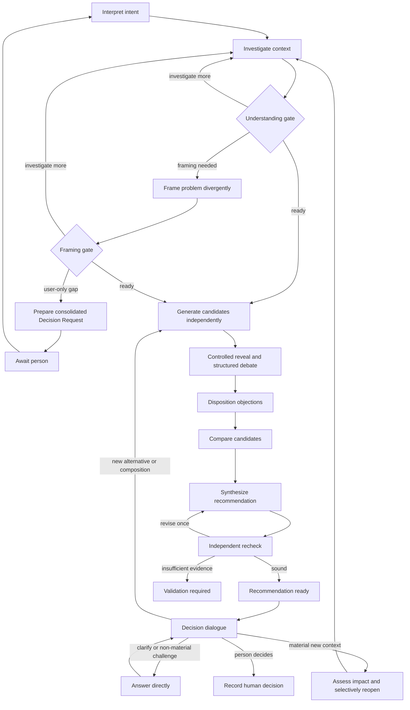

# Bounded proposals and redesigns review pack

Content commit: 0f063d18fdab01cb6f2c915bb60ff528c5e0f238
Original shard: plans/260925-documentation-authority-unification/ledger/decisions/s7-proposals-redesigns-07-architecture-advisory-panel.json
Original shard SHA256: 8808f66639ca2d88f5f4ce0705f2487584a34941f4858de6643a03c77678f8be
Source file: docs/architect/proposals/architecture-advisory-panel.md
Part 2/2; entries: **39**. Source-file group 7/20.
Author session: codex-session:unit-run-1792034226117-40d90d09@2026-10-15
Row-level authoredBy is authoritative for mixed correction authors. Independent ordinary review only; all rows remain pending.

A36 differing-digest rows (0): none.

Absent-target rows (0): none.

Rows changed by 0f063d18fdab01cb6f2c915bb60ff528c5e0f238 (0): none.

Weak-exact/Judgment population: 10; reviewer chooses and records seed and IDs for at least 10 deep reads (15%, minimum 10, all if fewer), plus every differing/absent pair. Mechanically verify all rows, full digests, anchors, ancestry, source eligibility, one owner and exact-proof thresholds. A36 supersedes the older 100% Weak-exact/Judgment deep-read rule in review-brief; retain its other ordinary-review obligations. If >3% deep rework, deep-read the whole pack. Mark each own note deep or mechanical. No author-selected draw or seed/key is supplied. Complete batch: 1,815 rows, 1,289 Unit-exact / 438 Weak-exact / 88 Judgment; 88 mandatory differing pairs; 114 correction rows.

Return an independent committed report with Reviewer, Author session(s), Review mode: ordinary, content/request/shard pins and this five-column table. Consolidate all parts for each original shard before unchanged ordinary application; these slices do not change shard bytes. Use ok/rework/hold with an own note and the full shown-unit digest (literal none for an absent target). Reverse eligibility and triage findings have separate requests and cannot approve these source rows.

| Claim | Verdict | Note | Source digest | Target digest |
|---|---|---|---|---|

## Native gate blocker at the content pin

D reports eight decision-loss-without-partial-carry findings in the proposals README rationales (the phrase `it omits later siblings` describes the source index). The checker and decision content are unchanged. These are reported blockers, not waived findings. This pack contains 0 affected rows.

```json
[]
```

## claim_efe88011d7fa1dd75ffdfe91f8ab6f5a

Changed by 0f063d18fdab01cb6f2c915bb60ff528c5e0f238: **no**. Mechanical class: Unit-exact.
Source: docs/architect/proposals/architecture-advisory-panel.md#unheaded-block-58, lines 417–428.
Target: docs/platform/proposals/architecture-advisory-panel.md#unheaded-block-61.
Source digest: 9487dfc0b5fdd3851293d6b82e33438bdffe1a4d05166dc1ae7ff6bea5cff65a
Target digest: 9487dfc0b5fdd3851293d6b82e33438bdffe1a4d05166dc1ae7ff6bea5cff65a
Shown source SHA256: 9487dfc0b5fdd3851293d6b82e33438bdffe1a4d05166dc1ae7ff6bea5cff65a
Shown target SHA256: 9487dfc0b5fdd3851293d6b82e33438bdffe1a4d05166dc1ae7ff6bea5cff65a

### Proposed decision

```json
{
  "claimId": "claim_efe88011d7fa1dd75ffdfe91f8ab6f5a",
  "sourceUnitDigest": "9487dfc0b5fdd3851293d6b82e33438bdffe1a4d05166dc1ae7ff6bea5cff65a",
  "targetOwner": "docs/platform/proposals/architecture-advisory-panel.md",
  "targetAnchor": "unheaded-block-61",
  "targetUnitDigest": "9487dfc0b5fdd3851293d6b82e33438bdffe1a4d05166dc1ae7ff6bea5cff65a",
  "targetAncestry": [
    "Architecture Advisory Panel",
    "9. Artifact Contracts",
    "`DecisionRequest`"
  ],
  "claimKind": "architecture",
  "disposition": "supersede",
  "reviewStatus": "pending",
  "authoredBy": "codex-session:unit-run-1792034226117-40d90d09@2026-10-15",
  "rationale": "Unit-exact: unique long digest match, equal ancestry, sufficient document exact share. place verbatim: Reject whole-file archive: surviving workflow use case protects intent under A17/A19. Keep map proposal, including stale Not started header; do not claim the old protocol was retained. Evidence: core/workflows/architecture-advisory.yaml:1–6,24–45 implements framing/panel/critique/synthesis; core/skills/fgos-architecture-panel/SKILL.md is current. Commit 2180b4e72 removed the original architecture-advisory-panel-v1.yaml. Source lines 3–7 still says Not started. Complete source unheaded-block docs/architect/proposals/architecture-advisory-panel.md#unheaded-block-58 (lines 417–428) is carried at docs/platform/proposals/architecture-advisory-panel.md#unheaded-block-61 (lines 447–458); Frozen map target and kind retained. Full unit text digest is equal; candidate header and original source metadata are separate. No source wording, caveat, deferred obligation or negative finding is discarded; stale implementation headers remain verbatim. No independent approval, current-truth claim, deletion, promotion or cutover. Review pending. Whole-unit supersede is the frozen vocabulary’s permitted retained-source carriage representation: all original content is carried, with no promotion or immediate source retirement."
}
```

### Full source shown text

````text
```yaml
kind: DecisionRequest
currentUnderstanding: ""
workAlreadyDone: []
materialGap: ""
panelRecommendation: ""
questions:
  - question: ""
    whyOnlyUserCanAnswer: ""
    impactOnRecommendation: ""
    panelDefaultIfUnanswered: ""
```
````

### Full target shown text

````text
```yaml
kind: DecisionRequest
currentUnderstanding: ""
workAlreadyDone: []
materialGap: ""
panelRecommendation: ""
questions:
  - question: ""
    whyOnlyUserCanAnswer: ""
    impactOnRecommendation: ""
    panelDefaultIfUnanswered: ""
```
````

## claim_a18006cbde1986703d96412c949639bc

Changed by 0f063d18fdab01cb6f2c915bb60ff528c5e0f238: **no**. Mechanical class: Weak-exact.
Source: docs/architect/proposals/architecture-advisory-panel.md#architectureproposal, lines 430–430.
Target: docs/platform/proposals/architecture-advisory-panel.md#architectureproposal.
Source digest: 8d16802c72b2a69d93bd8fb9a6e91d811bcbd22e71ec64c90cb63ea8a9124840
Target digest: 8d16802c72b2a69d93bd8fb9a6e91d811bcbd22e71ec64c90cb63ea8a9124840
Shown source SHA256: 3c6691cc67df7b60615a7b96891cd097bc4f770b607921cb9f742ffb89967ace
Shown target SHA256: 3c6691cc67df7b60615a7b96891cd097bc4f770b607921cb9f742ffb89967ace

### Proposed decision

```json
{
  "claimId": "claim_a18006cbde1986703d96412c949639bc",
  "sourceUnitDigest": "8d16802c72b2a69d93bd8fb9a6e91d811bcbd22e71ec64c90cb63ea8a9124840",
  "targetOwner": "docs/platform/proposals/architecture-advisory-panel.md",
  "targetAnchor": "architectureproposal",
  "targetUnitDigest": "8d16802c72b2a69d93bd8fb9a6e91d811bcbd22e71ec64c90cb63ea8a9124840",
  "targetAncestry": [
    "Architecture Advisory Panel",
    "9. Artifact Contracts"
  ],
  "claimKind": "architecture",
  "disposition": "supersede",
  "reviewStatus": "pending",
  "authoredBy": "codex-session:unit-run-1792034226117-40d90d09@2026-10-15",
  "rationale": "Weak-exact: source unit shorter than 40 characters. place verbatim: Reject whole-file archive: surviving workflow use case protects intent under A17/A19. Keep map proposal, including stale Not started header; do not claim the old protocol was retained. Evidence: core/workflows/architecture-advisory.yaml:1–6,24–45 implements framing/panel/critique/synthesis; core/skills/fgos-architecture-panel/SKILL.md is current. Commit 2180b4e72 removed the original architecture-advisory-panel-v1.yaml. Source lines 3–7 still says Not started. Complete source heading docs/architect/proposals/architecture-advisory-panel.md#architectureproposal (lines 430–430) is carried at docs/platform/proposals/architecture-advisory-panel.md#architectureproposal (lines 460–460); Frozen map target and kind retained. Full unit text digest is equal; candidate header and original source metadata are separate. No source wording, caveat, deferred obligation or negative finding is discarded; stale implementation headers remain verbatim. No independent approval, current-truth claim, deletion, promotion or cutover. Review pending. Whole-unit supersede is the frozen vocabulary’s permitted retained-source carriage representation: all original content is carried, with no promotion or immediate source retirement."
}
```

### Full source shown text

````text
### `ArchitectureProposal`

```yaml
kind: ArchitectureProposal
title: ""
problemFrameRef: ""
summary: ""
components: []
contracts: []
keyFlows: []
invariants: []
assumptions: []
tradeoffs: []
failureModes: []
migrationPath: []
rollbackPath: []
irreversibleDecisions: []
validationNeeds: []
```
````

### Full target shown text

````text
### `ArchitectureProposal`

```yaml
kind: ArchitectureProposal
title: ""
problemFrameRef: ""
summary: ""
components: []
contracts: []
keyFlows: []
invariants: []
assumptions: []
tradeoffs: []
failureModes: []
migrationPath: []
rollbackPath: []
irreversibleDecisions: []
validationNeeds: []
```
````

## claim_36fad3e27dd8635c5ec0a5323c818f6c

Changed by 0f063d18fdab01cb6f2c915bb60ff528c5e0f238: **no**. Mechanical class: Unit-exact.
Source: docs/architect/proposals/architecture-advisory-panel.md#unheaded-block-59, lines 432–448.
Target: docs/platform/proposals/architecture-advisory-panel.md#unheaded-block-62.
Source digest: b661e0d81ba2b1744db91a6268e37799438b48984b9e31c0dd2b91c3fe04ec0d
Target digest: b661e0d81ba2b1744db91a6268e37799438b48984b9e31c0dd2b91c3fe04ec0d
Shown source SHA256: b661e0d81ba2b1744db91a6268e37799438b48984b9e31c0dd2b91c3fe04ec0d
Shown target SHA256: b661e0d81ba2b1744db91a6268e37799438b48984b9e31c0dd2b91c3fe04ec0d

### Proposed decision

```json
{
  "claimId": "claim_36fad3e27dd8635c5ec0a5323c818f6c",
  "sourceUnitDigest": "b661e0d81ba2b1744db91a6268e37799438b48984b9e31c0dd2b91c3fe04ec0d",
  "targetOwner": "docs/platform/proposals/architecture-advisory-panel.md",
  "targetAnchor": "unheaded-block-62",
  "targetUnitDigest": "b661e0d81ba2b1744db91a6268e37799438b48984b9e31c0dd2b91c3fe04ec0d",
  "targetAncestry": [
    "Architecture Advisory Panel",
    "9. Artifact Contracts",
    "`ArchitectureProposal`"
  ],
  "claimKind": "architecture",
  "disposition": "supersede",
  "reviewStatus": "pending",
  "authoredBy": "codex-session:unit-run-1792034226117-40d90d09@2026-10-15",
  "rationale": "Unit-exact: unique long digest match, equal ancestry, sufficient document exact share. place verbatim: Reject whole-file archive: surviving workflow use case protects intent under A17/A19. Keep map proposal, including stale Not started header; do not claim the old protocol was retained. Evidence: core/workflows/architecture-advisory.yaml:1–6,24–45 implements framing/panel/critique/synthesis; core/skills/fgos-architecture-panel/SKILL.md is current. Commit 2180b4e72 removed the original architecture-advisory-panel-v1.yaml. Source lines 3–7 still says Not started. Complete source unheaded-block docs/architect/proposals/architecture-advisory-panel.md#unheaded-block-59 (lines 432–448) is carried at docs/platform/proposals/architecture-advisory-panel.md#unheaded-block-62 (lines 462–478); Frozen map target and kind retained. Full unit text digest is equal; candidate header and original source metadata are separate. No source wording, caveat, deferred obligation or negative finding is discarded; stale implementation headers remain verbatim. No independent approval, current-truth claim, deletion, promotion or cutover. Review pending. Whole-unit supersede is the frozen vocabulary’s permitted retained-source carriage representation: all original content is carried, with no promotion or immediate source retirement."
}
```

### Full source shown text

````text
```yaml
kind: ArchitectureProposal
title: ""
problemFrameRef: ""
summary: ""
components: []
contracts: []
keyFlows: []
invariants: []
assumptions: []
tradeoffs: []
failureModes: []
migrationPath: []
rollbackPath: []
irreversibleDecisions: []
validationNeeds: []
```
````

### Full target shown text

````text
```yaml
kind: ArchitectureProposal
title: ""
problemFrameRef: ""
summary: ""
components: []
contracts: []
keyFlows: []
invariants: []
assumptions: []
tradeoffs: []
failureModes: []
migrationPath: []
rollbackPath: []
irreversibleDecisions: []
validationNeeds: []
```
````

## claim_91c71c02bd3ae13d7fdb4cb4bbfc4fe4

Changed by 0f063d18fdab01cb6f2c915bb60ff528c5e0f238: **no**. Mechanical class: Weak-exact.
Source: docs/architect/proposals/architecture-advisory-panel.md#advisorydecisionpacket, lines 450–450.
Target: docs/platform/proposals/architecture-advisory-panel.md#advisorydecisionpacket.
Source digest: b6e97923db37462e57dc1c1d5f8ab84a1b13af04602f12ec4230bc752f82caa5
Target digest: b6e97923db37462e57dc1c1d5f8ab84a1b13af04602f12ec4230bc752f82caa5
Shown source SHA256: 1119b8165752e54ceb0fb9f7aa23344d322d5e44a2787a5d0a7dd559c87b2a7c
Shown target SHA256: 1119b8165752e54ceb0fb9f7aa23344d322d5e44a2787a5d0a7dd559c87b2a7c

### Proposed decision

```json
{
  "claimId": "claim_91c71c02bd3ae13d7fdb4cb4bbfc4fe4",
  "sourceUnitDigest": "b6e97923db37462e57dc1c1d5f8ab84a1b13af04602f12ec4230bc752f82caa5",
  "targetOwner": "docs/platform/proposals/architecture-advisory-panel.md",
  "targetAnchor": "advisorydecisionpacket",
  "targetUnitDigest": "b6e97923db37462e57dc1c1d5f8ab84a1b13af04602f12ec4230bc752f82caa5",
  "targetAncestry": [
    "Architecture Advisory Panel",
    "9. Artifact Contracts"
  ],
  "claimKind": "architecture",
  "disposition": "supersede",
  "reviewStatus": "pending",
  "authoredBy": "codex-session:unit-run-1792034226117-40d90d09@2026-10-15",
  "rationale": "Weak-exact: source unit shorter than 40 characters. place verbatim: Reject whole-file archive: surviving workflow use case protects intent under A17/A19. Keep map proposal, including stale Not started header; do not claim the old protocol was retained. Evidence: core/workflows/architecture-advisory.yaml:1–6,24–45 implements framing/panel/critique/synthesis; core/skills/fgos-architecture-panel/SKILL.md is current. Commit 2180b4e72 removed the original architecture-advisory-panel-v1.yaml. Source lines 3–7 still says Not started. Complete source heading docs/architect/proposals/architecture-advisory-panel.md#advisorydecisionpacket (lines 450–450) is carried at docs/platform/proposals/architecture-advisory-panel.md#advisorydecisionpacket (lines 480–480); Frozen map target and kind retained. Full unit text digest is equal; candidate header and original source metadata are separate. No source wording, caveat, deferred obligation or negative finding is discarded; stale implementation headers remain verbatim. No independent approval, current-truth claim, deletion, promotion or cutover. Review pending. Whole-unit supersede is the frozen vocabulary’s permitted retained-source carriage representation: all original content is carried, with no promotion or immediate source retirement."
}
```

### Full source shown text

````text
### `AdvisoryDecisionPacket`

```yaml
kind: AdvisoryDecisionPacket
understandingRef: ""
verifiedFacts: []
remainingUncertainty: []
options: []
comparisonRef: ""
recommendation: ""
rationale: []
minorityPositions: []
unresolvedObjections: []
reversalConditions: []
validationRequired: []
decisionForUser: ""
nextStepsByDecision: []
sourceRevisions: []
```
````

### Full target shown text

````text
### `AdvisoryDecisionPacket`

```yaml
kind: AdvisoryDecisionPacket
understandingRef: ""
verifiedFacts: []
remainingUncertainty: []
options: []
comparisonRef: ""
recommendation: ""
rationale: []
minorityPositions: []
unresolvedObjections: []
reversalConditions: []
validationRequired: []
decisionForUser: ""
nextStepsByDecision: []
sourceRevisions: []
```
````

## claim_2d21a652102b8f581cbe5d2fbf9a73bc

Changed by 0f063d18fdab01cb6f2c915bb60ff528c5e0f238: **no**. Mechanical class: Unit-exact.
Source: docs/architect/proposals/architecture-advisory-panel.md#unheaded-block-60, lines 452–468.
Target: docs/platform/proposals/architecture-advisory-panel.md#unheaded-block-63.
Source digest: 9b00fa20ef6d64fa888873c957f784656dfd24d172b785720a0118236a0b6344
Target digest: 9b00fa20ef6d64fa888873c957f784656dfd24d172b785720a0118236a0b6344
Shown source SHA256: 9b00fa20ef6d64fa888873c957f784656dfd24d172b785720a0118236a0b6344
Shown target SHA256: 9b00fa20ef6d64fa888873c957f784656dfd24d172b785720a0118236a0b6344

### Proposed decision

```json
{
  "claimId": "claim_2d21a652102b8f581cbe5d2fbf9a73bc",
  "sourceUnitDigest": "9b00fa20ef6d64fa888873c957f784656dfd24d172b785720a0118236a0b6344",
  "targetOwner": "docs/platform/proposals/architecture-advisory-panel.md",
  "targetAnchor": "unheaded-block-63",
  "targetUnitDigest": "9b00fa20ef6d64fa888873c957f784656dfd24d172b785720a0118236a0b6344",
  "targetAncestry": [
    "Architecture Advisory Panel",
    "9. Artifact Contracts",
    "`AdvisoryDecisionPacket`"
  ],
  "claimKind": "architecture",
  "disposition": "supersede",
  "reviewStatus": "pending",
  "authoredBy": "codex-session:unit-run-1792034226117-40d90d09@2026-10-15",
  "rationale": "Unit-exact: unique long digest match, equal ancestry, sufficient document exact share. place verbatim: Reject whole-file archive: surviving workflow use case protects intent under A17/A19. Keep map proposal, including stale Not started header; do not claim the old protocol was retained. Evidence: core/workflows/architecture-advisory.yaml:1–6,24–45 implements framing/panel/critique/synthesis; core/skills/fgos-architecture-panel/SKILL.md is current. Commit 2180b4e72 removed the original architecture-advisory-panel-v1.yaml. Source lines 3–7 still says Not started. Complete source unheaded-block docs/architect/proposals/architecture-advisory-panel.md#unheaded-block-60 (lines 452–468) is carried at docs/platform/proposals/architecture-advisory-panel.md#unheaded-block-63 (lines 482–498); Frozen map target and kind retained. Full unit text digest is equal; candidate header and original source metadata are separate. No source wording, caveat, deferred obligation or negative finding is discarded; stale implementation headers remain verbatim. No independent approval, current-truth claim, deletion, promotion or cutover. Review pending. Whole-unit supersede is the frozen vocabulary’s permitted retained-source carriage representation: all original content is carried, with no promotion or immediate source retirement."
}
```

### Full source shown text

````text
```yaml
kind: AdvisoryDecisionPacket
understandingRef: ""
verifiedFacts: []
remainingUncertainty: []
options: []
comparisonRef: ""
recommendation: ""
rationale: []
minorityPositions: []
unresolvedObjections: []
reversalConditions: []
validationRequired: []
decisionForUser: ""
nextStepsByDecision: []
sourceRevisions: []
```
````

### Full target shown text

````text
```yaml
kind: AdvisoryDecisionPacket
understandingRef: ""
verifiedFacts: []
remainingUncertainty: []
options: []
comparisonRef: ""
recommendation: ""
rationale: []
minorityPositions: []
unresolvedObjections: []
reversalConditions: []
validationRequired: []
decisionForUser: ""
nextStepsByDecision: []
sourceRevisions: []
```
````

## claim_6339e302f7d186cefbfc083667678e67

Changed by 0f063d18fdab01cb6f2c915bb60ff528c5e0f238: **no**. Mechanical class: Weak-exact.
Source: docs/architect/proposals/architecture-advisory-panel.md#recheckreport, lines 470–470.
Target: docs/platform/proposals/architecture-advisory-panel.md#recheckreport.
Source digest: 8bca59328a78cc0864122962865b5058412a4d8c0ee318c6d8152b31b3114b6e
Target digest: 8bca59328a78cc0864122962865b5058412a4d8c0ee318c6d8152b31b3114b6e
Shown source SHA256: 96ed25b6475c06afffd913f2bc43ae9057a14d05a5b98a36476a4c7e7a2c699d
Shown target SHA256: 96ed25b6475c06afffd913f2bc43ae9057a14d05a5b98a36476a4c7e7a2c699d

### Proposed decision

```json
{
  "claimId": "claim_6339e302f7d186cefbfc083667678e67",
  "sourceUnitDigest": "8bca59328a78cc0864122962865b5058412a4d8c0ee318c6d8152b31b3114b6e",
  "targetOwner": "docs/platform/proposals/architecture-advisory-panel.md",
  "targetAnchor": "recheckreport",
  "targetUnitDigest": "8bca59328a78cc0864122962865b5058412a4d8c0ee318c6d8152b31b3114b6e",
  "targetAncestry": [
    "Architecture Advisory Panel",
    "9. Artifact Contracts"
  ],
  "claimKind": "architecture",
  "disposition": "supersede",
  "reviewStatus": "pending",
  "authoredBy": "codex-session:unit-run-1792034226117-40d90d09@2026-10-15",
  "rationale": "Weak-exact: source unit shorter than 40 characters. place verbatim: Reject whole-file archive: surviving workflow use case protects intent under A17/A19. Keep map proposal, including stale Not started header; do not claim the old protocol was retained. Evidence: core/workflows/architecture-advisory.yaml:1–6,24–45 implements framing/panel/critique/synthesis; core/skills/fgos-architecture-panel/SKILL.md is current. Commit 2180b4e72 removed the original architecture-advisory-panel-v1.yaml. Source lines 3–7 still says Not started. Complete source heading docs/architect/proposals/architecture-advisory-panel.md#recheckreport (lines 470–470) is carried at docs/platform/proposals/architecture-advisory-panel.md#recheckreport (lines 500–500); Frozen map target and kind retained. Full unit text digest is equal; candidate header and original source metadata are separate. No source wording, caveat, deferred obligation or negative finding is discarded; stale implementation headers remain verbatim. No independent approval, current-truth claim, deletion, promotion or cutover. Review pending. Whole-unit supersede is the frozen vocabulary’s permitted retained-source carriage representation: all original content is carried, with no promotion or immediate source retirement."
}
```

### Full source shown text

````text
### `RecheckReport`

```yaml
kind: RecheckReport
targetRevision: ""
findings:
  - severity: blocking | material | advisory
    claim: ""
    evidenceRefs: []
    requiredDisposition: ""
verdict: sound | revise | insufficient-evidence
```
````

### Full target shown text

````text
### `RecheckReport`

```yaml
kind: RecheckReport
targetRevision: ""
findings:
  - severity: blocking | material | advisory
    claim: ""
    evidenceRefs: []
    requiredDisposition: ""
verdict: sound | revise | insufficient-evidence
```
````

## claim_7e86901195c95d441a583999e9e69943

Changed by 0f063d18fdab01cb6f2c915bb60ff528c5e0f238: **no**. Mechanical class: Unit-exact.
Source: docs/architect/proposals/architecture-advisory-panel.md#unheaded-block-61, lines 472–481.
Target: docs/platform/proposals/architecture-advisory-panel.md#unheaded-block-64.
Source digest: c92a6b4bb2f639ae78e818ee8b73c0de62b46d884300313276df637b04ca6aaa
Target digest: c92a6b4bb2f639ae78e818ee8b73c0de62b46d884300313276df637b04ca6aaa
Shown source SHA256: c92a6b4bb2f639ae78e818ee8b73c0de62b46d884300313276df637b04ca6aaa
Shown target SHA256: c92a6b4bb2f639ae78e818ee8b73c0de62b46d884300313276df637b04ca6aaa

### Proposed decision

```json
{
  "claimId": "claim_7e86901195c95d441a583999e9e69943",
  "sourceUnitDigest": "c92a6b4bb2f639ae78e818ee8b73c0de62b46d884300313276df637b04ca6aaa",
  "targetOwner": "docs/platform/proposals/architecture-advisory-panel.md",
  "targetAnchor": "unheaded-block-64",
  "targetUnitDigest": "c92a6b4bb2f639ae78e818ee8b73c0de62b46d884300313276df637b04ca6aaa",
  "targetAncestry": [
    "Architecture Advisory Panel",
    "9. Artifact Contracts",
    "`RecheckReport`"
  ],
  "claimKind": "architecture",
  "disposition": "supersede",
  "reviewStatus": "pending",
  "authoredBy": "codex-session:unit-run-1792034226117-40d90d09@2026-10-15",
  "rationale": "Unit-exact: unique long digest match, equal ancestry, sufficient document exact share. place verbatim: Reject whole-file archive: surviving workflow use case protects intent under A17/A19. Keep map proposal, including stale Not started header; do not claim the old protocol was retained. Evidence: core/workflows/architecture-advisory.yaml:1–6,24–45 implements framing/panel/critique/synthesis; core/skills/fgos-architecture-panel/SKILL.md is current. Commit 2180b4e72 removed the original architecture-advisory-panel-v1.yaml. Source lines 3–7 still says Not started. Complete source unheaded-block docs/architect/proposals/architecture-advisory-panel.md#unheaded-block-61 (lines 472–481) is carried at docs/platform/proposals/architecture-advisory-panel.md#unheaded-block-64 (lines 502–511); Frozen map target and kind retained. Full unit text digest is equal; candidate header and original source metadata are separate. No source wording, caveat, deferred obligation or negative finding is discarded; stale implementation headers remain verbatim. No independent approval, current-truth claim, deletion, promotion or cutover. Review pending. Whole-unit supersede is the frozen vocabulary’s permitted retained-source carriage representation: all original content is carried, with no promotion or immediate source retirement."
}
```

### Full source shown text

````text
```yaml
kind: RecheckReport
targetRevision: ""
findings:
  - severity: blocking | material | advisory
    claim: ""
    evidenceRefs: []
    requiredDisposition: ""
verdict: sound | revise | insufficient-evidence
```
````

### Full target shown text

````text
```yaml
kind: RecheckReport
targetRevision: ""
findings:
  - severity: blocking | material | advisory
    claim: ""
    evidenceRefs: []
    requiredDisposition: ""
verdict: sound | revise | insufficient-evidence
```
````

## claim_bbd5cb4d5a7b71f8bed64c225f79308d

Changed by 0f063d18fdab01cb6f2c915bb60ff528c5e0f238: **no**. Mechanical class: Weak-exact.
Source: docs/architect/proposals/architecture-advisory-panel.md#10-decision-dialogue, lines 483–483.
Target: docs/platform/proposals/architecture-advisory-panel.md#10-decision-dialogue.
Source digest: 80f1da215bfcd92e7df30eec5441e712c0a288d66bfa52b9604d13187678a933
Target digest: 80f1da215bfcd92e7df30eec5441e712c0a288d66bfa52b9604d13187678a933
Shown source SHA256: b7f6fc0452dd936667730efc5d596c34512a9189487291362265fb373afa3b26
Shown target SHA256: b7f6fc0452dd936667730efc5d596c34512a9189487291362265fb373afa3b26

### Proposed decision

```json
{
  "claimId": "claim_bbd5cb4d5a7b71f8bed64c225f79308d",
  "sourceUnitDigest": "80f1da215bfcd92e7df30eec5441e712c0a288d66bfa52b9604d13187678a933",
  "targetOwner": "docs/platform/proposals/architecture-advisory-panel.md",
  "targetAnchor": "10-decision-dialogue",
  "targetUnitDigest": "80f1da215bfcd92e7df30eec5441e712c0a288d66bfa52b9604d13187678a933",
  "targetAncestry": [
    "Architecture Advisory Panel"
  ],
  "claimKind": "decision",
  "disposition": "supersede",
  "reviewStatus": "pending",
  "authoredBy": "codex-session:unit-run-1792034226117-40d90d09@2026-10-15",
  "rationale": "Weak-exact: source unit shorter than 40 characters. place verbatim: Reject whole-file archive: surviving workflow use case protects intent under A17/A19. Keep map proposal, including stale Not started header; do not claim the old protocol was retained. Evidence: core/workflows/architecture-advisory.yaml:1–6,24–45 implements framing/panel/critique/synthesis; core/skills/fgos-architecture-panel/SKILL.md is current. Commit 2180b4e72 removed the original architecture-advisory-panel-v1.yaml. Source lines 3–7 still says Not started. Complete source heading docs/architect/proposals/architecture-advisory-panel.md#10-decision-dialogue (lines 483–483) is carried at docs/platform/proposals/architecture-advisory-panel.md#10-decision-dialogue (lines 513–513); Frozen map target and kind retained. Full unit text digest is equal; candidate header and original source metadata are separate. No source wording, caveat, deferred obligation or negative finding is discarded; stale implementation headers remain verbatim. No independent approval, current-truth claim, deletion, promotion or cutover. Review pending. Whole-unit supersede is the frozen vocabulary’s permitted retained-source carriage representation: all original content is carried, with no promotion or immediate source retirement."
}
```

### Full source shown text

````text
## 10. Decision Dialogue

Once the packet passes independent recheck, the session enters
`recommendation-ready` and then `decision-dialogue`. The person may issue one
of six semantic interactions:

| Interaction | Meaning | Default effect |
|---|---|---|
| `clarify` | Explain a term, claim, or trade-off more deeply. | Answer directly; do not reopen. |
| `challenge` | Contest reasoning or evidence. | Respond with evidence; reopen only if a premise changes. |
| `introduce-context` | Add a fact, constraint, preference, or authority statement. | Assess materiality and revise the corresponding source artifact. |
| `request-alternative` | Explore another named solution class. | Reopen at architecture divergence. |
| `request-composition` | Combine selected parts of existing options. | Create and challenge a `CompositeProposal`. |
| `decide` | Accept, reject, defer, combine, or require validation. | Record a human-authority decision. |

Every interaction creates an immutable `UserInteraction` artifact. The panel
then creates a separate `DialogueImpactAssessment`; it must not overwrite the
person's words with its interpretation.

```yaml
kind: DialogueImpactAssessment
interactionRef: ""
interpretation: ""
classification: ""
materiality: material | non-material
affectedClaims: []
invalidatedArtifactRefs: []
earliestInvalidatedPhase: null
recommendedAction: answer | investigate | reopen | record-decision
rationale: ""
```

A change is material when it can change the problem frame, solution class,
component boundary, authority allocation, recommendation, migration
feasibility, or disposition of a blocking objection.
````

### Full target shown text

````text
## 10. Decision Dialogue

Once the packet passes independent recheck, the session enters
`recommendation-ready` and then `decision-dialogue`. The person may issue one
of six semantic interactions:

| Interaction | Meaning | Default effect |
|---|---|---|
| `clarify` | Explain a term, claim, or trade-off more deeply. | Answer directly; do not reopen. |
| `challenge` | Contest reasoning or evidence. | Respond with evidence; reopen only if a premise changes. |
| `introduce-context` | Add a fact, constraint, preference, or authority statement. | Assess materiality and revise the corresponding source artifact. |
| `request-alternative` | Explore another named solution class. | Reopen at architecture divergence. |
| `request-composition` | Combine selected parts of existing options. | Create and challenge a `CompositeProposal`. |
| `decide` | Accept, reject, defer, combine, or require validation. | Record a human-authority decision. |

Every interaction creates an immutable `UserInteraction` artifact. The panel
then creates a separate `DialogueImpactAssessment`; it must not overwrite the
person's words with its interpretation.

```yaml
kind: DialogueImpactAssessment
interactionRef: ""
interpretation: ""
classification: ""
materiality: material | non-material
affectedClaims: []
invalidatedArtifactRefs: []
earliestInvalidatedPhase: null
recommendedAction: answer | investigate | reopen | record-decision
rationale: ""
```

A change is material when it can change the problem frame, solution class,
component boundary, authority allocation, recommendation, migration
feasibility, or disposition of a blocking objection.
````

## claim_7c8b298ec4729f46023e735e62a80033

Changed by 0f063d18fdab01cb6f2c915bb60ff528c5e0f238: **no**. Mechanical class: Unit-exact.
Source: docs/architect/proposals/architecture-advisory-panel.md#unheaded-block-62, lines 485–487.
Target: docs/platform/proposals/architecture-advisory-panel.md#unheaded-block-65.
Source digest: c95ee031579d654b7891f407194b7f775fe02a982ec02148651f4f14f3f2508c
Target digest: c95ee031579d654b7891f407194b7f775fe02a982ec02148651f4f14f3f2508c
Shown source SHA256: c95ee031579d654b7891f407194b7f775fe02a982ec02148651f4f14f3f2508c
Shown target SHA256: c95ee031579d654b7891f407194b7f775fe02a982ec02148651f4f14f3f2508c

### Proposed decision

```json
{
  "claimId": "claim_7c8b298ec4729f46023e735e62a80033",
  "sourceUnitDigest": "c95ee031579d654b7891f407194b7f775fe02a982ec02148651f4f14f3f2508c",
  "targetOwner": "docs/platform/proposals/architecture-advisory-panel.md",
  "targetAnchor": "unheaded-block-65",
  "targetUnitDigest": "c95ee031579d654b7891f407194b7f775fe02a982ec02148651f4f14f3f2508c",
  "targetAncestry": [
    "Architecture Advisory Panel",
    "10. Decision Dialogue"
  ],
  "claimKind": "decision",
  "disposition": "supersede",
  "reviewStatus": "pending",
  "authoredBy": "codex-session:unit-run-1792034226117-40d90d09@2026-10-15",
  "rationale": "Unit-exact: unique long digest match, equal ancestry, sufficient document exact share. place verbatim: Reject whole-file archive: surviving workflow use case protects intent under A17/A19. Keep map proposal, including stale Not started header; do not claim the old protocol was retained. Evidence: core/workflows/architecture-advisory.yaml:1–6,24–45 implements framing/panel/critique/synthesis; core/skills/fgos-architecture-panel/SKILL.md is current. Commit 2180b4e72 removed the original architecture-advisory-panel-v1.yaml. Source lines 3–7 still says Not started. Complete source unheaded-block docs/architect/proposals/architecture-advisory-panel.md#unheaded-block-62 (lines 485–487) is carried at docs/platform/proposals/architecture-advisory-panel.md#unheaded-block-65 (lines 515–517); Frozen map target and kind retained. Full unit text digest is equal; candidate header and original source metadata are separate. No source wording, caveat, deferred obligation or negative finding is discarded; stale implementation headers remain verbatim. No independent approval, current-truth claim, deletion, promotion or cutover. Review pending. Whole-unit supersede is the frozen vocabulary’s permitted retained-source carriage representation: all original content is carried, with no promotion or immediate source retirement."
}
```

### Full source shown text

```text
Once the packet passes independent recheck, the session enters
`recommendation-ready` and then `decision-dialogue`. The person may issue one
of six semantic interactions:
```

### Full target shown text

```text
Once the packet passes independent recheck, the session enters
`recommendation-ready` and then `decision-dialogue`. The person may issue one
of six semantic interactions:
```

## claim_2add4fd9c5b505c85bc27a42b4dee5fd

Changed by 0f063d18fdab01cb6f2c915bb60ff528c5e0f238: **no**. Mechanical class: Unit-exact.
Source: docs/architect/proposals/architecture-advisory-panel.md#unheaded-block-63, lines 489–496.
Target: docs/platform/proposals/architecture-advisory-panel.md#unheaded-block-66.
Source digest: 2a4f87a9380db3fff54852cc6c2bdc328920993cac846d486953dbbc49678842
Target digest: 2a4f87a9380db3fff54852cc6c2bdc328920993cac846d486953dbbc49678842
Shown source SHA256: 2a4f87a9380db3fff54852cc6c2bdc328920993cac846d486953dbbc49678842
Shown target SHA256: 2a4f87a9380db3fff54852cc6c2bdc328920993cac846d486953dbbc49678842

### Proposed decision

```json
{
  "claimId": "claim_2add4fd9c5b505c85bc27a42b4dee5fd",
  "sourceUnitDigest": "2a4f87a9380db3fff54852cc6c2bdc328920993cac846d486953dbbc49678842",
  "targetOwner": "docs/platform/proposals/architecture-advisory-panel.md",
  "targetAnchor": "unheaded-block-66",
  "targetUnitDigest": "2a4f87a9380db3fff54852cc6c2bdc328920993cac846d486953dbbc49678842",
  "targetAncestry": [
    "Architecture Advisory Panel",
    "10. Decision Dialogue"
  ],
  "claimKind": "architecture",
  "disposition": "supersede",
  "reviewStatus": "pending",
  "authoredBy": "codex-session:unit-run-1792034226117-40d90d09@2026-10-15",
  "rationale": "Unit-exact: unique long digest match, equal ancestry, sufficient document exact share. place verbatim: Reject whole-file archive: surviving workflow use case protects intent under A17/A19. Keep map proposal, including stale Not started header; do not claim the old protocol was retained. Evidence: core/workflows/architecture-advisory.yaml:1–6,24–45 implements framing/panel/critique/synthesis; core/skills/fgos-architecture-panel/SKILL.md is current. Commit 2180b4e72 removed the original architecture-advisory-panel-v1.yaml. Source lines 3–7 still says Not started. Complete source unheaded-block docs/architect/proposals/architecture-advisory-panel.md#unheaded-block-63 (lines 489–496) is carried at docs/platform/proposals/architecture-advisory-panel.md#unheaded-block-66 (lines 519–526); Frozen map target and kind retained. Full unit text digest is equal; candidate header and original source metadata are separate. No source wording, caveat, deferred obligation or negative finding is discarded; stale implementation headers remain verbatim. No independent approval, current-truth claim, deletion, promotion or cutover. Review pending. Whole-unit supersede is the frozen vocabulary’s permitted retained-source carriage representation: all original content is carried, with no promotion or immediate source retirement."
}
```

### Full source shown text

```text
| Interaction | Meaning | Default effect |
|---|---|---|
| `clarify` | Explain a term, claim, or trade-off more deeply. | Answer directly; do not reopen. |
| `challenge` | Contest reasoning or evidence. | Respond with evidence; reopen only if a premise changes. |
| `introduce-context` | Add a fact, constraint, preference, or authority statement. | Assess materiality and revise the corresponding source artifact. |
| `request-alternative` | Explore another named solution class. | Reopen at architecture divergence. |
| `request-composition` | Combine selected parts of existing options. | Create and challenge a `CompositeProposal`. |
| `decide` | Accept, reject, defer, combine, or require validation. | Record a human-authority decision. |
```

### Full target shown text

```text
| Interaction | Meaning | Default effect |
|---|---|---|
| `clarify` | Explain a term, claim, or trade-off more deeply. | Answer directly; do not reopen. |
| `challenge` | Contest reasoning or evidence. | Respond with evidence; reopen only if a premise changes. |
| `introduce-context` | Add a fact, constraint, preference, or authority statement. | Assess materiality and revise the corresponding source artifact. |
| `request-alternative` | Explore another named solution class. | Reopen at architecture divergence. |
| `request-composition` | Combine selected parts of existing options. | Create and challenge a `CompositeProposal`. |
| `decide` | Accept, reject, defer, combine, or require validation. | Record a human-authority decision. |
```

## claim_f2295d674c580463348254a5ff3d8cac

Changed by 0f063d18fdab01cb6f2c915bb60ff528c5e0f238: **no**. Mechanical class: Unit-exact.
Source: docs/architect/proposals/architecture-advisory-panel.md#unheaded-block-64, lines 498–500.
Target: docs/platform/proposals/architecture-advisory-panel.md#unheaded-block-67.
Source digest: 8d15cd3a2d807335e725229a8a96bf8f94646fa28cbf010865c67072932aef73
Target digest: 8d15cd3a2d807335e725229a8a96bf8f94646fa28cbf010865c67072932aef73
Shown source SHA256: 8d15cd3a2d807335e725229a8a96bf8f94646fa28cbf010865c67072932aef73
Shown target SHA256: 8d15cd3a2d807335e725229a8a96bf8f94646fa28cbf010865c67072932aef73

### Proposed decision

```json
{
  "claimId": "claim_f2295d674c580463348254a5ff3d8cac",
  "sourceUnitDigest": "8d15cd3a2d807335e725229a8a96bf8f94646fa28cbf010865c67072932aef73",
  "targetOwner": "docs/platform/proposals/architecture-advisory-panel.md",
  "targetAnchor": "unheaded-block-67",
  "targetUnitDigest": "8d15cd3a2d807335e725229a8a96bf8f94646fa28cbf010865c67072932aef73",
  "targetAncestry": [
    "Architecture Advisory Panel",
    "10. Decision Dialogue"
  ],
  "claimKind": "architecture",
  "disposition": "supersede",
  "reviewStatus": "pending",
  "authoredBy": "codex-session:unit-run-1792034226117-40d90d09@2026-10-15",
  "rationale": "Unit-exact: unique long digest match, equal ancestry, sufficient document exact share. place verbatim: Reject whole-file archive: surviving workflow use case protects intent under A17/A19. Keep map proposal, including stale Not started header; do not claim the old protocol was retained. Evidence: core/workflows/architecture-advisory.yaml:1–6,24–45 implements framing/panel/critique/synthesis; core/skills/fgos-architecture-panel/SKILL.md is current. Commit 2180b4e72 removed the original architecture-advisory-panel-v1.yaml. Source lines 3–7 still says Not started. Complete source unheaded-block docs/architect/proposals/architecture-advisory-panel.md#unheaded-block-64 (lines 498–500) is carried at docs/platform/proposals/architecture-advisory-panel.md#unheaded-block-67 (lines 528–530); Frozen map target and kind retained. Full unit text digest is equal; candidate header and original source metadata are separate. No source wording, caveat, deferred obligation or negative finding is discarded; stale implementation headers remain verbatim. No independent approval, current-truth claim, deletion, promotion or cutover. Review pending. Whole-unit supersede is the frozen vocabulary’s permitted retained-source carriage representation: all original content is carried, with no promotion or immediate source retirement."
}
```

### Full source shown text

```text
Every interaction creates an immutable `UserInteraction` artifact. The panel
then creates a separate `DialogueImpactAssessment`; it must not overwrite the
person's words with its interpretation.
```

### Full target shown text

```text
Every interaction creates an immutable `UserInteraction` artifact. The panel
then creates a separate `DialogueImpactAssessment`; it must not overwrite the
person's words with its interpretation.
```

## claim_6b513c09420e15f7c64d7fc3c9916215

Changed by 0f063d18fdab01cb6f2c915bb60ff528c5e0f238: **no**. Mechanical class: Unit-exact.
Source: docs/architect/proposals/architecture-advisory-panel.md#unheaded-block-65, lines 502–513.
Target: docs/platform/proposals/architecture-advisory-panel.md#unheaded-block-68.
Source digest: 7bc2f6dc8b6e7b31a6774c3d32adf71c646d2584bb81b8d620ae2c4e53c45b3b
Target digest: 7bc2f6dc8b6e7b31a6774c3d32adf71c646d2584bb81b8d620ae2c4e53c45b3b
Shown source SHA256: 7bc2f6dc8b6e7b31a6774c3d32adf71c646d2584bb81b8d620ae2c4e53c45b3b
Shown target SHA256: 7bc2f6dc8b6e7b31a6774c3d32adf71c646d2584bb81b8d620ae2c4e53c45b3b

### Proposed decision

```json
{
  "claimId": "claim_6b513c09420e15f7c64d7fc3c9916215",
  "sourceUnitDigest": "7bc2f6dc8b6e7b31a6774c3d32adf71c646d2584bb81b8d620ae2c4e53c45b3b",
  "targetOwner": "docs/platform/proposals/architecture-advisory-panel.md",
  "targetAnchor": "unheaded-block-68",
  "targetUnitDigest": "7bc2f6dc8b6e7b31a6774c3d32adf71c646d2584bb81b8d620ae2c4e53c45b3b",
  "targetAncestry": [
    "Architecture Advisory Panel",
    "10. Decision Dialogue"
  ],
  "claimKind": "architecture",
  "disposition": "supersede",
  "reviewStatus": "pending",
  "authoredBy": "codex-session:unit-run-1792034226117-40d90d09@2026-10-15",
  "rationale": "Unit-exact: unique long digest match, equal ancestry, sufficient document exact share. place verbatim: Reject whole-file archive: surviving workflow use case protects intent under A17/A19. Keep map proposal, including stale Not started header; do not claim the old protocol was retained. Evidence: core/workflows/architecture-advisory.yaml:1–6,24–45 implements framing/panel/critique/synthesis; core/skills/fgos-architecture-panel/SKILL.md is current. Commit 2180b4e72 removed the original architecture-advisory-panel-v1.yaml. Source lines 3–7 still says Not started. Complete source unheaded-block docs/architect/proposals/architecture-advisory-panel.md#unheaded-block-65 (lines 502–513) is carried at docs/platform/proposals/architecture-advisory-panel.md#unheaded-block-68 (lines 532–543); Frozen map target and kind retained. Full unit text digest is equal; candidate header and original source metadata are separate. No source wording, caveat, deferred obligation or negative finding is discarded; stale implementation headers remain verbatim. No independent approval, current-truth claim, deletion, promotion or cutover. Review pending. Whole-unit supersede is the frozen vocabulary’s permitted retained-source carriage representation: all original content is carried, with no promotion or immediate source retirement."
}
```

### Full source shown text

````text
```yaml
kind: DialogueImpactAssessment
interactionRef: ""
interpretation: ""
classification: ""
materiality: material | non-material
affectedClaims: []
invalidatedArtifactRefs: []
earliestInvalidatedPhase: null
recommendedAction: answer | investigate | reopen | record-decision
rationale: ""
```
````

### Full target shown text

````text
```yaml
kind: DialogueImpactAssessment
interactionRef: ""
interpretation: ""
classification: ""
materiality: material | non-material
affectedClaims: []
invalidatedArtifactRefs: []
earliestInvalidatedPhase: null
recommendedAction: answer | investigate | reopen | record-decision
rationale: ""
```
````

## claim_9eb5405bae10d1d2678b74f8cd434c7b

Changed by 0f063d18fdab01cb6f2c915bb60ff528c5e0f238: **no**. Mechanical class: Unit-exact.
Source: docs/architect/proposals/architecture-advisory-panel.md#unheaded-block-66, lines 515–517.
Target: docs/platform/proposals/architecture-advisory-panel.md#unheaded-block-69.
Source digest: 4293ddbdab09473d6f2a11eb541e2974b9ac26abb7af5096f60c2f3e653524ae
Target digest: 4293ddbdab09473d6f2a11eb541e2974b9ac26abb7af5096f60c2f3e653524ae
Shown source SHA256: 4293ddbdab09473d6f2a11eb541e2974b9ac26abb7af5096f60c2f3e653524ae
Shown target SHA256: 4293ddbdab09473d6f2a11eb541e2974b9ac26abb7af5096f60c2f3e653524ae

### Proposed decision

```json
{
  "claimId": "claim_9eb5405bae10d1d2678b74f8cd434c7b",
  "sourceUnitDigest": "4293ddbdab09473d6f2a11eb541e2974b9ac26abb7af5096f60c2f3e653524ae",
  "targetOwner": "docs/platform/proposals/architecture-advisory-panel.md",
  "targetAnchor": "unheaded-block-69",
  "targetUnitDigest": "4293ddbdab09473d6f2a11eb541e2974b9ac26abb7af5096f60c2f3e653524ae",
  "targetAncestry": [
    "Architecture Advisory Panel",
    "10. Decision Dialogue"
  ],
  "claimKind": "contract",
  "disposition": "supersede",
  "reviewStatus": "pending",
  "authoredBy": "codex-session:unit-run-1792034226117-40d90d09@2026-10-15",
  "rationale": "Unit-exact: unique long digest match, equal ancestry, sufficient document exact share. place verbatim: Reject whole-file archive: surviving workflow use case protects intent under A17/A19. Keep map proposal, including stale Not started header; do not claim the old protocol was retained. Evidence: core/workflows/architecture-advisory.yaml:1–6,24–45 implements framing/panel/critique/synthesis; core/skills/fgos-architecture-panel/SKILL.md is current. Commit 2180b4e72 removed the original architecture-advisory-panel-v1.yaml. Source lines 3–7 still says Not started. Complete source unheaded-block docs/architect/proposals/architecture-advisory-panel.md#unheaded-block-66 (lines 515–517) is carried at docs/platform/proposals/architecture-advisory-panel.md#unheaded-block-69 (lines 545–547); Frozen map target and kind retained. Full unit text digest is equal; candidate header and original source metadata are separate. No source wording, caveat, deferred obligation or negative finding is discarded; stale implementation headers remain verbatim. No independent approval, current-truth claim, deletion, promotion or cutover. Review pending. Whole-unit supersede is the frozen vocabulary’s permitted retained-source carriage representation: all original content is carried, with no promotion or immediate source retirement."
}
```

### Full source shown text

```text
A change is material when it can change the problem frame, solution class,
component boundary, authority allocation, recommendation, migration
feasibility, or disposition of a blocking objection.
```

### Full target shown text

```text
A change is material when it can change the problem frame, solution class,
component boundary, authority allocation, recommendation, migration
feasibility, or disposition of a blocking objection.
```

## claim_748ab5c4155fd1a0c2e33d58b36103cf

Changed by 0f063d18fdab01cb6f2c915bb60ff528c5e0f238: **no**. Mechanical class: Weak-exact.
Source: docs/architect/proposals/architecture-advisory-panel.md#selective-reopen, lines 519–519.
Target: docs/platform/proposals/architecture-advisory-panel.md#selective-reopen.
Source digest: 3f7031b3d0038a56ddb8523a60dde495b63dfed8dec1fdce4bea5b1c11c0b11e
Target digest: 3f7031b3d0038a56ddb8523a60dde495b63dfed8dec1fdce4bea5b1c11c0b11e
Shown source SHA256: ace0c861f935ac2784704259b85841057a0c139b1195b630cc150dbb788c7782
Shown target SHA256: ace0c861f935ac2784704259b85841057a0c139b1195b630cc150dbb788c7782

### Proposed decision

```json
{
  "claimId": "claim_748ab5c4155fd1a0c2e33d58b36103cf",
  "sourceUnitDigest": "3f7031b3d0038a56ddb8523a60dde495b63dfed8dec1fdce4bea5b1c11c0b11e",
  "targetOwner": "docs/platform/proposals/architecture-advisory-panel.md",
  "targetAnchor": "selective-reopen",
  "targetUnitDigest": "3f7031b3d0038a56ddb8523a60dde495b63dfed8dec1fdce4bea5b1c11c0b11e",
  "targetAncestry": [
    "Architecture Advisory Panel",
    "10. Decision Dialogue"
  ],
  "claimKind": "architecture",
  "disposition": "supersede",
  "reviewStatus": "pending",
  "authoredBy": "codex-session:unit-run-1792034226117-40d90d09@2026-10-15",
  "rationale": "Weak-exact: source unit shorter than 40 characters. place verbatim: Reject whole-file archive: surviving workflow use case protects intent under A17/A19. Keep map proposal, including stale Not started header; do not claim the old protocol was retained. Evidence: core/workflows/architecture-advisory.yaml:1–6,24–45 implements framing/panel/critique/synthesis; core/skills/fgos-architecture-panel/SKILL.md is current. Commit 2180b4e72 removed the original architecture-advisory-panel-v1.yaml. Source lines 3–7 still says Not started. Complete source heading docs/architect/proposals/architecture-advisory-panel.md#selective-reopen (lines 519–519) is carried at docs/platform/proposals/architecture-advisory-panel.md#selective-reopen (lines 549–549); Frozen map target and kind retained. Full unit text digest is equal; candidate header and original source metadata are separate. No source wording, caveat, deferred obligation or negative finding is discarded; stale implementation headers remain verbatim. No independent approval, current-truth claim, deletion, promotion or cutover. Review pending. Whole-unit supersede is the frozen vocabulary’s permitted retained-source carriage representation: all original content is carried, with no promotion or immediate source retirement."
}
```

### Full source shown text

````text
### Selective Reopen

```text
new interaction
  -> assess impact
  -> reopen the earliest invalidated phase
  -> create new downstream revisions
  -> preserve every prior artifact and verdict
```

Examples:

- a terminology question receives a direct answer;
- a new deployment constraint may reopen investigation or proposals;
- a request for an event-driven alternative reopens architecture divergence;
- a request to combine two options creates a composite and reruns debate,
  comparison, synthesis, and recheck;
- choosing an option records a decision without another debate.

After two material reopen cycles without a decision, the panel reports
`decision-deferred` with the open decision frontier rather than forcing
convergence.
````

### Full target shown text

````text
### Selective Reopen

```text
new interaction
  -> assess impact
  -> reopen the earliest invalidated phase
  -> create new downstream revisions
  -> preserve every prior artifact and verdict
```

Examples:

- a terminology question receives a direct answer;
- a new deployment constraint may reopen investigation or proposals;
- a request for an event-driven alternative reopens architecture divergence;
- a request to combine two options creates a composite and reruns debate,
  comparison, synthesis, and recheck;
- choosing an option records a decision without another debate.

After two material reopen cycles without a decision, the panel reports
`decision-deferred` with the open decision frontier rather than forcing
convergence.
````

## claim_e123a022f32dce2f5e57e8ba4480768e

Changed by 0f063d18fdab01cb6f2c915bb60ff528c5e0f238: **no**. Mechanical class: Unit-exact.
Source: docs/architect/proposals/architecture-advisory-panel.md#unheaded-block-67, lines 521–527.
Target: docs/platform/proposals/architecture-advisory-panel.md#unheaded-block-70.
Source digest: 41eafe3a12d2e22bb0b00797c7aa5006bcea8e291572a7b80c4f1007d42b3426
Target digest: 41eafe3a12d2e22bb0b00797c7aa5006bcea8e291572a7b80c4f1007d42b3426
Shown source SHA256: 41eafe3a12d2e22bb0b00797c7aa5006bcea8e291572a7b80c4f1007d42b3426
Shown target SHA256: 41eafe3a12d2e22bb0b00797c7aa5006bcea8e291572a7b80c4f1007d42b3426

### Proposed decision

```json
{
  "claimId": "claim_e123a022f32dce2f5e57e8ba4480768e",
  "sourceUnitDigest": "41eafe3a12d2e22bb0b00797c7aa5006bcea8e291572a7b80c4f1007d42b3426",
  "targetOwner": "docs/platform/proposals/architecture-advisory-panel.md",
  "targetAnchor": "unheaded-block-70",
  "targetUnitDigest": "41eafe3a12d2e22bb0b00797c7aa5006bcea8e291572a7b80c4f1007d42b3426",
  "targetAncestry": [
    "Architecture Advisory Panel",
    "10. Decision Dialogue",
    "Selective Reopen"
  ],
  "claimKind": "architecture",
  "disposition": "supersede",
  "reviewStatus": "pending",
  "authoredBy": "codex-session:unit-run-1792034226117-40d90d09@2026-10-15",
  "rationale": "Unit-exact: unique long digest match, equal ancestry, sufficient document exact share. place verbatim: Reject whole-file archive: surviving workflow use case protects intent under A17/A19. Keep map proposal, including stale Not started header; do not claim the old protocol was retained. Evidence: core/workflows/architecture-advisory.yaml:1–6,24–45 implements framing/panel/critique/synthesis; core/skills/fgos-architecture-panel/SKILL.md is current. Commit 2180b4e72 removed the original architecture-advisory-panel-v1.yaml. Source lines 3–7 still says Not started. Complete source unheaded-block docs/architect/proposals/architecture-advisory-panel.md#unheaded-block-67 (lines 521–527) is carried at docs/platform/proposals/architecture-advisory-panel.md#unheaded-block-70 (lines 551–557); Frozen map target and kind retained. Full unit text digest is equal; candidate header and original source metadata are separate. No source wording, caveat, deferred obligation or negative finding is discarded; stale implementation headers remain verbatim. No independent approval, current-truth claim, deletion, promotion or cutover. Review pending. Whole-unit supersede is the frozen vocabulary’s permitted retained-source carriage representation: all original content is carried, with no promotion or immediate source retirement."
}
```

### Full source shown text

````text
```text
new interaction
  -> assess impact
  -> reopen the earliest invalidated phase
  -> create new downstream revisions
  -> preserve every prior artifact and verdict
```
````

### Full target shown text

````text
```text
new interaction
  -> assess impact
  -> reopen the earliest invalidated phase
  -> create new downstream revisions
  -> preserve every prior artifact and verdict
```
````

## claim_3dcfa135d561c2aa0080dc770288f09e

Changed by 0f063d18fdab01cb6f2c915bb60ff528c5e0f238: **no**. Mechanical class: Unit-exact.
Source: docs/architect/proposals/architecture-advisory-panel.md#unheaded-block-68, lines 529–536.
Target: docs/platform/proposals/architecture-advisory-panel.md#unheaded-block-71.
Source digest: 3999c69007431b94840865eead86a2d9257e08dee0ca1f9e2ddcc5340b67122e
Target digest: 3999c69007431b94840865eead86a2d9257e08dee0ca1f9e2ddcc5340b67122e
Shown source SHA256: 3999c69007431b94840865eead86a2d9257e08dee0ca1f9e2ddcc5340b67122e
Shown target SHA256: 3999c69007431b94840865eead86a2d9257e08dee0ca1f9e2ddcc5340b67122e

### Proposed decision

```json
{
  "claimId": "claim_3dcfa135d561c2aa0080dc770288f09e",
  "sourceUnitDigest": "3999c69007431b94840865eead86a2d9257e08dee0ca1f9e2ddcc5340b67122e",
  "targetOwner": "docs/platform/proposals/architecture-advisory-panel.md",
  "targetAnchor": "unheaded-block-71",
  "targetUnitDigest": "3999c69007431b94840865eead86a2d9257e08dee0ca1f9e2ddcc5340b67122e",
  "targetAncestry": [
    "Architecture Advisory Panel",
    "10. Decision Dialogue",
    "Selective Reopen"
  ],
  "claimKind": "architecture",
  "disposition": "supersede",
  "reviewStatus": "pending",
  "authoredBy": "codex-session:unit-run-1792034226117-40d90d09@2026-10-15",
  "rationale": "Unit-exact: unique long digest match, equal ancestry, sufficient document exact share. place verbatim: Reject whole-file archive: surviving workflow use case protects intent under A17/A19. Keep map proposal, including stale Not started header; do not claim the old protocol was retained. Evidence: core/workflows/architecture-advisory.yaml:1–6,24–45 implements framing/panel/critique/synthesis; core/skills/fgos-architecture-panel/SKILL.md is current. Commit 2180b4e72 removed the original architecture-advisory-panel-v1.yaml. Source lines 3–7 still says Not started. Complete source unheaded-block docs/architect/proposals/architecture-advisory-panel.md#unheaded-block-68 (lines 529–536) is carried at docs/platform/proposals/architecture-advisory-panel.md#unheaded-block-71 (lines 559–566); Frozen map target and kind retained. Full unit text digest is equal; candidate header and original source metadata are separate. No source wording, caveat, deferred obligation or negative finding is discarded; stale implementation headers remain verbatim. No independent approval, current-truth claim, deletion, promotion or cutover. Review pending. Whole-unit supersede is the frozen vocabulary’s permitted retained-source carriage representation: all original content is carried, with no promotion or immediate source retirement."
}
```

### Full source shown text

```text
Examples:

- a terminology question receives a direct answer;
- a new deployment constraint may reopen investigation or proposals;
- a request for an event-driven alternative reopens architecture divergence;
- a request to combine two options creates a composite and reruns debate,
  comparison, synthesis, and recheck;
- choosing an option records a decision without another debate.
```

### Full target shown text

```text
Examples:

- a terminology question receives a direct answer;
- a new deployment constraint may reopen investigation or proposals;
- a request for an event-driven alternative reopens architecture divergence;
- a request to combine two options creates a composite and reruns debate,
  comparison, synthesis, and recheck;
- choosing an option records a decision without another debate.
```

## claim_98378ca07970c19a549c7f6f98ec4b4a

Changed by 0f063d18fdab01cb6f2c915bb60ff528c5e0f238: **no**. Mechanical class: Unit-exact.
Source: docs/architect/proposals/architecture-advisory-panel.md#unheaded-block-69, lines 538–540.
Target: docs/platform/proposals/architecture-advisory-panel.md#unheaded-block-72.
Source digest: 87eabdd9f691ac8172491b398087baa8f6370e65f93c76f0043a67fa1aa4372d
Target digest: 87eabdd9f691ac8172491b398087baa8f6370e65f93c76f0043a67fa1aa4372d
Shown source SHA256: 87eabdd9f691ac8172491b398087baa8f6370e65f93c76f0043a67fa1aa4372d
Shown target SHA256: 87eabdd9f691ac8172491b398087baa8f6370e65f93c76f0043a67fa1aa4372d

### Proposed decision

```json
{
  "claimId": "claim_98378ca07970c19a549c7f6f98ec4b4a",
  "sourceUnitDigest": "87eabdd9f691ac8172491b398087baa8f6370e65f93c76f0043a67fa1aa4372d",
  "targetOwner": "docs/platform/proposals/architecture-advisory-panel.md",
  "targetAnchor": "unheaded-block-72",
  "targetUnitDigest": "87eabdd9f691ac8172491b398087baa8f6370e65f93c76f0043a67fa1aa4372d",
  "targetAncestry": [
    "Architecture Advisory Panel",
    "10. Decision Dialogue",
    "Selective Reopen"
  ],
  "claimKind": "decision",
  "disposition": "supersede",
  "reviewStatus": "pending",
  "authoredBy": "codex-session:unit-run-1792034226117-40d90d09@2026-10-15",
  "rationale": "Unit-exact: unique long digest match, equal ancestry, sufficient document exact share. place verbatim: Reject whole-file archive: surviving workflow use case protects intent under A17/A19. Keep map proposal, including stale Not started header; do not claim the old protocol was retained. Evidence: core/workflows/architecture-advisory.yaml:1–6,24–45 implements framing/panel/critique/synthesis; core/skills/fgos-architecture-panel/SKILL.md is current. Commit 2180b4e72 removed the original architecture-advisory-panel-v1.yaml. Source lines 3–7 still says Not started. Complete source unheaded-block docs/architect/proposals/architecture-advisory-panel.md#unheaded-block-69 (lines 538–540) is carried at docs/platform/proposals/architecture-advisory-panel.md#unheaded-block-72 (lines 568–570); Frozen map target and kind retained. Full unit text digest is equal; candidate header and original source metadata are separate. No source wording, caveat, deferred obligation or negative finding is discarded; stale implementation headers remain verbatim. No independent approval, current-truth claim, deletion, promotion or cutover. Review pending. Whole-unit supersede is the frozen vocabulary’s permitted retained-source carriage representation: all original content is carried, with no promotion or immediate source retirement."
}
```

### Full source shown text

```text
After two material reopen cycles without a decision, the panel reports
`decision-deferred` with the open decision frontier rather than forcing
convergence.
```

### Full target shown text

```text
After two material reopen cycles without a decision, the panel reports
`decision-deferred` with the open decision frontier rather than forcing
convergence.
```

## claim_aaf64947061682867a45bc56c081f8f5

Changed by 0f063d18fdab01cb6f2c915bb60ff528c5e0f238: **no**. Mechanical class: Weak-exact.
Source: docs/architect/proposals/architecture-advisory-panel.md#11-advisory-outcomes, lines 542–542.
Target: docs/platform/proposals/architecture-advisory-panel.md#11-advisory-outcomes.
Source digest: fb9eeebc5adb296c3740db1fbc558cc63e9f65c0d48e9826199f2e616d118296
Target digest: fb9eeebc5adb296c3740db1fbc558cc63e9f65c0d48e9826199f2e616d118296
Shown source SHA256: 9272465df0c19cda6b22c95f6bd90d550bb8df7f88a05b12b0bbbc0ab779b6b6
Shown target SHA256: 9272465df0c19cda6b22c95f6bd90d550bb8df7f88a05b12b0bbbc0ab779b6b6

### Proposed decision

```json
{
  "claimId": "claim_aaf64947061682867a45bc56c081f8f5",
  "sourceUnitDigest": "fb9eeebc5adb296c3740db1fbc558cc63e9f65c0d48e9826199f2e616d118296",
  "targetOwner": "docs/platform/proposals/architecture-advisory-panel.md",
  "targetAnchor": "11-advisory-outcomes",
  "targetUnitDigest": "fb9eeebc5adb296c3740db1fbc558cc63e9f65c0d48e9826199f2e616d118296",
  "targetAncestry": [
    "Architecture Advisory Panel"
  ],
  "claimKind": "architecture",
  "disposition": "supersede",
  "reviewStatus": "pending",
  "authoredBy": "codex-session:unit-run-1792034226117-40d90d09@2026-10-15",
  "rationale": "Weak-exact: source unit shorter than 40 characters. place verbatim: Reject whole-file archive: surviving workflow use case protects intent under A17/A19. Keep map proposal, including stale Not started header; do not claim the old protocol was retained. Evidence: core/workflows/architecture-advisory.yaml:1–6,24–45 implements framing/panel/critique/synthesis; core/skills/fgos-architecture-panel/SKILL.md is current. Commit 2180b4e72 removed the original architecture-advisory-panel-v1.yaml. Source lines 3–7 still says Not started. Complete source heading docs/architect/proposals/architecture-advisory-panel.md#11-advisory-outcomes (lines 542–542) is carried at docs/platform/proposals/architecture-advisory-panel.md#11-advisory-outcomes (lines 572–572); Frozen map target and kind retained. Full unit text digest is equal; candidate header and original source metadata are separate. No source wording, caveat, deferred obligation or negative finding is discarded; stale implementation headers remain verbatim. No independent approval, current-truth claim, deletion, promotion or cutover. Review pending. Whole-unit supersede is the frozen vocabulary’s permitted retained-source carriage representation: all original content is carried, with no promotion or immediate source retirement."
}
```

### Full source shown text

````text
## 11. Advisory Outcomes

These names describe the panel's typed advisory artifact/view for V1. They are
not proposed additions to the closed CoordinationSession status enum merely
because the human-facing workflow needs them.

```text
deliberating
  -> needs-user-input
  -> recommendation-ready
  -> decision-dialogue
       -> decided
       -> validation-required
       -> decision-deferred
       -> no-consensus
       -> insufficient-evidence
```

`recommendation-ready` is a handoff point, not a final decision. `decided` is
legal only after an external human-authority input selects or rejects a path.
If that decision changes later, the new decision supersedes the old immutable
record; the old record is never edited in place.
````

### Full target shown text

````text
## 11. Advisory Outcomes

These names describe the panel's typed advisory artifact/view for V1. They are
not proposed additions to the closed CoordinationSession status enum merely
because the human-facing workflow needs them.

```text
deliberating
  -> needs-user-input
  -> recommendation-ready
  -> decision-dialogue
       -> decided
       -> validation-required
       -> decision-deferred
       -> no-consensus
       -> insufficient-evidence
```

`recommendation-ready` is a handoff point, not a final decision. `decided` is
legal only after an external human-authority input selects or rejects a path.
If that decision changes later, the new decision supersedes the old immutable
record; the old record is never edited in place.
````

## claim_a2af08cd6d0ef1cbc814f552fcc5a288

Changed by 0f063d18fdab01cb6f2c915bb60ff528c5e0f238: **no**. Mechanical class: Unit-exact.
Source: docs/architect/proposals/architecture-advisory-panel.md#unheaded-block-70, lines 544–546.
Target: docs/platform/proposals/architecture-advisory-panel.md#unheaded-block-73.
Source digest: e4245c72a66a4855c8d71929c0528be263f693fd0b733b589ccfb1da3d0e28af
Target digest: e4245c72a66a4855c8d71929c0528be263f693fd0b733b589ccfb1da3d0e28af
Shown source SHA256: e4245c72a66a4855c8d71929c0528be263f693fd0b733b589ccfb1da3d0e28af
Shown target SHA256: e4245c72a66a4855c8d71929c0528be263f693fd0b733b589ccfb1da3d0e28af

### Proposed decision

```json
{
  "claimId": "claim_a2af08cd6d0ef1cbc814f552fcc5a288",
  "sourceUnitDigest": "e4245c72a66a4855c8d71929c0528be263f693fd0b733b589ccfb1da3d0e28af",
  "targetOwner": "docs/platform/proposals/architecture-advisory-panel.md",
  "targetAnchor": "unheaded-block-73",
  "targetUnitDigest": "e4245c72a66a4855c8d71929c0528be263f693fd0b733b589ccfb1da3d0e28af",
  "targetAncestry": [
    "Architecture Advisory Panel",
    "11. Advisory Outcomes"
  ],
  "claimKind": "architecture",
  "disposition": "supersede",
  "reviewStatus": "pending",
  "authoredBy": "codex-session:unit-run-1792034226117-40d90d09@2026-10-15",
  "rationale": "Unit-exact: unique long digest match, equal ancestry, sufficient document exact share. place verbatim: Reject whole-file archive: surviving workflow use case protects intent under A17/A19. Keep map proposal, including stale Not started header; do not claim the old protocol was retained. Evidence: core/workflows/architecture-advisory.yaml:1–6,24–45 implements framing/panel/critique/synthesis; core/skills/fgos-architecture-panel/SKILL.md is current. Commit 2180b4e72 removed the original architecture-advisory-panel-v1.yaml. Source lines 3–7 still says Not started. Complete source unheaded-block docs/architect/proposals/architecture-advisory-panel.md#unheaded-block-70 (lines 544–546) is carried at docs/platform/proposals/architecture-advisory-panel.md#unheaded-block-73 (lines 574–576); Frozen map target and kind retained. Full unit text digest is equal; candidate header and original source metadata are separate. No source wording, caveat, deferred obligation or negative finding is discarded; stale implementation headers remain verbatim. No independent approval, current-truth claim, deletion, promotion or cutover. Review pending. Whole-unit supersede is the frozen vocabulary’s permitted retained-source carriage representation: all original content is carried, with no promotion or immediate source retirement."
}
```

### Full source shown text

```text
These names describe the panel's typed advisory artifact/view for V1. They are
not proposed additions to the closed CoordinationSession status enum merely
because the human-facing workflow needs them.
```

### Full target shown text

```text
These names describe the panel's typed advisory artifact/view for V1. They are
not proposed additions to the closed CoordinationSession status enum merely
because the human-facing workflow needs them.
```

## claim_80b7f8fec7688d5c7ecea3e15d09380b

Changed by 0f063d18fdab01cb6f2c915bb60ff528c5e0f238: **no**. Mechanical class: Unit-exact.
Source: docs/architect/proposals/architecture-advisory-panel.md#unheaded-block-71, lines 548–558.
Target: docs/platform/proposals/architecture-advisory-panel.md#unheaded-block-74.
Source digest: 9128d9ee1a85940260a628c32ce218608e947bb65c49ef1240d072f9ac349e51
Target digest: 9128d9ee1a85940260a628c32ce218608e947bb65c49ef1240d072f9ac349e51
Shown source SHA256: 9128d9ee1a85940260a628c32ce218608e947bb65c49ef1240d072f9ac349e51
Shown target SHA256: 9128d9ee1a85940260a628c32ce218608e947bb65c49ef1240d072f9ac349e51

### Proposed decision

```json
{
  "claimId": "claim_80b7f8fec7688d5c7ecea3e15d09380b",
  "sourceUnitDigest": "9128d9ee1a85940260a628c32ce218608e947bb65c49ef1240d072f9ac349e51",
  "targetOwner": "docs/platform/proposals/architecture-advisory-panel.md",
  "targetAnchor": "unheaded-block-74",
  "targetUnitDigest": "9128d9ee1a85940260a628c32ce218608e947bb65c49ef1240d072f9ac349e51",
  "targetAncestry": [
    "Architecture Advisory Panel",
    "11. Advisory Outcomes"
  ],
  "claimKind": "decision",
  "disposition": "supersede",
  "reviewStatus": "pending",
  "authoredBy": "codex-session:unit-run-1792034226117-40d90d09@2026-10-15",
  "rationale": "Unit-exact: unique long digest match, equal ancestry, sufficient document exact share. place verbatim: Reject whole-file archive: surviving workflow use case protects intent under A17/A19. Keep map proposal, including stale Not started header; do not claim the old protocol was retained. Evidence: core/workflows/architecture-advisory.yaml:1–6,24–45 implements framing/panel/critique/synthesis; core/skills/fgos-architecture-panel/SKILL.md is current. Commit 2180b4e72 removed the original architecture-advisory-panel-v1.yaml. Source lines 3–7 still says Not started. Complete source unheaded-block docs/architect/proposals/architecture-advisory-panel.md#unheaded-block-71 (lines 548–558) is carried at docs/platform/proposals/architecture-advisory-panel.md#unheaded-block-74 (lines 578–588); Frozen map target and kind retained. Full unit text digest is equal; candidate header and original source metadata are separate. No source wording, caveat, deferred obligation or negative finding is discarded; stale implementation headers remain verbatim. No independent approval, current-truth claim, deletion, promotion or cutover. Review pending. Whole-unit supersede is the frozen vocabulary’s permitted retained-source carriage representation: all original content is carried, with no promotion or immediate source retirement."
}
```

### Full source shown text

````text
```text
deliberating
  -> needs-user-input
  -> recommendation-ready
  -> decision-dialogue
       -> decided
       -> validation-required
       -> decision-deferred
       -> no-consensus
       -> insufficient-evidence
```
````

### Full target shown text

````text
```text
deliberating
  -> needs-user-input
  -> recommendation-ready
  -> decision-dialogue
       -> decided
       -> validation-required
       -> decision-deferred
       -> no-consensus
       -> insufficient-evidence
```
````

## claim_ee95370639bd759060392cc856eb7a4b

Changed by 0f063d18fdab01cb6f2c915bb60ff528c5e0f238: **no**. Mechanical class: Unit-exact.
Source: docs/architect/proposals/architecture-advisory-panel.md#unheaded-block-72, lines 560–563.
Target: docs/platform/proposals/architecture-advisory-panel.md#unheaded-block-75.
Source digest: a336978247e18698319e876895ad753c8ebe0a301931061e24c0cf6461f5863b
Target digest: a336978247e18698319e876895ad753c8ebe0a301931061e24c0cf6461f5863b
Shown source SHA256: a336978247e18698319e876895ad753c8ebe0a301931061e24c0cf6461f5863b
Shown target SHA256: a336978247e18698319e876895ad753c8ebe0a301931061e24c0cf6461f5863b

### Proposed decision

```json
{
  "claimId": "claim_ee95370639bd759060392cc856eb7a4b",
  "sourceUnitDigest": "a336978247e18698319e876895ad753c8ebe0a301931061e24c0cf6461f5863b",
  "targetOwner": "docs/platform/proposals/architecture-advisory-panel.md",
  "targetAnchor": "unheaded-block-75",
  "targetUnitDigest": "a336978247e18698319e876895ad753c8ebe0a301931061e24c0cf6461f5863b",
  "targetAncestry": [
    "Architecture Advisory Panel",
    "11. Advisory Outcomes"
  ],
  "claimKind": "decision",
  "disposition": "supersede",
  "reviewStatus": "pending",
  "authoredBy": "codex-session:unit-run-1792034226117-40d90d09@2026-10-15",
  "rationale": "Unit-exact: unique long digest match, equal ancestry, sufficient document exact share. place verbatim: Reject whole-file archive: surviving workflow use case protects intent under A17/A19. Keep map proposal, including stale Not started header; do not claim the old protocol was retained. Evidence: core/workflows/architecture-advisory.yaml:1–6,24–45 implements framing/panel/critique/synthesis; core/skills/fgos-architecture-panel/SKILL.md is current. Commit 2180b4e72 removed the original architecture-advisory-panel-v1.yaml. Source lines 3–7 still says Not started. Complete source unheaded-block docs/architect/proposals/architecture-advisory-panel.md#unheaded-block-72 (lines 560–563) is carried at docs/platform/proposals/architecture-advisory-panel.md#unheaded-block-75 (lines 590–593); Frozen map target and kind retained. Full unit text digest is equal; candidate header and original source metadata are separate. No source wording, caveat, deferred obligation or negative finding is discarded; stale implementation headers remain verbatim. No independent approval, current-truth claim, deletion, promotion or cutover. Review pending. Whole-unit supersede is the frozen vocabulary’s permitted retained-source carriage representation: all original content is carried, with no promotion or immediate source retirement."
}
```

### Full source shown text

```text
`recommendation-ready` is a handoff point, not a final decision. `decided` is
legal only after an external human-authority input selects or rejects a path.
If that decision changes later, the new decision supersedes the old immutable
record; the old record is never edited in place.
```

### Full target shown text

```text
`recommendation-ready` is a handoff point, not a final decision. `decided` is
legal only after an external human-authority input selects or rejects a path.
If that decision changes later, the new decision supersedes the old immutable
record; the old record is never edited in place.
```

## claim_32e7c916620d44e8f7bf29b17567b991

Changed by 0f063d18fdab01cb6f2c915bb60ff528c5e0f238: **no**. Mechanical class: Weak-exact.
Source: docs/architect/proposals/architecture-advisory-panel.md#12-proposed-operation-graph, lines 565–565.
Target: docs/platform/proposals/architecture-advisory-panel.md#12-proposed-operation-graph.
Source digest: 940bd195fa49ac3b82c62a593090ed4d799a1bac97484400238cfdcf756f5dd7
Target digest: 940bd195fa49ac3b82c62a593090ed4d799a1bac97484400238cfdcf756f5dd7
Shown source SHA256: 17bd864aafeab43e305700e25bc5d3b17e2ab5408d99ec1a45fa1468c07fa66b
Shown target SHA256: 17bd864aafeab43e305700e25bc5d3b17e2ab5408d99ec1a45fa1468c07fa66b

### Proposed decision

```json
{
  "claimId": "claim_32e7c916620d44e8f7bf29b17567b991",
  "sourceUnitDigest": "940bd195fa49ac3b82c62a593090ed4d799a1bac97484400238cfdcf756f5dd7",
  "targetOwner": "docs/platform/proposals/architecture-advisory-panel.md",
  "targetAnchor": "12-proposed-operation-graph",
  "targetUnitDigest": "940bd195fa49ac3b82c62a593090ed4d799a1bac97484400238cfdcf756f5dd7",
  "targetAncestry": [
    "Architecture Advisory Panel"
  ],
  "claimKind": "architecture",
  "disposition": "supersede",
  "reviewStatus": "pending",
  "authoredBy": "codex-session:unit-run-1792034226117-40d90d09@2026-10-15",
  "rationale": "Weak-exact: source unit shorter than 40 characters. place verbatim: Reject whole-file archive: surviving workflow use case protects intent under A17/A19. Keep map proposal, including stale Not started header; do not claim the old protocol was retained. Evidence: core/workflows/architecture-advisory.yaml:1–6,24–45 implements framing/panel/critique/synthesis; core/skills/fgos-architecture-panel/SKILL.md is current. Commit 2180b4e72 removed the original architecture-advisory-panel-v1.yaml. Source lines 3–7 still says Not started. Complete source heading docs/architect/proposals/architecture-advisory-panel.md#12-proposed-operation-graph (lines 565–565) is carried at docs/platform/proposals/architecture-advisory-panel.md#12-proposed-operation-graph (lines 595–595); Frozen map target and kind retained. Full unit text digest is equal; candidate header and original source metadata are separate. No source wording, caveat, deferred obligation or negative finding is discarded; stale implementation headers remain verbatim. No independent approval, current-truth claim, deletion, promotion or cutover. Review pending. Whole-unit supersede is the frozen vocabulary’s permitted retained-source carriage representation: all original content is carried, with no promotion or immediate source retirement."
}
```

### Full source shown text

````text
## 12. Proposed Operation Graph



Required operations are interpret, investigate, assess understanding, generate
candidates, challenge, respond, disposition, compare, synthesize, and recheck.
Problem framing, asking the person, further investigation, specialist consult,
additional alternatives, composition, synthesis revision, selective reopen,
and recording a decision are driver-authorized operations.
````

### Full target shown text

````text
## 12. Proposed Operation Graph


Required operations are interpret, investigate, assess understanding, generate
candidates, challenge, respond, disposition, compare, synthesize, and recheck.
Problem framing, asking the person, further investigation, specialist consult,
additional alternatives, composition, synthesis revision, selective reopen,
and recording a decision are driver-authorized operations.
````

## claim_852bedea05779048e32e970746c6e674

Changed by 0f063d18fdab01cb6f2c915bb60ff528c5e0f238: **no**. Mechanical class: Unit-exact.
Source: docs/architect/proposals/architecture-advisory-panel.md#unheaded-block-73, lines 567–595.
Target: docs/platform/proposals/architecture-advisory-panel.md#unheaded-block-76.
Source digest: 447b09a32ad11bc52d328c2373470e0073d2e3393b5203980072f1bd35b86f99
Target digest: 447b09a32ad11bc52d328c2373470e0073d2e3393b5203980072f1bd35b86f99
Shown source SHA256: 447b09a32ad11bc52d328c2373470e0073d2e3393b5203980072f1bd35b86f99
Shown target SHA256: 447b09a32ad11bc52d328c2373470e0073d2e3393b5203980072f1bd35b86f99

### Proposed decision

```json
{
  "claimId": "claim_852bedea05779048e32e970746c6e674",
  "sourceUnitDigest": "447b09a32ad11bc52d328c2373470e0073d2e3393b5203980072f1bd35b86f99",
  "targetOwner": "docs/platform/proposals/architecture-advisory-panel.md",
  "targetAnchor": "unheaded-block-76",
  "targetUnitDigest": "447b09a32ad11bc52d328c2373470e0073d2e3393b5203980072f1bd35b86f99",
  "targetAncestry": [
    "Architecture Advisory Panel",
    "12. Proposed Operation Graph"
  ],
  "claimKind": "architecture",
  "disposition": "supersede",
  "reviewStatus": "pending",
  "authoredBy": "codex-session:unit-run-1792034226117-40d90d09@2026-10-15",
  "rationale": "Unit-exact: unique long digest match, equal ancestry, sufficient document exact share. place verbatim: Reject whole-file archive: surviving workflow use case protects intent under A17/A19. Keep map proposal, including stale Not started header; do not claim the old protocol was retained. Evidence: core/workflows/architecture-advisory.yaml:1–6,24–45 implements framing/panel/critique/synthesis; core/skills/fgos-architecture-panel/SKILL.md is current. Commit 2180b4e72 removed the original architecture-advisory-panel-v1.yaml. Source lines 3–7 still says Not started. Complete source unheaded-block docs/architect/proposals/architecture-advisory-panel.md#unheaded-block-73 (lines 567–595) is carried at docs/platform/proposals/architecture-advisory-panel.md#unheaded-block-76 (lines 597–625); Frozen map target and kind retained. Full unit text digest is equal; candidate header and original source metadata are separate. No source wording, caveat, deferred obligation or negative finding is discarded; stale implementation headers remain verbatim. No independent approval, current-truth claim, deletion, promotion or cutover. Review pending. Whole-unit supersede is the frozen vocabulary’s permitted retained-source carriage representation: all original content is carried, with no promotion or immediate source retirement."
}
```

### Full source shown text

````text

````

### Full target shown text

````text

````

## claim_f092435e6f4cb49d029f29dd67dda7d0

Changed by 0f063d18fdab01cb6f2c915bb60ff528c5e0f238: **no**. Mechanical class: Unit-exact.
Source: docs/architect/proposals/architecture-advisory-panel.md#unheaded-block-74, lines 597–601.
Target: docs/platform/proposals/architecture-advisory-panel.md#unheaded-block-77.
Source digest: c1ceb3029366bda49b1726d2d7000a0f59779a63232835e9ebf17c2daf7840f1
Target digest: c1ceb3029366bda49b1726d2d7000a0f59779a63232835e9ebf17c2daf7840f1
Shown source SHA256: c1ceb3029366bda49b1726d2d7000a0f59779a63232835e9ebf17c2daf7840f1
Shown target SHA256: c1ceb3029366bda49b1726d2d7000a0f59779a63232835e9ebf17c2daf7840f1

### Proposed decision

```json
{
  "claimId": "claim_f092435e6f4cb49d029f29dd67dda7d0",
  "sourceUnitDigest": "c1ceb3029366bda49b1726d2d7000a0f59779a63232835e9ebf17c2daf7840f1",
  "targetOwner": "docs/platform/proposals/architecture-advisory-panel.md",
  "targetAnchor": "unheaded-block-77",
  "targetUnitDigest": "c1ceb3029366bda49b1726d2d7000a0f59779a63232835e9ebf17c2daf7840f1",
  "targetAncestry": [
    "Architecture Advisory Panel",
    "12. Proposed Operation Graph"
  ],
  "claimKind": "architecture",
  "disposition": "supersede",
  "reviewStatus": "pending",
  "authoredBy": "codex-session:unit-run-1792034226117-40d90d09@2026-10-15",
  "rationale": "Unit-exact: unique long digest match, equal ancestry, sufficient document exact share. place verbatim: Reject whole-file archive: surviving workflow use case protects intent under A17/A19. Keep map proposal, including stale Not started header; do not claim the old protocol was retained. Evidence: core/workflows/architecture-advisory.yaml:1–6,24–45 implements framing/panel/critique/synthesis; core/skills/fgos-architecture-panel/SKILL.md is current. Commit 2180b4e72 removed the original architecture-advisory-panel-v1.yaml. Source lines 3–7 still says Not started. Complete source unheaded-block docs/architect/proposals/architecture-advisory-panel.md#unheaded-block-74 (lines 597–601) is carried at docs/platform/proposals/architecture-advisory-panel.md#unheaded-block-77 (lines 627–631); Frozen map target and kind retained. Full unit text digest is equal; candidate header and original source metadata are separate. No source wording, caveat, deferred obligation or negative finding is discarded; stale implementation headers remain verbatim. No independent approval, current-truth claim, deletion, promotion or cutover. Review pending. Whole-unit supersede is the frozen vocabulary’s permitted retained-source carriage representation: all original content is carried, with no promotion or immediate source retirement."
}
```

### Full source shown text

```text
Required operations are interpret, investigate, assess understanding, generate
candidates, challenge, respond, disposition, compare, synthesize, and recheck.
Problem framing, asking the person, further investigation, specialist consult,
additional alternatives, composition, synthesis revision, selective reopen,
and recording a decision are driver-authorized operations.
```

### Full target shown text

```text
Required operations are interpret, investigate, assess understanding, generate
candidates, challenge, respond, disposition, compare, synthesize, and recheck.
Problem framing, asking the person, further investigation, specialist consult,
additional alternatives, composition, synthesis revision, selective reopen,
and recording a decision are driver-authorized operations.
```

## claim_25e6148a17caae914830ab20c56c7314

Changed by 0f063d18fdab01cb6f2c915bb60ff528c5e0f238: **no**. Mechanical class: Weak-exact.
Source: docs/architect/proposals/architecture-advisory-panel.md#13-visibility-windows, lines 603–603.
Target: docs/platform/proposals/architecture-advisory-panel.md#13-visibility-windows.
Source digest: a30057d24baf1ea1d3682fe998468b926a7c6d6bdc8cdc0387a8795c1ebdbc40
Target digest: a30057d24baf1ea1d3682fe998468b926a7c6d6bdc8cdc0387a8795c1ebdbc40
Shown source SHA256: cc59211a2ce3d580208bbff5ce37b9a170f34c7a49f1f12676ddd86f847107ed
Shown target SHA256: cc59211a2ce3d580208bbff5ce37b9a170f34c7a49f1f12676ddd86f847107ed

### Proposed decision

```json
{
  "claimId": "claim_25e6148a17caae914830ab20c56c7314",
  "sourceUnitDigest": "a30057d24baf1ea1d3682fe998468b926a7c6d6bdc8cdc0387a8795c1ebdbc40",
  "targetOwner": "docs/platform/proposals/architecture-advisory-panel.md",
  "targetAnchor": "13-visibility-windows",
  "targetUnitDigest": "a30057d24baf1ea1d3682fe998468b926a7c6d6bdc8cdc0387a8795c1ebdbc40",
  "targetAncestry": [
    "Architecture Advisory Panel"
  ],
  "claimKind": "architecture",
  "disposition": "supersede",
  "reviewStatus": "pending",
  "authoredBy": "codex-session:unit-run-1792034226117-40d90d09@2026-10-15",
  "rationale": "Weak-exact: source unit shorter than 40 characters. place verbatim: Reject whole-file archive: surviving workflow use case protects intent under A17/A19. Keep map proposal, including stale Not started header; do not claim the old protocol was retained. Evidence: core/workflows/architecture-advisory.yaml:1–6,24–45 implements framing/panel/critique/synthesis; core/skills/fgos-architecture-panel/SKILL.md is current. Commit 2180b4e72 removed the original architecture-advisory-panel-v1.yaml. Source lines 3–7 still says Not started. Complete source heading docs/architect/proposals/architecture-advisory-panel.md#13-visibility-windows (lines 603–603) is carried at docs/platform/proposals/architecture-advisory-panel.md#13-visibility-windows (lines 633–633); Frozen map target and kind retained. Full unit text digest is equal; candidate header and original source metadata are separate. No source wording, caveat, deferred obligation or negative finding is discarded; stale implementation headers remain verbatim. No independent approval, current-truth claim, deletion, promotion or cutover. Review pending. Whole-unit supersede is the frozen vocabulary’s permitted retained-source carriage representation: all original content is carried, with no promotion or immediate source retirement."
}
```

### Full source shown text

```text
## 13. Visibility Windows

The protocol should predeclare these windows:

| Window | Permitted context |
|---|---|
| `intake-context` | Original user input and session-level context for the lead advisor. |
| `discovery-context` | Working understanding and permitted sources for the investigator; no solution proposals. |
| `independent-design` | The same settled frame and evidence map for every shaper; no sibling proposals. |
| `controlled-reveal` | All settled candidate artifacts, opened only after the candidate cohort completes. |
| `synthesis-context` | Proposals, objections, responses, dispositions, specialist findings, and comparison criteria. |
| `recheck-context` | The packet revision and every evidence ref it claims to use. |
| `dialogue-context` | Current packet, immutable user interaction, and prior dialogue assessments. |

The existing Group Thinking substrate is expected to cover independent-first
visibility, controlled reveal, typed contributions, evidence-preserving
aggregation, driver-authorized optional operations, revision-aware recheck,
bounded specialist slots, and session resume.
```

### Full target shown text

```text
## 13. Visibility Windows

The protocol should predeclare these windows:

| Window | Permitted context |
|---|---|
| `intake-context` | Original user input and session-level context for the lead advisor. |
| `discovery-context` | Working understanding and permitted sources for the investigator; no solution proposals. |
| `independent-design` | The same settled frame and evidence map for every shaper; no sibling proposals. |
| `controlled-reveal` | All settled candidate artifacts, opened only after the candidate cohort completes. |
| `synthesis-context` | Proposals, objections, responses, dispositions, specialist findings, and comparison criteria. |
| `recheck-context` | The packet revision and every evidence ref it claims to use. |
| `dialogue-context` | Current packet, immutable user interaction, and prior dialogue assessments. |

The existing Group Thinking substrate is expected to cover independent-first
visibility, controlled reveal, typed contributions, evidence-preserving
aggregation, driver-authorized optional operations, revision-aware recheck,
bounded specialist slots, and session resume.
```

## claim_462d311b3c4e0d431e0abddc35c83dc5

Changed by 0f063d18fdab01cb6f2c915bb60ff528c5e0f238: **no**. Mechanical class: Unit-exact.
Source: docs/architect/proposals/architecture-advisory-panel.md#unheaded-block-75, lines 605–605.
Target: docs/platform/proposals/architecture-advisory-panel.md#unheaded-block-78.
Source digest: 1b498a2bd6c7c3646f349bc58192b4b1cb7d35cfd8a5387234f0d0fb1b1ae0d4
Target digest: 1b498a2bd6c7c3646f349bc58192b4b1cb7d35cfd8a5387234f0d0fb1b1ae0d4
Shown source SHA256: 1b498a2bd6c7c3646f349bc58192b4b1cb7d35cfd8a5387234f0d0fb1b1ae0d4
Shown target SHA256: 1b498a2bd6c7c3646f349bc58192b4b1cb7d35cfd8a5387234f0d0fb1b1ae0d4

### Proposed decision

```json
{
  "claimId": "claim_462d311b3c4e0d431e0abddc35c83dc5",
  "sourceUnitDigest": "1b498a2bd6c7c3646f349bc58192b4b1cb7d35cfd8a5387234f0d0fb1b1ae0d4",
  "targetOwner": "docs/platform/proposals/architecture-advisory-panel.md",
  "targetAnchor": "unheaded-block-78",
  "targetUnitDigest": "1b498a2bd6c7c3646f349bc58192b4b1cb7d35cfd8a5387234f0d0fb1b1ae0d4",
  "targetAncestry": [
    "Architecture Advisory Panel",
    "13. Visibility Windows"
  ],
  "claimKind": "contract",
  "disposition": "supersede",
  "reviewStatus": "pending",
  "authoredBy": "codex-session:unit-run-1792034226117-40d90d09@2026-10-15",
  "rationale": "Unit-exact: unique long digest match, equal ancestry, sufficient document exact share. place verbatim: Reject whole-file archive: surviving workflow use case protects intent under A17/A19. Keep map proposal, including stale Not started header; do not claim the old protocol was retained. Evidence: core/workflows/architecture-advisory.yaml:1–6,24–45 implements framing/panel/critique/synthesis; core/skills/fgos-architecture-panel/SKILL.md is current. Commit 2180b4e72 removed the original architecture-advisory-panel-v1.yaml. Source lines 3–7 still says Not started. Complete source unheaded-block docs/architect/proposals/architecture-advisory-panel.md#unheaded-block-75 (lines 605–605) is carried at docs/platform/proposals/architecture-advisory-panel.md#unheaded-block-78 (lines 635–635); Frozen map target and kind retained. Full unit text digest is equal; candidate header and original source metadata are separate. No source wording, caveat, deferred obligation or negative finding is discarded; stale implementation headers remain verbatim. No independent approval, current-truth claim, deletion, promotion or cutover. Review pending. Whole-unit supersede is the frozen vocabulary’s permitted retained-source carriage representation: all original content is carried, with no promotion or immediate source retirement."
}
```

### Full source shown text

```text
The protocol should predeclare these windows:
```

### Full target shown text

```text
The protocol should predeclare these windows:
```

## claim_d00c2aa855fffa58977a2dc77114bd8c

Changed by 0f063d18fdab01cb6f2c915bb60ff528c5e0f238: **no**. Mechanical class: Unit-exact.
Source: docs/architect/proposals/architecture-advisory-panel.md#unheaded-block-76, lines 607–615.
Target: docs/platform/proposals/architecture-advisory-panel.md#unheaded-block-79.
Source digest: a8f31555df3711b5c86c730fdc1ba9ea2eda574fdfac17815ee135d759fcba68
Target digest: a8f31555df3711b5c86c730fdc1ba9ea2eda574fdfac17815ee135d759fcba68
Shown source SHA256: a8f31555df3711b5c86c730fdc1ba9ea2eda574fdfac17815ee135d759fcba68
Shown target SHA256: a8f31555df3711b5c86c730fdc1ba9ea2eda574fdfac17815ee135d759fcba68

### Proposed decision

```json
{
  "claimId": "claim_d00c2aa855fffa58977a2dc77114bd8c",
  "sourceUnitDigest": "a8f31555df3711b5c86c730fdc1ba9ea2eda574fdfac17815ee135d759fcba68",
  "targetOwner": "docs/platform/proposals/architecture-advisory-panel.md",
  "targetAnchor": "unheaded-block-79",
  "targetUnitDigest": "a8f31555df3711b5c86c730fdc1ba9ea2eda574fdfac17815ee135d759fcba68",
  "targetAncestry": [
    "Architecture Advisory Panel",
    "13. Visibility Windows"
  ],
  "claimKind": "architecture",
  "disposition": "supersede",
  "reviewStatus": "pending",
  "authoredBy": "codex-session:unit-run-1792034226117-40d90d09@2026-10-15",
  "rationale": "Unit-exact: unique long digest match, equal ancestry, sufficient document exact share. place verbatim: Reject whole-file archive: surviving workflow use case protects intent under A17/A19. Keep map proposal, including stale Not started header; do not claim the old protocol was retained. Evidence: core/workflows/architecture-advisory.yaml:1–6,24–45 implements framing/panel/critique/synthesis; core/skills/fgos-architecture-panel/SKILL.md is current. Commit 2180b4e72 removed the original architecture-advisory-panel-v1.yaml. Source lines 3–7 still says Not started. Complete source unheaded-block docs/architect/proposals/architecture-advisory-panel.md#unheaded-block-76 (lines 607–615) is carried at docs/platform/proposals/architecture-advisory-panel.md#unheaded-block-79 (lines 637–645); Frozen map target and kind retained. Full unit text digest is equal; candidate header and original source metadata are separate. No source wording, caveat, deferred obligation or negative finding is discarded; stale implementation headers remain verbatim. No independent approval, current-truth claim, deletion, promotion or cutover. Review pending. Whole-unit supersede is the frozen vocabulary’s permitted retained-source carriage representation: all original content is carried, with no promotion or immediate source retirement."
}
```

### Full source shown text

```text
| Window | Permitted context |
|---|---|
| `intake-context` | Original user input and session-level context for the lead advisor. |
| `discovery-context` | Working understanding and permitted sources for the investigator; no solution proposals. |
| `independent-design` | The same settled frame and evidence map for every shaper; no sibling proposals. |
| `controlled-reveal` | All settled candidate artifacts, opened only after the candidate cohort completes. |
| `synthesis-context` | Proposals, objections, responses, dispositions, specialist findings, and comparison criteria. |
| `recheck-context` | The packet revision and every evidence ref it claims to use. |
| `dialogue-context` | Current packet, immutable user interaction, and prior dialogue assessments. |
```

### Full target shown text

```text
| Window | Permitted context |
|---|---|
| `intake-context` | Original user input and session-level context for the lead advisor. |
| `discovery-context` | Working understanding and permitted sources for the investigator; no solution proposals. |
| `independent-design` | The same settled frame and evidence map for every shaper; no sibling proposals. |
| `controlled-reveal` | All settled candidate artifacts, opened only after the candidate cohort completes. |
| `synthesis-context` | Proposals, objections, responses, dispositions, specialist findings, and comparison criteria. |
| `recheck-context` | The packet revision and every evidence ref it claims to use. |
| `dialogue-context` | Current packet, immutable user interaction, and prior dialogue assessments. |
```

## claim_86d4979fa747aeed74cc22dfd1b0bb3c

Changed by 0f063d18fdab01cb6f2c915bb60ff528c5e0f238: **no**. Mechanical class: Unit-exact.
Source: docs/architect/proposals/architecture-advisory-panel.md#unheaded-block-77, lines 617–620.
Target: docs/platform/proposals/architecture-advisory-panel.md#unheaded-block-80.
Source digest: c05c5439606f15477462282908b1bb222d1738325c87899c3a1dafa6cf7218b0
Target digest: c05c5439606f15477462282908b1bb222d1738325c87899c3a1dafa6cf7218b0
Shown source SHA256: c05c5439606f15477462282908b1bb222d1738325c87899c3a1dafa6cf7218b0
Shown target SHA256: c05c5439606f15477462282908b1bb222d1738325c87899c3a1dafa6cf7218b0

### Proposed decision

```json
{
  "claimId": "claim_86d4979fa747aeed74cc22dfd1b0bb3c",
  "sourceUnitDigest": "c05c5439606f15477462282908b1bb222d1738325c87899c3a1dafa6cf7218b0",
  "targetOwner": "docs/platform/proposals/architecture-advisory-panel.md",
  "targetAnchor": "unheaded-block-80",
  "targetUnitDigest": "c05c5439606f15477462282908b1bb222d1738325c87899c3a1dafa6cf7218b0",
  "targetAncestry": [
    "Architecture Advisory Panel",
    "13. Visibility Windows"
  ],
  "claimKind": "architecture",
  "disposition": "supersede",
  "reviewStatus": "pending",
  "authoredBy": "codex-session:unit-run-1792034226117-40d90d09@2026-10-15",
  "rationale": "Unit-exact: unique long digest match, equal ancestry, sufficient document exact share. place verbatim: Reject whole-file archive: surviving workflow use case protects intent under A17/A19. Keep map proposal, including stale Not started header; do not claim the old protocol was retained. Evidence: core/workflows/architecture-advisory.yaml:1–6,24–45 implements framing/panel/critique/synthesis; core/skills/fgos-architecture-panel/SKILL.md is current. Commit 2180b4e72 removed the original architecture-advisory-panel-v1.yaml. Source lines 3–7 still says Not started. Complete source unheaded-block docs/architect/proposals/architecture-advisory-panel.md#unheaded-block-77 (lines 617–620) is carried at docs/platform/proposals/architecture-advisory-panel.md#unheaded-block-80 (lines 647–650); Frozen map target and kind retained. Full unit text digest is equal; candidate header and original source metadata are separate. No source wording, caveat, deferred obligation or negative finding is discarded; stale implementation headers remain verbatim. No independent approval, current-truth claim, deletion, promotion or cutover. Review pending. Whole-unit supersede is the frozen vocabulary’s permitted retained-source carriage representation: all original content is carried, with no promotion or immediate source retirement."
}
```

### Full source shown text

```text
The existing Group Thinking substrate is expected to cover independent-first
visibility, controlled reveal, typed contributions, evidence-preserving
aggregation, driver-authorized optional operations, revision-aware recheck,
bounded specialist slots, and session resume.
```

### Full target shown text

```text
The existing Group Thinking substrate is expected to cover independent-first
visibility, controlled reveal, typed contributions, evidence-preserving
aggregation, driver-authorized optional operations, revision-aware recheck,
bounded specialist slots, and session resume.
```

## claim_3698ee684a5c8343009f37209bd29fac

Changed by 0f063d18fdab01cb6f2c915bb60ff528c5e0f238: **no**. Mechanical class: Unit-exact.
Source: docs/architect/proposals/architecture-advisory-panel.md#14-capability-fit-audit-before-implementation, lines 622–622.
Target: docs/platform/proposals/architecture-advisory-panel.md#14-capability-fit-audit-before-implementation.
Source digest: 2cfad4210dee07fb2b2d5f5cfe8a7264a1be385d5c02421b5ae4ffc5dcaf79d2
Target digest: 2cfad4210dee07fb2b2d5f5cfe8a7264a1be385d5c02421b5ae4ffc5dcaf79d2
Shown source SHA256: b50fb5fbc5554eb3c6190cabe7ea7d1a27b6233d23136e4f93b9e7c7455853e7
Shown target SHA256: b50fb5fbc5554eb3c6190cabe7ea7d1a27b6233d23136e4f93b9e7c7455853e7

### Proposed decision

```json
{
  "claimId": "claim_3698ee684a5c8343009f37209bd29fac",
  "sourceUnitDigest": "2cfad4210dee07fb2b2d5f5cfe8a7264a1be385d5c02421b5ae4ffc5dcaf79d2",
  "targetOwner": "docs/platform/proposals/architecture-advisory-panel.md",
  "targetAnchor": "14-capability-fit-audit-before-implementation",
  "targetUnitDigest": "2cfad4210dee07fb2b2d5f5cfe8a7264a1be385d5c02421b5ae4ffc5dcaf79d2",
  "targetAncestry": [
    "Architecture Advisory Panel"
  ],
  "claimKind": "architecture",
  "disposition": "supersede",
  "reviewStatus": "pending",
  "authoredBy": "codex-session:unit-run-1792034226117-40d90d09@2026-10-15",
  "rationale": "Unit-exact: unique long digest match, equal ancestry, sufficient document exact share. place verbatim: Reject whole-file archive: surviving workflow use case protects intent under A17/A19. Keep map proposal, including stale Not started header; do not claim the old protocol was retained. Evidence: core/workflows/architecture-advisory.yaml:1–6,24–45 implements framing/panel/critique/synthesis; core/skills/fgos-architecture-panel/SKILL.md is current. Commit 2180b4e72 removed the original architecture-advisory-panel-v1.yaml. Source lines 3–7 still says Not started. Complete source heading docs/architect/proposals/architecture-advisory-panel.md#14-capability-fit-audit-before-implementation (lines 622–622) is carried at docs/platform/proposals/architecture-advisory-panel.md#14-capability-fit-audit-before-implementation (lines 652–652); Frozen map target and kind retained. Full unit text digest is equal; candidate header and original source metadata are separate. No source wording, caveat, deferred obligation or negative finding is discarded; stale implementation headers remain verbatim. No independent approval, current-truth claim, deletion, promotion or cutover. Review pending. Whole-unit supersede is the frozen vocabulary’s permitted retained-source carriage representation: all original content is carried, with no promotion or immediate source retirement."
}
```

### Full source shown text

```text
## 14. Capability-Fit Audit Before Implementation

Planning must prove the exact size of the runtime extension. Current source has
no trusted external-human input/decision event or request step, so that seam is
expected to require a hard capability unless the execution base changes before
implementation. Audit these seams:

1. **Selective graph reopen.** Determine whether bounded repeated bindings plus
   append-only revisions can legally return to the earliest invalidated logical
   phase without deleting state or adding arbitrary runtime edges. Prefer a
   predeclared bounded graph over `addSessionEdge`.
2. **Human input and decision provenance.** Determine whether the session can
   preserve an external person's immutable input separately from the driver's
   interpretation, and whether a human decision needs a distinct event rather
   than overloading driver disposition.
3. **Read-only subprocess authority.** Prove each admitted provider executor
   cannot mutate a real project; read-only semantic classification alone is not
   filesystem enforcement.
4. **Declared-protocol model routing.** Use request-level executor/tier/persona
   plus derived provider/model honestly. Treat per-actor model override as a
   gap, not an existing feature.

Expected fit:

| Capability | Existing substrate | Expected work |
|---|---|---|
| Independent proposals | Visibility windows | Protocol and task contracts only |
| Objection, response, clarification | Typed deliberation contributions | Protocol and artifact conventions only |
| Specialist consult | Predeclared specialist slots | Protocol declarations only |
| Honest synthesis | Evidence-preserving aggregation | Output contract and conformance proof |
| Revision and recheck | Driver authorization plus artifact revision | Protocol bindings and bounds |
| Ask, park, and resume | CoordinationSession resume | External input artifact plus advisory outcome view; do not widen session status by default |
| Selective reopen | Repeated bounded bindings | Executable N+1 authorization probe must identify the enforcing counter |
| Human decision record | No current trusted event/step | Explicit contract extension expected; driver impersonation must refuse |
| Read-only advisor | No safe guarantee from `isReadOnlyMode` alone | Live-proven confinement envelope required; executor variant is only one candidate |
| Per-actor model | Declared protocols currently refuse `actors[].model` | Derive through executor + tier for V1; audit a general override separately |

No implementation phase may assume these seams are gaps merely because the
proposal names them. It must prove the current contract cannot express the
required behavior first.
```

### Full target shown text

```text
## 14. Capability-Fit Audit Before Implementation

Planning must prove the exact size of the runtime extension. Current source has
no trusted external-human input/decision event or request step, so that seam is
expected to require a hard capability unless the execution base changes before
implementation. Audit these seams:

1. **Selective graph reopen.** Determine whether bounded repeated bindings plus
   append-only revisions can legally return to the earliest invalidated logical
   phase without deleting state or adding arbitrary runtime edges. Prefer a
   predeclared bounded graph over `addSessionEdge`.
2. **Human input and decision provenance.** Determine whether the session can
   preserve an external person's immutable input separately from the driver's
   interpretation, and whether a human decision needs a distinct event rather
   than overloading driver disposition.
3. **Read-only subprocess authority.** Prove each admitted provider executor
   cannot mutate a real project; read-only semantic classification alone is not
   filesystem enforcement.
4. **Declared-protocol model routing.** Use request-level executor/tier/persona
   plus derived provider/model honestly. Treat per-actor model override as a
   gap, not an existing feature.

Expected fit:

| Capability | Existing substrate | Expected work |
|---|---|---|
| Independent proposals | Visibility windows | Protocol and task contracts only |
| Objection, response, clarification | Typed deliberation contributions | Protocol and artifact conventions only |
| Specialist consult | Predeclared specialist slots | Protocol declarations only |
| Honest synthesis | Evidence-preserving aggregation | Output contract and conformance proof |
| Revision and recheck | Driver authorization plus artifact revision | Protocol bindings and bounds |
| Ask, park, and resume | CoordinationSession resume | External input artifact plus advisory outcome view; do not widen session status by default |
| Selective reopen | Repeated bounded bindings | Executable N+1 authorization probe must identify the enforcing counter |
| Human decision record | No current trusted event/step | Explicit contract extension expected; driver impersonation must refuse |
| Read-only advisor | No safe guarantee from `isReadOnlyMode` alone | Live-proven confinement envelope required; executor variant is only one candidate |
| Per-actor model | Declared protocols currently refuse `actors[].model` | Derive through executor + tier for V1; audit a general override separately |

No implementation phase may assume these seams are gaps merely because the
proposal names them. It must prove the current contract cannot express the
required behavior first.
```

## claim_cfd9ea71cab8939fbc4930187145cd7d

Changed by 0f063d18fdab01cb6f2c915bb60ff528c5e0f238: **no**. Mechanical class: Unit-exact.
Source: docs/architect/proposals/architecture-advisory-panel.md#unheaded-block-78, lines 624–627.
Target: docs/platform/proposals/architecture-advisory-panel.md#unheaded-block-81.
Source digest: a65061e18d82c52586ff0f8b671656d756f816c5bfd47b3db5d88697bd6ded5a
Target digest: a65061e18d82c52586ff0f8b671656d756f816c5bfd47b3db5d88697bd6ded5a
Shown source SHA256: a65061e18d82c52586ff0f8b671656d756f816c5bfd47b3db5d88697bd6ded5a
Shown target SHA256: a65061e18d82c52586ff0f8b671656d756f816c5bfd47b3db5d88697bd6ded5a

### Proposed decision

```json
{
  "claimId": "claim_cfd9ea71cab8939fbc4930187145cd7d",
  "sourceUnitDigest": "a65061e18d82c52586ff0f8b671656d756f816c5bfd47b3db5d88697bd6ded5a",
  "targetOwner": "docs/platform/proposals/architecture-advisory-panel.md",
  "targetAnchor": "unheaded-block-81",
  "targetUnitDigest": "a65061e18d82c52586ff0f8b671656d756f816c5bfd47b3db5d88697bd6ded5a",
  "targetAncestry": [
    "Architecture Advisory Panel",
    "14. Capability-Fit Audit Before Implementation"
  ],
  "claimKind": "decision",
  "disposition": "supersede",
  "reviewStatus": "pending",
  "authoredBy": "codex-session:unit-run-1792034226117-40d90d09@2026-10-15",
  "rationale": "Unit-exact: unique long digest match, equal ancestry, sufficient document exact share. place verbatim: Reject whole-file archive: surviving workflow use case protects intent under A17/A19. Keep map proposal, including stale Not started header; do not claim the old protocol was retained. Evidence: core/workflows/architecture-advisory.yaml:1–6,24–45 implements framing/panel/critique/synthesis; core/skills/fgos-architecture-panel/SKILL.md is current. Commit 2180b4e72 removed the original architecture-advisory-panel-v1.yaml. Source lines 3–7 still says Not started. Complete source unheaded-block docs/architect/proposals/architecture-advisory-panel.md#unheaded-block-78 (lines 624–627) is carried at docs/platform/proposals/architecture-advisory-panel.md#unheaded-block-81 (lines 654–657); Frozen map target and kind retained. Full unit text digest is equal; candidate header and original source metadata are separate. No source wording, caveat, deferred obligation or negative finding is discarded; stale implementation headers remain verbatim. No independent approval, current-truth claim, deletion, promotion or cutover. Review pending. Whole-unit supersede is the frozen vocabulary’s permitted retained-source carriage representation: all original content is carried, with no promotion or immediate source retirement."
}
```

### Full source shown text

```text
Planning must prove the exact size of the runtime extension. Current source has
no trusted external-human input/decision event or request step, so that seam is
expected to require a hard capability unless the execution base changes before
implementation. Audit these seams:
```

### Full target shown text

```text
Planning must prove the exact size of the runtime extension. Current source has
no trusted external-human input/decision event or request step, so that seam is
expected to require a hard capability unless the execution base changes before
implementation. Audit these seams:
```

## claim_f7d961ff4d1dff7fa3ce553d256b8f3b

Changed by 0f063d18fdab01cb6f2c915bb60ff528c5e0f238: **no**. Mechanical class: Unit-exact.
Source: docs/architect/proposals/architecture-advisory-panel.md#unheaded-block-79, lines 629–642.
Target: docs/platform/proposals/architecture-advisory-panel.md#unheaded-block-82.
Source digest: 053478c9ccc6500711e60aee02f11fef1ba9ba4977c47e93c4f987356155a36e
Target digest: 053478c9ccc6500711e60aee02f11fef1ba9ba4977c47e93c4f987356155a36e
Shown source SHA256: 053478c9ccc6500711e60aee02f11fef1ba9ba4977c47e93c4f987356155a36e
Shown target SHA256: 053478c9ccc6500711e60aee02f11fef1ba9ba4977c47e93c4f987356155a36e

### Proposed decision

```json
{
  "claimId": "claim_f7d961ff4d1dff7fa3ce553d256b8f3b",
  "sourceUnitDigest": "053478c9ccc6500711e60aee02f11fef1ba9ba4977c47e93c4f987356155a36e",
  "targetOwner": "docs/platform/proposals/architecture-advisory-panel.md",
  "targetAnchor": "unheaded-block-82",
  "targetUnitDigest": "053478c9ccc6500711e60aee02f11fef1ba9ba4977c47e93c4f987356155a36e",
  "targetAncestry": [
    "Architecture Advisory Panel",
    "14. Capability-Fit Audit Before Implementation"
  ],
  "claimKind": "architecture",
  "disposition": "supersede",
  "reviewStatus": "pending",
  "authoredBy": "codex-session:unit-run-1792034226117-40d90d09@2026-10-15",
  "rationale": "Unit-exact: unique long digest match, equal ancestry, sufficient document exact share. place verbatim: Reject whole-file archive: surviving workflow use case protects intent under A17/A19. Keep map proposal, including stale Not started header; do not claim the old protocol was retained. Evidence: core/workflows/architecture-advisory.yaml:1–6,24–45 implements framing/panel/critique/synthesis; core/skills/fgos-architecture-panel/SKILL.md is current. Commit 2180b4e72 removed the original architecture-advisory-panel-v1.yaml. Source lines 3–7 still says Not started. Complete source unheaded-block docs/architect/proposals/architecture-advisory-panel.md#unheaded-block-79 (lines 629–642) is carried at docs/platform/proposals/architecture-advisory-panel.md#unheaded-block-82 (lines 659–672); Frozen map target and kind retained. Full unit text digest is equal; candidate header and original source metadata are separate. No source wording, caveat, deferred obligation or negative finding is discarded; stale implementation headers remain verbatim. No independent approval, current-truth claim, deletion, promotion or cutover. Review pending. Whole-unit supersede is the frozen vocabulary’s permitted retained-source carriage representation: all original content is carried, with no promotion or immediate source retirement."
}
```

### Full source shown text

```text
1. **Selective graph reopen.** Determine whether bounded repeated bindings plus
   append-only revisions can legally return to the earliest invalidated logical
   phase without deleting state or adding arbitrary runtime edges. Prefer a
   predeclared bounded graph over `addSessionEdge`.
2. **Human input and decision provenance.** Determine whether the session can
   preserve an external person's immutable input separately from the driver's
   interpretation, and whether a human decision needs a distinct event rather
   than overloading driver disposition.
3. **Read-only subprocess authority.** Prove each admitted provider executor
   cannot mutate a real project; read-only semantic classification alone is not
   filesystem enforcement.
4. **Declared-protocol model routing.** Use request-level executor/tier/persona
   plus derived provider/model honestly. Treat per-actor model override as a
   gap, not an existing feature.
```

### Full target shown text

```text
1. **Selective graph reopen.** Determine whether bounded repeated bindings plus
   append-only revisions can legally return to the earliest invalidated logical
   phase without deleting state or adding arbitrary runtime edges. Prefer a
   predeclared bounded graph over `addSessionEdge`.
2. **Human input and decision provenance.** Determine whether the session can
   preserve an external person's immutable input separately from the driver's
   interpretation, and whether a human decision needs a distinct event rather
   than overloading driver disposition.
3. **Read-only subprocess authority.** Prove each admitted provider executor
   cannot mutate a real project; read-only semantic classification alone is not
   filesystem enforcement.
4. **Declared-protocol model routing.** Use request-level executor/tier/persona
   plus derived provider/model honestly. Treat per-actor model override as a
   gap, not an existing feature.
```

## claim_4916b4563dba660712fdc228154607b6

Changed by 0f063d18fdab01cb6f2c915bb60ff528c5e0f238: **no**. Mechanical class: Unit-exact.
Source: docs/architect/proposals/architecture-advisory-panel.md#unheaded-block-80, lines 644–657.
Target: docs/platform/proposals/architecture-advisory-panel.md#unheaded-block-83.
Source digest: 621f03a28c58755701481cffd1ad7c50f1fd81fb47a9e1103306a8202c26ee5e
Target digest: 621f03a28c58755701481cffd1ad7c50f1fd81fb47a9e1103306a8202c26ee5e
Shown source SHA256: 621f03a28c58755701481cffd1ad7c50f1fd81fb47a9e1103306a8202c26ee5e
Shown target SHA256: 621f03a28c58755701481cffd1ad7c50f1fd81fb47a9e1103306a8202c26ee5e

### Proposed decision

```json
{
  "claimId": "claim_4916b4563dba660712fdc228154607b6",
  "sourceUnitDigest": "621f03a28c58755701481cffd1ad7c50f1fd81fb47a9e1103306a8202c26ee5e",
  "targetOwner": "docs/platform/proposals/architecture-advisory-panel.md",
  "targetAnchor": "unheaded-block-83",
  "targetUnitDigest": "621f03a28c58755701481cffd1ad7c50f1fd81fb47a9e1103306a8202c26ee5e",
  "targetAncestry": [
    "Architecture Advisory Panel",
    "14. Capability-Fit Audit Before Implementation"
  ],
  "claimKind": "contract",
  "disposition": "supersede",
  "reviewStatus": "pending",
  "authoredBy": "codex-session:unit-run-1792034226117-40d90d09@2026-10-15",
  "rationale": "Unit-exact: unique long digest match, equal ancestry, sufficient document exact share. place verbatim: Reject whole-file archive: surviving workflow use case protects intent under A17/A19. Keep map proposal, including stale Not started header; do not claim the old protocol was retained. Evidence: core/workflows/architecture-advisory.yaml:1–6,24–45 implements framing/panel/critique/synthesis; core/skills/fgos-architecture-panel/SKILL.md is current. Commit 2180b4e72 removed the original architecture-advisory-panel-v1.yaml. Source lines 3–7 still says Not started. Complete source unheaded-block docs/architect/proposals/architecture-advisory-panel.md#unheaded-block-80 (lines 644–657) is carried at docs/platform/proposals/architecture-advisory-panel.md#unheaded-block-83 (lines 674–687); Frozen map target and kind retained. Full unit text digest is equal; candidate header and original source metadata are separate. No source wording, caveat, deferred obligation or negative finding is discarded; stale implementation headers remain verbatim. No independent approval, current-truth claim, deletion, promotion or cutover. Review pending. Whole-unit supersede is the frozen vocabulary’s permitted retained-source carriage representation: all original content is carried, with no promotion or immediate source retirement."
}
```

### Full source shown text

```text
Expected fit:

| Capability | Existing substrate | Expected work |
|---|---|---|
| Independent proposals | Visibility windows | Protocol and task contracts only |
| Objection, response, clarification | Typed deliberation contributions | Protocol and artifact conventions only |
| Specialist consult | Predeclared specialist slots | Protocol declarations only |
| Honest synthesis | Evidence-preserving aggregation | Output contract and conformance proof |
| Revision and recheck | Driver authorization plus artifact revision | Protocol bindings and bounds |
| Ask, park, and resume | CoordinationSession resume | External input artifact plus advisory outcome view; do not widen session status by default |
| Selective reopen | Repeated bounded bindings | Executable N+1 authorization probe must identify the enforcing counter |
| Human decision record | No current trusted event/step | Explicit contract extension expected; driver impersonation must refuse |
| Read-only advisor | No safe guarantee from `isReadOnlyMode` alone | Live-proven confinement envelope required; executor variant is only one candidate |
| Per-actor model | Declared protocols currently refuse `actors[].model` | Derive through executor + tier for V1; audit a general override separately |
```

### Full target shown text

```text
Expected fit:

| Capability | Existing substrate | Expected work |
|---|---|---|
| Independent proposals | Visibility windows | Protocol and task contracts only |
| Objection, response, clarification | Typed deliberation contributions | Protocol and artifact conventions only |
| Specialist consult | Predeclared specialist slots | Protocol declarations only |
| Honest synthesis | Evidence-preserving aggregation | Output contract and conformance proof |
| Revision and recheck | Driver authorization plus artifact revision | Protocol bindings and bounds |
| Ask, park, and resume | CoordinationSession resume | External input artifact plus advisory outcome view; do not widen session status by default |
| Selective reopen | Repeated bounded bindings | Executable N+1 authorization probe must identify the enforcing counter |
| Human decision record | No current trusted event/step | Explicit contract extension expected; driver impersonation must refuse |
| Read-only advisor | No safe guarantee from `isReadOnlyMode` alone | Live-proven confinement envelope required; executor variant is only one candidate |
| Per-actor model | Declared protocols currently refuse `actors[].model` | Derive through executor + tier for V1; audit a general override separately |
```

## claim_27189a2d6e963ff6e2d19c2d689f6674

Changed by 0f063d18fdab01cb6f2c915bb60ff528c5e0f238: **no**. Mechanical class: Unit-exact.
Source: docs/architect/proposals/architecture-advisory-panel.md#unheaded-block-81, lines 659–661.
Target: docs/platform/proposals/architecture-advisory-panel.md#unheaded-block-84.
Source digest: caecd8e4e53b54bc30ff128febb357e6b558738059012e192ee79dc44e842bb8
Target digest: caecd8e4e53b54bc30ff128febb357e6b558738059012e192ee79dc44e842bb8
Shown source SHA256: caecd8e4e53b54bc30ff128febb357e6b558738059012e192ee79dc44e842bb8
Shown target SHA256: caecd8e4e53b54bc30ff128febb357e6b558738059012e192ee79dc44e842bb8

### Proposed decision

```json
{
  "claimId": "claim_27189a2d6e963ff6e2d19c2d689f6674",
  "sourceUnitDigest": "caecd8e4e53b54bc30ff128febb357e6b558738059012e192ee79dc44e842bb8",
  "targetOwner": "docs/platform/proposals/architecture-advisory-panel.md",
  "targetAnchor": "unheaded-block-84",
  "targetUnitDigest": "caecd8e4e53b54bc30ff128febb357e6b558738059012e192ee79dc44e842bb8",
  "targetAncestry": [
    "Architecture Advisory Panel",
    "14. Capability-Fit Audit Before Implementation"
  ],
  "claimKind": "contract",
  "disposition": "supersede",
  "reviewStatus": "pending",
  "authoredBy": "codex-session:unit-run-1792034226117-40d90d09@2026-10-15",
  "rationale": "Unit-exact: unique long digest match, equal ancestry, sufficient document exact share. place verbatim: Reject whole-file archive: surviving workflow use case protects intent under A17/A19. Keep map proposal, including stale Not started header; do not claim the old protocol was retained. Evidence: core/workflows/architecture-advisory.yaml:1–6,24–45 implements framing/panel/critique/synthesis; core/skills/fgos-architecture-panel/SKILL.md is current. Commit 2180b4e72 removed the original architecture-advisory-panel-v1.yaml. Source lines 3–7 still says Not started. Complete source unheaded-block docs/architect/proposals/architecture-advisory-panel.md#unheaded-block-81 (lines 659–661) is carried at docs/platform/proposals/architecture-advisory-panel.md#unheaded-block-84 (lines 689–691); Frozen map target and kind retained. Full unit text digest is equal; candidate header and original source metadata are separate. No source wording, caveat, deferred obligation or negative finding is discarded; stale implementation headers remain verbatim. No independent approval, current-truth claim, deletion, promotion or cutover. Review pending. Whole-unit supersede is the frozen vocabulary’s permitted retained-source carriage representation: all original content is carried, with no promotion or immediate source retirement."
}
```

### Full source shown text

```text
No implementation phase may assume these seams are gaps merely because the
proposal names them. It must prove the current contract cannot express the
required behavior first.
```

### Full target shown text

```text
No implementation phase may assume these seams are gaps merely because the
proposal names them. It must prove the current contract cannot express the
required behavior first.
```

## claim_a940ea921f4eb389cf98370fba96f579

Changed by 0f063d18fdab01cb6f2c915bb60ff528c5e0f238: **no**. Mechanical class: Weak-exact.
Source: docs/architect/proposals/architecture-advisory-panel.md#15-explicitly-deferred, lines 663–663.
Target: docs/platform/proposals/architecture-advisory-panel.md#15-explicitly-deferred.
Source digest: cace6dbab9bbcc24ca8745324c6a07d7733212bca02f0706dee0a78bd597b59c
Target digest: cace6dbab9bbcc24ca8745324c6a07d7733212bca02f0706dee0a78bd597b59c
Shown source SHA256: 694cc071cae486035c56f9dcb67c79e3916ace6763e7b6e872e3eac051051679
Shown target SHA256: 694cc071cae486035c56f9dcb67c79e3916ace6763e7b6e872e3eac051051679

### Proposed decision

```json
{
  "claimId": "claim_a940ea921f4eb389cf98370fba96f579",
  "sourceUnitDigest": "cace6dbab9bbcc24ca8745324c6a07d7733212bca02f0706dee0a78bd597b59c",
  "targetOwner": "docs/platform/proposals/architecture-advisory-panel.md",
  "targetAnchor": "15-explicitly-deferred",
  "targetUnitDigest": "cace6dbab9bbcc24ca8745324c6a07d7733212bca02f0706dee0a78bd597b59c",
  "targetAncestry": [
    "Architecture Advisory Panel"
  ],
  "claimKind": "architecture",
  "disposition": "supersede",
  "reviewStatus": "pending",
  "authoredBy": "codex-session:unit-run-1792034226117-40d90d09@2026-10-15",
  "rationale": "Weak-exact: source unit shorter than 40 characters. place verbatim: Reject whole-file archive: surviving workflow use case protects intent under A17/A19. Keep map proposal, including stale Not started header; do not claim the old protocol was retained. Evidence: core/workflows/architecture-advisory.yaml:1–6,24–45 implements framing/panel/critique/synthesis; core/skills/fgos-architecture-panel/SKILL.md is current. Commit 2180b4e72 removed the original architecture-advisory-panel-v1.yaml. Source lines 3–7 still says Not started. Complete source heading docs/architect/proposals/architecture-advisory-panel.md#15-explicitly-deferred (lines 663–663) is carried at docs/platform/proposals/architecture-advisory-panel.md#15-explicitly-deferred (lines 693–693); Frozen map target and kind retained. Full unit text digest is equal; candidate header and original source metadata are separate. No source wording, caveat, deferred obligation or negative finding is discarded; stale implementation headers remain verbatim. No independent approval, current-truth claim, deletion, promotion or cutover. Review pending. Whole-unit supersede is the frozen vocabulary’s permitted retained-source carriage representation: all original content is carried, with no promotion or immediate source retirement."
}
```

### Full source shown text

```text
## 15. Explicitly Deferred

V1 does not require:

- vote tallying, weighted scoring, or prose-parsed pseudo-consensus;
- anonymization or pseudonymous feedback;
- partial visibility-window transformations;
- arbitrary runtime topology overlays;
- peer-invited specialists;
- cross-session context grants;
- persistent organization membership;
- driver handoff inside one session;
- implementation, Work lifecycle, git merge, or approval authority.

These remain valid future Group Thinking capabilities, but none improves the
panel's first responsibility: understand well enough to give grounded advice
and explain it to the person who decides.
```

### Full target shown text

```text
## 15. Explicitly Deferred

V1 does not require:

- vote tallying, weighted scoring, or prose-parsed pseudo-consensus;
- anonymization or pseudonymous feedback;
- partial visibility-window transformations;
- arbitrary runtime topology overlays;
- peer-invited specialists;
- cross-session context grants;
- persistent organization membership;
- driver handoff inside one session;
- implementation, Work lifecycle, git merge, or approval authority.

These remain valid future Group Thinking capabilities, but none improves the
panel's first responsibility: understand well enough to give grounded advice
and explain it to the person who decides.
```

## claim_2cd962f8fbb7e5cc4813eec1a69deda3

Changed by 0f063d18fdab01cb6f2c915bb60ff528c5e0f238: **no**. Mechanical class: Unit-exact.
Source: docs/architect/proposals/architecture-advisory-panel.md#unheaded-block-82, lines 665–675.
Target: docs/platform/proposals/architecture-advisory-panel.md#unheaded-block-85.
Source digest: 70853bdc1f16793ab0e1a3ee8fead984ba991fff5e5c475bc5c3e1ff02b1aed3
Target digest: 70853bdc1f16793ab0e1a3ee8fead984ba991fff5e5c475bc5c3e1ff02b1aed3
Shown source SHA256: 70853bdc1f16793ab0e1a3ee8fead984ba991fff5e5c475bc5c3e1ff02b1aed3
Shown target SHA256: 70853bdc1f16793ab0e1a3ee8fead984ba991fff5e5c475bc5c3e1ff02b1aed3

### Proposed decision

```json
{
  "claimId": "claim_2cd962f8fbb7e5cc4813eec1a69deda3",
  "sourceUnitDigest": "70853bdc1f16793ab0e1a3ee8fead984ba991fff5e5c475bc5c3e1ff02b1aed3",
  "targetOwner": "docs/platform/proposals/architecture-advisory-panel.md",
  "targetAnchor": "unheaded-block-85",
  "targetUnitDigest": "70853bdc1f16793ab0e1a3ee8fead984ba991fff5e5c475bc5c3e1ff02b1aed3",
  "targetAncestry": [
    "Architecture Advisory Panel",
    "15. Explicitly Deferred"
  ],
  "claimKind": "architecture",
  "disposition": "supersede",
  "reviewStatus": "pending",
  "authoredBy": "codex-session:unit-run-1792034226117-40d90d09@2026-10-15",
  "rationale": "Unit-exact: unique long digest match, equal ancestry, sufficient document exact share. place verbatim: Reject whole-file archive: surviving workflow use case protects intent under A17/A19. Keep map proposal, including stale Not started header; do not claim the old protocol was retained. Evidence: core/workflows/architecture-advisory.yaml:1–6,24–45 implements framing/panel/critique/synthesis; core/skills/fgos-architecture-panel/SKILL.md is current. Commit 2180b4e72 removed the original architecture-advisory-panel-v1.yaml. Source lines 3–7 still says Not started. Complete source unheaded-block docs/architect/proposals/architecture-advisory-panel.md#unheaded-block-82 (lines 665–675) is carried at docs/platform/proposals/architecture-advisory-panel.md#unheaded-block-85 (lines 695–705); Frozen map target and kind retained. Full unit text digest is equal; candidate header and original source metadata are separate. No source wording, caveat, deferred obligation or negative finding is discarded; stale implementation headers remain verbatim. No independent approval, current-truth claim, deletion, promotion or cutover. Review pending. Whole-unit supersede is the frozen vocabulary’s permitted retained-source carriage representation: all original content is carried, with no promotion or immediate source retirement."
}
```

### Full source shown text

```text
V1 does not require:

- vote tallying, weighted scoring, or prose-parsed pseudo-consensus;
- anonymization or pseudonymous feedback;
- partial visibility-window transformations;
- arbitrary runtime topology overlays;
- peer-invited specialists;
- cross-session context grants;
- persistent organization membership;
- driver handoff inside one session;
- implementation, Work lifecycle, git merge, or approval authority.
```

### Full target shown text

```text
V1 does not require:

- vote tallying, weighted scoring, or prose-parsed pseudo-consensus;
- anonymization or pseudonymous feedback;
- partial visibility-window transformations;
- arbitrary runtime topology overlays;
- peer-invited specialists;
- cross-session context grants;
- persistent organization membership;
- driver handoff inside one session;
- implementation, Work lifecycle, git merge, or approval authority.
```

## claim_a5d258f65cbb28fdd17b4a69e501853b

Changed by 0f063d18fdab01cb6f2c915bb60ff528c5e0f238: **no**. Mechanical class: Unit-exact.
Source: docs/architect/proposals/architecture-advisory-panel.md#unheaded-block-83, lines 677–679.
Target: docs/platform/proposals/architecture-advisory-panel.md#unheaded-block-86.
Source digest: 98515f11d3440cb598f43fc5d5542a8ffa7942065b7595a8e06fe2344f6bf730
Target digest: 98515f11d3440cb598f43fc5d5542a8ffa7942065b7595a8e06fe2344f6bf730
Shown source SHA256: 98515f11d3440cb598f43fc5d5542a8ffa7942065b7595a8e06fe2344f6bf730
Shown target SHA256: 98515f11d3440cb598f43fc5d5542a8ffa7942065b7595a8e06fe2344f6bf730

### Proposed decision

```json
{
  "claimId": "claim_a5d258f65cbb28fdd17b4a69e501853b",
  "sourceUnitDigest": "98515f11d3440cb598f43fc5d5542a8ffa7942065b7595a8e06fe2344f6bf730",
  "targetOwner": "docs/platform/proposals/architecture-advisory-panel.md",
  "targetAnchor": "unheaded-block-86",
  "targetUnitDigest": "98515f11d3440cb598f43fc5d5542a8ffa7942065b7595a8e06fe2344f6bf730",
  "targetAncestry": [
    "Architecture Advisory Panel",
    "15. Explicitly Deferred"
  ],
  "claimKind": "architecture",
  "disposition": "supersede",
  "reviewStatus": "pending",
  "authoredBy": "codex-session:unit-run-1792034226117-40d90d09@2026-10-15",
  "rationale": "Unit-exact: unique long digest match, equal ancestry, sufficient document exact share. place verbatim: Reject whole-file archive: surviving workflow use case protects intent under A17/A19. Keep map proposal, including stale Not started header; do not claim the old protocol was retained. Evidence: core/workflows/architecture-advisory.yaml:1–6,24–45 implements framing/panel/critique/synthesis; core/skills/fgos-architecture-panel/SKILL.md is current. Commit 2180b4e72 removed the original architecture-advisory-panel-v1.yaml. Source lines 3–7 still says Not started. Complete source unheaded-block docs/architect/proposals/architecture-advisory-panel.md#unheaded-block-83 (lines 677–679) is carried at docs/platform/proposals/architecture-advisory-panel.md#unheaded-block-86 (lines 707–709); Frozen map target and kind retained. Full unit text digest is equal; candidate header and original source metadata are separate. No source wording, caveat, deferred obligation or negative finding is discarded; stale implementation headers remain verbatim. No independent approval, current-truth claim, deletion, promotion or cutover. Review pending. Whole-unit supersede is the frozen vocabulary’s permitted retained-source carriage representation: all original content is carried, with no promotion or immediate source retirement."
}
```

### Full source shown text

```text
These remain valid future Group Thinking capabilities, but none improves the
panel's first responsibility: understand well enough to give grounded advice
and explain it to the person who decides.
```

### Full target shown text

```text
These remain valid future Group Thinking capabilities, but none improves the
panel's first responsibility: understand well enough to give grounded advice
and explain it to the person who decides.
```

## claim_d0ad017884a62d2e1f1a443c2e33b2ea

Changed by 0f063d18fdab01cb6f2c915bb60ff528c5e0f238: **no**. Mechanical class: Weak-exact.
Source: docs/architect/proposals/architecture-advisory-panel.md#16-acceptance-direction, lines 681–681.
Target: docs/platform/proposals/architecture-advisory-panel.md#16-acceptance-direction.
Source digest: cf930a518ce44a7e9e5b1108546a676a7d7ee9ee3e0048cd825cb6a79a93b9e6
Target digest: cf930a518ce44a7e9e5b1108546a676a7d7ee9ee3e0048cd825cb6a79a93b9e6
Shown source SHA256: 8e0ed6d8ad6f0b047284e7102823561a2db6c83eb65e7bc641d326855c6ecafe
Shown target SHA256: 8e0ed6d8ad6f0b047284e7102823561a2db6c83eb65e7bc641d326855c6ecafe

### Proposed decision

```json
{
  "claimId": "claim_d0ad017884a62d2e1f1a443c2e33b2ea",
  "sourceUnitDigest": "cf930a518ce44a7e9e5b1108546a676a7d7ee9ee3e0048cd825cb6a79a93b9e6",
  "targetOwner": "docs/platform/proposals/architecture-advisory-panel.md",
  "targetAnchor": "16-acceptance-direction",
  "targetUnitDigest": "cf930a518ce44a7e9e5b1108546a676a7d7ee9ee3e0048cd825cb6a79a93b9e6",
  "targetAncestry": [
    "Architecture Advisory Panel"
  ],
  "claimKind": "architecture",
  "disposition": "supersede",
  "reviewStatus": "pending",
  "authoredBy": "codex-session:unit-run-1792034226117-40d90d09@2026-10-15",
  "rationale": "Weak-exact: source unit shorter than 40 characters. place verbatim: Reject whole-file archive: surviving workflow use case protects intent under A17/A19. Keep map proposal, including stale Not started header; do not claim the old protocol was retained. Evidence: core/workflows/architecture-advisory.yaml:1–6,24–45 implements framing/panel/critique/synthesis; core/skills/fgos-architecture-panel/SKILL.md is current. Commit 2180b4e72 removed the original architecture-advisory-panel-v1.yaml. Source lines 3–7 still says Not started. Complete source heading docs/architect/proposals/architecture-advisory-panel.md#16-acceptance-direction (lines 681–681) is carried at docs/platform/proposals/architecture-advisory-panel.md#16-acceptance-direction (lines 711–711); Frozen map target and kind retained. Full unit text digest is equal; candidate header and original source metadata are separate. No source wording, caveat, deferred obligation or negative finding is discarded; stale implementation headers remain verbatim. No independent approval, current-truth claim, deletion, promotion or cutover. Review pending. Whole-unit supersede is the frozen vocabulary’s permitted retained-source carriage representation: all original content is carried, with no promotion or immediate source retirement."
}
```

### Full source shown text

```text
## 16. Acceptance Direction

Before this proposal can become an implemented protocol, planning and
validation must provide:

1. a capability-fit audit against the current FlowDefinition and
   CoordinationSession contracts;
2. an exact `architecture-advisory-panel-v1` FlowDefinition with bounded
   optional paths and no arbitrary topology mutation;
3. exact schemas or validated artifact templates for every named artifact;
4. fail-closed tests for premature reveal, hidden dissent, stale revisions,
   missing actors, unauthorized specialist binding, over-budget reopen, and a
   driver attempting to impersonate a human decision;
5. a clear-input proof that skips unnecessary framing and questions;
6. an unclear-input proof that investigates first and asks only after a real
   user-only gap remains;
7. a Decision Dialogue proof covering direct clarification, material context,
   a requested composite, selective reopen, recheck, and a human decision;
8. CLI/headless parity and crash/resume reconstruction from the durable ledger;
9. a live advisory exercise on a real software-system architecture question;
10. a heterogeneous dispatch proof showing per-actor safe executor/tier/persona
    selection, at least two executor/provider bindings in one session, a
    material tier-derived model choice where supported, and matching RunResult
    provenance;
11. promotion of settled contracts into canonical Agent Coordination documents,
    with this proposal retained as design history.
```

### Full target shown text

```text
## 16. Acceptance Direction

Before this proposal can become an implemented protocol, planning and
validation must provide:

1. a capability-fit audit against the current FlowDefinition and
   CoordinationSession contracts;
2. an exact `architecture-advisory-panel-v1` FlowDefinition with bounded
   optional paths and no arbitrary topology mutation;
3. exact schemas or validated artifact templates for every named artifact;
4. fail-closed tests for premature reveal, hidden dissent, stale revisions,
   missing actors, unauthorized specialist binding, over-budget reopen, and a
   driver attempting to impersonate a human decision;
5. a clear-input proof that skips unnecessary framing and questions;
6. an unclear-input proof that investigates first and asks only after a real
   user-only gap remains;
7. a Decision Dialogue proof covering direct clarification, material context,
   a requested composite, selective reopen, recheck, and a human decision;
8. CLI/headless parity and crash/resume reconstruction from the durable ledger;
9. a live advisory exercise on a real software-system architecture question;
10. a heterogeneous dispatch proof showing per-actor safe executor/tier/persona
    selection, at least two executor/provider bindings in one session, a
    material tier-derived model choice where supported, and matching RunResult
    provenance;
11. promotion of settled contracts into canonical Agent Coordination documents,
    with this proposal retained as design history.
```

## claim_cae4055d943e7ae3396531bef44ae85a

Changed by 0f063d18fdab01cb6f2c915bb60ff528c5e0f238: **no**. Mechanical class: Unit-exact.
Source: docs/architect/proposals/architecture-advisory-panel.md#unheaded-block-84, lines 683–684.
Target: docs/platform/proposals/architecture-advisory-panel.md#unheaded-block-87.
Source digest: ccaea9f513b256d62d6b342173680de96849223f33bb6168452a9ba2193cc168
Target digest: ccaea9f513b256d62d6b342173680de96849223f33bb6168452a9ba2193cc168
Shown source SHA256: ccaea9f513b256d62d6b342173680de96849223f33bb6168452a9ba2193cc168
Shown target SHA256: ccaea9f513b256d62d6b342173680de96849223f33bb6168452a9ba2193cc168

### Proposed decision

```json
{
  "claimId": "claim_cae4055d943e7ae3396531bef44ae85a",
  "sourceUnitDigest": "ccaea9f513b256d62d6b342173680de96849223f33bb6168452a9ba2193cc168",
  "targetOwner": "docs/platform/proposals/architecture-advisory-panel.md",
  "targetAnchor": "unheaded-block-87",
  "targetUnitDigest": "ccaea9f513b256d62d6b342173680de96849223f33bb6168452a9ba2193cc168",
  "targetAncestry": [
    "Architecture Advisory Panel",
    "16. Acceptance Direction"
  ],
  "claimKind": "contract",
  "disposition": "supersede",
  "reviewStatus": "pending",
  "authoredBy": "codex-session:unit-run-1792034226117-40d90d09@2026-10-15",
  "rationale": "Unit-exact: unique long digest match, equal ancestry, sufficient document exact share. place verbatim: Reject whole-file archive: surviving workflow use case protects intent under A17/A19. Keep map proposal, including stale Not started header; do not claim the old protocol was retained. Evidence: core/workflows/architecture-advisory.yaml:1–6,24–45 implements framing/panel/critique/synthesis; core/skills/fgos-architecture-panel/SKILL.md is current. Commit 2180b4e72 removed the original architecture-advisory-panel-v1.yaml. Source lines 3–7 still says Not started. Complete source unheaded-block docs/architect/proposals/architecture-advisory-panel.md#unheaded-block-84 (lines 683–684) is carried at docs/platform/proposals/architecture-advisory-panel.md#unheaded-block-87 (lines 713–714); Frozen map target and kind retained. Full unit text digest is equal; candidate header and original source metadata are separate. No source wording, caveat, deferred obligation or negative finding is discarded; stale implementation headers remain verbatim. No independent approval, current-truth claim, deletion, promotion or cutover. Review pending. Whole-unit supersede is the frozen vocabulary’s permitted retained-source carriage representation: all original content is carried, with no promotion or immediate source retirement."
}
```

### Full source shown text

```text
Before this proposal can become an implemented protocol, planning and
validation must provide:
```

### Full target shown text

```text
Before this proposal can become an implemented protocol, planning and
validation must provide:
```

## claim_63eb0d0a00dab081b2ce1c66f7ca273e

Changed by 0f063d18fdab01cb6f2c915bb60ff528c5e0f238: **no**. Mechanical class: Unit-exact.
Source: docs/architect/proposals/architecture-advisory-panel.md#unheaded-block-85, lines 686–706.
Target: docs/platform/proposals/architecture-advisory-panel.md#unheaded-block-88.
Source digest: 1f6da7808542d70f033452498c4ca5edf349751a269ec42d84e8e36d1324ffe2
Target digest: 1f6da7808542d70f033452498c4ca5edf349751a269ec42d84e8e36d1324ffe2
Shown source SHA256: 1f6da7808542d70f033452498c4ca5edf349751a269ec42d84e8e36d1324ffe2
Shown target SHA256: 1f6da7808542d70f033452498c4ca5edf349751a269ec42d84e8e36d1324ffe2

### Proposed decision

```json
{
  "claimId": "claim_63eb0d0a00dab081b2ce1c66f7ca273e",
  "sourceUnitDigest": "1f6da7808542d70f033452498c4ca5edf349751a269ec42d84e8e36d1324ffe2",
  "targetOwner": "docs/platform/proposals/architecture-advisory-panel.md",
  "targetAnchor": "unheaded-block-88",
  "targetUnitDigest": "1f6da7808542d70f033452498c4ca5edf349751a269ec42d84e8e36d1324ffe2",
  "targetAncestry": [
    "Architecture Advisory Panel",
    "16. Acceptance Direction"
  ],
  "claimKind": "architecture",
  "disposition": "supersede",
  "reviewStatus": "pending",
  "authoredBy": "codex-session:unit-run-1792034226117-40d90d09@2026-10-15",
  "rationale": "Unit-exact: unique long digest match, equal ancestry, sufficient document exact share. place verbatim: Reject whole-file archive: surviving workflow use case protects intent under A17/A19. Keep map proposal, including stale Not started header; do not claim the old protocol was retained. Evidence: core/workflows/architecture-advisory.yaml:1–6,24–45 implements framing/panel/critique/synthesis; core/skills/fgos-architecture-panel/SKILL.md is current. Commit 2180b4e72 removed the original architecture-advisory-panel-v1.yaml. Source lines 3–7 still says Not started. Complete source unheaded-block docs/architect/proposals/architecture-advisory-panel.md#unheaded-block-85 (lines 686–706) is carried at docs/platform/proposals/architecture-advisory-panel.md#unheaded-block-88 (lines 716–736); Frozen map target and kind retained. Full unit text digest is equal; candidate header and original source metadata are separate. No source wording, caveat, deferred obligation or negative finding is discarded; stale implementation headers remain verbatim. No independent approval, current-truth claim, deletion, promotion or cutover. Review pending. Whole-unit supersede is the frozen vocabulary’s permitted retained-source carriage representation: all original content is carried, with no promotion or immediate source retirement."
}
```

### Full source shown text

```text
1. a capability-fit audit against the current FlowDefinition and
   CoordinationSession contracts;
2. an exact `architecture-advisory-panel-v1` FlowDefinition with bounded
   optional paths and no arbitrary topology mutation;
3. exact schemas or validated artifact templates for every named artifact;
4. fail-closed tests for premature reveal, hidden dissent, stale revisions,
   missing actors, unauthorized specialist binding, over-budget reopen, and a
   driver attempting to impersonate a human decision;
5. a clear-input proof that skips unnecessary framing and questions;
6. an unclear-input proof that investigates first and asks only after a real
   user-only gap remains;
7. a Decision Dialogue proof covering direct clarification, material context,
   a requested composite, selective reopen, recheck, and a human decision;
8. CLI/headless parity and crash/resume reconstruction from the durable ledger;
9. a live advisory exercise on a real software-system architecture question;
10. a heterogeneous dispatch proof showing per-actor safe executor/tier/persona
    selection, at least two executor/provider bindings in one session, a
    material tier-derived model choice where supported, and matching RunResult
    provenance;
11. promotion of settled contracts into canonical Agent Coordination documents,
    with this proposal retained as design history.
```

### Full target shown text

```text
1. a capability-fit audit against the current FlowDefinition and
   CoordinationSession contracts;
2. an exact `architecture-advisory-panel-v1` FlowDefinition with bounded
   optional paths and no arbitrary topology mutation;
3. exact schemas or validated artifact templates for every named artifact;
4. fail-closed tests for premature reveal, hidden dissent, stale revisions,
   missing actors, unauthorized specialist binding, over-budget reopen, and a
   driver attempting to impersonate a human decision;
5. a clear-input proof that skips unnecessary framing and questions;
6. an unclear-input proof that investigates first and asks only after a real
   user-only gap remains;
7. a Decision Dialogue proof covering direct clarification, material context,
   a requested composite, selective reopen, recheck, and a human decision;
8. CLI/headless parity and crash/resume reconstruction from the durable ledger;
9. a live advisory exercise on a real software-system architecture question;
10. a heterogeneous dispatch proof showing per-actor safe executor/tier/persona
    selection, at least two executor/provider bindings in one session, a
    material tier-derived model choice where supported, and matching RunResult
    provenance;
11. promotion of settled contracts into canonical Agent Coordination documents,
    with this proposal retained as design history.
```
