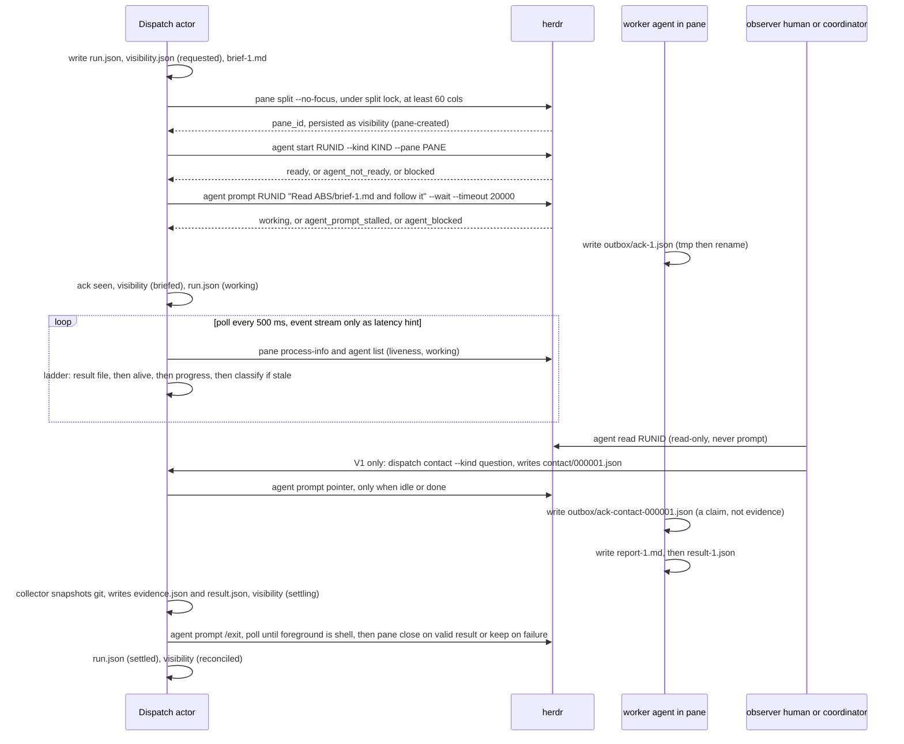

# Bounded proposals and redesigns review pack

Content commit: 0f063d18fdab01cb6f2c915bb60ff528c5e0f238
Original shard: plans/260925-documentation-authority-unification/ledger/decisions/s7-proposals-redesigns-20-visibility-and-interactive-contact-herdr-spawn.json
Original shard SHA256: 5de8aa0ea2f4e78524d2e2cc6db4e74eae949514b6e5dd35e56e67920fb4476c
Source file: docs/architect/proposals/visibility-and-interactive-contact-herdr-spawn.md
Part 2/2; entries: **43**. Source-file group 20/20.
Author session: codex-session:unit-run-1792034226117-40d90d09@2026-10-15
Row-level authoredBy is authoritative for mixed correction authors. Independent ordinary review only; all rows remain pending.

A36 differing-digest rows (2): `claim_ff1b02161c275824a631c743b5694875`, `claim_9da7c5f236f54e3c812f4c488a6f044f`.

Absent-target rows (0): none.

Rows changed by 0f063d18fdab01cb6f2c915bb60ff528c5e0f238 (0): none.

Weak-exact/Judgment population: 6; reviewer chooses and records seed and IDs for at least 6 deep reads (15%, minimum 10, all if fewer), plus every differing/absent pair. Mechanically verify all rows, full digests, anchors, ancestry, source eligibility, one owner and exact-proof thresholds. A36 supersedes the older 100% Weak-exact/Judgment deep-read rule in review-brief; retain its other ordinary-review obligations. If >3% deep rework, deep-read the whole pack. Mark each own note deep or mechanical. No author-selected draw or seed/key is supplied. Complete batch: 1,815 rows, 1,289 Unit-exact / 438 Weak-exact / 88 Judgment; 88 mandatory differing pairs; 114 correction rows.

Return an independent committed report with Reviewer, Author session(s), Review mode: ordinary, content/request/shard pins and this five-column table. Consolidate all parts for each original shard before unchanged ordinary application; these slices do not change shard bytes. Use ok/rework/hold with an own note and the full shown-unit digest (literal none for an absent target). Reverse eligibility and triage findings have separate requests and cannot approve these source rows.

| Claim | Verdict | Note | Source digest | Target digest |
|---|---|---|---|---|

## Native gate blocker at the content pin

D reports eight decision-loss-without-partial-carry findings in the proposals README rationales (the phrase `it omits later siblings` describes the source index). The checker and decision content are unchanged. These are reported blockers, not waived findings. This pack contains 0 affected rows.

```json
[]
```

## claim_0e58847d211cea9a3cbb5052abd81f4a

Changed by 0f063d18fdab01cb6f2c915bb60ff528c5e0f238: **no**. Mechanical class: Unit-exact.
Source: docs/architect/proposals/visibility-and-interactive-contact-herdr-spawn.md#unheaded-block-53, lines 334–343.
Target: docs/platform/proposals/visibility-and-interactive-contact-herdr-spawn.md#unheaded-block-56.
Source digest: 28d99a759c705cc4ac1b8d894c64a27351fb5af252109acf0fcdbf093151cb6e
Target digest: 28d99a759c705cc4ac1b8d894c64a27351fb5af252109acf0fcdbf093151cb6e
Shown source SHA256: 28d99a759c705cc4ac1b8d894c64a27351fb5af252109acf0fcdbf093151cb6e
Shown target SHA256: 28d99a759c705cc4ac1b8d894c64a27351fb5af252109acf0fcdbf093151cb6e

### Proposed decision

```json
{
  "claimId": "claim_0e58847d211cea9a3cbb5052abd81f4a",
  "sourceUnitDigest": "28d99a759c705cc4ac1b8d894c64a27351fb5af252109acf0fcdbf093151cb6e",
  "targetOwner": "docs/platform/proposals/visibility-and-interactive-contact-herdr-spawn.md",
  "targetAnchor": "unheaded-block-56",
  "targetUnitDigest": "28d99a759c705cc4ac1b8d894c64a27351fb5af252109acf0fcdbf093151cb6e",
  "targetAncestry": [
    "Visibility và Interactive Contact trong Dispatch & Execution — herdr-spawn là candidate đầu tiên",
    "8b. Giải pháp cụ thể đề xuất (brainstorm thành thiết kế chạy được)",
    "8b.2 Layout file trong run dir (không entity mới, tuân V-011)"
  ],
  "claimKind": "architecture",
  "disposition": "supersede",
  "reviewStatus": "pending",
  "authoredBy": "codex-session:unit-run-1792034226117-40d90d09@2026-10-15",
  "rationale": "Unit-exact: unique long digest match, equal ancestry, sufficient document exact share. place verbatim: Reject input report’s no-direct-ref finding: RUL40 is a live spec citation. Keep map proposal as design evidence; dated transport line numbers and unbuilt recommendations stay verbatim. Evidence: docs/specs/runner.md:999 RUL40 directly cites this exact proposal sections 3.3,4,14 H1. src/runner/dispatch/herdr-agent.mjs, herdr-round.mjs, herdr-reconcile.mjs and herdr-diagnosis.mjs implement current transport/outcome machinery. Complete source unheaded-block docs/architect/proposals/visibility-and-interactive-contact-herdr-spawn.md#unheaded-block-53 (lines 334–343) is carried at docs/platform/proposals/visibility-and-interactive-contact-herdr-spawn.md#unheaded-block-56 (lines 358–367); Frozen map target and kind retained. Full unit text digest is equal; candidate header and original source metadata are separate. No source wording, caveat, deferred obligation or negative finding is discarded; stale implementation headers remain verbatim. No independent approval, current-truth claim, deletion, promotion or cutover. Review pending. Whole-unit supersede is the frozen vocabulary’s permitted retained-source carriage representation: all original content is carried, with no promotion or immediate source retirement."
}
```

### Full source shown text

````text
```txt
.fgos/assignments/<assignmentId>/runs/NN/
  dispatch-plan.json, run.json          # đã có; run.json.status nay cập nhật: running→settled|failed|unknown
  visibility.json                       # MỚI: {status, paneId, terminalId, agentName, agentSession, actor{pid,token,leaseUntil}, stateChangeSeq, lastSeenAt}
  brief-1.md                            # MỚI: prompt thật (multi-line) — worker đọc qua pointer
  contact/000001.json …                 # V1: contact action, ghi TRƯỚC khi transport
  outbox/                               # worker CHỈ được ghi ở đây (tmp-then-rename)
    ack-1.json  report-1.md  result-1.json  activity.json  ack-contact-000001.json
  evidence.json, result.json            # collector ghi, ngoài quyền worker (đã có)
```
````

### Full target shown text

````text
```txt
.fgos/assignments/<assignmentId>/runs/NN/
  dispatch-plan.json, run.json          # đã có; run.json.status nay cập nhật: running→settled|failed|unknown
  visibility.json                       # MỚI: {status, paneId, terminalId, agentName, agentSession, actor{pid,token,leaseUntil}, stateChangeSeq, lastSeenAt}
  brief-1.md                            # MỚI: prompt thật (multi-line) — worker đọc qua pointer
  contact/000001.json …                 # V1: contact action, ghi TRƯỚC khi transport
  outbox/                               # worker CHỈ được ghi ở đây (tmp-then-rename)
    ack-1.json  report-1.md  result-1.json  activity.json  ack-contact-000001.json
  evidence.json, result.json            # collector ghi, ngoài quyền worker (đã có)
```
````

## claim_c2aafa65b7bc1bac3c07a0c1e4cf214b

Changed by 0f063d18fdab01cb6f2c915bb60ff528c5e0f238: **no**. Mechanical class: Unit-exact.
Source: docs/architect/proposals/visibility-and-interactive-contact-herdr-spawn.md#unheaded-block-54, lines 345–345.
Target: docs/platform/proposals/visibility-and-interactive-contact-herdr-spawn.md#unheaded-block-57.
Source digest: a7044c67044d2b96b70ef5ff7a8844cdbefd4b4ae7f2ad3965d674ea923dc274
Target digest: a7044c67044d2b96b70ef5ff7a8844cdbefd4b4ae7f2ad3965d674ea923dc274
Shown source SHA256: a7044c67044d2b96b70ef5ff7a8844cdbefd4b4ae7f2ad3965d674ea923dc274
Shown target SHA256: a7044c67044d2b96b70ef5ff7a8844cdbefd4b4ae7f2ad3965d674ea923dc274

### Proposed decision

```json
{
  "claimId": "claim_c2aafa65b7bc1bac3c07a0c1e4cf214b",
  "sourceUnitDigest": "a7044c67044d2b96b70ef5ff7a8844cdbefd4b4ae7f2ad3965d674ea923dc274",
  "targetOwner": "docs/platform/proposals/visibility-and-interactive-contact-herdr-spawn.md",
  "targetAnchor": "unheaded-block-57",
  "targetUnitDigest": "a7044c67044d2b96b70ef5ff7a8844cdbefd4b4ae7f2ad3965d674ea923dc274",
  "targetAncestry": [
    "Visibility và Interactive Contact trong Dispatch & Execution — herdr-spawn là candidate đầu tiên",
    "8b. Giải pháp cụ thể đề xuất (brainstorm thành thiết kế chạy được)",
    "8b.2 Layout file trong run dir (không entity mới, tuân V-011)"
  ],
  "claimKind": "contract",
  "disposition": "supersede",
  "reviewStatus": "pending",
  "authoredBy": "codex-session:unit-run-1792034226117-40d90d09@2026-10-15",
  "rationale": "Unit-exact: unique long digest match, equal ancestry, sufficient document exact share. place verbatim: Reject input report’s no-direct-ref finding: RUL40 is a live spec citation. Keep map proposal as design evidence; dated transport line numbers and unbuilt recommendations stay verbatim. Evidence: docs/specs/runner.md:999 RUL40 directly cites this exact proposal sections 3.3,4,14 H1. src/runner/dispatch/herdr-agent.mjs, herdr-round.mjs, herdr-reconcile.mjs and herdr-diagnosis.mjs implement current transport/outcome machinery. Complete source unheaded-block docs/architect/proposals/visibility-and-interactive-contact-herdr-spawn.md#unheaded-block-54 (lines 345–345) is carried at docs/platform/proposals/visibility-and-interactive-contact-herdr-spawn.md#unheaded-block-57 (lines 369–369); Frozen map target and kind retained. Full unit text digest is equal; candidate header and original source metadata are separate. No source wording, caveat, deferred obligation or negative finding is discarded; stale implementation headers remain verbatim. No independent approval, current-truth claim, deletion, promotion or cutover. Review pending. Whole-unit supersede is the frozen vocabulary’s permitted retained-source carriage representation: all original content is carried, with no promotion or immediate source retirement."
}
```

### Full source shown text

```text
`agent-result.json` hiện tại = `outbox/result-N.json` sau khi đổi tên; schema giữ nguyên `{status, summary, findings, evidenceRefs}` cộng optional `report_path`, `options[]`, `leaning`, `dissent{claim,alternative,severity}` (parse lenient như upstream — không bao giờ làm hỏng một round vì thiếu field).
```

### Full target shown text

```text
`agent-result.json` hiện tại = `outbox/result-N.json` sau khi đổi tên; schema giữ nguyên `{status, summary, findings, evidenceRefs}` cộng optional `report_path`, `options[]`, `leaning`, `dissent{claim,alternative,severity}` (parse lenient như upstream — không bao giờ làm hỏng một round vì thiếu field).
```

## claim_4087776754a8c7dac905810642340959

Changed by 0f063d18fdab01cb6f2c915bb60ff528c5e0f238: **no**. Mechanical class: Weak-exact.
Source: docs/architect/proposals/visibility-and-interactive-contact-herdr-spawn.md#8b3-sequence-v0-v1, lines 347–347.
Target: docs/platform/proposals/visibility-and-interactive-contact-herdr-spawn.md#8b3-sequence-v0-v1.
Source digest: 516d9342d8da1e7212d5d9266a1730203269e1c59c3ac4728708a845f7f58098
Target digest: 516d9342d8da1e7212d5d9266a1730203269e1c59c3ac4728708a845f7f58098
Shown source SHA256: 363be05b83fa3a694c2794ec057e3bac7ebeb65d9cb54ea015fe74e668404885
Shown target SHA256: 363be05b83fa3a694c2794ec057e3bac7ebeb65d9cb54ea015fe74e668404885

### Proposed decision

```json
{
  "claimId": "claim_4087776754a8c7dac905810642340959",
  "sourceUnitDigest": "516d9342d8da1e7212d5d9266a1730203269e1c59c3ac4728708a845f7f58098",
  "targetOwner": "docs/platform/proposals/visibility-and-interactive-contact-herdr-spawn.md",
  "targetAnchor": "8b3-sequence-v0-v1",
  "targetUnitDigest": "516d9342d8da1e7212d5d9266a1730203269e1c59c3ac4728708a845f7f58098",
  "targetAncestry": [
    "Visibility và Interactive Contact trong Dispatch & Execution — herdr-spawn là candidate đầu tiên",
    "8b. Giải pháp cụ thể đề xuất (brainstorm thành thiết kế chạy được)"
  ],
  "claimKind": "architecture",
  "disposition": "supersede",
  "reviewStatus": "pending",
  "authoredBy": "codex-session:unit-run-1792034226117-40d90d09@2026-10-15",
  "rationale": "Weak-exact: source unit shorter than 40 characters. place verbatim: Reject input report’s no-direct-ref finding: RUL40 is a live spec citation. Keep map proposal as design evidence; dated transport line numbers and unbuilt recommendations stay verbatim. Evidence: docs/specs/runner.md:999 RUL40 directly cites this exact proposal sections 3.3,4,14 H1. src/runner/dispatch/herdr-agent.mjs, herdr-round.mjs, herdr-reconcile.mjs and herdr-diagnosis.mjs implement current transport/outcome machinery. Complete source heading docs/architect/proposals/visibility-and-interactive-contact-herdr-spawn.md#8b3-sequence-v0-v1 (lines 347–347) is carried at docs/platform/proposals/visibility-and-interactive-contact-herdr-spawn.md#8b3-sequence-v0-v1 (lines 371–371); Frozen map target and kind retained. Full unit text digest is equal; candidate header and original source metadata are separate. No source wording, caveat, deferred obligation or negative finding is discarded; stale implementation headers remain verbatim. No independent approval, current-truth claim, deletion, promotion or cutover. Review pending. Whole-unit supersede is the frozen vocabulary’s permitted retained-source carriage representation: all original content is carried, with no promotion or immediate source retirement."
}
```

### Full source shown text

````text
### 8b.3 Sequence V0 + V1


````

### Full target shown text

````text
### 8b.3 Sequence V0 + V1


````

## claim_7079a8c81dcd7eca046f547acb53f196

Changed by 0f063d18fdab01cb6f2c915bb60ff528c5e0f238: **no**. Mechanical class: Unit-exact.
Source: docs/architect/proposals/visibility-and-interactive-contact-herdr-spawn.md#unheaded-block-55, lines 349–376.
Target: docs/platform/proposals/visibility-and-interactive-contact-herdr-spawn.md#unheaded-block-58.
Source digest: 9c52300f10be96e8927bb6b86b29d8675fd79cbfff9cfbd069a9962cb3937a47
Target digest: 9c52300f10be96e8927bb6b86b29d8675fd79cbfff9cfbd069a9962cb3937a47
Shown source SHA256: 9c52300f10be96e8927bb6b86b29d8675fd79cbfff9cfbd069a9962cb3937a47
Shown target SHA256: 9c52300f10be96e8927bb6b86b29d8675fd79cbfff9cfbd069a9962cb3937a47

### Proposed decision

```json
{
  "claimId": "claim_7079a8c81dcd7eca046f547acb53f196",
  "sourceUnitDigest": "9c52300f10be96e8927bb6b86b29d8675fd79cbfff9cfbd069a9962cb3937a47",
  "targetOwner": "docs/platform/proposals/visibility-and-interactive-contact-herdr-spawn.md",
  "targetAnchor": "unheaded-block-58",
  "targetUnitDigest": "9c52300f10be96e8927bb6b86b29d8675fd79cbfff9cfbd069a9962cb3937a47",
  "targetAncestry": [
    "Visibility và Interactive Contact trong Dispatch & Execution — herdr-spawn là candidate đầu tiên",
    "8b. Giải pháp cụ thể đề xuất (brainstorm thành thiết kế chạy được)",
    "8b.3 Sequence V0 + V1"
  ],
  "claimKind": "architecture",
  "disposition": "supersede",
  "reviewStatus": "pending",
  "authoredBy": "codex-session:unit-run-1792034226117-40d90d09@2026-10-15",
  "rationale": "Unit-exact: unique long digest match, equal ancestry, sufficient document exact share. place verbatim: Reject input report’s no-direct-ref finding: RUL40 is a live spec citation. Keep map proposal as design evidence; dated transport line numbers and unbuilt recommendations stay verbatim. Evidence: docs/specs/runner.md:999 RUL40 directly cites this exact proposal sections 3.3,4,14 H1. src/runner/dispatch/herdr-agent.mjs, herdr-round.mjs, herdr-reconcile.mjs and herdr-diagnosis.mjs implement current transport/outcome machinery. Complete source unheaded-block docs/architect/proposals/visibility-and-interactive-contact-herdr-spawn.md#unheaded-block-55 (lines 349–376) is carried at docs/platform/proposals/visibility-and-interactive-contact-herdr-spawn.md#unheaded-block-58 (lines 373–400); Frozen map target and kind retained. Full unit text digest is equal; candidate header and original source metadata are separate. No source wording, caveat, deferred obligation or negative finding is discarded; stale implementation headers remain verbatim. No independent approval, current-truth claim, deletion, promotion or cutover. Review pending. Whole-unit supersede is the frozen vocabulary’s permitted retained-source carriage representation: all original content is carried, with no promotion or immediate source retirement."
}
```

### Full source shown text

````text

````

### Full target shown text

````text

````

## claim_4c62c7af6ebce5f92ccd72d138b03629

Changed by 0f063d18fdab01cb6f2c915bb60ff528c5e0f238: **no**. Mechanical class: Unit-exact.
Source: docs/architect/proposals/visibility-and-interactive-contact-herdr-spawn.md#8b4-ba-cách-đưa-message-tới-một-agent-interactive-so-sánh-và-chọn, lines 378–378.
Target: docs/platform/proposals/visibility-and-interactive-contact-herdr-spawn.md#8b4-ba-cách-đưa-message-tới-một-agent-interactive-so-sánh-và-chọn.
Source digest: 04359a193ee6b86db0b26090e23e17393e0fc9fb7776620917baf5a09234cbd1
Target digest: 04359a193ee6b86db0b26090e23e17393e0fc9fb7776620917baf5a09234cbd1
Shown source SHA256: 6961e7f8690824a3cb6f58986b772a98e54a3fe380ae395d93ce2076917adbb9
Shown target SHA256: 6961e7f8690824a3cb6f58986b772a98e54a3fe380ae395d93ce2076917adbb9

### Proposed decision

```json
{
  "claimId": "claim_4c62c7af6ebce5f92ccd72d138b03629",
  "sourceUnitDigest": "04359a193ee6b86db0b26090e23e17393e0fc9fb7776620917baf5a09234cbd1",
  "targetOwner": "docs/platform/proposals/visibility-and-interactive-contact-herdr-spawn.md",
  "targetAnchor": "8b4-ba-cách-đưa-message-tới-một-agent-interactive-so-sánh-và-chọn",
  "targetUnitDigest": "04359a193ee6b86db0b26090e23e17393e0fc9fb7776620917baf5a09234cbd1",
  "targetAncestry": [
    "Visibility và Interactive Contact trong Dispatch & Execution — herdr-spawn là candidate đầu tiên",
    "8b. Giải pháp cụ thể đề xuất (brainstorm thành thiết kế chạy được)"
  ],
  "claimKind": "architecture",
  "disposition": "supersede",
  "reviewStatus": "pending",
  "authoredBy": "codex-session:unit-run-1792034226117-40d90d09@2026-10-15",
  "rationale": "Unit-exact: unique long digest match, equal ancestry, sufficient document exact share. place verbatim: Reject input report’s no-direct-ref finding: RUL40 is a live spec citation. Keep map proposal as design evidence; dated transport line numbers and unbuilt recommendations stay verbatim. Evidence: docs/specs/runner.md:999 RUL40 directly cites this exact proposal sections 3.3,4,14 H1. src/runner/dispatch/herdr-agent.mjs, herdr-round.mjs, herdr-reconcile.mjs and herdr-diagnosis.mjs implement current transport/outcome machinery. Complete source heading docs/architect/proposals/visibility-and-interactive-contact-herdr-spawn.md#8b4-ba-cách-đưa-message-tới-một-agent-interactive-so-sánh-và-chọn (lines 378–378) is carried at docs/platform/proposals/visibility-and-interactive-contact-herdr-spawn.md#8b4-ba-cách-đưa-message-tới-một-agent-interactive-so-sánh-và-chọn (lines 402–402); Frozen map target and kind retained. Full unit text digest is equal; candidate header and original source metadata are separate. No source wording, caveat, deferred obligation or negative finding is discarded; stale implementation headers remain verbatim. No independent approval, current-truth claim, deletion, promotion or cutover. Review pending. Whole-unit supersede is the frozen vocabulary’s permitted retained-source carriage representation: all original content is carried, with no promotion or immediate source retirement."
}
```

### Full source shown text

```text
### 8b.4 Ba cách đưa message tới một agent interactive — so sánh và chọn

| Cách | Cơ chế | Agent phải làm gì | Vấn đề phát sinh | Kết luận |
|---|---|---|---|---|
| (1) Inbox/poll — agent "thường xuyên check" | file/queue; agent được dặn "cứ N phút đọc inbox" | tự nhớ để poll giữa công việc | LLM không có timer; poll xen giữa turn phá luồng tool-call; quên là mất; không idempotent; không ack | **Loại** — upstream cũng không làm; không có cách nào ép agent "thường xuyên" |
| (2) Transport push — pointer qua `agent prompt` khi ready | Dispatch gõ một dòng khi `idle|done`; nội dung ở file | không gì; nhận như turn mới | chỉ giữa turn rảnh; cần ready gate + stalled retry bounded; multi-message → gộp thành một pointer theo seq | **Chọn cho V0/V1** — mọi provider, không cần hook |
| (3) Hook push — turn boundary | `UserPromptSubmit`/`Stop` hook của provider đọc `contact/` pending, append vào context, stamp delivered | không gì | chỉ provider có hook; hook chạy trong worker namespace (cần đọc-only `contact/`, ghi `outbox/`); trùng lặp với (2) nếu cả hai bật → cần "delivered by" stamp | **V2 opt-in** — chính xác hơn (biết blocked, biết turn kết thúc) |
| (4) Signal bus / socket riêng cho agent | daemon + subscribe | client trong agent | agent CLI không có client; phải viết wrapper mỗi provider; thêm daemon (trái V-011) | **Loại** cho giai đoạn này; herdr socket đã là bus cho *Dispatch*, không phải cho *agent* |

Vấn đề chung của (2) và (3), và cách chốt: **duplicate** (seq + idempotencyKey + ack file), **lost first** (retry chỉ khi agent về ready mà không có ack, bounded), **ordering** (một pointer mang "đọc contact từ seq k trở đi", không mỗi message một pointer), **authority** (file contact là read-only với worker; worker chỉ ghi outbox), **mid-turn** (không bao giờ; interrupt là `send-keys`, kind riêng, grant riêng).
```

### Full target shown text

```text
### 8b.4 Ba cách đưa message tới một agent interactive — so sánh và chọn

| Cách | Cơ chế | Agent phải làm gì | Vấn đề phát sinh | Kết luận |
|---|---|---|---|---|
| (1) Inbox/poll — agent "thường xuyên check" | file/queue; agent được dặn "cứ N phút đọc inbox" | tự nhớ để poll giữa công việc | LLM không có timer; poll xen giữa turn phá luồng tool-call; quên là mất; không idempotent; không ack | **Loại** — upstream cũng không làm; không có cách nào ép agent "thường xuyên" |
| (2) Transport push — pointer qua `agent prompt` khi ready | Dispatch gõ một dòng khi `idle|done`; nội dung ở file | không gì; nhận như turn mới | chỉ giữa turn rảnh; cần ready gate + stalled retry bounded; multi-message → gộp thành một pointer theo seq | **Chọn cho V0/V1** — mọi provider, không cần hook |
| (3) Hook push — turn boundary | `UserPromptSubmit`/`Stop` hook của provider đọc `contact/` pending, append vào context, stamp delivered | không gì | chỉ provider có hook; hook chạy trong worker namespace (cần đọc-only `contact/`, ghi `outbox/`); trùng lặp với (2) nếu cả hai bật → cần "delivered by" stamp | **V2 opt-in** — chính xác hơn (biết blocked, biết turn kết thúc) |
| (4) Signal bus / socket riêng cho agent | daemon + subscribe | client trong agent | agent CLI không có client; phải viết wrapper mỗi provider; thêm daemon (trái V-011) | **Loại** cho giai đoạn này; herdr socket đã là bus cho *Dispatch*, không phải cho *agent* |

Vấn đề chung của (2) và (3), và cách chốt: **duplicate** (seq + idempotencyKey + ack file), **lost first** (retry chỉ khi agent về ready mà không có ack, bounded), **ordering** (một pointer mang "đọc contact từ seq k trở đi", không mỗi message một pointer), **authority** (file contact là read-only với worker; worker chỉ ghi outbox), **mid-turn** (không bao giờ; interrupt là `send-keys`, kind riêng, grant riêng).
```

## claim_5c3e9895986845cde4caa378d335e424

Changed by 0f063d18fdab01cb6f2c915bb60ff528c5e0f238: **no**. Mechanical class: Unit-exact.
Source: docs/architect/proposals/visibility-and-interactive-contact-herdr-spawn.md#unheaded-block-56, lines 380–385.
Target: docs/platform/proposals/visibility-and-interactive-contact-herdr-spawn.md#unheaded-block-59.
Source digest: 3aa11f61ce57fa26ad1bb45a1b20b0c157a4fbf3dbea8de44722706601388efe
Target digest: 3aa11f61ce57fa26ad1bb45a1b20b0c157a4fbf3dbea8de44722706601388efe
Shown source SHA256: 3aa11f61ce57fa26ad1bb45a1b20b0c157a4fbf3dbea8de44722706601388efe
Shown target SHA256: 3aa11f61ce57fa26ad1bb45a1b20b0c157a4fbf3dbea8de44722706601388efe

### Proposed decision

```json
{
  "claimId": "claim_5c3e9895986845cde4caa378d335e424",
  "sourceUnitDigest": "3aa11f61ce57fa26ad1bb45a1b20b0c157a4fbf3dbea8de44722706601388efe",
  "targetOwner": "docs/platform/proposals/visibility-and-interactive-contact-herdr-spawn.md",
  "targetAnchor": "unheaded-block-59",
  "targetUnitDigest": "3aa11f61ce57fa26ad1bb45a1b20b0c157a4fbf3dbea8de44722706601388efe",
  "targetAncestry": [
    "Visibility và Interactive Contact trong Dispatch & Execution — herdr-spawn là candidate đầu tiên",
    "8b. Giải pháp cụ thể đề xuất (brainstorm thành thiết kế chạy được)",
    "8b.4 Ba cách đưa message tới một agent interactive — so sánh và chọn"
  ],
  "claimKind": "architecture",
  "disposition": "supersede",
  "reviewStatus": "pending",
  "authoredBy": "codex-session:unit-run-1792034226117-40d90d09@2026-10-15",
  "rationale": "Unit-exact: unique long digest match, equal ancestry, sufficient document exact share. place verbatim: Reject input report’s no-direct-ref finding: RUL40 is a live spec citation. Keep map proposal as design evidence; dated transport line numbers and unbuilt recommendations stay verbatim. Evidence: docs/specs/runner.md:999 RUL40 directly cites this exact proposal sections 3.3,4,14 H1. src/runner/dispatch/herdr-agent.mjs, herdr-round.mjs, herdr-reconcile.mjs and herdr-diagnosis.mjs implement current transport/outcome machinery. Complete source unheaded-block docs/architect/proposals/visibility-and-interactive-contact-herdr-spawn.md#unheaded-block-56 (lines 380–385) is carried at docs/platform/proposals/visibility-and-interactive-contact-herdr-spawn.md#unheaded-block-59 (lines 404–409); Frozen map target and kind retained. Full unit text digest is equal; candidate header and original source metadata are separate. No source wording, caveat, deferred obligation or negative finding is discarded; stale implementation headers remain verbatim. No independent approval, current-truth claim, deletion, promotion or cutover. Review pending. Whole-unit supersede is the frozen vocabulary’s permitted retained-source carriage representation: all original content is carried, with no promotion or immediate source retirement."
}
```

### Full source shown text

```text
| Cách | Cơ chế | Agent phải làm gì | Vấn đề phát sinh | Kết luận |
|---|---|---|---|---|
| (1) Inbox/poll — agent "thường xuyên check" | file/queue; agent được dặn "cứ N phút đọc inbox" | tự nhớ để poll giữa công việc | LLM không có timer; poll xen giữa turn phá luồng tool-call; quên là mất; không idempotent; không ack | **Loại** — upstream cũng không làm; không có cách nào ép agent "thường xuyên" |
| (2) Transport push — pointer qua `agent prompt` khi ready | Dispatch gõ một dòng khi `idle|done`; nội dung ở file | không gì; nhận như turn mới | chỉ giữa turn rảnh; cần ready gate + stalled retry bounded; multi-message → gộp thành một pointer theo seq | **Chọn cho V0/V1** — mọi provider, không cần hook |
| (3) Hook push — turn boundary | `UserPromptSubmit`/`Stop` hook của provider đọc `contact/` pending, append vào context, stamp delivered | không gì | chỉ provider có hook; hook chạy trong worker namespace (cần đọc-only `contact/`, ghi `outbox/`); trùng lặp với (2) nếu cả hai bật → cần "delivered by" stamp | **V2 opt-in** — chính xác hơn (biết blocked, biết turn kết thúc) |
| (4) Signal bus / socket riêng cho agent | daemon + subscribe | client trong agent | agent CLI không có client; phải viết wrapper mỗi provider; thêm daemon (trái V-011) | **Loại** cho giai đoạn này; herdr socket đã là bus cho *Dispatch*, không phải cho *agent* |
```

### Full target shown text

```text
| Cách | Cơ chế | Agent phải làm gì | Vấn đề phát sinh | Kết luận |
|---|---|---|---|---|
| (1) Inbox/poll — agent "thường xuyên check" | file/queue; agent được dặn "cứ N phút đọc inbox" | tự nhớ để poll giữa công việc | LLM không có timer; poll xen giữa turn phá luồng tool-call; quên là mất; không idempotent; không ack | **Loại** — upstream cũng không làm; không có cách nào ép agent "thường xuyên" |
| (2) Transport push — pointer qua `agent prompt` khi ready | Dispatch gõ một dòng khi `idle|done`; nội dung ở file | không gì; nhận như turn mới | chỉ giữa turn rảnh; cần ready gate + stalled retry bounded; multi-message → gộp thành một pointer theo seq | **Chọn cho V0/V1** — mọi provider, không cần hook |
| (3) Hook push — turn boundary | `UserPromptSubmit`/`Stop` hook của provider đọc `contact/` pending, append vào context, stamp delivered | không gì | chỉ provider có hook; hook chạy trong worker namespace (cần đọc-only `contact/`, ghi `outbox/`); trùng lặp với (2) nếu cả hai bật → cần "delivered by" stamp | **V2 opt-in** — chính xác hơn (biết blocked, biết turn kết thúc) |
| (4) Signal bus / socket riêng cho agent | daemon + subscribe | client trong agent | agent CLI không có client; phải viết wrapper mỗi provider; thêm daemon (trái V-011) | **Loại** cho giai đoạn này; herdr socket đã là bus cho *Dispatch*, không phải cho *agent* |
```

## claim_65980f8a4e4190497ed79bd24b0c4cf1

Changed by 0f063d18fdab01cb6f2c915bb60ff528c5e0f238: **no**. Mechanical class: Unit-exact.
Source: docs/architect/proposals/visibility-and-interactive-contact-herdr-spawn.md#unheaded-block-57, lines 387–387.
Target: docs/platform/proposals/visibility-and-interactive-contact-herdr-spawn.md#unheaded-block-60.
Source digest: 424d8aa84e2aecc0691a6ae8bf2a5f3d83cbe50b081f2d71a268c47ebe0e55e0
Target digest: 424d8aa84e2aecc0691a6ae8bf2a5f3d83cbe50b081f2d71a268c47ebe0e55e0
Shown source SHA256: 424d8aa84e2aecc0691a6ae8bf2a5f3d83cbe50b081f2d71a268c47ebe0e55e0
Shown target SHA256: 424d8aa84e2aecc0691a6ae8bf2a5f3d83cbe50b081f2d71a268c47ebe0e55e0

### Proposed decision

```json
{
  "claimId": "claim_65980f8a4e4190497ed79bd24b0c4cf1",
  "sourceUnitDigest": "424d8aa84e2aecc0691a6ae8bf2a5f3d83cbe50b081f2d71a268c47ebe0e55e0",
  "targetOwner": "docs/platform/proposals/visibility-and-interactive-contact-herdr-spawn.md",
  "targetAnchor": "unheaded-block-60",
  "targetUnitDigest": "424d8aa84e2aecc0691a6ae8bf2a5f3d83cbe50b081f2d71a268c47ebe0e55e0",
  "targetAncestry": [
    "Visibility và Interactive Contact trong Dispatch & Execution — herdr-spawn là candidate đầu tiên",
    "8b. Giải pháp cụ thể đề xuất (brainstorm thành thiết kế chạy được)",
    "8b.4 Ba cách đưa message tới một agent interactive — so sánh và chọn"
  ],
  "claimKind": "architecture",
  "disposition": "supersede",
  "reviewStatus": "pending",
  "authoredBy": "codex-session:unit-run-1792034226117-40d90d09@2026-10-15",
  "rationale": "Unit-exact: unique long digest match, equal ancestry, sufficient document exact share. place verbatim: Reject input report’s no-direct-ref finding: RUL40 is a live spec citation. Keep map proposal as design evidence; dated transport line numbers and unbuilt recommendations stay verbatim. Evidence: docs/specs/runner.md:999 RUL40 directly cites this exact proposal sections 3.3,4,14 H1. src/runner/dispatch/herdr-agent.mjs, herdr-round.mjs, herdr-reconcile.mjs and herdr-diagnosis.mjs implement current transport/outcome machinery. Complete source unheaded-block docs/architect/proposals/visibility-and-interactive-contact-herdr-spawn.md#unheaded-block-57 (lines 387–387) is carried at docs/platform/proposals/visibility-and-interactive-contact-herdr-spawn.md#unheaded-block-60 (lines 411–411); Frozen map target and kind retained. Full unit text digest is equal; candidate header and original source metadata are separate. No source wording, caveat, deferred obligation or negative finding is discarded; stale implementation headers remain verbatim. No independent approval, current-truth claim, deletion, promotion or cutover. Review pending. Whole-unit supersede is the frozen vocabulary’s permitted retained-source carriage representation: all original content is carried, with no promotion or immediate source retirement."
}
```

### Full source shown text

```text
Vấn đề chung của (2) và (3), và cách chốt: **duplicate** (seq + idempotencyKey + ack file), **lost first** (retry chỉ khi agent về ready mà không có ack, bounded), **ordering** (một pointer mang "đọc contact từ seq k trở đi", không mỗi message một pointer), **authority** (file contact là read-only với worker; worker chỉ ghi outbox), **mid-turn** (không bao giờ; interrupt là `send-keys`, kind riêng, grant riêng).
```

### Full target shown text

```text
Vấn đề chung của (2) và (3), và cách chốt: **duplicate** (seq + idempotencyKey + ack file), **lost first** (retry chỉ khi agent về ready mà không có ack, bounded), **ordering** (một pointer mang "đọc contact từ seq k trở đi", không mỗi message một pointer), **authority** (file contact là read-only với worker; worker chỉ ghi outbox), **mid-turn** (không bao giờ; interrupt là `send-keys`, kind riêng, grant riêng).
```

## claim_f9a47109856e82ea3d40f29ab8341383

Changed by 0f063d18fdab01cb6f2c915bb60ff528c5e0f238: **no**. Mechanical class: Unit-exact.
Source: docs/architect/proposals/visibility-and-interactive-contact-herdr-spawn.md#8b6-brief-as-file-mặc-định-vì-di-động-không-còn-vì-đúng-sai-cập-nhật-sau-p6, lines 389–389.
Target: docs/platform/proposals/visibility-and-interactive-contact-herdr-spawn.md#8b6-brief-as-file-mặc-định-vì-di-động-không-còn-vì-đúng-sai-cập-nhật-sau-p6.
Source digest: f24c34a3f933165bc894a02e365beb83356f6bef7fd89ef5fe1a1f9c3401e258
Target digest: f24c34a3f933165bc894a02e365beb83356f6bef7fd89ef5fe1a1f9c3401e258
Shown source SHA256: 63b3a3161bd647c4c543d326c2b21ee249b90b3529a64584c7ba46dbd1871346
Shown target SHA256: 63b3a3161bd647c4c543d326c2b21ee249b90b3529a64584c7ba46dbd1871346

### Proposed decision

```json
{
  "claimId": "claim_f9a47109856e82ea3d40f29ab8341383",
  "sourceUnitDigest": "f24c34a3f933165bc894a02e365beb83356f6bef7fd89ef5fe1a1f9c3401e258",
  "targetOwner": "docs/platform/proposals/visibility-and-interactive-contact-herdr-spawn.md",
  "targetAnchor": "8b6-brief-as-file-mặc-định-vì-di-động-không-còn-vì-đúng-sai-cập-nhật-sau-p6",
  "targetUnitDigest": "f24c34a3f933165bc894a02e365beb83356f6bef7fd89ef5fe1a1f9c3401e258",
  "targetAncestry": [
    "Visibility và Interactive Contact trong Dispatch & Execution — herdr-spawn là candidate đầu tiên",
    "8b. Giải pháp cụ thể đề xuất (brainstorm thành thiết kế chạy được)"
  ],
  "claimKind": "architecture",
  "disposition": "supersede",
  "reviewStatus": "pending",
  "authoredBy": "codex-session:unit-run-1792034226117-40d90d09@2026-10-15",
  "rationale": "Unit-exact: unique long digest match, equal ancestry, sufficient document exact share. place verbatim: Reject input report’s no-direct-ref finding: RUL40 is a live spec citation. Keep map proposal as design evidence; dated transport line numbers and unbuilt recommendations stay verbatim. Evidence: docs/specs/runner.md:999 RUL40 directly cites this exact proposal sections 3.3,4,14 H1. src/runner/dispatch/herdr-agent.mjs, herdr-round.mjs, herdr-reconcile.mjs and herdr-diagnosis.mjs implement current transport/outcome machinery. Complete source heading docs/architect/proposals/visibility-and-interactive-contact-herdr-spawn.md#8b6-brief-as-file-mặc-định-vì-di-động-không-còn-vì-đúng-sai-cập-nhật-sau-p6 (lines 389–389) is carried at docs/platform/proposals/visibility-and-interactive-contact-herdr-spawn.md#8b6-brief-as-file-mặc-định-vì-di-động-không-còn-vì-đúng-sai-cập-nhật-sau-p6 (lines 413–413); Frozen map target and kind retained. Full unit text digest is equal; candidate header and original source metadata are separate. No source wording, caveat, deferred obligation or negative finding is discarded; stale implementation headers remain verbatim. No independent approval, current-truth claim, deletion, promotion or cutover. Review pending. Whole-unit supersede is the frozen vocabulary’s permitted retained-source carriage representation: all original content is carried, with no promotion or immediate source retirement."
}
```

### Full source shown text

```text
### 8b.6 Brief-as-file: mặc định vì di động, không còn vì đúng-sai (cập nhật sau P6)

P6 đo được `agent prompt` giữ nguyên prompt 7 dòng tới claude. Nên lý do "phải dùng file vì multi-line hỏng" **không còn đúng cho claude**. Ba lý do còn lại vẫn giữ file làm mặc định:

1. **Di động.** Upstream đã đo ít nhất một agent kind nuốt mất multi-line injected prompt; agy chính là loại chưa có integration hook. Một shape chạy cho mọi CLI rẻ hơn hai shape.
2. **Kích thước.** Prompt thật của `fgos-coding-implement` dài; đẩy toàn bộ qua một lần paste vào TUI là rủi ro không cần thiết, và file cho worker đọc lại nhiều lần.
3. **Round & resume.** `brief-N.md` gắn với round number, là mốc để so sánh freshness của `report-N.md` (bẫy stale-report upstream đã gặp).

Vì vậy: **file là mặc định**, nhưng adapter được phép khai `promptDelivery: 'inline' | 'file-pointer'` per executor, và `inline` giờ là một lựa chọn đã có bằng chứng cho claude, không phải canh bạc.
```

### Full target shown text

```text
### 8b.6 Brief-as-file: mặc định vì di động, không còn vì đúng-sai (cập nhật sau P6)

P6 đo được `agent prompt` giữ nguyên prompt 7 dòng tới claude. Nên lý do "phải dùng file vì multi-line hỏng" **không còn đúng cho claude**. Ba lý do còn lại vẫn giữ file làm mặc định:

1. **Di động.** Upstream đã đo ít nhất một agent kind nuốt mất multi-line injected prompt; agy chính là loại chưa có integration hook. Một shape chạy cho mọi CLI rẻ hơn hai shape.
2. **Kích thước.** Prompt thật của `fgos-coding-implement` dài; đẩy toàn bộ qua một lần paste vào TUI là rủi ro không cần thiết, và file cho worker đọc lại nhiều lần.
3. **Round & resume.** `brief-N.md` gắn với round number, là mốc để so sánh freshness của `report-N.md` (bẫy stale-report upstream đã gặp).

Vì vậy: **file là mặc định**, nhưng adapter được phép khai `promptDelivery: 'inline' | 'file-pointer'` per executor, và `inline` giờ là một lựa chọn đã có bằng chứng cho claude, không phải canh bạc.
```

## claim_cb4db9f51cb85689290ca7ffbd49a29b

Changed by 0f063d18fdab01cb6f2c915bb60ff528c5e0f238: **no**. Mechanical class: Unit-exact.
Source: docs/architect/proposals/visibility-and-interactive-contact-herdr-spawn.md#unheaded-block-58, lines 391–391.
Target: docs/platform/proposals/visibility-and-interactive-contact-herdr-spawn.md#unheaded-block-61.
Source digest: df18bdd9f9af5c1902754027f7023c2df4e9b50850bae7d6d32b7968b40e08d9
Target digest: df18bdd9f9af5c1902754027f7023c2df4e9b50850bae7d6d32b7968b40e08d9
Shown source SHA256: df18bdd9f9af5c1902754027f7023c2df4e9b50850bae7d6d32b7968b40e08d9
Shown target SHA256: df18bdd9f9af5c1902754027f7023c2df4e9b50850bae7d6d32b7968b40e08d9

### Proposed decision

```json
{
  "claimId": "claim_cb4db9f51cb85689290ca7ffbd49a29b",
  "sourceUnitDigest": "df18bdd9f9af5c1902754027f7023c2df4e9b50850bae7d6d32b7968b40e08d9",
  "targetOwner": "docs/platform/proposals/visibility-and-interactive-contact-herdr-spawn.md",
  "targetAnchor": "unheaded-block-61",
  "targetUnitDigest": "df18bdd9f9af5c1902754027f7023c2df4e9b50850bae7d6d32b7968b40e08d9",
  "targetAncestry": [
    "Visibility và Interactive Contact trong Dispatch & Execution — herdr-spawn là candidate đầu tiên",
    "8b. Giải pháp cụ thể đề xuất (brainstorm thành thiết kế chạy được)",
    "8b.6 Brief-as-file: mặc định vì di động, không còn vì đúng-sai (cập nhật sau P6)"
  ],
  "claimKind": "architecture",
  "disposition": "supersede",
  "reviewStatus": "pending",
  "authoredBy": "codex-session:unit-run-1792034226117-40d90d09@2026-10-15",
  "rationale": "Unit-exact: unique long digest match, equal ancestry, sufficient document exact share. place verbatim: Reject input report’s no-direct-ref finding: RUL40 is a live spec citation. Keep map proposal as design evidence; dated transport line numbers and unbuilt recommendations stay verbatim. Evidence: docs/specs/runner.md:999 RUL40 directly cites this exact proposal sections 3.3,4,14 H1. src/runner/dispatch/herdr-agent.mjs, herdr-round.mjs, herdr-reconcile.mjs and herdr-diagnosis.mjs implement current transport/outcome machinery. Complete source unheaded-block docs/architect/proposals/visibility-and-interactive-contact-herdr-spawn.md#unheaded-block-58 (lines 391–391) is carried at docs/platform/proposals/visibility-and-interactive-contact-herdr-spawn.md#unheaded-block-61 (lines 415–415); Frozen map target and kind retained. Full unit text digest is equal; candidate header and original source metadata are separate. No source wording, caveat, deferred obligation or negative finding is discarded; stale implementation headers remain verbatim. No independent approval, current-truth claim, deletion, promotion or cutover. Review pending. Whole-unit supersede is the frozen vocabulary’s permitted retained-source carriage representation: all original content is carried, with no promotion or immediate source retirement."
}
```

### Full source shown text

```text
P6 đo được `agent prompt` giữ nguyên prompt 7 dòng tới claude. Nên lý do "phải dùng file vì multi-line hỏng" **không còn đúng cho claude**. Ba lý do còn lại vẫn giữ file làm mặc định:
```

### Full target shown text

```text
P6 đo được `agent prompt` giữ nguyên prompt 7 dòng tới claude. Nên lý do "phải dùng file vì multi-line hỏng" **không còn đúng cho claude**. Ba lý do còn lại vẫn giữ file làm mặc định:
```

## claim_e8a71409c2c56d8f6b609de04f979831

Changed by 0f063d18fdab01cb6f2c915bb60ff528c5e0f238: **no**. Mechanical class: Unit-exact.
Source: docs/architect/proposals/visibility-and-interactive-contact-herdr-spawn.md#unheaded-block-59, lines 393–395.
Target: docs/platform/proposals/visibility-and-interactive-contact-herdr-spawn.md#unheaded-block-62.
Source digest: 7ebfd10807b72b874255f88648c02076e6eca1252341a30dd9f9227130b1a98b
Target digest: 7ebfd10807b72b874255f88648c02076e6eca1252341a30dd9f9227130b1a98b
Shown source SHA256: 7ebfd10807b72b874255f88648c02076e6eca1252341a30dd9f9227130b1a98b
Shown target SHA256: 7ebfd10807b72b874255f88648c02076e6eca1252341a30dd9f9227130b1a98b

### Proposed decision

```json
{
  "claimId": "claim_e8a71409c2c56d8f6b609de04f979831",
  "sourceUnitDigest": "7ebfd10807b72b874255f88648c02076e6eca1252341a30dd9f9227130b1a98b",
  "targetOwner": "docs/platform/proposals/visibility-and-interactive-contact-herdr-spawn.md",
  "targetAnchor": "unheaded-block-62",
  "targetUnitDigest": "7ebfd10807b72b874255f88648c02076e6eca1252341a30dd9f9227130b1a98b",
  "targetAncestry": [
    "Visibility và Interactive Contact trong Dispatch & Execution — herdr-spawn là candidate đầu tiên",
    "8b. Giải pháp cụ thể đề xuất (brainstorm thành thiết kế chạy được)",
    "8b.6 Brief-as-file: mặc định vì di động, không còn vì đúng-sai (cập nhật sau P6)"
  ],
  "claimKind": "architecture",
  "disposition": "supersede",
  "reviewStatus": "pending",
  "authoredBy": "codex-session:unit-run-1792034226117-40d90d09@2026-10-15",
  "rationale": "Unit-exact: unique long digest match, equal ancestry, sufficient document exact share. place verbatim: Reject input report’s no-direct-ref finding: RUL40 is a live spec citation. Keep map proposal as design evidence; dated transport line numbers and unbuilt recommendations stay verbatim. Evidence: docs/specs/runner.md:999 RUL40 directly cites this exact proposal sections 3.3,4,14 H1. src/runner/dispatch/herdr-agent.mjs, herdr-round.mjs, herdr-reconcile.mjs and herdr-diagnosis.mjs implement current transport/outcome machinery. Complete source unheaded-block docs/architect/proposals/visibility-and-interactive-contact-herdr-spawn.md#unheaded-block-59 (lines 393–395) is carried at docs/platform/proposals/visibility-and-interactive-contact-herdr-spawn.md#unheaded-block-62 (lines 417–419); Frozen map target and kind retained. Full unit text digest is equal; candidate header and original source metadata are separate. No source wording, caveat, deferred obligation or negative finding is discarded; stale implementation headers remain verbatim. No independent approval, current-truth claim, deletion, promotion or cutover. Review pending. Whole-unit supersede is the frozen vocabulary’s permitted retained-source carriage representation: all original content is carried, with no promotion or immediate source retirement."
}
```

### Full source shown text

```text
1. **Di động.** Upstream đã đo ít nhất một agent kind nuốt mất multi-line injected prompt; agy chính là loại chưa có integration hook. Một shape chạy cho mọi CLI rẻ hơn hai shape.
2. **Kích thước.** Prompt thật của `fgos-coding-implement` dài; đẩy toàn bộ qua một lần paste vào TUI là rủi ro không cần thiết, và file cho worker đọc lại nhiều lần.
3. **Round & resume.** `brief-N.md` gắn với round number, là mốc để so sánh freshness của `report-N.md` (bẫy stale-report upstream đã gặp).
```

### Full target shown text

```text
1. **Di động.** Upstream đã đo ít nhất một agent kind nuốt mất multi-line injected prompt; agy chính là loại chưa có integration hook. Một shape chạy cho mọi CLI rẻ hơn hai shape.
2. **Kích thước.** Prompt thật của `fgos-coding-implement` dài; đẩy toàn bộ qua một lần paste vào TUI là rủi ro không cần thiết, và file cho worker đọc lại nhiều lần.
3. **Round & resume.** `brief-N.md` gắn với round number, là mốc để so sánh freshness của `report-N.md` (bẫy stale-report upstream đã gặp).
```

## claim_ddca699736232815f9bd4f58909f5041

Changed by 0f063d18fdab01cb6f2c915bb60ff528c5e0f238: **no**. Mechanical class: Unit-exact.
Source: docs/architect/proposals/visibility-and-interactive-contact-herdr-spawn.md#unheaded-block-60, lines 397–397.
Target: docs/platform/proposals/visibility-and-interactive-contact-herdr-spawn.md#unheaded-block-63.
Source digest: 5c1cf88ca796cedb946d4ded3a0105921aab1e87362cd72b622c84e7a8719105
Target digest: 5c1cf88ca796cedb946d4ded3a0105921aab1e87362cd72b622c84e7a8719105
Shown source SHA256: 5c1cf88ca796cedb946d4ded3a0105921aab1e87362cd72b622c84e7a8719105
Shown target SHA256: 5c1cf88ca796cedb946d4ded3a0105921aab1e87362cd72b622c84e7a8719105

### Proposed decision

```json
{
  "claimId": "claim_ddca699736232815f9bd4f58909f5041",
  "sourceUnitDigest": "5c1cf88ca796cedb946d4ded3a0105921aab1e87362cd72b622c84e7a8719105",
  "targetOwner": "docs/platform/proposals/visibility-and-interactive-contact-herdr-spawn.md",
  "targetAnchor": "unheaded-block-63",
  "targetUnitDigest": "5c1cf88ca796cedb946d4ded3a0105921aab1e87362cd72b622c84e7a8719105",
  "targetAncestry": [
    "Visibility và Interactive Contact trong Dispatch & Execution — herdr-spawn là candidate đầu tiên",
    "8b. Giải pháp cụ thể đề xuất (brainstorm thành thiết kế chạy được)",
    "8b.6 Brief-as-file: mặc định vì di động, không còn vì đúng-sai (cập nhật sau P6)"
  ],
  "claimKind": "architecture",
  "disposition": "supersede",
  "reviewStatus": "pending",
  "authoredBy": "codex-session:unit-run-1792034226117-40d90d09@2026-10-15",
  "rationale": "Unit-exact: unique long digest match, equal ancestry, sufficient document exact share. place verbatim: Reject input report’s no-direct-ref finding: RUL40 is a live spec citation. Keep map proposal as design evidence; dated transport line numbers and unbuilt recommendations stay verbatim. Evidence: docs/specs/runner.md:999 RUL40 directly cites this exact proposal sections 3.3,4,14 H1. src/runner/dispatch/herdr-agent.mjs, herdr-round.mjs, herdr-reconcile.mjs and herdr-diagnosis.mjs implement current transport/outcome machinery. Complete source unheaded-block docs/architect/proposals/visibility-and-interactive-contact-herdr-spawn.md#unheaded-block-60 (lines 397–397) is carried at docs/platform/proposals/visibility-and-interactive-contact-herdr-spawn.md#unheaded-block-63 (lines 421–421); Frozen map target and kind retained. Full unit text digest is equal; candidate header and original source metadata are separate. No source wording, caveat, deferred obligation or negative finding is discarded; stale implementation headers remain verbatim. No independent approval, current-truth claim, deletion, promotion or cutover. Review pending. Whole-unit supersede is the frozen vocabulary’s permitted retained-source carriage representation: all original content is carried, with no promotion or immediate source retirement."
}
```

### Full source shown text

```text
Vì vậy: **file là mặc định**, nhưng adapter được phép khai `promptDelivery: 'inline' | 'file-pointer'` per executor, và `inline` giờ là một lựa chọn đã có bằng chứng cho claude, không phải canh bạc.
```

### Full target shown text

```text
Vì vậy: **file là mặc định**, nhưng adapter được phép khai `promptDelivery: 'inline' | 'file-pointer'` per executor, và `inline` giờ là một lựa chọn đã có bằng chứng cho claude, không phải canh bạc.
```

## claim_bbdd30c4cb88c5c592140061273e7215

Changed by 0f063d18fdab01cb6f2c915bb60ff528c5e0f238: **no**. Mechanical class: Unit-exact.
Source: docs/architect/proposals/visibility-and-interactive-contact-herdr-spawn.md#8b5-điều-gì-không-làm-giữ-harness-mỏng, lines 399–399.
Target: docs/platform/proposals/visibility-and-interactive-contact-herdr-spawn.md#8b5-điều-gì-không-làm-giữ-harness-mỏng.
Source digest: 6dbfad60b9817075c5b543d81bd92bb745deea5abd28d025d9933c9a219df856
Target digest: 6dbfad60b9817075c5b543d81bd92bb745deea5abd28d025d9933c9a219df856
Shown source SHA256: 9a1325330d8b10c3ea95f5f562df026e7872515a384d104cd039732933366b21
Shown target SHA256: 9a1325330d8b10c3ea95f5f562df026e7872515a384d104cd039732933366b21

### Proposed decision

```json
{
  "claimId": "claim_bbdd30c4cb88c5c592140061273e7215",
  "sourceUnitDigest": "6dbfad60b9817075c5b543d81bd92bb745deea5abd28d025d9933c9a219df856",
  "targetOwner": "docs/platform/proposals/visibility-and-interactive-contact-herdr-spawn.md",
  "targetAnchor": "8b5-điều-gì-không-làm-giữ-harness-mỏng",
  "targetUnitDigest": "6dbfad60b9817075c5b543d81bd92bb745deea5abd28d025d9933c9a219df856",
  "targetAncestry": [
    "Visibility và Interactive Contact trong Dispatch & Execution — herdr-spawn là candidate đầu tiên",
    "8b. Giải pháp cụ thể đề xuất (brainstorm thành thiết kế chạy được)"
  ],
  "claimKind": "architecture",
  "disposition": "supersede",
  "reviewStatus": "pending",
  "authoredBy": "codex-session:unit-run-1792034226117-40d90d09@2026-10-15",
  "rationale": "Unit-exact: unique long digest match, equal ancestry, sufficient document exact share. place verbatim: Reject input report’s no-direct-ref finding: RUL40 is a live spec citation. Keep map proposal as design evidence; dated transport line numbers and unbuilt recommendations stay verbatim. Evidence: docs/specs/runner.md:999 RUL40 directly cites this exact proposal sections 3.3,4,14 H1. src/runner/dispatch/herdr-agent.mjs, herdr-round.mjs, herdr-reconcile.mjs and herdr-diagnosis.mjs implement current transport/outcome machinery. Complete source heading docs/architect/proposals/visibility-and-interactive-contact-herdr-spawn.md#8b5-điều-gì-không-làm-giữ-harness-mỏng (lines 399–399) is carried at docs/platform/proposals/visibility-and-interactive-contact-herdr-spawn.md#8b5-điều-gì-không-làm-giữ-harness-mỏng (lines 423–423); Frozen map target and kind retained. Full unit text digest is equal; candidate header and original source metadata are separate. No source wording, caveat, deferred obligation or negative finding is discarded; stale implementation headers remain verbatim. No independent approval, current-truth claim, deletion, promotion or cutover. Review pending. Whole-unit supersede is the frozen vocabulary’s permitted retained-source carriage representation: all original content is carried, with no promotion or immediate source retirement."
}
```

### Full source shown text

```text
### 8b.5 Điều gì KHÔNG làm (giữ harness mỏng)
- Không mailbox tổng, không AgentMessage bus, không daemon, không lifecycle thứ hai.
- Không đưa `agent_status` vào RunResult như evidence; nó chỉ nằm trong `visibility.json` làm diagnostic.
- Không bắt executor nào cũng có hook; không bắt Dispatch hiểu "review/debate".
- Không sửa herdr plugin Rust cho V0/V1 (adapter node đủ); plugin chỉ cần đọc `visibility.json` để hiện paneId trên dashboard sau này.

---
```

### Full target shown text

```text
### 8b.5 Điều gì KHÔNG làm (giữ harness mỏng)
- Không mailbox tổng, không AgentMessage bus, không daemon, không lifecycle thứ hai.
- Không đưa `agent_status` vào RunResult như evidence; nó chỉ nằm trong `visibility.json` làm diagnostic.
- Không bắt executor nào cũng có hook; không bắt Dispatch hiểu "review/debate".
- Không sửa herdr plugin Rust cho V0/V1 (adapter node đủ); plugin chỉ cần đọc `visibility.json` để hiện paneId trên dashboard sau này.

---
```

## claim_2bdb7cd6858909026734be59e97ad926

Changed by 0f063d18fdab01cb6f2c915bb60ff528c5e0f238: **no**. Mechanical class: Unit-exact.
Source: docs/architect/proposals/visibility-and-interactive-contact-herdr-spawn.md#unheaded-block-61, lines 400–405.
Target: docs/platform/proposals/visibility-and-interactive-contact-herdr-spawn.md#unheaded-block-64.
Source digest: 4ca3aae65b32673d81e68faaffcb8cba4c8d79e127d4ab42fb0774c5ab27cee0
Target digest: 4ca3aae65b32673d81e68faaffcb8cba4c8d79e127d4ab42fb0774c5ab27cee0
Shown source SHA256: 4ca3aae65b32673d81e68faaffcb8cba4c8d79e127d4ab42fb0774c5ab27cee0
Shown target SHA256: 4ca3aae65b32673d81e68faaffcb8cba4c8d79e127d4ab42fb0774c5ab27cee0

### Proposed decision

```json
{
  "claimId": "claim_2bdb7cd6858909026734be59e97ad926",
  "sourceUnitDigest": "4ca3aae65b32673d81e68faaffcb8cba4c8d79e127d4ab42fb0774c5ab27cee0",
  "targetOwner": "docs/platform/proposals/visibility-and-interactive-contact-herdr-spawn.md",
  "targetAnchor": "unheaded-block-64",
  "targetUnitDigest": "4ca3aae65b32673d81e68faaffcb8cba4c8d79e127d4ab42fb0774c5ab27cee0",
  "targetAncestry": [
    "Visibility và Interactive Contact trong Dispatch & Execution — herdr-spawn là candidate đầu tiên",
    "8b. Giải pháp cụ thể đề xuất (brainstorm thành thiết kế chạy được)",
    "8b.5 Điều gì KHÔNG làm (giữ harness mỏng)"
  ],
  "claimKind": "architecture",
  "disposition": "supersede",
  "reviewStatus": "pending",
  "authoredBy": "codex-session:unit-run-1792034226117-40d90d09@2026-10-15",
  "rationale": "Unit-exact: unique long digest match, equal ancestry, sufficient document exact share. place verbatim: Reject input report’s no-direct-ref finding: RUL40 is a live spec citation. Keep map proposal as design evidence; dated transport line numbers and unbuilt recommendations stay verbatim. Evidence: docs/specs/runner.md:999 RUL40 directly cites this exact proposal sections 3.3,4,14 H1. src/runner/dispatch/herdr-agent.mjs, herdr-round.mjs, herdr-reconcile.mjs and herdr-diagnosis.mjs implement current transport/outcome machinery. Complete source unheaded-block docs/architect/proposals/visibility-and-interactive-contact-herdr-spawn.md#unheaded-block-61 (lines 400–405) is carried at docs/platform/proposals/visibility-and-interactive-contact-herdr-spawn.md#unheaded-block-64 (lines 424–429); Frozen map target and kind retained. Full unit text digest is equal; candidate header and original source metadata are separate. No source wording, caveat, deferred obligation or negative finding is discarded; stale implementation headers remain verbatim. No independent approval, current-truth claim, deletion, promotion or cutover. Review pending. Whole-unit supersede is the frozen vocabulary’s permitted retained-source carriage representation: all original content is carried, with no promotion or immediate source retirement."
}
```

### Full source shown text

```text
- Không mailbox tổng, không AgentMessage bus, không daemon, không lifecycle thứ hai.
- Không đưa `agent_status` vào RunResult như evidence; nó chỉ nằm trong `visibility.json` làm diagnostic.
- Không bắt executor nào cũng có hook; không bắt Dispatch hiểu "review/debate".
- Không sửa herdr plugin Rust cho V0/V1 (adapter node đủ); plugin chỉ cần đọc `visibility.json` để hiện paneId trên dashboard sau này.

---
```

### Full target shown text

```text
- Không mailbox tổng, không AgentMessage bus, không daemon, không lifecycle thứ hai.
- Không đưa `agent_status` vào RunResult như evidence; nó chỉ nằm trong `visibility.json` làm diagnostic.
- Không bắt executor nào cũng có hook; không bắt Dispatch hiểu "review/debate".
- Không sửa herdr plugin Rust cho V0/V1 (adapter node đủ); plugin chỉ cần đọc `visibility.json` để hiện paneId trên dashboard sau này.

---
```

## claim_55b260f465bcc694df5f6a07c148ef75

Changed by 0f063d18fdab01cb6f2c915bb60ff528c5e0f238: **no**. Mechanical class: Weak-exact.
Source: docs/architect/proposals/visibility-and-interactive-contact-herdr-spawn.md#9-comparative-trade-off-matrix, lines 407–407.
Target: docs/platform/proposals/visibility-and-interactive-contact-herdr-spawn.md#9-comparative-trade-off-matrix.
Source digest: bf209bd4800dc3203f6c487df0e2226ad9277d490938784ea35df71b3b599ca8
Target digest: bf209bd4800dc3203f6c487df0e2226ad9277d490938784ea35df71b3b599ca8
Shown source SHA256: 1fb775d329e1759244396296fc6480cfcf60f42d978bd4c166e470d268c85ac3
Shown target SHA256: 1fb775d329e1759244396296fc6480cfcf60f42d978bd4c166e470d268c85ac3

### Proposed decision

```json
{
  "claimId": "claim_55b260f465bcc694df5f6a07c148ef75",
  "sourceUnitDigest": "bf209bd4800dc3203f6c487df0e2226ad9277d490938784ea35df71b3b599ca8",
  "targetOwner": "docs/platform/proposals/visibility-and-interactive-contact-herdr-spawn.md",
  "targetAnchor": "9-comparative-trade-off-matrix",
  "targetUnitDigest": "bf209bd4800dc3203f6c487df0e2226ad9277d490938784ea35df71b3b599ca8",
  "targetAncestry": [
    "Visibility và Interactive Contact trong Dispatch & Execution — herdr-spawn là candidate đầu tiên"
  ],
  "claimKind": "architecture",
  "disposition": "supersede",
  "reviewStatus": "pending",
  "authoredBy": "codex-session:unit-run-1792034226117-40d90d09@2026-10-15",
  "rationale": "Weak-exact: source unit shorter than 40 characters. place verbatim: Reject input report’s no-direct-ref finding: RUL40 is a live spec citation. Keep map proposal as design evidence; dated transport line numbers and unbuilt recommendations stay verbatim. Evidence: docs/specs/runner.md:999 RUL40 directly cites this exact proposal sections 3.3,4,14 H1. src/runner/dispatch/herdr-agent.mjs, herdr-round.mjs, herdr-reconcile.mjs and herdr-diagnosis.mjs implement current transport/outcome machinery. Complete source heading docs/architect/proposals/visibility-and-interactive-contact-herdr-spawn.md#9-comparative-trade-off-matrix (lines 407–407) is carried at docs/platform/proposals/visibility-and-interactive-contact-herdr-spawn.md#9-comparative-trade-off-matrix (lines 431–431); Frozen map target and kind retained. Full unit text digest is equal; candidate header and original source metadata are separate. No source wording, caveat, deferred obligation or negative finding is discarded; stale implementation headers remain verbatim. No independent approval, current-truth claim, deletion, promotion or cutover. Review pending. Whole-unit supersede is the frozen vocabulary’s permitted retained-source carriage representation: all original content is carried, with no promotion or immediate source retirement."
}
```

### Full source shown text

```text
## 9. Comparative trade-off matrix

| Tiêu chí | A pane-as-process | B dispatch-owned + file receipt | C agent-host control channel |
|---|---|---|---|
| Readiness | heuristic, đã sai 2 lần | herdr `agent start` + ack file | hook chính xác, chỉ provider có hook |
| Contact | gõ text, không audit | action có event + pointer khi ready | hook tại turn boundary |
| Output streaming | scrollback, mất alt-screen | observer `agent read` + report file | như B + hook event |
| Evidence separation | sentinel + git | outbox + git, tách hẳn | như B |
| Restart/reconnect | không | persist binding + `agent list` | agent_session native |
| Crash/resume | unknown, pane mất | ladder + forensics pane | như B + checkpoint |
| Process-group | không sở hữu | không sở hữu, bù bằng process-info | như B |
| Provider compat | agy only | mọi CLI đọc file | provider có hook |
| Human ergonomics | xem được, không hỏi được | xem + contact có audit | như B |
| Coordinator | không | cùng door | cùng door |
| Cost | 0 (đã có) | trung bình | cao |
| Rigid-harness risk | thấp | trung bình | cao |
| Ổn định về nguyên lý | **không** (tự-xác-nhận) | có (receiver-written artifact) | có |

---
```

### Full target shown text

```text
## 9. Comparative trade-off matrix

| Tiêu chí | A pane-as-process | B dispatch-owned + file receipt | C agent-host control channel |
|---|---|---|---|
| Readiness | heuristic, đã sai 2 lần | herdr `agent start` + ack file | hook chính xác, chỉ provider có hook |
| Contact | gõ text, không audit | action có event + pointer khi ready | hook tại turn boundary |
| Output streaming | scrollback, mất alt-screen | observer `agent read` + report file | như B + hook event |
| Evidence separation | sentinel + git | outbox + git, tách hẳn | như B |
| Restart/reconnect | không | persist binding + `agent list` | agent_session native |
| Crash/resume | unknown, pane mất | ladder + forensics pane | như B + checkpoint |
| Process-group | không sở hữu | không sở hữu, bù bằng process-info | như B |
| Provider compat | agy only | mọi CLI đọc file | provider có hook |
| Human ergonomics | xem được, không hỏi được | xem + contact có audit | như B |
| Coordinator | không | cùng door | cùng door |
| Cost | 0 (đã có) | trung bình | cao |
| Rigid-harness risk | thấp | trung bình | cao |
| Ổn định về nguyên lý | **không** (tự-xác-nhận) | có (receiver-written artifact) | có |

---
```

## claim_dfddbbb66d42e11eb74f804d8369c1a7

Changed by 0f063d18fdab01cb6f2c915bb60ff528c5e0f238: **no**. Mechanical class: Unit-exact.
Source: docs/architect/proposals/visibility-and-interactive-contact-herdr-spawn.md#unheaded-block-62, lines 409–425.
Target: docs/platform/proposals/visibility-and-interactive-contact-herdr-spawn.md#unheaded-block-65.
Source digest: dd6f8f4f4e0c4c4953c40f69f5d8183f192feb0c49f6ada2a1a49c7baea9cfea
Target digest: dd6f8f4f4e0c4c4953c40f69f5d8183f192feb0c49f6ada2a1a49c7baea9cfea
Shown source SHA256: dd6f8f4f4e0c4c4953c40f69f5d8183f192feb0c49f6ada2a1a49c7baea9cfea
Shown target SHA256: dd6f8f4f4e0c4c4953c40f69f5d8183f192feb0c49f6ada2a1a49c7baea9cfea

### Proposed decision

```json
{
  "claimId": "claim_dfddbbb66d42e11eb74f804d8369c1a7",
  "sourceUnitDigest": "dd6f8f4f4e0c4c4953c40f69f5d8183f192feb0c49f6ada2a1a49c7baea9cfea",
  "targetOwner": "docs/platform/proposals/visibility-and-interactive-contact-herdr-spawn.md",
  "targetAnchor": "unheaded-block-65",
  "targetUnitDigest": "dd6f8f4f4e0c4c4953c40f69f5d8183f192feb0c49f6ada2a1a49c7baea9cfea",
  "targetAncestry": [
    "Visibility và Interactive Contact trong Dispatch & Execution — herdr-spawn là candidate đầu tiên",
    "9. Comparative trade-off matrix"
  ],
  "claimKind": "architecture",
  "disposition": "supersede",
  "reviewStatus": "pending",
  "authoredBy": "codex-session:unit-run-1792034226117-40d90d09@2026-10-15",
  "rationale": "Unit-exact: unique long digest match, equal ancestry, sufficient document exact share. place verbatim: Reject input report’s no-direct-ref finding: RUL40 is a live spec citation. Keep map proposal as design evidence; dated transport line numbers and unbuilt recommendations stay verbatim. Evidence: docs/specs/runner.md:999 RUL40 directly cites this exact proposal sections 3.3,4,14 H1. src/runner/dispatch/herdr-agent.mjs, herdr-round.mjs, herdr-reconcile.mjs and herdr-diagnosis.mjs implement current transport/outcome machinery. Complete source unheaded-block docs/architect/proposals/visibility-and-interactive-contact-herdr-spawn.md#unheaded-block-62 (lines 409–425) is carried at docs/platform/proposals/visibility-and-interactive-contact-herdr-spawn.md#unheaded-block-65 (lines 433–449); Frozen map target and kind retained. Full unit text digest is equal; candidate header and original source metadata are separate. No source wording, caveat, deferred obligation or negative finding is discarded; stale implementation headers remain verbatim. No independent approval, current-truth claim, deletion, promotion or cutover. Review pending. Whole-unit supersede is the frozen vocabulary’s permitted retained-source carriage representation: all original content is carried, with no promotion or immediate source retirement."
}
```

### Full source shown text

```text
| Tiêu chí | A pane-as-process | B dispatch-owned + file receipt | C agent-host control channel |
|---|---|---|---|
| Readiness | heuristic, đã sai 2 lần | herdr `agent start` + ack file | hook chính xác, chỉ provider có hook |
| Contact | gõ text, không audit | action có event + pointer khi ready | hook tại turn boundary |
| Output streaming | scrollback, mất alt-screen | observer `agent read` + report file | như B + hook event |
| Evidence separation | sentinel + git | outbox + git, tách hẳn | như B |
| Restart/reconnect | không | persist binding + `agent list` | agent_session native |
| Crash/resume | unknown, pane mất | ladder + forensics pane | như B + checkpoint |
| Process-group | không sở hữu | không sở hữu, bù bằng process-info | như B |
| Provider compat | agy only | mọi CLI đọc file | provider có hook |
| Human ergonomics | xem được, không hỏi được | xem + contact có audit | như B |
| Coordinator | không | cùng door | cùng door |
| Cost | 0 (đã có) | trung bình | cao |
| Rigid-harness risk | thấp | trung bình | cao |
| Ổn định về nguyên lý | **không** (tự-xác-nhận) | có (receiver-written artifact) | có |

---
```

### Full target shown text

```text
| Tiêu chí | A pane-as-process | B dispatch-owned + file receipt | C agent-host control channel |
|---|---|---|---|
| Readiness | heuristic, đã sai 2 lần | herdr `agent start` + ack file | hook chính xác, chỉ provider có hook |
| Contact | gõ text, không audit | action có event + pointer khi ready | hook tại turn boundary |
| Output streaming | scrollback, mất alt-screen | observer `agent read` + report file | như B + hook event |
| Evidence separation | sentinel + git | outbox + git, tách hẳn | như B |
| Restart/reconnect | không | persist binding + `agent list` | agent_session native |
| Crash/resume | unknown, pane mất | ladder + forensics pane | như B + checkpoint |
| Process-group | không sở hữu | không sở hữu, bù bằng process-info | như B |
| Provider compat | agy only | mọi CLI đọc file | provider có hook |
| Human ergonomics | xem được, không hỏi được | xem + contact có audit | như B |
| Coordinator | không | cùng door | cùng door |
| Cost | 0 (đã có) | trung bình | cao |
| Rigid-harness risk | thấp | trung bình | cao |
| Ổn định về nguyên lý | **không** (tự-xác-nhận) | có (receiver-written artifact) | có |

---
```

## claim_018a3ad597c3272a4f65571d0dfa815f

Changed by 0f063d18fdab01cb6f2c915bb60ff528c5e0f238: **no**. Mechanical class: Weak-exact.
Source: docs/architect/proposals/visibility-and-interactive-contact-herdr-spawn.md#10-structured-debate, lines 427–427.
Target: docs/platform/proposals/visibility-and-interactive-contact-herdr-spawn.md#10-structured-debate.
Source digest: 55c1fe400c54f3496381d4d38476bf7630877ed28c87f92bae8d39e4174d5412
Target digest: 55c1fe400c54f3496381d4d38476bf7630877ed28c87f92bae8d39e4174d5412
Shown source SHA256: 44c9acaead10725b6b9a543a8cf9ec3c7687c33c14d54e051f810f4d31d6a4bf
Shown target SHA256: 44c9acaead10725b6b9a543a8cf9ec3c7687c33c14d54e051f810f4d31d6a4bf

### Proposed decision

```json
{
  "claimId": "claim_018a3ad597c3272a4f65571d0dfa815f",
  "sourceUnitDigest": "55c1fe400c54f3496381d4d38476bf7630877ed28c87f92bae8d39e4174d5412",
  "targetOwner": "docs/platform/proposals/visibility-and-interactive-contact-herdr-spawn.md",
  "targetAnchor": "10-structured-debate",
  "targetUnitDigest": "55c1fe400c54f3496381d4d38476bf7630877ed28c87f92bae8d39e4174d5412",
  "targetAncestry": [
    "Visibility và Interactive Contact trong Dispatch & Execution — herdr-spawn là candidate đầu tiên"
  ],
  "claimKind": "architecture",
  "disposition": "supersede",
  "reviewStatus": "pending",
  "authoredBy": "codex-session:unit-run-1792034226117-40d90d09@2026-10-15",
  "rationale": "Weak-exact: source unit shorter than 40 characters. place verbatim: Reject input report’s no-direct-ref finding: RUL40 is a live spec citation. Keep map proposal as design evidence; dated transport line numbers and unbuilt recommendations stay verbatim. Evidence: docs/specs/runner.md:999 RUL40 directly cites this exact proposal sections 3.3,4,14 H1. src/runner/dispatch/herdr-agent.mjs, herdr-round.mjs, herdr-reconcile.mjs and herdr-diagnosis.mjs implement current transport/outcome machinery. Complete source heading docs/architect/proposals/visibility-and-interactive-contact-herdr-spawn.md#10-structured-debate (lines 427–427) is carried at docs/platform/proposals/visibility-and-interactive-contact-herdr-spawn.md#10-structured-debate (lines 451–451); Frozen map target and kind retained. Full unit text digest is equal; candidate header and original source metadata are separate. No source wording, caveat, deferred obligation or negative finding is discarded; stale implementation headers remain verbatim. No independent approval, current-truth claim, deletion, promotion or cutover. Review pending. Whole-unit supersede is the frozen vocabulary’s permitted retained-source carriage representation: all original content is carried, with no promotion or immediate source retirement."
}
```

### Full source shown text

```text
## 10. Structured debate

**Objection 1 — "RUL40 cấm `agent start`/`agent_status`; B vi phạm."**
Response: RUL40 cấm dùng herdr làm *nguồn trạng thái quyết định*. B dùng herdr làm transport + failure detector; truth là file. Chính adapter hiện tại mới vi phạm RUL40. Re-scope luật: "herdr state không bao giờ là truth" thay vì "không bao giờ gọi agent API". Resolved 2026-09-06: người dùng xác nhận, decision "RUL40 re-scope" đã ghi (supersedes D d3dbe7f5 — xem §14 H1).

**Objection 2 — "Bắt worker ghi ack/result là bắt agent biết fgOS — trái 'agent does the work, control plane handles the rest'."**
Response: brief chỉ dạy một gesture (write tmp, rename) và ba tên file; upstream chứng minh worker "bee-ignorant" làm được với agy/claude. `agent-result.json` của fgOS đã là contract cùng loại. Unresolved: tỉ lệ tuân thủ của agy với `accept-edits` chưa đo trong fgOS (upstream đo commit-trailer compliance chỉ 1/14 → ack cũng có thể không tuyệt đối → cần fallback result-file-as-receipt cho round quá nhanh, upstream đã có).

**Objection 3 — "Không cần contact; chỉ cần visibility. Đừng phức tạp harness sớm."**
Response: đồng ý defer contact *verb*; nhưng readiness pointer + ack là contact `system` channel tối thiểu, không thêm được gì nếu bỏ. Thiết kế shape `contact/<seq>.json` ngay để không làm lại; implement `question/interrupt/checkpoint` sau. Unresolved: không.

**Objection 4 — "Hook-based contact (C) đúng hơn, làm luôn."**
Response: chỉ claude/pi có hook đủ; agy unverified; herdr integration `antigravity-cli` có tồn tại nhưng "partial agents" (screen detection vẫn chạy). C là upgrade trên B, không thay B. Unresolved: liệu herdr `report-agent`/`activity` từ claude hook có đọc được từ fgOS mà không cần code trong worker (probe P6).

**Objection 5 — "Process-group không sở hữu được → không bao giờ có cancel thật."**
Response: đúng là gap; giảm thiểu bằng process-info + ctrl+c + pane close + `--session` riêng. Unresolved: hard kill trong herdr cần probe P5; nếu không được, `cancel` trả `unknown` trung thực thay vì `cancelled`.

**Objection 6 — "Worker trong pane có socket herdr → có thể điều khiển pane người."**
Response: đây là rủi ro thật của mọi family dùng herdr, kể cả A. Giảm: không inject `HERDR_*`, hoặc session riêng. Unresolved: herdr có cho pane không kế thừa caller context không (P7).

---
```

### Full target shown text

```text
## 10. Structured debate

**Objection 1 — "RUL40 cấm `agent start`/`agent_status`; B vi phạm."**
Response: RUL40 cấm dùng herdr làm *nguồn trạng thái quyết định*. B dùng herdr làm transport + failure detector; truth là file. Chính adapter hiện tại mới vi phạm RUL40. Re-scope luật: "herdr state không bao giờ là truth" thay vì "không bao giờ gọi agent API". Resolved 2026-09-06: người dùng xác nhận, decision "RUL40 re-scope" đã ghi (supersedes D d3dbe7f5 — xem §14 H1).

**Objection 2 — "Bắt worker ghi ack/result là bắt agent biết fgOS — trái 'agent does the work, control plane handles the rest'."**
Response: brief chỉ dạy một gesture (write tmp, rename) và ba tên file; upstream chứng minh worker "bee-ignorant" làm được với agy/claude. `agent-result.json` của fgOS đã là contract cùng loại. Unresolved: tỉ lệ tuân thủ của agy với `accept-edits` chưa đo trong fgOS (upstream đo commit-trailer compliance chỉ 1/14 → ack cũng có thể không tuyệt đối → cần fallback result-file-as-receipt cho round quá nhanh, upstream đã có).

**Objection 3 — "Không cần contact; chỉ cần visibility. Đừng phức tạp harness sớm."**
Response: đồng ý defer contact *verb*; nhưng readiness pointer + ack là contact `system` channel tối thiểu, không thêm được gì nếu bỏ. Thiết kế shape `contact/<seq>.json` ngay để không làm lại; implement `question/interrupt/checkpoint` sau. Unresolved: không.

**Objection 4 — "Hook-based contact (C) đúng hơn, làm luôn."**
Response: chỉ claude/pi có hook đủ; agy unverified; herdr integration `antigravity-cli` có tồn tại nhưng "partial agents" (screen detection vẫn chạy). C là upgrade trên B, không thay B. Unresolved: liệu herdr `report-agent`/`activity` từ claude hook có đọc được từ fgOS mà không cần code trong worker (probe P6).

**Objection 5 — "Process-group không sở hữu được → không bao giờ có cancel thật."**
Response: đúng là gap; giảm thiểu bằng process-info + ctrl+c + pane close + `--session` riêng. Unresolved: hard kill trong herdr cần probe P5; nếu không được, `cancel` trả `unknown` trung thực thay vì `cancelled`.

**Objection 6 — "Worker trong pane có socket herdr → có thể điều khiển pane người."**
Response: đây là rủi ro thật của mọi family dùng herdr, kể cả A. Giảm: không inject `HERDR_*`, hoặc session riêng. Unresolved: herdr có cho pane không kế thừa caller context không (P7).

---
```

## claim_c2666d58e62e4d0b5545d8992e177dc3

Changed by 0f063d18fdab01cb6f2c915bb60ff528c5e0f238: **no**. Mechanical class: Unit-exact.
Source: docs/architect/proposals/visibility-and-interactive-contact-herdr-spawn.md#unheaded-block-63, lines 429–430.
Target: docs/platform/proposals/visibility-and-interactive-contact-herdr-spawn.md#unheaded-block-66.
Source digest: 49acd5051fc3ef97a64292c586ba64bf3b7a8a9c110b5453f13f91a5298df3c6
Target digest: 49acd5051fc3ef97a64292c586ba64bf3b7a8a9c110b5453f13f91a5298df3c6
Shown source SHA256: 49acd5051fc3ef97a64292c586ba64bf3b7a8a9c110b5453f13f91a5298df3c6
Shown target SHA256: 49acd5051fc3ef97a64292c586ba64bf3b7a8a9c110b5453f13f91a5298df3c6

### Proposed decision

```json
{
  "claimId": "claim_c2666d58e62e4d0b5545d8992e177dc3",
  "sourceUnitDigest": "49acd5051fc3ef97a64292c586ba64bf3b7a8a9c110b5453f13f91a5298df3c6",
  "targetOwner": "docs/platform/proposals/visibility-and-interactive-contact-herdr-spawn.md",
  "targetAnchor": "unheaded-block-66",
  "targetUnitDigest": "49acd5051fc3ef97a64292c586ba64bf3b7a8a9c110b5453f13f91a5298df3c6",
  "targetAncestry": [
    "Visibility và Interactive Contact trong Dispatch & Execution — herdr-spawn là candidate đầu tiên",
    "10. Structured debate"
  ],
  "claimKind": "architecture",
  "disposition": "supersede",
  "reviewStatus": "pending",
  "authoredBy": "codex-session:unit-run-1792034226117-40d90d09@2026-10-15",
  "rationale": "Unit-exact: unique long digest match, equal ancestry, sufficient document exact share. place verbatim: Reject input report’s no-direct-ref finding: RUL40 is a live spec citation. Keep map proposal as design evidence; dated transport line numbers and unbuilt recommendations stay verbatim. Evidence: docs/specs/runner.md:999 RUL40 directly cites this exact proposal sections 3.3,4,14 H1. src/runner/dispatch/herdr-agent.mjs, herdr-round.mjs, herdr-reconcile.mjs and herdr-diagnosis.mjs implement current transport/outcome machinery. Complete source unheaded-block docs/architect/proposals/visibility-and-interactive-contact-herdr-spawn.md#unheaded-block-63 (lines 429–430) is carried at docs/platform/proposals/visibility-and-interactive-contact-herdr-spawn.md#unheaded-block-66 (lines 453–454); Frozen map target and kind retained. Full unit text digest is equal; candidate header and original source metadata are separate. No source wording, caveat, deferred obligation or negative finding is discarded; stale implementation headers remain verbatim. No independent approval, current-truth claim, deletion, promotion or cutover. Review pending. Whole-unit supersede is the frozen vocabulary’s permitted retained-source carriage representation: all original content is carried, with no promotion or immediate source retirement."
}
```

### Full source shown text

```text
**Objection 1 — "RUL40 cấm `agent start`/`agent_status`; B vi phạm."**
Response: RUL40 cấm dùng herdr làm *nguồn trạng thái quyết định*. B dùng herdr làm transport + failure detector; truth là file. Chính adapter hiện tại mới vi phạm RUL40. Re-scope luật: "herdr state không bao giờ là truth" thay vì "không bao giờ gọi agent API". Resolved 2026-09-06: người dùng xác nhận, decision "RUL40 re-scope" đã ghi (supersedes D d3dbe7f5 — xem §14 H1).
```

### Full target shown text

```text
**Objection 1 — "RUL40 cấm `agent start`/`agent_status`; B vi phạm."**
Response: RUL40 cấm dùng herdr làm *nguồn trạng thái quyết định*. B dùng herdr làm transport + failure detector; truth là file. Chính adapter hiện tại mới vi phạm RUL40. Re-scope luật: "herdr state không bao giờ là truth" thay vì "không bao giờ gọi agent API". Resolved 2026-09-06: người dùng xác nhận, decision "RUL40 re-scope" đã ghi (supersedes D d3dbe7f5 — xem §14 H1).
```

## claim_fffe4e24923987c398343a419c081193

Changed by 0f063d18fdab01cb6f2c915bb60ff528c5e0f238: **no**. Mechanical class: Unit-exact.
Source: docs/architect/proposals/visibility-and-interactive-contact-herdr-spawn.md#unheaded-block-64, lines 432–433.
Target: docs/platform/proposals/visibility-and-interactive-contact-herdr-spawn.md#unheaded-block-67.
Source digest: ad481bc19bb81345121197eb0b5269194222b812b17c9ed1460fcc87bcd881c4
Target digest: ad481bc19bb81345121197eb0b5269194222b812b17c9ed1460fcc87bcd881c4
Shown source SHA256: ad481bc19bb81345121197eb0b5269194222b812b17c9ed1460fcc87bcd881c4
Shown target SHA256: ad481bc19bb81345121197eb0b5269194222b812b17c9ed1460fcc87bcd881c4

### Proposed decision

```json
{
  "claimId": "claim_fffe4e24923987c398343a419c081193",
  "sourceUnitDigest": "ad481bc19bb81345121197eb0b5269194222b812b17c9ed1460fcc87bcd881c4",
  "targetOwner": "docs/platform/proposals/visibility-and-interactive-contact-herdr-spawn.md",
  "targetAnchor": "unheaded-block-67",
  "targetUnitDigest": "ad481bc19bb81345121197eb0b5269194222b812b17c9ed1460fcc87bcd881c4",
  "targetAncestry": [
    "Visibility và Interactive Contact trong Dispatch & Execution — herdr-spawn là candidate đầu tiên",
    "10. Structured debate"
  ],
  "claimKind": "architecture",
  "disposition": "supersede",
  "reviewStatus": "pending",
  "authoredBy": "codex-session:unit-run-1792034226117-40d90d09@2026-10-15",
  "rationale": "Unit-exact: unique long digest match, equal ancestry, sufficient document exact share. place verbatim: Reject input report’s no-direct-ref finding: RUL40 is a live spec citation. Keep map proposal as design evidence; dated transport line numbers and unbuilt recommendations stay verbatim. Evidence: docs/specs/runner.md:999 RUL40 directly cites this exact proposal sections 3.3,4,14 H1. src/runner/dispatch/herdr-agent.mjs, herdr-round.mjs, herdr-reconcile.mjs and herdr-diagnosis.mjs implement current transport/outcome machinery. Complete source unheaded-block docs/architect/proposals/visibility-and-interactive-contact-herdr-spawn.md#unheaded-block-64 (lines 432–433) is carried at docs/platform/proposals/visibility-and-interactive-contact-herdr-spawn.md#unheaded-block-67 (lines 456–457); Frozen map target and kind retained. Full unit text digest is equal; candidate header and original source metadata are separate. No source wording, caveat, deferred obligation or negative finding is discarded; stale implementation headers remain verbatim. No independent approval, current-truth claim, deletion, promotion or cutover. Review pending. Whole-unit supersede is the frozen vocabulary’s permitted retained-source carriage representation: all original content is carried, with no promotion or immediate source retirement."
}
```

### Full source shown text

```text
**Objection 2 — "Bắt worker ghi ack/result là bắt agent biết fgOS — trái 'agent does the work, control plane handles the rest'."**
Response: brief chỉ dạy một gesture (write tmp, rename) và ba tên file; upstream chứng minh worker "bee-ignorant" làm được với agy/claude. `agent-result.json` của fgOS đã là contract cùng loại. Unresolved: tỉ lệ tuân thủ của agy với `accept-edits` chưa đo trong fgOS (upstream đo commit-trailer compliance chỉ 1/14 → ack cũng có thể không tuyệt đối → cần fallback result-file-as-receipt cho round quá nhanh, upstream đã có).
```

### Full target shown text

```text
**Objection 2 — "Bắt worker ghi ack/result là bắt agent biết fgOS — trái 'agent does the work, control plane handles the rest'."**
Response: brief chỉ dạy một gesture (write tmp, rename) và ba tên file; upstream chứng minh worker "bee-ignorant" làm được với agy/claude. `agent-result.json` của fgOS đã là contract cùng loại. Unresolved: tỉ lệ tuân thủ của agy với `accept-edits` chưa đo trong fgOS (upstream đo commit-trailer compliance chỉ 1/14 → ack cũng có thể không tuyệt đối → cần fallback result-file-as-receipt cho round quá nhanh, upstream đã có).
```

## claim_4cb089b14a0a97ad8513a68e520a92f1

Changed by 0f063d18fdab01cb6f2c915bb60ff528c5e0f238: **no**. Mechanical class: Unit-exact.
Source: docs/architect/proposals/visibility-and-interactive-contact-herdr-spawn.md#unheaded-block-65, lines 435–436.
Target: docs/platform/proposals/visibility-and-interactive-contact-herdr-spawn.md#unheaded-block-68.
Source digest: 953b49aafb111a36cd40d17e4de8fcdf60cb9633baa4c337f4d59a9545e027c8
Target digest: 953b49aafb111a36cd40d17e4de8fcdf60cb9633baa4c337f4d59a9545e027c8
Shown source SHA256: 953b49aafb111a36cd40d17e4de8fcdf60cb9633baa4c337f4d59a9545e027c8
Shown target SHA256: 953b49aafb111a36cd40d17e4de8fcdf60cb9633baa4c337f4d59a9545e027c8

### Proposed decision

```json
{
  "claimId": "claim_4cb089b14a0a97ad8513a68e520a92f1",
  "sourceUnitDigest": "953b49aafb111a36cd40d17e4de8fcdf60cb9633baa4c337f4d59a9545e027c8",
  "targetOwner": "docs/platform/proposals/visibility-and-interactive-contact-herdr-spawn.md",
  "targetAnchor": "unheaded-block-68",
  "targetUnitDigest": "953b49aafb111a36cd40d17e4de8fcdf60cb9633baa4c337f4d59a9545e027c8",
  "targetAncestry": [
    "Visibility và Interactive Contact trong Dispatch & Execution — herdr-spawn là candidate đầu tiên",
    "10. Structured debate"
  ],
  "claimKind": "architecture",
  "disposition": "supersede",
  "reviewStatus": "pending",
  "authoredBy": "codex-session:unit-run-1792034226117-40d90d09@2026-10-15",
  "rationale": "Unit-exact: unique long digest match, equal ancestry, sufficient document exact share. place verbatim: Reject input report’s no-direct-ref finding: RUL40 is a live spec citation. Keep map proposal as design evidence; dated transport line numbers and unbuilt recommendations stay verbatim. Evidence: docs/specs/runner.md:999 RUL40 directly cites this exact proposal sections 3.3,4,14 H1. src/runner/dispatch/herdr-agent.mjs, herdr-round.mjs, herdr-reconcile.mjs and herdr-diagnosis.mjs implement current transport/outcome machinery. Complete source unheaded-block docs/architect/proposals/visibility-and-interactive-contact-herdr-spawn.md#unheaded-block-65 (lines 435–436) is carried at docs/platform/proposals/visibility-and-interactive-contact-herdr-spawn.md#unheaded-block-68 (lines 459–460); Frozen map target and kind retained. Full unit text digest is equal; candidate header and original source metadata are separate. No source wording, caveat, deferred obligation or negative finding is discarded; stale implementation headers remain verbatim. No independent approval, current-truth claim, deletion, promotion or cutover. Review pending. Whole-unit supersede is the frozen vocabulary’s permitted retained-source carriage representation: all original content is carried, with no promotion or immediate source retirement."
}
```

### Full source shown text

```text
**Objection 3 — "Không cần contact; chỉ cần visibility. Đừng phức tạp harness sớm."**
Response: đồng ý defer contact *verb*; nhưng readiness pointer + ack là contact `system` channel tối thiểu, không thêm được gì nếu bỏ. Thiết kế shape `contact/<seq>.json` ngay để không làm lại; implement `question/interrupt/checkpoint` sau. Unresolved: không.
```

### Full target shown text

```text
**Objection 3 — "Không cần contact; chỉ cần visibility. Đừng phức tạp harness sớm."**
Response: đồng ý defer contact *verb*; nhưng readiness pointer + ack là contact `system` channel tối thiểu, không thêm được gì nếu bỏ. Thiết kế shape `contact/<seq>.json` ngay để không làm lại; implement `question/interrupt/checkpoint` sau. Unresolved: không.
```

## claim_97e7227e9a3d41da498b25f30569a124

Changed by 0f063d18fdab01cb6f2c915bb60ff528c5e0f238: **no**. Mechanical class: Unit-exact.
Source: docs/architect/proposals/visibility-and-interactive-contact-herdr-spawn.md#unheaded-block-66, lines 438–439.
Target: docs/platform/proposals/visibility-and-interactive-contact-herdr-spawn.md#unheaded-block-69.
Source digest: ccb1d0838f4e717e880b1d0ff70ee7e0f55e89b0d0976a4b834e1653648f247c
Target digest: ccb1d0838f4e717e880b1d0ff70ee7e0f55e89b0d0976a4b834e1653648f247c
Shown source SHA256: ccb1d0838f4e717e880b1d0ff70ee7e0f55e89b0d0976a4b834e1653648f247c
Shown target SHA256: ccb1d0838f4e717e880b1d0ff70ee7e0f55e89b0d0976a4b834e1653648f247c

### Proposed decision

```json
{
  "claimId": "claim_97e7227e9a3d41da498b25f30569a124",
  "sourceUnitDigest": "ccb1d0838f4e717e880b1d0ff70ee7e0f55e89b0d0976a4b834e1653648f247c",
  "targetOwner": "docs/platform/proposals/visibility-and-interactive-contact-herdr-spawn.md",
  "targetAnchor": "unheaded-block-69",
  "targetUnitDigest": "ccb1d0838f4e717e880b1d0ff70ee7e0f55e89b0d0976a4b834e1653648f247c",
  "targetAncestry": [
    "Visibility và Interactive Contact trong Dispatch & Execution — herdr-spawn là candidate đầu tiên",
    "10. Structured debate"
  ],
  "claimKind": "architecture",
  "disposition": "supersede",
  "reviewStatus": "pending",
  "authoredBy": "codex-session:unit-run-1792034226117-40d90d09@2026-10-15",
  "rationale": "Unit-exact: unique long digest match, equal ancestry, sufficient document exact share. place verbatim: Reject input report’s no-direct-ref finding: RUL40 is a live spec citation. Keep map proposal as design evidence; dated transport line numbers and unbuilt recommendations stay verbatim. Evidence: docs/specs/runner.md:999 RUL40 directly cites this exact proposal sections 3.3,4,14 H1. src/runner/dispatch/herdr-agent.mjs, herdr-round.mjs, herdr-reconcile.mjs and herdr-diagnosis.mjs implement current transport/outcome machinery. Complete source unheaded-block docs/architect/proposals/visibility-and-interactive-contact-herdr-spawn.md#unheaded-block-66 (lines 438–439) is carried at docs/platform/proposals/visibility-and-interactive-contact-herdr-spawn.md#unheaded-block-69 (lines 462–463); Frozen map target and kind retained. Full unit text digest is equal; candidate header and original source metadata are separate. No source wording, caveat, deferred obligation or negative finding is discarded; stale implementation headers remain verbatim. No independent approval, current-truth claim, deletion, promotion or cutover. Review pending. Whole-unit supersede is the frozen vocabulary’s permitted retained-source carriage representation: all original content is carried, with no promotion or immediate source retirement."
}
```

### Full source shown text

```text
**Objection 4 — "Hook-based contact (C) đúng hơn, làm luôn."**
Response: chỉ claude/pi có hook đủ; agy unverified; herdr integration `antigravity-cli` có tồn tại nhưng "partial agents" (screen detection vẫn chạy). C là upgrade trên B, không thay B. Unresolved: liệu herdr `report-agent`/`activity` từ claude hook có đọc được từ fgOS mà không cần code trong worker (probe P6).
```

### Full target shown text

```text
**Objection 4 — "Hook-based contact (C) đúng hơn, làm luôn."**
Response: chỉ claude/pi có hook đủ; agy unverified; herdr integration `antigravity-cli` có tồn tại nhưng "partial agents" (screen detection vẫn chạy). C là upgrade trên B, không thay B. Unresolved: liệu herdr `report-agent`/`activity` từ claude hook có đọc được từ fgOS mà không cần code trong worker (probe P6).
```

## claim_bb11c9882369ac19a81737cfa655744f

Changed by 0f063d18fdab01cb6f2c915bb60ff528c5e0f238: **no**. Mechanical class: Unit-exact.
Source: docs/architect/proposals/visibility-and-interactive-contact-herdr-spawn.md#unheaded-block-67, lines 441–442.
Target: docs/platform/proposals/visibility-and-interactive-contact-herdr-spawn.md#unheaded-block-70.
Source digest: a5bb7321bc5f95a0e92fd41b2a13e9c9410f249c8d46cfe0c9be23c1b17e3d6e
Target digest: a5bb7321bc5f95a0e92fd41b2a13e9c9410f249c8d46cfe0c9be23c1b17e3d6e
Shown source SHA256: a5bb7321bc5f95a0e92fd41b2a13e9c9410f249c8d46cfe0c9be23c1b17e3d6e
Shown target SHA256: a5bb7321bc5f95a0e92fd41b2a13e9c9410f249c8d46cfe0c9be23c1b17e3d6e

### Proposed decision

```json
{
  "claimId": "claim_bb11c9882369ac19a81737cfa655744f",
  "sourceUnitDigest": "a5bb7321bc5f95a0e92fd41b2a13e9c9410f249c8d46cfe0c9be23c1b17e3d6e",
  "targetOwner": "docs/platform/proposals/visibility-and-interactive-contact-herdr-spawn.md",
  "targetAnchor": "unheaded-block-70",
  "targetUnitDigest": "a5bb7321bc5f95a0e92fd41b2a13e9c9410f249c8d46cfe0c9be23c1b17e3d6e",
  "targetAncestry": [
    "Visibility và Interactive Contact trong Dispatch & Execution — herdr-spawn là candidate đầu tiên",
    "10. Structured debate"
  ],
  "claimKind": "architecture",
  "disposition": "supersede",
  "reviewStatus": "pending",
  "authoredBy": "codex-session:unit-run-1792034226117-40d90d09@2026-10-15",
  "rationale": "Unit-exact: unique long digest match, equal ancestry, sufficient document exact share. place verbatim: Reject input report’s no-direct-ref finding: RUL40 is a live spec citation. Keep map proposal as design evidence; dated transport line numbers and unbuilt recommendations stay verbatim. Evidence: docs/specs/runner.md:999 RUL40 directly cites this exact proposal sections 3.3,4,14 H1. src/runner/dispatch/herdr-agent.mjs, herdr-round.mjs, herdr-reconcile.mjs and herdr-diagnosis.mjs implement current transport/outcome machinery. Complete source unheaded-block docs/architect/proposals/visibility-and-interactive-contact-herdr-spawn.md#unheaded-block-67 (lines 441–442) is carried at docs/platform/proposals/visibility-and-interactive-contact-herdr-spawn.md#unheaded-block-70 (lines 465–466); Frozen map target and kind retained. Full unit text digest is equal; candidate header and original source metadata are separate. No source wording, caveat, deferred obligation or negative finding is discarded; stale implementation headers remain verbatim. No independent approval, current-truth claim, deletion, promotion or cutover. Review pending. Whole-unit supersede is the frozen vocabulary’s permitted retained-source carriage representation: all original content is carried, with no promotion or immediate source retirement."
}
```

### Full source shown text

```text
**Objection 5 — "Process-group không sở hữu được → không bao giờ có cancel thật."**
Response: đúng là gap; giảm thiểu bằng process-info + ctrl+c + pane close + `--session` riêng. Unresolved: hard kill trong herdr cần probe P5; nếu không được, `cancel` trả `unknown` trung thực thay vì `cancelled`.
```

### Full target shown text

```text
**Objection 5 — "Process-group không sở hữu được → không bao giờ có cancel thật."**
Response: đúng là gap; giảm thiểu bằng process-info + ctrl+c + pane close + `--session` riêng. Unresolved: hard kill trong herdr cần probe P5; nếu không được, `cancel` trả `unknown` trung thực thay vì `cancelled`.
```

## claim_fa33631c7d3ecc1a961e60dee5f2fc7d

Changed by 0f063d18fdab01cb6f2c915bb60ff528c5e0f238: **no**. Mechanical class: Unit-exact.
Source: docs/architect/proposals/visibility-and-interactive-contact-herdr-spawn.md#unheaded-block-68, lines 444–447.
Target: docs/platform/proposals/visibility-and-interactive-contact-herdr-spawn.md#unheaded-block-71.
Source digest: 8bc6fcb7c6bc16a91589714e5f6a95d20c27f16e090508711e6faa7c16ce8530
Target digest: 8bc6fcb7c6bc16a91589714e5f6a95d20c27f16e090508711e6faa7c16ce8530
Shown source SHA256: 8bc6fcb7c6bc16a91589714e5f6a95d20c27f16e090508711e6faa7c16ce8530
Shown target SHA256: 8bc6fcb7c6bc16a91589714e5f6a95d20c27f16e090508711e6faa7c16ce8530

### Proposed decision

```json
{
  "claimId": "claim_fa33631c7d3ecc1a961e60dee5f2fc7d",
  "sourceUnitDigest": "8bc6fcb7c6bc16a91589714e5f6a95d20c27f16e090508711e6faa7c16ce8530",
  "targetOwner": "docs/platform/proposals/visibility-and-interactive-contact-herdr-spawn.md",
  "targetAnchor": "unheaded-block-71",
  "targetUnitDigest": "8bc6fcb7c6bc16a91589714e5f6a95d20c27f16e090508711e6faa7c16ce8530",
  "targetAncestry": [
    "Visibility và Interactive Contact trong Dispatch & Execution — herdr-spawn là candidate đầu tiên",
    "10. Structured debate"
  ],
  "claimKind": "architecture",
  "disposition": "supersede",
  "reviewStatus": "pending",
  "authoredBy": "codex-session:unit-run-1792034226117-40d90d09@2026-10-15",
  "rationale": "Unit-exact: unique long digest match, equal ancestry, sufficient document exact share. place verbatim: Reject input report’s no-direct-ref finding: RUL40 is a live spec citation. Keep map proposal as design evidence; dated transport line numbers and unbuilt recommendations stay verbatim. Evidence: docs/specs/runner.md:999 RUL40 directly cites this exact proposal sections 3.3,4,14 H1. src/runner/dispatch/herdr-agent.mjs, herdr-round.mjs, herdr-reconcile.mjs and herdr-diagnosis.mjs implement current transport/outcome machinery. Complete source unheaded-block docs/architect/proposals/visibility-and-interactive-contact-herdr-spawn.md#unheaded-block-68 (lines 444–447) is carried at docs/platform/proposals/visibility-and-interactive-contact-herdr-spawn.md#unheaded-block-71 (lines 468–471); Frozen map target and kind retained. Full unit text digest is equal; candidate header and original source metadata are separate. No source wording, caveat, deferred obligation or negative finding is discarded; stale implementation headers remain verbatim. No independent approval, current-truth claim, deletion, promotion or cutover. Review pending. Whole-unit supersede is the frozen vocabulary’s permitted retained-source carriage representation: all original content is carried, with no promotion or immediate source retirement."
}
```

### Full source shown text

```text
**Objection 6 — "Worker trong pane có socket herdr → có thể điều khiển pane người."**
Response: đây là rủi ro thật của mọi family dùng herdr, kể cả A. Giảm: không inject `HERDR_*`, hoặc session riêng. Unresolved: herdr có cho pane không kế thừa caller context không (P7).

---
```

### Full target shown text

```text
**Objection 6 — "Worker trong pane có socket herdr → có thể điều khiển pane người."**
Response: đây là rủi ro thật của mọi family dùng herdr, kể cả A. Giảm: không inject `HERDR_*`, hoặc session riêng. Unresolved: herdr có cho pane không kế thừa caller context không (P7).

---
```

## claim_432c400e0fa72cc70f1461f1aebd1302

Changed by 0f063d18fdab01cb6f2c915bb60ff528c5e0f238: **no**. Mechanical class: Unit-exact.
Source: docs/architect/proposals/visibility-and-interactive-contact-herdr-spawn.md#11-recommendation-với-reversal-conditions, lines 449–449.
Target: docs/platform/proposals/visibility-and-interactive-contact-herdr-spawn.md#11-recommendation-với-reversal-conditions.
Source digest: 9c528b012336abe385a93030a9c744662076f8c5eb9f308479e7393169e54e6b
Target digest: 9c528b012336abe385a93030a9c744662076f8c5eb9f308479e7393169e54e6b
Shown source SHA256: 57465cf063d823e9448a62926ff2206449d7a49b685fe8c29f768dd949c60dd3
Shown target SHA256: 57465cf063d823e9448a62926ff2206449d7a49b685fe8c29f768dd949c60dd3

### Proposed decision

```json
{
  "claimId": "claim_432c400e0fa72cc70f1461f1aebd1302",
  "sourceUnitDigest": "9c528b012336abe385a93030a9c744662076f8c5eb9f308479e7393169e54e6b",
  "targetOwner": "docs/platform/proposals/visibility-and-interactive-contact-herdr-spawn.md",
  "targetAnchor": "11-recommendation-với-reversal-conditions",
  "targetUnitDigest": "9c528b012336abe385a93030a9c744662076f8c5eb9f308479e7393169e54e6b",
  "targetAncestry": [
    "Visibility và Interactive Contact trong Dispatch & Execution — herdr-spawn là candidate đầu tiên"
  ],
  "claimKind": "architecture",
  "disposition": "supersede",
  "reviewStatus": "pending",
  "authoredBy": "codex-session:unit-run-1792034226117-40d90d09@2026-10-15",
  "rationale": "Unit-exact: unique long digest match, equal ancestry, sufficient document exact share. place verbatim: Reject input report’s no-direct-ref finding: RUL40 is a live spec citation. Keep map proposal as design evidence; dated transport line numbers and unbuilt recommendations stay verbatim. Evidence: docs/specs/runner.md:999 RUL40 directly cites this exact proposal sections 3.3,4,14 H1. src/runner/dispatch/herdr-agent.mjs, herdr-round.mjs, herdr-reconcile.mjs and herdr-diagnosis.mjs implement current transport/outcome machinery. Complete source heading docs/architect/proposals/visibility-and-interactive-contact-herdr-spawn.md#11-recommendation-với-reversal-conditions (lines 449–449) is carried at docs/platform/proposals/visibility-and-interactive-contact-herdr-spawn.md#11-recommendation-với-reversal-conditions (lines 473–473); Frozen map target and kind retained. Full unit text digest is equal; candidate header and original source metadata are separate. No source wording, caveat, deferred obligation or negative finding is discarded; stale implementation headers remain verbatim. No independent approval, current-truth claim, deletion, promotion or cutover. Review pending. Whole-unit supersede is the frozen vocabulary’s permitted retained-source carriage representation: all original content is carried, with no promotion or immediate source retirement."
}
```

### Full source shown text

```text
## 11. Recommendation với reversal conditions

**Chọn Family B**, với C là opt-in upgrade theo executor (`activityHook: true`), A retired.

Cụ thể:
1. Thêm `executionCapabilities` vào executor/mechanism profile; herdr-spawn khai: `interactive:true, observe:true, contact:true(system+human+coordinator, kinds question/exit/interrupt), interrupt:true(send-keys), checkpoint:false, resume:'reattach-or-relaunch', lifecycleOwner:'dispatch', visibilityTransport:'herdr'`.
2. `VisibilitySession` record trong run dir, persist binding trước khi split.
3. Brief-as-file + pointer qua `agent prompt --wait`; receipt = ack file; ladder poll; forensics pane.
4. Contact action shape + hai verb read-only trước (`watch`, `show visibility`), verb `contact` sau khi B ổn định.
5. Re-scope RUL40 + cập nhật visibility-and-herdr.md, dispatch-control-plane-redesign §12.2.

**Reversal conditions**
- Nếu probe P1 cho thấy agy không tuân thủ ack/result file > 20% run → chuyển herdr-spawn về Family D (headless-in-pane, `-p`) cho agy và giữ B cho claude/codex; đây là thay đổi quyết định của người dùng, trình lại.
- Nếu probe P3 cho thấy pane không sống qua herdr server restart → "reattach" chỉ còn là "relaunch với agent_session" và `resume:'relaunch-only'`.
- Nếu probe P7 cho thấy không cô lập được socket herdr khỏi worker → herdr-spawn chỉ được dùng cho executor read-only-confined hoặc trusted, ghi vào capability profile.

---
```

### Full target shown text

```text
## 11. Recommendation với reversal conditions

**Chọn Family B**, với C là opt-in upgrade theo executor (`activityHook: true`), A retired.

Cụ thể:
1. Thêm `executionCapabilities` vào executor/mechanism profile; herdr-spawn khai: `interactive:true, observe:true, contact:true(system+human+coordinator, kinds question/exit/interrupt), interrupt:true(send-keys), checkpoint:false, resume:'reattach-or-relaunch', lifecycleOwner:'dispatch', visibilityTransport:'herdr'`.
2. `VisibilitySession` record trong run dir, persist binding trước khi split.
3. Brief-as-file + pointer qua `agent prompt --wait`; receipt = ack file; ladder poll; forensics pane.
4. Contact action shape + hai verb read-only trước (`watch`, `show visibility`), verb `contact` sau khi B ổn định.
5. Re-scope RUL40 + cập nhật visibility-and-herdr.md, dispatch-control-plane-redesign §12.2.

**Reversal conditions**
- Nếu probe P1 cho thấy agy không tuân thủ ack/result file > 20% run → chuyển herdr-spawn về Family D (headless-in-pane, `-p`) cho agy và giữ B cho claude/codex; đây là thay đổi quyết định của người dùng, trình lại.
- Nếu probe P3 cho thấy pane không sống qua herdr server restart → "reattach" chỉ còn là "relaunch với agent_session" và `resume:'relaunch-only'`.
- Nếu probe P7 cho thấy không cô lập được socket herdr khỏi worker → herdr-spawn chỉ được dùng cho executor read-only-confined hoặc trusted, ghi vào capability profile.

---
```

## claim_45c798689fcefbf344e1b24863548938

Changed by 0f063d18fdab01cb6f2c915bb60ff528c5e0f238: **no**. Mechanical class: Unit-exact.
Source: docs/architect/proposals/visibility-and-interactive-contact-herdr-spawn.md#unheaded-block-69, lines 451–451.
Target: docs/platform/proposals/visibility-and-interactive-contact-herdr-spawn.md#unheaded-block-72.
Source digest: fded70d054fc7dbb10996785ea02dcc51ba10e58569a65811fab2640006003db
Target digest: fded70d054fc7dbb10996785ea02dcc51ba10e58569a65811fab2640006003db
Shown source SHA256: fded70d054fc7dbb10996785ea02dcc51ba10e58569a65811fab2640006003db
Shown target SHA256: fded70d054fc7dbb10996785ea02dcc51ba10e58569a65811fab2640006003db

### Proposed decision

```json
{
  "claimId": "claim_45c798689fcefbf344e1b24863548938",
  "sourceUnitDigest": "fded70d054fc7dbb10996785ea02dcc51ba10e58569a65811fab2640006003db",
  "targetOwner": "docs/platform/proposals/visibility-and-interactive-contact-herdr-spawn.md",
  "targetAnchor": "unheaded-block-72",
  "targetUnitDigest": "fded70d054fc7dbb10996785ea02dcc51ba10e58569a65811fab2640006003db",
  "targetAncestry": [
    "Visibility và Interactive Contact trong Dispatch & Execution — herdr-spawn là candidate đầu tiên",
    "11. Recommendation với reversal conditions"
  ],
  "claimKind": "architecture",
  "disposition": "supersede",
  "reviewStatus": "pending",
  "authoredBy": "codex-session:unit-run-1792034226117-40d90d09@2026-10-15",
  "rationale": "Unit-exact: unique long digest match, equal ancestry, sufficient document exact share. place verbatim: Reject input report’s no-direct-ref finding: RUL40 is a live spec citation. Keep map proposal as design evidence; dated transport line numbers and unbuilt recommendations stay verbatim. Evidence: docs/specs/runner.md:999 RUL40 directly cites this exact proposal sections 3.3,4,14 H1. src/runner/dispatch/herdr-agent.mjs, herdr-round.mjs, herdr-reconcile.mjs and herdr-diagnosis.mjs implement current transport/outcome machinery. Complete source unheaded-block docs/architect/proposals/visibility-and-interactive-contact-herdr-spawn.md#unheaded-block-69 (lines 451–451) is carried at docs/platform/proposals/visibility-and-interactive-contact-herdr-spawn.md#unheaded-block-72 (lines 475–475); Frozen map target and kind retained. Full unit text digest is equal; candidate header and original source metadata are separate. No source wording, caveat, deferred obligation or negative finding is discarded; stale implementation headers remain verbatim. No independent approval, current-truth claim, deletion, promotion or cutover. Review pending. Whole-unit supersede is the frozen vocabulary’s permitted retained-source carriage representation: all original content is carried, with no promotion or immediate source retirement."
}
```

### Full source shown text

```text
**Chọn Family B**, với C là opt-in upgrade theo executor (`activityHook: true`), A retired.
```

### Full target shown text

```text
**Chọn Family B**, với C là opt-in upgrade theo executor (`activityHook: true`), A retired.
```

## claim_d682d9f77d6309f880b13ffeda974ccf

Changed by 0f063d18fdab01cb6f2c915bb60ff528c5e0f238: **no**. Mechanical class: Unit-exact.
Source: docs/architect/proposals/visibility-and-interactive-contact-herdr-spawn.md#unheaded-block-70, lines 453–458.
Target: docs/platform/proposals/visibility-and-interactive-contact-herdr-spawn.md#unheaded-block-73.
Source digest: 06e235bf7c9a51768e313c35a5a816a00f587db0d9965b8b42e742a627b98f17
Target digest: 06e235bf7c9a51768e313c35a5a816a00f587db0d9965b8b42e742a627b98f17
Shown source SHA256: 06e235bf7c9a51768e313c35a5a816a00f587db0d9965b8b42e742a627b98f17
Shown target SHA256: 06e235bf7c9a51768e313c35a5a816a00f587db0d9965b8b42e742a627b98f17

### Proposed decision

```json
{
  "claimId": "claim_d682d9f77d6309f880b13ffeda974ccf",
  "sourceUnitDigest": "06e235bf7c9a51768e313c35a5a816a00f587db0d9965b8b42e742a627b98f17",
  "targetOwner": "docs/platform/proposals/visibility-and-interactive-contact-herdr-spawn.md",
  "targetAnchor": "unheaded-block-73",
  "targetUnitDigest": "06e235bf7c9a51768e313c35a5a816a00f587db0d9965b8b42e742a627b98f17",
  "targetAncestry": [
    "Visibility và Interactive Contact trong Dispatch & Execution — herdr-spawn là candidate đầu tiên",
    "11. Recommendation với reversal conditions"
  ],
  "claimKind": "architecture",
  "disposition": "supersede",
  "reviewStatus": "pending",
  "authoredBy": "codex-session:unit-run-1792034226117-40d90d09@2026-10-15",
  "rationale": "Unit-exact: unique long digest match, equal ancestry, sufficient document exact share. place verbatim: Reject input report’s no-direct-ref finding: RUL40 is a live spec citation. Keep map proposal as design evidence; dated transport line numbers and unbuilt recommendations stay verbatim. Evidence: docs/specs/runner.md:999 RUL40 directly cites this exact proposal sections 3.3,4,14 H1. src/runner/dispatch/herdr-agent.mjs, herdr-round.mjs, herdr-reconcile.mjs and herdr-diagnosis.mjs implement current transport/outcome machinery. Complete source unheaded-block docs/architect/proposals/visibility-and-interactive-contact-herdr-spawn.md#unheaded-block-70 (lines 453–458) is carried at docs/platform/proposals/visibility-and-interactive-contact-herdr-spawn.md#unheaded-block-73 (lines 477–482); Frozen map target and kind retained. Full unit text digest is equal; candidate header and original source metadata are separate. No source wording, caveat, deferred obligation or negative finding is discarded; stale implementation headers remain verbatim. No independent approval, current-truth claim, deletion, promotion or cutover. Review pending. Whole-unit supersede is the frozen vocabulary’s permitted retained-source carriage representation: all original content is carried, with no promotion or immediate source retirement."
}
```

### Full source shown text

```text
Cụ thể:
1. Thêm `executionCapabilities` vào executor/mechanism profile; herdr-spawn khai: `interactive:true, observe:true, contact:true(system+human+coordinator, kinds question/exit/interrupt), interrupt:true(send-keys), checkpoint:false, resume:'reattach-or-relaunch', lifecycleOwner:'dispatch', visibilityTransport:'herdr'`.
2. `VisibilitySession` record trong run dir, persist binding trước khi split.
3. Brief-as-file + pointer qua `agent prompt --wait`; receipt = ack file; ladder poll; forensics pane.
4. Contact action shape + hai verb read-only trước (`watch`, `show visibility`), verb `contact` sau khi B ổn định.
5. Re-scope RUL40 + cập nhật visibility-and-herdr.md, dispatch-control-plane-redesign §12.2.
```

### Full target shown text

```text
Cụ thể:
1. Thêm `executionCapabilities` vào executor/mechanism profile; herdr-spawn khai: `interactive:true, observe:true, contact:true(system+human+coordinator, kinds question/exit/interrupt), interrupt:true(send-keys), checkpoint:false, resume:'reattach-or-relaunch', lifecycleOwner:'dispatch', visibilityTransport:'herdr'`.
2. `VisibilitySession` record trong run dir, persist binding trước khi split.
3. Brief-as-file + pointer qua `agent prompt --wait`; receipt = ack file; ladder poll; forensics pane.
4. Contact action shape + hai verb read-only trước (`watch`, `show visibility`), verb `contact` sau khi B ổn định.
5. Re-scope RUL40 + cập nhật visibility-and-herdr.md, dispatch-control-plane-redesign §12.2.
```

## claim_9ae28b0484183ca7931e568efb56b031

Changed by 0f063d18fdab01cb6f2c915bb60ff528c5e0f238: **no**. Mechanical class: Unit-exact.
Source: docs/architect/proposals/visibility-and-interactive-contact-herdr-spawn.md#unheaded-block-71, lines 460–465.
Target: docs/platform/proposals/visibility-and-interactive-contact-herdr-spawn.md#unheaded-block-74.
Source digest: 86a20d1adb56bf8afca67a3131cfffadfac8d34083f4ad1241d607b34f5aeb3c
Target digest: 86a20d1adb56bf8afca67a3131cfffadfac8d34083f4ad1241d607b34f5aeb3c
Shown source SHA256: 86a20d1adb56bf8afca67a3131cfffadfac8d34083f4ad1241d607b34f5aeb3c
Shown target SHA256: 86a20d1adb56bf8afca67a3131cfffadfac8d34083f4ad1241d607b34f5aeb3c

### Proposed decision

```json
{
  "claimId": "claim_9ae28b0484183ca7931e568efb56b031",
  "sourceUnitDigest": "86a20d1adb56bf8afca67a3131cfffadfac8d34083f4ad1241d607b34f5aeb3c",
  "targetOwner": "docs/platform/proposals/visibility-and-interactive-contact-herdr-spawn.md",
  "targetAnchor": "unheaded-block-74",
  "targetUnitDigest": "86a20d1adb56bf8afca67a3131cfffadfac8d34083f4ad1241d607b34f5aeb3c",
  "targetAncestry": [
    "Visibility và Interactive Contact trong Dispatch & Execution — herdr-spawn là candidate đầu tiên",
    "11. Recommendation với reversal conditions"
  ],
  "claimKind": "architecture",
  "disposition": "supersede",
  "reviewStatus": "pending",
  "authoredBy": "codex-session:unit-run-1792034226117-40d90d09@2026-10-15",
  "rationale": "Unit-exact: unique long digest match, equal ancestry, sufficient document exact share. place verbatim: Reject input report’s no-direct-ref finding: RUL40 is a live spec citation. Keep map proposal as design evidence; dated transport line numbers and unbuilt recommendations stay verbatim. Evidence: docs/specs/runner.md:999 RUL40 directly cites this exact proposal sections 3.3,4,14 H1. src/runner/dispatch/herdr-agent.mjs, herdr-round.mjs, herdr-reconcile.mjs and herdr-diagnosis.mjs implement current transport/outcome machinery. Complete source unheaded-block docs/architect/proposals/visibility-and-interactive-contact-herdr-spawn.md#unheaded-block-71 (lines 460–465) is carried at docs/platform/proposals/visibility-and-interactive-contact-herdr-spawn.md#unheaded-block-74 (lines 484–489); Frozen map target and kind retained. Full unit text digest is equal; candidate header and original source metadata are separate. No source wording, caveat, deferred obligation or negative finding is discarded; stale implementation headers remain verbatim. No independent approval, current-truth claim, deletion, promotion or cutover. Review pending. Whole-unit supersede is the frozen vocabulary’s permitted retained-source carriage representation: all original content is carried, with no promotion or immediate source retirement."
}
```

### Full source shown text

```text
**Reversal conditions**
- Nếu probe P1 cho thấy agy không tuân thủ ack/result file > 20% run → chuyển herdr-spawn về Family D (headless-in-pane, `-p`) cho agy và giữ B cho claude/codex; đây là thay đổi quyết định của người dùng, trình lại.
- Nếu probe P3 cho thấy pane không sống qua herdr server restart → "reattach" chỉ còn là "relaunch với agent_session" và `resume:'relaunch-only'`.
- Nếu probe P7 cho thấy không cô lập được socket herdr khỏi worker → herdr-spawn chỉ được dùng cho executor read-only-confined hoặc trusted, ghi vào capability profile.

---
```

### Full target shown text

```text
**Reversal conditions**
- Nếu probe P1 cho thấy agy không tuân thủ ack/result file > 20% run → chuyển herdr-spawn về Family D (headless-in-pane, `-p`) cho agy và giữ B cho claude/codex; đây là thay đổi quyết định của người dùng, trình lại.
- Nếu probe P3 cho thấy pane không sống qua herdr server restart → "reattach" chỉ còn là "relaunch với agent_session" và `resume:'relaunch-only'`.
- Nếu probe P7 cho thấy không cô lập được socket herdr khỏi worker → herdr-spawn chỉ được dùng cho executor read-only-confined hoặc trusted, ghi vào capability profile.

---
```

## claim_b84af324b93a55d1233fddc9ec6fd4f7

Changed by 0f063d18fdab01cb6f2c915bb60ff528c5e0f238: **no**. Mechanical class: Unit-exact.
Source: docs/architect/proposals/visibility-and-interactive-contact-herdr-spawn.md#12-minimal-probes-trước-implementation-plan-read-only-với-repo-live-với-herdr-thật-disposable-dir, lines 467–467.
Target: docs/platform/proposals/visibility-and-interactive-contact-herdr-spawn.md#12-minimal-probes-trước-implementation-plan-read-only-với-repo-live-với-herdr-thật-disposable-dir.
Source digest: 515873c07620a49527c4c9e09c3b02d80d10ad711ca04b5eb7d863c2a59174ce
Target digest: 515873c07620a49527c4c9e09c3b02d80d10ad711ca04b5eb7d863c2a59174ce
Shown source SHA256: 41c2e364db980e4e58cbd03461477b26142678aff7311fc34716ec56f7a8475e
Shown target SHA256: 41c2e364db980e4e58cbd03461477b26142678aff7311fc34716ec56f7a8475e

### Proposed decision

```json
{
  "claimId": "claim_b84af324b93a55d1233fddc9ec6fd4f7",
  "sourceUnitDigest": "515873c07620a49527c4c9e09c3b02d80d10ad711ca04b5eb7d863c2a59174ce",
  "targetOwner": "docs/platform/proposals/visibility-and-interactive-contact-herdr-spawn.md",
  "targetAnchor": "12-minimal-probes-trước-implementation-plan-read-only-với-repo-live-với-herdr-thật-disposable-dir",
  "targetUnitDigest": "515873c07620a49527c4c9e09c3b02d80d10ad711ca04b5eb7d863c2a59174ce",
  "targetAncestry": [
    "Visibility và Interactive Contact trong Dispatch & Execution — herdr-spawn là candidate đầu tiên"
  ],
  "claimKind": "architecture",
  "disposition": "supersede",
  "reviewStatus": "pending",
  "authoredBy": "codex-session:unit-run-1792034226117-40d90d09@2026-10-15",
  "rationale": "Unit-exact: unique long digest match, equal ancestry, sufficient document exact share. place verbatim: Reject input report’s no-direct-ref finding: RUL40 is a live spec citation. Keep map proposal as design evidence; dated transport line numbers and unbuilt recommendations stay verbatim. Evidence: docs/specs/runner.md:999 RUL40 directly cites this exact proposal sections 3.3,4,14 H1. src/runner/dispatch/herdr-agent.mjs, herdr-round.mjs, herdr-reconcile.mjs and herdr-diagnosis.mjs implement current transport/outcome machinery. Complete source heading docs/architect/proposals/visibility-and-interactive-contact-herdr-spawn.md#12-minimal-probes-trước-implementation-plan-read-only-với-repo-live-với-herdr-thật-disposable-dir (lines 467–467) is carried at docs/platform/proposals/visibility-and-interactive-contact-herdr-spawn.md#12-minimal-probes-trước-implementation-plan-read-only-với-repo-live-với-herdr-thật-disposable-dir (lines 491–491); Frozen map target and kind retained. Full unit text digest is equal; candidate header and original source metadata are separate. No source wording, caveat, deferred obligation or negative finding is discarded; stale implementation headers remain verbatim. No independent approval, current-truth claim, deletion, promotion or cutover. Review pending. Whole-unit supersede is the frozen vocabulary’s permitted retained-source carriage representation: all original content is carried, with no promotion or immediate source retirement."
}
```

### Full source shown text

```text
## 12. Minimal probes trước implementation plan (read-only với repo, live với herdr thật, disposable dir)

| # | Probe | Câu hỏi | Pass |
|---|---|---|---|
| P1 | agy `-i` trong pane, brief file + pointer qua `agent prompt --wait --timeout 20000`, brief yêu cầu ack→report→result tmp-rename; 10 lần, prompt multi-line thật | Delivery + receipt compliance | ≥ 9/10 có ack, 10/10 có result hoặc typed failure |
| P2 | `agent start --kind antigravity-cli` vs `pane run agy -i`: thời gian tới ready, `agent_not_ready`, trust dialog → `blocked`? | Readiness API có dùng được cho agy | `blocked` hoặc `agent_not_ready` xuất hiện đúng lúc dialog |
| P3 | `herdr server stop` rồi start khi pane worker đang `working` | Pane/agent sống? id giữ? `agent list` còn thấy? | ghi rõ sống/chết; nếu chết: `agent_session` còn resume được không |
| P4 | `herdr api` subscribe `pane.agent_status_changed` từ node (socket NDJSON), chạy song song poll | Event có rút ngắn độ trễ không, và có bỏ lỡ edge không | ghi số edge bỏ lỡ so với poll; event chỉ là hint nếu > 0 |
| P5 | Cancel: `agent send-keys ctrl+c` → `process-info` → `pane close`; con `sleep` của agent còn không | Cancel thật | foreground rỗng sau close; nếu còn: ghi gap |
| P6 | Claude trong pane với integration claude: `agent list` có `agent_session`? hook `report-agent` báo `blocked`? | Family C khả thi cho claude | có session id + blocked chính xác |
| P7 | Worker pane với env không có `HERDR_*`: `agent prompt` từ Dispatch còn hoạt động? worker chạy `herdr pane list` có thấy pane người? | Cô lập socket | Dispatch điều khiển được, worker không |
| P8 | Ladder liveness: kill agy giữa chừng; 3× `process-info` absent → died trong ≤ 3 s; pane còn mở | Died detection + forensics | đúng |
| P9 | Split lock + 60-col floor với 5 dispatch đồng thời từ một tab | Không sliver, không race | 5 pane đều ≥ 60 cột |

Không probe nào sửa `src/runner/dispatch/**`; script probe để dưới `docs/architect/agent-coordination/verification/visibility-herdr/proofs/`.
```

### Full target shown text

```text
## 12. Minimal probes trước implementation plan (read-only với repo, live với herdr thật, disposable dir)

| # | Probe | Câu hỏi | Pass |
|---|---|---|---|
| P1 | agy `-i` trong pane, brief file + pointer qua `agent prompt --wait --timeout 20000`, brief yêu cầu ack→report→result tmp-rename; 10 lần, prompt multi-line thật | Delivery + receipt compliance | ≥ 9/10 có ack, 10/10 có result hoặc typed failure |
| P2 | `agent start --kind antigravity-cli` vs `pane run agy -i`: thời gian tới ready, `agent_not_ready`, trust dialog → `blocked`? | Readiness API có dùng được cho agy | `blocked` hoặc `agent_not_ready` xuất hiện đúng lúc dialog |
| P3 | `herdr server stop` rồi start khi pane worker đang `working` | Pane/agent sống? id giữ? `agent list` còn thấy? | ghi rõ sống/chết; nếu chết: `agent_session` còn resume được không |
| P4 | `herdr api` subscribe `pane.agent_status_changed` từ node (socket NDJSON), chạy song song poll | Event có rút ngắn độ trễ không, và có bỏ lỡ edge không | ghi số edge bỏ lỡ so với poll; event chỉ là hint nếu > 0 |
| P5 | Cancel: `agent send-keys ctrl+c` → `process-info` → `pane close`; con `sleep` của agent còn không | Cancel thật | foreground rỗng sau close; nếu còn: ghi gap |
| P6 | Claude trong pane với integration claude: `agent list` có `agent_session`? hook `report-agent` báo `blocked`? | Family C khả thi cho claude | có session id + blocked chính xác |
| P7 | Worker pane với env không có `HERDR_*`: `agent prompt` từ Dispatch còn hoạt động? worker chạy `herdr pane list` có thấy pane người? | Cô lập socket | Dispatch điều khiển được, worker không |
| P8 | Ladder liveness: kill agy giữa chừng; 3× `process-info` absent → died trong ≤ 3 s; pane còn mở | Died detection + forensics | đúng |
| P9 | Split lock + 60-col floor với 5 dispatch đồng thời từ một tab | Không sliver, không race | 5 pane đều ≥ 60 cột |

Không probe nào sửa `src/runner/dispatch/**`; script probe để dưới `docs/architect/agent-coordination/verification/visibility-herdr/proofs/`.
```

## claim_255ec20eb14540d491ed3cd15dde955e

Changed by 0f063d18fdab01cb6f2c915bb60ff528c5e0f238: **no**. Mechanical class: Unit-exact.
Source: docs/architect/proposals/visibility-and-interactive-contact-herdr-spawn.md#unheaded-block-72, lines 469–479.
Target: docs/platform/proposals/visibility-and-interactive-contact-herdr-spawn.md#unheaded-block-75.
Source digest: 67d50882496d015319b2033b86dbfe13efddef86e37d9b461b993ed75757bfa1
Target digest: 67d50882496d015319b2033b86dbfe13efddef86e37d9b461b993ed75757bfa1
Shown source SHA256: 67d50882496d015319b2033b86dbfe13efddef86e37d9b461b993ed75757bfa1
Shown target SHA256: 67d50882496d015319b2033b86dbfe13efddef86e37d9b461b993ed75757bfa1

### Proposed decision

```json
{
  "claimId": "claim_255ec20eb14540d491ed3cd15dde955e",
  "sourceUnitDigest": "67d50882496d015319b2033b86dbfe13efddef86e37d9b461b993ed75757bfa1",
  "targetOwner": "docs/platform/proposals/visibility-and-interactive-contact-herdr-spawn.md",
  "targetAnchor": "unheaded-block-75",
  "targetUnitDigest": "67d50882496d015319b2033b86dbfe13efddef86e37d9b461b993ed75757bfa1",
  "targetAncestry": [
    "Visibility và Interactive Contact trong Dispatch & Execution — herdr-spawn là candidate đầu tiên",
    "12. Minimal probes trước implementation plan (read-only với repo, live với herdr thật, disposable dir)"
  ],
  "claimKind": "architecture",
  "disposition": "supersede",
  "reviewStatus": "pending",
  "authoredBy": "codex-session:unit-run-1792034226117-40d90d09@2026-10-15",
  "rationale": "Unit-exact: unique long digest match, equal ancestry, sufficient document exact share. place verbatim: Reject input report’s no-direct-ref finding: RUL40 is a live spec citation. Keep map proposal as design evidence; dated transport line numbers and unbuilt recommendations stay verbatim. Evidence: docs/specs/runner.md:999 RUL40 directly cites this exact proposal sections 3.3,4,14 H1. src/runner/dispatch/herdr-agent.mjs, herdr-round.mjs, herdr-reconcile.mjs and herdr-diagnosis.mjs implement current transport/outcome machinery. Complete source unheaded-block docs/architect/proposals/visibility-and-interactive-contact-herdr-spawn.md#unheaded-block-72 (lines 469–479) is carried at docs/platform/proposals/visibility-and-interactive-contact-herdr-spawn.md#unheaded-block-75 (lines 493–503); Frozen map target and kind retained. Full unit text digest is equal; candidate header and original source metadata are separate. No source wording, caveat, deferred obligation or negative finding is discarded; stale implementation headers remain verbatim. No independent approval, current-truth claim, deletion, promotion or cutover. Review pending. Whole-unit supersede is the frozen vocabulary’s permitted retained-source carriage representation: all original content is carried, with no promotion or immediate source retirement."
}
```

### Full source shown text

```text
| # | Probe | Câu hỏi | Pass |
|---|---|---|---|
| P1 | agy `-i` trong pane, brief file + pointer qua `agent prompt --wait --timeout 20000`, brief yêu cầu ack→report→result tmp-rename; 10 lần, prompt multi-line thật | Delivery + receipt compliance | ≥ 9/10 có ack, 10/10 có result hoặc typed failure |
| P2 | `agent start --kind antigravity-cli` vs `pane run agy -i`: thời gian tới ready, `agent_not_ready`, trust dialog → `blocked`? | Readiness API có dùng được cho agy | `blocked` hoặc `agent_not_ready` xuất hiện đúng lúc dialog |
| P3 | `herdr server stop` rồi start khi pane worker đang `working` | Pane/agent sống? id giữ? `agent list` còn thấy? | ghi rõ sống/chết; nếu chết: `agent_session` còn resume được không |
| P4 | `herdr api` subscribe `pane.agent_status_changed` từ node (socket NDJSON), chạy song song poll | Event có rút ngắn độ trễ không, và có bỏ lỡ edge không | ghi số edge bỏ lỡ so với poll; event chỉ là hint nếu > 0 |
| P5 | Cancel: `agent send-keys ctrl+c` → `process-info` → `pane close`; con `sleep` của agent còn không | Cancel thật | foreground rỗng sau close; nếu còn: ghi gap |
| P6 | Claude trong pane với integration claude: `agent list` có `agent_session`? hook `report-agent` báo `blocked`? | Family C khả thi cho claude | có session id + blocked chính xác |
| P7 | Worker pane với env không có `HERDR_*`: `agent prompt` từ Dispatch còn hoạt động? worker chạy `herdr pane list` có thấy pane người? | Cô lập socket | Dispatch điều khiển được, worker không |
| P8 | Ladder liveness: kill agy giữa chừng; 3× `process-info` absent → died trong ≤ 3 s; pane còn mở | Died detection + forensics | đúng |
| P9 | Split lock + 60-col floor với 5 dispatch đồng thời từ một tab | Không sliver, không race | 5 pane đều ≥ 60 cột |
```

### Full target shown text

```text
| # | Probe | Câu hỏi | Pass |
|---|---|---|---|
| P1 | agy `-i` trong pane, brief file + pointer qua `agent prompt --wait --timeout 20000`, brief yêu cầu ack→report→result tmp-rename; 10 lần, prompt multi-line thật | Delivery + receipt compliance | ≥ 9/10 có ack, 10/10 có result hoặc typed failure |
| P2 | `agent start --kind antigravity-cli` vs `pane run agy -i`: thời gian tới ready, `agent_not_ready`, trust dialog → `blocked`? | Readiness API có dùng được cho agy | `blocked` hoặc `agent_not_ready` xuất hiện đúng lúc dialog |
| P3 | `herdr server stop` rồi start khi pane worker đang `working` | Pane/agent sống? id giữ? `agent list` còn thấy? | ghi rõ sống/chết; nếu chết: `agent_session` còn resume được không |
| P4 | `herdr api` subscribe `pane.agent_status_changed` từ node (socket NDJSON), chạy song song poll | Event có rút ngắn độ trễ không, và có bỏ lỡ edge không | ghi số edge bỏ lỡ so với poll; event chỉ là hint nếu > 0 |
| P5 | Cancel: `agent send-keys ctrl+c` → `process-info` → `pane close`; con `sleep` của agent còn không | Cancel thật | foreground rỗng sau close; nếu còn: ghi gap |
| P6 | Claude trong pane với integration claude: `agent list` có `agent_session`? hook `report-agent` báo `blocked`? | Family C khả thi cho claude | có session id + blocked chính xác |
| P7 | Worker pane với env không có `HERDR_*`: `agent prompt` từ Dispatch còn hoạt động? worker chạy `herdr pane list` có thấy pane người? | Cô lập socket | Dispatch điều khiển được, worker không |
| P8 | Ladder liveness: kill agy giữa chừng; 3× `process-info` absent → died trong ≤ 3 s; pane còn mở | Died detection + forensics | đúng |
| P9 | Split lock + 60-col floor với 5 dispatch đồng thời từ một tab | Không sliver, không race | 5 pane đều ≥ 60 cột |
```

## claim_557566258cf2674b65b4e2735e600e1d

Changed by 0f063d18fdab01cb6f2c915bb60ff528c5e0f238: **no**. Mechanical class: Unit-exact.
Source: docs/architect/proposals/visibility-and-interactive-contact-herdr-spawn.md#unheaded-block-73, lines 481–481.
Target: docs/platform/proposals/visibility-and-interactive-contact-herdr-spawn.md#unheaded-block-76.
Source digest: 86b3dbd78873932926c26094a33d9882da946e6b5c6427c0c78068b4260734ab
Target digest: 86b3dbd78873932926c26094a33d9882da946e6b5c6427c0c78068b4260734ab
Shown source SHA256: 86b3dbd78873932926c26094a33d9882da946e6b5c6427c0c78068b4260734ab
Shown target SHA256: 86b3dbd78873932926c26094a33d9882da946e6b5c6427c0c78068b4260734ab

### Proposed decision

```json
{
  "claimId": "claim_557566258cf2674b65b4e2735e600e1d",
  "sourceUnitDigest": "86b3dbd78873932926c26094a33d9882da946e6b5c6427c0c78068b4260734ab",
  "targetOwner": "docs/platform/proposals/visibility-and-interactive-contact-herdr-spawn.md",
  "targetAnchor": "unheaded-block-76",
  "targetUnitDigest": "86b3dbd78873932926c26094a33d9882da946e6b5c6427c0c78068b4260734ab",
  "targetAncestry": [
    "Visibility và Interactive Contact trong Dispatch & Execution — herdr-spawn là candidate đầu tiên",
    "12. Minimal probes trước implementation plan (read-only với repo, live với herdr thật, disposable dir)"
  ],
  "claimKind": "architecture",
  "disposition": "supersede",
  "reviewStatus": "pending",
  "authoredBy": "codex-session:unit-run-1792034226117-40d90d09@2026-10-15",
  "rationale": "Unit-exact: unique long digest match, equal ancestry, sufficient document exact share. place verbatim: Reject input report’s no-direct-ref finding: RUL40 is a live spec citation. Keep map proposal as design evidence; dated transport line numbers and unbuilt recommendations stay verbatim. Evidence: docs/specs/runner.md:999 RUL40 directly cites this exact proposal sections 3.3,4,14 H1. src/runner/dispatch/herdr-agent.mjs, herdr-round.mjs, herdr-reconcile.mjs and herdr-diagnosis.mjs implement current transport/outcome machinery. Complete source unheaded-block docs/architect/proposals/visibility-and-interactive-contact-herdr-spawn.md#unheaded-block-73 (lines 481–481) is carried at docs/platform/proposals/visibility-and-interactive-contact-herdr-spawn.md#unheaded-block-76 (lines 505–505); Frozen map target and kind retained. Full unit text digest is equal; candidate header and original source metadata are separate. No source wording, caveat, deferred obligation or negative finding is discarded; stale implementation headers remain verbatim. No independent approval, current-truth claim, deletion, promotion or cutover. Review pending. Whole-unit supersede is the frozen vocabulary’s permitted retained-source carriage representation: all original content is carried, with no promotion or immediate source retirement."
}
```

### Full source shown text

```text
Không probe nào sửa `src/runner/dispatch/**`; script probe để dưới `docs/architect/agent-coordination/verification/visibility-herdr/proofs/`.
```

### Full target shown text

```text
Không probe nào sửa `src/runner/dispatch/**`; script probe để dưới `docs/architect/agent-coordination/verification/visibility-herdr/proofs/`.
```

## claim_ff1b02161c275824a631c743b5694875

Changed by 0f063d18fdab01cb6f2c915bb60ff528c5e0f238: **no**. Mechanical class: Judgment.
Source: docs/architect/proposals/visibility-and-interactive-contact-herdr-spawn.md#12b-kết-quả-probe-đã-chạy-2026-09-06-herdr-082-default-session-tab-tạm-fgos-probe-p7-không-agent, lines 483–483.
Target: docs/platform/proposals/visibility-and-interactive-contact-herdr-spawn.md#12b-kết-quả-probe-đã-chạy-2026-09-06-herdr-082-default-session-tab-tạm-fgos-probe-p7-không-agent.
Source digest: 00e6c7dfdba65c3d4cd3e2a2f8592d83a52d5a70d1cb65d0d4ce87e99be86b00
Target digest: 548e4189e3a015f62c2c1c046b31bc75cfc265c3d32adfd34775ea347cc7bd28
Shown source SHA256: b9230a5eb33b33e3ae96bcf8a9b595ad074219ec41a817aee3ee31639a3dd69f
Shown target SHA256: cb5a7ed6df34605c39e9df87f0165bc00649c55ee7f6fcf8d895ea2f739a81dd

### Proposed decision

```json
{
  "claimId": "claim_ff1b02161c275824a631c743b5694875",
  "sourceUnitDigest": "00e6c7dfdba65c3d4cd3e2a2f8592d83a52d5a70d1cb65d0d4ce87e99be86b00",
  "targetOwner": "docs/platform/proposals/visibility-and-interactive-contact-herdr-spawn.md",
  "targetAnchor": "12b-kết-quả-probe-đã-chạy-2026-09-06-herdr-082-default-session-tab-tạm-fgos-probe-p7-không-agent",
  "targetUnitDigest": "548e4189e3a015f62c2c1c046b31bc75cfc265c3d32adfd34775ea347cc7bd28",
  "targetAncestry": [
    "Visibility và Interactive Contact trong Dispatch & Execution — herdr-spawn là candidate đầu tiên",
    "12. Minimal probes trước implementation plan (read-only với repo, live với herdr thật, disposable dir)"
  ],
  "claimKind": "architecture",
  "disposition": "supersede",
  "reviewStatus": "pending",
  "authoredBy": "codex-session:unit-run-1792034226117-40d90d09@2026-10-15",
  "rationale": "Judgment: target unit digest differs; mandatory A36 deep read. place verbatim: Reject input report’s no-direct-ref finding: RUL40 is a live spec citation. Keep map proposal as design evidence; dated transport line numbers and unbuilt recommendations stay verbatim. Evidence: docs/specs/runner.md:999 RUL40 directly cites this exact proposal sections 3.3,4,14 H1. src/runner/dispatch/herdr-agent.mjs, herdr-round.mjs, herdr-reconcile.mjs and herdr-diagnosis.mjs implement current transport/outcome machinery. Complete source heading docs/architect/proposals/visibility-and-interactive-contact-herdr-spawn.md#12b-kết-quả-probe-đã-chạy-2026-09-06-herdr-082-default-session-tab-tạm-fgos-probe-p7-không-agent (lines 483–483) is carried at docs/platform/proposals/visibility-and-interactive-contact-herdr-spawn.md#12b-kết-quả-probe-đã-chạy-2026-09-06-herdr-082-default-session-tab-tạm-fgos-probe-p7-không-agent (lines 507–507); Frozen map target and kind retained. Difference is limited to inserted candidate metadata, literal-source fencing, original pre-H1 YAML relocation or physical Markdown link rebasing; the committed accounting records exact line mapping and reversible transformations. No source wording, caveat, deferred obligation or negative finding is discarded; stale implementation headers remain verbatim. No independent approval, current-truth claim, deletion, promotion or cutover. Review pending. Whole-unit supersede is the frozen vocabulary’s permitted retained-source carriage representation: all original content is carried, with no promotion or immediate source retirement."
}
```

### Full source shown text

```text
### 12b. Kết quả probe đã chạy 2026-09-06 (herdr 0.8.2, default session, tab tạm `fgos-probe-p7`, không agent)

| Probe | Kết quả đo | Hệ quả thiết kế |
|---|---|---|
| **P7 — cô lập socket** | `tab create --env HERDR_PANE_ID= --env HERDR_SOCKET_PATH= --env HERDR_ENV=` **không** xoá được: herdr inject lại `HERDR_*` của chính pane (pane id mới, socket path) đè lên `--env`. Tệ hơn: `env -i PATH HOME herdr pane list` (không có biến herdr nào) vẫn liệt kê **toàn bộ pane của người dùng** kèm `agent_session` id — socket nằm ở `~/.config/herdr/herdr.sock` (mode 0600, cùng user). | Không cô lập được bằng env. Chỉ ba cách: (a) worker chạy với **HOME riêng** (trùng với private-scratch mà P00.1 đã đòi cho bwrap → một giải pháp giải hai bài), (b) user OS riêng, (c) herdr `--session` riêng cho worker (socket khác; chưa probe vì cần TUI/attach). **H5 cập nhật:** default = (a). Cho tới khi có (a), herdr-spawn phải ghi `unsafe: worker-can-drive-cockpit` trong capability profile. |
| **P5-lite — descendant sau `pane close`** | Foreground `sleep 733` bị kill khi đóng pane; `setsid sleep 731 &` **sống sót** sau `pane close` (phải kill tay bằng pid). | `pane close` ≠ cancel. Cancel thật cần process-group/`setsid` tracking ngoài herdr, hoặc chấp nhận `cancelled-with-orphans` có type + sweep. Đồng thời cảnh báo: `pkill -f` theo pattern lệnh là nguy hiểm (probe này tự giết shell của chính nó vì pattern khớp command line cha). |
| **Boot race — với `pane run`** | `pane run` ngay sau `tab create`: hai lệnh được **gõ vào pane nhưng không chạy** (shell còn đang boot `.zshrc`); `pane process-info` báo `foreground_processes` khác rỗng suốt ~21 s. Sau khi shell rảnh, cùng lệnh chạy bình thường. | Đây là lỗi của **`pane run`**, không phải của herdr nói chung — xem dòng dưới. Adapter hiện tại dùng `pane run` để khởi động agent nên dính. |
| **`agent start` HẤP THỤ boot race** (probe bổ sung, câu hỏi của người dùng) | Tạo tab lúc `17:12:34.197`, gọi `agent start fgosprobe --kind claude --pane <p> --timeout 40000` **ngay lập tức**: herdr gõ `claude --dangerously-skip-permissions` vào pane và tiến trình chạy thật (`process-info` xác nhận pid 1682022, argv đúng). Không mất keystroke. | **Bỏ hẳn `pane run` khỏi đường khởi động.** §8.2 không cần tự làm shell-readiness gate nữa — `agent start` đã làm. Đây là bằng chứng mạnh cho Family B và cho H1 (re-scope RUL40 mở đúng cái cửa này). |
| **`agent start` trả typed failure, không treo** | Trả về sau **3928 ms** với `agent_not_ready` + `agent_status: blocked` + `launch_pending: true` (claude hiện trust dialog cho `/tmp`), không chờ hết 40 s, không báo thành công giả. | Đúng readiness handshake §8.2: ready / `agent_not_ready` / `blocked`, mỗi cái có lý do. |
| **`agent explain` giải thích được quyết định detect** | Trả `rule: live_blocked_form (region=after_last_horizontal_rule priority=980)`, `manifest: remote:~/.local/state/herdr/agent-detection/remote/claude.toml 2026.08.31.1`, kèm evidence nguyên văn đoạn màn hình. | Detect là manifest-driven, có version, giải thích được — khác hẳn regex tự chế. Nhưng manifest **fetch từ remote và có version** → là mặt drift phải pin/probe (`herdr server update-agent-manifests`). |
| ~~**Cảnh báo phát sinh: `--kind claude` tự thêm `--dangerously-skip-permissions`**~~ **SAI, đã bác 2026-09-06** | Quan sát ban đầu chỉ thấy cờ trong `terminal_title` và `process-info.argv` rồi **suy đoán** là herdr thêm. Đo lại bằng ba lần `agent start` trong một session cô lập, chỉ đổi tham số đuôi: không tham số ra `claude` trần, `-- --model haiku` ra đúng thế, cờ chỉ xuất hiện khi tự truyền. **herdr không bao giờ thêm cờ này.** Nguồn thật là `~/.zshrc:148` `alias claude='command claude --dangerously-skip-permissions'` của người vận hành, cộng `~/.claude/settings.json`'s `skipDangerousModePermissionPrompt` chặn màn hình chấp thuận. | Kết luận đảo hẳn: đây không phải mặc định của herdr mà là **cấu hình vô hình của từng máy**. Xem [permission-posture-findings](../agent-coordination/verification/visibility-herdr/proofs/2026-09-06-isolation/permission-posture-findings.md) và luật R0/R0b của Phase 01. |
| **Không có "prompt lúc tạo pane"** | Help đầy đủ của `pane split`/`tab create`/`workspace create`: chỉ có `--cwd`, `--env`, `--label`, `--direction`, `--ratio`, `--focus/--no-focus`, `--right-click`. Không có `--command`, không có prompt. | Prompt luôn là bước riêng sau khi agent ready: `agent prompt <target> <text> --wait`. Đường brief-as-file + pointer của Family B giữ nguyên. |
| **TRUST DIALOG là blocker sản xuất, không phải phiền toái probe** | claude lưu trust tại `~/.claude.json` → `projects[<đường dẫn TUYỆT ĐỐI CHÍNH XÁC>].hasTrustDialogAccepted`. Khóa theo path chính xác, **không** theo prefix (đo: 9/145 path được tin, toàn project root; `/home/vantt/projects/forgentX` = true nhưng **không một worktree path nào** có trong store). Mỗi dispatch fgOS tạo worktree path mới → dialog mới → `agent start` trả `blocked`. `--dangerously-skip-permissions` **không** bỏ qua được trust dialog — đo trực tiếp: cờ có trong argv, dialog vẫn hiện. (Nguồn của cờ đó lúc này bị ghi nhầm là "herdr tự thêm"; thực ra là alias trong `~/.zshrc` của người vận hành — đã bác ở dòng trên.) | Family B với claude **chết ngay từ dispatch đầu** nếu không xử lý. Giải: **pre-seed trust store** trước `agent start` (upstream đã ghi cùng cách). Rào chắn: chỉ seed path do fgOS tạo từ repo root **đã được tin** (trust là dẫn xuất, không bịa); khai trong executor config như capability `trustStore`; idempotent + fail loud khi field đổi tên; đăng ký `fgos doctor`; xoá entry khi teardown worktree (store đã 145 entry). |
| **P3 — pane sống qua server restart** | **Chưa chạy**: session `default` đang chứa nhiều pane claude thật của người dùng; restart sẽ giết chúng. Cần session tên riêng (`herdr --session fgos-probe`, do người mở) trước khi đo. | `resume` tạm ghi `reattach-or-relaunch`, chưa chốt. |
```

### Full target shown text

```text
### 12b. Kết quả probe đã chạy 2026-09-06 (herdr 0.8.2, default session, tab tạm `fgos-probe-p7`, không agent)

| Probe | Kết quả đo | Hệ quả thiết kế |
|---|---|---|
| **P7 — cô lập socket** | `tab create --env HERDR_PANE_ID= --env HERDR_SOCKET_PATH= --env HERDR_ENV=` **không** xoá được: herdr inject lại `HERDR_*` của chính pane (pane id mới, socket path) đè lên `--env`. Tệ hơn: `env -i PATH HOME herdr pane list` (không có biến herdr nào) vẫn liệt kê **toàn bộ pane của người dùng** kèm `agent_session` id — socket nằm ở `~/.config/herdr/herdr.sock` (mode 0600, cùng user). | Không cô lập được bằng env. Chỉ ba cách: (a) worker chạy với **HOME riêng** (trùng với private-scratch mà P00.1 đã đòi cho bwrap → một giải pháp giải hai bài), (b) user OS riêng, (c) herdr `--session` riêng cho worker (socket khác; chưa probe vì cần TUI/attach). **H5 cập nhật:** default = (a). Cho tới khi có (a), herdr-spawn phải ghi `unsafe: worker-can-drive-cockpit` trong capability profile. |
| **P5-lite — descendant sau `pane close`** | Foreground `sleep 733` bị kill khi đóng pane; `setsid sleep 731 &` **sống sót** sau `pane close` (phải kill tay bằng pid). | `pane close` ≠ cancel. Cancel thật cần process-group/`setsid` tracking ngoài herdr, hoặc chấp nhận `cancelled-with-orphans` có type + sweep. Đồng thời cảnh báo: `pkill -f` theo pattern lệnh là nguy hiểm (probe này tự giết shell của chính nó vì pattern khớp command line cha). |
| **Boot race — với `pane run`** | `pane run` ngay sau `tab create`: hai lệnh được **gõ vào pane nhưng không chạy** (shell còn đang boot `.zshrc`); `pane process-info` báo `foreground_processes` khác rỗng suốt ~21 s. Sau khi shell rảnh, cùng lệnh chạy bình thường. | Đây là lỗi của **`pane run`**, không phải của herdr nói chung — xem dòng dưới. Adapter hiện tại dùng `pane run` để khởi động agent nên dính. |
| **`agent start` HẤP THỤ boot race** (probe bổ sung, câu hỏi của người dùng) | Tạo tab lúc `17:12:34.197`, gọi `agent start fgosprobe --kind claude --pane <p> --timeout 40000` **ngay lập tức**: herdr gõ `claude --dangerously-skip-permissions` vào pane và tiến trình chạy thật (`process-info` xác nhận pid 1682022, argv đúng). Không mất keystroke. | **Bỏ hẳn `pane run` khỏi đường khởi động.** §8.2 không cần tự làm shell-readiness gate nữa — `agent start` đã làm. Đây là bằng chứng mạnh cho Family B và cho H1 (re-scope RUL40 mở đúng cái cửa này). |
| **`agent start` trả typed failure, không treo** | Trả về sau **3928 ms** với `agent_not_ready` + `agent_status: blocked` + `launch_pending: true` (claude hiện trust dialog cho `/tmp`), không chờ hết 40 s, không báo thành công giả. | Đúng readiness handshake §8.2: ready / `agent_not_ready` / `blocked`, mỗi cái có lý do. |
| **`agent explain` giải thích được quyết định detect** | Trả `rule: live_blocked_form (region=after_last_horizontal_rule priority=980)`, `manifest: remote:~/.local/state/herdr/agent-detection/remote/claude.toml 2026.08.31.1`, kèm evidence nguyên văn đoạn màn hình. | Detect là manifest-driven, có version, giải thích được — khác hẳn regex tự chế. Nhưng manifest **fetch từ remote và có version** → là mặt drift phải pin/probe (`herdr server update-agent-manifests`). |
| ~~**Cảnh báo phát sinh: `--kind claude` tự thêm `--dangerously-skip-permissions`**~~ **SAI, đã bác 2026-09-06** | Quan sát ban đầu chỉ thấy cờ trong `terminal_title` và `process-info.argv` rồi **suy đoán** là herdr thêm. Đo lại bằng ba lần `agent start` trong một session cô lập, chỉ đổi tham số đuôi: không tham số ra `claude` trần, `-- --model haiku` ra đúng thế, cờ chỉ xuất hiện khi tự truyền. **herdr không bao giờ thêm cờ này.** Nguồn thật là `~/.zshrc:148` `alias claude='command claude --dangerously-skip-permissions'` của người vận hành, cộng `~/.claude/settings.json`'s `skipDangerousModePermissionPrompt` chặn màn hình chấp thuận. | Kết luận đảo hẳn: đây không phải mặc định của herdr mà là **cấu hình vô hình của từng máy**. Xem [permission-posture-findings](../../architect/agent-coordination/verification/visibility-herdr/proofs/2026-09-06-isolation/permission-posture-findings.md) và luật R0/R0b của Phase 01. |
| **Không có "prompt lúc tạo pane"** | Help đầy đủ của `pane split`/`tab create`/`workspace create`: chỉ có `--cwd`, `--env`, `--label`, `--direction`, `--ratio`, `--focus/--no-focus`, `--right-click`. Không có `--command`, không có prompt. | Prompt luôn là bước riêng sau khi agent ready: `agent prompt <target> <text> --wait`. Đường brief-as-file + pointer của Family B giữ nguyên. |
| **TRUST DIALOG là blocker sản xuất, không phải phiền toái probe** | claude lưu trust tại `~/.claude.json` → `projects[<đường dẫn TUYỆT ĐỐI CHÍNH XÁC>].hasTrustDialogAccepted`. Khóa theo path chính xác, **không** theo prefix (đo: 9/145 path được tin, toàn project root; `/home/vantt/projects/forgentX` = true nhưng **không một worktree path nào** có trong store). Mỗi dispatch fgOS tạo worktree path mới → dialog mới → `agent start` trả `blocked`. `--dangerously-skip-permissions` **không** bỏ qua được trust dialog — đo trực tiếp: cờ có trong argv, dialog vẫn hiện. (Nguồn của cờ đó lúc này bị ghi nhầm là "herdr tự thêm"; thực ra là alias trong `~/.zshrc` của người vận hành — đã bác ở dòng trên.) | Family B với claude **chết ngay từ dispatch đầu** nếu không xử lý. Giải: **pre-seed trust store** trước `agent start` (upstream đã ghi cùng cách). Rào chắn: chỉ seed path do fgOS tạo từ repo root **đã được tin** (trust là dẫn xuất, không bịa); khai trong executor config như capability `trustStore`; idempotent + fail loud khi field đổi tên; đăng ký `fgos doctor`; xoá entry khi teardown worktree (store đã 145 entry). |
| **P3 — pane sống qua server restart** | **Chưa chạy**: session `default` đang chứa nhiều pane claude thật của người dùng; restart sẽ giết chúng. Cần session tên riêng (`herdr --session fgos-probe`, do người mở) trước khi đo. | `resume` tạm ghi `reattach-or-relaunch`, chưa chốt. |
```

## claim_9da7c5f236f54e3c812f4c488a6f044f

Changed by 0f063d18fdab01cb6f2c915bb60ff528c5e0f238: **no**. Mechanical class: Judgment.
Source: docs/architect/proposals/visibility-and-interactive-contact-herdr-spawn.md#unheaded-block-74, lines 485–496.
Target: docs/platform/proposals/visibility-and-interactive-contact-herdr-spawn.md#unheaded-block-77.
Source digest: 8a6c208de4b598018b53e22005d82c98c74f09235ee19ae7b5659c75e8786450
Target digest: bde694e15333571b2cd21bd42201653234ac96bf179e928048d9739f5c22942a
Shown source SHA256: 8a6c208de4b598018b53e22005d82c98c74f09235ee19ae7b5659c75e8786450
Shown target SHA256: bde694e15333571b2cd21bd42201653234ac96bf179e928048d9739f5c22942a

### Proposed decision

```json
{
  "claimId": "claim_9da7c5f236f54e3c812f4c488a6f044f",
  "sourceUnitDigest": "8a6c208de4b598018b53e22005d82c98c74f09235ee19ae7b5659c75e8786450",
  "targetOwner": "docs/platform/proposals/visibility-and-interactive-contact-herdr-spawn.md",
  "targetAnchor": "unheaded-block-77",
  "targetUnitDigest": "bde694e15333571b2cd21bd42201653234ac96bf179e928048d9739f5c22942a",
  "targetAncestry": [
    "Visibility và Interactive Contact trong Dispatch & Execution — herdr-spawn là candidate đầu tiên",
    "12. Minimal probes trước implementation plan (read-only với repo, live với herdr thật, disposable dir)",
    "12b. Kết quả probe đã chạy 2026-09-06 (herdr 0.8.2, default session, tab tạm `fgos-probe-p7`, không agent)"
  ],
  "claimKind": "architecture",
  "disposition": "supersede",
  "reviewStatus": "pending",
  "authoredBy": "codex-session:unit-run-1792034226117-40d90d09@2026-10-15",
  "rationale": "Judgment: target unit digest differs; mandatory A36 deep read. place verbatim: Reject input report’s no-direct-ref finding: RUL40 is a live spec citation. Keep map proposal as design evidence; dated transport line numbers and unbuilt recommendations stay verbatim. Evidence: docs/specs/runner.md:999 RUL40 directly cites this exact proposal sections 3.3,4,14 H1. src/runner/dispatch/herdr-agent.mjs, herdr-round.mjs, herdr-reconcile.mjs and herdr-diagnosis.mjs implement current transport/outcome machinery. Complete source unheaded-block docs/architect/proposals/visibility-and-interactive-contact-herdr-spawn.md#unheaded-block-74 (lines 485–496) is carried at docs/platform/proposals/visibility-and-interactive-contact-herdr-spawn.md#unheaded-block-77 (lines 509–520); Frozen map target and kind retained. Difference is limited to inserted candidate metadata, literal-source fencing, original pre-H1 YAML relocation or physical Markdown link rebasing; the committed accounting records exact line mapping and reversible transformations. No source wording, caveat, deferred obligation or negative finding is discarded; stale implementation headers remain verbatim. No independent approval, current-truth claim, deletion, promotion or cutover. Review pending. Whole-unit supersede is the frozen vocabulary’s permitted retained-source carriage representation: all original content is carried, with no promotion or immediate source retirement."
}
```

### Full source shown text

```text
| Probe | Kết quả đo | Hệ quả thiết kế |
|---|---|---|
| **P7 — cô lập socket** | `tab create --env HERDR_PANE_ID= --env HERDR_SOCKET_PATH= --env HERDR_ENV=` **không** xoá được: herdr inject lại `HERDR_*` của chính pane (pane id mới, socket path) đè lên `--env`. Tệ hơn: `env -i PATH HOME herdr pane list` (không có biến herdr nào) vẫn liệt kê **toàn bộ pane của người dùng** kèm `agent_session` id — socket nằm ở `~/.config/herdr/herdr.sock` (mode 0600, cùng user). | Không cô lập được bằng env. Chỉ ba cách: (a) worker chạy với **HOME riêng** (trùng với private-scratch mà P00.1 đã đòi cho bwrap → một giải pháp giải hai bài), (b) user OS riêng, (c) herdr `--session` riêng cho worker (socket khác; chưa probe vì cần TUI/attach). **H5 cập nhật:** default = (a). Cho tới khi có (a), herdr-spawn phải ghi `unsafe: worker-can-drive-cockpit` trong capability profile. |
| **P5-lite — descendant sau `pane close`** | Foreground `sleep 733` bị kill khi đóng pane; `setsid sleep 731 &` **sống sót** sau `pane close` (phải kill tay bằng pid). | `pane close` ≠ cancel. Cancel thật cần process-group/`setsid` tracking ngoài herdr, hoặc chấp nhận `cancelled-with-orphans` có type + sweep. Đồng thời cảnh báo: `pkill -f` theo pattern lệnh là nguy hiểm (probe này tự giết shell của chính nó vì pattern khớp command line cha). |
| **Boot race — với `pane run`** | `pane run` ngay sau `tab create`: hai lệnh được **gõ vào pane nhưng không chạy** (shell còn đang boot `.zshrc`); `pane process-info` báo `foreground_processes` khác rỗng suốt ~21 s. Sau khi shell rảnh, cùng lệnh chạy bình thường. | Đây là lỗi của **`pane run`**, không phải của herdr nói chung — xem dòng dưới. Adapter hiện tại dùng `pane run` để khởi động agent nên dính. |
| **`agent start` HẤP THỤ boot race** (probe bổ sung, câu hỏi của người dùng) | Tạo tab lúc `17:12:34.197`, gọi `agent start fgosprobe --kind claude --pane <p> --timeout 40000` **ngay lập tức**: herdr gõ `claude --dangerously-skip-permissions` vào pane và tiến trình chạy thật (`process-info` xác nhận pid 1682022, argv đúng). Không mất keystroke. | **Bỏ hẳn `pane run` khỏi đường khởi động.** §8.2 không cần tự làm shell-readiness gate nữa — `agent start` đã làm. Đây là bằng chứng mạnh cho Family B và cho H1 (re-scope RUL40 mở đúng cái cửa này). |
| **`agent start` trả typed failure, không treo** | Trả về sau **3928 ms** với `agent_not_ready` + `agent_status: blocked` + `launch_pending: true` (claude hiện trust dialog cho `/tmp`), không chờ hết 40 s, không báo thành công giả. | Đúng readiness handshake §8.2: ready / `agent_not_ready` / `blocked`, mỗi cái có lý do. |
| **`agent explain` giải thích được quyết định detect** | Trả `rule: live_blocked_form (region=after_last_horizontal_rule priority=980)`, `manifest: remote:~/.local/state/herdr/agent-detection/remote/claude.toml 2026.08.31.1`, kèm evidence nguyên văn đoạn màn hình. | Detect là manifest-driven, có version, giải thích được — khác hẳn regex tự chế. Nhưng manifest **fetch từ remote và có version** → là mặt drift phải pin/probe (`herdr server update-agent-manifests`). |
| ~~**Cảnh báo phát sinh: `--kind claude` tự thêm `--dangerously-skip-permissions`**~~ **SAI, đã bác 2026-09-06** | Quan sát ban đầu chỉ thấy cờ trong `terminal_title` và `process-info.argv` rồi **suy đoán** là herdr thêm. Đo lại bằng ba lần `agent start` trong một session cô lập, chỉ đổi tham số đuôi: không tham số ra `claude` trần, `-- --model haiku` ra đúng thế, cờ chỉ xuất hiện khi tự truyền. **herdr không bao giờ thêm cờ này.** Nguồn thật là `~/.zshrc:148` `alias claude='command claude --dangerously-skip-permissions'` của người vận hành, cộng `~/.claude/settings.json`'s `skipDangerousModePermissionPrompt` chặn màn hình chấp thuận. | Kết luận đảo hẳn: đây không phải mặc định của herdr mà là **cấu hình vô hình của từng máy**. Xem [permission-posture-findings](../agent-coordination/verification/visibility-herdr/proofs/2026-09-06-isolation/permission-posture-findings.md) và luật R0/R0b của Phase 01. |
| **Không có "prompt lúc tạo pane"** | Help đầy đủ của `pane split`/`tab create`/`workspace create`: chỉ có `--cwd`, `--env`, `--label`, `--direction`, `--ratio`, `--focus/--no-focus`, `--right-click`. Không có `--command`, không có prompt. | Prompt luôn là bước riêng sau khi agent ready: `agent prompt <target> <text> --wait`. Đường brief-as-file + pointer của Family B giữ nguyên. |
| **TRUST DIALOG là blocker sản xuất, không phải phiền toái probe** | claude lưu trust tại `~/.claude.json` → `projects[<đường dẫn TUYỆT ĐỐI CHÍNH XÁC>].hasTrustDialogAccepted`. Khóa theo path chính xác, **không** theo prefix (đo: 9/145 path được tin, toàn project root; `/home/vantt/projects/forgentX` = true nhưng **không một worktree path nào** có trong store). Mỗi dispatch fgOS tạo worktree path mới → dialog mới → `agent start` trả `blocked`. `--dangerously-skip-permissions` **không** bỏ qua được trust dialog — đo trực tiếp: cờ có trong argv, dialog vẫn hiện. (Nguồn của cờ đó lúc này bị ghi nhầm là "herdr tự thêm"; thực ra là alias trong `~/.zshrc` của người vận hành — đã bác ở dòng trên.) | Family B với claude **chết ngay từ dispatch đầu** nếu không xử lý. Giải: **pre-seed trust store** trước `agent start` (upstream đã ghi cùng cách). Rào chắn: chỉ seed path do fgOS tạo từ repo root **đã được tin** (trust là dẫn xuất, không bịa); khai trong executor config như capability `trustStore`; idempotent + fail loud khi field đổi tên; đăng ký `fgos doctor`; xoá entry khi teardown worktree (store đã 145 entry). |
| **P3 — pane sống qua server restart** | **Chưa chạy**: session `default` đang chứa nhiều pane claude thật của người dùng; restart sẽ giết chúng. Cần session tên riêng (`herdr --session fgos-probe`, do người mở) trước khi đo. | `resume` tạm ghi `reattach-or-relaunch`, chưa chốt. |
```

### Full target shown text

```text
| Probe | Kết quả đo | Hệ quả thiết kế |
|---|---|---|
| **P7 — cô lập socket** | `tab create --env HERDR_PANE_ID= --env HERDR_SOCKET_PATH= --env HERDR_ENV=` **không** xoá được: herdr inject lại `HERDR_*` của chính pane (pane id mới, socket path) đè lên `--env`. Tệ hơn: `env -i PATH HOME herdr pane list` (không có biến herdr nào) vẫn liệt kê **toàn bộ pane của người dùng** kèm `agent_session` id — socket nằm ở `~/.config/herdr/herdr.sock` (mode 0600, cùng user). | Không cô lập được bằng env. Chỉ ba cách: (a) worker chạy với **HOME riêng** (trùng với private-scratch mà P00.1 đã đòi cho bwrap → một giải pháp giải hai bài), (b) user OS riêng, (c) herdr `--session` riêng cho worker (socket khác; chưa probe vì cần TUI/attach). **H5 cập nhật:** default = (a). Cho tới khi có (a), herdr-spawn phải ghi `unsafe: worker-can-drive-cockpit` trong capability profile. |
| **P5-lite — descendant sau `pane close`** | Foreground `sleep 733` bị kill khi đóng pane; `setsid sleep 731 &` **sống sót** sau `pane close` (phải kill tay bằng pid). | `pane close` ≠ cancel. Cancel thật cần process-group/`setsid` tracking ngoài herdr, hoặc chấp nhận `cancelled-with-orphans` có type + sweep. Đồng thời cảnh báo: `pkill -f` theo pattern lệnh là nguy hiểm (probe này tự giết shell của chính nó vì pattern khớp command line cha). |
| **Boot race — với `pane run`** | `pane run` ngay sau `tab create`: hai lệnh được **gõ vào pane nhưng không chạy** (shell còn đang boot `.zshrc`); `pane process-info` báo `foreground_processes` khác rỗng suốt ~21 s. Sau khi shell rảnh, cùng lệnh chạy bình thường. | Đây là lỗi của **`pane run`**, không phải của herdr nói chung — xem dòng dưới. Adapter hiện tại dùng `pane run` để khởi động agent nên dính. |
| **`agent start` HẤP THỤ boot race** (probe bổ sung, câu hỏi của người dùng) | Tạo tab lúc `17:12:34.197`, gọi `agent start fgosprobe --kind claude --pane <p> --timeout 40000` **ngay lập tức**: herdr gõ `claude --dangerously-skip-permissions` vào pane và tiến trình chạy thật (`process-info` xác nhận pid 1682022, argv đúng). Không mất keystroke. | **Bỏ hẳn `pane run` khỏi đường khởi động.** §8.2 không cần tự làm shell-readiness gate nữa — `agent start` đã làm. Đây là bằng chứng mạnh cho Family B và cho H1 (re-scope RUL40 mở đúng cái cửa này). |
| **`agent start` trả typed failure, không treo** | Trả về sau **3928 ms** với `agent_not_ready` + `agent_status: blocked` + `launch_pending: true` (claude hiện trust dialog cho `/tmp`), không chờ hết 40 s, không báo thành công giả. | Đúng readiness handshake §8.2: ready / `agent_not_ready` / `blocked`, mỗi cái có lý do. |
| **`agent explain` giải thích được quyết định detect** | Trả `rule: live_blocked_form (region=after_last_horizontal_rule priority=980)`, `manifest: remote:~/.local/state/herdr/agent-detection/remote/claude.toml 2026.08.31.1`, kèm evidence nguyên văn đoạn màn hình. | Detect là manifest-driven, có version, giải thích được — khác hẳn regex tự chế. Nhưng manifest **fetch từ remote và có version** → là mặt drift phải pin/probe (`herdr server update-agent-manifests`). |
| ~~**Cảnh báo phát sinh: `--kind claude` tự thêm `--dangerously-skip-permissions`**~~ **SAI, đã bác 2026-09-06** | Quan sát ban đầu chỉ thấy cờ trong `terminal_title` và `process-info.argv` rồi **suy đoán** là herdr thêm. Đo lại bằng ba lần `agent start` trong một session cô lập, chỉ đổi tham số đuôi: không tham số ra `claude` trần, `-- --model haiku` ra đúng thế, cờ chỉ xuất hiện khi tự truyền. **herdr không bao giờ thêm cờ này.** Nguồn thật là `~/.zshrc:148` `alias claude='command claude --dangerously-skip-permissions'` của người vận hành, cộng `~/.claude/settings.json`'s `skipDangerousModePermissionPrompt` chặn màn hình chấp thuận. | Kết luận đảo hẳn: đây không phải mặc định của herdr mà là **cấu hình vô hình của từng máy**. Xem [permission-posture-findings](../../architect/agent-coordination/verification/visibility-herdr/proofs/2026-09-06-isolation/permission-posture-findings.md) và luật R0/R0b của Phase 01. |
| **Không có "prompt lúc tạo pane"** | Help đầy đủ của `pane split`/`tab create`/`workspace create`: chỉ có `--cwd`, `--env`, `--label`, `--direction`, `--ratio`, `--focus/--no-focus`, `--right-click`. Không có `--command`, không có prompt. | Prompt luôn là bước riêng sau khi agent ready: `agent prompt <target> <text> --wait`. Đường brief-as-file + pointer của Family B giữ nguyên. |
| **TRUST DIALOG là blocker sản xuất, không phải phiền toái probe** | claude lưu trust tại `~/.claude.json` → `projects[<đường dẫn TUYỆT ĐỐI CHÍNH XÁC>].hasTrustDialogAccepted`. Khóa theo path chính xác, **không** theo prefix (đo: 9/145 path được tin, toàn project root; `/home/vantt/projects/forgentX` = true nhưng **không một worktree path nào** có trong store). Mỗi dispatch fgOS tạo worktree path mới → dialog mới → `agent start` trả `blocked`. `--dangerously-skip-permissions` **không** bỏ qua được trust dialog — đo trực tiếp: cờ có trong argv, dialog vẫn hiện. (Nguồn của cờ đó lúc này bị ghi nhầm là "herdr tự thêm"; thực ra là alias trong `~/.zshrc` của người vận hành — đã bác ở dòng trên.) | Family B với claude **chết ngay từ dispatch đầu** nếu không xử lý. Giải: **pre-seed trust store** trước `agent start` (upstream đã ghi cùng cách). Rào chắn: chỉ seed path do fgOS tạo từ repo root **đã được tin** (trust là dẫn xuất, không bịa); khai trong executor config như capability `trustStore`; idempotent + fail loud khi field đổi tên; đăng ký `fgos doctor`; xoá entry khi teardown worktree (store đã 145 entry). |
| **P3 — pane sống qua server restart** | **Chưa chạy**: session `default` đang chứa nhiều pane claude thật của người dùng; restart sẽ giết chúng. Cần session tên riêng (`herdr --session fgos-probe`, do người mở) trước khi đo. | `resume` tạm ghi `reattach-or-relaunch`, chưa chốt. |
```

## claim_60fb5d5fe3c44d3a9d1c14acb8cc7ef6

Changed by 0f063d18fdab01cb6f2c915bb60ff528c5e0f238: **no**. Mechanical class: Unit-exact.
Source: docs/architect/proposals/visibility-and-interactive-contact-herdr-spawn.md#12c-p6-v0-end-to-end-với-claude-thật-2026-09-06-pass-toàn-bộ, lines 498–498.
Target: docs/platform/proposals/visibility-and-interactive-contact-herdr-spawn.md#12c-p6-v0-end-to-end-với-claude-thật-2026-09-06-pass-toàn-bộ.
Source digest: 407e36693af61d1ce5feac613c030518d6dd10f8ca439dae0c0202be341e8b0a
Target digest: 407e36693af61d1ce5feac613c030518d6dd10f8ca439dae0c0202be341e8b0a
Shown source SHA256: 2f596cbf05b863baada9b291d4b0080173d3a91f4899ed99ed73d42c18f2341b
Shown target SHA256: 2f596cbf05b863baada9b291d4b0080173d3a91f4899ed99ed73d42c18f2341b

### Proposed decision

```json
{
  "claimId": "claim_60fb5d5fe3c44d3a9d1c14acb8cc7ef6",
  "sourceUnitDigest": "407e36693af61d1ce5feac613c030518d6dd10f8ca439dae0c0202be341e8b0a",
  "targetOwner": "docs/platform/proposals/visibility-and-interactive-contact-herdr-spawn.md",
  "targetAnchor": "12c-p6-v0-end-to-end-với-claude-thật-2026-09-06-pass-toàn-bộ",
  "targetUnitDigest": "407e36693af61d1ce5feac613c030518d6dd10f8ca439dae0c0202be341e8b0a",
  "targetAncestry": [
    "Visibility và Interactive Contact trong Dispatch & Execution — herdr-spawn là candidate đầu tiên",
    "12. Minimal probes trước implementation plan (read-only với repo, live với herdr thật, disposable dir)"
  ],
  "claimKind": "architecture",
  "disposition": "supersede",
  "reviewStatus": "pending",
  "authoredBy": "codex-session:unit-run-1792034226117-40d90d09@2026-10-15",
  "rationale": "Unit-exact: unique long digest match, equal ancestry, sufficient document exact share. place verbatim: Reject input report’s no-direct-ref finding: RUL40 is a live spec citation. Keep map proposal as design evidence; dated transport line numbers and unbuilt recommendations stay verbatim. Evidence: docs/specs/runner.md:999 RUL40 directly cites this exact proposal sections 3.3,4,14 H1. src/runner/dispatch/herdr-agent.mjs, herdr-round.mjs, herdr-reconcile.mjs and herdr-diagnosis.mjs implement current transport/outcome machinery. Complete source heading docs/architect/proposals/visibility-and-interactive-contact-herdr-spawn.md#12c-p6-v0-end-to-end-với-claude-thật-2026-09-06-pass-toàn-bộ (lines 498–498) is carried at docs/platform/proposals/visibility-and-interactive-contact-herdr-spawn.md#12c-p6-v0-end-to-end-với-claude-thật-2026-09-06-pass-toàn-bộ (lines 522–522); Frozen map target and kind retained. Full unit text digest is equal; candidate header and original source metadata are separate. No source wording, caveat, deferred obligation or negative finding is discarded; stale implementation headers remain verbatim. No independent approval, current-truth claim, deletion, promotion or cutover. Review pending. Whole-unit supersede is the frozen vocabulary’s permitted retained-source carriage representation: all original content is carried, with no promotion or immediate source retirement."
}
```

### Full source shown text

```text
### 12c. P6 — V0 end-to-end với claude thật, 2026-09-06 (PASS toàn bộ)

Script + kết quả thô: `../agent-coordination/verification/visibility-herdr/proofs/2026-09-06-p6/{p6-probe.sh,p6-result.json}`.
Setup: worktree `--detach` dùng một lần dưới `/var/tmp`, trust pre-seed, `herdr tab create --no-focus`, `agent start --kind claude -- --model haiku`. Dọn sạch sau khi chạy (trust entry gỡ, worktree gỡ, store về đúng 145 entry).

| Bước | Đo được | Kết luận |
|---|---|---|
| Trust pre-seed + `agent start` | rc=0, **3897 ms**, `agent_status: idle`, `interactive_ready: true`. Dialog **không** xuất hiện. (So sánh: cùng lệnh không seed trust → `agent_not_ready` + `blocked` sau 3928 ms.) | Pre-seed là cơ chế đúng và đủ. Readiness handshake của §8.2 chạy thật, latency ~4 s. |
| `agent_session` do hook báo | `{agent:"claude", kind:"id", source:"herdr:claude", value:"ae0e5101-…"}` có ngay trong response của `agent start` | Identity để resume/reattach lấy được **tại thời điểm khởi động**, không cần đợi. Đây là trường `agentSession` của `visibility.json`. |
| Brief-as-file + pointer một dòng qua `agent prompt --wait` | rc=0, **20143 ms**, kết thúc ở `agent_status: **done**` (không phải `idle`) | Xác nhận tại fgOS điều upstream đã chốt (herding-prompt-stall D2): pane `--no-focus` nghỉ ở `done`, vì CLI read không "mark seen". **Ready gate phải nhận `idle` HOẶC `done`.** |
| Receipt do worker ghi | `ack-1.json` (+20147 ms) và `result-1.json` (+20149 ms) đều có; nội dung đúng schema; agent theo đúng thứ tự ack-trước-result | Receiver-written receipt hoạt động với claude, không cần agent biết gì về fgOS. |
| **MULTI-LINE prompt** (câu hỏi F3 còn treo) | Gửi thẳng prompt 7 dòng qua `agent prompt`; agent trả `{"lines":7,"markers":["LINE-TWO-MARKER","LINE-THREE-MARKER"]}` | **F3 được giải quyết dứt điểm** cho claude: `agent prompt` (bracketed paste) giữ nguyên xuống dòng. Brief-as-file **hạ cấp** từ "bắt buộc để đúng" xuống "mặc định vì tính di động" — xem §8b.6. |
| **F19 MỚI — worktree kế thừa hook hỏng** | Mọi turn kết thúc bằng `Stop hook error: Cannot find module '<wt>/.claude/hooks/cook-after-plan-reminder.cjs'`. Nguyên nhân: `.claude/settings.json` **được track** (vào mọi worktree) và đăng ký 12+ hook trỏ `${CLAUDE_PROJECT_DIR}/.claude/hooks/*.cjs`, nhưng `.gitignore:58 /.claude/*` khiến **0 hook script nào được track**. | Mọi agent claude dispatch vào worktree mới đều dính. Lần này non-blocking, nhưng 4 trong số đó là `PreToolUse` (privacy-block, scout-block, descriptive-name) — một hook blocking hỏng sẽ chặn tool call. Cần **worker marker env** làm mọi hook của repo im lặng exit 0, đúng cách upstream giải (`BEE_HERDING_WORKER=1`, herding-worker-standalone D1-D3). Đã submit thành work item riêng. |

---
```

### Full target shown text

```text
### 12c. P6 — V0 end-to-end với claude thật, 2026-09-06 (PASS toàn bộ)

Script + kết quả thô: `../agent-coordination/verification/visibility-herdr/proofs/2026-09-06-p6/{p6-probe.sh,p6-result.json}`.
Setup: worktree `--detach` dùng một lần dưới `/var/tmp`, trust pre-seed, `herdr tab create --no-focus`, `agent start --kind claude -- --model haiku`. Dọn sạch sau khi chạy (trust entry gỡ, worktree gỡ, store về đúng 145 entry).

| Bước | Đo được | Kết luận |
|---|---|---|
| Trust pre-seed + `agent start` | rc=0, **3897 ms**, `agent_status: idle`, `interactive_ready: true`. Dialog **không** xuất hiện. (So sánh: cùng lệnh không seed trust → `agent_not_ready` + `blocked` sau 3928 ms.) | Pre-seed là cơ chế đúng và đủ. Readiness handshake của §8.2 chạy thật, latency ~4 s. |
| `agent_session` do hook báo | `{agent:"claude", kind:"id", source:"herdr:claude", value:"ae0e5101-…"}` có ngay trong response của `agent start` | Identity để resume/reattach lấy được **tại thời điểm khởi động**, không cần đợi. Đây là trường `agentSession` của `visibility.json`. |
| Brief-as-file + pointer một dòng qua `agent prompt --wait` | rc=0, **20143 ms**, kết thúc ở `agent_status: **done**` (không phải `idle`) | Xác nhận tại fgOS điều upstream đã chốt (herding-prompt-stall D2): pane `--no-focus` nghỉ ở `done`, vì CLI read không "mark seen". **Ready gate phải nhận `idle` HOẶC `done`.** |
| Receipt do worker ghi | `ack-1.json` (+20147 ms) và `result-1.json` (+20149 ms) đều có; nội dung đúng schema; agent theo đúng thứ tự ack-trước-result | Receiver-written receipt hoạt động với claude, không cần agent biết gì về fgOS. |
| **MULTI-LINE prompt** (câu hỏi F3 còn treo) | Gửi thẳng prompt 7 dòng qua `agent prompt`; agent trả `{"lines":7,"markers":["LINE-TWO-MARKER","LINE-THREE-MARKER"]}` | **F3 được giải quyết dứt điểm** cho claude: `agent prompt` (bracketed paste) giữ nguyên xuống dòng. Brief-as-file **hạ cấp** từ "bắt buộc để đúng" xuống "mặc định vì tính di động" — xem §8b.6. |
| **F19 MỚI — worktree kế thừa hook hỏng** | Mọi turn kết thúc bằng `Stop hook error: Cannot find module '<wt>/.claude/hooks/cook-after-plan-reminder.cjs'`. Nguyên nhân: `.claude/settings.json` **được track** (vào mọi worktree) và đăng ký 12+ hook trỏ `${CLAUDE_PROJECT_DIR}/.claude/hooks/*.cjs`, nhưng `.gitignore:58 /.claude/*` khiến **0 hook script nào được track**. | Mọi agent claude dispatch vào worktree mới đều dính. Lần này non-blocking, nhưng 4 trong số đó là `PreToolUse` (privacy-block, scout-block, descriptive-name) — một hook blocking hỏng sẽ chặn tool call. Cần **worker marker env** làm mọi hook của repo im lặng exit 0, đúng cách upstream giải (`BEE_HERDING_WORKER=1`, herding-worker-standalone D1-D3). Đã submit thành work item riêng. |

---
```

## claim_e8ec354d16d49cbf11cf7ad22470c144

Changed by 0f063d18fdab01cb6f2c915bb60ff528c5e0f238: **no**. Mechanical class: Unit-exact.
Source: docs/architect/proposals/visibility-and-interactive-contact-herdr-spawn.md#unheaded-block-75, lines 500–501.
Target: docs/platform/proposals/visibility-and-interactive-contact-herdr-spawn.md#unheaded-block-78.
Source digest: 05f7f8b17bdba671c6d2c57660f1a51b12abd54add544221a34f6126a7249fe4
Target digest: 05f7f8b17bdba671c6d2c57660f1a51b12abd54add544221a34f6126a7249fe4
Shown source SHA256: 05f7f8b17bdba671c6d2c57660f1a51b12abd54add544221a34f6126a7249fe4
Shown target SHA256: 05f7f8b17bdba671c6d2c57660f1a51b12abd54add544221a34f6126a7249fe4

### Proposed decision

```json
{
  "claimId": "claim_e8ec354d16d49cbf11cf7ad22470c144",
  "sourceUnitDigest": "05f7f8b17bdba671c6d2c57660f1a51b12abd54add544221a34f6126a7249fe4",
  "targetOwner": "docs/platform/proposals/visibility-and-interactive-contact-herdr-spawn.md",
  "targetAnchor": "unheaded-block-78",
  "targetUnitDigest": "05f7f8b17bdba671c6d2c57660f1a51b12abd54add544221a34f6126a7249fe4",
  "targetAncestry": [
    "Visibility và Interactive Contact trong Dispatch & Execution — herdr-spawn là candidate đầu tiên",
    "12. Minimal probes trước implementation plan (read-only với repo, live với herdr thật, disposable dir)",
    "12c. P6 — V0 end-to-end với claude thật, 2026-09-06 (PASS toàn bộ)"
  ],
  "claimKind": "architecture",
  "disposition": "supersede",
  "reviewStatus": "pending",
  "authoredBy": "codex-session:unit-run-1792034226117-40d90d09@2026-10-15",
  "rationale": "Unit-exact: unique long digest match, equal ancestry, sufficient document exact share. place verbatim: Reject input report’s no-direct-ref finding: RUL40 is a live spec citation. Keep map proposal as design evidence; dated transport line numbers and unbuilt recommendations stay verbatim. Evidence: docs/specs/runner.md:999 RUL40 directly cites this exact proposal sections 3.3,4,14 H1. src/runner/dispatch/herdr-agent.mjs, herdr-round.mjs, herdr-reconcile.mjs and herdr-diagnosis.mjs implement current transport/outcome machinery. Complete source unheaded-block docs/architect/proposals/visibility-and-interactive-contact-herdr-spawn.md#unheaded-block-75 (lines 500–501) is carried at docs/platform/proposals/visibility-and-interactive-contact-herdr-spawn.md#unheaded-block-78 (lines 524–525); Frozen map target and kind retained. Full unit text digest is equal; candidate header and original source metadata are separate. No source wording, caveat, deferred obligation or negative finding is discarded; stale implementation headers remain verbatim. No independent approval, current-truth claim, deletion, promotion or cutover. Review pending. Whole-unit supersede is the frozen vocabulary’s permitted retained-source carriage representation: all original content is carried, with no promotion or immediate source retirement."
}
```

### Full source shown text

```text
Script + kết quả thô: `../agent-coordination/verification/visibility-herdr/proofs/2026-09-06-p6/{p6-probe.sh,p6-result.json}`.
Setup: worktree `--detach` dùng một lần dưới `/var/tmp`, trust pre-seed, `herdr tab create --no-focus`, `agent start --kind claude -- --model haiku`. Dọn sạch sau khi chạy (trust entry gỡ, worktree gỡ, store về đúng 145 entry).
```

### Full target shown text

```text
Script + kết quả thô: `../agent-coordination/verification/visibility-herdr/proofs/2026-09-06-p6/{p6-probe.sh,p6-result.json}`.
Setup: worktree `--detach` dùng một lần dưới `/var/tmp`, trust pre-seed, `herdr tab create --no-focus`, `agent start --kind claude -- --model haiku`. Dọn sạch sau khi chạy (trust entry gỡ, worktree gỡ, store về đúng 145 entry).
```

## claim_fdafec1fd955bc8abf7065aaed25be59

Changed by 0f063d18fdab01cb6f2c915bb60ff528c5e0f238: **no**. Mechanical class: Unit-exact.
Source: docs/architect/proposals/visibility-and-interactive-contact-herdr-spawn.md#unheaded-block-76, lines 503–512.
Target: docs/platform/proposals/visibility-and-interactive-contact-herdr-spawn.md#unheaded-block-79.
Source digest: 374c6023b3c9924e1c768bb52c5cde926ab1ad1753ffb88259e68b1db3c0fda5
Target digest: 374c6023b3c9924e1c768bb52c5cde926ab1ad1753ffb88259e68b1db3c0fda5
Shown source SHA256: 374c6023b3c9924e1c768bb52c5cde926ab1ad1753ffb88259e68b1db3c0fda5
Shown target SHA256: 374c6023b3c9924e1c768bb52c5cde926ab1ad1753ffb88259e68b1db3c0fda5

### Proposed decision

```json
{
  "claimId": "claim_fdafec1fd955bc8abf7065aaed25be59",
  "sourceUnitDigest": "374c6023b3c9924e1c768bb52c5cde926ab1ad1753ffb88259e68b1db3c0fda5",
  "targetOwner": "docs/platform/proposals/visibility-and-interactive-contact-herdr-spawn.md",
  "targetAnchor": "unheaded-block-79",
  "targetUnitDigest": "374c6023b3c9924e1c768bb52c5cde926ab1ad1753ffb88259e68b1db3c0fda5",
  "targetAncestry": [
    "Visibility và Interactive Contact trong Dispatch & Execution — herdr-spawn là candidate đầu tiên",
    "12. Minimal probes trước implementation plan (read-only với repo, live với herdr thật, disposable dir)",
    "12c. P6 — V0 end-to-end với claude thật, 2026-09-06 (PASS toàn bộ)"
  ],
  "claimKind": "architecture",
  "disposition": "supersede",
  "reviewStatus": "pending",
  "authoredBy": "codex-session:unit-run-1792034226117-40d90d09@2026-10-15",
  "rationale": "Unit-exact: unique long digest match, equal ancestry, sufficient document exact share. place verbatim: Reject input report’s no-direct-ref finding: RUL40 is a live spec citation. Keep map proposal as design evidence; dated transport line numbers and unbuilt recommendations stay verbatim. Evidence: docs/specs/runner.md:999 RUL40 directly cites this exact proposal sections 3.3,4,14 H1. src/runner/dispatch/herdr-agent.mjs, herdr-round.mjs, herdr-reconcile.mjs and herdr-diagnosis.mjs implement current transport/outcome machinery. Complete source unheaded-block docs/architect/proposals/visibility-and-interactive-contact-herdr-spawn.md#unheaded-block-76 (lines 503–512) is carried at docs/platform/proposals/visibility-and-interactive-contact-herdr-spawn.md#unheaded-block-79 (lines 527–536); Frozen map target and kind retained. Full unit text digest is equal; candidate header and original source metadata are separate. No source wording, caveat, deferred obligation or negative finding is discarded; stale implementation headers remain verbatim. No independent approval, current-truth claim, deletion, promotion or cutover. Review pending. Whole-unit supersede is the frozen vocabulary’s permitted retained-source carriage representation: all original content is carried, with no promotion or immediate source retirement."
}
```

### Full source shown text

```text
| Bước | Đo được | Kết luận |
|---|---|---|
| Trust pre-seed + `agent start` | rc=0, **3897 ms**, `agent_status: idle`, `interactive_ready: true`. Dialog **không** xuất hiện. (So sánh: cùng lệnh không seed trust → `agent_not_ready` + `blocked` sau 3928 ms.) | Pre-seed là cơ chế đúng và đủ. Readiness handshake của §8.2 chạy thật, latency ~4 s. |
| `agent_session` do hook báo | `{agent:"claude", kind:"id", source:"herdr:claude", value:"ae0e5101-…"}` có ngay trong response của `agent start` | Identity để resume/reattach lấy được **tại thời điểm khởi động**, không cần đợi. Đây là trường `agentSession` của `visibility.json`. |
| Brief-as-file + pointer một dòng qua `agent prompt --wait` | rc=0, **20143 ms**, kết thúc ở `agent_status: **done**` (không phải `idle`) | Xác nhận tại fgOS điều upstream đã chốt (herding-prompt-stall D2): pane `--no-focus` nghỉ ở `done`, vì CLI read không "mark seen". **Ready gate phải nhận `idle` HOẶC `done`.** |
| Receipt do worker ghi | `ack-1.json` (+20147 ms) và `result-1.json` (+20149 ms) đều có; nội dung đúng schema; agent theo đúng thứ tự ack-trước-result | Receiver-written receipt hoạt động với claude, không cần agent biết gì về fgOS. |
| **MULTI-LINE prompt** (câu hỏi F3 còn treo) | Gửi thẳng prompt 7 dòng qua `agent prompt`; agent trả `{"lines":7,"markers":["LINE-TWO-MARKER","LINE-THREE-MARKER"]}` | **F3 được giải quyết dứt điểm** cho claude: `agent prompt` (bracketed paste) giữ nguyên xuống dòng. Brief-as-file **hạ cấp** từ "bắt buộc để đúng" xuống "mặc định vì tính di động" — xem §8b.6. |
| **F19 MỚI — worktree kế thừa hook hỏng** | Mọi turn kết thúc bằng `Stop hook error: Cannot find module '<wt>/.claude/hooks/cook-after-plan-reminder.cjs'`. Nguyên nhân: `.claude/settings.json` **được track** (vào mọi worktree) và đăng ký 12+ hook trỏ `${CLAUDE_PROJECT_DIR}/.claude/hooks/*.cjs`, nhưng `.gitignore:58 /.claude/*` khiến **0 hook script nào được track**. | Mọi agent claude dispatch vào worktree mới đều dính. Lần này non-blocking, nhưng 4 trong số đó là `PreToolUse` (privacy-block, scout-block, descriptive-name) — một hook blocking hỏng sẽ chặn tool call. Cần **worker marker env** làm mọi hook của repo im lặng exit 0, đúng cách upstream giải (`BEE_HERDING_WORKER=1`, herding-worker-standalone D1-D3). Đã submit thành work item riêng. |

---
```

### Full target shown text

```text
| Bước | Đo được | Kết luận |
|---|---|---|
| Trust pre-seed + `agent start` | rc=0, **3897 ms**, `agent_status: idle`, `interactive_ready: true`. Dialog **không** xuất hiện. (So sánh: cùng lệnh không seed trust → `agent_not_ready` + `blocked` sau 3928 ms.) | Pre-seed là cơ chế đúng và đủ. Readiness handshake của §8.2 chạy thật, latency ~4 s. |
| `agent_session` do hook báo | `{agent:"claude", kind:"id", source:"herdr:claude", value:"ae0e5101-…"}` có ngay trong response của `agent start` | Identity để resume/reattach lấy được **tại thời điểm khởi động**, không cần đợi. Đây là trường `agentSession` của `visibility.json`. |
| Brief-as-file + pointer một dòng qua `agent prompt --wait` | rc=0, **20143 ms**, kết thúc ở `agent_status: **done**` (không phải `idle`) | Xác nhận tại fgOS điều upstream đã chốt (herding-prompt-stall D2): pane `--no-focus` nghỉ ở `done`, vì CLI read không "mark seen". **Ready gate phải nhận `idle` HOẶC `done`.** |
| Receipt do worker ghi | `ack-1.json` (+20147 ms) và `result-1.json` (+20149 ms) đều có; nội dung đúng schema; agent theo đúng thứ tự ack-trước-result | Receiver-written receipt hoạt động với claude, không cần agent biết gì về fgOS. |
| **MULTI-LINE prompt** (câu hỏi F3 còn treo) | Gửi thẳng prompt 7 dòng qua `agent prompt`; agent trả `{"lines":7,"markers":["LINE-TWO-MARKER","LINE-THREE-MARKER"]}` | **F3 được giải quyết dứt điểm** cho claude: `agent prompt` (bracketed paste) giữ nguyên xuống dòng. Brief-as-file **hạ cấp** từ "bắt buộc để đúng" xuống "mặc định vì tính di động" — xem §8b.6. |
| **F19 MỚI — worktree kế thừa hook hỏng** | Mọi turn kết thúc bằng `Stop hook error: Cannot find module '<wt>/.claude/hooks/cook-after-plan-reminder.cjs'`. Nguyên nhân: `.claude/settings.json` **được track** (vào mọi worktree) và đăng ký 12+ hook trỏ `${CLAUDE_PROJECT_DIR}/.claude/hooks/*.cjs`, nhưng `.gitignore:58 /.claude/*` khiến **0 hook script nào được track**. | Mọi agent claude dispatch vào worktree mới đều dính. Lần này non-blocking, nhưng 4 trong số đó là `PreToolUse` (privacy-block, scout-block, descriptive-name) — một hook blocking hỏng sẽ chặn tool call. Cần **worker marker env** làm mọi hook của repo im lặng exit 0, đúng cách upstream giải (`BEE_HERDING_WORKER=1`, herding-worker-standalone D1-D3). Đã submit thành work item riêng. |

---
```

## claim_f5a36e5b1fba60161d098d2ff7e6276e

Changed by 0f063d18fdab01cb6f2c915bb60ff528c5e0f238: **no**. Mechanical class: Unit-exact.
Source: docs/architect/proposals/visibility-and-interactive-contact-herdr-spawn.md#13-thay-đổi-conceptual-cần-cập-nhật-vào-tài-liệu, lines 514–514.
Target: docs/platform/proposals/visibility-and-interactive-contact-herdr-spawn.md#13-thay-đổi-conceptual-cần-cập-nhật-vào-tài-liệu.
Source digest: 40a29585af8322e16b8751484f7193bf2096b03b1070cae322dfa8f7a8987eaa
Target digest: 40a29585af8322e16b8751484f7193bf2096b03b1070cae322dfa8f7a8987eaa
Shown source SHA256: 808d5073340ebec276c4d521df4db98dfaa851785b43321a7b0dbf8273697f0b
Shown target SHA256: 808d5073340ebec276c4d521df4db98dfaa851785b43321a7b0dbf8273697f0b

### Proposed decision

```json
{
  "claimId": "claim_f5a36e5b1fba60161d098d2ff7e6276e",
  "sourceUnitDigest": "40a29585af8322e16b8751484f7193bf2096b03b1070cae322dfa8f7a8987eaa",
  "targetOwner": "docs/platform/proposals/visibility-and-interactive-contact-herdr-spawn.md",
  "targetAnchor": "13-thay-đổi-conceptual-cần-cập-nhật-vào-tài-liệu",
  "targetUnitDigest": "40a29585af8322e16b8751484f7193bf2096b03b1070cae322dfa8f7a8987eaa",
  "targetAncestry": [
    "Visibility và Interactive Contact trong Dispatch & Execution — herdr-spawn là candidate đầu tiên"
  ],
  "claimKind": "architecture",
  "disposition": "supersede",
  "reviewStatus": "pending",
  "authoredBy": "codex-session:unit-run-1792034226117-40d90d09@2026-10-15",
  "rationale": "Unit-exact: unique long digest match, equal ancestry, sufficient document exact share. place verbatim: Reject input report’s no-direct-ref finding: RUL40 is a live spec citation. Keep map proposal as design evidence; dated transport line numbers and unbuilt recommendations stay verbatim. Evidence: docs/specs/runner.md:999 RUL40 directly cites this exact proposal sections 3.3,4,14 H1. src/runner/dispatch/herdr-agent.mjs, herdr-round.mjs, herdr-reconcile.mjs and herdr-diagnosis.mjs implement current transport/outcome machinery. Complete source heading docs/architect/proposals/visibility-and-interactive-contact-herdr-spawn.md#13-thay-đổi-conceptual-cần-cập-nhật-vào-tài-liệu (lines 514–514) is carried at docs/platform/proposals/visibility-and-interactive-contact-herdr-spawn.md#13-thay-đổi-conceptual-cần-cập-nhật-vào-tài-liệu (lines 538–538); Frozen map target and kind retained. Full unit text digest is equal; candidate header and original source metadata are separate. No source wording, caveat, deferred obligation or negative finding is discarded; stale implementation headers remain verbatim. No independent approval, current-truth claim, deletion, promotion or cutover. Review pending. Whole-unit supersede is the frozen vocabulary’s permitted retained-source carriage representation: all original content is carried, with no promotion or immediate source retirement."
}
```

### Full source shown text

```text
## 13. Thay đổi conceptual cần cập nhật vào tài liệu

- `docs/specs/runner.md` RUL40: **đã làm 2026-09-06** — decision "RUL40 re-scope" (scope `runner`, `supersedes:d3dbe7f5`) ghi qua `fgos decision`, RUL40 viết lại giữ phát biểu cũ làm lịch sử. Còn dangling citation ở `docs/backlog.md:84` (file generated, không sửa tay) và hai `docs/history/*/CONTEXT.md` (đã chú thích superseded).
- `visibility-and-herdr.md`: thêm Invariant "receipt is an artifact the receiver wrote"; thêm VisibilitySession, observer≠actor, pane forensics policy; sửa "Implementation: Partial" thành mô tả đúng (family A).
- `dispatch-control-plane.md`: flow thêm `execution capability set` giữa mechanism và Run; Separation thêm `visibility: binds pane/session, never settles`.
- `dispatch-control-plane-redesign.md` §12.2: xoá mô tả temp-script/sentinel (đã bị tsk-by0 xoá), thay bằng B.
- `coordination-dispatch-contract.md`: câu cuối "Visibility and interactive contact are intentionally outside" → trỏ sang tài liệu này; thêm `contactRun`/`interruptRun` vào minimal capability table với refusal có type.
- `coordination-worker-provider-boundary.md`: thêm dòng `HERDR_*`/socket inheritance vào bảng Environment.
- `docs/explanation/herdr-spawn-adapter-fresh-pane.md`: thêm section "why the prompt must leave the command line" trỏ tới đây.
- `docs/distillery/sources/beehive.md`: ghi rõ snapshot stale 2026-07-23, upstream live tại `thanhsmind/beegog` v2.33.2, các area `bee-herding`/`human-mailbox`/`hook-runtime` cần re-distill (task riêng).
- ADR mới (sau khi accept): "Interactive execution: lifecycle owner = Dispatch, herdr = transport, receipt = receiver-written artifact".

---
```

### Full target shown text

```text
## 13. Thay đổi conceptual cần cập nhật vào tài liệu

- `docs/specs/runner.md` RUL40: **đã làm 2026-09-06** — decision "RUL40 re-scope" (scope `runner`, `supersedes:d3dbe7f5`) ghi qua `fgos decision`, RUL40 viết lại giữ phát biểu cũ làm lịch sử. Còn dangling citation ở `docs/backlog.md:84` (file generated, không sửa tay) và hai `docs/history/*/CONTEXT.md` (đã chú thích superseded).
- `visibility-and-herdr.md`: thêm Invariant "receipt is an artifact the receiver wrote"; thêm VisibilitySession, observer≠actor, pane forensics policy; sửa "Implementation: Partial" thành mô tả đúng (family A).
- `dispatch-control-plane.md`: flow thêm `execution capability set` giữa mechanism và Run; Separation thêm `visibility: binds pane/session, never settles`.
- `dispatch-control-plane-redesign.md` §12.2: xoá mô tả temp-script/sentinel (đã bị tsk-by0 xoá), thay bằng B.
- `coordination-dispatch-contract.md`: câu cuối "Visibility and interactive contact are intentionally outside" → trỏ sang tài liệu này; thêm `contactRun`/`interruptRun` vào minimal capability table với refusal có type.
- `coordination-worker-provider-boundary.md`: thêm dòng `HERDR_*`/socket inheritance vào bảng Environment.
- `docs/explanation/herdr-spawn-adapter-fresh-pane.md`: thêm section "why the prompt must leave the command line" trỏ tới đây.
- `docs/distillery/sources/beehive.md`: ghi rõ snapshot stale 2026-07-23, upstream live tại `thanhsmind/beegog` v2.33.2, các area `bee-herding`/`human-mailbox`/`hook-runtime` cần re-distill (task riêng).
- ADR mới (sau khi accept): "Interactive execution: lifecycle owner = Dispatch, herdr = transport, receipt = receiver-written artifact".

---
```

## claim_f885f334bd638bb24c9b6518a33605dc

Changed by 0f063d18fdab01cb6f2c915bb60ff528c5e0f238: **no**. Mechanical class: Unit-exact.
Source: docs/architect/proposals/visibility-and-interactive-contact-herdr-spawn.md#unheaded-block-77, lines 516–526.
Target: docs/platform/proposals/visibility-and-interactive-contact-herdr-spawn.md#unheaded-block-80.
Source digest: de27b9c0a2788f721602666314d8036d1ac72466d8201bd40d123e951e070037
Target digest: de27b9c0a2788f721602666314d8036d1ac72466d8201bd40d123e951e070037
Shown source SHA256: de27b9c0a2788f721602666314d8036d1ac72466d8201bd40d123e951e070037
Shown target SHA256: de27b9c0a2788f721602666314d8036d1ac72466d8201bd40d123e951e070037

### Proposed decision

```json
{
  "claimId": "claim_f885f334bd638bb24c9b6518a33605dc",
  "sourceUnitDigest": "de27b9c0a2788f721602666314d8036d1ac72466d8201bd40d123e951e070037",
  "targetOwner": "docs/platform/proposals/visibility-and-interactive-contact-herdr-spawn.md",
  "targetAnchor": "unheaded-block-80",
  "targetUnitDigest": "de27b9c0a2788f721602666314d8036d1ac72466d8201bd40d123e951e070037",
  "targetAncestry": [
    "Visibility và Interactive Contact trong Dispatch & Execution — herdr-spawn là candidate đầu tiên",
    "13. Thay đổi conceptual cần cập nhật vào tài liệu"
  ],
  "claimKind": "decision",
  "disposition": "supersede",
  "reviewStatus": "pending",
  "authoredBy": "codex-session:unit-run-1792034226117-40d90d09@2026-10-15",
  "rationale": "Unit-exact: unique long digest match, equal ancestry, sufficient document exact share. place verbatim: Reject input report’s no-direct-ref finding: RUL40 is a live spec citation. Keep map proposal as design evidence; dated transport line numbers and unbuilt recommendations stay verbatim. Evidence: docs/specs/runner.md:999 RUL40 directly cites this exact proposal sections 3.3,4,14 H1. src/runner/dispatch/herdr-agent.mjs, herdr-round.mjs, herdr-reconcile.mjs and herdr-diagnosis.mjs implement current transport/outcome machinery. Complete source unheaded-block docs/architect/proposals/visibility-and-interactive-contact-herdr-spawn.md#unheaded-block-77 (lines 516–526) is carried at docs/platform/proposals/visibility-and-interactive-contact-herdr-spawn.md#unheaded-block-80 (lines 540–550); Frozen map target and kind retained. Full unit text digest is equal; candidate header and original source metadata are separate. No source wording, caveat, deferred obligation or negative finding is discarded; stale implementation headers remain verbatim. No independent approval, current-truth claim, deletion, promotion or cutover. Review pending. Whole-unit supersede is the frozen vocabulary’s permitted retained-source carriage representation: all original content is carried, with no promotion or immediate source retirement."
}
```

### Full source shown text

```text
- `docs/specs/runner.md` RUL40: **đã làm 2026-09-06** — decision "RUL40 re-scope" (scope `runner`, `supersedes:d3dbe7f5`) ghi qua `fgos decision`, RUL40 viết lại giữ phát biểu cũ làm lịch sử. Còn dangling citation ở `docs/backlog.md:84` (file generated, không sửa tay) và hai `docs/history/*/CONTEXT.md` (đã chú thích superseded).
- `visibility-and-herdr.md`: thêm Invariant "receipt is an artifact the receiver wrote"; thêm VisibilitySession, observer≠actor, pane forensics policy; sửa "Implementation: Partial" thành mô tả đúng (family A).
- `dispatch-control-plane.md`: flow thêm `execution capability set` giữa mechanism và Run; Separation thêm `visibility: binds pane/session, never settles`.
- `dispatch-control-plane-redesign.md` §12.2: xoá mô tả temp-script/sentinel (đã bị tsk-by0 xoá), thay bằng B.
- `coordination-dispatch-contract.md`: câu cuối "Visibility and interactive contact are intentionally outside" → trỏ sang tài liệu này; thêm `contactRun`/`interruptRun` vào minimal capability table với refusal có type.
- `coordination-worker-provider-boundary.md`: thêm dòng `HERDR_*`/socket inheritance vào bảng Environment.
- `docs/explanation/herdr-spawn-adapter-fresh-pane.md`: thêm section "why the prompt must leave the command line" trỏ tới đây.
- `docs/distillery/sources/beehive.md`: ghi rõ snapshot stale 2026-07-23, upstream live tại `thanhsmind/beegog` v2.33.2, các area `bee-herding`/`human-mailbox`/`hook-runtime` cần re-distill (task riêng).
- ADR mới (sau khi accept): "Interactive execution: lifecycle owner = Dispatch, herdr = transport, receipt = receiver-written artifact".

---
```

### Full target shown text

```text
- `docs/specs/runner.md` RUL40: **đã làm 2026-09-06** — decision "RUL40 re-scope" (scope `runner`, `supersedes:d3dbe7f5`) ghi qua `fgos decision`, RUL40 viết lại giữ phát biểu cũ làm lịch sử. Còn dangling citation ở `docs/backlog.md:84` (file generated, không sửa tay) và hai `docs/history/*/CONTEXT.md` (đã chú thích superseded).
- `visibility-and-herdr.md`: thêm Invariant "receipt is an artifact the receiver wrote"; thêm VisibilitySession, observer≠actor, pane forensics policy; sửa "Implementation: Partial" thành mô tả đúng (family A).
- `dispatch-control-plane.md`: flow thêm `execution capability set` giữa mechanism và Run; Separation thêm `visibility: binds pane/session, never settles`.
- `dispatch-control-plane-redesign.md` §12.2: xoá mô tả temp-script/sentinel (đã bị tsk-by0 xoá), thay bằng B.
- `coordination-dispatch-contract.md`: câu cuối "Visibility and interactive contact are intentionally outside" → trỏ sang tài liệu này; thêm `contactRun`/`interruptRun` vào minimal capability table với refusal có type.
- `coordination-worker-provider-boundary.md`: thêm dòng `HERDR_*`/socket inheritance vào bảng Environment.
- `docs/explanation/herdr-spawn-adapter-fresh-pane.md`: thêm section "why the prompt must leave the command line" trỏ tới đây.
- `docs/distillery/sources/beehive.md`: ghi rõ snapshot stale 2026-07-23, upstream live tại `thanhsmind/beegog` v2.33.2, các area `bee-herding`/`human-mailbox`/`hook-runtime` cần re-distill (task riêng).
- ADR mới (sau khi accept): "Interactive execution: lifecycle owner = Dispatch, herdr = transport, receipt = receiver-written artifact".

---
```

## claim_0411e92a1ccc9d22eb4668ca8c5c15c2

Changed by 0f063d18fdab01cb6f2c915bb60ff528c5e0f238: **no**. Mechanical class: Unit-exact.
Source: docs/architect/proposals/visibility-and-interactive-contact-herdr-spawn.md#14-quyết-định-cần-con-người-kèm-default, lines 528–528.
Target: docs/platform/proposals/visibility-and-interactive-contact-herdr-spawn.md#14-quyết-định-cần-con-người-kèm-default.
Source digest: fd9e8f5287c99bbf67433e0b85949fccbefc3b0bf90dcb1424a622d4ee364ae3
Target digest: fd9e8f5287c99bbf67433e0b85949fccbefc3b0bf90dcb1424a622d4ee364ae3
Shown source SHA256: fc5dfe2dcc8acbf21e6749a8239a0611ca399164b2467caf0e75c3e4ac325114
Shown target SHA256: fc5dfe2dcc8acbf21e6749a8239a0611ca399164b2467caf0e75c3e4ac325114

### Proposed decision

```json
{
  "claimId": "claim_0411e92a1ccc9d22eb4668ca8c5c15c2",
  "sourceUnitDigest": "fd9e8f5287c99bbf67433e0b85949fccbefc3b0bf90dcb1424a622d4ee364ae3",
  "targetOwner": "docs/platform/proposals/visibility-and-interactive-contact-herdr-spawn.md",
  "targetAnchor": "14-quyết-định-cần-con-người-kèm-default",
  "targetUnitDigest": "fd9e8f5287c99bbf67433e0b85949fccbefc3b0bf90dcb1424a622d4ee364ae3",
  "targetAncestry": [
    "Visibility và Interactive Contact trong Dispatch & Execution — herdr-spawn là candidate đầu tiên"
  ],
  "claimKind": "architecture",
  "disposition": "supersede",
  "reviewStatus": "pending",
  "authoredBy": "codex-session:unit-run-1792034226117-40d90d09@2026-10-15",
  "rationale": "Unit-exact: unique long digest match, equal ancestry, sufficient document exact share. place verbatim: Reject input report’s no-direct-ref finding: RUL40 is a live spec citation. Keep map proposal as design evidence; dated transport line numbers and unbuilt recommendations stay verbatim. Evidence: docs/specs/runner.md:999 RUL40 directly cites this exact proposal sections 3.3,4,14 H1. src/runner/dispatch/herdr-agent.mjs, herdr-round.mjs, herdr-reconcile.mjs and herdr-diagnosis.mjs implement current transport/outcome machinery. Complete source heading docs/architect/proposals/visibility-and-interactive-contact-herdr-spawn.md#14-quyết-định-cần-con-người-kèm-default (lines 528–528) is carried at docs/platform/proposals/visibility-and-interactive-contact-herdr-spawn.md#14-quyết-định-cần-con-người-kèm-default (lines 552–552); Frozen map target and kind retained. Full unit text digest is equal; candidate header and original source metadata are separate. No source wording, caveat, deferred obligation or negative finding is discarded; stale implementation headers remain verbatim. No independent approval, current-truth claim, deletion, promotion or cutover. Review pending. Whole-unit supersede is the frozen vocabulary’s permitted retained-source carriage representation: all original content is carried, with no promotion or immediate source retirement."
}
```

### Full source shown text

```text
## 14. Quyết định cần con người (kèm default)

**Chốt 2026-09-06 (người dùng):** chấp nhận toàn bộ default H1–H7 bên dưới. Thứ tự thực thi đã đồng ý: H1 ghi decision supersede ngay → probe P3, P7 (rẻ, không sửa source) → P6 với claude (chứng minh V0) → P1 với agy → mới viết plan V0. Nếu P7 fail thì dừng lại bàn lại H5 trước khi tốn công vào V0.

| # | Quyết định | Default đề xuất |
|---|---|---|
| H1 | Re-scope RUL40 (supersede D d3dbe7f5) để cho phép `agent start`/`agent prompt`/`agent wait` làm transport | **Có** — luật hiện tại cấm đúng công cụ ổn định nhất; giữ cấm "làm truth". **Đã ghi 2026-09-06:** decision "RUL40 re-scope", scope `runner`, `supersedes:d3dbe7f5`; RUL40 trong runner.md đã viết lại |
| H2 | Contact verb: defer hay làm cùng lượt B | **Defer verb, lock shape ngay** (contact/<seq>.json + system channel dùng cho pointer/exit) |
| H3 | Pane sau thất bại: giữ mở (forensics) hay đóng | **Giữ mở**; `--close-always` là flag |
| H4 | agy có giữ là executor interactive mặc định không, hay chuyển sang claude (có hook/integration đầy đủ) cho proof đầu tiên | **Proof đầu tiên bằng claude** (P6), agy là proof thứ hai (P1); nếu P1 fail → reversal về D cho agy |
| H5 | Worker pane có được kế thừa socket herdr của cockpit không | **Không**. P7 (2026-09-06) đo: `--env` không xoá được, và không cần env cũng chạm socket qua HOME → cách khả thi là worker chạy với **HOME riêng** (gộp với private scratch của P00.1) hoặc herdr session riêng; cho tới lúc đó capability profile ghi `unsafe: worker-can-drive-cockpit` |
| H6 | Có nhận "hook-based contact" (Family C) làm target parity cho headless không | **Có, opt-in per executor**, không bắt buộc |
| H7 | Vị trí VisibilitySession: trong run dir (`.fgos/assignments/<a>/runs/NN/visibility.json`) hay entity riêng | **Trong run dir** — V-011: không tạo entity mới khi run dir đã đủ authority |

---
```

### Full target shown text

```text
## 14. Quyết định cần con người (kèm default)

**Chốt 2026-09-06 (người dùng):** chấp nhận toàn bộ default H1–H7 bên dưới. Thứ tự thực thi đã đồng ý: H1 ghi decision supersede ngay → probe P3, P7 (rẻ, không sửa source) → P6 với claude (chứng minh V0) → P1 với agy → mới viết plan V0. Nếu P7 fail thì dừng lại bàn lại H5 trước khi tốn công vào V0.

| # | Quyết định | Default đề xuất |
|---|---|---|
| H1 | Re-scope RUL40 (supersede D d3dbe7f5) để cho phép `agent start`/`agent prompt`/`agent wait` làm transport | **Có** — luật hiện tại cấm đúng công cụ ổn định nhất; giữ cấm "làm truth". **Đã ghi 2026-09-06:** decision "RUL40 re-scope", scope `runner`, `supersedes:d3dbe7f5`; RUL40 trong runner.md đã viết lại |
| H2 | Contact verb: defer hay làm cùng lượt B | **Defer verb, lock shape ngay** (contact/<seq>.json + system channel dùng cho pointer/exit) |
| H3 | Pane sau thất bại: giữ mở (forensics) hay đóng | **Giữ mở**; `--close-always` là flag |
| H4 | agy có giữ là executor interactive mặc định không, hay chuyển sang claude (có hook/integration đầy đủ) cho proof đầu tiên | **Proof đầu tiên bằng claude** (P6), agy là proof thứ hai (P1); nếu P1 fail → reversal về D cho agy |
| H5 | Worker pane có được kế thừa socket herdr của cockpit không | **Không**. P7 (2026-09-06) đo: `--env` không xoá được, và không cần env cũng chạm socket qua HOME → cách khả thi là worker chạy với **HOME riêng** (gộp với private scratch của P00.1) hoặc herdr session riêng; cho tới lúc đó capability profile ghi `unsafe: worker-can-drive-cockpit` |
| H6 | Có nhận "hook-based contact" (Family C) làm target parity cho headless không | **Có, opt-in per executor**, không bắt buộc |
| H7 | Vị trí VisibilitySession: trong run dir (`.fgos/assignments/<a>/runs/NN/visibility.json`) hay entity riêng | **Trong run dir** — V-011: không tạo entity mới khi run dir đã đủ authority |

---
```

## claim_ed2451214c85427b47de068983a967af

Changed by 0f063d18fdab01cb6f2c915bb60ff528c5e0f238: **no**. Mechanical class: Unit-exact.
Source: docs/architect/proposals/visibility-and-interactive-contact-herdr-spawn.md#unheaded-block-78, lines 530–530.
Target: docs/platform/proposals/visibility-and-interactive-contact-herdr-spawn.md#unheaded-block-81.
Source digest: 925db0a23fcbcacfd3f503d1e2b4467b63e3fdc086f00ad9848edf8754d6867a
Target digest: 925db0a23fcbcacfd3f503d1e2b4467b63e3fdc086f00ad9848edf8754d6867a
Shown source SHA256: 925db0a23fcbcacfd3f503d1e2b4467b63e3fdc086f00ad9848edf8754d6867a
Shown target SHA256: 925db0a23fcbcacfd3f503d1e2b4467b63e3fdc086f00ad9848edf8754d6867a

### Proposed decision

```json
{
  "claimId": "claim_ed2451214c85427b47de068983a967af",
  "sourceUnitDigest": "925db0a23fcbcacfd3f503d1e2b4467b63e3fdc086f00ad9848edf8754d6867a",
  "targetOwner": "docs/platform/proposals/visibility-and-interactive-contact-herdr-spawn.md",
  "targetAnchor": "unheaded-block-81",
  "targetUnitDigest": "925db0a23fcbcacfd3f503d1e2b4467b63e3fdc086f00ad9848edf8754d6867a",
  "targetAncestry": [
    "Visibility và Interactive Contact trong Dispatch & Execution — herdr-spawn là candidate đầu tiên",
    "14. Quyết định cần con người (kèm default)"
  ],
  "claimKind": "decision",
  "disposition": "supersede",
  "reviewStatus": "pending",
  "authoredBy": "codex-session:unit-run-1792034226117-40d90d09@2026-10-15",
  "rationale": "Unit-exact: unique long digest match, equal ancestry, sufficient document exact share. place verbatim: Reject input report’s no-direct-ref finding: RUL40 is a live spec citation. Keep map proposal as design evidence; dated transport line numbers and unbuilt recommendations stay verbatim. Evidence: docs/specs/runner.md:999 RUL40 directly cites this exact proposal sections 3.3,4,14 H1. src/runner/dispatch/herdr-agent.mjs, herdr-round.mjs, herdr-reconcile.mjs and herdr-diagnosis.mjs implement current transport/outcome machinery. Complete source unheaded-block docs/architect/proposals/visibility-and-interactive-contact-herdr-spawn.md#unheaded-block-78 (lines 530–530) is carried at docs/platform/proposals/visibility-and-interactive-contact-herdr-spawn.md#unheaded-block-81 (lines 554–554); Frozen map target and kind retained. Full unit text digest is equal; candidate header and original source metadata are separate. No source wording, caveat, deferred obligation or negative finding is discarded; stale implementation headers remain verbatim. No independent approval, current-truth claim, deletion, promotion or cutover. Review pending. Whole-unit supersede is the frozen vocabulary’s permitted retained-source carriage representation: all original content is carried, with no promotion or immediate source retirement."
}
```

### Full source shown text

```text
**Chốt 2026-09-06 (người dùng):** chấp nhận toàn bộ default H1–H7 bên dưới. Thứ tự thực thi đã đồng ý: H1 ghi decision supersede ngay → probe P3, P7 (rẻ, không sửa source) → P6 với claude (chứng minh V0) → P1 với agy → mới viết plan V0. Nếu P7 fail thì dừng lại bàn lại H5 trước khi tốn công vào V0.
```

### Full target shown text

```text
**Chốt 2026-09-06 (người dùng):** chấp nhận toàn bộ default H1–H7 bên dưới. Thứ tự thực thi đã đồng ý: H1 ghi decision supersede ngay → probe P3, P7 (rẻ, không sửa source) → P6 với claude (chứng minh V0) → P1 với agy → mới viết plan V0. Nếu P7 fail thì dừng lại bàn lại H5 trước khi tốn công vào V0.
```

## claim_ef9b81092ad48c1fea42221bd955cff5

Changed by 0f063d18fdab01cb6f2c915bb60ff528c5e0f238: **no**. Mechanical class: Unit-exact.
Source: docs/architect/proposals/visibility-and-interactive-contact-herdr-spawn.md#unheaded-block-79, lines 532–542.
Target: docs/platform/proposals/visibility-and-interactive-contact-herdr-spawn.md#unheaded-block-82.
Source digest: fe64b40ec0c5f07587b4f0c450dbf48e73cac8d4abab54b6d97e704a2945bcc5
Target digest: fe64b40ec0c5f07587b4f0c450dbf48e73cac8d4abab54b6d97e704a2945bcc5
Shown source SHA256: fe64b40ec0c5f07587b4f0c450dbf48e73cac8d4abab54b6d97e704a2945bcc5
Shown target SHA256: fe64b40ec0c5f07587b4f0c450dbf48e73cac8d4abab54b6d97e704a2945bcc5

### Proposed decision

```json
{
  "claimId": "claim_ef9b81092ad48c1fea42221bd955cff5",
  "sourceUnitDigest": "fe64b40ec0c5f07587b4f0c450dbf48e73cac8d4abab54b6d97e704a2945bcc5",
  "targetOwner": "docs/platform/proposals/visibility-and-interactive-contact-herdr-spawn.md",
  "targetAnchor": "unheaded-block-82",
  "targetUnitDigest": "fe64b40ec0c5f07587b4f0c450dbf48e73cac8d4abab54b6d97e704a2945bcc5",
  "targetAncestry": [
    "Visibility và Interactive Contact trong Dispatch & Execution — herdr-spawn là candidate đầu tiên",
    "14. Quyết định cần con người (kèm default)"
  ],
  "claimKind": "architecture",
  "disposition": "supersede",
  "reviewStatus": "pending",
  "authoredBy": "codex-session:unit-run-1792034226117-40d90d09@2026-10-15",
  "rationale": "Unit-exact: unique long digest match, equal ancestry, sufficient document exact share. place verbatim: Reject input report’s no-direct-ref finding: RUL40 is a live spec citation. Keep map proposal as design evidence; dated transport line numbers and unbuilt recommendations stay verbatim. Evidence: docs/specs/runner.md:999 RUL40 directly cites this exact proposal sections 3.3,4,14 H1. src/runner/dispatch/herdr-agent.mjs, herdr-round.mjs, herdr-reconcile.mjs and herdr-diagnosis.mjs implement current transport/outcome machinery. Complete source unheaded-block docs/architect/proposals/visibility-and-interactive-contact-herdr-spawn.md#unheaded-block-79 (lines 532–542) is carried at docs/platform/proposals/visibility-and-interactive-contact-herdr-spawn.md#unheaded-block-82 (lines 556–566); Frozen map target and kind retained. Full unit text digest is equal; candidate header and original source metadata are separate. No source wording, caveat, deferred obligation or negative finding is discarded; stale implementation headers remain verbatim. No independent approval, current-truth claim, deletion, promotion or cutover. Review pending. Whole-unit supersede is the frozen vocabulary’s permitted retained-source carriage representation: all original content is carried, with no promotion or immediate source retirement."
}
```

### Full source shown text

```text
| # | Quyết định | Default đề xuất |
|---|---|---|
| H1 | Re-scope RUL40 (supersede D d3dbe7f5) để cho phép `agent start`/`agent prompt`/`agent wait` làm transport | **Có** — luật hiện tại cấm đúng công cụ ổn định nhất; giữ cấm "làm truth". **Đã ghi 2026-09-06:** decision "RUL40 re-scope", scope `runner`, `supersedes:d3dbe7f5`; RUL40 trong runner.md đã viết lại |
| H2 | Contact verb: defer hay làm cùng lượt B | **Defer verb, lock shape ngay** (contact/<seq>.json + system channel dùng cho pointer/exit) |
| H3 | Pane sau thất bại: giữ mở (forensics) hay đóng | **Giữ mở**; `--close-always` là flag |
| H4 | agy có giữ là executor interactive mặc định không, hay chuyển sang claude (có hook/integration đầy đủ) cho proof đầu tiên | **Proof đầu tiên bằng claude** (P6), agy là proof thứ hai (P1); nếu P1 fail → reversal về D cho agy |
| H5 | Worker pane có được kế thừa socket herdr của cockpit không | **Không**. P7 (2026-09-06) đo: `--env` không xoá được, và không cần env cũng chạm socket qua HOME → cách khả thi là worker chạy với **HOME riêng** (gộp với private scratch của P00.1) hoặc herdr session riêng; cho tới lúc đó capability profile ghi `unsafe: worker-can-drive-cockpit` |
| H6 | Có nhận "hook-based contact" (Family C) làm target parity cho headless không | **Có, opt-in per executor**, không bắt buộc |
| H7 | Vị trí VisibilitySession: trong run dir (`.fgos/assignments/<a>/runs/NN/visibility.json`) hay entity riêng | **Trong run dir** — V-011: không tạo entity mới khi run dir đã đủ authority |

---
```

### Full target shown text

```text
| # | Quyết định | Default đề xuất |
|---|---|---|
| H1 | Re-scope RUL40 (supersede D d3dbe7f5) để cho phép `agent start`/`agent prompt`/`agent wait` làm transport | **Có** — luật hiện tại cấm đúng công cụ ổn định nhất; giữ cấm "làm truth". **Đã ghi 2026-09-06:** decision "RUL40 re-scope", scope `runner`, `supersedes:d3dbe7f5`; RUL40 trong runner.md đã viết lại |
| H2 | Contact verb: defer hay làm cùng lượt B | **Defer verb, lock shape ngay** (contact/<seq>.json + system channel dùng cho pointer/exit) |
| H3 | Pane sau thất bại: giữ mở (forensics) hay đóng | **Giữ mở**; `--close-always` là flag |
| H4 | agy có giữ là executor interactive mặc định không, hay chuyển sang claude (có hook/integration đầy đủ) cho proof đầu tiên | **Proof đầu tiên bằng claude** (P6), agy là proof thứ hai (P1); nếu P1 fail → reversal về D cho agy |
| H5 | Worker pane có được kế thừa socket herdr của cockpit không | **Không**. P7 (2026-09-06) đo: `--env` không xoá được, và không cần env cũng chạm socket qua HOME → cách khả thi là worker chạy với **HOME riêng** (gộp với private scratch của P00.1) hoặc herdr session riêng; cho tới lúc đó capability profile ghi `unsafe: worker-can-drive-cockpit` |
| H6 | Có nhận "hook-based contact" (Family C) làm target parity cho headless không | **Có, opt-in per executor**, không bắt buộc |
| H7 | Vị trí VisibilitySession: trong run dir (`.fgos/assignments/<a>/runs/NN/visibility.json`) hay entity riêng | **Trong run dir** — V-011: không tạo entity mới khi run dir đã đủ authority |

---
```

## claim_032fb493ed1d160302d1d51e6d5a6279

Changed by 0f063d18fdab01cb6f2c915bb60ff528c5e0f238: **no**. Mechanical class: Unit-exact.
Source: docs/architect/proposals/visibility-and-interactive-contact-herdr-spawn.md#phụ-lục-capability-profile-đề-xuất-cho-herdr-spawn, lines 544–544.
Target: docs/platform/proposals/visibility-and-interactive-contact-herdr-spawn.md#phụ-lục-capability-profile-đề-xuất-cho-herdr-spawn.
Source digest: 93a17cc3bc7c4e58b5ed4353ea08032adf13bd99e8a1f9b735675151bf7cb006
Target digest: 93a17cc3bc7c4e58b5ed4353ea08032adf13bd99e8a1f9b735675151bf7cb006
Shown source SHA256: 733e5bd4c628a4243a0a6ac275c889917f7b7d08846f269d5459b1cc7e8e6dfe
Shown target SHA256: 733e5bd4c628a4243a0a6ac275c889917f7b7d08846f269d5459b1cc7e8e6dfe

### Proposed decision

```json
{
  "claimId": "claim_032fb493ed1d160302d1d51e6d5a6279",
  "sourceUnitDigest": "93a17cc3bc7c4e58b5ed4353ea08032adf13bd99e8a1f9b735675151bf7cb006",
  "targetOwner": "docs/platform/proposals/visibility-and-interactive-contact-herdr-spawn.md",
  "targetAnchor": "phụ-lục-capability-profile-đề-xuất-cho-herdr-spawn",
  "targetUnitDigest": "93a17cc3bc7c4e58b5ed4353ea08032adf13bd99e8a1f9b735675151bf7cb006",
  "targetAncestry": [
    "Visibility và Interactive Contact trong Dispatch & Execution — herdr-spawn là candidate đầu tiên"
  ],
  "claimKind": "architecture",
  "disposition": "supersede",
  "reviewStatus": "pending",
  "authoredBy": "codex-session:unit-run-1792034226117-40d90d09@2026-10-15",
  "rationale": "Unit-exact: unique long digest match, equal ancestry, sufficient document exact share. place verbatim: Reject input report’s no-direct-ref finding: RUL40 is a live spec citation. Keep map proposal as design evidence; dated transport line numbers and unbuilt recommendations stay verbatim. Evidence: docs/specs/runner.md:999 RUL40 directly cites this exact proposal sections 3.3,4,14 H1. src/runner/dispatch/herdr-agent.mjs, herdr-round.mjs, herdr-reconcile.mjs and herdr-diagnosis.mjs implement current transport/outcome machinery. Complete source heading docs/architect/proposals/visibility-and-interactive-contact-herdr-spawn.md#phụ-lục-capability-profile-đề-xuất-cho-herdr-spawn (lines 544–544) is carried at docs/platform/proposals/visibility-and-interactive-contact-herdr-spawn.md#phụ-lục-capability-profile-đề-xuất-cho-herdr-spawn (lines 568–568); Frozen map target and kind retained. Full unit text digest is equal; candidate header and original source metadata are separate. No source wording, caveat, deferred obligation or negative finding is discarded; stale implementation headers remain verbatim. No independent approval, current-truth claim, deletion, promotion or cutover. Review pending. Whole-unit supersede is the frozen vocabulary’s permitted retained-source carriage representation: all original content is carried, with no promotion or immediate source retirement."
}
```

### Full source shown text

````text
## Phụ lục — Capability profile đề xuất cho herdr-spawn

```yaml
mechanism: herdr-spawn
lifecycleOwner: dispatch
visibilityTransport: herdr
# Đo 2026-09-06: posture KHAI ở đây, không thừa hưởng từ shell alias. `bypass` chỉ
# hợp lệ khi đủ ba cờ confinement; thiếu thì config load từ chối có tên lỗi.
permissionMode: ask | bypass
confinement: { privateHome: true, isolatedSession: true, ownWorktree: true }
capabilities:
  interactive: true
  observe: true            # pane + agent read, observer read-only, N observers
  contact:
    channels: [system, human, coordinator]
    kinds: [question, exit, resume-pointer]       # question chỉ khi idle|done
    delivery: [agent-prompt-pointer]              # + [hook-turn-boundary] khi activityHook:true
  interrupt: true          # agent send-keys esc|ctrl+c; grant riêng
  checkpoint: false        # refused:{capability:checkpoint, reason:'no host channel'}
  resume: reattach-or-relaunch
receipt: receiver-written-file   # ack-N.json | result-N.json
truth: [result-file, liveness-ladder, evidence-collector]
neverTruth: [agent_status, scrollback, echo, sentinel]
```
````

### Full target shown text

````text
## Phụ lục — Capability profile đề xuất cho herdr-spawn

```yaml
mechanism: herdr-spawn
lifecycleOwner: dispatch
visibilityTransport: herdr
# Đo 2026-09-06: posture KHAI ở đây, không thừa hưởng từ shell alias. `bypass` chỉ
# hợp lệ khi đủ ba cờ confinement; thiếu thì config load từ chối có tên lỗi.
permissionMode: ask | bypass
confinement: { privateHome: true, isolatedSession: true, ownWorktree: true }
capabilities:
  interactive: true
  observe: true            # pane + agent read, observer read-only, N observers
  contact:
    channels: [system, human, coordinator]
    kinds: [question, exit, resume-pointer]       # question chỉ khi idle|done
    delivery: [agent-prompt-pointer]              # + [hook-turn-boundary] khi activityHook:true
  interrupt: true          # agent send-keys esc|ctrl+c; grant riêng
  checkpoint: false        # refused:{capability:checkpoint, reason:'no host channel'}
  resume: reattach-or-relaunch
receipt: receiver-written-file   # ack-N.json | result-N.json
truth: [result-file, liveness-ladder, evidence-collector]
neverTruth: [agent_status, scrollback, echo, sentinel]
```
````

## claim_bf37c715ddd65c22adb7e70abbd9edc3

Changed by 0f063d18fdab01cb6f2c915bb60ff528c5e0f238: **no**. Mechanical class: Unit-exact.
Source: docs/architect/proposals/visibility-and-interactive-contact-herdr-spawn.md#unheaded-block-80, lines 546–567.
Target: docs/platform/proposals/visibility-and-interactive-contact-herdr-spawn.md#unheaded-block-83.
Source digest: de6dea50e3b7ca409330bc4209ad1f2d36ea6c70949413d8af666374375ef07e
Target digest: de6dea50e3b7ca409330bc4209ad1f2d36ea6c70949413d8af666374375ef07e
Shown source SHA256: de6dea50e3b7ca409330bc4209ad1f2d36ea6c70949413d8af666374375ef07e
Shown target SHA256: de6dea50e3b7ca409330bc4209ad1f2d36ea6c70949413d8af666374375ef07e

### Proposed decision

```json
{
  "claimId": "claim_bf37c715ddd65c22adb7e70abbd9edc3",
  "sourceUnitDigest": "de6dea50e3b7ca409330bc4209ad1f2d36ea6c70949413d8af666374375ef07e",
  "targetOwner": "docs/platform/proposals/visibility-and-interactive-contact-herdr-spawn.md",
  "targetAnchor": "unheaded-block-83",
  "targetUnitDigest": "de6dea50e3b7ca409330bc4209ad1f2d36ea6c70949413d8af666374375ef07e",
  "targetAncestry": [
    "Visibility và Interactive Contact trong Dispatch & Execution — herdr-spawn là candidate đầu tiên",
    "Phụ lục — Capability profile đề xuất cho herdr-spawn"
  ],
  "claimKind": "architecture",
  "disposition": "supersede",
  "reviewStatus": "pending",
  "authoredBy": "codex-session:unit-run-1792034226117-40d90d09@2026-10-15",
  "rationale": "Unit-exact: unique long digest match, equal ancestry, sufficient document exact share. place verbatim: Reject input report’s no-direct-ref finding: RUL40 is a live spec citation. Keep map proposal as design evidence; dated transport line numbers and unbuilt recommendations stay verbatim. Evidence: docs/specs/runner.md:999 RUL40 directly cites this exact proposal sections 3.3,4,14 H1. src/runner/dispatch/herdr-agent.mjs, herdr-round.mjs, herdr-reconcile.mjs and herdr-diagnosis.mjs implement current transport/outcome machinery. Complete source unheaded-block docs/architect/proposals/visibility-and-interactive-contact-herdr-spawn.md#unheaded-block-80 (lines 546–567) is carried at docs/platform/proposals/visibility-and-interactive-contact-herdr-spawn.md#unheaded-block-83 (lines 570–591); Frozen map target and kind retained. Full unit text digest is equal; candidate header and original source metadata are separate. No source wording, caveat, deferred obligation or negative finding is discarded; stale implementation headers remain verbatim. No independent approval, current-truth claim, deletion, promotion or cutover. Review pending. Whole-unit supersede is the frozen vocabulary’s permitted retained-source carriage representation: all original content is carried, with no promotion or immediate source retirement."
}
```

### Full source shown text

````text
```yaml
mechanism: herdr-spawn
lifecycleOwner: dispatch
visibilityTransport: herdr
# Đo 2026-09-06: posture KHAI ở đây, không thừa hưởng từ shell alias. `bypass` chỉ
# hợp lệ khi đủ ba cờ confinement; thiếu thì config load từ chối có tên lỗi.
permissionMode: ask | bypass
confinement: { privateHome: true, isolatedSession: true, ownWorktree: true }
capabilities:
  interactive: true
  observe: true            # pane + agent read, observer read-only, N observers
  contact:
    channels: [system, human, coordinator]
    kinds: [question, exit, resume-pointer]       # question chỉ khi idle|done
    delivery: [agent-prompt-pointer]              # + [hook-turn-boundary] khi activityHook:true
  interrupt: true          # agent send-keys esc|ctrl+c; grant riêng
  checkpoint: false        # refused:{capability:checkpoint, reason:'no host channel'}
  resume: reattach-or-relaunch
receipt: receiver-written-file   # ack-N.json | result-N.json
truth: [result-file, liveness-ladder, evidence-collector]
neverTruth: [agent_status, scrollback, echo, sentinel]
```
````

### Full target shown text

````text
```yaml
mechanism: herdr-spawn
lifecycleOwner: dispatch
visibilityTransport: herdr
# Đo 2026-09-06: posture KHAI ở đây, không thừa hưởng từ shell alias. `bypass` chỉ
# hợp lệ khi đủ ba cờ confinement; thiếu thì config load từ chối có tên lỗi.
permissionMode: ask | bypass
confinement: { privateHome: true, isolatedSession: true, ownWorktree: true }
capabilities:
  interactive: true
  observe: true            # pane + agent read, observer read-only, N observers
  contact:
    channels: [system, human, coordinator]
    kinds: [question, exit, resume-pointer]       # question chỉ khi idle|done
    delivery: [agent-prompt-pointer]              # + [hook-turn-boundary] khi activityHook:true
  interrupt: true          # agent send-keys esc|ctrl+c; grant riêng
  checkpoint: false        # refused:{capability:checkpoint, reason:'no host channel'}
  resume: reattach-or-relaunch
receipt: receiver-written-file   # ack-N.json | result-N.json
truth: [result-file, liveness-ladder, evidence-collector]
neverTruth: [agent_status, scrollback, echo, sentinel]
```
````

## claim_79fbe9bd2a6b4cca7782de09f4ab9171

Changed by 0f063d18fdab01cb6f2c915bb60ff528c5e0f238: **no**. Mechanical class: Weak-exact.
Source: docs/architect/proposals/visibility-and-interactive-contact-herdr-spawn.md#câu-hỏi-chưa-giải-quyết, lines 569–569.
Target: docs/platform/proposals/visibility-and-interactive-contact-herdr-spawn.md#câu-hỏi-chưa-giải-quyết.
Source digest: 55184e60d65787a752e094d1f57f44e53942d5c04dbc983eb4e902cfe7d71f65
Target digest: 55184e60d65787a752e094d1f57f44e53942d5c04dbc983eb4e902cfe7d71f65
Shown source SHA256: 8aecc72b4e327090ac166b85216dd8c44800b14ba58dcce234694fa78656f449
Shown target SHA256: 8aecc72b4e327090ac166b85216dd8c44800b14ba58dcce234694fa78656f449

### Proposed decision

```json
{
  "claimId": "claim_79fbe9bd2a6b4cca7782de09f4ab9171",
  "sourceUnitDigest": "55184e60d65787a752e094d1f57f44e53942d5c04dbc983eb4e902cfe7d71f65",
  "targetOwner": "docs/platform/proposals/visibility-and-interactive-contact-herdr-spawn.md",
  "targetAnchor": "câu-hỏi-chưa-giải-quyết",
  "targetUnitDigest": "55184e60d65787a752e094d1f57f44e53942d5c04dbc983eb4e902cfe7d71f65",
  "targetAncestry": [
    "Visibility và Interactive Contact trong Dispatch & Execution — herdr-spawn là candidate đầu tiên"
  ],
  "claimKind": "architecture",
  "disposition": "supersede",
  "reviewStatus": "pending",
  "authoredBy": "codex-session:unit-run-1792034226117-40d90d09@2026-10-15",
  "rationale": "Weak-exact: source unit shorter than 40 characters. place verbatim: Reject input report’s no-direct-ref finding: RUL40 is a live spec citation. Keep map proposal as design evidence; dated transport line numbers and unbuilt recommendations stay verbatim. Evidence: docs/specs/runner.md:999 RUL40 directly cites this exact proposal sections 3.3,4,14 H1. src/runner/dispatch/herdr-agent.mjs, herdr-round.mjs, herdr-reconcile.mjs and herdr-diagnosis.mjs implement current transport/outcome machinery. Complete source heading docs/architect/proposals/visibility-and-interactive-contact-herdr-spawn.md#câu-hỏi-chưa-giải-quyết (lines 569–569) is carried at docs/platform/proposals/visibility-and-interactive-contact-herdr-spawn.md#câu-hỏi-chưa-giải-quyết (lines 593–593); Frozen map target and kind retained. Full unit text digest is equal; candidate header and original source metadata are separate. No source wording, caveat, deferred obligation or negative finding is discarded; stale implementation headers remain verbatim. No independent approval, current-truth claim, deletion, promotion or cutover. Review pending. Whole-unit supersede is the frozen vocabulary’s permitted retained-source carriage representation: all original content is carried, with no promotion or immediate source retirement."
}
```

### Full source shown text

```text
## Câu hỏi chưa giải quyết

1. Pane herdr có sống qua `herdr server stop/start` không (P3) — quyết định `resume` là reattach hay relaunch.
2. agy tuân thủ ack/result file ở mức nào dưới `accept-edits` (P1).
3. Có cách nào để worker pane không kế thừa socket/caller-context của herdr (P7).
4. Hang detection: upstream đã park; fgOS có chấp nhận "không phát hiện hang, chỉ có idle-timeout + ceiling" không.
```

### Full target shown text

```text
## Câu hỏi chưa giải quyết

1. Pane herdr có sống qua `herdr server stop/start` không (P3) — quyết định `resume` là reattach hay relaunch.
2. agy tuân thủ ack/result file ở mức nào dưới `accept-edits` (P1).
3. Có cách nào để worker pane không kế thừa socket/caller-context của herdr (P7).
4. Hang detection: upstream đã park; fgOS có chấp nhận "không phát hiện hang, chỉ có idle-timeout + ceiling" không.
```

## claim_ab5639ebd76bba2469148393c70427b8

Changed by 0f063d18fdab01cb6f2c915bb60ff528c5e0f238: **no**. Mechanical class: Unit-exact.
Source: docs/architect/proposals/visibility-and-interactive-contact-herdr-spawn.md#unheaded-block-81, lines 571–574.
Target: docs/platform/proposals/visibility-and-interactive-contact-herdr-spawn.md#unheaded-block-84.
Source digest: 3d96b718502de520f0bc0850b9dc53884f3eb3bb3cc3c2820413360bac57b1d8
Target digest: 3d96b718502de520f0bc0850b9dc53884f3eb3bb3cc3c2820413360bac57b1d8
Shown source SHA256: 3d96b718502de520f0bc0850b9dc53884f3eb3bb3cc3c2820413360bac57b1d8
Shown target SHA256: 3d96b718502de520f0bc0850b9dc53884f3eb3bb3cc3c2820413360bac57b1d8

### Proposed decision

```json
{
  "claimId": "claim_ab5639ebd76bba2469148393c70427b8",
  "sourceUnitDigest": "3d96b718502de520f0bc0850b9dc53884f3eb3bb3cc3c2820413360bac57b1d8",
  "targetOwner": "docs/platform/proposals/visibility-and-interactive-contact-herdr-spawn.md",
  "targetAnchor": "unheaded-block-84",
  "targetUnitDigest": "3d96b718502de520f0bc0850b9dc53884f3eb3bb3cc3c2820413360bac57b1d8",
  "targetAncestry": [
    "Visibility và Interactive Contact trong Dispatch & Execution — herdr-spawn là candidate đầu tiên",
    "Câu hỏi chưa giải quyết"
  ],
  "claimKind": "architecture",
  "disposition": "supersede",
  "reviewStatus": "pending",
  "authoredBy": "codex-session:unit-run-1792034226117-40d90d09@2026-10-15",
  "rationale": "Unit-exact: unique long digest match, equal ancestry, sufficient document exact share. place verbatim: Reject input report’s no-direct-ref finding: RUL40 is a live spec citation. Keep map proposal as design evidence; dated transport line numbers and unbuilt recommendations stay verbatim. Evidence: docs/specs/runner.md:999 RUL40 directly cites this exact proposal sections 3.3,4,14 H1. src/runner/dispatch/herdr-agent.mjs, herdr-round.mjs, herdr-reconcile.mjs and herdr-diagnosis.mjs implement current transport/outcome machinery. Complete source unheaded-block docs/architect/proposals/visibility-and-interactive-contact-herdr-spawn.md#unheaded-block-81 (lines 571–574) is carried at docs/platform/proposals/visibility-and-interactive-contact-herdr-spawn.md#unheaded-block-84 (lines 595–598); Frozen map target and kind retained. Full unit text digest is equal; candidate header and original source metadata are separate. No source wording, caveat, deferred obligation or negative finding is discarded; stale implementation headers remain verbatim. No independent approval, current-truth claim, deletion, promotion or cutover. Review pending. Whole-unit supersede is the frozen vocabulary’s permitted retained-source carriage representation: all original content is carried, with no promotion or immediate source retirement."
}
```

### Full source shown text

```text
1. Pane herdr có sống qua `herdr server stop/start` không (P3) — quyết định `resume` là reattach hay relaunch.
2. agy tuân thủ ack/result file ở mức nào dưới `accept-edits` (P1).
3. Có cách nào để worker pane không kế thừa socket/caller-context của herdr (P7).
4. Hang detection: upstream đã park; fgOS có chấp nhận "không phát hiện hang, chỉ có idle-timeout + ceiling" không.
```

### Full target shown text

```text
1. Pane herdr có sống qua `herdr server stop/start` không (P3) — quyết định `resume` là reattach hay relaunch.
2. agy tuân thủ ack/result file ở mức nào dưới `accept-edits` (P1).
3. Có cách nào để worker pane không kế thừa socket/caller-context của herdr (P7).
4. Hang detection: upstream đã park; fgOS có chấp nhận "không phát hiện hang, chỉ có idle-timeout + ceiling" không.
```
