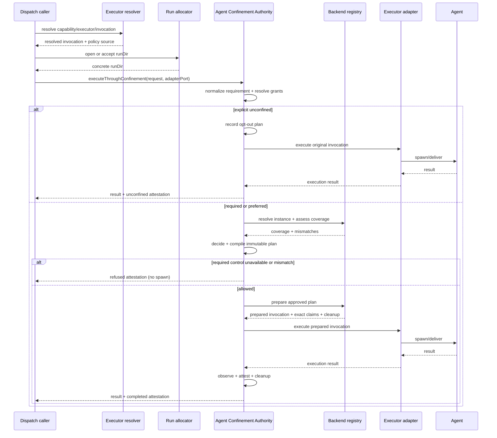

# Bounded source review pack

Content commit: 1276467f37a99d19aff05808d42fafbf40341449
Author session: codex-session:unit-run-1792045007741-a245b0a6@2026-10-15
Shard: plans/260925-documentation-authority-unification/ledger/decisions/s8-agent-confinement-01.json
Shard SHA256: 3d2bbc942e416345213d8b225e43ee69a2f63149f6b8768e23017f5dc829ed68
Source: docs/specs/confinement-authority.md
Part 4/7; entries: **35**. All decisions remain pending.

Read review-brief.md, owner-answers.md (A19/A22/A28/A34/A36/A39), the frozen specs-ui map and minimum constitution. Verify all rows mechanically: full digest recomputation, anchor, ancestry, exact-proof thresholds and shard/pack equality. Independently choose and record the seed and IDs for at least 10/24 Weak-exact/Judgment rows (15%, minimum 10, all if fewer), plus all unequal pairs and generated no-target rows below. Read both directions with a diff; read generation provenance for no-target rows. More than 3% deep rework requires full-pack deep reading. No producer seed/draw/verdict. Retain separate script-exact stratified spot checks; ordinary source approval does not certify truth or eligibility.

A36 class lists and mandatory deep IDs:

```json
{
  "classes": {
    "Unit-exact": [
      "claim_d43968f2b346d8eb2c736f9cbf45a837",
      "claim_b74317580138e8ca89ad5beaaa9ebae5",
      "claim_7519a17d8b83682007e1040f0208a38a",
      "claim_d6e3a8b6bdbad6eb8832dedecce3af68",
      "claim_5c6c4d70a4f3bcc674519b97ec484952",
      "claim_9e6f7a0b46212d4b4f91e785385c6ea9",
      "claim_fc0d0b9362e1734b895dc1915e30cfda",
      "claim_88fa79d61b6875d241559f455b555e53",
      "claim_61c31179243d131b181e336912a03c4b",
      "claim_b7a4044f5956f2a0da7a3f0b38c059c6",
      "claim_0117008e3dfef395f044eb1556ad0fca"
    ],
    "Weak-exact": [
      "claim_881c7b860398ec56b2c53aa979f0d0ca",
      "claim_c6f22c182809bfbdcd4b61c549448252",
      "claim_3d3d04bb6d92e71fff28a2535e2f8d1f",
      "claim_eba921b94dd5ea247782ceb609042aa8",
      "claim_f5a52c61864e3be61662d3a6b6665cf9",
      "claim_e62ed70d3a230f8d3b4ab87cb94ac3d0",
      "claim_7364f54a01fc546f38870ba83d71d755",
      "claim_5acbc6f092db10f71fc638cd5681c4cc",
      "claim_89dbdb0604715b690c4a8fce1234ba07",
      "claim_2e17ec877991b8fb6dc15804c37b85aa",
      "claim_52bf0b51048e5b812c73f85f42534778",
      "claim_e8bcc991edd2f67a65a30b5f24bcb59e",
      "claim_76423af5e76cad7a760e473171db0bd8",
      "claim_8ffc60e38f15f94900b7c256725b13c3",
      "claim_d4954b95ae18bc6eadd2b456114a0d8d",
      "claim_1069b219155903582589750241670b7b",
      "claim_3c98b8b5291a36587d790c7c61bf0ec1",
      "claim_98384851072d87294c97b641f88f418e",
      "claim_c28415d164ab0eb7030c262155f29b43",
      "claim_bbe782e6ee2670e65302fb340888c612",
      "claim_945fc582f814a21a5b31b662e7730a80",
      "claim_fcc46294f6051049cd4c77f67ed6af3d",
      "claim_13da404317a8026e33afcd2e58ff4e13",
      "claim_8ee6a4ccd4df0de275866de0f669ae7e"
    ],
    "Judgment": []
  },
  "unequalDigestPairs": [],
  "noTargetGeneratedRows": [],
  "mandatoryDeep": []
}
```


Return Reviewer, Author session(s), Review mode: ordinary, immutable content/request/shard pins, and one row per claim. Use ok/rework/hold, an own note prefixed deep or mechanical, full 64-hex digests; literal none for absent target. Consolidate parts by original shard before applying.

| Claim | Verdict | Note | Source digest | Target digest |
|---|---|---|---|---|


## claim_881c7b860398ec56b2c53aa979f0d0ca

Class: Weak-exact; mandatory deep: false.
Source: docs/specs/confinement-authority.md#unheaded-block-86; lines 777–829; ancestry ["Spec: Agent Confinement Authority","6. Canonical contracts","6.6 `ConfinementAttestation`"].
Target: docs/platform/agent-confinement/contracts/confinement-authority-v1.md#unheaded-block-58; ancestry ["Added in candidate: confinement authority v1","6. Canonical contracts","6.6 `ConfinementAttestation`"].
Source digest: 36a3d1ddd473fd1b2848fa3c6363d939004fb9aed4f80e62b681881dab003ca5
Target digest: 36a3d1ddd473fd1b2848fa3c6363d939004fb9aed4f80e62b681881dab003ca5
Shown source SHA256: 36a3d1ddd473fd1b2848fa3c6363d939004fb9aed4f80e62b681881dab003ca5
Shown target SHA256: 36a3d1ddd473fd1b2848fa3c6363d939004fb9aed4f80e62b681881dab003ca5

### Complete proposed decision

```json
{
  "claimId": "claim_881c7b860398ec56b2c53aa979f0d0ca",
  "sourceUnitDigest": "36a3d1ddd473fd1b2848fa3c6363d939004fb9aed4f80e62b681881dab003ca5",
  "targetOwner": "docs/platform/agent-confinement/contracts/confinement-authority-v1.md",
  "targetAnchor": "unheaded-block-58",
  "claimKind": "specification",
  "disposition": "move",
  "reviewStatus": "pending",
  "authoredBy": "codex-session:unit-run-1792045007741-a245b0a6@2026-10-15",
  "rationale": "Weak-exact: ancestor headings differ; document exact share below one half. The whole unheaded-block unit docs/specs/confinement-authority.md#unheaded-block-86 (source lines 777-829) is carried at docs/platform/agent-confinement/contracts/confinement-authority-v1.md#unheaded-block-58 (candidate lines 590-642). The full native unit digest is equal. Frozen specs-ui map and Step 8: preserve docs/specs/confinement-authority.md verbatim in docs/platform/agent-confinement/spec.md, docs/platform/agent-confinement/contracts/confinement-authority-v1.md, docs/platform/agent-confinement/history/rollout-and-settled-facts.md, docs/platform/agent-confinement/decisions/confinement-authority-decisions.md. Constitution kinds determine the labelled subdivisions. Original numbered headings are preserved. The legacy source remains untouched; candidate carriage authorizes neither promotion nor source retirement. Known stale source sentences and links are intentionally carried under A19/A28, not certified true. Row-specific source and target binding remain pending independent review.",
  "targetUnitDigest": "36a3d1ddd473fd1b2848fa3c6363d939004fb9aed4f80e62b681881dab003ca5",
  "targetAncestry": [
    "Added in candidate: confinement authority v1",
    "6. Canonical contracts",
    "6.6 `ConfinementAttestation`"
  ]
}
```

### Full source shown text

````text
```ts
interface ProbeFingerprintV1 {
  policyDigest: string;
  driverVersion: string;
  backendConfigDigest: string;
  platformDigest: string;
  providerCliDigest?: string;
  credentialLoadingDigest?: string;
  invocationTemplateDigest?: string;
  proofProfile: string;
}

interface AdapterReceiptV1 {
  contract: 'confinement-adapter-receipt.v1';
  dispatchId: string;
  preparedInvocationDigest: string;
  executionId: string;
  state: 'started' | 'stopped' | 'unknown';
}

interface ConfinementAttestationV1 {
  contract: 'confinement-attestation.v1';
  dispatchId: string;
  phase: 'prepared' | 'completed' | 'failed' | 'refused';
  outcome: 'enforced' | 'unconfined' | 'degraded' | 'refused' | 'unknown';
  requested: ResolvedConfinementRequirementV1;
  coverage: Record<string, CoverageStatus>;
  effectiveControls: Partial<ConfinementPolicyV1['controls']>;
  resources: ResolvedResourceV1[];
  readiness: Record<string, CoverageStatus>;
  channels: Array<{
    name: 'filesystem' | 'inherited-fd' | 'stdio' | 'host-ipc' | 'network';
    coverage: 'covered' | 'out-of-scope' | 'unknown';
    detail: string;
  }>;
  receipt: AdapterReceiptV1 | null;
  backend: {
    id: string;
    type: string;
    version: string;
    configDigest: string;
  } | null;
  grants: Array<{ resource: string; access: string; target: string }>;
  mismatches: Array<{ code: string; detail: string }>;
  evidence: Array<{
    kind: 'falsification-probe' | 'structural-observation' | 'post-check';
    ref: string;
    freshness: 'current' | 'stale' | 'not-run';
    fingerprint?: ProbeFingerprintV1;
  }>;
  cleanup: { status: 'not-needed' | 'pending' | 'completed' | 'failed'; error?: string };
}
```
````

### Full target shown text

````text
```ts
interface ProbeFingerprintV1 {
  policyDigest: string;
  driverVersion: string;
  backendConfigDigest: string;
  platformDigest: string;
  providerCliDigest?: string;
  credentialLoadingDigest?: string;
  invocationTemplateDigest?: string;
  proofProfile: string;
}

interface AdapterReceiptV1 {
  contract: 'confinement-adapter-receipt.v1';
  dispatchId: string;
  preparedInvocationDigest: string;
  executionId: string;
  state: 'started' | 'stopped' | 'unknown';
}

interface ConfinementAttestationV1 {
  contract: 'confinement-attestation.v1';
  dispatchId: string;
  phase: 'prepared' | 'completed' | 'failed' | 'refused';
  outcome: 'enforced' | 'unconfined' | 'degraded' | 'refused' | 'unknown';
  requested: ResolvedConfinementRequirementV1;
  coverage: Record<string, CoverageStatus>;
  effectiveControls: Partial<ConfinementPolicyV1['controls']>;
  resources: ResolvedResourceV1[];
  readiness: Record<string, CoverageStatus>;
  channels: Array<{
    name: 'filesystem' | 'inherited-fd' | 'stdio' | 'host-ipc' | 'network';
    coverage: 'covered' | 'out-of-scope' | 'unknown';
    detail: string;
  }>;
  receipt: AdapterReceiptV1 | null;
  backend: {
    id: string;
    type: string;
    version: string;
    configDigest: string;
  } | null;
  grants: Array<{ resource: string; access: string; target: string }>;
  mismatches: Array<{ code: string; detail: string }>;
  evidence: Array<{
    kind: 'falsification-probe' | 'structural-observation' | 'post-check';
    ref: string;
    freshness: 'current' | 'stale' | 'not-run';
    fingerprint?: ProbeFingerprintV1;
  }>;
  cleanup: { status: 'not-needed' | 'pending' | 'completed' | 'failed'; error?: string };
}
```
````

## claim_c6f22c182809bfbdcd4b61c549448252

Class: Weak-exact; mandatory deep: false.
Source: docs/specs/confinement-authority.md#unheaded-block-87; lines 831–841; ancestry ["Spec: Agent Confinement Authority","6. Canonical contracts","6.6 `ConfinementAttestation`"].
Target: docs/platform/agent-confinement/contracts/confinement-authority-v1.md#unheaded-block-59; ancestry ["Added in candidate: confinement authority v1","6. Canonical contracts","6.6 `ConfinementAttestation`"].
Source digest: c282c9ca04e89244a5b7af633db57c73254bc703712ff9c213f12ca4b7ac5564
Target digest: c282c9ca04e89244a5b7af633db57c73254bc703712ff9c213f12ca4b7ac5564
Shown source SHA256: c282c9ca04e89244a5b7af633db57c73254bc703712ff9c213f12ca4b7ac5564
Shown target SHA256: c282c9ca04e89244a5b7af633db57c73254bc703712ff9c213f12ca4b7ac5564

### Complete proposed decision

```json
{
  "claimId": "claim_c6f22c182809bfbdcd4b61c549448252",
  "sourceUnitDigest": "c282c9ca04e89244a5b7af633db57c73254bc703712ff9c213f12ca4b7ac5564",
  "targetOwner": "docs/platform/agent-confinement/contracts/confinement-authority-v1.md",
  "targetAnchor": "unheaded-block-59",
  "claimKind": "specification",
  "disposition": "move",
  "reviewStatus": "pending",
  "authoredBy": "codex-session:unit-run-1792045007741-a245b0a6@2026-10-15",
  "rationale": "Weak-exact: ancestor headings differ; document exact share below one half. The whole unheaded-block unit docs/specs/confinement-authority.md#unheaded-block-87 (source lines 831-841) is carried at docs/platform/agent-confinement/contracts/confinement-authority-v1.md#unheaded-block-59 (candidate lines 644-654). The full native unit digest is equal. Frozen specs-ui map and Step 8: preserve docs/specs/confinement-authority.md verbatim in docs/platform/agent-confinement/spec.md, docs/platform/agent-confinement/contracts/confinement-authority-v1.md, docs/platform/agent-confinement/history/rollout-and-settled-facts.md, docs/platform/agent-confinement/decisions/confinement-authority-decisions.md. Constitution kinds determine the labelled subdivisions. Original numbered headings are preserved. The legacy source remains untouched; candidate carriage authorizes neither promotion nor source retirement. Known stale source sentences and links are intentionally carried under A19/A28, not certified true. Row-specific source and target binding remain pending independent review.",
  "targetUnitDigest": "c282c9ca04e89244a5b7af633db57c73254bc703712ff9c213f12ca4b7ac5564",
  "targetAncestry": [
    "Added in candidate: confinement authority v1",
    "6. Canonical contracts",
    "6.6 `ConfinementAttestation`"
  ]
}
```

### Full source shown text

```text
`prepared` chỉ nói invocation đã được Authority dựng; không được đổi tên thành
`verified`. `completed` ghi execution outcome và post-check nếu có. `failed`
ghi execution hoặc cleanup failure sau khi đã prepare; `refused` ghi quyết định
không spawn. `enforced` chỉ hợp lệ khi mọi control/grant yêu cầu có coverage
`satisfied`, claims khớp plan, adapter đã chạy invocation đã prepare, và evidence
cần thiết là `current`. Nếu một phần không thể xác định thì outcome là
`unknown`; `required` trong trạng thái đó phải refuse nếu trạng thái được biết
trước spawn. Nếu unknown chỉ xuất hiện sau spawn, đó là execution failure và
không thể đổi thành refusal hồi tố. Chỉ probe độc lập mới
được ghi evidence `falsification-probe`; đọc lại argv chỉ là
`structural-observation` và không thể một mình nâng outcome lên `enforced`.
```

### Full target shown text

```text
`prepared` chỉ nói invocation đã được Authority dựng; không được đổi tên thành
`verified`. `completed` ghi execution outcome và post-check nếu có. `failed`
ghi execution hoặc cleanup failure sau khi đã prepare; `refused` ghi quyết định
không spawn. `enforced` chỉ hợp lệ khi mọi control/grant yêu cầu có coverage
`satisfied`, claims khớp plan, adapter đã chạy invocation đã prepare, và evidence
cần thiết là `current`. Nếu một phần không thể xác định thì outcome là
`unknown`; `required` trong trạng thái đó phải refuse nếu trạng thái được biết
trước spawn. Nếu unknown chỉ xuất hiện sau spawn, đó là execution failure và
không thể đổi thành refusal hồi tố. Chỉ probe độc lập mới
được ghi evidence `falsification-probe`; đọc lại argv chỉ là
`structural-observation` và không thể một mình nâng outcome lên `enforced`.
```

## claim_3d3d04bb6d92e71fff28a2535e2f8d1f

Class: Weak-exact; mandatory deep: false.
Source: docs/specs/confinement-authority.md#unheaded-block-88; lines 843–848; ancestry ["Spec: Agent Confinement Authority","6. Canonical contracts","6.6 `ConfinementAttestation`"].
Target: docs/platform/agent-confinement/contracts/confinement-authority-v1.md#unheaded-block-60; ancestry ["Added in candidate: confinement authority v1","6. Canonical contracts","6.6 `ConfinementAttestation`"].
Source digest: 05814db74539896a48b020a0d6326bbe8d74f0b16d80853f167bba74afd12565
Target digest: 05814db74539896a48b020a0d6326bbe8d74f0b16d80853f167bba74afd12565
Shown source SHA256: 05814db74539896a48b020a0d6326bbe8d74f0b16d80853f167bba74afd12565
Shown target SHA256: 05814db74539896a48b020a0d6326bbe8d74f0b16d80853f167bba74afd12565

### Complete proposed decision

```json
{
  "claimId": "claim_3d3d04bb6d92e71fff28a2535e2f8d1f",
  "sourceUnitDigest": "05814db74539896a48b020a0d6326bbe8d74f0b16d80853f167bba74afd12565",
  "targetOwner": "docs/platform/agent-confinement/contracts/confinement-authority-v1.md",
  "targetAnchor": "unheaded-block-60",
  "claimKind": "specification",
  "disposition": "move",
  "reviewStatus": "pending",
  "authoredBy": "codex-session:unit-run-1792045007741-a245b0a6@2026-10-15",
  "rationale": "Weak-exact: ancestor headings differ; document exact share below one half. The whole unheaded-block unit docs/specs/confinement-authority.md#unheaded-block-88 (source lines 843-848) is carried at docs/platform/agent-confinement/contracts/confinement-authority-v1.md#unheaded-block-60 (candidate lines 656-661). The full native unit digest is equal. Frozen specs-ui map and Step 8: preserve docs/specs/confinement-authority.md verbatim in docs/platform/agent-confinement/spec.md, docs/platform/agent-confinement/contracts/confinement-authority-v1.md, docs/platform/agent-confinement/history/rollout-and-settled-facts.md, docs/platform/agent-confinement/decisions/confinement-authority-decisions.md. Constitution kinds determine the labelled subdivisions. Original numbered headings are preserved. The legacy source remains untouched; candidate carriage authorizes neither promotion nor source retirement. Known stale source sentences and links are intentionally carried under A19/A28, not certified true. Row-specific source and target binding remain pending independent review.",
  "targetUnitDigest": "05814db74539896a48b020a0d6326bbe8d74f0b16d80853f167bba74afd12565",
  "targetAncestry": [
    "Added in candidate: confinement authority v1",
    "6. Canonical contracts",
    "6.6 `ConfinementAttestation`"
  ]
}
```

### Full source shown text

```text
Trước spawn, `required` cần assessment đủ coverage, prepare claims khớp plan
và chứng nhận probe độc lập còn hiệu lực; chưa cần bằng chứng agent đã chạy.
Sau spawn, adapter receipt gắn dispatch id và digest prepared invocation là
structural evidence bổ sung để kết luận `enforced`, không thay thế probe.
`prepared` với mode required ghi outcome `unknown` vì execution chưa xảy ra;
điều này không đồng nghĩa assessment coverage là unknown.
```

### Full target shown text

```text
Trước spawn, `required` cần assessment đủ coverage, prepare claims khớp plan
và chứng nhận probe độc lập còn hiệu lực; chưa cần bằng chứng agent đã chạy.
Sau spawn, adapter receipt gắn dispatch id và digest prepared invocation là
structural evidence bổ sung để kết luận `enforced`, không thay thế probe.
`prepared` với mode required ghi outcome `unknown` vì execution chưa xảy ra;
điều này không đồng nghĩa assessment coverage là unknown.
```

## claim_eba921b94dd5ea247782ceb609042aa8

Class: Weak-exact; mandatory deep: false.
Source: docs/specs/confinement-authority.md#unheaded-block-89; lines 850–861; ancestry ["Spec: Agent Confinement Authority","6. Canonical contracts","6.6 `ConfinementAttestation`"].
Target: docs/platform/agent-confinement/contracts/confinement-authority-v1.md#unheaded-block-61; ancestry ["Added in candidate: confinement authority v1","6. Canonical contracts","6.6 `ConfinementAttestation`"].
Source digest: d01b91e92712ee83bb8180a17573637d4d14b6be07f0654cd489fe7d24884c53
Target digest: d01b91e92712ee83bb8180a17573637d4d14b6be07f0654cd489fe7d24884c53
Shown source SHA256: d01b91e92712ee83bb8180a17573637d4d14b6be07f0654cd489fe7d24884c53
Shown target SHA256: d01b91e92712ee83bb8180a17573637d4d14b6be07f0654cd489fe7d24884c53

### Complete proposed decision

```json
{
  "claimId": "claim_eba921b94dd5ea247782ceb609042aa8",
  "sourceUnitDigest": "d01b91e92712ee83bb8180a17573637d4d14b6be07f0654cd489fe7d24884c53",
  "targetOwner": "docs/platform/agent-confinement/contracts/confinement-authority-v1.md",
  "targetAnchor": "unheaded-block-61",
  "claimKind": "architecture",
  "disposition": "move",
  "reviewStatus": "pending",
  "authoredBy": "codex-session:unit-run-1792045007741-a245b0a6@2026-10-15",
  "rationale": "Weak-exact: ancestor headings differ; document exact share below one half. The whole unheaded-block unit docs/specs/confinement-authority.md#unheaded-block-89 (source lines 850-861) is carried at docs/platform/agent-confinement/contracts/confinement-authority-v1.md#unheaded-block-61 (candidate lines 663-674). The full native unit digest is equal. Frozen specs-ui map and Step 8: preserve docs/specs/confinement-authority.md verbatim in docs/platform/agent-confinement/spec.md, docs/platform/agent-confinement/contracts/confinement-authority-v1.md, docs/platform/agent-confinement/history/rollout-and-settled-facts.md, docs/platform/agent-confinement/decisions/confinement-authority-decisions.md. Constitution kinds determine the labelled subdivisions. Original numbered headings are preserved. The legacy source remains untouched; candidate carriage authorizes neither promotion nor source retirement. Known stale source sentences and links are intentionally carried under A19/A28, not certified true. Row-specific source and target binding remain pending independent review.",
  "targetUnitDigest": "d01b91e92712ee83bb8180a17573637d4d14b6be07f0654cd489fe7d24884c53",
  "targetAncestry": [
    "Added in candidate: confinement authority v1",
    "6. Canonical contracts",
    "6.6 `ConfinementAttestation`"
  ]
}
```

### Full source shown text

```text
Proof profile đăng ký trong code quyết định fingerprint component bắt buộc.
`local-bwrap-v1` yêu cầu policy, driver version, backend config, platform digest
(kernel/bwrap); readiness recipe dùng provider CLI/credential-loading/invocation
digest khi kết quả phụ thuộc chúng. Không được bỏ dependency thực sự để tránh
stale. Path runtime chuẩn hóa theo resource identity. Component bắt buộc đổi
thì proof tương ứng stale; component không áp dụng không cần giá trị giả.
Authority tự chạy lại probe đã đăng ký khi stale trước required spawn, dùng
single-flight/cache theo fingerprint, timeout hữu hạn, và ghi evidence mới.
Probe fail/timeout thì refuse có lý do; không cần người chạy doctor để đi tiếp
khi probe có thể tự thành công. Doctor dùng cùng harness và giải thích lỗi.
Tính độc lập là test input/assertion không lấy kết quả mong đợi từ claims của
driver; không phụ thuộc ai khởi chạy probe. Backend không tự chứng nhận mình.
```

### Full target shown text

```text
Proof profile đăng ký trong code quyết định fingerprint component bắt buộc.
`local-bwrap-v1` yêu cầu policy, driver version, backend config, platform digest
(kernel/bwrap); readiness recipe dùng provider CLI/credential-loading/invocation
digest khi kết quả phụ thuộc chúng. Không được bỏ dependency thực sự để tránh
stale. Path runtime chuẩn hóa theo resource identity. Component bắt buộc đổi
thì proof tương ứng stale; component không áp dụng không cần giá trị giả.
Authority tự chạy lại probe đã đăng ký khi stale trước required spawn, dùng
single-flight/cache theo fingerprint, timeout hữu hạn, và ghi evidence mới.
Probe fail/timeout thì refuse có lý do; không cần người chạy doctor để đi tiếp
khi probe có thể tự thành công. Doctor dùng cùng harness và giải thích lỗi.
Tính độc lập là test input/assertion không lấy kết quả mong đợi từ claims của
driver; không phụ thuộc ai khởi chạy probe. Backend không tự chứng nhận mình.
```

## claim_f5a52c61864e3be61662d3a6b6665cf9

Class: Weak-exact; mandatory deep: false.
Source: docs/specs/confinement-authority.md#unheaded-block-90; lines 863–869; ancestry ["Spec: Agent Confinement Authority","6. Canonical contracts","6.6 `ConfinementAttestation`"].
Target: docs/platform/agent-confinement/contracts/confinement-authority-v1.md#unheaded-block-62; ancestry ["Added in candidate: confinement authority v1","6. Canonical contracts","6.6 `ConfinementAttestation`"].
Source digest: 118b8df1dd9ccee406f03b07de6bbfb3aa9807cd1147eacb99b882862cf7bf92
Target digest: 118b8df1dd9ccee406f03b07de6bbfb3aa9807cd1147eacb99b882862cf7bf92
Shown source SHA256: 118b8df1dd9ccee406f03b07de6bbfb3aa9807cd1147eacb99b882862cf7bf92
Shown target SHA256: 118b8df1dd9ccee406f03b07de6bbfb3aa9807cd1147eacb99b882862cf7bf92

### Complete proposed decision

```json
{
  "claimId": "claim_f5a52c61864e3be61662d3a6b6665cf9",
  "sourceUnitDigest": "118b8df1dd9ccee406f03b07de6bbfb3aa9807cd1147eacb99b882862cf7bf92",
  "targetOwner": "docs/platform/agent-confinement/contracts/confinement-authority-v1.md",
  "targetAnchor": "unheaded-block-62",
  "claimKind": "specification",
  "disposition": "move",
  "reviewStatus": "pending",
  "authoredBy": "codex-session:unit-run-1792045007741-a245b0a6@2026-10-15",
  "rationale": "Weak-exact: ancestor headings differ; document exact share below one half. The whole unheaded-block unit docs/specs/confinement-authority.md#unheaded-block-90 (source lines 863-869) is carried at docs/platform/agent-confinement/contracts/confinement-authority-v1.md#unheaded-block-62 (candidate lines 676-682). The full native unit digest is equal. Frozen specs-ui map and Step 8: preserve docs/specs/confinement-authority.md verbatim in docs/platform/agent-confinement/spec.md, docs/platform/agent-confinement/contracts/confinement-authority-v1.md, docs/platform/agent-confinement/history/rollout-and-settled-facts.md, docs/platform/agent-confinement/decisions/confinement-authority-decisions.md. Constitution kinds determine the labelled subdivisions. Original numbered headings are preserved. The legacy source remains untouched; candidate carriage authorizes neither promotion nor source retirement. Known stale source sentences and links are intentionally carried under A19/A28, not certified true. Row-specific source and target binding remain pending independent review.",
  "targetUnitDigest": "118b8df1dd9ccee406f03b07de6bbfb3aa9807cd1147eacb99b882862cf7bf92",
  "targetAncestry": [
    "Added in candidate: confinement authority v1",
    "6. Canonical contracts",
    "6.6 `ConfinementAttestation`"
  ]
}
```

### Full source shown text

```text
Falsification-probe evidence bắt buộc có fingerprint; receipt do trusted adapter
phát, không lấy từ stdout của agent. Platform digest gồm kernel/runtime và
sandbox binary/image theo proofProfile. Evidence ref trỏ tới record versioned
do Authority kiểm tra; thiếu component bắt buộc theo proofProfile không được current.
Channels luôn có đủ năm entry trên; out-of-scope không được dùng để miễn
filesystem hay inherited-fd khi hostWrite deny. Violation đã xác nhận ghi
phase failed, outcome degraded và mismatch; unknown dành cho thiếu bằng chứng.
```

### Full target shown text

```text
Falsification-probe evidence bắt buộc có fingerprint; receipt do trusted adapter
phát, không lấy từ stdout của agent. Platform digest gồm kernel/runtime và
sandbox binary/image theo proofProfile. Evidence ref trỏ tới record versioned
do Authority kiểm tra; thiếu component bắt buộc theo proofProfile không được current.
Channels luôn có đủ năm entry trên; out-of-scope không được dùng để miễn
filesystem hay inherited-fd khi hostWrite deny. Violation đã xác nhận ghi
phase failed, outcome degraded và mismatch; unknown dành cho thiếu bằng chứng.
```

## claim_e62ed70d3a230f8d3b4ab87cb94ac3d0

Class: Weak-exact; mandatory deep: false.
Source: docs/specs/confinement-authority.md#unheaded-block-91; lines 871–879; ancestry ["Spec: Agent Confinement Authority","6. Canonical contracts","6.6 `ConfinementAttestation`"].
Target: docs/platform/agent-confinement/contracts/confinement-authority-v1.md#unheaded-block-63; ancestry ["Added in candidate: confinement authority v1","6. Canonical contracts","6.6 `ConfinementAttestation`"].
Source digest: b78ccd4e97965c3fceb7afba5c77a41a5d81fa17f2b4ffe6fb70fd0a49eff3ba
Target digest: b78ccd4e97965c3fceb7afba5c77a41a5d81fa17f2b4ffe6fb70fd0a49eff3ba
Shown source SHA256: b78ccd4e97965c3fceb7afba5c77a41a5d81fa17f2b4ffe6fb70fd0a49eff3ba
Shown target SHA256: b78ccd4e97965c3fceb7afba5c77a41a5d81fa17f2b4ffe6fb70fd0a49eff3ba

### Complete proposed decision

```json
{
  "claimId": "claim_e62ed70d3a230f8d3b4ab87cb94ac3d0",
  "sourceUnitDigest": "b78ccd4e97965c3fceb7afba5c77a41a5d81fa17f2b4ffe6fb70fd0a49eff3ba",
  "targetOwner": "docs/platform/agent-confinement/contracts/confinement-authority-v1.md",
  "targetAnchor": "unheaded-block-63",
  "claimKind": "specification",
  "disposition": "move",
  "reviewStatus": "pending",
  "authoredBy": "codex-session:unit-run-1792045007741-a245b0a6@2026-10-15",
  "rationale": "Weak-exact: ancestor headings differ; document exact share below one half. The whole unheaded-block unit docs/specs/confinement-authority.md#unheaded-block-91 (source lines 871-879) is carried at docs/platform/agent-confinement/contracts/confinement-authority-v1.md#unheaded-block-63 (candidate lines 684-692). The full native unit digest is equal. Frozen specs-ui map and Step 8: preserve docs/specs/confinement-authority.md verbatim in docs/platform/agent-confinement/spec.md, docs/platform/agent-confinement/contracts/confinement-authority-v1.md, docs/platform/agent-confinement/history/rollout-and-settled-facts.md, docs/platform/agent-confinement/decisions/confinement-authority-decisions.md. Constitution kinds determine the labelled subdivisions. Original numbered headings are preserved. The legacy source remains untouched; candidate carriage authorizes neither promotion nor source retirement. Known stale source sentences and links are intentionally carried under A19/A28, not certified true. Row-specific source and target binding remain pending independent review.",
  "targetUnitDigest": "b78ccd4e97965c3fceb7afba5c77a41a5d81fa17f2b4ffe6fb70fd0a49eff3ba",
  "targetAncestry": [
    "Added in candidate: confinement authority v1",
    "6. Canonical contracts",
    "6.6 `ConfinementAttestation`"
  ]
}
```

### Full source shown text

```text
Authority lưu plan, prepared record và terminal attestation vào machine state
store do host quản lý, mặc định ngoài project `.fgos/` và ngoài mọi write grant
của agent. Trước mỗi persist Authority kiểm tra containment hai chiều giữa store
và mọi resolved writable resource; bất kỳ overlap nào phải refuse, không được
ghi record vào vùng grant. Run-output chỉ chứa artifact của agent
và có thể chứa bản sao attestation, không phải durable truth. Event committed
chỉ chứa dispatch id, outcome, mismatch code và reference/digest tới record đã
redact; không chứa credential, raw env hay absolute sensitive path. Recovery
giữ record prepared chưa có terminal ở trạng thái unknown, không suy thành công.
```

### Full target shown text

```text
Authority lưu plan, prepared record và terminal attestation vào machine state
store do host quản lý, mặc định ngoài project `.fgos/` và ngoài mọi write grant
của agent. Trước mỗi persist Authority kiểm tra containment hai chiều giữa store
và mọi resolved writable resource; bất kỳ overlap nào phải refuse, không được
ghi record vào vùng grant. Run-output chỉ chứa artifact của agent
và có thể chứa bản sao attestation, không phải durable truth. Event committed
chỉ chứa dispatch id, outcome, mismatch code và reference/digest tới record đã
redact; không chứa credential, raw env hay absolute sensitive path. Recovery
giữ record prepared chưa có terminal ở trạng thái unknown, không suy thành công.
```

## claim_7364f54a01fc546f38870ba83d71d755

Class: Weak-exact; mandatory deep: false.
Source: docs/specs/confinement-authority.md#67-detector-port; lines 881–881; ancestry ["Spec: Agent Confinement Authority","6. Canonical contracts"].
Target: docs/platform/agent-confinement/contracts/confinement-authority-v1.md#67-detector-port; ancestry ["Added in candidate: confinement authority v1","6. Canonical contracts"].
Source digest: 335a5bff2b2c09683b4987219fc557c8b5e6ec8dfc2512d96584b6b38cbfa53f
Target digest: 335a5bff2b2c09683b4987219fc557c8b5e6ec8dfc2512d96584b6b38cbfa53f
Shown source SHA256: 999e9961a4afd4dc52736c6f87b15a45049f616264770eded84c650f5df37519
Shown target SHA256: 999e9961a4afd4dc52736c6f87b15a45049f616264770eded84c650f5df37519

### Complete proposed decision

```json
{
  "claimId": "claim_7364f54a01fc546f38870ba83d71d755",
  "sourceUnitDigest": "335a5bff2b2c09683b4987219fc557c8b5e6ec8dfc2512d96584b6b38cbfa53f",
  "targetOwner": "docs/platform/agent-confinement/contracts/confinement-authority-v1.md",
  "targetAnchor": "67-detector-port",
  "claimKind": "specification",
  "disposition": "move",
  "reviewStatus": "pending",
  "authoredBy": "codex-session:unit-run-1792045007741-a245b0a6@2026-10-15",
  "rationale": "Weak-exact: ancestor headings differ; source unit shorter than 40 characters; document exact share below one half. The whole heading unit docs/specs/confinement-authority.md#67-detector-port (source lines 881-881) is carried at docs/platform/agent-confinement/contracts/confinement-authority-v1.md#67-detector-port (candidate lines 694-694). The full native unit digest is equal. Frozen specs-ui map and Step 8: preserve docs/specs/confinement-authority.md verbatim in docs/platform/agent-confinement/spec.md, docs/platform/agent-confinement/contracts/confinement-authority-v1.md, docs/platform/agent-confinement/history/rollout-and-settled-facts.md, docs/platform/agent-confinement/decisions/confinement-authority-decisions.md. Constitution kinds determine the labelled subdivisions. Original numbered headings are preserved. The legacy source remains untouched; candidate carriage authorizes neither promotion nor source retirement. Known stale source sentences and links are intentionally carried under A19/A28, not certified true. Row-specific source and target binding remain pending independent review.",
  "targetUnitDigest": "335a5bff2b2c09683b4987219fc557c8b5e6ec8dfc2512d96584b6b38cbfa53f",
  "targetAncestry": [
    "Added in candidate: confinement authority v1",
    "6. Canonical contracts"
  ]
}
```

### Full source shown text

```text
### 6.7 Detector port

Detector là detective control độc lập với khai báo. Nó có thể nhận ra argv
`bwrap`, provider-native sandbox, writable mount bất thường hoặc adapter bỏ qua
prepared invocation. Detector:

- không được chọn backend;
- không được nâng `unknown` thành `satisfied`;
- không lấy expected result từ chính plan rồi tự xác nhận plan;
- chỉ phát observation/mismatch cho attestation và doctor.
```

### Full target shown text

```text
### 6.7 Detector port

Detector là detective control độc lập với khai báo. Nó có thể nhận ra argv
`bwrap`, provider-native sandbox, writable mount bất thường hoặc adapter bỏ qua
prepared invocation. Detector:

- không được chọn backend;
- không được nâng `unknown` thành `satisfied`;
- không lấy expected result từ chính plan rồi tự xác nhận plan;
- chỉ phát observation/mismatch cho attestation và doctor.
```

## claim_5acbc6f092db10f71fc638cd5681c4cc

Class: Weak-exact; mandatory deep: false.
Source: docs/specs/confinement-authority.md#unheaded-block-92; lines 883–885; ancestry ["Spec: Agent Confinement Authority","6. Canonical contracts","6.7 Detector port"].
Target: docs/platform/agent-confinement/contracts/confinement-authority-v1.md#unheaded-block-64; ancestry ["Added in candidate: confinement authority v1","6. Canonical contracts","6.7 Detector port"].
Source digest: 7996504f5b372968107319eb1d902a4d02284ded0b1dadb1a6ad503f9c9f96c4
Target digest: 7996504f5b372968107319eb1d902a4d02284ded0b1dadb1a6ad503f9c9f96c4
Shown source SHA256: 7996504f5b372968107319eb1d902a4d02284ded0b1dadb1a6ad503f9c9f96c4
Shown target SHA256: 7996504f5b372968107319eb1d902a4d02284ded0b1dadb1a6ad503f9c9f96c4

### Complete proposed decision

```json
{
  "claimId": "claim_5acbc6f092db10f71fc638cd5681c4cc",
  "sourceUnitDigest": "7996504f5b372968107319eb1d902a4d02284ded0b1dadb1a6ad503f9c9f96c4",
  "targetOwner": "docs/platform/agent-confinement/contracts/confinement-authority-v1.md",
  "targetAnchor": "unheaded-block-64",
  "claimKind": "specification",
  "disposition": "move",
  "reviewStatus": "pending",
  "authoredBy": "codex-session:unit-run-1792045007741-a245b0a6@2026-10-15",
  "rationale": "Weak-exact: ancestor headings differ; document exact share below one half. The whole unheaded-block unit docs/specs/confinement-authority.md#unheaded-block-92 (source lines 883-885) is carried at docs/platform/agent-confinement/contracts/confinement-authority-v1.md#unheaded-block-64 (candidate lines 696-698). The full native unit digest is equal. Frozen specs-ui map and Step 8: preserve docs/specs/confinement-authority.md verbatim in docs/platform/agent-confinement/spec.md, docs/platform/agent-confinement/contracts/confinement-authority-v1.md, docs/platform/agent-confinement/history/rollout-and-settled-facts.md, docs/platform/agent-confinement/decisions/confinement-authority-decisions.md. Constitution kinds determine the labelled subdivisions. Original numbered headings are preserved. The legacy source remains untouched; candidate carriage authorizes neither promotion nor source retirement. Known stale source sentences and links are intentionally carried under A19/A28, not certified true. Row-specific source and target binding remain pending independent review.",
  "targetUnitDigest": "7996504f5b372968107319eb1d902a4d02284ded0b1dadb1a6ad503f9c9f96c4",
  "targetAncestry": [
    "Added in candidate: confinement authority v1",
    "6. Canonical contracts",
    "6.7 Detector port"
  ]
}
```

### Full source shown text

```text
Detector là detective control độc lập với khai báo. Nó có thể nhận ra argv
`bwrap`, provider-native sandbox, writable mount bất thường hoặc adapter bỏ qua
prepared invocation. Detector:
```

### Full target shown text

```text
Detector là detective control độc lập với khai báo. Nó có thể nhận ra argv
`bwrap`, provider-native sandbox, writable mount bất thường hoặc adapter bỏ qua
prepared invocation. Detector:
```

## claim_89dbdb0604715b690c4a8fce1234ba07

Class: Weak-exact; mandatory deep: false.
Source: docs/specs/confinement-authority.md#unheaded-block-93; lines 887–890; ancestry ["Spec: Agent Confinement Authority","6. Canonical contracts","6.7 Detector port"].
Target: docs/platform/agent-confinement/contracts/confinement-authority-v1.md#unheaded-block-65; ancestry ["Added in candidate: confinement authority v1","6. Canonical contracts","6.7 Detector port"].
Source digest: 6c9ce6d5f534d24f1b52f1a8b0bb41382ada3ba2a083950f3cccb57bee758494
Target digest: 6c9ce6d5f534d24f1b52f1a8b0bb41382ada3ba2a083950f3cccb57bee758494
Shown source SHA256: 6c9ce6d5f534d24f1b52f1a8b0bb41382ada3ba2a083950f3cccb57bee758494
Shown target SHA256: 6c9ce6d5f534d24f1b52f1a8b0bb41382ada3ba2a083950f3cccb57bee758494

### Complete proposed decision

```json
{
  "claimId": "claim_89dbdb0604715b690c4a8fce1234ba07",
  "sourceUnitDigest": "6c9ce6d5f534d24f1b52f1a8b0bb41382ada3ba2a083950f3cccb57bee758494",
  "targetOwner": "docs/platform/agent-confinement/contracts/confinement-authority-v1.md",
  "targetAnchor": "unheaded-block-65",
  "claimKind": "specification",
  "disposition": "move",
  "reviewStatus": "pending",
  "authoredBy": "codex-session:unit-run-1792045007741-a245b0a6@2026-10-15",
  "rationale": "Weak-exact: ancestor headings differ; document exact share below one half. The whole unheaded-block unit docs/specs/confinement-authority.md#unheaded-block-93 (source lines 887-890) is carried at docs/platform/agent-confinement/contracts/confinement-authority-v1.md#unheaded-block-65 (candidate lines 700-703). The full native unit digest is equal. Frozen specs-ui map and Step 8: preserve docs/specs/confinement-authority.md verbatim in docs/platform/agent-confinement/spec.md, docs/platform/agent-confinement/contracts/confinement-authority-v1.md, docs/platform/agent-confinement/history/rollout-and-settled-facts.md, docs/platform/agent-confinement/decisions/confinement-authority-decisions.md. Constitution kinds determine the labelled subdivisions. Original numbered headings are preserved. The legacy source remains untouched; candidate carriage authorizes neither promotion nor source retirement. Known stale source sentences and links are intentionally carried under A19/A28, not certified true. Row-specific source and target binding remain pending independent review.",
  "targetUnitDigest": "6c9ce6d5f534d24f1b52f1a8b0bb41382ada3ba2a083950f3cccb57bee758494",
  "targetAncestry": [
    "Added in candidate: confinement authority v1",
    "6. Canonical contracts",
    "6.7 Detector port"
  ]
}
```

### Full source shown text

```text
- không được chọn backend;
- không được nâng `unknown` thành `satisfied`;
- không lấy expected result từ chính plan rồi tự xác nhận plan;
- chỉ phát observation/mismatch cho attestation và doctor.
```

### Full target shown text

```text
- không được chọn backend;
- không được nâng `unknown` thành `satisfied`;
- không lấy expected result từ chính plan rồi tự xác nhận plan;
- chỉ phát observation/mismatch cho attestation và doctor.
```

## claim_2e17ec877991b8fb6dc15804c37b85aa

Class: Weak-exact; mandatory deep: false.
Source: docs/specs/confinement-authority.md#68-error-taxonomy; lines 892–892; ancestry ["Spec: Agent Confinement Authority","6. Canonical contracts"].
Target: docs/platform/agent-confinement/contracts/confinement-authority-v1.md#68-error-taxonomy; ancestry ["Added in candidate: confinement authority v1","6. Canonical contracts"].
Source digest: 5ad9f5cd9dbdbc7fe14ade3ba2eb1a86d19b04724a68ed36194ca7ddb27a3a94
Target digest: 5ad9f5cd9dbdbc7fe14ade3ba2eb1a86d19b04724a68ed36194ca7ddb27a3a94
Shown source SHA256: a49917e18cdf0b13e9a48def71c7bf1e675113ce0f883d779eb9a9ee91e7706e
Shown target SHA256: a49917e18cdf0b13e9a48def71c7bf1e675113ce0f883d779eb9a9ee91e7706e

### Complete proposed decision

```json
{
  "claimId": "claim_2e17ec877991b8fb6dc15804c37b85aa",
  "sourceUnitDigest": "5ad9f5cd9dbdbc7fe14ade3ba2eb1a86d19b04724a68ed36194ca7ddb27a3a94",
  "targetOwner": "docs/platform/agent-confinement/contracts/confinement-authority-v1.md",
  "targetAnchor": "68-error-taxonomy",
  "claimKind": "specification",
  "disposition": "move",
  "reviewStatus": "pending",
  "authoredBy": "codex-session:unit-run-1792045007741-a245b0a6@2026-10-15",
  "rationale": "Weak-exact: ancestor headings differ; source unit shorter than 40 characters; document exact share below one half. The whole heading unit docs/specs/confinement-authority.md#68-error-taxonomy (source lines 892-892) is carried at docs/platform/agent-confinement/contracts/confinement-authority-v1.md#68-error-taxonomy (candidate lines 705-705). The full native unit digest is equal. Frozen specs-ui map and Step 8: preserve docs/specs/confinement-authority.md verbatim in docs/platform/agent-confinement/spec.md, docs/platform/agent-confinement/contracts/confinement-authority-v1.md, docs/platform/agent-confinement/history/rollout-and-settled-facts.md, docs/platform/agent-confinement/decisions/confinement-authority-decisions.md. Constitution kinds determine the labelled subdivisions. Original numbered headings are preserved. The legacy source remains untouched; candidate carriage authorizes neither promotion nor source retirement. Known stale source sentences and links are intentionally carried under A19/A28, not certified true. Row-specific source and target binding remain pending independent review.",
  "targetUnitDigest": "5ad9f5cd9dbdbc7fe14ade3ba2eb1a86d19b04724a68ed36194ca7ddb27a3a94",
  "targetAncestry": [
    "Added in candidate: confinement authority v1",
    "6. Canonical contracts"
  ]
}
```

### Full source shown text

```text
### 6.8 Error taxonomy

| Code | Ý nghĩa | Xử lý |
|---|---|---|
| `confinement-policy-missing` | capability không có quyết định tường minh | refuse trong strict mode |
| `confinement-backend-registry-forbidden` | project config cố định nghĩa/override machine backend | config error |
| `confinement-backend-unknown` | backend instance không có trong machine registry hoặc driver type không ở allowlist | config error |
| `confinement-backend-missing` | required dispatch không có backend instance được executor chọn, hoặc instance không resolve được | refuse trước spawn |
| `confinement-backend-disabled` | backend instance được chọn nhưng bị machine registry vô hiệu hóa | refuse trước spawn |
| `confinement-mode-unsupported` | mode `preferred` chưa có backend path được hỗ trợ trong phase hiện tại | refuse trước spawn |
| `confinement-need-unsatisfied` | resource need bắt buộc không được plan/backend đáp ứng | refuse trước spawn |
| `confinement-unsupported` | host/backend không đáp ứng required control | refuse trước spawn |
| `confinement-grant-invalid` | resource không tồn tại, path thoát boundary, access sai | refuse trước spawn |
| `confinement-plan-mismatch` | prepared claims khác plan | refuse trước spawn |
| `confinement-observed-mismatch` | detector thấy thực tế khác khai báo | trước spawn: required refuse; sau spawn: failed và giữ evidence; observe chỉ ghi observation |
| `confinement-violation` | post-check/probe thấy vi phạm | execution failed, giữ evidence |
| `confinement-cleanup-failed` | resource tạm không dọn được | lỗi có tên; không nuốt |
| `confinement-execution-failed` | adapter/process thất bại sau prepare | failed, giữ execution error và attestation |
```

### Full target shown text

```text
### 6.8 Error taxonomy

| Code | Ý nghĩa | Xử lý |
|---|---|---|
| `confinement-policy-missing` | capability không có quyết định tường minh | refuse trong strict mode |
| `confinement-backend-registry-forbidden` | project config cố định nghĩa/override machine backend | config error |
| `confinement-backend-unknown` | backend instance không có trong machine registry hoặc driver type không ở allowlist | config error |
| `confinement-backend-missing` | required dispatch không có backend instance được executor chọn, hoặc instance không resolve được | refuse trước spawn |
| `confinement-backend-disabled` | backend instance được chọn nhưng bị machine registry vô hiệu hóa | refuse trước spawn |
| `confinement-mode-unsupported` | mode `preferred` chưa có backend path được hỗ trợ trong phase hiện tại | refuse trước spawn |
| `confinement-need-unsatisfied` | resource need bắt buộc không được plan/backend đáp ứng | refuse trước spawn |
| `confinement-unsupported` | host/backend không đáp ứng required control | refuse trước spawn |
| `confinement-grant-invalid` | resource không tồn tại, path thoát boundary, access sai | refuse trước spawn |
| `confinement-plan-mismatch` | prepared claims khác plan | refuse trước spawn |
| `confinement-observed-mismatch` | detector thấy thực tế khác khai báo | trước spawn: required refuse; sau spawn: failed và giữ evidence; observe chỉ ghi observation |
| `confinement-violation` | post-check/probe thấy vi phạm | execution failed, giữ evidence |
| `confinement-cleanup-failed` | resource tạm không dọn được | lỗi có tên; không nuốt |
| `confinement-execution-failed` | adapter/process thất bại sau prepare | failed, giữ execution error và attestation |
```

## claim_52bf0b51048e5b812c73f85f42534778

Class: Weak-exact; mandatory deep: false.
Source: docs/specs/confinement-authority.md#unheaded-block-94; lines 894–909; ancestry ["Spec: Agent Confinement Authority","6. Canonical contracts","6.8 Error taxonomy"].
Target: docs/platform/agent-confinement/contracts/confinement-authority-v1.md#unheaded-block-66; ancestry ["Added in candidate: confinement authority v1","6. Canonical contracts","6.8 Error taxonomy"].
Source digest: 4d56df251bebef446e601cf783883d43113eb22e1267b40f06aace02dc3b206d
Target digest: 4d56df251bebef446e601cf783883d43113eb22e1267b40f06aace02dc3b206d
Shown source SHA256: 4d56df251bebef446e601cf783883d43113eb22e1267b40f06aace02dc3b206d
Shown target SHA256: 4d56df251bebef446e601cf783883d43113eb22e1267b40f06aace02dc3b206d

### Complete proposed decision

```json
{
  "claimId": "claim_52bf0b51048e5b812c73f85f42534778",
  "sourceUnitDigest": "4d56df251bebef446e601cf783883d43113eb22e1267b40f06aace02dc3b206d",
  "targetOwner": "docs/platform/agent-confinement/contracts/confinement-authority-v1.md",
  "targetAnchor": "unheaded-block-66",
  "claimKind": "specification",
  "disposition": "move",
  "reviewStatus": "pending",
  "authoredBy": "codex-session:unit-run-1792045007741-a245b0a6@2026-10-15",
  "rationale": "Weak-exact: ancestor headings differ; document exact share below one half. The whole unheaded-block unit docs/specs/confinement-authority.md#unheaded-block-94 (source lines 894-909) is carried at docs/platform/agent-confinement/contracts/confinement-authority-v1.md#unheaded-block-66 (candidate lines 707-722). The full native unit digest is equal. Frozen specs-ui map and Step 8: preserve docs/specs/confinement-authority.md verbatim in docs/platform/agent-confinement/spec.md, docs/platform/agent-confinement/contracts/confinement-authority-v1.md, docs/platform/agent-confinement/history/rollout-and-settled-facts.md, docs/platform/agent-confinement/decisions/confinement-authority-decisions.md. Constitution kinds determine the labelled subdivisions. Original numbered headings are preserved. The legacy source remains untouched; candidate carriage authorizes neither promotion nor source retirement. Known stale source sentences and links are intentionally carried under A19/A28, not certified true. Row-specific source and target binding remain pending independent review.",
  "targetUnitDigest": "4d56df251bebef446e601cf783883d43113eb22e1267b40f06aace02dc3b206d",
  "targetAncestry": [
    "Added in candidate: confinement authority v1",
    "6. Canonical contracts",
    "6.8 Error taxonomy"
  ]
}
```

### Full source shown text

```text
| Code | Ý nghĩa | Xử lý |
|---|---|---|
| `confinement-policy-missing` | capability không có quyết định tường minh | refuse trong strict mode |
| `confinement-backend-registry-forbidden` | project config cố định nghĩa/override machine backend | config error |
| `confinement-backend-unknown` | backend instance không có trong machine registry hoặc driver type không ở allowlist | config error |
| `confinement-backend-missing` | required dispatch không có backend instance được executor chọn, hoặc instance không resolve được | refuse trước spawn |
| `confinement-backend-disabled` | backend instance được chọn nhưng bị machine registry vô hiệu hóa | refuse trước spawn |
| `confinement-mode-unsupported` | mode `preferred` chưa có backend path được hỗ trợ trong phase hiện tại | refuse trước spawn |
| `confinement-need-unsatisfied` | resource need bắt buộc không được plan/backend đáp ứng | refuse trước spawn |
| `confinement-unsupported` | host/backend không đáp ứng required control | refuse trước spawn |
| `confinement-grant-invalid` | resource không tồn tại, path thoát boundary, access sai | refuse trước spawn |
| `confinement-plan-mismatch` | prepared claims khác plan | refuse trước spawn |
| `confinement-observed-mismatch` | detector thấy thực tế khác khai báo | trước spawn: required refuse; sau spawn: failed và giữ evidence; observe chỉ ghi observation |
| `confinement-violation` | post-check/probe thấy vi phạm | execution failed, giữ evidence |
| `confinement-cleanup-failed` | resource tạm không dọn được | lỗi có tên; không nuốt |
| `confinement-execution-failed` | adapter/process thất bại sau prepare | failed, giữ execution error và attestation |
```

### Full target shown text

```text
| Code | Ý nghĩa | Xử lý |
|---|---|---|
| `confinement-policy-missing` | capability không có quyết định tường minh | refuse trong strict mode |
| `confinement-backend-registry-forbidden` | project config cố định nghĩa/override machine backend | config error |
| `confinement-backend-unknown` | backend instance không có trong machine registry hoặc driver type không ở allowlist | config error |
| `confinement-backend-missing` | required dispatch không có backend instance được executor chọn, hoặc instance không resolve được | refuse trước spawn |
| `confinement-backend-disabled` | backend instance được chọn nhưng bị machine registry vô hiệu hóa | refuse trước spawn |
| `confinement-mode-unsupported` | mode `preferred` chưa có backend path được hỗ trợ trong phase hiện tại | refuse trước spawn |
| `confinement-need-unsatisfied` | resource need bắt buộc không được plan/backend đáp ứng | refuse trước spawn |
| `confinement-unsupported` | host/backend không đáp ứng required control | refuse trước spawn |
| `confinement-grant-invalid` | resource không tồn tại, path thoát boundary, access sai | refuse trước spawn |
| `confinement-plan-mismatch` | prepared claims khác plan | refuse trước spawn |
| `confinement-observed-mismatch` | detector thấy thực tế khác khai báo | trước spawn: required refuse; sau spawn: failed và giữ evidence; observe chỉ ghi observation |
| `confinement-violation` | post-check/probe thấy vi phạm | execution failed, giữ evidence |
| `confinement-cleanup-failed` | resource tạm không dọn được | lỗi có tên; không nuốt |
| `confinement-execution-failed` | adapter/process thất bại sau prepare | failed, giữ execution error và attestation |
```

## claim_e8bcc991edd2f67a65a30b5f24bcb59e

Class: Weak-exact; mandatory deep: false.
Source: docs/specs/confinement-authority.md#69-kết-quả-của-cửa-authority; lines 911–911; ancestry ["Spec: Agent Confinement Authority","6. Canonical contracts"].
Target: docs/platform/agent-confinement/contracts/confinement-authority-v1.md#69-kết-quả-của-cửa-authority; ancestry ["Added in candidate: confinement authority v1","6. Canonical contracts"].
Source digest: 6b3e7a7e5aadccfb087269b187bd790d4b324fc23e01e204f567288131a10876
Target digest: 6b3e7a7e5aadccfb087269b187bd790d4b324fc23e01e204f567288131a10876
Shown source SHA256: 2569ffb7d56b4798b1e1a2e65772e794ffb5d23d958a603a7efe81869219efd9
Shown target SHA256: 2569ffb7d56b4798b1e1a2e65772e794ffb5d23d958a603a7efe81869219efd9

### Complete proposed decision

```json
{
  "claimId": "claim_e8bcc991edd2f67a65a30b5f24bcb59e",
  "sourceUnitDigest": "6b3e7a7e5aadccfb087269b187bd790d4b324fc23e01e204f567288131a10876",
  "targetOwner": "docs/platform/agent-confinement/contracts/confinement-authority-v1.md",
  "targetAnchor": "69-kết-quả-của-cửa-authority",
  "claimKind": "specification",
  "disposition": "move",
  "reviewStatus": "pending",
  "authoredBy": "codex-session:unit-run-1792045007741-a245b0a6@2026-10-15",
  "rationale": "Weak-exact: ancestor headings differ; source unit shorter than 40 characters; document exact share below one half. The whole heading unit docs/specs/confinement-authority.md#69-kết-quả-của-cửa-authority (source lines 911-911) is carried at docs/platform/agent-confinement/contracts/confinement-authority-v1.md#69-kết-quả-của-cửa-authority (candidate lines 724-724). The full native unit digest is equal. Frozen specs-ui map and Step 8: preserve docs/specs/confinement-authority.md verbatim in docs/platform/agent-confinement/spec.md, docs/platform/agent-confinement/contracts/confinement-authority-v1.md, docs/platform/agent-confinement/history/rollout-and-settled-facts.md, docs/platform/agent-confinement/decisions/confinement-authority-decisions.md. Constitution kinds determine the labelled subdivisions. Original numbered headings are preserved. The legacy source remains untouched; candidate carriage authorizes neither promotion nor source retirement. Known stale source sentences and links are intentionally carried under A19/A28, not certified true. Row-specific source and target binding remain pending independent review.",
  "targetUnitDigest": "6b3e7a7e5aadccfb087269b187bd790d4b324fc23e01e204f567288131a10876",
  "targetAncestry": [
    "Added in candidate: confinement authority v1",
    "6. Canonical contracts"
  ]
}
```

### Full source shown text

````text
### 6.9 Kết quả của cửa Authority

Caller luôn nhận một shape duy nhất, kể cả khi agent không được phép chạy:

```ts
type ConfinementExecutionV1 =
  | {
      contract: 'confinement-execution.v1';
      status: 'completed';
      result: ExecutorResult;
      attestation: ConfinementAttestationV1;
    }
  | {
      contract: 'confinement-execution.v1';
      status: 'failed';
      result?: ExecutorResult;
      error: { code: string; message: string };
      cleanup: ConfinementAttestationV1['cleanup'];
      attestation: ConfinementAttestationV1;
    }
  | {
      contract: 'confinement-execution.v1';
      status: 'refused';
      error: { code: string; message: string };
      attestation: ConfinementAttestationV1;
    };
```

Lỗi lập trình hoặc hỏng hạ tầng ngoài taxonomy vẫn có thể throw, nhưng phải mang
`dispatchId`; nếu đã qua bước compile thì run record phải giữ được attestation
cuối cùng đã biết. Một refusal theo policy là kết quả có cấu trúc, không phải
stderr text để caller tự parse.
`result` của agent và trạng thái cleanup là hai giá trị độc lập: cleanup failure
không được xóa result, và result chưa rõ không được biến thành thành công chỉ vì
cleanup đã xong.

Union trên là contract nội bộ Authority, không bắt caller cũ đổi result shape.
Facade cho spawnWorker/executeExecutorCli giữ ExecutorResult và thêm attestation
khi thành công; refused/failed được chuyển thành DispatchError với code
confinement-* và details chứa dispatchId, attestation, result nếu có, cleanup.
CLI tiếp tục dùng error-envelope hiện hành; không tạo exit/error channel thứ hai.
Agent exit code khác zero vẫn là ExecutorResult theo adapter contract hiện tại,
không tự biến thành lỗi infrastructure của confinement.
````

### Full target shown text

````text
### 6.9 Kết quả của cửa Authority

Caller luôn nhận một shape duy nhất, kể cả khi agent không được phép chạy:

```ts
type ConfinementExecutionV1 =
  | {
      contract: 'confinement-execution.v1';
      status: 'completed';
      result: ExecutorResult;
      attestation: ConfinementAttestationV1;
    }
  | {
      contract: 'confinement-execution.v1';
      status: 'failed';
      result?: ExecutorResult;
      error: { code: string; message: string };
      cleanup: ConfinementAttestationV1['cleanup'];
      attestation: ConfinementAttestationV1;
    }
  | {
      contract: 'confinement-execution.v1';
      status: 'refused';
      error: { code: string; message: string };
      attestation: ConfinementAttestationV1;
    };
```

Lỗi lập trình hoặc hỏng hạ tầng ngoài taxonomy vẫn có thể throw, nhưng phải mang
`dispatchId`; nếu đã qua bước compile thì run record phải giữ được attestation
cuối cùng đã biết. Một refusal theo policy là kết quả có cấu trúc, không phải
stderr text để caller tự parse.
`result` của agent và trạng thái cleanup là hai giá trị độc lập: cleanup failure
không được xóa result, và result chưa rõ không được biến thành thành công chỉ vì
cleanup đã xong.

Union trên là contract nội bộ Authority, không bắt caller cũ đổi result shape.
Facade cho spawnWorker/executeExecutorCli giữ ExecutorResult và thêm attestation
khi thành công; refused/failed được chuyển thành DispatchError với code
confinement-* và details chứa dispatchId, attestation, result nếu có, cleanup.
CLI tiếp tục dùng error-envelope hiện hành; không tạo exit/error channel thứ hai.
Agent exit code khác zero vẫn là ExecutorResult theo adapter contract hiện tại,
không tự biến thành lỗi infrastructure của confinement.
````

## claim_76423af5e76cad7a760e473171db0bd8

Class: Weak-exact; mandatory deep: false.
Source: docs/specs/confinement-authority.md#unheaded-block-95; lines 913–913; ancestry ["Spec: Agent Confinement Authority","6. Canonical contracts","6.9 Kết quả của cửa Authority"].
Target: docs/platform/agent-confinement/contracts/confinement-authority-v1.md#unheaded-block-67; ancestry ["Added in candidate: confinement authority v1","6. Canonical contracts","6.9 Kết quả của cửa Authority"].
Source digest: c3292d3cce896220e27ccd72807db17fa443d0a5b21c440d4f48ffc2f6132876
Target digest: c3292d3cce896220e27ccd72807db17fa443d0a5b21c440d4f48ffc2f6132876
Shown source SHA256: c3292d3cce896220e27ccd72807db17fa443d0a5b21c440d4f48ffc2f6132876
Shown target SHA256: c3292d3cce896220e27ccd72807db17fa443d0a5b21c440d4f48ffc2f6132876

### Complete proposed decision

```json
{
  "claimId": "claim_76423af5e76cad7a760e473171db0bd8",
  "sourceUnitDigest": "c3292d3cce896220e27ccd72807db17fa443d0a5b21c440d4f48ffc2f6132876",
  "targetOwner": "docs/platform/agent-confinement/contracts/confinement-authority-v1.md",
  "targetAnchor": "unheaded-block-67",
  "claimKind": "specification",
  "disposition": "move",
  "reviewStatus": "pending",
  "authoredBy": "codex-session:unit-run-1792045007741-a245b0a6@2026-10-15",
  "rationale": "Weak-exact: ancestor headings differ; document exact share below one half. The whole unheaded-block unit docs/specs/confinement-authority.md#unheaded-block-95 (source lines 913-913) is carried at docs/platform/agent-confinement/contracts/confinement-authority-v1.md#unheaded-block-67 (candidate lines 726-726). The full native unit digest is equal. Frozen specs-ui map and Step 8: preserve docs/specs/confinement-authority.md verbatim in docs/platform/agent-confinement/spec.md, docs/platform/agent-confinement/contracts/confinement-authority-v1.md, docs/platform/agent-confinement/history/rollout-and-settled-facts.md, docs/platform/agent-confinement/decisions/confinement-authority-decisions.md. Constitution kinds determine the labelled subdivisions. Original numbered headings are preserved. The legacy source remains untouched; candidate carriage authorizes neither promotion nor source retirement. Known stale source sentences and links are intentionally carried under A19/A28, not certified true. Row-specific source and target binding remain pending independent review.",
  "targetUnitDigest": "c3292d3cce896220e27ccd72807db17fa443d0a5b21c440d4f48ffc2f6132876",
  "targetAncestry": [
    "Added in candidate: confinement authority v1",
    "6. Canonical contracts",
    "6.9 Kết quả của cửa Authority"
  ]
}
```

### Full source shown text

```text
Caller luôn nhận một shape duy nhất, kể cả khi agent không được phép chạy:
```

### Full target shown text

```text
Caller luôn nhận một shape duy nhất, kể cả khi agent không được phép chạy:
```

## claim_8ffc60e38f15f94900b7c256725b13c3

Class: Weak-exact; mandatory deep: false.
Source: docs/specs/confinement-authority.md#unheaded-block-96; lines 915–937; ancestry ["Spec: Agent Confinement Authority","6. Canonical contracts","6.9 Kết quả của cửa Authority"].
Target: docs/platform/agent-confinement/contracts/confinement-authority-v1.md#unheaded-block-68; ancestry ["Added in candidate: confinement authority v1","6. Canonical contracts","6.9 Kết quả của cửa Authority"].
Source digest: 7faea4602c2040282b0abba27d6ea2f973c717f8b3b5d7879f74f10d48daf964
Target digest: 7faea4602c2040282b0abba27d6ea2f973c717f8b3b5d7879f74f10d48daf964
Shown source SHA256: 7faea4602c2040282b0abba27d6ea2f973c717f8b3b5d7879f74f10d48daf964
Shown target SHA256: 7faea4602c2040282b0abba27d6ea2f973c717f8b3b5d7879f74f10d48daf964

### Complete proposed decision

```json
{
  "claimId": "claim_8ffc60e38f15f94900b7c256725b13c3",
  "sourceUnitDigest": "7faea4602c2040282b0abba27d6ea2f973c717f8b3b5d7879f74f10d48daf964",
  "targetOwner": "docs/platform/agent-confinement/contracts/confinement-authority-v1.md",
  "targetAnchor": "unheaded-block-68",
  "claimKind": "contract",
  "disposition": "move",
  "reviewStatus": "pending",
  "authoredBy": "codex-session:unit-run-1792045007741-a245b0a6@2026-10-15",
  "rationale": "Weak-exact: ancestor headings differ; document exact share below one half. The whole unheaded-block unit docs/specs/confinement-authority.md#unheaded-block-96 (source lines 915-937) is carried at docs/platform/agent-confinement/contracts/confinement-authority-v1.md#unheaded-block-68 (candidate lines 728-750). The full native unit digest is equal. Frozen specs-ui map and Step 8: preserve docs/specs/confinement-authority.md verbatim in docs/platform/agent-confinement/spec.md, docs/platform/agent-confinement/contracts/confinement-authority-v1.md, docs/platform/agent-confinement/history/rollout-and-settled-facts.md, docs/platform/agent-confinement/decisions/confinement-authority-decisions.md. Constitution kinds determine the labelled subdivisions. Original numbered headings are preserved. The legacy source remains untouched; candidate carriage authorizes neither promotion nor source retirement. Known stale source sentences and links are intentionally carried under A19/A28, not certified true. Row-specific source and target binding remain pending independent review.",
  "targetUnitDigest": "7faea4602c2040282b0abba27d6ea2f973c717f8b3b5d7879f74f10d48daf964",
  "targetAncestry": [
    "Added in candidate: confinement authority v1",
    "6. Canonical contracts",
    "6.9 Kết quả của cửa Authority"
  ]
}
```

### Full source shown text

````text
```ts
type ConfinementExecutionV1 =
  | {
      contract: 'confinement-execution.v1';
      status: 'completed';
      result: ExecutorResult;
      attestation: ConfinementAttestationV1;
    }
  | {
      contract: 'confinement-execution.v1';
      status: 'failed';
      result?: ExecutorResult;
      error: { code: string; message: string };
      cleanup: ConfinementAttestationV1['cleanup'];
      attestation: ConfinementAttestationV1;
    }
  | {
      contract: 'confinement-execution.v1';
      status: 'refused';
      error: { code: string; message: string };
      attestation: ConfinementAttestationV1;
    };
```
````

### Full target shown text

````text
```ts
type ConfinementExecutionV1 =
  | {
      contract: 'confinement-execution.v1';
      status: 'completed';
      result: ExecutorResult;
      attestation: ConfinementAttestationV1;
    }
  | {
      contract: 'confinement-execution.v1';
      status: 'failed';
      result?: ExecutorResult;
      error: { code: string; message: string };
      cleanup: ConfinementAttestationV1['cleanup'];
      attestation: ConfinementAttestationV1;
    }
  | {
      contract: 'confinement-execution.v1';
      status: 'refused';
      error: { code: string; message: string };
      attestation: ConfinementAttestationV1;
    };
```
````

## claim_d4954b95ae18bc6eadd2b456114a0d8d

Class: Weak-exact; mandatory deep: false.
Source: docs/specs/confinement-authority.md#unheaded-block-97; lines 939–945; ancestry ["Spec: Agent Confinement Authority","6. Canonical contracts","6.9 Kết quả của cửa Authority"].
Target: docs/platform/agent-confinement/contracts/confinement-authority-v1.md#unheaded-block-69; ancestry ["Added in candidate: confinement authority v1","6. Canonical contracts","6.9 Kết quả của cửa Authority"].
Source digest: 942ff1f486737c04212fd01dd4e86d0b478b13c618c90b210bf07e883bf6af0d
Target digest: 942ff1f486737c04212fd01dd4e86d0b478b13c618c90b210bf07e883bf6af0d
Shown source SHA256: 942ff1f486737c04212fd01dd4e86d0b478b13c618c90b210bf07e883bf6af0d
Shown target SHA256: 942ff1f486737c04212fd01dd4e86d0b478b13c618c90b210bf07e883bf6af0d

### Complete proposed decision

```json
{
  "claimId": "claim_d4954b95ae18bc6eadd2b456114a0d8d",
  "sourceUnitDigest": "942ff1f486737c04212fd01dd4e86d0b478b13c618c90b210bf07e883bf6af0d",
  "targetOwner": "docs/platform/agent-confinement/contracts/confinement-authority-v1.md",
  "targetAnchor": "unheaded-block-69",
  "claimKind": "specification",
  "disposition": "move",
  "reviewStatus": "pending",
  "authoredBy": "codex-session:unit-run-1792045007741-a245b0a6@2026-10-15",
  "rationale": "Weak-exact: ancestor headings differ; document exact share below one half. The whole unheaded-block unit docs/specs/confinement-authority.md#unheaded-block-97 (source lines 939-945) is carried at docs/platform/agent-confinement/contracts/confinement-authority-v1.md#unheaded-block-69 (candidate lines 752-758). The full native unit digest is equal. Frozen specs-ui map and Step 8: preserve docs/specs/confinement-authority.md verbatim in docs/platform/agent-confinement/spec.md, docs/platform/agent-confinement/contracts/confinement-authority-v1.md, docs/platform/agent-confinement/history/rollout-and-settled-facts.md, docs/platform/agent-confinement/decisions/confinement-authority-decisions.md. Constitution kinds determine the labelled subdivisions. Original numbered headings are preserved. The legacy source remains untouched; candidate carriage authorizes neither promotion nor source retirement. Known stale source sentences and links are intentionally carried under A19/A28, not certified true. Row-specific source and target binding remain pending independent review.",
  "targetUnitDigest": "942ff1f486737c04212fd01dd4e86d0b478b13c618c90b210bf07e883bf6af0d",
  "targetAncestry": [
    "Added in candidate: confinement authority v1",
    "6. Canonical contracts",
    "6.9 Kết quả của cửa Authority"
  ]
}
```

### Full source shown text

```text
Lỗi lập trình hoặc hỏng hạ tầng ngoài taxonomy vẫn có thể throw, nhưng phải mang
`dispatchId`; nếu đã qua bước compile thì run record phải giữ được attestation
cuối cùng đã biết. Một refusal theo policy là kết quả có cấu trúc, không phải
stderr text để caller tự parse.
`result` của agent và trạng thái cleanup là hai giá trị độc lập: cleanup failure
không được xóa result, và result chưa rõ không được biến thành thành công chỉ vì
cleanup đã xong.
```

### Full target shown text

```text
Lỗi lập trình hoặc hỏng hạ tầng ngoài taxonomy vẫn có thể throw, nhưng phải mang
`dispatchId`; nếu đã qua bước compile thì run record phải giữ được attestation
cuối cùng đã biết. Một refusal theo policy là kết quả có cấu trúc, không phải
stderr text để caller tự parse.
`result` của agent và trạng thái cleanup là hai giá trị độc lập: cleanup failure
không được xóa result, và result chưa rõ không được biến thành thành công chỉ vì
cleanup đã xong.
```

## claim_1069b219155903582589750241670b7b

Class: Weak-exact; mandatory deep: false.
Source: docs/specs/confinement-authority.md#unheaded-block-98; lines 947–953; ancestry ["Spec: Agent Confinement Authority","6. Canonical contracts","6.9 Kết quả của cửa Authority"].
Target: docs/platform/agent-confinement/contracts/confinement-authority-v1.md#unheaded-block-70; ancestry ["Added in candidate: confinement authority v1","6. Canonical contracts","6.9 Kết quả của cửa Authority"].
Source digest: 9c61a66f380d64bc09397aafa0e1a010dc539e91710f22c4a02cdf75516323ee
Target digest: 9c61a66f380d64bc09397aafa0e1a010dc539e91710f22c4a02cdf75516323ee
Shown source SHA256: 9c61a66f380d64bc09397aafa0e1a010dc539e91710f22c4a02cdf75516323ee
Shown target SHA256: 9c61a66f380d64bc09397aafa0e1a010dc539e91710f22c4a02cdf75516323ee

### Complete proposed decision

```json
{
  "claimId": "claim_1069b219155903582589750241670b7b",
  "sourceUnitDigest": "9c61a66f380d64bc09397aafa0e1a010dc539e91710f22c4a02cdf75516323ee",
  "targetOwner": "docs/platform/agent-confinement/contracts/confinement-authority-v1.md",
  "targetAnchor": "unheaded-block-70",
  "claimKind": "contract",
  "disposition": "move",
  "reviewStatus": "pending",
  "authoredBy": "codex-session:unit-run-1792045007741-a245b0a6@2026-10-15",
  "rationale": "Weak-exact: ancestor headings differ; document exact share below one half. The whole unheaded-block unit docs/specs/confinement-authority.md#unheaded-block-98 (source lines 947-953) is carried at docs/platform/agent-confinement/contracts/confinement-authority-v1.md#unheaded-block-70 (candidate lines 760-766). The full native unit digest is equal. Frozen specs-ui map and Step 8: preserve docs/specs/confinement-authority.md verbatim in docs/platform/agent-confinement/spec.md, docs/platform/agent-confinement/contracts/confinement-authority-v1.md, docs/platform/agent-confinement/history/rollout-and-settled-facts.md, docs/platform/agent-confinement/decisions/confinement-authority-decisions.md. Constitution kinds determine the labelled subdivisions. Original numbered headings are preserved. The legacy source remains untouched; candidate carriage authorizes neither promotion nor source retirement. Known stale source sentences and links are intentionally carried under A19/A28, not certified true. Row-specific source and target binding remain pending independent review.",
  "targetUnitDigest": "9c61a66f380d64bc09397aafa0e1a010dc539e91710f22c4a02cdf75516323ee",
  "targetAncestry": [
    "Added in candidate: confinement authority v1",
    "6. Canonical contracts",
    "6.9 Kết quả của cửa Authority"
  ]
}
```

### Full source shown text

```text
Union trên là contract nội bộ Authority, không bắt caller cũ đổi result shape.
Facade cho spawnWorker/executeExecutorCli giữ ExecutorResult và thêm attestation
khi thành công; refused/failed được chuyển thành DispatchError với code
confinement-* và details chứa dispatchId, attestation, result nếu có, cleanup.
CLI tiếp tục dùng error-envelope hiện hành; không tạo exit/error channel thứ hai.
Agent exit code khác zero vẫn là ExecutorResult theo adapter contract hiện tại,
không tự biến thành lỗi infrastructure của confinement.
```

### Full target shown text

```text
Union trên là contract nội bộ Authority, không bắt caller cũ đổi result shape.
Facade cho spawnWorker/executeExecutorCli giữ ExecutorResult và thêm attestation
khi thành công; refused/failed được chuyển thành DispatchError với code
confinement-* và details chứa dispatchId, attestation, result nếu có, cleanup.
CLI tiếp tục dùng error-envelope hiện hành; không tạo exit/error channel thứ hai.
Agent exit code khác zero vẫn là ExecutorResult theo adapter contract hiện tại,
không tự biến thành lỗi infrastructure của confinement.
```

## claim_3c98b8b5291a36587d790c7c61bf0ec1

Class: Weak-exact; mandatory deep: false.
Source: docs/specs/confinement-authority.md#610-version-và-evolution; lines 955–955; ancestry ["Spec: Agent Confinement Authority","6. Canonical contracts"].
Target: docs/platform/agent-confinement/contracts/confinement-authority-v1.md#610-version-và-evolution; ancestry ["Added in candidate: confinement authority v1","6. Canonical contracts"].
Source digest: b6080b189d01d802c981494c4390354d7a55948c50f69c8abfd796b997c9bbb0
Target digest: b6080b189d01d802c981494c4390354d7a55948c50f69c8abfd796b997c9bbb0
Shown source SHA256: cc75640d4bd065137825f8c5ca1c884d84e895d7a8d1bc3ef2c259ed50a13818
Shown target SHA256: cc75640d4bd065137825f8c5ca1c884d84e895d7a8d1bc3ef2c259ed50a13818

### Complete proposed decision

```json
{
  "claimId": "claim_3c98b8b5291a36587d790c7c61bf0ec1",
  "sourceUnitDigest": "b6080b189d01d802c981494c4390354d7a55948c50f69c8abfd796b997c9bbb0",
  "targetOwner": "docs/platform/agent-confinement/contracts/confinement-authority-v1.md",
  "targetAnchor": "610-version-và-evolution",
  "claimKind": "specification",
  "disposition": "move",
  "reviewStatus": "pending",
  "authoredBy": "codex-session:unit-run-1792045007741-a245b0a6@2026-10-15",
  "rationale": "Weak-exact: ancestor headings differ; source unit shorter than 40 characters; document exact share below one half. The whole heading unit docs/specs/confinement-authority.md#610-version-và-evolution (source lines 955-955) is carried at docs/platform/agent-confinement/contracts/confinement-authority-v1.md#610-version-và-evolution (candidate lines 768-768). The full native unit digest is equal. Frozen specs-ui map and Step 8: preserve docs/specs/confinement-authority.md verbatim in docs/platform/agent-confinement/spec.md, docs/platform/agent-confinement/contracts/confinement-authority-v1.md, docs/platform/agent-confinement/history/rollout-and-settled-facts.md, docs/platform/agent-confinement/decisions/confinement-authority-decisions.md. Constitution kinds determine the labelled subdivisions. Original numbered headings are preserved. The legacy source remains untouched; candidate carriage authorizes neither promotion nor source retirement. Known stale source sentences and links are intentionally carried under A19/A28, not certified true. Row-specific source and target binding remain pending independent review.",
  "targetUnitDigest": "b6080b189d01d802c981494c4390354d7a55948c50f69c8abfd796b997c9bbb0",
  "targetAncestry": [
    "Added in candidate: confinement authority v1",
    "6. Canonical contracts"
  ]
}
```

### Full source shown text

```text
### 6.10 Version và evolution

- Mỗi contract có version token riêng; consumer từ chối major version không biết.
- Schema runtime là closed shape: key lạ bị từ chối, không bị bỏ qua âm thầm.
- Thêm giá trị control hoặc đổi nghĩa field cần version mới. Thêm field optional
  chỉ được phép khi vắng field giữ nguyên nghĩa cũ.
- Backend driver version độc lập với contract version; đổi cách prepare
  invocation không bắt caller đổi policy, nhưng bắt chạy lại golden test, probe
  và doctor.
- Attestation lưu cả policy version, backend instance/config digest và driver
  version để evidence cũ không bị diễn giải bằng semantics mới.
- Shape legacy chỉ sống ở config-normalization boundary. Sau normalization, mọi
  module runtime chỉ thấy v1 canonical shape.
```

### Full target shown text

```text
### 6.10 Version và evolution

- Mỗi contract có version token riêng; consumer từ chối major version không biết.
- Schema runtime là closed shape: key lạ bị từ chối, không bị bỏ qua âm thầm.
- Thêm giá trị control hoặc đổi nghĩa field cần version mới. Thêm field optional
  chỉ được phép khi vắng field giữ nguyên nghĩa cũ.
- Backend driver version độc lập với contract version; đổi cách prepare
  invocation không bắt caller đổi policy, nhưng bắt chạy lại golden test, probe
  và doctor.
- Attestation lưu cả policy version, backend instance/config digest và driver
  version để evidence cũ không bị diễn giải bằng semantics mới.
- Shape legacy chỉ sống ở config-normalization boundary. Sau normalization, mọi
  module runtime chỉ thấy v1 canonical shape.
```

## claim_98384851072d87294c97b641f88f418e

Class: Weak-exact; mandatory deep: false.
Source: docs/specs/confinement-authority.md#unheaded-block-99; lines 957–967; ancestry ["Spec: Agent Confinement Authority","6. Canonical contracts","6.10 Version và evolution"].
Target: docs/platform/agent-confinement/contracts/confinement-authority-v1.md#unheaded-block-71; ancestry ["Added in candidate: confinement authority v1","6. Canonical contracts","6.10 Version và evolution"].
Source digest: 466b03f71b1611a2ebae145551d9229908f088c9084b6f91c3589e0e639b0769
Target digest: 466b03f71b1611a2ebae145551d9229908f088c9084b6f91c3589e0e639b0769
Shown source SHA256: 466b03f71b1611a2ebae145551d9229908f088c9084b6f91c3589e0e639b0769
Shown target SHA256: 466b03f71b1611a2ebae145551d9229908f088c9084b6f91c3589e0e639b0769

### Complete proposed decision

```json
{
  "claimId": "claim_98384851072d87294c97b641f88f418e",
  "sourceUnitDigest": "466b03f71b1611a2ebae145551d9229908f088c9084b6f91c3589e0e639b0769",
  "targetOwner": "docs/platform/agent-confinement/contracts/confinement-authority-v1.md",
  "targetAnchor": "unheaded-block-71",
  "claimKind": "contract",
  "disposition": "move",
  "reviewStatus": "pending",
  "authoredBy": "codex-session:unit-run-1792045007741-a245b0a6@2026-10-15",
  "rationale": "Weak-exact: ancestor headings differ; document exact share below one half. The whole unheaded-block unit docs/specs/confinement-authority.md#unheaded-block-99 (source lines 957-967) is carried at docs/platform/agent-confinement/contracts/confinement-authority-v1.md#unheaded-block-71 (candidate lines 770-780). The full native unit digest is equal. Frozen specs-ui map and Step 8: preserve docs/specs/confinement-authority.md verbatim in docs/platform/agent-confinement/spec.md, docs/platform/agent-confinement/contracts/confinement-authority-v1.md, docs/platform/agent-confinement/history/rollout-and-settled-facts.md, docs/platform/agent-confinement/decisions/confinement-authority-decisions.md. Constitution kinds determine the labelled subdivisions. Original numbered headings are preserved. The legacy source remains untouched; candidate carriage authorizes neither promotion nor source retirement. Known stale source sentences and links are intentionally carried under A19/A28, not certified true. Row-specific source and target binding remain pending independent review.",
  "targetUnitDigest": "466b03f71b1611a2ebae145551d9229908f088c9084b6f91c3589e0e639b0769",
  "targetAncestry": [
    "Added in candidate: confinement authority v1",
    "6. Canonical contracts",
    "6.10 Version và evolution"
  ]
}
```

### Full source shown text

```text
- Mỗi contract có version token riêng; consumer từ chối major version không biết.
- Schema runtime là closed shape: key lạ bị từ chối, không bị bỏ qua âm thầm.
- Thêm giá trị control hoặc đổi nghĩa field cần version mới. Thêm field optional
  chỉ được phép khi vắng field giữ nguyên nghĩa cũ.
- Backend driver version độc lập với contract version; đổi cách prepare
  invocation không bắt caller đổi policy, nhưng bắt chạy lại golden test, probe
  và doctor.
- Attestation lưu cả policy version, backend instance/config digest và driver
  version để evidence cũ không bị diễn giải bằng semantics mới.
- Shape legacy chỉ sống ở config-normalization boundary. Sau normalization, mọi
  module runtime chỉ thấy v1 canonical shape.
```

### Full target shown text

```text
- Mỗi contract có version token riêng; consumer từ chối major version không biết.
- Schema runtime là closed shape: key lạ bị từ chối, không bị bỏ qua âm thầm.
- Thêm giá trị control hoặc đổi nghĩa field cần version mới. Thêm field optional
  chỉ được phép khi vắng field giữ nguyên nghĩa cũ.
- Backend driver version độc lập với contract version; đổi cách prepare
  invocation không bắt caller đổi policy, nhưng bắt chạy lại golden test, probe
  và doctor.
- Attestation lưu cả policy version, backend instance/config digest và driver
  version để evidence cũ không bị diễn giải bằng semantics mới.
- Shape legacy chỉ sống ở config-normalization boundary. Sau normalization, mọi
  module runtime chỉ thấy v1 canonical shape.
```

## claim_c28415d164ab0eb7030c262155f29b43

Class: Weak-exact; mandatory deep: false.
Source: docs/specs/confinement-authority.md#7-luồng-runtime-một-cửa; lines 969–969; ancestry ["Spec: Agent Confinement Authority"].
Target: docs/platform/agent-confinement/spec.md#7-luồng-runtime-một-cửa; ancestry ["Spec: Agent Confinement Authority"].
Source digest: 8c4ed3f626d9a63cfb4fb857667391ac65fa200135d46e948fc12706fad35504
Target digest: 8c4ed3f626d9a63cfb4fb857667391ac65fa200135d46e948fc12706fad35504
Shown source SHA256: 920767ef2937696355fe4e81c6a31d943a16e8be152bef671aaca2a49afcd354
Shown target SHA256: 920767ef2937696355fe4e81c6a31d943a16e8be152bef671aaca2a49afcd354

### Complete proposed decision

```json
{
  "claimId": "claim_c28415d164ab0eb7030c262155f29b43",
  "sourceUnitDigest": "8c4ed3f626d9a63cfb4fb857667391ac65fa200135d46e948fc12706fad35504",
  "targetOwner": "docs/platform/agent-confinement/spec.md",
  "targetAnchor": "7-luồng-runtime-một-cửa",
  "claimKind": "specification",
  "disposition": "move",
  "reviewStatus": "pending",
  "authoredBy": "codex-session:unit-run-1792045007741-a245b0a6@2026-10-15",
  "rationale": "Weak-exact: source unit shorter than 40 characters. The whole heading unit docs/specs/confinement-authority.md#7-luồng-runtime-một-cửa (source lines 969-969) is carried at docs/platform/agent-confinement/spec.md#7-luồng-runtime-một-cửa (candidate lines 233-233). The full native unit digest is equal. Frozen specs-ui map and Step 8: preserve docs/specs/confinement-authority.md verbatim in docs/platform/agent-confinement/spec.md, docs/platform/agent-confinement/contracts/confinement-authority-v1.md, docs/platform/agent-confinement/history/rollout-and-settled-facts.md, docs/platform/agent-confinement/decisions/confinement-authority-decisions.md. Constitution kinds determine the labelled subdivisions. Original numbered headings are preserved. The legacy source remains untouched; candidate carriage authorizes neither promotion nor source retirement. Known stale source sentences and links are intentionally carried under A19/A28, not certified true. Row-specific source and target binding remain pending independent review.",
  "targetUnitDigest": "8c4ed3f626d9a63cfb4fb857667391ac65fa200135d46e948fc12706fad35504",
  "targetAncestry": [
    "Spec: Agent Confinement Authority"
  ]
}
```

### Full source shown text

````text
## 7. Luồng runtime một cửa



Không có mũi tên `C -> X`. Đây là bất biến kiến trúc cốt lõi.
````

### Full target shown text

````text
## 7. Luồng runtime một cửa


Không có mũi tên `C -> X`. Đây là bất biến kiến trúc cốt lõi.
````

## claim_d43968f2b346d8eb2c736f9cbf45a837

Class: Unit-exact; mandatory deep: false.
Source: docs/specs/confinement-authority.md#unheaded-block-100; lines 971–1011; ancestry ["Spec: Agent Confinement Authority","7. Luồng runtime một cửa"].
Target: docs/platform/agent-confinement/spec.md#unheaded-block-33; ancestry ["Spec: Agent Confinement Authority","7. Luồng runtime một cửa"].
Source digest: 27dc52c7862d7251d951ad1f856ae4384602106ba36de03aee380ed2836d1a6c
Target digest: 27dc52c7862d7251d951ad1f856ae4384602106ba36de03aee380ed2836d1a6c
Shown source SHA256: 27dc52c7862d7251d951ad1f856ae4384602106ba36de03aee380ed2836d1a6c
Shown target SHA256: 27dc52c7862d7251d951ad1f856ae4384602106ba36de03aee380ed2836d1a6c

### Complete proposed decision

```json
{
  "claimId": "claim_d43968f2b346d8eb2c736f9cbf45a837",
  "sourceUnitDigest": "27dc52c7862d7251d951ad1f856ae4384602106ba36de03aee380ed2836d1a6c",
  "targetOwner": "docs/platform/agent-confinement/spec.md",
  "targetAnchor": "unheaded-block-33",
  "claimKind": "specification",
  "disposition": "move",
  "reviewStatus": "pending",
  "authoredBy": "codex-session:unit-run-1792045007741-a245b0a6@2026-10-15",
  "rationale": "Unit-exact: unique long digest match, equal ancestry, sufficient document exact share. The whole unheaded-block unit docs/specs/confinement-authority.md#unheaded-block-100 (source lines 971-1011) is carried at docs/platform/agent-confinement/spec.md#unheaded-block-33 (candidate lines 235-275). The full native unit digest is equal. Frozen specs-ui map and Step 8: preserve docs/specs/confinement-authority.md verbatim in docs/platform/agent-confinement/spec.md, docs/platform/agent-confinement/contracts/confinement-authority-v1.md, docs/platform/agent-confinement/history/rollout-and-settled-facts.md, docs/platform/agent-confinement/decisions/confinement-authority-decisions.md. Constitution kinds determine the labelled subdivisions. Original numbered headings are preserved. The legacy source remains untouched; candidate carriage authorizes neither promotion nor source retirement. Known stale source sentences and links are intentionally carried under A19/A28, not certified true. Row-specific source and target binding remain pending independent review.",
  "targetUnitDigest": "27dc52c7862d7251d951ad1f856ae4384602106ba36de03aee380ed2836d1a6c",
  "targetAncestry": [
    "Spec: Agent Confinement Authority",
    "7. Luồng runtime một cửa"
  ]
}
```

### Full source shown text

````text

````

### Full target shown text

````text

````

## claim_b74317580138e8ca89ad5beaaa9ebae5

Class: Unit-exact; mandatory deep: false.
Source: docs/specs/confinement-authority.md#unheaded-block-101; lines 1013–1013; ancestry ["Spec: Agent Confinement Authority","7. Luồng runtime một cửa"].
Target: docs/platform/agent-confinement/spec.md#unheaded-block-34; ancestry ["Spec: Agent Confinement Authority","7. Luồng runtime một cửa"].
Source digest: a66912f90790f4423a1b15c4d7c7793f67269922307207dac097b390fea6c688
Target digest: a66912f90790f4423a1b15c4d7c7793f67269922307207dac097b390fea6c688
Shown source SHA256: a66912f90790f4423a1b15c4d7c7793f67269922307207dac097b390fea6c688
Shown target SHA256: a66912f90790f4423a1b15c4d7c7793f67269922307207dac097b390fea6c688

### Complete proposed decision

```json
{
  "claimId": "claim_b74317580138e8ca89ad5beaaa9ebae5",
  "sourceUnitDigest": "a66912f90790f4423a1b15c4d7c7793f67269922307207dac097b390fea6c688",
  "targetOwner": "docs/platform/agent-confinement/spec.md",
  "targetAnchor": "unheaded-block-34",
  "claimKind": "specification",
  "disposition": "move",
  "reviewStatus": "pending",
  "authoredBy": "codex-session:unit-run-1792045007741-a245b0a6@2026-10-15",
  "rationale": "Unit-exact: unique long digest match, equal ancestry, sufficient document exact share. The whole unheaded-block unit docs/specs/confinement-authority.md#unheaded-block-101 (source lines 1013-1013) is carried at docs/platform/agent-confinement/spec.md#unheaded-block-34 (candidate lines 277-277). The full native unit digest is equal. Frozen specs-ui map and Step 8: preserve docs/specs/confinement-authority.md verbatim in docs/platform/agent-confinement/spec.md, docs/platform/agent-confinement/contracts/confinement-authority-v1.md, docs/platform/agent-confinement/history/rollout-and-settled-facts.md, docs/platform/agent-confinement/decisions/confinement-authority-decisions.md. Constitution kinds determine the labelled subdivisions. Original numbered headings are preserved. The legacy source remains untouched; candidate carriage authorizes neither promotion nor source retirement. Known stale source sentences and links are intentionally carried under A19/A28, not certified true. Row-specific source and target binding remain pending independent review.",
  "targetUnitDigest": "a66912f90790f4423a1b15c4d7c7793f67269922307207dac097b390fea6c688",
  "targetAncestry": [
    "Spec: Agent Confinement Authority",
    "7. Luồng runtime một cửa"
  ]
}
```

### Full source shown text

```text
Không có mũi tên `C -> X`. Đây là bất biến kiến trúc cốt lõi.
```

### Full target shown text

```text
Không có mũi tên `C -> X`. Đây là bất biến kiến trúc cốt lõi.
```

## claim_bbe782e6ee2670e65302fb340888c612

Class: Weak-exact; mandatory deep: false.
Source: docs/specs/confinement-authority.md#8-policy-resolution-và-edge-cases; lines 1015–1015; ancestry ["Spec: Agent Confinement Authority"].
Target: docs/platform/agent-confinement/spec.md#8-policy-resolution-và-edge-cases; ancestry ["Spec: Agent Confinement Authority"].
Source digest: 3beaa2f403153f8265585eb96d5298e4cdad5afe11b99f436afcd1a16e8a7e22
Target digest: 3beaa2f403153f8265585eb96d5298e4cdad5afe11b99f436afcd1a16e8a7e22
Shown source SHA256: ca6865a9c3ce5a8811538964c0cd37a0c2b2ba3299d954f98a8a4acaedcf743b
Shown target SHA256: ca6865a9c3ce5a8811538964c0cd37a0c2b2ba3299d954f98a8a4acaedcf743b

### Complete proposed decision

```json
{
  "claimId": "claim_bbe782e6ee2670e65302fb340888c612",
  "sourceUnitDigest": "3beaa2f403153f8265585eb96d5298e4cdad5afe11b99f436afcd1a16e8a7e22",
  "targetOwner": "docs/platform/agent-confinement/spec.md",
  "targetAnchor": "8-policy-resolution-và-edge-cases",
  "claimKind": "specification",
  "disposition": "move",
  "reviewStatus": "pending",
  "authoredBy": "codex-session:unit-run-1792045007741-a245b0a6@2026-10-15",
  "rationale": "Weak-exact: source unit shorter than 40 characters. The whole heading unit docs/specs/confinement-authority.md#8-policy-resolution-và-edge-cases (source lines 1015-1015) is carried at docs/platform/agent-confinement/spec.md#8-policy-resolution-và-edge-cases (candidate lines 279-279). The full native unit digest is equal. Frozen specs-ui map and Step 8: preserve docs/specs/confinement-authority.md verbatim in docs/platform/agent-confinement/spec.md, docs/platform/agent-confinement/contracts/confinement-authority-v1.md, docs/platform/agent-confinement/history/rollout-and-settled-facts.md, docs/platform/agent-confinement/decisions/confinement-authority-decisions.md. Constitution kinds determine the labelled subdivisions. Original numbered headings are preserved. The legacy source remains untouched; candidate carriage authorizes neither promotion nor source retirement. Known stale source sentences and links are intentionally carried under A19/A28, not certified true. Row-specific source and target binding remain pending independent review.",
  "targetUnitDigest": "3beaa2f403153f8265585eb96d5298e4cdad5afe11b99f436afcd1a16e8a7e22",
  "targetAncestry": [
    "Spec: Agent Confinement Authority"
  ]
}
```

### Full source shown text

```text
## 8. Policy resolution và edge cases
```

### Full target shown text

```text
## 8. Policy resolution và edge cases
```

## claim_945fc582f814a21a5b31b662e7730a80

Class: Weak-exact; mandatory deep: false.
Source: docs/specs/confinement-authority.md#81-quy-tắc-hợp-nhất; lines 1017–1017; ancestry ["Spec: Agent Confinement Authority","8. Policy resolution và edge cases"].
Target: docs/platform/agent-confinement/spec.md#81-quy-tắc-hợp-nhất; ancestry ["Spec: Agent Confinement Authority","8. Policy resolution và edge cases"].
Source digest: e68830586ce11e6c4e7968c790646cebd95c121dbdd4b91b10b7679305dacf33
Target digest: e68830586ce11e6c4e7968c790646cebd95c121dbdd4b91b10b7679305dacf33
Shown source SHA256: 9fe4911a95f595eee58c5d057af09cdf8662138a3d016c0f120a698daf8c65a7
Shown target SHA256: 9fe4911a95f595eee58c5d057af09cdf8662138a3d016c0f120a698daf8c65a7

### Complete proposed decision

```json
{
  "claimId": "claim_945fc582f814a21a5b31b662e7730a80",
  "sourceUnitDigest": "e68830586ce11e6c4e7968c790646cebd95c121dbdd4b91b10b7679305dacf33",
  "targetOwner": "docs/platform/agent-confinement/spec.md",
  "targetAnchor": "81-quy-tắc-hợp-nhất",
  "claimKind": "specification",
  "disposition": "move",
  "reviewStatus": "pending",
  "authoredBy": "codex-session:unit-run-1792045007741-a245b0a6@2026-10-15",
  "rationale": "Weak-exact: source unit shorter than 40 characters. The whole heading unit docs/specs/confinement-authority.md#81-quy-tắc-hợp-nhất (source lines 1017-1017) is carried at docs/platform/agent-confinement/spec.md#81-quy-tắc-hợp-nhất (candidate lines 281-281). The full native unit digest is equal. Frozen specs-ui map and Step 8: preserve docs/specs/confinement-authority.md verbatim in docs/platform/agent-confinement/spec.md, docs/platform/agent-confinement/contracts/confinement-authority-v1.md, docs/platform/agent-confinement/history/rollout-and-settled-facts.md, docs/platform/agent-confinement/decisions/confinement-authority-decisions.md. Constitution kinds determine the labelled subdivisions. Original numbered headings are preserved. The legacy source remains untouched; candidate carriage authorizes neither promotion nor source retirement. Known stale source sentences and links are intentionally carried under A19/A28, not certified true. Row-specific source and target binding remain pending independent review.",
  "targetUnitDigest": "e68830586ce11e6c4e7968c790646cebd95c121dbdd4b91b10b7679305dacf33",
  "targetAncestry": [
    "Spec: Agent Confinement Authority",
    "8. Policy resolution và edge cases"
  ]
}
```

### Full source shown text

```text
### 8.1 Quy tắc hợp nhất

1. Capability policy là minimum.
2. Invocation override chỉ được tăng bảo vệ hoặc thu hẹp grant.
3. Executor phải tham chiếu tối đa một backend instance. Backend đó phải cover
   minimum policy; không thành phần nào được tự hạ policy.
4. Project config ghi đè global theo contract distribution, sau đó toàn bộ kết
   quả được validate lại như một config duy nhất.
5. Backend instance không tồn tại, bị disable, có config sai hoặc dùng driver
   type không đăng ký là config error trước dispatch.
6. Không có strategy, priority list hay automatic backend fallback.
7. Project-over-global merge không nhận định nghĩa `confinementBackends`; backend
   ID chỉ được resolve từ machine registry.
```

### Full target shown text

```text
### 8.1 Quy tắc hợp nhất

1. Capability policy là minimum.
2. Invocation override chỉ được tăng bảo vệ hoặc thu hẹp grant.
3. Executor phải tham chiếu tối đa một backend instance. Backend đó phải cover
   minimum policy; không thành phần nào được tự hạ policy.
4. Project config ghi đè global theo contract distribution, sau đó toàn bộ kết
   quả được validate lại như một config duy nhất.
5. Backend instance không tồn tại, bị disable, có config sai hoặc dùng driver
   type không đăng ký là config error trước dispatch.
6. Không có strategy, priority list hay automatic backend fallback.
7. Project-over-global merge không nhận định nghĩa `confinementBackends`; backend
   ID chỉ được resolve từ machine registry.
```

## claim_7519a17d8b83682007e1040f0208a38a

Class: Unit-exact; mandatory deep: false.
Source: docs/specs/confinement-authority.md#unheaded-block-102; lines 1019–1029; ancestry ["Spec: Agent Confinement Authority","8. Policy resolution và edge cases","8.1 Quy tắc hợp nhất"].
Target: docs/platform/agent-confinement/spec.md#unheaded-block-35; ancestry ["Spec: Agent Confinement Authority","8. Policy resolution và edge cases","8.1 Quy tắc hợp nhất"].
Source digest: 3300e69aaf8c8b60327ca4e4500cf24b7d2bc0209017cc33ad23a4b47f626a51
Target digest: 3300e69aaf8c8b60327ca4e4500cf24b7d2bc0209017cc33ad23a4b47f626a51
Shown source SHA256: 3300e69aaf8c8b60327ca4e4500cf24b7d2bc0209017cc33ad23a4b47f626a51
Shown target SHA256: 3300e69aaf8c8b60327ca4e4500cf24b7d2bc0209017cc33ad23a4b47f626a51

### Complete proposed decision

```json
{
  "claimId": "claim_7519a17d8b83682007e1040f0208a38a",
  "sourceUnitDigest": "3300e69aaf8c8b60327ca4e4500cf24b7d2bc0209017cc33ad23a4b47f626a51",
  "targetOwner": "docs/platform/agent-confinement/spec.md",
  "targetAnchor": "unheaded-block-35",
  "claimKind": "specification",
  "disposition": "move",
  "reviewStatus": "pending",
  "authoredBy": "codex-session:unit-run-1792045007741-a245b0a6@2026-10-15",
  "rationale": "Unit-exact: unique long digest match, equal ancestry, sufficient document exact share. The whole unheaded-block unit docs/specs/confinement-authority.md#unheaded-block-102 (source lines 1019-1029) is carried at docs/platform/agent-confinement/spec.md#unheaded-block-35 (candidate lines 283-293). The full native unit digest is equal. Frozen specs-ui map and Step 8: preserve docs/specs/confinement-authority.md verbatim in docs/platform/agent-confinement/spec.md, docs/platform/agent-confinement/contracts/confinement-authority-v1.md, docs/platform/agent-confinement/history/rollout-and-settled-facts.md, docs/platform/agent-confinement/decisions/confinement-authority-decisions.md. Constitution kinds determine the labelled subdivisions. Original numbered headings are preserved. The legacy source remains untouched; candidate carriage authorizes neither promotion nor source retirement. Known stale source sentences and links are intentionally carried under A19/A28, not certified true. Row-specific source and target binding remain pending independent review.",
  "targetUnitDigest": "3300e69aaf8c8b60327ca4e4500cf24b7d2bc0209017cc33ad23a4b47f626a51",
  "targetAncestry": [
    "Spec: Agent Confinement Authority",
    "8. Policy resolution và edge cases",
    "8.1 Quy tắc hợp nhất"
  ]
}
```

### Full source shown text

```text
1. Capability policy là minimum.
2. Invocation override chỉ được tăng bảo vệ hoặc thu hẹp grant.
3. Executor phải tham chiếu tối đa một backend instance. Backend đó phải cover
   minimum policy; không thành phần nào được tự hạ policy.
4. Project config ghi đè global theo contract distribution, sau đó toàn bộ kết
   quả được validate lại như một config duy nhất.
5. Backend instance không tồn tại, bị disable, có config sai hoặc dùng driver
   type không đăng ký là config error trước dispatch.
6. Không có strategy, priority list hay automatic backend fallback.
7. Project-over-global merge không nhận định nghĩa `confinementBackends`; backend
   ID chỉ được resolve từ machine registry.
```

### Full target shown text

```text
1. Capability policy là minimum.
2. Invocation override chỉ được tăng bảo vệ hoặc thu hẹp grant.
3. Executor phải tham chiếu tối đa một backend instance. Backend đó phải cover
   minimum policy; không thành phần nào được tự hạ policy.
4. Project config ghi đè global theo contract distribution, sau đó toàn bộ kết
   quả được validate lại như một config duy nhất.
5. Backend instance không tồn tại, bị disable, có config sai hoặc dùng driver
   type không đăng ký là config error trước dispatch.
6. Không có strategy, priority list hay automatic backend fallback.
7. Project-over-global merge không nhận định nghĩa `confinementBackends`; backend
   ID chỉ được resolve từ machine registry.
```

## claim_d6e3a8b6bdbad6eb8832dedecce3af68

Class: Unit-exact; mandatory deep: false.
Source: docs/specs/confinement-authority.md#82-required-preferred-unconfined; lines 1031–1031; ancestry ["Spec: Agent Confinement Authority","8. Policy resolution và edge cases"].
Target: docs/platform/agent-confinement/spec.md#82-required-preferred-unconfined; ancestry ["Spec: Agent Confinement Authority","8. Policy resolution và edge cases"].
Source digest: 85dd373e75b663aca06c5bea845195248ff866e19991342b8b704f570c2b0bbe
Target digest: 85dd373e75b663aca06c5bea845195248ff866e19991342b8b704f570c2b0bbe
Shown source SHA256: a6074db96621e09f19f5d57448b0a80dc779ea6c953791baa5b13b94da38c82e
Shown target SHA256: a6074db96621e09f19f5d57448b0a80dc779ea6c953791baa5b13b94da38c82e

### Complete proposed decision

```json
{
  "claimId": "claim_d6e3a8b6bdbad6eb8832dedecce3af68",
  "sourceUnitDigest": "85dd373e75b663aca06c5bea845195248ff866e19991342b8b704f570c2b0bbe",
  "targetOwner": "docs/platform/agent-confinement/spec.md",
  "targetAnchor": "82-required-preferred-unconfined",
  "claimKind": "specification",
  "disposition": "move",
  "reviewStatus": "pending",
  "authoredBy": "codex-session:unit-run-1792045007741-a245b0a6@2026-10-15",
  "rationale": "Unit-exact: unique long digest match, equal ancestry, sufficient document exact share. The whole heading unit docs/specs/confinement-authority.md#82-required-preferred-unconfined (source lines 1031-1031) is carried at docs/platform/agent-confinement/spec.md#82-required-preferred-unconfined (candidate lines 295-295). The full native unit digest is equal. Frozen specs-ui map and Step 8: preserve docs/specs/confinement-authority.md verbatim in docs/platform/agent-confinement/spec.md, docs/platform/agent-confinement/contracts/confinement-authority-v1.md, docs/platform/agent-confinement/history/rollout-and-settled-facts.md, docs/platform/agent-confinement/decisions/confinement-authority-decisions.md. Constitution kinds determine the labelled subdivisions. Original numbered headings are preserved. The legacy source remains untouched; candidate carriage authorizes neither promotion nor source retirement. Known stale source sentences and links are intentionally carried under A19/A28, not certified true. Row-specific source and target binding remain pending independent review.",
  "targetUnitDigest": "85dd373e75b663aca06c5bea845195248ff866e19991342b8b704f570c2b0bbe",
  "targetAncestry": [
    "Spec: Agent Confinement Authority",
    "8. Policy resolution và edge cases"
  ]
}
```

### Full source shown text

```text
### 8.2 `required`, `preferred`, `unconfined`

- `required`: backend/host không đủ thì refuse, không fallback spawn trần.
- `preferred`: chỉ được chạy degraded khi caller đã chọn mode này; outcome phải
  là `degraded`, có lý do và exact coverage.
- `unconfined`: opt-out tường minh, có audit record. Omission không đồng nghĩa
  `unconfined`.

Preferred đạt đầy đủ yêu cầu vẫn ghi enforced. Khi thiếu protection coverage
hoặc proof freshness, Authority có thể compile degrade với exact effective
controls, nhưng readiness, path validation, trusted registry, prepared-plan
consistency và durable record vẫn bắt buộc. Backend đã chọn phải prepare đúng
phần protection đã assess; không được chạy invocation gốc khi prepare throw.
Không có backend thì Authority dùng đường direct không sandbox, backend null,
coverage ghi protection thiếu, chỉ resolve được host resources sẵn có; không
tạo private home hay giả lập remote delivery. Need/binding không thể đáp ứng
dẫn tới refuse. Sau spawn có mismatch ngoài kế hoạch degrade thì failed;
preferred không cho phép nuốt vi phạm ngoài mức giảm đã ghi trước spawn.

Vì vậy “host không hỗ trợ thì sao” không cần một global answer gây cứng. Nghĩa
nằm trong mode của requirement và giữ ổn định qua Linux, macOS, container,
remote.
```

### Full target shown text

```text
### 8.2 `required`, `preferred`, `unconfined`

- `required`: backend/host không đủ thì refuse, không fallback spawn trần.
- `preferred`: chỉ được chạy degraded khi caller đã chọn mode này; outcome phải
  là `degraded`, có lý do và exact coverage.
- `unconfined`: opt-out tường minh, có audit record. Omission không đồng nghĩa
  `unconfined`.

Preferred đạt đầy đủ yêu cầu vẫn ghi enforced. Khi thiếu protection coverage
hoặc proof freshness, Authority có thể compile degrade với exact effective
controls, nhưng readiness, path validation, trusted registry, prepared-plan
consistency và durable record vẫn bắt buộc. Backend đã chọn phải prepare đúng
phần protection đã assess; không được chạy invocation gốc khi prepare throw.
Không có backend thì Authority dùng đường direct không sandbox, backend null,
coverage ghi protection thiếu, chỉ resolve được host resources sẵn có; không
tạo private home hay giả lập remote delivery. Need/binding không thể đáp ứng
dẫn tới refuse. Sau spawn có mismatch ngoài kế hoạch degrade thì failed;
preferred không cho phép nuốt vi phạm ngoài mức giảm đã ghi trước spawn.

Vì vậy “host không hỗ trợ thì sao” không cần một global answer gây cứng. Nghĩa
nằm trong mode của requirement và giữ ổn định qua Linux, macOS, container,
remote.
```

## claim_5c6c4d70a4f3bcc674519b97ec484952

Class: Unit-exact; mandatory deep: false.
Source: docs/specs/confinement-authority.md#unheaded-block-103; lines 1033–1037; ancestry ["Spec: Agent Confinement Authority","8. Policy resolution và edge cases","8.2 `required`, `preferred`, `unconfined`"].
Target: docs/platform/agent-confinement/spec.md#unheaded-block-36; ancestry ["Spec: Agent Confinement Authority","8. Policy resolution và edge cases","8.2 `required`, `preferred`, `unconfined`"].
Source digest: ccb3a64a1dc5acf178a7ba526cf6a9be174bd826509e99d87c074a0eb7264643
Target digest: ccb3a64a1dc5acf178a7ba526cf6a9be174bd826509e99d87c074a0eb7264643
Shown source SHA256: ccb3a64a1dc5acf178a7ba526cf6a9be174bd826509e99d87c074a0eb7264643
Shown target SHA256: ccb3a64a1dc5acf178a7ba526cf6a9be174bd826509e99d87c074a0eb7264643

### Complete proposed decision

```json
{
  "claimId": "claim_5c6c4d70a4f3bcc674519b97ec484952",
  "sourceUnitDigest": "ccb3a64a1dc5acf178a7ba526cf6a9be174bd826509e99d87c074a0eb7264643",
  "targetOwner": "docs/platform/agent-confinement/spec.md",
  "targetAnchor": "unheaded-block-36",
  "claimKind": "specification",
  "disposition": "move",
  "reviewStatus": "pending",
  "authoredBy": "codex-session:unit-run-1792045007741-a245b0a6@2026-10-15",
  "rationale": "Unit-exact: unique long digest match, equal ancestry, sufficient document exact share. The whole unheaded-block unit docs/specs/confinement-authority.md#unheaded-block-103 (source lines 1033-1037) is carried at docs/platform/agent-confinement/spec.md#unheaded-block-36 (candidate lines 297-301). The full native unit digest is equal. Frozen specs-ui map and Step 8: preserve docs/specs/confinement-authority.md verbatim in docs/platform/agent-confinement/spec.md, docs/platform/agent-confinement/contracts/confinement-authority-v1.md, docs/platform/agent-confinement/history/rollout-and-settled-facts.md, docs/platform/agent-confinement/decisions/confinement-authority-decisions.md. Constitution kinds determine the labelled subdivisions. Original numbered headings are preserved. The legacy source remains untouched; candidate carriage authorizes neither promotion nor source retirement. Known stale source sentences and links are intentionally carried under A19/A28, not certified true. Row-specific source and target binding remain pending independent review.",
  "targetUnitDigest": "ccb3a64a1dc5acf178a7ba526cf6a9be174bd826509e99d87c074a0eb7264643",
  "targetAncestry": [
    "Spec: Agent Confinement Authority",
    "8. Policy resolution và edge cases",
    "8.2 `required`, `preferred`, `unconfined`"
  ]
}
```

### Full source shown text

```text
- `required`: backend/host không đủ thì refuse, không fallback spawn trần.
- `preferred`: chỉ được chạy degraded khi caller đã chọn mode này; outcome phải
  là `degraded`, có lý do và exact coverage.
- `unconfined`: opt-out tường minh, có audit record. Omission không đồng nghĩa
  `unconfined`.
```

### Full target shown text

```text
- `required`: backend/host không đủ thì refuse, không fallback spawn trần.
- `preferred`: chỉ được chạy degraded khi caller đã chọn mode này; outcome phải
  là `degraded`, có lý do và exact coverage.
- `unconfined`: opt-out tường minh, có audit record. Omission không đồng nghĩa
  `unconfined`.
```

## claim_9e6f7a0b46212d4b4f91e785385c6ea9

Class: Unit-exact; mandatory deep: false.
Source: docs/specs/confinement-authority.md#unheaded-block-104; lines 1039–1048; ancestry ["Spec: Agent Confinement Authority","8. Policy resolution và edge cases","8.2 `required`, `preferred`, `unconfined`"].
Target: docs/platform/agent-confinement/spec.md#unheaded-block-37; ancestry ["Spec: Agent Confinement Authority","8. Policy resolution và edge cases","8.2 `required`, `preferred`, `unconfined`"].
Source digest: 9444b6beda96ccb7d692897811f254e234ebc9fcb63694100e8273c43ffc440f
Target digest: 9444b6beda96ccb7d692897811f254e234ebc9fcb63694100e8273c43ffc440f
Shown source SHA256: 9444b6beda96ccb7d692897811f254e234ebc9fcb63694100e8273c43ffc440f
Shown target SHA256: 9444b6beda96ccb7d692897811f254e234ebc9fcb63694100e8273c43ffc440f

### Complete proposed decision

```json
{
  "claimId": "claim_9e6f7a0b46212d4b4f91e785385c6ea9",
  "sourceUnitDigest": "9444b6beda96ccb7d692897811f254e234ebc9fcb63694100e8273c43ffc440f",
  "targetOwner": "docs/platform/agent-confinement/spec.md",
  "targetAnchor": "unheaded-block-37",
  "claimKind": "specification",
  "disposition": "move",
  "reviewStatus": "pending",
  "authoredBy": "codex-session:unit-run-1792045007741-a245b0a6@2026-10-15",
  "rationale": "Unit-exact: unique long digest match, equal ancestry, sufficient document exact share. The whole unheaded-block unit docs/specs/confinement-authority.md#unheaded-block-104 (source lines 1039-1048) is carried at docs/platform/agent-confinement/spec.md#unheaded-block-37 (candidate lines 303-312). The full native unit digest is equal. Frozen specs-ui map and Step 8: preserve docs/specs/confinement-authority.md verbatim in docs/platform/agent-confinement/spec.md, docs/platform/agent-confinement/contracts/confinement-authority-v1.md, docs/platform/agent-confinement/history/rollout-and-settled-facts.md, docs/platform/agent-confinement/decisions/confinement-authority-decisions.md. Constitution kinds determine the labelled subdivisions. Original numbered headings are preserved. The legacy source remains untouched; candidate carriage authorizes neither promotion nor source retirement. Known stale source sentences and links are intentionally carried under A19/A28, not certified true. Row-specific source and target binding remain pending independent review.",
  "targetUnitDigest": "9444b6beda96ccb7d692897811f254e234ebc9fcb63694100e8273c43ffc440f",
  "targetAncestry": [
    "Spec: Agent Confinement Authority",
    "8. Policy resolution và edge cases",
    "8.2 `required`, `preferred`, `unconfined`"
  ]
}
```

### Full source shown text

```text
Preferred đạt đầy đủ yêu cầu vẫn ghi enforced. Khi thiếu protection coverage
hoặc proof freshness, Authority có thể compile degrade với exact effective
controls, nhưng readiness, path validation, trusted registry, prepared-plan
consistency và durable record vẫn bắt buộc. Backend đã chọn phải prepare đúng
phần protection đã assess; không được chạy invocation gốc khi prepare throw.
Không có backend thì Authority dùng đường direct không sandbox, backend null,
coverage ghi protection thiếu, chỉ resolve được host resources sẵn có; không
tạo private home hay giả lập remote delivery. Need/binding không thể đáp ứng
dẫn tới refuse. Sau spawn có mismatch ngoài kế hoạch degrade thì failed;
preferred không cho phép nuốt vi phạm ngoài mức giảm đã ghi trước spawn.
```

### Full target shown text

```text
Preferred đạt đầy đủ yêu cầu vẫn ghi enforced. Khi thiếu protection coverage
hoặc proof freshness, Authority có thể compile degrade với exact effective
controls, nhưng readiness, path validation, trusted registry, prepared-plan
consistency và durable record vẫn bắt buộc. Backend đã chọn phải prepare đúng
phần protection đã assess; không được chạy invocation gốc khi prepare throw.
Không có backend thì Authority dùng đường direct không sandbox, backend null,
coverage ghi protection thiếu, chỉ resolve được host resources sẵn có; không
tạo private home hay giả lập remote delivery. Need/binding không thể đáp ứng
dẫn tới refuse. Sau spawn có mismatch ngoài kế hoạch degrade thì failed;
preferred không cho phép nuốt vi phạm ngoài mức giảm đã ghi trước spawn.
```

## claim_fc0d0b9362e1734b895dc1915e30cfda

Class: Unit-exact; mandatory deep: false.
Source: docs/specs/confinement-authority.md#unheaded-block-105; lines 1050–1052; ancestry ["Spec: Agent Confinement Authority","8. Policy resolution và edge cases","8.2 `required`, `preferred`, `unconfined`"].
Target: docs/platform/agent-confinement/spec.md#unheaded-block-38; ancestry ["Spec: Agent Confinement Authority","8. Policy resolution và edge cases","8.2 `required`, `preferred`, `unconfined`"].
Source digest: cd788e051633b838a8eba0416f3addbdecd4a55c109c640e14a92a2018708af4
Target digest: cd788e051633b838a8eba0416f3addbdecd4a55c109c640e14a92a2018708af4
Shown source SHA256: cd788e051633b838a8eba0416f3addbdecd4a55c109c640e14a92a2018708af4
Shown target SHA256: cd788e051633b838a8eba0416f3addbdecd4a55c109c640e14a92a2018708af4

### Complete proposed decision

```json
{
  "claimId": "claim_fc0d0b9362e1734b895dc1915e30cfda",
  "sourceUnitDigest": "cd788e051633b838a8eba0416f3addbdecd4a55c109c640e14a92a2018708af4",
  "targetOwner": "docs/platform/agent-confinement/spec.md",
  "targetAnchor": "unheaded-block-38",
  "claimKind": "specification",
  "disposition": "move",
  "reviewStatus": "pending",
  "authoredBy": "codex-session:unit-run-1792045007741-a245b0a6@2026-10-15",
  "rationale": "Unit-exact: unique long digest match, equal ancestry, sufficient document exact share. The whole unheaded-block unit docs/specs/confinement-authority.md#unheaded-block-105 (source lines 1050-1052) is carried at docs/platform/agent-confinement/spec.md#unheaded-block-38 (candidate lines 314-316). The full native unit digest is equal. Frozen specs-ui map and Step 8: preserve docs/specs/confinement-authority.md verbatim in docs/platform/agent-confinement/spec.md, docs/platform/agent-confinement/contracts/confinement-authority-v1.md, docs/platform/agent-confinement/history/rollout-and-settled-facts.md, docs/platform/agent-confinement/decisions/confinement-authority-decisions.md. Constitution kinds determine the labelled subdivisions. Original numbered headings are preserved. The legacy source remains untouched; candidate carriage authorizes neither promotion nor source retirement. Known stale source sentences and links are intentionally carried under A19/A28, not certified true. Row-specific source and target binding remain pending independent review.",
  "targetUnitDigest": "cd788e051633b838a8eba0416f3addbdecd4a55c109c640e14a92a2018708af4",
  "targetAncestry": [
    "Spec: Agent Confinement Authority",
    "8. Policy resolution và edge cases",
    "8.2 `required`, `preferred`, `unconfined`"
  ]
}
```

### Full source shown text

```text
Vì vậy “host không hỗ trợ thì sao” không cần một global answer gây cứng. Nghĩa
nằm trong mode của requirement và giữ ổn định qua Linux, macOS, container,
remote.
```

### Full target shown text

```text
Vì vậy “host không hỗ trợ thì sao” không cần một global answer gây cứng. Nghĩa
nằm trong mode của requirement và giữ ổn định qua Linux, macOS, container,
remote.
```

## claim_fcc46294f6051049cd4c77f67ed6af3d

Class: Weak-exact; mandatory deep: false.
Source: docs/specs/confinement-authority.md#83-resource-grant; lines 1054–1054; ancestry ["Spec: Agent Confinement Authority","8. Policy resolution và edge cases"].
Target: docs/platform/agent-confinement/spec.md#83-resource-grant; ancestry ["Spec: Agent Confinement Authority","8. Policy resolution và edge cases"].
Source digest: ed2f179549b0061424356439f6ef9956e448d0e26f174166d1d832c7b91314fd
Target digest: ed2f179549b0061424356439f6ef9956e448d0e26f174166d1d832c7b91314fd
Shown source SHA256: e7145c5768d73892eabb0c9cf0c4ed4314e47a576968bc5079a9de76295a8c7c
Shown target SHA256: e7145c5768d73892eabb0c9cf0c4ed4314e47a576968bc5079a9de76295a8c7c

### Complete proposed decision

```json
{
  "claimId": "claim_fcc46294f6051049cd4c77f67ed6af3d",
  "sourceUnitDigest": "ed2f179549b0061424356439f6ef9956e448d0e26f174166d1d832c7b91314fd",
  "targetOwner": "docs/platform/agent-confinement/spec.md",
  "targetAnchor": "83-resource-grant",
  "claimKind": "specification",
  "disposition": "move",
  "reviewStatus": "pending",
  "authoredBy": "codex-session:unit-run-1792045007741-a245b0a6@2026-10-15",
  "rationale": "Weak-exact: source unit shorter than 40 characters. The whole heading unit docs/specs/confinement-authority.md#83-resource-grant (source lines 1054-1054) is carried at docs/platform/agent-confinement/spec.md#83-resource-grant (candidate lines 318-318). The full native unit digest is equal. Frozen specs-ui map and Step 8: preserve docs/specs/confinement-authority.md verbatim in docs/platform/agent-confinement/spec.md, docs/platform/agent-confinement/contracts/confinement-authority-v1.md, docs/platform/agent-confinement/history/rollout-and-settled-facts.md, docs/platform/agent-confinement/decisions/confinement-authority-decisions.md. Constitution kinds determine the labelled subdivisions. Original numbered headings are preserved. The legacy source remains untouched; candidate carriage authorizes neither promotion nor source retirement. Known stale source sentences and links are intentionally carried under A19/A28, not certified true. Row-specific source and target binding remain pending independent review.",
  "targetUnitDigest": "ed2f179549b0061424356439f6ef9956e448d0e26f174166d1d832c7b91314fd",
  "targetAncestry": [
    "Spec: Agent Confinement Authority",
    "8. Policy resolution và edge cases"
  ]
}
```

### Full source shown text

```text
### 8.3 Resource grant

- `run-output` luôn resolve thành run directory của chính dispatch.
- Path được canonicalize; symlink escape hoặc prefix-string match không hợp lệ.
- Grant write vào assignment store rộng hơn `run-output` không nằm trong default.
- Credential grant mặc định read-only và không lộ secret value vào plan/event.
- Backend không biểu diễn được grant phải trả `unsupported`, không bỏ qua grant.
- Hai dispatch không được có cùng writable `run-output` identity.
```

### Full target shown text

```text
### 8.3 Resource grant

- `run-output` luôn resolve thành run directory của chính dispatch.
- Path được canonicalize; symlink escape hoặc prefix-string match không hợp lệ.
- Grant write vào assignment store rộng hơn `run-output` không nằm trong default.
- Credential grant mặc định read-only và không lộ secret value vào plan/event.
- Backend không biểu diễn được grant phải trả `unsupported`, không bỏ qua grant.
- Hai dispatch không được có cùng writable `run-output` identity.
```

## claim_88fa79d61b6875d241559f455b555e53

Class: Unit-exact; mandatory deep: false.
Source: docs/specs/confinement-authority.md#unheaded-block-106; lines 1056–1061; ancestry ["Spec: Agent Confinement Authority","8. Policy resolution và edge cases","8.3 Resource grant"].
Target: docs/platform/agent-confinement/spec.md#unheaded-block-39; ancestry ["Spec: Agent Confinement Authority","8. Policy resolution và edge cases","8.3 Resource grant"].
Source digest: d7c67ba46fef4124882b233b5de07688ed35bdc17bce71df485df3f12e93b77f
Target digest: d7c67ba46fef4124882b233b5de07688ed35bdc17bce71df485df3f12e93b77f
Shown source SHA256: d7c67ba46fef4124882b233b5de07688ed35bdc17bce71df485df3f12e93b77f
Shown target SHA256: d7c67ba46fef4124882b233b5de07688ed35bdc17bce71df485df3f12e93b77f

### Complete proposed decision

```json
{
  "claimId": "claim_88fa79d61b6875d241559f455b555e53",
  "sourceUnitDigest": "d7c67ba46fef4124882b233b5de07688ed35bdc17bce71df485df3f12e93b77f",
  "targetOwner": "docs/platform/agent-confinement/spec.md",
  "targetAnchor": "unheaded-block-39",
  "claimKind": "specification",
  "disposition": "move",
  "reviewStatus": "pending",
  "authoredBy": "codex-session:unit-run-1792045007741-a245b0a6@2026-10-15",
  "rationale": "Unit-exact: unique long digest match, equal ancestry, sufficient document exact share. The whole unheaded-block unit docs/specs/confinement-authority.md#unheaded-block-106 (source lines 1056-1061) is carried at docs/platform/agent-confinement/spec.md#unheaded-block-39 (candidate lines 320-325). The full native unit digest is equal. Frozen specs-ui map and Step 8: preserve docs/specs/confinement-authority.md verbatim in docs/platform/agent-confinement/spec.md, docs/platform/agent-confinement/contracts/confinement-authority-v1.md, docs/platform/agent-confinement/history/rollout-and-settled-facts.md, docs/platform/agent-confinement/decisions/confinement-authority-decisions.md. Constitution kinds determine the labelled subdivisions. Original numbered headings are preserved. The legacy source remains untouched; candidate carriage authorizes neither promotion nor source retirement. Known stale source sentences and links are intentionally carried under A19/A28, not certified true. Row-specific source and target binding remain pending independent review.",
  "targetUnitDigest": "d7c67ba46fef4124882b233b5de07688ed35bdc17bce71df485df3f12e93b77f",
  "targetAncestry": [
    "Spec: Agent Confinement Authority",
    "8. Policy resolution và edge cases",
    "8.3 Resource grant"
  ]
}
```

### Full source shown text

```text
- `run-output` luôn resolve thành run directory của chính dispatch.
- Path được canonicalize; symlink escape hoặc prefix-string match không hợp lệ.
- Grant write vào assignment store rộng hơn `run-output` không nằm trong default.
- Credential grant mặc định read-only và không lộ secret value vào plan/event.
- Backend không biểu diễn được grant phải trả `unsupported`, không bỏ qua grant.
- Hai dispatch không được có cùng writable `run-output` identity.
```

### Full target shown text

```text
- `run-output` luôn resolve thành run directory của chính dispatch.
- Path được canonicalize; symlink escape hoặc prefix-string match không hợp lệ.
- Grant write vào assignment store rộng hơn `run-output` không nằm trong default.
- Credential grant mặc định read-only và không lộ secret value vào plan/event.
- Backend không biểu diễn được grant phải trả `unsupported`, không bỏ qua grant.
- Hai dispatch không được có cùng writable `run-output` identity.
```

## claim_13da404317a8026e33afcd2e58ff4e13

Class: Weak-exact; mandatory deep: false.
Source: docs/specs/confinement-authority.md#84-fallback-executor; lines 1063–1063; ancestry ["Spec: Agent Confinement Authority","8. Policy resolution và edge cases"].
Target: docs/platform/agent-confinement/spec.md#84-fallback-executor; ancestry ["Spec: Agent Confinement Authority","8. Policy resolution và edge cases"].
Source digest: 249ab9b257397c2584a79bf73d4058e25a93b17b486b411b7fc6e37195190893
Target digest: 249ab9b257397c2584a79bf73d4058e25a93b17b486b411b7fc6e37195190893
Shown source SHA256: 37673395555424762ef2dc92adc41e510dc9da1bdf4814c80e2ff0bcbdd4e28a
Shown target SHA256: 37673395555424762ef2dc92adc41e510dc9da1bdf4814c80e2ff0bcbdd4e28a

### Complete proposed decision

```json
{
  "claimId": "claim_13da404317a8026e33afcd2e58ff4e13",
  "sourceUnitDigest": "249ab9b257397c2584a79bf73d4058e25a93b17b486b411b7fc6e37195190893",
  "targetOwner": "docs/platform/agent-confinement/spec.md",
  "targetAnchor": "84-fallback-executor",
  "claimKind": "specification",
  "disposition": "move",
  "reviewStatus": "pending",
  "authoredBy": "codex-session:unit-run-1792045007741-a245b0a6@2026-10-15",
  "rationale": "Weak-exact: source unit shorter than 40 characters. The whole heading unit docs/specs/confinement-authority.md#84-fallback-executor (source lines 1063-1063) is carried at docs/platform/agent-confinement/spec.md#84-fallback-executor (candidate lines 327-327). The full native unit digest is equal. Frozen specs-ui map and Step 8: preserve docs/specs/confinement-authority.md verbatim in docs/platform/agent-confinement/spec.md, docs/platform/agent-confinement/contracts/confinement-authority-v1.md, docs/platform/agent-confinement/history/rollout-and-settled-facts.md, docs/platform/agent-confinement/decisions/confinement-authority-decisions.md. Constitution kinds determine the labelled subdivisions. Original numbered headings are preserved. The legacy source remains untouched; candidate carriage authorizes neither promotion nor source retirement. Known stale source sentences and links are intentionally carried under A19/A28, not certified true. Row-specific source and target binding remain pending independent review.",
  "targetUnitDigest": "249ab9b257397c2584a79bf73d4058e25a93b17b486b411b7fc6e37195190893",
  "targetAncestry": [
    "Spec: Agent Confinement Authority",
    "8. Policy resolution và edge cases"
  ]
}
```

### Full source shown text

```text
### 8.4 Fallback executor

Policy gắn với capability, không gắn với tên command. Nếu resolver chọn global
executor hoặc executor khác, Authority vẫn nhận cùng minimum policy và từ chối
nếu backend của executor mới không cover. F-c vì thế bị đóng mà không cần đoán
`command === 'bwrap'`.

Authority không đổi backend để cứu một executor không tương thích. Nếu cùng một
agent cần chạy được trên hai hạ tầng, config khai hai execution profile rõ ràng,
ví dụ `codex-bwrap` và `codex-container`; mỗi profile tham chiếu một backend
instance và capability chọn executor phù hợp. Đây vẫn là lựa chọn executor bình
thường, không phải backend fallback ẩn.
```

### Full target shown text

```text
### 8.4 Fallback executor

Policy gắn với capability, không gắn với tên command. Nếu resolver chọn global
executor hoặc executor khác, Authority vẫn nhận cùng minimum policy và từ chối
nếu backend của executor mới không cover. F-c vì thế bị đóng mà không cần đoán
`command === 'bwrap'`.

Authority không đổi backend để cứu một executor không tương thích. Nếu cùng một
agent cần chạy được trên hai hạ tầng, config khai hai execution profile rõ ràng,
ví dụ `codex-bwrap` và `codex-container`; mỗi profile tham chiếu một backend
instance và capability chọn executor phù hợp. Đây vẫn là lựa chọn executor bình
thường, không phải backend fallback ẩn.
```

## claim_61c31179243d131b181e336912a03c4b

Class: Unit-exact; mandatory deep: false.
Source: docs/specs/confinement-authority.md#unheaded-block-107; lines 1065–1068; ancestry ["Spec: Agent Confinement Authority","8. Policy resolution và edge cases","8.4 Fallback executor"].
Target: docs/platform/agent-confinement/spec.md#unheaded-block-40; ancestry ["Spec: Agent Confinement Authority","8. Policy resolution và edge cases","8.4 Fallback executor"].
Source digest: 6416dbce784bfaf46f852f45fd816295d0ac623d8599dc5c8bcf955ccea8e3da
Target digest: 6416dbce784bfaf46f852f45fd816295d0ac623d8599dc5c8bcf955ccea8e3da
Shown source SHA256: 6416dbce784bfaf46f852f45fd816295d0ac623d8599dc5c8bcf955ccea8e3da
Shown target SHA256: 6416dbce784bfaf46f852f45fd816295d0ac623d8599dc5c8bcf955ccea8e3da

### Complete proposed decision

```json
{
  "claimId": "claim_61c31179243d131b181e336912a03c4b",
  "sourceUnitDigest": "6416dbce784bfaf46f852f45fd816295d0ac623d8599dc5c8bcf955ccea8e3da",
  "targetOwner": "docs/platform/agent-confinement/spec.md",
  "targetAnchor": "unheaded-block-40",
  "claimKind": "specification",
  "disposition": "move",
  "reviewStatus": "pending",
  "authoredBy": "codex-session:unit-run-1792045007741-a245b0a6@2026-10-15",
  "rationale": "Unit-exact: unique long digest match, equal ancestry, sufficient document exact share. The whole unheaded-block unit docs/specs/confinement-authority.md#unheaded-block-107 (source lines 1065-1068) is carried at docs/platform/agent-confinement/spec.md#unheaded-block-40 (candidate lines 329-332). The full native unit digest is equal. Frozen specs-ui map and Step 8: preserve docs/specs/confinement-authority.md verbatim in docs/platform/agent-confinement/spec.md, docs/platform/agent-confinement/contracts/confinement-authority-v1.md, docs/platform/agent-confinement/history/rollout-and-settled-facts.md, docs/platform/agent-confinement/decisions/confinement-authority-decisions.md. Constitution kinds determine the labelled subdivisions. Original numbered headings are preserved. The legacy source remains untouched; candidate carriage authorizes neither promotion nor source retirement. Known stale source sentences and links are intentionally carried under A19/A28, not certified true. Row-specific source and target binding remain pending independent review.",
  "targetUnitDigest": "6416dbce784bfaf46f852f45fd816295d0ac623d8599dc5c8bcf955ccea8e3da",
  "targetAncestry": [
    "Spec: Agent Confinement Authority",
    "8. Policy resolution và edge cases",
    "8.4 Fallback executor"
  ]
}
```

### Full source shown text

```text
Policy gắn với capability, không gắn với tên command. Nếu resolver chọn global
executor hoặc executor khác, Authority vẫn nhận cùng minimum policy và từ chối
nếu backend của executor mới không cover. F-c vì thế bị đóng mà không cần đoán
`command === 'bwrap'`.
```

### Full target shown text

```text
Policy gắn với capability, không gắn với tên command. Nếu resolver chọn global
executor hoặc executor khác, Authority vẫn nhận cùng minimum policy và từ chối
nếu backend của executor mới không cover. F-c vì thế bị đóng mà không cần đoán
`command === 'bwrap'`.
```

## claim_b7a4044f5956f2a0da7a3f0b38c059c6

Class: Unit-exact; mandatory deep: false.
Source: docs/specs/confinement-authority.md#unheaded-block-108; lines 1070–1074; ancestry ["Spec: Agent Confinement Authority","8. Policy resolution và edge cases","8.4 Fallback executor"].
Target: docs/platform/agent-confinement/spec.md#unheaded-block-41; ancestry ["Spec: Agent Confinement Authority","8. Policy resolution và edge cases","8.4 Fallback executor"].
Source digest: 518bb6a9bd04306acbbe91276823860e4203d0f26f481506b44059d186c4481c
Target digest: 518bb6a9bd04306acbbe91276823860e4203d0f26f481506b44059d186c4481c
Shown source SHA256: 518bb6a9bd04306acbbe91276823860e4203d0f26f481506b44059d186c4481c
Shown target SHA256: 518bb6a9bd04306acbbe91276823860e4203d0f26f481506b44059d186c4481c

### Complete proposed decision

```json
{
  "claimId": "claim_b7a4044f5956f2a0da7a3f0b38c059c6",
  "sourceUnitDigest": "518bb6a9bd04306acbbe91276823860e4203d0f26f481506b44059d186c4481c",
  "targetOwner": "docs/platform/agent-confinement/spec.md",
  "targetAnchor": "unheaded-block-41",
  "claimKind": "specification",
  "disposition": "move",
  "reviewStatus": "pending",
  "authoredBy": "codex-session:unit-run-1792045007741-a245b0a6@2026-10-15",
  "rationale": "Unit-exact: unique long digest match, equal ancestry, sufficient document exact share. The whole unheaded-block unit docs/specs/confinement-authority.md#unheaded-block-108 (source lines 1070-1074) is carried at docs/platform/agent-confinement/spec.md#unheaded-block-41 (candidate lines 334-338). The full native unit digest is equal. Frozen specs-ui map and Step 8: preserve docs/specs/confinement-authority.md verbatim in docs/platform/agent-confinement/spec.md, docs/platform/agent-confinement/contracts/confinement-authority-v1.md, docs/platform/agent-confinement/history/rollout-and-settled-facts.md, docs/platform/agent-confinement/decisions/confinement-authority-decisions.md. Constitution kinds determine the labelled subdivisions. Original numbered headings are preserved. The legacy source remains untouched; candidate carriage authorizes neither promotion nor source retirement. Known stale source sentences and links are intentionally carried under A19/A28, not certified true. Row-specific source and target binding remain pending independent review.",
  "targetUnitDigest": "518bb6a9bd04306acbbe91276823860e4203d0f26f481506b44059d186c4481c",
  "targetAncestry": [
    "Spec: Agent Confinement Authority",
    "8. Policy resolution và edge cases",
    "8.4 Fallback executor"
  ]
}
```

### Full source shown text

```text
Authority không đổi backend để cứu một executor không tương thích. Nếu cùng một
agent cần chạy được trên hai hạ tầng, config khai hai execution profile rõ ràng,
ví dụ `codex-bwrap` và `codex-container`; mỗi profile tham chiếu một backend
instance và capability chọn executor phù hợp. Đây vẫn là lựa chọn executor bình
thường, không phải backend fallback ẩn.
```

### Full target shown text

```text
Authority không đổi backend để cứu một executor không tương thích. Nếu cùng một
agent cần chạy được trên hai hạ tầng, config khai hai execution profile rõ ràng,
ví dụ `codex-bwrap` và `codex-container`; mỗi profile tham chiếu một backend
instance và capability chọn executor phù hợp. Đây vẫn là lựa chọn executor bình
thường, không phải backend fallback ẩn.
```

## claim_8ee6a4ccd4df0de275866de0f669ae7e

Class: Weak-exact; mandatory deep: false.
Source: docs/specs/confinement-authority.md#85-adapter-mới; lines 1076–1076; ancestry ["Spec: Agent Confinement Authority","8. Policy resolution và edge cases"].
Target: docs/platform/agent-confinement/spec.md#85-adapter-mới; ancestry ["Spec: Agent Confinement Authority","8. Policy resolution và edge cases"].
Source digest: a9cc6268ceefbee4a9a4ae3860b92fce90dfb47e76fbea54f4bfda1934449603
Target digest: a9cc6268ceefbee4a9a4ae3860b92fce90dfb47e76fbea54f4bfda1934449603
Shown source SHA256: 845e4fa356d30cb942202591bac7ceb2cd34b392b396e07606573eaf83110219
Shown target SHA256: 845e4fa356d30cb942202591bac7ceb2cd34b392b396e07606573eaf83110219

### Complete proposed decision

```json
{
  "claimId": "claim_8ee6a4ccd4df0de275866de0f669ae7e",
  "sourceUnitDigest": "a9cc6268ceefbee4a9a4ae3860b92fce90dfb47e76fbea54f4bfda1934449603",
  "targetOwner": "docs/platform/agent-confinement/spec.md",
  "targetAnchor": "85-adapter-mới",
  "claimKind": "specification",
  "disposition": "move",
  "reviewStatus": "pending",
  "authoredBy": "codex-session:unit-run-1792045007741-a245b0a6@2026-10-15",
  "rationale": "Weak-exact: source unit shorter than 40 characters. The whole heading unit docs/specs/confinement-authority.md#85-adapter-mới (source lines 1076-1076) is carried at docs/platform/agent-confinement/spec.md#85-adapter-mới (candidate lines 340-340). The full native unit digest is equal. Frozen specs-ui map and Step 8: preserve docs/specs/confinement-authority.md verbatim in docs/platform/agent-confinement/spec.md, docs/platform/agent-confinement/contracts/confinement-authority-v1.md, docs/platform/agent-confinement/history/rollout-and-settled-facts.md, docs/platform/agent-confinement/decisions/confinement-authority-decisions.md. Constitution kinds determine the labelled subdivisions. Original numbered headings are preserved. The legacy source remains untouched; candidate carriage authorizes neither promotion nor source retirement. Known stale source sentences and links are intentionally carried under A19/A28, not certified true. Row-specific source and target binding remain pending independent review.",
  "targetUnitDigest": "a9cc6268ceefbee4a9a4ae3860b92fce90dfb47e76fbea54f4bfda1934449603",
  "targetAncestry": [
    "Spec: Agent Confinement Authority",
    "8. Policy resolution và edge cases"
  ]
}
```

### Full source shown text

```text
### 8.5 Adapter mới

Adapter mới chỉ chạy khi đã đăng ký metadata và được Authority gọi qua
`adapterPort`. Adapter không hiểu confinement policy; nó chỉ nhận prepared
invocation/context. Provider normalizer tạo `resourceBindings` chuẩn trước cửa;
Authority resolve và validate chúng, còn backend driver chỉ materialize và áp
dụng các binding đã được Authority duyệt.
```

### Full target shown text

```text
### 8.5 Adapter mới

Adapter mới chỉ chạy khi đã đăng ký metadata và được Authority gọi qua
`adapterPort`. Adapter không hiểu confinement policy; nó chỉ nhận prepared
invocation/context. Provider normalizer tạo `resourceBindings` chuẩn trước cửa;
Authority resolve và validate chúng, còn backend driver chỉ materialize và áp
dụng các binding đã được Authority duyệt.
```

## claim_0117008e3dfef395f044eb1556ad0fca

Class: Unit-exact; mandatory deep: false.
Source: docs/specs/confinement-authority.md#unheaded-block-109; lines 1078–1082; ancestry ["Spec: Agent Confinement Authority","8. Policy resolution và edge cases","8.5 Adapter mới"].
Target: docs/platform/agent-confinement/spec.md#unheaded-block-42; ancestry ["Spec: Agent Confinement Authority","8. Policy resolution và edge cases","8.5 Adapter mới"].
Source digest: 906e55e4bb1dac799667c832ac3b77cf4a3052bdaa8bd07aae21592364e59f44
Target digest: 906e55e4bb1dac799667c832ac3b77cf4a3052bdaa8bd07aae21592364e59f44
Shown source SHA256: 906e55e4bb1dac799667c832ac3b77cf4a3052bdaa8bd07aae21592364e59f44
Shown target SHA256: 906e55e4bb1dac799667c832ac3b77cf4a3052bdaa8bd07aae21592364e59f44

### Complete proposed decision

```json
{
  "claimId": "claim_0117008e3dfef395f044eb1556ad0fca",
  "sourceUnitDigest": "906e55e4bb1dac799667c832ac3b77cf4a3052bdaa8bd07aae21592364e59f44",
  "targetOwner": "docs/platform/agent-confinement/spec.md",
  "targetAnchor": "unheaded-block-42",
  "claimKind": "specification",
  "disposition": "move",
  "reviewStatus": "pending",
  "authoredBy": "codex-session:unit-run-1792045007741-a245b0a6@2026-10-15",
  "rationale": "Unit-exact: unique long digest match, equal ancestry, sufficient document exact share. The whole unheaded-block unit docs/specs/confinement-authority.md#unheaded-block-109 (source lines 1078-1082) is carried at docs/platform/agent-confinement/spec.md#unheaded-block-42 (candidate lines 342-346). The full native unit digest is equal. Frozen specs-ui map and Step 8: preserve docs/specs/confinement-authority.md verbatim in docs/platform/agent-confinement/spec.md, docs/platform/agent-confinement/contracts/confinement-authority-v1.md, docs/platform/agent-confinement/history/rollout-and-settled-facts.md, docs/platform/agent-confinement/decisions/confinement-authority-decisions.md. Constitution kinds determine the labelled subdivisions. Original numbered headings are preserved. The legacy source remains untouched; candidate carriage authorizes neither promotion nor source retirement. Known stale source sentences and links are intentionally carried under A19/A28, not certified true. Row-specific source and target binding remain pending independent review.",
  "targetUnitDigest": "906e55e4bb1dac799667c832ac3b77cf4a3052bdaa8bd07aae21592364e59f44",
  "targetAncestry": [
    "Spec: Agent Confinement Authority",
    "8. Policy resolution và edge cases",
    "8.5 Adapter mới"
  ]
}
```

### Full source shown text

```text
Adapter mới chỉ chạy khi đã đăng ký metadata và được Authority gọi qua
`adapterPort`. Adapter không hiểu confinement policy; nó chỉ nhận prepared
invocation/context. Provider normalizer tạo `resourceBindings` chuẩn trước cửa;
Authority resolve và validate chúng, còn backend driver chỉ materialize và áp
dụng các binding đã được Authority duyệt.
```

### Full target shown text

```text
Adapter mới chỉ chạy khi đã đăng ký metadata và được Authority gọi qua
`adapterPort`. Adapter không hiểu confinement policy; nó chỉ nhận prepared
invocation/context. Provider normalizer tạo `resourceBindings` chuẩn trước cửa;
Authority resolve và validate chúng, còn backend driver chỉ materialize và áp
dụng các binding đã được Authority duyệt.
```
