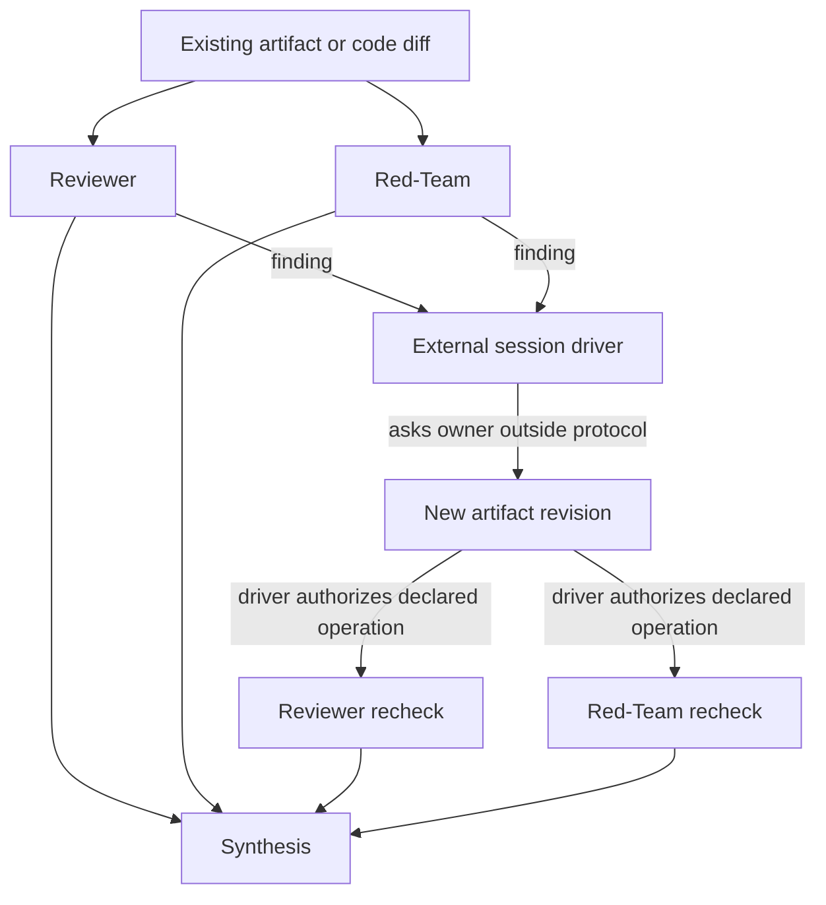

# Bounded whole-system source review request

Content commit: `a8a10abc1a24218518a14764f68c8d86f4810f91`. Author session: `codex-session:37@2026-10-15`. Review mode requested: ordinary.

Shard: `plans/260925-documentation-authority-unification/ledger/decisions/s6-whole-system-architecture-intent.json`. Part 1/2; entries: **80**. Sidecar: `review-request-261015-0450-whole-system-01.md.json`.

Read review-brief.md, owner-answers.md A28–A37, frozen whole-system map, constitution, vocabulary and shard schema. Apply A36: mechanically check every row (full digest recompute, anchor check, shard/pack equality); deeply read the reviewer-seeded sample plus every differing-digest row in both directions with its diff. Preserve conditions, qualifiers, dated status and complete payload; verify one owner and labelled additions. No approval is supplied here.

Step 6’s closing review is a **checkpoint review whose sensitivity pack the reviewer holds**. The author has not created, seen or selected that pack/key. Ordinary review and A36 sampling do not replace checkpoint sensitivity.

Ordinary verdict contract: `Reviewer: <independent identity>`, `Review mode: ordinary`, request/content/shard pins; one own note and full 64-hex shown-unit digests per row. Use ok/rework/hold. Consolidate parts into a complete report for the original shard before unchanged ordinary application; never edit decisions manually.

| Claim | Verdict | Note | Source digest | Target digest |
|---|---|---|---|---|

A36 mandatory differing-digest rows (3): `claim_d4c8c6d6a9bce2735ce2455b63abadf4`, `claim_13ca33334bdc784a25b123003441d680`, `claim_667f0a653a47e5f3a32529daa396b131`.

Absent-target rows (0): none.

This pack has 24 Weak-exact/Judgment rows; reviewer independently draws/records at least 10 by seed (>=15%, minimum 10, all if fewer), plus every differing pair listed above. Each verdict note says deep or mechanical. If >3% of deep-read rows need rework, deeply read the complete pack before reporting. Author selected no sample. Whole batch: 300 Unit-exact, 392 Weak-exact, 134 Judgment, all 826 pending; 123 mandatory differing pairs. The 79-row batch-wide lower bound does not replace each pack minimum.

Reverse review: the separate native candidate-unverified request/list covers the complete scoped population; it is not reset per sliced pack. Full shown text hashes below bind payload separately from native heading identity digests.

## claim_d4c8c6d6a9bce2735ce2455b63abadf4

Source: `docs/architect/architecture-intent.md#architecture-intent`. Target: `docs/platform/system-architecture/architecture/architecture-intent.md#architecture-intent`.

Mechanical class: Judgment. Source digest: `51d156b77e7dbc6b40844fff270b863f55c365fd99958247bf1fb4f04f625029`. Target digest: `d7bb7fa4b1504be17487727f8b328500ed25326a783b607b055369186514dd73`.

Full shown source SHA256: `eba9d1b6c2894c5ca7e9f09b8db5b0c73f37b825733038eae3fdb2e1e822e017`. Full shown target SHA256: `634a7320d804b0a6aad3e4d8456453117926fe027c5fff809cba4dda0b8fbbb6`.

### Proposed decision

```json
{
  "claimId": "claim_d4c8c6d6a9bce2735ce2455b63abadf4",
  "sourceUnitDigest": "51d156b77e7dbc6b40844fff270b863f55c365fd99958247bf1fb4f04f625029",
  "targetOwner": "docs/platform/system-architecture/architecture/architecture-intent.md",
  "targetAnchor": "architecture-intent",
  "targetUnitDigest": "d7bb7fa4b1504be17487727f8b328500ed25326a783b607b055369186514dd73",
  "targetAncestry": [],
  "claimKind": "architecture",
  "disposition": "move",
  "reviewStatus": "pending",
  "authoredBy": "codex-session:37@2026-10-15",
  "rationale": "Judgment: no target digest match. Carry the complete heading at docs/architect/architecture-intent.md#architecture-intent (lines 1–1) into docs/platform/system-architecture/architecture/architecture-intent.md#architecture-intent (lines 1–1), the frozen whole-system architecture owner. The candidate keeps the source hierarchy and complete payload; new candidate metadata is separate from original dated source metadata. Digest differences come only from the recorded candidate header/frontmatter fence, heading-level shift or physical relative-link rebasing; full before/after units and line mapping are in authoring accounting. Source obligations, exceptions, open gaps, planned/unbuilt statements and design boundaries remain as written. No remainder, no source retirement, no promotion and no code-truth approval; independent review pending."
}
```

### Full source shown text

```text
# Architecture Intent

Document type: Architecture intention / discussion
Design status: Discussion
Implementation: Not started
Last reviewed: 2026-09-05
Canonical for: nothing until explicitly accepted

Scope: preserve architecture-wide design intent across deferred capabilities,
so later implementation plans can narrow scope safely without accidentally
turning "not yet" into "not part of the design."

Active thread: widen fgOS coordination so it can support common
group-thinking/problem-solving patterns, including but not limited to code
review loops, without weakening the already-proven isolation-heavy
`group-cognition-framework.yaml`.

Related:
- `docs/architect/system-vision-trong-mem-ngoai-cung.md`
- `docs/architect/agent-coordination/proposals/team-communication-protocol-v1.md`
- `docs/architect/proposals/step-09-group-thinking-substrate.md`
- `docs/architect/proposals/step-10-coding-domain-adoption.md`
- `docs/architect/proposals/component-authority-boundary-map.md`
- `docs/architect/agent-coordination/intent-preservation-ledger.md`

This is a discussion document. It does not accept a design, does not change
runtime behavior, and does not authorize implementation.
```

### Full target shown text

````text
# Architecture Intent

```txt
Document type: Architecture
Audience: Human reviewer, architect, maintainer, agent
Purpose: Preserve the complete architecture-intent.md source at its frozen-map candidate owner
Design status: Candidate
Implementation: Partial — inherited source qualifications; not independently truth-verified
Provenance: docs/architect/architecture-intent.md at 69dd3ee7fd84bc5e93fe9c75d63622d4f5aa8539 (blob e72b0e930345e01bca1b97c81fd7a528092cd098)
Writer type: Agent carriage; independent review pending
Canonical for: Nothing until promotion; current source remains docs/architect/architecture-intent.md
Use this when: Reviewing whole-system candidate carriage and placement
Do not use this for: Inferring implementation, promotion or superseding source authority
Last reviewed: Pending independent review
Related:
- docs/architect/architecture-intent.md
- docs/platform/component-boundary.md
- docs/platform/architecture-map.md
Supersedes: None — candidate only
Superseded by: None
```

Added in candidate: migration metadata and physical link rebasing. Original source metadata, dates, design limits and historic claims below are provenance, not fresh review. Current truth is unverified; A28 requires sampled truth review at this checkpoint and full truth review at promotion.


Document type: Architecture intention / discussion
Design status: Discussion
Implementation: Not started
Last reviewed: 2026-09-05
Canonical for: nothing until explicitly accepted

Scope: preserve architecture-wide design intent across deferred capabilities,
so later implementation plans can narrow scope safely without accidentally
turning "not yet" into "not part of the design."

Active thread: widen fgOS coordination so it can support common
group-thinking/problem-solving patterns, including but not limited to code
review loops, without weakening the already-proven isolation-heavy
`group-cognition-framework.yaml`.

Related:
- `docs/architect/system-vision-trong-mem-ngoai-cung.md`
- `docs/architect/agent-coordination/proposals/team-communication-protocol-v1.md`
- `docs/architect/proposals/step-09-group-thinking-substrate.md`
- `docs/architect/proposals/step-10-coding-domain-adoption.md`
- `docs/architect/proposals/component-authority-boundary-map.md`
- `docs/architect/agent-coordination/intent-preservation-ledger.md`

This is a discussion document. It does not accept a design, does not change
runtime behavior, and does not authorize implementation.
````

### Unified diff

````diff
--- docs/architect/architecture-intent.md#architecture-intent
+++ docs/platform/system-architecture/architecture/architecture-intent.md#architecture-intent
@@ -1,4 +1,27 @@
 # Architecture Intent
+
+```txt
+Document type: Architecture
+Audience: Human reviewer, architect, maintainer, agent
+Purpose: Preserve the complete architecture-intent.md source at its frozen-map candidate owner
+Design status: Candidate
+Implementation: Partial — inherited source qualifications; not independently truth-verified
+Provenance: docs/architect/architecture-intent.md at 69dd3ee7fd84bc5e93fe9c75d63622d4f5aa8539 (blob e72b0e930345e01bca1b97c81fd7a528092cd098)
+Writer type: Agent carriage; independent review pending
+Canonical for: Nothing until promotion; current source remains docs/architect/architecture-intent.md
+Use this when: Reviewing whole-system candidate carriage and placement
+Do not use this for: Inferring implementation, promotion or superseding source authority
+Last reviewed: Pending independent review
+Related:
+- docs/architect/architecture-intent.md
+- docs/platform/component-boundary.md
+- docs/platform/architecture-map.md
+Supersedes: None — candidate only
+Superseded by: None
+```
+
+Added in candidate: migration metadata and physical link rebasing. Original source metadata, dates, design limits and historic claims below are provenance, not fresh review. Current truth is unverified; A28 requires sampled truth review at this checkpoint and full truth review at promotion.
+
 
 Document type: Architecture intention / discussion
 Design status: Discussion

````

## claim_65ef346c9473c6a34eb78295848e1813

Source: `docs/architect/architecture-intent.md#unheaded-block-1`. Target: `docs/platform/system-architecture/architecture/architecture-intent.md#unheaded-block-3`.

Mechanical class: Unit-exact. Source digest: `89980185b9b90c27237044de3915744226d6fcb87c0978d360ff2ca4a917338e`. Target digest: `89980185b9b90c27237044de3915744226d6fcb87c0978d360ff2ca4a917338e`.

Full shown source SHA256: `89980185b9b90c27237044de3915744226d6fcb87c0978d360ff2ca4a917338e`. Full shown target SHA256: `89980185b9b90c27237044de3915744226d6fcb87c0978d360ff2ca4a917338e`.

### Proposed decision

```json
{
  "claimId": "claim_65ef346c9473c6a34eb78295848e1813",
  "sourceUnitDigest": "89980185b9b90c27237044de3915744226d6fcb87c0978d360ff2ca4a917338e",
  "targetOwner": "docs/platform/system-architecture/architecture/architecture-intent.md",
  "targetAnchor": "unheaded-block-3",
  "targetUnitDigest": "89980185b9b90c27237044de3915744226d6fcb87c0978d360ff2ca4a917338e",
  "targetAncestry": [
    "Architecture Intent"
  ],
  "claimKind": "architecture",
  "disposition": "move",
  "reviewStatus": "pending",
  "authoredBy": "codex-session:37@2026-10-15",
  "rationale": "Unit-exact: unique long digest match, equal ancestry, sufficient document exact share. Carry the complete unheaded-block at docs/architect/architecture-intent.md#unheaded-block-1 (lines 3–7) into docs/platform/system-architecture/architecture/architecture-intent.md#unheaded-block-3 (lines 26–30), the frozen whole-system architecture owner. The candidate keeps the source hierarchy and complete payload; new candidate metadata is separate from original dated source metadata. The full unit digest is equal; this author still claims no independent approval. Source obligations, exceptions, open gaps, planned/unbuilt statements and design boundaries remain as written. No remainder, no source retirement, no promotion and no code-truth approval; independent review pending."
}
```

### Full source shown text

```text
Document type: Architecture intention / discussion
Design status: Discussion
Implementation: Not started
Last reviewed: 2026-09-05
Canonical for: nothing until explicitly accepted
```

### Full target shown text

```text
Document type: Architecture intention / discussion
Design status: Discussion
Implementation: Not started
Last reviewed: 2026-09-05
Canonical for: nothing until explicitly accepted
```

### Unified diff

```diff
No text difference.
```

## claim_09225714542168ddd2d61efbbc979a06

Source: `docs/architect/architecture-intent.md#unheaded-block-2`. Target: `docs/platform/system-architecture/architecture/architecture-intent.md#unheaded-block-4`.

Mechanical class: Unit-exact. Source digest: `3da242b72889d04da564fbafa87ba5cde749c49df7d8c012ec2768f8b6f4b944`. Target digest: `3da242b72889d04da564fbafa87ba5cde749c49df7d8c012ec2768f8b6f4b944`.

Full shown source SHA256: `3da242b72889d04da564fbafa87ba5cde749c49df7d8c012ec2768f8b6f4b944`. Full shown target SHA256: `3da242b72889d04da564fbafa87ba5cde749c49df7d8c012ec2768f8b6f4b944`.

### Proposed decision

```json
{
  "claimId": "claim_09225714542168ddd2d61efbbc979a06",
  "sourceUnitDigest": "3da242b72889d04da564fbafa87ba5cde749c49df7d8c012ec2768f8b6f4b944",
  "targetOwner": "docs/platform/system-architecture/architecture/architecture-intent.md",
  "targetAnchor": "unheaded-block-4",
  "targetUnitDigest": "3da242b72889d04da564fbafa87ba5cde749c49df7d8c012ec2768f8b6f4b944",
  "targetAncestry": [
    "Architecture Intent"
  ],
  "claimKind": "architecture",
  "disposition": "move",
  "reviewStatus": "pending",
  "authoredBy": "codex-session:37@2026-10-15",
  "rationale": "Unit-exact: unique long digest match, equal ancestry, sufficient document exact share. Carry the complete unheaded-block at docs/architect/architecture-intent.md#unheaded-block-2 (lines 9–11) into docs/platform/system-architecture/architecture/architecture-intent.md#unheaded-block-4 (lines 32–34), the frozen whole-system architecture owner. The candidate keeps the source hierarchy and complete payload; new candidate metadata is separate from original dated source metadata. The full unit digest is equal; this author still claims no independent approval. Source obligations, exceptions, open gaps, planned/unbuilt statements and design boundaries remain as written. No remainder, no source retirement, no promotion and no code-truth approval; independent review pending."
}
```

### Full source shown text

```text
Scope: preserve architecture-wide design intent across deferred capabilities,
so later implementation plans can narrow scope safely without accidentally
turning "not yet" into "not part of the design."
```

### Full target shown text

```text
Scope: preserve architecture-wide design intent across deferred capabilities,
so later implementation plans can narrow scope safely without accidentally
turning "not yet" into "not part of the design."
```

### Unified diff

```diff
No text difference.
```

## claim_30ada0ea4b3d6af4d2657332e4a2f264

Source: `docs/architect/architecture-intent.md#unheaded-block-3`. Target: `docs/platform/system-architecture/architecture/architecture-intent.md#unheaded-block-5`.

Mechanical class: Unit-exact. Source digest: `f81706d53a1b79533627691025065971b6c51f5e3785d4ae73492198e01901fa`. Target digest: `f81706d53a1b79533627691025065971b6c51f5e3785d4ae73492198e01901fa`.

Full shown source SHA256: `f81706d53a1b79533627691025065971b6c51f5e3785d4ae73492198e01901fa`. Full shown target SHA256: `f81706d53a1b79533627691025065971b6c51f5e3785d4ae73492198e01901fa`.

### Proposed decision

```json
{
  "claimId": "claim_30ada0ea4b3d6af4d2657332e4a2f264",
  "sourceUnitDigest": "f81706d53a1b79533627691025065971b6c51f5e3785d4ae73492198e01901fa",
  "targetOwner": "docs/platform/system-architecture/architecture/architecture-intent.md",
  "targetAnchor": "unheaded-block-5",
  "targetUnitDigest": "f81706d53a1b79533627691025065971b6c51f5e3785d4ae73492198e01901fa",
  "targetAncestry": [
    "Architecture Intent"
  ],
  "claimKind": "architecture",
  "disposition": "move",
  "reviewStatus": "pending",
  "authoredBy": "codex-session:37@2026-10-15",
  "rationale": "Unit-exact: unique long digest match, equal ancestry, sufficient document exact share. Carry the complete unheaded-block at docs/architect/architecture-intent.md#unheaded-block-3 (lines 13–16) into docs/platform/system-architecture/architecture/architecture-intent.md#unheaded-block-5 (lines 36–39), the frozen whole-system architecture owner. The candidate keeps the source hierarchy and complete payload; new candidate metadata is separate from original dated source metadata. The full unit digest is equal; this author still claims no independent approval. Source obligations, exceptions, open gaps, planned/unbuilt statements and design boundaries remain as written. No remainder, no source retirement, no promotion and no code-truth approval; independent review pending."
}
```

### Full source shown text

```text
Active thread: widen fgOS coordination so it can support common
group-thinking/problem-solving patterns, including but not limited to code
review loops, without weakening the already-proven isolation-heavy
`group-cognition-framework.yaml`.
```

### Full target shown text

```text
Active thread: widen fgOS coordination so it can support common
group-thinking/problem-solving patterns, including but not limited to code
review loops, without weakening the already-proven isolation-heavy
`group-cognition-framework.yaml`.
```

### Unified diff

```diff
No text difference.
```

## claim_6b2b304cd05e6b9ebb4c582f618c12ea

Source: `docs/architect/architecture-intent.md#unheaded-block-4`. Target: `docs/platform/system-architecture/architecture/architecture-intent.md#unheaded-block-6`.

Mechanical class: Unit-exact. Source digest: `2940492cd0456bcc5b097a4212b6b3ff50c6e82daa0d4ec8286ba52e40b5fa7a`. Target digest: `2940492cd0456bcc5b097a4212b6b3ff50c6e82daa0d4ec8286ba52e40b5fa7a`.

Full shown source SHA256: `2940492cd0456bcc5b097a4212b6b3ff50c6e82daa0d4ec8286ba52e40b5fa7a`. Full shown target SHA256: `2940492cd0456bcc5b097a4212b6b3ff50c6e82daa0d4ec8286ba52e40b5fa7a`.

### Proposed decision

```json
{
  "claimId": "claim_6b2b304cd05e6b9ebb4c582f618c12ea",
  "sourceUnitDigest": "2940492cd0456bcc5b097a4212b6b3ff50c6e82daa0d4ec8286ba52e40b5fa7a",
  "targetOwner": "docs/platform/system-architecture/architecture/architecture-intent.md",
  "targetAnchor": "unheaded-block-6",
  "targetUnitDigest": "2940492cd0456bcc5b097a4212b6b3ff50c6e82daa0d4ec8286ba52e40b5fa7a",
  "targetAncestry": [
    "Architecture Intent"
  ],
  "claimKind": "contract",
  "disposition": "move",
  "reviewStatus": "pending",
  "authoredBy": "codex-session:37@2026-10-15",
  "rationale": "Unit-exact: unique long digest match, equal ancestry, sufficient document exact share. Carry the complete unheaded-block at docs/architect/architecture-intent.md#unheaded-block-4 (lines 18–24) into docs/platform/system-architecture/architecture/architecture-intent.md#unheaded-block-6 (lines 41–47), the frozen whole-system architecture owner. The candidate keeps the source hierarchy and complete payload; new candidate metadata is separate from original dated source metadata. The full unit digest is equal; this author still claims no independent approval. Source obligations, exceptions, open gaps, planned/unbuilt statements and design boundaries remain as written. No remainder, no source retirement, no promotion and no code-truth approval; independent review pending."
}
```

### Full source shown text

```text
Related:
- `docs/architect/system-vision-trong-mem-ngoai-cung.md`
- `docs/architect/agent-coordination/proposals/team-communication-protocol-v1.md`
- `docs/architect/proposals/step-09-group-thinking-substrate.md`
- `docs/architect/proposals/step-10-coding-domain-adoption.md`
- `docs/architect/proposals/component-authority-boundary-map.md`
- `docs/architect/agent-coordination/intent-preservation-ledger.md`
```

### Full target shown text

```text
Related:
- `docs/architect/system-vision-trong-mem-ngoai-cung.md`
- `docs/architect/agent-coordination/proposals/team-communication-protocol-v1.md`
- `docs/architect/proposals/step-09-group-thinking-substrate.md`
- `docs/architect/proposals/step-10-coding-domain-adoption.md`
- `docs/architect/proposals/component-authority-boundary-map.md`
- `docs/architect/agent-coordination/intent-preservation-ledger.md`
```

### Unified diff

```diff
No text difference.
```

## claim_93e455a9cfa1bf865e72a7b6970516bf

Source: `docs/architect/architecture-intent.md#unheaded-block-5`. Target: `docs/platform/system-architecture/architecture/architecture-intent.md#unheaded-block-7`.

Mechanical class: Unit-exact. Source digest: `d2188a7fbe38103222412fe7f1d839f456e3ee9a187548d9ddf64b551a74c2dd`. Target digest: `d2188a7fbe38103222412fe7f1d839f456e3ee9a187548d9ddf64b551a74c2dd`.

Full shown source SHA256: `d2188a7fbe38103222412fe7f1d839f456e3ee9a187548d9ddf64b551a74c2dd`. Full shown target SHA256: `d2188a7fbe38103222412fe7f1d839f456e3ee9a187548d9ddf64b551a74c2dd`.

### Proposed decision

```json
{
  "claimId": "claim_93e455a9cfa1bf865e72a7b6970516bf",
  "sourceUnitDigest": "d2188a7fbe38103222412fe7f1d839f456e3ee9a187548d9ddf64b551a74c2dd",
  "targetOwner": "docs/platform/system-architecture/architecture/architecture-intent.md",
  "targetAnchor": "unheaded-block-7",
  "targetUnitDigest": "d2188a7fbe38103222412fe7f1d839f456e3ee9a187548d9ddf64b551a74c2dd",
  "targetAncestry": [
    "Architecture Intent"
  ],
  "claimKind": "architecture",
  "disposition": "move",
  "reviewStatus": "pending",
  "authoredBy": "codex-session:37@2026-10-15",
  "rationale": "Unit-exact: unique long digest match, equal ancestry, sufficient document exact share. Carry the complete unheaded-block at docs/architect/architecture-intent.md#unheaded-block-5 (lines 26–27) into docs/platform/system-architecture/architecture/architecture-intent.md#unheaded-block-7 (lines 49–50), the frozen whole-system architecture owner. The candidate keeps the source hierarchy and complete payload; new candidate metadata is separate from original dated source metadata. The full unit digest is equal; this author still claims no independent approval. Source obligations, exceptions, open gaps, planned/unbuilt statements and design boundaries remain as written. No remainder, no source retirement, no promotion and no code-truth approval; independent review pending."
}
```

### Full source shown text

```text
This is a discussion document. It does not accept a design, does not change
runtime behavior, and does not authorize implementation.
```

### Full target shown text

```text
This is a discussion document. It does not accept a design, does not change
runtime behavior, and does not authorize implementation.
```

### Unified diff

```diff
No text difference.
```

## claim_70ee66f115d57075c0b12de0d8afde47

Source: `docs/architect/architecture-intent.md#0-active-intent-threads`. Target: `docs/platform/system-architecture/architecture/architecture-intent.md#0-active-intent-threads`.

Mechanical class: Weak-exact. Source digest: `33950e84228da92559c5fa2a9b253b7da0c59dd485d3281bdba9c0b5e86324d0`. Target digest: `33950e84228da92559c5fa2a9b253b7da0c59dd485d3281bdba9c0b5e86324d0`.

Full shown source SHA256: `a620314f0fa03f3cb95af29b2f1a7746b207b7d50b154f9991218165458b9297`. Full shown target SHA256: `a620314f0fa03f3cb95af29b2f1a7746b207b7d50b154f9991218165458b9297`.

### Proposed decision

```json
{
  "claimId": "claim_70ee66f115d57075c0b12de0d8afde47",
  "sourceUnitDigest": "33950e84228da92559c5fa2a9b253b7da0c59dd485d3281bdba9c0b5e86324d0",
  "targetOwner": "docs/platform/system-architecture/architecture/architecture-intent.md",
  "targetAnchor": "0-active-intent-threads",
  "targetUnitDigest": "33950e84228da92559c5fa2a9b253b7da0c59dd485d3281bdba9c0b5e86324d0",
  "targetAncestry": [
    "Architecture Intent"
  ],
  "claimKind": "architecture",
  "disposition": "move",
  "reviewStatus": "pending",
  "authoredBy": "codex-session:37@2026-10-15",
  "rationale": "Weak-exact: source unit shorter than 40 characters. Carry the complete heading at docs/architect/architecture-intent.md#0-active-intent-threads (lines 29–29) into docs/platform/system-architecture/architecture/architecture-intent.md#0-active-intent-threads (lines 52–52), the frozen whole-system architecture owner. The candidate keeps the source hierarchy and complete payload; new candidate metadata is separate from original dated source metadata. The full unit digest is equal; this author still claims no independent approval. Source obligations, exceptions, open gaps, planned/unbuilt statements and design boundaries remain as written. No remainder, no source retirement, no promotion and no code-truth approval; independent review pending."
}
```

### Full source shown text

```text
## 0. Active Intent Threads

| Thread | Status | Purpose |
|---|---|---|
| Group-cognitive coordination | Active discussion | Preserve the original intent to grow fgOS beyond strict fan-out/fan-in into broader group-thinking/problem-solving capability. |
| Trong mem, ngoai cung | Guiding vision | Preserve the system-wide balance between hard contracts/harnesses and soft soul/prose/skill so fgOS stays both verifiable and alive enough for real agent operation. |
```

### Full target shown text

```text
## 0. Active Intent Threads

| Thread | Status | Purpose |
|---|---|---|
| Group-cognitive coordination | Active discussion | Preserve the original intent to grow fgOS beyond strict fan-out/fan-in into broader group-thinking/problem-solving capability. |
| Trong mem, ngoai cung | Guiding vision | Preserve the system-wide balance between hard contracts/harnesses and soft soul/prose/skill so fgOS stays both verifiable and alive enough for real agent operation. |
```

### Unified diff

```diff
No text difference.
```

## claim_99dc1038221b770288f6ec4da9924fdb

Source: `docs/architect/architecture-intent.md#unheaded-block-6`. Target: `docs/platform/system-architecture/architecture/architecture-intent.md#unheaded-block-8`.

Mechanical class: Unit-exact. Source digest: `905e04373550b897b87732d4363906513f6f644aa9fc635999d31285a1ba3f3e`. Target digest: `905e04373550b897b87732d4363906513f6f644aa9fc635999d31285a1ba3f3e`.

Full shown source SHA256: `905e04373550b897b87732d4363906513f6f644aa9fc635999d31285a1ba3f3e`. Full shown target SHA256: `905e04373550b897b87732d4363906513f6f644aa9fc635999d31285a1ba3f3e`.

### Proposed decision

```json
{
  "claimId": "claim_99dc1038221b770288f6ec4da9924fdb",
  "sourceUnitDigest": "905e04373550b897b87732d4363906513f6f644aa9fc635999d31285a1ba3f3e",
  "targetOwner": "docs/platform/system-architecture/architecture/architecture-intent.md",
  "targetAnchor": "unheaded-block-8",
  "targetUnitDigest": "905e04373550b897b87732d4363906513f6f644aa9fc635999d31285a1ba3f3e",
  "targetAncestry": [
    "Architecture Intent",
    "0. Active Intent Threads"
  ],
  "claimKind": "architecture",
  "disposition": "move",
  "reviewStatus": "pending",
  "authoredBy": "codex-session:37@2026-10-15",
  "rationale": "Unit-exact: unique long digest match, equal ancestry, sufficient document exact share. Carry the complete unheaded-block at docs/architect/architecture-intent.md#unheaded-block-6 (lines 31–34) into docs/platform/system-architecture/architecture/architecture-intent.md#unheaded-block-8 (lines 54–57), the frozen whole-system architecture owner. The candidate keeps the source hierarchy and complete payload; new candidate metadata is separate from original dated source metadata. The full unit digest is equal; this author still claims no independent approval. Source obligations, exceptions, open gaps, planned/unbuilt statements and design boundaries remain as written. No remainder, no source retirement, no promotion and no code-truth approval; independent review pending."
}
```

### Full source shown text

```text
| Thread | Status | Purpose |
|---|---|---|
| Group-cognitive coordination | Active discussion | Preserve the original intent to grow fgOS beyond strict fan-out/fan-in into broader group-thinking/problem-solving capability. |
| Trong mem, ngoai cung | Guiding vision | Preserve the system-wide balance between hard contracts/harnesses and soft soul/prose/skill so fgOS stays both verifiable and alive enough for real agent operation. |
```

### Full target shown text

```text
| Thread | Status | Purpose |
|---|---|---|
| Group-cognitive coordination | Active discussion | Preserve the original intent to grow fgOS beyond strict fan-out/fan-in into broader group-thinking/problem-solving capability. |
| Trong mem, ngoai cung | Guiding vision | Preserve the system-wide balance between hard contracts/harnesses and soft soul/prose/skill so fgOS stays both verifiable and alive enough for real agent operation. |
```

### Unified diff

```diff
No text difference.
```

## claim_13ca33334bdc784a25b123003441d680

Source: `docs/architect/architecture-intent.md#01-system-wide-vision`. Target: `docs/platform/system-architecture/architecture/architecture-intent.md#01-system-wide-vision`.

Mechanical class: Judgment. Source digest: `e650af44653d0c303f3fd36bf0919ac9440112ccfaae4411b7cc680413a8a2b1`. Target digest: `28ea21164a3c680db7e422636ed7347d7229f885aa862e0c8a54bb7093e307ce`.

Full shown source SHA256: `327cc5911327486fa1284ef6f79950659b5160639950923b04dc88962a1eceb6`. Full shown target SHA256: `eb73a8a9bc108667c213c1b9817fb894cace2c234be774e15342145aa4199689`.

### Proposed decision

```json
{
  "claimId": "claim_13ca33334bdc784a25b123003441d680",
  "sourceUnitDigest": "e650af44653d0c303f3fd36bf0919ac9440112ccfaae4411b7cc680413a8a2b1",
  "targetOwner": "docs/platform/system-architecture/architecture/architecture-intent.md",
  "targetAnchor": "01-system-wide-vision",
  "targetUnitDigest": "28ea21164a3c680db7e422636ed7347d7229f885aa862e0c8a54bb7093e307ce",
  "targetAncestry": [
    "Architecture Intent"
  ],
  "claimKind": "architecture",
  "disposition": "move",
  "reviewStatus": "pending",
  "authoredBy": "codex-session:37@2026-10-15",
  "rationale": "Judgment: no target digest match. Carry the complete heading at docs/architect/architecture-intent.md#01-system-wide-vision (lines 36–36) into docs/platform/system-architecture/architecture/architecture-intent.md#01-system-wide-vision (lines 59–59), the frozen whole-system architecture owner. The candidate keeps the source hierarchy and complete payload; new candidate metadata is separate from original dated source metadata. Digest differences come only from the recorded candidate header/frontmatter fence, heading-level shift or physical relative-link rebasing; full before/after units and line mapping are in authoring accounting. Source obligations, exceptions, open gaps, planned/unbuilt statements and design boundaries remain as written. No remainder, no source retirement, no promotion and no code-truth approval; independent review pending."
}
```

### Full source shown text

````text
## 0.1 System-Wide Vision

[System Vision: Trong Mem Ngoai Cung](system-vision-trong-mem-ngoai-cung.md)
is the cross-system reminder behind this intent file:

```txt
Outside hard:
  contract, state, capability, topology, proof, audit

Inside soft:
  soul, prose, skill, judgment, collaboration, domain intelligence
```

Step 09 showed why this reminder is necessary. Harness/schema/test work made
the group-thinking substrate safer, but over-centering harness risked losing
the soul/prose/skill surface needed to make Master Coordination deployable as a
living operating pattern. Future architecture plans must preserve both sides:
hard enough to verify, soft enough to think and adapt.
````

### Full target shown text

````text
## 0.1 System-Wide Vision

[System Vision: Trong Mem Ngoai Cung](../../../architect/system-vision-trong-mem-ngoai-cung.md)
is the cross-system reminder behind this intent file:

```txt
Outside hard:
  contract, state, capability, topology, proof, audit

Inside soft:
  soul, prose, skill, judgment, collaboration, domain intelligence
```

Step 09 showed why this reminder is necessary. Harness/schema/test work made
the group-thinking substrate safer, but over-centering harness risked losing
the soul/prose/skill surface needed to make Master Coordination deployable as a
living operating pattern. Future architecture plans must preserve both sides:
hard enough to verify, soft enough to think and adapt.
````

### Unified diff

````diff
--- docs/architect/architecture-intent.md#01-system-wide-vision
+++ docs/platform/system-architecture/architecture/architecture-intent.md#01-system-wide-vision
@@ -1,6 +1,6 @@
 ## 0.1 System-Wide Vision
 
-[System Vision: Trong Mem Ngoai Cung](system-vision-trong-mem-ngoai-cung.md)
+[System Vision: Trong Mem Ngoai Cung](../../../architect/system-vision-trong-mem-ngoai-cung.md)
 is the cross-system reminder behind this intent file:
 
 ```txt

````

## claim_667f0a653a47e5f3a32529daa396b131

Source: `docs/architect/architecture-intent.md#unheaded-block-7`. Target: `docs/platform/system-architecture/architecture/architecture-intent.md#unheaded-block-9`.

Mechanical class: Judgment. Source digest: `12a89b3d5c4b35545eeab6c987434c2b1442d18aba662512508420094b9ea2d0`. Target digest: `45a80cf51dfc174fed351a54a063a4bf74284d36773b542dda6ad60864b4f4bf`.

Full shown source SHA256: `12a89b3d5c4b35545eeab6c987434c2b1442d18aba662512508420094b9ea2d0`. Full shown target SHA256: `45a80cf51dfc174fed351a54a063a4bf74284d36773b542dda6ad60864b4f4bf`.

### Proposed decision

```json
{
  "claimId": "claim_667f0a653a47e5f3a32529daa396b131",
  "sourceUnitDigest": "12a89b3d5c4b35545eeab6c987434c2b1442d18aba662512508420094b9ea2d0",
  "targetOwner": "docs/platform/system-architecture/architecture/architecture-intent.md",
  "targetAnchor": "unheaded-block-9",
  "targetUnitDigest": "45a80cf51dfc174fed351a54a063a4bf74284d36773b542dda6ad60864b4f4bf",
  "targetAncestry": [
    "Architecture Intent",
    "0.1 System-Wide Vision"
  ],
  "claimKind": "architecture",
  "disposition": "move",
  "reviewStatus": "pending",
  "authoredBy": "codex-session:37@2026-10-15",
  "rationale": "Judgment: no target digest match. Carry the complete unheaded-block at docs/architect/architecture-intent.md#unheaded-block-7 (lines 38–39) into docs/platform/system-architecture/architecture/architecture-intent.md#unheaded-block-9 (lines 61–62), the frozen whole-system architecture owner. The candidate keeps the source hierarchy and complete payload; new candidate metadata is separate from original dated source metadata. Digest differences come only from the recorded candidate header/frontmatter fence, heading-level shift or physical relative-link rebasing; full before/after units and line mapping are in authoring accounting. Source obligations, exceptions, open gaps, planned/unbuilt statements and design boundaries remain as written. No remainder, no source retirement, no promotion and no code-truth approval; independent review pending."
}
```

### Full source shown text

```text
[System Vision: Trong Mem Ngoai Cung](system-vision-trong-mem-ngoai-cung.md)
is the cross-system reminder behind this intent file:
```

### Full target shown text

```text
[System Vision: Trong Mem Ngoai Cung](../../../architect/system-vision-trong-mem-ngoai-cung.md)
is the cross-system reminder behind this intent file:
```

### Unified diff

```diff
--- docs/architect/architecture-intent.md#unheaded-block-7
+++ docs/platform/system-architecture/architecture/architecture-intent.md#unheaded-block-9
@@ -1,2 +1,2 @@
-[System Vision: Trong Mem Ngoai Cung](system-vision-trong-mem-ngoai-cung.md)
+[System Vision: Trong Mem Ngoai Cung](../../../architect/system-vision-trong-mem-ngoai-cung.md)
 is the cross-system reminder behind this intent file:

```

## claim_d5004a0febfecda8b898076cf021700d

Source: `docs/architect/architecture-intent.md#unheaded-block-8`. Target: `docs/platform/system-architecture/architecture/architecture-intent.md#unheaded-block-10`.

Mechanical class: Unit-exact. Source digest: `6a940230eb3172ac0cd44665b6d492a11ff8d99fe92c0f3b5c5eff8ae521ae54`. Target digest: `6a940230eb3172ac0cd44665b6d492a11ff8d99fe92c0f3b5c5eff8ae521ae54`.

Full shown source SHA256: `6a940230eb3172ac0cd44665b6d492a11ff8d99fe92c0f3b5c5eff8ae521ae54`. Full shown target SHA256: `6a940230eb3172ac0cd44665b6d492a11ff8d99fe92c0f3b5c5eff8ae521ae54`.

### Proposed decision

```json
{
  "claimId": "claim_d5004a0febfecda8b898076cf021700d",
  "sourceUnitDigest": "6a940230eb3172ac0cd44665b6d492a11ff8d99fe92c0f3b5c5eff8ae521ae54",
  "targetOwner": "docs/platform/system-architecture/architecture/architecture-intent.md",
  "targetAnchor": "unheaded-block-10",
  "targetUnitDigest": "6a940230eb3172ac0cd44665b6d492a11ff8d99fe92c0f3b5c5eff8ae521ae54",
  "targetAncestry": [
    "Architecture Intent",
    "0.1 System-Wide Vision"
  ],
  "claimKind": "contract",
  "disposition": "move",
  "reviewStatus": "pending",
  "authoredBy": "codex-session:37@2026-10-15",
  "rationale": "Unit-exact: unique long digest match, equal ancestry, sufficient document exact share. Carry the complete unheaded-block at docs/architect/architecture-intent.md#unheaded-block-8 (lines 41–47) into docs/platform/system-architecture/architecture/architecture-intent.md#unheaded-block-10 (lines 64–70), the frozen whole-system architecture owner. The candidate keeps the source hierarchy and complete payload; new candidate metadata is separate from original dated source metadata. The full unit digest is equal; this author still claims no independent approval. Source obligations, exceptions, open gaps, planned/unbuilt statements and design boundaries remain as written. No remainder, no source retirement, no promotion and no code-truth approval; independent review pending."
}
```

### Full source shown text

````text
```txt
Outside hard:
  contract, state, capability, topology, proof, audit

Inside soft:
  soul, prose, skill, judgment, collaboration, domain intelligence
```
````

### Full target shown text

````text
```txt
Outside hard:
  contract, state, capability, topology, proof, audit

Inside soft:
  soul, prose, skill, judgment, collaboration, domain intelligence
```
````

### Unified diff

```diff
No text difference.
```

## claim_88cb598ea5d8a5c57fd3c2e574eb078c

Source: `docs/architect/architecture-intent.md#unheaded-block-9`. Target: `docs/platform/system-architecture/architecture/architecture-intent.md#unheaded-block-11`.

Mechanical class: Unit-exact. Source digest: `9f27d748b6fd063513d51690414aba093c9df86760ea6fa0e52308214b268c6f`. Target digest: `9f27d748b6fd063513d51690414aba093c9df86760ea6fa0e52308214b268c6f`.

Full shown source SHA256: `9f27d748b6fd063513d51690414aba093c9df86760ea6fa0e52308214b268c6f`. Full shown target SHA256: `9f27d748b6fd063513d51690414aba093c9df86760ea6fa0e52308214b268c6f`.

### Proposed decision

```json
{
  "claimId": "claim_88cb598ea5d8a5c57fd3c2e574eb078c",
  "sourceUnitDigest": "9f27d748b6fd063513d51690414aba093c9df86760ea6fa0e52308214b268c6f",
  "targetOwner": "docs/platform/system-architecture/architecture/architecture-intent.md",
  "targetAnchor": "unheaded-block-11",
  "targetUnitDigest": "9f27d748b6fd063513d51690414aba093c9df86760ea6fa0e52308214b268c6f",
  "targetAncestry": [
    "Architecture Intent",
    "0.1 System-Wide Vision"
  ],
  "claimKind": "contract",
  "disposition": "move",
  "reviewStatus": "pending",
  "authoredBy": "codex-session:37@2026-10-15",
  "rationale": "Unit-exact: unique long digest match, equal ancestry, sufficient document exact share. Carry the complete unheaded-block at docs/architect/architecture-intent.md#unheaded-block-9 (lines 49–53) into docs/platform/system-architecture/architecture/architecture-intent.md#unheaded-block-11 (lines 72–76), the frozen whole-system architecture owner. The candidate keeps the source hierarchy and complete payload; new candidate metadata is separate from original dated source metadata. The full unit digest is equal; this author still claims no independent approval. Source obligations, exceptions, open gaps, planned/unbuilt statements and design boundaries remain as written. No remainder, no source retirement, no promotion and no code-truth approval; independent review pending."
}
```

### Full source shown text

```text
Step 09 showed why this reminder is necessary. Harness/schema/test work made
the group-thinking substrate safer, but over-centering harness risked losing
the soul/prose/skill surface needed to make Master Coordination deployable as a
living operating pattern. Future architecture plans must preserve both sides:
hard enough to verify, soft enough to think and adapt.
```

### Full target shown text

```text
Step 09 showed why this reminder is necessary. Harness/schema/test work made
the group-thinking substrate safer, but over-centering harness risked losing
the soul/prose/skill surface needed to make Master Coordination deployable as a
living operating pattern. Future architecture plans must preserve both sides:
hard enough to verify, soft enough to think and adapt.
```

### Unified diff

```diff
No text difference.
```

## claim_f566756e1b6f156cf57b0bd06f4b7e0e

Source: `docs/architect/architecture-intent.md#1-one-screen-summary`. Target: `docs/platform/system-architecture/architecture/architecture-intent.md#1-one-screen-summary`.

Mechanical class: Weak-exact. Source digest: `34eb4e2881e397d02c954a7e1834dbadef624f02ae728b38342b2c5c8343789b`. Target digest: `34eb4e2881e397d02c954a7e1834dbadef624f02ae728b38342b2c5c8343789b`.

Full shown source SHA256: `efa5dc7f50f4937e1b83b1db2e8460b3587671de18d88ef4dc80455b0a3498c6`. Full shown target SHA256: `efa5dc7f50f4937e1b83b1db2e8460b3587671de18d88ef4dc80455b0a3498c6`.

### Proposed decision

```json
{
  "claimId": "claim_f566756e1b6f156cf57b0bd06f4b7e0e",
  "sourceUnitDigest": "34eb4e2881e397d02c954a7e1834dbadef624f02ae728b38342b2c5c8343789b",
  "targetOwner": "docs/platform/system-architecture/architecture/architecture-intent.md",
  "targetAnchor": "1-one-screen-summary",
  "targetUnitDigest": "34eb4e2881e397d02c954a7e1834dbadef624f02ae728b38342b2c5c8343789b",
  "targetAncestry": [
    "Architecture Intent"
  ],
  "claimKind": "architecture",
  "disposition": "move",
  "reviewStatus": "pending",
  "authoredBy": "codex-session:37@2026-10-15",
  "rationale": "Weak-exact: source unit shorter than 40 characters. Carry the complete heading at docs/architect/architecture-intent.md#1-one-screen-summary (lines 55–55) into docs/platform/system-architecture/architecture/architecture-intent.md#1-one-screen-summary (lines 78–78), the frozen whole-system architecture owner. The candidate keeps the source hierarchy and complete payload; new candidate metadata is separate from original dated source metadata. The full unit digest is equal; this author still claims no independent approval. Source obligations, exceptions, open gaps, planned/unbuilt statements and design boundaries remain as written. No remainder, no source retirement, no promotion and no code-truth approval; independent review pending."
}
```

### Full source shown text

````text
## 1. One-Screen Summary

The earlier proposal was too hard to read because it mixed five things:
history, theory, schema shape, runtime primitive, and future implementation
fixture. This rewrite separates them.

The corrected framing:

```txt
The current system is too narrow for general group-cognitive work.

It can express:
  static declared graphs,
  one-shot or fixed-round handoffs,
  isolated fan-out/fan-in,
  mediated consult,
  synthesis.

It cannot yet express many common patterns:
  Delphi-style repeated feedback,
  Nominal Group Technique phase changes,
  RFC review with optional follow-up,
  adversarial triad with judge-driven rounds,
  master-coordinator style adaptive review/fix/red-team loops,
  dynamic specialist pull-in.
```

So the proposal should not be "just build a review loop." The proposal should
separate:

1. **Capability expansion** — which coordination dimensions must become
   expressible at all.
2. **Safety boundary** — what remains kernel-hard and non-negotiable.
3. **First slice** — the smallest useful fixture to prove the expanded model.

The product move is:

```txt
Keep isolation-heavy fixtures hard.
Add declared ways to express more group-thinking shapes.
Start with a bounded review loop only as the first safe proof slice.
```
````

### Full target shown text

````text
## 1. One-Screen Summary

The earlier proposal was too hard to read because it mixed five things:
history, theory, schema shape, runtime primitive, and future implementation
fixture. This rewrite separates them.

The corrected framing:

```txt
The current system is too narrow for general group-cognitive work.

It can express:
  static declared graphs,
  one-shot or fixed-round handoffs,
  isolated fan-out/fan-in,
  mediated consult,
  synthesis.

It cannot yet express many common patterns:
  Delphi-style repeated feedback,
  Nominal Group Technique phase changes,
  RFC review with optional follow-up,
  adversarial triad with judge-driven rounds,
  master-coordinator style adaptive review/fix/red-team loops,
  dynamic specialist pull-in.
```

So the proposal should not be "just build a review loop." The proposal should
separate:

1. **Capability expansion** — which coordination dimensions must become
   expressible at all.
2. **Safety boundary** — what remains kernel-hard and non-negotiable.
3. **First slice** — the smallest useful fixture to prove the expanded model.

The product move is:

```txt
Keep isolation-heavy fixtures hard.
Add declared ways to express more group-thinking shapes.
Start with a bounded review loop only as the first safe proof slice.
```
````

### Unified diff

```diff
No text difference.
```

## claim_220856e9bdcb549090c6beb963f64103

Source: `docs/architect/architecture-intent.md#unheaded-block-10`. Target: `docs/platform/system-architecture/architecture/architecture-intent.md#unheaded-block-12`.

Mechanical class: Unit-exact. Source digest: `629f11e1404c5e9e1bf7008d441a2aacffb60e131461004b1c00ed4c2b8bf9a3`. Target digest: `629f11e1404c5e9e1bf7008d441a2aacffb60e131461004b1c00ed4c2b8bf9a3`.

Full shown source SHA256: `629f11e1404c5e9e1bf7008d441a2aacffb60e131461004b1c00ed4c2b8bf9a3`. Full shown target SHA256: `629f11e1404c5e9e1bf7008d441a2aacffb60e131461004b1c00ed4c2b8bf9a3`.

### Proposed decision

```json
{
  "claimId": "claim_220856e9bdcb549090c6beb963f64103",
  "sourceUnitDigest": "629f11e1404c5e9e1bf7008d441a2aacffb60e131461004b1c00ed4c2b8bf9a3",
  "targetOwner": "docs/platform/system-architecture/architecture/architecture-intent.md",
  "targetAnchor": "unheaded-block-12",
  "targetUnitDigest": "629f11e1404c5e9e1bf7008d441a2aacffb60e131461004b1c00ed4c2b8bf9a3",
  "targetAncestry": [
    "Architecture Intent",
    "1. One-Screen Summary"
  ],
  "claimKind": "contract",
  "disposition": "move",
  "reviewStatus": "pending",
  "authoredBy": "codex-session:37@2026-10-15",
  "rationale": "Unit-exact: unique long digest match, equal ancestry, sufficient document exact share. Carry the complete unheaded-block at docs/architect/architecture-intent.md#unheaded-block-10 (lines 57–59) into docs/platform/system-architecture/architecture/architecture-intent.md#unheaded-block-12 (lines 80–82), the frozen whole-system architecture owner. The candidate keeps the source hierarchy and complete payload; new candidate metadata is separate from original dated source metadata. The full unit digest is equal; this author still claims no independent approval. Source obligations, exceptions, open gaps, planned/unbuilt statements and design boundaries remain as written. No remainder, no source retirement, no promotion and no code-truth approval; independent review pending."
}
```

### Full source shown text

```text
The earlier proposal was too hard to read because it mixed five things:
history, theory, schema shape, runtime primitive, and future implementation
fixture. This rewrite separates them.
```

### Full target shown text

```text
The earlier proposal was too hard to read because it mixed five things:
history, theory, schema shape, runtime primitive, and future implementation
fixture. This rewrite separates them.
```

### Unified diff

```diff
No text difference.
```

## claim_f3cf1793fdd1b8cf0d97f27cdd63e8cb

Source: `docs/architect/architecture-intent.md#unheaded-block-11`. Target: `docs/platform/system-architecture/architecture/architecture-intent.md#unheaded-block-13`.

Mechanical class: Weak-exact. Source digest: `9ce1b35403f1e652e56ad869b52a56859a8fa5aae0aa8d233e378383ed9d7cb1`. Target digest: `9ce1b35403f1e652e56ad869b52a56859a8fa5aae0aa8d233e378383ed9d7cb1`.

Full shown source SHA256: `9ce1b35403f1e652e56ad869b52a56859a8fa5aae0aa8d233e378383ed9d7cb1`. Full shown target SHA256: `9ce1b35403f1e652e56ad869b52a56859a8fa5aae0aa8d233e378383ed9d7cb1`.

### Proposed decision

```json
{
  "claimId": "claim_f3cf1793fdd1b8cf0d97f27cdd63e8cb",
  "sourceUnitDigest": "9ce1b35403f1e652e56ad869b52a56859a8fa5aae0aa8d233e378383ed9d7cb1",
  "targetOwner": "docs/platform/system-architecture/architecture/architecture-intent.md",
  "targetAnchor": "unheaded-block-13",
  "targetUnitDigest": "9ce1b35403f1e652e56ad869b52a56859a8fa5aae0aa8d233e378383ed9d7cb1",
  "targetAncestry": [
    "Architecture Intent",
    "1. One-Screen Summary"
  ],
  "claimKind": "architecture",
  "disposition": "move",
  "reviewStatus": "pending",
  "authoredBy": "codex-session:37@2026-10-15",
  "rationale": "Weak-exact: source unit shorter than 40 characters. Carry the complete unheaded-block at docs/architect/architecture-intent.md#unheaded-block-11 (lines 61–61) into docs/platform/system-architecture/architecture/architecture-intent.md#unheaded-block-13 (lines 84–84), the frozen whole-system architecture owner. The candidate keeps the source hierarchy and complete payload; new candidate metadata is separate from original dated source metadata. The full unit digest is equal; this author still claims no independent approval. Source obligations, exceptions, open gaps, planned/unbuilt statements and design boundaries remain as written. No remainder, no source retirement, no promotion and no code-truth approval; independent review pending."
}
```

### Full source shown text

```text
The corrected framing:
```

### Full target shown text

```text
The corrected framing:
```

### Unified diff

```diff
No text difference.
```

## claim_a550fde1134c03a5d19b7e09ddc04854

Source: `docs/architect/architecture-intent.md#unheaded-block-12`. Target: `docs/platform/system-architecture/architecture/architecture-intent.md#unheaded-block-14`.

Mechanical class: Unit-exact. Source digest: `682518cc05462745ac7818f266cb475a9977a6c143fe131cfb40c820795854f7`. Target digest: `682518cc05462745ac7818f266cb475a9977a6c143fe131cfb40c820795854f7`.

Full shown source SHA256: `682518cc05462745ac7818f266cb475a9977a6c143fe131cfb40c820795854f7`. Full shown target SHA256: `682518cc05462745ac7818f266cb475a9977a6c143fe131cfb40c820795854f7`.

### Proposed decision

```json
{
  "claimId": "claim_a550fde1134c03a5d19b7e09ddc04854",
  "sourceUnitDigest": "682518cc05462745ac7818f266cb475a9977a6c143fe131cfb40c820795854f7",
  "targetOwner": "docs/platform/system-architecture/architecture/architecture-intent.md",
  "targetAnchor": "unheaded-block-14",
  "targetUnitDigest": "682518cc05462745ac7818f266cb475a9977a6c143fe131cfb40c820795854f7",
  "targetAncestry": [
    "Architecture Intent",
    "1. One-Screen Summary"
  ],
  "claimKind": "architecture",
  "disposition": "move",
  "reviewStatus": "pending",
  "authoredBy": "codex-session:37@2026-10-15",
  "rationale": "Unit-exact: unique long digest match, equal ancestry, sufficient document exact share. Carry the complete unheaded-block at docs/architect/architecture-intent.md#unheaded-block-12 (lines 63–80) into docs/platform/system-architecture/architecture/architecture-intent.md#unheaded-block-14 (lines 86–103), the frozen whole-system architecture owner. The candidate keeps the source hierarchy and complete payload; new candidate metadata is separate from original dated source metadata. The full unit digest is equal; this author still claims no independent approval. Source obligations, exceptions, open gaps, planned/unbuilt statements and design boundaries remain as written. No remainder, no source retirement, no promotion and no code-truth approval; independent review pending."
}
```

### Full source shown text

````text
```txt
The current system is too narrow for general group-cognitive work.

It can express:
  static declared graphs,
  one-shot or fixed-round handoffs,
  isolated fan-out/fan-in,
  mediated consult,
  synthesis.

It cannot yet express many common patterns:
  Delphi-style repeated feedback,
  Nominal Group Technique phase changes,
  RFC review with optional follow-up,
  adversarial triad with judge-driven rounds,
  master-coordinator style adaptive review/fix/red-team loops,
  dynamic specialist pull-in.
```
````

### Full target shown text

````text
```txt
The current system is too narrow for general group-cognitive work.

It can express:
  static declared graphs,
  one-shot or fixed-round handoffs,
  isolated fan-out/fan-in,
  mediated consult,
  synthesis.

It cannot yet express many common patterns:
  Delphi-style repeated feedback,
  Nominal Group Technique phase changes,
  RFC review with optional follow-up,
  adversarial triad with judge-driven rounds,
  master-coordinator style adaptive review/fix/red-team loops,
  dynamic specialist pull-in.
```
````

### Unified diff

```diff
No text difference.
```

## claim_c233dbd3abe10a32982776f3ffe4ed31

Source: `docs/architect/architecture-intent.md#unheaded-block-13`. Target: `docs/platform/system-architecture/architecture/architecture-intent.md#unheaded-block-15`.

Mechanical class: Unit-exact. Source digest: `a6ae0b1704c5f8b3585f722eae32de91453a433115bab3ad7769a00026feb072`. Target digest: `a6ae0b1704c5f8b3585f722eae32de91453a433115bab3ad7769a00026feb072`.

Full shown source SHA256: `a6ae0b1704c5f8b3585f722eae32de91453a433115bab3ad7769a00026feb072`. Full shown target SHA256: `a6ae0b1704c5f8b3585f722eae32de91453a433115bab3ad7769a00026feb072`.

### Proposed decision

```json
{
  "claimId": "claim_c233dbd3abe10a32982776f3ffe4ed31",
  "sourceUnitDigest": "a6ae0b1704c5f8b3585f722eae32de91453a433115bab3ad7769a00026feb072",
  "targetOwner": "docs/platform/system-architecture/architecture/architecture-intent.md",
  "targetAnchor": "unheaded-block-15",
  "targetUnitDigest": "a6ae0b1704c5f8b3585f722eae32de91453a433115bab3ad7769a00026feb072",
  "targetAncestry": [
    "Architecture Intent",
    "1. One-Screen Summary"
  ],
  "claimKind": "architecture",
  "disposition": "move",
  "reviewStatus": "pending",
  "authoredBy": "codex-session:37@2026-10-15",
  "rationale": "Unit-exact: unique long digest match, equal ancestry, sufficient document exact share. Carry the complete unheaded-block at docs/architect/architecture-intent.md#unheaded-block-13 (lines 82–83) into docs/platform/system-architecture/architecture/architecture-intent.md#unheaded-block-15 (lines 105–106), the frozen whole-system architecture owner. The candidate keeps the source hierarchy and complete payload; new candidate metadata is separate from original dated source metadata. The full unit digest is equal; this author still claims no independent approval. Source obligations, exceptions, open gaps, planned/unbuilt statements and design boundaries remain as written. No remainder, no source retirement, no promotion and no code-truth approval; independent review pending."
}
```

### Full source shown text

```text
So the proposal should not be "just build a review loop." The proposal should
separate:
```

### Full target shown text

```text
So the proposal should not be "just build a review loop." The proposal should
separate:
```

### Unified diff

```diff
No text difference.
```

## claim_06768c49d7b0fcfa245defdbbd19a144

Source: `docs/architect/architecture-intent.md#unheaded-block-14`. Target: `docs/platform/system-architecture/architecture/architecture-intent.md#unheaded-block-16`.

Mechanical class: Unit-exact. Source digest: `a93e06fe464a7e9d6257d75870e3dab32853bdd616ea4410b5c7b1d9c164cb7d`. Target digest: `a93e06fe464a7e9d6257d75870e3dab32853bdd616ea4410b5c7b1d9c164cb7d`.

Full shown source SHA256: `a93e06fe464a7e9d6257d75870e3dab32853bdd616ea4410b5c7b1d9c164cb7d`. Full shown target SHA256: `a93e06fe464a7e9d6257d75870e3dab32853bdd616ea4410b5c7b1d9c164cb7d`.

### Proposed decision

```json
{
  "claimId": "claim_06768c49d7b0fcfa245defdbbd19a144",
  "sourceUnitDigest": "a93e06fe464a7e9d6257d75870e3dab32853bdd616ea4410b5c7b1d9c164cb7d",
  "targetOwner": "docs/platform/system-architecture/architecture/architecture-intent.md",
  "targetAnchor": "unheaded-block-16",
  "targetUnitDigest": "a93e06fe464a7e9d6257d75870e3dab32853bdd616ea4410b5c7b1d9c164cb7d",
  "targetAncestry": [
    "Architecture Intent",
    "1. One-Screen Summary"
  ],
  "claimKind": "contract",
  "disposition": "move",
  "reviewStatus": "pending",
  "authoredBy": "codex-session:37@2026-10-15",
  "rationale": "Unit-exact: unique long digest match, equal ancestry, sufficient document exact share. Carry the complete unheaded-block at docs/architect/architecture-intent.md#unheaded-block-14 (lines 85–88) into docs/platform/system-architecture/architecture/architecture-intent.md#unheaded-block-16 (lines 108–111), the frozen whole-system architecture owner. The candidate keeps the source hierarchy and complete payload; new candidate metadata is separate from original dated source metadata. The full unit digest is equal; this author still claims no independent approval. Source obligations, exceptions, open gaps, planned/unbuilt statements and design boundaries remain as written. No remainder, no source retirement, no promotion and no code-truth approval; independent review pending."
}
```

### Full source shown text

```text
1. **Capability expansion** — which coordination dimensions must become
   expressible at all.
2. **Safety boundary** — what remains kernel-hard and non-negotiable.
3. **First slice** — the smallest useful fixture to prove the expanded model.
```

### Full target shown text

```text
1. **Capability expansion** — which coordination dimensions must become
   expressible at all.
2. **Safety boundary** — what remains kernel-hard and non-negotiable.
3. **First slice** — the smallest useful fixture to prove the expanded model.
```

### Unified diff

```diff
No text difference.
```

## claim_c2ab204e8bf1163a90de17e29b5b64b3

Source: `docs/architect/architecture-intent.md#unheaded-block-15`. Target: `docs/platform/system-architecture/architecture/architecture-intent.md#unheaded-block-17`.

Mechanical class: Unit-exact. Source digest: `00485fdd739f6744825a966a842f2ffc9e3f5343ed6a3fcfb85efcc34ee29f0b`. Target digest: `00485fdd739f6744825a966a842f2ffc9e3f5343ed6a3fcfb85efcc34ee29f0b`.

Full shown source SHA256: `00485fdd739f6744825a966a842f2ffc9e3f5343ed6a3fcfb85efcc34ee29f0b`. Full shown target SHA256: `00485fdd739f6744825a966a842f2ffc9e3f5343ed6a3fcfb85efcc34ee29f0b`.

### Proposed decision

```json
{
  "claimId": "claim_c2ab204e8bf1163a90de17e29b5b64b3",
  "sourceUnitDigest": "00485fdd739f6744825a966a842f2ffc9e3f5343ed6a3fcfb85efcc34ee29f0b",
  "targetOwner": "docs/platform/system-architecture/architecture/architecture-intent.md",
  "targetAnchor": "unheaded-block-17",
  "targetUnitDigest": "00485fdd739f6744825a966a842f2ffc9e3f5343ed6a3fcfb85efcc34ee29f0b",
  "targetAncestry": [
    "Architecture Intent",
    "1. One-Screen Summary"
  ],
  "claimKind": "architecture",
  "disposition": "move",
  "reviewStatus": "pending",
  "authoredBy": "codex-session:37@2026-10-15",
  "rationale": "Unit-exact: unique long digest match, equal ancestry, sufficient document exact share. Carry the complete unheaded-block at docs/architect/architecture-intent.md#unheaded-block-15 (lines 90–96) into docs/platform/system-architecture/architecture/architecture-intent.md#unheaded-block-17 (lines 113–119), the frozen whole-system architecture owner. The candidate keeps the source hierarchy and complete payload; new candidate metadata is separate from original dated source metadata. The full unit digest is equal; this author still claims no independent approval. Source obligations, exceptions, open gaps, planned/unbuilt statements and design boundaries remain as written. No remainder, no source retirement, no promotion and no code-truth approval; independent review pending."
}
```

### Full source shown text

````text
The product move is:

```txt
Keep isolation-heavy fixtures hard.
Add declared ways to express more group-thinking shapes.
Start with a bounded review loop only as the first safe proof slice.
```
````

### Full target shown text

````text
The product move is:

```txt
Keep isolation-heavy fixtures hard.
Add declared ways to express more group-thinking shapes.
Start with a bounded review loop only as the first safe proof slice.
```
````

### Unified diff

```diff
No text difference.
```

## claim_6c67e872cf1781f923ad15f1f2c24223

Source: `docs/architect/architecture-intent.md#2-why-this-exists`. Target: `docs/platform/system-architecture/architecture/architecture-intent.md#2-why-this-exists`.

Mechanical class: Weak-exact. Source digest: `d831fd0e35833cf88140253c880d4bb1480d9df2ba6afcab788af33cee94ee9d`. Target digest: `d831fd0e35833cf88140253c880d4bb1480d9df2ba6afcab788af33cee94ee9d`.

Full shown source SHA256: `56ec903cd7f64669c1511bd04bb9d6d576e4b6e35b8440514501a6844ca316ff`. Full shown target SHA256: `56ec903cd7f64669c1511bd04bb9d6d576e4b6e35b8440514501a6844ca316ff`.

### Proposed decision

```json
{
  "claimId": "claim_6c67e872cf1781f923ad15f1f2c24223",
  "sourceUnitDigest": "d831fd0e35833cf88140253c880d4bb1480d9df2ba6afcab788af33cee94ee9d",
  "targetOwner": "docs/platform/system-architecture/architecture/architecture-intent.md",
  "targetAnchor": "2-why-this-exists",
  "targetUnitDigest": "d831fd0e35833cf88140253c880d4bb1480d9df2ba6afcab788af33cee94ee9d",
  "targetAncestry": [
    "Architecture Intent"
  ],
  "claimKind": "architecture",
  "disposition": "move",
  "reviewStatus": "pending",
  "authoredBy": "codex-session:37@2026-10-15",
  "rationale": "Weak-exact: source unit shorter than 40 characters. Carry the complete heading at docs/architect/architecture-intent.md#2-why-this-exists (lines 98–98) into docs/platform/system-architecture/architecture/architecture-intent.md#2-why-this-exists (lines 121–121), the frozen whole-system architecture owner. The candidate keeps the source hierarchy and complete payload; new candidate metadata is separate from original dated source metadata. The full unit digest is equal; this author still claims no independent approval. Source obligations, exceptions, open gaps, planned/unbuilt statements and design boundaries remain as written. No remainder, no source retirement, no promotion and no code-truth approval; independent review pending."
}
```

### Full source shown text

````text
## 2. Why This Exists

Step 08 produced an asymmetry:

- Phase 05 hardened `group-cognition-framework.yaml`, an isolation-heavy
  topology. It proves that peer chat, recursive graph growth, vote-as-truth,
  and hidden sibling influence cannot be expressed in that fixture.
- Phases 06-07 were implemented with the manual `master-coordinator` playbook,
  which is communication-heavy: Doer, Reviewer, Fixer, Red-Team, and a
  persistent coordinator deciding whether another round is needed. That process
  found real bugs, including critical security bugs.

So the real question is not only:

```txt
Isolation or communication?
```

Nor is it only:

```txt
What is the smallest review-loop V1?
```

It is:

```txt
Which group-cognitive capabilities should fgOS make expressible, and how do
we add them without weakening fixtures whose value comes from strict isolation?
```
````

### Full target shown text

````text
## 2. Why This Exists

Step 08 produced an asymmetry:

- Phase 05 hardened `group-cognition-framework.yaml`, an isolation-heavy
  topology. It proves that peer chat, recursive graph growth, vote-as-truth,
  and hidden sibling influence cannot be expressed in that fixture.
- Phases 06-07 were implemented with the manual `master-coordinator` playbook,
  which is communication-heavy: Doer, Reviewer, Fixer, Red-Team, and a
  persistent coordinator deciding whether another round is needed. That process
  found real bugs, including critical security bugs.

So the real question is not only:

```txt
Isolation or communication?
```

Nor is it only:

```txt
What is the smallest review-loop V1?
```

It is:

```txt
Which group-cognitive capabilities should fgOS make expressible, and how do
we add them without weakening fixtures whose value comes from strict isolation?
```
````

### Unified diff

```diff
No text difference.
```

## claim_b1e2a9f2709792128e58bb6d3f908b0a

Source: `docs/architect/architecture-intent.md#unheaded-block-16`. Target: `docs/platform/system-architecture/architecture/architecture-intent.md#unheaded-block-18`.

Mechanical class: Weak-exact. Source digest: `56f067ebd17b3b158b4a3b16f9abd6b5aa5469cfe86379ddd30708259e5e32db`. Target digest: `56f067ebd17b3b158b4a3b16f9abd6b5aa5469cfe86379ddd30708259e5e32db`.

Full shown source SHA256: `56f067ebd17b3b158b4a3b16f9abd6b5aa5469cfe86379ddd30708259e5e32db`. Full shown target SHA256: `56f067ebd17b3b158b4a3b16f9abd6b5aa5469cfe86379ddd30708259e5e32db`.

### Proposed decision

```json
{
  "claimId": "claim_b1e2a9f2709792128e58bb6d3f908b0a",
  "sourceUnitDigest": "56f067ebd17b3b158b4a3b16f9abd6b5aa5469cfe86379ddd30708259e5e32db",
  "targetOwner": "docs/platform/system-architecture/architecture/architecture-intent.md",
  "targetAnchor": "unheaded-block-18",
  "targetUnitDigest": "56f067ebd17b3b158b4a3b16f9abd6b5aa5469cfe86379ddd30708259e5e32db",
  "targetAncestry": [
    "Architecture Intent",
    "2. Why This Exists"
  ],
  "claimKind": "architecture",
  "disposition": "move",
  "reviewStatus": "pending",
  "authoredBy": "codex-session:37@2026-10-15",
  "rationale": "Weak-exact: source unit shorter than 40 characters. Carry the complete unheaded-block at docs/architect/architecture-intent.md#unheaded-block-16 (lines 100–100) into docs/platform/system-architecture/architecture/architecture-intent.md#unheaded-block-18 (lines 123–123), the frozen whole-system architecture owner. The candidate keeps the source hierarchy and complete payload; new candidate metadata is separate from original dated source metadata. The full unit digest is equal; this author still claims no independent approval. Source obligations, exceptions, open gaps, planned/unbuilt statements and design boundaries remain as written. No remainder, no source retirement, no promotion and no code-truth approval; independent review pending."
}
```

### Full source shown text

```text
Step 08 produced an asymmetry:
```

### Full target shown text

```text
Step 08 produced an asymmetry:
```

### Unified diff

```diff
No text difference.
```

## claim_01c184f9d42397b3d106d13345e788aa

Source: `docs/architect/architecture-intent.md#unheaded-block-17`. Target: `docs/platform/system-architecture/architecture/architecture-intent.md#unheaded-block-19`.

Mechanical class: Unit-exact. Source digest: `4d18cd56d2d497c8712de12c5bb632d988d56bef6f02b4b34a65eaaa202752bb`. Target digest: `4d18cd56d2d497c8712de12c5bb632d988d56bef6f02b4b34a65eaaa202752bb`.

Full shown source SHA256: `4d18cd56d2d497c8712de12c5bb632d988d56bef6f02b4b34a65eaaa202752bb`. Full shown target SHA256: `4d18cd56d2d497c8712de12c5bb632d988d56bef6f02b4b34a65eaaa202752bb`.

### Proposed decision

```json
{
  "claimId": "claim_01c184f9d42397b3d106d13345e788aa",
  "sourceUnitDigest": "4d18cd56d2d497c8712de12c5bb632d988d56bef6f02b4b34a65eaaa202752bb",
  "targetOwner": "docs/platform/system-architecture/architecture/architecture-intent.md",
  "targetAnchor": "unheaded-block-19",
  "targetUnitDigest": "4d18cd56d2d497c8712de12c5bb632d988d56bef6f02b4b34a65eaaa202752bb",
  "targetAncestry": [
    "Architecture Intent",
    "2. Why This Exists"
  ],
  "claimKind": "architecture",
  "disposition": "move",
  "reviewStatus": "pending",
  "authoredBy": "codex-session:37@2026-10-15",
  "rationale": "Unit-exact: unique long digest match, equal ancestry, sufficient document exact share. Carry the complete unheaded-block at docs/architect/architecture-intent.md#unheaded-block-17 (lines 102–108) into docs/platform/system-architecture/architecture/architecture-intent.md#unheaded-block-19 (lines 125–131), the frozen whole-system architecture owner. The candidate keeps the source hierarchy and complete payload; new candidate metadata is separate from original dated source metadata. The full unit digest is equal; this author still claims no independent approval. Source obligations, exceptions, open gaps, planned/unbuilt statements and design boundaries remain as written. No remainder, no source retirement, no promotion and no code-truth approval; independent review pending."
}
```

### Full source shown text

```text
- Phase 05 hardened `group-cognition-framework.yaml`, an isolation-heavy
  topology. It proves that peer chat, recursive graph growth, vote-as-truth,
  and hidden sibling influence cannot be expressed in that fixture.
- Phases 06-07 were implemented with the manual `master-coordinator` playbook,
  which is communication-heavy: Doer, Reviewer, Fixer, Red-Team, and a
  persistent coordinator deciding whether another round is needed. That process
  found real bugs, including critical security bugs.
```

### Full target shown text

```text
- Phase 05 hardened `group-cognition-framework.yaml`, an isolation-heavy
  topology. It proves that peer chat, recursive graph growth, vote-as-truth,
  and hidden sibling influence cannot be expressed in that fixture.
- Phases 06-07 were implemented with the manual `master-coordinator` playbook,
  which is communication-heavy: Doer, Reviewer, Fixer, Red-Team, and a
  persistent coordinator deciding whether another round is needed. That process
  found real bugs, including critical security bugs.
```

### Unified diff

```diff
No text difference.
```

## claim_79b41bfe5accb84bcd98bf9b5a9123ab

Source: `docs/architect/architecture-intent.md#unheaded-block-18`. Target: `docs/platform/system-architecture/architecture/architecture-intent.md#unheaded-block-20`.

Mechanical class: Weak-exact. Source digest: `99ee3d10752c7ceb9b67b918153c1fc72c79ad2d00aadd7fd71ea3695352db85`. Target digest: `99ee3d10752c7ceb9b67b918153c1fc72c79ad2d00aadd7fd71ea3695352db85`.

Full shown source SHA256: `99ee3d10752c7ceb9b67b918153c1fc72c79ad2d00aadd7fd71ea3695352db85`. Full shown target SHA256: `99ee3d10752c7ceb9b67b918153c1fc72c79ad2d00aadd7fd71ea3695352db85`.

### Proposed decision

```json
{
  "claimId": "claim_79b41bfe5accb84bcd98bf9b5a9123ab",
  "sourceUnitDigest": "99ee3d10752c7ceb9b67b918153c1fc72c79ad2d00aadd7fd71ea3695352db85",
  "targetOwner": "docs/platform/system-architecture/architecture/architecture-intent.md",
  "targetAnchor": "unheaded-block-20",
  "targetUnitDigest": "99ee3d10752c7ceb9b67b918153c1fc72c79ad2d00aadd7fd71ea3695352db85",
  "targetAncestry": [
    "Architecture Intent",
    "2. Why This Exists"
  ],
  "claimKind": "architecture",
  "disposition": "move",
  "reviewStatus": "pending",
  "authoredBy": "codex-session:37@2026-10-15",
  "rationale": "Weak-exact: source unit shorter than 40 characters. Carry the complete unheaded-block at docs/architect/architecture-intent.md#unheaded-block-18 (lines 110–110) into docs/platform/system-architecture/architecture/architecture-intent.md#unheaded-block-20 (lines 133–133), the frozen whole-system architecture owner. The candidate keeps the source hierarchy and complete payload; new candidate metadata is separate from original dated source metadata. The full unit digest is equal; this author still claims no independent approval. Source obligations, exceptions, open gaps, planned/unbuilt statements and design boundaries remain as written. No remainder, no source retirement, no promotion and no code-truth approval; independent review pending."
}
```

### Full source shown text

```text
So the real question is not only:
```

### Full target shown text

```text
So the real question is not only:
```

### Unified diff

```diff
No text difference.
```

## claim_02041decf72723fcc037868bb26e5732

Source: `docs/architect/architecture-intent.md#unheaded-block-19`. Target: `docs/platform/system-architecture/architecture/architecture-intent.md#unheaded-block-21`.

Mechanical class: Weak-exact. Source digest: `2e31cc30a2b71ad6fea8497bea8105cb3638c7d5a0bf849f986e8ba260c0ad27`. Target digest: `2e31cc30a2b71ad6fea8497bea8105cb3638c7d5a0bf849f986e8ba260c0ad27`.

Full shown source SHA256: `2e31cc30a2b71ad6fea8497bea8105cb3638c7d5a0bf849f986e8ba260c0ad27`. Full shown target SHA256: `2e31cc30a2b71ad6fea8497bea8105cb3638c7d5a0bf849f986e8ba260c0ad27`.

### Proposed decision

```json
{
  "claimId": "claim_02041decf72723fcc037868bb26e5732",
  "sourceUnitDigest": "2e31cc30a2b71ad6fea8497bea8105cb3638c7d5a0bf849f986e8ba260c0ad27",
  "targetOwner": "docs/platform/system-architecture/architecture/architecture-intent.md",
  "targetAnchor": "unheaded-block-21",
  "targetUnitDigest": "2e31cc30a2b71ad6fea8497bea8105cb3638c7d5a0bf849f986e8ba260c0ad27",
  "targetAncestry": [
    "Architecture Intent",
    "2. Why This Exists"
  ],
  "claimKind": "architecture",
  "disposition": "move",
  "reviewStatus": "pending",
  "authoredBy": "codex-session:37@2026-10-15",
  "rationale": "Weak-exact: source unit shorter than 40 characters. Carry the complete unheaded-block at docs/architect/architecture-intent.md#unheaded-block-19 (lines 112–114) into docs/platform/system-architecture/architecture/architecture-intent.md#unheaded-block-21 (lines 135–137), the frozen whole-system architecture owner. The candidate keeps the source hierarchy and complete payload; new candidate metadata is separate from original dated source metadata. The full unit digest is equal; this author still claims no independent approval. Source obligations, exceptions, open gaps, planned/unbuilt statements and design boundaries remain as written. No remainder, no source retirement, no promotion and no code-truth approval; independent review pending."
}
```

### Full source shown text

````text
```txt
Isolation or communication?
```
````

### Full target shown text

````text
```txt
Isolation or communication?
```
````

### Unified diff

```diff
No text difference.
```

## claim_dccdee2390d41c8303274fadf128b425

Source: `docs/architect/architecture-intent.md#unheaded-block-20`. Target: `docs/platform/system-architecture/architecture/architecture-intent.md#unheaded-block-22`.

Mechanical class: Unit-exact. Source digest: `734aa119f7850e7e24cc67c59f7c7ecee660a938b1c26223e880cfd2344cd06f`. Target digest: `734aa119f7850e7e24cc67c59f7c7ecee660a938b1c26223e880cfd2344cd06f`.

Full shown source SHA256: `734aa119f7850e7e24cc67c59f7c7ecee660a938b1c26223e880cfd2344cd06f`. Full shown target SHA256: `734aa119f7850e7e24cc67c59f7c7ecee660a938b1c26223e880cfd2344cd06f`.

### Proposed decision

```json
{
  "claimId": "claim_dccdee2390d41c8303274fadf128b425",
  "sourceUnitDigest": "734aa119f7850e7e24cc67c59f7c7ecee660a938b1c26223e880cfd2344cd06f",
  "targetOwner": "docs/platform/system-architecture/architecture/architecture-intent.md",
  "targetAnchor": "unheaded-block-22",
  "targetUnitDigest": "734aa119f7850e7e24cc67c59f7c7ecee660a938b1c26223e880cfd2344cd06f",
  "targetAncestry": [
    "Architecture Intent",
    "2. Why This Exists"
  ],
  "claimKind": "architecture",
  "disposition": "move",
  "reviewStatus": "pending",
  "authoredBy": "codex-session:37@2026-10-15",
  "rationale": "Unit-exact: unique long digest match, equal ancestry, sufficient document exact share. Carry the complete unheaded-block at docs/architect/architecture-intent.md#unheaded-block-20 (lines 116–120) into docs/platform/system-architecture/architecture/architecture-intent.md#unheaded-block-22 (lines 139–143), the frozen whole-system architecture owner. The candidate keeps the source hierarchy and complete payload; new candidate metadata is separate from original dated source metadata. The full unit digest is equal; this author still claims no independent approval. Source obligations, exceptions, open gaps, planned/unbuilt statements and design boundaries remain as written. No remainder, no source retirement, no promotion and no code-truth approval; independent review pending."
}
```

### Full source shown text

````text
Nor is it only:

```txt
What is the smallest review-loop V1?
```
````

### Full target shown text

````text
Nor is it only:

```txt
What is the smallest review-loop V1?
```
````

### Unified diff

```diff
No text difference.
```

## claim_aa87fefaa210d909154a8c9061aafcb8

Source: `docs/architect/architecture-intent.md#unheaded-block-21`. Target: `docs/platform/system-architecture/architecture/architecture-intent.md#unheaded-block-23`.

Mechanical class: Unit-exact. Source digest: `b7c32baed33c9efe50817b99be4ab60707d29fe3bcfb18f7e35466ea501f83b0`. Target digest: `b7c32baed33c9efe50817b99be4ab60707d29fe3bcfb18f7e35466ea501f83b0`.

Full shown source SHA256: `b7c32baed33c9efe50817b99be4ab60707d29fe3bcfb18f7e35466ea501f83b0`. Full shown target SHA256: `b7c32baed33c9efe50817b99be4ab60707d29fe3bcfb18f7e35466ea501f83b0`.

### Proposed decision

```json
{
  "claimId": "claim_aa87fefaa210d909154a8c9061aafcb8",
  "sourceUnitDigest": "b7c32baed33c9efe50817b99be4ab60707d29fe3bcfb18f7e35466ea501f83b0",
  "targetOwner": "docs/platform/system-architecture/architecture/architecture-intent.md",
  "targetAnchor": "unheaded-block-23",
  "targetUnitDigest": "b7c32baed33c9efe50817b99be4ab60707d29fe3bcfb18f7e35466ea501f83b0",
  "targetAncestry": [
    "Architecture Intent",
    "2. Why This Exists"
  ],
  "claimKind": "architecture",
  "disposition": "move",
  "reviewStatus": "pending",
  "authoredBy": "codex-session:37@2026-10-15",
  "rationale": "Unit-exact: unique long digest match, equal ancestry, sufficient document exact share. Carry the complete unheaded-block at docs/architect/architecture-intent.md#unheaded-block-21 (lines 122–127) into docs/platform/system-architecture/architecture/architecture-intent.md#unheaded-block-23 (lines 145–150), the frozen whole-system architecture owner. The candidate keeps the source hierarchy and complete payload; new candidate metadata is separate from original dated source metadata. The full unit digest is equal; this author still claims no independent approval. Source obligations, exceptions, open gaps, planned/unbuilt statements and design boundaries remain as written. No remainder, no source retirement, no promotion and no code-truth approval; independent review pending."
}
```

### Full source shown text

````text
It is:

```txt
Which group-cognitive capabilities should fgOS make expressible, and how do
we add them without weakening fixtures whose value comes from strict isolation?
```
````

### Full target shown text

````text
It is:

```txt
Which group-cognitive capabilities should fgOS make expressible, and how do
we add them without weakening fixtures whose value comes from strict isolation?
```
````

### Unified diff

```diff
No text difference.
```

## claim_29157ac6c1ee383f3d4762fb79da9004

Source: `docs/architect/architecture-intent.md#3-non-negotiables`. Target: `docs/platform/system-architecture/architecture/architecture-intent.md#3-non-negotiables`.

Mechanical class: Weak-exact. Source digest: `4e65fdc87c22c64560282f7f170cd955e7df46723ef50b1b9b49cd5e803a18f0`. Target digest: `4e65fdc87c22c64560282f7f170cd955e7df46723ef50b1b9b49cd5e803a18f0`.

Full shown source SHA256: `3e631db2fe07a53b5fceff369e12d78d38b5b346160d14bb3910db71d95749df`. Full shown target SHA256: `3e631db2fe07a53b5fceff369e12d78d38b5b346160d14bb3910db71d95749df`.

### Proposed decision

```json
{
  "claimId": "claim_29157ac6c1ee383f3d4762fb79da9004",
  "sourceUnitDigest": "4e65fdc87c22c64560282f7f170cd955e7df46723ef50b1b9b49cd5e803a18f0",
  "targetOwner": "docs/platform/system-architecture/architecture/architecture-intent.md",
  "targetAnchor": "3-non-negotiables",
  "targetUnitDigest": "4e65fdc87c22c64560282f7f170cd955e7df46723ef50b1b9b49cd5e803a18f0",
  "targetAncestry": [
    "Architecture Intent"
  ],
  "claimKind": "architecture",
  "disposition": "move",
  "reviewStatus": "pending",
  "authoredBy": "codex-session:37@2026-10-15",
  "rationale": "Weak-exact: source unit shorter than 40 characters. Carry the complete heading at docs/architect/architecture-intent.md#3-non-negotiables (lines 129–129) into docs/platform/system-architecture/architecture/architecture-intent.md#3-non-negotiables (lines 152–152), the frozen whole-system architecture owner. The candidate keeps the source hierarchy and complete payload; new candidate metadata is separate from original dated source metadata. The full unit digest is equal; this author still claims no independent approval. Source obligations, exceptions, open gaps, planned/unbuilt statements and design boundaries remain as written. No remainder, no source retirement, no promotion and no code-truth approval; independent review pending."
}
```

### Full source shown text

```text
## 3. Non-Negotiables

This proposal must not:

- change `group-cognition-framework.yaml`;
- relax its R3 negative-test invariant;
- add peer edges between isolated explorer branches;
- weaken evidence immutability, governance-final, budget caps, path safety, or
  mutation exclusivity;
- put an autonomous leader actor inside the declared graph;
- treat this discussion as accepted design;
- implement `schema.mjs`, `session-engine.mjs`, or any runtime source before
  the direction is accepted.
```

### Full target shown text

```text
## 3. Non-Negotiables

This proposal must not:

- change `group-cognition-framework.yaml`;
- relax its R3 negative-test invariant;
- add peer edges between isolated explorer branches;
- weaken evidence immutability, governance-final, budget caps, path safety, or
  mutation exclusivity;
- put an autonomous leader actor inside the declared graph;
- treat this discussion as accepted design;
- implement `schema.mjs`, `session-engine.mjs`, or any runtime source before
  the direction is accepted.
```

### Unified diff

```diff
No text difference.
```

## claim_655998ffb384543039d736530c752dfc

Source: `docs/architect/architecture-intent.md#unheaded-block-22`. Target: `docs/platform/system-architecture/architecture/architecture-intent.md#unheaded-block-24`.

Mechanical class: Weak-exact. Source digest: `27748ae18defe0415367eb2f65e2ba014b594ab0e22ac9005c97f6b488e6dc3e`. Target digest: `27748ae18defe0415367eb2f65e2ba014b594ab0e22ac9005c97f6b488e6dc3e`.

Full shown source SHA256: `27748ae18defe0415367eb2f65e2ba014b594ab0e22ac9005c97f6b488e6dc3e`. Full shown target SHA256: `27748ae18defe0415367eb2f65e2ba014b594ab0e22ac9005c97f6b488e6dc3e`.

### Proposed decision

```json
{
  "claimId": "claim_655998ffb384543039d736530c752dfc",
  "sourceUnitDigest": "27748ae18defe0415367eb2f65e2ba014b594ab0e22ac9005c97f6b488e6dc3e",
  "targetOwner": "docs/platform/system-architecture/architecture/architecture-intent.md",
  "targetAnchor": "unheaded-block-24",
  "targetUnitDigest": "27748ae18defe0415367eb2f65e2ba014b594ab0e22ac9005c97f6b488e6dc3e",
  "targetAncestry": [
    "Architecture Intent",
    "3. Non-Negotiables"
  ],
  "claimKind": "architecture",
  "disposition": "move",
  "reviewStatus": "pending",
  "authoredBy": "codex-session:37@2026-10-15",
  "rationale": "Weak-exact: source unit shorter than 40 characters. Carry the complete unheaded-block at docs/architect/architecture-intent.md#unheaded-block-22 (lines 131–131) into docs/platform/system-architecture/architecture/architecture-intent.md#unheaded-block-24 (lines 154–154), the frozen whole-system architecture owner. The candidate keeps the source hierarchy and complete payload; new candidate metadata is separate from original dated source metadata. The full unit digest is equal; this author still claims no independent approval. Source obligations, exceptions, open gaps, planned/unbuilt statements and design boundaries remain as written. No remainder, no source retirement, no promotion and no code-truth approval; independent review pending."
}
```

### Full source shown text

```text
This proposal must not:
```

### Full target shown text

```text
This proposal must not:
```

### Unified diff

```diff
No text difference.
```

## claim_8732755f4a5594b12b8d807f6e6e91b6

Source: `docs/architect/architecture-intent.md#unheaded-block-23`. Target: `docs/platform/system-architecture/architecture/architecture-intent.md#unheaded-block-25`.

Mechanical class: Unit-exact. Source digest: `afda80aad3f1b2a7fc38b5205e0da5ae68e68c9754f6eab93c50554b5581cb09`. Target digest: `afda80aad3f1b2a7fc38b5205e0da5ae68e68c9754f6eab93c50554b5581cb09`.

Full shown source SHA256: `afda80aad3f1b2a7fc38b5205e0da5ae68e68c9754f6eab93c50554b5581cb09`. Full shown target SHA256: `afda80aad3f1b2a7fc38b5205e0da5ae68e68c9754f6eab93c50554b5581cb09`.

### Proposed decision

```json
{
  "claimId": "claim_8732755f4a5594b12b8d807f6e6e91b6",
  "sourceUnitDigest": "afda80aad3f1b2a7fc38b5205e0da5ae68e68c9754f6eab93c50554b5581cb09",
  "targetOwner": "docs/platform/system-architecture/architecture/architecture-intent.md",
  "targetAnchor": "unheaded-block-25",
  "targetUnitDigest": "afda80aad3f1b2a7fc38b5205e0da5ae68e68c9754f6eab93c50554b5581cb09",
  "targetAncestry": [
    "Architecture Intent",
    "3. Non-Negotiables"
  ],
  "claimKind": "contract",
  "disposition": "move",
  "reviewStatus": "pending",
  "authoredBy": "codex-session:37@2026-10-15",
  "rationale": "Unit-exact: unique long digest match, equal ancestry, sufficient document exact share. Carry the complete unheaded-block at docs/architect/architecture-intent.md#unheaded-block-23 (lines 133–141) into docs/platform/system-architecture/architecture/architecture-intent.md#unheaded-block-25 (lines 156–164), the frozen whole-system architecture owner. The candidate keeps the source hierarchy and complete payload; new candidate metadata is separate from original dated source metadata. The full unit digest is equal; this author still claims no independent approval. Source obligations, exceptions, open gaps, planned/unbuilt statements and design boundaries remain as written. No remainder, no source retirement, no promotion and no code-truth approval; independent review pending."
}
```

### Full source shown text

```text
- change `group-cognition-framework.yaml`;
- relax its R3 negative-test invariant;
- add peer edges between isolated explorer branches;
- weaken evidence immutability, governance-final, budget caps, path safety, or
  mutation exclusivity;
- put an autonomous leader actor inside the declared graph;
- treat this discussion as accepted design;
- implement `schema.mjs`, `session-engine.mjs`, or any runtime source before
  the direction is accepted.
```

### Full target shown text

```text
- change `group-cognition-framework.yaml`;
- relax its R3 negative-test invariant;
- add peer edges between isolated explorer branches;
- weaken evidence immutability, governance-final, budget caps, path safety, or
  mutation exclusivity;
- put an autonomous leader actor inside the declared graph;
- treat this discussion as accepted design;
- implement `schema.mjs`, `session-engine.mjs`, or any runtime source before
  the direction is accepted.
```

### Unified diff

```diff
No text difference.
```

## claim_66a7bdb0b24fce4e17ca2b45ee20aecd

Source: `docs/architect/architecture-intent.md#4-the-simple-model`. Target: `docs/platform/system-architecture/architecture/architecture-intent.md#4-the-simple-model`.

Mechanical class: Weak-exact. Source digest: `6c8a6b3e4f33de97b6eb38afdd86419f88f6804e81c40fd0cdb1138d2b122da5`. Target digest: `6c8a6b3e4f33de97b6eb38afdd86419f88f6804e81c40fd0cdb1138d2b122da5`.

Full shown source SHA256: `45d91cec0ea2ea907435eedb25f15f44f11d9a80ca2bbca6094e6e51ed2f8ddc`. Full shown target SHA256: `45d91cec0ea2ea907435eedb25f15f44f11d9a80ca2bbca6094e6e51ed2f8ddc`.

### Proposed decision

```json
{
  "claimId": "claim_66a7bdb0b24fce4e17ca2b45ee20aecd",
  "sourceUnitDigest": "6c8a6b3e4f33de97b6eb38afdd86419f88f6804e81c40fd0cdb1138d2b122da5",
  "targetOwner": "docs/platform/system-architecture/architecture/architecture-intent.md",
  "targetAnchor": "4-the-simple-model",
  "targetUnitDigest": "6c8a6b3e4f33de97b6eb38afdd86419f88f6804e81c40fd0cdb1138d2b122da5",
  "targetAncestry": [
    "Architecture Intent"
  ],
  "claimKind": "architecture",
  "disposition": "move",
  "reviewStatus": "pending",
  "authoredBy": "codex-session:37@2026-10-15",
  "rationale": "Weak-exact: source unit shorter than 40 characters. Carry the complete heading at docs/architect/architecture-intent.md#4-the-simple-model (lines 143–143) into docs/platform/system-architecture/architecture/architecture-intent.md#4-the-simple-model (lines 166–166), the frozen whole-system architecture owner. The candidate keeps the source hierarchy and complete payload; new candidate metadata is separate from original dated source metadata. The full unit digest is equal; this author still claims no independent approval. Source obligations, exceptions, open gaps, planned/unbuilt statements and design boundaries remain as written. No remainder, no source retirement, no promotion and no code-truth approval; independent review pending."
}
```

### Full source shown text

````text
## 4. The Simple Model

There are three layers:

```txt
Tier 1: Kernel safety
  Always enforced. No fixture opts out.

Tier 2: Fixture posture
  Each fixture declares whether it allows runtime communication deviation.
  Isolation fixture: no deviation envelope.
  Communication fixture: bounded deviation envelope.

Tier 3: Runtime rounds
  The external session driver may request extra review/recheck/consult rounds,
  but only through governed, budgeted, immutable events.
```

The important architectural rule:

```txt
The graph is the default route.
The external session driver is the leader.
The leader is not a graph node.
```

Reason: a leader inside the graph would be another dispatched worker claiming
"I verified this." That is self-report, not independent stop-gate authority.
The master-coordinator worked because the persistent driver re-read evidence
and decided whether the process could stop.
````

### Full target shown text

````text
## 4. The Simple Model

There are three layers:

```txt
Tier 1: Kernel safety
  Always enforced. No fixture opts out.

Tier 2: Fixture posture
  Each fixture declares whether it allows runtime communication deviation.
  Isolation fixture: no deviation envelope.
  Communication fixture: bounded deviation envelope.

Tier 3: Runtime rounds
  The external session driver may request extra review/recheck/consult rounds,
  but only through governed, budgeted, immutable events.
```

The important architectural rule:

```txt
The graph is the default route.
The external session driver is the leader.
The leader is not a graph node.
```

Reason: a leader inside the graph would be another dispatched worker claiming
"I verified this." That is self-report, not independent stop-gate authority.
The master-coordinator worked because the persistent driver re-read evidence
and decided whether the process could stop.
````

### Unified diff

```diff
No text difference.
```

## claim_20636cbb19234b6db488bff9c3870011

Source: `docs/architect/architecture-intent.md#unheaded-block-24`. Target: `docs/platform/system-architecture/architecture/architecture-intent.md#unheaded-block-26`.

Mechanical class: Weak-exact. Source digest: `fa32e44fe051372f495c106e1d4cc9d931d315fd75a14a1600cd8bdf120b4557`. Target digest: `fa32e44fe051372f495c106e1d4cc9d931d315fd75a14a1600cd8bdf120b4557`.

Full shown source SHA256: `fa32e44fe051372f495c106e1d4cc9d931d315fd75a14a1600cd8bdf120b4557`. Full shown target SHA256: `fa32e44fe051372f495c106e1d4cc9d931d315fd75a14a1600cd8bdf120b4557`.

### Proposed decision

```json
{
  "claimId": "claim_20636cbb19234b6db488bff9c3870011",
  "sourceUnitDigest": "fa32e44fe051372f495c106e1d4cc9d931d315fd75a14a1600cd8bdf120b4557",
  "targetOwner": "docs/platform/system-architecture/architecture/architecture-intent.md",
  "targetAnchor": "unheaded-block-26",
  "targetUnitDigest": "fa32e44fe051372f495c106e1d4cc9d931d315fd75a14a1600cd8bdf120b4557",
  "targetAncestry": [
    "Architecture Intent",
    "4. The Simple Model"
  ],
  "claimKind": "architecture",
  "disposition": "move",
  "reviewStatus": "pending",
  "authoredBy": "codex-session:37@2026-10-15",
  "rationale": "Weak-exact: source unit shorter than 40 characters. Carry the complete unheaded-block at docs/architect/architecture-intent.md#unheaded-block-24 (lines 145–145) into docs/platform/system-architecture/architecture/architecture-intent.md#unheaded-block-26 (lines 168–168), the frozen whole-system architecture owner. The candidate keeps the source hierarchy and complete payload; new candidate metadata is separate from original dated source metadata. The full unit digest is equal; this author still claims no independent approval. Source obligations, exceptions, open gaps, planned/unbuilt statements and design boundaries remain as written. No remainder, no source retirement, no promotion and no code-truth approval; independent review pending."
}
```

### Full source shown text

```text
There are three layers:
```

### Full target shown text

```text
There are three layers:
```

### Unified diff

```diff
No text difference.
```

## claim_a168f8b4dd45c54dbbe9cb49d34037e9

Source: `docs/architect/architecture-intent.md#unheaded-block-25`. Target: `docs/platform/system-architecture/architecture/architecture-intent.md#unheaded-block-27`.

Mechanical class: Unit-exact. Source digest: `385763898efa6497fa1b85e00516475557a3c16d2cb75bcaaf5eb573e4b088d4`. Target digest: `385763898efa6497fa1b85e00516475557a3c16d2cb75bcaaf5eb573e4b088d4`.

Full shown source SHA256: `385763898efa6497fa1b85e00516475557a3c16d2cb75bcaaf5eb573e4b088d4`. Full shown target SHA256: `385763898efa6497fa1b85e00516475557a3c16d2cb75bcaaf5eb573e4b088d4`.

### Proposed decision

```json
{
  "claimId": "claim_a168f8b4dd45c54dbbe9cb49d34037e9",
  "sourceUnitDigest": "385763898efa6497fa1b85e00516475557a3c16d2cb75bcaaf5eb573e4b088d4",
  "targetOwner": "docs/platform/system-architecture/architecture/architecture-intent.md",
  "targetAnchor": "unheaded-block-27",
  "targetUnitDigest": "385763898efa6497fa1b85e00516475557a3c16d2cb75bcaaf5eb573e4b088d4",
  "targetAncestry": [
    "Architecture Intent",
    "4. The Simple Model"
  ],
  "claimKind": "architecture",
  "disposition": "move",
  "reviewStatus": "pending",
  "authoredBy": "codex-session:37@2026-10-15",
  "rationale": "Unit-exact: unique long digest match, equal ancestry, sufficient document exact share. Carry the complete unheaded-block at docs/architect/architecture-intent.md#unheaded-block-25 (lines 147–159) into docs/platform/system-architecture/architecture/architecture-intent.md#unheaded-block-27 (lines 170–182), the frozen whole-system architecture owner. The candidate keeps the source hierarchy and complete payload; new candidate metadata is separate from original dated source metadata. The full unit digest is equal; this author still claims no independent approval. Source obligations, exceptions, open gaps, planned/unbuilt statements and design boundaries remain as written. No remainder, no source retirement, no promotion and no code-truth approval; independent review pending."
}
```

### Full source shown text

````text
```txt
Tier 1: Kernel safety
  Always enforced. No fixture opts out.

Tier 2: Fixture posture
  Each fixture declares whether it allows runtime communication deviation.
  Isolation fixture: no deviation envelope.
  Communication fixture: bounded deviation envelope.

Tier 3: Runtime rounds
  The external session driver may request extra review/recheck/consult rounds,
  but only through governed, budgeted, immutable events.
```
````

### Full target shown text

````text
```txt
Tier 1: Kernel safety
  Always enforced. No fixture opts out.

Tier 2: Fixture posture
  Each fixture declares whether it allows runtime communication deviation.
  Isolation fixture: no deviation envelope.
  Communication fixture: bounded deviation envelope.

Tier 3: Runtime rounds
  The external session driver may request extra review/recheck/consult rounds,
  but only through governed, budgeted, immutable events.
```
````

### Unified diff

```diff
No text difference.
```

## claim_d81642ecd937dc6f07dc4136f526251c

Source: `docs/architect/architecture-intent.md#unheaded-block-26`. Target: `docs/platform/system-architecture/architecture/architecture-intent.md#unheaded-block-28`.

Mechanical class: Weak-exact. Source digest: `9db901e7cc7bd1ad3f7fa87b42d331e2a8629c4d2dc61c884b731a5c6baa37fd`. Target digest: `9db901e7cc7bd1ad3f7fa87b42d331e2a8629c4d2dc61c884b731a5c6baa37fd`.

Full shown source SHA256: `9db901e7cc7bd1ad3f7fa87b42d331e2a8629c4d2dc61c884b731a5c6baa37fd`. Full shown target SHA256: `9db901e7cc7bd1ad3f7fa87b42d331e2a8629c4d2dc61c884b731a5c6baa37fd`.

### Proposed decision

```json
{
  "claimId": "claim_d81642ecd937dc6f07dc4136f526251c",
  "sourceUnitDigest": "9db901e7cc7bd1ad3f7fa87b42d331e2a8629c4d2dc61c884b731a5c6baa37fd",
  "targetOwner": "docs/platform/system-architecture/architecture/architecture-intent.md",
  "targetAnchor": "unheaded-block-28",
  "targetUnitDigest": "9db901e7cc7bd1ad3f7fa87b42d331e2a8629c4d2dc61c884b731a5c6baa37fd",
  "targetAncestry": [
    "Architecture Intent",
    "4. The Simple Model"
  ],
  "claimKind": "architecture",
  "disposition": "move",
  "reviewStatus": "pending",
  "authoredBy": "codex-session:37@2026-10-15",
  "rationale": "Weak-exact: source unit shorter than 40 characters. Carry the complete unheaded-block at docs/architect/architecture-intent.md#unheaded-block-26 (lines 161–161) into docs/platform/system-architecture/architecture/architecture-intent.md#unheaded-block-28 (lines 184–184), the frozen whole-system architecture owner. The candidate keeps the source hierarchy and complete payload; new candidate metadata is separate from original dated source metadata. The full unit digest is equal; this author still claims no independent approval. Source obligations, exceptions, open gaps, planned/unbuilt statements and design boundaries remain as written. No remainder, no source retirement, no promotion and no code-truth approval; independent review pending."
}
```

### Full source shown text

```text
The important architectural rule:
```

### Full target shown text

```text
The important architectural rule:
```

### Unified diff

```diff
No text difference.
```

## claim_72df1271d3891d0ec45541cc7bc7ee4b

Source: `docs/architect/architecture-intent.md#unheaded-block-27`. Target: `docs/platform/system-architecture/architecture/architecture-intent.md#unheaded-block-29`.

Mechanical class: Unit-exact. Source digest: `0cc9598f3387270fe77440e116b90a2f846ce09b11beb2e7a4c00e399650789b`. Target digest: `0cc9598f3387270fe77440e116b90a2f846ce09b11beb2e7a4c00e399650789b`.

Full shown source SHA256: `0cc9598f3387270fe77440e116b90a2f846ce09b11beb2e7a4c00e399650789b`. Full shown target SHA256: `0cc9598f3387270fe77440e116b90a2f846ce09b11beb2e7a4c00e399650789b`.

### Proposed decision

```json
{
  "claimId": "claim_72df1271d3891d0ec45541cc7bc7ee4b",
  "sourceUnitDigest": "0cc9598f3387270fe77440e116b90a2f846ce09b11beb2e7a4c00e399650789b",
  "targetOwner": "docs/platform/system-architecture/architecture/architecture-intent.md",
  "targetAnchor": "unheaded-block-29",
  "targetUnitDigest": "0cc9598f3387270fe77440e116b90a2f846ce09b11beb2e7a4c00e399650789b",
  "targetAncestry": [
    "Architecture Intent",
    "4. The Simple Model"
  ],
  "claimKind": "architecture",
  "disposition": "move",
  "reviewStatus": "pending",
  "authoredBy": "codex-session:37@2026-10-15",
  "rationale": "Unit-exact: unique long digest match, equal ancestry, sufficient document exact share. Carry the complete unheaded-block at docs/architect/architecture-intent.md#unheaded-block-27 (lines 163–167) into docs/platform/system-architecture/architecture/architecture-intent.md#unheaded-block-29 (lines 186–190), the frozen whole-system architecture owner. The candidate keeps the source hierarchy and complete payload; new candidate metadata is separate from original dated source metadata. The full unit digest is equal; this author still claims no independent approval. Source obligations, exceptions, open gaps, planned/unbuilt statements and design boundaries remain as written. No remainder, no source retirement, no promotion and no code-truth approval; independent review pending."
}
```

### Full source shown text

````text
```txt
The graph is the default route.
The external session driver is the leader.
The leader is not a graph node.
```
````

### Full target shown text

````text
```txt
The graph is the default route.
The external session driver is the leader.
The leader is not a graph node.
```
````

### Unified diff

```diff
No text difference.
```

## claim_8c60e101eaa24d0f46ac57a7f7dce98d

Source: `docs/architect/architecture-intent.md#unheaded-block-28`. Target: `docs/platform/system-architecture/architecture/architecture-intent.md#unheaded-block-30`.

Mechanical class: Unit-exact. Source digest: `ede009880f9a6c7f10f2f9b23d94310fb310614a24505481c44da5d802fc92e0`. Target digest: `ede009880f9a6c7f10f2f9b23d94310fb310614a24505481c44da5d802fc92e0`.

Full shown source SHA256: `ede009880f9a6c7f10f2f9b23d94310fb310614a24505481c44da5d802fc92e0`. Full shown target SHA256: `ede009880f9a6c7f10f2f9b23d94310fb310614a24505481c44da5d802fc92e0`.

### Proposed decision

```json
{
  "claimId": "claim_8c60e101eaa24d0f46ac57a7f7dce98d",
  "sourceUnitDigest": "ede009880f9a6c7f10f2f9b23d94310fb310614a24505481c44da5d802fc92e0",
  "targetOwner": "docs/platform/system-architecture/architecture/architecture-intent.md",
  "targetAnchor": "unheaded-block-30",
  "targetUnitDigest": "ede009880f9a6c7f10f2f9b23d94310fb310614a24505481c44da5d802fc92e0",
  "targetAncestry": [
    "Architecture Intent",
    "4. The Simple Model"
  ],
  "claimKind": "architecture",
  "disposition": "move",
  "reviewStatus": "pending",
  "authoredBy": "codex-session:37@2026-10-15",
  "rationale": "Unit-exact: unique long digest match, equal ancestry, sufficient document exact share. Carry the complete unheaded-block at docs/architect/architecture-intent.md#unheaded-block-28 (lines 169–172) into docs/platform/system-architecture/architecture/architecture-intent.md#unheaded-block-30 (lines 192–195), the frozen whole-system architecture owner. The candidate keeps the source hierarchy and complete payload; new candidate metadata is separate from original dated source metadata. The full unit digest is equal; this author still claims no independent approval. Source obligations, exceptions, open gaps, planned/unbuilt statements and design boundaries remain as written. No remainder, no source retirement, no promotion and no code-truth approval; independent review pending."
}
```

### Full source shown text

```text
Reason: a leader inside the graph would be another dispatched worker claiming
"I verified this." That is self-report, not independent stop-gate authority.
The master-coordinator worked because the persistent driver re-read evidence
and decided whether the process could stop.
```

### Full target shown text

```text
Reason: a leader inside the graph would be another dispatched worker claiming
"I verified this." That is self-report, not independent stop-gate authority.
The master-coordinator worked because the persistent driver re-read evidence
and decided whether the process could stop.
```

### Unified diff

```diff
No text difference.
```

## claim_b4fc55768d4a7b520c863f19677117ce

Source: `docs/architect/architecture-intent.md#5-capability-axes-as-the-map`. Target: `docs/platform/system-architecture/architecture/architecture-intent.md#5-capability-axes-as-the-map`.

Mechanical class: Weak-exact. Source digest: `554f92c71f80176e61793731b3a5180be368285e7033f6fb3710a3a7ed4bd892`. Target digest: `554f92c71f80176e61793731b3a5180be368285e7033f6fb3710a3a7ed4bd892`.

Full shown source SHA256: `718727819416cd84f49b5ee786975d223e938e4b12bab58d993b73c21bd87146`. Full shown target SHA256: `718727819416cd84f49b5ee786975d223e938e4b12bab58d993b73c21bd87146`.

### Proposed decision

```json
{
  "claimId": "claim_b4fc55768d4a7b520c863f19677117ce",
  "sourceUnitDigest": "554f92c71f80176e61793731b3a5180be368285e7033f6fb3710a3a7ed4bd892",
  "targetOwner": "docs/platform/system-architecture/architecture/architecture-intent.md",
  "targetAnchor": "5-capability-axes-as-the-map",
  "targetUnitDigest": "554f92c71f80176e61793731b3a5180be368285e7033f6fb3710a3a7ed4bd892",
  "targetAncestry": [
    "Architecture Intent"
  ],
  "claimKind": "architecture",
  "disposition": "move",
  "reviewStatus": "pending",
  "authoredBy": "codex-session:37@2026-10-15",
  "rationale": "Weak-exact: source unit shorter than 40 characters. Carry the complete heading at docs/architect/architecture-intent.md#5-capability-axes-as-the-map (lines 174–174) into docs/platform/system-architecture/architecture/architecture-intent.md#5-capability-axes-as-the-map (lines 197–197), the frozen whole-system architecture owner. The candidate keeps the source hierarchy and complete payload; new candidate metadata is separate from original dated source metadata. The full unit digest is equal; this author still claims no independent approval. Source obligations, exceptions, open gaps, planned/unbuilt statements and design boundaries remain as written. No remainder, no source retirement, no promotion and no code-truth approval; independent review pending."
}
```

### Full source shown text

```text
## 5. Capability Axes As The Map

The original seven axes are not decorative. They are the capability map. The
second sol-agent pass surfaced two more axes, deliberation memory and speech
acts, that explain why merely adding more graph edges would still leave common
review/problem-solving methods under-specified.

| Axis | What it asks | What fgOS supports today | What broader group cognition needs |
|---|---|---|---|
| Topology shape | Who can see/send to whom? | Static edges only; no runtime-added edges; isolation fixture intentionally has no peer edges. | Static, star, pipeline, fan-out/fan-in, RFC-style many reviewers, optional specialist pull-in, possibly later dynamic edges. |
| Timing | Real-time or round-based? | Round-based async only. | Mostly round-based for V1; synchronous pair/mob remains separate because mutation exclusivity makes it expensive. |
| Role symmetry | Peers or asymmetric roles? | Mostly asymmetric roles. | Both asymmetric roles and symmetric reviewer sets, depending on fixture. |
| Information visibility | Raw peer output, aggregate, mediated artifact, or anonymous feedback? | Mediated, isolated-until-fan-in, or broadcast as static fixture posture. | Delphi/NGT need aggregate/anonymized feedback phases; RFC review may expose sibling comments after first pass; adversarial work needs controlled visibility windows. |
| Control regime / meta-authority | Fixed graph, driver-selected, data-triggered, or graph self-changing? | Fixed graph; external driver can imperatively call existing verbs, but protocol schema does not declare optional driver-selected rounds cleanly. | Driver-authorized optional rounds, conditional transitions, maybe later dynamic edge creation. In-graph autonomous leader remains rejected. |
| Feedback loop | One-shot, fixed-N, adaptive, convergence-based? | Fixed declared handoffs, often `maxRounds: 1`; retry exists but is not recheck. | Bounded adaptive loops: repeat review, critique, feedback, or recheck until stop condition or budget. |
| Decision / aggregation rule | How does N output become group answer? | `completion.mode` is coarse: synthesize/all-required/explicit-partial. | Vote, rank, Delphi convergence, author synthesis, judge ruling, dissent-preserving synthesis, explicit no-consensus. |
| Deliberation memory | What state persists across rounds? | Assignment artifacts and evidence refs. | Proposal versions, objections, responses, dispositions, unresolved issues, and revision lineage. |
| Speech acts | What kind of contribution was made? | Generic assignment result. | Typed `propose`, `challenge`, `clarify`, `respond`, `rank`, `request-round`, and `disposition` events. |

The first brainstorm was right that the current shape is too strict for many
ordinary group-thinking methods. The correction is that we do not need to
soften everything globally. Each fixture should declare where it sits on these
axes.
```

### Full target shown text

```text
## 5. Capability Axes As The Map

The original seven axes are not decorative. They are the capability map. The
second sol-agent pass surfaced two more axes, deliberation memory and speech
acts, that explain why merely adding more graph edges would still leave common
review/problem-solving methods under-specified.

| Axis | What it asks | What fgOS supports today | What broader group cognition needs |
|---|---|---|---|
| Topology shape | Who can see/send to whom? | Static edges only; no runtime-added edges; isolation fixture intentionally has no peer edges. | Static, star, pipeline, fan-out/fan-in, RFC-style many reviewers, optional specialist pull-in, possibly later dynamic edges. |
| Timing | Real-time or round-based? | Round-based async only. | Mostly round-based for V1; synchronous pair/mob remains separate because mutation exclusivity makes it expensive. |
| Role symmetry | Peers or asymmetric roles? | Mostly asymmetric roles. | Both asymmetric roles and symmetric reviewer sets, depending on fixture. |
| Information visibility | Raw peer output, aggregate, mediated artifact, or anonymous feedback? | Mediated, isolated-until-fan-in, or broadcast as static fixture posture. | Delphi/NGT need aggregate/anonymized feedback phases; RFC review may expose sibling comments after first pass; adversarial work needs controlled visibility windows. |
| Control regime / meta-authority | Fixed graph, driver-selected, data-triggered, or graph self-changing? | Fixed graph; external driver can imperatively call existing verbs, but protocol schema does not declare optional driver-selected rounds cleanly. | Driver-authorized optional rounds, conditional transitions, maybe later dynamic edge creation. In-graph autonomous leader remains rejected. |
| Feedback loop | One-shot, fixed-N, adaptive, convergence-based? | Fixed declared handoffs, often `maxRounds: 1`; retry exists but is not recheck. | Bounded adaptive loops: repeat review, critique, feedback, or recheck until stop condition or budget. |
| Decision / aggregation rule | How does N output become group answer? | `completion.mode` is coarse: synthesize/all-required/explicit-partial. | Vote, rank, Delphi convergence, author synthesis, judge ruling, dissent-preserving synthesis, explicit no-consensus. |
| Deliberation memory | What state persists across rounds? | Assignment artifacts and evidence refs. | Proposal versions, objections, responses, dispositions, unresolved issues, and revision lineage. |
| Speech acts | What kind of contribution was made? | Generic assignment result. | Typed `propose`, `challenge`, `clarify`, `respond`, `rank`, `request-round`, and `disposition` events. |

The first brainstorm was right that the current shape is too strict for many
ordinary group-thinking methods. The correction is that we do not need to
soften everything globally. Each fixture should declare where it sits on these
axes.
```

### Unified diff

```diff
No text difference.
```

## claim_2e976eace711f9b3bff8df0bbf54d3c5

Source: `docs/architect/architecture-intent.md#unheaded-block-29`. Target: `docs/platform/system-architecture/architecture/architecture-intent.md#unheaded-block-31`.

Mechanical class: Unit-exact. Source digest: `ec0f9fdc5da7b3d47927e80ff836b80fcd0aeaa3068806afb8d259dca1fb9cbd`. Target digest: `ec0f9fdc5da7b3d47927e80ff836b80fcd0aeaa3068806afb8d259dca1fb9cbd`.

Full shown source SHA256: `ec0f9fdc5da7b3d47927e80ff836b80fcd0aeaa3068806afb8d259dca1fb9cbd`. Full shown target SHA256: `ec0f9fdc5da7b3d47927e80ff836b80fcd0aeaa3068806afb8d259dca1fb9cbd`.

### Proposed decision

```json
{
  "claimId": "claim_2e976eace711f9b3bff8df0bbf54d3c5",
  "sourceUnitDigest": "ec0f9fdc5da7b3d47927e80ff836b80fcd0aeaa3068806afb8d259dca1fb9cbd",
  "targetOwner": "docs/platform/system-architecture/architecture/architecture-intent.md",
  "targetAnchor": "unheaded-block-31",
  "targetUnitDigest": "ec0f9fdc5da7b3d47927e80ff836b80fcd0aeaa3068806afb8d259dca1fb9cbd",
  "targetAncestry": [
    "Architecture Intent",
    "5. Capability Axes As The Map"
  ],
  "claimKind": "architecture",
  "disposition": "move",
  "reviewStatus": "pending",
  "authoredBy": "codex-session:37@2026-10-15",
  "rationale": "Unit-exact: unique long digest match, equal ancestry, sufficient document exact share. Carry the complete unheaded-block at docs/architect/architecture-intent.md#unheaded-block-29 (lines 176–179) into docs/platform/system-architecture/architecture/architecture-intent.md#unheaded-block-31 (lines 199–202), the frozen whole-system architecture owner. The candidate keeps the source hierarchy and complete payload; new candidate metadata is separate from original dated source metadata. The full unit digest is equal; this author still claims no independent approval. Source obligations, exceptions, open gaps, planned/unbuilt statements and design boundaries remain as written. No remainder, no source retirement, no promotion and no code-truth approval; independent review pending."
}
```

### Full source shown text

```text
The original seven axes are not decorative. They are the capability map. The
second sol-agent pass surfaced two more axes, deliberation memory and speech
acts, that explain why merely adding more graph edges would still leave common
review/problem-solving methods under-specified.
```

### Full target shown text

```text
The original seven axes are not decorative. They are the capability map. The
second sol-agent pass surfaced two more axes, deliberation memory and speech
acts, that explain why merely adding more graph edges would still leave common
review/problem-solving methods under-specified.
```

### Unified diff

```diff
No text difference.
```

## claim_e7641cc25e0f38d6a4ded67163b19830

Source: `docs/architect/architecture-intent.md#unheaded-block-30`. Target: `docs/platform/system-architecture/architecture/architecture-intent.md#unheaded-block-32`.

Mechanical class: Unit-exact. Source digest: `d0db05888610b716132ef36e8c7d530bd3a8521b1745110967ac37fbc7557a93`. Target digest: `d0db05888610b716132ef36e8c7d530bd3a8521b1745110967ac37fbc7557a93`.

Full shown source SHA256: `d0db05888610b716132ef36e8c7d530bd3a8521b1745110967ac37fbc7557a93`. Full shown target SHA256: `d0db05888610b716132ef36e8c7d530bd3a8521b1745110967ac37fbc7557a93`.

### Proposed decision

```json
{
  "claimId": "claim_e7641cc25e0f38d6a4ded67163b19830",
  "sourceUnitDigest": "d0db05888610b716132ef36e8c7d530bd3a8521b1745110967ac37fbc7557a93",
  "targetOwner": "docs/platform/system-architecture/architecture/architecture-intent.md",
  "targetAnchor": "unheaded-block-32",
  "targetUnitDigest": "d0db05888610b716132ef36e8c7d530bd3a8521b1745110967ac37fbc7557a93",
  "targetAncestry": [
    "Architecture Intent",
    "5. Capability Axes As The Map"
  ],
  "claimKind": "architecture",
  "disposition": "move",
  "reviewStatus": "pending",
  "authoredBy": "codex-session:37@2026-10-15",
  "rationale": "Unit-exact: unique long digest match, equal ancestry, sufficient document exact share. Carry the complete unheaded-block at docs/architect/architecture-intent.md#unheaded-block-30 (lines 181–191) into docs/platform/system-architecture/architecture/architecture-intent.md#unheaded-block-32 (lines 204–214), the frozen whole-system architecture owner. The candidate keeps the source hierarchy and complete payload; new candidate metadata is separate from original dated source metadata. The full unit digest is equal; this author still claims no independent approval. Source obligations, exceptions, open gaps, planned/unbuilt statements and design boundaries remain as written. No remainder, no source retirement, no promotion and no code-truth approval; independent review pending."
}
```

### Full source shown text

```text
| Axis | What it asks | What fgOS supports today | What broader group cognition needs |
|---|---|---|---|
| Topology shape | Who can see/send to whom? | Static edges only; no runtime-added edges; isolation fixture intentionally has no peer edges. | Static, star, pipeline, fan-out/fan-in, RFC-style many reviewers, optional specialist pull-in, possibly later dynamic edges. |
| Timing | Real-time or round-based? | Round-based async only. | Mostly round-based for V1; synchronous pair/mob remains separate because mutation exclusivity makes it expensive. |
| Role symmetry | Peers or asymmetric roles? | Mostly asymmetric roles. | Both asymmetric roles and symmetric reviewer sets, depending on fixture. |
| Information visibility | Raw peer output, aggregate, mediated artifact, or anonymous feedback? | Mediated, isolated-until-fan-in, or broadcast as static fixture posture. | Delphi/NGT need aggregate/anonymized feedback phases; RFC review may expose sibling comments after first pass; adversarial work needs controlled visibility windows. |
| Control regime / meta-authority | Fixed graph, driver-selected, data-triggered, or graph self-changing? | Fixed graph; external driver can imperatively call existing verbs, but protocol schema does not declare optional driver-selected rounds cleanly. | Driver-authorized optional rounds, conditional transitions, maybe later dynamic edge creation. In-graph autonomous leader remains rejected. |
| Feedback loop | One-shot, fixed-N, adaptive, convergence-based? | Fixed declared handoffs, often `maxRounds: 1`; retry exists but is not recheck. | Bounded adaptive loops: repeat review, critique, feedback, or recheck until stop condition or budget. |
| Decision / aggregation rule | How does N output become group answer? | `completion.mode` is coarse: synthesize/all-required/explicit-partial. | Vote, rank, Delphi convergence, author synthesis, judge ruling, dissent-preserving synthesis, explicit no-consensus. |
| Deliberation memory | What state persists across rounds? | Assignment artifacts and evidence refs. | Proposal versions, objections, responses, dispositions, unresolved issues, and revision lineage. |
| Speech acts | What kind of contribution was made? | Generic assignment result. | Typed `propose`, `challenge`, `clarify`, `respond`, `rank`, `request-round`, and `disposition` events. |
```

### Full target shown text

```text
| Axis | What it asks | What fgOS supports today | What broader group cognition needs |
|---|---|---|---|
| Topology shape | Who can see/send to whom? | Static edges only; no runtime-added edges; isolation fixture intentionally has no peer edges. | Static, star, pipeline, fan-out/fan-in, RFC-style many reviewers, optional specialist pull-in, possibly later dynamic edges. |
| Timing | Real-time or round-based? | Round-based async only. | Mostly round-based for V1; synchronous pair/mob remains separate because mutation exclusivity makes it expensive. |
| Role symmetry | Peers or asymmetric roles? | Mostly asymmetric roles. | Both asymmetric roles and symmetric reviewer sets, depending on fixture. |
| Information visibility | Raw peer output, aggregate, mediated artifact, or anonymous feedback? | Mediated, isolated-until-fan-in, or broadcast as static fixture posture. | Delphi/NGT need aggregate/anonymized feedback phases; RFC review may expose sibling comments after first pass; adversarial work needs controlled visibility windows. |
| Control regime / meta-authority | Fixed graph, driver-selected, data-triggered, or graph self-changing? | Fixed graph; external driver can imperatively call existing verbs, but protocol schema does not declare optional driver-selected rounds cleanly. | Driver-authorized optional rounds, conditional transitions, maybe later dynamic edge creation. In-graph autonomous leader remains rejected. |
| Feedback loop | One-shot, fixed-N, adaptive, convergence-based? | Fixed declared handoffs, often `maxRounds: 1`; retry exists but is not recheck. | Bounded adaptive loops: repeat review, critique, feedback, or recheck until stop condition or budget. |
| Decision / aggregation rule | How does N output become group answer? | `completion.mode` is coarse: synthesize/all-required/explicit-partial. | Vote, rank, Delphi convergence, author synthesis, judge ruling, dissent-preserving synthesis, explicit no-consensus. |
| Deliberation memory | What state persists across rounds? | Assignment artifacts and evidence refs. | Proposal versions, objections, responses, dispositions, unresolved issues, and revision lineage. |
| Speech acts | What kind of contribution was made? | Generic assignment result. | Typed `propose`, `challenge`, `clarify`, `respond`, `rank`, `request-round`, and `disposition` events. |
```

### Unified diff

```diff
No text difference.
```

## claim_ce0375e7b9f2b57f2551cb7e75d2cc91

Source: `docs/architect/architecture-intent.md#unheaded-block-31`. Target: `docs/platform/system-architecture/architecture/architecture-intent.md#unheaded-block-33`.

Mechanical class: Unit-exact. Source digest: `777aa918ed5f470c2bead4f82515429de01820c13d7a2443b5f0e602f1c5e7a1`. Target digest: `777aa918ed5f470c2bead4f82515429de01820c13d7a2443b5f0e602f1c5e7a1`.

Full shown source SHA256: `777aa918ed5f470c2bead4f82515429de01820c13d7a2443b5f0e602f1c5e7a1`. Full shown target SHA256: `777aa918ed5f470c2bead4f82515429de01820c13d7a2443b5f0e602f1c5e7a1`.

### Proposed decision

```json
{
  "claimId": "claim_ce0375e7b9f2b57f2551cb7e75d2cc91",
  "sourceUnitDigest": "777aa918ed5f470c2bead4f82515429de01820c13d7a2443b5f0e602f1c5e7a1",
  "targetOwner": "docs/platform/system-architecture/architecture/architecture-intent.md",
  "targetAnchor": "unheaded-block-33",
  "targetUnitDigest": "777aa918ed5f470c2bead4f82515429de01820c13d7a2443b5f0e602f1c5e7a1",
  "targetAncestry": [
    "Architecture Intent",
    "5. Capability Axes As The Map"
  ],
  "claimKind": "architecture",
  "disposition": "move",
  "reviewStatus": "pending",
  "authoredBy": "codex-session:37@2026-10-15",
  "rationale": "Unit-exact: unique long digest match, equal ancestry, sufficient document exact share. Carry the complete unheaded-block at docs/architect/architecture-intent.md#unheaded-block-31 (lines 193–196) into docs/platform/system-architecture/architecture/architecture-intent.md#unheaded-block-33 (lines 216–219), the frozen whole-system architecture owner. The candidate keeps the source hierarchy and complete payload; new candidate metadata is separate from original dated source metadata. The full unit digest is equal; this author still claims no independent approval. Source obligations, exceptions, open gaps, planned/unbuilt statements and design boundaries remain as written. No remainder, no source retirement, no promotion and no code-truth approval; independent review pending."
}
```

### Full source shown text

```text
The first brainstorm was right that the current shape is too strict for many
ordinary group-thinking methods. The correction is that we do not need to
soften everything globally. Each fixture should declare where it sits on these
axes.
```

### Full target shown text

```text
The first brainstorm was right that the current shape is too strict for many
ordinary group-thinking methods. The correction is that we do not need to
soften everything globally. Each fixture should declare where it sits on these
axes.
```

### Unified diff

```diff
No text difference.
```

## claim_0f623fd2e5bc5fc56f6717400ef7bcc4

Source: `docs/architect/architecture-intent.md#6-what-is-strictly-not-supported-today`. Target: `docs/platform/system-architecture/architecture/architecture-intent.md#6-what-is-strictly-not-supported-today`.

Mechanical class: Unit-exact. Source digest: `1056ba81080a56a56f04e307fed112e29636aaf505bd9cb971583a2d458a2fa4`. Target digest: `1056ba81080a56a56f04e307fed112e29636aaf505bd9cb971583a2d458a2fa4`.

Full shown source SHA256: `352e4bb5bd9c5fd470d5296c9b1b4d0795b565adc3a1820b95c2c0c74647362f`. Full shown target SHA256: `352e4bb5bd9c5fd470d5296c9b1b4d0795b565adc3a1820b95c2c0c74647362f`.

### Proposed decision

```json
{
  "claimId": "claim_0f623fd2e5bc5fc56f6717400ef7bcc4",
  "sourceUnitDigest": "1056ba81080a56a56f04e307fed112e29636aaf505bd9cb971583a2d458a2fa4",
  "targetOwner": "docs/platform/system-architecture/architecture/architecture-intent.md",
  "targetAnchor": "6-what-is-strictly-not-supported-today",
  "targetUnitDigest": "1056ba81080a56a56f04e307fed112e29636aaf505bd9cb971583a2d458a2fa4",
  "targetAncestry": [
    "Architecture Intent"
  ],
  "claimKind": "architecture",
  "disposition": "move",
  "reviewStatus": "pending",
  "authoredBy": "codex-session:37@2026-10-15",
  "rationale": "Unit-exact: unique long digest match, equal ancestry, sufficient document exact share. Carry the complete heading at docs/architect/architecture-intent.md#6-what-is-strictly-not-supported-today (lines 198–198) into docs/platform/system-architecture/architecture/architecture-intent.md#6-what-is-strictly-not-supported-today (lines 221–221), the frozen whole-system architecture owner. The candidate keeps the source hierarchy and complete payload; new candidate metadata is separate from original dated source metadata. The full unit digest is equal; this author still claims no independent approval. Source obligations, exceptions, open gaps, planned/unbuilt statements and design boundaries remain as written. No remainder, no source retirement, no promotion and no code-truth approval; independent review pending."
}
```

### Full source shown text

```text
## 6. What Is Strictly Not Supported Today

These are strict gaps if the goal is broad group-cognitive capability:

| Pattern | Strict gap today | Why it matters |
|---|---|---|
| Delphi | No first-class aggregate/anonymized feedback phase. | Participants cannot receive controlled group feedback between rounds without ad hoc driver prose. |
| Nominal Group Technique | No declared phase rule for "silent generation -> round-robin sharing -> discussion -> private vote." | The schema can approximate phases, but not the visibility/voting rules that define the method. |
| RFC review | No clean optional follow-up rounds or comment visibility windows. | Many reviewers can run, but "author responds, selected reviewers recheck" is not declared as a reusable protocol. |
| Adversarial triad | No judge/driver authorization event and no distinct ruling/disposition primitive. | Doer/Red-Team/Judge can be simulated manually, but the protocol cannot show who ruled what and why. |
| Master-coordinator loop | No declared adaptive review/fix/red-team loop. | Retry exists, but recheck is semantically different and must preserve prior verdicts. |
| Dynamic specialist pull-in | No runtime `addSessionEdge` or equivalent. | A driver cannot add a previously unknown expert edge while keeping the graph/event audit complete. |
| Conditional materialization | No schema field for "run this operation only if prior result has accepted finding." | Driver can decide imperatively, but fixture cannot declare the condition. |
| Rich aggregation | `completion.mode` is too coarse for vote/rank/convergence/no-consensus semantics. | Group answer rules are part of cognition, not output formatting. |
| Deliberation memory | No first-class proposal/objection/response/disposition state. | Assignment artifacts alone are not enough for RFC review, NGT clarification, or judge disposition. |

These gaps do not mean the current architecture is wrong. It means Step 08
built the first strict, safe subset. This proposal is about widening that
subset deliberately.
```

### Full target shown text

```text
## 6. What Is Strictly Not Supported Today

These are strict gaps if the goal is broad group-cognitive capability:

| Pattern | Strict gap today | Why it matters |
|---|---|---|
| Delphi | No first-class aggregate/anonymized feedback phase. | Participants cannot receive controlled group feedback between rounds without ad hoc driver prose. |
| Nominal Group Technique | No declared phase rule for "silent generation -> round-robin sharing -> discussion -> private vote." | The schema can approximate phases, but not the visibility/voting rules that define the method. |
| RFC review | No clean optional follow-up rounds or comment visibility windows. | Many reviewers can run, but "author responds, selected reviewers recheck" is not declared as a reusable protocol. |
| Adversarial triad | No judge/driver authorization event and no distinct ruling/disposition primitive. | Doer/Red-Team/Judge can be simulated manually, but the protocol cannot show who ruled what and why. |
| Master-coordinator loop | No declared adaptive review/fix/red-team loop. | Retry exists, but recheck is semantically different and must preserve prior verdicts. |
| Dynamic specialist pull-in | No runtime `addSessionEdge` or equivalent. | A driver cannot add a previously unknown expert edge while keeping the graph/event audit complete. |
| Conditional materialization | No schema field for "run this operation only if prior result has accepted finding." | Driver can decide imperatively, but fixture cannot declare the condition. |
| Rich aggregation | `completion.mode` is too coarse for vote/rank/convergence/no-consensus semantics. | Group answer rules are part of cognition, not output formatting. |
| Deliberation memory | No first-class proposal/objection/response/disposition state. | Assignment artifacts alone are not enough for RFC review, NGT clarification, or judge disposition. |

These gaps do not mean the current architecture is wrong. It means Step 08
built the first strict, safe subset. This proposal is about widening that
subset deliberately.
```

### Unified diff

```diff
No text difference.
```

## claim_f61096b580b1d9939de7d15b4b804074

Source: `docs/architect/architecture-intent.md#unheaded-block-32`. Target: `docs/platform/system-architecture/architecture/architecture-intent.md#unheaded-block-34`.

Mechanical class: Unit-exact. Source digest: `2b0993fe5dc255c18326022db83f8e2239dc0a6762b74960e1e458600c11a92c`. Target digest: `2b0993fe5dc255c18326022db83f8e2239dc0a6762b74960e1e458600c11a92c`.

Full shown source SHA256: `2b0993fe5dc255c18326022db83f8e2239dc0a6762b74960e1e458600c11a92c`. Full shown target SHA256: `2b0993fe5dc255c18326022db83f8e2239dc0a6762b74960e1e458600c11a92c`.

### Proposed decision

```json
{
  "claimId": "claim_f61096b580b1d9939de7d15b4b804074",
  "sourceUnitDigest": "2b0993fe5dc255c18326022db83f8e2239dc0a6762b74960e1e458600c11a92c",
  "targetOwner": "docs/platform/system-architecture/architecture/architecture-intent.md",
  "targetAnchor": "unheaded-block-34",
  "targetUnitDigest": "2b0993fe5dc255c18326022db83f8e2239dc0a6762b74960e1e458600c11a92c",
  "targetAncestry": [
    "Architecture Intent",
    "6. What Is Strictly Not Supported Today"
  ],
  "claimKind": "architecture",
  "disposition": "move",
  "reviewStatus": "pending",
  "authoredBy": "codex-session:37@2026-10-15",
  "rationale": "Unit-exact: unique long digest match, equal ancestry, sufficient document exact share. Carry the complete unheaded-block at docs/architect/architecture-intent.md#unheaded-block-32 (lines 200–200) into docs/platform/system-architecture/architecture/architecture-intent.md#unheaded-block-34 (lines 223–223), the frozen whole-system architecture owner. The candidate keeps the source hierarchy and complete payload; new candidate metadata is separate from original dated source metadata. The full unit digest is equal; this author still claims no independent approval. Source obligations, exceptions, open gaps, planned/unbuilt statements and design boundaries remain as written. No remainder, no source retirement, no promotion and no code-truth approval; independent review pending."
}
```

### Full source shown text

```text
These are strict gaps if the goal is broad group-cognitive capability:
```

### Full target shown text

```text
These are strict gaps if the goal is broad group-cognitive capability:
```

### Unified diff

```diff
No text difference.
```

## claim_4794646c6fc422e185eed54f2c7b8808

Source: `docs/architect/architecture-intent.md#unheaded-block-33`. Target: `docs/platform/system-architecture/architecture/architecture-intent.md#unheaded-block-35`.

Mechanical class: Unit-exact. Source digest: `b0a55c801d068bb44795a40a46fbd86346ff2040cb866228b561f271b1130523`. Target digest: `b0a55c801d068bb44795a40a46fbd86346ff2040cb866228b561f271b1130523`.

Full shown source SHA256: `b0a55c801d068bb44795a40a46fbd86346ff2040cb866228b561f271b1130523`. Full shown target SHA256: `b0a55c801d068bb44795a40a46fbd86346ff2040cb866228b561f271b1130523`.

### Proposed decision

```json
{
  "claimId": "claim_4794646c6fc422e185eed54f2c7b8808",
  "sourceUnitDigest": "b0a55c801d068bb44795a40a46fbd86346ff2040cb866228b561f271b1130523",
  "targetOwner": "docs/platform/system-architecture/architecture/architecture-intent.md",
  "targetAnchor": "unheaded-block-35",
  "targetUnitDigest": "b0a55c801d068bb44795a40a46fbd86346ff2040cb866228b561f271b1130523",
  "targetAncestry": [
    "Architecture Intent",
    "6. What Is Strictly Not Supported Today"
  ],
  "claimKind": "architecture",
  "disposition": "move",
  "reviewStatus": "pending",
  "authoredBy": "codex-session:37@2026-10-15",
  "rationale": "Unit-exact: unique long digest match, equal ancestry, sufficient document exact share. Carry the complete unheaded-block at docs/architect/architecture-intent.md#unheaded-block-33 (lines 202–212) into docs/platform/system-architecture/architecture/architecture-intent.md#unheaded-block-35 (lines 225–235), the frozen whole-system architecture owner. The candidate keeps the source hierarchy and complete payload; new candidate metadata is separate from original dated source metadata. The full unit digest is equal; this author still claims no independent approval. Source obligations, exceptions, open gaps, planned/unbuilt statements and design boundaries remain as written. No remainder, no source retirement, no promotion and no code-truth approval; independent review pending."
}
```

### Full source shown text

```text
| Pattern | Strict gap today | Why it matters |
|---|---|---|
| Delphi | No first-class aggregate/anonymized feedback phase. | Participants cannot receive controlled group feedback between rounds without ad hoc driver prose. |
| Nominal Group Technique | No declared phase rule for "silent generation -> round-robin sharing -> discussion -> private vote." | The schema can approximate phases, but not the visibility/voting rules that define the method. |
| RFC review | No clean optional follow-up rounds or comment visibility windows. | Many reviewers can run, but "author responds, selected reviewers recheck" is not declared as a reusable protocol. |
| Adversarial triad | No judge/driver authorization event and no distinct ruling/disposition primitive. | Doer/Red-Team/Judge can be simulated manually, but the protocol cannot show who ruled what and why. |
| Master-coordinator loop | No declared adaptive review/fix/red-team loop. | Retry exists, but recheck is semantically different and must preserve prior verdicts. |
| Dynamic specialist pull-in | No runtime `addSessionEdge` or equivalent. | A driver cannot add a previously unknown expert edge while keeping the graph/event audit complete. |
| Conditional materialization | No schema field for "run this operation only if prior result has accepted finding." | Driver can decide imperatively, but fixture cannot declare the condition. |
| Rich aggregation | `completion.mode` is too coarse for vote/rank/convergence/no-consensus semantics. | Group answer rules are part of cognition, not output formatting. |
| Deliberation memory | No first-class proposal/objection/response/disposition state. | Assignment artifacts alone are not enough for RFC review, NGT clarification, or judge disposition. |
```

### Full target shown text

```text
| Pattern | Strict gap today | Why it matters |
|---|---|---|
| Delphi | No first-class aggregate/anonymized feedback phase. | Participants cannot receive controlled group feedback between rounds without ad hoc driver prose. |
| Nominal Group Technique | No declared phase rule for "silent generation -> round-robin sharing -> discussion -> private vote." | The schema can approximate phases, but not the visibility/voting rules that define the method. |
| RFC review | No clean optional follow-up rounds or comment visibility windows. | Many reviewers can run, but "author responds, selected reviewers recheck" is not declared as a reusable protocol. |
| Adversarial triad | No judge/driver authorization event and no distinct ruling/disposition primitive. | Doer/Red-Team/Judge can be simulated manually, but the protocol cannot show who ruled what and why. |
| Master-coordinator loop | No declared adaptive review/fix/red-team loop. | Retry exists, but recheck is semantically different and must preserve prior verdicts. |
| Dynamic specialist pull-in | No runtime `addSessionEdge` or equivalent. | A driver cannot add a previously unknown expert edge while keeping the graph/event audit complete. |
| Conditional materialization | No schema field for "run this operation only if prior result has accepted finding." | Driver can decide imperatively, but fixture cannot declare the condition. |
| Rich aggregation | `completion.mode` is too coarse for vote/rank/convergence/no-consensus semantics. | Group answer rules are part of cognition, not output formatting. |
| Deliberation memory | No first-class proposal/objection/response/disposition state. | Assignment artifacts alone are not enough for RFC review, NGT clarification, or judge disposition. |
```

### Unified diff

```diff
No text difference.
```

## claim_08c9efd365ff2f9fdbeabfc006be0aa4

Source: `docs/architect/architecture-intent.md#unheaded-block-34`. Target: `docs/platform/system-architecture/architecture/architecture-intent.md#unheaded-block-36`.

Mechanical class: Unit-exact. Source digest: `e70cb22d015463dca84bedd16664540f441f85f1fdb6bd89add40259c20641f2`. Target digest: `e70cb22d015463dca84bedd16664540f441f85f1fdb6bd89add40259c20641f2`.

Full shown source SHA256: `e70cb22d015463dca84bedd16664540f441f85f1fdb6bd89add40259c20641f2`. Full shown target SHA256: `e70cb22d015463dca84bedd16664540f441f85f1fdb6bd89add40259c20641f2`.

### Proposed decision

```json
{
  "claimId": "claim_08c9efd365ff2f9fdbeabfc006be0aa4",
  "sourceUnitDigest": "e70cb22d015463dca84bedd16664540f441f85f1fdb6bd89add40259c20641f2",
  "targetOwner": "docs/platform/system-architecture/architecture/architecture-intent.md",
  "targetAnchor": "unheaded-block-36",
  "targetUnitDigest": "e70cb22d015463dca84bedd16664540f441f85f1fdb6bd89add40259c20641f2",
  "targetAncestry": [
    "Architecture Intent",
    "6. What Is Strictly Not Supported Today"
  ],
  "claimKind": "architecture",
  "disposition": "move",
  "reviewStatus": "pending",
  "authoredBy": "codex-session:37@2026-10-15",
  "rationale": "Unit-exact: unique long digest match, equal ancestry, sufficient document exact share. Carry the complete unheaded-block at docs/architect/architecture-intent.md#unheaded-block-34 (lines 214–216) into docs/platform/system-architecture/architecture/architecture-intent.md#unheaded-block-36 (lines 237–239), the frozen whole-system architecture owner. The candidate keeps the source hierarchy and complete payload; new candidate metadata is separate from original dated source metadata. The full unit digest is equal; this author still claims no independent approval. Source obligations, exceptions, open gaps, planned/unbuilt statements and design boundaries remain as written. No remainder, no source retirement, no promotion and no code-truth approval; independent review pending."
}
```

### Full source shown text

```text
These gaps do not mean the current architecture is wrong. It means Step 08
built the first strict, safe subset. This proposal is about widening that
subset deliberately.
```

### Full target shown text

```text
These gaps do not mean the current architecture is wrong. It means Step 08
built the first strict, safe subset. This proposal is about widening that
subset deliberately.
```

### Unified diff

```diff
No text difference.
```

## claim_7c74f19673adfae621d8d878c268cc32

Source: `docs/architect/architecture-intent.md#7-expansion-order`. Target: `docs/platform/system-architecture/architecture/architecture-intent.md#7-expansion-order`.

Mechanical class: Weak-exact. Source digest: `8cf28fb8c3d3863ccedb84e4e9a1065acb61674463d570a53bc9845f69ab4874`. Target digest: `8cf28fb8c3d3863ccedb84e4e9a1065acb61674463d570a53bc9845f69ab4874`.

Full shown source SHA256: `92ca997f8c2d180cd05aa4695561ffd2eb76e4ca427ec19fba012f0fb6cf147b`. Full shown target SHA256: `92ca997f8c2d180cd05aa4695561ffd2eb76e4ca427ec19fba012f0fb6cf147b`.

### Proposed decision

```json
{
  "claimId": "claim_7c74f19673adfae621d8d878c268cc32",
  "sourceUnitDigest": "8cf28fb8c3d3863ccedb84e4e9a1065acb61674463d570a53bc9845f69ab4874",
  "targetOwner": "docs/platform/system-architecture/architecture/architecture-intent.md",
  "targetAnchor": "7-expansion-order",
  "targetUnitDigest": "8cf28fb8c3d3863ccedb84e4e9a1065acb61674463d570a53bc9845f69ab4874",
  "targetAncestry": [
    "Architecture Intent"
  ],
  "claimKind": "architecture",
  "disposition": "move",
  "reviewStatus": "pending",
  "authoredBy": "codex-session:37@2026-10-15",
  "rationale": "Weak-exact: source unit shorter than 40 characters. Carry the complete heading at docs/architect/architecture-intent.md#7-expansion-order (lines 218–218) into docs/platform/system-architecture/architecture/architecture-intent.md#7-expansion-order (lines 241–241), the frozen whole-system architecture owner. The candidate keeps the source hierarchy and complete payload; new candidate metadata is separate from original dated source metadata. The full unit digest is equal; this author still claims no independent approval. Source obligations, exceptions, open gaps, planned/unbuilt statements and design boundaries remain as written. No remainder, no source retirement, no promotion and no code-truth approval; independent review pending."
}
```

### Full source shown text

```text
## 7. Expansion Order

Capability expansion should happen in layers:

1. **Optional declared rounds** — let a fixture declare operations that may be
   materialized only after driver authorization. This unlocks bounded
   review/recheck loops, RFC follow-up, and adversarial rechecks without
   dynamic topology mutation.
2. **Visibility windows / context grants** — let the fixture say what an actor
   may see before and after named milestones. Windows are static legality;
   `grantedContextRefs` remain the concrete per-invocation grant. The first
   slice is fail-closed private-first-pass and post-independent-pass sharing,
   not anonymization or aggregate transformation.
3. **Request/disposition events** — let actors request another round, and let
   the driver accept/reject with evidence refs. This unlocks judge/triad and
   master-coordinator auditability.
4. **Evidence-preserving aggregation** — validate one honest synthesis method
   first, with explicit source coverage, dissent, unresolved objections,
   omissions, failures, and artifact revisions. Vote, rank tally, and
   convergence remain later candidates until typed inputs exist.
5. **Typed deliberation events** — add durable, artifact-backed contributions
   such as `proposal`, `objection`, `response`, `clarification`, `rank`, and
   `specialist-request`. This is not a live peer-chat mailbox; it is structured
   deliberation state the runtime can audit. Driver disposition remains the
   existing driver-owned event rather than a worker contribution type.
6. **Bounded specialist binding** — let the external driver bind a specialist
   identity into a predeclared, capped topology slot. Arbitrary
   `addSessionEdge` remains deferred until multiple real consumers prove that
   declared slots are insufficient.
```

### Full target shown text

```text
## 7. Expansion Order

Capability expansion should happen in layers:

1. **Optional declared rounds** — let a fixture declare operations that may be
   materialized only after driver authorization. This unlocks bounded
   review/recheck loops, RFC follow-up, and adversarial rechecks without
   dynamic topology mutation.
2. **Visibility windows / context grants** — let the fixture say what an actor
   may see before and after named milestones. Windows are static legality;
   `grantedContextRefs` remain the concrete per-invocation grant. The first
   slice is fail-closed private-first-pass and post-independent-pass sharing,
   not anonymization or aggregate transformation.
3. **Request/disposition events** — let actors request another round, and let
   the driver accept/reject with evidence refs. This unlocks judge/triad and
   master-coordinator auditability.
4. **Evidence-preserving aggregation** — validate one honest synthesis method
   first, with explicit source coverage, dissent, unresolved objections,
   omissions, failures, and artifact revisions. Vote, rank tally, and
   convergence remain later candidates until typed inputs exist.
5. **Typed deliberation events** — add durable, artifact-backed contributions
   such as `proposal`, `objection`, `response`, `clarification`, `rank`, and
   `specialist-request`. This is not a live peer-chat mailbox; it is structured
   deliberation state the runtime can audit. Driver disposition remains the
   existing driver-owned event rather than a worker contribution type.
6. **Bounded specialist binding** — let the external driver bind a specialist
   identity into a predeclared, capped topology slot. Arbitrary
   `addSessionEdge` remains deferred until multiple real consumers prove that
   declared slots are insufficient.
```

### Unified diff

```diff
No text difference.
```

## claim_403b47a8c3d1e61e16f39ff42ef9db0d

Source: `docs/architect/architecture-intent.md#unheaded-block-35`. Target: `docs/platform/system-architecture/architecture/architecture-intent.md#unheaded-block-37`.

Mechanical class: Unit-exact. Source digest: `fd2b5ee305d467faddebf503e89dd29685dcff6f54f1bc9af00a0dc4d7f7ab3a`. Target digest: `fd2b5ee305d467faddebf503e89dd29685dcff6f54f1bc9af00a0dc4d7f7ab3a`.

Full shown source SHA256: `fd2b5ee305d467faddebf503e89dd29685dcff6f54f1bc9af00a0dc4d7f7ab3a`. Full shown target SHA256: `fd2b5ee305d467faddebf503e89dd29685dcff6f54f1bc9af00a0dc4d7f7ab3a`.

### Proposed decision

```json
{
  "claimId": "claim_403b47a8c3d1e61e16f39ff42ef9db0d",
  "sourceUnitDigest": "fd2b5ee305d467faddebf503e89dd29685dcff6f54f1bc9af00a0dc4d7f7ab3a",
  "targetOwner": "docs/platform/system-architecture/architecture/architecture-intent.md",
  "targetAnchor": "unheaded-block-37",
  "targetUnitDigest": "fd2b5ee305d467faddebf503e89dd29685dcff6f54f1bc9af00a0dc4d7f7ab3a",
  "targetAncestry": [
    "Architecture Intent",
    "7. Expansion Order"
  ],
  "claimKind": "architecture",
  "disposition": "move",
  "reviewStatus": "pending",
  "authoredBy": "codex-session:37@2026-10-15",
  "rationale": "Unit-exact: unique long digest match, equal ancestry, sufficient document exact share. Carry the complete unheaded-block at docs/architect/architecture-intent.md#unheaded-block-35 (lines 220–220) into docs/platform/system-architecture/architecture/architecture-intent.md#unheaded-block-37 (lines 243–243), the frozen whole-system architecture owner. The candidate keeps the source hierarchy and complete payload; new candidate metadata is separate from original dated source metadata. The full unit digest is equal; this author still claims no independent approval. Source obligations, exceptions, open gaps, planned/unbuilt statements and design boundaries remain as written. No remainder, no source retirement, no promotion and no code-truth approval; independent review pending."
}
```

### Full source shown text

```text
Capability expansion should happen in layers:
```

### Full target shown text

```text
Capability expansion should happen in layers:
```

### Unified diff

```diff
No text difference.
```

## claim_59d134927bc761ec714fa41fde7f5bed

Source: `docs/architect/architecture-intent.md#unheaded-block-36`. Target: `docs/platform/system-architecture/architecture/architecture-intent.md#unheaded-block-38`.

Mechanical class: Unit-exact. Source digest: `f98ca3c1e5471f5fefd975318b523a7d3409116efbb167bf158126e3932ce92a`. Target digest: `f98ca3c1e5471f5fefd975318b523a7d3409116efbb167bf158126e3932ce92a`.

Full shown source SHA256: `f98ca3c1e5471f5fefd975318b523a7d3409116efbb167bf158126e3932ce92a`. Full shown target SHA256: `f98ca3c1e5471f5fefd975318b523a7d3409116efbb167bf158126e3932ce92a`.

### Proposed decision

```json
{
  "claimId": "claim_59d134927bc761ec714fa41fde7f5bed",
  "sourceUnitDigest": "f98ca3c1e5471f5fefd975318b523a7d3409116efbb167bf158126e3932ce92a",
  "targetOwner": "docs/platform/system-architecture/architecture/architecture-intent.md",
  "targetAnchor": "unheaded-block-38",
  "targetUnitDigest": "f98ca3c1e5471f5fefd975318b523a7d3409116efbb167bf158126e3932ce92a",
  "targetAncestry": [
    "Architecture Intent",
    "7. Expansion Order"
  ],
  "claimKind": "architecture",
  "disposition": "move",
  "reviewStatus": "pending",
  "authoredBy": "codex-session:37@2026-10-15",
  "rationale": "Unit-exact: unique long digest match, equal ancestry, sufficient document exact share. Carry the complete unheaded-block at docs/architect/architecture-intent.md#unheaded-block-36 (lines 222–246) into docs/platform/system-architecture/architecture/architecture-intent.md#unheaded-block-38 (lines 245–269), the frozen whole-system architecture owner. The candidate keeps the source hierarchy and complete payload; new candidate metadata is separate from original dated source metadata. The full unit digest is equal; this author still claims no independent approval. Source obligations, exceptions, open gaps, planned/unbuilt statements and design boundaries remain as written. No remainder, no source retirement, no promotion and no code-truth approval; independent review pending."
}
```

### Full source shown text

```text
1. **Optional declared rounds** — let a fixture declare operations that may be
   materialized only after driver authorization. This unlocks bounded
   review/recheck loops, RFC follow-up, and adversarial rechecks without
   dynamic topology mutation.
2. **Visibility windows / context grants** — let the fixture say what an actor
   may see before and after named milestones. Windows are static legality;
   `grantedContextRefs` remain the concrete per-invocation grant. The first
   slice is fail-closed private-first-pass and post-independent-pass sharing,
   not anonymization or aggregate transformation.
3. **Request/disposition events** — let actors request another round, and let
   the driver accept/reject with evidence refs. This unlocks judge/triad and
   master-coordinator auditability.
4. **Evidence-preserving aggregation** — validate one honest synthesis method
   first, with explicit source coverage, dissent, unresolved objections,
   omissions, failures, and artifact revisions. Vote, rank tally, and
   convergence remain later candidates until typed inputs exist.
5. **Typed deliberation events** — add durable, artifact-backed contributions
   such as `proposal`, `objection`, `response`, `clarification`, `rank`, and
   `specialist-request`. This is not a live peer-chat mailbox; it is structured
   deliberation state the runtime can audit. Driver disposition remains the
   existing driver-owned event rather than a worker contribution type.
6. **Bounded specialist binding** — let the external driver bind a specialist
   identity into a predeclared, capped topology slot. Arbitrary
   `addSessionEdge` remains deferred until multiple real consumers prove that
   declared slots are insufficient.
```

### Full target shown text

```text
1. **Optional declared rounds** — let a fixture declare operations that may be
   materialized only after driver authorization. This unlocks bounded
   review/recheck loops, RFC follow-up, and adversarial rechecks without
   dynamic topology mutation.
2. **Visibility windows / context grants** — let the fixture say what an actor
   may see before and after named milestones. Windows are static legality;
   `grantedContextRefs` remain the concrete per-invocation grant. The first
   slice is fail-closed private-first-pass and post-independent-pass sharing,
   not anonymization or aggregate transformation.
3. **Request/disposition events** — let actors request another round, and let
   the driver accept/reject with evidence refs. This unlocks judge/triad and
   master-coordinator auditability.
4. **Evidence-preserving aggregation** — validate one honest synthesis method
   first, with explicit source coverage, dissent, unresolved objections,
   omissions, failures, and artifact revisions. Vote, rank tally, and
   convergence remain later candidates until typed inputs exist.
5. **Typed deliberation events** — add durable, artifact-backed contributions
   such as `proposal`, `objection`, `response`, `clarification`, `rank`, and
   `specialist-request`. This is not a live peer-chat mailbox; it is structured
   deliberation state the runtime can audit. Driver disposition remains the
   existing driver-owned event rather than a worker contribution type.
6. **Bounded specialist binding** — let the external driver bind a specialist
   identity into a predeclared, capped topology slot. Arbitrary
   `addSessionEdge` remains deferred until multiple real consumers prove that
   declared slots are insufficient.
```

### Unified diff

```diff
No text difference.
```

## claim_d03bfc7688a6e4582b6539debcdea419

Source: `docs/architect/architecture-intent.md#8-first-safe-slice-bounded-review-loopyaml`. Target: `docs/platform/system-architecture/architecture/architecture-intent.md#8-first-safe-slice-bounded-review-loopyaml`.

Mechanical class: Unit-exact. Source digest: `656b7236917d5d2fbc5d5df04858d779eb078d10f739e7256103dd1f41649566`. Target digest: `656b7236917d5d2fbc5d5df04858d779eb078d10f739e7256103dd1f41649566`.

Full shown source SHA256: `0affc5c4fa8594168ffa96536786de754ebf49c26491128d2dc5c0b4823d5c12`. Full shown target SHA256: `0affc5c4fa8594168ffa96536786de754ebf49c26491128d2dc5c0b4823d5c12`.

### Proposed decision

```json
{
  "claimId": "claim_d03bfc7688a6e4582b6539debcdea419",
  "sourceUnitDigest": "656b7236917d5d2fbc5d5df04858d779eb078d10f739e7256103dd1f41649566",
  "targetOwner": "docs/platform/system-architecture/architecture/architecture-intent.md",
  "targetAnchor": "8-first-safe-slice-bounded-review-loopyaml",
  "targetUnitDigest": "656b7236917d5d2fbc5d5df04858d779eb078d10f739e7256103dd1f41649566",
  "targetAncestry": [
    "Architecture Intent"
  ],
  "claimKind": "architecture",
  "disposition": "move",
  "reviewStatus": "pending",
  "authoredBy": "codex-session:37@2026-10-15",
  "rationale": "Unit-exact: unique long digest match, equal ancestry, sufficient document exact share. Carry the complete heading at docs/architect/architecture-intent.md#8-first-safe-slice-bounded-review-loopyaml (lines 248–248) into docs/platform/system-architecture/architecture/architecture-intent.md#8-first-safe-slice-bounded-review-loopyaml (lines 271–271), the frozen whole-system architecture owner. The candidate keeps the source hierarchy and complete payload; new candidate metadata is separate from original dated source metadata. The full unit digest is equal; this author still claims no independent approval. Source obligations, exceptions, open gaps, planned/unbuilt statements and design boundaries remain as written. No remainder, no source retirement, no promotion and no code-truth approval; independent review pending."
}
```

### Full source shown text

````text
## 8. First Safe Slice: `bounded-review-loop.yaml`

The first slice can still be a read-only coordination fixture around an
existing artifact. It is not the whole answer; it is the first proof that the
expanded capability model works without weakening isolation fixtures.



What it can do:

- run independent Reviewer and Red-Team passes;
- keep Reviewer and Red-Team isolated before first verdict;
- allow driver-authorized clarification, consult, or recheck rounds;
- preserve failed actors, dissent, unsupported claims, and evidence refs;
- prove all extra rounds are visible in the session ledger.

What it cannot do yet:

- mutate source code as a protocol-owned Doer;
- move Work status/stage;
- merge or approve Work;
- spawn unbounded rounds;
- make an in-graph actor the stop gate.

That means a real mutating `code-implementation-cell.yaml` is a later design,
after Work-attached mutation authority and worktree isolation are explicitly
designed.

This is not really "peer communication." It is artifact-mediated orchestration:
agents produce independent artifacts, the driver dispositions them, and later
agents receive explicit context grants.
````

### Full target shown text

````text
## 8. First Safe Slice: `bounded-review-loop.yaml`

The first slice can still be a read-only coordination fixture around an
existing artifact. It is not the whole answer; it is the first proof that the
expanded capability model works without weakening isolation fixtures.


What it can do:

- run independent Reviewer and Red-Team passes;
- keep Reviewer and Red-Team isolated before first verdict;
- allow driver-authorized clarification, consult, or recheck rounds;
- preserve failed actors, dissent, unsupported claims, and evidence refs;
- prove all extra rounds are visible in the session ledger.

What it cannot do yet:

- mutate source code as a protocol-owned Doer;
- move Work status/stage;
- merge or approve Work;
- spawn unbounded rounds;
- make an in-graph actor the stop gate.

That means a real mutating `code-implementation-cell.yaml` is a later design,
after Work-attached mutation authority and worktree isolation are explicitly
designed.

This is not really "peer communication." It is artifact-mediated orchestration:
agents produce independent artifacts, the driver dispositions them, and later
agents receive explicit context grants.
````

### Unified diff

```diff
No text difference.
```

## claim_ebee7e930b652909f718bc5ec34972a8

Source: `docs/architect/architecture-intent.md#unheaded-block-37`. Target: `docs/platform/system-architecture/architecture/architecture-intent.md#unheaded-block-39`.

Mechanical class: Unit-exact. Source digest: `da45552a8c2663cc757b9e9bda1058cc63dc299d30f3491a0f96b95a0294f605`. Target digest: `da45552a8c2663cc757b9e9bda1058cc63dc299d30f3491a0f96b95a0294f605`.

Full shown source SHA256: `da45552a8c2663cc757b9e9bda1058cc63dc299d30f3491a0f96b95a0294f605`. Full shown target SHA256: `da45552a8c2663cc757b9e9bda1058cc63dc299d30f3491a0f96b95a0294f605`.

### Proposed decision

```json
{
  "claimId": "claim_ebee7e930b652909f718bc5ec34972a8",
  "sourceUnitDigest": "da45552a8c2663cc757b9e9bda1058cc63dc299d30f3491a0f96b95a0294f605",
  "targetOwner": "docs/platform/system-architecture/architecture/architecture-intent.md",
  "targetAnchor": "unheaded-block-39",
  "targetUnitDigest": "da45552a8c2663cc757b9e9bda1058cc63dc299d30f3491a0f96b95a0294f605",
  "targetAncestry": [
    "Architecture Intent",
    "8. First Safe Slice: `bounded-review-loop.yaml`"
  ],
  "claimKind": "architecture",
  "disposition": "move",
  "reviewStatus": "pending",
  "authoredBy": "codex-session:37@2026-10-15",
  "rationale": "Unit-exact: unique long digest match, equal ancestry, sufficient document exact share. Carry the complete unheaded-block at docs/architect/architecture-intent.md#unheaded-block-37 (lines 250–252) into docs/platform/system-architecture/architecture/architecture-intent.md#unheaded-block-39 (lines 273–275), the frozen whole-system architecture owner. The candidate keeps the source hierarchy and complete payload; new candidate metadata is separate from original dated source metadata. The full unit digest is equal; this author still claims no independent approval. Source obligations, exceptions, open gaps, planned/unbuilt statements and design boundaries remain as written. No remainder, no source retirement, no promotion and no code-truth approval; independent review pending."
}
```

### Full source shown text

```text
The first slice can still be a read-only coordination fixture around an
existing artifact. It is not the whole answer; it is the first proof that the
expanded capability model works without weakening isolation fixtures.
```

### Full target shown text

```text
The first slice can still be a read-only coordination fixture around an
existing artifact. It is not the whole answer; it is the first proof that the
expanded capability model works without weakening isolation fixtures.
```

### Unified diff

```diff
No text difference.
```

## claim_b707d6f006923e348ad2c7c354a8a5b2

Source: `docs/architect/architecture-intent.md#unheaded-block-38`. Target: `docs/platform/system-architecture/architecture/architecture-intent.md#unheaded-block-40`.

Mechanical class: Unit-exact. Source digest: `761a6fc96d38f02b8f04912e497ba6ca53c794909c560e57e10d18710affca4c`. Target digest: `761a6fc96d38f02b8f04912e497ba6ca53c794909c560e57e10d18710affca4c`.

Full shown source SHA256: `761a6fc96d38f02b8f04912e497ba6ca53c794909c560e57e10d18710affca4c`. Full shown target SHA256: `761a6fc96d38f02b8f04912e497ba6ca53c794909c560e57e10d18710affca4c`.

### Proposed decision

```json
{
  "claimId": "claim_b707d6f006923e348ad2c7c354a8a5b2",
  "sourceUnitDigest": "761a6fc96d38f02b8f04912e497ba6ca53c794909c560e57e10d18710affca4c",
  "targetOwner": "docs/platform/system-architecture/architecture/architecture-intent.md",
  "targetAnchor": "unheaded-block-40",
  "targetUnitDigest": "761a6fc96d38f02b8f04912e497ba6ca53c794909c560e57e10d18710affca4c",
  "targetAncestry": [
    "Architecture Intent",
    "8. First Safe Slice: `bounded-review-loop.yaml`"
  ],
  "claimKind": "architecture",
  "disposition": "move",
  "reviewStatus": "pending",
  "authoredBy": "codex-session:37@2026-10-15",
  "rationale": "Unit-exact: unique long digest match, equal ancestry, sufficient document exact share. Carry the complete unheaded-block at docs/architect/architecture-intent.md#unheaded-block-38 (lines 254–267) into docs/platform/system-architecture/architecture/architecture-intent.md#unheaded-block-40 (lines 277–290), the frozen whole-system architecture owner. The candidate keeps the source hierarchy and complete payload; new candidate metadata is separate from original dated source metadata. The full unit digest is equal; this author still claims no independent approval. Source obligations, exceptions, open gaps, planned/unbuilt statements and design boundaries remain as written. No remainder, no source retirement, no promotion and no code-truth approval; independent review pending."
}
```

### Full source shown text

````text

````

### Full target shown text

````text

````

### Unified diff

```diff
No text difference.
```

## claim_74dc57b33389e42e7b542f96fa4d108c

Source: `docs/architect/architecture-intent.md#unheaded-block-39`. Target: `docs/platform/system-architecture/architecture/architecture-intent.md#unheaded-block-41`.

Mechanical class: Unit-exact. Source digest: `92aa0c809782b6843cd75548a918ab60d0d08a479165cc239958d794f59e7926`. Target digest: `92aa0c809782b6843cd75548a918ab60d0d08a479165cc239958d794f59e7926`.

Full shown source SHA256: `92aa0c809782b6843cd75548a918ab60d0d08a479165cc239958d794f59e7926`. Full shown target SHA256: `92aa0c809782b6843cd75548a918ab60d0d08a479165cc239958d794f59e7926`.

### Proposed decision

```json
{
  "claimId": "claim_74dc57b33389e42e7b542f96fa4d108c",
  "sourceUnitDigest": "92aa0c809782b6843cd75548a918ab60d0d08a479165cc239958d794f59e7926",
  "targetOwner": "docs/platform/system-architecture/architecture/architecture-intent.md",
  "targetAnchor": "unheaded-block-41",
  "targetUnitDigest": "92aa0c809782b6843cd75548a918ab60d0d08a479165cc239958d794f59e7926",
  "targetAncestry": [
    "Architecture Intent",
    "8. First Safe Slice: `bounded-review-loop.yaml`"
  ],
  "claimKind": "architecture",
  "disposition": "move",
  "reviewStatus": "pending",
  "authoredBy": "codex-session:37@2026-10-15",
  "rationale": "Unit-exact: unique long digest match, equal ancestry, sufficient document exact share. Carry the complete unheaded-block at docs/architect/architecture-intent.md#unheaded-block-39 (lines 269–275) into docs/platform/system-architecture/architecture/architecture-intent.md#unheaded-block-41 (lines 292–298), the frozen whole-system architecture owner. The candidate keeps the source hierarchy and complete payload; new candidate metadata is separate from original dated source metadata. The full unit digest is equal; this author still claims no independent approval. Source obligations, exceptions, open gaps, planned/unbuilt statements and design boundaries remain as written. No remainder, no source retirement, no promotion and no code-truth approval; independent review pending."
}
```

### Full source shown text

```text
What it can do:

- run independent Reviewer and Red-Team passes;
- keep Reviewer and Red-Team isolated before first verdict;
- allow driver-authorized clarification, consult, or recheck rounds;
- preserve failed actors, dissent, unsupported claims, and evidence refs;
- prove all extra rounds are visible in the session ledger.
```

### Full target shown text

```text
What it can do:

- run independent Reviewer and Red-Team passes;
- keep Reviewer and Red-Team isolated before first verdict;
- allow driver-authorized clarification, consult, or recheck rounds;
- preserve failed actors, dissent, unsupported claims, and evidence refs;
- prove all extra rounds are visible in the session ledger.
```

### Unified diff

```diff
No text difference.
```

## claim_9aebbc03fe4b80fd48b3f59dc0f3ada4

Source: `docs/architect/architecture-intent.md#unheaded-block-40`. Target: `docs/platform/system-architecture/architecture/architecture-intent.md#unheaded-block-42`.

Mechanical class: Unit-exact. Source digest: `31f7b61f01ec4b3ac5e994c61a34e3628f341d78017a7bc65c3127a099655a5a`. Target digest: `31f7b61f01ec4b3ac5e994c61a34e3628f341d78017a7bc65c3127a099655a5a`.

Full shown source SHA256: `31f7b61f01ec4b3ac5e994c61a34e3628f341d78017a7bc65c3127a099655a5a`. Full shown target SHA256: `31f7b61f01ec4b3ac5e994c61a34e3628f341d78017a7bc65c3127a099655a5a`.

### Proposed decision

```json
{
  "claimId": "claim_9aebbc03fe4b80fd48b3f59dc0f3ada4",
  "sourceUnitDigest": "31f7b61f01ec4b3ac5e994c61a34e3628f341d78017a7bc65c3127a099655a5a",
  "targetOwner": "docs/platform/system-architecture/architecture/architecture-intent.md",
  "targetAnchor": "unheaded-block-42",
  "targetUnitDigest": "31f7b61f01ec4b3ac5e994c61a34e3628f341d78017a7bc65c3127a099655a5a",
  "targetAncestry": [
    "Architecture Intent",
    "8. First Safe Slice: `bounded-review-loop.yaml`"
  ],
  "claimKind": "contract",
  "disposition": "move",
  "reviewStatus": "pending",
  "authoredBy": "codex-session:37@2026-10-15",
  "rationale": "Unit-exact: unique long digest match, equal ancestry, sufficient document exact share. Carry the complete unheaded-block at docs/architect/architecture-intent.md#unheaded-block-40 (lines 277–283) into docs/platform/system-architecture/architecture/architecture-intent.md#unheaded-block-42 (lines 300–306), the frozen whole-system architecture owner. The candidate keeps the source hierarchy and complete payload; new candidate metadata is separate from original dated source metadata. The full unit digest is equal; this author still claims no independent approval. Source obligations, exceptions, open gaps, planned/unbuilt statements and design boundaries remain as written. No remainder, no source retirement, no promotion and no code-truth approval; independent review pending."
}
```

### Full source shown text

```text
What it cannot do yet:

- mutate source code as a protocol-owned Doer;
- move Work status/stage;
- merge or approve Work;
- spawn unbounded rounds;
- make an in-graph actor the stop gate.
```

### Full target shown text

```text
What it cannot do yet:

- mutate source code as a protocol-owned Doer;
- move Work status/stage;
- merge or approve Work;
- spawn unbounded rounds;
- make an in-graph actor the stop gate.
```

### Unified diff

```diff
No text difference.
```

## claim_688c622a76ecd8c41fadb41157199464

Source: `docs/architect/architecture-intent.md#unheaded-block-41`. Target: `docs/platform/system-architecture/architecture/architecture-intent.md#unheaded-block-43`.

Mechanical class: Unit-exact. Source digest: `7056e9411a901565c12473e31e9bce32a4370bb60fe7eac2c3accd8c13939f9d`. Target digest: `7056e9411a901565c12473e31e9bce32a4370bb60fe7eac2c3accd8c13939f9d`.

Full shown source SHA256: `7056e9411a901565c12473e31e9bce32a4370bb60fe7eac2c3accd8c13939f9d`. Full shown target SHA256: `7056e9411a901565c12473e31e9bce32a4370bb60fe7eac2c3accd8c13939f9d`.

### Proposed decision

```json
{
  "claimId": "claim_688c622a76ecd8c41fadb41157199464",
  "sourceUnitDigest": "7056e9411a901565c12473e31e9bce32a4370bb60fe7eac2c3accd8c13939f9d",
  "targetOwner": "docs/platform/system-architecture/architecture/architecture-intent.md",
  "targetAnchor": "unheaded-block-43",
  "targetUnitDigest": "7056e9411a901565c12473e31e9bce32a4370bb60fe7eac2c3accd8c13939f9d",
  "targetAncestry": [
    "Architecture Intent",
    "8. First Safe Slice: `bounded-review-loop.yaml`"
  ],
  "claimKind": "architecture",
  "disposition": "move",
  "reviewStatus": "pending",
  "authoredBy": "codex-session:37@2026-10-15",
  "rationale": "Unit-exact: unique long digest match, equal ancestry, sufficient document exact share. Carry the complete unheaded-block at docs/architect/architecture-intent.md#unheaded-block-41 (lines 285–287) into docs/platform/system-architecture/architecture/architecture-intent.md#unheaded-block-43 (lines 308–310), the frozen whole-system architecture owner. The candidate keeps the source hierarchy and complete payload; new candidate metadata is separate from original dated source metadata. The full unit digest is equal; this author still claims no independent approval. Source obligations, exceptions, open gaps, planned/unbuilt statements and design boundaries remain as written. No remainder, no source retirement, no promotion and no code-truth approval; independent review pending."
}
```

### Full source shown text

```text
That means a real mutating `code-implementation-cell.yaml` is a later design,
after Work-attached mutation authority and worktree isolation are explicitly
designed.
```

### Full target shown text

```text
That means a real mutating `code-implementation-cell.yaml` is a later design,
after Work-attached mutation authority and worktree isolation are explicitly
designed.
```

### Unified diff

```diff
No text difference.
```

## claim_13291bf01bf488949b0c5072fd67165a

Source: `docs/architect/architecture-intent.md#unheaded-block-42`. Target: `docs/platform/system-architecture/architecture/architecture-intent.md#unheaded-block-44`.

Mechanical class: Unit-exact. Source digest: `ede5e6000295b57a9966f80798e711151901844517119b2e76497050fa0b08af`. Target digest: `ede5e6000295b57a9966f80798e711151901844517119b2e76497050fa0b08af`.

Full shown source SHA256: `ede5e6000295b57a9966f80798e711151901844517119b2e76497050fa0b08af`. Full shown target SHA256: `ede5e6000295b57a9966f80798e711151901844517119b2e76497050fa0b08af`.

### Proposed decision

```json
{
  "claimId": "claim_13291bf01bf488949b0c5072fd67165a",
  "sourceUnitDigest": "ede5e6000295b57a9966f80798e711151901844517119b2e76497050fa0b08af",
  "targetOwner": "docs/platform/system-architecture/architecture/architecture-intent.md",
  "targetAnchor": "unheaded-block-44",
  "targetUnitDigest": "ede5e6000295b57a9966f80798e711151901844517119b2e76497050fa0b08af",
  "targetAncestry": [
    "Architecture Intent",
    "8. First Safe Slice: `bounded-review-loop.yaml`"
  ],
  "claimKind": "architecture",
  "disposition": "move",
  "reviewStatus": "pending",
  "authoredBy": "codex-session:37@2026-10-15",
  "rationale": "Unit-exact: unique long digest match, equal ancestry, sufficient document exact share. Carry the complete unheaded-block at docs/architect/architecture-intent.md#unheaded-block-42 (lines 289–291) into docs/platform/system-architecture/architecture/architecture-intent.md#unheaded-block-44 (lines 312–314), the frozen whole-system architecture owner. The candidate keeps the source hierarchy and complete payload; new candidate metadata is separate from original dated source metadata. The full unit digest is equal; this author still claims no independent approval. Source obligations, exceptions, open gaps, planned/unbuilt statements and design boundaries remain as written. No remainder, no source retirement, no promotion and no code-truth approval; independent review pending."
}
```

### Full source shown text

```text
This is not really "peer communication." It is artifact-mediated orchestration:
agents produce independent artifacts, the driver dispositions them, and later
agents receive explicit context grants.
```

### Full target shown text

```text
This is not really "peer communication." It is artifact-mediated orchestration:
agents produce independent artifacts, the driver dispositions them, and later
agents receive explicit context grants.
```

### Unified diff

```diff
No text difference.
```

## claim_68a103ba07316b886bf657cf2f25a015

Source: `docs/architect/architecture-intent.md#9-the-primitive-is-still-open`. Target: `docs/platform/system-architecture/architecture/architecture-intent.md#9-the-primitive-is-still-open`.

Mechanical class: Weak-exact. Source digest: `266db739c73b94a71883f54ea496160524bc49ad56a4d5805d0c227b980972f6`. Target digest: `266db739c73b94a71883f54ea496160524bc49ad56a4d5805d0c227b980972f6`.

Full shown source SHA256: `3b86b7a374985dd020c9df4ac8f9c713187eaa6c97746aeb4ff455b5f698cbe7`. Full shown target SHA256: `3b86b7a374985dd020c9df4ac8f9c713187eaa6c97746aeb4ff455b5f698cbe7`.

### Proposed decision

```json
{
  "claimId": "claim_68a103ba07316b886bf657cf2f25a015",
  "sourceUnitDigest": "266db739c73b94a71883f54ea496160524bc49ad56a4d5805d0c227b980972f6",
  "targetOwner": "docs/platform/system-architecture/architecture/architecture-intent.md",
  "targetAnchor": "9-the-primitive-is-still-open",
  "targetUnitDigest": "266db739c73b94a71883f54ea496160524bc49ad56a4d5805d0c227b980972f6",
  "targetAncestry": [
    "Architecture Intent"
  ],
  "claimKind": "architecture",
  "disposition": "move",
  "reviewStatus": "pending",
  "authoredBy": "codex-session:37@2026-10-15",
  "rationale": "Weak-exact: source unit shorter than 40 characters. Carry the complete heading at docs/architect/architecture-intent.md#9-the-primitive-is-still-open (lines 293–293) into docs/platform/system-architecture/architecture/architecture-intent.md#9-the-primitive-is-still-open (lines 316–316), the frozen whole-system architecture owner. The candidate keeps the source hierarchy and complete payload; new candidate metadata is separate from original dated source metadata. The full unit digest is equal; this author still claims no independent approval. Source obligations, exceptions, open gaps, planned/unbuilt statements and design boundaries remain as written. No remainder, no source retirement, no promotion and no code-truth approval; independent review pending."
}
```

### Full source shown text

````text
## 9. The Primitive Is Still Open

The earlier draft centered one topology-changing primitive:

```txt
addSessionEdge(coordinationId, { from, to, intent, reason, triggeredBy, maxRounds })
```

That should probably not be V1's first primitive.

Most master-coordinator behavior is:

```txt
Run another declared operation because evidence now says it is needed.
```

Examples:

- Reviewer reports a bug, so a fix/recheck round is needed.
- Red-Team reports an exploit, so a fix/adversarial-recheck round is needed.
- A recheck fails, so another bounded recheck round is needed if budget remains.

That suggests a smaller first primitive:

```txt
authorizeDeclaredOperation(...)
```

Shape:

```json
{
  "operationId": "reviewer-recheck",
  "triggerEvidenceRefs": ["run-result-or-assignment-id"],
  "requestedBy": "reviewer-actor",
  "authorizedBy": "external-session-driver",
  "roundKey": "reviewer-recheck:2",
  "reason": "Reviewer found a regression; owner supplied a new artifact revision."
}
```

Possible split:

| Primitive | Use |
|---|---|
| `requestRound` | Actor records that another round is needed. No dispatch authority. |
| `authorizeDeclaredOperation` | Driver authorizes one already-declared optional operation. |
| `addSessionEdge` | Later-only primitive for a genuinely unknown specialist consult edge. |

This is the main thing to decide before implementation.
````

### Full target shown text

````text
## 9. The Primitive Is Still Open

The earlier draft centered one topology-changing primitive:

```txt
addSessionEdge(coordinationId, { from, to, intent, reason, triggeredBy, maxRounds })
```

That should probably not be V1's first primitive.

Most master-coordinator behavior is:

```txt
Run another declared operation because evidence now says it is needed.
```

Examples:

- Reviewer reports a bug, so a fix/recheck round is needed.
- Red-Team reports an exploit, so a fix/adversarial-recheck round is needed.
- A recheck fails, so another bounded recheck round is needed if budget remains.

That suggests a smaller first primitive:

```txt
authorizeDeclaredOperation(...)
```

Shape:

```json
{
  "operationId": "reviewer-recheck",
  "triggerEvidenceRefs": ["run-result-or-assignment-id"],
  "requestedBy": "reviewer-actor",
  "authorizedBy": "external-session-driver",
  "roundKey": "reviewer-recheck:2",
  "reason": "Reviewer found a regression; owner supplied a new artifact revision."
}
```

Possible split:

| Primitive | Use |
|---|---|
| `requestRound` | Actor records that another round is needed. No dispatch authority. |
| `authorizeDeclaredOperation` | Driver authorizes one already-declared optional operation. |
| `addSessionEdge` | Later-only primitive for a genuinely unknown specialist consult edge. |

This is the main thing to decide before implementation.
````

### Unified diff

```diff
No text difference.
```

## claim_948a99655cc373401255617293f97e81

Source: `docs/architect/architecture-intent.md#unheaded-block-43`. Target: `docs/platform/system-architecture/architecture/architecture-intent.md#unheaded-block-45`.

Mechanical class: Unit-exact. Source digest: `9544676fdd81ce10a30de885475f63b69e98700fdfbab3dafa095e24a7130bbf`. Target digest: `9544676fdd81ce10a30de885475f63b69e98700fdfbab3dafa095e24a7130bbf`.

Full shown source SHA256: `9544676fdd81ce10a30de885475f63b69e98700fdfbab3dafa095e24a7130bbf`. Full shown target SHA256: `9544676fdd81ce10a30de885475f63b69e98700fdfbab3dafa095e24a7130bbf`.

### Proposed decision

```json
{
  "claimId": "claim_948a99655cc373401255617293f97e81",
  "sourceUnitDigest": "9544676fdd81ce10a30de885475f63b69e98700fdfbab3dafa095e24a7130bbf",
  "targetOwner": "docs/platform/system-architecture/architecture/architecture-intent.md",
  "targetAnchor": "unheaded-block-45",
  "targetUnitDigest": "9544676fdd81ce10a30de885475f63b69e98700fdfbab3dafa095e24a7130bbf",
  "targetAncestry": [
    "Architecture Intent",
    "9. The Primitive Is Still Open"
  ],
  "claimKind": "architecture",
  "disposition": "move",
  "reviewStatus": "pending",
  "authoredBy": "codex-session:37@2026-10-15",
  "rationale": "Unit-exact: unique long digest match, equal ancestry, sufficient document exact share. Carry the complete unheaded-block at docs/architect/architecture-intent.md#unheaded-block-43 (lines 295–295) into docs/platform/system-architecture/architecture/architecture-intent.md#unheaded-block-45 (lines 318–318), the frozen whole-system architecture owner. The candidate keeps the source hierarchy and complete payload; new candidate metadata is separate from original dated source metadata. The full unit digest is equal; this author still claims no independent approval. Source obligations, exceptions, open gaps, planned/unbuilt statements and design boundaries remain as written. No remainder, no source retirement, no promotion and no code-truth approval; independent review pending."
}
```

### Full source shown text

```text
The earlier draft centered one topology-changing primitive:
```

### Full target shown text

```text
The earlier draft centered one topology-changing primitive:
```

### Unified diff

```diff
No text difference.
```

## claim_5ef7a196ebcd70608b6e8dec34fb5ff5

Source: `docs/architect/architecture-intent.md#unheaded-block-44`. Target: `docs/platform/system-architecture/architecture/architecture-intent.md#unheaded-block-46`.

Mechanical class: Unit-exact. Source digest: `1e5c3414d6ca2e24c4cafe48e9cf6cee41baf503525f81f3d10be6b1ae9d30a9`. Target digest: `1e5c3414d6ca2e24c4cafe48e9cf6cee41baf503525f81f3d10be6b1ae9d30a9`.

Full shown source SHA256: `1e5c3414d6ca2e24c4cafe48e9cf6cee41baf503525f81f3d10be6b1ae9d30a9`. Full shown target SHA256: `1e5c3414d6ca2e24c4cafe48e9cf6cee41baf503525f81f3d10be6b1ae9d30a9`.

### Proposed decision

```json
{
  "claimId": "claim_5ef7a196ebcd70608b6e8dec34fb5ff5",
  "sourceUnitDigest": "1e5c3414d6ca2e24c4cafe48e9cf6cee41baf503525f81f3d10be6b1ae9d30a9",
  "targetOwner": "docs/platform/system-architecture/architecture/architecture-intent.md",
  "targetAnchor": "unheaded-block-46",
  "targetUnitDigest": "1e5c3414d6ca2e24c4cafe48e9cf6cee41baf503525f81f3d10be6b1ae9d30a9",
  "targetAncestry": [
    "Architecture Intent",
    "9. The Primitive Is Still Open"
  ],
  "claimKind": "architecture",
  "disposition": "move",
  "reviewStatus": "pending",
  "authoredBy": "codex-session:37@2026-10-15",
  "rationale": "Unit-exact: unique long digest match, equal ancestry, sufficient document exact share. Carry the complete unheaded-block at docs/architect/architecture-intent.md#unheaded-block-44 (lines 297–299) into docs/platform/system-architecture/architecture/architecture-intent.md#unheaded-block-46 (lines 320–322), the frozen whole-system architecture owner. The candidate keeps the source hierarchy and complete payload; new candidate metadata is separate from original dated source metadata. The full unit digest is equal; this author still claims no independent approval. Source obligations, exceptions, open gaps, planned/unbuilt statements and design boundaries remain as written. No remainder, no source retirement, no promotion and no code-truth approval; independent review pending."
}
```

### Full source shown text

````text
```txt
addSessionEdge(coordinationId, { from, to, intent, reason, triggeredBy, maxRounds })
```
````

### Full target shown text

````text
```txt
addSessionEdge(coordinationId, { from, to, intent, reason, triggeredBy, maxRounds })
```
````

### Unified diff

```diff
No text difference.
```

## claim_2826405f8cab59a1ced2578d311a235e

Source: `docs/architect/architecture-intent.md#unheaded-block-45`. Target: `docs/platform/system-architecture/architecture/architecture-intent.md#unheaded-block-47`.

Mechanical class: Unit-exact. Source digest: `5c83bcb0b2e3bb8b477dfce0f7bbecf89f53760295601e6dcdfea206e1c923bf`. Target digest: `5c83bcb0b2e3bb8b477dfce0f7bbecf89f53760295601e6dcdfea206e1c923bf`.

Full shown source SHA256: `5c83bcb0b2e3bb8b477dfce0f7bbecf89f53760295601e6dcdfea206e1c923bf`. Full shown target SHA256: `5c83bcb0b2e3bb8b477dfce0f7bbecf89f53760295601e6dcdfea206e1c923bf`.

### Proposed decision

```json
{
  "claimId": "claim_2826405f8cab59a1ced2578d311a235e",
  "sourceUnitDigest": "5c83bcb0b2e3bb8b477dfce0f7bbecf89f53760295601e6dcdfea206e1c923bf",
  "targetOwner": "docs/platform/system-architecture/architecture/architecture-intent.md",
  "targetAnchor": "unheaded-block-47",
  "targetUnitDigest": "5c83bcb0b2e3bb8b477dfce0f7bbecf89f53760295601e6dcdfea206e1c923bf",
  "targetAncestry": [
    "Architecture Intent",
    "9. The Primitive Is Still Open"
  ],
  "claimKind": "architecture",
  "disposition": "move",
  "reviewStatus": "pending",
  "authoredBy": "codex-session:37@2026-10-15",
  "rationale": "Unit-exact: unique long digest match, equal ancestry, sufficient document exact share. Carry the complete unheaded-block at docs/architect/architecture-intent.md#unheaded-block-45 (lines 301–301) into docs/platform/system-architecture/architecture/architecture-intent.md#unheaded-block-47 (lines 324–324), the frozen whole-system architecture owner. The candidate keeps the source hierarchy and complete payload; new candidate metadata is separate from original dated source metadata. The full unit digest is equal; this author still claims no independent approval. Source obligations, exceptions, open gaps, planned/unbuilt statements and design boundaries remain as written. No remainder, no source retirement, no promotion and no code-truth approval; independent review pending."
}
```

### Full source shown text

```text
That should probably not be V1's first primitive.
```

### Full target shown text

```text
That should probably not be V1's first primitive.
```

### Unified diff

```diff
No text difference.
```

## claim_63659cb0e6a532547cb922cfa029369f

Source: `docs/architect/architecture-intent.md#unheaded-block-46`. Target: `docs/platform/system-architecture/architecture/architecture-intent.md#unheaded-block-48`.

Mechanical class: Weak-exact. Source digest: `ec8051ec451d199bf914fe51ba3137da88e0cbcb0fd123e10a4b32fb80add4aa`. Target digest: `ec8051ec451d199bf914fe51ba3137da88e0cbcb0fd123e10a4b32fb80add4aa`.

Full shown source SHA256: `ec8051ec451d199bf914fe51ba3137da88e0cbcb0fd123e10a4b32fb80add4aa`. Full shown target SHA256: `ec8051ec451d199bf914fe51ba3137da88e0cbcb0fd123e10a4b32fb80add4aa`.

### Proposed decision

```json
{
  "claimId": "claim_63659cb0e6a532547cb922cfa029369f",
  "sourceUnitDigest": "ec8051ec451d199bf914fe51ba3137da88e0cbcb0fd123e10a4b32fb80add4aa",
  "targetOwner": "docs/platform/system-architecture/architecture/architecture-intent.md",
  "targetAnchor": "unheaded-block-48",
  "targetUnitDigest": "ec8051ec451d199bf914fe51ba3137da88e0cbcb0fd123e10a4b32fb80add4aa",
  "targetAncestry": [
    "Architecture Intent",
    "9. The Primitive Is Still Open"
  ],
  "claimKind": "architecture",
  "disposition": "move",
  "reviewStatus": "pending",
  "authoredBy": "codex-session:37@2026-10-15",
  "rationale": "Weak-exact: source unit shorter than 40 characters. Carry the complete unheaded-block at docs/architect/architecture-intent.md#unheaded-block-46 (lines 303–303) into docs/platform/system-architecture/architecture/architecture-intent.md#unheaded-block-48 (lines 326–326), the frozen whole-system architecture owner. The candidate keeps the source hierarchy and complete payload; new candidate metadata is separate from original dated source metadata. The full unit digest is equal; this author still claims no independent approval. Source obligations, exceptions, open gaps, planned/unbuilt statements and design boundaries remain as written. No remainder, no source retirement, no promotion and no code-truth approval; independent review pending."
}
```

### Full source shown text

```text
Most master-coordinator behavior is:
```

### Full target shown text

```text
Most master-coordinator behavior is:
```

### Unified diff

```diff
No text difference.
```

## claim_63db8257f0fc6bf0a8e3e5c90a9efa2a

Source: `docs/architect/architecture-intent.md#unheaded-block-47`. Target: `docs/platform/system-architecture/architecture/architecture-intent.md#unheaded-block-49`.

Mechanical class: Unit-exact. Source digest: `5a113de48ba67c26fb15b2eba211146dec668c52663acd07ff7a6938243c951d`. Target digest: `5a113de48ba67c26fb15b2eba211146dec668c52663acd07ff7a6938243c951d`.

Full shown source SHA256: `5a113de48ba67c26fb15b2eba211146dec668c52663acd07ff7a6938243c951d`. Full shown target SHA256: `5a113de48ba67c26fb15b2eba211146dec668c52663acd07ff7a6938243c951d`.

### Proposed decision

```json
{
  "claimId": "claim_63db8257f0fc6bf0a8e3e5c90a9efa2a",
  "sourceUnitDigest": "5a113de48ba67c26fb15b2eba211146dec668c52663acd07ff7a6938243c951d",
  "targetOwner": "docs/platform/system-architecture/architecture/architecture-intent.md",
  "targetAnchor": "unheaded-block-49",
  "targetUnitDigest": "5a113de48ba67c26fb15b2eba211146dec668c52663acd07ff7a6938243c951d",
  "targetAncestry": [
    "Architecture Intent",
    "9. The Primitive Is Still Open"
  ],
  "claimKind": "architecture",
  "disposition": "move",
  "reviewStatus": "pending",
  "authoredBy": "codex-session:37@2026-10-15",
  "rationale": "Unit-exact: unique long digest match, equal ancestry, sufficient document exact share. Carry the complete unheaded-block at docs/architect/architecture-intent.md#unheaded-block-47 (lines 305–307) into docs/platform/system-architecture/architecture/architecture-intent.md#unheaded-block-49 (lines 328–330), the frozen whole-system architecture owner. The candidate keeps the source hierarchy and complete payload; new candidate metadata is separate from original dated source metadata. The full unit digest is equal; this author still claims no independent approval. Source obligations, exceptions, open gaps, planned/unbuilt statements and design boundaries remain as written. No remainder, no source retirement, no promotion and no code-truth approval; independent review pending."
}
```

### Full source shown text

````text
```txt
Run another declared operation because evidence now says it is needed.
```
````

### Full target shown text

````text
```txt
Run another declared operation because evidence now says it is needed.
```
````

### Unified diff

```diff
No text difference.
```

## claim_fbf5e294616c40c976cc85c6c8dcac28

Source: `docs/architect/architecture-intent.md#unheaded-block-48`. Target: `docs/platform/system-architecture/architecture/architecture-intent.md#unheaded-block-50`.

Mechanical class: Unit-exact. Source digest: `8e6e1a1a9b06671effa2b553e5b5871fc5ea06e83b132b4a1eb5775bdd62ff0c`. Target digest: `8e6e1a1a9b06671effa2b553e5b5871fc5ea06e83b132b4a1eb5775bdd62ff0c`.

Full shown source SHA256: `8e6e1a1a9b06671effa2b553e5b5871fc5ea06e83b132b4a1eb5775bdd62ff0c`. Full shown target SHA256: `8e6e1a1a9b06671effa2b553e5b5871fc5ea06e83b132b4a1eb5775bdd62ff0c`.

### Proposed decision

```json
{
  "claimId": "claim_fbf5e294616c40c976cc85c6c8dcac28",
  "sourceUnitDigest": "8e6e1a1a9b06671effa2b553e5b5871fc5ea06e83b132b4a1eb5775bdd62ff0c",
  "targetOwner": "docs/platform/system-architecture/architecture/architecture-intent.md",
  "targetAnchor": "unheaded-block-50",
  "targetUnitDigest": "8e6e1a1a9b06671effa2b553e5b5871fc5ea06e83b132b4a1eb5775bdd62ff0c",
  "targetAncestry": [
    "Architecture Intent",
    "9. The Primitive Is Still Open"
  ],
  "claimKind": "architecture",
  "disposition": "move",
  "reviewStatus": "pending",
  "authoredBy": "codex-session:37@2026-10-15",
  "rationale": "Unit-exact: unique long digest match, equal ancestry, sufficient document exact share. Carry the complete unheaded-block at docs/architect/architecture-intent.md#unheaded-block-48 (lines 309–313) into docs/platform/system-architecture/architecture/architecture-intent.md#unheaded-block-50 (lines 332–336), the frozen whole-system architecture owner. The candidate keeps the source hierarchy and complete payload; new candidate metadata is separate from original dated source metadata. The full unit digest is equal; this author still claims no independent approval. Source obligations, exceptions, open gaps, planned/unbuilt statements and design boundaries remain as written. No remainder, no source retirement, no promotion and no code-truth approval; independent review pending."
}
```

### Full source shown text

```text
Examples:

- Reviewer reports a bug, so a fix/recheck round is needed.
- Red-Team reports an exploit, so a fix/adversarial-recheck round is needed.
- A recheck fails, so another bounded recheck round is needed if budget remains.
```

### Full target shown text

```text
Examples:

- Reviewer reports a bug, so a fix/recheck round is needed.
- Red-Team reports an exploit, so a fix/adversarial-recheck round is needed.
- A recheck fails, so another bounded recheck round is needed if budget remains.
```

### Unified diff

```diff
No text difference.
```

## claim_c37875574fcfdda053a3045666f15776

Source: `docs/architect/architecture-intent.md#unheaded-block-49`. Target: `docs/platform/system-architecture/architecture/architecture-intent.md#unheaded-block-51`.

Mechanical class: Unit-exact. Source digest: `efeefa573d5e81cb9f733ba5253f6210846d450c41a3ed431d7f710e47e6910b`. Target digest: `efeefa573d5e81cb9f733ba5253f6210846d450c41a3ed431d7f710e47e6910b`.

Full shown source SHA256: `efeefa573d5e81cb9f733ba5253f6210846d450c41a3ed431d7f710e47e6910b`. Full shown target SHA256: `efeefa573d5e81cb9f733ba5253f6210846d450c41a3ed431d7f710e47e6910b`.

### Proposed decision

```json
{
  "claimId": "claim_c37875574fcfdda053a3045666f15776",
  "sourceUnitDigest": "efeefa573d5e81cb9f733ba5253f6210846d450c41a3ed431d7f710e47e6910b",
  "targetOwner": "docs/platform/system-architecture/architecture/architecture-intent.md",
  "targetAnchor": "unheaded-block-51",
  "targetUnitDigest": "efeefa573d5e81cb9f733ba5253f6210846d450c41a3ed431d7f710e47e6910b",
  "targetAncestry": [
    "Architecture Intent",
    "9. The Primitive Is Still Open"
  ],
  "claimKind": "architecture",
  "disposition": "move",
  "reviewStatus": "pending",
  "authoredBy": "codex-session:37@2026-10-15",
  "rationale": "Unit-exact: unique long digest match, equal ancestry, sufficient document exact share. Carry the complete unheaded-block at docs/architect/architecture-intent.md#unheaded-block-49 (lines 315–315) into docs/platform/system-architecture/architecture/architecture-intent.md#unheaded-block-51 (lines 338–338), the frozen whole-system architecture owner. The candidate keeps the source hierarchy and complete payload; new candidate metadata is separate from original dated source metadata. The full unit digest is equal; this author still claims no independent approval. Source obligations, exceptions, open gaps, planned/unbuilt statements and design boundaries remain as written. No remainder, no source retirement, no promotion and no code-truth approval; independent review pending."
}
```

### Full source shown text

```text
That suggests a smaller first primitive:
```

### Full target shown text

```text
That suggests a smaller first primitive:
```

### Unified diff

```diff
No text difference.
```

## claim_55eb39bd4f170e361d3f199bd645e90d

Source: `docs/architect/architecture-intent.md#unheaded-block-50`. Target: `docs/platform/system-architecture/architecture/architecture-intent.md#unheaded-block-52`.

Mechanical class: Unit-exact. Source digest: `03344ffa60746b54005d0373befd660bff6451b41869d342291fb0815eeeef00`. Target digest: `03344ffa60746b54005d0373befd660bff6451b41869d342291fb0815eeeef00`.

Full shown source SHA256: `03344ffa60746b54005d0373befd660bff6451b41869d342291fb0815eeeef00`. Full shown target SHA256: `03344ffa60746b54005d0373befd660bff6451b41869d342291fb0815eeeef00`.

### Proposed decision

```json
{
  "claimId": "claim_55eb39bd4f170e361d3f199bd645e90d",
  "sourceUnitDigest": "03344ffa60746b54005d0373befd660bff6451b41869d342291fb0815eeeef00",
  "targetOwner": "docs/platform/system-architecture/architecture/architecture-intent.md",
  "targetAnchor": "unheaded-block-52",
  "targetUnitDigest": "03344ffa60746b54005d0373befd660bff6451b41869d342291fb0815eeeef00",
  "targetAncestry": [
    "Architecture Intent",
    "9. The Primitive Is Still Open"
  ],
  "claimKind": "architecture",
  "disposition": "move",
  "reviewStatus": "pending",
  "authoredBy": "codex-session:37@2026-10-15",
  "rationale": "Unit-exact: unique long digest match, equal ancestry, sufficient document exact share. Carry the complete unheaded-block at docs/architect/architecture-intent.md#unheaded-block-50 (lines 317–319) into docs/platform/system-architecture/architecture/architecture-intent.md#unheaded-block-52 (lines 340–342), the frozen whole-system architecture owner. The candidate keeps the source hierarchy and complete payload; new candidate metadata is separate from original dated source metadata. The full unit digest is equal; this author still claims no independent approval. Source obligations, exceptions, open gaps, planned/unbuilt statements and design boundaries remain as written. No remainder, no source retirement, no promotion and no code-truth approval; independent review pending."
}
```

### Full source shown text

````text
```txt
authorizeDeclaredOperation(...)
```
````

### Full target shown text

````text
```txt
authorizeDeclaredOperation(...)
```
````

### Unified diff

```diff
No text difference.
```

## claim_9663f67d3e78c67682f74a2d6c381a1a

Source: `docs/architect/architecture-intent.md#unheaded-block-51`. Target: `docs/platform/system-architecture/architecture/architecture-intent.md#unheaded-block-53`.

Mechanical class: Unit-exact. Source digest: `01c35c282e33a07157ed4214320ece74534dbab01e73471a14a5273848f167cf`. Target digest: `01c35c282e33a07157ed4214320ece74534dbab01e73471a14a5273848f167cf`.

Full shown source SHA256: `01c35c282e33a07157ed4214320ece74534dbab01e73471a14a5273848f167cf`. Full shown target SHA256: `01c35c282e33a07157ed4214320ece74534dbab01e73471a14a5273848f167cf`.

### Proposed decision

```json
{
  "claimId": "claim_9663f67d3e78c67682f74a2d6c381a1a",
  "sourceUnitDigest": "01c35c282e33a07157ed4214320ece74534dbab01e73471a14a5273848f167cf",
  "targetOwner": "docs/platform/system-architecture/architecture/architecture-intent.md",
  "targetAnchor": "unheaded-block-53",
  "targetUnitDigest": "01c35c282e33a07157ed4214320ece74534dbab01e73471a14a5273848f167cf",
  "targetAncestry": [
    "Architecture Intent",
    "9. The Primitive Is Still Open"
  ],
  "claimKind": "architecture",
  "disposition": "move",
  "reviewStatus": "pending",
  "authoredBy": "codex-session:37@2026-10-15",
  "rationale": "Unit-exact: unique long digest match, equal ancestry, sufficient document exact share. Carry the complete unheaded-block at docs/architect/architecture-intent.md#unheaded-block-51 (lines 321–332) into docs/platform/system-architecture/architecture/architecture-intent.md#unheaded-block-53 (lines 344–355), the frozen whole-system architecture owner. The candidate keeps the source hierarchy and complete payload; new candidate metadata is separate from original dated source metadata. The full unit digest is equal; this author still claims no independent approval. Source obligations, exceptions, open gaps, planned/unbuilt statements and design boundaries remain as written. No remainder, no source retirement, no promotion and no code-truth approval; independent review pending."
}
```

### Full source shown text

````text
Shape:

```json
{
  "operationId": "reviewer-recheck",
  "triggerEvidenceRefs": ["run-result-or-assignment-id"],
  "requestedBy": "reviewer-actor",
  "authorizedBy": "external-session-driver",
  "roundKey": "reviewer-recheck:2",
  "reason": "Reviewer found a regression; owner supplied a new artifact revision."
}
```
````

### Full target shown text

````text
Shape:

```json
{
  "operationId": "reviewer-recheck",
  "triggerEvidenceRefs": ["run-result-or-assignment-id"],
  "requestedBy": "reviewer-actor",
  "authorizedBy": "external-session-driver",
  "roundKey": "reviewer-recheck:2",
  "reason": "Reviewer found a regression; owner supplied a new artifact revision."
}
```
````

### Unified diff

```diff
No text difference.
```

## claim_a9aa6844124a3f743295244f65369427

Source: `docs/architect/architecture-intent.md#unheaded-block-52`. Target: `docs/platform/system-architecture/architecture/architecture-intent.md#unheaded-block-54`.

Mechanical class: Unit-exact. Source digest: `7c4b0495e7e5e43adbf552e6f5a6025d4bbea3dde554cfa473e9abc3576d0e4e`. Target digest: `7c4b0495e7e5e43adbf552e6f5a6025d4bbea3dde554cfa473e9abc3576d0e4e`.

Full shown source SHA256: `7c4b0495e7e5e43adbf552e6f5a6025d4bbea3dde554cfa473e9abc3576d0e4e`. Full shown target SHA256: `7c4b0495e7e5e43adbf552e6f5a6025d4bbea3dde554cfa473e9abc3576d0e4e`.

### Proposed decision

```json
{
  "claimId": "claim_a9aa6844124a3f743295244f65369427",
  "sourceUnitDigest": "7c4b0495e7e5e43adbf552e6f5a6025d4bbea3dde554cfa473e9abc3576d0e4e",
  "targetOwner": "docs/platform/system-architecture/architecture/architecture-intent.md",
  "targetAnchor": "unheaded-block-54",
  "targetUnitDigest": "7c4b0495e7e5e43adbf552e6f5a6025d4bbea3dde554cfa473e9abc3576d0e4e",
  "targetAncestry": [
    "Architecture Intent",
    "9. The Primitive Is Still Open"
  ],
  "claimKind": "architecture",
  "disposition": "move",
  "reviewStatus": "pending",
  "authoredBy": "codex-session:37@2026-10-15",
  "rationale": "Unit-exact: unique long digest match, equal ancestry, sufficient document exact share. Carry the complete unheaded-block at docs/architect/architecture-intent.md#unheaded-block-52 (lines 334–340) into docs/platform/system-architecture/architecture/architecture-intent.md#unheaded-block-54 (lines 357–363), the frozen whole-system architecture owner. The candidate keeps the source hierarchy and complete payload; new candidate metadata is separate from original dated source metadata. The full unit digest is equal; this author still claims no independent approval. Source obligations, exceptions, open gaps, planned/unbuilt statements and design boundaries remain as written. No remainder, no source retirement, no promotion and no code-truth approval; independent review pending."
}
```

### Full source shown text

```text
Possible split:

| Primitive | Use |
|---|---|
| `requestRound` | Actor records that another round is needed. No dispatch authority. |
| `authorizeDeclaredOperation` | Driver authorizes one already-declared optional operation. |
| `addSessionEdge` | Later-only primitive for a genuinely unknown specialist consult edge. |
```

### Full target shown text

```text
Possible split:

| Primitive | Use |
|---|---|
| `requestRound` | Actor records that another round is needed. No dispatch authority. |
| `authorizeDeclaredOperation` | Driver authorizes one already-declared optional operation. |
| `addSessionEdge` | Later-only primitive for a genuinely unknown specialist consult edge. |
```

### Unified diff

```diff
No text difference.
```

## claim_981e71e0e95671c1830f1612ee56e994

Source: `docs/architect/architecture-intent.md#unheaded-block-53`. Target: `docs/platform/system-architecture/architecture/architecture-intent.md#unheaded-block-55`.

Mechanical class: Unit-exact. Source digest: `58b1b77332ed0b5c1300c6dad69c346f784d3bef5623190511d88c79688e8001`. Target digest: `58b1b77332ed0b5c1300c6dad69c346f784d3bef5623190511d88c79688e8001`.

Full shown source SHA256: `58b1b77332ed0b5c1300c6dad69c346f784d3bef5623190511d88c79688e8001`. Full shown target SHA256: `58b1b77332ed0b5c1300c6dad69c346f784d3bef5623190511d88c79688e8001`.

### Proposed decision

```json
{
  "claimId": "claim_981e71e0e95671c1830f1612ee56e994",
  "sourceUnitDigest": "58b1b77332ed0b5c1300c6dad69c346f784d3bef5623190511d88c79688e8001",
  "targetOwner": "docs/platform/system-architecture/architecture/architecture-intent.md",
  "targetAnchor": "unheaded-block-55",
  "targetUnitDigest": "58b1b77332ed0b5c1300c6dad69c346f784d3bef5623190511d88c79688e8001",
  "targetAncestry": [
    "Architecture Intent",
    "9. The Primitive Is Still Open"
  ],
  "claimKind": "architecture",
  "disposition": "move",
  "reviewStatus": "pending",
  "authoredBy": "codex-session:37@2026-10-15",
  "rationale": "Unit-exact: unique long digest match, equal ancestry, sufficient document exact share. Carry the complete unheaded-block at docs/architect/architecture-intent.md#unheaded-block-53 (lines 342–342) into docs/platform/system-architecture/architecture/architecture-intent.md#unheaded-block-55 (lines 365–365), the frozen whole-system architecture owner. The candidate keeps the source hierarchy and complete payload; new candidate metadata is separate from original dated source metadata. The full unit digest is equal; this author still claims no independent approval. Source obligations, exceptions, open gaps, planned/unbuilt statements and design boundaries remain as written. No remainder, no source retirement, no promotion and no code-truth approval; independent review pending."
}
```

### Full source shown text

```text
This is the main thing to decide before implementation.
```

### Full target shown text

```text
This is the main thing to decide before implementation.
```

### Unified diff

```diff
No text difference.
```

## claim_403e50735da74fe49687ab0df8ec8fd6

Source: `docs/architect/architecture-intent.md#10-proposed-first-slice-shape`. Target: `docs/platform/system-architecture/architecture/architecture-intent.md#10-proposed-first-slice-shape`.

Mechanical class: Weak-exact. Source digest: `408c0c82352bee200575fde14fd38bdcbc4cd117d3f9920697809b17f9338050`. Target digest: `408c0c82352bee200575fde14fd38bdcbc4cd117d3f9920697809b17f9338050`.

Full shown source SHA256: `5064c3ab6944b0858bf7502a516191f57b23e6262fdaf64467cf1cb5333ab388`. Full shown target SHA256: `5064c3ab6944b0858bf7502a516191f57b23e6262fdaf64467cf1cb5333ab388`.

### Proposed decision

```json
{
  "claimId": "claim_403e50735da74fe49687ab0df8ec8fd6",
  "sourceUnitDigest": "408c0c82352bee200575fde14fd38bdcbc4cd117d3f9920697809b17f9338050",
  "targetOwner": "docs/platform/system-architecture/architecture/architecture-intent.md",
  "targetAnchor": "10-proposed-first-slice-shape",
  "targetUnitDigest": "408c0c82352bee200575fde14fd38bdcbc4cd117d3f9920697809b17f9338050",
  "targetAncestry": [
    "Architecture Intent"
  ],
  "claimKind": "architecture",
  "disposition": "move",
  "reviewStatus": "pending",
  "authoredBy": "codex-session:37@2026-10-15",
  "rationale": "Weak-exact: source unit shorter than 40 characters. Carry the complete heading at docs/architect/architecture-intent.md#10-proposed-first-slice-shape (lines 344–344) into docs/platform/system-architecture/architecture/architecture-intent.md#10-proposed-first-slice-shape (lines 367–367), the frozen whole-system architecture owner. The candidate keeps the source hierarchy and complete payload; new candidate metadata is separate from original dated source metadata. The full unit digest is equal; this author still claims no independent approval. Source obligations, exceptions, open gaps, planned/unbuilt statements and design boundaries remain as written. No remainder, no source retirement, no promotion and no code-truth approval; independent review pending."
}
```

### Full source shown text

````text
## 10. Proposed First-Slice Shape

Sketch only, not accepted schema. The important change from the previous draft:
`artifact-source` is not modeled as a topology actor. Initial Reviewer and
Red-Team operations are root operations over explicit artifact refs; rechecks
are separately declared operations authorized by the driver.

```yaml
profile:
  kind: CoordinationProtocol
  completion:
    mode: synthesize
  topology:
    contextVisibility: mediated
    edges: []
  optionalRounds:
    authority: external-session-driver
    requestedByRoles: [reviewer, red-team]
    operations:
      - reviewer-recheck
      - red-team-recheck
      - specialist-consult
    maxRoundsPerOperation: 1
    mutatingOperationsAllowed: false
  independence:
    noCrossReadBefore:
      - actors: [reviewer-actor, red-team-actor]
        milestone: first-independent-verdicts-linked
```

Plain-English meaning:

- The fixture declares optional operations upfront.
- The external session driver authorizes an optional operation at runtime.
- Reviewer and Red-Team may request another round, but cannot dispatch it.
- Reviewer and Red-Team cannot see each other before first independent verdict.
- Rechecks receive explicit evidence/artifact refs from the driver.
- Extra rounds are capped by both fixture limits and session aggregate bounds.
- Mutation remains out of scope.
````

### Full target shown text

````text
## 10. Proposed First-Slice Shape

Sketch only, not accepted schema. The important change from the previous draft:
`artifact-source` is not modeled as a topology actor. Initial Reviewer and
Red-Team operations are root operations over explicit artifact refs; rechecks
are separately declared operations authorized by the driver.

```yaml
profile:
  kind: CoordinationProtocol
  completion:
    mode: synthesize
  topology:
    contextVisibility: mediated
    edges: []
  optionalRounds:
    authority: external-session-driver
    requestedByRoles: [reviewer, red-team]
    operations:
      - reviewer-recheck
      - red-team-recheck
      - specialist-consult
    maxRoundsPerOperation: 1
    mutatingOperationsAllowed: false
  independence:
    noCrossReadBefore:
      - actors: [reviewer-actor, red-team-actor]
        milestone: first-independent-verdicts-linked
```

Plain-English meaning:

- The fixture declares optional operations upfront.
- The external session driver authorizes an optional operation at runtime.
- Reviewer and Red-Team may request another round, but cannot dispatch it.
- Reviewer and Red-Team cannot see each other before first independent verdict.
- Rechecks receive explicit evidence/artifact refs from the driver.
- Extra rounds are capped by both fixture limits and session aggregate bounds.
- Mutation remains out of scope.
````

### Unified diff

```diff
No text difference.
```

## claim_9efd9297d704d9ddb812a5a9e4f69f90

Source: `docs/architect/architecture-intent.md#unheaded-block-54`. Target: `docs/platform/system-architecture/architecture/architecture-intent.md#unheaded-block-56`.

Mechanical class: Unit-exact. Source digest: `f42bb327442d468f85a3c39976030293fef12df0c5235b880d9be578fe8209c0`. Target digest: `f42bb327442d468f85a3c39976030293fef12df0c5235b880d9be578fe8209c0`.

Full shown source SHA256: `f42bb327442d468f85a3c39976030293fef12df0c5235b880d9be578fe8209c0`. Full shown target SHA256: `f42bb327442d468f85a3c39976030293fef12df0c5235b880d9be578fe8209c0`.

### Proposed decision

```json
{
  "claimId": "claim_9efd9297d704d9ddb812a5a9e4f69f90",
  "sourceUnitDigest": "f42bb327442d468f85a3c39976030293fef12df0c5235b880d9be578fe8209c0",
  "targetOwner": "docs/platform/system-architecture/architecture/architecture-intent.md",
  "targetAnchor": "unheaded-block-56",
  "targetUnitDigest": "f42bb327442d468f85a3c39976030293fef12df0c5235b880d9be578fe8209c0",
  "targetAncestry": [
    "Architecture Intent",
    "10. Proposed First-Slice Shape"
  ],
  "claimKind": "contract",
  "disposition": "move",
  "reviewStatus": "pending",
  "authoredBy": "codex-session:37@2026-10-15",
  "rationale": "Unit-exact: unique long digest match, equal ancestry, sufficient document exact share. Carry the complete unheaded-block at docs/architect/architecture-intent.md#unheaded-block-54 (lines 346–349) into docs/platform/system-architecture/architecture/architecture-intent.md#unheaded-block-56 (lines 369–372), the frozen whole-system architecture owner. The candidate keeps the source hierarchy and complete payload; new candidate metadata is separate from original dated source metadata. The full unit digest is equal; this author still claims no independent approval. Source obligations, exceptions, open gaps, planned/unbuilt statements and design boundaries remain as written. No remainder, no source retirement, no promotion and no code-truth approval; independent review pending."
}
```

### Full source shown text

```text
Sketch only, not accepted schema. The important change from the previous draft:
`artifact-source` is not modeled as a topology actor. Initial Reviewer and
Red-Team operations are root operations over explicit artifact refs; rechecks
are separately declared operations authorized by the driver.
```

### Full target shown text

```text
Sketch only, not accepted schema. The important change from the previous draft:
`artifact-source` is not modeled as a topology actor. Initial Reviewer and
Red-Team operations are root operations over explicit artifact refs; rechecks
are separately declared operations authorized by the driver.
```

### Unified diff

```diff
No text difference.
```

## claim_f40e7d64c0ed05d004c89b5365bcc60b

Source: `docs/architect/architecture-intent.md#unheaded-block-55`. Target: `docs/platform/system-architecture/architecture/architecture-intent.md#unheaded-block-57`.

Mechanical class: Unit-exact. Source digest: `8e75041c5de6775598af7ddbae0089e8632ff4c041a76c644da197719a9c337c`. Target digest: `8e75041c5de6775598af7ddbae0089e8632ff4c041a76c644da197719a9c337c`.

Full shown source SHA256: `8e75041c5de6775598af7ddbae0089e8632ff4c041a76c644da197719a9c337c`. Full shown target SHA256: `8e75041c5de6775598af7ddbae0089e8632ff4c041a76c644da197719a9c337c`.

### Proposed decision

```json
{
  "claimId": "claim_f40e7d64c0ed05d004c89b5365bcc60b",
  "sourceUnitDigest": "8e75041c5de6775598af7ddbae0089e8632ff4c041a76c644da197719a9c337c",
  "targetOwner": "docs/platform/system-architecture/architecture/architecture-intent.md",
  "targetAnchor": "unheaded-block-57",
  "targetUnitDigest": "8e75041c5de6775598af7ddbae0089e8632ff4c041a76c644da197719a9c337c",
  "targetAncestry": [
    "Architecture Intent",
    "10. Proposed First-Slice Shape"
  ],
  "claimKind": "architecture",
  "disposition": "move",
  "reviewStatus": "pending",
  "authoredBy": "codex-session:37@2026-10-15",
  "rationale": "Unit-exact: unique long digest match, equal ancestry, sufficient document exact share. Carry the complete unheaded-block at docs/architect/architecture-intent.md#unheaded-block-55 (lines 351–372) into docs/platform/system-architecture/architecture/architecture-intent.md#unheaded-block-57 (lines 374–395), the frozen whole-system architecture owner. The candidate keeps the source hierarchy and complete payload; new candidate metadata is separate from original dated source metadata. The full unit digest is equal; this author still claims no independent approval. Source obligations, exceptions, open gaps, planned/unbuilt statements and design boundaries remain as written. No remainder, no source retirement, no promotion and no code-truth approval; independent review pending."
}
```

### Full source shown text

````text
```yaml
profile:
  kind: CoordinationProtocol
  completion:
    mode: synthesize
  topology:
    contextVisibility: mediated
    edges: []
  optionalRounds:
    authority: external-session-driver
    requestedByRoles: [reviewer, red-team]
    operations:
      - reviewer-recheck
      - red-team-recheck
      - specialist-consult
    maxRoundsPerOperation: 1
    mutatingOperationsAllowed: false
  independence:
    noCrossReadBefore:
      - actors: [reviewer-actor, red-team-actor]
        milestone: first-independent-verdicts-linked
```
````

### Full target shown text

````text
```yaml
profile:
  kind: CoordinationProtocol
  completion:
    mode: synthesize
  topology:
    contextVisibility: mediated
    edges: []
  optionalRounds:
    authority: external-session-driver
    requestedByRoles: [reviewer, red-team]
    operations:
      - reviewer-recheck
      - red-team-recheck
      - specialist-consult
    maxRoundsPerOperation: 1
    mutatingOperationsAllowed: false
  independence:
    noCrossReadBefore:
      - actors: [reviewer-actor, red-team-actor]
        milestone: first-independent-verdicts-linked
```
````

### Unified diff

```diff
No text difference.
```

## claim_8284059aad84a8b212af119aa454b577

Source: `docs/architect/architecture-intent.md#unheaded-block-56`. Target: `docs/platform/system-architecture/architecture/architecture-intent.md#unheaded-block-58`.

Mechanical class: Weak-exact. Source digest: `7121cd3b7ff604a27728d64289f07ef8723555d65473fd94795d8b0fc67dd69d`. Target digest: `7121cd3b7ff604a27728d64289f07ef8723555d65473fd94795d8b0fc67dd69d`.

Full shown source SHA256: `7121cd3b7ff604a27728d64289f07ef8723555d65473fd94795d8b0fc67dd69d`. Full shown target SHA256: `7121cd3b7ff604a27728d64289f07ef8723555d65473fd94795d8b0fc67dd69d`.

### Proposed decision

```json
{
  "claimId": "claim_8284059aad84a8b212af119aa454b577",
  "sourceUnitDigest": "7121cd3b7ff604a27728d64289f07ef8723555d65473fd94795d8b0fc67dd69d",
  "targetOwner": "docs/platform/system-architecture/architecture/architecture-intent.md",
  "targetAnchor": "unheaded-block-58",
  "targetUnitDigest": "7121cd3b7ff604a27728d64289f07ef8723555d65473fd94795d8b0fc67dd69d",
  "targetAncestry": [
    "Architecture Intent",
    "10. Proposed First-Slice Shape"
  ],
  "claimKind": "architecture",
  "disposition": "move",
  "reviewStatus": "pending",
  "authoredBy": "codex-session:37@2026-10-15",
  "rationale": "Weak-exact: source unit shorter than 40 characters. Carry the complete unheaded-block at docs/architect/architecture-intent.md#unheaded-block-56 (lines 374–374) into docs/platform/system-architecture/architecture/architecture-intent.md#unheaded-block-58 (lines 397–397), the frozen whole-system architecture owner. The candidate keeps the source hierarchy and complete payload; new candidate metadata is separate from original dated source metadata. The full unit digest is equal; this author still claims no independent approval. Source obligations, exceptions, open gaps, planned/unbuilt statements and design boundaries remain as written. No remainder, no source retirement, no promotion and no code-truth approval; independent review pending."
}
```

### Full source shown text

```text
Plain-English meaning:
```

### Full target shown text

```text
Plain-English meaning:
```

### Unified diff

```diff
No text difference.
```

## claim_879763fa9a771dfe153fdc50eb90040d

Source: `docs/architect/architecture-intent.md#unheaded-block-57`. Target: `docs/platform/system-architecture/architecture/architecture-intent.md#unheaded-block-59`.

Mechanical class: Unit-exact. Source digest: `570e710a10e95637cb30dbdd20a4bc97d14e809fc833c5d9736258bc7b0aa76c`. Target digest: `570e710a10e95637cb30dbdd20a4bc97d14e809fc833c5d9736258bc7b0aa76c`.

Full shown source SHA256: `570e710a10e95637cb30dbdd20a4bc97d14e809fc833c5d9736258bc7b0aa76c`. Full shown target SHA256: `570e710a10e95637cb30dbdd20a4bc97d14e809fc833c5d9736258bc7b0aa76c`.

### Proposed decision

```json
{
  "claimId": "claim_879763fa9a771dfe153fdc50eb90040d",
  "sourceUnitDigest": "570e710a10e95637cb30dbdd20a4bc97d14e809fc833c5d9736258bc7b0aa76c",
  "targetOwner": "docs/platform/system-architecture/architecture/architecture-intent.md",
  "targetAnchor": "unheaded-block-59",
  "targetUnitDigest": "570e710a10e95637cb30dbdd20a4bc97d14e809fc833c5d9736258bc7b0aa76c",
  "targetAncestry": [
    "Architecture Intent",
    "10. Proposed First-Slice Shape"
  ],
  "claimKind": "architecture",
  "disposition": "move",
  "reviewStatus": "pending",
  "authoredBy": "codex-session:37@2026-10-15",
  "rationale": "Unit-exact: unique long digest match, equal ancestry, sufficient document exact share. Carry the complete unheaded-block at docs/architect/architecture-intent.md#unheaded-block-57 (lines 376–382) into docs/platform/system-architecture/architecture/architecture-intent.md#unheaded-block-59 (lines 399–405), the frozen whole-system architecture owner. The candidate keeps the source hierarchy and complete payload; new candidate metadata is separate from original dated source metadata. The full unit digest is equal; this author still claims no independent approval. Source obligations, exceptions, open gaps, planned/unbuilt statements and design boundaries remain as written. No remainder, no source retirement, no promotion and no code-truth approval; independent review pending."
}
```

### Full source shown text

```text
- The fixture declares optional operations upfront.
- The external session driver authorizes an optional operation at runtime.
- Reviewer and Red-Team may request another round, but cannot dispatch it.
- Reviewer and Red-Team cannot see each other before first independent verdict.
- Rechecks receive explicit evidence/artifact refs from the driver.
- Extra rounds are capped by both fixture limits and session aggregate bounds.
- Mutation remains out of scope.
```

### Full target shown text

```text
- The fixture declares optional operations upfront.
- The external session driver authorizes an optional operation at runtime.
- Reviewer and Red-Team may request another round, but cannot dispatch it.
- Reviewer and Red-Team cannot see each other before first independent verdict.
- Rechecks receive explicit evidence/artifact refs from the driver.
- Extra rounds are capped by both fixture limits and session aggregate bounds.
- Mutation remains out of scope.
```

### Unified diff

```diff
No text difference.
```

## claim_7a46ef41a328177fdcf07014a1a7b6b8

Source: `docs/architect/architecture-intent.md#11-current-system-fit-and-conflicts`. Target: `docs/platform/system-architecture/architecture/architecture-intent.md#11-current-system-fit-and-conflicts`.

Mechanical class: Weak-exact. Source digest: `03fd6abc56c13bf09ccf7e76efb7ebc0f4749a170b6a783cfea0c2769708e09c`. Target digest: `03fd6abc56c13bf09ccf7e76efb7ebc0f4749a170b6a783cfea0c2769708e09c`.

Full shown source SHA256: `08f03df8a12a79e8ff248099ae62e746f1b979bea7b219822361410439f14585`. Full shown target SHA256: `08f03df8a12a79e8ff248099ae62e746f1b979bea7b219822361410439f14585`.

### Proposed decision

```json
{
  "claimId": "claim_7a46ef41a328177fdcf07014a1a7b6b8",
  "sourceUnitDigest": "03fd6abc56c13bf09ccf7e76efb7ebc0f4749a170b6a783cfea0c2769708e09c",
  "targetOwner": "docs/platform/system-architecture/architecture/architecture-intent.md",
  "targetAnchor": "11-current-system-fit-and-conflicts",
  "targetUnitDigest": "03fd6abc56c13bf09ccf7e76efb7ebc0f4749a170b6a783cfea0c2769708e09c",
  "targetAncestry": [
    "Architecture Intent"
  ],
  "claimKind": "architecture",
  "disposition": "move",
  "reviewStatus": "pending",
  "authoredBy": "codex-session:37@2026-10-15",
  "rationale": "Weak-exact: source unit shorter than 40 characters. Carry the complete heading at docs/architect/architecture-intent.md#11-current-system-fit-and-conflicts (lines 384–384) into docs/platform/system-architecture/architecture/architecture-intent.md#11-current-system-fit-and-conflicts (lines 407–407), the frozen whole-system architecture owner. The candidate keeps the source hierarchy and complete payload; new candidate metadata is separate from original dated source metadata. The full unit digest is equal; this author still claims no independent approval. Source obligations, exceptions, open gaps, planned/unbuilt statements and design boundaries remain as written. No remainder, no source retirement, no promotion and no code-truth approval; independent review pending."
}
```

### Full source shown text

```text
## 11. Current System Fit And Conflicts

The current system does not perfectly match the proposed V1. There is no fatal
contradiction with existing accepted contracts, but there are real gaps to
resolve before implementation.

| Area | Current system | Conflict / gap for V1 |
|---|---|---|
| `FlowDefinition` topology | Edges connect SessionActors. | An artifact/diff is not a SessionActor, so initial review must be modeled as root operations with explicit context refs, not `artifact-source -> reviewer`. |
| Declared operation dispatch | Runtime has declared-operation dispatch paths today. | A new primitive must explain how it differs from simply calling existing dispatch again. The missing piece is authorization/provenance for optional rounds. |
| Runtime graph shape | Existing protocol graph is static. | V1 should avoid topology mutation and only schedule declared optional operations. This avoids weakening isolation fixtures. |
| Round counting | Existing hard cap is Assignment-count-like. | Good as conservative budget enforcement, but not precise enough as the conceptual model for "review round." |
| Retry/replacement | `retrySessionTask` supersedes a run for the same Assignment. | Recheck must not be modeled as retry. Recheck is a new judgment that preserves previous verdicts. |
| Context visibility | Existing tests prove sibling leakage can be rejected for isolation cases. | V1 needs a named milestone such as `first-independent-verdicts-linked`, including behavior for failed/late/replaced actors. |
| Driver authority | Agent-led session already behaves like the persistent overseer. | Contract still needs to name driver identity, authorization, event trail, and race handling for two attempted authorizations. |
| Mutation | Standalone CoordinationSession is read-only with respect to Work. | V1 cannot honestly include protocol-owned Doer/Fixer mutation. Fix/owner action must remain outside protocol or wait for a separate Work-attached design. |
| Synthesis | Existing mode is `completion.mode: synthesize`. | V1 needs a stricter output contract so synthesis cannot hide failed actors, unresolved dissent, unsupported claims, or stale artifact revisions. |

So the answer is: **there is no reason to change the isolation fixture, but
the current system is not ready to express the bounded review loop cleanly
without one small new authorization/event surface.**
```

### Full target shown text

```text
## 11. Current System Fit And Conflicts

The current system does not perfectly match the proposed V1. There is no fatal
contradiction with existing accepted contracts, but there are real gaps to
resolve before implementation.

| Area | Current system | Conflict / gap for V1 |
|---|---|---|
| `FlowDefinition` topology | Edges connect SessionActors. | An artifact/diff is not a SessionActor, so initial review must be modeled as root operations with explicit context refs, not `artifact-source -> reviewer`. |
| Declared operation dispatch | Runtime has declared-operation dispatch paths today. | A new primitive must explain how it differs from simply calling existing dispatch again. The missing piece is authorization/provenance for optional rounds. |
| Runtime graph shape | Existing protocol graph is static. | V1 should avoid topology mutation and only schedule declared optional operations. This avoids weakening isolation fixtures. |
| Round counting | Existing hard cap is Assignment-count-like. | Good as conservative budget enforcement, but not precise enough as the conceptual model for "review round." |
| Retry/replacement | `retrySessionTask` supersedes a run for the same Assignment. | Recheck must not be modeled as retry. Recheck is a new judgment that preserves previous verdicts. |
| Context visibility | Existing tests prove sibling leakage can be rejected for isolation cases. | V1 needs a named milestone such as `first-independent-verdicts-linked`, including behavior for failed/late/replaced actors. |
| Driver authority | Agent-led session already behaves like the persistent overseer. | Contract still needs to name driver identity, authorization, event trail, and race handling for two attempted authorizations. |
| Mutation | Standalone CoordinationSession is read-only with respect to Work. | V1 cannot honestly include protocol-owned Doer/Fixer mutation. Fix/owner action must remain outside protocol or wait for a separate Work-attached design. |
| Synthesis | Existing mode is `completion.mode: synthesize`. | V1 needs a stricter output contract so synthesis cannot hide failed actors, unresolved dissent, unsupported claims, or stale artifact revisions. |

So the answer is: **there is no reason to change the isolation fixture, but
the current system is not ready to express the bounded review loop cleanly
without one small new authorization/event surface.**
```

### Unified diff

```diff
No text difference.
```

## claim_0695c3372c09aa0acfee179437772bdc

Source: `docs/architect/architecture-intent.md#unheaded-block-58`. Target: `docs/platform/system-architecture/architecture/architecture-intent.md#unheaded-block-60`.

Mechanical class: Unit-exact. Source digest: `32c57d7042a0f3b5c67d6edddbec8764eb84542c370d5926a212dd3cde58189b`. Target digest: `32c57d7042a0f3b5c67d6edddbec8764eb84542c370d5926a212dd3cde58189b`.

Full shown source SHA256: `32c57d7042a0f3b5c67d6edddbec8764eb84542c370d5926a212dd3cde58189b`. Full shown target SHA256: `32c57d7042a0f3b5c67d6edddbec8764eb84542c370d5926a212dd3cde58189b`.

### Proposed decision

```json
{
  "claimId": "claim_0695c3372c09aa0acfee179437772bdc",
  "sourceUnitDigest": "32c57d7042a0f3b5c67d6edddbec8764eb84542c370d5926a212dd3cde58189b",
  "targetOwner": "docs/platform/system-architecture/architecture/architecture-intent.md",
  "targetAnchor": "unheaded-block-60",
  "targetUnitDigest": "32c57d7042a0f3b5c67d6edddbec8764eb84542c370d5926a212dd3cde58189b",
  "targetAncestry": [
    "Architecture Intent",
    "11. Current System Fit And Conflicts"
  ],
  "claimKind": "architecture",
  "disposition": "move",
  "reviewStatus": "pending",
  "authoredBy": "codex-session:37@2026-10-15",
  "rationale": "Unit-exact: unique long digest match, equal ancestry, sufficient document exact share. Carry the complete unheaded-block at docs/architect/architecture-intent.md#unheaded-block-58 (lines 386–388) into docs/platform/system-architecture/architecture/architecture-intent.md#unheaded-block-60 (lines 409–411), the frozen whole-system architecture owner. The candidate keeps the source hierarchy and complete payload; new candidate metadata is separate from original dated source metadata. The full unit digest is equal; this author still claims no independent approval. Source obligations, exceptions, open gaps, planned/unbuilt statements and design boundaries remain as written. No remainder, no source retirement, no promotion and no code-truth approval; independent review pending."
}
```

### Full source shown text

```text
The current system does not perfectly match the proposed V1. There is no fatal
contradiction with existing accepted contracts, but there are real gaps to
resolve before implementation.
```

### Full target shown text

```text
The current system does not perfectly match the proposed V1. There is no fatal
contradiction with existing accepted contracts, but there are real gaps to
resolve before implementation.
```

### Unified diff

```diff
No text difference.
```

## claim_c70f25eac4a54d44efef50283846611f

Source: `docs/architect/architecture-intent.md#unheaded-block-59`. Target: `docs/platform/system-architecture/architecture/architecture-intent.md#unheaded-block-61`.

Mechanical class: Unit-exact. Source digest: `bc122fa9bf3e6e08e05d6e56a77bc3024ea43fc8c9592061233120b1757f7b72`. Target digest: `bc122fa9bf3e6e08e05d6e56a77bc3024ea43fc8c9592061233120b1757f7b72`.

Full shown source SHA256: `bc122fa9bf3e6e08e05d6e56a77bc3024ea43fc8c9592061233120b1757f7b72`. Full shown target SHA256: `bc122fa9bf3e6e08e05d6e56a77bc3024ea43fc8c9592061233120b1757f7b72`.

### Proposed decision

```json
{
  "claimId": "claim_c70f25eac4a54d44efef50283846611f",
  "sourceUnitDigest": "bc122fa9bf3e6e08e05d6e56a77bc3024ea43fc8c9592061233120b1757f7b72",
  "targetOwner": "docs/platform/system-architecture/architecture/architecture-intent.md",
  "targetAnchor": "unheaded-block-61",
  "targetUnitDigest": "bc122fa9bf3e6e08e05d6e56a77bc3024ea43fc8c9592061233120b1757f7b72",
  "targetAncestry": [
    "Architecture Intent",
    "11. Current System Fit And Conflicts"
  ],
  "claimKind": "architecture",
  "disposition": "move",
  "reviewStatus": "pending",
  "authoredBy": "codex-session:37@2026-10-15",
  "rationale": "Unit-exact: unique long digest match, equal ancestry, sufficient document exact share. Carry the complete unheaded-block at docs/architect/architecture-intent.md#unheaded-block-59 (lines 390–400) into docs/platform/system-architecture/architecture/architecture-intent.md#unheaded-block-61 (lines 413–423), the frozen whole-system architecture owner. The candidate keeps the source hierarchy and complete payload; new candidate metadata is separate from original dated source metadata. The full unit digest is equal; this author still claims no independent approval. Source obligations, exceptions, open gaps, planned/unbuilt statements and design boundaries remain as written. No remainder, no source retirement, no promotion and no code-truth approval; independent review pending."
}
```

### Full source shown text

```text
| Area | Current system | Conflict / gap for V1 |
|---|---|---|
| `FlowDefinition` topology | Edges connect SessionActors. | An artifact/diff is not a SessionActor, so initial review must be modeled as root operations with explicit context refs, not `artifact-source -> reviewer`. |
| Declared operation dispatch | Runtime has declared-operation dispatch paths today. | A new primitive must explain how it differs from simply calling existing dispatch again. The missing piece is authorization/provenance for optional rounds. |
| Runtime graph shape | Existing protocol graph is static. | V1 should avoid topology mutation and only schedule declared optional operations. This avoids weakening isolation fixtures. |
| Round counting | Existing hard cap is Assignment-count-like. | Good as conservative budget enforcement, but not precise enough as the conceptual model for "review round." |
| Retry/replacement | `retrySessionTask` supersedes a run for the same Assignment. | Recheck must not be modeled as retry. Recheck is a new judgment that preserves previous verdicts. |
| Context visibility | Existing tests prove sibling leakage can be rejected for isolation cases. | V1 needs a named milestone such as `first-independent-verdicts-linked`, including behavior for failed/late/replaced actors. |
| Driver authority | Agent-led session already behaves like the persistent overseer. | Contract still needs to name driver identity, authorization, event trail, and race handling for two attempted authorizations. |
| Mutation | Standalone CoordinationSession is read-only with respect to Work. | V1 cannot honestly include protocol-owned Doer/Fixer mutation. Fix/owner action must remain outside protocol or wait for a separate Work-attached design. |
| Synthesis | Existing mode is `completion.mode: synthesize`. | V1 needs a stricter output contract so synthesis cannot hide failed actors, unresolved dissent, unsupported claims, or stale artifact revisions. |
```

### Full target shown text

```text
| Area | Current system | Conflict / gap for V1 |
|---|---|---|
| `FlowDefinition` topology | Edges connect SessionActors. | An artifact/diff is not a SessionActor, so initial review must be modeled as root operations with explicit context refs, not `artifact-source -> reviewer`. |
| Declared operation dispatch | Runtime has declared-operation dispatch paths today. | A new primitive must explain how it differs from simply calling existing dispatch again. The missing piece is authorization/provenance for optional rounds. |
| Runtime graph shape | Existing protocol graph is static. | V1 should avoid topology mutation and only schedule declared optional operations. This avoids weakening isolation fixtures. |
| Round counting | Existing hard cap is Assignment-count-like. | Good as conservative budget enforcement, but not precise enough as the conceptual model for "review round." |
| Retry/replacement | `retrySessionTask` supersedes a run for the same Assignment. | Recheck must not be modeled as retry. Recheck is a new judgment that preserves previous verdicts. |
| Context visibility | Existing tests prove sibling leakage can be rejected for isolation cases. | V1 needs a named milestone such as `first-independent-verdicts-linked`, including behavior for failed/late/replaced actors. |
| Driver authority | Agent-led session already behaves like the persistent overseer. | Contract still needs to name driver identity, authorization, event trail, and race handling for two attempted authorizations. |
| Mutation | Standalone CoordinationSession is read-only with respect to Work. | V1 cannot honestly include protocol-owned Doer/Fixer mutation. Fix/owner action must remain outside protocol or wait for a separate Work-attached design. |
| Synthesis | Existing mode is `completion.mode: synthesize`. | V1 needs a stricter output contract so synthesis cannot hide failed actors, unresolved dissent, unsupported claims, or stale artifact revisions. |
```

### Unified diff

```diff
No text difference.
```

## claim_d0168f188b22ce2596a186be875b1fb8

Source: `docs/architect/architecture-intent.md#unheaded-block-60`. Target: `docs/platform/system-architecture/architecture/architecture-intent.md#unheaded-block-62`.

Mechanical class: Unit-exact. Source digest: `519b3e1340bb4563a079e1fc5ed35862da0554f6c35c487dd84587f7184b1d60`. Target digest: `519b3e1340bb4563a079e1fc5ed35862da0554f6c35c487dd84587f7184b1d60`.

Full shown source SHA256: `519b3e1340bb4563a079e1fc5ed35862da0554f6c35c487dd84587f7184b1d60`. Full shown target SHA256: `519b3e1340bb4563a079e1fc5ed35862da0554f6c35c487dd84587f7184b1d60`.

### Proposed decision

```json
{
  "claimId": "claim_d0168f188b22ce2596a186be875b1fb8",
  "sourceUnitDigest": "519b3e1340bb4563a079e1fc5ed35862da0554f6c35c487dd84587f7184b1d60",
  "targetOwner": "docs/platform/system-architecture/architecture/architecture-intent.md",
  "targetAnchor": "unheaded-block-62",
  "targetUnitDigest": "519b3e1340bb4563a079e1fc5ed35862da0554f6c35c487dd84587f7184b1d60",
  "targetAncestry": [
    "Architecture Intent",
    "11. Current System Fit And Conflicts"
  ],
  "claimKind": "architecture",
  "disposition": "move",
  "reviewStatus": "pending",
  "authoredBy": "codex-session:37@2026-10-15",
  "rationale": "Unit-exact: unique long digest match, equal ancestry, sufficient document exact share. Carry the complete unheaded-block at docs/architect/architecture-intent.md#unheaded-block-60 (lines 402–404) into docs/platform/system-architecture/architecture/architecture-intent.md#unheaded-block-62 (lines 425–427), the frozen whole-system architecture owner. The candidate keeps the source hierarchy and complete payload; new candidate metadata is separate from original dated source metadata. The full unit digest is equal; this author still claims no independent approval. Source obligations, exceptions, open gaps, planned/unbuilt statements and design boundaries remain as written. No remainder, no source retirement, no promotion and no code-truth approval; independent review pending."
}
```

### Full source shown text

```text
So the answer is: **there is no reason to change the isolation fixture, but
the current system is not ready to express the bounded review loop cleanly
without one small new authorization/event surface.**
```

### Full target shown text

```text
So the answer is: **there is no reason to change the isolation fixture, but
the current system is not ready to express the bounded review loop cleanly
without one small new authorization/event surface.**
```

### Unified diff

```diff
No text difference.
```

## claim_e3b3dc6afae2729c2fe79af57a807805

Source: `docs/architect/architecture-intent.md#12-architecture-change-size`. Target: `docs/platform/system-architecture/architecture/architecture-intent.md#12-architecture-change-size`.

Mechanical class: Weak-exact. Source digest: `210c880d777d8711312d4a364a697c1925d1ef719f824dfeacc48bb8ee66d82d`. Target digest: `210c880d777d8711312d4a364a697c1925d1ef719f824dfeacc48bb8ee66d82d`.

Full shown source SHA256: `641148800a865b737f81bbd4c1c53cee91f2f19abbeb83350f32288cdb135ebe`. Full shown target SHA256: `641148800a865b737f81bbd4c1c53cee91f2f19abbeb83350f32288cdb135ebe`.

### Proposed decision

```json
{
  "claimId": "claim_e3b3dc6afae2729c2fe79af57a807805",
  "sourceUnitDigest": "210c880d777d8711312d4a364a697c1925d1ef719f824dfeacc48bb8ee66d82d",
  "targetOwner": "docs/platform/system-architecture/architecture/architecture-intent.md",
  "targetAnchor": "12-architecture-change-size",
  "targetUnitDigest": "210c880d777d8711312d4a364a697c1925d1ef719f824dfeacc48bb8ee66d82d",
  "targetAncestry": [
    "Architecture Intent"
  ],
  "claimKind": "architecture",
  "disposition": "move",
  "reviewStatus": "pending",
  "authoredBy": "codex-session:37@2026-10-15",
  "rationale": "Weak-exact: source unit shorter than 40 characters. Carry the complete heading at docs/architect/architecture-intent.md#12-architecture-change-size (lines 406–406) into docs/platform/system-architecture/architecture/architecture-intent.md#12-architecture-change-size (lines 429–429), the frozen whole-system architecture owner. The candidate keeps the source hierarchy and complete payload; new candidate metadata is separate from original dated source metadata. The full unit digest is equal; this author still claims no independent approval. Source obligations, exceptions, open gaps, planned/unbuilt statements and design boundaries remain as written. No remainder, no source retirement, no promotion and no code-truth approval; independent review pending."
}
```

### Full source shown text

```text
## 12. Architecture Change Size

There are three possible scopes. They should not be mixed.
```

### Full target shown text

```text
## 12. Architecture Change Size

There are three possible scopes. They should not be mixed.
```

### Unified diff

```diff
No text difference.
```

## claim_309abe4e39d9584ff552ff44288c8f2f

Source: `docs/architect/architecture-intent.md#unheaded-block-61`. Target: `docs/platform/system-architecture/architecture/architecture-intent.md#unheaded-block-63`.

Mechanical class: Unit-exact. Source digest: `862ea3fd50aa28078de55af25ff42064f1975518379da4cf9af198bff89a781d`. Target digest: `862ea3fd50aa28078de55af25ff42064f1975518379da4cf9af198bff89a781d`.

Full shown source SHA256: `862ea3fd50aa28078de55af25ff42064f1975518379da4cf9af198bff89a781d`. Full shown target SHA256: `862ea3fd50aa28078de55af25ff42064f1975518379da4cf9af198bff89a781d`.

### Proposed decision

```json
{
  "claimId": "claim_309abe4e39d9584ff552ff44288c8f2f",
  "sourceUnitDigest": "862ea3fd50aa28078de55af25ff42064f1975518379da4cf9af198bff89a781d",
  "targetOwner": "docs/platform/system-architecture/architecture/architecture-intent.md",
  "targetAnchor": "unheaded-block-63",
  "targetUnitDigest": "862ea3fd50aa28078de55af25ff42064f1975518379da4cf9af198bff89a781d",
  "targetAncestry": [
    "Architecture Intent",
    "12. Architecture Change Size"
  ],
  "claimKind": "architecture",
  "disposition": "move",
  "reviewStatus": "pending",
  "authoredBy": "codex-session:37@2026-10-15",
  "rationale": "Unit-exact: unique long digest match, equal ancestry, sufficient document exact share. Carry the complete unheaded-block at docs/architect/architecture-intent.md#unheaded-block-61 (lines 408–408) into docs/platform/system-architecture/architecture/architecture-intent.md#unheaded-block-63 (lines 431–431), the frozen whole-system architecture owner. The candidate keeps the source hierarchy and complete payload; new candidate metadata is separate from original dated source metadata. The full unit digest is equal; this author still claims no independent approval. Source obligations, exceptions, open gaps, planned/unbuilt statements and design boundaries remain as written. No remainder, no source retirement, no promotion and no code-truth approval; independent review pending."
}
```

### Full source shown text

```text
There are three possible scopes. They should not be mixed.
```

### Full target shown text

```text
There are three possible scopes. They should not be mixed.
```

### Unified diff

```diff
No text difference.
```

## claim_80fd0e0355087d1b465e0de60a81c9a2

Source: `docs/architect/architecture-intent.md#121-small-v1-bounded-review-loop-no-topology-mutation`. Target: `docs/platform/system-architecture/architecture/architecture-intent.md#121-small-v1-bounded-review-loop-no-topology-mutation`.

Mechanical class: Unit-exact. Source digest: `bd7dd55c9493b71f7bb76ebd74ce9e48e1f35ca4ee14a0b5efb84caade42aadb`. Target digest: `bd7dd55c9493b71f7bb76ebd74ce9e48e1f35ca4ee14a0b5efb84caade42aadb`.

Full shown source SHA256: `5da4e616b3eec3837d88f1ac7ac7bb0b29884914d5fdb5e6a02ee2262576fe9a`. Full shown target SHA256: `5da4e616b3eec3837d88f1ac7ac7bb0b29884914d5fdb5e6a02ee2262576fe9a`.

### Proposed decision

```json
{
  "claimId": "claim_80fd0e0355087d1b465e0de60a81c9a2",
  "sourceUnitDigest": "bd7dd55c9493b71f7bb76ebd74ce9e48e1f35ca4ee14a0b5efb84caade42aadb",
  "targetOwner": "docs/platform/system-architecture/architecture/architecture-intent.md",
  "targetAnchor": "121-small-v1-bounded-review-loop-no-topology-mutation",
  "targetUnitDigest": "bd7dd55c9493b71f7bb76ebd74ce9e48e1f35ca4ee14a0b5efb84caade42aadb",
  "targetAncestry": [
    "Architecture Intent",
    "12. Architecture Change Size"
  ],
  "claimKind": "architecture",
  "disposition": "move",
  "reviewStatus": "pending",
  "authoredBy": "codex-session:37@2026-10-15",
  "rationale": "Unit-exact: unique long digest match, equal ancestry, sufficient document exact share. Carry the complete heading at docs/architect/architecture-intent.md#121-small-v1-bounded-review-loop-no-topology-mutation (lines 410–410) into docs/platform/system-architecture/architecture/architecture-intent.md#121-small-v1-bounded-review-loop-no-topology-mutation (lines 433–433), the frozen whole-system architecture owner. The candidate keeps the source hierarchy and complete payload; new candidate metadata is separate from original dated source metadata. The full unit digest is equal; this author still claims no independent approval. Source obligations, exceptions, open gaps, planned/unbuilt statements and design boundaries remain as written. No remainder, no source retirement, no promotion and no code-truth approval; independent review pending."
}
```

### Full source shown text

```text
### 12.1 Small V1: bounded review loop, no topology mutation

This is the current recommendation.

Expected architecture change: **small to medium**, not a rewrite.

What already works:

- `CoordinationProtocol` fixtures already declare actors, operations, graph
  phases, topology, completion mode, and policy.
- `dispatchDeclaredOperation` can already materialize a declared operation.
- A declared operation with no incoming topology edge can already receive
  explicit `contextRefs`.
- Session-wide hard bounds are already forwarded into the locked
  `createSessionAssignment` path: `maxAssignments`, `maxConcurrency`, and
  `maxRounds`.
- Existing isolation fixtures are unaffected if the new fixture uses a separate
  schema field and leaves their topology unchanged.

What must be added:

- A way to declare optional rounds, such as `optionalRounds`.
- An event/verb pair like `requestRound` and `authorizeDeclaredOperation`, so
  the ledger shows who requested, who authorized, why, and which evidence refs
  triggered the extra round.
- A context grant shape for rechecks: which artifact/diff revision and which
  previous verdicts the recheck may see.
- Negative tests for no pre-verdict Reviewer/Red-Team leakage, no unauthorized
  actor dispatch, no unbounded rounds, no mutation, and no budget bypass.

This scope does **not** require changing Work lifecycle, adding dynamic graph
mutation, or changing `group-cognition-framework.yaml`.
```

### Full target shown text

```text
### 12.1 Small V1: bounded review loop, no topology mutation

This is the current recommendation.

Expected architecture change: **small to medium**, not a rewrite.

What already works:

- `CoordinationProtocol` fixtures already declare actors, operations, graph
  phases, topology, completion mode, and policy.
- `dispatchDeclaredOperation` can already materialize a declared operation.
- A declared operation with no incoming topology edge can already receive
  explicit `contextRefs`.
- Session-wide hard bounds are already forwarded into the locked
  `createSessionAssignment` path: `maxAssignments`, `maxConcurrency`, and
  `maxRounds`.
- Existing isolation fixtures are unaffected if the new fixture uses a separate
  schema field and leaves their topology unchanged.

What must be added:

- A way to declare optional rounds, such as `optionalRounds`.
- An event/verb pair like `requestRound` and `authorizeDeclaredOperation`, so
  the ledger shows who requested, who authorized, why, and which evidence refs
  triggered the extra round.
- A context grant shape for rechecks: which artifact/diff revision and which
  previous verdicts the recheck may see.
- Negative tests for no pre-verdict Reviewer/Red-Team leakage, no unauthorized
  actor dispatch, no unbounded rounds, no mutation, and no budget bypass.

This scope does **not** require changing Work lifecycle, adding dynamic graph
mutation, or changing `group-cognition-framework.yaml`.
```

### Unified diff

```diff
No text difference.
```

## claim_99dc523b7ed9c5ee8d2ff642ca1ba85d

Source: `docs/architect/architecture-intent.md#unheaded-block-62`. Target: `docs/platform/system-architecture/architecture/architecture-intent.md#unheaded-block-64`.

Mechanical class: Weak-exact. Source digest: `0f09401cdae967fd6a319d6fc8f4a7330f7f6f26eff1f661cc355251fac24685`. Target digest: `0f09401cdae967fd6a319d6fc8f4a7330f7f6f26eff1f661cc355251fac24685`.

Full shown source SHA256: `0f09401cdae967fd6a319d6fc8f4a7330f7f6f26eff1f661cc355251fac24685`. Full shown target SHA256: `0f09401cdae967fd6a319d6fc8f4a7330f7f6f26eff1f661cc355251fac24685`.

### Proposed decision

```json
{
  "claimId": "claim_99dc523b7ed9c5ee8d2ff642ca1ba85d",
  "sourceUnitDigest": "0f09401cdae967fd6a319d6fc8f4a7330f7f6f26eff1f661cc355251fac24685",
  "targetOwner": "docs/platform/system-architecture/architecture/architecture-intent.md",
  "targetAnchor": "unheaded-block-64",
  "targetUnitDigest": "0f09401cdae967fd6a319d6fc8f4a7330f7f6f26eff1f661cc355251fac24685",
  "targetAncestry": [
    "Architecture Intent",
    "12. Architecture Change Size",
    "12.1 Small V1: bounded review loop, no topology mutation"
  ],
  "claimKind": "architecture",
  "disposition": "move",
  "reviewStatus": "pending",
  "authoredBy": "codex-session:37@2026-10-15",
  "rationale": "Weak-exact: source unit shorter than 40 characters. Carry the complete unheaded-block at docs/architect/architecture-intent.md#unheaded-block-62 (lines 412–412) into docs/platform/system-architecture/architecture/architecture-intent.md#unheaded-block-64 (lines 435–435), the frozen whole-system architecture owner. The candidate keeps the source hierarchy and complete payload; new candidate metadata is separate from original dated source metadata. The full unit digest is equal; this author still claims no independent approval. Source obligations, exceptions, open gaps, planned/unbuilt statements and design boundaries remain as written. No remainder, no source retirement, no promotion and no code-truth approval; independent review pending."
}
```

### Full source shown text

```text
This is the current recommendation.
```

### Full target shown text

```text
This is the current recommendation.
```

### Unified diff

```diff
No text difference.
```

## claim_12c67409393a2f7181fedd108e97c1f0

Source: `docs/architect/architecture-intent.md#unheaded-block-63`. Target: `docs/platform/system-architecture/architecture/architecture-intent.md#unheaded-block-65`.

Mechanical class: Unit-exact. Source digest: `aed773e33919638f405d3b4b1506cd5139df02740b9d0ab10acb643bacd079bd`. Target digest: `aed773e33919638f405d3b4b1506cd5139df02740b9d0ab10acb643bacd079bd`.

Full shown source SHA256: `aed773e33919638f405d3b4b1506cd5139df02740b9d0ab10acb643bacd079bd`. Full shown target SHA256: `aed773e33919638f405d3b4b1506cd5139df02740b9d0ab10acb643bacd079bd`.

### Proposed decision

```json
{
  "claimId": "claim_12c67409393a2f7181fedd108e97c1f0",
  "sourceUnitDigest": "aed773e33919638f405d3b4b1506cd5139df02740b9d0ab10acb643bacd079bd",
  "targetOwner": "docs/platform/system-architecture/architecture/architecture-intent.md",
  "targetAnchor": "unheaded-block-65",
  "targetUnitDigest": "aed773e33919638f405d3b4b1506cd5139df02740b9d0ab10acb643bacd079bd",
  "targetAncestry": [
    "Architecture Intent",
    "12. Architecture Change Size",
    "12.1 Small V1: bounded review loop, no topology mutation"
  ],
  "claimKind": "architecture",
  "disposition": "move",
  "reviewStatus": "pending",
  "authoredBy": "codex-session:37@2026-10-15",
  "rationale": "Unit-exact: unique long digest match, equal ancestry, sufficient document exact share. Carry the complete unheaded-block at docs/architect/architecture-intent.md#unheaded-block-63 (lines 414–414) into docs/platform/system-architecture/architecture/architecture-intent.md#unheaded-block-65 (lines 437–437), the frozen whole-system architecture owner. The candidate keeps the source hierarchy and complete payload; new candidate metadata is separate from original dated source metadata. The full unit digest is equal; this author still claims no independent approval. Source obligations, exceptions, open gaps, planned/unbuilt statements and design boundaries remain as written. No remainder, no source retirement, no promotion and no code-truth approval; independent review pending."
}
```

### Full source shown text

```text
Expected architecture change: **small to medium**, not a rewrite.
```

### Full target shown text

```text
Expected architecture change: **small to medium**, not a rewrite.
```

### Unified diff

```diff
No text difference.
```

## claim_50d40f6b73121545845bfbb340076f3a

Source: `docs/architect/architecture-intent.md#unheaded-block-64`. Target: `docs/platform/system-architecture/architecture/architecture-intent.md#unheaded-block-66`.

Mechanical class: Unit-exact. Source digest: `f88f48897eeb7614c1722225f95f921eed2cabb00240e37f27611e8637fec459`. Target digest: `f88f48897eeb7614c1722225f95f921eed2cabb00240e37f27611e8637fec459`.

Full shown source SHA256: `f88f48897eeb7614c1722225f95f921eed2cabb00240e37f27611e8637fec459`. Full shown target SHA256: `f88f48897eeb7614c1722225f95f921eed2cabb00240e37f27611e8637fec459`.

### Proposed decision

```json
{
  "claimId": "claim_50d40f6b73121545845bfbb340076f3a",
  "sourceUnitDigest": "f88f48897eeb7614c1722225f95f921eed2cabb00240e37f27611e8637fec459",
  "targetOwner": "docs/platform/system-architecture/architecture/architecture-intent.md",
  "targetAnchor": "unheaded-block-66",
  "targetUnitDigest": "f88f48897eeb7614c1722225f95f921eed2cabb00240e37f27611e8637fec459",
  "targetAncestry": [
    "Architecture Intent",
    "12. Architecture Change Size",
    "12.1 Small V1: bounded review loop, no topology mutation"
  ],
  "claimKind": "architecture",
  "disposition": "move",
  "reviewStatus": "pending",
  "authoredBy": "codex-session:37@2026-10-15",
  "rationale": "Unit-exact: unique long digest match, equal ancestry, sufficient document exact share. Carry the complete unheaded-block at docs/architect/architecture-intent.md#unheaded-block-64 (lines 416–427) into docs/platform/system-architecture/architecture/architecture-intent.md#unheaded-block-66 (lines 439–450), the frozen whole-system architecture owner. The candidate keeps the source hierarchy and complete payload; new candidate metadata is separate from original dated source metadata. The full unit digest is equal; this author still claims no independent approval. Source obligations, exceptions, open gaps, planned/unbuilt statements and design boundaries remain as written. No remainder, no source retirement, no promotion and no code-truth approval; independent review pending."
}
```

### Full source shown text

```text
What already works:

- `CoordinationProtocol` fixtures already declare actors, operations, graph
  phases, topology, completion mode, and policy.
- `dispatchDeclaredOperation` can already materialize a declared operation.
- A declared operation with no incoming topology edge can already receive
  explicit `contextRefs`.
- Session-wide hard bounds are already forwarded into the locked
  `createSessionAssignment` path: `maxAssignments`, `maxConcurrency`, and
  `maxRounds`.
- Existing isolation fixtures are unaffected if the new fixture uses a separate
  schema field and leaves their topology unchanged.
```

### Full target shown text

```text
What already works:

- `CoordinationProtocol` fixtures already declare actors, operations, graph
  phases, topology, completion mode, and policy.
- `dispatchDeclaredOperation` can already materialize a declared operation.
- A declared operation with no incoming topology edge can already receive
  explicit `contextRefs`.
- Session-wide hard bounds are already forwarded into the locked
  `createSessionAssignment` path: `maxAssignments`, `maxConcurrency`, and
  `maxRounds`.
- Existing isolation fixtures are unaffected if the new fixture uses a separate
  schema field and leaves their topology unchanged.
```

### Unified diff

```diff
No text difference.
```
