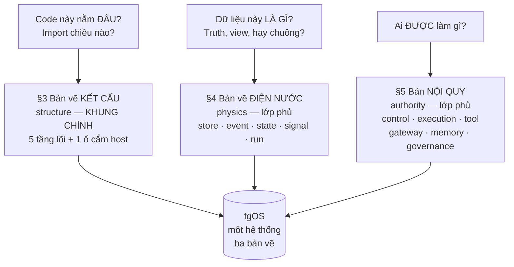
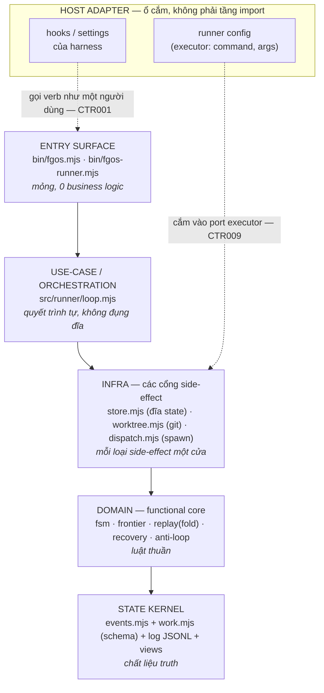
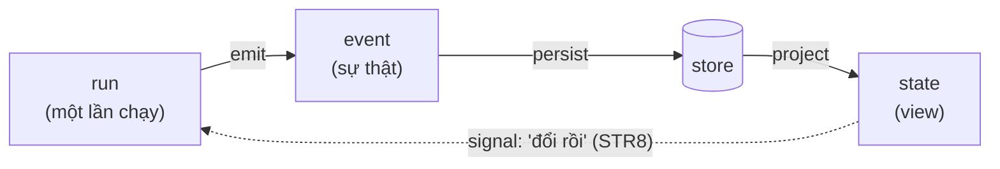
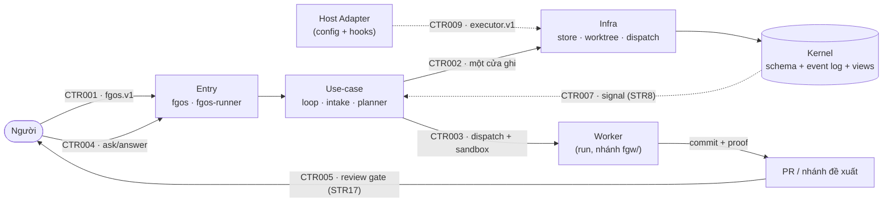
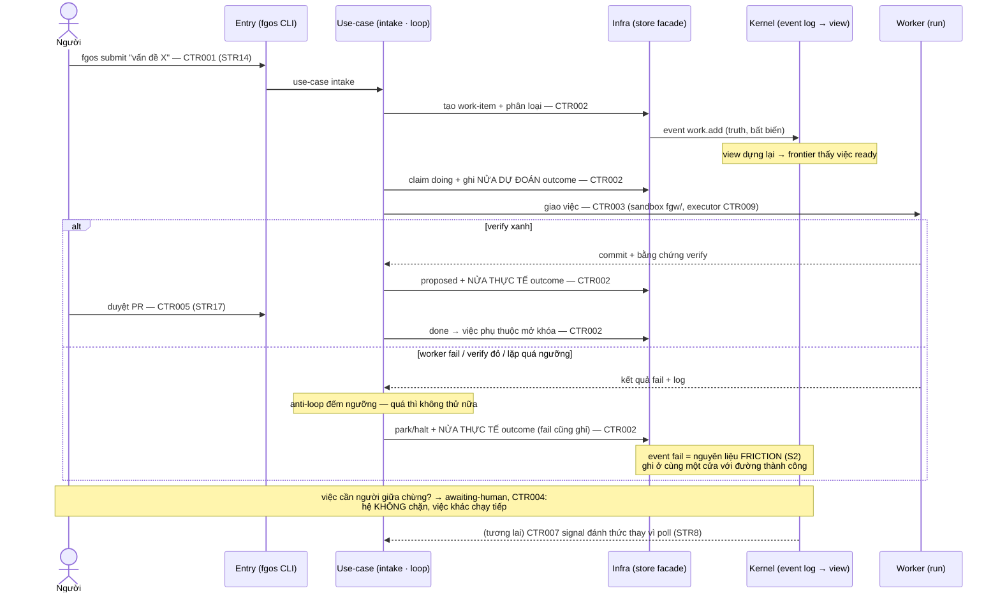

# Bounded whole-system source review request

Content commit: `a8a10abc1a24218518a14764f68c8d86f4810f91`. Author session: `codex-session:37@2026-10-15`. Review mode requested: ordinary.

Shard: `plans/260925-documentation-authority-unification/ledger/decisions/s6-whole-system-architecture-map.json`. Part 1/2; entries: **80**. Sidecar: `review-request-261015-0450-whole-system-14.md.json`.

Read review-brief.md, owner-answers.md A28–A37, frozen whole-system map, constitution, vocabulary and shard schema. Apply A36: mechanically check every row (full digest recompute, anchor check, shard/pack equality); deeply read the reviewer-seeded sample plus every differing-digest row in both directions with its diff. Preserve conditions, qualifiers, dated status and complete payload; verify one owner and labelled additions. No approval is supplied here.

Step 6’s closing review is a **checkpoint review whose sensitivity pack the reviewer holds**. The author has not created, seen or selected that pack/key. Ordinary review and A36 sampling do not replace checkpoint sensitivity.

Ordinary verdict contract: `Reviewer: <independent identity>`, `Review mode: ordinary`, request/content/shard pins; one own note and full 64-hex shown-unit digests per row. Use ok/rework/hold. Consolidate parts into a complete report for the original shard before unchanged ordinary application; never edit decisions manually.

| Claim | Verdict | Note | Source digest | Target digest |
|---|---|---|---|---|

A36 mandatory differing-digest rows (24): `claim_6e726db37ab7f5b0b8eca436792cf527`, `claim_7c173579171253a4f8bcf878e65fbe65`, `claim_d2a0dfafca083a3802ad9362597f0ea2`, `claim_52f6a74db75c041ef213f90557704b0a`, `claim_7802cf85d2049b2cefb33fdc7a6c2249`, `claim_efe951180498d114417b19df1c2d3342`, `claim_4be5dff44f84666442bf2762740a6d92`, `claim_f65a6aa8199ac59581c0aab6be351f15`, `claim_54d268e3ddd26956de4f4110a450e2f0`, `claim_42741ae1f0ee0a21b5413d9fe85cf360`, `claim_06bf5bc36853c7099bb6b5eea8fe52bb`, `claim_dda1e20b375c6881beb4dfd5f47de88c`, `claim_10c74c6722f0bf11d637b8e7d9e3236f`, `claim_6b2e58f769214a06a763de0de50f9c60`, `claim_28ad3bd623dc4ecb5fb6c706d513e61e`, `claim_c90da11438441f065108421d5572dc32`, `claim_eb80f5122d84be208d92efc81002ab0d`, `claim_b1d5ea82bcdb17b0e8d02122f50c41d3`, `claim_eb8fce1d75786d46e0838178e178d03e`, `claim_761ef4ec079b700a1ee4bf95ade96e3f`, `claim_a8c8965ef9cb2ed7186905194ede1b04`, `claim_0ae3f5f5a6e8cb541642098f6c0aef1e`, `claim_4f271cc84f7696bf19c411f9d5106775`, `claim_e8ca4104666362071f7e005d64f34c6c`.

Absent-target rows (0): none.

This pack has 80 Weak-exact/Judgment rows; reviewer independently draws/records at least 12 by seed (>=15%, minimum 10, all if fewer), plus every differing pair listed above. Each verdict note says deep or mechanical. If >3% of deep-read rows need rework, deeply read the complete pack before reporting. Author selected no sample. Whole batch: 300 Unit-exact, 392 Weak-exact, 134 Judgment, all 826 pending; 123 mandatory differing pairs. The 79-row batch-wide lower bound does not replace each pack minimum.

Reverse review: the separate native candidate-unverified request/list covers the complete scoped population; it is not reset per sliced pack. Full shown text hashes below bind payload separately from native heading identity digests.

## claim_6e726db37ab7f5b0b8eca436792cf527

Source: `docs/architecture-map.md#bản-đồ-kiến-trúc-fgos-một-khung-chính-hai-lớp-phủ-hai-sổ-đăng-ký`. Target: `docs/platform/architecture-map.md#bản-đồ-kiến-trúc-fgos-một-khung-chính-hai-lớp-phủ-hai-sổ-đăng-ký`.

Mechanical class: Judgment. Source digest: `e9b8dc72faf32ca302a347b6710b983f21132879e34fc0bf96d0038c46eb695f`. Target digest: `8f88f101162dd30533c63d7e2c120a7b17ceedd994de0e295734aea563d27975`.

Full shown source SHA256: `c809da43c68ea742046dd99df80352134f4c096efa8ba2985591c4809293d0de`. Full shown target SHA256: `fca4b6563be6eff8f8f0d0aa6301bb5ef79a2f5f40df572a680d000a710453a5`.

### Proposed decision

```json
{
  "claimId": "claim_6e726db37ab7f5b0b8eca436792cf527",
  "sourceUnitDigest": "e9b8dc72faf32ca302a347b6710b983f21132879e34fc0bf96d0038c46eb695f",
  "targetOwner": "docs/platform/architecture-map.md",
  "targetAnchor": "bản-đồ-kiến-trúc-fgos-một-khung-chính-hai-lớp-phủ-hai-sổ-đăng-ký",
  "targetUnitDigest": "8f88f101162dd30533c63d7e2c120a7b17ceedd994de0e295734aea563d27975",
  "targetAncestry": [
    "Architecture Map",
    "Added in candidate: architecture-map source carriage"
  ],
  "claimKind": "architecture",
  "disposition": "move",
  "reviewStatus": "pending",
  "authoredBy": "codex-session:37@2026-10-15",
  "rationale": "Judgment: no target digest match. Carry the complete heading at docs/architecture-map.md#bản-đồ-kiến-trúc-fgos-một-khung-chính-hai-lớp-phủ-hai-sổ-đăng-ký (lines 1–1) into docs/platform/architecture-map.md#bản-đồ-kiến-trúc-fgos-một-khung-chính-hai-lớp-phủ-hai-sổ-đăng-ký (lines 78–78), the frozen whole-system architecture owner. The source is appended as an explicitly labelled candidate subdivision to the existing anchor; original heading titles and every body line are retained, with heading levels changed only to preserve one H1. Digest differences come only from the recorded candidate header/frontmatter fence, heading-level shift or physical relative-link rebasing; full before/after units and line mapping are in authoring accounting. Source obligations, exceptions, open gaps, planned/unbuilt statements and design boundaries remain as written. No remainder, no source retirement, no promotion and no code-truth approval; independent review pending."
}
```

### Full source shown text

````text
# Bản đồ kiến trúc fgOS — một khung chính, hai lớp phủ, hai sổ đăng ký

```txt
Legacy status: Promoted source
Promoted to: docs/platform/architecture-map.md
Related target anchors:
- docs/platform/component-boundary.md
- docs/platform/platform-foundations.md
- docs/platform/vision.md
Use this legacy file for: Full historical architecture-map detail during migration
Do not use this legacy file for: The target documentation entry path
Last reviewed: 2026-09-13
```

**Phiên bản:** v0.6. **Trạng thái:** CHUẨN — chấp nhận 2026-07-16, record
[0010](decisions/0010-ban-do-kien-truc-la-ban-chuan.md); nâng v0.3 theo record
[0012](decisions/0012-typed-edge-model-supersedes-deps-parent-separation.md);
nâng v0.4 theo record
[0013](decisions/0013-discovered-from-runner-report-channel.md); nâng v0.5
theo record
[0015](decisions/0015-doi-ten-ctr-cho-contract.md); nâng v0.6 theo record
[0017](decisions/0017-dong-audit-he-id-ten-goi.md) (§12 thêm dòng id-systems-audit,
Phụ lục B mới — sổ đăng ký 13 hệ id/tên gọi).

Chưng từ tài liệu bàn luận ở xưởng và hai deep-dive distillery (`work-item-management`,
`work-item-schema-and-io-contracts`); v0.2 sửa theo hai vòng tự phản biện có kiểm
chứng trên code (hồ sơ hai vòng lưu ở xưởng). Tài liệu này là **bản chuẩn kiến trúc
của sản phẩm**: mọi ví dụ là thành phần fgOS. Thay đổi bản đồ về sau đi qua decision
record kèm nâng version — supersede, không sửa ngầm.

**Changelog v0.1 → v0.2** (tóm tắt — chi tiết ở §11):

1. Thứ tự tầng sửa theo import graph THẬT: `Entry → Use-case → Infra → Domain →
   Kernel` (v0.1 đặt Domain trên Infra — bị chính đồ thị import bác bỏ).
2. Host Adapter không còn là tầng đầu chuỗi — là **ổ cắm** (port + config) bên hông.
3. Sổ component xây lại bottom-up từ inventory file: đủ 13 module (v0.1 thiếu 5),
   tách hai loại row **component** (một nhà) và **slice** (lát dọc).
4. Thêm contract **CTR009 · executor.v1** (biên model-gateway ↔ provider — đã live,
   trước đây vô danh); CTR006 hạ maturity `live` → `designed` cho đúng sự thật.
5. Sequence §8 thêm **nhánh fail** (park/halt → friction, chỗ S2 cắm vào).
6. Thêm §12: quan hệ với `system-overview.md`, `reading-map.md`, `backlog.md`.

**Changelog v0.2 → v0.3** (record [0012](decisions/0012-typed-edge-model-supersedes-deps-parent-separation.md) — supersede ADR0002, chi tiết ở §11):

1. `src/state/dep-graph.mjs` (§6) không còn chỉ kiểm chu trình trên `deps` —
   đổi thành đồ thị cạnh-định-kiểu HỢP NHẤT `blocks`+`parent-child` (`deps`
   chiếu `blocks`, `parent` chiếu `parent-child`), đã ship + verify xanh.
2. Contract **CTR002** (§7) thêm mệnh đề bất biến phi-chu-trình: bảo đảm một-cửa-
   ghi giờ phủ đồ thị hợp nhất `blocks`+`parent-child`, không chỉ `deps` —
   đóng một lỗ hổng chu trình cha-con sống (benign) mà bản đồ chưa từng khai.
3. "deps và parent tách rời có chủ đích" (decision ADR0002) được supersede: tách
   rời về lưu trữ vẫn giữ, nhưng hợp nhất thành một đồ thị cho cycle-check +
   compute. Không đổi schema tại thời điểm đó — `SCHEMA_VERSION` khi ấy vẫn là
   2 (nay đã lên 3, per D19/D27 str46-io-contract), không có row §6/manifest
   mới (mở rộng module đã có, không tạo module mới).

**Changelog v0.3 → v0.4** (record [0013](decisions/0013-discovered-from-runner-report-channel.md) — mở rộng CTR003, không supersede):

1. Contract **CTR003** (§7, orchestrator ↔ worker) thêm một mệnh đề **kênh
   báo-cáo-không-ghi** (report-not-write): worker CÓ THỂ phát một khối
   `fgos-discovered` (dữ liệu thuần) trong output để nêu một việc mới phát
   hiện; worker vẫn KHÔNG BAO GIỜ gọi `fgos` hay ghi `.fgos/` — RUNNER đọc
   khối đó và tự tạo item với `discoveredFrom` trỏ về việc đang chạy. Bảo đảm
   runner-một-cửa-ghi (D3) giữ nguyên tuyệt đối.
2. Không đổi schema tại thời điểm đó, không module mới, không row §6/manifest
   mới — `loop.mjs` và `dispatch.mjs` đã có (mở rộng tại chỗ). Trường `discoveredFrom`
   là lineage phi-chặn (loại khỏi cycle-check theo thiết kế), cưỡi SCHEMA_VERSION
   khi ấy vẫn là 2 (nay đã lên 3, per D19/D27 str46-io-contract).

**Changelog v0.4 → v0.5** (record [0015](decisions/0015-doi-ten-ctr-cho-contract.md) — đổi tên định danh, không supersede):

1. Định danh contract một-chữ-số-trần cũ (§7, từ số 1 đến số 9) đổi tên
   thành `CTR001`-`CTR009` (3-digit zero-padded, cùng quy ước padding với
   `RUL<n>`), theo `docs/id-systems-audit.md` #6. Đổi tên thuần — không đổi
   ý nghĩa, ranh giới, hay maturity của bất kỳ contract nào; mỗi contract
   vẫn là cùng một contract, chỉ đổi cách viết định danh.
2. Không đổi schema, không module mới, không row §6/manifest mới — chỉ đổi
   nhãn ở mọi nơi contract ID xuất hiện trong file này (§6, §7, hai sơ đồ
   mermaid, changelog, câu hỏi mở).

---
````

### Full target shown text

````text
### Bản đồ kiến trúc fgOS — một khung chính, hai lớp phủ, hai sổ đăng ký

```txt
Legacy status: Promoted source
Promoted to: docs/platform/architecture-map.md
Related target anchors:
- docs/platform/component-boundary.md
- docs/platform/platform-foundations.md
- docs/platform/vision.md
Use this legacy file for: Full historical architecture-map detail during migration
Do not use this legacy file for: The target documentation entry path
Last reviewed: 2026-09-13
```

**Phiên bản:** v0.6. **Trạng thái:** CHUẨN — chấp nhận 2026-07-16, record
[0010](#0010-bản-đồ-kiến-trúc-là-bản-chuẩn); nâng v0.3 theo record
[0012](../specs/work-state.md#0012-mô-hình-đồ-thị-cạnh-định-kiểu-hợp-nhất-thay-thế-depsparent-tách-rời);
nâng v0.4 theo record
[0013](../specs/work-state.md#0013-kênh-báo-cáo-không-ghi-workerrunner-cho-discovered-from); nâng v0.5
theo record
[0015](#0015-đổi-tên-định-danh-contract-c1-c9-thành-ctr001-ctr009); nâng v0.6 theo record
[0017](#0017-đóng-audit-hệ-idtên-gọi-str47) (§12 thêm dòng id-systems-audit,
Phụ lục B mới — sổ đăng ký 13 hệ id/tên gọi).

Chưng từ tài liệu bàn luận ở xưởng và hai deep-dive distillery (`work-item-management`,
`work-item-schema-and-io-contracts`); v0.2 sửa theo hai vòng tự phản biện có kiểm
chứng trên code (hồ sơ hai vòng lưu ở xưởng). Tài liệu này là **bản chuẩn kiến trúc
của sản phẩm**: mọi ví dụ là thành phần fgOS. Thay đổi bản đồ về sau đi qua decision
record kèm nâng version — supersede, không sửa ngầm.

**Changelog v0.1 → v0.2** (tóm tắt — chi tiết ở §11):

1. Thứ tự tầng sửa theo import graph THẬT: `Entry → Use-case → Infra → Domain →
   Kernel` (v0.1 đặt Domain trên Infra — bị chính đồ thị import bác bỏ).
2. Host Adapter không còn là tầng đầu chuỗi — là **ổ cắm** (port + config) bên hông.
3. Sổ component xây lại bottom-up từ inventory file: đủ 13 module (v0.1 thiếu 5),
   tách hai loại row **component** (một nhà) và **slice** (lát dọc).
4. Thêm contract **CTR009 · executor.v1** (biên model-gateway ↔ provider — đã live,
   trước đây vô danh); CTR006 hạ maturity `live` → `designed` cho đúng sự thật.
5. Sequence §8 thêm **nhánh fail** (park/halt → friction, chỗ S2 cắm vào).
6. Thêm §12: quan hệ với `system-overview.md`, `reading-map.md`, `backlog.md`.

**Changelog v0.2 → v0.3** (record [0012](../specs/work-state.md#0012-mô-hình-đồ-thị-cạnh-định-kiểu-hợp-nhất-thay-thế-depsparent-tách-rời) — supersede ADR0002, chi tiết ở §11):

1. `src/state/dep-graph.mjs` (§6) không còn chỉ kiểm chu trình trên `deps` —
   đổi thành đồ thị cạnh-định-kiểu HỢP NHẤT `blocks`+`parent-child` (`deps`
   chiếu `blocks`, `parent` chiếu `parent-child`), đã ship + verify xanh.
2. Contract **CTR002** (§7) thêm mệnh đề bất biến phi-chu-trình: bảo đảm một-cửa-
   ghi giờ phủ đồ thị hợp nhất `blocks`+`parent-child`, không chỉ `deps` —
   đóng một lỗ hổng chu trình cha-con sống (benign) mà bản đồ chưa từng khai.
3. "deps và parent tách rời có chủ đích" (decision ADR0002) được supersede: tách
   rời về lưu trữ vẫn giữ, nhưng hợp nhất thành một đồ thị cho cycle-check +
   compute. Không đổi schema tại thời điểm đó — `SCHEMA_VERSION` khi ấy vẫn là
   2 (nay đã lên 3, per D19/D27 str46-io-contract), không có row §6/manifest
   mới (mở rộng module đã có, không tạo module mới).

**Changelog v0.3 → v0.4** (record [0013](../specs/work-state.md#0013-kênh-báo-cáo-không-ghi-workerrunner-cho-discovered-from) — mở rộng CTR003, không supersede):

1. Contract **CTR003** (§7, orchestrator ↔ worker) thêm một mệnh đề **kênh
   báo-cáo-không-ghi** (report-not-write): worker CÓ THỂ phát một khối
   `fgos-discovered` (dữ liệu thuần) trong output để nêu một việc mới phát
   hiện; worker vẫn KHÔNG BAO GIỜ gọi `fgos` hay ghi `.fgos/` — RUNNER đọc
   khối đó và tự tạo item với `discoveredFrom` trỏ về việc đang chạy. Bảo đảm
   runner-một-cửa-ghi (D3) giữ nguyên tuyệt đối.
2. Không đổi schema tại thời điểm đó, không module mới, không row §6/manifest
   mới — `loop.mjs` và `dispatch.mjs` đã có (mở rộng tại chỗ). Trường `discoveredFrom`
   là lineage phi-chặn (loại khỏi cycle-check theo thiết kế), cưỡi SCHEMA_VERSION
   khi ấy vẫn là 2 (nay đã lên 3, per D19/D27 str46-io-contract).

**Changelog v0.4 → v0.5** (record [0015](#0015-đổi-tên-định-danh-contract-c1-c9-thành-ctr001-ctr009) — đổi tên định danh, không supersede):

1. Định danh contract một-chữ-số-trần cũ (§7, từ số 1 đến số 9) đổi tên
   thành `CTR001`-`CTR009` (3-digit zero-padded, cùng quy ước padding với
   `RUL<n>`), theo `docs/id-systems-audit.md` #6. Đổi tên thuần — không đổi
   ý nghĩa, ranh giới, hay maturity của bất kỳ contract nào; mỗi contract
   vẫn là cùng một contract, chỉ đổi cách viết định danh.
2. Không đổi schema, không module mới, không row §6/manifest mới — chỉ đổi
   nhãn ở mọi nơi contract ID xuất hiện trong file này (§6, §7, hai sơ đồ
   mermaid, changelog, câu hỏi mở).

---
````

### Unified diff

````diff
--- docs/architecture-map.md#bản-đồ-kiến-trúc-fgos-một-khung-chính-hai-lớp-phủ-hai-sổ-đăng-ký
+++ docs/platform/architecture-map.md#bản-đồ-kiến-trúc-fgos-một-khung-chính-hai-lớp-phủ-hai-sổ-đăng-ký
@@ -1,4 +1,4 @@
-# Bản đồ kiến trúc fgOS — một khung chính, hai lớp phủ, hai sổ đăng ký
+### Bản đồ kiến trúc fgOS — một khung chính, hai lớp phủ, hai sổ đăng ký
 
 ```txt
 Legacy status: Promoted source
@@ -13,13 +13,13 @@
 ```
 
 **Phiên bản:** v0.6. **Trạng thái:** CHUẨN — chấp nhận 2026-07-16, record
-[0010](decisions/0010-ban-do-kien-truc-la-ban-chuan.md); nâng v0.3 theo record
-[0012](decisions/0012-typed-edge-model-supersedes-deps-parent-separation.md);
+[0010](#0010-bản-đồ-kiến-trúc-là-bản-chuẩn); nâng v0.3 theo record
+[0012](../specs/work-state.md#0012-mô-hình-đồ-thị-cạnh-định-kiểu-hợp-nhất-thay-thế-depsparent-tách-rời);
 nâng v0.4 theo record
-[0013](decisions/0013-discovered-from-runner-report-channel.md); nâng v0.5
+[0013](../specs/work-state.md#0013-kênh-báo-cáo-không-ghi-workerrunner-cho-discovered-from); nâng v0.5
 theo record
-[0015](decisions/0015-doi-ten-ctr-cho-contract.md); nâng v0.6 theo record
-[0017](decisions/0017-dong-audit-he-id-ten-goi.md) (§12 thêm dòng id-systems-audit,
+[0015](#0015-đổi-tên-định-danh-contract-c1-c9-thành-ctr001-ctr009); nâng v0.6 theo record
+[0017](#0017-đóng-audit-hệ-idtên-gọi-str47) (§12 thêm dòng id-systems-audit,
 Phụ lục B mới — sổ đăng ký 13 hệ id/tên gọi).
 
 Chưng từ tài liệu bàn luận ở xưởng và hai deep-dive distillery (`work-item-management`,
@@ -40,7 +40,7 @@
 5. Sequence §8 thêm **nhánh fail** (park/halt → friction, chỗ S2 cắm vào).
 6. Thêm §12: quan hệ với `system-overview.md`, `reading-map.md`, `backlog.md`.
 
-**Changelog v0.2 → v0.3** (record [0012](decisions/0012-typed-edge-model-supersedes-deps-parent-separation.md) — supersede ADR0002, chi tiết ở §11):
+**Changelog v0.2 → v0.3** (record [0012](../specs/work-state.md#0012-mô-hình-đồ-thị-cạnh-định-kiểu-hợp-nhất-thay-thế-depsparent-tách-rời) — supersede ADR0002, chi tiết ở §11):
 
 1. `src/state/dep-graph.mjs` (§6) không còn chỉ kiểm chu trình trên `deps` —
    đổi thành đồ thị cạnh-định-kiểu HỢP NHẤT `blocks`+`parent-child` (`deps`
@@ -54,7 +54,7 @@
    2 (nay đã lên 3, per D19/D27 str46-io-contract), không có row §6/manifest
    mới (mở rộng module đã có, không tạo module mới).
 
-**Changelog v0.3 → v0.4** (record [0013](decisions/0013-discovered-from-runner-report-channel.md) — mở rộng CTR003, không supersede):
+**Changelog v0.3 → v0.4** (record [0013](../specs/work-state.md#0013-kênh-báo-cáo-không-ghi-workerrunner-cho-discovered-from) — mở rộng CTR003, không supersede):
 
 1. Contract **CTR003** (§7, orchestrator ↔ worker) thêm một mệnh đề **kênh
    báo-cáo-không-ghi** (report-not-write): worker CÓ THỂ phát một khối
@@ -67,7 +67,7 @@
    là lineage phi-chặn (loại khỏi cycle-check theo thiết kế), cưỡi SCHEMA_VERSION
    khi ấy vẫn là 2 (nay đã lên 3, per D19/D27 str46-io-contract).
 
-**Changelog v0.4 → v0.5** (record [0015](decisions/0015-doi-ten-ctr-cho-contract.md) — đổi tên định danh, không supersede):
+**Changelog v0.4 → v0.5** (record [0015](#0015-đổi-tên-định-danh-contract-c1-c9-thành-ctr001-ctr009) — đổi tên định danh, không supersede):
 
 1. Định danh contract một-chữ-số-trần cũ (§7, từ số 1 đến số 9) đổi tên
    thành `CTR001`-`CTR009` (3-digit zero-padded, cùng quy ước padding với

````

## claim_63d932ce2cf2e02651341337917f55be

Source: `docs/architecture-map.md#unheaded-block-1`. Target: `docs/platform/architecture-map.md#unheaded-block-15`.

Mechanical class: Weak-exact. Source digest: `0a323eca0f30fbe836d6962d2fcabc973b03ee842a69b31a627de9fd74d0c7e1`. Target digest: `0a323eca0f30fbe836d6962d2fcabc973b03ee842a69b31a627de9fd74d0c7e1`.

Full shown source SHA256: `0a323eca0f30fbe836d6962d2fcabc973b03ee842a69b31a627de9fd74d0c7e1`. Full shown target SHA256: `0a323eca0f30fbe836d6962d2fcabc973b03ee842a69b31a627de9fd74d0c7e1`.

### Proposed decision

```json
{
  "claimId": "claim_63d932ce2cf2e02651341337917f55be",
  "sourceUnitDigest": "0a323eca0f30fbe836d6962d2fcabc973b03ee842a69b31a627de9fd74d0c7e1",
  "targetOwner": "docs/platform/architecture-map.md",
  "targetAnchor": "unheaded-block-15",
  "targetUnitDigest": "0a323eca0f30fbe836d6962d2fcabc973b03ee842a69b31a627de9fd74d0c7e1",
  "targetAncestry": [
    "Architecture Map",
    "Added in candidate: architecture-map source carriage",
    "Bản đồ kiến trúc fgOS — một khung chính, hai lớp phủ, hai sổ đăng ký"
  ],
  "claimKind": "contract",
  "disposition": "move",
  "reviewStatus": "pending",
  "authoredBy": "codex-session:37@2026-10-15",
  "rationale": "Weak-exact: ancestor headings differ. Carry the complete unheaded-block at docs/architecture-map.md#unheaded-block-1 (lines 3–13) into docs/platform/architecture-map.md#unheaded-block-15 (lines 80–90), the frozen whole-system architecture owner. The source is appended as an explicitly labelled candidate subdivision to the existing anchor; original heading titles and every body line are retained, with heading levels changed only to preserve one H1. The full unit digest is equal; this author still claims no independent approval. Source obligations, exceptions, open gaps, planned/unbuilt statements and design boundaries remain as written. No remainder, no source retirement, no promotion and no code-truth approval; independent review pending."
}
```

### Full source shown text

````text
```txt
Legacy status: Promoted source
Promoted to: docs/platform/architecture-map.md
Related target anchors:
- docs/platform/component-boundary.md
- docs/platform/platform-foundations.md
- docs/platform/vision.md
Use this legacy file for: Full historical architecture-map detail during migration
Do not use this legacy file for: The target documentation entry path
Last reviewed: 2026-09-13
```
````

### Full target shown text

````text
```txt
Legacy status: Promoted source
Promoted to: docs/platform/architecture-map.md
Related target anchors:
- docs/platform/component-boundary.md
- docs/platform/platform-foundations.md
- docs/platform/vision.md
Use this legacy file for: Full historical architecture-map detail during migration
Do not use this legacy file for: The target documentation entry path
Last reviewed: 2026-09-13
```
````

### Unified diff

```diff
No text difference.
```

## claim_7c173579171253a4f8bcf878e65fbe65

Source: `docs/architecture-map.md#unheaded-block-2`. Target: `docs/platform/architecture-map.md#unheaded-block-16`.

Mechanical class: Judgment. Source digest: `f7bf249643002ab4793c99f61795459947ce603f830cf43b69d2efefb8e29073`. Target digest: `b959eb0477bf33775c17cf860175be2c70d1841d6995f5e43f6c96e1336c5751`.

Full shown source SHA256: `f7bf249643002ab4793c99f61795459947ce603f830cf43b69d2efefb8e29073`. Full shown target SHA256: `b959eb0477bf33775c17cf860175be2c70d1841d6995f5e43f6c96e1336c5751`.

### Proposed decision

```json
{
  "claimId": "claim_7c173579171253a4f8bcf878e65fbe65",
  "sourceUnitDigest": "f7bf249643002ab4793c99f61795459947ce603f830cf43b69d2efefb8e29073",
  "targetOwner": "docs/platform/architecture-map.md",
  "targetAnchor": "unheaded-block-16",
  "targetUnitDigest": "b959eb0477bf33775c17cf860175be2c70d1841d6995f5e43f6c96e1336c5751",
  "targetAncestry": [
    "Architecture Map",
    "Added in candidate: architecture-map source carriage",
    "Bản đồ kiến trúc fgOS — một khung chính, hai lớp phủ, hai sổ đăng ký"
  ],
  "claimKind": "architecture",
  "disposition": "move",
  "reviewStatus": "pending",
  "authoredBy": "codex-session:37@2026-10-15",
  "rationale": "Judgment: no target digest match. Carry the complete unheaded-block at docs/architecture-map.md#unheaded-block-2 (lines 15–23) into docs/platform/architecture-map.md#unheaded-block-16 (lines 92–100), the frozen whole-system architecture owner. The source is appended as an explicitly labelled candidate subdivision to the existing anchor; original heading titles and every body line are retained, with heading levels changed only to preserve one H1. Digest differences come only from the recorded candidate header/frontmatter fence, heading-level shift or physical relative-link rebasing; full before/after units and line mapping are in authoring accounting. Source obligations, exceptions, open gaps, planned/unbuilt statements and design boundaries remain as written. No remainder, no source retirement, no promotion and no code-truth approval; independent review pending. Link-only restoration of the cited retired ADR to its existing numbered narrative is explicitly recorded; no decision text or meaning changed. Link-only restoration of the cited retired ADR to its existing numbered narrative is explicitly recorded; no decision text or meaning changed."
}
```

### Full source shown text

```text
**Phiên bản:** v0.6. **Trạng thái:** CHUẨN — chấp nhận 2026-07-16, record
[0010](decisions/0010-ban-do-kien-truc-la-ban-chuan.md); nâng v0.3 theo record
[0012](decisions/0012-typed-edge-model-supersedes-deps-parent-separation.md);
nâng v0.4 theo record
[0013](decisions/0013-discovered-from-runner-report-channel.md); nâng v0.5
theo record
[0015](decisions/0015-doi-ten-ctr-cho-contract.md); nâng v0.6 theo record
[0017](decisions/0017-dong-audit-he-id-ten-goi.md) (§12 thêm dòng id-systems-audit,
Phụ lục B mới — sổ đăng ký 13 hệ id/tên gọi).
```

### Full target shown text

```text
**Phiên bản:** v0.6. **Trạng thái:** CHUẨN — chấp nhận 2026-07-16, record
[0010](#0010-bản-đồ-kiến-trúc-là-bản-chuẩn); nâng v0.3 theo record
[0012](../specs/work-state.md#0012-mô-hình-đồ-thị-cạnh-định-kiểu-hợp-nhất-thay-thế-depsparent-tách-rời);
nâng v0.4 theo record
[0013](../specs/work-state.md#0013-kênh-báo-cáo-không-ghi-workerrunner-cho-discovered-from); nâng v0.5
theo record
[0015](#0015-đổi-tên-định-danh-contract-c1-c9-thành-ctr001-ctr009); nâng v0.6 theo record
[0017](#0017-đóng-audit-hệ-idtên-gọi-str47) (§12 thêm dòng id-systems-audit,
Phụ lục B mới — sổ đăng ký 13 hệ id/tên gọi).
```

### Unified diff

```diff
--- docs/architecture-map.md#unheaded-block-2
+++ docs/platform/architecture-map.md#unheaded-block-16
@@ -1,9 +1,9 @@
 **Phiên bản:** v0.6. **Trạng thái:** CHUẨN — chấp nhận 2026-07-16, record
-[0010](decisions/0010-ban-do-kien-truc-la-ban-chuan.md); nâng v0.3 theo record
-[0012](decisions/0012-typed-edge-model-supersedes-deps-parent-separation.md);
+[0010](#0010-bản-đồ-kiến-trúc-là-bản-chuẩn); nâng v0.3 theo record
+[0012](../specs/work-state.md#0012-mô-hình-đồ-thị-cạnh-định-kiểu-hợp-nhất-thay-thế-depsparent-tách-rời);
 nâng v0.4 theo record
-[0013](decisions/0013-discovered-from-runner-report-channel.md); nâng v0.5
+[0013](../specs/work-state.md#0013-kênh-báo-cáo-không-ghi-workerrunner-cho-discovered-from); nâng v0.5
 theo record
-[0015](decisions/0015-doi-ten-ctr-cho-contract.md); nâng v0.6 theo record
-[0017](decisions/0017-dong-audit-he-id-ten-goi.md) (§12 thêm dòng id-systems-audit,
+[0015](#0015-đổi-tên-định-danh-contract-c1-c9-thành-ctr001-ctr009); nâng v0.6 theo record
+[0017](#0017-đóng-audit-hệ-idtên-gọi-str47) (§12 thêm dòng id-systems-audit,
 Phụ lục B mới — sổ đăng ký 13 hệ id/tên gọi).

```

## claim_43157708757b0edbeca22d2c04e2ceca

Source: `docs/architecture-map.md#unheaded-block-3`. Target: `docs/platform/architecture-map.md#unheaded-block-17`.

Mechanical class: Weak-exact. Source digest: `0e5e748475581b2a4a3563cbd7c318121b06b9ebd282d81703d74761a112849a`. Target digest: `0e5e748475581b2a4a3563cbd7c318121b06b9ebd282d81703d74761a112849a`.

Full shown source SHA256: `0e5e748475581b2a4a3563cbd7c318121b06b9ebd282d81703d74761a112849a`. Full shown target SHA256: `0e5e748475581b2a4a3563cbd7c318121b06b9ebd282d81703d74761a112849a`.

### Proposed decision

```json
{
  "claimId": "claim_43157708757b0edbeca22d2c04e2ceca",
  "sourceUnitDigest": "0e5e748475581b2a4a3563cbd7c318121b06b9ebd282d81703d74761a112849a",
  "targetOwner": "docs/platform/architecture-map.md",
  "targetAnchor": "unheaded-block-17",
  "targetUnitDigest": "0e5e748475581b2a4a3563cbd7c318121b06b9ebd282d81703d74761a112849a",
  "targetAncestry": [
    "Architecture Map",
    "Added in candidate: architecture-map source carriage",
    "Bản đồ kiến trúc fgOS — một khung chính, hai lớp phủ, hai sổ đăng ký"
  ],
  "claimKind": "contract",
  "disposition": "move",
  "reviewStatus": "pending",
  "authoredBy": "codex-session:37@2026-10-15",
  "rationale": "Weak-exact: ancestor headings differ. Carry the complete unheaded-block at docs/architecture-map.md#unheaded-block-3 (lines 25–29) into docs/platform/architecture-map.md#unheaded-block-17 (lines 102–106), the frozen whole-system architecture owner. The source is appended as an explicitly labelled candidate subdivision to the existing anchor; original heading titles and every body line are retained, with heading levels changed only to preserve one H1. The full unit digest is equal; this author still claims no independent approval. Source obligations, exceptions, open gaps, planned/unbuilt statements and design boundaries remain as written. No remainder, no source retirement, no promotion and no code-truth approval; independent review pending."
}
```

### Full source shown text

```text
Chưng từ tài liệu bàn luận ở xưởng và hai deep-dive distillery (`work-item-management`,
`work-item-schema-and-io-contracts`); v0.2 sửa theo hai vòng tự phản biện có kiểm
chứng trên code (hồ sơ hai vòng lưu ở xưởng). Tài liệu này là **bản chuẩn kiến trúc
của sản phẩm**: mọi ví dụ là thành phần fgOS. Thay đổi bản đồ về sau đi qua decision
record kèm nâng version — supersede, không sửa ngầm.
```

### Full target shown text

```text
Chưng từ tài liệu bàn luận ở xưởng và hai deep-dive distillery (`work-item-management`,
`work-item-schema-and-io-contracts`); v0.2 sửa theo hai vòng tự phản biện có kiểm
chứng trên code (hồ sơ hai vòng lưu ở xưởng). Tài liệu này là **bản chuẩn kiến trúc
của sản phẩm**: mọi ví dụ là thành phần fgOS. Thay đổi bản đồ về sau đi qua decision
record kèm nâng version — supersede, không sửa ngầm.
```

### Unified diff

```diff
No text difference.
```

## claim_60966a9770965bb0799898e7e7b3b0f8

Source: `docs/architecture-map.md#unheaded-block-4`. Target: `docs/platform/architecture-map.md#unheaded-block-18`.

Mechanical class: Weak-exact. Source digest: `3bddbf0b464a68c1652219ff2ed623699a7a203de6ced0d683b997b4e5179862`. Target digest: `3bddbf0b464a68c1652219ff2ed623699a7a203de6ced0d683b997b4e5179862`.

Full shown source SHA256: `3bddbf0b464a68c1652219ff2ed623699a7a203de6ced0d683b997b4e5179862`. Full shown target SHA256: `3bddbf0b464a68c1652219ff2ed623699a7a203de6ced0d683b997b4e5179862`.

### Proposed decision

```json
{
  "claimId": "claim_60966a9770965bb0799898e7e7b3b0f8",
  "sourceUnitDigest": "3bddbf0b464a68c1652219ff2ed623699a7a203de6ced0d683b997b4e5179862",
  "targetOwner": "docs/platform/architecture-map.md",
  "targetAnchor": "unheaded-block-18",
  "targetUnitDigest": "3bddbf0b464a68c1652219ff2ed623699a7a203de6ced0d683b997b4e5179862",
  "targetAncestry": [
    "Architecture Map",
    "Added in candidate: architecture-map source carriage",
    "Bản đồ kiến trúc fgOS — một khung chính, hai lớp phủ, hai sổ đăng ký"
  ],
  "claimKind": "architecture",
  "disposition": "move",
  "reviewStatus": "pending",
  "authoredBy": "codex-session:37@2026-10-15",
  "rationale": "Weak-exact: ancestor headings differ. Carry the complete unheaded-block at docs/architecture-map.md#unheaded-block-4 (lines 31–31) into docs/platform/architecture-map.md#unheaded-block-18 (lines 108–108), the frozen whole-system architecture owner. The source is appended as an explicitly labelled candidate subdivision to the existing anchor; original heading titles and every body line are retained, with heading levels changed only to preserve one H1. The full unit digest is equal; this author still claims no independent approval. Source obligations, exceptions, open gaps, planned/unbuilt statements and design boundaries remain as written. No remainder, no source retirement, no promotion and no code-truth approval; independent review pending."
}
```

### Full source shown text

```text
**Changelog v0.1 → v0.2** (tóm tắt — chi tiết ở §11):
```

### Full target shown text

```text
**Changelog v0.1 → v0.2** (tóm tắt — chi tiết ở §11):
```

### Unified diff

```diff
No text difference.
```

## claim_20dca9a291f72fb95ec87c2d4f49c91b

Source: `docs/architecture-map.md#unheaded-block-5`. Target: `docs/platform/architecture-map.md#unheaded-block-19`.

Mechanical class: Weak-exact. Source digest: `9acaf81339584d695bea2f1b4c5cace51f753b0045cd7d04d5ff02fc004c88a4`. Target digest: `9acaf81339584d695bea2f1b4c5cace51f753b0045cd7d04d5ff02fc004c88a4`.

Full shown source SHA256: `9acaf81339584d695bea2f1b4c5cace51f753b0045cd7d04d5ff02fc004c88a4`. Full shown target SHA256: `9acaf81339584d695bea2f1b4c5cace51f753b0045cd7d04d5ff02fc004c88a4`.

### Proposed decision

```json
{
  "claimId": "claim_20dca9a291f72fb95ec87c2d4f49c91b",
  "sourceUnitDigest": "9acaf81339584d695bea2f1b4c5cace51f753b0045cd7d04d5ff02fc004c88a4",
  "targetOwner": "docs/platform/architecture-map.md",
  "targetAnchor": "unheaded-block-19",
  "targetUnitDigest": "9acaf81339584d695bea2f1b4c5cace51f753b0045cd7d04d5ff02fc004c88a4",
  "targetAncestry": [
    "Architecture Map",
    "Added in candidate: architecture-map source carriage",
    "Bản đồ kiến trúc fgOS — một khung chính, hai lớp phủ, hai sổ đăng ký"
  ],
  "claimKind": "architecture",
  "disposition": "move",
  "reviewStatus": "pending",
  "authoredBy": "codex-session:37@2026-10-15",
  "rationale": "Weak-exact: ancestor headings differ. Carry the complete unheaded-block at docs/architecture-map.md#unheaded-block-5 (lines 33–41) into docs/platform/architecture-map.md#unheaded-block-19 (lines 110–118), the frozen whole-system architecture owner. The source is appended as an explicitly labelled candidate subdivision to the existing anchor; original heading titles and every body line are retained, with heading levels changed only to preserve one H1. The full unit digest is equal; this author still claims no independent approval. Source obligations, exceptions, open gaps, planned/unbuilt statements and design boundaries remain as written. No remainder, no source retirement, no promotion and no code-truth approval; independent review pending."
}
```

### Full source shown text

```text
1. Thứ tự tầng sửa theo import graph THẬT: `Entry → Use-case → Infra → Domain →
   Kernel` (v0.1 đặt Domain trên Infra — bị chính đồ thị import bác bỏ).
2. Host Adapter không còn là tầng đầu chuỗi — là **ổ cắm** (port + config) bên hông.
3. Sổ component xây lại bottom-up từ inventory file: đủ 13 module (v0.1 thiếu 5),
   tách hai loại row **component** (một nhà) và **slice** (lát dọc).
4. Thêm contract **CTR009 · executor.v1** (biên model-gateway ↔ provider — đã live,
   trước đây vô danh); CTR006 hạ maturity `live` → `designed` cho đúng sự thật.
5. Sequence §8 thêm **nhánh fail** (park/halt → friction, chỗ S2 cắm vào).
6. Thêm §12: quan hệ với `system-overview.md`, `reading-map.md`, `backlog.md`.
```

### Full target shown text

```text
1. Thứ tự tầng sửa theo import graph THẬT: `Entry → Use-case → Infra → Domain →
   Kernel` (v0.1 đặt Domain trên Infra — bị chính đồ thị import bác bỏ).
2. Host Adapter không còn là tầng đầu chuỗi — là **ổ cắm** (port + config) bên hông.
3. Sổ component xây lại bottom-up từ inventory file: đủ 13 module (v0.1 thiếu 5),
   tách hai loại row **component** (một nhà) và **slice** (lát dọc).
4. Thêm contract **CTR009 · executor.v1** (biên model-gateway ↔ provider — đã live,
   trước đây vô danh); CTR006 hạ maturity `live` → `designed` cho đúng sự thật.
5. Sequence §8 thêm **nhánh fail** (park/halt → friction, chỗ S2 cắm vào).
6. Thêm §12: quan hệ với `system-overview.md`, `reading-map.md`, `backlog.md`.
```

### Unified diff

```diff
No text difference.
```

## claim_d2a0dfafca083a3802ad9362597f0ea2

Source: `docs/architecture-map.md#unheaded-block-6`. Target: `docs/platform/architecture-map.md#unheaded-block-20`.

Mechanical class: Judgment. Source digest: `7228f310d90252e9edcbdc5f60296555cca821c86b4f7ea79ab24e7688aa9606`. Target digest: `831e03f166d9357f7ac10e1dc6800468cdd03de41b71fcbe2a1c445b840864c1`.

Full shown source SHA256: `7228f310d90252e9edcbdc5f60296555cca821c86b4f7ea79ab24e7688aa9606`. Full shown target SHA256: `831e03f166d9357f7ac10e1dc6800468cdd03de41b71fcbe2a1c445b840864c1`.

### Proposed decision

```json
{
  "claimId": "claim_d2a0dfafca083a3802ad9362597f0ea2",
  "sourceUnitDigest": "7228f310d90252e9edcbdc5f60296555cca821c86b4f7ea79ab24e7688aa9606",
  "targetOwner": "docs/platform/architecture-map.md",
  "targetAnchor": "unheaded-block-20",
  "targetUnitDigest": "831e03f166d9357f7ac10e1dc6800468cdd03de41b71fcbe2a1c445b840864c1",
  "targetAncestry": [
    "Architecture Map",
    "Added in candidate: architecture-map source carriage",
    "Bản đồ kiến trúc fgOS — một khung chính, hai lớp phủ, hai sổ đăng ký"
  ],
  "claimKind": "decision",
  "disposition": "move",
  "reviewStatus": "pending",
  "authoredBy": "codex-session:37@2026-10-15",
  "rationale": "Judgment: no target digest match. Carry the complete unheaded-block at docs/architecture-map.md#unheaded-block-6 (lines 43–43) into docs/platform/architecture-map.md#unheaded-block-20 (lines 120–120), the frozen whole-system architecture owner. The source is appended as an explicitly labelled candidate subdivision to the existing anchor; original heading titles and every body line are retained, with heading levels changed only to preserve one H1. Digest differences come only from the recorded candidate header/frontmatter fence, heading-level shift or physical relative-link rebasing; full before/after units and line mapping are in authoring accounting. Source obligations, exceptions, open gaps, planned/unbuilt statements and design boundaries remain as written. No remainder, no source retirement, no promotion and no code-truth approval; independent review pending. Link-only restoration of the cited retired ADR to its existing numbered narrative is explicitly recorded; no decision text or meaning changed. Link-only restoration of the cited retired ADR to its existing numbered narrative is explicitly recorded; no decision text or meaning changed."
}
```

### Full source shown text

```text
**Changelog v0.2 → v0.3** (record [0012](decisions/0012-typed-edge-model-supersedes-deps-parent-separation.md) — supersede ADR0002, chi tiết ở §11):
```

### Full target shown text

```text
**Changelog v0.2 → v0.3** (record [0012](../specs/work-state.md#0012-mô-hình-đồ-thị-cạnh-định-kiểu-hợp-nhất-thay-thế-depsparent-tách-rời) — supersede ADR0002, chi tiết ở §11):
```

### Unified diff

```diff
--- docs/architecture-map.md#unheaded-block-6
+++ docs/platform/architecture-map.md#unheaded-block-20
@@ -1 +1 @@
-**Changelog v0.2 → v0.3** (record [0012](decisions/0012-typed-edge-model-supersedes-deps-parent-separation.md) — supersede ADR0002, chi tiết ở §11):
+**Changelog v0.2 → v0.3** (record [0012](../specs/work-state.md#0012-mô-hình-đồ-thị-cạnh-định-kiểu-hợp-nhất-thay-thế-depsparent-tách-rời) — supersede ADR0002, chi tiết ở §11):

```

## claim_f4451b0812cb6c4c4b3d5f3146ceb22b

Source: `docs/architecture-map.md#unheaded-block-7`. Target: `docs/platform/architecture-map.md#unheaded-block-21`.

Mechanical class: Weak-exact. Source digest: `e9b8e8cc3f84ad1eb58a0ef5bb971a550005805be9878f501a057a5faff5d41a`. Target digest: `e9b8e8cc3f84ad1eb58a0ef5bb971a550005805be9878f501a057a5faff5d41a`.

Full shown source SHA256: `e9b8e8cc3f84ad1eb58a0ef5bb971a550005805be9878f501a057a5faff5d41a`. Full shown target SHA256: `e9b8e8cc3f84ad1eb58a0ef5bb971a550005805be9878f501a057a5faff5d41a`.

### Proposed decision

```json
{
  "claimId": "claim_f4451b0812cb6c4c4b3d5f3146ceb22b",
  "sourceUnitDigest": "e9b8e8cc3f84ad1eb58a0ef5bb971a550005805be9878f501a057a5faff5d41a",
  "targetOwner": "docs/platform/architecture-map.md",
  "targetAnchor": "unheaded-block-21",
  "targetUnitDigest": "e9b8e8cc3f84ad1eb58a0ef5bb971a550005805be9878f501a057a5faff5d41a",
  "targetAncestry": [
    "Architecture Map",
    "Added in candidate: architecture-map source carriage",
    "Bản đồ kiến trúc fgOS — một khung chính, hai lớp phủ, hai sổ đăng ký"
  ],
  "claimKind": "architecture",
  "disposition": "move",
  "reviewStatus": "pending",
  "authoredBy": "codex-session:37@2026-10-15",
  "rationale": "Weak-exact: ancestor headings differ. Carry the complete unheaded-block at docs/architecture-map.md#unheaded-block-7 (lines 45–55) into docs/platform/architecture-map.md#unheaded-block-21 (lines 122–132), the frozen whole-system architecture owner. The source is appended as an explicitly labelled candidate subdivision to the existing anchor; original heading titles and every body line are retained, with heading levels changed only to preserve one H1. The full unit digest is equal; this author still claims no independent approval. Source obligations, exceptions, open gaps, planned/unbuilt statements and design boundaries remain as written. No remainder, no source retirement, no promotion and no code-truth approval; independent review pending."
}
```

### Full source shown text

```text
1. `src/state/dep-graph.mjs` (§6) không còn chỉ kiểm chu trình trên `deps` —
   đổi thành đồ thị cạnh-định-kiểu HỢP NHẤT `blocks`+`parent-child` (`deps`
   chiếu `blocks`, `parent` chiếu `parent-child`), đã ship + verify xanh.
2. Contract **CTR002** (§7) thêm mệnh đề bất biến phi-chu-trình: bảo đảm một-cửa-
   ghi giờ phủ đồ thị hợp nhất `blocks`+`parent-child`, không chỉ `deps` —
   đóng một lỗ hổng chu trình cha-con sống (benign) mà bản đồ chưa từng khai.
3. "deps và parent tách rời có chủ đích" (decision ADR0002) được supersede: tách
   rời về lưu trữ vẫn giữ, nhưng hợp nhất thành một đồ thị cho cycle-check +
   compute. Không đổi schema tại thời điểm đó — `SCHEMA_VERSION` khi ấy vẫn là
   2 (nay đã lên 3, per D19/D27 str46-io-contract), không có row §6/manifest
   mới (mở rộng module đã có, không tạo module mới).
```

### Full target shown text

```text
1. `src/state/dep-graph.mjs` (§6) không còn chỉ kiểm chu trình trên `deps` —
   đổi thành đồ thị cạnh-định-kiểu HỢP NHẤT `blocks`+`parent-child` (`deps`
   chiếu `blocks`, `parent` chiếu `parent-child`), đã ship + verify xanh.
2. Contract **CTR002** (§7) thêm mệnh đề bất biến phi-chu-trình: bảo đảm một-cửa-
   ghi giờ phủ đồ thị hợp nhất `blocks`+`parent-child`, không chỉ `deps` —
   đóng một lỗ hổng chu trình cha-con sống (benign) mà bản đồ chưa từng khai.
3. "deps và parent tách rời có chủ đích" (decision ADR0002) được supersede: tách
   rời về lưu trữ vẫn giữ, nhưng hợp nhất thành một đồ thị cho cycle-check +
   compute. Không đổi schema tại thời điểm đó — `SCHEMA_VERSION` khi ấy vẫn là
   2 (nay đã lên 3, per D19/D27 str46-io-contract), không có row §6/manifest
   mới (mở rộng module đã có, không tạo module mới).
```

### Unified diff

```diff
No text difference.
```

## claim_52f6a74db75c041ef213f90557704b0a

Source: `docs/architecture-map.md#unheaded-block-8`. Target: `docs/platform/architecture-map.md#unheaded-block-22`.

Mechanical class: Judgment. Source digest: `950f00563fc4f709fd945629f1747f74a1c7f4e1ea5e277d0f61ccf04017157a`. Target digest: `5df9fb183f47a7fe45e8bd84d4eee75c9342304e5885382e531f9df3427c386e`.

Full shown source SHA256: `950f00563fc4f709fd945629f1747f74a1c7f4e1ea5e277d0f61ccf04017157a`. Full shown target SHA256: `5df9fb183f47a7fe45e8bd84d4eee75c9342304e5885382e531f9df3427c386e`.

### Proposed decision

```json
{
  "claimId": "claim_52f6a74db75c041ef213f90557704b0a",
  "sourceUnitDigest": "950f00563fc4f709fd945629f1747f74a1c7f4e1ea5e277d0f61ccf04017157a",
  "targetOwner": "docs/platform/architecture-map.md",
  "targetAnchor": "unheaded-block-22",
  "targetUnitDigest": "5df9fb183f47a7fe45e8bd84d4eee75c9342304e5885382e531f9df3427c386e",
  "targetAncestry": [
    "Architecture Map",
    "Added in candidate: architecture-map source carriage",
    "Bản đồ kiến trúc fgOS — một khung chính, hai lớp phủ, hai sổ đăng ký"
  ],
  "claimKind": "architecture",
  "disposition": "move",
  "reviewStatus": "pending",
  "authoredBy": "codex-session:37@2026-10-15",
  "rationale": "Judgment: no target digest match. Carry the complete unheaded-block at docs/architecture-map.md#unheaded-block-8 (lines 57–57) into docs/platform/architecture-map.md#unheaded-block-22 (lines 134–134), the frozen whole-system architecture owner. The source is appended as an explicitly labelled candidate subdivision to the existing anchor; original heading titles and every body line are retained, with heading levels changed only to preserve one H1. Digest differences come only from the recorded candidate header/frontmatter fence, heading-level shift or physical relative-link rebasing; full before/after units and line mapping are in authoring accounting. Source obligations, exceptions, open gaps, planned/unbuilt statements and design boundaries remain as written. No remainder, no source retirement, no promotion and no code-truth approval; independent review pending. Link-only restoration of the cited retired ADR to its existing numbered narrative is explicitly recorded; no decision text or meaning changed. Link-only restoration of the cited retired ADR to its existing numbered narrative is explicitly recorded; no decision text or meaning changed."
}
```

### Full source shown text

```text
**Changelog v0.3 → v0.4** (record [0013](decisions/0013-discovered-from-runner-report-channel.md) — mở rộng CTR003, không supersede):
```

### Full target shown text

```text
**Changelog v0.3 → v0.4** (record [0013](../specs/work-state.md#0013-kênh-báo-cáo-không-ghi-workerrunner-cho-discovered-from) — mở rộng CTR003, không supersede):
```

### Unified diff

```diff
--- docs/architecture-map.md#unheaded-block-8
+++ docs/platform/architecture-map.md#unheaded-block-22
@@ -1 +1 @@
-**Changelog v0.3 → v0.4** (record [0013](decisions/0013-discovered-from-runner-report-channel.md) — mở rộng CTR003, không supersede):
+**Changelog v0.3 → v0.4** (record [0013](../specs/work-state.md#0013-kênh-báo-cáo-không-ghi-workerrunner-cho-discovered-from) — mở rộng CTR003, không supersede):

```

## claim_6796c9a5d940df2affe9d2fb3fb373d7

Source: `docs/architecture-map.md#unheaded-block-9`. Target: `docs/platform/architecture-map.md#unheaded-block-23`.

Mechanical class: Weak-exact. Source digest: `3920d72b193dbc2941f9ce1add60ef5a0dc678cd99508b4006f2d1819f8ceca2`. Target digest: `3920d72b193dbc2941f9ce1add60ef5a0dc678cd99508b4006f2d1819f8ceca2`.

Full shown source SHA256: `3920d72b193dbc2941f9ce1add60ef5a0dc678cd99508b4006f2d1819f8ceca2`. Full shown target SHA256: `3920d72b193dbc2941f9ce1add60ef5a0dc678cd99508b4006f2d1819f8ceca2`.

### Proposed decision

```json
{
  "claimId": "claim_6796c9a5d940df2affe9d2fb3fb373d7",
  "sourceUnitDigest": "3920d72b193dbc2941f9ce1add60ef5a0dc678cd99508b4006f2d1819f8ceca2",
  "targetOwner": "docs/platform/architecture-map.md",
  "targetAnchor": "unheaded-block-23",
  "targetUnitDigest": "3920d72b193dbc2941f9ce1add60ef5a0dc678cd99508b4006f2d1819f8ceca2",
  "targetAncestry": [
    "Architecture Map",
    "Added in candidate: architecture-map source carriage",
    "Bản đồ kiến trúc fgOS — một khung chính, hai lớp phủ, hai sổ đăng ký"
  ],
  "claimKind": "contract",
  "disposition": "move",
  "reviewStatus": "pending",
  "authoredBy": "codex-session:37@2026-10-15",
  "rationale": "Weak-exact: ancestor headings differ. Carry the complete unheaded-block at docs/architecture-map.md#unheaded-block-9 (lines 59–68) into docs/platform/architecture-map.md#unheaded-block-23 (lines 136–145), the frozen whole-system architecture owner. The source is appended as an explicitly labelled candidate subdivision to the existing anchor; original heading titles and every body line are retained, with heading levels changed only to preserve one H1. The full unit digest is equal; this author still claims no independent approval. Source obligations, exceptions, open gaps, planned/unbuilt statements and design boundaries remain as written. No remainder, no source retirement, no promotion and no code-truth approval; independent review pending."
}
```

### Full source shown text

```text
1. Contract **CTR003** (§7, orchestrator ↔ worker) thêm một mệnh đề **kênh
   báo-cáo-không-ghi** (report-not-write): worker CÓ THỂ phát một khối
   `fgos-discovered` (dữ liệu thuần) trong output để nêu một việc mới phát
   hiện; worker vẫn KHÔNG BAO GIỜ gọi `fgos` hay ghi `.fgos/` — RUNNER đọc
   khối đó và tự tạo item với `discoveredFrom` trỏ về việc đang chạy. Bảo đảm
   runner-một-cửa-ghi (D3) giữ nguyên tuyệt đối.
2. Không đổi schema tại thời điểm đó, không module mới, không row §6/manifest
   mới — `loop.mjs` và `dispatch.mjs` đã có (mở rộng tại chỗ). Trường `discoveredFrom`
   là lineage phi-chặn (loại khỏi cycle-check theo thiết kế), cưỡi SCHEMA_VERSION
   khi ấy vẫn là 2 (nay đã lên 3, per D19/D27 str46-io-contract).
```

### Full target shown text

```text
1. Contract **CTR003** (§7, orchestrator ↔ worker) thêm một mệnh đề **kênh
   báo-cáo-không-ghi** (report-not-write): worker CÓ THỂ phát một khối
   `fgos-discovered` (dữ liệu thuần) trong output để nêu một việc mới phát
   hiện; worker vẫn KHÔNG BAO GIỜ gọi `fgos` hay ghi `.fgos/` — RUNNER đọc
   khối đó và tự tạo item với `discoveredFrom` trỏ về việc đang chạy. Bảo đảm
   runner-một-cửa-ghi (D3) giữ nguyên tuyệt đối.
2. Không đổi schema tại thời điểm đó, không module mới, không row §6/manifest
   mới — `loop.mjs` và `dispatch.mjs` đã có (mở rộng tại chỗ). Trường `discoveredFrom`
   là lineage phi-chặn (loại khỏi cycle-check theo thiết kế), cưỡi SCHEMA_VERSION
   khi ấy vẫn là 2 (nay đã lên 3, per D19/D27 str46-io-contract).
```

### Unified diff

```diff
No text difference.
```

## claim_7802cf85d2049b2cefb33fdc7a6c2249

Source: `docs/architecture-map.md#unheaded-block-10`. Target: `docs/platform/architecture-map.md#unheaded-block-24`.

Mechanical class: Judgment. Source digest: `befa1ff7771789b295cf61b4ffa0e8294a7dc594bddc49eeb0916c2bf64d353c`. Target digest: `c764f5efde618d234aac9b4d0130d1b0f8d51297a38c4ba03d3feca28a554760`.

Full shown source SHA256: `befa1ff7771789b295cf61b4ffa0e8294a7dc594bddc49eeb0916c2bf64d353c`. Full shown target SHA256: `c764f5efde618d234aac9b4d0130d1b0f8d51297a38c4ba03d3feca28a554760`.

### Proposed decision

```json
{
  "claimId": "claim_7802cf85d2049b2cefb33fdc7a6c2249",
  "sourceUnitDigest": "befa1ff7771789b295cf61b4ffa0e8294a7dc594bddc49eeb0916c2bf64d353c",
  "targetOwner": "docs/platform/architecture-map.md",
  "targetAnchor": "unheaded-block-24",
  "targetUnitDigest": "c764f5efde618d234aac9b4d0130d1b0f8d51297a38c4ba03d3feca28a554760",
  "targetAncestry": [
    "Architecture Map",
    "Added in candidate: architecture-map source carriage",
    "Bản đồ kiến trúc fgOS — một khung chính, hai lớp phủ, hai sổ đăng ký"
  ],
  "claimKind": "contract",
  "disposition": "move",
  "reviewStatus": "pending",
  "authoredBy": "codex-session:37@2026-10-15",
  "rationale": "Judgment: no target digest match. Carry the complete unheaded-block at docs/architecture-map.md#unheaded-block-10 (lines 70–70) into docs/platform/architecture-map.md#unheaded-block-24 (lines 147–147), the frozen whole-system architecture owner. The source is appended as an explicitly labelled candidate subdivision to the existing anchor; original heading titles and every body line are retained, with heading levels changed only to preserve one H1. Digest differences come only from the recorded candidate header/frontmatter fence, heading-level shift or physical relative-link rebasing; full before/after units and line mapping are in authoring accounting. Source obligations, exceptions, open gaps, planned/unbuilt statements and design boundaries remain as written. No remainder, no source retirement, no promotion and no code-truth approval; independent review pending. Link-only restoration of the cited retired ADR to its existing numbered narrative is explicitly recorded; no decision text or meaning changed. Link-only restoration of the cited retired ADR to its existing numbered narrative is explicitly recorded; no decision text or meaning changed."
}
```

### Full source shown text

```text
**Changelog v0.4 → v0.5** (record [0015](decisions/0015-doi-ten-ctr-cho-contract.md) — đổi tên định danh, không supersede):
```

### Full target shown text

```text
**Changelog v0.4 → v0.5** (record [0015](#0015-đổi-tên-định-danh-contract-c1-c9-thành-ctr001-ctr009) — đổi tên định danh, không supersede):
```

### Unified diff

```diff
--- docs/architecture-map.md#unheaded-block-10
+++ docs/platform/architecture-map.md#unheaded-block-24
@@ -1 +1 @@
-**Changelog v0.4 → v0.5** (record [0015](decisions/0015-doi-ten-ctr-cho-contract.md) — đổi tên định danh, không supersede):
+**Changelog v0.4 → v0.5** (record [0015](#0015-đổi-tên-định-danh-contract-c1-c9-thành-ctr001-ctr009) — đổi tên định danh, không supersede):

```

## claim_0a5b8f442b2479d58fd5e90b045c40d9

Source: `docs/architecture-map.md#unheaded-block-11`. Target: `docs/platform/architecture-map.md#unheaded-block-25`.

Mechanical class: Weak-exact. Source digest: `b04d5420e717a59303bcc3050718f8a20cf8ddc2fac4b56ae575560edfb5d37c`. Target digest: `b04d5420e717a59303bcc3050718f8a20cf8ddc2fac4b56ae575560edfb5d37c`.

Full shown source SHA256: `b04d5420e717a59303bcc3050718f8a20cf8ddc2fac4b56ae575560edfb5d37c`. Full shown target SHA256: `b04d5420e717a59303bcc3050718f8a20cf8ddc2fac4b56ae575560edfb5d37c`.

### Proposed decision

```json
{
  "claimId": "claim_0a5b8f442b2479d58fd5e90b045c40d9",
  "sourceUnitDigest": "b04d5420e717a59303bcc3050718f8a20cf8ddc2fac4b56ae575560edfb5d37c",
  "targetOwner": "docs/platform/architecture-map.md",
  "targetAnchor": "unheaded-block-25",
  "targetUnitDigest": "b04d5420e717a59303bcc3050718f8a20cf8ddc2fac4b56ae575560edfb5d37c",
  "targetAncestry": [
    "Architecture Map",
    "Added in candidate: architecture-map source carriage",
    "Bản đồ kiến trúc fgOS — một khung chính, hai lớp phủ, hai sổ đăng ký"
  ],
  "claimKind": "contract",
  "disposition": "move",
  "reviewStatus": "pending",
  "authoredBy": "codex-session:37@2026-10-15",
  "rationale": "Weak-exact: ancestor headings differ. Carry the complete unheaded-block at docs/architecture-map.md#unheaded-block-11 (lines 72–81) into docs/platform/architecture-map.md#unheaded-block-25 (lines 149–158), the frozen whole-system architecture owner. The source is appended as an explicitly labelled candidate subdivision to the existing anchor; original heading titles and every body line are retained, with heading levels changed only to preserve one H1. The full unit digest is equal; this author still claims no independent approval. Source obligations, exceptions, open gaps, planned/unbuilt statements and design boundaries remain as written. No remainder, no source retirement, no promotion and no code-truth approval; independent review pending."
}
```

### Full source shown text

```text
1. Định danh contract một-chữ-số-trần cũ (§7, từ số 1 đến số 9) đổi tên
   thành `CTR001`-`CTR009` (3-digit zero-padded, cùng quy ước padding với
   `RUL<n>`), theo `docs/id-systems-audit.md` #6. Đổi tên thuần — không đổi
   ý nghĩa, ranh giới, hay maturity của bất kỳ contract nào; mỗi contract
   vẫn là cùng một contract, chỉ đổi cách viết định danh.
2. Không đổi schema, không module mới, không row §6/manifest mới — chỉ đổi
   nhãn ở mọi nơi contract ID xuất hiện trong file này (§6, §7, hai sơ đồ
   mermaid, changelog, câu hỏi mở).

---
```

### Full target shown text

```text
1. Định danh contract một-chữ-số-trần cũ (§7, từ số 1 đến số 9) đổi tên
   thành `CTR001`-`CTR009` (3-digit zero-padded, cùng quy ước padding với
   `RUL<n>`), theo `docs/id-systems-audit.md` #6. Đổi tên thuần — không đổi
   ý nghĩa, ranh giới, hay maturity của bất kỳ contract nào; mỗi contract
   vẫn là cùng một contract, chỉ đổi cách viết định danh.
2. Không đổi schema, không module mới, không row §6/manifest mới — chỉ đổi
   nhãn ở mọi nơi contract ID xuất hiện trong file này (§6, §7, hai sơ đồ
   mermaid, changelog, câu hỏi mở).

---
```

### Unified diff

```diff
No text difference.
```

## claim_efe951180498d114417b19df1c2d3342

Source: `docs/architecture-map.md#0-đọc-trong-5-phút`. Target: `docs/platform/architecture-map.md#0-đọc-trong-5-phút`.

Mechanical class: Judgment. Source digest: `cc2b0cac6c4667097d6154ee9e8ecc58c1eb1a446fd49bfecd6ea99a98818745`. Target digest: `22384130c2ebf480b7fb037650f80c37f61b99501d7ea7f65e3bc631f165bdec`.

Full shown source SHA256: `c29a5248ef7b0500bc55895c5ca84193633d5eb1df437dfa55ff1cc2ca0155e9`. Full shown target SHA256: `4fa590c3a2c143f68f7770e0792a2f5eccaac3278b92fdb8ec1e65812d3f26cc`.

### Proposed decision

```json
{
  "claimId": "claim_efe951180498d114417b19df1c2d3342",
  "sourceUnitDigest": "cc2b0cac6c4667097d6154ee9e8ecc58c1eb1a446fd49bfecd6ea99a98818745",
  "targetOwner": "docs/platform/architecture-map.md",
  "targetAnchor": "0-đọc-trong-5-phút",
  "targetUnitDigest": "22384130c2ebf480b7fb037650f80c37f61b99501d7ea7f65e3bc631f165bdec",
  "targetAncestry": [
    "Architecture Map",
    "Added in candidate: architecture-map source carriage",
    "Bản đồ kiến trúc fgOS — một khung chính, hai lớp phủ, hai sổ đăng ký"
  ],
  "claimKind": "architecture",
  "disposition": "move",
  "reviewStatus": "pending",
  "authoredBy": "codex-session:37@2026-10-15",
  "rationale": "Judgment: no target digest match. Carry the complete heading at docs/architecture-map.md#0-đọc-trong-5-phút (lines 83–83) into docs/platform/architecture-map.md#0-đọc-trong-5-phút (lines 160–160), the frozen whole-system architecture owner. The source is appended as an explicitly labelled candidate subdivision to the existing anchor; original heading titles and every body line are retained, with heading levels changed only to preserve one H1. Digest differences come only from the recorded candidate header/frontmatter fence, heading-level shift or physical relative-link rebasing; full before/after units and line mapping are in authoring accounting. Source obligations, exceptions, open gaps, planned/unbuilt statements and design boundaries remain as written. No remainder, no source retirement, no promotion and no code-truth approval; independent review pending."
}
```

### Full source shown text

```text
## 0 · Đọc trong 5 phút

- Toàn hệ được mô tả bằng **một khung chính** (kết cấu — code nằm đâu) và **hai lớp
  phủ** (điện nước — dữ liệu là gì; nội quy — ai được làm gì). Không có bản vẽ thứ tư.
- Thần chú giải tranh cãi "X để đâu":
  **Ở đâu = kết cấu · Là gì = điện nước · Được làm gì = nội quy.**
  Và khi tranh cãi dai dẳng không dứt: **đó là dấu hiệu phần tử cần TÁCH làm đôi,
  không phải cần thêm tag** (mọi lời giải đẹp ở §5 đều là phép tách).
- Mỗi **module** có một thẻ căn cước trong Sổ component (§6); mỗi **tính năng xuyên
  tầng** là một slice trỏ về các thẻ module. Mỗi ranh giới đáng tin cậy có **một hợp
  đồng có tên** trong Sổ contract (§7).
- Luật duy nhất phải nhớ khi cắm thứ mới: **thẻ căn cước trước, code sau** (§9).

---
```

### Full target shown text

```text
#### 0 · Đọc trong 5 phút

- Toàn hệ được mô tả bằng **một khung chính** (kết cấu — code nằm đâu) và **hai lớp
  phủ** (điện nước — dữ liệu là gì; nội quy — ai được làm gì). Không có bản vẽ thứ tư.
- Thần chú giải tranh cãi "X để đâu":
  **Ở đâu = kết cấu · Là gì = điện nước · Được làm gì = nội quy.**
  Và khi tranh cãi dai dẳng không dứt: **đó là dấu hiệu phần tử cần TÁCH làm đôi,
  không phải cần thêm tag** (mọi lời giải đẹp ở §5 đều là phép tách).
- Mỗi **module** có một thẻ căn cước trong Sổ component (§6); mỗi **tính năng xuyên
  tầng** là một slice trỏ về các thẻ module. Mỗi ranh giới đáng tin cậy có **một hợp
  đồng có tên** trong Sổ contract (§7).
- Luật duy nhất phải nhớ khi cắm thứ mới: **thẻ căn cước trước, code sau** (§9).

---
```

### Unified diff

```diff
--- docs/architecture-map.md#0-đọc-trong-5-phút
+++ docs/platform/architecture-map.md#0-đọc-trong-5-phút
@@ -1,4 +1,4 @@
-## 0 · Đọc trong 5 phút
+#### 0 · Đọc trong 5 phút
 
 - Toàn hệ được mô tả bằng **một khung chính** (kết cấu — code nằm đâu) và **hai lớp
   phủ** (điện nước — dữ liệu là gì; nội quy — ai được làm gì). Không có bản vẽ thứ tư.

```

## claim_fad2bbda6aa104f8b325bf16949581d8

Source: `docs/architecture-map.md#unheaded-block-12`. Target: `docs/platform/architecture-map.md#unheaded-block-26`.

Mechanical class: Weak-exact. Source digest: `543db529013204b9403347a01b0846b6b8ad07b94a1c1770bfa478ee8d0ade2b`. Target digest: `543db529013204b9403347a01b0846b6b8ad07b94a1c1770bfa478ee8d0ade2b`.

Full shown source SHA256: `543db529013204b9403347a01b0846b6b8ad07b94a1c1770bfa478ee8d0ade2b`. Full shown target SHA256: `543db529013204b9403347a01b0846b6b8ad07b94a1c1770bfa478ee8d0ade2b`.

### Proposed decision

```json
{
  "claimId": "claim_fad2bbda6aa104f8b325bf16949581d8",
  "sourceUnitDigest": "543db529013204b9403347a01b0846b6b8ad07b94a1c1770bfa478ee8d0ade2b",
  "targetOwner": "docs/platform/architecture-map.md",
  "targetAnchor": "unheaded-block-26",
  "targetUnitDigest": "543db529013204b9403347a01b0846b6b8ad07b94a1c1770bfa478ee8d0ade2b",
  "targetAncestry": [
    "Architecture Map",
    "Added in candidate: architecture-map source carriage",
    "Bản đồ kiến trúc fgOS — một khung chính, hai lớp phủ, hai sổ đăng ký",
    "0 · Đọc trong 5 phút"
  ],
  "claimKind": "architecture",
  "disposition": "move",
  "reviewStatus": "pending",
  "authoredBy": "codex-session:37@2026-10-15",
  "rationale": "Weak-exact: ancestor headings differ. Carry the complete unheaded-block at docs/architecture-map.md#unheaded-block-12 (lines 85–96) into docs/platform/architecture-map.md#unheaded-block-26 (lines 162–173), the frozen whole-system architecture owner. The source is appended as an explicitly labelled candidate subdivision to the existing anchor; original heading titles and every body line are retained, with heading levels changed only to preserve one H1. The full unit digest is equal; this author still claims no independent approval. Source obligations, exceptions, open gaps, planned/unbuilt statements and design boundaries remain as written. No remainder, no source retirement, no promotion and no code-truth approval; independent review pending."
}
```

### Full source shown text

```text
- Toàn hệ được mô tả bằng **một khung chính** (kết cấu — code nằm đâu) và **hai lớp
  phủ** (điện nước — dữ liệu là gì; nội quy — ai được làm gì). Không có bản vẽ thứ tư.
- Thần chú giải tranh cãi "X để đâu":
  **Ở đâu = kết cấu · Là gì = điện nước · Được làm gì = nội quy.**
  Và khi tranh cãi dai dẳng không dứt: **đó là dấu hiệu phần tử cần TÁCH làm đôi,
  không phải cần thêm tag** (mọi lời giải đẹp ở §5 đều là phép tách).
- Mỗi **module** có một thẻ căn cước trong Sổ component (§6); mỗi **tính năng xuyên
  tầng** là một slice trỏ về các thẻ module. Mỗi ranh giới đáng tin cậy có **một hợp
  đồng có tên** trong Sổ contract (§7).
- Luật duy nhất phải nhớ khi cắm thứ mới: **thẻ căn cước trước, code sau** (§9).

---
```

### Full target shown text

```text
- Toàn hệ được mô tả bằng **một khung chính** (kết cấu — code nằm đâu) và **hai lớp
  phủ** (điện nước — dữ liệu là gì; nội quy — ai được làm gì). Không có bản vẽ thứ tư.
- Thần chú giải tranh cãi "X để đâu":
  **Ở đâu = kết cấu · Là gì = điện nước · Được làm gì = nội quy.**
  Và khi tranh cãi dai dẳng không dứt: **đó là dấu hiệu phần tử cần TÁCH làm đôi,
  không phải cần thêm tag** (mọi lời giải đẹp ở §5 đều là phép tách).
- Mỗi **module** có một thẻ căn cước trong Sổ component (§6); mỗi **tính năng xuyên
  tầng** là một slice trỏ về các thẻ module. Mỗi ranh giới đáng tin cậy có **một hợp
  đồng có tên** trong Sổ contract (§7).
- Luật duy nhất phải nhớ khi cắm thứ mới: **thẻ căn cước trước, code sau** (§9).

---
```

### Unified diff

```diff
No text difference.
```

## claim_4be5dff44f84666442bf2762740a6d92

Source: `docs/architecture-map.md#1-vấn-đề-và-mục-tiêu`. Target: `docs/platform/architecture-map.md#1-vấn-đề-và-mục-tiêu`.

Mechanical class: Judgment. Source digest: `0748e80454f71f93dec844ed7d426672846ec46c2e7051c6fc5dc0f11be5ea99`. Target digest: `209b0ccc13110f00b9362179c4cf506178016c0952adcf90bc341aa485c82123`.

Full shown source SHA256: `3502d38c5fde69b388d9cbf52b8a29acb152a61422b9f1bb3cfb90a25fc7c4ad`. Full shown target SHA256: `f5b788c2b927b0d27c75bf1f1ee4e20d288a2d84cbd43d0338608de4c84db4f5`.

### Proposed decision

```json
{
  "claimId": "claim_4be5dff44f84666442bf2762740a6d92",
  "sourceUnitDigest": "0748e80454f71f93dec844ed7d426672846ec46c2e7051c6fc5dc0f11be5ea99",
  "targetOwner": "docs/platform/architecture-map.md",
  "targetAnchor": "1-vấn-đề-và-mục-tiêu",
  "targetUnitDigest": "209b0ccc13110f00b9362179c4cf506178016c0952adcf90bc341aa485c82123",
  "targetAncestry": [
    "Architecture Map",
    "Added in candidate: architecture-map source carriage",
    "Bản đồ kiến trúc fgOS — một khung chính, hai lớp phủ, hai sổ đăng ký"
  ],
  "claimKind": "architecture",
  "disposition": "move",
  "reviewStatus": "pending",
  "authoredBy": "codex-session:37@2026-10-15",
  "rationale": "Judgment: no target digest match. Carry the complete heading at docs/architecture-map.md#1-vấn-đề-và-mục-tiêu (lines 98–98) into docs/platform/architecture-map.md#1-vấn-đề-và-mục-tiêu (lines 175–175), the frozen whole-system architecture owner. The source is appended as an explicitly labelled candidate subdivision to the existing anchor; original heading titles and every body line are retained, with heading levels changed only to preserve one H1. Digest differences come only from the recorded candidate header/frontmatter fence, heading-level shift or physical relative-link rebasing; full before/after units and line mapping are in authoring accounting. Source obligations, exceptions, open gaps, planned/unbuilt statements and design boundaries remain as written. No remainder, no source retirement, no promotion and no code-truth approval; independent review pending."
}
```

### Full source shown text

```text
## 1 · Vấn đề và mục tiêu

Sắp tới hệ nhận một loạt thành phần mới (friction capture, intake, clarify, planner,
PR lifecycle — S2, STR14–STR17). Nếu mỗi thành phần tự tìm chỗ ngồi theo cảm tính, sáu
tháng nữa không ai vẽ lại được hệ thống. Bản đồ tồn tại để năm điều sau **luôn đúng**:

1. **Tên dễ hiểu** — mỗi khái niệm một từ, mỗi từ một nghĩa, không va chạm.
2. **Trách nhiệm phân định được** — mọi module trả lời "tôi là ai, tôi được làm gì"
   bằng một dòng.
3. **Luồng dữ liệu hình dung được** — người mới vẽ lại được đường đi của một
   work-item, kể cả đường thất bại, mà không cần đọc code.
4. **Người đến sau hiểu cách ta chia** — bản đồ dạy được, không chỉ tra được.
5. **Bản đồ phản chiếu repo, không phản chiếu buổi bàn luận** — sổ đăng ký xây
   bottom-up từ inventory file và được máy đối chiếu (§9.3), không xây top-down từ
   trí nhớ. (Bài học trực tiếp từ v0.1: phía state — được bàn nhiều — đủ gần hết;
   phía runner — ít được bàn — thiếu 5/7 module.)

---
```

### Full target shown text

```text
#### 1 · Vấn đề và mục tiêu

Sắp tới hệ nhận một loạt thành phần mới (friction capture, intake, clarify, planner,
PR lifecycle — S2, STR14–STR17). Nếu mỗi thành phần tự tìm chỗ ngồi theo cảm tính, sáu
tháng nữa không ai vẽ lại được hệ thống. Bản đồ tồn tại để năm điều sau **luôn đúng**:

1. **Tên dễ hiểu** — mỗi khái niệm một từ, mỗi từ một nghĩa, không va chạm.
2. **Trách nhiệm phân định được** — mọi module trả lời "tôi là ai, tôi được làm gì"
   bằng một dòng.
3. **Luồng dữ liệu hình dung được** — người mới vẽ lại được đường đi của một
   work-item, kể cả đường thất bại, mà không cần đọc code.
4. **Người đến sau hiểu cách ta chia** — bản đồ dạy được, không chỉ tra được.
5. **Bản đồ phản chiếu repo, không phản chiếu buổi bàn luận** — sổ đăng ký xây
   bottom-up từ inventory file và được máy đối chiếu (§9.3), không xây top-down từ
   trí nhớ. (Bài học trực tiếp từ v0.1: phía state — được bàn nhiều — đủ gần hết;
   phía runner — ít được bàn — thiếu 5/7 module.)

---
```

### Unified diff

```diff
--- docs/architecture-map.md#1-vấn-đề-và-mục-tiêu
+++ docs/platform/architecture-map.md#1-vấn-đề-và-mục-tiêu
@@ -1,4 +1,4 @@
-## 1 · Vấn đề và mục tiêu
+#### 1 · Vấn đề và mục tiêu
 
 Sắp tới hệ nhận một loạt thành phần mới (friction capture, intake, clarify, planner,
 PR lifecycle — S2, STR14–STR17). Nếu mỗi thành phần tự tìm chỗ ngồi theo cảm tính, sáu

```

## claim_cec9a0f48516b75d73372a7afa6165f5

Source: `docs/architecture-map.md#unheaded-block-13`. Target: `docs/platform/architecture-map.md#unheaded-block-27`.

Mechanical class: Weak-exact. Source digest: `a024880983373f99315430748c8db4efbe2967d6a8e96f728be54f4acb252c64`. Target digest: `a024880983373f99315430748c8db4efbe2967d6a8e96f728be54f4acb252c64`.

Full shown source SHA256: `a024880983373f99315430748c8db4efbe2967d6a8e96f728be54f4acb252c64`. Full shown target SHA256: `a024880983373f99315430748c8db4efbe2967d6a8e96f728be54f4acb252c64`.

### Proposed decision

```json
{
  "claimId": "claim_cec9a0f48516b75d73372a7afa6165f5",
  "sourceUnitDigest": "a024880983373f99315430748c8db4efbe2967d6a8e96f728be54f4acb252c64",
  "targetOwner": "docs/platform/architecture-map.md",
  "targetAnchor": "unheaded-block-27",
  "targetUnitDigest": "a024880983373f99315430748c8db4efbe2967d6a8e96f728be54f4acb252c64",
  "targetAncestry": [
    "Architecture Map",
    "Added in candidate: architecture-map source carriage",
    "Bản đồ kiến trúc fgOS — một khung chính, hai lớp phủ, hai sổ đăng ký",
    "1 · Vấn đề và mục tiêu"
  ],
  "claimKind": "architecture",
  "disposition": "move",
  "reviewStatus": "pending",
  "authoredBy": "codex-session:37@2026-10-15",
  "rationale": "Weak-exact: ancestor headings differ. Carry the complete unheaded-block at docs/architecture-map.md#unheaded-block-13 (lines 100–102) into docs/platform/architecture-map.md#unheaded-block-27 (lines 177–179), the frozen whole-system architecture owner. The source is appended as an explicitly labelled candidate subdivision to the existing anchor; original heading titles and every body line are retained, with heading levels changed only to preserve one H1. The full unit digest is equal; this author still claims no independent approval. Source obligations, exceptions, open gaps, planned/unbuilt statements and design boundaries remain as written. No remainder, no source retirement, no promotion and no code-truth approval; independent review pending."
}
```

### Full source shown text

```text
Sắp tới hệ nhận một loạt thành phần mới (friction capture, intake, clarify, planner,
PR lifecycle — S2, STR14–STR17). Nếu mỗi thành phần tự tìm chỗ ngồi theo cảm tính, sáu
tháng nữa không ai vẽ lại được hệ thống. Bản đồ tồn tại để năm điều sau **luôn đúng**:
```

### Full target shown text

```text
Sắp tới hệ nhận một loạt thành phần mới (friction capture, intake, clarify, planner,
PR lifecycle — S2, STR14–STR17). Nếu mỗi thành phần tự tìm chỗ ngồi theo cảm tính, sáu
tháng nữa không ai vẽ lại được hệ thống. Bản đồ tồn tại để năm điều sau **luôn đúng**:
```

### Unified diff

```diff
No text difference.
```

## claim_9787d0954ec9e026ff10df4d1e9002f8

Source: `docs/architecture-map.md#unheaded-block-14`. Target: `docs/platform/architecture-map.md#unheaded-block-28`.

Mechanical class: Weak-exact. Source digest: `01d2e4b59c3c184d9bc2638a700921ed0be23c6bd12fa084d7072762e430037e`. Target digest: `01d2e4b59c3c184d9bc2638a700921ed0be23c6bd12fa084d7072762e430037e`.

Full shown source SHA256: `01d2e4b59c3c184d9bc2638a700921ed0be23c6bd12fa084d7072762e430037e`. Full shown target SHA256: `01d2e4b59c3c184d9bc2638a700921ed0be23c6bd12fa084d7072762e430037e`.

### Proposed decision

```json
{
  "claimId": "claim_9787d0954ec9e026ff10df4d1e9002f8",
  "sourceUnitDigest": "01d2e4b59c3c184d9bc2638a700921ed0be23c6bd12fa084d7072762e430037e",
  "targetOwner": "docs/platform/architecture-map.md",
  "targetAnchor": "unheaded-block-28",
  "targetUnitDigest": "01d2e4b59c3c184d9bc2638a700921ed0be23c6bd12fa084d7072762e430037e",
  "targetAncestry": [
    "Architecture Map",
    "Added in candidate: architecture-map source carriage",
    "Bản đồ kiến trúc fgOS — một khung chính, hai lớp phủ, hai sổ đăng ký",
    "1 · Vấn đề và mục tiêu"
  ],
  "claimKind": "architecture",
  "disposition": "move",
  "reviewStatus": "pending",
  "authoredBy": "codex-session:37@2026-10-15",
  "rationale": "Weak-exact: ancestor headings differ. Carry the complete unheaded-block at docs/architecture-map.md#unheaded-block-14 (lines 104–115) into docs/platform/architecture-map.md#unheaded-block-28 (lines 181–192), the frozen whole-system architecture owner. The source is appended as an explicitly labelled candidate subdivision to the existing anchor; original heading titles and every body line are retained, with heading levels changed only to preserve one H1. The full unit digest is equal; this author still claims no independent approval. Source obligations, exceptions, open gaps, planned/unbuilt statements and design boundaries remain as written. No remainder, no source retirement, no promotion and no code-truth approval; independent review pending."
}
```

### Full source shown text

```text
1. **Tên dễ hiểu** — mỗi khái niệm một từ, mỗi từ một nghĩa, không va chạm.
2. **Trách nhiệm phân định được** — mọi module trả lời "tôi là ai, tôi được làm gì"
   bằng một dòng.
3. **Luồng dữ liệu hình dung được** — người mới vẽ lại được đường đi của một
   work-item, kể cả đường thất bại, mà không cần đọc code.
4. **Người đến sau hiểu cách ta chia** — bản đồ dạy được, không chỉ tra được.
5. **Bản đồ phản chiếu repo, không phản chiếu buổi bàn luận** — sổ đăng ký xây
   bottom-up từ inventory file và được máy đối chiếu (§9.3), không xây top-down từ
   trí nhớ. (Bài học trực tiếp từ v0.1: phía state — được bàn nhiều — đủ gần hết;
   phía runner — ít được bàn — thiếu 5/7 module.)

---
```

### Full target shown text

```text
1. **Tên dễ hiểu** — mỗi khái niệm một từ, mỗi từ một nghĩa, không va chạm.
2. **Trách nhiệm phân định được** — mọi module trả lời "tôi là ai, tôi được làm gì"
   bằng một dòng.
3. **Luồng dữ liệu hình dung được** — người mới vẽ lại được đường đi của một
   work-item, kể cả đường thất bại, mà không cần đọc code.
4. **Người đến sau hiểu cách ta chia** — bản đồ dạy được, không chỉ tra được.
5. **Bản đồ phản chiếu repo, không phản chiếu buổi bàn luận** — sổ đăng ký xây
   bottom-up từ inventory file và được máy đối chiếu (§9.3), không xây top-down từ
   trí nhớ. (Bài học trực tiếp từ v0.1: phía state — được bàn nhiều — đủ gần hết;
   phía runner — ít được bàn — thiếu 5/7 module.)

---
```

### Unified diff

```diff
No text difference.
```

## claim_f65a6aa8199ac59581c0aab6be351f15

Source: `docs/architecture-map.md#2-ý-tưởng-trung-tâm-ba-câu-hỏi-ba-bản-vẽ`. Target: `docs/platform/architecture-map.md#2-ý-tưởng-trung-tâm-ba-câu-hỏi-ba-bản-vẽ`.

Mechanical class: Judgment. Source digest: `d697c0e5c9285ded16e251cdb094868bda8fda656196b71cfb78ff8cc9e6cd28`. Target digest: `535f81d88d345b6dd559b53753016e339e9b3625a6746eb31dd28bb17ef02527`.

Full shown source SHA256: `d493a3ca771cc09353b38213620c86cd2067431f38416fc5d4eced4d5004259a`. Full shown target SHA256: `224072cafd77bb895c1e439dc139694befe690e38913763f2bac76e19456329e`.

### Proposed decision

```json
{
  "claimId": "claim_f65a6aa8199ac59581c0aab6be351f15",
  "sourceUnitDigest": "d697c0e5c9285ded16e251cdb094868bda8fda656196b71cfb78ff8cc9e6cd28",
  "targetOwner": "docs/platform/architecture-map.md",
  "targetAnchor": "2-ý-tưởng-trung-tâm-ba-câu-hỏi-ba-bản-vẽ",
  "targetUnitDigest": "535f81d88d345b6dd559b53753016e339e9b3625a6746eb31dd28bb17ef02527",
  "targetAncestry": [
    "Architecture Map",
    "Added in candidate: architecture-map source carriage",
    "Bản đồ kiến trúc fgOS — một khung chính, hai lớp phủ, hai sổ đăng ký"
  ],
  "claimKind": "architecture",
  "disposition": "move",
  "reviewStatus": "pending",
  "authoredBy": "codex-session:37@2026-10-15",
  "rationale": "Judgment: no target digest match. Carry the complete heading at docs/architecture-map.md#2-ý-tưởng-trung-tâm-ba-câu-hỏi-ba-bản-vẽ (lines 117–117) into docs/platform/architecture-map.md#2-ý-tưởng-trung-tâm-ba-câu-hỏi-ba-bản-vẽ (lines 194–194), the frozen whole-system architecture owner. The source is appended as an explicitly labelled candidate subdivision to the existing anchor; original heading titles and every body line are retained, with heading levels changed only to preserve one H1. Digest differences come only from the recorded candidate header/frontmatter fence, heading-level shift or physical relative-link rebasing; full before/after units and line mapping are in authoring accounting. Source obligations, exceptions, open gaps, planned/unbuilt statements and design boundaries remain as written. No remainder, no source retirement, no promotion and no code-truth approval; independent review pending."
}
```

### Full source shown text

````text
## 2 · Ý tưởng trung tâm: ba câu hỏi — ba bản vẽ

Một ngôi nhà có bản vẽ kết cấu, bản vẽ điện nước, và nội quy sử dụng. Không ai đòi
gộp ba tờ thành một — nhưng cũng không ai nói chúng mâu thuẫn: chúng trả lời **ba
loại câu hỏi khác nhau về cùng một ngôi nhà**. fgOS y hệt:



**Kết cấu là khung chính; hai bản còn lại là lớp phủ.** Mỗi module có **đúng một
nhà** trên bản kết cấu và mang **tag** từ hai bản kia; mang nhiều tag là bình thường.

Vì sao kết cấu làm khung chính chứ không phải sáu vai (planes):

1. **Kết cấu là trục duy nhất kiểm được bằng máy** — chiều import là fact của đồ
   thị file. *Trạng thái thật:* phép kiểm này **chưa chạy trong verify** — nó là
   việc kèm theo khi chấp nhận bản đồ (§9.3); v0.2 đã chạy tay trên toàn đồ thị
   import và chính nhờ đó phát hiện thứ tự tầng của v0.1 sai. Vai thì many-to-many
   với file — bắt file "chọn vai" là bắt nó nói dối.
2. **fgOS đã khóa hình này** (decision b0da87aa: functional-core/imperative-shell,
   một execution path, parse-first tại biên). Bản đồ đặt tên cho cái đã chốt.
3. **Ranh giới vai chỉ hóa vật lý khi tách tiến trình**, và luật vàng của ta là
   *đừng mua bậc mạng khi interface đủ* (Phụ lục A). Chọn vai làm khung là mua
   trước cái chưa cần trả tiền.

---
````

### Full target shown text

````text
#### 2 · Ý tưởng trung tâm: ba câu hỏi — ba bản vẽ

Một ngôi nhà có bản vẽ kết cấu, bản vẽ điện nước, và nội quy sử dụng. Không ai đòi
gộp ba tờ thành một — nhưng cũng không ai nói chúng mâu thuẫn: chúng trả lời **ba
loại câu hỏi khác nhau về cùng một ngôi nhà**. fgOS y hệt:


**Kết cấu là khung chính; hai bản còn lại là lớp phủ.** Mỗi module có **đúng một
nhà** trên bản kết cấu và mang **tag** từ hai bản kia; mang nhiều tag là bình thường.

Vì sao kết cấu làm khung chính chứ không phải sáu vai (planes):

1. **Kết cấu là trục duy nhất kiểm được bằng máy** — chiều import là fact của đồ
   thị file. *Trạng thái thật:* phép kiểm này **chưa chạy trong verify** — nó là
   việc kèm theo khi chấp nhận bản đồ (§9.3); v0.2 đã chạy tay trên toàn đồ thị
   import và chính nhờ đó phát hiện thứ tự tầng của v0.1 sai. Vai thì many-to-many
   với file — bắt file "chọn vai" là bắt nó nói dối.
2. **fgOS đã khóa hình này** (decision b0da87aa: functional-core/imperative-shell,
   một execution path, parse-first tại biên). Bản đồ đặt tên cho cái đã chốt.
3. **Ranh giới vai chỉ hóa vật lý khi tách tiến trình**, và luật vàng của ta là
   *đừng mua bậc mạng khi interface đủ* (Phụ lục A). Chọn vai làm khung là mua
   trước cái chưa cần trả tiền.

---
````

### Unified diff

```diff
--- docs/architecture-map.md#2-ý-tưởng-trung-tâm-ba-câu-hỏi-ba-bản-vẽ
+++ docs/platform/architecture-map.md#2-ý-tưởng-trung-tâm-ba-câu-hỏi-ba-bản-vẽ
@@ -1,4 +1,4 @@
-## 2 · Ý tưởng trung tâm: ba câu hỏi — ba bản vẽ
+#### 2 · Ý tưởng trung tâm: ba câu hỏi — ba bản vẽ
 
 Một ngôi nhà có bản vẽ kết cấu, bản vẽ điện nước, và nội quy sử dụng. Không ai đòi
 gộp ba tờ thành một — nhưng cũng không ai nói chúng mâu thuẫn: chúng trả lời **ba

```

## claim_890e21b79038aa1794bd09e2b254ddc6

Source: `docs/architecture-map.md#unheaded-block-15`. Target: `docs/platform/architecture-map.md#unheaded-block-29`.

Mechanical class: Weak-exact. Source digest: `ec4c7a7b976a5948c9eea6e8bba78f2dba89ee5e79ae1c0c77854172ad43c7ce`. Target digest: `ec4c7a7b976a5948c9eea6e8bba78f2dba89ee5e79ae1c0c77854172ad43c7ce`.

Full shown source SHA256: `ec4c7a7b976a5948c9eea6e8bba78f2dba89ee5e79ae1c0c77854172ad43c7ce`. Full shown target SHA256: `ec4c7a7b976a5948c9eea6e8bba78f2dba89ee5e79ae1c0c77854172ad43c7ce`.

### Proposed decision

```json
{
  "claimId": "claim_890e21b79038aa1794bd09e2b254ddc6",
  "sourceUnitDigest": "ec4c7a7b976a5948c9eea6e8bba78f2dba89ee5e79ae1c0c77854172ad43c7ce",
  "targetOwner": "docs/platform/architecture-map.md",
  "targetAnchor": "unheaded-block-29",
  "targetUnitDigest": "ec4c7a7b976a5948c9eea6e8bba78f2dba89ee5e79ae1c0c77854172ad43c7ce",
  "targetAncestry": [
    "Architecture Map",
    "Added in candidate: architecture-map source carriage",
    "Bản đồ kiến trúc fgOS — một khung chính, hai lớp phủ, hai sổ đăng ký",
    "2 · Ý tưởng trung tâm: ba câu hỏi — ba bản vẽ"
  ],
  "claimKind": "architecture",
  "disposition": "move",
  "reviewStatus": "pending",
  "authoredBy": "codex-session:37@2026-10-15",
  "rationale": "Weak-exact: ancestor headings differ. Carry the complete unheaded-block at docs/architecture-map.md#unheaded-block-15 (lines 119–121) into docs/platform/architecture-map.md#unheaded-block-29 (lines 196–198), the frozen whole-system architecture owner. The source is appended as an explicitly labelled candidate subdivision to the existing anchor; original heading titles and every body line are retained, with heading levels changed only to preserve one H1. The full unit digest is equal; this author still claims no independent approval. Source obligations, exceptions, open gaps, planned/unbuilt statements and design boundaries remain as written. No remainder, no source retirement, no promotion and no code-truth approval; independent review pending."
}
```

### Full source shown text

```text
Một ngôi nhà có bản vẽ kết cấu, bản vẽ điện nước, và nội quy sử dụng. Không ai đòi
gộp ba tờ thành một — nhưng cũng không ai nói chúng mâu thuẫn: chúng trả lời **ba
loại câu hỏi khác nhau về cùng một ngôi nhà**. fgOS y hệt:
```

### Full target shown text

```text
Một ngôi nhà có bản vẽ kết cấu, bản vẽ điện nước, và nội quy sử dụng. Không ai đòi
gộp ba tờ thành một — nhưng cũng không ai nói chúng mâu thuẫn: chúng trả lời **ba
loại câu hỏi khác nhau về cùng một ngôi nhà**. fgOS y hệt:
```

### Unified diff

```diff
No text difference.
```

## claim_6daf93afa1630c93a3afb9a7c52b90cb

Source: `docs/architecture-map.md#unheaded-block-16`. Target: `docs/platform/architecture-map.md#unheaded-block-30`.

Mechanical class: Weak-exact. Source digest: `cbcce05b26973de21276d88e72624ee0811bbbcdd560d558f7e4983ad3f3f9dc`. Target digest: `cbcce05b26973de21276d88e72624ee0811bbbcdd560d558f7e4983ad3f3f9dc`.

Full shown source SHA256: `cbcce05b26973de21276d88e72624ee0811bbbcdd560d558f7e4983ad3f3f9dc`. Full shown target SHA256: `cbcce05b26973de21276d88e72624ee0811bbbcdd560d558f7e4983ad3f3f9dc`.

### Proposed decision

```json
{
  "claimId": "claim_6daf93afa1630c93a3afb9a7c52b90cb",
  "sourceUnitDigest": "cbcce05b26973de21276d88e72624ee0811bbbcdd560d558f7e4983ad3f3f9dc",
  "targetOwner": "docs/platform/architecture-map.md",
  "targetAnchor": "unheaded-block-30",
  "targetUnitDigest": "cbcce05b26973de21276d88e72624ee0811bbbcdd560d558f7e4983ad3f3f9dc",
  "targetAncestry": [
    "Architecture Map",
    "Added in candidate: architecture-map source carriage",
    "Bản đồ kiến trúc fgOS — một khung chính, hai lớp phủ, hai sổ đăng ký",
    "2 · Ý tưởng trung tâm: ba câu hỏi — ba bản vẽ"
  ],
  "claimKind": "architecture",
  "disposition": "move",
  "reviewStatus": "pending",
  "authoredBy": "codex-session:37@2026-10-15",
  "rationale": "Weak-exact: ancestor headings differ. Carry the complete unheaded-block at docs/architecture-map.md#unheaded-block-16 (lines 123–131) into docs/platform/architecture-map.md#unheaded-block-30 (lines 200–208), the frozen whole-system architecture owner. The source is appended as an explicitly labelled candidate subdivision to the existing anchor; original heading titles and every body line are retained, with heading levels changed only to preserve one H1. The full unit digest is equal; this author still claims no independent approval. Source obligations, exceptions, open gaps, planned/unbuilt statements and design boundaries remain as written. No remainder, no source retirement, no promotion and no code-truth approval; independent review pending."
}
```

### Full source shown text

````text

````

### Full target shown text

````text

````

### Unified diff

```diff
No text difference.
```

## claim_7f13ae11abfe6f1d83016e6787b575fb

Source: `docs/architecture-map.md#unheaded-block-17`. Target: `docs/platform/architecture-map.md#unheaded-block-31`.

Mechanical class: Weak-exact. Source digest: `7d57451e756a90b4743f9f9b21b5375c31c193c6b99fcdb4f3d9460e2d67d86b`. Target digest: `7d57451e756a90b4743f9f9b21b5375c31c193c6b99fcdb4f3d9460e2d67d86b`.

Full shown source SHA256: `7d57451e756a90b4743f9f9b21b5375c31c193c6b99fcdb4f3d9460e2d67d86b`. Full shown target SHA256: `7d57451e756a90b4743f9f9b21b5375c31c193c6b99fcdb4f3d9460e2d67d86b`.

### Proposed decision

```json
{
  "claimId": "claim_7f13ae11abfe6f1d83016e6787b575fb",
  "sourceUnitDigest": "7d57451e756a90b4743f9f9b21b5375c31c193c6b99fcdb4f3d9460e2d67d86b",
  "targetOwner": "docs/platform/architecture-map.md",
  "targetAnchor": "unheaded-block-31",
  "targetUnitDigest": "7d57451e756a90b4743f9f9b21b5375c31c193c6b99fcdb4f3d9460e2d67d86b",
  "targetAncestry": [
    "Architecture Map",
    "Added in candidate: architecture-map source carriage",
    "Bản đồ kiến trúc fgOS — một khung chính, hai lớp phủ, hai sổ đăng ký",
    "2 · Ý tưởng trung tâm: ba câu hỏi — ba bản vẽ"
  ],
  "claimKind": "architecture",
  "disposition": "move",
  "reviewStatus": "pending",
  "authoredBy": "codex-session:37@2026-10-15",
  "rationale": "Weak-exact: ancestor headings differ. Carry the complete unheaded-block at docs/architecture-map.md#unheaded-block-17 (lines 133–134) into docs/platform/architecture-map.md#unheaded-block-31 (lines 210–211), the frozen whole-system architecture owner. The source is appended as an explicitly labelled candidate subdivision to the existing anchor; original heading titles and every body line are retained, with heading levels changed only to preserve one H1. The full unit digest is equal; this author still claims no independent approval. Source obligations, exceptions, open gaps, planned/unbuilt statements and design boundaries remain as written. No remainder, no source retirement, no promotion and no code-truth approval; independent review pending."
}
```

### Full source shown text

```text
**Kết cấu là khung chính; hai bản còn lại là lớp phủ.** Mỗi module có **đúng một
nhà** trên bản kết cấu và mang **tag** từ hai bản kia; mang nhiều tag là bình thường.
```

### Full target shown text

```text
**Kết cấu là khung chính; hai bản còn lại là lớp phủ.** Mỗi module có **đúng một
nhà** trên bản kết cấu và mang **tag** từ hai bản kia; mang nhiều tag là bình thường.
```

### Unified diff

```diff
No text difference.
```

## claim_490a2e956091af1fb3e7a2132f667c91

Source: `docs/architecture-map.md#unheaded-block-18`. Target: `docs/platform/architecture-map.md#unheaded-block-32`.

Mechanical class: Weak-exact. Source digest: `858b049e5982c2212bc07cdcefd46450e246731172108707325c9beb68f574f4`. Target digest: `858b049e5982c2212bc07cdcefd46450e246731172108707325c9beb68f574f4`.

Full shown source SHA256: `858b049e5982c2212bc07cdcefd46450e246731172108707325c9beb68f574f4`. Full shown target SHA256: `858b049e5982c2212bc07cdcefd46450e246731172108707325c9beb68f574f4`.

### Proposed decision

```json
{
  "claimId": "claim_490a2e956091af1fb3e7a2132f667c91",
  "sourceUnitDigest": "858b049e5982c2212bc07cdcefd46450e246731172108707325c9beb68f574f4",
  "targetOwner": "docs/platform/architecture-map.md",
  "targetAnchor": "unheaded-block-32",
  "targetUnitDigest": "858b049e5982c2212bc07cdcefd46450e246731172108707325c9beb68f574f4",
  "targetAncestry": [
    "Architecture Map",
    "Added in candidate: architecture-map source carriage",
    "Bản đồ kiến trúc fgOS — một khung chính, hai lớp phủ, hai sổ đăng ký",
    "2 · Ý tưởng trung tâm: ba câu hỏi — ba bản vẽ"
  ],
  "claimKind": "architecture",
  "disposition": "move",
  "reviewStatus": "pending",
  "authoredBy": "codex-session:37@2026-10-15",
  "rationale": "Weak-exact: ancestor headings differ. Carry the complete unheaded-block at docs/architecture-map.md#unheaded-block-18 (lines 136–136) into docs/platform/architecture-map.md#unheaded-block-32 (lines 213–213), the frozen whole-system architecture owner. The source is appended as an explicitly labelled candidate subdivision to the existing anchor; original heading titles and every body line are retained, with heading levels changed only to preserve one H1. The full unit digest is equal; this author still claims no independent approval. Source obligations, exceptions, open gaps, planned/unbuilt statements and design boundaries remain as written. No remainder, no source retirement, no promotion and no code-truth approval; independent review pending."
}
```

### Full source shown text

```text
Vì sao kết cấu làm khung chính chứ không phải sáu vai (planes):
```

### Full target shown text

```text
Vì sao kết cấu làm khung chính chứ không phải sáu vai (planes):
```

### Unified diff

```diff
No text difference.
```

## claim_2ec0cc744594d083e766f513457352ab

Source: `docs/architecture-map.md#unheaded-block-19`. Target: `docs/platform/architecture-map.md#unheaded-block-33`.

Mechanical class: Weak-exact. Source digest: `4c30a639b78ac113d9a19eef44e5144d31f78e0899b0d3f2958dd3c5335d31fa`. Target digest: `4c30a639b78ac113d9a19eef44e5144d31f78e0899b0d3f2958dd3c5335d31fa`.

Full shown source SHA256: `4c30a639b78ac113d9a19eef44e5144d31f78e0899b0d3f2958dd3c5335d31fa`. Full shown target SHA256: `4c30a639b78ac113d9a19eef44e5144d31f78e0899b0d3f2958dd3c5335d31fa`.

### Proposed decision

```json
{
  "claimId": "claim_2ec0cc744594d083e766f513457352ab",
  "sourceUnitDigest": "4c30a639b78ac113d9a19eef44e5144d31f78e0899b0d3f2958dd3c5335d31fa",
  "targetOwner": "docs/platform/architecture-map.md",
  "targetAnchor": "unheaded-block-33",
  "targetUnitDigest": "4c30a639b78ac113d9a19eef44e5144d31f78e0899b0d3f2958dd3c5335d31fa",
  "targetAncestry": [
    "Architecture Map",
    "Added in candidate: architecture-map source carriage",
    "Bản đồ kiến trúc fgOS — một khung chính, hai lớp phủ, hai sổ đăng ký",
    "2 · Ý tưởng trung tâm: ba câu hỏi — ba bản vẽ"
  ],
  "claimKind": "architecture",
  "disposition": "move",
  "reviewStatus": "pending",
  "authoredBy": "codex-session:37@2026-10-15",
  "rationale": "Weak-exact: ancestor headings differ. Carry the complete unheaded-block at docs/architecture-map.md#unheaded-block-19 (lines 138–149) into docs/platform/architecture-map.md#unheaded-block-33 (lines 215–226), the frozen whole-system architecture owner. The source is appended as an explicitly labelled candidate subdivision to the existing anchor; original heading titles and every body line are retained, with heading levels changed only to preserve one H1. The full unit digest is equal; this author still claims no independent approval. Source obligations, exceptions, open gaps, planned/unbuilt statements and design boundaries remain as written. No remainder, no source retirement, no promotion and no code-truth approval; independent review pending."
}
```

### Full source shown text

```text
1. **Kết cấu là trục duy nhất kiểm được bằng máy** — chiều import là fact của đồ
   thị file. *Trạng thái thật:* phép kiểm này **chưa chạy trong verify** — nó là
   việc kèm theo khi chấp nhận bản đồ (§9.3); v0.2 đã chạy tay trên toàn đồ thị
   import và chính nhờ đó phát hiện thứ tự tầng của v0.1 sai. Vai thì many-to-many
   với file — bắt file "chọn vai" là bắt nó nói dối.
2. **fgOS đã khóa hình này** (decision b0da87aa: functional-core/imperative-shell,
   một execution path, parse-first tại biên). Bản đồ đặt tên cho cái đã chốt.
3. **Ranh giới vai chỉ hóa vật lý khi tách tiến trình**, và luật vàng của ta là
   *đừng mua bậc mạng khi interface đủ* (Phụ lục A). Chọn vai làm khung là mua
   trước cái chưa cần trả tiền.

---
```

### Full target shown text

```text
1. **Kết cấu là trục duy nhất kiểm được bằng máy** — chiều import là fact của đồ
   thị file. *Trạng thái thật:* phép kiểm này **chưa chạy trong verify** — nó là
   việc kèm theo khi chấp nhận bản đồ (§9.3); v0.2 đã chạy tay trên toàn đồ thị
   import và chính nhờ đó phát hiện thứ tự tầng của v0.1 sai. Vai thì many-to-many
   với file — bắt file "chọn vai" là bắt nó nói dối.
2. **fgOS đã khóa hình này** (decision b0da87aa: functional-core/imperative-shell,
   một execution path, parse-first tại biên). Bản đồ đặt tên cho cái đã chốt.
3. **Ranh giới vai chỉ hóa vật lý khi tách tiến trình**, và luật vàng của ta là
   *đừng mua bậc mạng khi interface đủ* (Phụ lục A). Chọn vai làm khung là mua
   trước cái chưa cần trả tiền.

---
```

### Unified diff

```diff
No text difference.
```

## claim_54d268e3ddd26956de4f4110a450e2f0

Source: `docs/architecture-map.md#3-bản-vẽ-kết-cấu-structure-khung-chính`. Target: `docs/platform/architecture-map.md#3-bản-vẽ-kết-cấu-structure-khung-chính`.

Mechanical class: Judgment. Source digest: `14118a4f1bb85f9e34718cfc30c9917de6108ae7e5691fb78413adff1c008d2c`. Target digest: `0dba53cd9957e5ebeff41882b1aa7992a5f52c8e3b326a1d4a83ec93edacea0a`.

Full shown source SHA256: `04fc1a0d0ed4715ebc474ee22f7d532d9613f78c9a2214b9a74ed1d700e987c8`. Full shown target SHA256: `32e7a0bb375182eb12ab1896c572792194a23716b7ddb4dfc463aa2d0907404c`.

### Proposed decision

```json
{
  "claimId": "claim_54d268e3ddd26956de4f4110a450e2f0",
  "sourceUnitDigest": "14118a4f1bb85f9e34718cfc30c9917de6108ae7e5691fb78413adff1c008d2c",
  "targetOwner": "docs/platform/architecture-map.md",
  "targetAnchor": "3-bản-vẽ-kết-cấu-structure-khung-chính",
  "targetUnitDigest": "0dba53cd9957e5ebeff41882b1aa7992a5f52c8e3b326a1d4a83ec93edacea0a",
  "targetAncestry": [
    "Architecture Map",
    "Added in candidate: architecture-map source carriage",
    "Bản đồ kiến trúc fgOS — một khung chính, hai lớp phủ, hai sổ đăng ký"
  ],
  "claimKind": "architecture",
  "disposition": "move",
  "reviewStatus": "pending",
  "authoredBy": "codex-session:37@2026-10-15",
  "rationale": "Judgment: no target digest match. Carry the complete heading at docs/architecture-map.md#3-bản-vẽ-kết-cấu-structure-khung-chính (lines 151–151) into docs/platform/architecture-map.md#3-bản-vẽ-kết-cấu-structure-khung-chính (lines 228–228), the frozen whole-system architecture owner. The source is appended as an explicitly labelled candidate subdivision to the existing anchor; original heading titles and every body line are retained, with heading levels changed only to preserve one H1. Digest differences come only from the recorded candidate header/frontmatter fence, heading-level shift or physical relative-link rebasing; full before/after units and line mapping are in authoring accounting. Source obligations, exceptions, open gaps, planned/unbuilt statements and design boundaries remain as written. No remainder, no source retirement, no promotion and no code-truth approval; independent review pending."
}
```

### Full source shown text

````text
## 3 · Bản vẽ kết cấu — STRUCTURE (khung chính)

Năm tầng lõi, phụ thuộc **một chiều xuống** — đo trên đồ thị import thật, toàn bộ
13 module hiện hành tuân thủ. Host Adapter đứng ngoài chuỗi: nó là **ổ cắm**.



**Vì sao Infra đứng TRÊN Domain** (điểm v0.2 sửa lớn nhất): đo trên import thật,
`store.mjs` *import* `fsm/replay/frontier/work` — vỏ mệnh lệnh (imperative shell)
bọc lõi thuần (functional core), đúng hình b0da87aa. Domain không biết gì ngoài
Kernel; Kernel (schema + log) không biết ai. Đây cũng là hình chính thống của
dependency-rule: adapter phụ thuộc domain, domain phụ thuộc mỗi chất liệu truth.

| Tầng | Phận sự một dòng | File thật |
|---|---|---|
| Host Adapter | *ổ cắm*: nội dung config + hook đặc-thù-harness; **không có code trong repo** — code chỉ có port | runner config (executor claude CLI…), hooks |
| Entry Surface | cửa vào mỏng — parse, gọi xuống, in kết quả + exit code | `bin/fgos.mjs` · `bin/fgos-runner.mjs` |
| Use-case | dàn trình tự nghiệp vụ — "làm gì trước, gì sau" | `src/runner/loop.mjs` |
| Infra | cổng side-effect, mỗi loại đúng một cửa | `store.mjs` · `worktree.mjs` · `dispatch.mjs` |
| Domain | luật thuần — transition, ready, fold, recovery-matrix, anti-loop | `fsm` · `frontier` · `replay` · `recovery` · `anti-loop` |
| State Kernel | chất liệu bền — schema + event log + views | `events.mjs` · `work.mjs` · JSONL |

**Bốn luật của bản kết cấu:**

1. **Phụ thuộc một chiều xuống, được nhảy tầng.** Tầng trên import mọi tầng dưới
   tùy ý (`fgos.mjs` gọi thẳng store là hợp lệ); import ngược lên = bug kiến trúc.
2. **Entry mỏng.** "Một execution path" đo được: *mỗi verb đúng một đường code từ
   cửa tới store*. Hai binary là hai surface chia sẻ module — không nhân đôi logic;
   hook làm việc của orchestrator là red flag.
3. **Host-ism sống trong config, không trong code.** `dispatch.mjs` chỉ định nghĩa
   port executor + validate; tên harness (claude CLI…) chỉ xuất hiện trong runner
   config. Đổi harness = đổi config + hooks, **zero dòng code**.
4. **Test đi theo nhà của module nó kiểm; e2e là công dân toàn chuỗi.** Cây
   `test/{state,runner,cli,e2e}` hôm nay đã tự cắt đúng tầng — bằng chứng thực
   nghiệm rằng trục kết cấu là trục tự nhiên của repo.

---
````

### Full target shown text

````text
#### 3 · Bản vẽ kết cấu — STRUCTURE (khung chính)

Năm tầng lõi, phụ thuộc **một chiều xuống** — đo trên đồ thị import thật, toàn bộ
13 module hiện hành tuân thủ. Host Adapter đứng ngoài chuỗi: nó là **ổ cắm**.


**Vì sao Infra đứng TRÊN Domain** (điểm v0.2 sửa lớn nhất): đo trên import thật,
`store.mjs` *import* `fsm/replay/frontier/work` — vỏ mệnh lệnh (imperative shell)
bọc lõi thuần (functional core), đúng hình b0da87aa. Domain không biết gì ngoài
Kernel; Kernel (schema + log) không biết ai. Đây cũng là hình chính thống của
dependency-rule: adapter phụ thuộc domain, domain phụ thuộc mỗi chất liệu truth.

| Tầng | Phận sự một dòng | File thật |
|---|---|---|
| Host Adapter | *ổ cắm*: nội dung config + hook đặc-thù-harness; **không có code trong repo** — code chỉ có port | runner config (executor claude CLI…), hooks |
| Entry Surface | cửa vào mỏng — parse, gọi xuống, in kết quả + exit code | `bin/fgos.mjs` · `bin/fgos-runner.mjs` |
| Use-case | dàn trình tự nghiệp vụ — "làm gì trước, gì sau" | `src/runner/loop.mjs` |
| Infra | cổng side-effect, mỗi loại đúng một cửa | `store.mjs` · `worktree.mjs` · `dispatch.mjs` |
| Domain | luật thuần — transition, ready, fold, recovery-matrix, anti-loop | `fsm` · `frontier` · `replay` · `recovery` · `anti-loop` |
| State Kernel | chất liệu bền — schema + event log + views | `events.mjs` · `work.mjs` · JSONL |

**Bốn luật của bản kết cấu:**

1. **Phụ thuộc một chiều xuống, được nhảy tầng.** Tầng trên import mọi tầng dưới
   tùy ý (`fgos.mjs` gọi thẳng store là hợp lệ); import ngược lên = bug kiến trúc.
2. **Entry mỏng.** "Một execution path" đo được: *mỗi verb đúng một đường code từ
   cửa tới store*. Hai binary là hai surface chia sẻ module — không nhân đôi logic;
   hook làm việc của orchestrator là red flag.
3. **Host-ism sống trong config, không trong code.** `dispatch.mjs` chỉ định nghĩa
   port executor + validate; tên harness (claude CLI…) chỉ xuất hiện trong runner
   config. Đổi harness = đổi config + hooks, **zero dòng code**.
4. **Test đi theo nhà của module nó kiểm; e2e là công dân toàn chuỗi.** Cây
   `test/{state,runner,cli,e2e}` hôm nay đã tự cắt đúng tầng — bằng chứng thực
   nghiệm rằng trục kết cấu là trục tự nhiên của repo.

---
````

### Unified diff

```diff
--- docs/architecture-map.md#3-bản-vẽ-kết-cấu-structure-khung-chính
+++ docs/platform/architecture-map.md#3-bản-vẽ-kết-cấu-structure-khung-chính
@@ -1,4 +1,4 @@
-## 3 · Bản vẽ kết cấu — STRUCTURE (khung chính)
+#### 3 · Bản vẽ kết cấu — STRUCTURE (khung chính)
 
 Năm tầng lõi, phụ thuộc **một chiều xuống** — đo trên đồ thị import thật, toàn bộ
 13 module hiện hành tuân thủ. Host Adapter đứng ngoài chuỗi: nó là **ổ cắm**.

```

## claim_37f0977c8f50a61d1a8bddb814db9917

Source: `docs/architecture-map.md#unheaded-block-20`. Target: `docs/platform/architecture-map.md#unheaded-block-34`.

Mechanical class: Weak-exact. Source digest: `843fbbc4c6c5be8641bf52a43dd368e0c51886a3c564ee2fd3711a25712b269b`. Target digest: `843fbbc4c6c5be8641bf52a43dd368e0c51886a3c564ee2fd3711a25712b269b`.

Full shown source SHA256: `843fbbc4c6c5be8641bf52a43dd368e0c51886a3c564ee2fd3711a25712b269b`. Full shown target SHA256: `843fbbc4c6c5be8641bf52a43dd368e0c51886a3c564ee2fd3711a25712b269b`.

### Proposed decision

```json
{
  "claimId": "claim_37f0977c8f50a61d1a8bddb814db9917",
  "sourceUnitDigest": "843fbbc4c6c5be8641bf52a43dd368e0c51886a3c564ee2fd3711a25712b269b",
  "targetOwner": "docs/platform/architecture-map.md",
  "targetAnchor": "unheaded-block-34",
  "targetUnitDigest": "843fbbc4c6c5be8641bf52a43dd368e0c51886a3c564ee2fd3711a25712b269b",
  "targetAncestry": [
    "Architecture Map",
    "Added in candidate: architecture-map source carriage",
    "Bản đồ kiến trúc fgOS — một khung chính, hai lớp phủ, hai sổ đăng ký",
    "3 · Bản vẽ kết cấu — STRUCTURE (khung chính)"
  ],
  "claimKind": "architecture",
  "disposition": "move",
  "reviewStatus": "pending",
  "authoredBy": "codex-session:37@2026-10-15",
  "rationale": "Weak-exact: ancestor headings differ. Carry the complete unheaded-block at docs/architecture-map.md#unheaded-block-20 (lines 153–154) into docs/platform/architecture-map.md#unheaded-block-34 (lines 230–231), the frozen whole-system architecture owner. The source is appended as an explicitly labelled candidate subdivision to the existing anchor; original heading titles and every body line are retained, with heading levels changed only to preserve one H1. The full unit digest is equal; this author still claims no independent approval. Source obligations, exceptions, open gaps, planned/unbuilt statements and design boundaries remain as written. No remainder, no source retirement, no promotion and no code-truth approval; independent review pending."
}
```

### Full source shown text

```text
Năm tầng lõi, phụ thuộc **một chiều xuống** — đo trên đồ thị import thật, toàn bộ
13 module hiện hành tuân thủ. Host Adapter đứng ngoài chuỗi: nó là **ổ cắm**.
```

### Full target shown text

```text
Năm tầng lõi, phụ thuộc **một chiều xuống** — đo trên đồ thị import thật, toàn bộ
13 module hiện hành tuân thủ. Host Adapter đứng ngoài chuỗi: nó là **ổ cắm**.
```

### Unified diff

```diff
No text difference.
```

## claim_bdd118d466f1c55be7beeb62549cdea8

Source: `docs/architecture-map.md#unheaded-block-21`. Target: `docs/platform/architecture-map.md#unheaded-block-35`.

Mechanical class: Weak-exact. Source digest: `d18869b6687f70af5e45ec731c9ed8d30807d63303cf828010145c8643b93fd9`. Target digest: `d18869b6687f70af5e45ec731c9ed8d30807d63303cf828010145c8643b93fd9`.

Full shown source SHA256: `d18869b6687f70af5e45ec731c9ed8d30807d63303cf828010145c8643b93fd9`. Full shown target SHA256: `d18869b6687f70af5e45ec731c9ed8d30807d63303cf828010145c8643b93fd9`.

### Proposed decision

```json
{
  "claimId": "claim_bdd118d466f1c55be7beeb62549cdea8",
  "sourceUnitDigest": "d18869b6687f70af5e45ec731c9ed8d30807d63303cf828010145c8643b93fd9",
  "targetOwner": "docs/platform/architecture-map.md",
  "targetAnchor": "unheaded-block-35",
  "targetUnitDigest": "d18869b6687f70af5e45ec731c9ed8d30807d63303cf828010145c8643b93fd9",
  "targetAncestry": [
    "Architecture Map",
    "Added in candidate: architecture-map source carriage",
    "Bản đồ kiến trúc fgOS — một khung chính, hai lớp phủ, hai sổ đăng ký",
    "3 · Bản vẽ kết cấu — STRUCTURE (khung chính)"
  ],
  "claimKind": "architecture",
  "disposition": "move",
  "reviewStatus": "pending",
  "authoredBy": "codex-session:37@2026-10-15",
  "rationale": "Weak-exact: ancestor headings differ. Carry the complete unheaded-block at docs/architecture-map.md#unheaded-block-21 (lines 156–170) into docs/platform/architecture-map.md#unheaded-block-35 (lines 233–247), the frozen whole-system architecture owner. The source is appended as an explicitly labelled candidate subdivision to the existing anchor; original heading titles and every body line are retained, with heading levels changed only to preserve one H1. The full unit digest is equal; this author still claims no independent approval. Source obligations, exceptions, open gaps, planned/unbuilt statements and design boundaries remain as written. No remainder, no source retirement, no promotion and no code-truth approval; independent review pending."
}
```

### Full source shown text

````text

````

### Full target shown text

````text

````

### Unified diff

```diff
No text difference.
```

## claim_757c3cf0d6fc57a5e3f76267a56a0bc4

Source: `docs/architecture-map.md#unheaded-block-22`. Target: `docs/platform/architecture-map.md#unheaded-block-36`.

Mechanical class: Weak-exact. Source digest: `d86f77243b866f73fd43b69c0a680da8cb1d5709a6812c4b26bc3b7688595439`. Target digest: `d86f77243b866f73fd43b69c0a680da8cb1d5709a6812c4b26bc3b7688595439`.

Full shown source SHA256: `d86f77243b866f73fd43b69c0a680da8cb1d5709a6812c4b26bc3b7688595439`. Full shown target SHA256: `d86f77243b866f73fd43b69c0a680da8cb1d5709a6812c4b26bc3b7688595439`.

### Proposed decision

```json
{
  "claimId": "claim_757c3cf0d6fc57a5e3f76267a56a0bc4",
  "sourceUnitDigest": "d86f77243b866f73fd43b69c0a680da8cb1d5709a6812c4b26bc3b7688595439",
  "targetOwner": "docs/platform/architecture-map.md",
  "targetAnchor": "unheaded-block-36",
  "targetUnitDigest": "d86f77243b866f73fd43b69c0a680da8cb1d5709a6812c4b26bc3b7688595439",
  "targetAncestry": [
    "Architecture Map",
    "Added in candidate: architecture-map source carriage",
    "Bản đồ kiến trúc fgOS — một khung chính, hai lớp phủ, hai sổ đăng ký",
    "3 · Bản vẽ kết cấu — STRUCTURE (khung chính)"
  ],
  "claimKind": "architecture",
  "disposition": "move",
  "reviewStatus": "pending",
  "authoredBy": "codex-session:37@2026-10-15",
  "rationale": "Weak-exact: ancestor headings differ. Carry the complete unheaded-block at docs/architecture-map.md#unheaded-block-22 (lines 172–176) into docs/platform/architecture-map.md#unheaded-block-36 (lines 249–253), the frozen whole-system architecture owner. The source is appended as an explicitly labelled candidate subdivision to the existing anchor; original heading titles and every body line are retained, with heading levels changed only to preserve one H1. The full unit digest is equal; this author still claims no independent approval. Source obligations, exceptions, open gaps, planned/unbuilt statements and design boundaries remain as written. No remainder, no source retirement, no promotion and no code-truth approval; independent review pending."
}
```

### Full source shown text

```text
**Vì sao Infra đứng TRÊN Domain** (điểm v0.2 sửa lớn nhất): đo trên import thật,
`store.mjs` *import* `fsm/replay/frontier/work` — vỏ mệnh lệnh (imperative shell)
bọc lõi thuần (functional core), đúng hình b0da87aa. Domain không biết gì ngoài
Kernel; Kernel (schema + log) không biết ai. Đây cũng là hình chính thống của
dependency-rule: adapter phụ thuộc domain, domain phụ thuộc mỗi chất liệu truth.
```

### Full target shown text

```text
**Vì sao Infra đứng TRÊN Domain** (điểm v0.2 sửa lớn nhất): đo trên import thật,
`store.mjs` *import* `fsm/replay/frontier/work` — vỏ mệnh lệnh (imperative shell)
bọc lõi thuần (functional core), đúng hình b0da87aa. Domain không biết gì ngoài
Kernel; Kernel (schema + log) không biết ai. Đây cũng là hình chính thống của
dependency-rule: adapter phụ thuộc domain, domain phụ thuộc mỗi chất liệu truth.
```

### Unified diff

```diff
No text difference.
```

## claim_4b8ef7971db0ec75f2ef01b6392c56a1

Source: `docs/architecture-map.md#unheaded-block-23`. Target: `docs/platform/architecture-map.md#unheaded-block-37`.

Mechanical class: Weak-exact. Source digest: `9e343dbd8e2c8d72eb4f58f45a4812a65e38186daa44cecd50bbb92eea3ebf5d`. Target digest: `9e343dbd8e2c8d72eb4f58f45a4812a65e38186daa44cecd50bbb92eea3ebf5d`.

Full shown source SHA256: `9e343dbd8e2c8d72eb4f58f45a4812a65e38186daa44cecd50bbb92eea3ebf5d`. Full shown target SHA256: `9e343dbd8e2c8d72eb4f58f45a4812a65e38186daa44cecd50bbb92eea3ebf5d`.

### Proposed decision

```json
{
  "claimId": "claim_4b8ef7971db0ec75f2ef01b6392c56a1",
  "sourceUnitDigest": "9e343dbd8e2c8d72eb4f58f45a4812a65e38186daa44cecd50bbb92eea3ebf5d",
  "targetOwner": "docs/platform/architecture-map.md",
  "targetAnchor": "unheaded-block-37",
  "targetUnitDigest": "9e343dbd8e2c8d72eb4f58f45a4812a65e38186daa44cecd50bbb92eea3ebf5d",
  "targetAncestry": [
    "Architecture Map",
    "Added in candidate: architecture-map source carriage",
    "Bản đồ kiến trúc fgOS — một khung chính, hai lớp phủ, hai sổ đăng ký",
    "3 · Bản vẽ kết cấu — STRUCTURE (khung chính)"
  ],
  "claimKind": "architecture",
  "disposition": "move",
  "reviewStatus": "pending",
  "authoredBy": "codex-session:37@2026-10-15",
  "rationale": "Weak-exact: ancestor headings differ. Carry the complete unheaded-block at docs/architecture-map.md#unheaded-block-23 (lines 178–185) into docs/platform/architecture-map.md#unheaded-block-37 (lines 255–262), the frozen whole-system architecture owner. The source is appended as an explicitly labelled candidate subdivision to the existing anchor; original heading titles and every body line are retained, with heading levels changed only to preserve one H1. The full unit digest is equal; this author still claims no independent approval. Source obligations, exceptions, open gaps, planned/unbuilt statements and design boundaries remain as written. No remainder, no source retirement, no promotion and no code-truth approval; independent review pending."
}
```

### Full source shown text

```text
| Tầng | Phận sự một dòng | File thật |
|---|---|---|
| Host Adapter | *ổ cắm*: nội dung config + hook đặc-thù-harness; **không có code trong repo** — code chỉ có port | runner config (executor claude CLI…), hooks |
| Entry Surface | cửa vào mỏng — parse, gọi xuống, in kết quả + exit code | `bin/fgos.mjs` · `bin/fgos-runner.mjs` |
| Use-case | dàn trình tự nghiệp vụ — "làm gì trước, gì sau" | `src/runner/loop.mjs` |
| Infra | cổng side-effect, mỗi loại đúng một cửa | `store.mjs` · `worktree.mjs` · `dispatch.mjs` |
| Domain | luật thuần — transition, ready, fold, recovery-matrix, anti-loop | `fsm` · `frontier` · `replay` · `recovery` · `anti-loop` |
| State Kernel | chất liệu bền — schema + event log + views | `events.mjs` · `work.mjs` · JSONL |
```

### Full target shown text

```text
| Tầng | Phận sự một dòng | File thật |
|---|---|---|
| Host Adapter | *ổ cắm*: nội dung config + hook đặc-thù-harness; **không có code trong repo** — code chỉ có port | runner config (executor claude CLI…), hooks |
| Entry Surface | cửa vào mỏng — parse, gọi xuống, in kết quả + exit code | `bin/fgos.mjs` · `bin/fgos-runner.mjs` |
| Use-case | dàn trình tự nghiệp vụ — "làm gì trước, gì sau" | `src/runner/loop.mjs` |
| Infra | cổng side-effect, mỗi loại đúng một cửa | `store.mjs` · `worktree.mjs` · `dispatch.mjs` |
| Domain | luật thuần — transition, ready, fold, recovery-matrix, anti-loop | `fsm` · `frontier` · `replay` · `recovery` · `anti-loop` |
| State Kernel | chất liệu bền — schema + event log + views | `events.mjs` · `work.mjs` · JSONL |
```

### Unified diff

```diff
No text difference.
```

## claim_63b99c2273d1ae1e221d4e557a7ba730

Source: `docs/architecture-map.md#unheaded-block-24`. Target: `docs/platform/architecture-map.md#unheaded-block-38`.

Mechanical class: Weak-exact. Source digest: `4cd04447af1d3bae208acbeb0b0562e184784338cbaf994baa4e3ceea1cdcd3f`. Target digest: `4cd04447af1d3bae208acbeb0b0562e184784338cbaf994baa4e3ceea1cdcd3f`.

Full shown source SHA256: `4cd04447af1d3bae208acbeb0b0562e184784338cbaf994baa4e3ceea1cdcd3f`. Full shown target SHA256: `4cd04447af1d3bae208acbeb0b0562e184784338cbaf994baa4e3ceea1cdcd3f`.

### Proposed decision

```json
{
  "claimId": "claim_63b99c2273d1ae1e221d4e557a7ba730",
  "sourceUnitDigest": "4cd04447af1d3bae208acbeb0b0562e184784338cbaf994baa4e3ceea1cdcd3f",
  "targetOwner": "docs/platform/architecture-map.md",
  "targetAnchor": "unheaded-block-38",
  "targetUnitDigest": "4cd04447af1d3bae208acbeb0b0562e184784338cbaf994baa4e3ceea1cdcd3f",
  "targetAncestry": [
    "Architecture Map",
    "Added in candidate: architecture-map source carriage",
    "Bản đồ kiến trúc fgOS — một khung chính, hai lớp phủ, hai sổ đăng ký",
    "3 · Bản vẽ kết cấu — STRUCTURE (khung chính)"
  ],
  "claimKind": "architecture",
  "disposition": "move",
  "reviewStatus": "pending",
  "authoredBy": "codex-session:37@2026-10-15",
  "rationale": "Weak-exact: ancestor headings differ; source unit shorter than 40 characters. Carry the complete unheaded-block at docs/architecture-map.md#unheaded-block-24 (lines 187–187) into docs/platform/architecture-map.md#unheaded-block-38 (lines 264–264), the frozen whole-system architecture owner. The source is appended as an explicitly labelled candidate subdivision to the existing anchor; original heading titles and every body line are retained, with heading levels changed only to preserve one H1. The full unit digest is equal; this author still claims no independent approval. Source obligations, exceptions, open gaps, planned/unbuilt statements and design boundaries remain as written. No remainder, no source retirement, no promotion and no code-truth approval; independent review pending."
}
```

### Full source shown text

```text
**Bốn luật của bản kết cấu:**
```

### Full target shown text

```text
**Bốn luật của bản kết cấu:**
```

### Unified diff

```diff
No text difference.
```

## claim_7434a278bf6d4efb2083f62f135d2340

Source: `docs/architecture-map.md#unheaded-block-25`. Target: `docs/platform/architecture-map.md#unheaded-block-39`.

Mechanical class: Weak-exact. Source digest: `aa06900fba2a6b00fc84bd5059abfd82c238fb117f67db29670a3e094e41021c`. Target digest: `aa06900fba2a6b00fc84bd5059abfd82c238fb117f67db29670a3e094e41021c`.

Full shown source SHA256: `aa06900fba2a6b00fc84bd5059abfd82c238fb117f67db29670a3e094e41021c`. Full shown target SHA256: `aa06900fba2a6b00fc84bd5059abfd82c238fb117f67db29670a3e094e41021c`.

### Proposed decision

```json
{
  "claimId": "claim_7434a278bf6d4efb2083f62f135d2340",
  "sourceUnitDigest": "aa06900fba2a6b00fc84bd5059abfd82c238fb117f67db29670a3e094e41021c",
  "targetOwner": "docs/platform/architecture-map.md",
  "targetAnchor": "unheaded-block-39",
  "targetUnitDigest": "aa06900fba2a6b00fc84bd5059abfd82c238fb117f67db29670a3e094e41021c",
  "targetAncestry": [
    "Architecture Map",
    "Added in candidate: architecture-map source carriage",
    "Bản đồ kiến trúc fgOS — một khung chính, hai lớp phủ, hai sổ đăng ký",
    "3 · Bản vẽ kết cấu — STRUCTURE (khung chính)"
  ],
  "claimKind": "architecture",
  "disposition": "move",
  "reviewStatus": "pending",
  "authoredBy": "codex-session:37@2026-10-15",
  "rationale": "Weak-exact: ancestor headings differ. Carry the complete unheaded-block at docs/architecture-map.md#unheaded-block-25 (lines 189–201) into docs/platform/architecture-map.md#unheaded-block-39 (lines 266–278), the frozen whole-system architecture owner. The source is appended as an explicitly labelled candidate subdivision to the existing anchor; original heading titles and every body line are retained, with heading levels changed only to preserve one H1. The full unit digest is equal; this author still claims no independent approval. Source obligations, exceptions, open gaps, planned/unbuilt statements and design boundaries remain as written. No remainder, no source retirement, no promotion and no code-truth approval; independent review pending."
}
```

### Full source shown text

```text
1. **Phụ thuộc một chiều xuống, được nhảy tầng.** Tầng trên import mọi tầng dưới
   tùy ý (`fgos.mjs` gọi thẳng store là hợp lệ); import ngược lên = bug kiến trúc.
2. **Entry mỏng.** "Một execution path" đo được: *mỗi verb đúng một đường code từ
   cửa tới store*. Hai binary là hai surface chia sẻ module — không nhân đôi logic;
   hook làm việc của orchestrator là red flag.
3. **Host-ism sống trong config, không trong code.** `dispatch.mjs` chỉ định nghĩa
   port executor + validate; tên harness (claude CLI…) chỉ xuất hiện trong runner
   config. Đổi harness = đổi config + hooks, **zero dòng code**.
4. **Test đi theo nhà của module nó kiểm; e2e là công dân toàn chuỗi.** Cây
   `test/{state,runner,cli,e2e}` hôm nay đã tự cắt đúng tầng — bằng chứng thực
   nghiệm rằng trục kết cấu là trục tự nhiên của repo.

---
```

### Full target shown text

```text
1. **Phụ thuộc một chiều xuống, được nhảy tầng.** Tầng trên import mọi tầng dưới
   tùy ý (`fgos.mjs` gọi thẳng store là hợp lệ); import ngược lên = bug kiến trúc.
2. **Entry mỏng.** "Một execution path" đo được: *mỗi verb đúng một đường code từ
   cửa tới store*. Hai binary là hai surface chia sẻ module — không nhân đôi logic;
   hook làm việc của orchestrator là red flag.
3. **Host-ism sống trong config, không trong code.** `dispatch.mjs` chỉ định nghĩa
   port executor + validate; tên harness (claude CLI…) chỉ xuất hiện trong runner
   config. Đổi harness = đổi config + hooks, **zero dòng code**.
4. **Test đi theo nhà của module nó kiểm; e2e là công dân toàn chuỗi.** Cây
   `test/{state,runner,cli,e2e}` hôm nay đã tự cắt đúng tầng — bằng chứng thực
   nghiệm rằng trục kết cấu là trục tự nhiên của repo.

---
```

### Unified diff

```diff
No text difference.
```

## claim_42741ae1f0ee0a21b5413d9fe85cf360

Source: `docs/architecture-map.md#4-bản-vẽ-điện-nước-physics-lớp-phủ-dữ-liệu`. Target: `docs/platform/architecture-map.md#4-bản-vẽ-điện-nước-physics-lớp-phủ-dữ-liệu`.

Mechanical class: Judgment. Source digest: `f6d394ad6e48a81afbd01767a835b6917ffb3024e1a08da9250bcd5c37188626`. Target digest: `2f05d3705b20087a5bd5545b660032fbb35131510449b42abbc89c901db7ef0c`.

Full shown source SHA256: `68964c40dcec87e96cb1256068ca2b27fc50e8a90628737dcead7da0534b0326`. Full shown target SHA256: `0e72e9adaf23a42fccc66c836d796b56b0d2acb8965df6412716f74d7f145369`.

### Proposed decision

```json
{
  "claimId": "claim_42741ae1f0ee0a21b5413d9fe85cf360",
  "sourceUnitDigest": "f6d394ad6e48a81afbd01767a835b6917ffb3024e1a08da9250bcd5c37188626",
  "targetOwner": "docs/platform/architecture-map.md",
  "targetAnchor": "4-bản-vẽ-điện-nước-physics-lớp-phủ-dữ-liệu",
  "targetUnitDigest": "2f05d3705b20087a5bd5545b660032fbb35131510449b42abbc89c901db7ef0c",
  "targetAncestry": [
    "Architecture Map",
    "Added in candidate: architecture-map source carriage",
    "Bản đồ kiến trúc fgOS — một khung chính, hai lớp phủ, hai sổ đăng ký"
  ],
  "claimKind": "architecture",
  "disposition": "move",
  "reviewStatus": "pending",
  "authoredBy": "codex-session:37@2026-10-15",
  "rationale": "Judgment: no target digest match. Carry the complete heading at docs/architecture-map.md#4-bản-vẽ-điện-nước-physics-lớp-phủ-dữ-liệu (lines 203–203) into docs/platform/architecture-map.md#4-bản-vẽ-điện-nước-physics-lớp-phủ-dữ-liệu (lines 280–280), the frozen whole-system architecture owner. The source is appended as an explicitly labelled candidate subdivision to the existing anchor; original heading titles and every body line are retained, with heading levels changed only to preserve one H1. Digest differences come only from the recorded candidate header/frontmatter fence, heading-level shift or physical relative-link rebasing; full before/after units and line mapping are in authoring accounting. Source obligations, exceptions, open gaps, planned/unbuilt statements and design boundaries remain as written. No remainder, no source retirement, no promotion and no code-truth approval; independent review pending."
}
```

### Full source shown text

```text
## 4 · Bản vẽ điện nước — PHYSICS (lớp phủ dữ liệu)

Năm chất liệu. **Năm từ này là từ dành riêng** của toàn hệ: `event`, `state`,
`store`, `signal`, `run` chỉ mang nghĩa dưới đây, không dùng đặt tên thứ khác (§9).

| Chất liệu | Là gì | Luật đã khóa |
|---|---|---|
| **store** | chất liệu lưu vật lý — append-only đã commit, một cửa ghi | RUL3 (platform-foundations) |
| **event** | sự thật đã xảy ra — bất biến, đủ payload, nguồn truth | nhật ký đã commit bất khả xâm phạm |
| **state** | view hiện tại — **dựng lại được từ zero** từ event log | rebuild-determinism test |
| **signal** | lời báo "có đổi" — thoáng qua, con trỏ tối thiểu, mất cũng được | chưa dựng (STR8) |
| **run** | một lần chạy có lifecycle — sandbox, crash-recovery, proof khi kết thúc | nhánh `fgw/` cô lập |

Ghi chú ranh giới nghĩa (v0.2):

- **`run` là chất liệu của WORKER**, không phải của vòng orchestrate — runner loop
  không mang tag run (v0.1 tự vi phạm từ dành riêng ở chính sổ của nó).
- **"Một cửa ghi" nghĩa là một cửa GHI** — `appendEvent` chỉ được gọi qua store
  facade; *đọc* thì tự do (replay đọc thẳng log để fold — hợp lệ).
- **Luật một-cửa hôm nay là per-process.** Nhiều tiến trình ghi đồng thời cần
  lease/lock chưa tồn tại — chỗ yếu thật khi đi multi-process, ghi thẳng vào CTR002
  (§7) làm nợ có tên, không giấu.
- **`docs/specs/` KHÔNG nằm trong Kernel.** Kernel là truth máy-vận-hành (schema +
  log + views, mỗi artifact một schema máy-đọc). Specs là tri thức người-viết cho
  người-và-agent đọc — chất liệu của vai memory (§5), sống ở tầng tài liệu, không
  phải component runtime. Chung "bền", khác họ.
- **Config không phải chất liệu thứ sáu.** Nó là *tham số wiring* của Host Adapter,
  validate tại cửa nạp (`dispatch.mjs` — RunnerConfigError), không phải dữ liệu hệ.
```

### Full target shown text

```text
#### 4 · Bản vẽ điện nước — PHYSICS (lớp phủ dữ liệu)

Năm chất liệu. **Năm từ này là từ dành riêng** của toàn hệ: `event`, `state`,
`store`, `signal`, `run` chỉ mang nghĩa dưới đây, không dùng đặt tên thứ khác (§9).

| Chất liệu | Là gì | Luật đã khóa |
|---|---|---|
| **store** | chất liệu lưu vật lý — append-only đã commit, một cửa ghi | RUL3 (platform-foundations) |
| **event** | sự thật đã xảy ra — bất biến, đủ payload, nguồn truth | nhật ký đã commit bất khả xâm phạm |
| **state** | view hiện tại — **dựng lại được từ zero** từ event log | rebuild-determinism test |
| **signal** | lời báo "có đổi" — thoáng qua, con trỏ tối thiểu, mất cũng được | chưa dựng (STR8) |
| **run** | một lần chạy có lifecycle — sandbox, crash-recovery, proof khi kết thúc | nhánh `fgw/` cô lập |

Ghi chú ranh giới nghĩa (v0.2):

- **`run` là chất liệu của WORKER**, không phải của vòng orchestrate — runner loop
  không mang tag run (v0.1 tự vi phạm từ dành riêng ở chính sổ của nó).
- **"Một cửa ghi" nghĩa là một cửa GHI** — `appendEvent` chỉ được gọi qua store
  facade; *đọc* thì tự do (replay đọc thẳng log để fold — hợp lệ).
- **Luật một-cửa hôm nay là per-process.** Nhiều tiến trình ghi đồng thời cần
  lease/lock chưa tồn tại — chỗ yếu thật khi đi multi-process, ghi thẳng vào CTR002
  (§7) làm nợ có tên, không giấu.
- **`docs/specs/` KHÔNG nằm trong Kernel.** Kernel là truth máy-vận-hành (schema +
  log + views, mỗi artifact một schema máy-đọc). Specs là tri thức người-viết cho
  người-và-agent đọc — chất liệu của vai memory (§5), sống ở tầng tài liệu, không
  phải component runtime. Chung "bền", khác họ.
- **Config không phải chất liệu thứ sáu.** Nó là *tham số wiring* của Host Adapter,
  validate tại cửa nạp (`dispatch.mjs` — RunnerConfigError), không phải dữ liệu hệ.
```

### Unified diff

```diff
--- docs/architecture-map.md#4-bản-vẽ-điện-nước-physics-lớp-phủ-dữ-liệu
+++ docs/platform/architecture-map.md#4-bản-vẽ-điện-nước-physics-lớp-phủ-dữ-liệu
@@ -1,4 +1,4 @@
-## 4 · Bản vẽ điện nước — PHYSICS (lớp phủ dữ liệu)
+#### 4 · Bản vẽ điện nước — PHYSICS (lớp phủ dữ liệu)
 
 Năm chất liệu. **Năm từ này là từ dành riêng** của toàn hệ: `event`, `state`,
 `store`, `signal`, `run` chỉ mang nghĩa dưới đây, không dùng đặt tên thứ khác (§9).

```

## claim_b1ce5ba258c79ca63e40a9a0ef61d36a

Source: `docs/architecture-map.md#unheaded-block-26`. Target: `docs/platform/architecture-map.md#unheaded-block-40`.

Mechanical class: Weak-exact. Source digest: `ea6b42f18d7db47a18ea59f14cffc16197d0db0f21042596c363522164eded65`. Target digest: `ea6b42f18d7db47a18ea59f14cffc16197d0db0f21042596c363522164eded65`.

Full shown source SHA256: `ea6b42f18d7db47a18ea59f14cffc16197d0db0f21042596c363522164eded65`. Full shown target SHA256: `ea6b42f18d7db47a18ea59f14cffc16197d0db0f21042596c363522164eded65`.

### Proposed decision

```json
{
  "claimId": "claim_b1ce5ba258c79ca63e40a9a0ef61d36a",
  "sourceUnitDigest": "ea6b42f18d7db47a18ea59f14cffc16197d0db0f21042596c363522164eded65",
  "targetOwner": "docs/platform/architecture-map.md",
  "targetAnchor": "unheaded-block-40",
  "targetUnitDigest": "ea6b42f18d7db47a18ea59f14cffc16197d0db0f21042596c363522164eded65",
  "targetAncestry": [
    "Architecture Map",
    "Added in candidate: architecture-map source carriage",
    "Bản đồ kiến trúc fgOS — một khung chính, hai lớp phủ, hai sổ đăng ký",
    "4 · Bản vẽ điện nước — PHYSICS (lớp phủ dữ liệu)"
  ],
  "claimKind": "architecture",
  "disposition": "move",
  "reviewStatus": "pending",
  "authoredBy": "codex-session:37@2026-10-15",
  "rationale": "Weak-exact: ancestor headings differ. Carry the complete unheaded-block at docs/architecture-map.md#unheaded-block-26 (lines 205–206) into docs/platform/architecture-map.md#unheaded-block-40 (lines 282–283), the frozen whole-system architecture owner. The source is appended as an explicitly labelled candidate subdivision to the existing anchor; original heading titles and every body line are retained, with heading levels changed only to preserve one H1. The full unit digest is equal; this author still claims no independent approval. Source obligations, exceptions, open gaps, planned/unbuilt statements and design boundaries remain as written. No remainder, no source retirement, no promotion and no code-truth approval; independent review pending."
}
```

### Full source shown text

```text
Năm chất liệu. **Năm từ này là từ dành riêng** của toàn hệ: `event`, `state`,
`store`, `signal`, `run` chỉ mang nghĩa dưới đây, không dùng đặt tên thứ khác (§9).
```

### Full target shown text

```text
Năm chất liệu. **Năm từ này là từ dành riêng** của toàn hệ: `event`, `state`,
`store`, `signal`, `run` chỉ mang nghĩa dưới đây, không dùng đặt tên thứ khác (§9).
```

### Unified diff

```diff
No text difference.
```

## claim_393a8d4a883e213dc950e3f27e7c0622

Source: `docs/architecture-map.md#unheaded-block-27`. Target: `docs/platform/architecture-map.md#unheaded-block-41`.

Mechanical class: Weak-exact. Source digest: `1abb53277a6a38000713e96df46018007d6fc8cf342f3a60671fc27f7e8355ea`. Target digest: `1abb53277a6a38000713e96df46018007d6fc8cf342f3a60671fc27f7e8355ea`.

Full shown source SHA256: `1abb53277a6a38000713e96df46018007d6fc8cf342f3a60671fc27f7e8355ea`. Full shown target SHA256: `1abb53277a6a38000713e96df46018007d6fc8cf342f3a60671fc27f7e8355ea`.

### Proposed decision

```json
{
  "claimId": "claim_393a8d4a883e213dc950e3f27e7c0622",
  "sourceUnitDigest": "1abb53277a6a38000713e96df46018007d6fc8cf342f3a60671fc27f7e8355ea",
  "targetOwner": "docs/platform/architecture-map.md",
  "targetAnchor": "unheaded-block-41",
  "targetUnitDigest": "1abb53277a6a38000713e96df46018007d6fc8cf342f3a60671fc27f7e8355ea",
  "targetAncestry": [
    "Architecture Map",
    "Added in candidate: architecture-map source carriage",
    "Bản đồ kiến trúc fgOS — một khung chính, hai lớp phủ, hai sổ đăng ký",
    "4 · Bản vẽ điện nước — PHYSICS (lớp phủ dữ liệu)"
  ],
  "claimKind": "architecture",
  "disposition": "move",
  "reviewStatus": "pending",
  "authoredBy": "codex-session:37@2026-10-15",
  "rationale": "Weak-exact: ancestor headings differ. Carry the complete unheaded-block at docs/architecture-map.md#unheaded-block-27 (lines 208–214) into docs/platform/architecture-map.md#unheaded-block-41 (lines 285–291), the frozen whole-system architecture owner. The source is appended as an explicitly labelled candidate subdivision to the existing anchor; original heading titles and every body line are retained, with heading levels changed only to preserve one H1. The full unit digest is equal; this author still claims no independent approval. Source obligations, exceptions, open gaps, planned/unbuilt statements and design boundaries remain as written. No remainder, no source retirement, no promotion and no code-truth approval; independent review pending."
}
```

### Full source shown text

```text
| Chất liệu | Là gì | Luật đã khóa |
|---|---|---|
| **store** | chất liệu lưu vật lý — append-only đã commit, một cửa ghi | RUL3 (platform-foundations) |
| **event** | sự thật đã xảy ra — bất biến, đủ payload, nguồn truth | nhật ký đã commit bất khả xâm phạm |
| **state** | view hiện tại — **dựng lại được từ zero** từ event log | rebuild-determinism test |
| **signal** | lời báo "có đổi" — thoáng qua, con trỏ tối thiểu, mất cũng được | chưa dựng (STR8) |
| **run** | một lần chạy có lifecycle — sandbox, crash-recovery, proof khi kết thúc | nhánh `fgw/` cô lập |
```

### Full target shown text

```text
| Chất liệu | Là gì | Luật đã khóa |
|---|---|---|
| **store** | chất liệu lưu vật lý — append-only đã commit, một cửa ghi | RUL3 (platform-foundations) |
| **event** | sự thật đã xảy ra — bất biến, đủ payload, nguồn truth | nhật ký đã commit bất khả xâm phạm |
| **state** | view hiện tại — **dựng lại được từ zero** từ event log | rebuild-determinism test |
| **signal** | lời báo "có đổi" — thoáng qua, con trỏ tối thiểu, mất cũng được | chưa dựng (STR8) |
| **run** | một lần chạy có lifecycle — sandbox, crash-recovery, proof khi kết thúc | nhánh `fgw/` cô lập |
```

### Unified diff

```diff
No text difference.
```

## claim_ba66b044e9e7904e0785b216b9efcd64

Source: `docs/architecture-map.md#unheaded-block-28`. Target: `docs/platform/architecture-map.md#unheaded-block-42`.

Mechanical class: Weak-exact. Source digest: `41721243d1bc6bf67b29f8a6aad3b5d2f13a419a288afeb3e4c5828c475ef821`. Target digest: `41721243d1bc6bf67b29f8a6aad3b5d2f13a419a288afeb3e4c5828c475ef821`.

Full shown source SHA256: `41721243d1bc6bf67b29f8a6aad3b5d2f13a419a288afeb3e4c5828c475ef821`. Full shown target SHA256: `41721243d1bc6bf67b29f8a6aad3b5d2f13a419a288afeb3e4c5828c475ef821`.

### Proposed decision

```json
{
  "claimId": "claim_ba66b044e9e7904e0785b216b9efcd64",
  "sourceUnitDigest": "41721243d1bc6bf67b29f8a6aad3b5d2f13a419a288afeb3e4c5828c475ef821",
  "targetOwner": "docs/platform/architecture-map.md",
  "targetAnchor": "unheaded-block-42",
  "targetUnitDigest": "41721243d1bc6bf67b29f8a6aad3b5d2f13a419a288afeb3e4c5828c475ef821",
  "targetAncestry": [
    "Architecture Map",
    "Added in candidate: architecture-map source carriage",
    "Bản đồ kiến trúc fgOS — một khung chính, hai lớp phủ, hai sổ đăng ký",
    "4 · Bản vẽ điện nước — PHYSICS (lớp phủ dữ liệu)"
  ],
  "claimKind": "architecture",
  "disposition": "move",
  "reviewStatus": "pending",
  "authoredBy": "codex-session:37@2026-10-15",
  "rationale": "Weak-exact: ancestor headings differ; source unit shorter than 40 characters. Carry the complete unheaded-block at docs/architecture-map.md#unheaded-block-28 (lines 216–216) into docs/platform/architecture-map.md#unheaded-block-42 (lines 293–293), the frozen whole-system architecture owner. The source is appended as an explicitly labelled candidate subdivision to the existing anchor; original heading titles and every body line are retained, with heading levels changed only to preserve one H1. The full unit digest is equal; this author still claims no independent approval. Source obligations, exceptions, open gaps, planned/unbuilt statements and design boundaries remain as written. No remainder, no source retirement, no promotion and no code-truth approval; independent review pending."
}
```

### Full source shown text

```text
Ghi chú ranh giới nghĩa (v0.2):
```

### Full target shown text

```text
Ghi chú ranh giới nghĩa (v0.2):
```

### Unified diff

```diff
No text difference.
```

## claim_436cbc9af2d335adc6a08ed580cc464d

Source: `docs/architecture-map.md#unheaded-block-29`. Target: `docs/platform/architecture-map.md#unheaded-block-43`.

Mechanical class: Weak-exact. Source digest: `4b2cc424e77ccebdbd4b6c62b9fe7fde4c9e6b0980915248712ac8a7bd09b671`. Target digest: `4b2cc424e77ccebdbd4b6c62b9fe7fde4c9e6b0980915248712ac8a7bd09b671`.

Full shown source SHA256: `4b2cc424e77ccebdbd4b6c62b9fe7fde4c9e6b0980915248712ac8a7bd09b671`. Full shown target SHA256: `4b2cc424e77ccebdbd4b6c62b9fe7fde4c9e6b0980915248712ac8a7bd09b671`.

### Proposed decision

```json
{
  "claimId": "claim_436cbc9af2d335adc6a08ed580cc464d",
  "sourceUnitDigest": "4b2cc424e77ccebdbd4b6c62b9fe7fde4c9e6b0980915248712ac8a7bd09b671",
  "targetOwner": "docs/platform/architecture-map.md",
  "targetAnchor": "unheaded-block-43",
  "targetUnitDigest": "4b2cc424e77ccebdbd4b6c62b9fe7fde4c9e6b0980915248712ac8a7bd09b671",
  "targetAncestry": [
    "Architecture Map",
    "Added in candidate: architecture-map source carriage",
    "Bản đồ kiến trúc fgOS — một khung chính, hai lớp phủ, hai sổ đăng ký",
    "4 · Bản vẽ điện nước — PHYSICS (lớp phủ dữ liệu)"
  ],
  "claimKind": "architecture",
  "disposition": "move",
  "reviewStatus": "pending",
  "authoredBy": "codex-session:37@2026-10-15",
  "rationale": "Weak-exact: ancestor headings differ. Carry the complete unheaded-block at docs/architecture-map.md#unheaded-block-29 (lines 218–230) into docs/platform/architecture-map.md#unheaded-block-43 (lines 295–307), the frozen whole-system architecture owner. The source is appended as an explicitly labelled candidate subdivision to the existing anchor; original heading titles and every body line are retained, with heading levels changed only to preserve one H1. The full unit digest is equal; this author still claims no independent approval. Source obligations, exceptions, open gaps, planned/unbuilt statements and design boundaries remain as written. No remainder, no source retirement, no promotion and no code-truth approval; independent review pending."
}
```

### Full source shown text

```text
- **`run` là chất liệu của WORKER**, không phải của vòng orchestrate — runner loop
  không mang tag run (v0.1 tự vi phạm từ dành riêng ở chính sổ của nó).
- **"Một cửa ghi" nghĩa là một cửa GHI** — `appendEvent` chỉ được gọi qua store
  facade; *đọc* thì tự do (replay đọc thẳng log để fold — hợp lệ).
- **Luật một-cửa hôm nay là per-process.** Nhiều tiến trình ghi đồng thời cần
  lease/lock chưa tồn tại — chỗ yếu thật khi đi multi-process, ghi thẳng vào CTR002
  (§7) làm nợ có tên, không giấu.
- **`docs/specs/` KHÔNG nằm trong Kernel.** Kernel là truth máy-vận-hành (schema +
  log + views, mỗi artifact một schema máy-đọc). Specs là tri thức người-viết cho
  người-và-agent đọc — chất liệu của vai memory (§5), sống ở tầng tài liệu, không
  phải component runtime. Chung "bền", khác họ.
- **Config không phải chất liệu thứ sáu.** Nó là *tham số wiring* của Host Adapter,
  validate tại cửa nạp (`dispatch.mjs` — RunnerConfigError), không phải dữ liệu hệ.
```

### Full target shown text

```text
- **`run` là chất liệu của WORKER**, không phải của vòng orchestrate — runner loop
  không mang tag run (v0.1 tự vi phạm từ dành riêng ở chính sổ của nó).
- **"Một cửa ghi" nghĩa là một cửa GHI** — `appendEvent` chỉ được gọi qua store
  facade; *đọc* thì tự do (replay đọc thẳng log để fold — hợp lệ).
- **Luật một-cửa hôm nay là per-process.** Nhiều tiến trình ghi đồng thời cần
  lease/lock chưa tồn tại — chỗ yếu thật khi đi multi-process, ghi thẳng vào CTR002
  (§7) làm nợ có tên, không giấu.
- **`docs/specs/` KHÔNG nằm trong Kernel.** Kernel là truth máy-vận-hành (schema +
  log + views, mỗi artifact một schema máy-đọc). Specs là tri thức người-viết cho
  người-và-agent đọc — chất liệu của vai memory (§5), sống ở tầng tài liệu, không
  phải component runtime. Chung "bền", khác họ.
- **Config không phải chất liệu thứ sáu.** Nó là *tham số wiring* của Host Adapter,
  validate tại cửa nạp (`dispatch.mjs` — RunnerConfigError), không phải dữ liệu hệ.
```

### Unified diff

```diff
No text difference.
```

## claim_06bf5bc36853c7099bb6b5eea8fe52bb

Source: `docs/architecture-map.md#event-signal-bảng-luật`. Target: `docs/platform/architecture-map.md#event-signal-bảng-luật`.

Mechanical class: Judgment. Source digest: `ac1308934cadc057af82ed245b9ceb46ba36844b4dd5caf0d0f40ccb926b6253`. Target digest: `ebc2692b733e2c8feb6b6c66648c6f6e954bba3d29b2bacc3ab30dfbeb58c92e`.

Full shown source SHA256: `ae59a7ffc151af6383752bb3eecf9079a71baa8ca98831a3ae5188c594d6b4b7`. Full shown target SHA256: `f1bccc4d5bbf4c8f6a5f07236e3e7d1180ed314fcfeff9479752a33cf24b410f`.

### Proposed decision

```json
{
  "claimId": "claim_06bf5bc36853c7099bb6b5eea8fe52bb",
  "sourceUnitDigest": "ac1308934cadc057af82ed245b9ceb46ba36844b4dd5caf0d0f40ccb926b6253",
  "targetOwner": "docs/platform/architecture-map.md",
  "targetAnchor": "event-signal-bảng-luật",
  "targetUnitDigest": "ebc2692b733e2c8feb6b6c66648c6f6e954bba3d29b2bacc3ab30dfbeb58c92e",
  "targetAncestry": [
    "Architecture Map",
    "Added in candidate: architecture-map source carriage",
    "Bản đồ kiến trúc fgOS — một khung chính, hai lớp phủ, hai sổ đăng ký",
    "4 · Bản vẽ điện nước — PHYSICS (lớp phủ dữ liệu)"
  ],
  "claimKind": "architecture",
  "disposition": "move",
  "reviewStatus": "pending",
  "authoredBy": "codex-session:37@2026-10-15",
  "rationale": "Judgment: no target digest match. Carry the complete heading at docs/architecture-map.md#event-signal-bảng-luật (lines 232–232) into docs/platform/architecture-map.md#event-signal-bảng-luật (lines 309–309), the frozen whole-system architecture owner. The source is appended as an explicitly labelled candidate subdivision to the existing anchor; original heading titles and every body line are retained, with heading levels changed only to preserve one H1. Digest differences come only from the recorded candidate header/frontmatter fence, heading-level shift or physical relative-link rebasing; full before/after units and line mapping are in authoring accounting. Source obligations, exceptions, open gaps, planned/unbuilt statements and design boundaries remain as written. No remainder, no source retirement, no promotion and no code-truth approval; independent review pending."
}
```

### Full source shown text

```text
### Event ≠ Signal — bảng luật

| | **Event** | **Signal** |
|---|---|---|
| là gì | sự thật đã xảy ra | lời báo "có đổi" |
| thì | quá khứ, bất biến | hiện tại, thoáng qua |
| hướng | pull — nằm chờ được đọc | push — bắn đi đánh thức |
| nội dung | đủ payload | con trỏ tối thiểu |
| khi mất | không được phép — đó là truth | chỉ trễ nhịp, không sai |
| vai | ghi lịch sử | kích hoạt phản ứng |

Ba hệ quả: (1) reactor nhận signal phải đọc lại event/state trước khi hành động;
(2) signal lossy ⇒ reactor idempotent ⇒ **anti-loop là điều kiện tiên quyết của
signal** (và anti-loop đã là module sống — `src/runner/anti-loop.mjs`, §6); (3) một
signal thường gộp nhiều event.
```

### Full target shown text

```text
##### Event ≠ Signal — bảng luật

| | **Event** | **Signal** |
|---|---|---|
| là gì | sự thật đã xảy ra | lời báo "có đổi" |
| thì | quá khứ, bất biến | hiện tại, thoáng qua |
| hướng | pull — nằm chờ được đọc | push — bắn đi đánh thức |
| nội dung | đủ payload | con trỏ tối thiểu |
| khi mất | không được phép — đó là truth | chỉ trễ nhịp, không sai |
| vai | ghi lịch sử | kích hoạt phản ứng |

Ba hệ quả: (1) reactor nhận signal phải đọc lại event/state trước khi hành động;
(2) signal lossy ⇒ reactor idempotent ⇒ **anti-loop là điều kiện tiên quyết của
signal** (và anti-loop đã là module sống — `src/runner/anti-loop.mjs`, §6); (3) một
signal thường gộp nhiều event.
```

### Unified diff

```diff
--- docs/architecture-map.md#event-signal-bảng-luật
+++ docs/platform/architecture-map.md#event-signal-bảng-luật
@@ -1,4 +1,4 @@
-### Event ≠ Signal — bảng luật
+##### Event ≠ Signal — bảng luật
 
 | | **Event** | **Signal** |
 |---|---|---|

```

## claim_93159818f721598951336edc5f536285

Source: `docs/architecture-map.md#unheaded-block-30`. Target: `docs/platform/architecture-map.md#unheaded-block-44`.

Mechanical class: Weak-exact. Source digest: `6e2c539f190ea9de130965f93331c7c6e54d60c8c203e05a2b9d1e95bf0bec46`. Target digest: `6e2c539f190ea9de130965f93331c7c6e54d60c8c203e05a2b9d1e95bf0bec46`.

Full shown source SHA256: `6e2c539f190ea9de130965f93331c7c6e54d60c8c203e05a2b9d1e95bf0bec46`. Full shown target SHA256: `6e2c539f190ea9de130965f93331c7c6e54d60c8c203e05a2b9d1e95bf0bec46`.

### Proposed decision

```json
{
  "claimId": "claim_93159818f721598951336edc5f536285",
  "sourceUnitDigest": "6e2c539f190ea9de130965f93331c7c6e54d60c8c203e05a2b9d1e95bf0bec46",
  "targetOwner": "docs/platform/architecture-map.md",
  "targetAnchor": "unheaded-block-44",
  "targetUnitDigest": "6e2c539f190ea9de130965f93331c7c6e54d60c8c203e05a2b9d1e95bf0bec46",
  "targetAncestry": [
    "Architecture Map",
    "Added in candidate: architecture-map source carriage",
    "Bản đồ kiến trúc fgOS — một khung chính, hai lớp phủ, hai sổ đăng ký",
    "4 · Bản vẽ điện nước — PHYSICS (lớp phủ dữ liệu)",
    "Event ≠ Signal — bảng luật"
  ],
  "claimKind": "architecture",
  "disposition": "move",
  "reviewStatus": "pending",
  "authoredBy": "codex-session:37@2026-10-15",
  "rationale": "Weak-exact: ancestor headings differ. Carry the complete unheaded-block at docs/architecture-map.md#unheaded-block-30 (lines 234–241) into docs/platform/architecture-map.md#unheaded-block-44 (lines 311–318), the frozen whole-system architecture owner. The source is appended as an explicitly labelled candidate subdivision to the existing anchor; original heading titles and every body line are retained, with heading levels changed only to preserve one H1. The full unit digest is equal; this author still claims no independent approval. Source obligations, exceptions, open gaps, planned/unbuilt statements and design boundaries remain as written. No remainder, no source retirement, no promotion and no code-truth approval; independent review pending."
}
```

### Full source shown text

```text
| | **Event** | **Signal** |
|---|---|---|
| là gì | sự thật đã xảy ra | lời báo "có đổi" |
| thì | quá khứ, bất biến | hiện tại, thoáng qua |
| hướng | pull — nằm chờ được đọc | push — bắn đi đánh thức |
| nội dung | đủ payload | con trỏ tối thiểu |
| khi mất | không được phép — đó là truth | chỉ trễ nhịp, không sai |
| vai | ghi lịch sử | kích hoạt phản ứng |
```

### Full target shown text

```text
| | **Event** | **Signal** |
|---|---|---|
| là gì | sự thật đã xảy ra | lời báo "có đổi" |
| thì | quá khứ, bất biến | hiện tại, thoáng qua |
| hướng | pull — nằm chờ được đọc | push — bắn đi đánh thức |
| nội dung | đủ payload | con trỏ tối thiểu |
| khi mất | không được phép — đó là truth | chỉ trễ nhịp, không sai |
| vai | ghi lịch sử | kích hoạt phản ứng |
```

### Unified diff

```diff
No text difference.
```

## claim_9477958057744deb2462f9e32c00dabd

Source: `docs/architecture-map.md#unheaded-block-31`. Target: `docs/platform/architecture-map.md#unheaded-block-45`.

Mechanical class: Weak-exact. Source digest: `48862a59b8c617189900f32fece7c774c27636283ea271b38a0818c155bc85dd`. Target digest: `48862a59b8c617189900f32fece7c774c27636283ea271b38a0818c155bc85dd`.

Full shown source SHA256: `48862a59b8c617189900f32fece7c774c27636283ea271b38a0818c155bc85dd`. Full shown target SHA256: `48862a59b8c617189900f32fece7c774c27636283ea271b38a0818c155bc85dd`.

### Proposed decision

```json
{
  "claimId": "claim_9477958057744deb2462f9e32c00dabd",
  "sourceUnitDigest": "48862a59b8c617189900f32fece7c774c27636283ea271b38a0818c155bc85dd",
  "targetOwner": "docs/platform/architecture-map.md",
  "targetAnchor": "unheaded-block-45",
  "targetUnitDigest": "48862a59b8c617189900f32fece7c774c27636283ea271b38a0818c155bc85dd",
  "targetAncestry": [
    "Architecture Map",
    "Added in candidate: architecture-map source carriage",
    "Bản đồ kiến trúc fgOS — một khung chính, hai lớp phủ, hai sổ đăng ký",
    "4 · Bản vẽ điện nước — PHYSICS (lớp phủ dữ liệu)",
    "Event ≠ Signal — bảng luật"
  ],
  "claimKind": "architecture",
  "disposition": "move",
  "reviewStatus": "pending",
  "authoredBy": "codex-session:37@2026-10-15",
  "rationale": "Weak-exact: ancestor headings differ. Carry the complete unheaded-block at docs/architecture-map.md#unheaded-block-31 (lines 243–246) into docs/platform/architecture-map.md#unheaded-block-45 (lines 320–323), the frozen whole-system architecture owner. The source is appended as an explicitly labelled candidate subdivision to the existing anchor; original heading titles and every body line are retained, with heading levels changed only to preserve one H1. The full unit digest is equal; this author still claims no independent approval. Source obligations, exceptions, open gaps, planned/unbuilt statements and design boundaries remain as written. No remainder, no source retirement, no promotion and no code-truth approval; independent review pending."
}
```

### Full source shown text

```text
Ba hệ quả: (1) reactor nhận signal phải đọc lại event/state trước khi hành động;
(2) signal lossy ⇒ reactor idempotent ⇒ **anti-loop là điều kiện tiên quyết của
signal** (và anti-loop đã là module sống — `src/runner/anti-loop.mjs`, §6); (3) một
signal thường gộp nhiều event.
```

### Full target shown text

```text
Ba hệ quả: (1) reactor nhận signal phải đọc lại event/state trước khi hành động;
(2) signal lossy ⇒ reactor idempotent ⇒ **anti-loop là điều kiện tiên quyết của
signal** (và anti-loop đã là module sống — `src/runner/anti-loop.mjs`, §6); (3) một
signal thường gộp nhiều event.
```

### Unified diff

```diff
No text difference.
```

## claim_dda1e20b375c6881beb4dfd5f47de88c

Source: `docs/architecture-map.md#vòng-phản-ứng-động-cơ-tương-lai-của-fan-out`. Target: `docs/platform/architecture-map.md#vòng-phản-ứng-động-cơ-tương-lai-của-fan-out`.

Mechanical class: Judgment. Source digest: `9bd62429b61da3e8ec6f487c54b70ccd8ac10eaee15fc211cbb8feffc4e29181`. Target digest: `07133823fbbe8438c56ec4d17be7238443e1c39e0cbab89e16b53f10083c56c2`.

Full shown source SHA256: `4c868d41b73a7ffadd9fef77a3180ec8345497c8daa5b271e05f9837e6ada7dc`. Full shown target SHA256: `759f8b4029a6c870631c5bf1aa061e2dcf98cc6c4b068245c20a159f45979d79`.

### Proposed decision

```json
{
  "claimId": "claim_dda1e20b375c6881beb4dfd5f47de88c",
  "sourceUnitDigest": "9bd62429b61da3e8ec6f487c54b70ccd8ac10eaee15fc211cbb8feffc4e29181",
  "targetOwner": "docs/platform/architecture-map.md",
  "targetAnchor": "vòng-phản-ứng-động-cơ-tương-lai-của-fan-out",
  "targetUnitDigest": "07133823fbbe8438c56ec4d17be7238443e1c39e0cbab89e16b53f10083c56c2",
  "targetAncestry": [
    "Architecture Map",
    "Added in candidate: architecture-map source carriage",
    "Bản đồ kiến trúc fgOS — một khung chính, hai lớp phủ, hai sổ đăng ký",
    "4 · Bản vẽ điện nước — PHYSICS (lớp phủ dữ liệu)"
  ],
  "claimKind": "architecture",
  "disposition": "move",
  "reviewStatus": "pending",
  "authoredBy": "codex-session:37@2026-10-15",
  "rationale": "Judgment: no target digest match. Carry the complete heading at docs/architecture-map.md#vòng-phản-ứng-động-cơ-tương-lai-của-fan-out (lines 248–248) into docs/platform/architecture-map.md#vòng-phản-ứng-động-cơ-tương-lai-của-fan-out (lines 325–325), the frozen whole-system architecture owner. The source is appended as an explicitly labelled candidate subdivision to the existing anchor; original heading titles and every body line are retained, with heading levels changed only to preserve one H1. Digest differences come only from the recorded candidate header/frontmatter fence, heading-level shift or physical relative-link rebasing; full before/after units and line mapping are in authoring accounting. Source obligations, exceptions, open gaps, planned/unbuilt statements and design boundaries remain as written. No remainder, no source retirement, no promotion and no code-truth approval; independent review pending."
}
```

### Full source shown text

````text
### Vòng phản ứng — động cơ tương lai của fan-out



Hôm nay mũi tên signal chưa tồn tại — runner poll frontier. Nét đứt = chỗ STR8 cắm
vào, không phải thiếu sót vô danh.

---
````

### Full target shown text

````text
##### Vòng phản ứng — động cơ tương lai của fan-out


Hôm nay mũi tên signal chưa tồn tại — runner poll frontier. Nét đứt = chỗ STR8 cắm
vào, không phải thiếu sót vô danh.

---
````

### Unified diff

````diff
--- docs/architecture-map.md#vòng-phản-ứng-động-cơ-tương-lai-của-fan-out
+++ docs/platform/architecture-map.md#vòng-phản-ứng-động-cơ-tương-lai-của-fan-out
@@ -1,4 +1,4 @@
-### Vòng phản ứng — động cơ tương lai của fan-out
+##### Vòng phản ứng — động cơ tương lai của fan-out
 
 ```mermaid
 flowchart LR

````

## claim_22a228b7d290e1e37d5760e1b0cd2294

Source: `docs/architecture-map.md#unheaded-block-32`. Target: `docs/platform/architecture-map.md#unheaded-block-46`.

Mechanical class: Weak-exact. Source digest: `0a85f0781e3d6565bdfd04f0d53462e8f23681f3418c4d19e8850e0cc03c86ec`. Target digest: `0a85f0781e3d6565bdfd04f0d53462e8f23681f3418c4d19e8850e0cc03c86ec`.

Full shown source SHA256: `0a85f0781e3d6565bdfd04f0d53462e8f23681f3418c4d19e8850e0cc03c86ec`. Full shown target SHA256: `0a85f0781e3d6565bdfd04f0d53462e8f23681f3418c4d19e8850e0cc03c86ec`.

### Proposed decision

```json
{
  "claimId": "claim_22a228b7d290e1e37d5760e1b0cd2294",
  "sourceUnitDigest": "0a85f0781e3d6565bdfd04f0d53462e8f23681f3418c4d19e8850e0cc03c86ec",
  "targetOwner": "docs/platform/architecture-map.md",
  "targetAnchor": "unheaded-block-46",
  "targetUnitDigest": "0a85f0781e3d6565bdfd04f0d53462e8f23681f3418c4d19e8850e0cc03c86ec",
  "targetAncestry": [
    "Architecture Map",
    "Added in candidate: architecture-map source carriage",
    "Bản đồ kiến trúc fgOS — một khung chính, hai lớp phủ, hai sổ đăng ký",
    "4 · Bản vẽ điện nước — PHYSICS (lớp phủ dữ liệu)",
    "Vòng phản ứng — động cơ tương lai của fan-out"
  ],
  "claimKind": "architecture",
  "disposition": "move",
  "reviewStatus": "pending",
  "authoredBy": "codex-session:37@2026-10-15",
  "rationale": "Weak-exact: ancestor headings differ. Carry the complete unheaded-block at docs/architecture-map.md#unheaded-block-32 (lines 250–256) into docs/platform/architecture-map.md#unheaded-block-46 (lines 327–333), the frozen whole-system architecture owner. The source is appended as an explicitly labelled candidate subdivision to the existing anchor; original heading titles and every body line are retained, with heading levels changed only to preserve one H1. The full unit digest is equal; this author still claims no independent approval. Source obligations, exceptions, open gaps, planned/unbuilt statements and design boundaries remain as written. No remainder, no source retirement, no promotion and no code-truth approval; independent review pending."
}
```

### Full source shown text

````text

````

### Full target shown text

````text

````

### Unified diff

```diff
No text difference.
```

## claim_1fa35c74cbd060f84348550a427e45bd

Source: `docs/architecture-map.md#unheaded-block-33`. Target: `docs/platform/architecture-map.md#unheaded-block-47`.

Mechanical class: Weak-exact. Source digest: `29a394cfeeaf99cc74dd612709d73ab99390ff16492d863b1409b10c5d956208`. Target digest: `29a394cfeeaf99cc74dd612709d73ab99390ff16492d863b1409b10c5d956208`.

Full shown source SHA256: `29a394cfeeaf99cc74dd612709d73ab99390ff16492d863b1409b10c5d956208`. Full shown target SHA256: `29a394cfeeaf99cc74dd612709d73ab99390ff16492d863b1409b10c5d956208`.

### Proposed decision

```json
{
  "claimId": "claim_1fa35c74cbd060f84348550a427e45bd",
  "sourceUnitDigest": "29a394cfeeaf99cc74dd612709d73ab99390ff16492d863b1409b10c5d956208",
  "targetOwner": "docs/platform/architecture-map.md",
  "targetAnchor": "unheaded-block-47",
  "targetUnitDigest": "29a394cfeeaf99cc74dd612709d73ab99390ff16492d863b1409b10c5d956208",
  "targetAncestry": [
    "Architecture Map",
    "Added in candidate: architecture-map source carriage",
    "Bản đồ kiến trúc fgOS — một khung chính, hai lớp phủ, hai sổ đăng ký",
    "4 · Bản vẽ điện nước — PHYSICS (lớp phủ dữ liệu)",
    "Vòng phản ứng — động cơ tương lai của fan-out"
  ],
  "claimKind": "architecture",
  "disposition": "move",
  "reviewStatus": "pending",
  "authoredBy": "codex-session:37@2026-10-15",
  "rationale": "Weak-exact: ancestor headings differ. Carry the complete unheaded-block at docs/architecture-map.md#unheaded-block-33 (lines 258–261) into docs/platform/architecture-map.md#unheaded-block-47 (lines 335–338), the frozen whole-system architecture owner. The source is appended as an explicitly labelled candidate subdivision to the existing anchor; original heading titles and every body line are retained, with heading levels changed only to preserve one H1. The full unit digest is equal; this author still claims no independent approval. Source obligations, exceptions, open gaps, planned/unbuilt statements and design boundaries remain as written. No remainder, no source retirement, no promotion and no code-truth approval; independent review pending."
}
```

### Full source shown text

```text
Hôm nay mũi tên signal chưa tồn tại — runner poll frontier. Nét đứt = chỗ STR8 cắm
vào, không phải thiếu sót vô danh.

---
```

### Full target shown text

```text
Hôm nay mũi tên signal chưa tồn tại — runner poll frontier. Nét đứt = chỗ STR8 cắm
vào, không phải thiếu sót vô danh.

---
```

### Unified diff

```diff
No text difference.
```

## claim_10c74c6722f0bf11d637b8e7d9e3236f

Source: `docs/architecture-map.md#5-bản-nội-quy-authority-lớp-phủ-quyền`. Target: `docs/platform/architecture-map.md#5-bản-nội-quy-authority-lớp-phủ-quyền`.

Mechanical class: Judgment. Source digest: `d142a01eb94637cbb7f0ed5671c98a7dc963fe8d4eced0f26d4c764751f80b6e`. Target digest: `2cf8364581f1b481bedf68d65ce1c79b8c134b0198c463201469a3a1ee830089`.

Full shown source SHA256: `005dddd0814b84569bd2d61618e78a6186a3fe1dd99ef0c53c62cd6da1bb431c`. Full shown target SHA256: `ae2fdd4d4c9725b8980daba5d61ab5d7d770f2cce76d53e618d750e962c852a7`.

### Proposed decision

```json
{
  "claimId": "claim_10c74c6722f0bf11d637b8e7d9e3236f",
  "sourceUnitDigest": "d142a01eb94637cbb7f0ed5671c98a7dc963fe8d4eced0f26d4c764751f80b6e",
  "targetOwner": "docs/platform/architecture-map.md",
  "targetAnchor": "5-bản-nội-quy-authority-lớp-phủ-quyền",
  "targetUnitDigest": "2cf8364581f1b481bedf68d65ce1c79b8c134b0198c463201469a3a1ee830089",
  "targetAncestry": [
    "Architecture Map",
    "Added in candidate: architecture-map source carriage",
    "Bản đồ kiến trúc fgOS — một khung chính, hai lớp phủ, hai sổ đăng ký"
  ],
  "claimKind": "architecture",
  "disposition": "move",
  "reviewStatus": "pending",
  "authoredBy": "codex-session:37@2026-10-15",
  "rationale": "Judgment: no target digest match. Carry the complete heading at docs/architecture-map.md#5-bản-nội-quy-authority-lớp-phủ-quyền (lines 263–263) into docs/platform/architecture-map.md#5-bản-nội-quy-authority-lớp-phủ-quyền (lines 340–340), the frozen whole-system architecture owner. The source is appended as an explicitly labelled candidate subdivision to the existing anchor; original heading titles and every body line are retained, with heading levels changed only to preserve one H1. Digest differences come only from the recorded candidate header/frontmatter fence, heading-level shift or physical relative-link rebasing; full before/after units and line mapping are in authoring accounting. Source obligations, exceptions, open gaps, planned/unbuilt statements and design boundaries remain as written. No remainder, no source retirement, no promotion and no code-truth approval; independent review pending."
}
```

### Full source shown text

```text
## 5 · Bản nội quy — AUTHORITY (lớp phủ quyền)

Sáu vai. **Vai là nội quy, không phải chỗ ở**: module nằm trên bản kết cấu và
**mang tag vai**; mang hai tag là bình thường (loop vừa quyết chọn việc vừa giao việc).

| Vai | Câu luật (SRP) | Bất biến |
|---|---|---|
| **control** | quyết *ai làm gì, khi nào* — không tự thực thi | mọi quyết định chọn-việc/route/gate truy về control |
| **execution** | chạy vòng reason→act của một việc, cô lập | không tự chọn việc; nhận việc được giao |
| **tool** | cổng side-effect ra thế giới | **nơi duy nhất** có side-effect thật |
| **model gateway** | trừu tượng hóa LLM provider — chọn model, tier, fallback | code nghiệp vụ không biết tên provider |
| **memory** *(xuyên suốt)* | giữ trạng thái và hiểu biết — ngắn hạn + bền | truth chỉ có một nguồn (event log) |
| **governance** *(xuyên suốt)* | canh mọi luồng — gate, privacy, audit, chi phí | chèn vào được mọi biên, không sở hữu biên nào |

**Bốn bất biến toàn cục:** (1) control quyết — execution làm, không trộn; (2) tool
là nơi duy nhất có side-effect; (3) memory & governance là hai lớp phủ xuyên suốt;
(4) mọi ranh giới agent↔agent và agent↔model là **phi tất định** ⇒ bắt buộc có
contract (§7).

Tinh chỉnh v0.2: **tag control không đặt trên cửa.** Entry "0 business logic" thì
không quyết gì — control thuộc use-case/domain đứng sau verb (frontier quyết ready,
loop quyết dispatch), không thuộc `bin/fgos.mjs`.
```

### Full target shown text

```text
#### 5 · Bản nội quy — AUTHORITY (lớp phủ quyền)

Sáu vai. **Vai là nội quy, không phải chỗ ở**: module nằm trên bản kết cấu và
**mang tag vai**; mang hai tag là bình thường (loop vừa quyết chọn việc vừa giao việc).

| Vai | Câu luật (SRP) | Bất biến |
|---|---|---|
| **control** | quyết *ai làm gì, khi nào* — không tự thực thi | mọi quyết định chọn-việc/route/gate truy về control |
| **execution** | chạy vòng reason→act của một việc, cô lập | không tự chọn việc; nhận việc được giao |
| **tool** | cổng side-effect ra thế giới | **nơi duy nhất** có side-effect thật |
| **model gateway** | trừu tượng hóa LLM provider — chọn model, tier, fallback | code nghiệp vụ không biết tên provider |
| **memory** *(xuyên suốt)* | giữ trạng thái và hiểu biết — ngắn hạn + bền | truth chỉ có một nguồn (event log) |
| **governance** *(xuyên suốt)* | canh mọi luồng — gate, privacy, audit, chi phí | chèn vào được mọi biên, không sở hữu biên nào |

**Bốn bất biến toàn cục:** (1) control quyết — execution làm, không trộn; (2) tool
là nơi duy nhất có side-effect; (3) memory & governance là hai lớp phủ xuyên suốt;
(4) mọi ranh giới agent↔agent và agent↔model là **phi tất định** ⇒ bắt buộc có
contract (§7).

Tinh chỉnh v0.2: **tag control không đặt trên cửa.** Entry "0 business logic" thì
không quyết gì — control thuộc use-case/domain đứng sau verb (frontier quyết ready,
loop quyết dispatch), không thuộc `bin/fgos.mjs`.
```

### Unified diff

```diff
--- docs/architecture-map.md#5-bản-nội-quy-authority-lớp-phủ-quyền
+++ docs/platform/architecture-map.md#5-bản-nội-quy-authority-lớp-phủ-quyền
@@ -1,4 +1,4 @@
-## 5 · Bản nội quy — AUTHORITY (lớp phủ quyền)
+#### 5 · Bản nội quy — AUTHORITY (lớp phủ quyền)
 
 Sáu vai. **Vai là nội quy, không phải chỗ ở**: module nằm trên bản kết cấu và
 **mang tag vai**; mang hai tag là bình thường (loop vừa quyết chọn việc vừa giao việc).

```

## claim_18f66740ef1cdc0933735d6c3890bea2

Source: `docs/architecture-map.md#unheaded-block-34`. Target: `docs/platform/architecture-map.md#unheaded-block-48`.

Mechanical class: Weak-exact. Source digest: `17d2f7abb69dc882fc83b4bcc43c1c5932ebbb3bc99706510529a1be2263e10d`. Target digest: `17d2f7abb69dc882fc83b4bcc43c1c5932ebbb3bc99706510529a1be2263e10d`.

Full shown source SHA256: `17d2f7abb69dc882fc83b4bcc43c1c5932ebbb3bc99706510529a1be2263e10d`. Full shown target SHA256: `17d2f7abb69dc882fc83b4bcc43c1c5932ebbb3bc99706510529a1be2263e10d`.

### Proposed decision

```json
{
  "claimId": "claim_18f66740ef1cdc0933735d6c3890bea2",
  "sourceUnitDigest": "17d2f7abb69dc882fc83b4bcc43c1c5932ebbb3bc99706510529a1be2263e10d",
  "targetOwner": "docs/platform/architecture-map.md",
  "targetAnchor": "unheaded-block-48",
  "targetUnitDigest": "17d2f7abb69dc882fc83b4bcc43c1c5932ebbb3bc99706510529a1be2263e10d",
  "targetAncestry": [
    "Architecture Map",
    "Added in candidate: architecture-map source carriage",
    "Bản đồ kiến trúc fgOS — một khung chính, hai lớp phủ, hai sổ đăng ký",
    "5 · Bản nội quy — AUTHORITY (lớp phủ quyền)"
  ],
  "claimKind": "architecture",
  "disposition": "move",
  "reviewStatus": "pending",
  "authoredBy": "codex-session:37@2026-10-15",
  "rationale": "Weak-exact: ancestor headings differ. Carry the complete unheaded-block at docs/architecture-map.md#unheaded-block-34 (lines 265–266) into docs/platform/architecture-map.md#unheaded-block-48 (lines 342–343), the frozen whole-system architecture owner. The source is appended as an explicitly labelled candidate subdivision to the existing anchor; original heading titles and every body line are retained, with heading levels changed only to preserve one H1. The full unit digest is equal; this author still claims no independent approval. Source obligations, exceptions, open gaps, planned/unbuilt statements and design boundaries remain as written. No remainder, no source retirement, no promotion and no code-truth approval; independent review pending."
}
```

### Full source shown text

```text
Sáu vai. **Vai là nội quy, không phải chỗ ở**: module nằm trên bản kết cấu và
**mang tag vai**; mang hai tag là bình thường (loop vừa quyết chọn việc vừa giao việc).
```

### Full target shown text

```text
Sáu vai. **Vai là nội quy, không phải chỗ ở**: module nằm trên bản kết cấu và
**mang tag vai**; mang hai tag là bình thường (loop vừa quyết chọn việc vừa giao việc).
```

### Unified diff

```diff
No text difference.
```

## claim_7acdc2c51f3ad190749ab5fc17fd1520

Source: `docs/architecture-map.md#unheaded-block-35`. Target: `docs/platform/architecture-map.md#unheaded-block-49`.

Mechanical class: Weak-exact. Source digest: `e80e23bdd8c719385fbdb59dd2260e2b1beb915ed1adae359d8ffa9e7730934f`. Target digest: `e80e23bdd8c719385fbdb59dd2260e2b1beb915ed1adae359d8ffa9e7730934f`.

Full shown source SHA256: `e80e23bdd8c719385fbdb59dd2260e2b1beb915ed1adae359d8ffa9e7730934f`. Full shown target SHA256: `e80e23bdd8c719385fbdb59dd2260e2b1beb915ed1adae359d8ffa9e7730934f`.

### Proposed decision

```json
{
  "claimId": "claim_7acdc2c51f3ad190749ab5fc17fd1520",
  "sourceUnitDigest": "e80e23bdd8c719385fbdb59dd2260e2b1beb915ed1adae359d8ffa9e7730934f",
  "targetOwner": "docs/platform/architecture-map.md",
  "targetAnchor": "unheaded-block-49",
  "targetUnitDigest": "e80e23bdd8c719385fbdb59dd2260e2b1beb915ed1adae359d8ffa9e7730934f",
  "targetAncestry": [
    "Architecture Map",
    "Added in candidate: architecture-map source carriage",
    "Bản đồ kiến trúc fgOS — một khung chính, hai lớp phủ, hai sổ đăng ký",
    "5 · Bản nội quy — AUTHORITY (lớp phủ quyền)"
  ],
  "claimKind": "architecture",
  "disposition": "move",
  "reviewStatus": "pending",
  "authoredBy": "codex-session:37@2026-10-15",
  "rationale": "Weak-exact: ancestor headings differ. Carry the complete unheaded-block at docs/architecture-map.md#unheaded-block-35 (lines 268–275) into docs/platform/architecture-map.md#unheaded-block-49 (lines 345–352), the frozen whole-system architecture owner. The source is appended as an explicitly labelled candidate subdivision to the existing anchor; original heading titles and every body line are retained, with heading levels changed only to preserve one H1. The full unit digest is equal; this author still claims no independent approval. Source obligations, exceptions, open gaps, planned/unbuilt statements and design boundaries remain as written. No remainder, no source retirement, no promotion and no code-truth approval; independent review pending."
}
```

### Full source shown text

```text
| Vai | Câu luật (SRP) | Bất biến |
|---|---|---|
| **control** | quyết *ai làm gì, khi nào* — không tự thực thi | mọi quyết định chọn-việc/route/gate truy về control |
| **execution** | chạy vòng reason→act của một việc, cô lập | không tự chọn việc; nhận việc được giao |
| **tool** | cổng side-effect ra thế giới | **nơi duy nhất** có side-effect thật |
| **model gateway** | trừu tượng hóa LLM provider — chọn model, tier, fallback | code nghiệp vụ không biết tên provider |
| **memory** *(xuyên suốt)* | giữ trạng thái và hiểu biết — ngắn hạn + bền | truth chỉ có một nguồn (event log) |
| **governance** *(xuyên suốt)* | canh mọi luồng — gate, privacy, audit, chi phí | chèn vào được mọi biên, không sở hữu biên nào |
```

### Full target shown text

```text
| Vai | Câu luật (SRP) | Bất biến |
|---|---|---|
| **control** | quyết *ai làm gì, khi nào* — không tự thực thi | mọi quyết định chọn-việc/route/gate truy về control |
| **execution** | chạy vòng reason→act của một việc, cô lập | không tự chọn việc; nhận việc được giao |
| **tool** | cổng side-effect ra thế giới | **nơi duy nhất** có side-effect thật |
| **model gateway** | trừu tượng hóa LLM provider — chọn model, tier, fallback | code nghiệp vụ không biết tên provider |
| **memory** *(xuyên suốt)* | giữ trạng thái và hiểu biết — ngắn hạn + bền | truth chỉ có một nguồn (event log) |
| **governance** *(xuyên suốt)* | canh mọi luồng — gate, privacy, audit, chi phí | chèn vào được mọi biên, không sở hữu biên nào |
```

### Unified diff

```diff
No text difference.
```

## claim_8cddb7f096fb182cf6c8970f68c026c5

Source: `docs/architecture-map.md#unheaded-block-36`. Target: `docs/platform/architecture-map.md#unheaded-block-50`.

Mechanical class: Weak-exact. Source digest: `28c34854eb9629cf2ac629156c4de7c9abf68fcdc8e13791792382e93e71d0d2`. Target digest: `28c34854eb9629cf2ac629156c4de7c9abf68fcdc8e13791792382e93e71d0d2`.

Full shown source SHA256: `28c34854eb9629cf2ac629156c4de7c9abf68fcdc8e13791792382e93e71d0d2`. Full shown target SHA256: `28c34854eb9629cf2ac629156c4de7c9abf68fcdc8e13791792382e93e71d0d2`.

### Proposed decision

```json
{
  "claimId": "claim_8cddb7f096fb182cf6c8970f68c026c5",
  "sourceUnitDigest": "28c34854eb9629cf2ac629156c4de7c9abf68fcdc8e13791792382e93e71d0d2",
  "targetOwner": "docs/platform/architecture-map.md",
  "targetAnchor": "unheaded-block-50",
  "targetUnitDigest": "28c34854eb9629cf2ac629156c4de7c9abf68fcdc8e13791792382e93e71d0d2",
  "targetAncestry": [
    "Architecture Map",
    "Added in candidate: architecture-map source carriage",
    "Bản đồ kiến trúc fgOS — một khung chính, hai lớp phủ, hai sổ đăng ký",
    "5 · Bản nội quy — AUTHORITY (lớp phủ quyền)"
  ],
  "claimKind": "architecture",
  "disposition": "move",
  "reviewStatus": "pending",
  "authoredBy": "codex-session:37@2026-10-15",
  "rationale": "Weak-exact: ancestor headings differ. Carry the complete unheaded-block at docs/architecture-map.md#unheaded-block-36 (lines 277–280) into docs/platform/architecture-map.md#unheaded-block-50 (lines 354–357), the frozen whole-system architecture owner. The source is appended as an explicitly labelled candidate subdivision to the existing anchor; original heading titles and every body line are retained, with heading levels changed only to preserve one H1. The full unit digest is equal; this author still claims no independent approval. Source obligations, exceptions, open gaps, planned/unbuilt statements and design boundaries remain as written. No remainder, no source retirement, no promotion and no code-truth approval; independent review pending."
}
```

### Full source shown text

```text
**Bốn bất biến toàn cục:** (1) control quyết — execution làm, không trộn; (2) tool
là nơi duy nhất có side-effect; (3) memory & governance là hai lớp phủ xuyên suốt;
(4) mọi ranh giới agent↔agent và agent↔model là **phi tất định** ⇒ bắt buộc có
contract (§7).
```

### Full target shown text

```text
**Bốn bất biến toàn cục:** (1) control quyết — execution làm, không trộn; (2) tool
là nơi duy nhất có side-effect; (3) memory & governance là hai lớp phủ xuyên suốt;
(4) mọi ranh giới agent↔agent và agent↔model là **phi tất định** ⇒ bắt buộc có
contract (§7).
```

### Unified diff

```diff
No text difference.
```

## claim_0d54a3d543b4284b5a1feba47da62312

Source: `docs/architecture-map.md#unheaded-block-37`. Target: `docs/platform/architecture-map.md#unheaded-block-51`.

Mechanical class: Weak-exact. Source digest: `ce16e4897b393ba192eb3d8f8d2a944607a2fea8160899cc193b7cf680bb2a70`. Target digest: `ce16e4897b393ba192eb3d8f8d2a944607a2fea8160899cc193b7cf680bb2a70`.

Full shown source SHA256: `ce16e4897b393ba192eb3d8f8d2a944607a2fea8160899cc193b7cf680bb2a70`. Full shown target SHA256: `ce16e4897b393ba192eb3d8f8d2a944607a2fea8160899cc193b7cf680bb2a70`.

### Proposed decision

```json
{
  "claimId": "claim_0d54a3d543b4284b5a1feba47da62312",
  "sourceUnitDigest": "ce16e4897b393ba192eb3d8f8d2a944607a2fea8160899cc193b7cf680bb2a70",
  "targetOwner": "docs/platform/architecture-map.md",
  "targetAnchor": "unheaded-block-51",
  "targetUnitDigest": "ce16e4897b393ba192eb3d8f8d2a944607a2fea8160899cc193b7cf680bb2a70",
  "targetAncestry": [
    "Architecture Map",
    "Added in candidate: architecture-map source carriage",
    "Bản đồ kiến trúc fgOS — một khung chính, hai lớp phủ, hai sổ đăng ký",
    "5 · Bản nội quy — AUTHORITY (lớp phủ quyền)"
  ],
  "claimKind": "architecture",
  "disposition": "move",
  "reviewStatus": "pending",
  "authoredBy": "codex-session:37@2026-10-15",
  "rationale": "Weak-exact: ancestor headings differ. Carry the complete unheaded-block at docs/architecture-map.md#unheaded-block-37 (lines 282–284) into docs/platform/architecture-map.md#unheaded-block-51 (lines 359–361), the frozen whole-system architecture owner. The source is appended as an explicitly labelled candidate subdivision to the existing anchor; original heading titles and every body line are retained, with heading levels changed only to preserve one H1. The full unit digest is equal; this author still claims no independent approval. Source obligations, exceptions, open gaps, planned/unbuilt statements and design boundaries remain as written. No remainder, no source retirement, no promotion and no code-truth approval; independent review pending."
}
```

### Full source shown text

```text
Tinh chỉnh v0.2: **tag control không đặt trên cửa.** Entry "0 business logic" thì
không quyết gì — control thuộc use-case/domain đứng sau verb (frontier quyết ready,
loop quyết dispatch), không thuộc `bin/fgos.mjs`.
```

### Full target shown text

```text
Tinh chỉnh v0.2: **tag control không đặt trên cửa.** Entry "0 business logic" thì
không quyết gì — control thuộc use-case/domain đứng sau verb (frontier quyết ready,
loop quyết dispatch), không thuộc `bin/fgos.mjs`.
```

### Unified diff

```diff
No text difference.
```

## claim_6b2e58f769214a06a763de0de50f9c60

Source: `docs/architecture-map.md#mô-hình-tag-giải-tan-các-câu-hỏi-ranh-giới-cũ`. Target: `docs/platform/architecture-map.md#mô-hình-tag-giải-tan-các-câu-hỏi-ranh-giới-cũ`.

Mechanical class: Judgment. Source digest: `283bf698da4371293380f40bacddd142ac4dd5d188004769ab62ae5dde889e1f`. Target digest: `43d6caa423df6a590e591806fac3065d58916eb524354581ae9c61086e9eeaee`.

Full shown source SHA256: `beffd439415f597c8887f8c25fcd107509a4b4e40a2243d985276853ba4c8952`. Full shown target SHA256: `0f2d31350ad7aefb0e41f7f3c3385f408ad7185c8e65ecc0b13e105fe1a595c4`.

### Proposed decision

```json
{
  "claimId": "claim_6b2e58f769214a06a763de0de50f9c60",
  "sourceUnitDigest": "283bf698da4371293380f40bacddd142ac4dd5d188004769ab62ae5dde889e1f",
  "targetOwner": "docs/platform/architecture-map.md",
  "targetAnchor": "mô-hình-tag-giải-tan-các-câu-hỏi-ranh-giới-cũ",
  "targetUnitDigest": "43d6caa423df6a590e591806fac3065d58916eb524354581ae9c61086e9eeaee",
  "targetAncestry": [
    "Architecture Map",
    "Added in candidate: architecture-map source carriage",
    "Bản đồ kiến trúc fgOS — một khung chính, hai lớp phủ, hai sổ đăng ký",
    "5 · Bản nội quy — AUTHORITY (lớp phủ quyền)"
  ],
  "claimKind": "architecture",
  "disposition": "move",
  "reviewStatus": "pending",
  "authoredBy": "codex-session:37@2026-10-15",
  "rationale": "Judgment: no target digest match. Carry the complete heading at docs/architecture-map.md#mô-hình-tag-giải-tan-các-câu-hỏi-ranh-giới-cũ (lines 286–286) into docs/platform/architecture-map.md#mô-hình-tag-giải-tan-các-câu-hỏi-ranh-giới-cũ (lines 363–363), the frozen whole-system architecture owner. The source is appended as an explicitly labelled candidate subdivision to the existing anchor; original heading titles and every body line are retained, with heading levels changed only to preserve one H1. Digest differences come only from the recorded candidate header/frontmatter fence, heading-level shift or physical relative-link rebasing; full before/after units and line mapping are in authoring accounting. Source obligations, exceptions, open gaps, planned/unbuilt statements and design boundaries remain as written. No remainder, no source retirement, no promotion and no code-truth approval; independent review pending."
}
```

### Full source shown text

```text
### Mô hình tag giải tan các câu hỏi ranh giới cũ

Chú ý cách mọi lời giải đều là **phép tách** — đó chính là câu thần chú thứ hai §0:

| Câu cũ | Lời giải bằng nhà + tag (+ tách) |
|---|---|
| R1 — gates thuộc control hay governance? | luật gate: tag **governance** · điểm đặt: nhà **Use-case**, tag control |
| R2 — khóa file thuộc tool hay control? | chính sách: tag **control** · thực thi khóa: nhà **Infra**, tag tool |
| R3 — working context thuộc memory hay execution? | sở hữu: tag **memory** · execution mượn-đọc |
| R4 — handoff là luồng hay hợp đồng? | là **contract CTR006** (§7); phần quyết ở lại control |
| R5 — specs/learnings tách tầng nào? | tri thức vai memory, tầng tài liệu — KHÔNG vào Kernel (§4) |
| R6 — entry surface là plane riêng? | không — là **tầng Entry** của bản kết cấu, luật "mỏng" |

---
```

### Full target shown text

```text
##### Mô hình tag giải tan các câu hỏi ranh giới cũ

Chú ý cách mọi lời giải đều là **phép tách** — đó chính là câu thần chú thứ hai §0:

| Câu cũ | Lời giải bằng nhà + tag (+ tách) |
|---|---|
| R1 — gates thuộc control hay governance? | luật gate: tag **governance** · điểm đặt: nhà **Use-case**, tag control |
| R2 — khóa file thuộc tool hay control? | chính sách: tag **control** · thực thi khóa: nhà **Infra**, tag tool |
| R3 — working context thuộc memory hay execution? | sở hữu: tag **memory** · execution mượn-đọc |
| R4 — handoff là luồng hay hợp đồng? | là **contract CTR006** (§7); phần quyết ở lại control |
| R5 — specs/learnings tách tầng nào? | tri thức vai memory, tầng tài liệu — KHÔNG vào Kernel (§4) |
| R6 — entry surface là plane riêng? | không — là **tầng Entry** của bản kết cấu, luật "mỏng" |

---
```

### Unified diff

```diff
--- docs/architecture-map.md#mô-hình-tag-giải-tan-các-câu-hỏi-ranh-giới-cũ
+++ docs/platform/architecture-map.md#mô-hình-tag-giải-tan-các-câu-hỏi-ranh-giới-cũ
@@ -1,4 +1,4 @@
-### Mô hình tag giải tan các câu hỏi ranh giới cũ
+##### Mô hình tag giải tan các câu hỏi ranh giới cũ
 
 Chú ý cách mọi lời giải đều là **phép tách** — đó chính là câu thần chú thứ hai §0:
 

```

## claim_8e4288dc975b0495eb952ae05bcd8012

Source: `docs/architecture-map.md#unheaded-block-38`. Target: `docs/platform/architecture-map.md#unheaded-block-52`.

Mechanical class: Weak-exact. Source digest: `a8492053c0faef5767c5b5ea3fcc10ce89fa346b64d7d4394ce8f978c0e647d6`. Target digest: `a8492053c0faef5767c5b5ea3fcc10ce89fa346b64d7d4394ce8f978c0e647d6`.

Full shown source SHA256: `a8492053c0faef5767c5b5ea3fcc10ce89fa346b64d7d4394ce8f978c0e647d6`. Full shown target SHA256: `a8492053c0faef5767c5b5ea3fcc10ce89fa346b64d7d4394ce8f978c0e647d6`.

### Proposed decision

```json
{
  "claimId": "claim_8e4288dc975b0495eb952ae05bcd8012",
  "sourceUnitDigest": "a8492053c0faef5767c5b5ea3fcc10ce89fa346b64d7d4394ce8f978c0e647d6",
  "targetOwner": "docs/platform/architecture-map.md",
  "targetAnchor": "unheaded-block-52",
  "targetUnitDigest": "a8492053c0faef5767c5b5ea3fcc10ce89fa346b64d7d4394ce8f978c0e647d6",
  "targetAncestry": [
    "Architecture Map",
    "Added in candidate: architecture-map source carriage",
    "Bản đồ kiến trúc fgOS — một khung chính, hai lớp phủ, hai sổ đăng ký",
    "5 · Bản nội quy — AUTHORITY (lớp phủ quyền)",
    "Mô hình tag giải tan các câu hỏi ranh giới cũ"
  ],
  "claimKind": "architecture",
  "disposition": "move",
  "reviewStatus": "pending",
  "authoredBy": "codex-session:37@2026-10-15",
  "rationale": "Weak-exact: ancestor headings differ. Carry the complete unheaded-block at docs/architecture-map.md#unheaded-block-38 (lines 288–288) into docs/platform/architecture-map.md#unheaded-block-52 (lines 365–365), the frozen whole-system architecture owner. The source is appended as an explicitly labelled candidate subdivision to the existing anchor; original heading titles and every body line are retained, with heading levels changed only to preserve one H1. The full unit digest is equal; this author still claims no independent approval. Source obligations, exceptions, open gaps, planned/unbuilt statements and design boundaries remain as written. No remainder, no source retirement, no promotion and no code-truth approval; independent review pending."
}
```

### Full source shown text

```text
Chú ý cách mọi lời giải đều là **phép tách** — đó chính là câu thần chú thứ hai §0:
```

### Full target shown text

```text
Chú ý cách mọi lời giải đều là **phép tách** — đó chính là câu thần chú thứ hai §0:
```

### Unified diff

```diff
No text difference.
```

## claim_45be1f2764c28d9ec53bc34317a67c88

Source: `docs/architecture-map.md#unheaded-block-39`. Target: `docs/platform/architecture-map.md#unheaded-block-53`.

Mechanical class: Weak-exact. Source digest: `d8fa4afd625e291955e0d232130e595dbb05a3ed321ab9e86d36067df4c5a672`. Target digest: `d8fa4afd625e291955e0d232130e595dbb05a3ed321ab9e86d36067df4c5a672`.

Full shown source SHA256: `d8fa4afd625e291955e0d232130e595dbb05a3ed321ab9e86d36067df4c5a672`. Full shown target SHA256: `d8fa4afd625e291955e0d232130e595dbb05a3ed321ab9e86d36067df4c5a672`.

### Proposed decision

```json
{
  "claimId": "claim_45be1f2764c28d9ec53bc34317a67c88",
  "sourceUnitDigest": "d8fa4afd625e291955e0d232130e595dbb05a3ed321ab9e86d36067df4c5a672",
  "targetOwner": "docs/platform/architecture-map.md",
  "targetAnchor": "unheaded-block-53",
  "targetUnitDigest": "d8fa4afd625e291955e0d232130e595dbb05a3ed321ab9e86d36067df4c5a672",
  "targetAncestry": [
    "Architecture Map",
    "Added in candidate: architecture-map source carriage",
    "Bản đồ kiến trúc fgOS — một khung chính, hai lớp phủ, hai sổ đăng ký",
    "5 · Bản nội quy — AUTHORITY (lớp phủ quyền)",
    "Mô hình tag giải tan các câu hỏi ranh giới cũ"
  ],
  "claimKind": "architecture",
  "disposition": "move",
  "reviewStatus": "pending",
  "authoredBy": "codex-session:37@2026-10-15",
  "rationale": "Weak-exact: ancestor headings differ. Carry the complete unheaded-block at docs/architecture-map.md#unheaded-block-39 (lines 290–299) into docs/platform/architecture-map.md#unheaded-block-53 (lines 367–376), the frozen whole-system architecture owner. The source is appended as an explicitly labelled candidate subdivision to the existing anchor; original heading titles and every body line are retained, with heading levels changed only to preserve one H1. The full unit digest is equal; this author still claims no independent approval. Source obligations, exceptions, open gaps, planned/unbuilt statements and design boundaries remain as written. No remainder, no source retirement, no promotion and no code-truth approval; independent review pending."
}
```

### Full source shown text

```text
| Câu cũ | Lời giải bằng nhà + tag (+ tách) |
|---|---|
| R1 — gates thuộc control hay governance? | luật gate: tag **governance** · điểm đặt: nhà **Use-case**, tag control |
| R2 — khóa file thuộc tool hay control? | chính sách: tag **control** · thực thi khóa: nhà **Infra**, tag tool |
| R3 — working context thuộc memory hay execution? | sở hữu: tag **memory** · execution mượn-đọc |
| R4 — handoff là luồng hay hợp đồng? | là **contract CTR006** (§7); phần quyết ở lại control |
| R5 — specs/learnings tách tầng nào? | tri thức vai memory, tầng tài liệu — KHÔNG vào Kernel (§4) |
| R6 — entry surface là plane riêng? | không — là **tầng Entry** của bản kết cấu, luật "mỏng" |

---
```

### Full target shown text

```text
| Câu cũ | Lời giải bằng nhà + tag (+ tách) |
|---|---|
| R1 — gates thuộc control hay governance? | luật gate: tag **governance** · điểm đặt: nhà **Use-case**, tag control |
| R2 — khóa file thuộc tool hay control? | chính sách: tag **control** · thực thi khóa: nhà **Infra**, tag tool |
| R3 — working context thuộc memory hay execution? | sở hữu: tag **memory** · execution mượn-đọc |
| R4 — handoff là luồng hay hợp đồng? | là **contract CTR006** (§7); phần quyết ở lại control |
| R5 — specs/learnings tách tầng nào? | tri thức vai memory, tầng tài liệu — KHÔNG vào Kernel (§4) |
| R6 — entry surface là plane riêng? | không — là **tầng Entry** của bản kết cấu, luật "mỏng" |

---
```

### Unified diff

```diff
No text difference.
```

## claim_28ad3bd623dc4ecb5fb6c706d513e61e

Source: `docs/architecture-map.md#6-sổ-đăng-ký-component`. Target: `docs/platform/architecture-map.md#6-sổ-đăng-ký-component`.

Mechanical class: Judgment. Source digest: `05b90a963e77317cb3d254d8a05dbcf3a229957529cb4918be284070c88aeba0`. Target digest: `2f2f503137703729b1fdb8fe9d754a5c80a4da315bbc8aaaa47807716dfdc530`.

Full shown source SHA256: `b2fbab007a534818b69213fc2b285e5134d6890ae254d45b2b0367ab4092a2f1`. Full shown target SHA256: `1f337207cb1fde9e0db7679b09b1cf8335c9127c9eced78b8fa8f9348cec8f31`.

### Proposed decision

```json
{
  "claimId": "claim_28ad3bd623dc4ecb5fb6c706d513e61e",
  "sourceUnitDigest": "05b90a963e77317cb3d254d8a05dbcf3a229957529cb4918be284070c88aeba0",
  "targetOwner": "docs/platform/architecture-map.md",
  "targetAnchor": "6-sổ-đăng-ký-component",
  "targetUnitDigest": "2f2f503137703729b1fdb8fe9d754a5c80a4da315bbc8aaaa47807716dfdc530",
  "targetAncestry": [
    "Architecture Map",
    "Added in candidate: architecture-map source carriage",
    "Bản đồ kiến trúc fgOS — một khung chính, hai lớp phủ, hai sổ đăng ký"
  ],
  "claimKind": "architecture",
  "disposition": "move",
  "reviewStatus": "pending",
  "authoredBy": "codex-session:37@2026-10-15",
  "rationale": "Judgment: no target digest match. Carry the complete heading at docs/architecture-map.md#6-sổ-đăng-ký-component (lines 301–301) into docs/platform/architecture-map.md#6-sổ-đăng-ký-component (lines 378–378), the frozen whole-system architecture owner. The source is appended as an explicitly labelled candidate subdivision to the existing anchor; original heading titles and every body line are retained, with heading levels changed only to preserve one H1. Digest differences come only from the recorded candidate header/frontmatter fence, heading-level shift or physical relative-link rebasing; full before/after units and line mapping are in authoring accounting. Source obligations, exceptions, open gaps, planned/unbuilt statements and design boundaries remain as written. No remainder, no source retirement, no promotion and no code-truth approval; independent review pending."
}
```

### Full source shown text

```text
## 6 · Sổ đăng ký component

Hai loại row — **component** (một module, đúng một nhà) và **slice** (tính năng
xuyên tầng, trỏ về các component). Cột maturity buộc sổ nói thật: `live` · `partial`
· `planned` (có PBI) · `idea`. Sổ xây bottom-up từ `find src bin -name "*.mjs"` —
**đủ 13/13 module** (bản máy-đọc: `docs/architecture-manifest.json`), và §9.3 giao
cho máy giữ tình trạng "đủ" này. (v0.2 lúc đầu khai "14/14" — chính phép đếm bằng
máy bắt được lỗi đếm tay này.)
```

### Full target shown text

```text
#### 6 · Sổ đăng ký component

Hai loại row — **component** (một module, đúng một nhà) và **slice** (tính năng
xuyên tầng, trỏ về các component). Cột maturity buộc sổ nói thật: `live` · `partial`
· `planned` (có PBI) · `idea`. Sổ xây bottom-up từ `find src bin -name "*.mjs"` —
**đủ 13/13 module** (bản máy-đọc: `docs/architecture-manifest.json`), và §9.3 giao
cho máy giữ tình trạng "đủ" này. (v0.2 lúc đầu khai "14/14" — chính phép đếm bằng
máy bắt được lỗi đếm tay này.)
```

### Unified diff

```diff
--- docs/architecture-map.md#6-sổ-đăng-ký-component
+++ docs/platform/architecture-map.md#6-sổ-đăng-ký-component
@@ -1,4 +1,4 @@
-## 6 · Sổ đăng ký component
+#### 6 · Sổ đăng ký component
 
 Hai loại row — **component** (một module, đúng một nhà) và **slice** (tính năng
 xuyên tầng, trỏ về các component). Cột maturity buộc sổ nói thật: `live` · `partial`

```

## claim_7bea210730f7983feef7c0451c7d34ce

Source: `docs/architecture-map.md#unheaded-block-40`. Target: `docs/platform/architecture-map.md#unheaded-block-54`.

Mechanical class: Weak-exact. Source digest: `62a9eeb0380d89a16e373a8baf61a49e88d40d830993f68ff492ddf003eb670d`. Target digest: `62a9eeb0380d89a16e373a8baf61a49e88d40d830993f68ff492ddf003eb670d`.

Full shown source SHA256: `62a9eeb0380d89a16e373a8baf61a49e88d40d830993f68ff492ddf003eb670d`. Full shown target SHA256: `62a9eeb0380d89a16e373a8baf61a49e88d40d830993f68ff492ddf003eb670d`.

### Proposed decision

```json
{
  "claimId": "claim_7bea210730f7983feef7c0451c7d34ce",
  "sourceUnitDigest": "62a9eeb0380d89a16e373a8baf61a49e88d40d830993f68ff492ddf003eb670d",
  "targetOwner": "docs/platform/architecture-map.md",
  "targetAnchor": "unheaded-block-54",
  "targetUnitDigest": "62a9eeb0380d89a16e373a8baf61a49e88d40d830993f68ff492ddf003eb670d",
  "targetAncestry": [
    "Architecture Map",
    "Added in candidate: architecture-map source carriage",
    "Bản đồ kiến trúc fgOS — một khung chính, hai lớp phủ, hai sổ đăng ký",
    "6 · Sổ đăng ký component"
  ],
  "claimKind": "architecture",
  "disposition": "move",
  "reviewStatus": "pending",
  "authoredBy": "codex-session:37@2026-10-15",
  "rationale": "Weak-exact: ancestor headings differ. Carry the complete unheaded-block at docs/architecture-map.md#unheaded-block-40 (lines 303–308) into docs/platform/architecture-map.md#unheaded-block-54 (lines 380–385), the frozen whole-system architecture owner. The source is appended as an explicitly labelled candidate subdivision to the existing anchor; original heading titles and every body line are retained, with heading levels changed only to preserve one H1. The full unit digest is equal; this author still claims no independent approval. Source obligations, exceptions, open gaps, planned/unbuilt statements and design boundaries remain as written. No remainder, no source retirement, no promotion and no code-truth approval; independent review pending."
}
```

### Full source shown text

```text
Hai loại row — **component** (một module, đúng một nhà) và **slice** (tính năng
xuyên tầng, trỏ về các component). Cột maturity buộc sổ nói thật: `live` · `partial`
· `planned` (có PBI) · `idea`. Sổ xây bottom-up từ `find src bin -name "*.mjs"` —
**đủ 13/13 module** (bản máy-đọc: `docs/architecture-manifest.json`), và §9.3 giao
cho máy giữ tình trạng "đủ" này. (v0.2 lúc đầu khai "14/14" — chính phép đếm bằng
máy bắt được lỗi đếm tay này.)
```

### Full target shown text

```text
Hai loại row — **component** (một module, đúng một nhà) và **slice** (tính năng
xuyên tầng, trỏ về các component). Cột maturity buộc sổ nói thật: `live` · `partial`
· `planned` (có PBI) · `idea`. Sổ xây bottom-up từ `find src bin -name "*.mjs"` —
**đủ 13/13 module** (bản máy-đọc: `docs/architecture-manifest.json`), và §9.3 giao
cho máy giữ tình trạng "đủ" này. (v0.2 lúc đầu khai "14/14" — chính phép đếm bằng
máy bắt được lỗi đếm tay này.)
```

### Unified diff

```diff
No text difference.
```

## claim_c90da11438441f065108421d5572dc32

Source: `docs/architecture-map.md#component-live-1414-file-có-thẻ`. Target: `docs/platform/architecture-map.md#component-live-1414-file-có-thẻ`.

Mechanical class: Judgment. Source digest: `e5cae3614b8d5b702d8f90986d0f7f6a755146793c1c1139e9cd21a156e64909`. Target digest: `7a03c5a99ef868cf6f378688ea5689639dffa942f98c3c55bc4b403b7dddf779`.

Full shown source SHA256: `b30a78990bc4a34827992f7c5bfff0a420705b3ef3b0701c1d7a43683a128735`. Full shown target SHA256: `b6a6f77e200331d1d99a3559c76c6355b70706a306e8fd6a2b77dff15fbdb06c`.

### Proposed decision

```json
{
  "claimId": "claim_c90da11438441f065108421d5572dc32",
  "sourceUnitDigest": "e5cae3614b8d5b702d8f90986d0f7f6a755146793c1c1139e9cd21a156e64909",
  "targetOwner": "docs/platform/architecture-map.md",
  "targetAnchor": "component-live-1414-file-có-thẻ",
  "targetUnitDigest": "7a03c5a99ef868cf6f378688ea5689639dffa942f98c3c55bc4b403b7dddf779",
  "targetAncestry": [
    "Architecture Map",
    "Added in candidate: architecture-map source carriage",
    "Bản đồ kiến trúc fgOS — một khung chính, hai lớp phủ, hai sổ đăng ký",
    "6 · Sổ đăng ký component"
  ],
  "claimKind": "architecture",
  "disposition": "move",
  "reviewStatus": "pending",
  "authoredBy": "codex-session:37@2026-10-15",
  "rationale": "Judgment: no target digest match. Carry the complete heading at docs/architecture-map.md#component-live-1414-file-có-thẻ (lines 310–310) into docs/platform/architecture-map.md#component-live-1414-file-có-thẻ (lines 387–387), the frozen whole-system architecture owner. The source is appended as an explicitly labelled candidate subdivision to the existing anchor; original heading titles and every body line are retained, with heading levels changed only to preserve one H1. Digest differences come only from the recorded candidate header/frontmatter fence, heading-level shift or physical relative-link rebasing; full before/after units and line mapping are in authoring accounting. Source obligations, exceptions, open gaps, planned/unbuilt statements and design boundaries remain as written. No remainder, no source retirement, no promotion and no code-truth approval; independent review pending."
}
```

### Full source shown text

```text
### Component — live (14/14 file có thẻ)

| Module | Nhà | Physics | Vai | Contracts |
|---|---|---|---|---|
| `bin/fgos.mjs` (add/list/ready/move/ask/answer/check + mọi verb) | Entry | — | — (cửa) | CTR001 *(live — envelope trên MỌI verb + exit-code taxonomy + sổ verb `--help --json`, STR37)*, CTR002 |
| `bin/fgos-runner.mjs` | Entry | — | — (cửa) | CTR001, CTR003 (surface), CTR009 (nạp config) |
| `src/runner/loop.mjs` | Use-case | — | control + execution | CTR002, CTR003 |
| `src/runner/dispatch.mjs` — port executor + validate config + spawn | Infra | — | model gateway + tool | **CTR009 (định nghĩa port)**, CTR003 |
| `src/runner/worktree.mjs` — vòng đời nhánh `fgw/` | Infra | — | tool | CTR003 (nửa sandbox) |
| `src/state/store.mjs` — facade một cửa ghi | Infra | store | tool | CTR002 |
| `src/runner/recovery.mjs` — ma trận crash-recovery | Domain | — | control | — (nội bộ) |
| `src/runner/anti-loop.mjs` — chặn lặp vô hạn | Domain | — | governance | — (nội bộ) |
| `src/state/status-fsm.mjs` — luật transition | Domain | — | memory | CTR002 |
| `src/state/frontier.mjs` — truy vấn ready | Domain | state (derived) | control | — (nội bộ) |
| `src/state/replay.mjs` — fold/rebuild view | Domain | state | memory | CTR002 |
| `src/state/dep-graph.mjs` — kiểm tra chu trình trên đồ thị hợp nhất blocks+parent-child (supersede record ADR0012; trước v0.3 chỉ xét `deps`) | Domain | — | governance | — (nội bộ) |
| `src/state/events.mjs` — engine đọc/ghi log | Kernel | event | memory | CTR002 |
| `src/state/work.mjs` — schema + DEFAULTS | Kernel | — (schema) | memory | CTR002 (schema v2) |
| `src/runner/dispatch/confinement/` — Agent Confinement Authority | Infra | — | control + execution + tool | CTR010 (confinement-authority.v1), CTR009, CTR003 |
| *(test/{state,runner,cli,e2e} — đi theo nhà module nó kiểm, không row riêng)* | | | | |
```

### Full target shown text

```text
##### Component — live (14/14 file có thẻ)

| Module | Nhà | Physics | Vai | Contracts |
|---|---|---|---|---|
| `bin/fgos.mjs` (add/list/ready/move/ask/answer/check + mọi verb) | Entry | — | — (cửa) | CTR001 *(live — envelope trên MỌI verb + exit-code taxonomy + sổ verb `--help --json`, STR37)*, CTR002 |
| `bin/fgos-runner.mjs` | Entry | — | — (cửa) | CTR001, CTR003 (surface), CTR009 (nạp config) |
| `src/runner/loop.mjs` | Use-case | — | control + execution | CTR002, CTR003 |
| `src/runner/dispatch.mjs` — port executor + validate config + spawn | Infra | — | model gateway + tool | **CTR009 (định nghĩa port)**, CTR003 |
| `src/runner/worktree.mjs` — vòng đời nhánh `fgw/` | Infra | — | tool | CTR003 (nửa sandbox) |
| `src/state/store.mjs` — facade một cửa ghi | Infra | store | tool | CTR002 |
| `src/runner/recovery.mjs` — ma trận crash-recovery | Domain | — | control | — (nội bộ) |
| `src/runner/anti-loop.mjs` — chặn lặp vô hạn | Domain | — | governance | — (nội bộ) |
| `src/state/status-fsm.mjs` — luật transition | Domain | — | memory | CTR002 |
| `src/state/frontier.mjs` — truy vấn ready | Domain | state (derived) | control | — (nội bộ) |
| `src/state/replay.mjs` — fold/rebuild view | Domain | state | memory | CTR002 |
| `src/state/dep-graph.mjs` — kiểm tra chu trình trên đồ thị hợp nhất blocks+parent-child (supersede record ADR0012; trước v0.3 chỉ xét `deps`) | Domain | — | governance | — (nội bộ) |
| `src/state/events.mjs` — engine đọc/ghi log | Kernel | event | memory | CTR002 |
| `src/state/work.mjs` — schema + DEFAULTS | Kernel | — (schema) | memory | CTR002 (schema v2) |
| `src/runner/dispatch/confinement/` — Agent Confinement Authority | Infra | — | control + execution + tool | CTR010 (confinement-authority.v1), CTR009, CTR003 |
| *(test/{state,runner,cli,e2e} — đi theo nhà module nó kiểm, không row riêng)* | | | | |
```

### Unified diff

```diff
--- docs/architecture-map.md#component-live-1414-file-có-thẻ
+++ docs/platform/architecture-map.md#component-live-1414-file-có-thẻ
@@ -1,4 +1,4 @@
-### Component — live (14/14 file có thẻ)
+##### Component — live (14/14 file có thẻ)
 
 | Module | Nhà | Physics | Vai | Contracts |
 |---|---|---|---|---|

```

## claim_a329c43ee109f8207a3c55c3e591d867

Source: `docs/architecture-map.md#unheaded-block-41`. Target: `docs/platform/architecture-map.md#unheaded-block-55`.

Mechanical class: Weak-exact. Source digest: `7fe9b818a458a6bc6c4e0a5b055f9f85debbfa9a598aba802cade728bec9571d`. Target digest: `7fe9b818a458a6bc6c4e0a5b055f9f85debbfa9a598aba802cade728bec9571d`.

Full shown source SHA256: `7fe9b818a458a6bc6c4e0a5b055f9f85debbfa9a598aba802cade728bec9571d`. Full shown target SHA256: `7fe9b818a458a6bc6c4e0a5b055f9f85debbfa9a598aba802cade728bec9571d`.

### Proposed decision

```json
{
  "claimId": "claim_a329c43ee109f8207a3c55c3e591d867",
  "sourceUnitDigest": "7fe9b818a458a6bc6c4e0a5b055f9f85debbfa9a598aba802cade728bec9571d",
  "targetOwner": "docs/platform/architecture-map.md",
  "targetAnchor": "unheaded-block-55",
  "targetUnitDigest": "7fe9b818a458a6bc6c4e0a5b055f9f85debbfa9a598aba802cade728bec9571d",
  "targetAncestry": [
    "Architecture Map",
    "Added in candidate: architecture-map source carriage",
    "Bản đồ kiến trúc fgOS — một khung chính, hai lớp phủ, hai sổ đăng ký",
    "6 · Sổ đăng ký component",
    "Component — live (14/14 file có thẻ)"
  ],
  "claimKind": "architecture",
  "disposition": "move",
  "reviewStatus": "pending",
  "authoredBy": "codex-session:37@2026-10-15",
  "rationale": "Weak-exact: ancestor headings differ. Carry the complete unheaded-block at docs/architecture-map.md#unheaded-block-41 (lines 312–329) into docs/platform/architecture-map.md#unheaded-block-55 (lines 389–406), the frozen whole-system architecture owner. The source is appended as an explicitly labelled candidate subdivision to the existing anchor; original heading titles and every body line are retained, with heading levels changed only to preserve one H1. The full unit digest is equal; this author still claims no independent approval. Source obligations, exceptions, open gaps, planned/unbuilt statements and design boundaries remain as written. No remainder, no source retirement, no promotion and no code-truth approval; independent review pending."
}
```

### Full source shown text

```text
| Module | Nhà | Physics | Vai | Contracts |
|---|---|---|---|---|
| `bin/fgos.mjs` (add/list/ready/move/ask/answer/check + mọi verb) | Entry | — | — (cửa) | CTR001 *(live — envelope trên MỌI verb + exit-code taxonomy + sổ verb `--help --json`, STR37)*, CTR002 |
| `bin/fgos-runner.mjs` | Entry | — | — (cửa) | CTR001, CTR003 (surface), CTR009 (nạp config) |
| `src/runner/loop.mjs` | Use-case | — | control + execution | CTR002, CTR003 |
| `src/runner/dispatch.mjs` — port executor + validate config + spawn | Infra | — | model gateway + tool | **CTR009 (định nghĩa port)**, CTR003 |
| `src/runner/worktree.mjs` — vòng đời nhánh `fgw/` | Infra | — | tool | CTR003 (nửa sandbox) |
| `src/state/store.mjs` — facade một cửa ghi | Infra | store | tool | CTR002 |
| `src/runner/recovery.mjs` — ma trận crash-recovery | Domain | — | control | — (nội bộ) |
| `src/runner/anti-loop.mjs` — chặn lặp vô hạn | Domain | — | governance | — (nội bộ) |
| `src/state/status-fsm.mjs` — luật transition | Domain | — | memory | CTR002 |
| `src/state/frontier.mjs` — truy vấn ready | Domain | state (derived) | control | — (nội bộ) |
| `src/state/replay.mjs` — fold/rebuild view | Domain | state | memory | CTR002 |
| `src/state/dep-graph.mjs` — kiểm tra chu trình trên đồ thị hợp nhất blocks+parent-child (supersede record ADR0012; trước v0.3 chỉ xét `deps`) | Domain | — | governance | — (nội bộ) |
| `src/state/events.mjs` — engine đọc/ghi log | Kernel | event | memory | CTR002 |
| `src/state/work.mjs` — schema + DEFAULTS | Kernel | — (schema) | memory | CTR002 (schema v2) |
| `src/runner/dispatch/confinement/` — Agent Confinement Authority | Infra | — | control + execution + tool | CTR010 (confinement-authority.v1), CTR009, CTR003 |
| *(test/{state,runner,cli,e2e} — đi theo nhà module nó kiểm, không row riêng)* | | | | |
```

### Full target shown text

```text
| Module | Nhà | Physics | Vai | Contracts |
|---|---|---|---|---|
| `bin/fgos.mjs` (add/list/ready/move/ask/answer/check + mọi verb) | Entry | — | — (cửa) | CTR001 *(live — envelope trên MỌI verb + exit-code taxonomy + sổ verb `--help --json`, STR37)*, CTR002 |
| `bin/fgos-runner.mjs` | Entry | — | — (cửa) | CTR001, CTR003 (surface), CTR009 (nạp config) |
| `src/runner/loop.mjs` | Use-case | — | control + execution | CTR002, CTR003 |
| `src/runner/dispatch.mjs` — port executor + validate config + spawn | Infra | — | model gateway + tool | **CTR009 (định nghĩa port)**, CTR003 |
| `src/runner/worktree.mjs` — vòng đời nhánh `fgw/` | Infra | — | tool | CTR003 (nửa sandbox) |
| `src/state/store.mjs` — facade một cửa ghi | Infra | store | tool | CTR002 |
| `src/runner/recovery.mjs` — ma trận crash-recovery | Domain | — | control | — (nội bộ) |
| `src/runner/anti-loop.mjs` — chặn lặp vô hạn | Domain | — | governance | — (nội bộ) |
| `src/state/status-fsm.mjs` — luật transition | Domain | — | memory | CTR002 |
| `src/state/frontier.mjs` — truy vấn ready | Domain | state (derived) | control | — (nội bộ) |
| `src/state/replay.mjs` — fold/rebuild view | Domain | state | memory | CTR002 |
| `src/state/dep-graph.mjs` — kiểm tra chu trình trên đồ thị hợp nhất blocks+parent-child (supersede record ADR0012; trước v0.3 chỉ xét `deps`) | Domain | — | governance | — (nội bộ) |
| `src/state/events.mjs` — engine đọc/ghi log | Kernel | event | memory | CTR002 |
| `src/state/work.mjs` — schema + DEFAULTS | Kernel | — (schema) | memory | CTR002 (schema v2) |
| `src/runner/dispatch/confinement/` — Agent Confinement Authority | Infra | — | control + execution + tool | CTR010 (confinement-authority.v1), CTR009, CTR003 |
| *(test/{state,runner,cli,e2e} — đi theo nhà module nó kiểm, không row riêng)* | | | | |
```

### Unified diff

```diff
No text difference.
```

## claim_eb80f5122d84be208d92efc81002ab0d

Source: `docs/architecture-map.md#slice-live-tính-năng-xuyên-tầng-trỏ-về-component`. Target: `docs/platform/architecture-map.md#slice-live-tính-năng-xuyên-tầng-trỏ-về-component`.

Mechanical class: Judgment. Source digest: `c17f84d6cd4fe041ba81f9a1281919755bfb273d43d9abb8498112d025837aca`. Target digest: `8e5a892edabaf730ff713d855823d13e7456469b287225b1a19905ffa49f1862`.

Full shown source SHA256: `8e5a2a54950ed057f476ebce50b20a7b703621e9f86c4a5b06a9b10092ebf247`. Full shown target SHA256: `bf96e1ea2a4eb09e4944b3e962a6c2a5b540f686624a3e80248dfb81e1b08ad5`.

### Proposed decision

```json
{
  "claimId": "claim_eb80f5122d84be208d92efc81002ab0d",
  "sourceUnitDigest": "c17f84d6cd4fe041ba81f9a1281919755bfb273d43d9abb8498112d025837aca",
  "targetOwner": "docs/platform/architecture-map.md",
  "targetAnchor": "slice-live-tính-năng-xuyên-tầng-trỏ-về-component",
  "targetUnitDigest": "8e5a892edabaf730ff713d855823d13e7456469b287225b1a19905ffa49f1862",
  "targetAncestry": [
    "Architecture Map",
    "Added in candidate: architecture-map source carriage",
    "Bản đồ kiến trúc fgOS — một khung chính, hai lớp phủ, hai sổ đăng ký",
    "6 · Sổ đăng ký component"
  ],
  "claimKind": "architecture",
  "disposition": "move",
  "reviewStatus": "pending",
  "authoredBy": "codex-session:37@2026-10-15",
  "rationale": "Judgment: no target digest match. Carry the complete heading at docs/architecture-map.md#slice-live-tính-năng-xuyên-tầng-trỏ-về-component (lines 331–331) into docs/platform/architecture-map.md#slice-live-tính-năng-xuyên-tầng-trỏ-về-component (lines 408–408), the frozen whole-system architecture owner. The source is appended as an explicitly labelled candidate subdivision to the existing anchor; original heading titles and every body line are retained, with heading levels changed only to preserve one H1. Digest differences come only from the recorded candidate header/frontmatter fence, heading-level shift or physical relative-link rebasing; full before/after units and line mapping are in authoring accounting. Source obligations, exceptions, open gaps, planned/unbuilt statements and design boundaries remain as written. No remainder, no source retirement, no promotion and no code-truth approval; independent review pending."
}
```

### Full source shown text

```text
### Slice — live (tính năng xuyên tầng, trỏ về component)

| Slice | Ghép từ | Physics | Contracts | Maturity |
|---|---|---|---|---|
| human-gate (`awaiting-human`) | verbs ask/answer (Entry) + FSM edge (Domain) + fold (Domain) | event | CTR004 | live (STR19) |
| outcome hai-nửa + `fgos metrics outcomes` | loop ghi 2 nửa (Use-case) + fold (Domain) + check (Entry) | event→state | CTR002 | live |
| worker-run trên nhánh `fgw/` | dispatch spawn (Infra) + worktree sandbox (Infra) + loop giám sát (Use-case) | run | CTR003, CTR009 | live |
| confinement-enforcement (Authority) | dispatch/confinement (Infra) + dispatch cli/transport (Infra) + backend registry (Infra) | run | CTR010, CTR009 | live |
```

### Full target shown text

```text
##### Slice — live (tính năng xuyên tầng, trỏ về component)

| Slice | Ghép từ | Physics | Contracts | Maturity |
|---|---|---|---|---|
| human-gate (`awaiting-human`) | verbs ask/answer (Entry) + FSM edge (Domain) + fold (Domain) | event | CTR004 | live (STR19) |
| outcome hai-nửa + `fgos metrics outcomes` | loop ghi 2 nửa (Use-case) + fold (Domain) + check (Entry) | event→state | CTR002 | live |
| worker-run trên nhánh `fgw/` | dispatch spawn (Infra) + worktree sandbox (Infra) + loop giám sát (Use-case) | run | CTR003, CTR009 | live |
| confinement-enforcement (Authority) | dispatch/confinement (Infra) + dispatch cli/transport (Infra) + backend registry (Infra) | run | CTR010, CTR009 | live |
```

### Unified diff

```diff
--- docs/architecture-map.md#slice-live-tính-năng-xuyên-tầng-trỏ-về-component
+++ docs/platform/architecture-map.md#slice-live-tính-năng-xuyên-tầng-trỏ-về-component
@@ -1,4 +1,4 @@
-### Slice — live (tính năng xuyên tầng, trỏ về component)
+##### Slice — live (tính năng xuyên tầng, trỏ về component)
 
 | Slice | Ghép từ | Physics | Contracts | Maturity |
 |---|---|---|---|---|

```

## claim_070614cd514c11c362142617891d9eb6

Source: `docs/architecture-map.md#unheaded-block-42`. Target: `docs/platform/architecture-map.md#unheaded-block-56`.

Mechanical class: Weak-exact. Source digest: `1fe988be0df570a9294a1baef23df8c0aa3c355b2417e42c1f64e273156429dd`. Target digest: `1fe988be0df570a9294a1baef23df8c0aa3c355b2417e42c1f64e273156429dd`.

Full shown source SHA256: `1fe988be0df570a9294a1baef23df8c0aa3c355b2417e42c1f64e273156429dd`. Full shown target SHA256: `1fe988be0df570a9294a1baef23df8c0aa3c355b2417e42c1f64e273156429dd`.

### Proposed decision

```json
{
  "claimId": "claim_070614cd514c11c362142617891d9eb6",
  "sourceUnitDigest": "1fe988be0df570a9294a1baef23df8c0aa3c355b2417e42c1f64e273156429dd",
  "targetOwner": "docs/platform/architecture-map.md",
  "targetAnchor": "unheaded-block-56",
  "targetUnitDigest": "1fe988be0df570a9294a1baef23df8c0aa3c355b2417e42c1f64e273156429dd",
  "targetAncestry": [
    "Architecture Map",
    "Added in candidate: architecture-map source carriage",
    "Bản đồ kiến trúc fgOS — một khung chính, hai lớp phủ, hai sổ đăng ký",
    "6 · Sổ đăng ký component",
    "Slice — live (tính năng xuyên tầng, trỏ về component)"
  ],
  "claimKind": "architecture",
  "disposition": "move",
  "reviewStatus": "pending",
  "authoredBy": "codex-session:37@2026-10-15",
  "rationale": "Weak-exact: ancestor headings differ. Carry the complete unheaded-block at docs/architecture-map.md#unheaded-block-42 (lines 333–338) into docs/platform/architecture-map.md#unheaded-block-56 (lines 410–415), the frozen whole-system architecture owner. The source is appended as an explicitly labelled candidate subdivision to the existing anchor; original heading titles and every body line are retained, with heading levels changed only to preserve one H1. The full unit digest is equal; this author still claims no independent approval. Source obligations, exceptions, open gaps, planned/unbuilt statements and design boundaries remain as written. No remainder, no source retirement, no promotion and no code-truth approval; independent review pending."
}
```

### Full source shown text

```text
| Slice | Ghép từ | Physics | Contracts | Maturity |
|---|---|---|---|---|
| human-gate (`awaiting-human`) | verbs ask/answer (Entry) + FSM edge (Domain) + fold (Domain) | event | CTR004 | live (STR19) |
| outcome hai-nửa + `fgos metrics outcomes` | loop ghi 2 nửa (Use-case) + fold (Domain) + check (Entry) | event→state | CTR002 | live |
| worker-run trên nhánh `fgw/` | dispatch spawn (Infra) + worktree sandbox (Infra) + loop giám sát (Use-case) | run | CTR003, CTR009 | live |
| confinement-enforcement (Authority) | dispatch/confinement (Infra) + dispatch cli/transport (Infra) + backend registry (Infra) | run | CTR010, CTR009 | live |
```

### Full target shown text

```text
| Slice | Ghép từ | Physics | Contracts | Maturity |
|---|---|---|---|---|
| human-gate (`awaiting-human`) | verbs ask/answer (Entry) + FSM edge (Domain) + fold (Domain) | event | CTR004 | live (STR19) |
| outcome hai-nửa + `fgos metrics outcomes` | loop ghi 2 nửa (Use-case) + fold (Domain) + check (Entry) | event→state | CTR002 | live |
| worker-run trên nhánh `fgw/` | dispatch spawn (Infra) + worktree sandbox (Infra) + loop giám sát (Use-case) | run | CTR003, CTR009 | live |
| confinement-enforcement (Authority) | dispatch/confinement (Infra) + dispatch cli/transport (Infra) + backend registry (Infra) | run | CTR010, CTR009 | live |
```

### Unified diff

```diff
No text difference.
```

## claim_b1d5ea82bcdb17b0e8d02122f50c41d3

Source: `docs/architecture-map.md#slice-sắp-cắm-planned-mỗi-cái-phải-qua-nghi-thức-9-trỏ-pbi`. Target: `docs/platform/architecture-map.md#slice-sắp-cắm-planned-mỗi-cái-phải-qua-nghi-thức-9-trỏ-pbi`.

Mechanical class: Judgment. Source digest: `f55793cc927c48ed6e6031041bf2e2e4c69d5e846d2d57ea42643f0a789fe4c5`. Target digest: `756588b77b4eab41ced7a61c05339a669bbe0f0353bc33455ab976cc6e5548ea`.

Full shown source SHA256: `c96c7440dddc3db1e2cba16140fb1769d0c762cb2f4b2d0d929d41edbe650db7`. Full shown target SHA256: `7b089ce37488c53ec4259c344ab15485d8317e2e2ba5aa95b01483807710d61f`.

### Proposed decision

```json
{
  "claimId": "claim_b1d5ea82bcdb17b0e8d02122f50c41d3",
  "sourceUnitDigest": "f55793cc927c48ed6e6031041bf2e2e4c69d5e846d2d57ea42643f0a789fe4c5",
  "targetOwner": "docs/platform/architecture-map.md",
  "targetAnchor": "slice-sắp-cắm-planned-mỗi-cái-phải-qua-nghi-thức-9-trỏ-pbi",
  "targetUnitDigest": "756588b77b4eab41ced7a61c05339a669bbe0f0353bc33455ab976cc6e5548ea",
  "targetAncestry": [
    "Architecture Map",
    "Added in candidate: architecture-map source carriage",
    "Bản đồ kiến trúc fgOS — một khung chính, hai lớp phủ, hai sổ đăng ký",
    "6 · Sổ đăng ký component"
  ],
  "claimKind": "architecture",
  "disposition": "move",
  "reviewStatus": "pending",
  "authoredBy": "codex-session:37@2026-10-15",
  "rationale": "Judgment: no target digest match. Carry the complete heading at docs/architecture-map.md#slice-sắp-cắm-planned-mỗi-cái-phải-qua-nghi-thức-9-trỏ-pbi (lines 340–340) into docs/platform/architecture-map.md#slice-sắp-cắm-planned-mỗi-cái-phải-qua-nghi-thức-9-trỏ-pbi (lines 417–417), the frozen whole-system architecture owner. The source is appended as an explicitly labelled candidate subdivision to the existing anchor; original heading titles and every body line are retained, with heading levels changed only to preserve one H1. Digest differences come only from the recorded candidate header/frontmatter fence, heading-level shift or physical relative-link rebasing; full before/after units and line mapping are in authoring accounting. Source obligations, exceptions, open gaps, planned/unbuilt statements and design boundaries remain as written. No remainder, no source retirement, no promotion and no code-truth approval; independent review pending."
}
```

### Full source shown text

```text
### Slice — sắp cắm (planned; mỗi cái PHẢI qua nghi thức §9 + trỏ PBI)

| Slice | Component con dự kiến (nhà) | Contracts | PBI |
|---|---|---|---|
| friction capture | fold friction (Domain) + điểm ghi tại park/halt (Use-case) | CTR002 | STR3-S2 |
| `fgos submit` + auto-classify | verb (Entry) + use-case intake (Use-case) | **CTR001 port đầu tiên tại đây** (nay đủ mọi verb, STR37), CTR002 | STR14 |
| runner sơ khởi clarify/discovery | use-case (Use-case) | CTR003, CTR004 | STR15 |
| planner/decomposer | use-case (Use-case) — tag **control**, decide-altitude, không bao giờ là worker | CTR002 | STR16 |
| PR adapter + merge policy | adapter (Infra) + policy (Use-case) | CTR005 | STR17 |
| signal fabric | emit (Kernel) + reactor wiring (Use-case) | CTR007 | STR8 |
| attention hub | ngoài process — bậc vật lý duy nhất của sổ | CTR008 | idea |

---
```

### Full target shown text

```text
##### Slice — sắp cắm (planned; mỗi cái PHẢI qua nghi thức §9 + trỏ PBI)

| Slice | Component con dự kiến (nhà) | Contracts | PBI |
|---|---|---|---|
| friction capture | fold friction (Domain) + điểm ghi tại park/halt (Use-case) | CTR002 | STR3-S2 |
| `fgos submit` + auto-classify | verb (Entry) + use-case intake (Use-case) | **CTR001 port đầu tiên tại đây** (nay đủ mọi verb, STR37), CTR002 | STR14 |
| runner sơ khởi clarify/discovery | use-case (Use-case) | CTR003, CTR004 | STR15 |
| planner/decomposer | use-case (Use-case) — tag **control**, decide-altitude, không bao giờ là worker | CTR002 | STR16 |
| PR adapter + merge policy | adapter (Infra) + policy (Use-case) | CTR005 | STR17 |
| signal fabric | emit (Kernel) + reactor wiring (Use-case) | CTR007 | STR8 |
| attention hub | ngoài process — bậc vật lý duy nhất của sổ | CTR008 | idea |

---
```

### Unified diff

```diff
--- docs/architecture-map.md#slice-sắp-cắm-planned-mỗi-cái-phải-qua-nghi-thức-9-trỏ-pbi
+++ docs/platform/architecture-map.md#slice-sắp-cắm-planned-mỗi-cái-phải-qua-nghi-thức-9-trỏ-pbi
@@ -1,4 +1,4 @@
-### Slice — sắp cắm (planned; mỗi cái PHẢI qua nghi thức §9 + trỏ PBI)
+##### Slice — sắp cắm (planned; mỗi cái PHẢI qua nghi thức §9 + trỏ PBI)
 
 | Slice | Component con dự kiến (nhà) | Contracts | PBI |
 |---|---|---|---|

```

## claim_276f63e24757912c0eb5d75bcd05899b

Source: `docs/architecture-map.md#unheaded-block-43`. Target: `docs/platform/architecture-map.md#unheaded-block-57`.

Mechanical class: Weak-exact. Source digest: `da4c6c341abb239f0c1394813e9d0c5f005ad558778af2dd559e9d813314b1c6`. Target digest: `da4c6c341abb239f0c1394813e9d0c5f005ad558778af2dd559e9d813314b1c6`.

Full shown source SHA256: `da4c6c341abb239f0c1394813e9d0c5f005ad558778af2dd559e9d813314b1c6`. Full shown target SHA256: `da4c6c341abb239f0c1394813e9d0c5f005ad558778af2dd559e9d813314b1c6`.

### Proposed decision

```json
{
  "claimId": "claim_276f63e24757912c0eb5d75bcd05899b",
  "sourceUnitDigest": "da4c6c341abb239f0c1394813e9d0c5f005ad558778af2dd559e9d813314b1c6",
  "targetOwner": "docs/platform/architecture-map.md",
  "targetAnchor": "unheaded-block-57",
  "targetUnitDigest": "da4c6c341abb239f0c1394813e9d0c5f005ad558778af2dd559e9d813314b1c6",
  "targetAncestry": [
    "Architecture Map",
    "Added in candidate: architecture-map source carriage",
    "Bản đồ kiến trúc fgOS — một khung chính, hai lớp phủ, hai sổ đăng ký",
    "6 · Sổ đăng ký component",
    "Slice — sắp cắm (planned; mỗi cái PHẢI qua nghi thức §9 + trỏ PBI)"
  ],
  "claimKind": "architecture",
  "disposition": "move",
  "reviewStatus": "pending",
  "authoredBy": "codex-session:37@2026-10-15",
  "rationale": "Weak-exact: ancestor headings differ. Carry the complete unheaded-block at docs/architecture-map.md#unheaded-block-43 (lines 342–352) into docs/platform/architecture-map.md#unheaded-block-57 (lines 419–429), the frozen whole-system architecture owner. The source is appended as an explicitly labelled candidate subdivision to the existing anchor; original heading titles and every body line are retained, with heading levels changed only to preserve one H1. The full unit digest is equal; this author still claims no independent approval. Source obligations, exceptions, open gaps, planned/unbuilt statements and design boundaries remain as written. No remainder, no source retirement, no promotion and no code-truth approval; independent review pending."
}
```

### Full source shown text

```text
| Slice | Component con dự kiến (nhà) | Contracts | PBI |
|---|---|---|---|
| friction capture | fold friction (Domain) + điểm ghi tại park/halt (Use-case) | CTR002 | STR3-S2 |
| `fgos submit` + auto-classify | verb (Entry) + use-case intake (Use-case) | **CTR001 port đầu tiên tại đây** (nay đủ mọi verb, STR37), CTR002 | STR14 |
| runner sơ khởi clarify/discovery | use-case (Use-case) | CTR003, CTR004 | STR15 |
| planner/decomposer | use-case (Use-case) — tag **control**, decide-altitude, không bao giờ là worker | CTR002 | STR16 |
| PR adapter + merge policy | adapter (Infra) + policy (Use-case) | CTR005 | STR17 |
| signal fabric | emit (Kernel) + reactor wiring (Use-case) | CTR007 | STR8 |
| attention hub | ngoài process — bậc vật lý duy nhất của sổ | CTR008 | idea |

---
```

### Full target shown text

```text
| Slice | Component con dự kiến (nhà) | Contracts | PBI |
|---|---|---|---|
| friction capture | fold friction (Domain) + điểm ghi tại park/halt (Use-case) | CTR002 | STR3-S2 |
| `fgos submit` + auto-classify | verb (Entry) + use-case intake (Use-case) | **CTR001 port đầu tiên tại đây** (nay đủ mọi verb, STR37), CTR002 | STR14 |
| runner sơ khởi clarify/discovery | use-case (Use-case) | CTR003, CTR004 | STR15 |
| planner/decomposer | use-case (Use-case) — tag **control**, decide-altitude, không bao giờ là worker | CTR002 | STR16 |
| PR adapter + merge policy | adapter (Infra) + policy (Use-case) | CTR005 | STR17 |
| signal fabric | emit (Kernel) + reactor wiring (Use-case) | CTR007 | STR8 |
| attention hub | ngoài process — bậc vật lý duy nhất của sổ | CTR008 | idea |

---
```

### Unified diff

```diff
No text difference.
```

## claim_eb8fce1d75786d46e0838178e178d03e

Source: `docs/architecture-map.md#7-sổ-đăng-ký-contract`. Target: `docs/platform/architecture-map.md#7-sổ-đăng-ký-contract`.

Mechanical class: Judgment. Source digest: `8291c090dbd95748736afb3dab2980bffbf56a2cd9270c12d457aeb3ff7d69fa`. Target digest: `7d48f2f410a1a54125ac1df9f19a6df41c7c80297722dea78597bfd405219c79`.

Full shown source SHA256: `ae6e3c046e596053c9bd1a6200d5159cb2d2f8c32aaa851aa7a2a9a838a8af62`. Full shown target SHA256: `ea2280a7c20b37de8a2510b9c99417872d4612ea6c77447fcf460f75dcd0a252`.

### Proposed decision

```json
{
  "claimId": "claim_eb8fce1d75786d46e0838178e178d03e",
  "sourceUnitDigest": "8291c090dbd95748736afb3dab2980bffbf56a2cd9270c12d457aeb3ff7d69fa",
  "targetOwner": "docs/platform/architecture-map.md",
  "targetAnchor": "7-sổ-đăng-ký-contract",
  "targetUnitDigest": "7d48f2f410a1a54125ac1df9f19a6df41c7c80297722dea78597bfd405219c79",
  "targetAncestry": [
    "Architecture Map",
    "Added in candidate: architecture-map source carriage",
    "Bản đồ kiến trúc fgOS — một khung chính, hai lớp phủ, hai sổ đăng ký"
  ],
  "claimKind": "contract",
  "disposition": "move",
  "reviewStatus": "pending",
  "authoredBy": "codex-session:37@2026-10-15",
  "rationale": "Judgment: no target digest match. Carry the complete heading at docs/architecture-map.md#7-sổ-đăng-ký-contract (lines 354–354) into docs/platform/architecture-map.md#7-sổ-đăng-ký-contract (lines 431–431), the frozen whole-system architecture owner. The source is appended as an explicitly labelled candidate subdivision to the existing anchor; original heading titles and every body line are retained, with heading levels changed only to preserve one H1. Digest differences come only from the recorded candidate header/frontmatter fence, heading-level shift or physical relative-link rebasing; full before/after units and line mapping are in authoring accounting. Source obligations, exceptions, open gaps, planned/unbuilt statements and design boundaries remain as written. No remainder, no source retirement, no promotion and no code-truth approval; independent review pending."
}
```

### Full source shown text

````text
## 7 · Sổ đăng ký contract

**Luật phạm vi** (v0.2 — chốt cho hết bất nhất): ranh giới **phi tất định**
(người↔hệ, agent↔agent, agent↔model) *bắt buộc* có contract row. Ranh giới
in-process chỉ cần row khi nó public cho caller ngoài module (CTR002 là ví dụ);
mũi tên nội bộ (frontier, recovery) không cần — đó không phải lỗ hổng.

| ID | Ranh giới | Hợp đồng | Trạng thái | Định nghĩa ở |
|---|---|---|---|---|
| **CTR001** | người/agent ↔ CLI | `fgos.v1` envelope `{contract, generated_at, data_hash, data}` trên MỌI verb + exit-code taxonomy đóng (nguồn duy nhất: `store.mjs`'s `EXIT_CODES` + `loop.mjs`'s `EXIT_BUSY`, per D31) + stdout=data/stderr=chẩn-đoán + sổ verb máy-đọc `--help --json` (`{schema_version, commands[]}`, `schema_version` hiện `'2.0'` per D34; mỗi verb mang `touchesState`+`externalEffect` — hai trục thay `access` cũ — cộng `paginated` khai verb nào phân trang qua con trỏ đục `--cursor`/`--limit`, cộng `multiValueFormat` trên tham số nhiều-giá-trị, và `deprecated` khi một verb là legacy compatibility, per D34-D36 str46-io-contract + P8 packaging-distribution; xem `docs/io-contract.md` cho hợp đồng đầy đủ) | **live** — envelope `fgos.v1` bọc mọi verb mặc định trên CẢ HAI binary (`fgos.mjs` và, từ STR46 lát 2, `fgos-runner.mjs`'s `printResult()`), với đúng BỐN ngoại lệ có lý do (documented exception): sổ verb máy-đọc của `fgos.mjs` (`--help`/`--help --json`, gồm cả `<verb> --help`), `setup`/`doctor --pretty` của `fgos.mjs`, log worker text trần của `fgos-runner` (`.fgos/logs/<id>.log`), và dòng lifecycle "watch mode stopped" trần của chính `fgos-runner`; exit codes + categoryOf ở cả 2 binary; sổ verb công bố toàn mặt verb (STR37). Nhận diện một envelope thật bằng cách parse dòng stdout ra JSON rồi kiểm `contract === 'fgos.v1'` — không bao giờ bằng heuristic văn bản (vd. "dòng bắt đầu bằng {"), vì dòng progress-trace verify-tail chưa đụng của `loop.mjs` có thể tự chứa output worker bắt đầu bằng '{'. | deep-dive schema §5; porting-log `agent-output-envelope-contract`; spec work-state §envelope |
| **CTR002** | mọi caller ↔ store | bốn vế: (a) verbs một-cửa-GHI — đọc tự do; (b) event schema v2; (c) luật evolution (additive event, lazy view key, tolerate-unknown-field, hard-fail-unknown-version); (d) **bất biến phi-chu-trình** (record ADR0012): đồ thị cạnh-định-kiểu hợp nhất `blocks`+`parent-child` (chiếu từ `deps`+`parent`) được cửa ghi bảo đảm phi-chu-trình — `addWork`/`editWork` từ chối mọi ghi khép một chu trình trên đồ thị hợp nhất, không chỉ trên `deps`. **Nợ có tên:** một-cửa là per-process; multi-process cần lease (chưa có) | **live** | `store.mjs` · `dep-graph.mjs` · spec work-state · luật RUL3 (work-state) |
| **CTR003** | orchestrator ↔ worker | dispatch: việc + verify đòi hỏi + proof khi về; **trust boundary của worker**: sandbox = nhánh `fgw/` cô lập (worktree) + vay 3 field RUN_CONTRACT khi fan-out (`forbidden_paths`, `required_outputs`, `result_json_schema`); **kênh báo-cáo-không-ghi (record ADR0013):** worker CÓ THỂ phát khối `fgos-discovered` (dữ liệu thuần) để nêu việc mới phát hiện — vẫn không gọi `fgos`/ghi `.fgos/`; RUNNER đọc và tự tạo item `discoveredFrom` (runner vẫn một-cửa-ghi, D3); stdout surface of `fgos-runner.mjs` reuses CTR001's `fgos.v1` envelope mechanism (contract field `'fgos.v1'`) as its version token rather than minting a separate CTR003-specific tag, per D6 str46-io-contract | partial | `loop.mjs` · `dispatch.mjs` · `worktree.mjs`; deep-dive schema §3 |
| **CTR004** | người ↔ hệ (bất đồng bộ) | ask/answer + trạng thái `awaiting-human`; frontier loại việc đang chờ; carries version token **CTR004/v1** embodied through the `SCHEMA_VERSION` field of source `work.move` events (currently 3) rather than a separate field on `gates[id]`, per D37 str46-io-contract | **live** (STR19) | spec work-state |
| **CTR005** | hệ ↔ người (PR) | review gate + merge policy + integrated re-verify sau merge | planned (STR17) | lifecycle vision §4 |
| **CTR006** | agent ↔ agent | routing-handoff contract + trust boundary | **designed** — spec đầy đủ, chưa có code implement | `docs/routing-handoff-contract.md` |
| **CTR007** | state ↔ reactor | signal: con trỏ tối thiểu, lossy/at-least-once, consumer bắt buộc idempotent | planned (STR8) | §4 bảng event≠signal |
| **CTR008** | hệ ↔ hub chú ý | attention envelope (`gate-opened`/`question-raised`/`blocked`), versioned | idea | deep-dive quản-lý §9 |
| **CTR009** | model gateway ↔ provider | `executor.v1`: runner config `{command, args[]}` thay `{prompt}`/`{model}` per-element — không nối chuỗi; validate RunnerConfigError tại nạp | **live** (v0.1 để vô danh — chính là ranh giới doc cũ tự hỏi "còn thiếu contract nào") | `dispatch.mjs` |
| **CTR010** | dispatch ↔ executor adapter | `confinement-authority.v1`: một cửa runtime duy nhất `executeThroughConfinement(request, adapterPort)` trước khi adapter được spawn agent; chuẩn hóa `confinement-policy.v1`, compile `confinement-plan.v1`, đối chiếu năng lực backend driver (`bwrap` v1 với 8 falsification probes), fail-closed cho `required`, cấm bypass thiếu full confinement, và phát `confinement-attestation.v1` bền | **live** | `src/runner/dispatch/confinement/` · spec `docs/specs/confinement-authority.md` |


**Luồng lỗi giữa các tầng** (v0.2 — trước đây bản đồ im): mỗi cửa Infra/Kernel ném
lỗi có tên (`StoreError`, `EventLogError`, `FsmError`, `WorkValidationError`,
`RunnerConfigError`, lỗi dispatch/worktree) — tầng nào xử được thì xử, không thì để
nổi lên; chỉ **Entry** convert lỗi thành exit code qua taxonomy `EXIT_CODES` +
`categoryOf` (vế sống của CTR001). Domain không nuốt lỗi, Entry không đoán lỗi.

---
````

### Full target shown text

````text
#### 7 · Sổ đăng ký contract

**Luật phạm vi** (v0.2 — chốt cho hết bất nhất): ranh giới **phi tất định**
(người↔hệ, agent↔agent, agent↔model) *bắt buộc* có contract row. Ranh giới
in-process chỉ cần row khi nó public cho caller ngoài module (CTR002 là ví dụ);
mũi tên nội bộ (frontier, recovery) không cần — đó không phải lỗ hổng.

| ID | Ranh giới | Hợp đồng | Trạng thái | Định nghĩa ở |
|---|---|---|---|---|
| **CTR001** | người/agent ↔ CLI | `fgos.v1` envelope `{contract, generated_at, data_hash, data}` trên MỌI verb + exit-code taxonomy đóng (nguồn duy nhất: `store.mjs`'s `EXIT_CODES` + `loop.mjs`'s `EXIT_BUSY`, per D31) + stdout=data/stderr=chẩn-đoán + sổ verb máy-đọc `--help --json` (`{schema_version, commands[]}`, `schema_version` hiện `'2.0'` per D34; mỗi verb mang `touchesState`+`externalEffect` — hai trục thay `access` cũ — cộng `paginated` khai verb nào phân trang qua con trỏ đục `--cursor`/`--limit`, cộng `multiValueFormat` trên tham số nhiều-giá-trị, và `deprecated` khi một verb là legacy compatibility, per D34-D36 str46-io-contract + P8 packaging-distribution; xem `docs/io-contract.md` cho hợp đồng đầy đủ) | **live** — envelope `fgos.v1` bọc mọi verb mặc định trên CẢ HAI binary (`fgos.mjs` và, từ STR46 lát 2, `fgos-runner.mjs`'s `printResult()`), với đúng BỐN ngoại lệ có lý do (documented exception): sổ verb máy-đọc của `fgos.mjs` (`--help`/`--help --json`, gồm cả `<verb> --help`), `setup`/`doctor --pretty` của `fgos.mjs`, log worker text trần của `fgos-runner` (`.fgos/logs/<id>.log`), và dòng lifecycle "watch mode stopped" trần của chính `fgos-runner`; exit codes + categoryOf ở cả 2 binary; sổ verb công bố toàn mặt verb (STR37). Nhận diện một envelope thật bằng cách parse dòng stdout ra JSON rồi kiểm `contract === 'fgos.v1'` — không bao giờ bằng heuristic văn bản (vd. "dòng bắt đầu bằng {"), vì dòng progress-trace verify-tail chưa đụng của `loop.mjs` có thể tự chứa output worker bắt đầu bằng '{'. | deep-dive schema §5; porting-log `agent-output-envelope-contract`; spec work-state §envelope |
| **CTR002** | mọi caller ↔ store | bốn vế: (a) verbs một-cửa-GHI — đọc tự do; (b) event schema v2; (c) luật evolution (additive event, lazy view key, tolerate-unknown-field, hard-fail-unknown-version); (d) **bất biến phi-chu-trình** (record ADR0012): đồ thị cạnh-định-kiểu hợp nhất `blocks`+`parent-child` (chiếu từ `deps`+`parent`) được cửa ghi bảo đảm phi-chu-trình — `addWork`/`editWork` từ chối mọi ghi khép một chu trình trên đồ thị hợp nhất, không chỉ trên `deps`. **Nợ có tên:** một-cửa là per-process; multi-process cần lease (chưa có) | **live** | `store.mjs` · `dep-graph.mjs` · spec work-state · luật RUL3 (work-state) |
| **CTR003** | orchestrator ↔ worker | dispatch: việc + verify đòi hỏi + proof khi về; **trust boundary của worker**: sandbox = nhánh `fgw/` cô lập (worktree) + vay 3 field RUN_CONTRACT khi fan-out (`forbidden_paths`, `required_outputs`, `result_json_schema`); **kênh báo-cáo-không-ghi (record ADR0013):** worker CÓ THỂ phát khối `fgos-discovered` (dữ liệu thuần) để nêu việc mới phát hiện — vẫn không gọi `fgos`/ghi `.fgos/`; RUNNER đọc và tự tạo item `discoveredFrom` (runner vẫn một-cửa-ghi, D3); stdout surface of `fgos-runner.mjs` reuses CTR001's `fgos.v1` envelope mechanism (contract field `'fgos.v1'`) as its version token rather than minting a separate CTR003-specific tag, per D6 str46-io-contract | partial | `loop.mjs` · `dispatch.mjs` · `worktree.mjs`; deep-dive schema §3 |
| **CTR004** | người ↔ hệ (bất đồng bộ) | ask/answer + trạng thái `awaiting-human`; frontier loại việc đang chờ; carries version token **CTR004/v1** embodied through the `SCHEMA_VERSION` field of source `work.move` events (currently 3) rather than a separate field on `gates[id]`, per D37 str46-io-contract | **live** (STR19) | spec work-state |
| **CTR005** | hệ ↔ người (PR) | review gate + merge policy + integrated re-verify sau merge | planned (STR17) | lifecycle vision §4 |
| **CTR006** | agent ↔ agent | routing-handoff contract + trust boundary | **designed** — spec đầy đủ, chưa có code implement | `docs/routing-handoff-contract.md` |
| **CTR007** | state ↔ reactor | signal: con trỏ tối thiểu, lossy/at-least-once, consumer bắt buộc idempotent | planned (STR8) | §4 bảng event≠signal |
| **CTR008** | hệ ↔ hub chú ý | attention envelope (`gate-opened`/`question-raised`/`blocked`), versioned | idea | deep-dive quản-lý §9 |
| **CTR009** | model gateway ↔ provider | `executor.v1`: runner config `{command, args[]}` thay `{prompt}`/`{model}` per-element — không nối chuỗi; validate RunnerConfigError tại nạp | **live** (v0.1 để vô danh — chính là ranh giới doc cũ tự hỏi "còn thiếu contract nào") | `dispatch.mjs` |
| **CTR010** | dispatch ↔ executor adapter | `confinement-authority.v1`: một cửa runtime duy nhất `executeThroughConfinement(request, adapterPort)` trước khi adapter được spawn agent; chuẩn hóa `confinement-policy.v1`, compile `confinement-plan.v1`, đối chiếu năng lực backend driver (`bwrap` v1 với 8 falsification probes), fail-closed cho `required`, cấm bypass thiếu full confinement, và phát `confinement-attestation.v1` bền | **live** | `src/runner/dispatch/confinement/` · spec `docs/specs/confinement-authority.md` |


**Luồng lỗi giữa các tầng** (v0.2 — trước đây bản đồ im): mỗi cửa Infra/Kernel ném
lỗi có tên (`StoreError`, `EventLogError`, `FsmError`, `WorkValidationError`,
`RunnerConfigError`, lỗi dispatch/worktree) — tầng nào xử được thì xử, không thì để
nổi lên; chỉ **Entry** convert lỗi thành exit code qua taxonomy `EXIT_CODES` +
`categoryOf` (vế sống của CTR001). Domain không nuốt lỗi, Entry không đoán lỗi.

---
````

### Unified diff

```diff
--- docs/architecture-map.md#7-sổ-đăng-ký-contract
+++ docs/platform/architecture-map.md#7-sổ-đăng-ký-contract
@@ -1,4 +1,4 @@
-## 7 · Sổ đăng ký contract
+#### 7 · Sổ đăng ký contract
 
 **Luật phạm vi** (v0.2 — chốt cho hết bất nhất): ranh giới **phi tất định**
 (người↔hệ, agent↔agent, agent↔model) *bắt buộc* có contract row. Ranh giới

```

## claim_bac05af426e4e6667f2ccd55ca2188e1

Source: `docs/architecture-map.md#unheaded-block-44`. Target: `docs/platform/architecture-map.md#unheaded-block-58`.

Mechanical class: Weak-exact. Source digest: `1623ec3126d179da1edd93bcc50ced972cd3bedf6979e3549870902833ead231`. Target digest: `1623ec3126d179da1edd93bcc50ced972cd3bedf6979e3549870902833ead231`.

Full shown source SHA256: `1623ec3126d179da1edd93bcc50ced972cd3bedf6979e3549870902833ead231`. Full shown target SHA256: `1623ec3126d179da1edd93bcc50ced972cd3bedf6979e3549870902833ead231`.

### Proposed decision

```json
{
  "claimId": "claim_bac05af426e4e6667f2ccd55ca2188e1",
  "sourceUnitDigest": "1623ec3126d179da1edd93bcc50ced972cd3bedf6979e3549870902833ead231",
  "targetOwner": "docs/platform/architecture-map.md",
  "targetAnchor": "unheaded-block-58",
  "targetUnitDigest": "1623ec3126d179da1edd93bcc50ced972cd3bedf6979e3549870902833ead231",
  "targetAncestry": [
    "Architecture Map",
    "Added in candidate: architecture-map source carriage",
    "Bản đồ kiến trúc fgOS — một khung chính, hai lớp phủ, hai sổ đăng ký",
    "7 · Sổ đăng ký contract"
  ],
  "claimKind": "contract",
  "disposition": "move",
  "reviewStatus": "pending",
  "authoredBy": "codex-session:37@2026-10-15",
  "rationale": "Weak-exact: ancestor headings differ. Carry the complete unheaded-block at docs/architecture-map.md#unheaded-block-44 (lines 356–359) into docs/platform/architecture-map.md#unheaded-block-58 (lines 433–436), the frozen whole-system architecture owner. The source is appended as an explicitly labelled candidate subdivision to the existing anchor; original heading titles and every body line are retained, with heading levels changed only to preserve one H1. The full unit digest is equal; this author still claims no independent approval. Source obligations, exceptions, open gaps, planned/unbuilt statements and design boundaries remain as written. No remainder, no source retirement, no promotion and no code-truth approval; independent review pending."
}
```

### Full source shown text

```text
**Luật phạm vi** (v0.2 — chốt cho hết bất nhất): ranh giới **phi tất định**
(người↔hệ, agent↔agent, agent↔model) *bắt buộc* có contract row. Ranh giới
in-process chỉ cần row khi nó public cho caller ngoài module (CTR002 là ví dụ);
mũi tên nội bộ (frontier, recovery) không cần — đó không phải lỗ hổng.
```

### Full target shown text

```text
**Luật phạm vi** (v0.2 — chốt cho hết bất nhất): ranh giới **phi tất định**
(người↔hệ, agent↔agent, agent↔model) *bắt buộc* có contract row. Ranh giới
in-process chỉ cần row khi nó public cho caller ngoài module (CTR002 là ví dụ);
mũi tên nội bộ (frontier, recovery) không cần — đó không phải lỗ hổng.
```

### Unified diff

```diff
No text difference.
```

## claim_c23a1ce540aef513298cbd7cd3091a1d

Source: `docs/architecture-map.md#unheaded-block-45`. Target: `docs/platform/architecture-map.md#unheaded-block-59`.

Mechanical class: Weak-exact. Source digest: `f1679f888656c104006b21d352da9ea1ea1de936134566f7d04169d669c9fb14`. Target digest: `f1679f888656c104006b21d352da9ea1ea1de936134566f7d04169d669c9fb14`.

Full shown source SHA256: `f1679f888656c104006b21d352da9ea1ea1de936134566f7d04169d669c9fb14`. Full shown target SHA256: `f1679f888656c104006b21d352da9ea1ea1de936134566f7d04169d669c9fb14`.

### Proposed decision

```json
{
  "claimId": "claim_c23a1ce540aef513298cbd7cd3091a1d",
  "sourceUnitDigest": "f1679f888656c104006b21d352da9ea1ea1de936134566f7d04169d669c9fb14",
  "targetOwner": "docs/platform/architecture-map.md",
  "targetAnchor": "unheaded-block-59",
  "targetUnitDigest": "f1679f888656c104006b21d352da9ea1ea1de936134566f7d04169d669c9fb14",
  "targetAncestry": [
    "Architecture Map",
    "Added in candidate: architecture-map source carriage",
    "Bản đồ kiến trúc fgOS — một khung chính, hai lớp phủ, hai sổ đăng ký",
    "7 · Sổ đăng ký contract"
  ],
  "claimKind": "contract",
  "disposition": "move",
  "reviewStatus": "pending",
  "authoredBy": "codex-session:37@2026-10-15",
  "rationale": "Weak-exact: ancestor headings differ. Carry the complete unheaded-block at docs/architecture-map.md#unheaded-block-45 (lines 361–372) into docs/platform/architecture-map.md#unheaded-block-59 (lines 438–449), the frozen whole-system architecture owner. The source is appended as an explicitly labelled candidate subdivision to the existing anchor; original heading titles and every body line are retained, with heading levels changed only to preserve one H1. The full unit digest is equal; this author still claims no independent approval. Source obligations, exceptions, open gaps, planned/unbuilt statements and design boundaries remain as written. No remainder, no source retirement, no promotion and no code-truth approval; independent review pending."
}
```

### Full source shown text

```text
| ID | Ranh giới | Hợp đồng | Trạng thái | Định nghĩa ở |
|---|---|---|---|---|
| **CTR001** | người/agent ↔ CLI | `fgos.v1` envelope `{contract, generated_at, data_hash, data}` trên MỌI verb + exit-code taxonomy đóng (nguồn duy nhất: `store.mjs`'s `EXIT_CODES` + `loop.mjs`'s `EXIT_BUSY`, per D31) + stdout=data/stderr=chẩn-đoán + sổ verb máy-đọc `--help --json` (`{schema_version, commands[]}`, `schema_version` hiện `'2.0'` per D34; mỗi verb mang `touchesState`+`externalEffect` — hai trục thay `access` cũ — cộng `paginated` khai verb nào phân trang qua con trỏ đục `--cursor`/`--limit`, cộng `multiValueFormat` trên tham số nhiều-giá-trị, và `deprecated` khi một verb là legacy compatibility, per D34-D36 str46-io-contract + P8 packaging-distribution; xem `docs/io-contract.md` cho hợp đồng đầy đủ) | **live** — envelope `fgos.v1` bọc mọi verb mặc định trên CẢ HAI binary (`fgos.mjs` và, từ STR46 lát 2, `fgos-runner.mjs`'s `printResult()`), với đúng BỐN ngoại lệ có lý do (documented exception): sổ verb máy-đọc của `fgos.mjs` (`--help`/`--help --json`, gồm cả `<verb> --help`), `setup`/`doctor --pretty` của `fgos.mjs`, log worker text trần của `fgos-runner` (`.fgos/logs/<id>.log`), và dòng lifecycle "watch mode stopped" trần của chính `fgos-runner`; exit codes + categoryOf ở cả 2 binary; sổ verb công bố toàn mặt verb (STR37). Nhận diện một envelope thật bằng cách parse dòng stdout ra JSON rồi kiểm `contract === 'fgos.v1'` — không bao giờ bằng heuristic văn bản (vd. "dòng bắt đầu bằng {"), vì dòng progress-trace verify-tail chưa đụng của `loop.mjs` có thể tự chứa output worker bắt đầu bằng '{'. | deep-dive schema §5; porting-log `agent-output-envelope-contract`; spec work-state §envelope |
| **CTR002** | mọi caller ↔ store | bốn vế: (a) verbs một-cửa-GHI — đọc tự do; (b) event schema v2; (c) luật evolution (additive event, lazy view key, tolerate-unknown-field, hard-fail-unknown-version); (d) **bất biến phi-chu-trình** (record ADR0012): đồ thị cạnh-định-kiểu hợp nhất `blocks`+`parent-child` (chiếu từ `deps`+`parent`) được cửa ghi bảo đảm phi-chu-trình — `addWork`/`editWork` từ chối mọi ghi khép một chu trình trên đồ thị hợp nhất, không chỉ trên `deps`. **Nợ có tên:** một-cửa là per-process; multi-process cần lease (chưa có) | **live** | `store.mjs` · `dep-graph.mjs` · spec work-state · luật RUL3 (work-state) |
| **CTR003** | orchestrator ↔ worker | dispatch: việc + verify đòi hỏi + proof khi về; **trust boundary của worker**: sandbox = nhánh `fgw/` cô lập (worktree) + vay 3 field RUN_CONTRACT khi fan-out (`forbidden_paths`, `required_outputs`, `result_json_schema`); **kênh báo-cáo-không-ghi (record ADR0013):** worker CÓ THỂ phát khối `fgos-discovered` (dữ liệu thuần) để nêu việc mới phát hiện — vẫn không gọi `fgos`/ghi `.fgos/`; RUNNER đọc và tự tạo item `discoveredFrom` (runner vẫn một-cửa-ghi, D3); stdout surface of `fgos-runner.mjs` reuses CTR001's `fgos.v1` envelope mechanism (contract field `'fgos.v1'`) as its version token rather than minting a separate CTR003-specific tag, per D6 str46-io-contract | partial | `loop.mjs` · `dispatch.mjs` · `worktree.mjs`; deep-dive schema §3 |
| **CTR004** | người ↔ hệ (bất đồng bộ) | ask/answer + trạng thái `awaiting-human`; frontier loại việc đang chờ; carries version token **CTR004/v1** embodied through the `SCHEMA_VERSION` field of source `work.move` events (currently 3) rather than a separate field on `gates[id]`, per D37 str46-io-contract | **live** (STR19) | spec work-state |
| **CTR005** | hệ ↔ người (PR) | review gate + merge policy + integrated re-verify sau merge | planned (STR17) | lifecycle vision §4 |
| **CTR006** | agent ↔ agent | routing-handoff contract + trust boundary | **designed** — spec đầy đủ, chưa có code implement | `docs/routing-handoff-contract.md` |
| **CTR007** | state ↔ reactor | signal: con trỏ tối thiểu, lossy/at-least-once, consumer bắt buộc idempotent | planned (STR8) | §4 bảng event≠signal |
| **CTR008** | hệ ↔ hub chú ý | attention envelope (`gate-opened`/`question-raised`/`blocked`), versioned | idea | deep-dive quản-lý §9 |
| **CTR009** | model gateway ↔ provider | `executor.v1`: runner config `{command, args[]}` thay `{prompt}`/`{model}` per-element — không nối chuỗi; validate RunnerConfigError tại nạp | **live** (v0.1 để vô danh — chính là ranh giới doc cũ tự hỏi "còn thiếu contract nào") | `dispatch.mjs` |
| **CTR010** | dispatch ↔ executor adapter | `confinement-authority.v1`: một cửa runtime duy nhất `executeThroughConfinement(request, adapterPort)` trước khi adapter được spawn agent; chuẩn hóa `confinement-policy.v1`, compile `confinement-plan.v1`, đối chiếu năng lực backend driver (`bwrap` v1 với 8 falsification probes), fail-closed cho `required`, cấm bypass thiếu full confinement, và phát `confinement-attestation.v1` bền | **live** | `src/runner/dispatch/confinement/` · spec `docs/specs/confinement-authority.md` |
```

### Full target shown text

```text
| ID | Ranh giới | Hợp đồng | Trạng thái | Định nghĩa ở |
|---|---|---|---|---|
| **CTR001** | người/agent ↔ CLI | `fgos.v1` envelope `{contract, generated_at, data_hash, data}` trên MỌI verb + exit-code taxonomy đóng (nguồn duy nhất: `store.mjs`'s `EXIT_CODES` + `loop.mjs`'s `EXIT_BUSY`, per D31) + stdout=data/stderr=chẩn-đoán + sổ verb máy-đọc `--help --json` (`{schema_version, commands[]}`, `schema_version` hiện `'2.0'` per D34; mỗi verb mang `touchesState`+`externalEffect` — hai trục thay `access` cũ — cộng `paginated` khai verb nào phân trang qua con trỏ đục `--cursor`/`--limit`, cộng `multiValueFormat` trên tham số nhiều-giá-trị, và `deprecated` khi một verb là legacy compatibility, per D34-D36 str46-io-contract + P8 packaging-distribution; xem `docs/io-contract.md` cho hợp đồng đầy đủ) | **live** — envelope `fgos.v1` bọc mọi verb mặc định trên CẢ HAI binary (`fgos.mjs` và, từ STR46 lát 2, `fgos-runner.mjs`'s `printResult()`), với đúng BỐN ngoại lệ có lý do (documented exception): sổ verb máy-đọc của `fgos.mjs` (`--help`/`--help --json`, gồm cả `<verb> --help`), `setup`/`doctor --pretty` của `fgos.mjs`, log worker text trần của `fgos-runner` (`.fgos/logs/<id>.log`), và dòng lifecycle "watch mode stopped" trần của chính `fgos-runner`; exit codes + categoryOf ở cả 2 binary; sổ verb công bố toàn mặt verb (STR37). Nhận diện một envelope thật bằng cách parse dòng stdout ra JSON rồi kiểm `contract === 'fgos.v1'` — không bao giờ bằng heuristic văn bản (vd. "dòng bắt đầu bằng {"), vì dòng progress-trace verify-tail chưa đụng của `loop.mjs` có thể tự chứa output worker bắt đầu bằng '{'. | deep-dive schema §5; porting-log `agent-output-envelope-contract`; spec work-state §envelope |
| **CTR002** | mọi caller ↔ store | bốn vế: (a) verbs một-cửa-GHI — đọc tự do; (b) event schema v2; (c) luật evolution (additive event, lazy view key, tolerate-unknown-field, hard-fail-unknown-version); (d) **bất biến phi-chu-trình** (record ADR0012): đồ thị cạnh-định-kiểu hợp nhất `blocks`+`parent-child` (chiếu từ `deps`+`parent`) được cửa ghi bảo đảm phi-chu-trình — `addWork`/`editWork` từ chối mọi ghi khép một chu trình trên đồ thị hợp nhất, không chỉ trên `deps`. **Nợ có tên:** một-cửa là per-process; multi-process cần lease (chưa có) | **live** | `store.mjs` · `dep-graph.mjs` · spec work-state · luật RUL3 (work-state) |
| **CTR003** | orchestrator ↔ worker | dispatch: việc + verify đòi hỏi + proof khi về; **trust boundary của worker**: sandbox = nhánh `fgw/` cô lập (worktree) + vay 3 field RUN_CONTRACT khi fan-out (`forbidden_paths`, `required_outputs`, `result_json_schema`); **kênh báo-cáo-không-ghi (record ADR0013):** worker CÓ THỂ phát khối `fgos-discovered` (dữ liệu thuần) để nêu việc mới phát hiện — vẫn không gọi `fgos`/ghi `.fgos/`; RUNNER đọc và tự tạo item `discoveredFrom` (runner vẫn một-cửa-ghi, D3); stdout surface of `fgos-runner.mjs` reuses CTR001's `fgos.v1` envelope mechanism (contract field `'fgos.v1'`) as its version token rather than minting a separate CTR003-specific tag, per D6 str46-io-contract | partial | `loop.mjs` · `dispatch.mjs` · `worktree.mjs`; deep-dive schema §3 |
| **CTR004** | người ↔ hệ (bất đồng bộ) | ask/answer + trạng thái `awaiting-human`; frontier loại việc đang chờ; carries version token **CTR004/v1** embodied through the `SCHEMA_VERSION` field of source `work.move` events (currently 3) rather than a separate field on `gates[id]`, per D37 str46-io-contract | **live** (STR19) | spec work-state |
| **CTR005** | hệ ↔ người (PR) | review gate + merge policy + integrated re-verify sau merge | planned (STR17) | lifecycle vision §4 |
| **CTR006** | agent ↔ agent | routing-handoff contract + trust boundary | **designed** — spec đầy đủ, chưa có code implement | `docs/routing-handoff-contract.md` |
| **CTR007** | state ↔ reactor | signal: con trỏ tối thiểu, lossy/at-least-once, consumer bắt buộc idempotent | planned (STR8) | §4 bảng event≠signal |
| **CTR008** | hệ ↔ hub chú ý | attention envelope (`gate-opened`/`question-raised`/`blocked`), versioned | idea | deep-dive quản-lý §9 |
| **CTR009** | model gateway ↔ provider | `executor.v1`: runner config `{command, args[]}` thay `{prompt}`/`{model}` per-element — không nối chuỗi; validate RunnerConfigError tại nạp | **live** (v0.1 để vô danh — chính là ranh giới doc cũ tự hỏi "còn thiếu contract nào") | `dispatch.mjs` |
| **CTR010** | dispatch ↔ executor adapter | `confinement-authority.v1`: một cửa runtime duy nhất `executeThroughConfinement(request, adapterPort)` trước khi adapter được spawn agent; chuẩn hóa `confinement-policy.v1`, compile `confinement-plan.v1`, đối chiếu năng lực backend driver (`bwrap` v1 với 8 falsification probes), fail-closed cho `required`, cấm bypass thiếu full confinement, và phát `confinement-attestation.v1` bền | **live** | `src/runner/dispatch/confinement/` · spec `docs/specs/confinement-authority.md` |
```

### Unified diff

```diff
No text difference.
```

## claim_1ebc66d7d9aba4b700552d2e1595e09f

Source: `docs/architecture-map.md#unheaded-block-46`. Target: `docs/platform/architecture-map.md#unheaded-block-60`.

Mechanical class: Weak-exact. Source digest: `15e60551adf0e42c61f600b33581fb1b7c56c9e08e3e0cf71bf4e5e125db7d75`. Target digest: `15e60551adf0e42c61f600b33581fb1b7c56c9e08e3e0cf71bf4e5e125db7d75`.

Full shown source SHA256: `15e60551adf0e42c61f600b33581fb1b7c56c9e08e3e0cf71bf4e5e125db7d75`. Full shown target SHA256: `15e60551adf0e42c61f600b33581fb1b7c56c9e08e3e0cf71bf4e5e125db7d75`.

### Proposed decision

```json
{
  "claimId": "claim_1ebc66d7d9aba4b700552d2e1595e09f",
  "sourceUnitDigest": "15e60551adf0e42c61f600b33581fb1b7c56c9e08e3e0cf71bf4e5e125db7d75",
  "targetOwner": "docs/platform/architecture-map.md",
  "targetAnchor": "unheaded-block-60",
  "targetUnitDigest": "15e60551adf0e42c61f600b33581fb1b7c56c9e08e3e0cf71bf4e5e125db7d75",
  "targetAncestry": [
    "Architecture Map",
    "Added in candidate: architecture-map source carriage",
    "Bản đồ kiến trúc fgOS — một khung chính, hai lớp phủ, hai sổ đăng ký",
    "7 · Sổ đăng ký contract"
  ],
  "claimKind": "architecture",
  "disposition": "move",
  "reviewStatus": "pending",
  "authoredBy": "codex-session:37@2026-10-15",
  "rationale": "Weak-exact: ancestor headings differ. Carry the complete unheaded-block at docs/architecture-map.md#unheaded-block-46 (lines 374–395) into docs/platform/architecture-map.md#unheaded-block-60 (lines 451–472), the frozen whole-system architecture owner. The source is appended as an explicitly labelled candidate subdivision to the existing anchor; original heading titles and every body line are retained, with heading levels changed only to preserve one H1. The full unit digest is equal; this author still claims no independent approval. Source obligations, exceptions, open gaps, planned/unbuilt statements and design boundaries remain as written. No remainder, no source retirement, no promotion and no code-truth approval; independent review pending."
}
```

### Full source shown text

````text

````

### Full target shown text

````text

````

### Unified diff

```diff
No text difference.
```

## claim_1442e58841d6032a44e35f169b73a0cc

Source: `docs/architecture-map.md#unheaded-block-47`. Target: `docs/platform/architecture-map.md#unheaded-block-61`.

Mechanical class: Weak-exact. Source digest: `1993d4b95d7cce512c9a04664ade21ce504f47a8d4247fa7a686403bb12c7856`. Target digest: `1993d4b95d7cce512c9a04664ade21ce504f47a8d4247fa7a686403bb12c7856`.

Full shown source SHA256: `1993d4b95d7cce512c9a04664ade21ce504f47a8d4247fa7a686403bb12c7856`. Full shown target SHA256: `1993d4b95d7cce512c9a04664ade21ce504f47a8d4247fa7a686403bb12c7856`.

### Proposed decision

```json
{
  "claimId": "claim_1442e58841d6032a44e35f169b73a0cc",
  "sourceUnitDigest": "1993d4b95d7cce512c9a04664ade21ce504f47a8d4247fa7a686403bb12c7856",
  "targetOwner": "docs/platform/architecture-map.md",
  "targetAnchor": "unheaded-block-61",
  "targetUnitDigest": "1993d4b95d7cce512c9a04664ade21ce504f47a8d4247fa7a686403bb12c7856",
  "targetAncestry": [
    "Architecture Map",
    "Added in candidate: architecture-map source carriage",
    "Bản đồ kiến trúc fgOS — một khung chính, hai lớp phủ, hai sổ đăng ký",
    "7 · Sổ đăng ký contract"
  ],
  "claimKind": "architecture",
  "disposition": "move",
  "reviewStatus": "pending",
  "authoredBy": "codex-session:37@2026-10-15",
  "rationale": "Weak-exact: ancestor headings differ. Carry the complete unheaded-block at docs/architecture-map.md#unheaded-block-47 (lines 397–403) into docs/platform/architecture-map.md#unheaded-block-61 (lines 474–480), the frozen whole-system architecture owner. The source is appended as an explicitly labelled candidate subdivision to the existing anchor; original heading titles and every body line are retained, with heading levels changed only to preserve one H1. The full unit digest is equal; this author still claims no independent approval. Source obligations, exceptions, open gaps, planned/unbuilt statements and design boundaries remain as written. No remainder, no source retirement, no promotion and no code-truth approval; independent review pending."
}
```

### Full source shown text

```text
**Luồng lỗi giữa các tầng** (v0.2 — trước đây bản đồ im): mỗi cửa Infra/Kernel ném
lỗi có tên (`StoreError`, `EventLogError`, `FsmError`, `WorkValidationError`,
`RunnerConfigError`, lỗi dispatch/worktree) — tầng nào xử được thì xử, không thì để
nổi lên; chỉ **Entry** convert lỗi thành exit code qua taxonomy `EXIT_CODES` +
`categoryOf` (vế sống của CTR001). Domain không nuốt lỗi, Entry không đoán lỗi.

---
```

### Full target shown text

```text
**Luồng lỗi giữa các tầng** (v0.2 — trước đây bản đồ im): mỗi cửa Infra/Kernel ném
lỗi có tên (`StoreError`, `EventLogError`, `FsmError`, `WorkValidationError`,
`RunnerConfigError`, lỗi dispatch/worktree) — tầng nào xử được thì xử, không thì để
nổi lên; chỉ **Entry** convert lỗi thành exit code qua taxonomy `EXIT_CODES` +
`categoryOf` (vế sống của CTR001). Domain không nuốt lỗi, Entry không đoán lỗi.

---
```

### Unified diff

```diff
No text difference.
```

## claim_761ef4ec079b700a1ee4bf95ade96e3f

Source: `docs/architecture-map.md#8-luồng-dữ-liệu-qua-một-vòng-đời-kể-cả-đường-thất-bại`. Target: `docs/platform/architecture-map.md#8-luồng-dữ-liệu-qua-một-vòng-đời-kể-cả-đường-thất-bại`.

Mechanical class: Judgment. Source digest: `3e31586978acea1f78dff52f4adca347bef872811eef14ab52623827f8deaa6c`. Target digest: `21f693afdcd9758684d6ed2937897732c3a1693dc7a48b689debefce7265c258`.

Full shown source SHA256: `429335649e2cc6b402889c36bfff0b4c0b6226f8f6fae67c8360c28957f60243`. Full shown target SHA256: `b8f2e103caa7225ff1a1ef1f0506999e71faa6b76ceecb09b0848f7e2dbcdd05`.

### Proposed decision

```json
{
  "claimId": "claim_761ef4ec079b700a1ee4bf95ade96e3f",
  "sourceUnitDigest": "3e31586978acea1f78dff52f4adca347bef872811eef14ab52623827f8deaa6c",
  "targetOwner": "docs/platform/architecture-map.md",
  "targetAnchor": "8-luồng-dữ-liệu-qua-một-vòng-đời-kể-cả-đường-thất-bại",
  "targetUnitDigest": "21f693afdcd9758684d6ed2937897732c3a1693dc7a48b689debefce7265c258",
  "targetAncestry": [
    "Architecture Map",
    "Added in candidate: architecture-map source carriage",
    "Bản đồ kiến trúc fgOS — một khung chính, hai lớp phủ, hai sổ đăng ký"
  ],
  "claimKind": "architecture",
  "disposition": "move",
  "reviewStatus": "pending",
  "authoredBy": "codex-session:37@2026-10-15",
  "rationale": "Judgment: no target digest match. Carry the complete heading at docs/architecture-map.md#8-luồng-dữ-liệu-qua-một-vòng-đời-kể-cả-đường-thất-bại (lines 405–405) into docs/platform/architecture-map.md#8-luồng-dữ-liệu-qua-một-vòng-đời-kể-cả-đường-thất-bại (lines 482–482), the frozen whole-system architecture owner. The source is appended as an explicitly labelled candidate subdivision to the existing anchor; original heading titles and every body line are retained, with heading levels changed only to preserve one H1. Digest differences come only from the recorded candidate header/frontmatter fence, heading-level shift or physical relative-link rebasing; full before/after units and line mapping are in authoring accounting. Source obligations, exceptions, open gaps, planned/unbuilt statements and design boundaries remain as written. No remainder, no source retirement, no promotion and no code-truth approval; independent review pending."
}
```

### Full source shown text

````text
## 8 · Luồng dữ liệu qua một vòng đời — kể cả đường thất bại

Một work-item đi từ submit đến done — **và một nhánh fail**, vì khách hàng đầu tiên
của bản đồ là S2-friction, thứ sống ở đúng nhánh đó:



Bốn điều sơ đồ chứng minh: (1) **mọi ghi đi qua đúng một cửa** — CTR002 ở mọi mutation;
(2) **đường thất bại cũng một cửa ấy** — friction không cần kênh riêng, chỉ cần fold
riêng; (3) **người là participant có hợp đồng riêng** (CTR001/CTR004/CTR005); (4) các PBI tương
lai (S2, STR14, STR17, STR8) **đã có chỗ ngồi vẽ sẵn**.

---
````

### Full target shown text

````text
#### 8 · Luồng dữ liệu qua một vòng đời — kể cả đường thất bại

Một work-item đi từ submit đến done — **và một nhánh fail**, vì khách hàng đầu tiên
của bản đồ là S2-friction, thứ sống ở đúng nhánh đó:


Bốn điều sơ đồ chứng minh: (1) **mọi ghi đi qua đúng một cửa** — CTR002 ở mọi mutation;
(2) **đường thất bại cũng một cửa ấy** — friction không cần kênh riêng, chỉ cần fold
riêng; (3) **người là participant có hợp đồng riêng** (CTR001/CTR004/CTR005); (4) các PBI tương
lai (S2, STR14, STR17, STR8) **đã có chỗ ngồi vẽ sẵn**.

---
````

### Unified diff

```diff
--- docs/architecture-map.md#8-luồng-dữ-liệu-qua-một-vòng-đời-kể-cả-đường-thất-bại
+++ docs/platform/architecture-map.md#8-luồng-dữ-liệu-qua-một-vòng-đời-kể-cả-đường-thất-bại
@@ -1,4 +1,4 @@
-## 8 · Luồng dữ liệu qua một vòng đời — kể cả đường thất bại
+#### 8 · Luồng dữ liệu qua một vòng đời — kể cả đường thất bại
 
 Một work-item đi từ submit đến done — **và một nhánh fail**, vì khách hàng đầu tiên
 của bản đồ là S2-friction, thứ sống ở đúng nhánh đó:

```

## claim_a93f9579dd8c17488fa0042385aaf76b

Source: `docs/architecture-map.md#unheaded-block-48`. Target: `docs/platform/architecture-map.md#unheaded-block-62`.

Mechanical class: Weak-exact. Source digest: `3ed4dd4cdf711b604352a5631a65bace40289df0d8f3ffd2159f34efaf5d3382`. Target digest: `3ed4dd4cdf711b604352a5631a65bace40289df0d8f3ffd2159f34efaf5d3382`.

Full shown source SHA256: `3ed4dd4cdf711b604352a5631a65bace40289df0d8f3ffd2159f34efaf5d3382`. Full shown target SHA256: `3ed4dd4cdf711b604352a5631a65bace40289df0d8f3ffd2159f34efaf5d3382`.

### Proposed decision

```json
{
  "claimId": "claim_a93f9579dd8c17488fa0042385aaf76b",
  "sourceUnitDigest": "3ed4dd4cdf711b604352a5631a65bace40289df0d8f3ffd2159f34efaf5d3382",
  "targetOwner": "docs/platform/architecture-map.md",
  "targetAnchor": "unheaded-block-62",
  "targetUnitDigest": "3ed4dd4cdf711b604352a5631a65bace40289df0d8f3ffd2159f34efaf5d3382",
  "targetAncestry": [
    "Architecture Map",
    "Added in candidate: architecture-map source carriage",
    "Bản đồ kiến trúc fgOS — một khung chính, hai lớp phủ, hai sổ đăng ký",
    "8 · Luồng dữ liệu qua một vòng đời — kể cả đường thất bại"
  ],
  "claimKind": "architecture",
  "disposition": "move",
  "reviewStatus": "pending",
  "authoredBy": "codex-session:37@2026-10-15",
  "rationale": "Weak-exact: ancestor headings differ. Carry the complete unheaded-block at docs/architecture-map.md#unheaded-block-48 (lines 407–408) into docs/platform/architecture-map.md#unheaded-block-62 (lines 484–485), the frozen whole-system architecture owner. The source is appended as an explicitly labelled candidate subdivision to the existing anchor; original heading titles and every body line are retained, with heading levels changed only to preserve one H1. The full unit digest is equal; this author still claims no independent approval. Source obligations, exceptions, open gaps, planned/unbuilt statements and design boundaries remain as written. No remainder, no source retirement, no promotion and no code-truth approval; independent review pending."
}
```

### Full source shown text

```text
Một work-item đi từ submit đến done — **và một nhánh fail**, vì khách hàng đầu tiên
của bản đồ là S2-friction, thứ sống ở đúng nhánh đó:
```

### Full target shown text

```text
Một work-item đi từ submit đến done — **và một nhánh fail**, vì khách hàng đầu tiên
của bản đồ là S2-friction, thứ sống ở đúng nhánh đó:
```

### Unified diff

```diff
No text difference.
```

## claim_6ab065310204799a0e8dae2425a70d4a

Source: `docs/architecture-map.md#unheaded-block-49`. Target: `docs/platform/architecture-map.md#unheaded-block-63`.

Mechanical class: Weak-exact. Source digest: `5111b60df271f8b4c27138979b1c5356b2848bc4e411b2093b8c29050325ee4e`. Target digest: `5111b60df271f8b4c27138979b1c5356b2848bc4e411b2093b8c29050325ee4e`.

Full shown source SHA256: `5111b60df271f8b4c27138979b1c5356b2848bc4e411b2093b8c29050325ee4e`. Full shown target SHA256: `5111b60df271f8b4c27138979b1c5356b2848bc4e411b2093b8c29050325ee4e`.

### Proposed decision

```json
{
  "claimId": "claim_6ab065310204799a0e8dae2425a70d4a",
  "sourceUnitDigest": "5111b60df271f8b4c27138979b1c5356b2848bc4e411b2093b8c29050325ee4e",
  "targetOwner": "docs/platform/architecture-map.md",
  "targetAnchor": "unheaded-block-63",
  "targetUnitDigest": "5111b60df271f8b4c27138979b1c5356b2848bc4e411b2093b8c29050325ee4e",
  "targetAncestry": [
    "Architecture Map",
    "Added in candidate: architecture-map source carriage",
    "Bản đồ kiến trúc fgOS — một khung chính, hai lớp phủ, hai sổ đăng ký",
    "8 · Luồng dữ liệu qua một vòng đời — kể cả đường thất bại"
  ],
  "claimKind": "architecture",
  "disposition": "move",
  "reviewStatus": "pending",
  "authoredBy": "codex-session:37@2026-10-15",
  "rationale": "Weak-exact: ancestor headings differ. Carry the complete unheaded-block at docs/architecture-map.md#unheaded-block-49 (lines 410–439) into docs/platform/architecture-map.md#unheaded-block-63 (lines 487–516), the frozen whole-system architecture owner. The source is appended as an explicitly labelled candidate subdivision to the existing anchor; original heading titles and every body line are retained, with heading levels changed only to preserve one H1. The full unit digest is equal; this author still claims no independent approval. Source obligations, exceptions, open gaps, planned/unbuilt statements and design boundaries remain as written. No remainder, no source retirement, no promotion and no code-truth approval; independent review pending."
}
```

### Full source shown text

````text

````

### Full target shown text

````text

````

### Unified diff

```diff
No text difference.
```

## claim_a32f32479038919a298ff1ede0c77781

Source: `docs/architecture-map.md#unheaded-block-50`. Target: `docs/platform/architecture-map.md#unheaded-block-64`.

Mechanical class: Weak-exact. Source digest: `eaf80371eb561abd60e25e15cb2d9d98a97a0c9b53ef06f5c78e2b0d53134cd1`. Target digest: `eaf80371eb561abd60e25e15cb2d9d98a97a0c9b53ef06f5c78e2b0d53134cd1`.

Full shown source SHA256: `eaf80371eb561abd60e25e15cb2d9d98a97a0c9b53ef06f5c78e2b0d53134cd1`. Full shown target SHA256: `eaf80371eb561abd60e25e15cb2d9d98a97a0c9b53ef06f5c78e2b0d53134cd1`.

### Proposed decision

```json
{
  "claimId": "claim_a32f32479038919a298ff1ede0c77781",
  "sourceUnitDigest": "eaf80371eb561abd60e25e15cb2d9d98a97a0c9b53ef06f5c78e2b0d53134cd1",
  "targetOwner": "docs/platform/architecture-map.md",
  "targetAnchor": "unheaded-block-64",
  "targetUnitDigest": "eaf80371eb561abd60e25e15cb2d9d98a97a0c9b53ef06f5c78e2b0d53134cd1",
  "targetAncestry": [
    "Architecture Map",
    "Added in candidate: architecture-map source carriage",
    "Bản đồ kiến trúc fgOS — một khung chính, hai lớp phủ, hai sổ đăng ký",
    "8 · Luồng dữ liệu qua một vòng đời — kể cả đường thất bại"
  ],
  "claimKind": "architecture",
  "disposition": "move",
  "reviewStatus": "pending",
  "authoredBy": "codex-session:37@2026-10-15",
  "rationale": "Weak-exact: ancestor headings differ. Carry the complete unheaded-block at docs/architecture-map.md#unheaded-block-50 (lines 441–446) into docs/platform/architecture-map.md#unheaded-block-64 (lines 518–523), the frozen whole-system architecture owner. The source is appended as an explicitly labelled candidate subdivision to the existing anchor; original heading titles and every body line are retained, with heading levels changed only to preserve one H1. The full unit digest is equal; this author still claims no independent approval. Source obligations, exceptions, open gaps, planned/unbuilt statements and design boundaries remain as written. No remainder, no source retirement, no promotion and no code-truth approval; independent review pending."
}
```

### Full source shown text

```text
Bốn điều sơ đồ chứng minh: (1) **mọi ghi đi qua đúng một cửa** — CTR002 ở mọi mutation;
(2) **đường thất bại cũng một cửa ấy** — friction không cần kênh riêng, chỉ cần fold
riêng; (3) **người là participant có hợp đồng riêng** (CTR001/CTR004/CTR005); (4) các PBI tương
lai (S2, STR14, STR17, STR8) **đã có chỗ ngồi vẽ sẵn**.

---
```

### Full target shown text

```text
Bốn điều sơ đồ chứng minh: (1) **mọi ghi đi qua đúng một cửa** — CTR002 ở mọi mutation;
(2) **đường thất bại cũng một cửa ấy** — friction không cần kênh riêng, chỉ cần fold
riêng; (3) **người là participant có hợp đồng riêng** (CTR001/CTR004/CTR005); (4) các PBI tương
lai (S2, STR14, STR17, STR8) **đã có chỗ ngồi vẽ sẵn**.

---
```

### Unified diff

```diff
No text difference.
```

## claim_a8c8965ef9cb2ed7186905194ede1b04

Source: `docs/architecture-map.md#9-luật-vận-hành-bản-đồ`. Target: `docs/platform/architecture-map.md#9-luật-vận-hành-bản-đồ`.

Mechanical class: Judgment. Source digest: `8b77cdada86713ddab6c73523cae0ee85cb8d04bd42f1c75c3355b66eafe7d24`. Target digest: `9a72fc8058bd381d8a60eb0cbc7c6e74274a3c422913d42c80c8cee0beaa0cd1`.

Full shown source SHA256: `79a2ba05c08883bfd59939b2222ded3e57f95b8d279ef2eb2e7a07c14dcf57c4`. Full shown target SHA256: `8a4e6df282efe9ae21c7f9a54a335b972ec18d5ad6df76ee6fd49f0e1ed20dc6`.

### Proposed decision

```json
{
  "claimId": "claim_a8c8965ef9cb2ed7186905194ede1b04",
  "sourceUnitDigest": "8b77cdada86713ddab6c73523cae0ee85cb8d04bd42f1c75c3355b66eafe7d24",
  "targetOwner": "docs/platform/architecture-map.md",
  "targetAnchor": "9-luật-vận-hành-bản-đồ",
  "targetUnitDigest": "9a72fc8058bd381d8a60eb0cbc7c6e74274a3c422913d42c80c8cee0beaa0cd1",
  "targetAncestry": [
    "Architecture Map",
    "Added in candidate: architecture-map source carriage",
    "Bản đồ kiến trúc fgOS — một khung chính, hai lớp phủ, hai sổ đăng ký"
  ],
  "claimKind": "architecture",
  "disposition": "move",
  "reviewStatus": "pending",
  "authoredBy": "codex-session:37@2026-10-15",
  "rationale": "Judgment: no target digest match. Carry the complete heading at docs/architecture-map.md#9-luật-vận-hành-bản-đồ (lines 448–448) into docs/platform/architecture-map.md#9-luật-vận-hành-bản-đồ (lines 525–525), the frozen whole-system architecture owner. The source is appended as an explicitly labelled candidate subdivision to the existing anchor; original heading titles and every body line are retained, with heading levels changed only to preserve one H1. Digest differences come only from the recorded candidate header/frontmatter fence, heading-level shift or physical relative-link rebasing; full before/after units and line mapping are in authoring accounting. Source obligations, exceptions, open gaps, planned/unbuilt statements and design boundaries remain as written. No remainder, no source retirement, no promotion and no code-truth approval; independent review pending."
}
```

### Full source shown text

```text
## 9 · Luật vận hành bản đồ

1. **Thẻ căn cước trước code.** Một *module hoặc slice mới* phải có row §6 (nhà,
   tag, hợp đồng, maturity) trước khi có code; sửa cái đã có thẻ thì không nghi
   thức gì. **Ràng buộc quy trình ghi rõ:** luật này *mở rộng definition-of-done* —
   mà definition-of-done là luật khóa L5 của platform-foundations. Vậy nó **chỉ có
   hiệu lực qua decision record chạm L5** khi bản đồ được chấp nhận, không tự động
   có hiệu lực vì được viết ở đây (đúng quy trình "changing a locked law" của repo).
2. **Năm từ dành riêng.** `event` · `state` · `store` · `signal` · `run` chỉ mang
   nghĩa §4. Không đặt tên module, biến, khái niệm khác bằng năm từ này.
3. **Bản đồ nói thật — và máy giữ lời.** Mọi row mang maturity; khát vọng ghi là
   `planned`/`idea`. Hiện thực (STR20): **`docs/architecture-manifest.json`**
   (file→tầng, contract `architecture-manifest.v1`) + **`test/architecture.test.mjs`**
   chạy trong `npm test` — (a) chiều import một-chiều-xuống theo nhà đã khai;
   (b) **đủ sổ**: mọi file `src/**` `bin/**` có row, một-một. Hai phép kiểm là hai
   mặt một test; v0.1 thiếu cả hai nên vừa sai chiều tầng vừa thiếu 5 module mà
   không ai thấy. Thêm module mới = thêm row manifest + row §6, không thì test đỏ.
4. **Một nhà duy nhất cho component; slice khai là slice.** Tranh cãi "X để đâu"
   giải bằng thần chú §0; một *component* thật sự cần hai nhà = tách nó làm hai;
   một *tính năng* chạm nhiều nhà = nó là slice, khai đúng loại row.
5. **Đổi bản đồ qua decision record + nâng version.** Bản đồ có version (đầu file);
   supersede theo version, không edit ngầm.

**Nghi thức cắm một thành phần mới** (3 bước, chạy trong exploring/planning của
feature): ① điền row §6 (component hoặc slice + component con) → ② chọn contract
có sẵn §7 hoặc đặt tên contract mới kèm version → ③ mới đến code.

---
```

### Full target shown text

```text
#### 9 · Luật vận hành bản đồ

1. **Thẻ căn cước trước code.** Một *module hoặc slice mới* phải có row §6 (nhà,
   tag, hợp đồng, maturity) trước khi có code; sửa cái đã có thẻ thì không nghi
   thức gì. **Ràng buộc quy trình ghi rõ:** luật này *mở rộng definition-of-done* —
   mà definition-of-done là luật khóa L5 của platform-foundations. Vậy nó **chỉ có
   hiệu lực qua decision record chạm L5** khi bản đồ được chấp nhận, không tự động
   có hiệu lực vì được viết ở đây (đúng quy trình "changing a locked law" của repo).
2. **Năm từ dành riêng.** `event` · `state` · `store` · `signal` · `run` chỉ mang
   nghĩa §4. Không đặt tên module, biến, khái niệm khác bằng năm từ này.
3. **Bản đồ nói thật — và máy giữ lời.** Mọi row mang maturity; khát vọng ghi là
   `planned`/`idea`. Hiện thực (STR20): **`docs/architecture-manifest.json`**
   (file→tầng, contract `architecture-manifest.v1`) + **`test/architecture.test.mjs`**
   chạy trong `npm test` — (a) chiều import một-chiều-xuống theo nhà đã khai;
   (b) **đủ sổ**: mọi file `src/**` `bin/**` có row, một-một. Hai phép kiểm là hai
   mặt một test; v0.1 thiếu cả hai nên vừa sai chiều tầng vừa thiếu 5 module mà
   không ai thấy. Thêm module mới = thêm row manifest + row §6, không thì test đỏ.
4. **Một nhà duy nhất cho component; slice khai là slice.** Tranh cãi "X để đâu"
   giải bằng thần chú §0; một *component* thật sự cần hai nhà = tách nó làm hai;
   một *tính năng* chạm nhiều nhà = nó là slice, khai đúng loại row.
5. **Đổi bản đồ qua decision record + nâng version.** Bản đồ có version (đầu file);
   supersede theo version, không edit ngầm.

**Nghi thức cắm một thành phần mới** (3 bước, chạy trong exploring/planning của
feature): ① điền row §6 (component hoặc slice + component con) → ② chọn contract
có sẵn §7 hoặc đặt tên contract mới kèm version → ③ mới đến code.

---
```

### Unified diff

```diff
--- docs/architecture-map.md#9-luật-vận-hành-bản-đồ
+++ docs/platform/architecture-map.md#9-luật-vận-hành-bản-đồ
@@ -1,4 +1,4 @@
-## 9 · Luật vận hành bản đồ
+#### 9 · Luật vận hành bản đồ
 
 1. **Thẻ căn cước trước code.** Một *module hoặc slice mới* phải có row §6 (nhà,
    tag, hợp đồng, maturity) trước khi có code; sửa cái đã có thẻ thì không nghi

```

## claim_98b6ded848caa2ffa43a026dbf6e1952

Source: `docs/architecture-map.md#unheaded-block-51`. Target: `docs/platform/architecture-map.md#unheaded-block-65`.

Mechanical class: Weak-exact. Source digest: `9b45c336702243e06347b4feb1207ddbad78e73d527e0bafe5c47dd210f3975d`. Target digest: `9b45c336702243e06347b4feb1207ddbad78e73d527e0bafe5c47dd210f3975d`.

Full shown source SHA256: `9b45c336702243e06347b4feb1207ddbad78e73d527e0bafe5c47dd210f3975d`. Full shown target SHA256: `9b45c336702243e06347b4feb1207ddbad78e73d527e0bafe5c47dd210f3975d`.

### Proposed decision

```json
{
  "claimId": "claim_98b6ded848caa2ffa43a026dbf6e1952",
  "sourceUnitDigest": "9b45c336702243e06347b4feb1207ddbad78e73d527e0bafe5c47dd210f3975d",
  "targetOwner": "docs/platform/architecture-map.md",
  "targetAnchor": "unheaded-block-65",
  "targetUnitDigest": "9b45c336702243e06347b4feb1207ddbad78e73d527e0bafe5c47dd210f3975d",
  "targetAncestry": [
    "Architecture Map",
    "Added in candidate: architecture-map source carriage",
    "Bản đồ kiến trúc fgOS — một khung chính, hai lớp phủ, hai sổ đăng ký",
    "9 · Luật vận hành bản đồ"
  ],
  "claimKind": "architecture",
  "disposition": "move",
  "reviewStatus": "pending",
  "authoredBy": "codex-session:37@2026-10-15",
  "rationale": "Weak-exact: ancestor headings differ. Carry the complete unheaded-block at docs/architecture-map.md#unheaded-block-51 (lines 450–469) into docs/platform/architecture-map.md#unheaded-block-65 (lines 527–546), the frozen whole-system architecture owner. The source is appended as an explicitly labelled candidate subdivision to the existing anchor; original heading titles and every body line are retained, with heading levels changed only to preserve one H1. The full unit digest is equal; this author still claims no independent approval. Source obligations, exceptions, open gaps, planned/unbuilt statements and design boundaries remain as written. No remainder, no source retirement, no promotion and no code-truth approval; independent review pending."
}
```

### Full source shown text

```text
1. **Thẻ căn cước trước code.** Một *module hoặc slice mới* phải có row §6 (nhà,
   tag, hợp đồng, maturity) trước khi có code; sửa cái đã có thẻ thì không nghi
   thức gì. **Ràng buộc quy trình ghi rõ:** luật này *mở rộng definition-of-done* —
   mà definition-of-done là luật khóa L5 của platform-foundations. Vậy nó **chỉ có
   hiệu lực qua decision record chạm L5** khi bản đồ được chấp nhận, không tự động
   có hiệu lực vì được viết ở đây (đúng quy trình "changing a locked law" của repo).
2. **Năm từ dành riêng.** `event` · `state` · `store` · `signal` · `run` chỉ mang
   nghĩa §4. Không đặt tên module, biến, khái niệm khác bằng năm từ này.
3. **Bản đồ nói thật — và máy giữ lời.** Mọi row mang maturity; khát vọng ghi là
   `planned`/`idea`. Hiện thực (STR20): **`docs/architecture-manifest.json`**
   (file→tầng, contract `architecture-manifest.v1`) + **`test/architecture.test.mjs`**
   chạy trong `npm test` — (a) chiều import một-chiều-xuống theo nhà đã khai;
   (b) **đủ sổ**: mọi file `src/**` `bin/**` có row, một-một. Hai phép kiểm là hai
   mặt một test; v0.1 thiếu cả hai nên vừa sai chiều tầng vừa thiếu 5 module mà
   không ai thấy. Thêm module mới = thêm row manifest + row §6, không thì test đỏ.
4. **Một nhà duy nhất cho component; slice khai là slice.** Tranh cãi "X để đâu"
   giải bằng thần chú §0; một *component* thật sự cần hai nhà = tách nó làm hai;
   một *tính năng* chạm nhiều nhà = nó là slice, khai đúng loại row.
5. **Đổi bản đồ qua decision record + nâng version.** Bản đồ có version (đầu file);
   supersede theo version, không edit ngầm.
```

### Full target shown text

```text
1. **Thẻ căn cước trước code.** Một *module hoặc slice mới* phải có row §6 (nhà,
   tag, hợp đồng, maturity) trước khi có code; sửa cái đã có thẻ thì không nghi
   thức gì. **Ràng buộc quy trình ghi rõ:** luật này *mở rộng definition-of-done* —
   mà definition-of-done là luật khóa L5 của platform-foundations. Vậy nó **chỉ có
   hiệu lực qua decision record chạm L5** khi bản đồ được chấp nhận, không tự động
   có hiệu lực vì được viết ở đây (đúng quy trình "changing a locked law" của repo).
2. **Năm từ dành riêng.** `event` · `state` · `store` · `signal` · `run` chỉ mang
   nghĩa §4. Không đặt tên module, biến, khái niệm khác bằng năm từ này.
3. **Bản đồ nói thật — và máy giữ lời.** Mọi row mang maturity; khát vọng ghi là
   `planned`/`idea`. Hiện thực (STR20): **`docs/architecture-manifest.json`**
   (file→tầng, contract `architecture-manifest.v1`) + **`test/architecture.test.mjs`**
   chạy trong `npm test` — (a) chiều import một-chiều-xuống theo nhà đã khai;
   (b) **đủ sổ**: mọi file `src/**` `bin/**` có row, một-một. Hai phép kiểm là hai
   mặt một test; v0.1 thiếu cả hai nên vừa sai chiều tầng vừa thiếu 5 module mà
   không ai thấy. Thêm module mới = thêm row manifest + row §6, không thì test đỏ.
4. **Một nhà duy nhất cho component; slice khai là slice.** Tranh cãi "X để đâu"
   giải bằng thần chú §0; một *component* thật sự cần hai nhà = tách nó làm hai;
   một *tính năng* chạm nhiều nhà = nó là slice, khai đúng loại row.
5. **Đổi bản đồ qua decision record + nâng version.** Bản đồ có version (đầu file);
   supersede theo version, không edit ngầm.
```

### Unified diff

```diff
No text difference.
```

## claim_9467a475080c1d7ecc62a41dcdf25497

Source: `docs/architecture-map.md#unheaded-block-52`. Target: `docs/platform/architecture-map.md#unheaded-block-66`.

Mechanical class: Weak-exact. Source digest: `bf2a339810cad0a83171b507de74c8adb1aa8bd6f6687eb86704c32ca5f0fe52`. Target digest: `bf2a339810cad0a83171b507de74c8adb1aa8bd6f6687eb86704c32ca5f0fe52`.

Full shown source SHA256: `bf2a339810cad0a83171b507de74c8adb1aa8bd6f6687eb86704c32ca5f0fe52`. Full shown target SHA256: `bf2a339810cad0a83171b507de74c8adb1aa8bd6f6687eb86704c32ca5f0fe52`.

### Proposed decision

```json
{
  "claimId": "claim_9467a475080c1d7ecc62a41dcdf25497",
  "sourceUnitDigest": "bf2a339810cad0a83171b507de74c8adb1aa8bd6f6687eb86704c32ca5f0fe52",
  "targetOwner": "docs/platform/architecture-map.md",
  "targetAnchor": "unheaded-block-66",
  "targetUnitDigest": "bf2a339810cad0a83171b507de74c8adb1aa8bd6f6687eb86704c32ca5f0fe52",
  "targetAncestry": [
    "Architecture Map",
    "Added in candidate: architecture-map source carriage",
    "Bản đồ kiến trúc fgOS — một khung chính, hai lớp phủ, hai sổ đăng ký",
    "9 · Luật vận hành bản đồ"
  ],
  "claimKind": "contract",
  "disposition": "move",
  "reviewStatus": "pending",
  "authoredBy": "codex-session:37@2026-10-15",
  "rationale": "Weak-exact: ancestor headings differ. Carry the complete unheaded-block at docs/architecture-map.md#unheaded-block-52 (lines 471–475) into docs/platform/architecture-map.md#unheaded-block-66 (lines 548–552), the frozen whole-system architecture owner. The source is appended as an explicitly labelled candidate subdivision to the existing anchor; original heading titles and every body line are retained, with heading levels changed only to preserve one H1. The full unit digest is equal; this author still claims no independent approval. Source obligations, exceptions, open gaps, planned/unbuilt statements and design boundaries remain as written. No remainder, no source retirement, no promotion and no code-truth approval; independent review pending."
}
```

### Full source shown text

```text
**Nghi thức cắm một thành phần mới** (3 bước, chạy trong exploring/planning của
feature): ① điền row §6 (component hoặc slice + component con) → ② chọn contract
có sẵn §7 hoặc đặt tên contract mới kèm version → ③ mới đến code.

---
```

### Full target shown text

```text
**Nghi thức cắm một thành phần mới** (3 bước, chạy trong exploring/planning của
feature): ① điền row §6 (component hoặc slice + component con) → ② chọn contract
có sẵn §7 hoặc đặt tên contract mới kèm version → ③ mới đến code.

---
```

### Unified diff

```diff
No text difference.
```

## claim_0ae3f5f5a6e8cb541642098f6c0aef1e

Source: `docs/architecture-map.md#10-kiểm-chứng-khung-chịu-được-5-thứ-sắp-cắm-chấm-theo-rubric`. Target: `docs/platform/architecture-map.md#10-kiểm-chứng-khung-chịu-được-5-thứ-sắp-cắm-chấm-theo-rubric`.

Mechanical class: Judgment. Source digest: `407efc3593c693c3ab358ed26b0ffb3a16e3132db980ccff4a80d183cb0c0ce8`. Target digest: `bb7fe19230581a060db6e8eaa3b0ae0f820e980883a020b388a08649deb56c95`.

Full shown source SHA256: `2d99dfbc250a399c9bedf51c56bc517ee3233e86dc6ffb05de741fb18f0685b9`. Full shown target SHA256: `8109138fe29cd7fee856102a3a4b51793f9d3ef951970bcaf8789f5975be9c96`.

### Proposed decision

```json
{
  "claimId": "claim_0ae3f5f5a6e8cb541642098f6c0aef1e",
  "sourceUnitDigest": "407efc3593c693c3ab358ed26b0ffb3a16e3132db980ccff4a80d183cb0c0ce8",
  "targetOwner": "docs/platform/architecture-map.md",
  "targetAnchor": "10-kiểm-chứng-khung-chịu-được-5-thứ-sắp-cắm-chấm-theo-rubric",
  "targetUnitDigest": "bb7fe19230581a060db6e8eaa3b0ae0f820e980883a020b388a08649deb56c95",
  "targetAncestry": [
    "Architecture Map",
    "Added in candidate: architecture-map source carriage",
    "Bản đồ kiến trúc fgOS — một khung chính, hai lớp phủ, hai sổ đăng ký"
  ],
  "claimKind": "architecture",
  "disposition": "move",
  "reviewStatus": "pending",
  "authoredBy": "codex-session:37@2026-10-15",
  "rationale": "Judgment: no target digest match. Carry the complete heading at docs/architecture-map.md#10-kiểm-chứng-khung-chịu-được-5-thứ-sắp-cắm-chấm-theo-rubric (lines 477–477) into docs/platform/architecture-map.md#10-kiểm-chứng-khung-chịu-được-5-thứ-sắp-cắm-chấm-theo-rubric (lines 554–554), the frozen whole-system architecture owner. The source is appended as an explicitly labelled candidate subdivision to the existing anchor; original heading titles and every body line are retained, with heading levels changed only to preserve one H1. Digest differences come only from the recorded candidate header/frontmatter fence, heading-level shift or physical relative-link rebasing; full before/after units and line mapping are in authoring accounting. Source obligations, exceptions, open gaps, planned/unbuilt statements and design boundaries remain as written. No remainder, no source retirement, no promotion and no code-truth approval; independent review pending."
}
```

### Full source shown text

```text
## 10 · Kiểm chứng: khung chịu được 5 thứ sắp cắm — chấm theo rubric

Phép thử của bản đồ là thành phần *chưa xây*. **Rubric viết trước** (v0.1 tự chấm
không rubric nên đã cho đậu một bài thi rớt — các thẻ nó sinh ra vi phạm luật
một-nhà mà vẫn tuyên "khung đứng vững"): mỗi item planned phải ra được

- (a) một slice row với component con, **mỗi con đúng một nhà** trong 5 tầng;
- (b) **không nhà mới** ngoài 5 tầng (ngoại lệ duy nhất được khai báo: attention hub
  — ngoài process, bậc vật lý, maturity `idea`);
- (c) contract nêu tên có row §7.

Kết quả trên bảng planned §6: **S2, STR14, STR15, STR16, STR17 đậu cả ba tiêu chí** (STR8
đậu; hub là ngoại lệ khai báo). Hai ca đáng giá nhất:

- **STR16 planner** lộ đúng bản chất nhờ tag: nó là **control** (quyết chia việc) dù
  chạy bằng LLM — nghĩa là không bao giờ được giao cho worker tự quyết.
- **STR17 PR lifecycle** chạm ba vai — mô hình cũ kẹt ở "thuộc plane nào"; mô hình
  mới: slice gồm adapter (Infra) + policy (Use-case), ba tag, xong.

---
```

### Full target shown text

```text
#### 10 · Kiểm chứng: khung chịu được 5 thứ sắp cắm — chấm theo rubric

Phép thử của bản đồ là thành phần *chưa xây*. **Rubric viết trước** (v0.1 tự chấm
không rubric nên đã cho đậu một bài thi rớt — các thẻ nó sinh ra vi phạm luật
một-nhà mà vẫn tuyên "khung đứng vững"): mỗi item planned phải ra được

- (a) một slice row với component con, **mỗi con đúng một nhà** trong 5 tầng;
- (b) **không nhà mới** ngoài 5 tầng (ngoại lệ duy nhất được khai báo: attention hub
  — ngoài process, bậc vật lý, maturity `idea`);
- (c) contract nêu tên có row §7.

Kết quả trên bảng planned §6: **S2, STR14, STR15, STR16, STR17 đậu cả ba tiêu chí** (STR8
đậu; hub là ngoại lệ khai báo). Hai ca đáng giá nhất:

- **STR16 planner** lộ đúng bản chất nhờ tag: nó là **control** (quyết chia việc) dù
  chạy bằng LLM — nghĩa là không bao giờ được giao cho worker tự quyết.
- **STR17 PR lifecycle** chạm ba vai — mô hình cũ kẹt ở "thuộc plane nào"; mô hình
  mới: slice gồm adapter (Infra) + policy (Use-case), ba tag, xong.

---
```

### Unified diff

```diff
--- docs/architecture-map.md#10-kiểm-chứng-khung-chịu-được-5-thứ-sắp-cắm-chấm-theo-rubric
+++ docs/platform/architecture-map.md#10-kiểm-chứng-khung-chịu-được-5-thứ-sắp-cắm-chấm-theo-rubric
@@ -1,4 +1,4 @@
-## 10 · Kiểm chứng: khung chịu được 5 thứ sắp cắm — chấm theo rubric
+#### 10 · Kiểm chứng: khung chịu được 5 thứ sắp cắm — chấm theo rubric
 
 Phép thử của bản đồ là thành phần *chưa xây*. **Rubric viết trước** (v0.1 tự chấm
 không rubric nên đã cho đậu một bài thi rớt — các thẻ nó sinh ra vi phạm luật

```

## claim_abb3769b8c6fd651650352b0c243d5ea

Source: `docs/architecture-map.md#unheaded-block-53`. Target: `docs/platform/architecture-map.md#unheaded-block-67`.

Mechanical class: Weak-exact. Source digest: `207249f8c2ac0145983344b5c326d4e972a5054ed15d82f15f0aa4c9849e94eb`. Target digest: `207249f8c2ac0145983344b5c326d4e972a5054ed15d82f15f0aa4c9849e94eb`.

Full shown source SHA256: `207249f8c2ac0145983344b5c326d4e972a5054ed15d82f15f0aa4c9849e94eb`. Full shown target SHA256: `207249f8c2ac0145983344b5c326d4e972a5054ed15d82f15f0aa4c9849e94eb`.

### Proposed decision

```json
{
  "claimId": "claim_abb3769b8c6fd651650352b0c243d5ea",
  "sourceUnitDigest": "207249f8c2ac0145983344b5c326d4e972a5054ed15d82f15f0aa4c9849e94eb",
  "targetOwner": "docs/platform/architecture-map.md",
  "targetAnchor": "unheaded-block-67",
  "targetUnitDigest": "207249f8c2ac0145983344b5c326d4e972a5054ed15d82f15f0aa4c9849e94eb",
  "targetAncestry": [
    "Architecture Map",
    "Added in candidate: architecture-map source carriage",
    "Bản đồ kiến trúc fgOS — một khung chính, hai lớp phủ, hai sổ đăng ký",
    "10 · Kiểm chứng: khung chịu được 5 thứ sắp cắm — chấm theo rubric"
  ],
  "claimKind": "architecture",
  "disposition": "move",
  "reviewStatus": "pending",
  "authoredBy": "codex-session:37@2026-10-15",
  "rationale": "Weak-exact: ancestor headings differ. Carry the complete unheaded-block at docs/architecture-map.md#unheaded-block-53 (lines 479–481) into docs/platform/architecture-map.md#unheaded-block-67 (lines 556–558), the frozen whole-system architecture owner. The source is appended as an explicitly labelled candidate subdivision to the existing anchor; original heading titles and every body line are retained, with heading levels changed only to preserve one H1. The full unit digest is equal; this author still claims no independent approval. Source obligations, exceptions, open gaps, planned/unbuilt statements and design boundaries remain as written. No remainder, no source retirement, no promotion and no code-truth approval; independent review pending."
}
```

### Full source shown text

```text
Phép thử của bản đồ là thành phần *chưa xây*. **Rubric viết trước** (v0.1 tự chấm
không rubric nên đã cho đậu một bài thi rớt — các thẻ nó sinh ra vi phạm luật
một-nhà mà vẫn tuyên "khung đứng vững"): mỗi item planned phải ra được
```

### Full target shown text

```text
Phép thử của bản đồ là thành phần *chưa xây*. **Rubric viết trước** (v0.1 tự chấm
không rubric nên đã cho đậu một bài thi rớt — các thẻ nó sinh ra vi phạm luật
một-nhà mà vẫn tuyên "khung đứng vững"): mỗi item planned phải ra được
```

### Unified diff

```diff
No text difference.
```

## claim_ca800e2ad0afd2ca27590f0c9888f40f

Source: `docs/architecture-map.md#unheaded-block-54`. Target: `docs/platform/architecture-map.md#unheaded-block-68`.

Mechanical class: Weak-exact. Source digest: `83a08a110c8be7002727ddf5415abfc3b28eed52a4298892eff14bda96db07ff`. Target digest: `83a08a110c8be7002727ddf5415abfc3b28eed52a4298892eff14bda96db07ff`.

Full shown source SHA256: `83a08a110c8be7002727ddf5415abfc3b28eed52a4298892eff14bda96db07ff`. Full shown target SHA256: `83a08a110c8be7002727ddf5415abfc3b28eed52a4298892eff14bda96db07ff`.

### Proposed decision

```json
{
  "claimId": "claim_ca800e2ad0afd2ca27590f0c9888f40f",
  "sourceUnitDigest": "83a08a110c8be7002727ddf5415abfc3b28eed52a4298892eff14bda96db07ff",
  "targetOwner": "docs/platform/architecture-map.md",
  "targetAnchor": "unheaded-block-68",
  "targetUnitDigest": "83a08a110c8be7002727ddf5415abfc3b28eed52a4298892eff14bda96db07ff",
  "targetAncestry": [
    "Architecture Map",
    "Added in candidate: architecture-map source carriage",
    "Bản đồ kiến trúc fgOS — một khung chính, hai lớp phủ, hai sổ đăng ký",
    "10 · Kiểm chứng: khung chịu được 5 thứ sắp cắm — chấm theo rubric"
  ],
  "claimKind": "architecture",
  "disposition": "move",
  "reviewStatus": "pending",
  "authoredBy": "codex-session:37@2026-10-15",
  "rationale": "Weak-exact: ancestor headings differ. Carry the complete unheaded-block at docs/architecture-map.md#unheaded-block-54 (lines 483–486) into docs/platform/architecture-map.md#unheaded-block-68 (lines 560–563), the frozen whole-system architecture owner. The source is appended as an explicitly labelled candidate subdivision to the existing anchor; original heading titles and every body line are retained, with heading levels changed only to preserve one H1. The full unit digest is equal; this author still claims no independent approval. Source obligations, exceptions, open gaps, planned/unbuilt statements and design boundaries remain as written. No remainder, no source retirement, no promotion and no code-truth approval; independent review pending."
}
```

### Full source shown text

```text
- (a) một slice row với component con, **mỗi con đúng một nhà** trong 5 tầng;
- (b) **không nhà mới** ngoài 5 tầng (ngoại lệ duy nhất được khai báo: attention hub
  — ngoài process, bậc vật lý, maturity `idea`);
- (c) contract nêu tên có row §7.
```

### Full target shown text

```text
- (a) một slice row với component con, **mỗi con đúng một nhà** trong 5 tầng;
- (b) **không nhà mới** ngoài 5 tầng (ngoại lệ duy nhất được khai báo: attention hub
  — ngoài process, bậc vật lý, maturity `idea`);
- (c) contract nêu tên có row §7.
```

### Unified diff

```diff
No text difference.
```

## claim_f50c27fdf0e5cf0a8cc3c8078ef4bdb1

Source: `docs/architecture-map.md#unheaded-block-55`. Target: `docs/platform/architecture-map.md#unheaded-block-69`.

Mechanical class: Weak-exact. Source digest: `9e0a331ca996b2361254cb9353899b677d5f09a478bdcdb42a1309ba4d886232`. Target digest: `9e0a331ca996b2361254cb9353899b677d5f09a478bdcdb42a1309ba4d886232`.

Full shown source SHA256: `9e0a331ca996b2361254cb9353899b677d5f09a478bdcdb42a1309ba4d886232`. Full shown target SHA256: `9e0a331ca996b2361254cb9353899b677d5f09a478bdcdb42a1309ba4d886232`.

### Proposed decision

```json
{
  "claimId": "claim_f50c27fdf0e5cf0a8cc3c8078ef4bdb1",
  "sourceUnitDigest": "9e0a331ca996b2361254cb9353899b677d5f09a478bdcdb42a1309ba4d886232",
  "targetOwner": "docs/platform/architecture-map.md",
  "targetAnchor": "unheaded-block-69",
  "targetUnitDigest": "9e0a331ca996b2361254cb9353899b677d5f09a478bdcdb42a1309ba4d886232",
  "targetAncestry": [
    "Architecture Map",
    "Added in candidate: architecture-map source carriage",
    "Bản đồ kiến trúc fgOS — một khung chính, hai lớp phủ, hai sổ đăng ký",
    "10 · Kiểm chứng: khung chịu được 5 thứ sắp cắm — chấm theo rubric"
  ],
  "claimKind": "architecture",
  "disposition": "move",
  "reviewStatus": "pending",
  "authoredBy": "codex-session:37@2026-10-15",
  "rationale": "Weak-exact: ancestor headings differ. Carry the complete unheaded-block at docs/architecture-map.md#unheaded-block-55 (lines 488–489) into docs/platform/architecture-map.md#unheaded-block-69 (lines 565–566), the frozen whole-system architecture owner. The source is appended as an explicitly labelled candidate subdivision to the existing anchor; original heading titles and every body line are retained, with heading levels changed only to preserve one H1. The full unit digest is equal; this author still claims no independent approval. Source obligations, exceptions, open gaps, planned/unbuilt statements and design boundaries remain as written. No remainder, no source retirement, no promotion and no code-truth approval; independent review pending."
}
```

### Full source shown text

```text
Kết quả trên bảng planned §6: **S2, STR14, STR15, STR16, STR17 đậu cả ba tiêu chí** (STR8
đậu; hub là ngoại lệ khai báo). Hai ca đáng giá nhất:
```

### Full target shown text

```text
Kết quả trên bảng planned §6: **S2, STR14, STR15, STR16, STR17 đậu cả ba tiêu chí** (STR8
đậu; hub là ngoại lệ khai báo). Hai ca đáng giá nhất:
```

### Unified diff

```diff
No text difference.
```

## claim_4f9a812595c9abbebc81e6b87a3b0061

Source: `docs/architecture-map.md#unheaded-block-56`. Target: `docs/platform/architecture-map.md#unheaded-block-70`.

Mechanical class: Weak-exact. Source digest: `b4e461916e9bbee3f0dcf7d3b3428bad9f222c1a46b23618e21229c389e0f8e3`. Target digest: `b4e461916e9bbee3f0dcf7d3b3428bad9f222c1a46b23618e21229c389e0f8e3`.

Full shown source SHA256: `b4e461916e9bbee3f0dcf7d3b3428bad9f222c1a46b23618e21229c389e0f8e3`. Full shown target SHA256: `b4e461916e9bbee3f0dcf7d3b3428bad9f222c1a46b23618e21229c389e0f8e3`.

### Proposed decision

```json
{
  "claimId": "claim_4f9a812595c9abbebc81e6b87a3b0061",
  "sourceUnitDigest": "b4e461916e9bbee3f0dcf7d3b3428bad9f222c1a46b23618e21229c389e0f8e3",
  "targetOwner": "docs/platform/architecture-map.md",
  "targetAnchor": "unheaded-block-70",
  "targetUnitDigest": "b4e461916e9bbee3f0dcf7d3b3428bad9f222c1a46b23618e21229c389e0f8e3",
  "targetAncestry": [
    "Architecture Map",
    "Added in candidate: architecture-map source carriage",
    "Bản đồ kiến trúc fgOS — một khung chính, hai lớp phủ, hai sổ đăng ký",
    "10 · Kiểm chứng: khung chịu được 5 thứ sắp cắm — chấm theo rubric"
  ],
  "claimKind": "architecture",
  "disposition": "move",
  "reviewStatus": "pending",
  "authoredBy": "codex-session:37@2026-10-15",
  "rationale": "Weak-exact: ancestor headings differ. Carry the complete unheaded-block at docs/architecture-map.md#unheaded-block-56 (lines 491–496) into docs/platform/architecture-map.md#unheaded-block-70 (lines 568–573), the frozen whole-system architecture owner. The source is appended as an explicitly labelled candidate subdivision to the existing anchor; original heading titles and every body line are retained, with heading levels changed only to preserve one H1. The full unit digest is equal; this author still claims no independent approval. Source obligations, exceptions, open gaps, planned/unbuilt statements and design boundaries remain as written. No remainder, no source retirement, no promotion and no code-truth approval; independent review pending."
}
```

### Full source shown text

```text
- **STR16 planner** lộ đúng bản chất nhờ tag: nó là **control** (quyết chia việc) dù
  chạy bằng LLM — nghĩa là không bao giờ được giao cho worker tự quyết.
- **STR17 PR lifecycle** chạm ba vai — mô hình cũ kẹt ở "thuộc plane nào"; mô hình
  mới: slice gồm adapter (Infra) + policy (Use-case), ba tag, xong.

---
```

### Full target shown text

```text
- **STR16 planner** lộ đúng bản chất nhờ tag: nó là **control** (quyết chia việc) dù
  chạy bằng LLM — nghĩa là không bao giờ được giao cho worker tự quyết.
- **STR17 PR lifecycle** chạm ba vai — mô hình cũ kẹt ở "thuộc plane nào"; mô hình
  mới: slice gồm adapter (Infra) + policy (Use-case), ba tag, xong.

---
```

### Unified diff

```diff
No text difference.
```

## claim_4f271cc84f7696bf19c411f9d5106775

Source: `docs/architecture-map.md#11-khác-gì-các-bản-trước-và-vì-sao`. Target: `docs/platform/architecture-map.md#11-khác-gì-các-bản-trước-và-vì-sao`.

Mechanical class: Judgment. Source digest: `3cf9904afafed91efef2d61fd18c3cb9e89513612f34ca9eb3cee6dd22c9ac95`. Target digest: `ee8326ea9add09a394bde54b414be1d5291527d97b68807c604c71ec082dae41`.

Full shown source SHA256: `7899e6651b897c58bb98493c2a80c4e944db71535d48c0e1f04575ae12fa9a46`. Full shown target SHA256: `54579bfa3d03179e1490c2c3bbdccdfe1c2bb0bda761160e9a68137a44676172`.

### Proposed decision

```json
{
  "claimId": "claim_4f271cc84f7696bf19c411f9d5106775",
  "sourceUnitDigest": "3cf9904afafed91efef2d61fd18c3cb9e89513612f34ca9eb3cee6dd22c9ac95",
  "targetOwner": "docs/platform/architecture-map.md",
  "targetAnchor": "11-khác-gì-các-bản-trước-và-vì-sao",
  "targetUnitDigest": "ee8326ea9add09a394bde54b414be1d5291527d97b68807c604c71ec082dae41",
  "targetAncestry": [
    "Architecture Map",
    "Added in candidate: architecture-map source carriage",
    "Bản đồ kiến trúc fgOS — một khung chính, hai lớp phủ, hai sổ đăng ký"
  ],
  "claimKind": "architecture",
  "disposition": "move",
  "reviewStatus": "pending",
  "authoredBy": "codex-session:37@2026-10-15",
  "rationale": "Judgment: no target digest match. Carry the complete heading at docs/architecture-map.md#11-khác-gì-các-bản-trước-và-vì-sao (lines 498–498) into docs/platform/architecture-map.md#11-khác-gì-các-bản-trước-và-vì-sao (lines 575–575), the frozen whole-system architecture owner. The source is appended as an explicitly labelled candidate subdivision to the existing anchor; original heading titles and every body line are retained, with heading levels changed only to preserve one H1. Digest differences come only from the recorded candidate header/frontmatter fence, heading-level shift or physical relative-link rebasing; full before/after units and line mapping are in authoring accounting. Source obligations, exceptions, open gaps, planned/unbuilt statements and design boundaries remain as written. No remainder, no source retirement, no promotion and no code-truth approval; independent review pending."
}
```

### Full source shown text

```text
## 11 · Khác gì các bản trước — và vì sao

| Bản bàn luận (xưởng) | v0.1 | v0.2 (bản này) |
|---|---|---|
| 3 trục ngang hàng, người đọc tự hợp nhất | 1 khung chính + 2 lớp phủ | giữ |
| `execution` hai nghĩa | foundation đổi tên `run` | giữ + vá chỗ v0.1 tự dùng sai tag run |
| — | Host Adapter là tầng trên cùng | **ổ cắm** port+config — vì import thật cho thấy U/I gọi xuống port, host cắm từ ngoài |
| — | thứ tự U→D→I→K | **E→U→I→D→K** — đo trên đồ thị import thật; shell bọc core |
| contracts là nhãn mũi tên | Sổ CTR001–CTR008 | + **CTR009 executor.v1** (live, trước vô danh) · CTR006 hạ về designed · CTR001 live (envelope mọi verb + sổ verb, STR37) · luật phạm vi contract |
| — | registry 11 row, thiếu 5 module runner | **14/14 bottom-up** + tách component/slice + máy giữ đủ sổ (§9.3) |
| — | luồng chỉ happy path | + nhánh fail (chỗ S2 sống) + luồng lỗi/exit-code |
| thang 7 bậc đứng đầu doc | rút thành Phụ lục A | giữ |

Không nguyên liệu nào bị vứt: bảng event≠signal, 4 bất biến, 6 vai, 2 luật vàng —
giữ nguyên; mọi thứ khác được đặt lại đúng chỗ theo bằng chứng import graph.

---
```

### Full target shown text

```text
#### 11 · Khác gì các bản trước — và vì sao

| Bản bàn luận (xưởng) | v0.1 | v0.2 (bản này) |
|---|---|---|
| 3 trục ngang hàng, người đọc tự hợp nhất | 1 khung chính + 2 lớp phủ | giữ |
| `execution` hai nghĩa | foundation đổi tên `run` | giữ + vá chỗ v0.1 tự dùng sai tag run |
| — | Host Adapter là tầng trên cùng | **ổ cắm** port+config — vì import thật cho thấy U/I gọi xuống port, host cắm từ ngoài |
| — | thứ tự U→D→I→K | **E→U→I→D→K** — đo trên đồ thị import thật; shell bọc core |
| contracts là nhãn mũi tên | Sổ CTR001–CTR008 | + **CTR009 executor.v1** (live, trước vô danh) · CTR006 hạ về designed · CTR001 live (envelope mọi verb + sổ verb, STR37) · luật phạm vi contract |
| — | registry 11 row, thiếu 5 module runner | **14/14 bottom-up** + tách component/slice + máy giữ đủ sổ (§9.3) |
| — | luồng chỉ happy path | + nhánh fail (chỗ S2 sống) + luồng lỗi/exit-code |
| thang 7 bậc đứng đầu doc | rút thành Phụ lục A | giữ |

Không nguyên liệu nào bị vứt: bảng event≠signal, 4 bất biến, 6 vai, 2 luật vàng —
giữ nguyên; mọi thứ khác được đặt lại đúng chỗ theo bằng chứng import graph.

---
```

### Unified diff

```diff
--- docs/architecture-map.md#11-khác-gì-các-bản-trước-và-vì-sao
+++ docs/platform/architecture-map.md#11-khác-gì-các-bản-trước-và-vì-sao
@@ -1,4 +1,4 @@
-## 11 · Khác gì các bản trước — và vì sao
+#### 11 · Khác gì các bản trước — và vì sao
 
 | Bản bàn luận (xưởng) | v0.1 | v0.2 (bản này) |
 |---|---|---|

```

## claim_b227a752049b979378c0b106a22bc2d3

Source: `docs/architecture-map.md#unheaded-block-57`. Target: `docs/platform/architecture-map.md#unheaded-block-71`.

Mechanical class: Weak-exact. Source digest: `d6c354bbdcfae5e9a452c94245bdb85eb4586b647992f206c2fb7b8da3456d51`. Target digest: `d6c354bbdcfae5e9a452c94245bdb85eb4586b647992f206c2fb7b8da3456d51`.

Full shown source SHA256: `d6c354bbdcfae5e9a452c94245bdb85eb4586b647992f206c2fb7b8da3456d51`. Full shown target SHA256: `d6c354bbdcfae5e9a452c94245bdb85eb4586b647992f206c2fb7b8da3456d51`.

### Proposed decision

```json
{
  "claimId": "claim_b227a752049b979378c0b106a22bc2d3",
  "sourceUnitDigest": "d6c354bbdcfae5e9a452c94245bdb85eb4586b647992f206c2fb7b8da3456d51",
  "targetOwner": "docs/platform/architecture-map.md",
  "targetAnchor": "unheaded-block-71",
  "targetUnitDigest": "d6c354bbdcfae5e9a452c94245bdb85eb4586b647992f206c2fb7b8da3456d51",
  "targetAncestry": [
    "Architecture Map",
    "Added in candidate: architecture-map source carriage",
    "Bản đồ kiến trúc fgOS — một khung chính, hai lớp phủ, hai sổ đăng ký",
    "11 · Khác gì các bản trước — và vì sao"
  ],
  "claimKind": "architecture",
  "disposition": "move",
  "reviewStatus": "pending",
  "authoredBy": "codex-session:37@2026-10-15",
  "rationale": "Weak-exact: ancestor headings differ. Carry the complete unheaded-block at docs/architecture-map.md#unheaded-block-57 (lines 500–509) into docs/platform/architecture-map.md#unheaded-block-71 (lines 577–586), the frozen whole-system architecture owner. The source is appended as an explicitly labelled candidate subdivision to the existing anchor; original heading titles and every body line are retained, with heading levels changed only to preserve one H1. The full unit digest is equal; this author still claims no independent approval. Source obligations, exceptions, open gaps, planned/unbuilt statements and design boundaries remain as written. No remainder, no source retirement, no promotion and no code-truth approval; independent review pending."
}
```

### Full source shown text

```text
| Bản bàn luận (xưởng) | v0.1 | v0.2 (bản này) |
|---|---|---|
| 3 trục ngang hàng, người đọc tự hợp nhất | 1 khung chính + 2 lớp phủ | giữ |
| `execution` hai nghĩa | foundation đổi tên `run` | giữ + vá chỗ v0.1 tự dùng sai tag run |
| — | Host Adapter là tầng trên cùng | **ổ cắm** port+config — vì import thật cho thấy U/I gọi xuống port, host cắm từ ngoài |
| — | thứ tự U→D→I→K | **E→U→I→D→K** — đo trên đồ thị import thật; shell bọc core |
| contracts là nhãn mũi tên | Sổ CTR001–CTR008 | + **CTR009 executor.v1** (live, trước vô danh) · CTR006 hạ về designed · CTR001 live (envelope mọi verb + sổ verb, STR37) · luật phạm vi contract |
| — | registry 11 row, thiếu 5 module runner | **14/14 bottom-up** + tách component/slice + máy giữ đủ sổ (§9.3) |
| — | luồng chỉ happy path | + nhánh fail (chỗ S2 sống) + luồng lỗi/exit-code |
| thang 7 bậc đứng đầu doc | rút thành Phụ lục A | giữ |
```

### Full target shown text

```text
| Bản bàn luận (xưởng) | v0.1 | v0.2 (bản này) |
|---|---|---|
| 3 trục ngang hàng, người đọc tự hợp nhất | 1 khung chính + 2 lớp phủ | giữ |
| `execution` hai nghĩa | foundation đổi tên `run` | giữ + vá chỗ v0.1 tự dùng sai tag run |
| — | Host Adapter là tầng trên cùng | **ổ cắm** port+config — vì import thật cho thấy U/I gọi xuống port, host cắm từ ngoài |
| — | thứ tự U→D→I→K | **E→U→I→D→K** — đo trên đồ thị import thật; shell bọc core |
| contracts là nhãn mũi tên | Sổ CTR001–CTR008 | + **CTR009 executor.v1** (live, trước vô danh) · CTR006 hạ về designed · CTR001 live (envelope mọi verb + sổ verb, STR37) · luật phạm vi contract |
| — | registry 11 row, thiếu 5 module runner | **14/14 bottom-up** + tách component/slice + máy giữ đủ sổ (§9.3) |
| — | luồng chỉ happy path | + nhánh fail (chỗ S2 sống) + luồng lỗi/exit-code |
| thang 7 bậc đứng đầu doc | rút thành Phụ lục A | giữ |
```

### Unified diff

```diff
No text difference.
```

## claim_b971273c962fa699bae33457951da7a5

Source: `docs/architecture-map.md#unheaded-block-58`. Target: `docs/platform/architecture-map.md#unheaded-block-72`.

Mechanical class: Weak-exact. Source digest: `f904fbd1c35f173bda507c6b547a512d07c4d44c8964058375997a0c8e15551a`. Target digest: `f904fbd1c35f173bda507c6b547a512d07c4d44c8964058375997a0c8e15551a`.

Full shown source SHA256: `f904fbd1c35f173bda507c6b547a512d07c4d44c8964058375997a0c8e15551a`. Full shown target SHA256: `f904fbd1c35f173bda507c6b547a512d07c4d44c8964058375997a0c8e15551a`.

### Proposed decision

```json
{
  "claimId": "claim_b971273c962fa699bae33457951da7a5",
  "sourceUnitDigest": "f904fbd1c35f173bda507c6b547a512d07c4d44c8964058375997a0c8e15551a",
  "targetOwner": "docs/platform/architecture-map.md",
  "targetAnchor": "unheaded-block-72",
  "targetUnitDigest": "f904fbd1c35f173bda507c6b547a512d07c4d44c8964058375997a0c8e15551a",
  "targetAncestry": [
    "Architecture Map",
    "Added in candidate: architecture-map source carriage",
    "Bản đồ kiến trúc fgOS — một khung chính, hai lớp phủ, hai sổ đăng ký",
    "11 · Khác gì các bản trước — và vì sao"
  ],
  "claimKind": "architecture",
  "disposition": "move",
  "reviewStatus": "pending",
  "authoredBy": "codex-session:37@2026-10-15",
  "rationale": "Weak-exact: ancestor headings differ. Carry the complete unheaded-block at docs/architecture-map.md#unheaded-block-58 (lines 511–514) into docs/platform/architecture-map.md#unheaded-block-72 (lines 588–591), the frozen whole-system architecture owner. The source is appended as an explicitly labelled candidate subdivision to the existing anchor; original heading titles and every body line are retained, with heading levels changed only to preserve one H1. The full unit digest is equal; this author still claims no independent approval. Source obligations, exceptions, open gaps, planned/unbuilt statements and design boundaries remain as written. No remainder, no source retirement, no promotion and no code-truth approval; independent review pending."
}
```

### Full source shown text

```text
Không nguyên liệu nào bị vứt: bảng event≠signal, 4 bất biến, 6 vai, 2 luật vàng —
giữ nguyên; mọi thứ khác được đặt lại đúng chỗ theo bằng chứng import graph.

---
```

### Full target shown text

```text
Không nguyên liệu nào bị vứt: bảng event≠signal, 4 bất biến, 6 vai, 2 luật vàng —
giữ nguyên; mọi thứ khác được đặt lại đúng chỗ theo bằng chứng import graph.

---
```

### Unified diff

```diff
No text difference.
```

## claim_e8ca4104666362071f7e005d64f34c6c

Source: `docs/architecture-map.md#12-chỗ-đứng-trong-hệ-tài-liệu`. Target: `docs/platform/architecture-map.md#12-chỗ-đứng-trong-hệ-tài-liệu`.

Mechanical class: Judgment. Source digest: `d3604ea0e37a592a14fa409275284639747ca47f9b649b4151a5416759b998e3`. Target digest: `26f61d1c2ae759e8f815899257a58424152a0ef0a3d28aaf92c657c35c81567f`.

Full shown source SHA256: `e6829abcb02e7e351b11626ebe536bfdcb11af1db5afb764b9f6af1637ef49aa`. Full shown target SHA256: `1b5aca5eb9dbcb24e2a9d9059f3d80a8e9d0631563499014705dee1672d4a5e7`.

### Proposed decision

```json
{
  "claimId": "claim_e8ca4104666362071f7e005d64f34c6c",
  "sourceUnitDigest": "d3604ea0e37a592a14fa409275284639747ca47f9b649b4151a5416759b998e3",
  "targetOwner": "docs/platform/architecture-map.md",
  "targetAnchor": "12-chỗ-đứng-trong-hệ-tài-liệu",
  "targetUnitDigest": "26f61d1c2ae759e8f815899257a58424152a0ef0a3d28aaf92c657c35c81567f",
  "targetAncestry": [
    "Architecture Map",
    "Added in candidate: architecture-map source carriage",
    "Bản đồ kiến trúc fgOS — một khung chính, hai lớp phủ, hai sổ đăng ký"
  ],
  "claimKind": "architecture",
  "disposition": "move",
  "reviewStatus": "pending",
  "authoredBy": "codex-session:37@2026-10-15",
  "rationale": "Judgment: no target digest match. Carry the complete heading at docs/architecture-map.md#12-chỗ-đứng-trong-hệ-tài-liệu (lines 516–516) into docs/platform/architecture-map.md#12-chỗ-đứng-trong-hệ-tài-liệu (lines 593–593), the frozen whole-system architecture owner. The source is appended as an explicitly labelled candidate subdivision to the existing anchor; original heading titles and every body line are retained, with heading levels changed only to preserve one H1. Digest differences come only from the recorded candidate header/frontmatter fence, heading-level shift or physical relative-link rebasing; full before/after units and line mapping are in authoring accounting. Source obligations, exceptions, open gaps, planned/unbuilt statements and design boundaries remain as written. No remainder, no source retirement, no promotion and no code-truth approval; independent review pending."
}
```

### Full source shown text

```text
## 12 · Chỗ đứng trong hệ tài liệu

Ba bản ghi, ba câu hỏi, không giẫm chân:

| Tài liệu | Trả lời | Sở hữu |
|---|---|---|
| `docs/specs/system-overview.md` + area specs | hệ **LÀM GÌ** (BA-grade, tech-agnostic) | entity nghiệp vụ, luồng nghiệp vụ |
| `docs/architecture-map.md` (file này) | code **Ở ĐÂU** + ranh giới **KÝ GÌ** | tầng, tag, hai sổ đăng ký |
| `docs/backlog.md` | **SẮP LÀM GÌ** | PBI — mọi row `planned` §6 phải trỏ về một PBI ở đây |
| `docs/id-systems-audit.md` (nguồn) / Phụ lục B (file này, bản tóm tắt) | mọi id/tên gọi **KÝ HIỆU GÌ** (prefix, hình dạng, hệ nào sống ở đâu) | sổ đăng ký 13 hệ id/naming (STR47) |

Entity xuất hiện ở cả hai bản đồ cross-link qua contract: work item ↔ CTR002 ·
human-gate ↔ CTR004 · outcome ↔ CTR002 · handoff ↔ CTR006. Bản đồ nằm trong đường đọc
chuẩn: `docs/specs/reading-map.md` + mục lục README (nối tại record ADR0010).

---
```

### Full target shown text

```text
#### 12 · Chỗ đứng trong hệ tài liệu

Ba bản ghi, ba câu hỏi, không giẫm chân:

| Tài liệu | Trả lời | Sở hữu |
|---|---|---|
| `docs/specs/system-overview.md` + area specs | hệ **LÀM GÌ** (BA-grade, tech-agnostic) | entity nghiệp vụ, luồng nghiệp vụ |
| `docs/architecture-map.md` (file này) | code **Ở ĐÂU** + ranh giới **KÝ GÌ** | tầng, tag, hai sổ đăng ký |
| `docs/backlog.md` | **SẮP LÀM GÌ** | PBI — mọi row `planned` §6 phải trỏ về một PBI ở đây |
| `docs/id-systems-audit.md` (nguồn) / Phụ lục B (file này, bản tóm tắt) | mọi id/tên gọi **KÝ HIỆU GÌ** (prefix, hình dạng, hệ nào sống ở đâu) | sổ đăng ký 13 hệ id/naming (STR47) |

Entity xuất hiện ở cả hai bản đồ cross-link qua contract: work item ↔ CTR002 ·
human-gate ↔ CTR004 · outcome ↔ CTR002 · handoff ↔ CTR006. Bản đồ nằm trong đường đọc
chuẩn: `docs/specs/reading-map.md` + mục lục README (nối tại record ADR0010).

---
```

### Unified diff

```diff
--- docs/architecture-map.md#12-chỗ-đứng-trong-hệ-tài-liệu
+++ docs/platform/architecture-map.md#12-chỗ-đứng-trong-hệ-tài-liệu
@@ -1,4 +1,4 @@
-## 12 · Chỗ đứng trong hệ tài liệu
+#### 12 · Chỗ đứng trong hệ tài liệu
 
 Ba bản ghi, ba câu hỏi, không giẫm chân:
 

```

## claim_180ca29d938b2d9aedc1911ea0f5a7ae

Source: `docs/architecture-map.md#unheaded-block-59`. Target: `docs/platform/architecture-map.md#unheaded-block-73`.

Mechanical class: Weak-exact. Source digest: `f56837294bd95949cfb8f5061af8b79f6144653519755b5fcc7a9639005b4f64`. Target digest: `f56837294bd95949cfb8f5061af8b79f6144653519755b5fcc7a9639005b4f64`.

Full shown source SHA256: `f56837294bd95949cfb8f5061af8b79f6144653519755b5fcc7a9639005b4f64`. Full shown target SHA256: `f56837294bd95949cfb8f5061af8b79f6144653519755b5fcc7a9639005b4f64`.

### Proposed decision

```json
{
  "claimId": "claim_180ca29d938b2d9aedc1911ea0f5a7ae",
  "sourceUnitDigest": "f56837294bd95949cfb8f5061af8b79f6144653519755b5fcc7a9639005b4f64",
  "targetOwner": "docs/platform/architecture-map.md",
  "targetAnchor": "unheaded-block-73",
  "targetUnitDigest": "f56837294bd95949cfb8f5061af8b79f6144653519755b5fcc7a9639005b4f64",
  "targetAncestry": [
    "Architecture Map",
    "Added in candidate: architecture-map source carriage",
    "Bản đồ kiến trúc fgOS — một khung chính, hai lớp phủ, hai sổ đăng ký",
    "12 · Chỗ đứng trong hệ tài liệu"
  ],
  "claimKind": "architecture",
  "disposition": "move",
  "reviewStatus": "pending",
  "authoredBy": "codex-session:37@2026-10-15",
  "rationale": "Weak-exact: ancestor headings differ. Carry the complete unheaded-block at docs/architecture-map.md#unheaded-block-59 (lines 518–518) into docs/platform/architecture-map.md#unheaded-block-73 (lines 595–595), the frozen whole-system architecture owner. The source is appended as an explicitly labelled candidate subdivision to the existing anchor; original heading titles and every body line are retained, with heading levels changed only to preserve one H1. The full unit digest is equal; this author still claims no independent approval. Source obligations, exceptions, open gaps, planned/unbuilt statements and design boundaries remain as written. No remainder, no source retirement, no promotion and no code-truth approval; independent review pending."
}
```

### Full source shown text

```text
Ba bản ghi, ba câu hỏi, không giẫm chân:
```

### Full target shown text

```text
Ba bản ghi, ba câu hỏi, không giẫm chân:
```

### Unified diff

```diff
No text difference.
```

## claim_54c706b837643578d93abff51fe0ae45

Source: `docs/architecture-map.md#unheaded-block-60`. Target: `docs/platform/architecture-map.md#unheaded-block-74`.

Mechanical class: Weak-exact. Source digest: `46e33eb4d722b1d3783fc7d1707dbc84315c08c2886adc801e82a592809e443c`. Target digest: `46e33eb4d722b1d3783fc7d1707dbc84315c08c2886adc801e82a592809e443c`.

Full shown source SHA256: `46e33eb4d722b1d3783fc7d1707dbc84315c08c2886adc801e82a592809e443c`. Full shown target SHA256: `46e33eb4d722b1d3783fc7d1707dbc84315c08c2886adc801e82a592809e443c`.

### Proposed decision

```json
{
  "claimId": "claim_54c706b837643578d93abff51fe0ae45",
  "sourceUnitDigest": "46e33eb4d722b1d3783fc7d1707dbc84315c08c2886adc801e82a592809e443c",
  "targetOwner": "docs/platform/architecture-map.md",
  "targetAnchor": "unheaded-block-74",
  "targetUnitDigest": "46e33eb4d722b1d3783fc7d1707dbc84315c08c2886adc801e82a592809e443c",
  "targetAncestry": [
    "Architecture Map",
    "Added in candidate: architecture-map source carriage",
    "Bản đồ kiến trúc fgOS — một khung chính, hai lớp phủ, hai sổ đăng ký",
    "12 · Chỗ đứng trong hệ tài liệu"
  ],
  "claimKind": "architecture",
  "disposition": "move",
  "reviewStatus": "pending",
  "authoredBy": "codex-session:37@2026-10-15",
  "rationale": "Weak-exact: ancestor headings differ. Carry the complete unheaded-block at docs/architecture-map.md#unheaded-block-60 (lines 520–525) into docs/platform/architecture-map.md#unheaded-block-74 (lines 597–602), the frozen whole-system architecture owner. The source is appended as an explicitly labelled candidate subdivision to the existing anchor; original heading titles and every body line are retained, with heading levels changed only to preserve one H1. The full unit digest is equal; this author still claims no independent approval. Source obligations, exceptions, open gaps, planned/unbuilt statements and design boundaries remain as written. No remainder, no source retirement, no promotion and no code-truth approval; independent review pending."
}
```

### Full source shown text

```text
| Tài liệu | Trả lời | Sở hữu |
|---|---|---|
| `docs/specs/system-overview.md` + area specs | hệ **LÀM GÌ** (BA-grade, tech-agnostic) | entity nghiệp vụ, luồng nghiệp vụ |
| `docs/architecture-map.md` (file này) | code **Ở ĐÂU** + ranh giới **KÝ GÌ** | tầng, tag, hai sổ đăng ký |
| `docs/backlog.md` | **SẮP LÀM GÌ** | PBI — mọi row `planned` §6 phải trỏ về một PBI ở đây |
| `docs/id-systems-audit.md` (nguồn) / Phụ lục B (file này, bản tóm tắt) | mọi id/tên gọi **KÝ HIỆU GÌ** (prefix, hình dạng, hệ nào sống ở đâu) | sổ đăng ký 13 hệ id/naming (STR47) |
```

### Full target shown text

```text
| Tài liệu | Trả lời | Sở hữu |
|---|---|---|
| `docs/specs/system-overview.md` + area specs | hệ **LÀM GÌ** (BA-grade, tech-agnostic) | entity nghiệp vụ, luồng nghiệp vụ |
| `docs/architecture-map.md` (file này) | code **Ở ĐÂU** + ranh giới **KÝ GÌ** | tầng, tag, hai sổ đăng ký |
| `docs/backlog.md` | **SẮP LÀM GÌ** | PBI — mọi row `planned` §6 phải trỏ về một PBI ở đây |
| `docs/id-systems-audit.md` (nguồn) / Phụ lục B (file này, bản tóm tắt) | mọi id/tên gọi **KÝ HIỆU GÌ** (prefix, hình dạng, hệ nào sống ở đâu) | sổ đăng ký 13 hệ id/naming (STR47) |
```

### Unified diff

```diff
No text difference.
```
