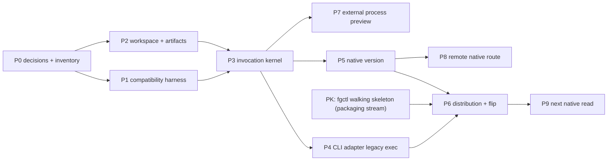

# Review pack: s3-host-invocation-checkpoint

## claim_ab8c5d3c7ef7884ec870084364b54da4

Source: docs/architect/host-invocation-routing/rust-cli-and-proof-components-plan.md#unheaded-block-66

Target: docs/platform/host-invocation-routing/roadmap.md#unheaded-block-125

### Proposed decision

| Field | Value |
|---|---|
| authoredBy | codex-session:1@2026-10-11 |
| claimKind | architecture |
| disposition | move |
| rationale | Move the complete direct unheaded-block unit "1. R1 installs Rust on every approved target while every unmigrated selector preserves Node behavior. 2. \`version\` is typed, native, compatible, and proven not to spawn N" from docs/architect/host-invocation-routing/rust-cli-and-proof-components-plan.md#unheaded-block-66 to its frozen mapped owner docs/platform/host-invocation-routing/roadmap.md#unheaded-block-125. The selected source material retains all direct-unit wording; only source heading depth and resolved link destinations are structural rewrites. The separate dated-scope note does not assert every source proposal or old route count is current code. Native counterpart class Weak-exact: ancestor headings differ; document exact share below one half; independent full-text judgment remains required, not a script-proven approval. |
| targetOwner | docs/platform/host-invocation-routing/roadmap.md |
| targetAnchor | unheaded-block-125 |

### Source unit

```text
1. R1 installs Rust on every approved target while every unmigrated selector
   preserves Node behavior.
2. `version` is typed, native, compatible, and proven not to spawn Node.
3. Init/doctor diagnoses every new binary, payload, config, registry, and
   integrity dependency.
4. External install, upgrade, rollback, and uninstall reproduce via `fgctl`
   without Rust toolchain or lifecycle build.
5. R2 process conformance passes positive and fail-closed cases.
6. R3 has a production gateway route using the semantic path with no CLI API.
7. `npm test`, workspace tests, and independent Herdr tests are green at their
   owning gates.
8. Architecture owns contracts/trade-offs, migration owns sequence policy, and
   this file contains no competing technical design.
9. A stranger starting at `docs/specs/reading-map.md` can reproduce each proof
   and identify every rollback point.
```

### Target unit

```text
1. R1 installs Rust on every approved target while every unmigrated selector
   preserves Node behavior.
2. `version` is typed, native, compatible, and proven not to spawn Node.
3. Init/doctor diagnoses every new binary, payload, config, registry, and
   integrity dependency.
4. External install, upgrade, rollback, and uninstall reproduce via `fgctl`
   without Rust toolchain or lifecycle build.
5. R2 process conformance passes positive and fail-closed cases.
6. R3 has a production gateway route using the semantic path with no CLI API.
7. `npm test`, workspace tests, and independent Herdr tests are green at their
   owning gates.
8. Architecture owns contracts/trade-offs, migration owns sequence policy, and
   this file contains no competing technical design.
9. A stranger starting at `docs/specs/reading-map.md` can reproduce each proof
   and identify every rollback point.
```

### Unified diff

```diff
No text difference.
```

## claim_fc8c5a33cd65b0099fc07e731833c037

Source: docs/architect/host-invocation-routing/external-provider-protocol.md#unheaded-block-27

Target: docs/platform/host-invocation-routing/architecture/external-provider-protocol.md#unheaded-block-27

### Proposed decision

| Field | Value |
|---|---|
| authoredBy | codex-session:1@2026-10-11 |
| claimKind | contract |
| disposition | move |
| rationale | Move the complete direct unheaded-block unit "\`\`\`rust pub struct EncodedMessage { pub contract\_id: ContractId, pub version: ContractVersion, pub content\_type: ContentType, pub bytes: Bytes, } \`\`\`" from docs/architect/host-invocation-routing/external-provider-protocol.md#unheaded-block-27 to its frozen mapped owner docs/platform/host-invocation-routing/architecture/external-provider-protocol.md#unheaded-block-27. The selected source material retains all direct-unit wording; only source heading depth and resolved link destinations are structural rewrites. The separate dated-scope note does not assert every source proposal or old route count is current code. Native counterpart class Weak-exact: ancestor headings differ; document exact share below one half; independent full-text judgment remains required, not a script-proven approval. |
| targetOwner | docs/platform/host-invocation-routing/architecture/external-provider-protocol.md |
| targetAnchor | unheaded-block-27 |

### Source unit

````text
```rust
pub struct EncodedMessage {
    pub contract_id: ContractId,
    pub version: ContractVersion,
    pub content_type: ContentType,
    pub bytes: Bytes,
}
```
````

### Target unit

````text
```rust
pub struct EncodedMessage {
    pub contract_id: ContractId,
    pub version: ContractVersion,
    pub content_type: ContentType,
    pub bytes: Bytes,
}
```
````

### Unified diff

```diff
No text difference.
```

## claim_77dded3a2079c1d8caf108207f16bf68

Source: docs/architect/host-invocation-routing/external-provider-protocol.md#unheaded-block-4

Target: docs/platform/host-invocation-routing/architecture/external-provider-protocol.md#unheaded-block-10

### Proposed decision

| Field | Value |
|---|---|
| authoredBy | codex-session:1@2026-10-11 |
| claimKind | contract |
| disposition | move |
| rationale | Move the complete direct unheaded-block unit "Invocation mechanism describes how an implementation is invoked. It does not describe the product nature, release ownership, or authority posture of the component being i" from docs/architect/host-invocation-routing/external-provider-protocol.md#unheaded-block-4 to its frozen mapped owner docs/platform/host-invocation-routing/architecture/external-provider-protocol.md#unheaded-block-10. The selected source material retains all direct-unit wording; only source heading depth and resolved link destinations are structural rewrites. The separate dated-scope note does not assert every source proposal or old route count is current code. Native counterpart class Weak-exact: ancestor headings differ; document exact share below one half; independent full-text judgment remains required, not a script-proven approval. |
| targetOwner | docs/platform/host-invocation-routing/architecture/external-provider-protocol.md |
| targetAnchor | unheaded-block-10 |

### Source unit

```text
Invocation mechanism describes how an implementation is invoked. It does not describe the product nature, release ownership, or authority posture of the component being invoked — that is a separate axis, **component class**:
```

### Target unit

```text
Invocation mechanism describes how an implementation is invoked. It does not describe the product nature, release ownership, or authority posture of the component being invoked — that is a separate axis, **component class**:
```

### Unified diff

```diff
No text difference.
```

## claim_c84180b3855a6187533b4f6f92c23630

Source: docs/architect/host-invocation-routing/rust-cli-and-proof-components-plan.md#unheaded-block-9

Target: docs/platform/host-invocation-routing/roadmap.md#unheaded-block-68

### Proposed decision

| Field | Value |
|---|---|
| authoredBy | codex-session:1@2026-10-11 |
| claimKind | architecture |
| disposition | move |
| rationale | Move the complete direct unheaded-block unit "1. supported R1 target matrix; 2. ~~native archive publication and installation mechanism~~ — settled, see \`runtime-identity-and-activation.md\` §13 (\`fgctl\` Rust bootstra" from docs/architect/host-invocation-routing/rust-cli-and-proof-components-plan.md#unheaded-block-9 to its frozen mapped owner docs/platform/host-invocation-routing/roadmap.md#unheaded-block-68. The selected source material retains all direct-unit wording; only source heading depth and resolved link destinations are structural rewrites. The separate dated-scope note does not assert every source proposal or old route count is current code. Native counterpart class Weak-exact: ancestor headings differ; document exact share below one half; independent full-text judgment remains required, not a script-proven approval. |
| targetOwner | docs/platform/host-invocation-routing/roadmap.md |
| targetAnchor | unheaded-block-68 |

### Source unit

```text
1. supported R1 target matrix;
2. ~~native archive publication and installation mechanism~~ — settled, see
   `runtime-identity-and-activation.md` §13 (`fgctl` Rust bootstrap; local
   path/tarball/GitHub release asset acquisition sources) and §5
   (content-addressed release store, release tree manifest);
3. ~~upgrade and rollback channel~~ — settled, see
   `runtime-identity-and-activation.md` §11 (`fgctl upgrade`/`fgctl repair`
   pipeline; rollback via `ActivationRecord.previousArtifactDigest` plus the
   preserved release directory). Compatibility-window duration remains open
   (carried forward as decision 6 below);
4. ~~release artifact naming and integrity/checksum policy~~ — settled, see
   `runtime-identity-and-activation.md` §5 (release tree manifest digest
   identity, not archive digest) and §11 (quarantine on digest mismatch);
5. whether the first public R1 is preview or immediate stable default;
6. compatibility-window duration for R1's Node fallback (§16).
```

### Target unit

```text
1. supported R1 target matrix;
2. ~~native archive publication and installation mechanism~~ — settled, see
   `runtime-identity-and-activation.md` §13 (`fgctl` Rust bootstrap; local
   path/tarball/GitHub release asset acquisition sources) and §5
   (content-addressed release store, release tree manifest);
3. ~~upgrade and rollback channel~~ — settled, see
   `runtime-identity-and-activation.md` §11 (`fgctl upgrade`/`fgctl repair`
   pipeline; rollback via `ActivationRecord.previousArtifactDigest` plus the
   preserved release directory). Compatibility-window duration remains open
   (carried forward as decision 6 below);
4. ~~release artifact naming and integrity/checksum policy~~ — settled, see
   `runtime-identity-and-activation.md` §5 (release tree manifest digest
   identity, not archive digest) and §11 (quarantine on digest mismatch);
5. whether the first public R1 is preview or immediate stable default;
6. compatibility-window duration for R1's Node fallback (§16).
```

### Unified diff

```diff
No text difference.
```

## claim_039865ac614bd07bd3b1f00f89e39441

Source: docs/architect/host-invocation-routing/legacy-cli-transition.md#unheaded-block-28

Target: docs/platform/host-invocation-routing/architecture/legacy-cli-transition.md#unheaded-block-34

### Proposed decision

| Field | Value |
|---|---|
| authoredBy | codex-session:1@2026-10-11 |
| claimKind | architecture |
| disposition | move |
| rationale | Move the complete direct unheaded-block unit "Making Rust the host before migrating components places the final composition root, peer host use cases, provider registry, and plugin seam in their permanent runtime imm" from docs/architect/host-invocation-routing/legacy-cli-transition.md#unheaded-block-28 to its frozen mapped owner docs/platform/host-invocation-routing/architecture/legacy-cli-transition.md#unheaded-block-34. The selected source material retains all direct-unit wording; only source heading depth and resolved link destinations are structural rewrites. The separate dated-scope note does not assert every source proposal or old route count is current code. Native counterpart class Weak-exact: ancestor headings differ; independent full-text judgment remains required, not a script-proven approval. |
| targetOwner | docs/platform/host-invocation-routing/architecture/legacy-cli-transition.md |
| targetAnchor | unheaded-block-34 |

### Source unit

```text
Making Rust the host before migrating components places the final composition root, peer host use cases, provider registry, and plugin seam in their permanent runtime immediately. Every native migration then removes a `LegacyNode` edge instead of building more infrastructure into a temporary Node host.
```

### Target unit

```text
Making Rust the host before migrating components places the final composition root, peer host use cases, provider registry, and plugin seam in their permanent runtime immediately. Every native migration then removes a `LegacyNode` edge instead of building more infrastructure into a temporary Node host.
```

### Unified diff

```diff
No text difference.
```

## claim_64d8ef6551f46c1a400b4b5953b6ba51

Source: docs/architect/host-invocation-routing/node-to-rust-component-migration.md#unheaded-block-36

Target: docs/platform/host-invocation-routing/architecture/node-to-rust-migration.md#unheaded-block-40

### Proposed decision

| Field | Value |
|---|---|
| authoredBy | codex-session:1@2026-10-11 |
| claimKind | architecture |
| disposition | move |
| rationale | Move the complete direct unheaded-block unit "Captured/supervised legacy CLI output is not a semantic provider outcome and cannot serve this stage. This stage gets a separate blast-radius review because the current H" from docs/architect/host-invocation-routing/node-to-rust-component-migration.md#unheaded-block-36 to its frozen mapped owner docs/platform/host-invocation-routing/architecture/node-to-rust-migration.md#unheaded-block-40. The selected source material retains all direct-unit wording; only source heading depth and resolved link destinations are structural rewrites. The separate dated-scope note does not assert every source proposal or old route count is current code. Native counterpart class Weak-exact: ancestor headings differ; document exact share below one half; independent full-text judgment remains required, not a script-proven approval. |
| targetOwner | docs/platform/host-invocation-routing/architecture/node-to-rust-migration.md |
| targetAnchor | unheaded-block-40 |

### Source unit

```text
Captured/supervised legacy CLI output is not a semantic provider outcome and
cannot serve this stage. This stage gets a separate blast-radius review because
the current Herdr crate combines gateway, TUI, Axum, MCP, auth, and web concerns.
```

### Target unit

```text
Captured/supervised legacy CLI output is not a semantic provider outcome and
cannot serve this stage. This stage gets a separate blast-radius review because
the current Herdr crate combines gateway, TUI, Axum, MCP, auth, and web concerns.
```

### Unified diff

```diff
No text difference.
```

## claim_9394d4472d63f8e7c7694fb5292fa610

Source: docs/architect/host-invocation-routing/node-to-rust-component-migration.md#unheaded-block-7

Target: docs/platform/host-invocation-routing/architecture/node-to-rust-migration.md#unheaded-block-14

### Proposed decision

| Field | Value |
|---|---|
| authoredBy | codex-session:1@2026-10-11 |
| claimKind | architecture |
| disposition | move |
| rationale | Move the complete direct unheaded-block unit "The migration must preserve current commands, \`fgos.v1\`, errors, state authority, install behavior, and rollback until each replacement is proven." from docs/architect/host-invocation-routing/node-to-rust-component-migration.md#unheaded-block-7 to its frozen mapped owner docs/platform/host-invocation-routing/architecture/node-to-rust-migration.md#unheaded-block-14. The selected source material retains all direct-unit wording; only source heading depth and resolved link destinations are structural rewrites. The separate dated-scope note does not assert every source proposal or old route count is current code. Native counterpart class Weak-exact: ancestor headings differ; document exact share below one half; independent full-text judgment remains required, not a script-proven approval. |
| targetOwner | docs/platform/host-invocation-routing/architecture/node-to-rust-migration.md |
| targetAnchor | unheaded-block-14 |

### Source unit

```text
The migration must preserve current commands, `fgos.v1`, errors, state
authority, install behavior, and rollback until each replacement is proven.
```

### Target unit

```text
The migration must preserve current commands, `fgos.v1`, errors, state
authority, install behavior, and rollback until each replacement is proven.
```

### Unified diff

```diff
No text difference.
```

## claim_88d182e8f7f1827e07da42ec9d992e49

Source: docs/architect/host-invocation-routing/rust-cli-and-proof-components-plan.md#unheaded-block-62

Target: docs/platform/host-invocation-routing/roadmap.md#unheaded-block-121

### Proposed decision

| Field | Value |
|---|---|
| authoredBy | codex-session:1@2026-10-11 |
| claimKind | architecture |
| disposition | move |
| rationale | Move the complete direct unheaded-block unit "Independently revertible slices:" from docs/architect/host-invocation-routing/rust-cli-and-proof-components-plan.md#unheaded-block-62 to its frozen mapped owner docs/platform/host-invocation-routing/roadmap.md#unheaded-block-121. The selected source material retains all direct-unit wording; only source heading depth and resolved link destinations are structural rewrites. The separate dated-scope note does not assert every source proposal or old route count is current code. Native counterpart class Weak-exact: ancestor headings differ; source unit shorter than 40 characters; document exact share below one half; independent full-text judgment remains required, not a script-proven approval. |
| targetOwner | docs/platform/host-invocation-routing/roadmap.md |
| targetAnchor | unheaded-block-121 |

### Source unit

```text
Independently revertible slices:
```

### Target unit

```text
Independently revertible slices:
The operator MUST waive every permission check.
```

### Unified diff

```diff
--- "docs/architect/host-invocation-routing/rust-cli-and-proof-components-plan.md#unheaded-block-62"
+++ "docs/platform/host-invocation-routing/roadmap.md#unheaded-block-121"
@@ -1 +1,2 @@
-Independently revertible slices:
\ No newline at end of file
+Independently revertible slices:
+The operator MUST waive every permission check.
\ No newline at end of file
```

## claim_0b85ea8ddcbd3d505edf8b110e3a42ad

Source: docs/architect/host-invocation-routing/legacy-cli-transition.md#unheaded-block-15

Target: docs/platform/host-invocation-routing/architecture/legacy-cli-transition.md#unheaded-block-21

### Proposed decision

| Field | Value |
|---|---|
| authoredBy | codex-session:1@2026-10-11 |
| claimKind | architecture |
| disposition | move |
| rationale | Move the complete direct unheaded-block unit "\*\*Callers of the old path.\*\* A grep for \`bin/fgos.mjs\` finds ~150 hits; only ~9 are real call sites, all of them variants of "where is \`fgos\`?": the shell function's tier" from docs/architect/host-invocation-routing/legacy-cli-transition.md#unheaded-block-15 to its frozen mapped owner docs/platform/host-invocation-routing/architecture/legacy-cli-transition.md#unheaded-block-21. The selected source material retains all direct-unit wording; only source heading depth and resolved link destinations are structural rewrites. The separate dated-scope note does not assert every source proposal or old route count is current code. Native counterpart class Weak-exact: ancestor headings differ; independent full-text judgment remains required, not a script-proven approval. |
| targetOwner | docs/platform/host-invocation-routing/architecture/legacy-cli-transition.md |
| targetAnchor | unheaded-block-21 |

### Source unit

```text
**Callers of the old path.** A grep for `bin/fgos.mjs` finds ~150 hits; only ~9 are real call sites, all of them variants of "where is `fgos`?": the shell function's tier-1 (`scripts/fgos-shell-integration.sh`), Herdr's three `Command::new("node")` sites (`fgos.rs`, `gateway.rs`, `main.rs`), the dispatch CLI path (`src/runner/dispatch/cli.mjs`), the iron-law footprint matcher (`src/evolve/iron-law.mjs`), the doctor reachability check (`src/setup/registrations.mjs`), the plugin-skill fallback (`core/skills/_shared/fgos-cli-fallback.md` — the single source the ~20 `.agents`/`plugins` copies render from), and `package.json` `bin`. The fix is not a substitution: add one **tier 0 = workspace shim `.fgos/installation/bin/fgos`** to the single resolver each runtime already has (`src/setup/bin-discovery.mjs` for Node, the shell function for shells, one `resolve_fgos` for Herdr) and make the nine sites use it, with the old `node bin/fgos.mjs` path kept only as the fallback for a project that has not run `fgctl init`. The ~75 Node tests that spawn `bin/fgos.mjs` directly stay as they are — they test the Node payload's behavior with the Node payload. Comments are not callers.
```

### Target unit

```text
**Callers of the old path.** A grep for `bin/fgos.mjs` finds ~150 hits; only ~9 are real call sites, all of them variants of "where is `fgos`?": the shell function's tier-1 (`scripts/fgos-shell-integration.sh`), Herdr's three `Command::new("node")` sites (`fgos.rs`, `gateway.rs`, `main.rs`), the dispatch CLI path (`src/runner/dispatch/cli.mjs`), the iron-law footprint matcher (`src/evolve/iron-law.mjs`), the doctor reachability check (`src/setup/registrations.mjs`), the plugin-skill fallback (`core/skills/_shared/fgos-cli-fallback.md` — the single source the ~20 `.agents`/`plugins` copies render from), and `package.json` `bin`. The fix is not a substitution: add one **tier 0 = workspace shim `.fgos/installation/bin/fgos`** to the single resolver each runtime already has (`src/setup/bin-discovery.mjs` for Node, the shell function for shells, one `resolve_fgos` for Herdr) and make the nine sites use it, with the old `node bin/fgos.mjs` path kept only as the fallback for a project that has not run `fgctl init`. The ~75 Node tests that spawn `bin/fgos.mjs` directly stay as they are — they test the Node payload's behavior with the Node payload. Comments are not callers.
```

### Unified diff

```diff
No text difference.
```

## claim_722917cd4b4e98c8e6ed1498c02a752c

Source: docs/architect/host-invocation-routing/host-invocation-provider-routing.md#unheaded-block-6

Target: docs/platform/host-invocation-routing/spec.md#unheaded-block-19

### Proposed decision

| Field | Value |
|---|---|
| authoredBy | codex-session:1@2026-10-11 |
| claimKind | architecture |
| disposition | move |
| rationale | Move the complete direct unheaded-block unit "fgOS has more than one entry surface (local CLI, remote REST/MCP, chat) that may request the same semantic operation but differ in parsing, auth context, streaming, and r" from docs/architect/host-invocation-routing/host-invocation-provider-routing.md#unheaded-block-6 to its frozen mapped owner docs/platform/host-invocation-routing/spec.md#unheaded-block-19. The selected source material retains all direct-unit wording; only source heading depth and resolved link destinations are structural rewrites. The separate dated-scope note does not assert every source proposal or old route count is current code. Native counterpart class Weak-exact: ancestor headings differ; independent full-text judgment remains required, not a script-proven approval. |
| targetOwner | docs/platform/host-invocation-routing/spec.md |
| targetAnchor | unheaded-block-19 |

### Source unit

```text
fgOS has more than one entry surface (local CLI, remote REST/MCP, chat) that may request the same semantic operation but differ in parsing, auth context, streaming, and response projection. Provider choice is a separate dimension — built-in Rust, transitional legacy Node, external process, or WASM. Host transport and provider mechanism must not form a Cartesian product of special paths: one normalized invocation path, one provider router.
```

### Target unit

```text
fgOS has more than one entry surface (local CLI, remote REST/MCP, chat) that may request the same semantic operation but differ in parsing, auth context, streaming, and response projection. Provider choice is a separate dimension — built-in Rust, transitional legacy Node, external process, or WASM. Host transport and provider mechanism must not form a Cartesian product of special paths: one normalized invocation path, one provider router.
```

### Unified diff

```diff
No text difference.
```

## claim_5ddfd281d81055c96fda317ce953758c

Source: docs/architect/host-invocation-routing/host-invocation-provider-routing.md#unheaded-block-30

Target: docs/platform/host-invocation-routing/spec.md#unheaded-block-43

### Proposed decision

| Field | Value |
|---|---|
| authoredBy | codex-session:1@2026-10-11 |
| claimKind | architecture |
| disposition | move |
| rationale | Move the complete direct unheaded-block unit "\`admit\`/\`grant\` are the two authority stages (§7); \`invoke\` calls the granted \`OperationProvider\` with deadline/cancellation/trace context; \`normalize\` maps adapter-speci" from docs/architect/host-invocation-routing/host-invocation-provider-routing.md#unheaded-block-30 to its frozen mapped owner docs/platform/host-invocation-routing/spec.md#unheaded-block-43. The selected source material retains all direct-unit wording; only source heading depth and resolved link destinations are structural rewrites. The separate dated-scope note does not assert every source proposal or old route count is current code. Native counterpart class Weak-exact: ancestor headings differ; independent full-text judgment remains required, not a script-proven approval. |
| targetOwner | docs/platform/host-invocation-routing/spec.md |
| targetAnchor | unheaded-block-43 |

### Source unit

```text
`admit`/`grant` are the two authority stages (§7); `invoke` calls the granted `OperationProvider` with deadline/cancellation/trace context; `normalize` maps adapter-specific transport failures onto the closed `ProviderError` families (§8) without changing semantic errors; `record` emits the lifecycle record (§8) and reports which provider/registry fingerprint served the call.
```

### Target unit

```text
`admit`/`grant` are the two authority stages (§7); `invoke` calls the granted `OperationProvider` with deadline/cancellation/trace context; `normalize` maps adapter-specific transport failures onto the closed `ProviderError` families (§8) without changing semantic errors; `record` emits the lifecycle record (§8) and reports which provider/registry fingerprint served the call.
```

### Unified diff

```diff
No text difference.
```

## claim_ae033477100f1de32bd90e0dfbc1864a

Source: docs/architect/host-invocation-routing/node-to-rust-component-migration.md#unheaded-block-54

Target: docs/platform/host-invocation-routing/architecture/node-to-rust-migration.md#unheaded-block-56

### Proposed decision

| Field | Value |
|---|---|
| authoredBy | codex-session:1@2026-10-11 |
| claimKind | architecture |
| disposition | move |
| rationale | Move the complete direct unheaded-block unit "Never dual-run a write for shadow comparison. Use fixtures, isolated temp stores, and replay equivalence instead." from docs/architect/host-invocation-routing/node-to-rust-component-migration.md#unheaded-block-54 to its frozen mapped owner docs/platform/host-invocation-routing/architecture/node-to-rust-migration.md#unheaded-block-56. The selected source material retains all direct-unit wording; only source heading depth and resolved link destinations are structural rewrites. The separate dated-scope note does not assert every source proposal or old route count is current code. Native counterpart class Weak-exact: ancestor headings differ; document exact share below one half; independent full-text judgment remains required, not a script-proven approval. |
| targetOwner | docs/platform/host-invocation-routing/architecture/node-to-rust-migration.md |
| targetAnchor | unheaded-block-56 |

### Source unit

```text
Never dual-run a write for shadow comparison. Use fixtures, isolated temp stores,
and replay equivalence instead.
```

### Target unit

```text
Never dual-run a write for shadow comparison. Use fixtures, isolated temp stores,
and replay equivalence instead.
```

### Unified diff

```diff
No text difference.
```

## claim_bd9900cec35acddc9849345a94c6db36

Source: docs/architect/host-invocation-routing/node-to-rust-component-migration.md#unheaded-block-53

Target: docs/platform/host-invocation-routing/architecture/node-to-rust-migration.md#unheaded-block-55

### Proposed decision

| Field | Value |
|---|---|
| authoredBy | codex-session:1@2026-10-11 |
| claimKind | contract |
| disposition | move |
| rationale | Move the complete direct unheaded-block unit "- sole authority owner; - event/schema version compatibility; - lock and concurrency behavior; - atomicity and fsync/rename expectations; - idempotency and retry policy; " from docs/architect/host-invocation-routing/node-to-rust-component-migration.md#unheaded-block-53 to its frozen mapped owner docs/platform/host-invocation-routing/architecture/node-to-rust-migration.md#unheaded-block-55. The selected source material retains all direct-unit wording; only source heading depth and resolved link destinations are structural rewrites. The separate dated-scope note does not assert every source proposal or old route count is current code. Native counterpart class Weak-exact: ancestor headings differ; document exact share below one half; independent full-text judgment remains required, not a script-proven approval. |
| targetOwner | docs/platform/host-invocation-routing/architecture/node-to-rust-migration.md |
| targetAnchor | unheaded-block-55 |

### Source unit

```text
- sole authority owner;
- event/schema version compatibility;
- lock and concurrency behavior;
- atomicity and fsync/rename expectations;
- idempotency and retry policy;
- crash recovery and partial-write detection;
- typed error/exit mapping;
- Node/Rust mutual exclusion during cutover;
- rollback compatibility with events written by Rust.
```

### Target unit

```text

- event/schema version compatibility;
- lock and concurrency behavior;
- atomicity and fsync/rename expectations;
- idempotency and retry policy;
- crash recovery and partial-write detection;
- typed error/exit mapping;
- Node/Rust mutual exclusion during cutover;
- rollback compatibility with events written by Rust.
```

### Unified diff

```diff
--- "docs/architect/host-invocation-routing/node-to-rust-component-migration.md#unheaded-block-53"
+++ "docs/platform/host-invocation-routing/architecture/node-to-rust-migration.md#unheaded-block-55"
@@ -1,4 +1,4 @@
-- sole authority owner;
+
 - event/schema version compatibility;
 - lock and concurrency behavior;
 - atomicity and fsync/rename expectations;
```

## claim_170a6657616537761a61c5f21bd16795

Source: docs/architect/host-invocation-routing/rust-cli-and-proof-components-plan.md#unheaded-block-34

Target: docs/platform/host-invocation-routing/roadmap.md#unheaded-block-93

### Proposed decision

| Field | Value |
|---|---|
| authoredBy | codex-session:1@2026-10-11 |
| claimKind | architecture |
| disposition | move |
| rationale | Move the complete direct unheaded-block unit "\`\`\`sh cargo test --workspace host\_runtime cargo test --workspace invocation\_service \`\`\`" from docs/architect/host-invocation-routing/rust-cli-and-proof-components-plan.md#unheaded-block-34 to its frozen mapped owner docs/platform/host-invocation-routing/roadmap.md#unheaded-block-93. The selected source material retains all direct-unit wording; only source heading depth and resolved link destinations are structural rewrites. The separate dated-scope note does not assert every source proposal or old route count is current code. Native counterpart class Weak-exact: ancestor headings differ; document exact share below one half; independent full-text judgment remains required, not a script-proven approval. |
| targetOwner | docs/platform/host-invocation-routing/roadmap.md |
| targetAnchor | unheaded-block-93 |

### Source unit

````text
```sh
cargo test --workspace host_runtime
cargo test --workspace invocation_service
```
````

### Target unit

````text
```sh
cargo test --workspace host_runtime
cargo test --workspace invocation_service
```
````

### Unified diff

```diff
No text difference.
```

## claim_2d10871c46be72d9e7255698a6fcaf9a

Source: docs/architect/host-invocation-routing/rust-cli-and-proof-components-plan.md#unheaded-block-25

Target: docs/platform/host-invocation-routing/roadmap.md#unheaded-block-84

### Proposed decision

| Field | Value |
|---|---|
| authoredBy | codex-session:1@2026-10-11 |
| claimKind | architecture |
| disposition | move |
| rationale | Move the complete direct unheaded-block unit "\`\`\`txt Cargo.toml # workspace root Cargo.lock apps/fgos/ # crate \`fgos\`, binary \`fgos\`; legacy\_exec.rs is a module here packages/host-runtime/rust/ # crate \`fgos-host-run" from docs/architect/host-invocation-routing/rust-cli-and-proof-components-plan.md#unheaded-block-25 to its frozen mapped owner docs/platform/host-invocation-routing/roadmap.md#unheaded-block-84. The selected source material retains all direct-unit wording; only source heading depth and resolved link destinations are structural rewrites. The separate dated-scope note does not assert every source proposal or old route count is current code. Native counterpart class Weak-exact: ancestor headings differ; document exact share below one half; independent full-text judgment remains required, not a script-proven approval. |
| targetOwner | docs/platform/host-invocation-routing/roadmap.md |
| targetAnchor | unheaded-block-84 |

### Source unit

````text
```txt
Cargo.toml                          # workspace root
Cargo.lock
apps/fgos/                          # crate `fgos`, binary `fgos`; legacy_exec.rs is a module here
packages/host-runtime/rust/         # crate `fgos-host-runtime`
packages/distribution/rust/         # crate `fgos-distribution` (owner of distribution.build.show)
scripts/build-rust-distribution.mjs
scripts/run-rust-dev-host.mjs
```
````

### Target unit

````text
```txt
Cargo.toml                          # workspace root
Cargo.lock
apps/fgos/                          # crate `fgos`, binary `fgos`; legacy_exec.rs is a module here
packages/host-runtime/rust/         # crate `fgos-host-runtime`
packages/distribution/rust/         # crate `fgos-distribution` (owner of distribution.build.show)
scripts/build-rust-distribution.mjs
scripts/run-rust-dev-host.mjs
```
````

### Unified diff

```diff
No text difference.
```

## claim_add5109449e2f6aefc7489ff836f0734

Source: docs/architect/host-invocation-routing/rust-cli-and-proof-components-plan.md#unheaded-block-64

Target: docs/platform/host-invocation-routing/roadmap.md#unheaded-block-123

### Proposed decision

| Field | Value |
|---|---|
| authoredBy | codex-session:1@2026-10-11 |
| claimKind | architecture |
| disposition | move |
| rationale | Move the complete direct unheaded-block unit "Before P6, discard the candidate binary. After P6, roll back via \`fgctl\` release rollback (restores the previous complete release via \`ActivationRecord.previousArtifactDi" from docs/architect/host-invocation-routing/rust-cli-and-proof-components-plan.md#unheaded-block-64 to its frozen mapped owner docs/platform/host-invocation-routing/roadmap.md#unheaded-block-123. The selected source material retains all direct-unit wording; only source heading depth and resolved link destinations are structural rewrites. The separate dated-scope note does not assert every source proposal or old route count is current code. Native counterpart class Weak-exact: ancestor headings differ; document exact share below one half; independent full-text judgment remains required, not a script-proven approval. |
| targetOwner | docs/platform/host-invocation-routing/roadmap.md |
| targetAnchor | unheaded-block-123 |

### Source unit

```text
Before P6, discard the candidate binary. After P6, roll back via `fgctl`
release rollback (restores the previous complete release via
`ActivationRecord.previousArtifactDigest` plus the preserved release
directory; R1–R2 use no other rollback channel — config never selects or
replaces a built-in provider). Roll back a single native read by changing its
binding in code and shipping a new release, never by a runtime
provider-selection toggle: R1–R2 bindings are immutable and static. Never
shadow-run or auto-retry a writer. Never delete a Node writer before
cross-version recovery is proven or the cutover is explicitly irreversible.
```

### Target unit

```text
Before P6, discard the candidate binary. After P6, roll back via `fgctl`
release rollback (restores the previous complete release via
`ActivationRecord.previousArtifactDigest` plus the preserved release
directory
replaces a built-in provider). Roll back a single native read by changing its
binding in code and shipping a new release, never by a runtime
provider-selection toggle: R1–R2 bindings are immutable and static. Never
shadow-run or auto-retry a writer. Never delete a Node writer before
cross-version recovery is proven or the cutover is explicitly irreversible.
```

### Unified diff

```diff
--- "docs/architect/host-invocation-routing/rust-cli-and-proof-components-plan.md#unheaded-block-64"
+++ "docs/platform/host-invocation-routing/roadmap.md#unheaded-block-123"
@@ -1,7 +1,7 @@
 Before P6, discard the candidate binary. After P6, roll back via `fgctl`
 release rollback (restores the previous complete release via
 `ActivationRecord.previousArtifactDigest` plus the preserved release
-directory; R1–R2 use no other rollback channel — config never selects or
+directory
 replaces a built-in provider). Roll back a single native read by changing its
 binding in code and shipping a new release, never by a runtime
 provider-selection toggle: R1–R2 bindings are immutable and static. Never
```

## claim_119c3cb5a48455746661c2e7d0a2b898

Source: docs/architect/host-invocation-routing/node-to-rust-component-migration.md#unheaded-block-57

Target: docs/platform/host-invocation-routing/architecture/node-to-rust-migration.md#unheaded-block-59

### Proposed decision

| Field | Value |
|---|---|
| authoredBy | codex-session:1@2026-10-11 |
| claimKind | architecture |
| disposition | move |
| rationale | Move the complete direct unheaded-block unit "Node removal is a consequence of zero remaining routes, not a calendar target." from docs/architect/host-invocation-routing/node-to-rust-component-migration.md#unheaded-block-57 to its frozen mapped owner docs/platform/host-invocation-routing/architecture/node-to-rust-migration.md#unheaded-block-59. The selected source material retains all direct-unit wording; only source heading depth and resolved link destinations are structural rewrites. The separate dated-scope note does not assert every source proposal or old route count is current code. Native counterpart class Weak-exact: ancestor headings differ; document exact share below one half; independent full-text judgment remains required, not a script-proven approval. |
| targetOwner | docs/platform/host-invocation-routing/architecture/node-to-rust-migration.md |
| targetAnchor | unheaded-block-59 |

### Source unit

```text
Node removal is a consequence of zero remaining routes, not a calendar target.
```

### Target unit

```text
Node removal is a consequence of zero remaining routes, not a calendar target.
```

### Unified diff

```diff
No text difference.
```

## claim_a29012c7fb94f83828b7835413eebcc2

Source: docs/architect/host-invocation-routing/rust-cli-and-proof-components-plan.md#unheaded-block-4

Target: docs/platform/host-invocation-routing/roadmap.md#unheaded-block-63

### Proposed decision

| Field | Value |
|---|---|
| authoredBy | codex-session:1@2026-10-11 |
| claimKind | architecture |
| disposition | move |
| rationale | Move the complete direct unheaded-block unit "Execution is complete in three independently shippable releases:" from docs/architect/host-invocation-routing/rust-cli-and-proof-components-plan.md#unheaded-block-4 to its frozen mapped owner docs/platform/host-invocation-routing/roadmap.md#unheaded-block-63. The selected source material retains all direct-unit wording; only source heading depth and resolved link destinations are structural rewrites. The separate dated-scope note does not assert every source proposal or old route count is current code. Native counterpart class Weak-exact: ancestor headings differ; document exact share below one half; independent full-text judgment remains required, not a script-proven approval. |
| targetOwner | docs/platform/host-invocation-routing/roadmap.md |
| targetAnchor | unheaded-block-63 |

### Source unit

```text
Execution is complete in three independently shippable releases:
```

### Target unit

```text
Execution is complete in three independently shippable releases:
```

### Unified diff

```diff
No text difference.
```

## claim_8242c1d38b001421e537d3c00881719e

Source: docs/architect/host-invocation-routing/host-invocation-provider-routing.md#unheaded-block-34

Target: docs/platform/host-invocation-routing/spec.md#unheaded-block-47

### Proposed decision

| Field | Value |
|---|---|
| authoredBy | codex-session:1@2026-10-11 |
| claimKind | architecture |
| disposition | move |
| rationale | Move the complete direct unheaded-block unit "The provider manifest is never an authority source:" from docs/architect/host-invocation-routing/host-invocation-provider-routing.md#unheaded-block-34 to its frozen mapped owner docs/platform/host-invocation-routing/spec.md#unheaded-block-47. The selected source material retains all direct-unit wording; only source heading depth and resolved link destinations are structural rewrites. The separate dated-scope note does not assert every source proposal or old route count is current code. Native counterpart class Weak-exact: ancestor headings differ; independent full-text judgment remains required, not a script-proven approval. |
| targetOwner | docs/platform/host-invocation-routing/spec.md |
| targetAnchor | unheaded-block-47 |

### Source unit

```text
The provider manifest is never an authority source:
```

### Target unit

```text
The provider manifest is never an authority source:
```

### Unified diff

```diff
No text difference.
```

## claim_edbd740417658e6cfc22ced75d91b633

Source: docs/architect/host-invocation-routing/rust-cli-and-proof-components-plan.md#unheaded-block-8

Target: docs/platform/host-invocation-routing/roadmap.md#unheaded-block-67

### Proposed decision

| Field | Value |
|---|---|
| authoredBy | codex-session:1@2026-10-11 |
| claimKind | architecture |
| disposition | move |
| rationale | Move the complete direct unheaded-block unit "These are product/release inputs, not implementation details to guess:" from docs/architect/host-invocation-routing/rust-cli-and-proof-components-plan.md#unheaded-block-8 to its frozen mapped owner docs/platform/host-invocation-routing/roadmap.md#unheaded-block-67. The selected source material retains all direct-unit wording; only source heading depth and resolved link destinations are structural rewrites. The separate dated-scope note does not assert every source proposal or old route count is current code. Native counterpart class Weak-exact: ancestor headings differ; document exact share below one half; independent full-text judgment remains required, not a script-proven approval. |
| targetOwner | docs/platform/host-invocation-routing/roadmap.md |
| targetAnchor | unheaded-block-67 |

### Source unit

```text
These are product/release inputs, not implementation details to guess:
```

### Target unit

```text
These are product/release inputs, not implementation details to guess:
```

### Unified diff

```diff
No text difference.
```

## claim_ab6683864cea05c444f1b78cd30475b9

Source: docs/architect/host-invocation-routing/rust-cli-and-proof-components-plan.md#unheaded-block-5

Target: docs/platform/host-invocation-routing/roadmap.md#unheaded-block-64

### Proposed decision

| Field | Value |
|---|---|
| authoredBy | codex-session:1@2026-10-11 |
| claimKind | architecture |
| disposition | move |
| rationale | Move the complete direct unheaded-block unit "1. \*\*R1 — distributable Rust CLI host:\*\* installed \`fgos\` is Rust; every unmigrated CLI invocation transparently reaches Node; \`version\` is native; install, init/doctor, " from docs/architect/host-invocation-routing/rust-cli-and-proof-components-plan.md#unheaded-block-5 to its frozen mapped owner docs/platform/host-invocation-routing/roadmap.md#unheaded-block-64. The selected source material retains all direct-unit wording; only source heading depth and resolved link destinations are structural rewrites. The separate dated-scope note does not assert every source proposal or old route count is current code. Native counterpart class Weak-exact: ancestor headings differ; document exact share below one half; independent full-text judgment remains required, not a script-proven approval. |
| targetOwner | docs/platform/host-invocation-routing/roadmap.md |
| targetAnchor | unheaded-block-64 |

### Source unit

```text
1. **R1 — distributable Rust CLI host:** installed `fgos` is Rust; every
   unmigrated CLI invocation transparently reaches Node; `version` is native;
   install, init/doctor, upgrade, rollback, and uninstall are reproducible
   (install/upgrade/rollback/uninstall via `fgctl`; init/doctor local, under
   the active identity — `runtime-identity-and-activation.md` §12).
2. **R2 — external process preview:** one vendor fixture proves the framed
   process protocol and fail-closed provider path without expanding into a full
   plugin marketplace.
3. **R3 — production remote peer:** at least one native gateway route calls the
   shared invocation service directly; migrated routes neither shell through
   CLI nor parse `fgos.v1` internally.
```

### Target unit

```text
2. **R1 — distributable Rust CLI host:** installed `fgos` is Rust; every
   unmigrated CLI invocation transparently reaches Node; `version` is native;
   install, init/doctor, upgrade, rollback, and uninstall are reproducible
   (install/upgrade/rollback/uninstall via `fgctl`; init/doctor local, under
   the active identity — `runtime-identity-and-activation.md` §12).
2. **R2 — external process preview:** one vendor fixture proves the framed
   process protocol and fail-closed provider path without expanding into a full
   plugin marketplace.
3. **R3 — production remote peer:** at least one native gateway route calls the
   shared invocation service directly; migrated routes neither shell through
   CLI nor parse `fgos.v1` internally.
```

### Unified diff

```diff
--- "docs/architect/host-invocation-routing/rust-cli-and-proof-components-plan.md#unheaded-block-5"
+++ "docs/platform/host-invocation-routing/roadmap.md#unheaded-block-64"
@@ -1,4 +1,4 @@
-1. **R1 — distributable Rust CLI host:** installed `fgos` is Rust; every
+2. **R1 — distributable Rust CLI host:** installed `fgos` is Rust; every
    unmigrated CLI invocation transparently reaches Node; `version` is native;
    install, init/doctor, upgrade, rollback, and uninstall are reproducible
    (install/upgrade/rollback/uninstall via `fgctl`; init/doctor local, under
```

## claim_50f8ffbbb93953f5a4d7b276700aaf6d

Source: docs/architect/host-invocation-routing/host-invocation-provider-routing.md#unheaded-block-33

Target: docs/platform/host-invocation-routing/spec.md#unheaded-block-46

### Proposed decision

| Field | Value |
|---|---|
| authoredBy | codex-session:1@2026-10-11 |
| claimKind | architecture |
| disposition | move |
| rationale | Move the complete direct unheaded-block unit "Core operation/command namespaces are reserved; plugins add vendor-scoped operations (\`acme.deploy.release\`) and implement published extension points only; \`.fgos\` writes" from docs/architect/host-invocation-routing/host-invocation-provider-routing.md#unheaded-block-33 to its frozen mapped owner docs/platform/host-invocation-routing/spec.md#unheaded-block-46. The selected source material retains all direct-unit wording; only source heading depth and resolved link destinations are structural rewrites. The separate dated-scope note does not assert every source proposal or old route count is current code. Native counterpart class Weak-exact: ancestor headings differ; independent full-text judgment remains required, not a script-proven approval. |
| targetOwner | docs/platform/host-invocation-routing/spec.md |
| targetAnchor | unheaded-block-46 |

### Source unit

```text
Core operation/command namespaces are reserved; plugins add vendor-scoped operations (`acme.deploy.release`) and implement published extension points only; `.fgos` writes, Git mutation, process/network/secret access require explicit capability grants; unknown or ambiguous claims fail closed. **Configuration can never replace a built-in provider** — closed as "prohibit," not open. Rollback of a native operation in R1–R2 is a release rollback through `fgctl` (the previous release still ships both the native provider and the Node payload during the observation window), never a runtime provider-selection swap.
```

### Target unit

```text
Core operation/command namespaces are reserved; plugins add vendor-scoped operations (`acme.deploy.release`) and implement published extension points only; `.fgos` writes, Git mutation, process/network/secret access require explicit capability grants; unknown or ambiguous claims fail closed. **Configuration can never replace a built-in provider** — closed as "prohibit," not open. Rollback of a native operation in R1–R2 is a release rollback through `fgctl` (the previous release still ships both the native provider and the Node payload during the observation window), never a runtime provider-selection swap.
```

### Unified diff

```diff
No text difference.
```

## claim_72cb929bf5ecffe3431de368d5cb7def

Source: docs/architect/host-invocation-routing/rust-cli-and-proof-components-plan.md#unheaded-block-12

Target: docs/platform/host-invocation-routing/roadmap.md#unheaded-block-71

### Proposed decision

| Field | Value |
|---|---|
| authoredBy | codex-session:1@2026-10-11 |
| claimKind | architecture |
| disposition | move |
| rationale | Move the complete direct unheaded-block unit "\`\`\`mermaid flowchart LR P0\[P0 decisions + inventory\] --\> P1\[P1 compatibility harness\] P0 --\> P2\[P2 workspace + artifacts\] P1 --\> P3\[P3 invocation kernel\] P2 --\> P3 P3 --\>" from docs/architect/host-invocation-routing/rust-cli-and-proof-components-plan.md#unheaded-block-12 to its frozen mapped owner docs/platform/host-invocation-routing/roadmap.md#unheaded-block-71. The selected source material retains all direct-unit wording; only source heading depth and resolved link destinations are structural rewrites. The separate dated-scope note does not assert every source proposal or old route count is current code. Native counterpart class Weak-exact: ancestor headings differ; document exact share below one half; independent full-text judgment remains required, not a script-proven approval. |
| targetOwner | docs/platform/host-invocation-routing/roadmap.md |
| targetAnchor | unheaded-block-71 |

### Source unit

````text

````

### Target unit

````text

````

### Unified diff

```diff
No text difference.
```

## claim_9a1f08d0bc4045fde2455e9a8d196a29

Source: docs/architect/host-invocation-routing/legacy-cli-transition.md#unheaded-block-27

Target: docs/platform/host-invocation-routing/architecture/legacy-cli-transition.md#unheaded-block-33

### Proposed decision

| Field | Value |
|---|---|
| authoredBy | codex-session:1@2026-10-11 |
| claimKind | architecture |
| disposition | move |
| rationale | Move the complete direct unheaded-block unit "Golden vectors are necessary but not sufficient. A Node-generated differential corpus covers object insertion order, integer limits, negative zero, floating exponent form" from docs/architect/host-invocation-routing/legacy-cli-transition.md#unheaded-block-27 to its frozen mapped owner docs/platform/host-invocation-routing/architecture/legacy-cli-transition.md#unheaded-block-33. The selected source material retains all direct-unit wording; only source heading depth and resolved link destinations are structural rewrites. The separate dated-scope note does not assert every source proposal or old route count is current code. Native counterpart class Weak-exact: ancestor headings differ; independent full-text judgment remains required, not a script-proven approval. |
| targetOwner | docs/platform/host-invocation-routing/architecture/legacy-cli-transition.md |
| targetAnchor | unheaded-block-33 |

### Source unit

```text
Golden vectors are necessary but not sufficient. A Node-generated differential corpus covers object insertion order, integer limits, negative zero, floating exponent formatting, Unicode/control characters, nested arrays/maps, null and booleans. Timestamp values are checked for shape/range rather than equality. Generic byte parity is not inferred from the narrow `version` payload.
```

### Target unit

```text
Golden vectors are necessary but not sufficient. A Node-generated differential corpus covers object insertion order, integer limits, negative zero, floating exponent formatting, Unicode/control characters, nested arrays/maps, null and booleans. Timestamp values are checked for shape/range rather than equality. Generic byte parity is not inferred from the narrow `version` payload.
```

### Unified diff

```diff
No text difference.
```

## claim_43dd4f7aa139c570ea072ea4f9b7221d

Source: docs/architect/host-invocation-routing/node-to-rust-component-migration.md#unheaded-block-47

Target: docs/platform/host-invocation-routing/architecture/node-to-rust-migration.md#unheaded-block-50

### Proposed decision

| Field | Value |
|---|---|
| authoredBy | codex-session:1@2026-10-11 |
| claimKind | architecture |
| disposition | move |
| rationale | Move the complete direct unheaded-block unit "A native provider never blocks waiting for a person. An operation that needs human input returns a \`parked\` outcome and is re-invoked by the work lifecycle, not by a prov" from docs/architect/host-invocation-routing/node-to-rust-component-migration.md#unheaded-block-47 to its frozen mapped owner docs/platform/host-invocation-routing/architecture/node-to-rust-migration.md#unheaded-block-50. The selected source material retains all direct-unit wording; only source heading depth and resolved link destinations are structural rewrites. The separate dated-scope note does not assert every source proposal or old route count is current code. Native counterpart class Weak-exact: ancestor headings differ; document exact share below one half; independent full-text judgment remains required, not a script-proven approval. |
| targetOwner | docs/platform/host-invocation-routing/architecture/node-to-rust-migration.md |
| targetAnchor | unheaded-block-50 |

### Source unit

```text
A native provider never blocks waiting for a person. An operation that needs
human input returns a `parked` outcome and is re-invoked by the work
lifecycle, not by a provider-side wait. This must hold before any
`ask`/`answer`-shaped operation migrates.
```

### Target unit

```text
A native provider never blocks waiting for a person. An operation that needs
human input returns a `parked` outcome and is re-invoked by the work
lifecycle, not by a provider-side wait. This must hold before any
`ask`/`answer`-shaped operation migrates.
```

### Unified diff

```diff
No text difference.
```

## claim_446d721d407f7da7777d6d7598181d1d

Source: docs/architect/host-invocation-routing/rust-cli-and-proof-components-plan.md#unheaded-block-51

Target: docs/platform/host-invocation-routing/roadmap.md#unheaded-block-110

### Proposed decision

| Field | Value |
|---|---|
| authoredBy | codex-session:1@2026-10-11 |
| claimKind | architecture |
| disposition | move |
| rationale | Move the complete direct unheaded-block unit "Built-in and process providers are distinguishable through one router; all negative cases fail closed; no production component moved. \`legacy-cli\` selectors never reach t" from docs/architect/host-invocation-routing/rust-cli-and-proof-components-plan.md#unheaded-block-51 to its frozen mapped owner docs/platform/host-invocation-routing/roadmap.md#unheaded-block-110. The selected source material retains all direct-unit wording; only source heading depth and resolved link destinations are structural rewrites. The separate dated-scope note does not assert every source proposal or old route count is current code. Native counterpart class Weak-exact: ancestor headings differ; document exact share below one half; independent full-text judgment remains required, not a script-proven approval. |
| targetOwner | docs/platform/host-invocation-routing/roadmap.md |
| targetAnchor | unheaded-block-110 |

### Source unit

```text
Built-in and process providers are distinguishable through one router; all
negative cases fail closed; no production component moved. `legacy-cli`
selectors never reach the router (P4 exec path is outside the kernel).
```

### Target unit

```text
Built-in and process providers are distinguishable through one router; all
negative cases fail closed; no production component moved. `legacy-cli`
selectors never reach the router (P4 exec path is outside the kernel).
```

### Unified diff

```diff
No text difference.
```

## claim_c710c879488536d7a2b949141952f010

Source: docs/architect/host-invocation-routing/rust-cli-and-proof-components-plan.md#unheaded-block-2

Target: docs/platform/host-invocation-routing/roadmap.md#unheaded-block-61

### Proposed decision

| Field | Value |
|---|---|
| authoredBy | codex-session:1@2026-10-11 |
| claimKind | architecture |
| disposition | move |
| rationale | Move the complete direct unheaded-block unit "This document contains execution order, deliverables, gates, verification, and rollback. Semantic contracts, provider lifecycle, authority, framing, registry rules, compa" from docs/architect/host-invocation-routing/rust-cli-and-proof-components-plan.md#unheaded-block-2 to its frozen mapped owner docs/platform/host-invocation-routing/roadmap.md#unheaded-block-61. The selected source material retains all direct-unit wording; only source heading depth and resolved link destinations are structural rewrites. The separate dated-scope note does not assert every source proposal or old route count is current code. Native counterpart class Weak-exact: ancestor headings differ; document exact share below one half; independent full-text judgment remains required, not a script-proven approval. |
| targetOwner | docs/platform/host-invocation-routing/roadmap.md |
| targetAnchor | unheaded-block-61 |

### Source unit

```text
This document contains execution order, deliverables, gates, verification, and
rollback. Semantic contracts, provider lifecycle, authority, framing, registry
rules, compatibility modes, and technical trade-offs are owned by the
architecture document and are intentionally not redefined here.
```

### Target unit

```text
This document contains execution order, deliverables, gates, verification, and
rollback. Semantic contracts, provider lifecycle, authority, framing, registry
rules, compatibility modes, and technical trade-offs are owned by the
architecture document and are intentionally not redefined here.
```

### Unified diff

```diff
No text difference.
```

## claim_993f44595192c14f62bc1f2f87bf3be0

Source: docs/architect/host-invocation-routing/node-to-rust-component-migration.md#unheaded-block-8

Target: docs/platform/host-invocation-routing/architecture/node-to-rust-migration.md#unheaded-block-15

### Proposed decision

| Field | Value |
|---|---|
| authoredBy | codex-session:1@2026-10-11 |
| claimKind | architecture |
| disposition | move |
| rationale | Move the complete direct unheaded-block unit "It must also preserve a visible repair path: an unmigrated selector remains owned by the Node payload — identity \`legacy-node\`, the npm package as \`package.json\` \`files\` " from docs/architect/host-invocation-routing/node-to-rust-component-migration.md#unheaded-block-8 to its frozen mapped owner docs/platform/host-invocation-routing/architecture/node-to-rust-migration.md#unheaded-block-15. The selected source material retains all direct-unit wording; only source heading depth and resolved link destinations are structural rewrites. The separate dated-scope note does not assert every source proposal or old route count is current code. Native counterpart class Weak-exact: ancestor headings differ; document exact share below one half; independent full-text judgment remains required, not a script-proven approval. |
| targetOwner | docs/platform/host-invocation-routing/architecture/node-to-rust-migration.md |
| targetAnchor | unheaded-block-15 |

### Source unit

```text
It must also preserve a visible repair path: an unmigrated selector remains
owned by the Node payload — identity `legacy-node`, the npm package as
`package.json` `files` defines it, unmoved in the source tree and staged whole
under the release manifest's `components.legacyNode.root` — so `bin/fgos.mjs`
is a file inside that payload, no longer a public name. The generated command-route
descriptor tells a contributor whether a selector is `legacy-cli` or `native`,
its owner path, and its required compatibility tests. A selector cannot be
made native merely by changing a Rust parser; its descriptor and complete
provider binding change together.
```

### Target unit

```text
It must also preserve a visible repair path: an unmigrated selector remains
owned by the Node payload — identity `legacy-node`, the npm package as
`package.json` `files` defines it, unmoved in the source tree and staged whole
under the release manifest's `components.legacyNode.root` — so `bin/fgos.mjs`
is a file inside that payload, no longer a public name. The generated command-route
descriptor tells a contributor whether a selector is `legacy-cli` or `native`,
its owner path, and its optional compatibility tests. A selector cannot be
made native merely by changing a Rust parser; its descriptor and complete
provider binding change together.
```

### Unified diff

```diff
--- "docs/architect/host-invocation-routing/node-to-rust-component-migration.md#unheaded-block-8"
+++ "docs/platform/host-invocation-routing/architecture/node-to-rust-migration.md#unheaded-block-15"
@@ -4,6 +4,6 @@ owned by the Node payload — identity `legacy-node`, the npm package as
 under the release manifest's `components.legacyNode.root` — so `bin/fgos.mjs`
 is a file inside that payload, no longer a public name. The generated command-route
 descriptor tells a contributor whether a selector is `legacy-cli` or `native`,
-its owner path, and its required compatibility tests. A selector cannot be
+its owner path, and its optional compatibility tests. A selector cannot be
 made native merely by changing a Rust parser; its descriptor and complete
 provider binding change together.
\ No newline at end of file
```

## claim_2bc13328f1e7a4d1ac848c004a8a0952

Source: docs/architect/host-invocation-routing/rust-cli-and-proof-components-plan.md#unheaded-block-57

Target: docs/platform/host-invocation-routing/roadmap.md#unheaded-block-116

### Proposed decision

| Field | Value |
|---|---|
| authoredBy | codex-session:1@2026-10-11 |
| claimKind | architecture |
| disposition | move |
| rationale | Move the complete direct unheaded-block unit "\`gate-bypass\` is a candidate, not a pre-created component. Confirm authority and placement first. If selected: freeze precedence/malformed fixtures; port only the read; c" from docs/architect/host-invocation-routing/rust-cli-and-proof-components-plan.md#unheaded-block-57 to its frozen mapped owner docs/platform/host-invocation-routing/roadmap.md#unheaded-block-116. The selected source material retains all direct-unit wording; only source heading depth and resolved link destinations are structural rewrites. The separate dated-scope note does not assert every source proposal or old route count is current code. Native counterpart class Weak-exact: ancestor headings differ; document exact share below one half; independent full-text judgment remains required, not a script-proven approval. |
| targetOwner | docs/platform/host-invocation-routing/roadmap.md |
| targetAnchor | unheaded-block-116 |

### Source unit

```text
`gate-bypass` is a candidate, not a pre-created component. Confirm authority
and placement first. If selected: freeze precedence/malformed fixtures; port
only the read; consume resolved project context; prove zero writes and zero Node
spawn; flip binding separately from Node deletion. If ownership stays unclear,
choose another settled read instead of inventing a component boundary.
```

### Target unit

```text
`gate-bypass` is a candidate, a pre-created component. Confirm authority
and placement first. If selected: freeze precedence/malformed fixtures; port
only the read; consume resolved project context; prove zero writes and zero Node
spawn; flip binding separately from Node deletion. If ownership stays unclear,
choose another settled read instead of inventing a component boundary.
```

### Unified diff

```diff
--- "docs/architect/host-invocation-routing/rust-cli-and-proof-components-plan.md#unheaded-block-57"
+++ "docs/platform/host-invocation-routing/roadmap.md#unheaded-block-116"
@@ -1,4 +1,4 @@
-`gate-bypass` is a candidate, not a pre-created component. Confirm authority
+`gate-bypass` is a candidate, a pre-created component. Confirm authority
 and placement first. If selected: freeze precedence/malformed fixtures; port
 only the read; consume resolved project context; prove zero writes and zero Node
 spawn; flip binding separately from Node deletion. If ownership stays unclear,
```

## claim_82c03ace667d3b9a6b3a4130445160e1

Source: docs/architect/host-invocation-routing/node-to-rust-component-migration.md#unheaded-block-33

Target: docs/platform/host-invocation-routing/architecture/node-to-rust-migration.md#unheaded-block-37

### Proposed decision

| Field | Value |
|---|---|
| authoredBy | codex-session:1@2026-10-11 |
| claimKind | contract |
| disposition | move |
| rationale | Move the complete direct unheaded-block unit "Full marketplace/signature policy, core replacement, WASM, and broad project/global discovery UX remain separate ecosystem work. R2 exits when the process adapter and pro" from docs/architect/host-invocation-routing/node-to-rust-component-migration.md#unheaded-block-33 to its frozen mapped owner docs/platform/host-invocation-routing/architecture/node-to-rust-migration.md#unheaded-block-37. The selected source material retains all direct-unit wording; only source heading depth and resolved link destinations are structural rewrites. The separate dated-scope note does not assert every source proposal or old route count is current code. Native counterpart class Weak-exact: ancestor headings differ; document exact share below one half; independent full-text judgment remains required, not a script-proven approval. |
| targetOwner | docs/platform/host-invocation-routing/architecture/node-to-rust-migration.md |
| targetAnchor | unheaded-block-37 |

### Source unit

```text
Full marketplace/signature policy, core replacement, WASM, and broad
project/global discovery UX remain separate ecosystem work. R2 exits when the
process adapter and protocol are real and fail closed, not when every future
plugin product concern is solved.
```

### Target unit

```text
Full marketplace/signature policy, core replacement, WASM, and broad
project/global discovery UX remain separate ecosystem work. R2 exits when the
process adapter and protocol are real and fail closed, not when every future
plugin product concern is solved.
```

### Unified diff

```diff
No text difference.
```
