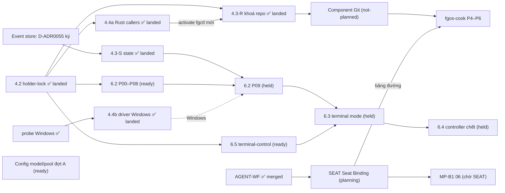

# Bảng chương trình nền tảng fgOS

Cập nhật lần cuối: **2026-10-18 17:15**, phiên `forgentx-95` (big lead, máy của owner).

## Đọc gì trước, sửa gì

- File này **chỉ là chỉ mục và trạng thái**, không phải nguồn sự thật.
  - Phạm vi, quyết định và phase của từng việc nằm trong `plan.md` của plan đó.
  - Trạng thái chạy thật nằm ở nhánh tích hợp và báo cáo phase-lead.
  - Nếu file này và plan con nói khác nhau, **plan con đúng**. Khi thấy lệch, sửa dòng tương ứng ở đây.
- **Cách cập nhật (mọi máy):**
  1. `git pull` main.
  2. Chỉ sửa dòng của luồng mình đang làm, ghi giờ và tên phiên.
  3. Commit bằng pathspec (`git commit -- plans/261017-1313-fgos-platform-program-board/plan.md`), push ngay.
  4. Xung đột thì giữ cả hai ý rồi gộp lại. Không ghi đè dòng của luồng khác.
- **Khi nào cập nhật:** khi bắt đầu hoặc xong một phase, khi bị chặn, khi land, khi có quyết định mới của owner ảnh hưởng luồng khác.
- **Trước khi bắt đầu việc mới đụng tới lock, git, state, config hay runner:** đọc mục [File chung dễ va](#file-chung-dễ-va) và [Quyết định đang treo](#quyết-định-đang-treo).

## Máy và phiên

Danh bạ do IDENT dựng từ các dòng `IDENT roster` mà chính các máy ghi (10-23). Gọi máy bằng **handle máy**, gọi agent bằng **handle phiên** (`<cli>-<4 ký tự>@<handle máy>`, in bằng `fgos identity session`) hoặc **vai** `lead:<LANE>` (nhận bằng `fgos identity session --role lead:<LANE>`; `fgos identity resolve lead:<LANE>` trên cùng máy). Không dùng "máy owner", "máy thứ hai", tên phiên Claude, pane herdr hay writer id để gọi nhau nữa. Spec: [Identity](../../docs/platform/identity/spec.md).

| Handle máy | Machine id | Ghi chú | IDENT trên release đang chạy |
|---|---|---|---|
| `design-lap` | `design-lap-iezwlz` | máy owner; workspace forgentX, mdview, mcp-skill-hub | 00–03 (release main `7833d5df1`); thiếu 04, 07 tới lần land kế |
| `fg-server` | `fg-server-sqs7es` | `~/projects/forgent` | đủ (release main `5f7825163`, 10-23 10:34) |
| `fg-server2` | `fg-server2-jdp2bv` | `~/projects/forgent` | đủ (release main `199d85223`, 10-23 08:57) |

Lead của luồng đang chạy. Mỗi lead **tự điền dòng của mình** (handle phiên và máy, đọc từ `fgos identity session`) và nhận vai trên máy mình; cột "Máy" có dấu `?` là IDENT suy từ log board, lead xác nhận hoặc sửa.

| Luồng | Vai | Handle phiên | Máy |
|---|---|---|---|
| IDENT | `lead:IDENT` | `claude-5v7u@fg-server` | `fg-server` |
| SEAT, SEAT-TRIM | `lead:SEAT` | `claude-lcpq@design-lap` | `design-lap` |
| MAIL | `lead:MAIL` | chưa ghi (phiên `f2c6f8ce`) | `fg-server`? (dòng MAIL ghi "máy owner", nhưng file sự kiện của phiên này nằm ở checkout `fg-server`) |
| HARDEN | `lead:HARDEN` | chưa ghi (phiên `forgent-a8`) | `fg-server2`? |
| TEST | `lead:TEST` | chưa ghi (phiên `forgent-f8`) | `fg-server2`? |
| WORK | `lead:WORK` | chưa ghi (phiên `forgent-cd`) | `fg-server2` |
| OPC | `lead:OPC` | `claude-muyt@fg-server2` | `fg-server2` |
| CFG | `lead:CFG` | `claude-hrpe@fg-server` | `fg-server` |
| COOK | `lead:COOK` | `claude-fkpc@fg-server` | `fg-server` |
| DOC | `lead:DOC` | chưa ghi | ? |

## Các luồng

Trạng thái: `landed` · `running` · `ready` (chạy được, chưa ai nhận) · `held` (chờ một quyết định hay luồng khác) · `planning` · `not-planned`.

| ID | Luồng | Plan | Trạng thái | Đang ở đâu / ai làm | Chờ gì | Mở khoá cho |
|---|---|---|---|---|---|---|
| 4.2 | Holder-lock: cổng lock, kernel lock cho các lock lạnh | [plan](../261016-1104-holder-lock-kernel-lock-foundation/plan.md) | **landed** 10-17 12:30, main `0d6da9033`, release `af277e02…` ở forgentX, mdview, mcp-skill-hub | xong; [báo cáo landing](../reports/landing-261017-1219-holder-lock-stop-everything-landing.md) | — | 4.3, 4.4a, 6.2, 6.5 |
| 4.4a | Rust callers lên holder-lock (`fgctl`, `install.lock`, observe) | [plan](../261016-1306-fgctl-rust-callers-on-holder-lock/plan.md) | **landed** 10-17 16:25 (máy owner), 16:43 (máy thứ hai) | main `09f824ea0`, release `79ead131…`, 3 workspace activate, fence đủ; [báo cáo landing](../reports/landing-261017-1625-rust-callers-holder-lock-stop-everything-landing.md). Máy thứ hai (`~/projects/forgent`): release `2895ff70…`, fence 214/214, [báo cáo](../reports/landing-261017-1643-rust-callers-holder-lock-this-machine.md) | — | 4.3 P08 + landing 4.3 |
| 4.3-R | Main checkout một cửa: **phần khoá repo** | [plan](../261016-1306-main-checkout-single-door-hot-lock/plan.md), rào chắn F10 | **landed** 10-17 18:28 (máy owner), 18:59 (máy thứ hai) | main `56f87bf5b`, release `e74cb03c…`, 3 workspace activate, fence đủ (2420/216/17); [báo cáo landing](../reports/landing-261017-1827-main-door-repo-lock-stop-everything-landing.md); máy thứ hai (`~/projects/forgent`) **landed** 10-17 19:00, release `df7a1a04…`, fence 216/216, [báo cáo](../reports/landing-261017-1859-main-door-repo-lock-this-machine.md) (phiên `56677996`) | — | component Git (dùng lại nguyên các khoá) |
| 4.3-S | Main checkout: **phần state** (hot-lock, `stateTx`, gộp `claims.lock`, trần claim + thu hẹp) | [plan 4.3](../261016-1306-main-checkout-single-door-hot-lock/plan.md), khối "CẮT LẠI 18:50" | **landed** 10-17 21:25 (máy owner) | main `c2cadb082`, release `b31b7526…`, 3 workspace activate, fence đủ (2449/219/20); [báo cáo landing](../reports/landing-261017-2123-main-door-state-wave-stop-everything-landing.md); S1–S5 trên nhánh `main-door-state/integration`. Windows: hot-lock fail closed, phán holder là việc tiếp theo của 4.4b ; máy thứ hai (`~/projects/forgent`) **landed** 10-18 00:39, release `4b90becb…`, fence 261/261, [báo cáo](../reports/landing-261018-0039-main-door-state-and-windows-driver-this-machine.md) | — | 6.2 P09 (cần S1+S2); phase chuyển Work của event store |
| ES | Event store (thay L3 điều 1 và 4) | [spec](../../docs/platform/event-store/spec.md) canonical, D-ADR0055; bằng chứng: [V-SPAWN-01](../reports/experiment-261017-1431-event-store-v-spawn-01.md), [hội đồng mở lại](../reports/council-261017-1513-event-store-reopen-final-packet.md), [model check](../reports/experiment-261017-1527-event-store-model-check-reader-seal.md), [model check lại](../reports/experiment-261017-1545-event-store-model-recheck-corrected.md), [ref git](../reports/experiment-261017-1527-event-store-git-ref-mechanics.md) | **01–08 xong trên main** (mất điện 20/20, forge probe PASS, V-EVENT held); **09–11 giao luồng WORK 10-22** | Đang tách các sửa đổi thuộc lớp store khỏi nhánh ES 09 lên main (truy vấn bảo trì hẹp, giảm fsync/spawn, door chặt, hook bắt rename, khoá tên stream nhánh) rồi ES 10 phần store. Phần Work của ES 09–11 do luồng WORK làm từ 10-22 (nhánh `work/es-cutover`; `es/p09-cutover` `03c5186c7` chỉ còn là nguồn tham khảo) | — | GIT G0 (bỏ họ bài học `.fgos` mà ES xoá) |
| 4.4b | Driver Windows (`LockFileEx` + Job Object), bàn giao macOS | [plan](../261017-1256-windows-lockfileex-driver-and-macos-handoff/plan.md) (7 phase, khoảng 36 giờ; D3 đã duyệt 13:53: domain `windows-job` chuyển từ 6.2 P02 sang đây) | **landed** 10-18 00:25 (máy owner, 3 workspace Linux) | main `d9d527ad6`, release `0c43eb1d…`; cổng 500 lần của owner trên Windows: 0 vi phạm cả 3 kịch bản ([bằng chứng](../reports/evidence-261018-0015-windows-driver-stress-report.json)); [báo cáo landing](../reports/landing-261018-0021-windows-driver-linux-workspaces-landing.md). Chưa activate workspace nào trên Windows ; máy thứ hai **landed** 10-18 00:39 cùng release `4b90becb…` với 4.3-S, [báo cáo](../reports/landing-261018-0039-main-door-state-and-windows-driver-this-machine.md) | activate trên Windows khi có workspace ở đó | `fgos run` trên Windows (6.2 D7) |
| 6.5 | terminal-control: lõi Rust, driver herdr | [plan](../261016-1306-terminal-control-rust-core-herdr-driver/plan.md) | **landed** 10-18 04:45 (máy owner) | main `119823fc6`, release `6208cb3e…` ở 3 workspace, fence đủ (2473/219/20); [báo cáo landing](../reports/landing-261018-0438-terminal-control-stop-everything-landing.md). Kèm sửa `f3dbc5e1d`: `fgos run` trước đó không bao giờ chọn invocation herdr (gộp `runner.executor` làm mất `invocations`) | máy thứ hai **landed** 10-18 09:11, release `f88afb17…`, fence 277/277, [báo cáo](../reports/landing-261018-0911-terminal-control-and-run-supervisor-this-machine.md); tiêu chí 6 (một round trọn mỗi CLI trong thư mục đã tin cậy) còn mở | 6.3 |
| 6.2 | Run supervisor: lõi Rust, cách khởi động direct | [plan](../261016-1351-run-supervisor-rust-core-direct-mode/plan.md) | **landed** 10-18 08:35 (máy owner) | main `13199adb4`, release `e95c130d…` ở 3 workspace, fence đủ (2483/219/20), D-ADR0056 đã ghi; [báo cáo landing](../reports/landing-261018-0833-run-supervisor-direct-mode-stop-everything-landing.md). CI `process-containment` xanh Linux/Windows/macOS. Lỗi còn mở: workspace dưới `/tmp` thì gate không đọc được envelope (`gate-lost`) | máy thứ hai **landed** 10-18 09:11 (cùng release `f88afb17…` với 6.5, [báo cáo](../reports/landing-261018-0911-terminal-control-and-run-supervisor-this-machine.md)); sửa lỗi `/tmp` | 6.3, 6.4 |
| 6.3 | Terminal mode + nửa launcher của identity | [plan](../261016-1351-terminal-mode-and-launcher-identity/plan.md) | **landed** 10-18 17:10 (máy owner) | main `274de6172`, release `a6bcdc29…` ở 3 workspace, fgctl cài lại, fence đủ (2551/219/20), D-ADR0059 đã ghi; [báo cáo landing](../reports/landing-261018-1714-terminal-mode-stop-everything-landing.md). Herdr thật: 5 CLI mỗi CLI một round `completed-pass` (đóng tiêu chí 6 của 6.5). CI macOS đỏ ở `fgos-process` là lỗi của main, lane Git nhận (nhật ký 16:45) | máy thứ hai land release này: **trước khi activate** chạy `fgos doctor --fix` bằng release cũ để dọn home v1 gắn pane | 6.4, MP-B2, Git 04, việc chuyển `publish.rs`/`store.rs`/`envelope.rs` của Git/ES |
| 6.4 | Controller chết: settle, `--resume`, dọn | [plan](../261016-1351-controller-death-settle-and-resume/plan.md) | **merged** 10-18 21:56 (code trên main `d91fad3fa`), **activate trên máy thứ hai 10-19 09:08 và máy owner 10-19 10:26** (cùng Git 01, [báo cáo](../reports/landing-261019-1026-git-01-and-cook-mpb2-owner-machine.md)); sweep 6.4 sạch ở 3 workspace. **Việc còn mở đã đóng 10-19 14:20** (main `617b0fdbb`, [báo cáo](../reports/phase-lead-261019-1318-controller-death-followups.md)): finding 3 (không bước mới sau tín hiệu), 4 (huỷ attempt đang bàn giao), 5 (`RunnerConfigError` có tên), 6 (handler tín hiệu chỉ khi CLI yêu cầu) sửa có test; release envelope bị prune: đóng có lý do, doctor `run-attempts-stuck` chỉ rõ release đã xoá và cách khôi phục; smoke Ctrl-C/resume trên release mới **đạt** 13:05. Trước đây máy owner chưa | P00r→P07A xong, big lead kiểm từng phase; cả bộ test 8190 (lỗi còn lại đều môi trường); D-ADR0060 đã ghi; [báo cáo](../reports/landing-261018-2156-controller-death-merged-activation-with-git-landing.md). Activate gộp vào landing dừng toàn bộ của lane GIT (main đã có Git Lane B; máy thứ hai: "chưa activate"); bước landing và rollback ở [P07A](../reports/phase-lead-261018-2121-controller-death-p07a-integration-and-t8.md) | **lane GIT:** khi xin landing phase 01, gộp activation 6.4 (release từ main có cả hai); hoặc báo trên bảng nếu Lane B activate sớm được | MP-B3 |
| GIT | Component Git `fgos-git` (Rust): G0 spec → G5 cổng máy móc | [roadmap](../reports/roadmap-261016-2212-fgos-cook-and-git-component.md) mục P2; [danh mục bài học git](../reports/research-261017-1032-git-lessons-catalogue.md); [handoff](../reports/handoff-261017-1901-git-g0-and-event-store-plan-leads.md) | **Xong 01–08 (10-22).** Máy thứ hai active bản bền dữ liệu + T0 (`9e4c2630…` 10-22 00:21, [land](../reports/landing-261022-0011-git-durability-and-t0-this-machine.md)); chứng minh: E1 held cả Publication lẫn ScopedCommit ([kiểm chứng](../reports/verification-261021-2336-git-e1-publication-and-scoped-commit.md)), E3 mọi hàng đạt theo luật owner ([kiểm chứng](../reports/verification-261022-0005-git-e3-clean-rerun.md)), P-SPACE/P-RESOURCE/V-EVENT/V-CONSUMER/E4 held (spec §19) | **Phiên điều phối GIT/ES máy thứ hai đóng 10-22 13:00.** Việc còn lại, chờ owner giao người nhận: (1) **duyệt code Git** (`packages/git`, `src/git`, `.githooks/pre-commit`, census) — **owner 10-22 giao cho lead OPC** — đang chờ: diff U6 của WORK (xoá `legacyEvents`). Đã duyệt 13:10: 2 diff HARDEN T1 phase 2 (tip b71098f53, 41/41 test ScopedCommit/borrow-hook/one-door/handover qua); (2) **H15**: máy owner land theo [hướng dẫn](../reports/guide-261022-0011-owner-machine-git-durability-and-t0.md) rồi gửi link báo cáo cho HARDEN; (3) theo dõi `three_clones` (nghi do mount E1, đã sửa b36a8e6ad; lỗi giờ mang stderr Git); (4) owner xoá bằng chứng root `/var/tmp/fgos-e1`, `/var/tmp/fgos-p-space` (đã duyệt, cần sudo). **Backlog GIT (owner 10-22 12:50, chưa làm, chủ GIT):** (B1) ScopedCommit lựa chọn 2 — đổi chữ spec về ~114 ms (~1,5 ×), xét lại sau kết luận OPC; (B2) bớt fsync mỗi lần push (13 lần, đọc lại thứ tự WAL đã ký), xét lại sau OPC; (B3) deadline huỷ ở barrier cho P-RESOURCE — làm khi có caller cần deadline; (B4) driver cô lập E4 cho macOS/Windows — làm khi fgOS chạy trên Mac/Windows; (B5) fixture noncoding writing-land cho V-CONSUMER — việc nhỏ. **OPC giao lead riêng 10-22 (hội đồng thiết kế, dòng OPC).** Theo dõi: `three_clones` (nghi do mount E1, đã sửa b36a8e6ad). | land máy owner: owner chọn giờ | ES (dùng port xuất bản của Git), land, chuyển caller, `fgos-cook` |
| MP-A | Config model/pool/account, đợt A (lát bổ sung) | [plan](../261017-1302-model-pool-config-additive-slice/plan.md) | **done** (16:00; 00–06 trên main) | — | — | gemini nhận `--model`; mỗi họ một executor; ô tier `model@pool`/danh sách; `llmAccounts` chỉ đọc; `fgos dispatch explain`; 6 check doctor; rigor của capability nâng trần (RUL102, RUL103). Owner chọn giữ lối rơi khi thiếu ô (từ chối làm ở đợt B). Mỗi máy làm theo [hướng dẫn đồng bộ máy](../reports/guide-261017-1828-sync-a-machine-after-model-pool-and-rust-callers.md) (config global, `fgctl`, release, hàng rào). Các đợt B, C sau; [bài toán](../reports/problem-261017-0022-model-tier-selection-misfit.md) |
| MP-B1 | Model/pool đợt B1: lease, state, quarantine theo pool; xoay account theo `credentialStore`; pin `pool/account`; thiếu ô tier thì từ chối | [bài toán](../reports/problem-261017-0022-model-tier-selection-misfit.md) mục 5.3 | **done 10-22 10:50** (`SEAT`: làm mới model mdview + mcp-skill-hub theo Q4, backup `.fgos/runtime/config-backup-261022-1038/`; doctor `tier-fallback` hết cảnh báo `mini`, dry-bind 59/59 cả hai; lượt thật trước đổi mdview `unit-run-1792640248407-c0d0c697`, sau đổi openai `gpt-6.1-sol`@medium mdview `unit-run-1792640346711-aa32b19f`, mcp-skill-hub `unit-run-1792640346707-29acd9d3`, đều pass). Trước đó: ([plan](../261019-2312-model-pool-b1-fallback-and-account-order/plan.md) main `c65cbf643`; 00–05 trên main (`57545e132`, `d01e8468a`, `6c674ccca`), D-ADR0071; **active** từ land 10-20 09:12; 07 (chứng minh thật) xong 10-20 11:15; **06 xong 10-22 09:10** (owner duyệt 08:47; [đề xuất](../reports/proposal-261022-0756-mp-b1-06-seat-config-for-three-workspaces.md); forgentX main `ec07f2a90`, mdview/mcp-skill-hub áp file + backup `.fgos/runtime/config-backup-261022-0900/`; còn: mcp-skill-hub gemini chỉ có agy, pane hỏng `p-a178ca5c` → chờ owner chọn tạm đưa claude lên đầu). Trước đó: 06 chờ SEAT land: spec SEAT đã xong, nhưng SEAT đổi hình config (thang 6 bậc có `mini`, ô model+effort, bỏ `rigorToTier`), nên diff phải viết lại theo hình mới và chỉ trình được sau khi release có SEAT active ở mọi workspace; 06 đổi config chờ owner duyệt diff) | — | câu 4–6 owner đã trả lời 10-19 23:20 (log cùng ngày); còn chờ: SEAT land, rồi owner duyệt diff config; lập plan | MP-C |
| MP-B2 | Model/pool đợt B2: `credentialStore {use, homeEnv, files}` trong confinement và driver bwrap | [bài toán](../reports/problem-261017-0022-model-tier-selection-misfit.md) mục 5.3 | **00–05 merged** 10-19 02:15, main `2ebac8756` ([plan](../261019-0019-model-pool-b2-credential-store-confinement/plan.md), [báo cáo lead](../reports/phase-lead-261019-0138-model-pool-b2-credential-store.md)); **06 merged** 10-19 10:45 `edd59bdfc` (config forgentX bỏ `resourceBindings`/`env[homeEnv]` ở invocation có `credentialStore`; round pi thật pass); còn lại thuộc MP-C: config global (13), mdview và mcp-skill-hub (24 mỗi bên), nhánh suy luận trong `credentialStoreOf` | máy owner | — | MP-C |
| MP-B3 | Model/pool đợt B3: bước fallback đổi nguồn (`source-rotation`) | [bài toán](../reports/problem-261017-0022-model-tier-selection-misfit.md) mục 5.3 | **held** | — | 6.4 P02 land | — |
| MP-C | Model/pool đợt C: `prefer` theo họ; account sang `llmAccounts`, xoá `runner.providers`; danh sách và `@` trong `modelPolicies` global | [bài toán](../reports/problem-261017-0022-model-tier-selection-misfit.md) mục 5.3 | **held** | — | release đọc `llmAccounts` active ở mọi project trên mọi máy ([hướng dẫn](../reports/guide-261017-1828-sync-a-machine-after-model-pool-and-rust-callers.md)) | — |
| MP-COST | Chi phí model: kẹp capability dưới trần, luật escalation, quyền override, `assignment-policy` áp trần, model của agent in-process | [bài toán](../reports/problem-261017-0022-model-tier-selection-misfit.md) mục 5.3 "Out of scope" | **not-planned** | — | câu 1, 3 owner đã trả lời 10-19 23:20 (phần trần cho code nằm trong MP-B1 06 và SEAT); còn: câu 2 (đo chi phí) chưa làm, và owner giao luồng | — |
| SEAT | Seat Binding: một component (Rust, mặt tiền Node mỏng) quyết model cho từng ghế. rigor chỉ quyết số ghế kiểm và yêu cầu khác họ (bỏ `rigorToTier`); thang tier 6 bậc khai trực tiếp, ô model+effort, bậc họ không đạt để trống; ghế/role/persona tường minh trong workflow; R1 taste theo role trong config capability, R2 tier portable trong package; tier workflow là sàn | [spec nháp](../reports/spec-draft-261020-1017-seat-binding-component.md) (owner đã trả lời mọi câu); [kiểm kê](../reports/research-261020-0955-seat-binding-needs-and-mechanisms-inventory.md); [thang tier theo họ](../reports/research-261020-1339-model-family-tier-ladders.md) | **landed 10-22 02:56** ở cả 3 workspace (release `sha256:52a7e0ac…` từ main `172c9d138`; [báo cáo land](../reports/landing-261022-0311-seat-git-durability-t0-owner-machine.md)); land bù 10-22 04:25 (release `sha256:a2b19d78…`, main `f315b99c7`): `git-mutation-one-door` đạt ở cả 3. Trước đó: spec duyệt 10-20 21:31 (owner; D-ADR0072; bước 3 đang chạy: `docs/specs/seat-binding.md` do lead `seat-spec-promote`; bước 4 plan `plans/261020-2132-seat-binding-component/` do planner Opus `seat-planner`) (council xong 20:25: chưa đủ để plan, 8 lỗi chặn G1–G8, không mở lại quyết định nào; [tổng hợp](../reports/council-261020-1547-seat-binding-spec-review.md); bước 2 đang chạy: bản hợp nhất `plans/reports/spec-draft-261020-2028-seat-binding-component-consolidated.md`, agent Opus `seat-consolidate`; 5 câu xác nhận đã gửi owner 20:30) | phiên `forgentx-95` (big lead, máy owner) thiết kế; council `architecture-advisory` `wf-run-1792496104999-4c0d9095` (lần 3; lần 1–2 hỏng vì ghế xai, xem backlog `p-d2dc4f2e`) đang synthesis 10-20 20:05. **Thứ tự:** (1) council xong → tổng hợp `plans/reports/council-261020-1547-seat-binding-spec-review.md`; (2) sửa spec theo lỗi chặn; (3) owner duyệt bản cuối → spec vào `docs/specs/` + quyết định; (4) plan (crate Rust + facade, chuyển một đợt, L10); (5) lead Sonnet làm, big lead verify độc lập; (6) land; (7) diff config model cho owner duyệt (`gpt-6-luna`, `gpt-6.1-sol`, `grok-4.7`, ô `mini`, ô trống deepseek/glm). Đảo lại nếu: hội đồng chỉ ra quyết định của owner mâu thuẫn nhau hoặc với code → dừng ở (2), hỏi owner theo mẫu | (1)–(6) xong; (7) = MP-B1 06 (owner 23:44: MP-B1 06 trước, rồi COOK P6) | COOK P5 (bảng đường: cột tier/rigor), MP-B1 06 (phần còn lại + đổi config), MP-COST |
| SEAT-TRIM | Gọt SEAT sau merge: Node −~650, test/fixture −~3.840 theo [soát độ phình](../reports/review-261021-1726-seat-wave-growth.md): validation config trùng crate, danh sách tier hai nơi, inline-lead và khớp override về crate, test chứng minh lại golden; code chuyển đổi (~440 Node, ~2.650 test/fixture) xoá khi mọi workspace qua `seat-binding-config` + `seat-binding-drain` và không còn release trước SEAT active. Thêm từ HARDEN H19 (T1 arbitration 10-22): `src/convention/{seat-id,definition-names}.mjs` đánh giá luật convention ở Node; `state-lock-held.mjs` là bộ đếm độ sâu thứ ba (đích: một bộ đếm `hotLockDepth()`, làm cùng T1 phase 6). **Không gọt** `legacy-seat-read.mjs`: owner chốt giữ 10-21 18:30 (đường đọc duy nhất cho ~1.900 bản ghi chạy cũ mà handoff, case, history, seat-providers còn đọc) | — | **running** (đợt 1 lên main `0243824a9` 10-22 15:40: Node src −7, test −178, crate/contract +220 (ladder chung, inline-lead vào crate + 5 golden); validation config và khớp override giữ ở Node có lý do, H19a giữ evaluator JS (kênh compat không có addon) — chi tiết log 15:45. Còn: xoá code chuyển đổi (~440 Node, ~2.650 test) chờ mọi workspace hai máy qua `seat-binding-config` + `-drain`; Work path (`plan.mjs`) qua `bind()`) | `SEAT` | SEAT merge main | đích: Node ròng của SEAT về ~+150 (facade client + seat-policy) |
| 5.1 | Identity resolver thành crate Rust | [plan](../261015-2102-identity-resolver-rust-crate/plan.md) | **done** (đóng 10-19 02:25: mọi commit của nhánh đã ở main, cổng cold đạt theo ngưỡng ≤10 ms owner nới 10-15) | — | — | 6.3 (nửa launcher) |
| DOC | Thống nhất thẩm quyền tài liệu (260925) | [plan](../260925-documentation-authority-unification/); cha: [proposal Unified Documentation Operating System](../../docs/platform/proposals/documentation-system-unification.md) (plan này làm tới hết bảo trì, Phase 10) | **running** (Phase 8: Bước 5 ĐÓNG; Bước 6 xong (verifier evidence 867); **Bước 6b ĐÓNG** (cutover write lease trên nhánh plan: module + registry `documentation-cutover` rank 10 theo D8 + hook pre-commit/reference-transaction + chốt runUnit/workflow/landRunnerItem/mergeWorkflowBranch + doctor + docs; 7 vòng review độc lập, diễn tập 16/16 trên clone tạm; L12-104..116); SEAT + IDENT đã merge vào nhánh; tiếp Bước 7 (pin cuối + export trạng thái L12-96 + chạy lại bộ lắp ráp) rồi Bước 8; lease chỉ land cùng cutover Phase 9, cần Git owner đồng ý đoạn hook §7; chưa land main) | nhánh `plan/260925-documentation-authority-unification` (HEAD `a75cf471b`; main `1d0797a78` đã merge vào `66b637a10`), lead `forgentx-5f` | — | — |
| DOCOS | Hệ điều hành tài liệu: các chặng sau DOC theo luật thứ tự §0.2 của [proposal](../../docs/platform/proposals/documentation-system-unification.md): cửa viết duy nhất (`fgos doc new/classify`, profile registry), Knowledge and Documentation Engine, rồi Agent Context Engine (bề mặt đọc chắt lọc cho agent §4.6, quyền ghép luật RUL102) | — (chưa lập plan; cam kết giữ trong `docs/platform/intent-preservation-ledger.md`) | **not-planned** | — | DOC xong Phase 9 (cutover) và Phase 10 (bảo trì tối thiểu) | luật và ngữ cảnh agent một nguồn; liên quan RULE (sổ cái + bản render luật) và INS |
| CONV2 | Convention đợt 2: đưa thêm họ file vào `fgos convention` (allowlist gốc repo, bản render skill, bố cục skill, contracts, domains, file quyết định) | [plan draft](../261021-1656-convention-second-wave/plan.md) | **draft** (điều tra lại trước khi duyệt) | — | DOC cutover Phase 9 (L12-89 làm phần docs); phối hợp RULE | một cửa cho luật tên và vị trí |
| COOK | `fgos-cook` và đường chạy cho cook (roadmap P1–P6) | [roadmap](../reports/roadmap-261016-2212-fgos-cook-and-git-component.md) | **P6 done 10-23 01:10** (lead `COOK` `claude-fkpc@fg-server`): [plan](../261022-1037-herdr-pane-launch-ready/plan.md) from `p-a178ca5c` on main `172b3906b`, active on `fg-server` release `fe017e04…` since 00:56, live proof in the [P6 report](../reports/measure-261022-1758-cook-p6-pane-launch.md). The cook case `wf-run-1792641377395-053acb20` stopped at 11/14 dispatches without `child-verified`; the report lists the six causes and four additions; owner 10-23 chose 1 and 2, done 10-23 11:10 in the `fgos-cook` references (pass the activity's pattern as `--pattern`; widen writes to the tests that exercise the change), 3 is with `SEAT`, 4 stays open. Open follow-up: the door ignores the guide's declared `unit.pattern`. `--plan` has nothing left to retire (`cb9bf5f58`); `/fgOS:deliver` stays as the Work-item door until cook closes a medium plan inside its frame. P1, P3, P4, P5 landed | P6 = chạy `fgos-cook` trên một plan `ak:plan` thật cỡ vừa, đo (mảnh, đường, vòng review, verify fail, chi phí theo tier, số lần hỏi người), rút đường `--plan` cơ học, quyết `/fgOS:deliver` cũ. Đề xuất (chờ owner): chạy phần điều phối ngay, đo chi phí/đường chọn lại sau khi SEAT land | P6 phần đo chi phí chờ SEAT land; owner chọn plan thử | — |
| YAML | Vendor js-yaml: một cửa đọc YAML, fgOS không còn dependency npm lúc chạy | [plan](../261016-0635-vendor-js-yaml-single-yaml-door/plan.md) | **landed** 10-16, quyết định RUL101 (`docs/specs/distribution.md`) | xong; phiên `56677996` | — | — |
| CFG | YAML Document (L0) và Config (L1): hai crate Rust qua native door, bộ chuẩn read-only đi kèm release, file config chỉ chứa phần khác chuẩn, account và token ở `~/.fgos/private/`, xoá js-yaml và `src/config/` | spec [YAML Document](../../docs/platform/yaml-document/spec.md) và [Config](../../docs/platform/config/spec.md) (owner ký 10-22); [plan Slice A](../261022-1342-yaml-config-slice-a-yaml-document/plan.md) | **Slice A landed** 10-23, origin/main (gộp với 298 commit của origin): crate `fgos-yaml-doc` (parse 2 profile, giới hạn, sửa giữ byte, comment, merge, fuzz 3 target sạch; parser `saphyr-parser` 0.2.2 vendor ở `packages/yaml-doc/third-party/`); `host-runtime`, `observe`, `fgos-gateway` bỏ `serde_yaml`; helper config cho test. Tiếp: Slice B (crate `fgos-config`, bộ chuẩn, lock) Slice B **running** 10-23 ([plan](../261023-1018-yaml-config-slice-b-config-crate/plan.md), owner duyệt khung và G-B2 = A 10:40): crate `fgos-config`, descriptor `core/config-schema/`, lock `project-config`/`global-config`, `open_beneath` trong Durable File | phiên `9548be33`; đã land trước: sửa mặc định `invariantChecks` `03c99bc61` | G4 (addon trên Windows) chỉ chặn bản Windows; G6 (confinement giấu `~/.fgos/private`) chặn Slice D | thay YAML (RUL101), MP-C (account sang file riêng) |
| AGENT-WF | Mô hình agent ↔ workflow cho mọi domain (coding, marketing, sản xuất video…): agent thông minh, linh hoạt, tự ứng phó; workflow là hướng dẫn tác nghiệp (sơ đồ, đường đi, giao tiếp, ràng buộc), dẫn đường chứ không khoá cứng | [hướng của owner, đầu vào hội đồng](../reports/brief-261018-2235-agent-workflow-model-owner-direction.md) (chưa lập plan; đầu ra là thiết kế + spec, **không** plan) | **merged** 10-20 00:58 (spec D-ADR0070; [plan](../261019-1238-workflow-case-ledger-and-admission/plan.md) 00–09 trên main, cuối `a94115474`); activate ở đợt land release kế tiếp (05–09 chưa active) | 10-18 22:20 owner giao, coi là chìa khoá thành công. **Bước 1 (trước mắt):** xem lại ý định thiết kế ban đầu của Workflow và hiện trạng (lịch sử quyết định, 0049, `src/workflow/`, `core/workflows/`, `domains/*/workflows`, hai cửa, pattern/preset, bảng đường). **Bước 2:** hội đồng `fgos-architecture-panel` rigor critical, nhiều vòng, reopen khi cần; câu hỏi nháp: workflow là gì (hướng dẫn/sơ đồ/ràng buộc), khi nào agent tự lập plan và khi nào theo workflow, linh hoạt mà vẫn ổn định và trong khung duyệt, một mảng business mới cần khai gì, giữ/đổi gì của cơ chế hiện có (RUL104 (tốt hơn, không to hơn)). **Owner:** hội đồng không hỏi owner sớm; đi tới một số đồng thuận rồi mới làm việc với owner. **Bước 3:** spec BA trong `docs/specs/` + quyết định; owner duyệt; rồi mới plan. Ca đầu tiên: `fgos-cook` chạy plan của ak | — | COOK P1 (doctrine), COOK P5 |
| HARDEN | Hội đồng soát và làm cứng các lớp tầng thấp: tìm và sửa bug, phát hiện vấn đề nghiêm trọng chưa được xử lý | [đề xuất đã duyệt](../reports/proposal-261021-0851-harden-review-criteria-and-method.md); [plan khung](../261021-1118-harden-low-layers-bottom-up/plan.md) (phase 00–07, red-team + validate xong 10-21 11:56) | **T0 landed** máy thứ hai 10-21 22:06 (main `7d1f1c1b2`, release `613dfa84…`; [báo cáo đóng T0](../reports/closing-261021-2213-harden-t0-process-facts-door.md)); máy owner theo [hướng dẫn](../reports/guide-261021-2213-harden-t0-owner-machine-landing.md), owner chọn giờ | Chủ: phiên `forgent-a8` (máy thứ hai, `~/projects/forgent`, fgOS writer `8e8e56bb…`, herdr pane `w6:pDG`), nhận 10-21 12:15. **Prompt bàn giao:** [handoff](../reports/handoff-261021-1202-harden-low-layers-bottom-up.md). Đọc theo thứ tự: [đề xuất đã duyệt](../reports/proposal-261021-0851-harden-review-criteria-and-method.md) → [plan](../261021-1118-harden-low-layers-bottom-up/plan.md) mục Owner decisions + per-layer loop → phase 00. Phase 00 chưa chạy (lead của `forgentx-95` đã dừng trước khi ra kết quả). Liên quan: [soát luật gây phình](../reports/review-261021-1008-rules-that-grow-the-system.md), luồng quản lý luật ([handoff](../reports/handoff-261021-1021-rule-management-tight-no-conflict-right-place.md)), luồng TEST; SEAT thuộc T5 và chạm file T0/T1 (danh sách carry trong phase 01) | — (T3 phần Event Store chờ ES xong phần store) | — |
| TRUST | Kiểm quyền tin cậy thư mục **trước** khi mở pane, hỏi người sớm thay vì chạy rồi mới biết bị chặn | — (chưa lập plan) | **not-planned** | 10-18 21:15 owner: ghi vào chương trình, chưa làm. Hiện `seedWorkspaceTrust` (`src/runner/dispatch/herdr-round.mjs`) biết trước khi launch là repo gốc chưa tin cậy (B1 `untrusted-root`, chỉ là đọc file) nhưng chủ ý không dừng, vẫn mở pane rồi mới báo `terminal:blocked:trust-dialog` (gặp ở 6.4 P07a T8). Hướng: (1) kiểm trước khi mở pane, theo cách đọc của từng CLI (claude/codex/agy, kể cả thư mục cha) ra trusted / seed được theo B1 / chưa tin cậy; (2) chưa tin cậy thì không mở pane, hỏi người theo mẫu câu hỏi quyết định, gộp với các câu hỏi đầu lượt; (3) người đồng ý thì fgOS ghi dòng tin cậy cho repo gốc (người cấp, không phạm B1) rồi chạy; (4) doctor `agent-cli-project-trusted` phủ thêm claude, agy | sau khi 6.4 land; owner duyệt thiết kế (fgOS ghi vào config tin cậy của owner khi được đồng ý) | — |
| INS | Kiểm soát luật ở nguồn: luật phải tới đúng agent (đủ L1–L10, nguyên tắc thiết kế, luật dùng lại trước khi thêm), rồi mới dọn hậu quả | [báo cáo](../reports/research-261016-1118-agent-code-quality-guardrails.md) mục 0, 5 (nhóm A, B), 6 | **landed** phần làm tay 10-17 15:10 (`f9ea9c219`, `40c667c83`); phần cơ chế (nhóm A) **not-planned** | 10-17 15:30, phiên `56677996`: đã chiếu đủ L1–L10, thêm `core/instructions/design-principles.md`, luật dùng lại vào worker contract và `fgos-coding-implement`; `CLAUDE.md` chỉ còn `@AGENTS.md`. Quyền ghép luật: Agent Context Engine (RUL102) | D6 (Q4–Q7 trong báo cáo) trước khi lập plan nhóm A | backlog `p-7eb9e65b`, `p-68be2ae3` |
| RULE | Quản lý luật: chặt chẽ, xung đột có thứ tự giải, không dư thừa, đến đúng nơi cần (gồm phần còn lại của INS) | [handoff](../reports/handoff-261021-1021-rule-management-tight-no-conflict-right-place.md), [review](../reports/review-261021-1008-rules-that-grow-the-system.md) | **running** (phiên thực hiện nhận 10-21 15:13: nhóm 1A đã có [plan](../261021-1513-rule-management-group-1a/plan.md) dạng proposed, chờ owner duyệt khung; chưa sửa file luật nào) | — | ghi vào `AGENTS.md`, `CLAUDE.md`, `docs/platform-foundations.md`, `docs/specs/platform-foundations.md` chỉ land **sau cutover Phase 9 của DOC**, trên cây `docs/platform/**` (owner 10-21, L12-91); phân tích/thiết kế không chờ. Một chiều: cutover không chờ RULE | luật nhẹ token, một nhà cho mỗi luật; INS nhóm A |
| WAIT | Biết khi nào việc dài xong: ghi vào skill và vào mô tả của `fgos workflow start` rằng workflow và hội đồng chạy tách rời không báo ai khi xong, và cách dùng `--foreground` trong lệnh nền để được đánh thức; một run đã tách rời thì không gắn lại được | — (chưa có plan). Bằng chứng: run `wf-run-1792588557887-a8496d01` hỏng ở shaping 10-21 20:25 mà không ai biết cho tới khi owner hỏi; hành vi `fgos workflow resume` trên run `failed` ghi ở nhật ký 10-21 | **held** (chờ owner chọn) | Chưa ai nhận. Phiên thực hiện luồng RULE đề xuất, chưa sửa file nào | Owner chọn một trong ba: (1) sửa ngay `core/skills/fgos-architecture-panel/SKILL.md`, `core/skills/fgos-run/SKILL.md` (dòng 56) và mô tả `fgos workflow start` ở `src/cli/command-registry.mjs` (dòng 2214), rồi `npm run build:skills`, báo `forgentx-5f` sau; (2) hỏi `forgentx-5f` trước xem ba file đó có trong manifest 331 file của Phase 8 không; (3) để đó. Không thêm cơ chế mới (RUL104); một verb `fgos workflow wait` hay engine báo cho phiên là mục riêng nếu owner muốn. **Điều kiện thêm (owner 10-21 22:48):** (a) skill và help viết có điều kiện theo CLI: chỉ CLI chạy được lệnh nền và được báo khi lệnh thoát mới dùng `--foreground` để được đánh thức, CLI khác thì không (không viết cứng cho Claude Code, vì skill chung cho Claude, Codex, omp, pi, agy); (b) trước khi viết skill, thử một run nhỏ thật bằng `--foreground` trong lệnh nền để biết: có thoát đúng lúc ở cổng của người không, giới hạn thời gian của lệnh nền với run dài (một ghế tới 35 phút), và run có `resume` được không khi tiến trình foreground bị giết giữa chừng (resume được thiết kế cho unit đang `running` khi controller chết); **Kết quả thử (b) 10-21 23:00:** `--foreground` trong lệnh nền hoạt động: lệnh thoát khi run xong (15 giây cho một Unit solo), phiên được đánh thức bằng thông báo thoát, và JSON cuối (status, outcome) in ra stdout, không có khối `detached`. Giết tiến trình foreground bằng SIGTERM giữa chừng: run và unit còn `running` với `unitRunId` đã ghi, không còn pane sót, stdout rỗng; `resume --foreground` tiếp tục đúng unit run cũ và hoàn thành `pass` (ghế dở chạy lại thành lần 02), phiên lại được đánh thức. Hai điều phải ghi vào skill: (1) mã thoát của `--foreground` đã có bảng riêng theo RUL99 (`docs/specs/runner.md` dòng 1132): `pass` 0, `policy-refusal` 4, `provider-limit` 10, `execution-failure` 11, `partial-writes` 12, `blocked` 13, `findings` 14; `workflow status` luôn 0 và `start` tách rời trả 0 theo spec. Đã đo lại đúng cách: run `failed` vì `policy-refusal` thoát mã 4. Lần đo đầu ghi nhầm "0" do script đo của phiên (`$(date)` đứng trước `$?` nên đặt lại `$?` về 0), đã đính chính; (2) Unit ad-hoc không có `--provider` chỉ gán được khi capability có `prefer` (capability `review` không có nên bị `headless-no-executor`, dùng `advise` thì được). **Đã thử thêm 10-22:** hội đồng 77 phút (`wf-run-1792602194116-9d30a980`) chạy `--foreground` trong lệnh nền, thoát mã 0 khi dừng ở cổng của người (parked) với run đủ năm family, phiên được đánh thức; giới hạn lệnh nền đặt 2 giờ là đủ cho run này. Còn lại chưa thử: run dài hơn 2 giờ và đường resume sau khi tiến trình foreground bị giết khi run đã ở giữa nhiều bước. Skill `fgos-run` (dòng 56) đã nhắc `--foreground` nhưng chỉ ở mức "wait in place", chưa nói lợi ích được đánh thức khi thoát. (c) mailbox (luồng MAIL, chưa có mã) và engine tự gọi lại là hướng khác, chỉ cần khi phải báo cho phiên không phải người gọi; `--foreground` là người gọi tự đợi, không cần thêm thành phần | Mọi agent mở hội đồng hoặc workflow dài biết cách được báo khi xong, không lặp lại việc run hỏng mà không ai biết |
| EXIT | Kiểm lại mọi nhị phân và verb: khi lỗi phải thoát mã khác 0, không chỉ báo lỗi trong JSON; người gọi (agent, script, CI, hook) dựa vào mã thoát | — (chưa có plan). Quy ước có sẵn: RUL99 (`docs/specs/runner.md` dòng 1132) cho `fgos run` và `fgos workflow start\|resume\|answer --foreground`; đã đo thật: `policy-refusal` thoát 4, `fgos run` trả 4, 10, 11, 13 | **ready** (chưa ai nhận; owner giao 10-21) | Chưa ai nhận. Phạm vi gợi ý: lập bảng verb × lớp lỗi → mã thoát cho `fgos` (host Rust và legacy-node), `fgctl`, `fgos-runner`, `fgos-gateway` và các wrapper; test từng ca lỗi thật (không mock) xem có thoát khác 0 và JSON có khớp mã; chỉ sửa chỗ lệch, không thêm cơ chế (RUL104) | Không chờ gì khác ngoài người nhận. Cần chốt trước: bảng mã chung cho mọi verb hay chỉ giữ bảng RUL99 và quy ước thêm cho các verb còn lại; test chủ của hành vi này ở luồng TEST (một bằng chứng chính cho mỗi hành vi). Có thể gộp vào trục G của HARDEN (bề mặt cho agent) nếu owner muốn | Mọi agent, script và hook dùng được mã thoát để biết lệnh thất bại mà không phải đọc JSON |
| OPC | Containment theo thao tác: một domain containment cho cả một thao tác Git typed (Land, ScopedCommit, Sync, SafeRestore, Recovery) thay vì một sandbox bwrap cho mỗi lệnh git; thiết kế hexagonal để sau này thay được công nghệ sandbox | [tài liệu thiết kế sơ bộ](../reports/design-261020-1035-operation-scoped-containment.md) (6 câu cho hội đồng) | **Phase A xong trên main và trong release `a424fc0f` (10-22 22:10); [kiểm chứng](../reports/verification-261022-2005-opc-phase-a.md): AC2–AC5 đạt, AC1 chỉ chứng minh ở harness, E1 chỉ có truy vết thứ tự (bản cắt điện cần root). Owner chấp nhận (22:45): AC1 theo harness, E1 theo truy vết thứ tự; E1 cắt điện chạy ở lần sửa độ bền Git tới.** Còn lại của luồng: Phase B hoãn tới điều kiện kích hoạt §4 phân xử; R2 đo lại 10-23 (HARDEN T2, [ghế speed](../reports/council-261022-2148-harden-t2-seat-speed.md)): worktree add ≈ 184 ms, containment 30–65 ms (< ngưỡng 100 ms), 0,5 s cũ là do WAL giữ chain không giới hạn (F-C1, việc T2) → điều kiện R2 chưa đạt. OPC nay cũng là người duyệt diff Git của các lane khác (owner 22:42). [Plan](../261022-1335-opc-phase-a-containment-fixes/plan.md), [phân xử](../reports/council-261022-1251-opc-arbitration.md); lead phiên `forgent-35`, nhánh `opc/phase-a`. Đã giao: R8 (predecessor admission vượt 2 s trên pgroup/macos) → HARDEN T1; reader `cat-file --batch` sống sau host, predicate user-code chưa biết submodule → việc GIT. Phase B hoãn tới điều kiện kích hoạt §4 | 10-20 10:34 owner đồng ý ("cần thiết kế kỹ và đặc biệt hexagon vì biết đâu trong tương lai chúng ta có thể đổi sandbox"). Bằng chứng: một git trong sandbox 10,8 ms so với 3,1 ms chạy thẳng; Land ~65 spawn trong sandbox ≈ 0,5 s (37%), ScopedCommit 8 ([gate](../reports/gate-261020-0653-git-p06b-typed-perf-e3.md)). Phạm vi: mở rộng chính port containment hiện có (Process), không thêm cơ chế song song; bộ test tuân thủ chung cho mọi driver | Git 07/08 và ES 09–11 landing xong, hệ thống chạy thật; rồi hội đồng tư vấn và quyết; không chặn Git 07 | Land/ScopedCommit nhanh hơn; thay driver sandbox sau này |
| WORK | Work lên Event Store: ES 09–11 (ghi Work qua Event Store, porting sang `project:porting`, cổng bằng chứng ES 10, cutover mọi máy, xoá adapter tạm Git 07, bỏ kênh npm M10, sửa output `fgos rebuild`). Lớp trên của Work (dashboard, giao tiếp với người, requirement, cập nhật tiến độ) là đợt sau, chưa mở | [plan ES](../261018-0945-event-store-fgos-event-store/plan.md) phase 09–11; [plan refresh](../reports/plan-refresh-261021-1215-work-lane-es-09-11.md) U1–U10; [facts 10-22](../reports/facts-261022-1042-work-lane-p09-trial-merge.md); review [A](../reports/review-261020-1110-es-p09-write-path.md) và [B](../reports/review-261020-1110-es-p09-readers-triggers.md) (hai file chỉ có trên nhánh `es/p09-cutover`) | **running** từ 10-22 10:42; U1 xong 13:45, U2 xong 14:00 (H1 sửa, vector ba máy gộp giống nhau trên 3 clone), U3 porting + U4 readers xong 15:25, U5 trigger + Land xong 17:00 (nhánh `6fadbbcaa`); dọn Land treo + `porting.add` trùng id xong 17:40 (`2b4683016`; sweep đang chạy ở cuối 4 lệnh Land, chờ owner xác nhận); U6 xong 18:30 (`9a8f163a8`): adapter tạm Git 07 và các nghĩa vụ `events.jsonl` cũ đã xoá cả hai phía; **commit phía Git `790616298` chờ OPC (`forgent-35`, người duyệt Git do owner giao) duyệt** (HARDEN chuyển 18:33). U7 xong 19:55 (`f32d04203`: lệnh `fgos events`, bỏ `fgos repair`, `rebuild` in tóm tắt, census reader rỗng, mọi thư mục test tập trung 0 hỏng); main có T1 (`c56f1eae3`) đã merge vào nhánh 20:30 (`c8ec81e23`, giữ `790616298`; mọi thư mục test tập trung 0 hỏng). HARDEN duyệt OK phần holder-lock 20:32 (thêm dòng cảnh báo stderr, `bf9bdf18d`). U8 23:15 (`9aac33a52`, [báo cáo](../reports/verification-261022-2203-work-cutover-branch-proofs.md) trên nhánh): V-AUTH-01 4/4, settle ENOSPC/SIGKILL 2/2, cargo 1312/0, door xanh; **chưa xanh:** `test/runner/loop.test.mjs` chậm 3,9× (git spawn 627 so với 191 trên main, chủ yếu `cat-file`) nên `npm test` đỏ; giữ mutex p95 65–77 ms (store increment 43–50 ms) vì ghi cache cả view ~30 ms. Chẩn đoán xong 03:45 ([debug](../reports/debug-261022-2316-work-cutover-git-spawn-volume.md) trên nhánh): mỗi lệnh Work đọc lại toàn bộ lịch sử đã seal, ~2 git spawn mỗi sealed commit (`walk.rs:145` → `driver.rs:2378`); `list` 5→113 spawn, `move` 5→197; tăng theo độ dài lịch sử — **chặn cutover, chờ owner chọn hướng sửa** (gom lô / gom lô + checkpoint §15). Nhánh `00c065295` (đã gộp `work/es-gitfix`). **OPC duyệt Git: ĐẠT 23:27** (`790616298`, `4e566bc6d` + bản sửa `feeafe643`, `64f9163b3`, `711107171` trên `work/es-gitfix`) — được land vào giờ cutover owner chọn. Low chấp nhận không sửa: HEAD trỏ object mất (repo hỏng) vẫn bị coi là "chưa có commit". Port `Checkpoint` giữ; sau cutover nếu không còn caller thì mở item Git xoá kèm proof. Cổng land thêm: workflow `holder-lock-cross-platform` xanh. **Owner 22:42 duyệt:** OPC (`forgent-35`) duyệt diff Git của các lane khác, gồm `790616298` và hook pre-commit `4e566bc6d` của WORK; dọn Land treo chỉ ở cuối 4 lệnh Land (đã làm); conflict không có lệnh xử lý — người xem `fgos show`/doctor `work-recorded-conflicts` rồi làm lại bằng lệnh Work sẵn có (U9 ghi docs), lệnh resolve vào danh sách ý tưởng. Va với HARDEN T1: T1 land trước, WORK rebase — bỏ sửa T1 trên `main-fgos-checkpoint.mjs` (WORK xoá file), lấy nguyên vùng :1-226 của `hot-lock.mjs` và bộ đếm `hotLockDepth()`, làm lại H23 trên `release()` trả settle outcome. Giao GIT/ES 17:05 (lớp store): fact "có remote" trong `maintenance`, `sync` cơ hội chỉ thử lock seal | Phiên WORK máy này, worktree `.claude/worktrees/work-es`, nhánh `work/es-cutover` trên origin (U1 lõi cổng ghi Work xong: [báo cáo](../reports/phase-lead-261022-1052-work-u1-gate-core-port.md) trên nhánh; 26 test hỏng còn lại đều thuộc U3/U6/U7, `test/setup` 58 hỏng thuộc U4/U7). Đi tiếp từ nhánh này, không port lại `es/p09-cutover` (41 xung đột). H1 đã sửa ở U2 (luật: thất bại precondition ghi thành conflict khi lịch sử có event của clone khác; chỉ throw khi lịch sử chỉ có một clone). Nhận từ HARDEN: H22 (ý tưởng, vào danh sách owner), H23 (sửa `finally` của `withStateTx`, vào U2); H18 kiểm khi T1 xoá `fences.mjs`. **owner 16:46 duyệt:** M3 (b) — hàm dọn Land treo chạy tự động ở trigger cuối lệnh, chuỗi xác nhận đổi sang hash event, ba đường Land đều ghi id Land; porting (b) — `porting.add` trùng id không còn reset bản ghi. Cả hai làm ngay sau U5. Danh sách ý tưởng chờ owner: H22, conflict porting đầy đủ (precondition + conflict ghi lại). Q-W1 hết hiệu lực vì M10 bỏ kênh npm. **Q-W2 owner 10-22 10:47 chọn (b):** bỏ track `docs/distillery/state/porting/state.json`, commit cutover xoá nó, view + cursor chỉ ở cache `.fgos`, API porting giữ nguyên, `porting-log.md` vẫn track | owner: giờ cutover ES 11; GIT/ES duyệt diff U6 (`legacyEvents`) | Work dùng Event Store |
| TEST | Quản trị bộ test: mỗi hành vi một bằng chứng chính (nguyên tắc 8 "One proof"), gỡ test cùng cơ chế bị xoá, test không chỉ tăng mà không ai đánh giá, hệ thống không yếu đi | [tư vấn](../reports/counsel-261020-1658-test-suite-growth-rule.md), [plan phase 2–3](../261020-1757-test-governance-port-inventory-and-slow-file-extraction/plan.md), quyết định 0073 (`docs/specs/platform-foundations.md`; số 0072 thuộc Seat Binding) | **running** | Chủ: phiên `forgent-f8` (máy thứ hai, worktree `.claude/worktrees/test-p2`), nhận 10-21 15:40 theo [handoff](../reports/handoff-261021-1519-test-lane-governance.md). Xong: luật (`fb8c6e4ae`: nguyên tắc 8, AGENTS.md L5 câu 5, Git spec §15 E6); dòng `suite:` + chặn test trùng mới trong `npm test` (`e7a6adff8`, baseline `test/suite-baseline.json`); `npm test` xanh trên máy mới (`6fa5de5ed`); gỡ 1 test trùng. Tiếp: phase 2 (mỗi port Rust giữ một test route Node, gỡ bản Node lặp ca Rust) cho event-store/run-supervisor/terminal-control; phase 3 tách test use-case cho file chậm nhất | Việc nhận và quyết định của owner 10-21 15:49 ghi ở [plan mục Received items](../261020-1757-test-governance-port-inventory-and-slow-file-extraction/plan.md) (RS5, D1, D2, H1–H5). **H3 (test dùng host/addon release) chờ** HARDEN sổ H13 (T9/Packaging: mỗi lần gọi CLI chỉ kiểm release một lần) land, rồi đo lại và hỏi owner. **H2 (file dài chạy trước) chờ** đo lại sau phase 3 (owner 17:3x chọn (c)). RS5 xong main `4bb8058dc`; D1, H1, H4, H5 xong ([báo cáo](../reports/phase-lead-261021-1759-test-governance-guards-claude-and-help-routes.md)): suite không còn gọi `claude` thật, `help-routes` 95 s → 14 s. Phase 2 git (`55428cf6b`) và holder-lock (`ff24dbde3`) xong; tiếp: W1, D3 (HL-N1/N7), phase 3 | gate nhanh hơn, mọi lead báo cáo test gỡ/thêm có lý do |
| MAIL | Agent Mailbox: giao một tin vào phiên agent đang sống trên một máy, cùng dự án (Claude Code, Codex, agy qua hook); người nhận là head khởi động độc lập, không phải Unit attempt | [spec](../../docs/platform/agent-mailbox/spec.md) (G0 đã ký 10-20); bằng chứng: [hội đồng lần hai](../reports/research-261020-1327-mailbox-spec-architecture-panel.md) (lần một, chưa chốt), [đo trusted-sender](../reports/research-261020-2140-mailbox-trusted-sender-print-mode-measurement.md) | **running** (V1–V5 xong trên nhánh, 10-23 05:20, `3c6207771`; V5 có cửa native `fgos hook mailbox`, cài vào bảng hook, p95 khi không có thư: Claude 26,5 ms, Codex 38,1 ms; V5 đã review và sửa xong (`a629163f4`, hook chỉ cài khi project bật `mailbox.enabled`); V6 có plan, chờ owner duyệt ngân sách; câu cần owner: [status](../reports/status-261023-0146-mailbox-overnight-owner-decisions.md)) | **lead: phiên `f2c6f8ce` trên máy owner** (owner giao 10-21 22:52, làm bằng Rust). Từng bậc một: plan bằng ak-plan (validate + red-team), rồi lead khác triển khai bằng ak-cook; V1 trước, V3 kế tiếp. **Mã sống trên nhánh `mailbox/v1-v3` ở worktree riêng, không merge main cho tới khi chứng minh khả thi, nhưng sync main thường xuyên** (owner 10-21 22:58, 23:05): merge main vào nhánh khi bắt đầu và kết thúc mỗi phase và trước mỗi lần chạy bộ test. Phiên `d50dc90b` đã ký G0 và để lại [hướng dẫn bàn giao](../reports/guide-261021-1132-mailbox-v1-handoff-to-another-machine.md); chưa có mã | V1 và V3: không chờ ai. V2 và V4 không chờ lane nào (10-22 10:05: 4.2, 4.4a, 4.3-R đã landed, confinement không ai giữ): **MAIL tự thêm** hàng `mailbox` vào `packages/holder-lock/contracts/lock-registry.v1.json` và `'{fgosDir}/runtime/mailbox'` vào `BLIND_HIDDEN_ROOTS` (`src/runner/dispatch/confinement/resources.mjs`) trên nhánh `mailbox/v1-v3`, xây trên API hiện tại. **Báo HARDEN (T1 holder-lock):** bên nào land sau thì soát thay đổi của bên kia (owner 10-22 10:05). V5: **hàm Rust tìm `.fgos` của main checkout cho mọi cwd, chủ là host (`apps/fgos`)** và host route `hook` native cho kind `mailbox` (lane host-invocation-routing), cộng `is_attempt_writer_id` của session-identity. Codex: chờ quy tắc dừng ở V6 và dòng trusted-sender | — |
| IDENT | Identity: một authority cấp và phân giải định danh **máy, dự án, clone, phiên agent**, duy nhất xuyên máy, không phụ thuộc dự án hay tên thư mục; địa chỉ ngắn cho người và agent dùng (thay cho "máy thứ hai", "phiên `forgent-a8`", pane `w6:pDG`); sau đó là chứng thực người gửi | [spec nháp](../../docs/platform/identity/spec.md) (chưa ký G0; mục 3 kiểm kê những gì đã có: machine id và store id của Event Store, writer id của Session Identity, địa chỉ mailbox) | **running** (10-23 10:50: 00–04, 07 xong; **06 đang chờ**: bảng [Máy và phiên](#máy-và-phiên) và luật đã có, mới 2/10 lead điền handle (IDENT, SEAT), MAIL chưa lấy handle làm địa chỉ; 05 chờ Event Store bật) | lead: `claude-5v7u@fg-server` (phiên `b8f192bf`), máy `fg-server` (không phải máy owner; máy owner là `design-lap`), `~/projects/forgent`; nhận bàn giao từ HARDEN `forgent-a8` 10:55 (dòng log 11:05). G0 đã ký (spec mục 10); [plan I1–I4](../261022-1100-identity-i1-i4-project-machine-session-directory/plan.md) viết xong, đang red-team. Thứ tự đổi để gỡ lộn xộn sớm: phase 01–02 (handle máy + phiên) land trước trên cả 3 máy, mỗi máy tự ghi dòng danh bạ | — | MAIL xuyên máy (§15.2 spec mailbox); cách board gọi tên agent và máy; `src` của Event Store |

## Phụ thuộc

**Đường găng:** 4.3-S (wave S) → 6.2 P09 → 6.3 → 6.4. Lane khoá đóng khi 4.4b land (việc dài nhất, cần owner chạy stress 500 lần trên máy Windows). Mọi thứ khác chạy song song quanh nó.

## Quyết định đang treo

| # | Quyết định | Ai quyết | Chặn |
|---|---|---|---|
| D1 | ~~Event store: phương án A hay B~~: owner ký D-ADR0055 10-17 17:15 | — | — |
| D2 | Giờ landing phần B của 4.4a (dừng toàn bộ, cài `fgctl`, activate 3 workspace) | owner — **đã quyết** 16:13, land 16:25 | 4.3 P08, landing 4.3-R |
| D3 | ~~Giờ landing 4.3-R~~: land 10-17 18:28 | — | — |
| D4 | Lập plan component Git (G0) và plan nhỏ cho cook P1/P3 | owner giao | GIT, COOK |
| D5 | ~~Duyệt plan 4.4b~~: đã duyệt 13:53, gồm D3 | — | — |
| D6 | Luật instruction: khoá 7 nguyên tắc thành luật hay giữ `procedure` (Q4); xử lý ngưỡng 32 KiB của codex (Q5); nguồn sinh danh sách luật (Q6); quyết định 10-06 "không sửa đồ của ak/ck" còn hiệu lực không (Q7) | owner | INS nhóm A, dọn khối AGENTKIT trong `AGENTS.md` |
| D7 | Pin `.fgos/distribution.json` khi nhiều máy tự build release: mỗi `fgctl upgrade` ghi digest của máy mình vào cùng một file (máy owner `79ead131…`, máy thứ hai `2895ff70…`), nên các máy thay nhau ghi đè. Chọn: pin theo máy (file không commit), hay chỉ một máy build release và các máy khác cài đúng digest đó. Tạm thời [hướng dẫn](../reports/guide-261017-1828-sync-a-machine-after-model-pool-and-rust-callers.md) bảo `git restore` file sau upgrade | owner | mọi landing có activate |
| D8 | Holder-lock cho đợt cutover tài liệu (DOC, L12-92): thêm dòng registry `documentation-cutover` (rank 10, khác rank của MAIL V2) **và** thêm giá trị cho enum `owner` ở `packages/holder-lock/contracts/lock-registry.schema.v1.json:52` (hiện `4.2, 4.3, 4.4, 6.2, event-store, git`; chưa có giá trị cho DOC) = đổi contract holder-lock | **HARDEN (`forgent-a8`) đã chốt 10-22 09:20: DOC thêm ngay, không chờ T1** (xem log 09:20); DOC (`forgentx-5f`) làm | DOC lease build (chỉ phần holder-lock; DOC không land gì trước SEAT trên main) |

## File chung dễ va

Hai luồng cùng sửa một file thì **luồng land sau rebase hoặc merge main và giải xung đột**. Không luồng nào sửa file chung của luồng khác ngoài phạm vi plan của mình.

| File | Luồng chạm |
|---|---|
| `src/setup/registrations.mjs`, `CHANGELOG.md`, `docs/specs/runner.md` | 4.4a P04, 4.3-R P09, 6.5, MP-A, 6.2 |
| `packages/holder-lock/contracts/lock-registry.v1.json`, `src/holder-lock/fences.mjs` | 4.4a P00/P04, 4.3-R P00/P09 |
| `apps/fgos/src/main.rs` (xoá nhánh `identity mint-attempt`), `packages/holder-lock/contracts/lock-registry*.json` | HARDEN T1 (phase 2, 3, 6), DOC (dòng `documentation-cutover`, D8), T9 |
| `src/verbs/events/migrate.mjs` (nhận `checkStopped`/`workspaceListing` khi xoá `fences.mjs`), `src/setup/holder-lock-checks.mjs` (`checkLockFences`) | HARDEN T1 (sửa, H18), GIT/ES (review migrate.mjs; row thay `git-fence-missing` phải lên main trước, H16) |
| `bin/fgos.mjs` | 4.3-R P07, 6.2, COOK |
| `src/runner/claim-port.mjs` | 4.3-R P04r (chỉ chuyển lock), 4.3-S P04 (trần + thu hẹp) |
| `src/runner/merge.mjs`, `src/runner/worktree.mjs` | 4.3-R P05/P06, sau này GIT G4 |
| `packages/distribution/rust/src/lock.rs` | 4.4a P01, 4.3-R P08 (sau 4.4a) |
| `src/runner/execution/bind.mjs`, config `modelPolicies` | MP-A |
| `AGENTS.md` (khối do bộ chiếu sinh ra và phần viết tay), `CLAUDE.md`, `core/instructions/*`, `.fgos/instructions/effective/repo.json`, `src/setup/instruction-*.mjs`, `core/skills/_shared/coding-worker-contract.md` | INS. Sửa luật thì sửa ở `core/instructions/` rồi tái sinh khối, không sửa tay trong khối sinh. Khối AGENTKIT của ak trong `AGENTS.md` đang **chưa commit** ở máy owner: commit `AGENTS.md` bằng cách chỉ stage phần của mình |
| `docs/platform/component-boundary.md`, `docs/platform/*/spec.md`, `packages/host-runtime/contracts/command-routes.json`, `packages/git/contracts/mutation-census.v1.json`, `test/suite-baseline.json`, `apps/fgos/src/main.rs`, `src/setup/registrations.mjs` | HARDEN (mỗi tầng T0–T5), DOC, SEAT, TEST, GIT. HARDEN nhắn DOC trước khi merge spec; land sau thì rebase và soát xung đột ngữ nghĩa |
| `test/**` ghi `config.json` bằng tay (104 file), `.github/cargo-deny.toml`, `Cargo.toml` workspace, `packages/host-runtime`, `packages/observe`, `apps/fgos-gateway` (bỏ `serde_yaml`), `src/util/yaml.mjs`, `src/config/*` | CFG (Slice A: helper fixture và crate YAML; Slice C: xoá `src/config/`), TEST (cùng sửa file test: CFG chỉ thay chỗ ghi config bằng helper, không đổi test khác) |
| `.gitattributes`, luật strip `.fgos`, `merge=union` | **không ai sửa** cho tới khi D1 có kết luận (rào chắn F10) |

## Luật chung cho mọi luồng

- **Landing dừng-toàn-bộ** (4.4a, 4.3-R, 6.x) chạy **tuần tự**, mỗi lần một luồng, ở cả ba workspace: forgentX, mdview, mcp-skill-hub. Owner chọn giờ.
- **Bước kiểm dừng của hàng rào** hiện bắt mọi tiến trình có cwd trong workspace, kể cả tiến trình không phải fgOS. Xem mục "Two deviations" trong [báo cáo landing 4.2](../reports/landing-261017-1219-holder-lock-stop-everything-landing.md).
- **Tier:** config project đặt `runner.maxTier: flagship` (owner duyệt 13:53). Không override thì việc chạy Sonnet; rigor high, rigor critical của unit và mọi override đều dừng ở Opus. Ngoại lệ (RUL103, 10-17 16:30): capability tự khai rigor trong config được nâng trần cho chính nó, nên `architecture:synthesize`, `architecture:shape`, `architecture:explain` (rigor critical) chạy `frontier` (Fable); `fgos doctor` check `capability-rigor-ceiling` liệt kê chúng. Việc code nên ở tier `advanced`.
- **Tên báo cáo và plan** lấy từ `fgos convention path`, không tự đặt.
- **Gọi tên bằng handle** (IDENT, 10-23): dòng mới trên board và trong báo cáo gọi agent bằng handle phiên (`claude-xxxx@fg-server`) hoặc vai (`lead:MAIL`), gọi máy bằng handle máy (`design-lap`, `fg-server`, `fg-server2`), theo bảng [Máy và phiên](#máy-và-phiên). Dòng cũ trong nhật ký giữ nguyên. **Id** dùng chung giữa các máy (work item, backlog, `D-ADR`) lấy từ `fgos identity mint <kind>`, không tự đếm.
- **Chuỗi lead trên máy owner (`design-lap`):** kịch bản ở `.fgos/runtime/tmp/phase-leads/` (không commit). Lead nhắn big lead `forgentx-95` khi xong hoặc khi bị chặn. Agent ở máy khác báo bằng cách cập nhật dòng của mình trong file này.

## Nhật ký

Nhật ký nằm ở [log.md](log.md) (tách ra 2026-10-21 để board nhẹ). Ghi dòng mới lên đầu file đó; ở đây chỉ cập nhật hàng của luồng mình.
