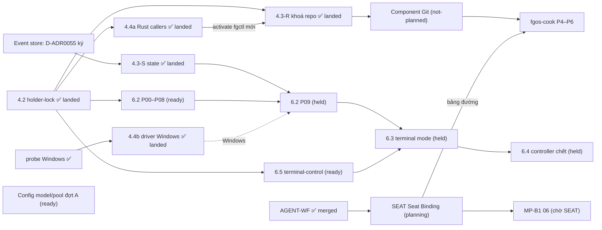

# Bảng chương trình nền tảng fgOS

Cập nhật lần cuối: **2026-10-18 17:15**, phiên `forgentx-95` (big lead, máy của owner).

## Đọc gì trước, sửa gì

- File này **chỉ là chỉ mục và trạng thái**, không phải nguồn sự thật.
  - Phạm vi, quyết định và phase của từng việc nằm trong `plan.md` của plan đó.
  - Trạng thái chạy thật nằm ở nhánh tích hợp và báo cáo phase-lead.
  - Nếu file này và plan con nói khác nhau, **plan con đúng**. Khi thấy lệch, sửa dòng tương ứng ở đây.
- **Cách cập nhật (mọi máy):**
  1. `git pull` main.
  2. Chỉ sửa dòng của luồng mình đang làm, ghi giờ và tên phiên.
  3. Commit bằng pathspec (`git commit -- plans/261017-1313-fgos-platform-program-board/plan.md`), push ngay.
  4. Xung đột thì giữ cả hai ý rồi gộp lại. Không ghi đè dòng của luồng khác.
- **Khi nào cập nhật:** khi bắt đầu hoặc xong một phase, khi bị chặn, khi land, khi có quyết định mới của owner ảnh hưởng luồng khác.
- **Trước khi bắt đầu việc mới đụng tới lock, git, state, config hay runner:** đọc mục [File chung dễ va](#file-chung-dễ-va) và [Quyết định đang treo](#quyết-định-đang-treo).

## Các luồng

Trạng thái: `landed` · `running` · `ready` (chạy được, chưa ai nhận) · `held` (chờ một quyết định hay luồng khác) · `planning` · `not-planned`.

| ID | Luồng | Plan | Trạng thái | Đang ở đâu / ai làm | Chờ gì | Mở khoá cho |
|---|---|---|---|---|---|---|
| 4.2 | Holder-lock: cổng lock, kernel lock cho các lock lạnh | [plan](../261016-1104-holder-lock-kernel-lock-foundation/plan.md) | **landed** 10-17 12:30, main `0d6da9033`, release `af277e02…` ở forgentX, mdview, mcp-skill-hub | xong; [báo cáo landing](../reports/landing-261017-1219-holder-lock-stop-everything-landing.md) | — | 4.3, 4.4a, 6.2, 6.5 |
| 4.4a | Rust callers lên holder-lock (`fgctl`, `install.lock`, observe) | [plan](../261016-1306-fgctl-rust-callers-on-holder-lock/plan.md) | **landed** 10-17 16:25 (máy owner), 16:43 (máy thứ hai) | main `09f824ea0`, release `79ead131…`, 3 workspace activate, fence đủ; [báo cáo landing](../reports/landing-261017-1625-rust-callers-holder-lock-stop-everything-landing.md). Máy thứ hai (`~/projects/forgent`): release `2895ff70…`, fence 214/214, [báo cáo](../reports/landing-261017-1643-rust-callers-holder-lock-this-machine.md) | — | 4.3 P08 + landing 4.3 |
| 4.3-R | Main checkout một cửa: **phần khoá repo** | [plan](../261016-1306-main-checkout-single-door-hot-lock/plan.md), rào chắn F10 | **landed** 10-17 18:28 (máy owner), 18:59 (máy thứ hai) | main `56f87bf5b`, release `e74cb03c…`, 3 workspace activate, fence đủ (2420/216/17); [báo cáo landing](../reports/landing-261017-1827-main-door-repo-lock-stop-everything-landing.md); máy thứ hai (`~/projects/forgent`) **landed** 10-17 19:00, release `df7a1a04…`, fence 216/216, [báo cáo](../reports/landing-261017-1859-main-door-repo-lock-this-machine.md) (phiên `56677996`) | — | component Git (dùng lại nguyên các khoá) |
| 4.3-S | Main checkout: **phần state** (hot-lock, `stateTx`, gộp `claims.lock`, trần claim + thu hẹp) | [plan 4.3](../261016-1306-main-checkout-single-door-hot-lock/plan.md), khối "CẮT LẠI 18:50" | **landed** 10-17 21:25 (máy owner) | main `c2cadb082`, release `b31b7526…`, 3 workspace activate, fence đủ (2449/219/20); [báo cáo landing](../reports/landing-261017-2123-main-door-state-wave-stop-everything-landing.md); S1–S5 trên nhánh `main-door-state/integration`. Windows: hot-lock fail closed, phán holder là việc tiếp theo của 4.4b ; máy thứ hai (`~/projects/forgent`) **landed** 10-18 00:39, release `4b90becb…`, fence 261/261, [báo cáo](../reports/landing-261018-0039-main-door-state-and-windows-driver-this-machine.md) | — | 6.2 P09 (cần S1+S2); phase chuyển Work của event store |
| ES | Event store (thay L3 điều 1 và 4) | [spec](../../docs/platform/event-store/spec.md) canonical, D-ADR0055; bằng chứng: [V-SPAWN-01](../reports/experiment-261017-1431-event-store-v-spawn-01.md), [hội đồng mở lại](../reports/council-261017-1513-event-store-reopen-final-packet.md), [model check](../reports/experiment-261017-1527-event-store-model-check-reader-seal.md), [model check lại](../reports/experiment-261017-1545-event-store-model-recheck-corrected.md), [ref git](../reports/experiment-261017-1527-event-store-git-ref-mechanics.md) | **01–08 trên main; lớp store đang hoàn thiện** (10-20) | Đang tách các sửa đổi thuộc lớp store khỏi nhánh ES 09 lên main (truy vấn bảo trì hẹp, giảm fsync/spawn, door chặt, hook bắt rename, khoá tên stream nhánh) rồi ES 10 phần store. Phần Work của ES 09 (nhánh `es/p09-cutover`, đã park `03c5186c7`) và ES 11 chuyển sang luồng WORK | — | GIT G0 (bỏ họ bài học `.fgos` mà ES xoá) |
| 4.4b | Driver Windows (`LockFileEx` + Job Object), bàn giao macOS | [plan](../261017-1256-windows-lockfileex-driver-and-macos-handoff/plan.md) (7 phase, khoảng 36 giờ; D3 đã duyệt 13:53: domain `windows-job` chuyển từ 6.2 P02 sang đây) | **landed** 10-18 00:25 (máy owner, 3 workspace Linux) | main `d9d527ad6`, release `0c43eb1d…`; cổng 500 lần của owner trên Windows: 0 vi phạm cả 3 kịch bản ([bằng chứng](../reports/evidence-261018-0015-windows-driver-stress-report.json)); [báo cáo landing](../reports/landing-261018-0021-windows-driver-linux-workspaces-landing.md). Chưa activate workspace nào trên Windows ; máy thứ hai **landed** 10-18 00:39 cùng release `4b90becb…` với 4.3-S, [báo cáo](../reports/landing-261018-0039-main-door-state-and-windows-driver-this-machine.md) | activate trên Windows khi có workspace ở đó | `fgos run` trên Windows (6.2 D7) |
| 6.5 | terminal-control: lõi Rust, driver herdr | [plan](../261016-1306-terminal-control-rust-core-herdr-driver/plan.md) | **landed** 10-18 04:45 (máy owner) | main `119823fc6`, release `6208cb3e…` ở 3 workspace, fence đủ (2473/219/20); [báo cáo landing](../reports/landing-261018-0438-terminal-control-stop-everything-landing.md). Kèm sửa `f3dbc5e1d`: `fgos run` trước đó không bao giờ chọn invocation herdr (gộp `runner.executor` làm mất `invocations`) | máy thứ hai **landed** 10-18 09:11, release `f88afb17…`, fence 277/277, [báo cáo](../reports/landing-261018-0911-terminal-control-and-run-supervisor-this-machine.md); tiêu chí 6 (một round trọn mỗi CLI trong thư mục đã tin cậy) còn mở | 6.3 |
| 6.2 | Run supervisor: lõi Rust, cách khởi động direct | [plan](../261016-1351-run-supervisor-rust-core-direct-mode/plan.md) | **landed** 10-18 08:35 (máy owner) | main `13199adb4`, release `e95c130d…` ở 3 workspace, fence đủ (2483/219/20), D-ADR0056 đã ghi; [báo cáo landing](../reports/landing-261018-0833-run-supervisor-direct-mode-stop-everything-landing.md). CI `process-containment` xanh Linux/Windows/macOS. Lỗi còn mở: workspace dưới `/tmp` thì gate không đọc được envelope (`gate-lost`) | máy thứ hai **landed** 10-18 09:11 (cùng release `f88afb17…` với 6.5, [báo cáo](../reports/landing-261018-0911-terminal-control-and-run-supervisor-this-machine.md)); sửa lỗi `/tmp` | 6.3, 6.4 |
| 6.3 | Terminal mode + nửa launcher của identity | [plan](../261016-1351-terminal-mode-and-launcher-identity/plan.md) | **landed** 10-18 17:10 (máy owner) | main `274de6172`, release `a6bcdc29…` ở 3 workspace, fgctl cài lại, fence đủ (2551/219/20), D-ADR0059 đã ghi; [báo cáo landing](../reports/landing-261018-1714-terminal-mode-stop-everything-landing.md). Herdr thật: 5 CLI mỗi CLI một round `completed-pass` (đóng tiêu chí 6 của 6.5). CI macOS đỏ ở `fgos-process` là lỗi của main, lane Git nhận (nhật ký 16:45) | máy thứ hai land release này: **trước khi activate** chạy `fgos doctor --fix` bằng release cũ để dọn home v1 gắn pane | 6.4, MP-B2, Git 04, việc chuyển `publish.rs`/`store.rs`/`envelope.rs` của Git/ES |
| 6.4 | Controller chết: settle, `--resume`, dọn | [plan](../261016-1351-controller-death-settle-and-resume/plan.md) | **merged** 10-18 21:56 (code trên main `d91fad3fa`), **activate trên máy thứ hai 10-19 09:08 và máy owner 10-19 10:26** (cùng Git 01, [báo cáo](../reports/landing-261019-1026-git-01-and-cook-mpb2-owner-machine.md)); sweep 6.4 sạch ở 3 workspace. **Việc còn mở đã đóng 10-19 14:20** (main `617b0fdbb`, [báo cáo](../reports/phase-lead-261019-1318-controller-death-followups.md)): finding 3 (không bước mới sau tín hiệu), 4 (huỷ attempt đang bàn giao), 5 (`RunnerConfigError` có tên), 6 (handler tín hiệu chỉ khi CLI yêu cầu) sửa có test; release envelope bị prune: đóng có lý do, doctor `run-attempts-stuck` chỉ rõ release đã xoá và cách khôi phục; smoke Ctrl-C/resume trên release mới **đạt** 13:05. Trước đây máy owner chưa | P00r→P07A xong, big lead kiểm từng phase; cả bộ test 8190 (lỗi còn lại đều môi trường); D-ADR0060 đã ghi; [báo cáo](../reports/landing-261018-2156-controller-death-merged-activation-with-git-landing.md). Activate gộp vào landing dừng toàn bộ của lane GIT (main đã có Git Lane B; máy thứ hai: "chưa activate"); bước landing và rollback ở [P07A](../reports/phase-lead-261018-2121-controller-death-p07a-integration-and-t8.md) | **lane GIT:** khi xin landing phase 01, gộp activation 6.4 (release từ main có cả hai); hoặc báo trên bảng nếu Lane B activate sớm được | MP-B3 |
| GIT | Component Git `fgos-git` (Rust): G0 spec → G5 cổng máy móc | [roadmap](../reports/roadmap-261016-2212-fgos-cook-and-git-component.md) mục P2; [danh mục bài học git](../reports/research-261017-1032-git-lessons-catalogue.md); [handoff](../reports/handoff-261017-1901-git-g0-and-event-store-plan-leads.md) | **01–06 land cả hai máy; 07 bắt đầu** (10-20) | 07 không còn chờ ES cutover (owner 11:34): thao tác git mà Work kéo theo (checkpoint `.fgos`, quét file event khi land) đi qua ScopedCommit bằng adapter tạm, xoá ở luồng WORK; rồi 08 | land 07–08: owner chọn giờ dừng toàn bộ | ES (dùng port xuất bản của Git), land, chuyển caller, `fgos-cook` |
| MP-A | Config model/pool/account, đợt A (lát bổ sung) | [plan](../261017-1302-model-pool-config-additive-slice/plan.md) | **done** (16:00; 00–06 trên main) | — | — | gemini nhận `--model`; mỗi họ một executor; ô tier `model@pool`/danh sách; `llmAccounts` chỉ đọc; `fgos dispatch explain`; 6 check doctor; rigor của capability nâng trần (RUL102, RUL103). Owner chọn giữ lối rơi khi thiếu ô (từ chối làm ở đợt B). Mỗi máy làm theo [hướng dẫn đồng bộ máy](../reports/guide-261017-1828-sync-a-machine-after-model-pool-and-rust-callers.md) (config global, `fgctl`, release, hàng rào). Các đợt B, C sau; [bài toán](../reports/problem-261017-0022-model-tier-selection-misfit.md) |
| MP-B1 | Model/pool đợt B1: lease, state, quarantine theo pool; xoay account theo `credentialStore`; pin `pool/account`; thiếu ô tier thì từ chối | [bài toán](../reports/problem-261017-0022-model-tier-selection-misfit.md) mục 5.3 | **running** ([plan](../261019-2312-model-pool-b1-fallback-and-account-order/plan.md) main `c65cbf643`; 00–05 trên main (`57545e132`, `d01e8468a`, `6c674ccca`), D-ADR0071; **active** từ land 10-20 09:12; 07 (chứng minh thật) xong 10-20 11:15; 06 phần còn lại chờ spec Seat Binding; 06 đổi config chờ owner duyệt diff) | — | owner trả lời câu hỏi 4, 5, 6 của report (thứ tự fallback, mặc định fallback khác họ, thứ tự xoay account); lập plan | MP-C |
| MP-B2 | Model/pool đợt B2: `credentialStore {use, homeEnv, files}` trong confinement và driver bwrap | [bài toán](../reports/problem-261017-0022-model-tier-selection-misfit.md) mục 5.3 | **00–05 merged** 10-19 02:15, main `2ebac8756` ([plan](../261019-0019-model-pool-b2-credential-store-confinement/plan.md), [báo cáo lead](../reports/phase-lead-261019-0138-model-pool-b2-credential-store.md)); **06 merged** 10-19 10:45 `edd59bdfc` (config forgentX bỏ `resourceBindings`/`env[homeEnv]` ở invocation có `credentialStore`; round pi thật pass); còn lại thuộc MP-C: config global (13), mdview và mcp-skill-hub (24 mỗi bên), nhánh suy luận trong `credentialStoreOf` | máy owner | — | MP-C |
| MP-B3 | Model/pool đợt B3: bước fallback đổi nguồn (`source-rotation`) | [bài toán](../reports/problem-261017-0022-model-tier-selection-misfit.md) mục 5.3 | **held** | — | 6.4 P02 land | — |
| MP-C | Model/pool đợt C: `prefer` theo họ; account sang `llmAccounts`, xoá `runner.providers`; danh sách và `@` trong `modelPolicies` global | [bài toán](../reports/problem-261017-0022-model-tier-selection-misfit.md) mục 5.3 | **held** | — | release đọc `llmAccounts` active ở mọi project trên mọi máy ([hướng dẫn](../reports/guide-261017-1828-sync-a-machine-after-model-pool-and-rust-callers.md)) | — |
| MP-COST | Chi phí model: kẹp capability dưới trần, luật escalation, quyền override, `assignment-policy` áp trần, model của agent in-process | [bài toán](../reports/problem-261017-0022-model-tier-selection-misfit.md) mục 5.3 "Out of scope" | **not-planned** | — | owner giao; câu hỏi 1–3 của report | — |
| SEAT | Seat Binding: một component (Rust, mặt tiền Node mỏng) quyết model cho từng ghế. rigor chỉ quyết số ghế kiểm và yêu cầu khác họ (bỏ `rigorToTier`); thang tier 6 bậc khai trực tiếp, ô model+effort, bậc họ không đạt để trống; ghế/role/persona tường minh trong workflow; R1 taste theo role trong config capability, R2 tier portable trong package; tier workflow là sàn | [spec nháp](../reports/spec-draft-261020-1017-seat-binding-component.md) (owner đã trả lời mọi câu); [kiểm kê](../reports/research-261020-0955-seat-binding-needs-and-mechanisms-inventory.md); [thang tier theo họ](../reports/research-261020-1339-model-family-tier-ladders.md) | **spec duyệt 10-20 21:31** (owner; D-ADR0072; bước 3 đang chạy: `docs/specs/seat-binding.md` do lead `seat-spec-promote`; bước 4 plan `plans/261020-2132-seat-binding-component/` do planner Opus `seat-planner`) (council xong 20:25: chưa đủ để plan, 8 lỗi chặn G1–G8, không mở lại quyết định nào; [tổng hợp](../reports/council-261020-1547-seat-binding-spec-review.md); bước 2 đang chạy: bản hợp nhất `plans/reports/spec-draft-261020-2028-seat-binding-component-consolidated.md`, agent Opus `seat-consolidate`; 5 câu xác nhận đã gửi owner 20:30) | phiên `forgentx-95` (big lead, máy owner) thiết kế; council `architecture-advisory` `wf-run-1792496104999-4c0d9095` (lần 3; lần 1–2 hỏng vì ghế xai, xem backlog `p-d2dc4f2e`) đang synthesis 10-20 20:05. **Thứ tự:** (1) council xong → tổng hợp `plans/reports/council-261020-1547-seat-binding-spec-review.md`; (2) sửa spec theo lỗi chặn; (3) owner duyệt bản cuối → spec vào `docs/specs/` + quyết định; (4) plan (crate Rust + facade, chuyển một đợt, L10); (5) lead Sonnet làm, big lead verify độc lập; (6) land; (7) diff config model cho owner duyệt (`gpt-6-luna`, `gpt-6.1-sol`, `grok-4.7`, ô `mini`, ô trống deepseek/glm). Đảo lại nếu: hội đồng chỉ ra quyết định của owner mâu thuẫn nhau hoặc với code → dừng ở (2), hỏi owner theo mẫu | bước 5 đang chạy: ak:cook theo phase (-01 trên main, 00 facts) | COOK P5 (bảng đường: cột tier/rigor), MP-B1 06 (phần còn lại + đổi config), MP-COST |
| 5.1 | Identity resolver thành crate Rust | [plan](../261015-2102-identity-resolver-rust-crate/plan.md) | **done** (đóng 10-19 02:25: mọi commit của nhánh đã ở main, cổng cold đạt theo ngưỡng ≤10 ms owner nới 10-15) | — | — | 6.3 (nửa launcher) |
| DOC | Thống nhất thẩm quyền tài liệu (260925) | [plan](../260925-documentation-authority-unification/) | **running** (Phase 8 Bước 3 + Bước 4 đóng: bản ghi vá cho 1.037 file docs và 331 file instructions/skills/comment/help, mọi patch là bản vá Phase 9, không sửa byte nào trong Phase 8; 4 đợt review độc lập, đợt cuối 0 rework; tiếp theo Bước 5: consumer hành vi + parity; chưa land main, chỉ land ở Phase 9 theo L12-9) | nhánh `plan/260925-documentation-authority-unification` (HEAD `763568157`; main `585044f19` đã merge vào `6b3335711`), lead `forgentx-5f` | — | — |
| COOK | `fgos-cook` và đường chạy cho cook (roadmap P1–P6) | [roadmap](../reports/roadmap-261016-2212-fgos-cook-and-git-component.md) | **P1 (cắt) + P3 merged** 10-19 00:20, main `b1e170030` ([plan](../261018-2240-cook-path-cleanup-and-run-fixes/plan.md), [báo cáo lead](../reports/phase-lead-261018-2240-cook-p1-p3-run-path.md)); activate cùng đợt Git | 10-18 22:20 owner chốt: (a) `/fgOS:cook` cũ (một câu → Work item → `awaiting-approval`, văn bản còn nói "stage" đã bỏ từ 0049) **đổi tên `/fgOS:deliver`**, tên `cook` dành cho skill mới; (b) **P1 cắt nhỏ**: chỉ dọn sự thật sai (xoá các chỗ dạy `fgos coordination` không còn, frontmatter plan hai cửa, đổi tên deliver và sửa chữ "stage"); viết lại doctrine điều phối (`coordination-driver.md`) **chờ spec của AGENT-WF**; (c) **P3** giữ nguyên + thêm: rigor high/critical **bắt buộc mọi ghế khác họ model** (hiện checker≠producer đã bắt buộc ở `reviewed.mjs`, giữa các checker mới là ưu tiên); (d) bảng 12 đường giữ mức rigor đề xuất (R1/R2/R10 low; R3/R6/R7/R12 standard; R4 high; R5 critical, hỏi người trước); R3 dùng provider rẻ; nhiều ghế thì đổi model; **ưu tiên model Trung Quốc khi đạt tier** (config: thứ tự `prefer` + ô `modelPolicies`; owner chốt danh sách model/tier khi tới bước config); (e) **P5 (`fgos-cook`) chờ spec của AGENT-WF** | P4 chờ Git 03; P5 chờ AGENT-WF spec (+ Git 06 cho mảnh ghi song song); P6 chờ Git 07–08 | — |
| YAML | Vendor js-yaml: một cửa đọc YAML, fgOS không còn dependency npm lúc chạy | [plan](../261016-0635-vendor-js-yaml-single-yaml-door/plan.md) | **landed** 10-16, quyết định RUL101 (`docs/specs/distribution.md`) | xong; phiên `56677996` | — | — |
| AGENT-WF | Mô hình agent ↔ workflow cho mọi domain (coding, marketing, sản xuất video…): agent thông minh, linh hoạt, tự ứng phó; workflow là hướng dẫn tác nghiệp (sơ đồ, đường đi, giao tiếp, ràng buộc), dẫn đường chứ không khoá cứng | [hướng của owner, đầu vào hội đồng](../reports/brief-261018-2235-agent-workflow-model-owner-direction.md) (chưa lập plan; đầu ra là thiết kế + spec, **không** plan) | **merged** 10-20 00:58 (spec D-ADR0070; [plan](../261019-1238-workflow-case-ledger-and-admission/plan.md) 00–09 trên main, cuối `a94115474`); activate ở đợt land release kế tiếp (05–09 chưa active) | 10-18 22:20 owner giao, coi là chìa khoá thành công. **Bước 1 (trước mắt):** xem lại ý định thiết kế ban đầu của Workflow và hiện trạng (lịch sử quyết định, 0049, `src/workflow/`, `core/workflows/`, `domains/*/workflows`, hai cửa, pattern/preset, bảng đường). **Bước 2:** hội đồng `fgos-architecture-panel` rigor critical, nhiều vòng, reopen khi cần; câu hỏi nháp: workflow là gì (hướng dẫn/sơ đồ/ràng buộc), khi nào agent tự lập plan và khi nào theo workflow, linh hoạt mà vẫn ổn định và trong khung duyệt, một mảng business mới cần khai gì, giữ/đổi gì của cơ chế hiện có (RUL104 (tốt hơn, không to hơn)). **Owner:** hội đồng không hỏi owner sớm; đi tới một số đồng thuận rồi mới làm việc với owner. **Bước 3:** spec BA trong `docs/specs/` + quyết định; owner duyệt; rồi mới plan. Ca đầu tiên: `fgos-cook` chạy plan của ak | — | COOK P1 (doctrine), COOK P5 |
| HARDEN | Hội đồng soát và làm cứng các lớp tầng thấp: tìm và sửa bug, phát hiện vấn đề nghiêm trọng chưa được xử lý | — (chưa lập plan) | **held** | 10-18 21:27 owner giao. Phạm vi: holder-lock, process/containment, session-identity, terminal-control, run supervisor (6.2/6.3/6.4), Git, event store, `durable-file`, `canonical-json`. Đích: ổn định, nhanh, nhẹ, code đơn giản hơn. Trong phạm vi code đang có được làm API/signature/contract rõ ràng, tường minh, dễ dùng, uyển chuyển hơn (đổi contract thì chuyển mọi caller và xoá đường cũ cùng đợt, L10). **Không mở rộng scope:** mặc định không tính năng mới, không lớp/cơ chế mới; "tốt hơn, không to hơn". Chỉ thêm tính năng khi thật sự đáng (owner 21:30): báo cáo hội đồng gom **mọi** ý tưởng thêm vào **một mục riêng**, mỗi ý ghi rõ lý do (vấn đề thật, bằng chứng) và lợi ích, để owner chọn; không ý nào được làm trước khi owner chọn. Cách làm: hội đồng (`fgos-architecture-panel`) ra danh sách phát hiện có bằng chứng → plan → chuỗi lead | mọi lớp tầng thấp đã land trên máy owner, **gồm cả GIT và ES** | — |
| TRUST | Kiểm quyền tin cậy thư mục **trước** khi mở pane, hỏi người sớm thay vì chạy rồi mới biết bị chặn | — (chưa lập plan) | **not-planned** | 10-18 21:15 owner: ghi vào chương trình, chưa làm. Hiện `seedWorkspaceTrust` (`src/runner/dispatch/herdr-round.mjs`) biết trước khi launch là repo gốc chưa tin cậy (B1 `untrusted-root`, chỉ là đọc file) nhưng chủ ý không dừng, vẫn mở pane rồi mới báo `terminal:blocked:trust-dialog` (gặp ở 6.4 P07a T8). Hướng: (1) kiểm trước khi mở pane, theo cách đọc của từng CLI (claude/codex/agy, kể cả thư mục cha) ra trusted / seed được theo B1 / chưa tin cậy; (2) chưa tin cậy thì không mở pane, hỏi người theo mẫu câu hỏi quyết định, gộp với các câu hỏi đầu lượt; (3) người đồng ý thì fgOS ghi dòng tin cậy cho repo gốc (người cấp, không phạm B1) rồi chạy; (4) doctor `agent-cli-project-trusted` phủ thêm claude, agy | sau khi 6.4 land; owner duyệt thiết kế (fgOS ghi vào config tin cậy của owner khi được đồng ý) | — |
| INS | Kiểm soát luật ở nguồn: luật phải tới đúng agent (đủ L1–L10, nguyên tắc thiết kế, luật dùng lại trước khi thêm), rồi mới dọn hậu quả | [báo cáo](../reports/research-261016-1118-agent-code-quality-guardrails.md) mục 0, 5 (nhóm A, B), 6 | **landed** phần làm tay 10-17 15:10 (`f9ea9c219`, `40c667c83`); phần cơ chế (nhóm A) **not-planned** | 10-17 15:30, phiên `56677996`: đã chiếu đủ L1–L10, thêm `core/instructions/design-principles.md`, luật dùng lại vào worker contract và `fgos-coding-implement`; `CLAUDE.md` chỉ còn `@AGENTS.md`. Quyền ghép luật: Agent Context Engine (RUL102) | D6 (Q4–Q7 trong báo cáo) trước khi lập plan nhóm A | backlog `p-7eb9e65b`, `p-68be2ae3` |
| OPC | Containment theo thao tác: một domain containment cho cả một thao tác Git typed (Land, ScopedCommit, Sync, SafeRestore, Recovery) thay vì một sandbox bwrap cho mỗi lệnh git; thiết kế hexagonal để sau này thay được công nghệ sandbox | [tài liệu thiết kế sơ bộ](../reports/design-261020-1035-operation-scoped-containment.md) (6 câu cho hội đồng) | **held — sau landing** | 10-20 10:34 owner đồng ý ("cần thiết kế kỹ và đặc biệt hexagon vì biết đâu trong tương lai chúng ta có thể đổi sandbox"). Bằng chứng: một git trong sandbox 10,8 ms so với 3,1 ms chạy thẳng; Land ~65 spawn trong sandbox ≈ 0,5 s (37%), ScopedCommit 8 ([gate](../reports/gate-261020-0653-git-p06b-typed-perf-e3.md)). Phạm vi: mở rộng chính port containment hiện có (Process), không thêm cơ chế song song; bộ test tuân thủ chung cho mọi driver | Git 07/08 và ES 09–11 landing xong, hệ thống chạy thật; rồi hội đồng tư vấn và quyết; không chặn Git 07 | Land/ScopedCommit nhanh hơn; thay driver sandbox sau này |
| WORK | Đợt sửa Work (lớp trên: dashboard, giao tiếp với người, requirement, cập nhật tiến độ) gom một lần sau khi các foundation xong | gom từ: [review A](../reports/review-261020-1110-es-p09-write-path.md) và [review B](../reports/review-261020-1110-es-p09-readers-triggers.md) trên nhánh `es/p09-cutover`, báo cáo unit 1–8 ES 09 | **held — sau foundation** | 10-20 11:34 owner: "lớp dưới cần xong và hoàn thiện trước để có nhiều lớp trên cần dùng, sau đó quay lại work… hiện nay anh cô lập không dùng work". Gồm: lỗi đường ghi Work của ES 09 (gồm H1 ba máy làm hỏng mọi lệnh Work), ES 10 phần Work, ES 11 cutover trên mọi máy, xoá adapter tạm của Git 07, kênh npm M10, `fgos rebuild` output | mọi foundation xong | Work dùng Event Store |
| TEST | Quản trị bộ test: mỗi hành vi một bằng chứng chính (nguyên tắc 8 "One proof"), gỡ test cùng cơ chế bị xoá, test không chỉ tăng mà không ai đánh giá, hệ thống không yếu đi | [tư vấn](../reports/counsel-261020-1658-test-suite-growth-rule.md), [plan phase 2–3](../261020-1757-test-governance-port-inventory-and-slow-file-extraction/plan.md), quyết định 0073 (`docs/specs/platform-foundations.md`; số 0072 thuộc Seat Binding) | **running** | máy thứ hai. Xong: luật (`fb8c6e4ae`: nguyên tắc 8, AGENTS.md L5 câu 5, Git spec §15 E6); dòng `suite:` + chặn test trùng mới trong `npm test` (`e7a6adff8`, baseline `test/suite-baseline.json`); `npm test` xanh trên máy mới (`6fa5de5ed`); gỡ 1 test trùng. Tiếp: phase 2 (mỗi port Rust giữ một test route Node, gỡ bản Node lặp ca Rust) cho event-store/run-supervisor/terminal-control; phase 3 tách test use-case cho file chậm nhất | 59 test trùng trong `test/setup` và phase 2 cho git/holder-lock chờ Git 07 lên main | gate nhanh hơn, mọi lead báo cáo test gỡ/thêm có lý do |
| MAIL | Agent Mailbox: giao một tin vào phiên agent đang sống trên một máy, cùng dự án (Claude Code, Codex, agy qua hook); người nhận là head khởi động độc lập, không phải Unit attempt | [spec](../../docs/platform/agent-mailbox/spec.md) (G0 đã ký 10-20); bằng chứng: [hội đồng lần hai](../reports/research-261020-1327-mailbox-spec-architecture-panel.md) (lần một, chưa chốt), [đo trusted-sender](../reports/research-261020-2140-mailbox-trusted-sender-print-mode-measurement.md) | **ready** (V1 làm được ngay, chưa ai nhận) | phiên `d50dc90b` đã ký G0 cùng owner; chưa có mã | V1 và V3: không chờ ai. V2: một hàng `mailbox` trong lock registry (lane holder-lock). V4: gốc ẩn của mailbox trong confinement. V5: **hàm Rust tìm `.fgos` của main checkout cho mọi cwd, chủ là host (`apps/fgos`)** và host route `hook` native cho kind `mailbox` (lane host-invocation-routing), cộng `is_attempt_writer_id` của session-identity. Codex: chờ quy tắc dừng ở V6 và dòng trusted-sender | — |

## Phụ thuộc

**Đường găng:** 4.3-S (wave S) → 6.2 P09 → 6.3 → 6.4. Lane khoá đóng khi 4.4b land (việc dài nhất, cần owner chạy stress 500 lần trên máy Windows). Mọi thứ khác chạy song song quanh nó.

## Quyết định đang treo

| # | Quyết định | Ai quyết | Chặn |
|---|---|---|---|
| D1 | ~~Event store: phương án A hay B~~: owner ký D-ADR0055 10-17 17:15 | — | — |
| D2 | Giờ landing phần B của 4.4a (dừng toàn bộ, cài `fgctl`, activate 3 workspace) | owner — **đã quyết** 16:13, land 16:25 | 4.3 P08, landing 4.3-R |
| D3 | ~~Giờ landing 4.3-R~~: land 10-17 18:28 | — | — |
| D4 | Lập plan component Git (G0) và plan nhỏ cho cook P1/P3 | owner giao | GIT, COOK |
| D5 | ~~Duyệt plan 4.4b~~: đã duyệt 13:53, gồm D3 | — | — |
| D6 | Luật instruction: khoá 7 nguyên tắc thành luật hay giữ `procedure` (Q4); xử lý ngưỡng 32 KiB của codex (Q5); nguồn sinh danh sách luật (Q6); quyết định 10-06 "không sửa đồ của ak/ck" còn hiệu lực không (Q7) | owner | INS nhóm A, dọn khối AGENTKIT trong `AGENTS.md` |
| D7 | Pin `.fgos/distribution.json` khi nhiều máy tự build release: mỗi `fgctl upgrade` ghi digest của máy mình vào cùng một file (máy owner `79ead131…`, máy thứ hai `2895ff70…`), nên các máy thay nhau ghi đè. Chọn: pin theo máy (file không commit), hay chỉ một máy build release và các máy khác cài đúng digest đó. Tạm thời [hướng dẫn](../reports/guide-261017-1828-sync-a-machine-after-model-pool-and-rust-callers.md) bảo `git restore` file sau upgrade | owner | mọi landing có activate |

## File chung dễ va

Hai luồng cùng sửa một file thì **luồng land sau rebase hoặc merge main và giải xung đột**. Không luồng nào sửa file chung của luồng khác ngoài phạm vi plan của mình.

| File | Luồng chạm |
|---|---|
| `src/setup/registrations.mjs`, `CHANGELOG.md`, `docs/specs/runner.md` | 4.4a P04, 4.3-R P09, 6.5, MP-A, 6.2 |
| `packages/holder-lock/contracts/lock-registry.v1.json`, `src/holder-lock/fences.mjs` | 4.4a P00/P04, 4.3-R P00/P09 |
| `bin/fgos.mjs` | 4.3-R P07, 6.2, COOK |
| `src/runner/claim-port.mjs` | 4.3-R P04r (chỉ chuyển lock), 4.3-S P04 (trần + thu hẹp) |
| `src/runner/merge.mjs`, `src/runner/worktree.mjs` | 4.3-R P05/P06, sau này GIT G4 |
| `packages/distribution/rust/src/lock.rs` | 4.4a P01, 4.3-R P08 (sau 4.4a) |
| `src/runner/execution/bind.mjs`, config `modelPolicies` | MP-A |
| `AGENTS.md` (khối do bộ chiếu sinh ra và phần viết tay), `CLAUDE.md`, `core/instructions/*`, `.fgos/instructions/effective/repo.json`, `src/setup/instruction-*.mjs`, `core/skills/_shared/coding-worker-contract.md` | INS. Sửa luật thì sửa ở `core/instructions/` rồi tái sinh khối, không sửa tay trong khối sinh. Khối AGENTKIT của ak trong `AGENTS.md` đang **chưa commit** ở máy owner: commit `AGENTS.md` bằng cách chỉ stage phần của mình |
| `.gitattributes`, luật strip `.fgos`, `merge=union` | **không ai sửa** cho tới khi D1 có kết luận (rào chắn F10) |

## Luật chung cho mọi luồng

- **Landing dừng-toàn-bộ** (4.4a, 4.3-R, 6.x) chạy **tuần tự**, mỗi lần một luồng, ở cả ba workspace: forgentX, mdview, mcp-skill-hub. Owner chọn giờ.
- **Bước kiểm dừng của hàng rào** hiện bắt mọi tiến trình có cwd trong workspace, kể cả tiến trình không phải fgOS. Xem mục "Two deviations" trong [báo cáo landing 4.2](../reports/landing-261017-1219-holder-lock-stop-everything-landing.md).
- **Tier:** config project đặt `runner.maxTier: flagship` (owner duyệt 13:53). Không override thì việc chạy Sonnet; rigor high, rigor critical của unit và mọi override đều dừng ở Opus. Ngoại lệ (RUL103, 10-17 16:30): capability tự khai rigor trong config được nâng trần cho chính nó, nên `architecture:synthesize`, `architecture:shape`, `architecture:explain` (rigor critical) chạy `frontier` (Fable); `fgos doctor` check `capability-rigor-ceiling` liệt kê chúng. Việc code nên ở tier `advanced`.
- **Tên báo cáo và plan** lấy từ `fgos convention path`, không tự đặt.
- **Chuỗi lead trên máy owner:** kịch bản ở `.fgos/runtime/tmp/phase-leads/` (không commit). Lead nhắn big lead `forgentx-95` khi xong hoặc khi bị chặn. Agent ở máy khác báo bằng cách cập nhật dòng của mình trong file này.

## Nhật ký
- 2026-10-21 00:45 (máy thứ hai, GIT): **Git 07–08 chưa merge main — cổng host NO-GO trên `876ea737f`** (báo cáo cổng trên nhánh `git/p07-switch`: `plans/reports/gate-261020-2329-git-p07-p08-host-gate.md`). Clippy sạch, scan 0, doctor qua; nhưng `npm test` nhánh 340 hỏng chỉ-nhánh (main 1 flake), R4 ScopedCommit escapee đỏ, spy bắt `git commit` qua borrow holder-lock, E3 nhánh không đo được, P-RELEASE 3 FAIL. Hai nguyên nhân chính: build bản phân phối `require()` file `.so` (~71) và `reachFloorTicks` số→String sang addon (~135). u24 (sửa review rủi ro H1–H3, M1/M2/M4–M6, L1; Land recovery qua `doctor --fix`) đã commit `ccd60ab45`, census về 0 (`049822850`). u25 đang sửa R1–R7. E3 lưu ý: máy này governor `powersave`, main cũng vượt ngân sách push — số đo chỉ tham khảo. Máy anh: chưa có gì để làm.
- 2026-10-21 05:05 (`forgentx-95`): **SEAT 03 + 04 lên track** `fb841105d` (ff từ `seat-verify-0304`). Big lead verify: host build từ cây, `cargo test` convention + seat-binding + fgos xanh; toàn suite 8528/18 hỏng ở 13 file, cả 13 chạy riêng đều xanh. **Mở phase 05** (schema config, cell, `$comment`, sentinel fence, hàm chuyển đổi thuần; lead `seat-p05`); không đổi hành vi runtime, không sửa config thật nào (đổi config owner ở 09 cần duyệt). Tiếp: 06 (cutover policy) sau 05.
- 2026-10-21 04:20 (`forgentx-95`): **SEAT 03 + 04 xong ở lead, gộp vào nhánh verify** `seat-verify-0304` (track + 04 + 03; CHANGELOG khử dòng trùng do merge). **Exec budget (điểm dừng phase 04):** release host lúc rảnh bind p95 4.23 ms ≤ 5.02 (2× identity 2.51); big lead đo lại 3 lần dưới tải (load ~6): 3.5/3.34, 2.85/3.16, 4.24/3.6 — dao động quanh ngưỡng. **Big lead quyết: đi tiếp Shape S** (một lần gọi ~3–4 ms mỗi ghế mỗi vòng, <1% của `dispatch decide` 761 ms). Đảo lại nếu: khi caller thật dời sang route (phase 06/08), đo trên surface thật thấy phần tăng >5% wall time → dừng, hỏi owner S hay B. Phase 03: persona domain chỉ workflow cùng domain thấy; workflow core không thấy persona domain (đúng §6.4); reader tên file định nghĩa tách `src/convention/definition-names.mjs`. Đang chạy toàn suite trên nhánh verify.
- 2026-10-21 04:00 (`forgentx-95`): **main merged vào track** `9a5c48142` (luồng B, C, D lên track). Va chạm phase 02 × luồng D: `proposedAchievements` gọi `digestUnitRunReports` bằng `roles`, phase 02 đổi tham số thành `seats` (kho report khoá theo ghế) → milestone `unreached`; big lead sửa trong merge (khoá theo `seatKeyOf`), `conductor-case` + `case-admission-port` + `architecture` 48/48. Phase 03 xong vòng 1, trả lại: merge track mới, tách reader tên file định nghĩa ra `src/convention/definition-names.mjs`, chạy lại nhóm. Phase 04 đang chạy.
- 2026-10-21 03:15 (`forgentx-95`): **SEAT phase 02 merged vào track** `a287c9d79` (fast-forward). Lead sửa một nguyên nhân gốc: fence -01 từ chối mọi bản ghi có `seatSchema` nên chặn cả bản ghi schema 1 mới → nay biết schema 1, schema mới hơn vẫn `record-from-newer-release`; test chuyển sang khoá theo ghế (tên ghế `member-N`, `synthesis` đúng spec §6/§7). Big lead verify lần 3: toàn suite 8432/22 hỏng ở 16 file, cả 16 chạy riêng đều xanh. **Mở phase 03 (persona scope, lead `seat-p03`) ∥ 04 (host route + đo exec budget, lead `seat-p04`)**, file không giao nhau. Đảo lại nếu: 04 đo p95 > 2× identity → dừng, hỏi owner S hay B. **An toàn (ngoài SEAT):** brief gõ vào pane mà foreground là zsh thì zsh chạy cả span backtick như lệnh (`unit-run-1792525366556-23ed5f57`, dòng 47) → backlog riêng `p-f97bb935` (bb6df3bfe); hỏi owner có mở luồng sửa ngay không.
- 2026-10-21 02:05 (`forgentx-95`): **luồng B merged** vào main `c93f2ea93` (skill `fgos-cook` + references; chỉ tài liệu skill; toàn suite 8353/40 hỏng ở 22 file, cả 22 chạy riêng đều xanh). **SEAT phase 01 (crate) merged vào track** `d0f814cfe` (14 file hỏng khi chạy cả suite, chạy riêng đều xanh). **SEAT phase 02 trả về lead:** lần 1 lệch spec §7.1 (reviewed không cho khai `seats:`) đã sửa; verify độc lập lần 2 (host build từ cây, `cargo test` 4 crate xanh) ra 8427/87 hỏng, chạy riêng vẫn hỏng ở ~25 file (seats, workflow-runner, run, crash-matrix-adopt-resume, resume-adopts, pool-independence…) — regression thật, lead tự báo "mọi vùng chạm đều xanh" là sai. Chưa merge. Phase 03 ∥ 04 chờ 02. Đảo lại nếu: lead chứng minh một test sai theo spec → sửa test có lý do ghi trong báo cáo.
- 2026-10-21 00:05 (`forgentx-95`): **SEAT phase -01 merged** vào main `5a04092ba` và track `seat-binding-wave` `d8703db78` (dev door dùng host nó stage; release hiện tại từ chối resume bản ghi có `seatSchema`, mã `record-from-newer-release`). Big lead verify: toàn suite 8397/19 hỏng ở 14 file; chạy riêng từng file đều xanh (`run.test` 1 test hỏng do tải, load ~20, chạy riêng 1 s xanh; `dev-host` hỏng do tranh cargo, chạy riêng 10/10). Phase 04 giờ đủ điều kiện. Phase 01 và luồng B đang chạy lại riêng các file hỏng; phase 02 lead đang chạy. Pane herdr lỗi (owner hỏi 23:55): 3 pane của plan tài liệu 260925, không phải SEAT; hai lỗi codex cùng loại `p-d2dc4f2e` (đã thêm bằng chứng, `6f3013d8b`), một run gemini thành công; đã đóng 3 pane của run đã đóng.
- 2026-10-20 23:11 (`forgentx-95`): **luồng D merged** (settle của conductor case ghi milestone mà activity `produces`; chấp nhận vẫn do projection quyết, mốc giao hàng thiếu biên nhận vẫn `receipt-missing`). Big lead verify: `test/workflow/` 236/236; toàn suite 8374/33 hỏng ở 17 file, cả 17 chạy riêng đều xanh. Chưa active (vào release land ở cổng 2). Mở khoá COOK P6 chạy thật; luồng B verify tiếp.
- 2026-10-20 22:58 (`forgentx-95`): **SEAT phase 00 xong** ([báo cáo](../reports/phase-lead-261020-2215-seat-binding-phase-00-facts.md), main `d92c487ad`): 17 sửa plan (planner đang tích hợp); drain thật trên forgentX: 31 `running` = 1 controller sống, 28 chết chờ resume, 2 `legacy-run`; không có verb abandon. **Big lead quyết (trong khung, đã báo owner):** không resume 28+2 bản ghi chết trước đợt; sau land chúng bị từ chối có tên `record-predates-seat-binding`, lịch sử đọc được qua đường đọc cũ; drain chỉ chặn bản ghi có controller sống; không thêm verb abandon (RUL104); hàng doctor replay `mutating-assignment-binding-snapshot` (thực tế replay 0 bản ghi) bỏ, thay bằng replay phase 08. Bắt đầu phase 01 (crate) ∥ 02 (seat identity) trên track `seat-binding-wave`. Phase -01: suite đầy đủ 8397/19 hỏng ở 14 file, đang chạy lại từng file. Đảo lại nếu: owner muốn resume run cũ nào → làm trước land.
- 2026-10-20 22:40 (phiên `d50dc90b`, owner 22:25 "ký G0 và ghi lên board"): **G0 của mailbox đã ký** ([spec](../../docs/platform/agent-mailbox/spec.md), mục 14 và 17). Ký sau hội đồng kiến trúc lần hai (phán quyết: chưa ký nguyên văn, ký được sau sửa A1–A6, A10 và hai câu O1, O2; spec đã sửa theo đó, hội đồng không phê duyệt spec) và sau phép đo trusted-sender (Codex, chế độ in: đọc 20/20, sửa trong tác vụ 20/20, người gửi lạ 0/20 ở cả hai; chỉ cho biết chiều, không cho biết độ lớn). Các câu owner chốt: người nhận là head khởi động độc lập, không bao giờ là Unit attempt; một record ở `.fgos` của main checkout cho mọi linked worktree; record là snapshot dưới mutex holder-lock; ngưỡng 80% theo từng ô hợp lệ. **Gửi lane host-invocation-routing:** mailbox cần một hàm Rust trả `.fgos` của **main checkout** cho mọi cwd. `resolve_target_root` (`apps/fgos/src/main.rs:123`) đi lên `.fgos` gần nhất, mà mỗi linked worktree có `.fgos` riêng (đã kiểm: cả bốn worktree trên máy này), nên dùng nó sẽ tách record theo worktree. Bản Node `resolveMainCheckoutRoot` dùng `git rev-parse --git-common-dir`. Đề xuất hàm mới đặt cạnh, đọc file `.git` (`gitdir:`) và `commondir`, không gọi git (chưa kiểm với submodule hay bare repo); có sửa luôn `resolve_target_root` hay không là việc của lane host vì sẽ đổi gốc của mọi lệnh trong worktree. Chưa lane nào nhận; chỉ V5 cần, V1–V4 không chờ. Cũng cần host route `hook` native cho kind `mailbox` (mọi kind khác vẫn sang legacy-node). Việc kế: V1 (crate `fgos-mailbox-core`, test thuần). Việc dọn nhỏ: hàng cho `component-boundary.md` đã thêm.
- 2026-10-20 22:18 (`forgentx-95`): **SEAT plan qua red-team + validate, bắt đầu ak:cook.** Plan `plans/261020-2132-seat-binding-component/` (14 phase, ~17 ngày): red-team 4 reviewer Opus, 37 phát hiện → 16 chấp nhận ([phân xử](../261020-2132-seat-binding-component/red-team-adjudication.md); 5 critical: lớp config global còn `rigorToTier`, các chỗ ghi mặc định trước khi kiểm, fence, drain sai trạng thái, chỗ replay sai file), planner sửa + quét nhất quán sạch; validate: 0 câu hỏi owner (mọi điểm nằm trong spec đã duyệt, ghi Validation Log). Nhánh track `seat-binding-wave` (từ main `95554c9eb`). Đang chạy: lead `seat-pm01` (phase -01 trên main: dev door tìm host đúng, release hiện tại từ chối bản ghi `seatSchema`), lead `seat-p00` (facts, drain thật trên forgentX). Thứ tự tiếp: {01 ∥ 02} → {03 ∥ 04} → 05 → 06…11 → 12 (owner chọn giờ land). Đảo lại nếu: phase 04 đo chi phí gọi Rust vượt ngân sách → dừng, hỏi owner S hay B.
- 2026-10-20 22:14 (`forgentx-95`): **luồng C merged** (pi và omp gửi brief qua prompt door; supervisor tick trước mỗi lần gửi nên ghế đã dừng không gõ tiếp; big lead verify: cargo test 2 crate xanh, release build xanh, toàn suite 8452/19 hỏng ở 14 file, cả 14 chạy riêng đều xanh, 4 file terminal hỏng chiều nay hết với host mới). Chưa active: vào release land ở cổng 2; smoke ghế pi + omp thật sau land. **Cho lane mailbox (`d50dc90b`):** `docs/platform/agent-mailbox/spec.md:592` ghi "chỉ Codex dùng prompt door" — giờ pi và omp cũng dùng, nhắc qua mailbox tới ghế pi/omp sẽ kéo focus herdr; lane đó sửa spec.
- 2026-10-20 21:58 (`forgentx-95`, owner 21:50 "plan xong thì chạy ak-plan validate/redteam để kiểm tra, sau đó chạy ak:cook"): **kế hoạch còn lại của đợt.** (1) Verify độc lập rồi merge lần lượt C → D → B (C: toàn suite 8452 qua/19 hỏng ở 14 file, đang chạy lại từng file; 4 file terminal hỏng chiều nay đã hết với host mới; D: đang verify; B: merge sau D vì skill cần D). (2) SEAT plan (`plans/261020-2132-seat-binding-component/`, planner Opus) → `/ak:plan red-team` → sửa theo phát hiện thật (ghi lý do bác) → `/ak:plan validate` (câu repo/spec trả lời được thì tự trả lời; câu của owner gom một bộ) → `/ak:cook --auto` theo nhóm phase, mỗi nhóm một lead Sonnet trong worktree theo `core/skills/_shared/ak-cook-worker-contract.md`, big lead verify toàn suite từng nhóm, nhóm đụng file chung chạy nối tiếp theo thứ tự merge của plan. (3) Smoke ghế pi + omp thật sau khi C vào main. (4) Cổng 2: một lần land cho SEAT + B + C + D + doctor skills. (5) Sau land: diff config model (gồm bỏ ghim `code:review`/`code:debug`), COOK P6. Ghi chú lane mailbox (`d50dc90b`): sau C, pi/omp cũng dùng prompt door, `docs/platform/agent-mailbox/spec.md:592` ("chỉ Codex") cần sửa ở lane đó. Đảo lại nếu: red-team chỉ ra plan không giữ được main xanh giữa các nhóm → gộp nhóm hoặc hỏi owner.
- 2026-10-20 21:33 (`forgentx-95`, owner 21:31 "ok, duyệt spec Seat Binding"): **cổng 1 qua.** Bản duyệt: `plans/reports/spec-draft-261020-2028-seat-binding-component-consolidated.md` (rev 2 + `b87b58df2`: file persona không mang tier/prefer). Song song: đưa vào `docs/specs/seat-binding.md` + D-ADR0072 + ghi chú supersede RUL80/91/98/102/103/106 (phần chọn ghế); lập plan một đợt. **COOK P5 xong ở nhánh** `worktree-agent-a49edb90659389932` (skill `fgos-cook`, chưa chạy thật: chờ luồng D), chờ big lead verify. Đảo lại nếu: plan cho thấy một đợt không giữ main xanh giữa các lần merge → tách nhóm merge cùng nhau, hỏi owner nếu phải đổi "một đợt".
- 2026-10-20 21:07 (`forgentx-95`, owner 21:06): **SEAT chốt nốt:** (A) giữ khoá `prefer` ở mọi chỗ, không có `families` (capability còn do executor dạng tool phục vụ, vd `impact-analysis` → `gitnexus`); Seat Binding chỉ quyết ghế agent, đường tool giữ nguyên; bỏ bước chuyển config. (B) đợt 1 không nâng tier bằng override (chưa có cửa chứng minh người), chỉ qua config đã commit. (C) khoá capability/tiền tố là mặc định của project, đứng dưới tier khuyến nghị theo ghế; chỉ khoá seat/persona/role đè được; `maxTier` của project hạ ghế vượt trần xuống trần, hiện rõ (`max-tier-cap`) — đòn bẩy ngân sách. Bản hợp nhất `spec-draft-261020-2028-…` đang sửa theo; sau đó owner duyệt cả văn bản (cổng 1). Đảo lại nếu: sau land thấy `maxTier` hạ làm hỏng chất lượng mà người dùng không để ý → thêm cảnh báo doctor, không đổi quyền.
- 2026-10-20 20:40 (`forgentx-95`, owner 20:39): **SEAT quyết định mới — project thắng:** tier khai ở ghế workflow là mức *khuyến nghị* (mặc định khả chuyển như R2), không phải sàn; thứ tự R1 config project > tier ghế workflow > R2 > mặc định; project hạ được nhưng phải hiện rõ (`tierSource` + mức bị hạ trong explain/bằng chứng); không khai gì thì vẫn không tự hạ, từ chối có tên kèm dòng config cần thêm. Lý do owner: "nếu không thắng thì hạn chế người dùng… nếu họ không có kinh phí là ko thể dùng". Thay câu "sàn" ở §W/§R.3 (13:58). **Ghim `họ#invocation` là cứng.** Điểm 3–5 giữ mặc định council. Đảo lại nếu: chạy thật cho thấy project hạ tier làm hỏng chất lượng mà không ai thấy → thêm cảnh báo doctor, không đổi quyền.
- 2026-10-20 20:45 (máy thứ hai, ES): **ES 10 phần store lên main `d576a1d66`** ([báo cáo](../reports/verification-261020-2012-event-store-store-proof-gate.md)): tầng store **được chấp nhận làm nền đang ngủ**. Xanh trên code main: test topologies 6/6, WAL bị chặn (10.000 lần seal, M8), Rust 149/0, addon trong bản release có đủ export Event Store (giờ có test khoá), spec cập nhật trạng thái + đối chiếu §10/§21 với Git, component-boundary và reading-map. **V-EVENT cho Git 08:** run `unit-run-1792335330301-2d5438cb/producer/1` (suite `v_event`, 4 test). **Quyết định (trong khung):** `--separate-git-dir` và submodule absorbed tạm không hỗ trợ (Git từ chối `trusted-main-gitfile-unsupported`); chỉ xem lại nếu workspace nào trong danh sách máy của owner dùng kiểu gitfile. **Việc của owner khi tiện:** `sudo scripts/event-store/power-loss.sh` (Q4, mất điện) và `scripts/event-store/forge-probe.sh` (Q3, forge thật). Phần cần consumer Work để lane WORK.
- 2026-10-20 20:18 (`forgentx-95`): **luồng D thêm vào đợt:** conductor case không bao giờ qua được milestone vào, vì settle của admission port luôn ghi `achieved: []` (`src/workflow/case-admission-port.mjs` ~275; lead `cook-p5` phát hiện, big lead kiểm lại). Đây là chỗ code chưa làm theo spec AGENT-WF đã duyệt (RUL-WF-2 `produces`), không phải cơ chế mới; lead Sonnet `settle-milestones` sửa song song, chỉ trong `src/workflow/`. Chặn COOK P6 (chạy thật), không chặn P5. Gộp vào cổng 2. Đảo lại nếu: plan 261019-1238 ghi việc để trống là hoãn có chủ đích → dừng, hỏi owner.
- 2026-10-20 20:15 (máy thứ hai, GIT/ES): **tình hình.** (1) **Git 07** (`git/p07-switch` `7044c55d1`, chưa lên main): bốn sub-lane (Land còn lại, setup/hooks/holder/Workflow, readers Node+Rust, scripts/skills/fixture) đã merge; mọi đường merge qua Land, catchup qua Sync, `integrate.mjs` xoá, dữ kiện repo dùng chung theo tiến trình (`approve --no-wait` 79→21 lần gọi git, `doctor` 332→62); main mới nhất đã merge vào. Đang làm **u20 = cổng một cửa V-GATE** (quét tĩnh + spy trong `npm test` + 9 probe + `mutation-census.v1.json` + doctor `git-mutation-one-door`) rồi dọn nốt chỗ git thô; sau đó Git 08. (2) **Đã lên main hôm nay từ máy này:** luật test mới (nguyên tắc 8 "One proof", quyết định 0073, `fb8c6e4ae`), dòng tổng kết + chặn test trùng trong `npm test` (`e7a6adff8`), `npm test` xanh trên máy mới (tự chuẩn bị bản release, socket ngắn, pin config, fixture v1 đọc YAML qua js-yaml; `6fa5de5ed`), sửa lỗi land (`e0d9bb835`). **Máy owner:** `npm test` sau bản `6fa5de5ed` sẽ dựng bản release lần đầu (mất vài phút). (3) **ES 10 phần store** bắt đầu (nhánh `es/p10-store-proofs`): ma trận §23.2 đánh dấu STORE/WORK, test topologies, addon nạp từ release, script power-loss (owner chạy bằng sudo, Q4), WAL bound, docs store, đối chiếu spec với Git; phần cần consumer Work để cho lane WORK. (4) Owner 20:12: máy thứ hai tự quyết giờ land (kể cả lần land Git 07–08 phải dừng mọi việc), mỗi lần land có dòng board + hướng dẫn cho máy owner.
- 2026-10-20 20:12 (`forgentx-95`, owner 20:10 "mở luồng B và C luôn"): **trình tự đợt SEAT + COOK P5** — song song: (A) SEAT council → sửa spec → **cổng 1 owner duyệt spec**; (B) COOK P5 vòng điều phối, lead Sonnet `cook-p5` ([plan](../261020-2010-cook-p5-fgos-cook-coordination-loop/plan.md), chưa có bảng đường: chờ SEAT); (C) pi và omp gửi brief qua prompt door + dừng gõ khi supervisor đã bắt đầu dừng, lead Sonnet `brief-door` (backlog `p-d2dc4f2e`). Sau cổng 1: (A2) plan + làm SEAT, (B2) bảng đường cook, ngưỡng gom một bộ hỏi owner. **Cổng 2: một lần land** cho SEAT + C + P5 + doctor skills theo CLI. Sau land: diff config model, COOK P6. Đảo lại nếu: B cần cơ chế mới trong `src/` → dừng, hỏi owner; C làm hỏng codex/claude → tách pi/omp, giữ flag cũ.
- 2026-10-20 18:40 (`forgentx-95`): **council Seat Binding chạy lại** `wf-run-1792494965025-176eda84` (đầu vào y hệt). Lần đầu `wf-run-1792486052113-e33b6ca4` hỏng 16:08 ở critique: ghế xai `terminal-launch-not-started` (lệnh gõ vào pane herdr nhưng tiến trình không lên, cùng loại với lỗi Enter của pi), `workflow resume` không chạy lại bước failed, agent điều phối dừng 15:47 khi monitor hết hạn nên không ai thấy. **wt-unprovision**: phần gỡ provision của lead trùng với `56e3172ed` (máy thứ hai, đặt sang bên rồi trả lại khi port từ chối — tốt hơn), bỏ; chỉ giữ doctor `executor-skills-installed` theo CLI từng invocation (nhánh `fix-skills-doctor-by-cli`, verify độc lập đang chạy). Đảo lại nếu: ghế khởi động qua herdr hỏng lần nữa → nâng thành item sửa launch (gửi qua cửa prompt cho mọi CLI).
- 2026-10-20 17:35 (máy thứ hai, GIT): **sửa các lỗi phát hiện khi land, lên main `e0d9bb835`** ([báo cáo](../reports/phase-lead-261020-1658-landing-findings-worktree-provisioning-retry.md)). (1) `fgos worktree remove` không còn từ chối worktree tạo bằng `fgos worktree create`: lúc tạo, fgOS ghi lại đúng những gì bước chuẩn bị đặt vào (bản chép `ak-*` kèm sha256, `node_modules` là thứ tạo lại được) vào `<stateRoot>/worktree-provisioning/`; lúc gỡ, verb dời đúng các byte đó ra rồi mới gọi port; byte bị sửa hoặc byte lạ vẫn bị từ chối như cũ, port Git không đổi. Worktree tạo trước bản này chưa có bản ghi nên phải dọn tay một lần. (2) Lỗi "run thử lại thấy file kết quả cũ" thật ra là file workspace chưa commit của lần trước, không phải outbox — không sửa code; thử lại sau một run ghi bị từ chối thì dọn/commit file sót trước. (3) doctor `run-attempts-stuck` giờ nêu cả `payloadRoot` thiếu, không chỉ `hostBin`. (4) `lock-fences` không còn đếm run tạo sau cutover (đã có `attempt.lock`) là thiếu fence — hết cảnh báo tăng dần. Chưa activate trên máy này; sẽ đi cùng lần land kế. **Máy owner:** có thể land bản này để gỡ worktree bằng verb.
- 2026-10-20 16:53 (máy thứ hai, GIT/ES): **land máy thứ hai** release `sha256:fde9e4e1…` (main `0cef3e4c7`, trước là `c423c48c…`) ([báo cáo](../reports/landing-261020-1651-latest-main-pane-close-this-machine.md)), giữ, không rollback. Kích hoạt lúc 16:40 trong khe trống giữa hai lead Git 07 (poll 2 s, stage sẵn); 4 lead sub-lane khởi động 16:41–16:42 lúc `fgctl upgrade` còn chạy, đều chạy trên release mới (coordinator đã biết và giữ). Trước kích hoạt: test bwrap/herdr mà lead pane-close không chạy được trong sandbox đều pass ở host (`terminal-fallback` 4/4, `terminal-cutover` + dev-host staging 11/11, Rust run-supervisor + terminal-control 219/0). **Đóng pane chạy thật đạt:** run sạch, run bị SIGTERM giữa chừng, và Ctrl-C đều `release-slot` = `close`, pane biến mất. Smoke a, b, c, d, e, GitHub pass; doctor 10 dòng fail đã giải thích (mới: `executor-skills-installed` chờ cài ak; `run-attempts-stuck` là run dev-door cũ `…797e4401` của lead pane-close, pane của nó cần người đóng). Tái hiện lỗi COOK × GIT: `fgos worktree remove` từ chối worktree đã chép skill (`worktree-ignored-bytes-preserved`), phải `git clean -fdX` trước. Máy owner: [hướng dẫn](../reports/guide-261020-1651-owner-machine-pane-close-landing.md).
- 2026-10-20 16:20 (phiên `d50dc90b`, owner 16:04 "V-011 chấp nhận"): **owner chấp nhận thu hẹp V-011 cho mailbox; ghi là V-013** ở cuối danh sách quyết định của [vision agent-coordination](../../docs/architect/agent-coordination/vision.md) (cả hai bản), V-011 giữ nguyên. Chỉ phủ lát đầu (giao tin vào session đang sống ở một máy, Claude Code, Codex, agy, không khẳng định nhu cầu phục hồi); mọi phần sau (ack, Event Store, liên máy, pi/omp, session bền, worker headless) mở để thêm nhưng mỗi phần phải tự lập luận theo ba phép thử của V-011 và có quyết định riêng. Bên dùng đầu tiên: ca B (Claude hoặc runner gửi cho Codex hay agy), bài kiểm nhỏ. Khoá địa chỉ và số thế hệ: xem [spec](../../docs/platform/agent-mailbox/spec.md) mục 5.1. Chưa có code; còn cổng G0 (dạng địa chỉ) và các phép đo S0 trước S1. pi xuất `PI_SESSION_ID`, omp không xuất biến nào ([báo cáo](../reports/research-261020-1547-mailbox-pi-omp-session-id-probe.md)): lane nào đụng `session-identity` thì nhớ resolver chưa đọc hai biến pi.
- 2026-10-20 15:30 (`forgentx-95`, owner 14:59 "land đi"): **land máy owner** release `sha256:4efa6e15…` (main `d02b82899`) ở mdview, mcp-skill-hub, forgentX ([báo cáo](../reports/landing-261020-1527-cook-p4-debate-mpb1-fix-owner-machine.md)); `forgentx-5f` giữ yên trong lúc land. Kích hoạt COOK P4, debate/judge, sửa `resolveTierModel`, `fgos worktree remove`. Probe 7 account healthy (deepseek/glm hết `tier-cell-missing`). Smoke a, b, c, e pass. Thêm **thehive** cho ô flash deepseek/glm (thehive trước, OpenRouter sau; endpoint đúng `api.thehive.ai`), chạy thật pass (`03fd437da`). **Phát hiện:** worktree tạo bằng `fgos worktree create` (đã chuẩn bị) bị `fgos worktree remove` từ chối `worktree-ignored-bytes-preserved` → việc COOK × GIT. Khoá OpenRouter lộ trong transcript phiên này → owner xoay. Việc owner: cài lại ak cho codex/omp/pi/grok.
- 2026-10-20 14:55 (máy thứ hai, ES): **độ trễ store §17(a) đạt, lên main `c3acb78f2`** (nhánh `es/store-latency`, tầng store vẫn ngủ). Bench chính thức có strace, seed thật 1.000 item: 20 phiên p95 **43.5 ms** (≤ 50), 0 spawn trong cổng, 200 lần ghi trong 11.8 s, 3 fsync mỗi lần ghi (không bỏ độ bền). Đọc ngoài cổng ~426 → ~155 ms, git mỗi lần ghi 11 → 4-5. Bench sửa: cursor lấy từ đọc trong cổng; giới hạn 60 s chỉ áp ở 20 phiên đúng câu chữ spec (1 phiên tuần tự dưới strace mất ~75 s, chỉ đo). **Đóng pane run lỗi** (owner chọn phương án 1 lúc 14:00): nhánh `fix/close-settled-failed-panes` chưa land — host smoke huỷ giữa chừng vẫn giữ pane vì bước settle chưa xong thì release-slot ghi `retain` vĩnh viễn; lượt sửa 2 đang chạy.
- 2026-10-20 14:25 (máy thứ hai, ES): **tầng store của Event Store lên main `a184db4cc`** (nhánh `es/p09s-store-fixes`, vẫn ngủ — không nối Work, không đổi hành vi Work): giảm fsync/đọc trong cổng, dữ kiện bảo trì gốc, door test siết, branch key một chỗ, hook từ chối đường sự kiện cũ **chỉ khi có fence** (không fence thì shard mới vẫn commit được — đã thử commit thật). Host gate: Rust 1161/0, clippy sạch, migrate 14/14 không skip, npm test 0 lỗi mới (7 lỗi môi trường có sẵn trên main). **Còn mở:** độ trễ §17(a) chưa đạt (p95 55.4 ms ở 20 phiên so với 50 ms đề xuất; đọc ngoài cổng ~530 ms/lần với ~9-10 lần gọi git) và bench worker dùng sai cursor → lead `es-store-read-latency` (nhánh `es/store-latency`). Không cần land khẩn trên máy owner vì tầng này chưa ai dùng. **Ghi chú:** máy thứ hai sẽ làm theo hướng dẫn gỡ hook bí mật (dòng 14:20) sau khi kiểm `pi auth check`.
- 2026-10-20 14:40 (`forgentx-95`): **debate chạy thật pass** (`unit-run-1792480168753-6966a0bb`, code working tree, `group-cognition:critique`, chỉ đọc): thesis claude sonnet, antithesis openai gpt-5.6-terra, 2 vòng (vòng 2 phản bác, mỗi bên nhượng điểm có lý do), judge gemini 3.8-flash-medium — **ba họ khác nhau**; judge ra phán quyết rõ (thesis đứng, nêu điểm antithesis đã nhượng). Ghi cho Seat Binding: judge đang ở tier standard (theo capability); theo thang 6 bậc judge là việc phán đoán → nên khai sàn `flagship` cho ghế judge trong workflow.
- 2026-10-20 14:25 (`forgentx-95`): **lên main `c266c724e`** (gộp ở worktree tích hợp, kiểm độc lập): (1) **COOK P4** ([plan](../261020-1151-cook-p4-ak-cook-in-worker/plan.md)): prune skill chỉ xoá thư mục fgOS dựng; `fgos worktree create` chạy bước chuẩn bị Execution sau khi Git trả về (chỉ sửa tầng verb, không đụng phần git của `src/runner/worktree.mjs` mà Git 07 u5 đang chuyển); config chép `ak-*` vào worktree mới, **bỏ `cargo build` khỏi `worktreeSetup`** (owner 12:48 chọn (a)); claude khai `supports.skills: [ak:cook]`, doctor `executor-skills-installed`; hợp đồng brief `core/skills/_shared/ak-cook-worker-contract.md`. (2) **MP-B1 06 xong**: `resolveTierModel` theo hợp đồng B1 (ô do pool khác phục vụ vẫn là ứng viên), config forgentX pool OpenRouter cho z-ai/deepseek + ô GLM. (3) **Pattern `debate` + role `judge`** ([plan](../261020-1250-debate-pattern-and-judge-role/plan.md)): thesis/antithesis kín, vòng phản bác, judge khác họ cả hai bên (không được thì từ chối có tên); `group-cognition` bước dialectical dùng debate. Kiểm: full `npm test` 8445 test, 41 fail, chạy riêng từng file đều pass trừ `fences-v1-tombstone` (đã biết); test `spawn-worker` (`tier-cell-missing` phiên `d50dc90b` nghi) pass. Bản build Rust riêng (`.fgos/runtime/tmp/verify-cargo`) vì worktree mới không có native addon. Chưa active (release sau). Còn: lượt debate thật ba họ; việc owner sau khi active: cài lại ak cho codex/omp/pi/grok.
- 2026-10-20 14:20 (phiên `d50dc90b`, owner 13:58 "gỡ hook luôn nếu đảm bảo hoạt động" và "tạm thời đổi tên biến với giá trị cũ"): **gỡ hook nạp bí mật khỏi shell và đổi tên biến trên máy `fg-server2` (máy của phiên này; chưa xác định có phải "máy owner" của bảng không).** Hook `fgos project secrets` đã bị xoá khỏi `~/.zshrc` và `~/.bashrc` (khối lưu ở `~/.fgos/removed-secrets-hook-261020.txt`); biến trong `.fgos/secrets.local.env` giờ là `OPENROUTER_API_KEY`, cùng giá trị (kiểm bằng băm), chưa xoay khóa. Đã kiểm: shell mới không xuất khóa nào, ghế deepseek và glm vẫn `healthy` qua login store. **Các máy khác làm theo** [hướng dẫn](../reports/guide-261020-1327-mailbox-and-secrets-landing.md) mục "Làm theo trên máy khác" (kiểm không còn tham chiếu biến trong cấu hình, kiểm `pi auth check` `ready`, rồi gỡ). Lane MP-B1 và Seat Binding: khi chuyển ghế OpenRouter sang `llmAccounts`, store pi là cùng thư mục `~/.pi/accounts/openrouter`; không dựa vào biến môi trường.
- 2026-10-20 13:30 (phiên `d50dc90b`, owner trả lời secrets 10 a, 11, 13 và 15): **mailbox, secrets và một lượt hội đồng lên main.** Spec mailbox nháp (chờ G0: V-011, dạng địa chỉ) và spec `secrets` nháp; crate thư viện `fgos-secrets` (`packages/secrets/rust`, 12 test) không crate nào phụ thuộc nên **không cần kích hoạt release**. Hội đồng `architecture-advisory` cho mailbox (`wf-run-1792425125291-0682b2c1`) dừng ở `failed`: red-team vòng 2 (deepseek) ghi kết quả sai hợp đồng, **không do tài khoản** (lần chạy đầu mới do tài khoản OpenRouter thiếu đăng nhập, đã sửa tay). Kết quả chưa chốt: [báo cáo hội đồng](../reports/research-261020-1327-mailbox-spec-architecture-panel.md). **Gắn vào lane Seat Binding** (phụ lục trong [spec nháp](../reports/spec-draft-261020-1017-seat-binding-component.md)): chỉ dẫn "xuất báo cáo JSON" của ghế sản xuất có thể lẫn sang reviewer và red-team qua `{objective}` trong `core/workflows/architecture-advisory.yaml`, và mã `terminal:delivery-unknown` của deepseek qua `pi-herdr` (MP-B1 12:40) có thể là thiếu đăng nhập pi chứ không phải lỗi gửi brief; nên chạy `pi auth check --provider openrouter` trong thư mục riêng của run đó. **An ninh:** thăm dò X1 xác nhận worker bwrap đọc được `.fgos/secrets.local.env`, `auth.json` của tài khoản pi và `~/.zshrc`, và môi trường worker có khóa do hook zsh xuất; xem `docs/platform/secrets/spec.md` mục 17. Máy khác: [hướng dẫn](../reports/guide-261020-1327-mailbox-and-secrets-landing.md).
- 2026-10-20 21:35 (lead DOC `forgentx-5f`): DOC **Phase 8 Bước 4 đóng** (L12-64, `763568157`): 33 batch / 275 bản ghi / 331 file / 890 slot (609 giữ, 59 patch Phase 9, 177 join render, 45 park); review 4 đợt, rework hội tụ nhờ 6 lượt quét máy có witness + luật checker. Đã merge main local 3 lần trong ngày (`dc24ce645`, `16da41a31`, `bf5d847c9`), xung đột `component-boundary.md` dòng Event Store lấy bản main. Tiếp theo Bước 5. Không có gì cần land main.
- 2026-10-20 16:45 (lead DOC `forgentx-5f`): DOC **Phase 8 Bước 3 đóng** (L12-56, `35512e278`): 130 batch / 1.037 file / 9.424 cạnh, checker 0 lỗi, review cuối 11 phần 0 rework, accounting `0c9ad4403` + kiểm tra cuối batch xanh. Không cạnh nào áp trong Phase 8 (596 patch + 234 row-flip đều để Phase 9). Tiếp theo Bước 4 (consumer lớp 1/2). Không có gì cần land main.
- 2026-10-20 13:00 (`forgentx-95`, owner 12:48 "15 worktree cần kiểm tra kỹ, cần merge thì merge"): **dọn worktree cũ** theo [kiểm kê](../reports/audit-261020-1250-old-worktrees-merge-inventory.md) (`d3630b052`): 0 nhánh cần merge (mọi commit đã có trên main, theo ancestry hoặc cùng subject khác sha); gỡ 29 worktree (26 nhóm A + 3 nhóm C: `advisory-capability-completion`, `/tmp/fgos-wf-wt-CLeDN1`, `forgentX-review-lint`), kiểm không tiến trình nào đứng trong trước khi gỡ; diff và file chưa track của 6 worktree bẩn sao lưu ở `.fgos/runtime/worktree-cleanup-261020/`. **Nhánh giữ nguyên.** Giữ: nhánh và worktree DOC plan (`forgentX-phase00-…`, `forgentX-s8-review`, `forgentX-doc-authority-step3-b`), worktree lead đang chạy. Còn 7 worktree. Owner cũng chọn: COOK P4 (a) bỏ `cargo build` khỏi `worktreeSetup` (`4194b2aac` trên nhánh lead); Seat Binding câu 4 Rust, 5 có hội đồng, 7 persona truyền vào; `roles` không global (brainstorm mục R); pattern `debate` + role `judge` làm ngay ([plan](../261020-1250-debate-pattern-and-judge-role/plan.md)).
- 2026-10-20 12:55 (máy thứ hai, GIT): **Git 07 tiến độ** trên nhánh `git/p07-switch` (`07676120f`, chưa lên main tới cổng Git 08). u2+u3: lõi commit/sync của Unit chạy qua ScopedCommit/Sync/Inspect native, thân Node gọi git đã xoá; review u2 (1 High: `.fgos` lọt vào commit phạm vi `**`) đã sửa ở tầng native. u6: sửa 4 lỗi host (lý do từ chối main checkout, crash-point thật, mã `dispatch-in-flight`, helper addon stage host trong checkout — `CARGO_TARGET_DIR` ngoài checkout dùng được). u4 cụm Land **bị chặn có chủ ý**: Land giữ slot 20 và từ chối slot mượn, nên phải sửa cùng lúc verb merge (`approve`/`sync-root`), bộ bọc CAS trong `src/runner/worktree.mjs` và lời gọi checkpoint trong `claim-port.mjs`; chạy lại sau khi u5 (cụm worktree, nhánh `git/p07-worktree-cluster`) merge về. **Va chạm cần biết:** COOK P4 (2) sửa `fgos worktree create`; Git 07 u5 đang chuyển `src/runner/worktree.mjs` sang cổng Worktree native. Đề nghị COOK P4 giữ bước chuẩn bị Execution ở tầng verb/Execution và không sửa phần gọi git trong `src/runner/worktree.mjs`; nếu cần sửa file đó thì báo dòng này để mình rebase.
- 2026-10-20 12:40 (`forgentx-95`, owner 11:56 "đồng ý làm 3,5 … test lại tất cả các đầu ra"): **MP-B1 06 phần cuối.** Mục 1 (tier hội đồng kiến trúc + ghế phản biện frontier), 2 (red-team → xai), 4 (trần `advanced`/`maxTier` theo capability) **chuyển sang Seat Binding** (cần cơ chế ghế/role, không còn là việc config). Đã áp (backup `.fgos/runtime/config-backup-261020-1200/`): ô GLM nano/standard `glm-5.3-flash`, advanced+ `glm-5.3` ở global + 3 workspace; **pool OpenRouter** chỉ ở forgentX (`@openrouter` cho z-ai/deepseek) + global `llmAccounts.openrouter.openrouter` (store pi). mdview/mcp-skill-hub **không** đổi pool: invocation cũ (`pi-cli-openrouter` không store, `resourceBindings`) bị B1 từ chối `pool-unusable` → để MP-C. Doctor: mọi dòng model/pool/account pass. Lượt thật (chỉ-đọc): gemini flash, claude sonnet, openai gpt-5.6-terra (code:review), xai grok-4.6 (critique), glm-5.3-flash + glm-5.3 (frame) qua pool openrouter, deepseek v4.1-flash qua openrouter (ngoài herdr), mdview deepseek, mcp-skill-hub glm: **pass**. **Lỗi mới:** deepseek qua `pi-herdr` brief dán vào pane không được gửi (`terminal:delivery-unknown`, `unit-run-1792472466410-504a2171`; lượt frame treo tới timeout) — không do config, cần debug riêng. **5 test committed-config fail** với config mới (`resolveTierModel` còn giả định pool = họ ở assignment-policy/assignment-runner/cli/loop; test thiếu inventory openrouter) → lead `mpb1-pool-cells` sửa; config forgentX commit cùng bản sửa. **Máy thứ hai:** trước khi kéo config này phải thêm `llmAccounts.openrouter` vào global, nếu không deepseek/glm `pool-unusable`.
- 2026-10-20 12:00 (`forgentx-95`, owner 11:51 "làm tiếp"): **COOK P4 bắt đầu** theo [plan](../261020-1151-cook-p4-ak-cook-in-worker/plan.md) (main `0cce2dc6a`), lead Sonnet `cook-p4` trong worktree riêng: (1) prune skill chỉ xoá thư mục fgOS tự dựng; (2) `fgos worktree create` chạy bước chuẩn bị của Execution sau khi Git trả về; (3) config chép skill `ak-*` vào worktree; (4) claude khai `supports.skills: [ak:cook]` + doctor; (5) hợp đồng brief cho worker ak:cook. Việc của owner sau khi (1) active: cài lại ak cho codex/omp/pi/grok. Điều kiện đảo: chuẩn bị worktree làm chậm rõ landing/lead → tách chép skill khỏi bước build nặng.
- 2026-10-20 11:55 (`forgentx-95`): **COOK P4 thử tay.** ak:cook không gọi lệnh fgos/Work nào. Worktree tạo bằng `fgos worktree create` không có skill ak (`.claude/skills/*` bị gitignore); chép 106 thư mục `ak-*` vào thì worker claude (herdr, chỉ-đọc, `unit-run-1792471245358-028191dc`) thấy ak:cook, `--auto` là cờ không hỏi; bước Finalize ghi plan/report/journal và hỏi trước khi commit → hợp đồng brief phải cắt. Phát hiện: (1) bản ak cho codex/omp/pi anh cài 10-16 đã mất; `.agents/skills` mất vì `assembleSkills` (`src/setup/skill-wrappers.mjs` bước 5) xoá mọi thư mục không phải skill fgOS, khác `.claude/skills` có marker bảo vệ; `.omp`/`.pi` chưa rõ nguyên nhân; (2) `worktreeSetup.commands` chỉ chạy ở worktree của Work/loop, không chạy cho `fgos run --worktree` hay worktree của workflow. Chưa tạo worktree nào còn sót (probe đã gỡ).
- 2026-10-20 11:36 (phiên `ac420727`, owner 11:23–11:34): **Thứ tự mới: foundation trước, Work sau.** Work là lớp trên, đang được owner cô lập (không dùng); mọi lỗi Work gom vào luồng WORK mới. ES 09 unit 9 dừng, phần dở park trên `es/p09-cutover` (`03c5186c7`). **GIT 07 bỏ phụ thuộc ES cutover** (đề nghị 1 đã duyệt): thao tác git do Work kéo theo đi qua ScopedCommit bằng adapter tạm. **ES** tách sửa đổi lớp store lên main rồi làm ES 10 phần store. Hai luồng chạy song song.
- 2026-10-20 11:20 (`forgentx-95`): **MP-B1 phase 07 — chứng minh thật xong** ([báo cáo](../reports/phase-lead-261020-1110-model-pool-b1-p07-proof.md), lead `mpb1-p07`): `execute` → gemini/tetcu72 flash-medium pass; xoay account openai theo thứ tự khai: quarantine tetcu72 → fgovn, thêm fgovn → tetnu, cả ba → walk sang claude (`walk: family`), cả 4 lượt pass; mọi quarantine đã gỡ (inspect: 0). Thiếu ô tier: assignment-policy từ chối `tier-cell-missing` có tên; `bind()` bỏ họ thiếu ô, khi mọi họ thiếu thì từ chối. Pin `pool/account`: smoke e lúc land. **5 quyết định owner đã chứng minh trên máy thật.** Ghi nhận: `code:review` ghim `codex-cli-bwrap` nhưng trong herdr bind `codex-herdr` (ghim invocation bị transport đè → thêm vào phụ lục spec Seat Binding); bản ghi quarantine cũ (đã hết hạn từ 10-15) của fgovn bị ghi đè thành null khi set/clear (hành vi không đổi). Watch điều kiện đảo: owner xem `fgos dispatch inspect --provider-capacity` sau một tuần (account đầu chạm quota trong khi account khác rảnh → quay lại least-lease).
- 2026-10-20 10:45 (`forgentx-95`, owner 09:44 "làm"): **`fgos worktree remove <path> --delivered-to <ref>` lên main `6ae59a760`** ([báo cáo lead](../reports/phase-lead-261020-0945-worktree-remove-verb.md)): nối CLI vào Worktree port (gỡ chỉ khi sạch, không ai đứng trong, tip đã nằm trong ref được giao; evidence digest = sha256 của lời khẳng định {path, expectedTip, deliveredTo}); lỗi của port hiện nguyên tên, không có cờ force. Big lead kiểm: full `npm test` 8564/8666, 6 fail đều đã biết. Các hướng dẫn land từ nay dùng lệnh này thay script. Chưa active (release sau).
- 2026-10-20 10:38 (phiên `ac420727`, owner 10:35): **OPC đổi sang held — sau landing.** Owner: đây là tối ưu, không làm ngay; cần mọi thứ landing để có góc nhìn toàn cảnh về hệ thống đã chạy rồi mới tối ưu. Việc bây giờ chỉ là **tài liệu thiết kế sơ bộ** gom chi tiết mọi vấn đề và yêu cầu (bất biến an toàn, phân tầng, port hexagonal để đổi được sandbox, phương án driver theo OS, lệnh nào dùng chung domain, cách đo, bộ test tuân thủ, rủi ro) và các câu hội đồng cần quyết; hội đồng tư vấn và quyết sau.
- 2026-10-20 10:36 (phiên `ac420727`): **Thêm luồng OPC vào chương trình** (owner 10:34 đồng ý gom sandbox theo thao tác, yêu cầu thiết kế kỹ theo hexagonal để đổi được sandbox sau này). Planner đang lập plan trên nhánh `plan/operation-containment` (chưa lên main, chờ owner duyệt). ES 09 unit 5 xong trên nhánh `es/p09-cutover` (`592d61f29`: đọc trong cổng thấy được thay đổi đang giữ của chính transaction — sửa lỗi settle cũ lọt qua; Event Store chỉ đọc phần config của mình); unit 6 (bằng chứng V-AUTH/V-SEQ/độ trễ/V-DOOR) đang chạy.
- 2026-10-20 10:40 (`forgentx-95`): **spec nháp Seat Binding** ([bản nháp](../reports/spec-draft-261020-1017-seat-binding-component.md); kiểm kê [research-261020-0955](../reports/research-261020-0955-seat-binding-needs-and-mechanisms-inventory.md): 37 nhu cầu, 32 khó khăn, 36 núm, 19 chồng chéo, bản đồ ai quyết gì). Ba gốc rễ: rigor gánh ba việc (tier, số checker, khác họ); không có cấp ghế trong config; một quyết định nhiều nơi tính (tier 6 chỗ, model 3, 2 walker). Đề xuất: component **Seat Binding** là authority duy nhất (lõi thuần `bindSeat` + port trạng thái account; mọi cửa, cổng ghi, doctor, explain chỉ hỏi nó); tách rigor (chỉ số checker + khác họ) khỏi tier (khai trực tiếp); config theo lớp override người > ghế trong capability > role > capability > nhóm `<domain>:*` > mặc định, chỉ hai khoá `tier`/`families` ở cấp ghế/role; `families` thay `prefer` (nói bằng họ); `maxTier` theo capability; explain theo ghế/preset. 6 câu hỏi cho owner (mục 9). **Sửa sai:** báo cáo thảo luận từng nói preset có override theo ghế — không có (definition.mjs cấm); `--override` lại dùng được cho `fgos run` lẻ.
- 2026-10-20 10:20 (`forgentx-95`, owner 10:00 "tạm đồng ý"): **config project forgentX đổi (phần owner đã duyệt)**: `runner.tierFallback` (doer tiers gemini→deepseek→z-ai→claude→openai; flagship/frontier claude→openai→gemini→xai); `code:implement`/`coding:implement`/`fgos-coding-implement` = gemini(omp)→deepseek→glm→claude; `code:test`/`code:refactor`/`execute` = gemini→deepseek→glm→claude (standard: gemini flash, deepseek v4.1-flash, glm, sonnet). **`code:review`/`code:debug` tạm** (tư vấn big lead, xét lại khi có component chọn ghế): codex (`codex-cli-bwrap`) trước, claude (`claude-cli-bwrap`) dự phòng — trước đây chỉ có codex nên hết quota là kẹt. **Lưu ý:** `execute` là capability mặc định của `fgos run --writes` → lượt ghi lẻ giờ dẫn bằng gemini. Chưa đổi: hội đồng kiến trúc, ô GLM, global config. Doctor (gồm `tier-fallback`) pass; `dispatch explain` đúng chuỗi; test đọc config 2184/2201 pass (1 test lấy `execute` làm mẫu "capability dẫn bằng claude" đổi mẫu sang `architecture:synthesize`). Backup `.fgos/runtime/config-backup-261020-1005/`.
- 2026-10-20 10:10 (phiên `ac420727`): **Đã đọc landing máy owner 09:12** (release `d7b89b24…` từ `585044f19`; máy này `c423c48c…` cùng commit). **Sửa lỗi hướng dẫn bước 0 của lane GIT:** lệnh dọn `/tmp` cũ xoá cả worktree đang đăng ký `/tmp/fgos-wf-wt-*`; hai hướng dẫn (`guide-261019-2222`, `guide-261020-0901`) giờ chỉ xoá thư mục không phải checkout Git (`git -C dir rev-parse --is-inside-work-tree`), đã thử: worktree giữ, thư mục thường xoá. Máy này không có worktree đăng ký trong `/tmp` nên không mất gì. Ghi chú cho AGENT-WF: đặt worktree của run trong `/tmp` (tmpfs) nghĩa là mất khi khởi động lại máy — nên cân nhắc chỗ khác.
- 2026-10-20 10:00 (`forgentx-95`, owner 09:54): **lập một spec chung về chọn ghế** (gán, chọn, ưu tiên, xoay, đổi, pin model/executor/account cho từng ghế): gom mọi nhu cầu và khó khăn từ trước tới nay. Ba mục tiêu: **linh hoạt** (nhu cầu nào cũng cấu hình được, kể cả taste theo ghế như red-team → xai), **rõ ràng** (cấu hình xong phát biểu được ghế nào chạy họ nào, tier nào, vì luật nào; `dispatch explain` in đúng câu đó), **config đơn giản**. Bước 1: lead Sonnet `seat-inventory` gom hiện trạng có dẫn nguồn → `plans/reports/research-261020-0955-seat-binding-needs-and-mechanisms-inventory.md`. Bước 2: big lead viết spec (một dây chuyền tier → họ → ô → pool/account → walk → pin/override, mỗi núm một bước). Bước 3: owner duyệt (hội đồng nếu cần). **MP-B1 phase 06 (đổi config) tạm dừng tới khi có spec**; nhóm code đã xác nhận giữ nguyên để áp cùng.
- 2026-10-20 09:55 (`forgentx-95`): owner 09:44–09:50: (1) **trả frame chưa dùng của case con: hoãn**, ghi backlog `wf-nested-frame-refund` kèm chi tiết (`01c6016bf`); (2) **`fgos worktree remove`: làm** — lead `wt-remove-verb` đang làm (nối CLI vào Worktree port, không cơ chế mới); (3) tier/frontier: **chưa đổi config**, owner có taste riêng theo ghế/capability. **Nguyên tắc owner:** việc đơn giản đã có plan + hướng dẫn chi tiết → model rẻ đúng trình độ; việc cần suy nghĩ phức tạp, góc nhìn riêng, thiết kế đặc biệt → họ cao cấp. Bảng thảo luận theo từng preset/unit/capability + các núm chỉnh (rigor capability, prefer, rigor unit, override theo ghế trong preset, maxTier, tierFallback) + 5 câu taste: [discussion](../reports/discussion-261020-0947-model-tier-by-capability-and-seat.md). MP-B1 phase 06 chờ câu trả lời.
- 2026-10-20 09:20 (lead DOC `forgentx-5f`): DOC merge main `585044f19` vào nhánh plan (`6b3335711`, không xung đột; Doer đang refresh exception ratchet cho 4 file `docs/specs/*` main vừa sửa). Phase 8 Bước 3 đã có bản ghi vá cho 602/1.037 file (batch 001–076); file trong `docs/specs/**` và `docs/architect/**` không cần vá vì Phase 9 xoá cả cây (L12-34). Không có gì của DOC cần land main trước Phase 9 (L12-9).
- 2026-10-20 09:12 (`forgentx-95`, owner "land rồi làm tiếp"): **land trên máy owner: release `d7b89b24…` từ main `585044f19`** ([báo cáo](../reports/landing-261020-0912-agent-wf-and-model-pool-b1-owner-machine.md)) ở mdview, mcp-skill-hub, forgentX: **AGENT-WF 05–09 + MP-B1 00–05 active**, kèm Git 05/ES 08 (dormant), Git 06, giảm spawn typed-op. Doctor bắt buộc pass (thêm `tier-fallback`, `workflow-case-*`, `mutating-assignment-binding-snapshot`, `decision-index-stale`); smoke a–e pass (lease đúng chuỗi, Ctrl-C/resume, codex). Deepseek v4.1-flash đã đổi luôn ở config project mdview + mcp-skill-hub (owner 08:50). **`--account` giờ phải là `pool/account`** (vd `openai/tetnu`). **Cho lane GIT:** bước 0 của hướng dẫn (`find /tmp -name 'fgos-*' -exec rm -rf`) xoá luôn 3 worktree `/tmp/fgos-wf-wt-*` còn đăng ký của 2 run 10-15/16 — commit còn nguyên trong nhánh `wf/<run>/w-*`, đã `git worktree prune`; sửa hướng dẫn để chừa worktree có đăng ký.
- 2026-10-20 09:08 (phiên `ac420727`): **Bắt đầu ES 09** (chuyển Work và porting sang Event Store; nhánh `es/p09-cutover`, worktree `es-p09`; chỉ lên main qua ES 11 như một thay đổi đã review). Unit 1: hợp đồng stream Work, cổng §13, staging D12, đọc trong cổng, cache. **File sẽ đụng:** `src/state/*` (store, runtime-coordination, replay, event-log), `src/runner/claim-port.mjs`, `src/runner/loop.mjs`, `src/event-store/*`, `packages/work-state`; sau này `bin/fgos.mjs` (trigger), `src/runner/merge.mjs` (seal trước Land), `.githooks/pre-commit`, đăng ký verb. Lane khác sửa các file này trên máy owner xin ghi lên board. **Thứ tự đã kiểm từ phase file:** Git 07 phụ thuộc ES đã cutover trên mọi workspace, nên GIT dừng ở 06 cho tới ES 11 (cần owner duyệt giờ dừng toàn bộ).
- 2026-10-20 09:01 (phiên `ac420727`): **Máy thứ hai land main `585044f19`** (Git 06 Land/SafeRestore/kiểm index.lock native + dừng con Git kiểu hợp tác/RepositoryConfig hooks/Recovery, giảm spawn thao tác typed — đều dormant trừ truy vấn sau timeout của `mergeGitHubPR`; kèm AGENT-WF 03–09 và MP-B1 00–05 của máy owner), dừng toàn bộ, giữ: release `sha256:c423c48c…` thay `42baabb6…` ([báo cáo](../reports/landing-261020-0901-latest-main-git-06-this-machine.md)). Build sạch với Cargo target riêng; manifest addon có `git-wal-v1`; test `borrow_deadline --ignored` (namespace bwrap) chạy thật trên cây đã stage và pass. Doctor qua shim: 143 dòng, 9 fail, đúng bộ cũ (8 dòng config owner + `active-release-matches-checkout` vì checkout chính đứng sau main 71 commit, không được pull); mọi dòng Git (`git-native-locks`, `git-operation-journal` 0 pending…), lock, `tier-fallback`, `workflow-case-*` pass. Smoke a–e pass (claude, codex `tetnu`, hai run ghi commit `21eec5e15`/`9fa8d403f` không để lại index.lock, Ctrl-C/`--resume` ra `runs/02`); GitHub adapter nạp được trong release, một lệnh `gh` chỉ-đọc, không merge PR nào. Máy owner (còn Git 04): [hướng dẫn](../reports/guide-261020-0901-owner-machine-git-06-landing.md) gộp luôn Git 05/ES 08 — máy owner: chờ owner báo giờ.
- 2026-10-20 08:55 (phiên `ac420727`): **Owner chốt ngân sách Land (phương án 1 của [brief](../reports/brief-261020-0653-land-latency-budget-decision.md)):** Land giữ mọi bước an toàn (worktree ứng viên riêng, pin, barrier WAL, thứ tự khoá R30, dấu khôi phục) và đổi sang ngân sách tuyệt đối p95 ≤ 1,6 s trên loại máy owner; tỉ lệ so với đường merge cũ chỉ báo cáo (đo được 6,4–6,6×, p95 ~1,45 s). [e3-budgets.md](../261018-0914-git-component-fgos-git/e3-budgets.md) đã sửa. ScopedCommit đạt ≤1,5× (1,35–1,46). Gom containment theo thao tác (~-0,4–0,5 s) là ý tưởng chờ owner chọn, không lên kế hoạch. Phase 07 (chuyển caller) không còn bị chặn bởi E3.
- 2026-10-20 07:30 (phiên `ac420727`): **Giảm số lần spawn Git của thao tác typed lên main `a08f5d4fa`** (ScopedCommit và Land: ép config hiển thị cho mọi lệnh đọc có định dạng ở cấp driver, dữ kiện cục bộ theo thao tác, gộp các lệnh đọc; sửa bench E3). E3 ([báo cáo](../reports/gate-261020-0653-git-p06b-typed-perf-e3.md)): tỉ lệ p95 ScopedCommit **1,46/1,35, đạt ngân sách ≤1,5**; Land **6,6/6,4, vẫn trượt ngân sách ≤1,2**, chờ owner quyết theo [brief](../reports/brief-261020-0653-land-latency-budget-decision.md); riêng containment chiếm ≈37% thời gian Land. Cổng merge: cargo workspace 1157/0, clippy sạch, test deadline bwrap đã chạy và đạt; `npm test` 8556/8661, 8 fail: 7 cái cũng fail trên main, 1 cái flaky (tỉ lệ fast-path của hot-lock, chạy lại riêng thì đạt 3/3), không có lỗi do nhánh gây ra. **Chưa activate release.**
- 2026-10-20 05:34 (phiên `ac420727`): **Git 06 lên main `83aa62d4d`** (Land, SafeRestore, kiểm tra khoá native index.lock + dừng tiến trình con theo kiểu hợp tác, RepositoryConfig sở hữu hooks, cửa Recovery, contract kết quả GitHub adapter; tất cả dormant trừ truy vấn timeout trong `github-adapter.mjs`). Cổng host ([báo cáo](../reports/gate-261020-0526-git-p06-host-gate.md)): Rust workspace 1119 pass trên tip 3f3abcab3, 3 lỗi đã sửa trên nhánh (cờ bwrap sai, `waitpid(-1)` của test ptrace); tip cuối fgos-git/holder-lock/process/node-addon 362/0, clippy sạch; test namespace bwrap `--as-pid-1` **chạy thật** trên máy này và pass (Git là pid 1, không còn index.lock). `npm test` 8634 test, lỗi còn lại chỉ có sẵn trên main hoặc do môi trường (`fences-v1-tombstone`, `run-supervisor-checks`, `skill-wrappers`); `safe-restore` sửa kỳ vọng ở `a2e4dba08`; sau merge main: fgos-git 220/0, `test/git` 148/0. E3: các dòng xuất bản (CAS, push, reconcile, nodeLoanScopedCommit, rollback) không đổi so với main, scoped-census 37; **ScopedCommit tỉ lệ p95 1,64/1,59 (ngân sách 1,5) và Land ~8,3 (ngân sách 1,2): FAIL, cần một unit hiệu năng trước phase 07**. Sửa fixture E3 `b38d7fe0f` (trunk `main` cho đường merge cũ). Chưa activate release.
- 2026-10-20 04:45 (`forgentx-95`): **MP-B1 phase 05 lên main `6c674ccca`** ([báo cáo lead](../reports/phase-lead-261020-0336-model-pool-b1-p05.md)): `runner.md` RUL106 + record **D-ADR0071 (per-tier model fallback and pool-keyed leases)** (ghi `fgos decision --scope runner`, index +1 dòng), ghi đủ các điểm lệch và 2 điều kiện đảo; sửa lỗi có sẵn: doctor `mutating-assignment-binding-snapshot` giờ tính lại bằng cùng helper `walkStateOf` với cổng ghi (lượt dự phòng không còn bị báo lệch sai; 2 test mới). Big lead kiểm: full `npm test` 8517/8621, 8 fail (fences-v1, skill-wrappers đã biết; spawn-worker, run-supervisor-checks×4, observe-store-lock chạy riêng pass); guard tài liệu sạch. **Sẵn sàng land release gộp** (AGENT-WF 05–09 + MP-B1 00–05), chờ owner báo giờ; sau đó phase 06 (diff config cho owner duyệt). Ghi chú: một bản ghi decision không `--scope` bị ghi nhầm trước bản đúng (không vào index, vô hại).
- 2026-10-20 03:40 (`forgentx-95`): **MP-B1 phase 03+04 lên main `d01e8468a`** ([báo cáo lead](../reports/phase-lead-261020-0121-model-pool-b1-p03-p04.md)): `bind()` có ứng viên theo (họ, ô tier) kèm pool; hỏng thì đi tiếp các ô cùng họ, rồi họ theo `tierFallback` (chỉ trong `prefer`); trạng thái đi là các binding đã thử (`tried`), lỗi đăng nhập loại một pool (`excludePools`); pin `pool/account`; thiếu ô → `tier-cell-missing`, bỏ đường rơi về `executor.model`/`default`; mọi chỗ gọi đã chuyển (run.mjs ghép với code admission của AGENT-WF). `rg excludeFamilies|skipCandidateIndex|credentialFaultFamilies` = 0. Big lead kiểm: full `npm test` 8516/8619, 7 fail (fences-v1, skill-wrappers đã biết; spawn-worker, run-supervisor-checks×4 chạy riêng pass). **Lưu ý khi land release:** kiểm `fgos dispatch inspect` — không được còn lượt dự phòng nào đang chạy của unit ghi trước bản này (cổng ghi sẽ từ chối `binding mismatch`). Lỗi có sẵn gộp vào phase 05: doctor check so binding với `unit.json` tính lại không có `tried` → báo lệch sai cho mọi lượt dự phòng.
- 2026-10-20 01:25 (`forgentx-95`): **MP-B1 phase 00–02 lên main `57545e132`** ([báo cáo lead](../reports/phase-lead-261019-2323-model-pool-b1-p00-p02.md)): `runner.tierFallback` (validate + doctor `tier-fallback`); một cửa kiểm kê account (`llmAccounts` khi pool đã khai, còn lại đọc `runner.providers` = đường chuyển tiếp, gỡ ở MP-C); state key theo pool (`legacyStateKey`, giữ key cũ); **xếp account theo thứ tự khai** (sticky trước, bỏ quarantine/disabled; least-lease/LRU đã xoá); id toàn số bị từ chối. Phase 00: 0 config trên máy dựa vào `executor.model`/`default` → từ chối thiếu ô ở 03 không làm vỡ ai. Big lead kiểm: full `npm test` 8493/8597, 8 fail (fences-v1, skill-wrappers đã biết; run-supervisor-checks×4, observe-store-lock, loop chạy riêng đều pass); sau merge 1362/1363. Việc cho phase 06: kho `agy` (pool gemini) chưa có file khai trong invocation → khai cùng diff config. Tiếp: lead 03+04.
- 2026-10-20 00:58 (`forgentx-95`): **AGENT-WF xong cả 10 phase, main `a94115474`** (phase 09 lead `wf-p09`, [báo cáo](../reports/phase-lead-261020-0051-workflow-case-p09-closeout.md)): `coordination-driver.md` viết lại theo case (quan sát bằng `workflow status`, tự chọn activity/route, mọi dispatch qua `fgos run --case --activity`, bị từ chối là câu trả lời chứ không hỏi người), `workflow.md` ghi rõ phần đã làm và 2 điểm lệch, reading-map, component-boundary (dòng `fgos-run`), 3 dòng backlog (cutover coding + Work step FSM, F13 rename, đo các watch reopen). Guard tài liệu/kiến trúc/skill 296/296. **COOK P5 (`fgos-cook`) hết chờ spec AGENT-WF.** Ba câu mở của lead 07–08, big lead tự quyết (RUL104): phần frame trừ cho case con không hiện riêng trong `status` (case con có status riêng); case con playbook đã tự đóng, **hoàn phần frame chưa dùng về case cha** = ý tưởng chờ owner chọn; route người gọi khai chỉ ghi kèm, route guide suy ra là chuẩn, đi đường ngoài danh sách vẫn phải có lý do. Còn: land release để activate 05–09; dọn worktree AGENT-WF đã merge.
- 2026-10-20 00:50 (`forgentx-95`): **AGENT-WF phase 07–08 lên main `f5974213d`** (lead `wf-p07-08`, [báo cáo](../reports/phase-lead-261019-2239-workflow-case-p07-p08.md)): AdmissionPort do Execution Core sở hữu, Workflow cài, cửa tiêm vào `runUnit` (A4 giữ nguyên); Unit ghi mà không có port → `case-admission-port-missing`; thứ tự admission → custody → unit dir; trần seat-launch; recheck ở cổng ghi (`consent-stale`); `fgos run --case/--activity/--route/--reason`, `workflow start --case`; N1 ở cả hai cửa; case con trừ frame cha, hoàn khi không mở được. Kèm 2 quyết định owner 22:50: case playbook tự đóng khi pass; duyệt lại bản bị sửa thì bước sau chạy trên nội dung mới (cổng `accept` chỉ do proposer truyền). Big lead kiểm: full `npm test` 8446/8553, 11 fail (fences-v1, skill-wrappers đã biết; loop, spawn-worker, observe-store-lock, run-supervisor-checks×4, fgctl-upgrade, dev-host chạy riêng đều pass); sau merge Git 06: 1569/1570. **Kiểm thật:** council-lite (`wf-run-1792431438595-e9f9f600`) pass, thứ tự trùng baseline + 6/6 run cũ, trần 8 / dùng 4, case tự đóng `completed`; case conductor `coding/feature`: `fgos run --case --activity judge-ambiguity` pass, ghi vào worktree đã gắn mà không `--case` → từ chối `bound-worktree-requires-case-authority`, `close` nhả worktree. Chưa kiểm thật: codex pane trong case conductor (biến môi trường có test). Lệch phase file: `--activity` bắt buộc đi cùng `--case`; kiểm chéo writer-id → attempt chưa làm (thay bằng kiểm case/reservation sống trên sổ). Tiếp: phase 09; MP-B1 03+04 giờ chạy được.
- 2026-10-20 00:42 (phiên `ac420727`): **Git 06 U0 lên main** (ScopedCommit/Sync đọc config và định dạng lưu trữ một lần mỗi thao tác, kiểm lại stamp file config trước mỗi tiến trình con và sau hook; `5f29974d2` + sửa review `b52ae87c5`, tip `0f155b35a`). Cổng host ([báo cáo](../reports/gate-261020-0035-git-p06-u0-preflight-host-gate.md)): số lần exec git mỗi preflight+commit **213 → 37**; E3 `nodeLoanScopedCommit` p95/p99 **2147,7/2194,1 ms (main) → 348,7/361,2 và 344,4/349,6 ms** (khoảng 6 lần nhanh hơn, vẫn trên ngân sách 150/250), AgedFloor 2219,8/2256,0 → 351,1/360,4 ms; CAS đổi ref, push, writeBlob, rollback không thụt lùi so với main (CAS p95 180,1–181,4 so với 180,8–180,9). Rust 1053/0, clippy sạch; `npm test` chỉ còn lỗi có sẵn trên main (`fences-v1-tombstone`, `run-supervisor-checks`, `skill-wrappers` do môi trường, `hot-lock-multiprocess` chập chờn), không lỗi nào do nhánh.
- 2026-10-19 23:30 (`forgentx-95`): **MP-B1 plan lên main `c65cbf643`** (8 phase, 36h): ứng viên = (họ, ô tier) kèm pool; lượt đầu theo `prefer` (giữ đa dạng ghế hội đồng), dự phòng theo `runner.tierFallback.<tier>`; lease/state/quarantine theo pool; xếp account theo thứ tự khai; pin `pool/account`; thiếu ô tier → từ chối `tier-cell-missing`. Big lead tự quyết 3 câu của planner: code chạy tier `standard` (đúng danh sách flash + sonnet owner nêu; không đổi `maxTier`, trần theo năng lực để MP-COST); ghế critique frontier đặt trong preset hội đồng; lượt đầu theo `prefer`, dự phòng theo tier. Lead `mpb1-p00-02` chạy 00–02 song song AGENT-WF (không trùng file).
- 2026-10-19 23:18 (`forgentx-95`, owner "ok đổi sang v4.1 flash"): deepseek `nano`/`standard` → `deepseek/deepseek-v4.1-flash` ($0.03/$0.08 so với $0.09/$0.18) trong `~/.fgos/config.json` và `.fgos/config.json` forgentX; chỉ đổi giá trị ô có sẵn nên mọi release đọc được; backup `.fgos/runtime/config-backup-261019-2315/`. mdview và mcp-skill-hub dùng config project riêng: chưa đổi (chỉ global).
- 2026-10-19 23:20 (`forgentx-95`): **owner trả lời MP-B1 câu 4–6 và MP-COST câu 1, 3** ([ghi trong báo cáo bài toán](../reports/problem-261017-0022-model-tier-selection-misfit.md) mục Owner answers). MP-B1: thứ tự dự phòng khai theo tier, năng lực chỉ được thu hẹp; **chuyển họ bật**, theo nhóm tier (doer → họ rẻ tương đương gemini/deepseek/glm; flagship/frontier → họ cao cấp tương đương); **xoay account theo thứ tự khai, cùng họ trước rồi đổi họ** (thay least-lease). MP-COST: code dùng gemini flash, deepseek (pro ở advanced), glm, sonnet — bỏ openai/xai; hội đồng kiến trúc rigor critical, synthesizer + 1 ghế phản biện frontier, còn lại flagship; lead giữ Sonnet (rút đề xuất capability `orchestrate`); câu 2 (đo chi phí) chưa làm. GLM: `glm-5.4` chưa có trên OpenRouter, đề xuất `glm-5.3-flash`/`glm-5.3` tới khi có. Đổi khi: xoay theo thứ tự khai → về least-lease nếu một account cứ chạm quota trong khi account khác rảnh; nhóm tier → khi model một họ ở tier đó không còn tương đương. Đổi `~/.fgos/config.json` chờ owner duyệt diff, sau một đợt land release.
- 2026-10-19 22:50 (`forgentx-95`, owner "đồng ý cả 2, làm luôn trong 07–08"): hai câu mở của phase 05–06 đã chốt, giao lead `wf-p07-08`: (1) case playbook **tự đóng** khi hoàn tất pass; hỏng/bị chặn/chờ trả lời thì để mở (còn resume/answer); case conductor chỉ đóng bằng `close`. (2) Bản đã duyệt bị sửa → **chỉ hỏi duyệt lại**; duyệt lại xong bước sau chạy trên nội dung mới, không bị `report-changed-after-settle` chặn; sửa mà không duyệt lại vẫn bị từ chối. Đổi khi: (1) nếu cần giữ case playbook mở để nối tiếp việc sau khi xong; (2) nếu cần bắt chạy lại bước tạo nội dung thay vì chỉ duyệt lại.
- 2026-10-19 22:45 (`forgentx-95`): **AGENT-WF phase 05–06 lên main `b2017d58b`** (lead `wf-p05-06`, [báo cáo](../reports/phase-lead-261019-1814-workflow-case-p05-p06.md)): mô hình case trên sổ (bindings theo dev-ino, admission đủ 6 MUST, inbox, frame), Playbook proposer chạy qua admission giữ `advance`, `runner.mjs` tách theo vai, verb `fgos workflow close`, `--frame`, 2 doctor check `workflow-case-*`. Big lead kiểm độc lập: full `npm test` 8379/8483, 8 fail (fences-v1-tombstone, skill-wrappers đã biết; `assignment-runresult`, `run-supervisor-checks`×4, `fgctl-upgrade` chạy riêng đều pass); sau merge main (ES 08, Git 05 fixes) architecture+workflow+setup 1190/1191. Đối chiếu 92 run cũ: 0 lệch thứ tự, 3 khác template (định nghĩa cũ), bộ đọc case đọc được 92/92. Chạy thật `council-lite` bằng code nhánh (`wf-run-1792423945671-3671f847`): pass, thứ tự trùng baseline và trùng 5/5 run council-lite đã hoàn tất; sổ có case.opened→route→reservation→settle. Câu hỏi mở của lead (không chặn): case playbook xong có tự đóng không; re-park khi bản đã duyệt bị sửa. Tiếp: lead phase 07–08 (đụng cửa `fgos run`).
- 2026-10-19 22:45 (phiên `ac420727`): **Trả lời hai câu của máy owner sau khi land Git 04.** (1) `git-worktree-recovery` không còn fail vì khoá worktree của Claude Code: khoá có lý do ghi `pid <N>` mà tiến trình N còn sống và khởi động không muộn hơn file khoá (pid cộng thời điểm khởi động, pid bị tái dùng không tính) được xếp `locked-by-live-process`, advisory như `dirty-or-stale-checkout-preserved`; khoá ghi tiến trình đã chết, pid tái dùng hoặc không đọc ra chủ vẫn là `locked-registration` và làm dòng fail. Quy tắc chung, không đọc chuỗi riêng của hãng nào làm thẩm quyền, không mở khoá hay sửa gì (Rust `inspect_worktree_orphans`, `src/setup/git-checks.mjs`, spec Git §3; test Rust và `test/git/worktree-recovery.test.mjs`: sống thì qua, chết/tái dùng/không rõ thì lỗi). Ba khoá `agent-*` của forgentX sẽ thành advisory sau khi máy owner activate release có sửa này. (2) Thứ tự nhả trong smoke c: đúng theo thiết kế là **xoá bản ghi trước, nhả khoá kernel sau** (holder-lock §8 bước 0: holder `clear_domain` khi còn giữ khoá, rồi mới đóng; `runUnit` gọi `recordCustodyHandoff` rồi `custody.release()`, `assignment-runner` tương tự). Không có đường mã nào nhả khoá rồi mới xoá bản ghi, nên mẫu thấy khoá đã mất mà bản ghi còn nhiều khả năng do monitor đọc hai thứ không nguyên tử (script monitor không còn để kiểm lại) (cửa sổ giữa hai lệnh dài vài micro giây, mẫu 100 ms đọc bản ghi trước rồi bảng khoá sau là đủ); không phải lỗi, không đổi mã. An toàn nếu có bản ghi mồ côi: successor đã giữ khoá sẽ đọc bản ghi `linux-gate` mang pid cộng thời điểm khởi động, `judge` trả dead cho tiến trình chết hoặc pid tái dùng nên dọn và nhận; thêm test khoá hành vi này (`custody-successor-admission.test.mjs`).
- 2026-10-19 22:25 (phiên `ac420727`): **Máy thứ hai land main `8a8f7a80b`** (Git 05 ScopedCommit/Checkpoint/Sync/cutover grant và ES 08 migrate/parity/rollback, cả hai dormant; B1–B7; sửa test), dừng toàn bộ, giữ: release `sha256:42baabb6…` thay `f4f505d9…` ([báo cáo](../reports/landing-261019-2222-latest-main-git-05-es-08-this-machine.md)). Build sạch với Cargo target riêng; manifest addon có `git-wal-v1` (linux-x64, napi 8) trước khi activate. Chỉ forgent dùng release trên máy này. Doctor qua shim: 140 dòng, 9 fail (lần trước 10): `decision-index-stale` nay pass nhờ B2; `active-release-matches-checkout` fail vì checkout chính đứng sau main 51 commit (phiên khác có commit docs cục bộ, không được pull); 7 dòng còn lại là config owner như cũ; mọi dòng Git/lock/6.4 pass. Smoke a–e pass (claude, codex `tetnu`, hai run ghi commit `ddf6d192b`/`a7d3cc8b7` trong worktree `fgos worktree create`, lease giữ → bản ghi `linux-gate` → tip đổi → nhả; Ctrl-C/`--resume` pass). ScopedCommit/Sync/Checkpoint không ai gọi: chỉ `events/migrate.mjs` (chưa nối CLI) dùng, WAL git không có operation nào ngoài worktree; `fgos list`/`show` đọc event log bình thường, `fgos events` vẫn chưa có verb (chờ ES 09). Máy owner: [hướng dẫn](../reports/guide-261019-2222-owner-machine-git-05-es-08-landing.md), chờ owner báo giờ. Sửa giờ dòng ES 08 lên main: 15:08 → 22:05.
- 2026-10-19 22:05 (phiên `ac420727`): **ES 08 lên main** (migrate legacy, parity, rollback; dormant), merge `8761c6436` ([báo cáo cổng](../reports/gate-261019-2107-es-p08-host-gate.md)). Merge Git 05 xong, kiểm lại danh sách restore và cách đọc outcome theo Git 05: `aa237c062` chọn attempt id bằng enum `Outcome` trực tiếp (re-review Low-2) và **giữ id khi CommitRejected có cause `*-effect-unknown`** (trước đây cấp id mới, lách được lệnh từ chối recovery của Git); bỏ `untrusted-worktree` khỏi tập được restore (Git kiểm lại topology cả sau TargetAttempt). Theo quyết định coordinator, `b48c0d464` cho fixture migrate một shim host thêm `--workspace-only` vào `quiesce-scan` (như `6d9d05968`); production vẫn quét toàn máy; một case chứng minh process trong workspace fixture làm migrate từ chối `event-store-writers-active`. Bằng chứng hook thật **0 skip**: `migrate-cutover-grant` 5/5, `migrate` 9/9 khi chạy riêng và cả trong `npm test`. Cổng: cargo 3 crate 261/0 (2 ignored), clippy sạch, test Node event-store/git/architecture 199 pass/0 fail/1 skip (Windows); `npm test` 8358 pass/6 fail (fences-v1-tombstone `yaml` có sẵn trên main; run-supervisor-checks độ dài socket và skill-wrappers worktree mới là môi trường). Chưa activate release, chưa chạy migrate thật.
- 2026-10-19 20:45 (phiên `ac420727`): **Sửa helper temp-root test làm file test thoát 130/143 dù mọi subtest pass** ([báo cáo](../reports/debug-261019-2043-temp-root-signal-exit.md)). Nguyên nhân: listener SIGINT/SIGTERM/SIGHUP của `test/helpers/process-tmp-root.mjs` gọi `process.exit`, nên `process.emit('SIGINT')` trong run.test.mjs và cancel-registry.test.mjs chạy luôn listener đó. Sửa: chỉ hành động khi là listener duy nhất, dọn xong thì bắn lại tín hiệu với xử lý mặc định, dọn thường trực ở `exit`; thêm 2 test hồi quy trong run-tests.test.mjs.
- 2026-10-19 20:48 (phiên `ac420727`): **Git 05 lên main** (ScopedCommit, Checkpoint main, Sync, cutover grant — dormant), merge `b873715d0` (gồm sửa `75bae4346`: hook pre-commit từ chối commit merge sync lại được xếp `hook-refused` → `policy-refusal` như trước, chỉ khi chạy lại hook thấy nó tự từ chối; exit 1 đơn thuần vẫn là `git-error`). Cổng host ([báo cáo](../reports/gate-261019-1855-git-p05-host-gate.md)): Rust 1044/0, clippy sạch; Node chỉ còn lỗi có sẵn trên main hoặc do môi trường cổng (lỗi duy nhất do Git 05 là `run-sync.test.mjs`, đã sửa ở `75bae4346`); các dòng xuất bản E3 không đổi so với main. `nodeLoanScopedCommit` ~2,2 s mỗi commit vì ~190 lần spawn git trong sandbox (lặp `git config --list` và `rev-parse --show-*-format` quanh mỗi lệnh), phải sửa trước phase 07. **Chưa activate release.**
- 2026-10-19 18:41 (`forgentx-95`, owner 18:22 "về git 04, em có thể land khi nào rảnh"): **Git 04 land trên máy owner** ([báo cáo](../reports/landing-261019-1841-git-04-stop-everything-owner-machine.md)). Release `sha256:14439416…` từ main `9a2d111b5` active ở mdview, mcp-skill-hub, forgentX; mang theo Git 03, ES 07 (dormant), sửa 6.4, MP-B2 p06, B1–B7, chặn rò identity test, AGENT-WF 00–04. Doctor: mọi dòng Git/6.4/lock bắt buộc pass; dòng fail còn lại trùng tập cũ (config owner). Smoke a–e pass (lease: lock giữ → bản ghi `linux-gate` có trước khi agent làm → tip đổi khi còn giữ → nhả). **Cho lane GIT:** `git-worktree-recovery` fail ở forgentX chỉ vì khoá worktree của chính Claude Code (`locked claude agent … pid` còn sống) — nên coi là advisory?; một mẫu ở smoke c thấy nhả kernel trước khi xoá bản ghi — xác nhận thứ tự dự kiến. Ý tưởng RUL104 chờ owner: verb `fgos worktree remove`.
- 2026-10-19 18:20 (`forgentx-95`): **AGENT-WF phase 03–04 lên main `c3f2567ab`.** Kiểm lượt 2 trên nhánh đã merge B1–B7: 8267/8365 pass, 2 fail: `fences-v1-tombstone` (đã biết) và `spawn-worker idleTimeoutMs` (nhạy tải, chạy riêng 2 lần 18/18). Sau khi merge thêm `fix/test-tmp-leaks` (chỉ dọn file tạm trong test, không Rust): workflow + domain-registry + architecture 191/191. Tiếp: lead Sonnet phase 05–06.
- 2026-10-19 18:00 (phiên `ac420727`): **Test làm đầy /tmp (tmpfs 16G, hơn 16.000 thư mục `fgos-*`, 4,7G, ENOSPC làm hỏng một lượt chạy agent): sửa ở gốc** ([báo cáo](../reports/debug-261019-1758-test-temp-dir-leaks.md)). Nguyên nhân: cửa `npm test` đã cho suite TMPDIR riêng từ 09-23 nên không rò; rò đến từ file chạy trực tiếp `node --test <file>` (đường agent hay dùng), nơi 360 file và helper gọi `mkdtemp(os.tmpdir())` mà không dọn (`fgos-cli-*` từ harness CLI, `dispatch-test`, `merge-test-repo`, `unknown-flag`, `store-learning`, ...; `fgos-confinement*` do tiến trình con). Sửa: `test/helpers/process-tmp-root.mjs` cho mỗi tiến trình test một thư mục tạm riêng (tiến trình con thừa hưởng), xoá khi thoát hoặc nhận SIGINT/SIGTERM/SIGHUP; mọi `test/**/*.test.mjs` nạp nó đầu tiên; `scripts/run-tests.mjs` đếm `fgos-*` còn sót trong thư mục chạy và làm lượt chạy thất bại, nêu tên prefix (bắt file mới quên nạp, file bị kill). Đo: 5 file chạy trực tiếp để lại 463 thư mục (34M) trước, 0 sau. Đã xoá `/tmp/fgos-*` cũ hơn 2 giờ trên máy này; máy owner chạy `find /tmp -maxdepth 1 -name 'fgos-*' -mmin +120 -exec rm -rf {} +` khi không có suite nào đang chạy.
- 2026-10-19 17:55 (`forgentx-95`): AGENT-WF phase 03–04 (lead `wf-p03-04`, [báo cáo](../reports/phase-lead-261019-1713-workflow-case-p03-p04.md)): bỏ `--plan`/plan-source và các trường runner chết trong `feature.yaml`; schema guide nằm trong kernel `src/workflow/guide-schema.mjs`. Big lead kiểm độc lập lượt 1: full `npm test` 8249/8346 pass, 1 fail `fences-v1-tombstone` (đã biết). Main vừa nhận B1–B7 + sửa rò identity của máy thứ hai (có Rust, run-supervisor) → merge main vào nhánh (`7b762ac5a`, chỉ đụng CHANGELOG, giữ cả hai) và đang chạy lại full suite trước khi lên main. Land Git 04: vẫn chờ owner báo giờ.
- 2026-10-19 17:46 (phiên `ac420727`): **Rò identity `Test <test@example.com>`: tìm ra nguồn và chặn ở cửa chạy test (`6ac067a8b`, đã vào main).** Nguyên nhân: không phải một test hiện tại ghi lặp đi lặp lại. Dấu vết duy nhất là ngày 2026-09-22 16:30:21: commit rỗng `a04444032` "initial" (tác giả `Test`, cha là commit thật `13bdf7392`, diff rỗng) xuất hiện 3 phút trước khi `test/direct/merge-gate.test.mjs` được commit (`7e682516e`) — bản nháp của fixture chạy với cwd là checkout thật (`git init` trong repo có sẵn không làm gì, nên `git config user.*` và `git commit --allow-empty` rơi vào repo thật). Config đó nằm yên 27 ngày trong `.git/config` máy owner (mọi worktree dùng chung) nên mọi commit sau đều thành `Test`; hàng loạt commit mang tên `Test` từ 09-22 là cùng một nguồn, không riêng 10 commit từ 13:17. Bản commit của test đó đúng (cwd là thư mục tạm); chạy toàn bộ ~8300 test trên một bản clone hy sinh (4 cấu hình: TMPDIR thường, TMPDIR trong repo, worktree lồng, HOME trống) ghi ~6000 lần `git config`, không lần nào rơi vào repo thật. Sửa: mỗi tiến trình test nạp trước `scripts/lib/test-git-config-guard.mjs` (qua `buildTestArgv`), ném lỗi trước khi git chạy nếu `git config` ghi vào repo của chính checkout (cwd thiếu/rỗng, `-C`, thư mục con chưa init, worktree liên kết) hoặc ghi config toàn máy; cửa `scripts/run-tests.mjs` còn chụp `user.*`/`author.*`/`committer.*` của repo trước và sau lượt chạy và làm lượt chạy thất bại nếu đổi (bắt cả tiến trình cháu, Rust). Tests: `test/scripts/test-git-config-guard.test.mjs`, `test/scripts/run-tests.test.mjs`. **Máy owner:** 17:35 anh đã gỡ `user.name`/`user.email` local; chỉ cần kiểm lại: `git -C ~/projects/forgent config --show-origin --get-all user.email` (chỉ được thấy `file:/home/<user>/.gitconfig`); nếu còn `file:.git/config` thì chạy `git -C ~/projects/forgent config --local --unset-all user.name` và `git -C ~/projects/forgent config --local --unset-all user.email`; với mỗi worktree liên kết dùng `extensions.worktreeConfig` thì thêm `git -C <worktree> config --worktree --unset-all user.email` (và `user.name`). Xác nhận bằng `git -C ~/projects/forgent var GIT_COMMITTER_IDENT`. 10 commit (và các commit `Test` cũ hơn) giữ nguyên, không viết lại lịch sử. Sau khi pull main, `npm test` sẽ tự báo lỗi tên khóa nếu có fixture nào ghi identity vào repo thật. Ý tưởng chưa làm (chờ owner chọn): check `fgos doctor` báo identity là của fixture; pre-commit từ chối identity fixture (cần chừa các test hook tự dùng identity `Test`).
- 2026-10-19 17:45 (phiên `ac420727`): **Test fence của holder-lock-checks không còn phụ thuộc tiến trình của phiên khác** ([báo cáo](../reports/debug-261019-1743-fence-tests-host-isolation.md)). Scan quiesce quét cả máy là đúng theo spec §12 (không phải lỗi production); test cũ chỉ loại trừ pid chụp trước nên hỏng khi tiến trình mới sinh giữa chừng (tái hiện: 5/40 lần đỏ dưới 12 vòng sinh tiến trình, sau sửa 0/40). Sửa chỉ ở test: fixture host chạy `quiesce-scan --workspace-only` của chính host, bỏ `otherSessionPids` và vòng thử lại; assertion giữ nguyên.
- 2026-10-19 17:45 (phiên `ac420727`): **Sửa xong B1–B7 ([triage](../reports/debug-261019-1631-landing-bugs-triage.md)), gộp nhánh `fix/landing-bugs` lên main** (chỉ code + test, không activate release nào). B1 round kết thúc `terminal:result-unreadable` khi file result không đọc được mà agent đã idle (`f3bd2b342`); B2 decision index giữ các dòng đã commit, B5 test payload-registry tự đặt điều kiện trước, B7 payload walker bỏ file git-ignore — digest release đổi một lần (`f5974ff0d`); B3 cảnh báo cwd mỗi pid một lần, B4 gỡ được worktree sạch có track `.fgos` (`f3698bf46`); B6a gate terminal tự cài `PR_SET_PDEATHSIG`, B6b đọc `/proc/locks` tới EOF (`ea3b111a0`); cửa sổ monitor chết trước khi cài signal đã đóng nhờ kiểm tra gate-thuộc-pane-root trước GO, ghi vào spec process + run-supervisor (`5f3bc3f2b`). Thêm khi gộp: regression monitor-death thiếu fd attempt lock (`8313c5b66`); test thành viên monitor/supervisor hỏng vì `sleep` là coreutils multi-call chọn tool theo argv[0] (`499caf395`); hàng crash-matrix direct `no-binding` hỏng vì harness lấy nhầm thư mục `.staging-*` (`091e4390b`). Cổng máy này: Rust 531 test (cả hai regression parent-death chạy thật trong pidns bwrap), clippy sạch; npm 8338 test, còn lại fences-v1-tombstone (`yaml`) và skill-wrappers (baseline); hai test fence của holder-lock-checks đỏ trong lượt chạy đầy đủ vì phiên khác đang chạy tiến trình fgOS trên máy, chạy lại lúc máy yên thì cả file 17/17 xanh; hot-lock perf xanh khi chạy riêng. Doctor với host tích hợp: `active-release-matches-checkout` 0 file thiếu (main cũ đếm 4); `decision-index-stale` chỉ còn khác dòng header, hết sau khi land.
- 2026-10-19 17:35 (`forgentx-95`): đọc các cập nhật của máy thứ hai (Git 03+04 land bên đó, [hướng dẫn Git 04 cho máy owner](../reports/guide-261019-1539-owner-machine-git-04-stop-everything-landing.md), [triage B1–B7](../reports/debug-261019-1631-landing-bugs-triage.md), test reused-inode đã sửa `ce87c406c`). **Rò identity git trên máy owner:** `.git/config` của forgentX có `user.name=Test` (một test ghi vào config repo thật) → 16 commit từ 13:00 có tác giả `Test`. Đã gỡ `user.name`/`user.email` local (giờ dùng identity global); không viết lại lịch sử; mdview và mcp-skill-hub không bị. **B2 (index quyết định mất dòng)**: các quyết định D-ADR0056, 0059–0062, 0070 được ghi từ máy owner, event nằm trong `.fgos/events` local không lên git — đúng như triage. Land Git 04 trên máy owner: vẫn chờ owner báo giờ.
- 2026-10-19 17:01 (phiên `ac420727`): bàn giao trước compact: [handoff](../reports/handoff-261019-1701-git-es-lanes-before-second-compact.md). Đang chạy: Git 05 unit 2, ES 08, gộp sửa bug B1–B7, tìm test làm lọt danh tính git `Test`.
- 2026-10-19 16:35 (phiên `ac420727`): **Trả lời ghi chú 14:20 về test `reused inode`: lỗi của test, không phải khoá custody.** Khoá `dev-ino-birthtimeNs` tách đúng hai thế hệ thư mục khi giờ sinh khác nhau; test tạo/xoá/tạo lại sát nhau nên trên kernel hoặc filesystem có đồng hồ timestamp thô (vài ms) hai thế hệ cùng một tick có cùng birthtime và mọi khoá dựa birthtime đều không phân biệt được (máy này ext4 nano-giây nên 30 lần tuần tự + 64 lần song song đều pass, không tái hiện được; nguyên nhân là suy luận từ cơ chế, chưa quan sát trên máy owner). Sửa: mỗi thế hệ chờ qua một tick rồi mới tạo lại, vẫn assert khoá khác khi inode bị dùng lại (nhánh `fix/custody-inode-key`). Lưu ý khi chạy test custody: host cài sẵn cũ hơn cây nguồn làm `custody-lease-commit` rớt ("barrier was not reached"); dùng host build từ chính cây nguồn qua `FGOS_HOST_BIN`, 41/41 pass. **Việc mở mới:** file kết quả agent JSON không hợp lệ làm lượt chạy đứng tới giới hạn idle 90 phút, giữ worktree (thấy ở lần land 15:39 trên máy thứ hai; có từ trước Git 04; chủ sửa: lane run-supervisor/runner).
- 2026-10-19 15:39 (phiên `ac420727`): **Máy thứ hai land dừng toàn bộ Git 03 + 04** (kèm ES 07 dormant, sửa khoá custody `d2442cfb4`): release `sha256:f4f505d9…` từ main `d2442cfb4`, build sạch với Cargo target riêng, rollback `8c096e8f…` chưa dùng ([báo cáo](../reports/landing-261019-1539-git-03-04-stop-everything-this-machine.md)). Trước activate: không controller/pane nào của fgOS, không bản ghi predecessor `dispatch-cwd` nào. Doctor qua shim: dòng Git (kể cả `git-transport-config`, `git-worktree-recovery` mới), 6.4, lock, `state-root` pass; 10 dòng fail giống 10:51. Smoke: claude/herdr, codex/herdr (`tetnu`), Ctrl-C/`--resume` pass; run ghi trong worktree tạo bằng `fgos worktree create`: lease giữ từ lúc producer chạy tới khi commit `88fd9a9d8` lên nhánh, rồi xoá bản ghi (handoff có ghi) và nhả; run ghi thứ hai cùng worktree được nhận và commit; resume sau Ctrl-C được nhận qua bản ghi `linux-gate` của gate đã chết; gỡ worktree qua port. Phát hiện: `result-N.json` có xuống dòng trong chuỗi JSON làm round treo tới idle (có từ trước Git 04); commit lạ `68b1496d8` tác giả `Test <test@example.com>` từ phiên khác lúc 15:19. Máy owner: [hướng dẫn](../reports/guide-261019-1539-owner-machine-git-04-stop-everything-landing.md), chờ giờ owner.
- 2026-10-19 15:20 (`forgentx-95`, lời owner "ok, cho phép đi tiếp, chừng nào có thể land git 04 anh sẽ báo"): AGENT-WF đi tiếp phase 03–04 (lead Sonnet `wf-p03-04`), rồi 05–06, 07–08, 09; big lead kiểm độc lập từng cặp trước khi lên main. **Land Git 04: owner sẽ báo giờ** (đợt đó activate luôn các sửa 6.4 và AGENT-WF đã lên main).
- 2026-10-19 14:55 (`forgentx-95`): AGENT-WF phase 00–02 lên main `78b0921d2` ([báo cáo lead](../reports/phase-lead-261019-1253-workflow-case-p00-p02.md)): test chốt thứ tự 7 playbook + wave `--units`; sổ JSONL chỉ ghi khi giữ `advance`, fsync, đọc fail-closed (`workflow-ledger-corrupt` / `-unterminated`), cứu dòng cuối (`ledger.recovered`). Sửa luôn hai lỗi thật: `answer` chạy nền ghi sổ không giữ khoá; `resume` đọc sổ trước khi lấy khoá. Big lead kiểm: full `npm test` + chạy lại các file nhạy môi trường 267/269, lỗi còn lại là `reused inode` (có sẵn trên main, lane GIT). **Nhóm việc dang dở của máy owner đã đóng hết**; phase 03+ chờ owner cho đi tiếp.
- 2026-10-19 14:20 (`forgentx-95`): **đóng việc mở của 6.4** — land main `617b0fdbb` sau kiểm độc lập (full `npm test` 8300/8200 pass, 4 fail: fences-v1-tombstone và skill-wrappers đã biết; `crash-matrix direct: no-binding` chạy riêng 3/3 pass (nhạy tải); `custody-successor-admission` "reused inode" **fail cả trên main** → lỗi có sẵn của test custody Git 04, **lane GIT xem giúp**). Chưa activate (release sau). Ý tưởng RUL104 chưa làm: `adopt` Rust trả mã riêng khi host đã bị xoá (đổi contract route). AGENT-WF 00–02: lead xong, big lead đang kiểm độc lập.
- 2026-10-19 13:25 (`forgentx-95`): **đóng** việc "round codex-cli bwrap `inconclusive`": đúng thiết kế, không phải lỗi adapter ([debug](../reports/debug-261019-1304-codex-cli-read-only-inconclusive.md)). Codex viết đủ outbox; settler loại report một chữ "ok" vì không có nội dung (`isSubstantiveReportText`, `settlement.mjs:103-130`) → no-evidence → inconclusive. Repro với việc đọc thật (`unit-run-1792389923463-229a52e5`, openai/tetnu, cli) **pass**. Bài học: smoke chỉ-đọc phải dùng việc đọc thật. Ý tưởng RUL104 (chưa làm): `runnerNote` ghi "report non-substantive" thay vì "Settled".
- 2026-10-19 13:20 (`forgentx-95`): dọn máy owner: xoá clone T8 (`scratchpad/s7`, `s7-old`); gỡ **96 worktree** trong `.claude/worktrees/` đã merge vào main, sạch, không tiến trình nào đứng trong (các track 4.2, 4.3, 4.4, 6.2–6.5, COOK, MP-B2, codex fix, spec AGENT-WF); gỡ 8 worktree rò từ test (`/tmp/fgos-mutations`, `/tmp/fgos-test-run-*`) và worktree landing. Nhánh giữ nguyên. **Còn lại chưa đụng** (nhánh chưa merge hoặc của lane khác): ~16 worktree agent cũ chưa merge, `plan-run-supervisor-6x`, `tsk-*`, `wd-p04`, `integ-*`, `verify-*`, 4 worktree `/tmp/fgos-wf-wt-*` của run workflow 10-15/10-16, và các worktree ngoài `.claude/` (DOC, advisory, single-door, r2r-fix, review-lint, s8-review).
- 2026-10-19 13:10 (`forgentx-95`): **Owner 13:05: đóng hết việc lớp nền và việc dang dở đóng được rồi mới đi tiếp phần mới** (AGENT-WF phase 03+ chờ tới khi nhóm này xong; phase 00–02 đang chạy thì làm nốt). Đang đóng: (1) smoke Ctrl-C/resume trên release `4591f097…` **đạt** (`unit-run-1792389928103-fd662ac5`: exit 130 → resume → `runs/02` pass, attempt 01 `superseded`); (2) round codex-cli bwrap `inconclusive` — đang chẩn đoán (agent `codex-cli-inconclusive`); (3) 6.4 còn mở: finding 3–6 review P07A + `adopt` khi release của envelope bị prune — lead Sonnet `cd64-followups` đang sửa/đóng; (4) dọn clone T8 `scratchpad/s7`, worktree đã merge. Treo chờ owner: giờ land Git 04; câu hỏi MP-B1 (4–6), MP-COST (1–3); danh sách model/tier.
- 2026-10-19 12:55 (`forgentx-95`): **AGENT-WF spec land lên main** (`docs/specs/workflow.md`, D-ADR0070 workflow guide + admission ledger; `component-boundary.md`, `reading-map.md`, `system-overview.md`, `runner.md` cập nhật; index `f7fc26ef6`). Guard tài liệu + kiến trúc 59/59, citation drift sạch. Lane DOC đã được báo (giữ cả hai phía ở `component-boundary.md`; `workflow.md` thành mục Phase 9 của họ). Đang lập plan triển khai `plans/261019-1238-workflow-case-ledger-and-admission/`.
- 2026-10-19 12:45 (`forgentx-95`): đính chính 12:35: Git 04 (custody lease) **đã ở main** (`d49800451`; verify chạy như custody borrower `06d122caa`, đóng ghi chú 01:05/07:05), chỉ chưa land/activate. Plan AGENT-WF làm trên main hiện tại, không cần chờ Git 04 về code; chỉ cần merge main trước khi sửa `run.mjs`.
- 2026-10-19 12:35 (`forgentx-95`, lời owner): **AGENT-WF spec được duyệt** ("duyệt spec") và chọn ý tưởng tính năng ("đồng ý, chọn theo đề xuất"): F1–F7, F9, F11, F12 làm trong cutover; F13 sau khi lõi land; F8, F14–F16 hoãn; F10 không làm đợt này. Decision **D-ADR0070** (D-ADR0063–0069 để dành cho lane GIT/ES) thay một phần 0048 §2 và 0049 §4. Phụ thuộc: không cần Event Store; Git chỉ chạm ở `run.mjs` (Git 04 custody) → plan làm trước các phase không đụng `run.mjs` (schema guide, sổ JSONL làm cứng + projection, `status`/`close`, xoá `--plan`/field chết), phần cửa `fgos run` (AdmissionPort, N1) sau khi Git 04 land. Đang chuẩn bị land spec (`docs/specs/workflow.md`, `component-boundary.md`, `reading-map.md`, `system-overview.md`, `runner.md`) — **lane DOC (`forgentx-5f`): sẽ báo trước khi land**.
- 2026-10-19 12:20 (`forgentx-95`, lời owner "ok"): AGENT-WF chốt 5 câu: **N17 = Shape C** (bộ đề xuất playbook giữ `advance` suốt đời; case do conductor giữ ngắn; đảo sang A khi có bên thứ ba cần duyệt chen vào playbook đang chạy hoặc case con trong playbook không được chờ); tên **Playbook proposer**; **R1 từ chối** dispatch ghi lồng từ worker confined (relay khi conductor buộc phải chạy confined); **S1 chấp nhận** (ghi trong phiên nằm ngoài sổ, hook là dòng RUL104); **F10 không làm đợt này** — sổ là JSONL sửa tại chỗ (fsync trước khi nhả `advance`, đọc fail-closed); nếu làm sau: lịch sử ghi sau đoạn găng, không hạ rank, reservation/binding không bao giờ thành event; đảo khi một case phải được máy khác đọc/dựa vào. Owner: "nhớ ghi nhận các note khi nào thay đổi" → spec thêm mục điều kiện đảo cho từng quyết định. Spec đang được sửa (agent `agentwf-spec`).
- 2026-10-19 12:05 (`forgentx-95`): AGENT-WF vòng panel tập trung (Rust/đặt tên/carrier) xong qua run tiếp nối `wf-run-1792383001316-87bddb94` (run gốc `wf-run-1792380448401-86edce77` fail vì ghế deepseek/OpenRouter lỗi provider; các ghế đã xong được đưa vào làm context). Kết luận: N14 giữ Node + AdmissionPort do Execution Core sở hữu (review B1); N15 rút khỏi đợt này (F10 để sau); N13 bỏ lệnh cấm "runner", đổi thành câu có giới hạn; R1 giữ neo sổ cái, giao thức fail-closed mới. **Chờ owner 5 câu:** N17 (A lease / C giữ advance), Playbook proposer vs driver, R1 từ chối hay relay, S1 ghi trong phiên ngoài sổ, F10 timing. Spec draft (nhánh `worktree-agent-a63a3913e5e0beb1e`) + [review kongming](../reports/review-261019-0930-agent-workflow-model-ba-spec.md) sẽ sửa sau khi owner trả lời.
- 2026-10-19 11:36 (phiên `ac420727`): **Git phase 03 không lên main** — cổng host máy này đỏ sau khi merge origin/main (có ES 07, merge sạch, commit `44a04d337` chỉ ở nhánh local). Rust: 288 pass, clippy sạch; 2 lỗi `fgos-process` có sẵn trên main (`kernel_table_and_fdinfo_agree_on_the_locker_stamp` chập chờn khi chạy song song; `containment_terminal_gate_dies_with_a_killed_supervisor` đỏ 3/3 cả trên main). npm 8178 pass, 16 fail: 3 baseline + 13 mới do nhánh, chạy lại riêng 2 lần vẫn đỏ: (1) 8 test `test/git/worktree.test.mjs`: `worktree_not_live` coi mọi tiến trình cùng user có cwd không đọc được là chưa biết, mà máy desktop thường có `ssh-agent -D`, `systemd --user`, `(sd-pam)` non-dumpable, nên remove/move luôn trả `worktree-cwd-unknown` (lead chỉ chạy test có chọn lọc, có lẽ trong PID namespace riêng); (2) vector `test/rust-host/vectors/version.json` thiếu verb `worktree` (3 test drift guard); (3) Data Dictionary #7 thiếu `git-worktree-recovery`; (4) `test/verbs/worktree-create.test.mjs` CLI adapter: `git-addon-unavailable: addon not shipped on this channel until M10`. `build:skills` không tạo diff. Cần một vòng sửa cho Git 03 trước khi land.
- 2026-10-19 11:18 (phiên `ac420727`): **ES phase 07 lên main** (verb sync/status/export + rollback legacy có báo cáo parity, setup identity máy, 9 doctor check; tất cả dormant, phase 09 mới đăng ký). Gate máy này với Cargo target riêng: cargo test event-store/node-addon/git 228 pass, clippy sạch; npm 8172 pass, 4 lỗi baseline đã biết (fences-v1-tombstone, crash-matrix direct no-binding resume, holder-lock-checks monitor, skill-wrappers). Tiếp: Git 03.
- 2026-10-19 10:52 (phiên `ac420727`): **Máy thứ hai đã land main mới nhất** (Git 02 dormant; COOK, codex prompt-door, MP-B2 đã có từ release trước): release `sha256:8c096e8f…` từ main `6abb0e8d3`, build sạch với Cargo target riêng ([báo cáo](../reports/landing-261019-1051-latest-main-this-machine.md)). Config MP-B2: phase 06 tới qua git sau activate (0 `resourceBindings`, 10 `credentialStore`); config global máy này không có invocation nào cần đổi. Doctor qua shim: dòng Git (kể cả `git-transport-config`), 6.4, lock, `state-root` pass; 10 dòng fail giống 09:14. Smoke claude/herdr, codex/herdr (account `tetnu`, chạy trên config phase 06) và Ctrl-C/`--resume` 6.4 đều pass.
- 2026-10-19 10:30 (`forgentx-95`): **Máy owner đã land** Git 01 + 6.4 cùng COOK P1+P3, codex prompt-door, MP-B2 00–05 (Git 02 dormant): release `sha256:4591f097…` từ main `f85fc7d3f`, active ở mdview, mcp-skill-hub, forgentX ([báo cáo](../reports/landing-261019-1026-git-01-and-cook-mpb2-owner-machine.md)). Doctor: mọi dòng bắt buộc pass; sweep 6.4 sạch. Smoke codex/herdr (brief gửi lần đầu), claude cli, claude herdr pass; Ctrl-C/resume lần này chưa kích hoạt được (agent xong trong 17 s). Mở khoá: MP-B2 phase 06. Git 04 vẫn chờ giờ owner.
- 2026-10-19 09:35 (phiên `ac420727`): **Git phase 02 lên main** (LockScope Rust, handover khoá Node→addon, Inspect/Refs/Remote dormant; review 2 vòng + recheck: chặn `pushInsteadOf`/`http.*` repo-local, một hình WAL cho transfer, đọc được WAL cũ). Gate máy này: npm 8144 pass, 4 lỗi baseline đã biết + 1 test facade cập nhật (thư mục con của trusted main giờ resolve được). Doctor có `git-transport-config` (giải thích extraheader của actions/checkout). Tiếp: ES 07, Git 03.
- 2026-10-19 09:45 (`forgentx-95`): AGENT-WF reopen `wf-run-1792374387531-8b5fac54` xong (round 2 reviewer + red-team pass, 11 finding round 1 đã sửa). Trả lời câu owner: Workflow case giữ admission + sổ cái + N1 + bộ đếm khung, không chọn thứ tự; Execution Core thêm đúng hai nghĩa vụ ở cửa và launch; tách vai `advance.lock` (mutex vs liveness, N17); chữ "runner" không dùng cho gì nữa (N13); **không chuyển Rust** phần duyệt (N14), nền tảng dưới đã Rust; Event Store làm lớp ghi bền của sổ cái là mục RUL104 (N15, cần hạ rank advance dưới event-append); rework vừa và tập trung. Đang soạn BA spec `docs/specs/workflow.md` trên nhánh riêng (agent `agentwf-spec`), review độc lập rồi trình owner. **Lane DOC (`forgentx-5f`):** spec mới thêm `docs/specs/workflow.md` + sửa `component-boundary.md`/`reading-map.md` — sẽ báo trước khi land để tránh va.
- 2026-10-19 09:15 (phiên `ac420727`): **Git 01 + 6.4 land lại trên máy thứ hai, giữ.** Release `sha256:8d4b216e…` (main `af1f2db2b`: Git 01 kèm bản sửa `8573c8b34`, 6.4, 6.3, ES 06 dormant; không có Git 02, Git 04), build lại sạch ra cùng digest. `fgos setup` cài `+refs/fgos/legacy*:…` dạng glob, không còn dòng chính xác; `git fetch origin` và `git pull --ff-only` chạy được. Doctor qua shim: đủ 6 dòng Git, `run-attempts-stuck` (279 mở, không kẹt), `legacy-attempts-stuck`, `cancel-wait`, các dòng lock (fence 354/354) đều pass; phần đỏ còn lại là bộ cấu hình owner đã biết. Smoke: `fgos run` chỉ-đọc qua herdr pass; Ctrl-C → exit 130 `chờ resume` → `--resume` ra `runs/02` pass. **Git 02 không merge:** cargo test 6 crate 441 pass, clippy sạch, nhưng `npm test` có 3 lỗi mới do nhánh (chạy lại riêng 2 lần vẫn đỏ, main không có): `native-addon.test.mjs` hai test fixture thiếu `src/holder-lock/native-handover.mjs` (mà `src/git/native.mjs` nay import), và `checks.test.mjs` thiếu `git-transport-config` trong danh sách doctor mong đợi; lane GIT sửa rồi chạy lại cổng ([báo cáo landing](../reports/landing-261019-0914-git-01-relanding-this-machine.md), [hướng dẫn máy owner](../reports/guide-261019-0914-owner-machine-git-01-landing-after-fixes.md)).
- 2026-10-19 08:50 (`forgentx-95`): AGENT-WF hội đồng (`wf-run-1792366882785-dc9ef696`) xong, ba lớp kiểm pass. Khuyến nghị: workflow run hiện có thành sổ cái duy nhất duyệt (admit) hoạt động + ghi tiến độ; agent đề xuất thứ tự; mốc gắn digest sản phẩm; danh mục đóng 6 phép kiểm cho MUST ("không guard, không MUST"); không engine CMMN, không ngôn ngữ biểu thức, không cửa thứ ba; xoá `--plan` máy móc. **Owner 08:46: đồng ý N1 (dispatch ghi trong run đang mở phải mang quyền run, fail-closed), không mời thêm chuyên môn, thêm mục ví dụ trước/sau vào spec.** Owner yêu cầu xem kỹ thêm: component boundary/thẩm quyền, tên `src/workflow/runner.mjs` vs `src/runner/**`, tác động tới `fgos run`, có chuyển Rust không, độ lớn rework → mở **reopen** `wf-run-1792374387531-8b5fac54`. Sau reopen: soạn BA spec trên nhánh riêng, owner duyệt, rồi mới plan.
- 2026-10-19 08:23 (phiên `ac420727`): **ES 06 (Node facade, dormant) lên main** `bfece73f7` (fast-forward, main không có commit mới). Kiểm trên host: cargo test 4 crate (node-addon, event-store, git, holder-lock) 259 pass / 0 fail / 2 ignored, clippy `-D warnings` sạch; full `npm test` 8238 test, 8137 pass, 5 fail đều đã biết (fences-v1-tombstone, crash-matrix direct no-binding resume, holder-lock-checks monitor/supervisor và payload registry, skill-wrappers); `no-spawn-in-gate` chạy strace thật 3/3 pass. Guard độ sâu/exec của hot-lock chuyển sang `src/holder-lock/hot-guard.mjs` (code live qua `src/state/hot-lock.mjs`). Facade chưa có consumer nào, không cần activate.
- 2026-10-19 07:35 (`forgentx-95`, theo tin `forgentx-5f`): DOC: Phase 7 đóng ([scorecard](https://github.com/vantt/forgent/blob/plan/260925-documentation-authority-unification/plans/260925-documentation-authority-unification/reports/phase-07/phase-07-scorecard.md) trên nhánh plan). Merge main vào nhánh: intent-ledger PF-I011/PF-I012 của main đổi số thành PF-I022/PF-I023 trong bản ứng viên; `plans/reports/phase-lead-261018-2025-controller-death-p06-doctor-docs-changelog.md` còn trỏ id cũ (việc Phase 9 khi land). **Va chạm:** Phase 8 Step 6b dựng lease ghi cho cutover tài liệu như một lớp mỏng trên holder-lock `withMainCheckout` và cửa của component Git (`docs/platform/git/spec.md`, Publication port), không thêm guard ref thứ hai. **Lane GIT / 4.3: nếu đổi các cửa đó, báo `forgentx-5f`.**
- 2026-10-19 07:10 (phiên `ac420727`): **Landing Git 01 + 6.4 trên máy thứ hai: activate được rồi rollback.** Release `sha256:ec7b751d…` (main `66e485e91`, có cả 6.3) activate xong; doctor qua shim xanh đủ 6 dòng Git, `run-attempts-stuck`/`legacy-attempts-stuck`/`cancel-wait`, các dòng lock; smoke `fgos run` chỉ-đọc qua herdr pass, Ctrl-C → exit 130 `chờ resume` → `--resume` ra `runs/02` pass. **Lỗi chặn:** `fgos setup` cài refspec chính xác `+refs/fgos/legacy:refs/fgos/remotes/origin/legacy` trong khi origin chưa có ref này (chỉ cutover ES mới đẩy) → mọi `git fetch origin`/`git pull` chết `couldn't find remote ref` (exit 128); tái hiện trên repo nháp, dạng glob `refs/fgos/legacy*` thì không lỗi. Đã rollback theo runbook P07A về `f88afb17…`, gỡ 2 dòng fetch, `git fetch` chạy lại. Lỗi thứ hai: state root `~/.local/state/fgos` mode 0775 (umask 002) làm cả 6 dòng Git `untrusted-driver-directory`; đã `chmod 0755`, setup/doctor chưa lo phần này. **Máy owner không land** tới khi lane GIT sửa hai điểm trên ([báo cáo](../reports/landing-261019-0659-git-publication-and-controller-death-this-machine.md), [hướng dẫn máy owner](../reports/guide-261019-0659-owner-machine-git-01-landing.md): nâng git ≥ 2.53 trước, Git 04 không thuộc đợt này).
- 2026-10-19 07:05 (`forgentx-95`): trả lời ghi chú 01:05: COOK P3 (main `b1e170030`) đã thay `execSync(verifyCmd)` bằng `runCommand(verifyCmd, worktree, runner.timeoutMs)` (`src/runner/execution/goal-check.mjs`) trong hàm `verify` của `src/runner/execution/run.mjs`. `runBorrowed` chưa có trên main, nên **khi Git 04 merge: bọc lời gọi `runCommand` đó bằng `runBorrowed(custody, …)`** (lane Git làm trong đợt merge 04, hoặc báo máy owner làm ngay sau). Máy owner chờ hướng dẫn land Git 01 để activate chung COOK, codex prompt-door, MP-B2, 6.4.
- 2026-10-19 06:50 (`forgentx-95`, lời owner): **owner đồng ý cả hai quyết định** trong [brief qua đêm](../reports/brief-261019-0410-overnight-git-and-event-store-decisions.md): (1) ngân sách E3 CAS đổi ref đặt theo sàn đo được, p95 ≤ 150 ms, p99 ≤ 250 ms trên ext4, kèm điều kiện đo (governor, thời gian spawn thô) → E3 xanh, máy kia tự land Git 01 (cùng 6.4) và viết hướng dẫn cho máy owner; (2) Git 04: giữ hành vi, ghi giới hạn `setsid` escapee ở domain best-effort vào Git §6/§17 và holder-lock §8; giờ land 04 (dừng cả hai máy) owner hẹn sau. Máy owner: AGENT-WF hội đồng mở lại `wf-run-1792366882785-dc9ef696` sau khi owner trust `fgovn`.
- 2026-10-19 04:15 (phiên `ac420727`): **Publication port tối ưu + holder-lock release settle lên main** `4ebca1739` ([hướng dẫn máy owner](../reports/guide-261019-0410-owner-machine-after-publication-port-optimization.md)). E3: 10/11 dòng đạt; CAS đổi ref trượt vì sàn fsync → **chờ owner** ([brief 2 quyết định](../reports/brief-261019-0410-overnight-git-and-event-store-decisions.md)). Git 01 chưa land; ES 06 và Git 02 chưa bắt đầu (luật e3-budgets: trượt thì dừng chờ owner). Git 04 xong trên branch `git/p04-custody` (review + sửa + kiểm trên host), chưa lên main vì landing dừng toàn bộ hai máy.
- 2026-10-19 04:15 (phiên `ac420727`): **Tối ưu port xuất bản Git (nhánh `git/p01-publication-perf`) lên main:** holder-lock settle lúc release theo bảng lock của kernel, bỏ quét `/proc` toàn máy mỗi lần mượn; WAL bỏ qua file tạm của ledger. [E3](../reports/experiment-261019-0247-git-e3-after-release-settle.md): số đo về lại mức code 00:18 (A/B xen kẽ); khi core máy không ngủ, chỉ còn CAS changing trượt p95 vì sàn fsync; rollback khi writer đang chạy không còn `git-wal-unreadable`. Rust/clippy/Windows check và full `npm test` không có lỗi mới. Chú ý: governor `powersave` khiến mỗi lần spawn Git chậm gấp 4 khi máy rảnh; verdict E3 phụ thuộc trạng thái CPU.
- 2026-10-19 01:05 (phiên `ac420727`): **Cho COOK P2 (máy owner):** review Git 04 (M3) chỉ ra lệnh verify trong `src/runner/execution/run.mjs` (`execSync(verifyCmd)`) chạy trong worktree khi đang giữ custody nhưng không mượn lease — controller chết thì verify còn ghi sau khi lease nhả. Khi COOK P2 thay `execSync` đó, chạy verify qua `runBorrowed(custody, …)` (cửa có sẵn, Git §6). Lane Git 04 không sửa đoạn verify. Git 04 đang ở unit 3 (sửa review), branch `git/p04-custody`; publication-port tối ưu đã review, đang merge + đo E3 lại.
- 2026-10-18 23:10 (phiên `ac420727`): [Hướng dẫn máy owner sau ES 05](../reports/guide-261018-2305-owner-machine-after-event-store-sync.md). **Git phase 04 bắt đầu** (lead openai, worktree `git-p04`, branch `git/p04-custody`); Q5 đã chốt: phase 04 làm trọn việc kéo dài lease (yêu cầu 1-7). Đụng `run.mjs` cùng COOK P2 (lead 04 không sửa đoạn verify). Landing của 04 là dừng toàn bộ trên cả hai máy, sẽ hỏi trước.
- 2026-10-18 23:05 (phiên `ac420727`): **ES phase 05 (chia sẻ + sync) lên main** (merge `31055716a`): sửa theo [review](../reports/review-261018-2221-es-p05-sharing-sync.md) H1, M1–M7 và vài Low ([báo cáo lead](../reports/phase-lead-261018-2231-es-p05-u2-review-fixes.md)): hợp nhất có xác thực (ghi đúng tip trước + ứng viên trước CAS), lỗi mirror ngoài thành cảnh báo có kiểu (mirror của chính máy vẫn từ chối), vị trí sync được chứng nhận, một fence cho cả clone qua main checkout tin cậy; Git thêm outcome `configApproved` không hiệu ứng (schema WAL, Git spec §10 luật 4c). Kiểm trên host: Rust 2 crate 189 qua/0 hỏng/2 bỏ qua, clippy sạch, test Node dùng addon 17 qua/1 skip. Low hoãn: L5, L6, L8, L9 và phần L1.
- 2026-10-18 22:50 (phiên `ac420727`): **Chuyển crate dùng chung lên main** `035c3a0aa` (`publish.rs`/`store.rs` sang `fgos-durable-file`, `envelope.rs` sang `fgos-canonical-json`; golden giữ nguyên) — đóng việc hoãn sau 6.3. [Hướng dẫn máy owner](../reports/guide-261018-2246-owner-machine-after-shared-primitive-moves.md). **Việc mở, ngoài lane:** `test/run-supervisor/crash-matrix-adopt-resume.test.mjs` dòng "direct: no-binding: --resume" đỏ trên cả main sạch `b54842799` (helper không đóng băng được supervisor trong 8 lần, ~8 phút/lần chạy).
- 2026-10-19 02:25 (`forgentx-95`): đóng 5.1: `git cherry main` cho thấy cả 12 commit của nhánh đã ở main; cổng S6 cold đạt theo ngưỡng ≤10 ms (owner 10-15). Hàng việc máy owner đã duyệt (COOK P1+P3 → MP-B2 → đóng 5.1) xong. Còn treo: hội đồng AGENT-WF chờ owner trust `fgovn` (hoặc tắt account); activate COOK/MP-B2/codex fix cùng đợt land Git; MP-B2 phase 06 sau activate.
- 2026-10-19 02:15 (`forgentx-95`): MP-B2 phase 00–05 lên main `2ebac8756`: invocation khai `credentialStore {use, homeEnv, files}`, driver bwrap cấp đúng store, `resourceBindings` chung bị xoá ở driver (đường đọc suy từ field cũ giữ tới MP-C vì config global và mdview/mcp-skill-hub). Config forgentX: id invocation không còn tên account, pi bỏ biến key (đọc từ store). Big lead kiểm: full `npm test` 8219/8119 pass, 5 fail đã biết (3 git-floor, fences-v1-tombstone, skill-wrappers chỉ ở worktree); explain trên config cũ và mới cho cùng kết quả. Round thật: pi, omp-cli, omp-herdr, pi qua release đang active đều pass. **Mở mới:** round codex-cli bwrap trả lời đúng nhưng bị xếp `inconclusive` (release đang active cũng vậy; lỗi cũ, chưa điều tra). Tiếp theo trên máy owner: đóng 5.1.
- 2026-10-19 00:20 (`forgentx-95`): COOK P1 (cắt) + P3 lên main `b1e170030`. Big lead kiểm độc lập: full `npm test` 8220/8121 pass, 4 fail đã biết (3 git-floor 2.34, fences-v1-tombstone). `/fgOS:cook` cũ giờ là `/fgOS:deliver`. Chưa activate trên máy owner (release mới sẽ kéo theo Git Lane B), activate cùng đợt land Git. Tiếp theo trên máy owner: MP-B2.
- 2026-10-18 23:55 (`forgentx-95`): hội đồng AGENT-WF fail 3 lần, không phải do nội dung: (1) Codex nuốt Enter sau brief dài → sửa: codex gửi brief qua `herdr agent prompt` ([debug](../reports/debug-261018-2321-codex-inline-prompt-not-submitted.md), main `06d8ee184`; chạy được trên máy owner khi activate cùng đợt Git); (2)(3) tài khoản codex `fgovn` chưa trust forgentX → `terminal:blocked:trust-dialog` (luồng TRUST). Chờ owner trust forgentX cho `~/.codex-fgovn` rồi mở lại hội đồng. COOK P1+P3: lead xong, big lead đang kiểm độc lập (full npm test).
- 2026-10-18 22:55 (`forgentx-95`): AGENT-WF bước 1 xong: [báo cáo](../reports/research-261018-2239-workflow-design-intent-and-current-state.md) (ý định ban đầu khớp hướng owner; 0049 giải bài toán quyền tuần tự, không cân nhắc độ linh hoạt; "Workflow" đang mang hai mô hình; runner chưa từng chạy `coding/feature`). Bước 2 đã mở: hội đồng `architecture-advisory` run `wf-run-1792338607111-bbad1560`.
- 2026-10-18 22:45 (`forgentx-95`): owner bảo tiếp tục. AGENT-WF bước 1 đã giao (agent nghiên cứu, report `plans/reports/research-261018-2239-workflow-design-intent-and-current-state.md`). COOK P1 (cắt) + P3 chạy theo [plan](../261018-2240-cook-path-cleanup-and-run-fixes/plan.md), một lead Sonnet trong worktree riêng; big lead kiểm độc lập trước khi land.
- 2026-10-18 22:35 (`forgentx-95`): ghi [hướng của owner cho AGENT-WF](../reports/brief-261018-2235-agent-workflow-model-owner-direction.md): workflow mang hướng dẫn + ràng buộc, agent lập thứ tự; mốc trạng thái thay số thứ tự bước; mỗi điểm quyết định MUST / SHOULD (kèm lý do) / MAY instead; đường chưa liệt kê được đi nhưng phải giải thích (owner chọn b); tham khảo CMMN.
- 2026-10-18 22:20 (`forgentx-95`): owner thêm luồng **AGENT-WF** (mô hình agent ↔ workflow, workflow là hướng dẫn tác nghiệp; hội đồng → spec trước plan; hội đồng tự đi tới đồng thuận rồi mới gặp owner). COOK: đổi tên `/fgOS:cook` cũ → `/fgOS:deliver`; P1 cắt nhỏ, doctrine điều phối chờ AGENT-WF; P3 thêm R4/R5 bắt buộc mọi ghế khác họ model; bảng rigor giữ, ưu tiên model Trung Quốc khi đạt tier (config). Thứ tự máy owner: AGENT-WF bước 1 + COOK P1 (cắt) + P3 → MP-B2 → đóng 5.1.
- 2026-10-18 22:00 (`forgentx-95`): owner thêm vào COOK một hội đồng giải pháp cho yêu cầu gốc (skill thông minh điều khiển harness ổn định, uyển chuyển, chạy plan của ak rồi tới plan bất kỳ), trước P5.
- 2026-10-18 21:56 (`forgentx-95`): **6.4 lên main** `d91fad3fa`, D-ADR0060. **Đề nghị lane GIT/ES:** landing dừng toàn bộ của Git phase 01 activate luôn 6.4 (release build từ main có cả hai), và chạy bước 5 của P07A (`fgos doctor --fix`: `run-attempts-stuck`, `legacy-attempts-stuck`) bằng release mới; không dọn release cũ trước bước đó (`adopt` không có đường lùi khi `hostBin` đã bị xoá). Máy owner giữ release 6.3 `a6bcdc29…` tới lúc đó. Sửa trên main của 6.4: `setup-doctor-registry.md` thiếu `cancel-wait`, `legacy-attempts-stuck`, `units-awaiting-resume` sau khi Lane B chuyển danh sách sang file này (`113d8bc3e`).
- 2026-10-18 21:50 (`forgentx-95`): owner duyệt thứ tự việc của máy owner: 6.4 lên main → COOK P1 + P3 → MP-B2 → đóng 5.1. HARDEN chờ mọi lớp tầng thấp (gồm GIT, ES) land; TRUST chưa làm.
- 2026-10-18 21:45 (`forgentx-95`): owner bổ sung RUL104 (tốt hơn, không to hơn): "code đơn giản hơn" theo clean code và hexagonal (ports và adapters) khi áp dụng được → **D-ADR0062** supersede D-ADR0061. **Đính chính số quyết định lần nữa:** D-ADR0060 giữ cho 6.4, D-ADR0061/0062 là RUL104; lane GIT/ES lấy số từ **D-ADR0063**.
- 2026-10-18 21:40 (`forgentx-95`): owner khoá luật **RUL104 (tốt hơn, không to hơn)** = **D-ADR0061** (`docs/specs/platform-foundations.md` Business Rules + mục `AGENTS.md` + `test/docs/rul104-anchor-phrase.test.mjs`); mọi đợt audit, soát lại, làm cứng áp dụng. **Đính chính số quyết định:** D-ADR0060 giữ cho 6.4 (ghi lúc landing), D-ADR0061 là RUL104; lane GIT/ES lấy số từ **D-ADR0062** (thay cho ghi chú 15:40).
- 2026-10-18 21:27 (`forgentx-95`): owner thêm luồng HARDEN (hội đồng soát + plan làm cứng các lớp tầng thấp, chỉ tốt hơn không to hơn), chờ mọi lớp tầng thấp kể cả GIT và ES land. Owner duyệt: sau khi 6.4 land làm MP-B2 và đóng 5.1.
- 2026-10-18 21:15 (`forgentx-95`): thêm luồng TRUST (kiểm tin cậy thư mục trước khi mở pane, hỏi sớm); owner: chỉ ghi, chưa làm, ưu tiên đóng việc dở (6.4).
- 2026-10-18 17:15 (`forgentx-95`): **6.3 land trên máy owner** (main `274de6172`, release `a6bcdc29…`, D-ADR0059). Trước activate đã dọn home v1 gắn pane bằng release cũ ở cả 3 workspace (forgentX sau khi run Doer của lane DOC settle). Smoke: `fgos run` qua herdr (omp) và qua cli (claude) đều `completed-pass`. **Cho lane Git/ES:** các việc hoãn tới khi 6.3 land (chuyển `publish.rs`/`store.rs` sang `fgos-durable-file`, `envelope.rs` sang `fgos-canonical-json`, Git phase 04) giờ bắt đầu được; 6.4 không sửa ba file đó. **Máy thứ hai:** land release 6.3 theo [báo cáo](../reports/landing-261018-1714-terminal-mode-stop-everything-landing.md), nhớ bước dọn bằng release cũ trước khi activate. 6.4 chạy tiếp từ P00.
- 2026-10-18 16:45 (`forgentx-95`, máy owner) **cho lane Git (fgos-process):** test macOS `a_thousand_fast_exits_are_normal_spawns` (`containment_macos.rs`, từ `47436619b`) đỏ trên CI. (1) Test gọi `/bin/true`, macOS không có: đã sửa trên main `f4cac3a2b` (`/usr/bin/true`). (2) Sau đó còn đỏ thật: `SpawnFailed("gate left before its identity was read")` từ `containment/macos.rs:62`: `platform::macos::child_identity` không đọc được identity của lệnh thoát nhanh (Linux đọc được zombie chưa reap, macOS chưa). Bằng chứng: run `39115409054` (process-containment) và `39115409082` (holder-lock-cross-platform), job macos-latest, trên `terminal-mode/integration` `5f0d05471` (packages/process giống hệt main). Main không chạy workflow này khi push lên main, nên lỗi chỉ lộ trên nhánh lane. Lane Git nhận sửa; 6.3 không đụng `packages/process` và land trên Linux, CI macOS của crate này ghi là lỗi biết trước.
- 2026-10-18 15:40 (`forgentx-95`, máy owner): đã đọc [hướng dẫn 15:15](../reports/guide-261018-1515-owner-machine-after-git-and-event-store-merge.md); main máy owner fast-forward lên `dfe7f9212`, không activate. 6.3 nhận cả 5 mục: merge main trước cả bộ test, sửa `containment_terminal_gate_dies_with_a_killed_supervisor`, không chuyển `publish.rs`/`store.rs`/`envelope.rs`. **Số quyết định:** D-ADR0057/0058 là của Git; quyết định "round herdr do supervisor canh" của 6.3 đổi sang **D-ADR0059** (giữ chỗ, ghi bằng `fgos decision` lúc landing 6.3); lane Git/ES lấy số từ D-ADR0060. 6.4 P00r chạy song song (chỉ docs).
- 2026-10-18 09:11 (phiên máy thứ hai): 6.5 và 6.2 landed ở máy thứ hai, một release `f88afb17…`, fence 277/277. `fgos setup` và `doctor` sinh lại `docs/decisions/index.md` thiếu D-ADR0056 vì event log máy này chưa có; đã khôi phục, không commit bản sinh lại.
- 2026-10-18 08:35 (`forgentx-95`): 6.2 land trên máy owner (release `e95c130d…`, D-ADR0056). 6.3 hết bị chặn. Mở: gate không đọc được envelope khi workspace nằm dưới `/tmp`; `hot-lock-host-judge` đỏ trên main; tiêu chí 6 của 6.5.
- 2026-10-18 04:45 (`forgentx-95`): 6.5 land trên máy owner (release `6208cb3e…`). Sửa trên main `f3dbc5e1d`: `withDefaultExecutor` giữ `invocations` của executor đã đăng ký, `fgos run` chọn được herdr. 6.2 xong P00r–P11 kể cả gate và supervisor cho Windows/macOS (thêm P03w, P04w vì D7 đã hết hiệu lực); máy thứ hai đã land 4.3-S và 4.4b (`261d38f2e`).
- 2026-10-18 22:23 (phiên `ac420727`): owner chọn **lựa chọn 1 cho E3**: giữ Q1 (addon gộp), giữ nguyên ngân sách, tối ưu port Publication (bỏ quét /proc toàn máy, tiến trình git sống lâu, gộp fsync, dọn operation trên đường Node) rồi đo lại E3. Landing Git 01 chờ E3 qua. ES 04 đã vào main (`b62ac8b92`); ES 05 xong, đang review.
- 2026-10-18 21:20 (phiên `ac420727`): **E3 không qua** ([báo cáo](../reports/experiment-261018-2005-git-e3-combined-addon-budgets.md)): 8/14 dòng ngân sách vượt (writeBlob, CAS, push, phục hồi 100 lần); qua: nạp addon, kích thước WAL, quét backlog, rollback khi còn tiến trình. Là điều kiện mở lại Q1 → chờ owner quyết. Chi phí nằm trong port (quét /proc mỗi lần spawn, 18 spawn và 47 fsync mỗi CAS, không dọn operation đã xong), không phải ranh giới N-API.
- 2026-10-18 20:05 (phiên `ac420727`): Git 01 Lane B (addon gộp, manifest release, registry `repo-config`, cổng C5 của fgctl, fetch mapping, 6 check doctor) vào main `3dc51f1e0` sau review opus và sửa 16 test hồi quy; gộp xong với terminal mode. Sửa clippy run-supervisor `8b015102e`. ES 04 (niêm phong) đang sửa review. **Máy owner đọc [hướng dẫn](../reports/guide-261018-2005-owner-machine-after-git-lane-b.md).** Còn của Git 01: đo E3 và landing.
- 2026-10-18 16:08 (phiên `ac420727`): ES 03 (đọc, duyệt coverage, Kahn, cursor) vào main `d5a1bc8c6` sau review opus (2 High + 8 Medium đã sửa) và model check trên code (tìm ra N2: mất lịch sử fold vẫn trả Incremental rỗng, đã sửa). Git thêm `resolve_head`, `list_tree`, `list_refs`, `read_paths_at` (chỉ đọc, dormant). Git 01 Lane B đang sửa review (2 High: RepositoryConfig kẹt WAL/để sót config.lock; release Windows không được khai `git-wal-v1`).
- 2026-10-18 15:25 (phiên `ac420727`): **Việc mở, ngoài lane:** `serde_yaml`/`unsafe-libyaml` (dùng bởi host-runtime và observe) dính RUSTSEC-2024-0449, crate không còn bảo trì. Git 01 thêm cổng `cargo deny` vào CI, bỏ qua đúng advisory này có ghi lý do trong `.github/cargo-deny.toml`; cần một lane thay thư viện YAML rồi xoá dòng bỏ qua.
- 2026-10-18 15:15 (phiên `ac420727`): main `7162365bb` có Git 01 Lane A + ES 01–02 + thao tác đọc Git mới (đều dormant). **Máy owner đọc [hướng dẫn](../reports/guide-261018-1515-owner-machine-after-git-and-event-store-merge.md):** chưa cần activate; lead 6.3 merge main vào `terminal-mode/integration` trước phase kế; quy tắc dọn tiến trình của holder-lock đổi khi landing sau; các việc chuyển `publish.rs`/`store.rs`/`envelope.rs` để sau khi 6.3 land.
- 2026-10-18 14:20 (phiên `ac420727`): Git 01 Lane A xong trên `git/integration` (`4bb6ade1d`): Publication port, WAL, sửa 3 lỗi nền lộ ra khi dùng sâu: holder-lock không kiểm inode khi mượn (`lock-resource-replaced`), dọn dẹp giết nhầm tiến trình con không liên quan (giờ một quy tắc chung Rust+Node), fgos-process báo `spawn-failed` khi lệnh ngắn thoát trước khi đọc identity. Đang gộp hai lane vào main qua `npm test`. **Cho lane 6.3:** test `containment_terminal_gate_dies_with_a_killed_supervisor` (fgos-process, `tests/containment_bwrap.rs:167`) hỏng sẵn trên code của main khi chạy trên máy thật có bwrap.
- 2026-10-18 12:35 (phiên `ac420727`): ES 01 và ES 02 merge vào `event-store/integration` (`7974d29be`) sau review opus và sửa (H1 cắt batch đã ack khi hỏng giữa log). Git 01: crate, driver, WAL xong (`ef7d3f48d`); holder-lock thêm `run_borrowed` đồng bộ có I/O (`b83c2d097`); đang sửa kiểm inode của handle mượn rồi làm Publication. Sửa lint `is_none_or` của fgos-process trên main (`c1396f9cc`). ES 03 chờ Git 01.
- 2026-10-18 11:47 (phiên `ac420727`): owner duyệt plan Git và plan event store; máy writer = 2 (máy thứ ba chưa chạy fgOS). Lead chạy trên máy thứ hai qua `fgos run`, openai (sandbox claude headless chặn git và /tmp). Không sửa file của 6.3 (`packages/run-supervisor`, `packages/terminal-control`): việc chuyển caller sang `fgos-durable-file` và canonical-JSON hoãn tới khi 6.3 land. Khôi phục dòng D-ADR0056 bị mất khi sinh lại chỉ mục decision trên máy này (`3021b7ba3`).
- 2026-10-18 11:40 (phiên `ac420727`): owner chọn A1 (D-ADR0058, khôi phục seal crash, đã kiểm lại), trả lời 6 câu plan event store theo khuyến nghị (hai commit chuyển đổi, A2 bỏ), chốt ngân sách E3. Hai plan Git và event store chờ owner duyệt để giao lead.
- 2026-10-18 10:05 (phiên `ac420727`): owner trả lời plan Git Q1–Q6. Lease `dispatch-cwd` qua runner commit (N7) thuộc plan Git phase 04, **6.4 bỏ phase gộp** (chưa ai làm). Windows: thao tác Git có lấy khoá bị từ chối có tên, mở item theo dõi.
- 2026-10-18 09:14 (phiên `ac420727`): owner ký G0 = D-ADR0057; bộ ký sửa component-boundary (hàng Git, Workflow bỏ git integration), spec event store (port xuất bản thuộc Git, addon gộp), CHANGELOG. Lập plan Git, phase đầu port xuất bản.
- 2026-10-18 00:39 (phiên `ac420727`): 4.3-S và 4.4b landed ở máy thứ hai, một release `4b90becb…`, fence 261/261.
- 2026-10-18 00:40 (`forgentx-95`): owner giao tự điều phối tới xong, tự landing. Chạy song song hai chuỗi lead Sonnet: 6.2 (bắt đầu bằng P00r đối chiếu plan với các landing khoá) và 6.5 (tiếp từ P02). Xoá các worktree nháp 10-16 không có việc riêng; merge main vào hai nhánh tích hợp. Dọn D1, D3 khỏi quyết định đang treo.
- 2026-10-18 00:25 (`forgentx-95`): owner chạy cổng 500 lần trên Windows, 0 vi phạm; 4.4b land trên máy owner. Lane khoá (4.2, 4.4a, 4.3-R, 4.3-S, 4.4b) xong trên máy owner; máy thứ hai còn land 4.3-S và 4.4b.
- 2026-10-17 21:25 (`forgentx-95`): 4.3-S (wave S) land trên máy owner; 6.2 P09 và phase chuyển Work của event store hết bị 4.3 chặn. 4.4b xong P06A, chờ cổng stress 500 lần của owner. Sửa test `stress.rs` của holder-lock (`186c257a5`): báo vi phạm giả khi kernel nhả flock của holder bị SIGKILL trước khi nó thành zombie.
- 2026-10-17 19:30 (phiên `1a86d32c`): thêm dòng MP-B1, MP-B2, MP-B3, MP-C, MP-COST để board theo dõi phần còn lại của [bài toán model/tier](../reports/problem-261017-0022-model-tier-selection-misfit.md); report có mục Status. B1 đã gỡ chặn, chờ owner trả lời câu 4–6.
- 2026-10-17 19:20 (phiên `1a86d32c`): MP-A gắn hướng dẫn đồng bộ máy; máy owner còn phải sửa config global (`executor-family-unique` đỏ ở forgentX). Thêm D7 (pin release khi nhiều máy build).
- 2026-10-17 19:10 (phiên `ac420727`): khởi động hội đồng spec G0 cho GIT (`wf-run-1792238913436-23f161ae`, tetcu72). Plan Git và plan ES chờ owner duyệt G0.
- 2026-10-17 19:00 (phiên `56677996`): 4.3-R landed ở máy thứ hai, release `df7a1a04…`, fence 216/216.
- 2026-10-17 19:00 (phiên `ac420727`): ES đã ký D-ADR0055, dòng ES cập nhật. Đã sửa spec §13 theo góp ý của lane 4.3 (file của khoá `state` do registry holder-lock giữ, không ghi cứng `state.lock`) và §20 theo lịch wave S (P04 land nguyên một commit).
- 2026-10-17 18:50 (`forgentx-95`): 4.3-R land 18:28 (máy owner). Cắt lại 4.3-S thành wave S từ main (P04 làm đủ hai nửa; dogfood đổi theo phương án b). 4.4b chạy song song ngay. Gửi phiên event store: spec §13 ghi `state` ở `<fgosDir>/locks/state.lock`, còn plan 4.3 và registry dùng `state.hot` + kernel `state.reclaim.lock`; nên sửa spec cho khớp.
- 2026-10-17 15:30 (phiên `56677996`): thêm luồng YAML (landed 10-16) và INS (phần làm tay landed `f9ea9c219`; nhóm A chờ D6).

- 2026-10-17 13:55: đặt `maxTier` là flagship; plan 4.4b đã lên main. 4.4a xong P00–P02; 4.3-R xong P00, P03, P05, P04r và P06.
- 2026-10-17 13:15: tạo bảng. 4.2 đã land. 4.4a và 4.3-R đang chạy. 4.4b đang viết plan. Phần state của 4.3 chờ hội đồng event store.
