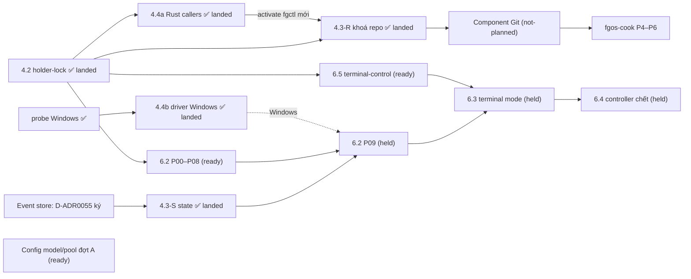

# Bảng chương trình nền tảng fgOS

Cập nhật lần cuối: **2026-10-17 13:55**, phiên `forgentx-95` (big lead, máy của owner).

## Đọc gì trước, sửa gì

- File này **chỉ là chỉ mục và trạng thái**, không phải nguồn sự thật.
  - Phạm vi, quyết định và phase của từng việc nằm trong `plan.md` của plan đó.
  - Trạng thái chạy thật nằm ở nhánh tích hợp và báo cáo phase-lead.
  - Nếu file này và plan con nói khác nhau, **plan con đúng**. Khi thấy lệch, sửa dòng tương ứng ở đây.
- **Cách cập nhật (mọi máy):**
  1. `git pull` main.
  2. Chỉ sửa dòng của luồng mình đang làm, ghi giờ và tên phiên.
  3. Commit bằng pathspec (`git commit -- plans/261017-1313-fgos-platform-program-board/plan.md`), push ngay.
  4. Xung đột thì giữ cả hai ý rồi gộp lại. Không ghi đè dòng của luồng khác.
- **Khi nào cập nhật:** khi bắt đầu hoặc xong một phase, khi bị chặn, khi land, khi có quyết định mới của owner ảnh hưởng luồng khác.
- **Trước khi bắt đầu việc mới đụng tới lock, git, state, config hay runner:** đọc mục [File chung dễ va](#file-chung-dễ-va) và [Quyết định đang treo](#quyết-định-đang-treo).

## Các luồng

Trạng thái: `landed` · `running` · `ready` (chạy được, chưa ai nhận) · `held` (chờ một quyết định hay luồng khác) · `planning` · `not-planned`.

| ID | Luồng | Plan | Trạng thái | Đang ở đâu / ai làm | Chờ gì | Mở khoá cho |
|---|---|---|---|---|---|---|
| 4.2 | Holder-lock: cổng lock, kernel lock cho các lock lạnh | [plan](../261016-1104-holder-lock-kernel-lock-foundation/plan.md) | **landed** 10-17 12:30, main `0d6da9033`, release `af277e02…` ở forgentX, mdview, mcp-skill-hub | xong; [báo cáo landing](../reports/landing-261017-1219-holder-lock-stop-everything-landing.md) | — | 4.3, 4.4a, 6.2, 6.5 |
| 4.4a | Rust callers lên holder-lock (`fgctl`, `install.lock`, observe) | [plan](../261016-1306-fgctl-rust-callers-on-holder-lock/plan.md) | **landed** 10-17 16:25 (máy owner), 16:43 (máy thứ hai) | main `09f824ea0`, release `79ead131…`, 3 workspace activate, fence đủ; [báo cáo landing](../reports/landing-261017-1625-rust-callers-holder-lock-stop-everything-landing.md). Máy thứ hai (`~/projects/forgent`): release `2895ff70…`, fence 214/214, [báo cáo](../reports/landing-261017-1643-rust-callers-holder-lock-this-machine.md) | — | 4.3 P08 + landing 4.3 |
| 4.3-R | Main checkout một cửa: **phần khoá repo** | [plan](../261016-1306-main-checkout-single-door-hot-lock/plan.md), rào chắn F10 | **landed** 10-17 18:28 (máy owner), 18:59 (máy thứ hai) | main `56f87bf5b`, release `e74cb03c…`, 3 workspace activate, fence đủ (2420/216/17); [báo cáo landing](../reports/landing-261017-1827-main-door-repo-lock-stop-everything-landing.md); máy thứ hai (`~/projects/forgent`) **landed** 10-17 19:00, release `df7a1a04…`, fence 216/216, [báo cáo](../reports/landing-261017-1859-main-door-repo-lock-this-machine.md) (phiên `56677996`) | — | component Git (dùng lại nguyên các khoá) |
| 4.3-S | Main checkout: **phần state** (hot-lock, `stateTx`, gộp `claims.lock`, trần claim + thu hẹp) | [plan 4.3](../261016-1306-main-checkout-single-door-hot-lock/plan.md), khối "CẮT LẠI 18:50" | **landed** 10-17 21:25 (máy owner) | main `c2cadb082`, release `b31b7526…`, 3 workspace activate, fence đủ (2449/219/20); [báo cáo landing](../reports/landing-261017-2123-main-door-state-wave-stop-everything-landing.md); S1–S5 trên nhánh `main-door-state/integration`. Windows: hot-lock fail closed, phán holder là việc tiếp theo của 4.4b ; máy thứ hai (`~/projects/forgent`) **landed** 10-18 00:39, release `4b90becb…`, fence 261/261, [báo cáo](../reports/landing-261018-0039-main-door-state-and-windows-driver-this-machine.md) | — | 6.2 P09 (cần S1+S2); phase chuyển Work của event store |
| ES | Event store (thay L3 điều 1 và 4) | [spec](../../docs/platform/event-store/spec.md) canonical, D-ADR0055; bằng chứng: [V-SPAWN-01](../reports/experiment-261017-1431-event-store-v-spawn-01.md), [hội đồng mở lại](../reports/council-261017-1513-event-store-reopen-final-packet.md), [model check](../reports/experiment-261017-1527-event-store-model-check-reader-seal.md), [model check lại](../reports/experiment-261017-1545-event-store-model-recheck-corrected.md), [ref git](../reports/experiment-261017-1527-event-store-git-ref-mechanics.md) | **ready**, xếp sau GIT (owner 19:01) | 10-17 17:15 owner ký D-ADR0055: event niêm phong trên ref git riêng mỗi máy `refs/fgos/events/<máy>`, view là cache, claims runtime, đường Node→Rust là N-API không ngoại lệ exec; phiên `ac420727` (máy thứ hai) | lập plan triển khai; phase chuyển Work chờ wave S (4.3-S) land, các phase crate/N-API/log mở/niêm phong chạy song song được | GIT G0 (bỏ họ bài học `.fgos` mà ES xoá) |
| 4.4b | Driver Windows (`LockFileEx` + Job Object), bàn giao macOS | [plan](../261017-1256-windows-lockfileex-driver-and-macos-handoff/plan.md) (7 phase, khoảng 36 giờ; D3 đã duyệt 13:53: domain `windows-job` chuyển từ 6.2 P02 sang đây) | **landed** 10-18 00:25 (máy owner, 3 workspace Linux) | main `d9d527ad6`, release `0c43eb1d…`; cổng 500 lần của owner trên Windows: 0 vi phạm cả 3 kịch bản ([bằng chứng](../reports/evidence-261018-0015-windows-driver-stress-report.json)); [báo cáo landing](../reports/landing-261018-0021-windows-driver-linux-workspaces-landing.md). Chưa activate workspace nào trên Windows ; máy thứ hai **landed** 10-18 00:39 cùng release `4b90becb…` với 4.3-S, [báo cáo](../reports/landing-261018-0039-main-door-state-and-windows-driver-this-machine.md) | activate trên Windows khi có workspace ở đó | `fgos run` trên Windows (6.2 D7) |
| 6.5 | terminal-control: lõi Rust, driver herdr | [plan](../261016-1306-terminal-control-rust-core-herdr-driver/plan.md) | **landed** 10-18 04:45 (máy owner) | main `119823fc6`, release `6208cb3e…` ở 3 workspace, fence đủ (2473/219/20); [báo cáo landing](../reports/landing-261018-0438-terminal-control-stop-everything-landing.md). Kèm sửa `f3dbc5e1d`: `fgos run` trước đó không bao giờ chọn invocation herdr (gộp `runner.executor` làm mất `invocations`) | máy thứ hai **landed** 10-18 09:11, release `f88afb17…`, fence 277/277, [báo cáo](../reports/landing-261018-0911-terminal-control-and-run-supervisor-this-machine.md); tiêu chí 6 (một round trọn mỗi CLI trong thư mục đã tin cậy) còn mở | 6.3 |
| 6.2 | Run supervisor: lõi Rust, cách khởi động direct | [plan](../261016-1351-run-supervisor-rust-core-direct-mode/plan.md) | **landed** 10-18 08:35 (máy owner) | main `13199adb4`, release `e95c130d…` ở 3 workspace, fence đủ (2483/219/20), D-ADR0056 đã ghi; [báo cáo landing](../reports/landing-261018-0833-run-supervisor-direct-mode-stop-everything-landing.md). CI `process-containment` xanh Linux/Windows/macOS. Lỗi còn mở: workspace dưới `/tmp` thì gate không đọc được envelope (`gate-lost`) | máy thứ hai **landed** 10-18 09:11 (cùng release `f88afb17…` với 6.5, [báo cáo](../reports/landing-261018-0911-terminal-control-and-run-supervisor-this-machine.md)); sửa lỗi `/tmp` | 6.3, 6.4 |
| 6.3 | Terminal mode + nửa launcher của identity | [plan](../261016-1351-terminal-mode-and-launcher-identity/plan.md) | **running** từ 10-18 08:40 | chuỗi lead Sonnet trên máy owner (`forgentx-95`), nhánh `terminal-mode/integration`: P00r (sửa gate dưới `/tmp`, test `hot-lock-host-judge`, cắt lại plan) → P00 → P01 → P02 → P04 → P05 → P03 → P06 → P07 → P08 → P09 phần A, rồi big lead landing | — | 6.4 |
| 6.4 | Controller chết: settle, `--resume`, dọn | [plan](../261016-1351-controller-death-settle-and-resume/plan.md) | **held** | — | 6.2 **và** 6.3 land | — |
| GIT | Component Git `fgos-git` (Rust): G0 spec → G5 cổng máy móc | [roadmap](../reports/roadmap-261016-2212-fgos-cook-and-git-component.md) mục P2; [danh mục bài học git](../reports/research-261017-1032-git-lessons-catalogue.md); [handoff](../reports/handoff-261017-1901-git-g0-and-event-store-plan-leads.md) | **G0 ký** 10-18 09:13 (D-ADR0057, [spec](../../docs/platform/git/spec.md) canonical); plan Git đang lập bằng `ak:plan` (spec G0, hội đồng `wf-run-1792246479016-19b58eab` từ 10-17 21:15 (lần 1 `wf-run-1792238913436-23f161ae` và lần 2 `wf-run-1792241488834-2c6f0e91` hỏng ở shaping: ghế gemini-4-argon-high hết trần 35 phút vì API trả "Request was aborted"; owner 21:13 đổi ghế đó sang provider khác cho run này); 22:18 xong: [spec G0 nháp](../../docs/platform/git/spec.md) "Proposed, chưa ký", 23:18 owner trả lời theo khuyến nghị cả 8 câu (commit `59637ba26`, worktree-admin bọc thêm remove/move/prune); 23:25 chạy bằng chứng: model check `wf-run-1792254306143-4331aac3`, git floor `wf-run-1792254306282-ca409bd1`, durability/cost `wf-run-1792254306423-1678585d`, phân loại caller `wf-run-1792254306574-606e713a`; 00:40 gộp bằng chứng vào spec (`b6bd66cfd`, [báo cáo](../reports/review-261018-0024-git-g0-proof-fold-verdicts.md)): M1/M2/M4 qua trong mô hình; M3 custody, V-CAS (update-ref nhiều ref không nguyên tử khi crash), P-SYM-HOOK, setsid thoát process group, 8 nhóm caller thiếu đã sửa thành chữ; kiểm lại 5 unit đang chạy (m1, m3, p-wal-id, vcas, p-sym-hook); 1 câu hỏi owner: workflow chỉ-đọc ngoài repo git; 01:45 gộp lần 2 (`f713c4204`: TargetAttempt một lần mỗi operation, Refs của nhánh dưới worktree-admin 40, bỏ tối ưu multi-ref, bỏ lời hứa phát hiện symbolic ref); 02:45 kiểm lại lần 2 qua (`wf-run-1792262850536-7f974cb3`, `wf-run-1792262850691-bb0a3004`): **G0 sẵn sàng để owner ký**, [brief](../reports/brief-261017-1907-git-g0-spec-council-inputs.md)) | 10-17 19:01 owner **ưu tiên Git trước event store**: hội đồng viết spec G0 (trừ các họ `.fgos` mà ES xoá, dùng lại nguyên khoá 4.3-R, có port xuất bản `refs/fgos/*` cho ES) → owner duyệt → plan Git bằng `ak:plan`, phase đầu là port xuất bản | owner duyệt G0; phần chạm `claim-port.mjs` chờ wave S S3 | ES (dùng port xuất bản của Git), land, chuyển caller, `fgos-cook` |
| MP-A | Config model/pool/account, đợt A (lát bổ sung) | [plan](../261017-1302-model-pool-config-additive-slice/plan.md) | **done** (16:00; 00–06 trên main) | — | — | gemini nhận `--model`; mỗi họ một executor; ô tier `model@pool`/danh sách; `llmAccounts` chỉ đọc; `fgos dispatch explain`; 6 check doctor; rigor của capability nâng trần (RUL102, RUL103). Owner chọn giữ lối rơi khi thiếu ô (từ chối làm ở đợt B). Mỗi máy làm theo [hướng dẫn đồng bộ máy](../reports/guide-261017-1828-sync-a-machine-after-model-pool-and-rust-callers.md) (config global, `fgctl`, release, hàng rào). Các đợt B, C sau; [bài toán](../reports/problem-261017-0022-model-tier-selection-misfit.md) |
| MP-B1 | Model/pool đợt B1: lease, state, quarantine theo pool; xoay account theo `credentialStore`; pin `pool/account`; thiếu ô tier thì từ chối | [bài toán](../reports/problem-261017-0022-model-tier-selection-misfit.md) mục 5.3 | **not-planned** (đã gỡ chặn: holder-lock P09 land cùng 4.2) | — | owner trả lời câu hỏi 4, 5, 6 của report (thứ tự fallback, mặc định fallback khác họ, thứ tự xoay account); lập plan | MP-C |
| MP-B2 | Model/pool đợt B2: `credentialStore {use, homeEnv, files}` trong confinement và driver bwrap | [bài toán](../reports/problem-261017-0022-model-tier-selection-misfit.md) mục 5.3 | **held** | — | 6.2 P07–P09 và 6.3 P05–P06 land | MP-C |
| MP-B3 | Model/pool đợt B3: bước fallback đổi nguồn (`source-rotation`) | [bài toán](../reports/problem-261017-0022-model-tier-selection-misfit.md) mục 5.3 | **held** | — | 6.4 P02 land | — |
| MP-C | Model/pool đợt C: `prefer` theo họ; account sang `llmAccounts`, xoá `runner.providers`; danh sách và `@` trong `modelPolicies` global | [bài toán](../reports/problem-261017-0022-model-tier-selection-misfit.md) mục 5.3 | **held** | — | release đọc `llmAccounts` active ở mọi project trên mọi máy ([hướng dẫn](../reports/guide-261017-1828-sync-a-machine-after-model-pool-and-rust-callers.md)) | — |
| MP-COST | Chi phí model: kẹp capability dưới trần, luật escalation, quyền override, `assignment-policy` áp trần, model của agent in-process | [bài toán](../reports/problem-261017-0022-model-tier-selection-misfit.md) mục 5.3 "Out of scope" | **not-planned** | — | owner giao; câu hỏi 1–3 của report | — |
| 5.1 | Identity resolver thành crate Rust | [plan](../261015-2102-identity-resolver-rust-crate/plan.md) | crate `session-identity` đã có trên main; frontmatter còn ghi P05 (đo cold) và P06 | — | đo lại cold trên máy rảnh, đóng plan | 6.3 (nửa launcher) |
| DOC | Thống nhất thẩm quyền tài liệu (260925) | [plan](../260925-documentation-authority-unification/) | **held** | nhánh `plan/260925-documentation-authority-unification`, lead `forgentx-5f`; owner đang giữ trước Phase 7 Step 5 | owner | — |
| COOK | `fgos-cook` và đường chạy cho cook (roadmap P1, P3–P6) | [roadmap](../reports/roadmap-261016-2212-fgos-cook-and-git-component.md) | **not-planned** | — | P1 và P3 chạy được ngay; P4, P5, P6 cần GIT | — |
| YAML | Vendor js-yaml: một cửa đọc YAML, fgOS không còn dependency npm lúc chạy | [plan](../261016-0635-vendor-js-yaml-single-yaml-door/plan.md) | **landed** 10-16, quyết định RUL101 (`docs/specs/distribution.md`) | xong; phiên `56677996` | — | — |
| INS | Kiểm soát luật ở nguồn: luật phải tới đúng agent (đủ L1–L10, nguyên tắc thiết kế, luật dùng lại trước khi thêm), rồi mới dọn hậu quả | [báo cáo](../reports/research-261016-1118-agent-code-quality-guardrails.md) mục 0, 5 (nhóm A, B), 6 | **landed** phần làm tay 10-17 15:10 (`f9ea9c219`, `40c667c83`); phần cơ chế (nhóm A) **not-planned** | 10-17 15:30, phiên `56677996`: đã chiếu đủ L1–L10, thêm `core/instructions/design-principles.md`, luật dùng lại vào worker contract và `fgos-coding-implement`; `CLAUDE.md` chỉ còn `@AGENTS.md`. Quyền ghép luật: Agent Context Engine (RUL102) | D6 (Q4–Q7 trong báo cáo) trước khi lập plan nhóm A | backlog `p-7eb9e65b`, `p-68be2ae3` |

## Phụ thuộc

**Đường găng:** 4.3-S (wave S) → 6.2 P09 → 6.3 → 6.4. Lane khoá đóng khi 4.4b land (việc dài nhất, cần owner chạy stress 500 lần trên máy Windows). Mọi thứ khác chạy song song quanh nó.

## Quyết định đang treo

| # | Quyết định | Ai quyết | Chặn |
|---|---|---|---|
| D1 | ~~Event store: phương án A hay B~~: owner ký D-ADR0055 10-17 17:15 | — | — |
| D2 | Giờ landing phần B của 4.4a (dừng toàn bộ, cài `fgctl`, activate 3 workspace) | owner — **đã quyết** 16:13, land 16:25 | 4.3 P08, landing 4.3-R |
| D3 | ~~Giờ landing 4.3-R~~: land 10-17 18:28 | — | — |
| D4 | Lập plan component Git (G0) và plan nhỏ cho cook P1/P3 | owner giao | GIT, COOK |
| D5 | ~~Duyệt plan 4.4b~~: đã duyệt 13:53, gồm D3 | — | — |
| D6 | Luật instruction: khoá 7 nguyên tắc thành luật hay giữ `procedure` (Q4); xử lý ngưỡng 32 KiB của codex (Q5); nguồn sinh danh sách luật (Q6); quyết định 10-06 "không sửa đồ của ak/ck" còn hiệu lực không (Q7) | owner | INS nhóm A, dọn khối AGENTKIT trong `AGENTS.md` |
| D7 | Pin `.fgos/distribution.json` khi nhiều máy tự build release: mỗi `fgctl upgrade` ghi digest của máy mình vào cùng một file (máy owner `79ead131…`, máy thứ hai `2895ff70…`), nên các máy thay nhau ghi đè. Chọn: pin theo máy (file không commit), hay chỉ một máy build release và các máy khác cài đúng digest đó. Tạm thời [hướng dẫn](../reports/guide-261017-1828-sync-a-machine-after-model-pool-and-rust-callers.md) bảo `git restore` file sau upgrade | owner | mọi landing có activate |

## File chung dễ va

Hai luồng cùng sửa một file thì **luồng land sau rebase hoặc merge main và giải xung đột**. Không luồng nào sửa file chung của luồng khác ngoài phạm vi plan của mình.

| File | Luồng chạm |
|---|---|
| `src/setup/registrations.mjs`, `CHANGELOG.md`, `docs/specs/runner.md` | 4.4a P04, 4.3-R P09, 6.5, MP-A, 6.2 |
| `packages/holder-lock/contracts/lock-registry.v1.json`, `src/holder-lock/fences.mjs` | 4.4a P00/P04, 4.3-R P00/P09 |
| `bin/fgos.mjs` | 4.3-R P07, 6.2, COOK |
| `src/runner/claim-port.mjs` | 4.3-R P04r (chỉ chuyển lock), 4.3-S P04 (trần + thu hẹp) |
| `src/runner/merge.mjs`, `src/runner/worktree.mjs` | 4.3-R P05/P06, sau này GIT G4 |
| `packages/distribution/rust/src/lock.rs` | 4.4a P01, 4.3-R P08 (sau 4.4a) |
| `src/runner/execution/bind.mjs`, config `modelPolicies` | MP-A |
| `AGENTS.md` (khối do bộ chiếu sinh ra và phần viết tay), `CLAUDE.md`, `core/instructions/*`, `.fgos/instructions/effective/repo.json`, `src/setup/instruction-*.mjs`, `core/skills/_shared/coding-worker-contract.md` | INS. Sửa luật thì sửa ở `core/instructions/` rồi tái sinh khối, không sửa tay trong khối sinh. Khối AGENTKIT của ak trong `AGENTS.md` đang **chưa commit** ở máy owner: commit `AGENTS.md` bằng cách chỉ stage phần của mình |
| `.gitattributes`, luật strip `.fgos`, `merge=union` | **không ai sửa** cho tới khi D1 có kết luận (rào chắn F10) |

## Luật chung cho mọi luồng

- **Landing dừng-toàn-bộ** (4.4a, 4.3-R, 6.x) chạy **tuần tự**, mỗi lần một luồng, ở cả ba workspace: forgentX, mdview, mcp-skill-hub. Owner chọn giờ.
- **Bước kiểm dừng của hàng rào** hiện bắt mọi tiến trình có cwd trong workspace, kể cả tiến trình không phải fgOS. Xem mục "Two deviations" trong [báo cáo landing 4.2](../reports/landing-261017-1219-holder-lock-stop-everything-landing.md).
- **Tier:** config project đặt `runner.maxTier: flagship` (owner duyệt 13:53). Không override thì việc chạy Sonnet; rigor high, rigor critical của unit và mọi override đều dừng ở Opus. Ngoại lệ (RUL103, 10-17 16:30): capability tự khai rigor trong config được nâng trần cho chính nó, nên `architecture:synthesize`, `architecture:shape`, `architecture:explain` (rigor critical) chạy `frontier` (Fable); `fgos doctor` check `capability-rigor-ceiling` liệt kê chúng. Việc code nên ở tier `advanced`.
- **Tên báo cáo và plan** lấy từ `fgos convention path`, không tự đặt.
- **Chuỗi lead trên máy owner:** kịch bản ở `.fgos/runtime/tmp/phase-leads/` (không commit). Lead nhắn big lead `forgentx-95` khi xong hoặc khi bị chặn. Agent ở máy khác báo bằng cách cập nhật dòng của mình trong file này.

## Nhật ký
- 2026-10-18 09:11 (phiên máy thứ hai): 6.5 và 6.2 landed ở máy thứ hai, một release `f88afb17…`, fence 277/277. `fgos setup` và `doctor` sinh lại `docs/decisions/index.md` thiếu D-ADR0056 vì event log máy này chưa có; đã khôi phục, không commit bản sinh lại.
- 2026-10-18 08:35 (`forgentx-95`): 6.2 land trên máy owner (release `e95c130d…`, D-ADR0056). 6.3 hết bị chặn. Mở: gate không đọc được envelope khi workspace nằm dưới `/tmp`; `hot-lock-host-judge` đỏ trên main; tiêu chí 6 của 6.5.
- 2026-10-18 04:45 (`forgentx-95`): 6.5 land trên máy owner (release `6208cb3e…`). Sửa trên main `f3dbc5e1d`: `withDefaultExecutor` giữ `invocations` của executor đã đăng ký, `fgos run` chọn được herdr. 6.2 xong P00r–P11 kể cả gate và supervisor cho Windows/macOS (thêm P03w, P04w vì D7 đã hết hiệu lực); máy thứ hai đã land 4.3-S và 4.4b (`261d38f2e`).
- 2026-10-18 09:14 (phiên `ac420727`): owner ký G0 = D-ADR0057; bộ ký sửa component-boundary (hàng Git, Workflow bỏ git integration), spec event store (port xuất bản thuộc Git, addon gộp), CHANGELOG. Lập plan Git, phase đầu port xuất bản.
- 2026-10-18 00:39 (phiên `ac420727`): 4.3-S và 4.4b landed ở máy thứ hai, một release `4b90becb…`, fence 261/261.
- 2026-10-18 00:40 (`forgentx-95`): owner giao tự điều phối tới xong, tự landing. Chạy song song hai chuỗi lead Sonnet: 6.2 (bắt đầu bằng P00r đối chiếu plan với các landing khoá) và 6.5 (tiếp từ P02). Xoá các worktree nháp 10-16 không có việc riêng; merge main vào hai nhánh tích hợp. Dọn D1, D3 khỏi quyết định đang treo.
- 2026-10-18 00:25 (`forgentx-95`): owner chạy cổng 500 lần trên Windows, 0 vi phạm; 4.4b land trên máy owner. Lane khoá (4.2, 4.4a, 4.3-R, 4.3-S, 4.4b) xong trên máy owner; máy thứ hai còn land 4.3-S và 4.4b.
- 2026-10-17 21:25 (`forgentx-95`): 4.3-S (wave S) land trên máy owner; 6.2 P09 và phase chuyển Work của event store hết bị 4.3 chặn. 4.4b xong P06A, chờ cổng stress 500 lần của owner. Sửa test `stress.rs` của holder-lock (`186c257a5`): báo vi phạm giả khi kernel nhả flock của holder bị SIGKILL trước khi nó thành zombie.
- 2026-10-17 19:30 (phiên `1a86d32c`): thêm dòng MP-B1, MP-B2, MP-B3, MP-C, MP-COST để board theo dõi phần còn lại của [bài toán model/tier](../reports/problem-261017-0022-model-tier-selection-misfit.md); report có mục Status. B1 đã gỡ chặn, chờ owner trả lời câu 4–6.
- 2026-10-17 19:20 (phiên `1a86d32c`): MP-A gắn hướng dẫn đồng bộ máy; máy owner còn phải sửa config global (`executor-family-unique` đỏ ở forgentX). Thêm D7 (pin release khi nhiều máy build).
- 2026-10-17 19:10 (phiên `ac420727`): khởi động hội đồng spec G0 cho GIT (`wf-run-1792238913436-23f161ae`, tetcu72). Plan Git và plan ES chờ owner duyệt G0.
- 2026-10-17 19:00 (phiên `56677996`): 4.3-R landed ở máy thứ hai, release `df7a1a04…`, fence 216/216.
- 2026-10-17 19:00 (phiên `ac420727`): ES đã ký D-ADR0055, dòng ES cập nhật. Đã sửa spec §13 theo góp ý của lane 4.3 (file của khoá `state` do registry holder-lock giữ, không ghi cứng `state.lock`) và §20 theo lịch wave S (P04 land nguyên một commit).
- 2026-10-17 18:50 (`forgentx-95`): 4.3-R land 18:28 (máy owner). Cắt lại 4.3-S thành wave S từ main (P04 làm đủ hai nửa; dogfood đổi theo phương án b). 4.4b chạy song song ngay. Gửi phiên event store: spec §13 ghi `state` ở `<fgosDir>/locks/state.lock`, còn plan 4.3 và registry dùng `state.hot` + kernel `state.reclaim.lock`; nên sửa spec cho khớp.
- 2026-10-17 15:30 (phiên `56677996`): thêm luồng YAML (landed 10-16) và INS (phần làm tay landed `f9ea9c219`; nhóm A chờ D6).

- 2026-10-17 13:55: đặt `maxTier` là flagship; plan 4.4b đã lên main. 4.4a xong P00–P02; 4.3-R xong P00, P03, P05, P04r và P06.
- 2026-10-17 13:15: tạo bảng. 4.2 đã land. 4.4a và 4.3-R đang chạy. 4.4b đang viết plan. Phần state của 4.3 chờ hội đồng event store.
