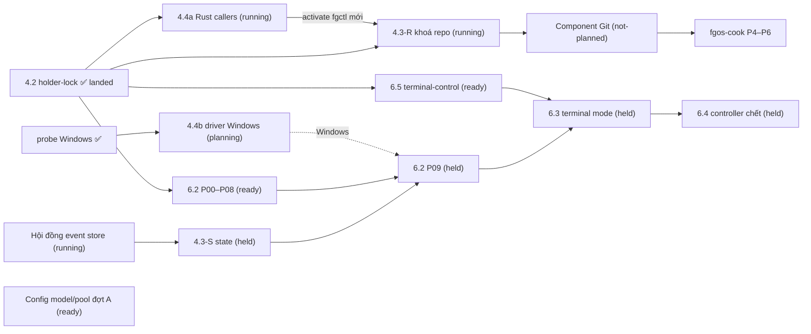

# Bảng chương trình nền tảng fgOS

Cập nhật lần cuối: **2026-10-17 13:55**, phiên `forgentx-95` (big lead, máy của owner).

## Đọc gì trước, sửa gì

- File này **chỉ là chỉ mục và trạng thái**, không phải nguồn sự thật.
  - Phạm vi, quyết định và phase của từng việc nằm trong `plan.md` của plan đó.
  - Trạng thái chạy thật nằm ở nhánh tích hợp và báo cáo phase-lead.
  - Nếu file này và plan con nói khác nhau, **plan con đúng**. Khi thấy lệch, sửa dòng tương ứng ở đây.
- **Cách cập nhật (mọi máy):**
  1. `git pull` main.
  2. Chỉ sửa dòng của luồng mình đang làm, ghi giờ và tên phiên.
  3. Commit bằng pathspec (`git commit -- plans/261017-1313-fgos-platform-program-board/plan.md`), push ngay.
  4. Xung đột thì giữ cả hai ý rồi gộp lại. Không ghi đè dòng của luồng khác.
- **Khi nào cập nhật:** khi bắt đầu hoặc xong một phase, khi bị chặn, khi land, khi có quyết định mới của owner ảnh hưởng luồng khác.
- **Trước khi bắt đầu việc mới đụng tới lock, git, state, config hay runner:** đọc mục [File chung dễ va](#file-chung-dễ-va) và [Quyết định đang treo](#quyết-định-đang-treo).

## Các luồng

Trạng thái: `landed` · `running` · `ready` (chạy được, chưa ai nhận) · `held` (chờ một quyết định hay luồng khác) · `planning` · `not-planned`.

| ID | Luồng | Plan | Trạng thái | Đang ở đâu / ai làm | Chờ gì | Mở khoá cho |
|---|---|---|---|---|---|---|
| 4.2 | Holder-lock: cổng lock, kernel lock cho các lock lạnh | [plan](../261016-1104-holder-lock-kernel-lock-foundation/plan.md) | **landed** 10-17 12:30, main `0d6da9033`, release `af277e02…` ở forgentX, mdview, mcp-skill-hub | xong; [báo cáo landing](../reports/landing-261017-1219-holder-lock-stop-everything-landing.md) | — | 4.3, 4.4a, 6.2, 6.5 |
| 4.4a | Rust callers lên holder-lock (`fgctl`, `install.lock`, observe) | [plan](../261016-1306-fgctl-rust-callers-on-holder-lock/plan.md) | **running** | nhánh `rust-callers/integration`; chuỗi lead P00 ✓ P01 ✓ P02 ✓ P03 ✓ → P04 (đang chạy) → P05 phần A (Sonnet); máy owner, big lead `forgentx-95` | landing phần B: owner chọn giờ (dừng toàn bộ, cài `fgctl` mới) | 4.3 P08 + landing 4.3 |
| 4.3-R | Main checkout một cửa: **phần khoá repo** | [plan](../261016-1306-main-checkout-single-door-hot-lock/plan.md), rào chắn F10 | **running** | nhánh `main-door/integration`; P00r ✓ P03 ✓ P05 ✓ P04r ✓ P06 ✓ P07 ✓ P09r ✓ (head `6c42efb8e`, kiểm lại 939/943, 1 lỗi môi trường); máy owner | P08 và P10 chờ 4.4a đã activate | component Git (dùng lại nguyên các khoá) |
| 4.3-S | Main checkout: **phần state** (hot-lock, `stateTx`, gộp `claims.lock`, trần claim + thu hẹp) | cùng plan; P01, P02, P04 + phần state của P00/P09 | **held** | — | **hội đồng event store** | 6.2 P09 |
| ES | Hội đồng event store (luật L3 chạm ngưỡng xem lại) | [final packet](../reports/council-261017-1210-event-store-final-packet.md), [thí nghiệm 1](../reports/experiment-261017-1220-event-store-exp1-relocate-open-shards.md), [thí nghiệm 2](../reports/experiment-261017-1220-event-store-exp2-seal-first-merge-crash.md) | **running** | 2 phương án ngang nhau: A (hai tầng, SQLite vận hành ngoài cây code) và B (seal-first); chưa có prototype | hội đồng chọn, rồi owner duyệt | 4.3-S → 6.2 P09 → 6.3 → 6.4 |
| 4.4b | Driver Windows (`LockFileEx` + Job Object), bàn giao macOS | [plan](../261017-1256-windows-lockfileex-driver-and-macos-handoff/plan.md) (7 phase, khoảng 36 giờ; D3 đã duyệt 13:53: domain `windows-job` chuyển từ 6.2 P02 sang đây) | **ready** sau khi 4.4a và 4.3-R land | plan trên main `703f0b130`; cổng probe đã đạt ([probe](../reports/probe-261017-0710-windows-predecessor-all-owners-dead-race.md), 0/500) | 4.4a và 4.3-R land; trước khi land 4.4b, owner chạy stress 500 lần trên máy Windows | `fgos run` trên Windows (6.2 D7) |
| 6.5 | terminal-control: lõi Rust, driver herdr | [plan](../261016-1306-terminal-control-rust-core-herdr-driver/plan.md) | **ready** | xếp hàng sau 4.4a / 4.3-R trên máy owner | — (song song được với 4.3, 4.4a) | 6.3 |
| 6.2 | Run supervisor: lõi Rust, cách khởi động direct | [plan](../261016-1351-run-supervisor-rust-core-direct-mode/plan.md) | **ready** P00–P08; **held** P09 | nhánh nháp `run-supervisor/p02-containment-win-mac` (10-16) | P09 chờ 4.3-S P01+P02 | 6.3, 6.4 |
| 6.3 | Terminal mode + nửa launcher của identity | [plan](../261016-1351-terminal-mode-and-launcher-identity/plan.md) | **held** | — | 6.2 **và** 6.5 land | 6.4 |
| 6.4 | Controller chết: settle, `--resume`, dọn | [plan](../261016-1351-controller-death-settle-and-resume/plan.md) | **held** | — | 6.2 **và** 6.3 land | — |
| GIT | Component Git `fgos-git` (Rust): G0 spec → G5 cổng máy móc | [roadmap](../reports/roadmap-261016-2212-fgos-cook-and-git-component.md) mục P2; [danh mục bài học git](../reports/research-261017-1032-git-lessons-catalogue.md) | **not-planned** | — | lập plan, bắt đầu từ G0. Theo quyết định 10-17 10:55, khoá repo của 4.3-R được **dùng lại nguyên vẹn** | land, chuyển caller, `fgos-cook` |
| MP-A | Config model/pool/account, đợt A (lát bổ sung) | [plan](../261017-1302-model-pool-config-additive-slice/plan.md) | **ready** (plan 13:08) | — | — | các đợt B, C sau; [bài toán](../reports/problem-261017-0022-model-tier-selection-misfit.md). Tạm thời dùng `runner.maxTier: advanced` |
| 5.1 | Identity resolver thành crate Rust | [plan](../261015-2102-identity-resolver-rust-crate/plan.md) | crate `session-identity` đã có trên main; frontmatter còn ghi P05 (đo cold) và P06 | — | đo lại cold trên máy rảnh, đóng plan | 6.3 (nửa launcher) |
| DOC | Thống nhất thẩm quyền tài liệu (260925) | [plan](../260925-documentation-authority-unification/) | **held** | nhánh `plan/260925-documentation-authority-unification`, lead `forgentx-5f`; owner đang giữ trước Phase 7 Step 5 | owner | — |
| COOK | `fgos-cook` và đường chạy cho cook (roadmap P1, P3–P6) | [roadmap](../reports/roadmap-261016-2212-fgos-cook-and-git-component.md) | **not-planned** | — | P1 và P3 chạy được ngay; P4, P5, P6 cần GIT | — |

## Phụ thuộc

**Đường găng:** hội đồng event store → 4.3-S → 6.2 P09 → 6.3 → 6.4. Mọi thứ khác chạy song song quanh nó.

## Quyết định đang treo

| # | Quyết định | Ai quyết | Chặn |
|---|---|---|---|
| D1 | Event store: phương án A hay B, và luật L3 đổi thế nào | hội đồng, rồi owner | 4.3-S, 6.2 P09, 6.3, 6.4 |
| D2 | Giờ landing phần B của 4.4a (dừng toàn bộ, cài `fgctl`, activate 3 workspace) | owner | 4.3 P08, landing 4.3-R |
| D3 | Giờ landing 4.3-R (đặt tombstone `main-checkout.lock`) | owner | — |
| D4 | Lập plan component Git (G0) và plan nhỏ cho cook P1/P3 | owner giao | GIT, COOK |
| D5 | ~~Duyệt plan 4.4b~~: đã duyệt 13:53, gồm D3 | — | — |

## File chung dễ va

Hai luồng cùng sửa một file thì **luồng land sau rebase hoặc merge main và giải xung đột**. Không luồng nào sửa file chung của luồng khác ngoài phạm vi plan của mình.

| File | Luồng chạm |
|---|---|
| `src/setup/registrations.mjs`, `CHANGELOG.md`, `docs/specs/runner.md` | 4.4a P04, 4.3-R P09, 6.5, MP-A, 6.2 |
| `packages/holder-lock/contracts/lock-registry.v1.json`, `src/holder-lock/fences.mjs` | 4.4a P00/P04, 4.3-R P00/P09 |
| `bin/fgos.mjs` | 4.3-R P07, 6.2, COOK |
| `src/runner/claim-port.mjs` | 4.3-R P04r (chỉ chuyển lock), 4.3-S P04 (trần + thu hẹp) |
| `src/runner/merge.mjs`, `src/runner/worktree.mjs` | 4.3-R P05/P06, sau này GIT G4 |
| `packages/distribution/rust/src/lock.rs` | 4.4a P01, 4.3-R P08 (sau 4.4a) |
| `src/runner/execution/bind.mjs`, config `modelPolicies` | MP-A |
| `.gitattributes`, luật strip `.fgos`, `merge=union` | **không ai sửa** cho tới khi D1 có kết luận (rào chắn F10) |

## Luật chung cho mọi luồng

- **Landing dừng-toàn-bộ** (4.4a, 4.3-R, 6.x) chạy **tuần tự**, mỗi lần một luồng, ở cả ba workspace: forgentX, mdview, mcp-skill-hub. Owner chọn giờ.
- **Bước kiểm dừng của hàng rào** hiện bắt mọi tiến trình có cwd trong workspace, kể cả tiến trình không phải fgOS. Xem mục "Two deviations" trong [báo cáo landing 4.2](../reports/landing-261017-1219-holder-lock-stop-everything-landing.md).
- **Tier:** config project đặt `runner.maxTier: flagship` (owner duyệt 13:53). Không override thì việc chạy Sonnet; rigor high, rigor critical và mọi override đều dừng ở Opus. `frontier` (Fable) bị chặn. Việc code nên ở tier `advanced`.
- **Tên báo cáo và plan** lấy từ `fgos convention path`, không tự đặt.
- **Chuỗi lead trên máy owner:** kịch bản ở `.fgos/runtime/tmp/phase-leads/` (không commit). Lead nhắn big lead `forgentx-95` khi xong hoặc khi bị chặn. Agent ở máy khác báo bằng cách cập nhật dòng của mình trong file này.

## Nhật ký

- 2026-10-17 13:55: đặt `maxTier` là flagship; plan 4.4b đã lên main. 4.4a xong P00–P02; 4.3-R xong P00, P03, P05, P04r và P06.
- 2026-10-17 13:15: tạo bảng. 4.2 đã land. 4.4a và 4.3-R đang chạy. 4.4b đang viết plan. Phần state của 4.3 chờ hội đồng event store.
