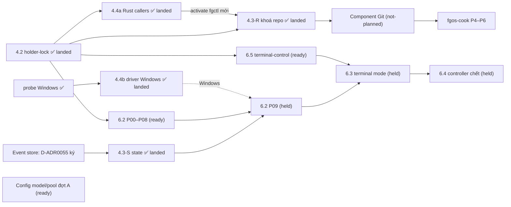

# Bảng chương trình nền tảng fgOS

Cập nhật lần cuối: **2026-10-18 17:15**, phiên `forgentx-95` (big lead, máy của owner).

## Đọc gì trước, sửa gì

- File này **chỉ là chỉ mục và trạng thái**, không phải nguồn sự thật.
  - Phạm vi, quyết định và phase của từng việc nằm trong `plan.md` của plan đó.
  - Trạng thái chạy thật nằm ở nhánh tích hợp và báo cáo phase-lead.
  - Nếu file này và plan con nói khác nhau, **plan con đúng**. Khi thấy lệch, sửa dòng tương ứng ở đây.
- **Cách cập nhật (mọi máy):**
  1. `git pull` main.
  2. Chỉ sửa dòng của luồng mình đang làm, ghi giờ và tên phiên.
  3. Commit bằng pathspec (`git commit -- plans/261017-1313-fgos-platform-program-board/plan.md`), push ngay.
  4. Xung đột thì giữ cả hai ý rồi gộp lại. Không ghi đè dòng của luồng khác.
- **Khi nào cập nhật:** khi bắt đầu hoặc xong một phase, khi bị chặn, khi land, khi có quyết định mới của owner ảnh hưởng luồng khác.
- **Trước khi bắt đầu việc mới đụng tới lock, git, state, config hay runner:** đọc mục [File chung dễ va](#file-chung-dễ-va) và [Quyết định đang treo](#quyết-định-đang-treo).

## Các luồng

Trạng thái: `landed` · `running` · `ready` (chạy được, chưa ai nhận) · `held` (chờ một quyết định hay luồng khác) · `planning` · `not-planned`.

| ID | Luồng | Plan | Trạng thái | Đang ở đâu / ai làm | Chờ gì | Mở khoá cho |
|---|---|---|---|---|---|---|
| 4.2 | Holder-lock: cổng lock, kernel lock cho các lock lạnh | [plan](../261016-1104-holder-lock-kernel-lock-foundation/plan.md) | **landed** 10-17 12:30, main `0d6da9033`, release `af277e02…` ở forgentX, mdview, mcp-skill-hub | xong; [báo cáo landing](../reports/landing-261017-1219-holder-lock-stop-everything-landing.md) | — | 4.3, 4.4a, 6.2, 6.5 |
| 4.4a | Rust callers lên holder-lock (`fgctl`, `install.lock`, observe) | [plan](../261016-1306-fgctl-rust-callers-on-holder-lock/plan.md) | **landed** 10-17 16:25 (máy owner), 16:43 (máy thứ hai) | main `09f824ea0`, release `79ead131…`, 3 workspace activate, fence đủ; [báo cáo landing](../reports/landing-261017-1625-rust-callers-holder-lock-stop-everything-landing.md). Máy thứ hai (`~/projects/forgent`): release `2895ff70…`, fence 214/214, [báo cáo](../reports/landing-261017-1643-rust-callers-holder-lock-this-machine.md) | — | 4.3 P08 + landing 4.3 |
| 4.3-R | Main checkout một cửa: **phần khoá repo** | [plan](../261016-1306-main-checkout-single-door-hot-lock/plan.md), rào chắn F10 | **landed** 10-17 18:28 (máy owner), 18:59 (máy thứ hai) | main `56f87bf5b`, release `e74cb03c…`, 3 workspace activate, fence đủ (2420/216/17); [báo cáo landing](../reports/landing-261017-1827-main-door-repo-lock-stop-everything-landing.md); máy thứ hai (`~/projects/forgent`) **landed** 10-17 19:00, release `df7a1a04…`, fence 216/216, [báo cáo](../reports/landing-261017-1859-main-door-repo-lock-this-machine.md) (phiên `56677996`) | — | component Git (dùng lại nguyên các khoá) |
| 4.3-S | Main checkout: **phần state** (hot-lock, `stateTx`, gộp `claims.lock`, trần claim + thu hẹp) | [plan 4.3](../261016-1306-main-checkout-single-door-hot-lock/plan.md), khối "CẮT LẠI 18:50" | **landed** 10-17 21:25 (máy owner) | main `c2cadb082`, release `b31b7526…`, 3 workspace activate, fence đủ (2449/219/20); [báo cáo landing](../reports/landing-261017-2123-main-door-state-wave-stop-everything-landing.md); S1–S5 trên nhánh `main-door-state/integration`. Windows: hot-lock fail closed, phán holder là việc tiếp theo của 4.4b ; máy thứ hai (`~/projects/forgent`) **landed** 10-18 00:39, release `4b90becb…`, fence 261/261, [báo cáo](../reports/landing-261018-0039-main-door-state-and-windows-driver-this-machine.md) | — | 6.2 P09 (cần S1+S2); phase chuyển Work của event store |
| ES | Event store (thay L3 điều 1 và 4) | [spec](../../docs/platform/event-store/spec.md) canonical, D-ADR0055; bằng chứng: [V-SPAWN-01](../reports/experiment-261017-1431-event-store-v-spawn-01.md), [hội đồng mở lại](../reports/council-261017-1513-event-store-reopen-final-packet.md), [model check](../reports/experiment-261017-1527-event-store-model-check-reader-seal.md), [model check lại](../reports/experiment-261017-1545-event-store-model-recheck-corrected.md), [ref git](../reports/experiment-261017-1527-event-store-git-ref-mechanics.md) | **plan viết xong** 10-18 10:40 ([plan](../261018-0945-event-store-fgos-event-store/plan.md), 11 phase ~272h; phase 01–02 chạy được ngay, 03–06 chờ Git 01, 08 chờ Git 05, 11 land trước Git 07), **running** từ 10-18 11:47 (owner duyệt 11:44): ES 01 unit 1 trên nhánh `event-store/p01-crate` (từ `event-store/integration`), openai; ES 02 nối sau ES 01; **phase 05 (chia sẻ + sync) xong, lên main** 10-18 23:05 (merge `31055716a`, đã sửa theo [review](../reports/review-261018-2221-es-p05-sharing-sync.md)); **phase 06 (Node facade, dormant) lên main** 10-19 08:23 (`bfece73f7`, đã sửa theo [review](../reports/review-261019-0802-es-p06-node-facade.md)); **phase 07 on main** 10-19 11:18 (verb sync/status/export, setup, doctor; dormant, đã sửa theo [review](../reports/review-261019-1039-es-p07-verbs-setup-doctor.md), [u2](../reports/phase-lead-261019-1052-es-p07-u2-review-fixes.md)) | 10-17 17:15 owner ký D-ADR0055: event niêm phong trên ref git riêng mỗi máy `refs/fgos/events/<máy>`, view là cache, claims runtime, đường Node→Rust là N-API không ngoại lệ exec; phiên `ac420727` (máy thứ hai) | lập plan triển khai; phase chuyển Work chờ wave S (4.3-S) land, các phase crate/N-API/log mở/niêm phong chạy song song được | GIT G0 (bỏ họ bài học `.fgos` mà ES xoá) |
| 4.4b | Driver Windows (`LockFileEx` + Job Object), bàn giao macOS | [plan](../261017-1256-windows-lockfileex-driver-and-macos-handoff/plan.md) (7 phase, khoảng 36 giờ; D3 đã duyệt 13:53: domain `windows-job` chuyển từ 6.2 P02 sang đây) | **landed** 10-18 00:25 (máy owner, 3 workspace Linux) | main `d9d527ad6`, release `0c43eb1d…`; cổng 500 lần của owner trên Windows: 0 vi phạm cả 3 kịch bản ([bằng chứng](../reports/evidence-261018-0015-windows-driver-stress-report.json)); [báo cáo landing](../reports/landing-261018-0021-windows-driver-linux-workspaces-landing.md). Chưa activate workspace nào trên Windows ; máy thứ hai **landed** 10-18 00:39 cùng release `4b90becb…` với 4.3-S, [báo cáo](../reports/landing-261018-0039-main-door-state-and-windows-driver-this-machine.md) | activate trên Windows khi có workspace ở đó | `fgos run` trên Windows (6.2 D7) |
| 6.5 | terminal-control: lõi Rust, driver herdr | [plan](../261016-1306-terminal-control-rust-core-herdr-driver/plan.md) | **landed** 10-18 04:45 (máy owner) | main `119823fc6`, release `6208cb3e…` ở 3 workspace, fence đủ (2473/219/20); [báo cáo landing](../reports/landing-261018-0438-terminal-control-stop-everything-landing.md). Kèm sửa `f3dbc5e1d`: `fgos run` trước đó không bao giờ chọn invocation herdr (gộp `runner.executor` làm mất `invocations`) | máy thứ hai **landed** 10-18 09:11, release `f88afb17…`, fence 277/277, [báo cáo](../reports/landing-261018-0911-terminal-control-and-run-supervisor-this-machine.md); tiêu chí 6 (một round trọn mỗi CLI trong thư mục đã tin cậy) còn mở | 6.3 |
| 6.2 | Run supervisor: lõi Rust, cách khởi động direct | [plan](../261016-1351-run-supervisor-rust-core-direct-mode/plan.md) | **landed** 10-18 08:35 (máy owner) | main `13199adb4`, release `e95c130d…` ở 3 workspace, fence đủ (2483/219/20), D-ADR0056 đã ghi; [báo cáo landing](../reports/landing-261018-0833-run-supervisor-direct-mode-stop-everything-landing.md). CI `process-containment` xanh Linux/Windows/macOS. Lỗi còn mở: workspace dưới `/tmp` thì gate không đọc được envelope (`gate-lost`) | máy thứ hai **landed** 10-18 09:11 (cùng release `f88afb17…` với 6.5, [báo cáo](../reports/landing-261018-0911-terminal-control-and-run-supervisor-this-machine.md)); sửa lỗi `/tmp` | 6.3, 6.4 |
| 6.3 | Terminal mode + nửa launcher của identity | [plan](../261016-1351-terminal-mode-and-launcher-identity/plan.md) | **landed** 10-18 17:10 (máy owner) | main `274de6172`, release `a6bcdc29…` ở 3 workspace, fgctl cài lại, fence đủ (2551/219/20), D-ADR0059 đã ghi; [báo cáo landing](../reports/landing-261018-1714-terminal-mode-stop-everything-landing.md). Herdr thật: 5 CLI mỗi CLI một round `completed-pass` (đóng tiêu chí 6 của 6.5). CI macOS đỏ ở `fgos-process` là lỗi của main, lane Git nhận (nhật ký 16:45) | máy thứ hai land release này: **trước khi activate** chạy `fgos doctor --fix` bằng release cũ để dọn home v1 gắn pane | 6.4, MP-B2, Git 04, việc chuyển `publish.rs`/`store.rs`/`envelope.rs` của Git/ES |
| 6.4 | Controller chết: settle, `--resume`, dọn | [plan](../261016-1351-controller-death-settle-and-resume/plan.md) | **merged** 10-18 21:56 (code trên main `d91fad3fa`), **activate trên máy thứ hai 10-19 09:08** (cùng Git 01), máy owner chưa | P00r→P07A xong, big lead kiểm từng phase; cả bộ test 8190 (lỗi còn lại đều môi trường); D-ADR0060 đã ghi; [báo cáo](../reports/landing-261018-2156-controller-death-merged-activation-with-git-landing.md). Activate gộp vào landing dừng toàn bộ của lane GIT (main đã có Git Lane B; máy thứ hai: "chưa activate"); bước landing và rollback ở [P07A](../reports/phase-lead-261018-2121-controller-death-p07a-integration-and-t8.md) | **lane GIT:** khi xin landing phase 01, gộp activation 6.4 (release từ main có cả hai); hoặc báo trên bảng nếu Lane B activate sớm được | MP-B3 |
| GIT | Component Git `fgos-git` (Rust): G0 spec → G5 cổng máy móc | [roadmap](../reports/roadmap-261016-2212-fgos-cook-and-git-component.md) mục P2; [danh mục bài học git](../reports/research-261017-1032-git-lessons-catalogue.md); [handoff](../reports/handoff-261017-1901-git-g0-and-event-store-plan-leads.md) | **Git 01 + 6.4 đã land trên máy thứ hai** 10-19 09:08, giữ (release `8d4b216e…` từ main `af1f2db2b`, [báo cáo](../reports/landing-261019-0914-git-01-relanding-this-machine.md)); máy owner theo [hướng dẫn mới](../reports/guide-261019-0914-owner-machine-git-01-landing-after-fixes.md); lần 06:59 đã rollback vì refspec legacy, sửa ở `8573c8b34`; **Git 02 lên main** 10-19 09:35; **Git 03 chưa lên main**: cổng host 10-19 11:36 đỏ (worktree remove/move fail-closed `worktree-cwd-unknown` vì tiến trình cùng user không đọc được cwd như `ssh-agent`, `systemd --user`; vector envelope `version.json` và Data Dictionary #7 chưa cập nhật; test CLI `worktree create` không nạp được addon), nhánh `git/p03-worktree` giữ lại để sửa; **G0 ký** 10-18 09:13 (D-ADR0057, [spec](../../docs/platform/git/spec.md) canonical); [plan Git](../261018-0914-git-component-fgos-git/plan.md) viết xong 10-18 09:50 (8 phase, ~242h, phase 01 port xuất bản), **running** từ 10-18 11:47: big lead phiên `ac420727` máy thứ hai; Git 01 unit 1 trên nhánh `git/p01-publication-port` (từ `git/integration`), openai (spec G0, hội đồng `wf-run-1792246479016-19b58eab` từ 10-17 21:15 (lần 1 `wf-run-1792238913436-23f161ae` và lần 2 `wf-run-1792241488834-2c6f0e91` hỏng ở shaping: ghế gemini-4-argon-high hết trần 35 phút vì API trả "Request was aborted"; owner 21:13 đổi ghế đó sang provider khác cho run này); 22:18 xong: [spec G0 nháp](../../docs/platform/git/spec.md) "Proposed, chưa ký", 23:18 owner trả lời theo khuyến nghị cả 8 câu (commit `59637ba26`, worktree-admin bọc thêm remove/move/prune); 23:25 chạy bằng chứng: model check `wf-run-1792254306143-4331aac3`, git floor `wf-run-1792254306282-ca409bd1`, durability/cost `wf-run-1792254306423-1678585d`, phân loại caller `wf-run-1792254306574-606e713a`; 00:40 gộp bằng chứng vào spec (`b6bd66cfd`, [báo cáo](../reports/review-261018-0024-git-g0-proof-fold-verdicts.md)): M1/M2/M4 qua trong mô hình; M3 custody, V-CAS (update-ref nhiều ref không nguyên tử khi crash), P-SYM-HOOK, setsid thoát process group, 8 nhóm caller thiếu đã sửa thành chữ; kiểm lại 5 unit đang chạy (m1, m3, p-wal-id, vcas, p-sym-hook); 1 câu hỏi owner: workflow chỉ-đọc ngoài repo git; 01:45 gộp lần 2 (`f713c4204`: TargetAttempt một lần mỗi operation, Refs của nhánh dưới worktree-admin 40, bỏ tối ưu multi-ref, bỏ lời hứa phát hiện symbolic ref); 02:45 kiểm lại lần 2 qua (`wf-run-1792262850536-7f974cb3`, `wf-run-1792262850691-bb0a3004`): **G0 sẵn sàng để owner ký**, [brief](../reports/brief-261017-1907-git-g0-spec-council-inputs.md)) | 10-17 19:01 owner **ưu tiên Git trước event store**: hội đồng viết spec G0 (trừ các họ `.fgos` mà ES xoá, dùng lại nguyên khoá 4.3-R, có port xuất bản `refs/fgos/*` cho ES) → owner duyệt → plan Git bằng `ak:plan`, phase đầu là port xuất bản | owner duyệt G0; phần chạm `claim-port.mjs` chờ wave S S3 | ES (dùng port xuất bản của Git), land, chuyển caller, `fgos-cook` |
| MP-A | Config model/pool/account, đợt A (lát bổ sung) | [plan](../261017-1302-model-pool-config-additive-slice/plan.md) | **done** (16:00; 00–06 trên main) | — | — | gemini nhận `--model`; mỗi họ một executor; ô tier `model@pool`/danh sách; `llmAccounts` chỉ đọc; `fgos dispatch explain`; 6 check doctor; rigor của capability nâng trần (RUL102, RUL103). Owner chọn giữ lối rơi khi thiếu ô (từ chối làm ở đợt B). Mỗi máy làm theo [hướng dẫn đồng bộ máy](../reports/guide-261017-1828-sync-a-machine-after-model-pool-and-rust-callers.md) (config global, `fgctl`, release, hàng rào). Các đợt B, C sau; [bài toán](../reports/problem-261017-0022-model-tier-selection-misfit.md) |
| MP-B1 | Model/pool đợt B1: lease, state, quarantine theo pool; xoay account theo `credentialStore`; pin `pool/account`; thiếu ô tier thì từ chối | [bài toán](../reports/problem-261017-0022-model-tier-selection-misfit.md) mục 5.3 | **not-planned** (đã gỡ chặn: holder-lock P09 land cùng 4.2) | — | owner trả lời câu hỏi 4, 5, 6 của report (thứ tự fallback, mặc định fallback khác họ, thứ tự xoay account); lập plan | MP-C |
| MP-B2 | Model/pool đợt B2: `credentialStore {use, homeEnv, files}` trong confinement và driver bwrap | [bài toán](../reports/problem-261017-0022-model-tier-selection-misfit.md) mục 5.3 | **00–05 merged** 10-19 02:15, main `2ebac8756` ([plan](../261019-0019-model-pool-b2-credential-store-confinement/plan.md), [báo cáo lead](../reports/phase-lead-261019-0138-model-pool-b2-credential-store.md)); **06 merged** 10-19 10:45 `edd59bdfc` (config forgentX bỏ `resourceBindings`/`env[homeEnv]` ở invocation có `credentialStore`; round pi thật pass); còn lại thuộc MP-C: config global (13), mdview và mcp-skill-hub (24 mỗi bên), nhánh suy luận trong `credentialStoreOf` | máy owner | — | MP-C |
| MP-B3 | Model/pool đợt B3: bước fallback đổi nguồn (`source-rotation`) | [bài toán](../reports/problem-261017-0022-model-tier-selection-misfit.md) mục 5.3 | **held** | — | 6.4 P02 land | — |
| MP-C | Model/pool đợt C: `prefer` theo họ; account sang `llmAccounts`, xoá `runner.providers`; danh sách và `@` trong `modelPolicies` global | [bài toán](../reports/problem-261017-0022-model-tier-selection-misfit.md) mục 5.3 | **held** | — | release đọc `llmAccounts` active ở mọi project trên mọi máy ([hướng dẫn](../reports/guide-261017-1828-sync-a-machine-after-model-pool-and-rust-callers.md)) | — |
| MP-COST | Chi phí model: kẹp capability dưới trần, luật escalation, quyền override, `assignment-policy` áp trần, model của agent in-process | [bài toán](../reports/problem-261017-0022-model-tier-selection-misfit.md) mục 5.3 "Out of scope" | **not-planned** | — | owner giao; câu hỏi 1–3 của report | — |
| 5.1 | Identity resolver thành crate Rust | [plan](../261015-2102-identity-resolver-rust-crate/plan.md) | **done** (đóng 10-19 02:25: mọi commit của nhánh đã ở main, cổng cold đạt theo ngưỡng ≤10 ms owner nới 10-15) | — | — | 6.3 (nửa launcher) |
| DOC | Thống nhất thẩm quyền tài liệu (260925) | [plan](../260925-documentation-authority-unification/) | **running** (Phase 7 đóng 10-19, A47/A48; Phase 8 owner cho chi tiết hoá A49, đang re-check plan; chưa land main) | nhánh `plan/260925-documentation-authority-unification` (main `708ea6608` đã merge vào `49ad04648`), lead `forgentx-5f` | — | — |
| COOK | `fgos-cook` và đường chạy cho cook (roadmap P1–P6) | [roadmap](../reports/roadmap-261016-2212-fgos-cook-and-git-component.md) | **P1 (cắt) + P3 merged** 10-19 00:20, main `b1e170030` ([plan](../261018-2240-cook-path-cleanup-and-run-fixes/plan.md), [báo cáo lead](../reports/phase-lead-261018-2240-cook-p1-p3-run-path.md)); activate cùng đợt Git | 10-18 22:20 owner chốt: (a) `/fgOS:cook` cũ (một câu → Work item → `awaiting-approval`, văn bản còn nói "stage" đã bỏ từ 0049) **đổi tên `/fgOS:deliver`**, tên `cook` dành cho skill mới; (b) **P1 cắt nhỏ**: chỉ dọn sự thật sai (xoá các chỗ dạy `fgos coordination` không còn, frontmatter plan hai cửa, đổi tên deliver và sửa chữ "stage"); viết lại doctrine điều phối (`coordination-driver.md`) **chờ spec của AGENT-WF**; (c) **P3** giữ nguyên + thêm: rigor high/critical **bắt buộc mọi ghế khác họ model** (hiện checker≠producer đã bắt buộc ở `reviewed.mjs`, giữa các checker mới là ưu tiên); (d) bảng 12 đường giữ mức rigor đề xuất (R1/R2/R10 low; R3/R6/R7/R12 standard; R4 high; R5 critical, hỏi người trước); R3 dùng provider rẻ; nhiều ghế thì đổi model; **ưu tiên model Trung Quốc khi đạt tier** (config: thứ tự `prefer` + ô `modelPolicies`; owner chốt danh sách model/tier khi tới bước config); (e) **P5 (`fgos-cook`) chờ spec của AGENT-WF** | P4 chờ Git 03; P5 chờ AGENT-WF spec (+ Git 06 cho mảnh ghi song song); P6 chờ Git 07–08 | — |
| YAML | Vendor js-yaml: một cửa đọc YAML, fgOS không còn dependency npm lúc chạy | [plan](../261016-0635-vendor-js-yaml-single-yaml-door/plan.md) | **landed** 10-16, quyết định RUL101 (`docs/specs/distribution.md`) | xong; phiên `56677996` | — | — |
| AGENT-WF | Mô hình agent ↔ workflow cho mọi domain (coding, marketing, sản xuất video…): agent thông minh, linh hoạt, tự ứng phó; workflow là hướng dẫn tác nghiệp (sơ đồ, đường đi, giao tiếp, ràng buộc), dẫn đường chứ không khoá cứng | [hướng của owner, đầu vào hội đồng](../reports/brief-261018-2235-agent-workflow-model-owner-direction.md) (chưa lập plan; đầu ra là thiết kế + spec, **không** plan) | **ready** | 10-18 22:20 owner giao, coi là chìa khoá thành công. **Bước 1 (trước mắt):** xem lại ý định thiết kế ban đầu của Workflow và hiện trạng (lịch sử quyết định, 0049, `src/workflow/`, `core/workflows/`, `domains/*/workflows`, hai cửa, pattern/preset, bảng đường). **Bước 2:** hội đồng `fgos-architecture-panel` rigor critical, nhiều vòng, reopen khi cần; câu hỏi nháp: workflow là gì (hướng dẫn/sơ đồ/ràng buộc), khi nào agent tự lập plan và khi nào theo workflow, linh hoạt mà vẫn ổn định và trong khung duyệt, một mảng business mới cần khai gì, giữ/đổi gì của cơ chế hiện có (RUL104 (tốt hơn, không to hơn)). **Owner:** hội đồng không hỏi owner sớm; đi tới một số đồng thuận rồi mới làm việc với owner. **Bước 3:** spec BA trong `docs/specs/` + quyết định; owner duyệt; rồi mới plan. Ca đầu tiên: `fgos-cook` chạy plan của ak | — | COOK P1 (doctrine), COOK P5 |
| HARDEN | Hội đồng soát và làm cứng các lớp tầng thấp: tìm và sửa bug, phát hiện vấn đề nghiêm trọng chưa được xử lý | — (chưa lập plan) | **held** | 10-18 21:27 owner giao. Phạm vi: holder-lock, process/containment, session-identity, terminal-control, run supervisor (6.2/6.3/6.4), Git, event store, `durable-file`, `canonical-json`. Đích: ổn định, nhanh, nhẹ, code đơn giản hơn. Trong phạm vi code đang có được làm API/signature/contract rõ ràng, tường minh, dễ dùng, uyển chuyển hơn (đổi contract thì chuyển mọi caller và xoá đường cũ cùng đợt, L10). **Không mở rộng scope:** mặc định không tính năng mới, không lớp/cơ chế mới; "tốt hơn, không to hơn". Chỉ thêm tính năng khi thật sự đáng (owner 21:30): báo cáo hội đồng gom **mọi** ý tưởng thêm vào **một mục riêng**, mỗi ý ghi rõ lý do (vấn đề thật, bằng chứng) và lợi ích, để owner chọn; không ý nào được làm trước khi owner chọn. Cách làm: hội đồng (`fgos-architecture-panel`) ra danh sách phát hiện có bằng chứng → plan → chuỗi lead | mọi lớp tầng thấp đã land trên máy owner, **gồm cả GIT và ES** | — |
| TRUST | Kiểm quyền tin cậy thư mục **trước** khi mở pane, hỏi người sớm thay vì chạy rồi mới biết bị chặn | — (chưa lập plan) | **not-planned** | 10-18 21:15 owner: ghi vào chương trình, chưa làm. Hiện `seedWorkspaceTrust` (`src/runner/dispatch/herdr-round.mjs`) biết trước khi launch là repo gốc chưa tin cậy (B1 `untrusted-root`, chỉ là đọc file) nhưng chủ ý không dừng, vẫn mở pane rồi mới báo `terminal:blocked:trust-dialog` (gặp ở 6.4 P07a T8). Hướng: (1) kiểm trước khi mở pane, theo cách đọc của từng CLI (claude/codex/agy, kể cả thư mục cha) ra trusted / seed được theo B1 / chưa tin cậy; (2) chưa tin cậy thì không mở pane, hỏi người theo mẫu câu hỏi quyết định, gộp với các câu hỏi đầu lượt; (3) người đồng ý thì fgOS ghi dòng tin cậy cho repo gốc (người cấp, không phạm B1) rồi chạy; (4) doctor `agent-cli-project-trusted` phủ thêm claude, agy | sau khi 6.4 land; owner duyệt thiết kế (fgOS ghi vào config tin cậy của owner khi được đồng ý) | — |
| INS | Kiểm soát luật ở nguồn: luật phải tới đúng agent (đủ L1–L10, nguyên tắc thiết kế, luật dùng lại trước khi thêm), rồi mới dọn hậu quả | [báo cáo](../reports/research-261016-1118-agent-code-quality-guardrails.md) mục 0, 5 (nhóm A, B), 6 | **landed** phần làm tay 10-17 15:10 (`f9ea9c219`, `40c667c83`); phần cơ chế (nhóm A) **not-planned** | 10-17 15:30, phiên `56677996`: đã chiếu đủ L1–L10, thêm `core/instructions/design-principles.md`, luật dùng lại vào worker contract và `fgos-coding-implement`; `CLAUDE.md` chỉ còn `@AGENTS.md`. Quyền ghép luật: Agent Context Engine (RUL102) | D6 (Q4–Q7 trong báo cáo) trước khi lập plan nhóm A | backlog `p-7eb9e65b`, `p-68be2ae3` |

## Phụ thuộc

**Đường găng:** 4.3-S (wave S) → 6.2 P09 → 6.3 → 6.4. Lane khoá đóng khi 4.4b land (việc dài nhất, cần owner chạy stress 500 lần trên máy Windows). Mọi thứ khác chạy song song quanh nó.

## Quyết định đang treo

| # | Quyết định | Ai quyết | Chặn |
|---|---|---|---|
| D1 | ~~Event store: phương án A hay B~~: owner ký D-ADR0055 10-17 17:15 | — | — |
| D2 | Giờ landing phần B của 4.4a (dừng toàn bộ, cài `fgctl`, activate 3 workspace) | owner — **đã quyết** 16:13, land 16:25 | 4.3 P08, landing 4.3-R |
| D3 | ~~Giờ landing 4.3-R~~: land 10-17 18:28 | — | — |
| D4 | Lập plan component Git (G0) và plan nhỏ cho cook P1/P3 | owner giao | GIT, COOK |
| D5 | ~~Duyệt plan 4.4b~~: đã duyệt 13:53, gồm D3 | — | — |
| D6 | Luật instruction: khoá 7 nguyên tắc thành luật hay giữ `procedure` (Q4); xử lý ngưỡng 32 KiB của codex (Q5); nguồn sinh danh sách luật (Q6); quyết định 10-06 "không sửa đồ của ak/ck" còn hiệu lực không (Q7) | owner | INS nhóm A, dọn khối AGENTKIT trong `AGENTS.md` |
| D7 | Pin `.fgos/distribution.json` khi nhiều máy tự build release: mỗi `fgctl upgrade` ghi digest của máy mình vào cùng một file (máy owner `79ead131…`, máy thứ hai `2895ff70…`), nên các máy thay nhau ghi đè. Chọn: pin theo máy (file không commit), hay chỉ một máy build release và các máy khác cài đúng digest đó. Tạm thời [hướng dẫn](../reports/guide-261017-1828-sync-a-machine-after-model-pool-and-rust-callers.md) bảo `git restore` file sau upgrade | owner | mọi landing có activate |

## File chung dễ va

Hai luồng cùng sửa một file thì **luồng land sau rebase hoặc merge main và giải xung đột**. Không luồng nào sửa file chung của luồng khác ngoài phạm vi plan của mình.

| File | Luồng chạm |
|---|---|
| `src/setup/registrations.mjs`, `CHANGELOG.md`, `docs/specs/runner.md` | 4.4a P04, 4.3-R P09, 6.5, MP-A, 6.2 |
| `packages/holder-lock/contracts/lock-registry.v1.json`, `src/holder-lock/fences.mjs` | 4.4a P00/P04, 4.3-R P00/P09 |
| `bin/fgos.mjs` | 4.3-R P07, 6.2, COOK |
| `src/runner/claim-port.mjs` | 4.3-R P04r (chỉ chuyển lock), 4.3-S P04 (trần + thu hẹp) |
| `src/runner/merge.mjs`, `src/runner/worktree.mjs` | 4.3-R P05/P06, sau này GIT G4 |
| `packages/distribution/rust/src/lock.rs` | 4.4a P01, 4.3-R P08 (sau 4.4a) |
| `src/runner/execution/bind.mjs`, config `modelPolicies` | MP-A |
| `AGENTS.md` (khối do bộ chiếu sinh ra và phần viết tay), `CLAUDE.md`, `core/instructions/*`, `.fgos/instructions/effective/repo.json`, `src/setup/instruction-*.mjs`, `core/skills/_shared/coding-worker-contract.md` | INS. Sửa luật thì sửa ở `core/instructions/` rồi tái sinh khối, không sửa tay trong khối sinh. Khối AGENTKIT của ak trong `AGENTS.md` đang **chưa commit** ở máy owner: commit `AGENTS.md` bằng cách chỉ stage phần của mình |
| `.gitattributes`, luật strip `.fgos`, `merge=union` | **không ai sửa** cho tới khi D1 có kết luận (rào chắn F10) |

## Luật chung cho mọi luồng

- **Landing dừng-toàn-bộ** (4.4a, 4.3-R, 6.x) chạy **tuần tự**, mỗi lần một luồng, ở cả ba workspace: forgentX, mdview, mcp-skill-hub. Owner chọn giờ.
- **Bước kiểm dừng của hàng rào** hiện bắt mọi tiến trình có cwd trong workspace, kể cả tiến trình không phải fgOS. Xem mục "Two deviations" trong [báo cáo landing 4.2](../reports/landing-261017-1219-holder-lock-stop-everything-landing.md).
- **Tier:** config project đặt `runner.maxTier: flagship` (owner duyệt 13:53). Không override thì việc chạy Sonnet; rigor high, rigor critical của unit và mọi override đều dừng ở Opus. Ngoại lệ (RUL103, 10-17 16:30): capability tự khai rigor trong config được nâng trần cho chính nó, nên `architecture:synthesize`, `architecture:shape`, `architecture:explain` (rigor critical) chạy `frontier` (Fable); `fgos doctor` check `capability-rigor-ceiling` liệt kê chúng. Việc code nên ở tier `advanced`.
- **Tên báo cáo và plan** lấy từ `fgos convention path`, không tự đặt.
- **Chuỗi lead trên máy owner:** kịch bản ở `.fgos/runtime/tmp/phase-leads/` (không commit). Lead nhắn big lead `forgentx-95` khi xong hoặc khi bị chặn. Agent ở máy khác báo bằng cách cập nhật dòng của mình trong file này.

## Nhật ký
- 2026-10-19 12:05 (`forgentx-95`): AGENT-WF vòng panel tập trung (Rust/đặt tên/carrier) xong qua run tiếp nối `wf-run-1792383001316-87bddb94` (run gốc `wf-run-1792380448401-86edce77` fail vì ghế deepseek/OpenRouter lỗi provider; các ghế đã xong được đưa vào làm context). Kết luận: N14 giữ Node + AdmissionPort do Execution Core sở hữu (review B1); N15 rút khỏi đợt này (F10 để sau); N13 bỏ lệnh cấm "runner", đổi thành câu có giới hạn; R1 giữ neo sổ cái, giao thức fail-closed mới. **Chờ owner 5 câu:** N17 (A lease / C giữ advance), Playbook proposer vs driver, R1 từ chối hay relay, S1 ghi trong phiên ngoài sổ, F10 timing. Spec draft (nhánh `worktree-agent-a63a3913e5e0beb1e`) + [review kongming](../reports/review-261019-0930-agent-workflow-model-ba-spec.md) sẽ sửa sau khi owner trả lời.
- 2026-10-19 11:36 (phiên `ac420727`): **Git phase 03 không lên main** — cổng host máy này đỏ sau khi merge origin/main (có ES 07, merge sạch, commit `44a04d337` chỉ ở nhánh local). Rust: 288 pass, clippy sạch; 2 lỗi `fgos-process` có sẵn trên main (`kernel_table_and_fdinfo_agree_on_the_locker_stamp` chập chờn khi chạy song song; `containment_terminal_gate_dies_with_a_killed_supervisor` đỏ 3/3 cả trên main). npm 8178 pass, 16 fail: 3 baseline + 13 mới do nhánh, chạy lại riêng 2 lần vẫn đỏ: (1) 8 test `test/git/worktree.test.mjs`: `worktree_not_live` coi mọi tiến trình cùng user có cwd không đọc được là chưa biết, mà máy desktop thường có `ssh-agent -D`, `systemd --user`, `(sd-pam)` non-dumpable, nên remove/move luôn trả `worktree-cwd-unknown` (lead chỉ chạy test có chọn lọc, có lẽ trong PID namespace riêng); (2) vector `test/rust-host/vectors/version.json` thiếu verb `worktree` (3 test drift guard); (3) Data Dictionary #7 thiếu `git-worktree-recovery`; (4) `test/verbs/worktree-create.test.mjs` CLI adapter: `git-addon-unavailable: addon not shipped on this channel until M10`. `build:skills` không tạo diff. Cần một vòng sửa cho Git 03 trước khi land.
- 2026-10-19 11:18 (phiên `ac420727`): **ES phase 07 lên main** (verb sync/status/export + rollback legacy có báo cáo parity, setup identity máy, 9 doctor check; tất cả dormant, phase 09 mới đăng ký). Gate máy này với Cargo target riêng: cargo test event-store/node-addon/git 228 pass, clippy sạch; npm 8172 pass, 4 lỗi baseline đã biết (fences-v1-tombstone, crash-matrix direct no-binding resume, holder-lock-checks monitor, skill-wrappers). Tiếp: Git 03.
- 2026-10-19 10:52 (phiên `ac420727`): **Máy thứ hai đã land main mới nhất** (Git 02 dormant; COOK, codex prompt-door, MP-B2 đã có từ release trước): release `sha256:8c096e8f…` từ main `6abb0e8d3`, build sạch với Cargo target riêng ([báo cáo](../reports/landing-261019-1051-latest-main-this-machine.md)). Config MP-B2: phase 06 tới qua git sau activate (0 `resourceBindings`, 10 `credentialStore`); config global máy này không có invocation nào cần đổi. Doctor qua shim: dòng Git (kể cả `git-transport-config`), 6.4, lock, `state-root` pass; 10 dòng fail giống 09:14. Smoke claude/herdr, codex/herdr (account `tetnu`, chạy trên config phase 06) và Ctrl-C/`--resume` 6.4 đều pass.
- 2026-10-19 10:30 (`forgentx-95`): **Máy owner đã land** Git 01 + 6.4 cùng COOK P1+P3, codex prompt-door, MP-B2 00–05 (Git 02 dormant): release `sha256:4591f097…` từ main `f85fc7d3f`, active ở mdview, mcp-skill-hub, forgentX ([báo cáo](../reports/landing-261019-1026-git-01-and-cook-mpb2-owner-machine.md)). Doctor: mọi dòng bắt buộc pass; sweep 6.4 sạch. Smoke codex/herdr (brief gửi lần đầu), claude cli, claude herdr pass; Ctrl-C/resume lần này chưa kích hoạt được (agent xong trong 17 s). Mở khoá: MP-B2 phase 06. Git 04 vẫn chờ giờ owner.
- 2026-10-19 09:35 (phiên `ac420727`): **Git phase 02 lên main** (LockScope Rust, handover khoá Node→addon, Inspect/Refs/Remote dormant; review 2 vòng + recheck: chặn `pushInsteadOf`/`http.*` repo-local, một hình WAL cho transfer, đọc được WAL cũ). Gate máy này: npm 8144 pass, 4 lỗi baseline đã biết + 1 test facade cập nhật (thư mục con của trusted main giờ resolve được). Doctor có `git-transport-config` (giải thích extraheader của actions/checkout). Tiếp: ES 07, Git 03.
- 2026-10-19 09:45 (`forgentx-95`): AGENT-WF reopen `wf-run-1792374387531-8b5fac54` xong (round 2 reviewer + red-team pass, 11 finding round 1 đã sửa). Trả lời câu owner: Workflow case giữ admission + sổ cái + N1 + bộ đếm khung, không chọn thứ tự; Execution Core thêm đúng hai nghĩa vụ ở cửa và launch; tách vai `advance.lock` (mutex vs liveness, N17); chữ "runner" không dùng cho gì nữa (N13); **không chuyển Rust** phần duyệt (N14), nền tảng dưới đã Rust; Event Store làm lớp ghi bền của sổ cái là mục RUL104 (N15, cần hạ rank advance dưới event-append); rework vừa và tập trung. Đang soạn BA spec `docs/specs/workflow.md` trên nhánh riêng (agent `agentwf-spec`), review độc lập rồi trình owner. **Lane DOC (`forgentx-5f`):** spec mới thêm `docs/specs/workflow.md` + sửa `component-boundary.md`/`reading-map.md` — sẽ báo trước khi land để tránh va.
- 2026-10-19 09:15 (phiên `ac420727`): **Git 01 + 6.4 land lại trên máy thứ hai, giữ.** Release `sha256:8d4b216e…` (main `af1f2db2b`: Git 01 kèm bản sửa `8573c8b34`, 6.4, 6.3, ES 06 dormant; không có Git 02, Git 04), build lại sạch ra cùng digest. `fgos setup` cài `+refs/fgos/legacy*:…` dạng glob, không còn dòng chính xác; `git fetch origin` và `git pull --ff-only` chạy được. Doctor qua shim: đủ 6 dòng Git, `run-attempts-stuck` (279 mở, không kẹt), `legacy-attempts-stuck`, `cancel-wait`, các dòng lock (fence 354/354) đều pass; phần đỏ còn lại là bộ cấu hình owner đã biết. Smoke: `fgos run` chỉ-đọc qua herdr pass; Ctrl-C → exit 130 `chờ resume` → `--resume` ra `runs/02` pass. **Git 02 không merge:** cargo test 6 crate 441 pass, clippy sạch, nhưng `npm test` có 3 lỗi mới do nhánh (chạy lại riêng 2 lần vẫn đỏ, main không có): `native-addon.test.mjs` hai test fixture thiếu `src/holder-lock/native-handover.mjs` (mà `src/git/native.mjs` nay import), và `checks.test.mjs` thiếu `git-transport-config` trong danh sách doctor mong đợi; lane GIT sửa rồi chạy lại cổng ([báo cáo landing](../reports/landing-261019-0914-git-01-relanding-this-machine.md), [hướng dẫn máy owner](../reports/guide-261019-0914-owner-machine-git-01-landing-after-fixes.md)).
- 2026-10-19 08:50 (`forgentx-95`): AGENT-WF hội đồng (`wf-run-1792366882785-dc9ef696`) xong, ba lớp kiểm pass. Khuyến nghị: workflow run hiện có thành sổ cái duy nhất duyệt (admit) hoạt động + ghi tiến độ; agent đề xuất thứ tự; mốc gắn digest sản phẩm; danh mục đóng 6 phép kiểm cho MUST ("không guard, không MUST"); không engine CMMN, không ngôn ngữ biểu thức, không cửa thứ ba; xoá `--plan` máy móc. **Owner 08:46: đồng ý N1 (dispatch ghi trong run đang mở phải mang quyền run, fail-closed), không mời thêm chuyên môn, thêm mục ví dụ trước/sau vào spec.** Owner yêu cầu xem kỹ thêm: component boundary/thẩm quyền, tên `src/workflow/runner.mjs` vs `src/runner/**`, tác động tới `fgos run`, có chuyển Rust không, độ lớn rework → mở **reopen** `wf-run-1792374387531-8b5fac54`. Sau reopen: soạn BA spec trên nhánh riêng, owner duyệt, rồi mới plan.
- 2026-10-19 08:23 (phiên `ac420727`): **ES 06 (Node facade, dormant) lên main** `bfece73f7` (fast-forward, main không có commit mới). Kiểm trên host: cargo test 4 crate (node-addon, event-store, git, holder-lock) 259 pass / 0 fail / 2 ignored, clippy `-D warnings` sạch; full `npm test` 8238 test, 8137 pass, 5 fail đều đã biết (fences-v1-tombstone, crash-matrix direct no-binding resume, holder-lock-checks monitor/supervisor và payload registry, skill-wrappers); `no-spawn-in-gate` chạy strace thật 3/3 pass. Guard độ sâu/exec của hot-lock chuyển sang `src/holder-lock/hot-guard.mjs` (code live qua `src/state/hot-lock.mjs`). Facade chưa có consumer nào, không cần activate.
- 2026-10-19 07:35 (`forgentx-95`, theo tin `forgentx-5f`): DOC: Phase 7 đóng ([scorecard](https://github.com/vantt/forgent/blob/plan/260925-documentation-authority-unification/plans/260925-documentation-authority-unification/reports/phase-07/phase-07-scorecard.md) trên nhánh plan). Merge main vào nhánh: intent-ledger PF-I011/PF-I012 của main đổi số thành PF-I022/PF-I023 trong bản ứng viên; `plans/reports/phase-lead-261018-2025-controller-death-p06-doctor-docs-changelog.md` còn trỏ id cũ (việc Phase 9 khi land). **Va chạm:** Phase 8 Step 6b dựng lease ghi cho cutover tài liệu như một lớp mỏng trên holder-lock `withMainCheckout` và cửa của component Git (`docs/platform/git/spec.md`, Publication port), không thêm guard ref thứ hai. **Lane GIT / 4.3: nếu đổi các cửa đó, báo `forgentx-5f`.**
- 2026-10-19 07:10 (phiên `ac420727`): **Landing Git 01 + 6.4 trên máy thứ hai: activate được rồi rollback.** Release `sha256:ec7b751d…` (main `66e485e91`, có cả 6.3) activate xong; doctor qua shim xanh đủ 6 dòng Git, `run-attempts-stuck`/`legacy-attempts-stuck`/`cancel-wait`, các dòng lock; smoke `fgos run` chỉ-đọc qua herdr pass, Ctrl-C → exit 130 `chờ resume` → `--resume` ra `runs/02` pass. **Lỗi chặn:** `fgos setup` cài refspec chính xác `+refs/fgos/legacy:refs/fgos/remotes/origin/legacy` trong khi origin chưa có ref này (chỉ cutover ES mới đẩy) → mọi `git fetch origin`/`git pull` chết `couldn't find remote ref` (exit 128); tái hiện trên repo nháp, dạng glob `refs/fgos/legacy*` thì không lỗi. Đã rollback theo runbook P07A về `f88afb17…`, gỡ 2 dòng fetch, `git fetch` chạy lại. Lỗi thứ hai: state root `~/.local/state/fgos` mode 0775 (umask 002) làm cả 6 dòng Git `untrusted-driver-directory`; đã `chmod 0755`, setup/doctor chưa lo phần này. **Máy owner không land** tới khi lane GIT sửa hai điểm trên ([báo cáo](../reports/landing-261019-0659-git-publication-and-controller-death-this-machine.md), [hướng dẫn máy owner](../reports/guide-261019-0659-owner-machine-git-01-landing.md): nâng git ≥ 2.53 trước, Git 04 không thuộc đợt này).
- 2026-10-19 07:05 (`forgentx-95`): trả lời ghi chú 01:05: COOK P3 (main `b1e170030`) đã thay `execSync(verifyCmd)` bằng `runCommand(verifyCmd, worktree, runner.timeoutMs)` (`src/runner/execution/goal-check.mjs`) trong hàm `verify` của `src/runner/execution/run.mjs`. `runBorrowed` chưa có trên main, nên **khi Git 04 merge: bọc lời gọi `runCommand` đó bằng `runBorrowed(custody, …)`** (lane Git làm trong đợt merge 04, hoặc báo máy owner làm ngay sau). Máy owner chờ hướng dẫn land Git 01 để activate chung COOK, codex prompt-door, MP-B2, 6.4.
- 2026-10-19 06:50 (`forgentx-95`, lời owner): **owner đồng ý cả hai quyết định** trong [brief qua đêm](../reports/brief-261019-0410-overnight-git-and-event-store-decisions.md): (1) ngân sách E3 CAS đổi ref đặt theo sàn đo được, p95 ≤ 150 ms, p99 ≤ 250 ms trên ext4, kèm điều kiện đo (governor, thời gian spawn thô) → E3 xanh, máy kia tự land Git 01 (cùng 6.4) và viết hướng dẫn cho máy owner; (2) Git 04: giữ hành vi, ghi giới hạn `setsid` escapee ở domain best-effort vào Git §6/§17 và holder-lock §8; giờ land 04 (dừng cả hai máy) owner hẹn sau. Máy owner: AGENT-WF hội đồng mở lại `wf-run-1792366882785-dc9ef696` sau khi owner trust `fgovn`.
- 2026-10-19 04:15 (phiên `ac420727`): **Publication port tối ưu + holder-lock release settle lên main** `4ebca1739` ([hướng dẫn máy owner](../reports/guide-261019-0410-owner-machine-after-publication-port-optimization.md)). E3: 10/11 dòng đạt; CAS đổi ref trượt vì sàn fsync → **chờ owner** ([brief 2 quyết định](../reports/brief-261019-0410-overnight-git-and-event-store-decisions.md)). Git 01 chưa land; ES 06 và Git 02 chưa bắt đầu (luật e3-budgets: trượt thì dừng chờ owner). Git 04 xong trên branch `git/p04-custody` (review + sửa + kiểm trên host), chưa lên main vì landing dừng toàn bộ hai máy.
- 2026-10-19 04:15 (phiên `ac420727`): **Tối ưu port xuất bản Git (nhánh `git/p01-publication-perf`) lên main:** holder-lock settle lúc release theo bảng lock của kernel, bỏ quét `/proc` toàn máy mỗi lần mượn; WAL bỏ qua file tạm của ledger. [E3](../reports/experiment-261019-0247-git-e3-after-release-settle.md): số đo về lại mức code 00:18 (A/B xen kẽ); khi core máy không ngủ, chỉ còn CAS changing trượt p95 vì sàn fsync; rollback khi writer đang chạy không còn `git-wal-unreadable`. Rust/clippy/Windows check và full `npm test` không có lỗi mới. Chú ý: governor `powersave` khiến mỗi lần spawn Git chậm gấp 4 khi máy rảnh; verdict E3 phụ thuộc trạng thái CPU.
- 2026-10-19 01:05 (phiên `ac420727`): **Cho COOK P2 (máy owner):** review Git 04 (M3) chỉ ra lệnh verify trong `src/runner/execution/run.mjs` (`execSync(verifyCmd)`) chạy trong worktree khi đang giữ custody nhưng không mượn lease — controller chết thì verify còn ghi sau khi lease nhả. Khi COOK P2 thay `execSync` đó, chạy verify qua `runBorrowed(custody, …)` (cửa có sẵn, Git §6). Lane Git 04 không sửa đoạn verify. Git 04 đang ở unit 3 (sửa review), branch `git/p04-custody`; publication-port tối ưu đã review, đang merge + đo E3 lại.
- 2026-10-18 23:10 (phiên `ac420727`): [Hướng dẫn máy owner sau ES 05](../reports/guide-261018-2305-owner-machine-after-event-store-sync.md). **Git phase 04 bắt đầu** (lead openai, worktree `git-p04`, branch `git/p04-custody`); Q5 đã chốt: phase 04 làm trọn việc kéo dài lease (yêu cầu 1-7). Đụng `run.mjs` cùng COOK P2 (lead 04 không sửa đoạn verify). Landing của 04 là dừng toàn bộ trên cả hai máy, sẽ hỏi trước.
- 2026-10-18 23:05 (phiên `ac420727`): **ES phase 05 (chia sẻ + sync) lên main** (merge `31055716a`): sửa theo [review](../reports/review-261018-2221-es-p05-sharing-sync.md) H1, M1–M7 và vài Low ([báo cáo lead](../reports/phase-lead-261018-2231-es-p05-u2-review-fixes.md)): hợp nhất có xác thực (ghi đúng tip trước + ứng viên trước CAS), lỗi mirror ngoài thành cảnh báo có kiểu (mirror của chính máy vẫn từ chối), vị trí sync được chứng nhận, một fence cho cả clone qua main checkout tin cậy; Git thêm outcome `configApproved` không hiệu ứng (schema WAL, Git spec §10 luật 4c). Kiểm trên host: Rust 2 crate 189 qua/0 hỏng/2 bỏ qua, clippy sạch, test Node dùng addon 17 qua/1 skip. Low hoãn: L5, L6, L8, L9 và phần L1.
- 2026-10-18 22:50 (phiên `ac420727`): **Chuyển crate dùng chung lên main** `035c3a0aa` (`publish.rs`/`store.rs` sang `fgos-durable-file`, `envelope.rs` sang `fgos-canonical-json`; golden giữ nguyên) — đóng việc hoãn sau 6.3. [Hướng dẫn máy owner](../reports/guide-261018-2246-owner-machine-after-shared-primitive-moves.md). **Việc mở, ngoài lane:** `test/run-supervisor/crash-matrix-adopt-resume.test.mjs` dòng "direct: no-binding: --resume" đỏ trên cả main sạch `b54842799` (helper không đóng băng được supervisor trong 8 lần, ~8 phút/lần chạy).
- 2026-10-19 02:25 (`forgentx-95`): đóng 5.1: `git cherry main` cho thấy cả 12 commit của nhánh đã ở main; cổng S6 cold đạt theo ngưỡng ≤10 ms (owner 10-15). Hàng việc máy owner đã duyệt (COOK P1+P3 → MP-B2 → đóng 5.1) xong. Còn treo: hội đồng AGENT-WF chờ owner trust `fgovn` (hoặc tắt account); activate COOK/MP-B2/codex fix cùng đợt land Git; MP-B2 phase 06 sau activate.
- 2026-10-19 02:15 (`forgentx-95`): MP-B2 phase 00–05 lên main `2ebac8756`: invocation khai `credentialStore {use, homeEnv, files}`, driver bwrap cấp đúng store, `resourceBindings` chung bị xoá ở driver (đường đọc suy từ field cũ giữ tới MP-C vì config global và mdview/mcp-skill-hub). Config forgentX: id invocation không còn tên account, pi bỏ biến key (đọc từ store). Big lead kiểm: full `npm test` 8219/8119 pass, 5 fail đã biết (3 git-floor, fences-v1-tombstone, skill-wrappers chỉ ở worktree); explain trên config cũ và mới cho cùng kết quả. Round thật: pi, omp-cli, omp-herdr, pi qua release đang active đều pass. **Mở mới:** round codex-cli bwrap trả lời đúng nhưng bị xếp `inconclusive` (release đang active cũng vậy; lỗi cũ, chưa điều tra). Tiếp theo trên máy owner: đóng 5.1.
- 2026-10-19 00:20 (`forgentx-95`): COOK P1 (cắt) + P3 lên main `b1e170030`. Big lead kiểm độc lập: full `npm test` 8220/8121 pass, 4 fail đã biết (3 git-floor 2.34, fences-v1-tombstone). `/fgOS:cook` cũ giờ là `/fgOS:deliver`. Chưa activate trên máy owner (release mới sẽ kéo theo Git Lane B), activate cùng đợt land Git. Tiếp theo trên máy owner: MP-B2.
- 2026-10-18 23:55 (`forgentx-95`): hội đồng AGENT-WF fail 3 lần, không phải do nội dung: (1) Codex nuốt Enter sau brief dài → sửa: codex gửi brief qua `herdr agent prompt` ([debug](../reports/debug-261018-2321-codex-inline-prompt-not-submitted.md), main `06d8ee184`; chạy được trên máy owner khi activate cùng đợt Git); (2)(3) tài khoản codex `fgovn` chưa trust forgentX → `terminal:blocked:trust-dialog` (luồng TRUST). Chờ owner trust forgentX cho `~/.codex-fgovn` rồi mở lại hội đồng. COOK P1+P3: lead xong, big lead đang kiểm độc lập (full npm test).
- 2026-10-18 22:55 (`forgentx-95`): AGENT-WF bước 1 xong: [báo cáo](../reports/research-261018-2239-workflow-design-intent-and-current-state.md) (ý định ban đầu khớp hướng owner; 0049 giải bài toán quyền tuần tự, không cân nhắc độ linh hoạt; "Workflow" đang mang hai mô hình; runner chưa từng chạy `coding/feature`). Bước 2 đã mở: hội đồng `architecture-advisory` run `wf-run-1792338607111-bbad1560`.
- 2026-10-18 22:45 (`forgentx-95`): owner bảo tiếp tục. AGENT-WF bước 1 đã giao (agent nghiên cứu, report `plans/reports/research-261018-2239-workflow-design-intent-and-current-state.md`). COOK P1 (cắt) + P3 chạy theo [plan](../261018-2240-cook-path-cleanup-and-run-fixes/plan.md), một lead Sonnet trong worktree riêng; big lead kiểm độc lập trước khi land.
- 2026-10-18 22:35 (`forgentx-95`): ghi [hướng của owner cho AGENT-WF](../reports/brief-261018-2235-agent-workflow-model-owner-direction.md): workflow mang hướng dẫn + ràng buộc, agent lập thứ tự; mốc trạng thái thay số thứ tự bước; mỗi điểm quyết định MUST / SHOULD (kèm lý do) / MAY instead; đường chưa liệt kê được đi nhưng phải giải thích (owner chọn b); tham khảo CMMN.
- 2026-10-18 22:20 (`forgentx-95`): owner thêm luồng **AGENT-WF** (mô hình agent ↔ workflow, workflow là hướng dẫn tác nghiệp; hội đồng → spec trước plan; hội đồng tự đi tới đồng thuận rồi mới gặp owner). COOK: đổi tên `/fgOS:cook` cũ → `/fgOS:deliver`; P1 cắt nhỏ, doctrine điều phối chờ AGENT-WF; P3 thêm R4/R5 bắt buộc mọi ghế khác họ model; bảng rigor giữ, ưu tiên model Trung Quốc khi đạt tier (config). Thứ tự máy owner: AGENT-WF bước 1 + COOK P1 (cắt) + P3 → MP-B2 → đóng 5.1.
- 2026-10-18 22:00 (`forgentx-95`): owner thêm vào COOK một hội đồng giải pháp cho yêu cầu gốc (skill thông minh điều khiển harness ổn định, uyển chuyển, chạy plan của ak rồi tới plan bất kỳ), trước P5.
- 2026-10-18 21:56 (`forgentx-95`): **6.4 lên main** `d91fad3fa`, D-ADR0060. **Đề nghị lane GIT/ES:** landing dừng toàn bộ của Git phase 01 activate luôn 6.4 (release build từ main có cả hai), và chạy bước 5 của P07A (`fgos doctor --fix`: `run-attempts-stuck`, `legacy-attempts-stuck`) bằng release mới; không dọn release cũ trước bước đó (`adopt` không có đường lùi khi `hostBin` đã bị xoá). Máy owner giữ release 6.3 `a6bcdc29…` tới lúc đó. Sửa trên main của 6.4: `setup-doctor-registry.md` thiếu `cancel-wait`, `legacy-attempts-stuck`, `units-awaiting-resume` sau khi Lane B chuyển danh sách sang file này (`113d8bc3e`).
- 2026-10-18 21:50 (`forgentx-95`): owner duyệt thứ tự việc của máy owner: 6.4 lên main → COOK P1 + P3 → MP-B2 → đóng 5.1. HARDEN chờ mọi lớp tầng thấp (gồm GIT, ES) land; TRUST chưa làm.
- 2026-10-18 21:45 (`forgentx-95`): owner bổ sung RUL104 (tốt hơn, không to hơn): "code đơn giản hơn" theo clean code và hexagonal (ports và adapters) khi áp dụng được → **D-ADR0062** supersede D-ADR0061. **Đính chính số quyết định lần nữa:** D-ADR0060 giữ cho 6.4, D-ADR0061/0062 là RUL104; lane GIT/ES lấy số từ **D-ADR0063**.
- 2026-10-18 21:40 (`forgentx-95`): owner khoá luật **RUL104 (tốt hơn, không to hơn)** = **D-ADR0061** (`docs/specs/platform-foundations.md` Business Rules + mục `AGENTS.md` + `test/docs/rul104-anchor-phrase.test.mjs`); mọi đợt audit, soát lại, làm cứng áp dụng. **Đính chính số quyết định:** D-ADR0060 giữ cho 6.4 (ghi lúc landing), D-ADR0061 là RUL104; lane GIT/ES lấy số từ **D-ADR0062** (thay cho ghi chú 15:40).
- 2026-10-18 21:27 (`forgentx-95`): owner thêm luồng HARDEN (hội đồng soát + plan làm cứng các lớp tầng thấp, chỉ tốt hơn không to hơn), chờ mọi lớp tầng thấp kể cả GIT và ES land. Owner duyệt: sau khi 6.4 land làm MP-B2 và đóng 5.1.
- 2026-10-18 21:15 (`forgentx-95`): thêm luồng TRUST (kiểm tin cậy thư mục trước khi mở pane, hỏi sớm); owner: chỉ ghi, chưa làm, ưu tiên đóng việc dở (6.4).
- 2026-10-18 17:15 (`forgentx-95`): **6.3 land trên máy owner** (main `274de6172`, release `a6bcdc29…`, D-ADR0059). Trước activate đã dọn home v1 gắn pane bằng release cũ ở cả 3 workspace (forgentX sau khi run Doer của lane DOC settle). Smoke: `fgos run` qua herdr (omp) và qua cli (claude) đều `completed-pass`. **Cho lane Git/ES:** các việc hoãn tới khi 6.3 land (chuyển `publish.rs`/`store.rs` sang `fgos-durable-file`, `envelope.rs` sang `fgos-canonical-json`, Git phase 04) giờ bắt đầu được; 6.4 không sửa ba file đó. **Máy thứ hai:** land release 6.3 theo [báo cáo](../reports/landing-261018-1714-terminal-mode-stop-everything-landing.md), nhớ bước dọn bằng release cũ trước khi activate. 6.4 chạy tiếp từ P00.
- 2026-10-18 16:45 (`forgentx-95`, máy owner) **cho lane Git (fgos-process):** test macOS `a_thousand_fast_exits_are_normal_spawns` (`containment_macos.rs`, từ `47436619b`) đỏ trên CI. (1) Test gọi `/bin/true`, macOS không có: đã sửa trên main `f4cac3a2b` (`/usr/bin/true`). (2) Sau đó còn đỏ thật: `SpawnFailed("gate left before its identity was read")` từ `containment/macos.rs:62`: `platform::macos::child_identity` không đọc được identity của lệnh thoát nhanh (Linux đọc được zombie chưa reap, macOS chưa). Bằng chứng: run `39115409054` (process-containment) và `39115409082` (holder-lock-cross-platform), job macos-latest, trên `terminal-mode/integration` `5f0d05471` (packages/process giống hệt main). Main không chạy workflow này khi push lên main, nên lỗi chỉ lộ trên nhánh lane. Lane Git nhận sửa; 6.3 không đụng `packages/process` và land trên Linux, CI macOS của crate này ghi là lỗi biết trước.
- 2026-10-18 15:40 (`forgentx-95`, máy owner): đã đọc [hướng dẫn 15:15](../reports/guide-261018-1515-owner-machine-after-git-and-event-store-merge.md); main máy owner fast-forward lên `dfe7f9212`, không activate. 6.3 nhận cả 5 mục: merge main trước cả bộ test, sửa `containment_terminal_gate_dies_with_a_killed_supervisor`, không chuyển `publish.rs`/`store.rs`/`envelope.rs`. **Số quyết định:** D-ADR0057/0058 là của Git; quyết định "round herdr do supervisor canh" của 6.3 đổi sang **D-ADR0059** (giữ chỗ, ghi bằng `fgos decision` lúc landing 6.3); lane Git/ES lấy số từ D-ADR0060. 6.4 P00r chạy song song (chỉ docs).
- 2026-10-18 09:11 (phiên máy thứ hai): 6.5 và 6.2 landed ở máy thứ hai, một release `f88afb17…`, fence 277/277. `fgos setup` và `doctor` sinh lại `docs/decisions/index.md` thiếu D-ADR0056 vì event log máy này chưa có; đã khôi phục, không commit bản sinh lại.
- 2026-10-18 08:35 (`forgentx-95`): 6.2 land trên máy owner (release `e95c130d…`, D-ADR0056). 6.3 hết bị chặn. Mở: gate không đọc được envelope khi workspace nằm dưới `/tmp`; `hot-lock-host-judge` đỏ trên main; tiêu chí 6 của 6.5.
- 2026-10-18 04:45 (`forgentx-95`): 6.5 land trên máy owner (release `6208cb3e…`). Sửa trên main `f3dbc5e1d`: `withDefaultExecutor` giữ `invocations` của executor đã đăng ký, `fgos run` chọn được herdr. 6.2 xong P00r–P11 kể cả gate và supervisor cho Windows/macOS (thêm P03w, P04w vì D7 đã hết hiệu lực); máy thứ hai đã land 4.3-S và 4.4b (`261d38f2e`).
- 2026-10-18 22:23 (phiên `ac420727`): owner chọn **lựa chọn 1 cho E3**: giữ Q1 (addon gộp), giữ nguyên ngân sách, tối ưu port Publication (bỏ quét /proc toàn máy, tiến trình git sống lâu, gộp fsync, dọn operation trên đường Node) rồi đo lại E3. Landing Git 01 chờ E3 qua. ES 04 đã vào main (`b62ac8b92`); ES 05 xong, đang review.
- 2026-10-18 21:20 (phiên `ac420727`): **E3 không qua** ([báo cáo](../reports/experiment-261018-2005-git-e3-combined-addon-budgets.md)): 8/14 dòng ngân sách vượt (writeBlob, CAS, push, phục hồi 100 lần); qua: nạp addon, kích thước WAL, quét backlog, rollback khi còn tiến trình. Là điều kiện mở lại Q1 → chờ owner quyết. Chi phí nằm trong port (quét /proc mỗi lần spawn, 18 spawn và 47 fsync mỗi CAS, không dọn operation đã xong), không phải ranh giới N-API.
- 2026-10-18 20:05 (phiên `ac420727`): Git 01 Lane B (addon gộp, manifest release, registry `repo-config`, cổng C5 của fgctl, fetch mapping, 6 check doctor) vào main `3dc51f1e0` sau review opus và sửa 16 test hồi quy; gộp xong với terminal mode. Sửa clippy run-supervisor `8b015102e`. ES 04 (niêm phong) đang sửa review. **Máy owner đọc [hướng dẫn](../reports/guide-261018-2005-owner-machine-after-git-lane-b.md).** Còn của Git 01: đo E3 và landing.
- 2026-10-18 16:08 (phiên `ac420727`): ES 03 (đọc, duyệt coverage, Kahn, cursor) vào main `d5a1bc8c6` sau review opus (2 High + 8 Medium đã sửa) và model check trên code (tìm ra N2: mất lịch sử fold vẫn trả Incremental rỗng, đã sửa). Git thêm `resolve_head`, `list_tree`, `list_refs`, `read_paths_at` (chỉ đọc, dormant). Git 01 Lane B đang sửa review (2 High: RepositoryConfig kẹt WAL/để sót config.lock; release Windows không được khai `git-wal-v1`).
- 2026-10-18 15:25 (phiên `ac420727`): **Việc mở, ngoài lane:** `serde_yaml`/`unsafe-libyaml` (dùng bởi host-runtime và observe) dính RUSTSEC-2024-0449, crate không còn bảo trì. Git 01 thêm cổng `cargo deny` vào CI, bỏ qua đúng advisory này có ghi lý do trong `.github/cargo-deny.toml`; cần một lane thay thư viện YAML rồi xoá dòng bỏ qua.
- 2026-10-18 15:15 (phiên `ac420727`): main `7162365bb` có Git 01 Lane A + ES 01–02 + thao tác đọc Git mới (đều dormant). **Máy owner đọc [hướng dẫn](../reports/guide-261018-1515-owner-machine-after-git-and-event-store-merge.md):** chưa cần activate; lead 6.3 merge main vào `terminal-mode/integration` trước phase kế; quy tắc dọn tiến trình của holder-lock đổi khi landing sau; các việc chuyển `publish.rs`/`store.rs`/`envelope.rs` để sau khi 6.3 land.
- 2026-10-18 14:20 (phiên `ac420727`): Git 01 Lane A xong trên `git/integration` (`4bb6ade1d`): Publication port, WAL, sửa 3 lỗi nền lộ ra khi dùng sâu: holder-lock không kiểm inode khi mượn (`lock-resource-replaced`), dọn dẹp giết nhầm tiến trình con không liên quan (giờ một quy tắc chung Rust+Node), fgos-process báo `spawn-failed` khi lệnh ngắn thoát trước khi đọc identity. Đang gộp hai lane vào main qua `npm test`. **Cho lane 6.3:** test `containment_terminal_gate_dies_with_a_killed_supervisor` (fgos-process, `tests/containment_bwrap.rs:167`) hỏng sẵn trên code của main khi chạy trên máy thật có bwrap.
- 2026-10-18 12:35 (phiên `ac420727`): ES 01 và ES 02 merge vào `event-store/integration` (`7974d29be`) sau review opus và sửa (H1 cắt batch đã ack khi hỏng giữa log). Git 01: crate, driver, WAL xong (`ef7d3f48d`); holder-lock thêm `run_borrowed` đồng bộ có I/O (`b83c2d097`); đang sửa kiểm inode của handle mượn rồi làm Publication. Sửa lint `is_none_or` của fgos-process trên main (`c1396f9cc`). ES 03 chờ Git 01.
- 2026-10-18 11:47 (phiên `ac420727`): owner duyệt plan Git và plan event store; máy writer = 2 (máy thứ ba chưa chạy fgOS). Lead chạy trên máy thứ hai qua `fgos run`, openai (sandbox claude headless chặn git và /tmp). Không sửa file của 6.3 (`packages/run-supervisor`, `packages/terminal-control`): việc chuyển caller sang `fgos-durable-file` và canonical-JSON hoãn tới khi 6.3 land. Khôi phục dòng D-ADR0056 bị mất khi sinh lại chỉ mục decision trên máy này (`3021b7ba3`).
- 2026-10-18 11:40 (phiên `ac420727`): owner chọn A1 (D-ADR0058, khôi phục seal crash, đã kiểm lại), trả lời 6 câu plan event store theo khuyến nghị (hai commit chuyển đổi, A2 bỏ), chốt ngân sách E3. Hai plan Git và event store chờ owner duyệt để giao lead.
- 2026-10-18 10:05 (phiên `ac420727`): owner trả lời plan Git Q1–Q6. Lease `dispatch-cwd` qua runner commit (N7) thuộc plan Git phase 04, **6.4 bỏ phase gộp** (chưa ai làm). Windows: thao tác Git có lấy khoá bị từ chối có tên, mở item theo dõi.
- 2026-10-18 09:14 (phiên `ac420727`): owner ký G0 = D-ADR0057; bộ ký sửa component-boundary (hàng Git, Workflow bỏ git integration), spec event store (port xuất bản thuộc Git, addon gộp), CHANGELOG. Lập plan Git, phase đầu port xuất bản.
- 2026-10-18 00:39 (phiên `ac420727`): 4.3-S và 4.4b landed ở máy thứ hai, một release `4b90becb…`, fence 261/261.
- 2026-10-18 00:40 (`forgentx-95`): owner giao tự điều phối tới xong, tự landing. Chạy song song hai chuỗi lead Sonnet: 6.2 (bắt đầu bằng P00r đối chiếu plan với các landing khoá) và 6.5 (tiếp từ P02). Xoá các worktree nháp 10-16 không có việc riêng; merge main vào hai nhánh tích hợp. Dọn D1, D3 khỏi quyết định đang treo.
- 2026-10-18 00:25 (`forgentx-95`): owner chạy cổng 500 lần trên Windows, 0 vi phạm; 4.4b land trên máy owner. Lane khoá (4.2, 4.4a, 4.3-R, 4.3-S, 4.4b) xong trên máy owner; máy thứ hai còn land 4.3-S và 4.4b.
- 2026-10-17 21:25 (`forgentx-95`): 4.3-S (wave S) land trên máy owner; 6.2 P09 và phase chuyển Work của event store hết bị 4.3 chặn. 4.4b xong P06A, chờ cổng stress 500 lần của owner. Sửa test `stress.rs` của holder-lock (`186c257a5`): báo vi phạm giả khi kernel nhả flock của holder bị SIGKILL trước khi nó thành zombie.
- 2026-10-17 19:30 (phiên `1a86d32c`): thêm dòng MP-B1, MP-B2, MP-B3, MP-C, MP-COST để board theo dõi phần còn lại của [bài toán model/tier](../reports/problem-261017-0022-model-tier-selection-misfit.md); report có mục Status. B1 đã gỡ chặn, chờ owner trả lời câu 4–6.
- 2026-10-17 19:20 (phiên `1a86d32c`): MP-A gắn hướng dẫn đồng bộ máy; máy owner còn phải sửa config global (`executor-family-unique` đỏ ở forgentX). Thêm D7 (pin release khi nhiều máy build).
- 2026-10-17 19:10 (phiên `ac420727`): khởi động hội đồng spec G0 cho GIT (`wf-run-1792238913436-23f161ae`, tetcu72). Plan Git và plan ES chờ owner duyệt G0.
- 2026-10-17 19:00 (phiên `56677996`): 4.3-R landed ở máy thứ hai, release `df7a1a04…`, fence 216/216.
- 2026-10-17 19:00 (phiên `ac420727`): ES đã ký D-ADR0055, dòng ES cập nhật. Đã sửa spec §13 theo góp ý của lane 4.3 (file của khoá `state` do registry holder-lock giữ, không ghi cứng `state.lock`) và §20 theo lịch wave S (P04 land nguyên một commit).
- 2026-10-17 18:50 (`forgentx-95`): 4.3-R land 18:28 (máy owner). Cắt lại 4.3-S thành wave S từ main (P04 làm đủ hai nửa; dogfood đổi theo phương án b). 4.4b chạy song song ngay. Gửi phiên event store: spec §13 ghi `state` ở `<fgosDir>/locks/state.lock`, còn plan 4.3 và registry dùng `state.hot` + kernel `state.reclaim.lock`; nên sửa spec cho khớp.
- 2026-10-17 15:30 (phiên `56677996`): thêm luồng YAML (landed 10-16) và INS (phần làm tay landed `f9ea9c219`; nhóm A chờ D6).

- 2026-10-17 13:55: đặt `maxTier` là flagship; plan 4.4b đã lên main. 4.4a xong P00–P02; 4.3-R xong P00, P03, P05, P04r và P06.
- 2026-10-17 13:15: tạo bảng. 4.2 đã land. 4.4a và 4.3-R đang chạy. 4.4b đang viết plan. Phần state của 4.3 chờ hội đồng event store.
