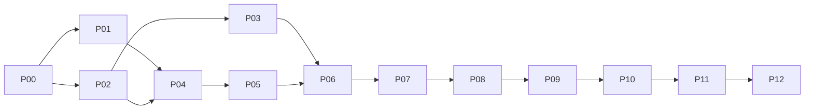

# Seat Binding component: implementation plan

## Context

- Spec (binding, owner-approved 2026-10-20 21:31): [spec-draft-261020-2028-seat-binding-component-consolidated.md](../reports/spec-draft-261020-2028-seat-binding-component-consolidated.md), copied in parallel to `docs/specs/seat-binding.md` (same content). §2–§13 bind this plan; §12 proof list and §13 do-not-add list are mandatory.
- Evidence: [council synthesis](../reports/council-261020-1547-seat-binding-spec-review.md), [inventory](../reports/research-261020-0955-seat-binding-needs-and-mechanisms-inventory.md), council packet `/home/vantt/projects/forgentX/.fgos/assignments/unit-run-1792498871506-22e9d338/producer/2/runs/01/outbox/packet-1.json`.
- Board: [program board](../261017-1313-fgos-platform-program-board/plan.md) lanes SEAT, MP-B1 (phase 06 waits on this plan's landing), COOK, AGENT-WF; "File chung dễ va".
- Repo rules: `AGENTS.md` (L10, RUL104, install/setup/doctor gate, prior art), [reading-map](../../docs/specs/reading-map.md), [component-boundary](../../docs/platform/component-boundary.md).

## Goal (from spec §1)

One authority answers, per agent seat: executor, invocation, model, effort, tier, account, what on failure, and why for each part. Every fact declared once. Every old path deleted in the same wave.

## Pattern reused (Rust foundation components)

| Piece | Reused from | Where |
|---|---|---|
| Internal route dispatch before the route table, not in help | `identity`, `terminal-control` | `apps/fgos/src/main.rs:154-187` (identity at :172) |
| `route::main(&[String]) -> i32`, `--protocol 1`, exit codes for usage/version | Session Identity | `packages/session-identity/rust/src/route.rs` |
| stdin JSON request → one JSON line answer; `host-version-mismatch` when the route is missing; host resolved once per process | Terminal-control client | `src/terminal-control/client.mjs:15-80` |
| Host binary resolution (active release or `FGOS_HOST_BIN`, never PATH) | shared | `src/util/host-bin-path.mjs:69` `resolveActiveHostBin` |
| Refuse a host exec while a state lock is held | Session Identity | `src/util/session-identity.mjs:47-57` (`heldLocks`, `noteLockHeld`), refusals :109, :203; noted by `src/state/hot-lock.mjs:364` |
| Crate depends only on `fgos-host-runtime` + serde; golden vectors in `contracts/` shared by Rust and Node tests | Convention | `packages/convention/rust/Cargo.toml`, `packages/convention/contracts/*.v1.json` |
| Test host binary built from the checkout | suite runner | `scripts/run-tests.mjs:95-103` (`FGOS_HOST_BIN`) |

Missing and added: the crate `packages/seat-binding/rust` (`fgos-seat-binding`), route `fgos internal seat-binding`, client `src/seat-binding/client.mjs`. Nothing else new; `bind.mjs` stays the Execution Core entry but keeps no policy.

## Planner decisions (inside the approved frame; reported, not asked)

1. **One track branch** `seat-binding-wave` in its own worktree. Every phase merges into the track, and the track stays green after each merge (full `npm test`, big lead). Main gets exactly one merge, at landing (phase 12). Reason: the converted config breaks every older activation (that is the fence), so no partial cutover can sit on main.
2. **One route op `bind`** runs stage 1 (policy) and stage 2 (ranking) in one exec. It returns the stage-1 result so the facade can cache it per seat + config digest and pass it back on later walk steps; op `ladder` returns the tier vocabulary and definitions for `$comment`. Exec count = seats × (1 + walk steps + lease conflicts). Two pure stages stay separate functions in the crate (spec §3.3).
3. **Machine facts are inputs, not crate reads.** Node collects `launchView` (per executor: invocations that can carry the posture, from the existing confinement code; effort levels each CLI renders, from `REASONING_EFFORT_CONTROLS` at `src/runner/dispatch/provider-adapter.mjs:255`) and `accountView` (outside the provider lock). Transport and confinement stay the authorities they are today.
4. **Setup conversion keeps today's tiers.** Each capability that declares `rigor` gets `tier = rigorToTier[rigor]` when that differs from `defaults.tier`, and `maxTier` when that tier is above global `maxTier` (today's RUL103 exception, `bind.mjs:124-136`). `defaults.tier = rigorToTier.standard`. A bare-verb entry `v` is copied to every registered `<prefix>:v` that has no entry of its own, so retiring the bare-verb fallback loses no taste. The diff prints all of it.
5. **forgentX's own config** = the generic conversion plus the D13 taste lines exactly as spec §9.1/§9.4. Committed in phase 06 on the track, so it reaches main only at landing.
6. **`acceptDependence` in wave 1**: no door can attest a human (§11.2), so an override with `acceptDependence: true` is refused at the door with `dependence-acceptance-unauthorized`, the same way a tier raise is refused. Override `origin` strings stop being synthesised (`bin/fgos.mjs:2851,2862,2878,2889`, `unit-handoff.mjs:198`); the crate never sees one.
7. **Workflow-declared `prefer` is refused at load** (D6), including in a `--units` file. `fgos run --provider` keeps its current executor-keyed meaning (§7) as a door input (`bin/fgos.mjs:489` → `unit.prefer`).
8. **`tester` is a checker seat, not a sixth role.** Today `checkersByRigor.critical = [reviewer, red-team, tester]` (`.fgos/config.json`, `VALID_CHECKER_ROLES` at `config.mjs:1383`), but D5 locks five roles. `checkersByRigor`/`minCheckers` entries become checker seat names; seat `tester` gets role `reviewer` (its own seat-keyed task text stays), so `seats.tester` targets it exactly and `roles.reviewer` taste also reaches it. This matches spec §9.2's `tester` seat and keeps D5.
9. **`capability-rigor-ceiling` doctor row is deleted**: the mechanism it reports (capability rigor raises the ceiling) is deleted, and `cap.maxTier` replaces it. The dry-bind check prints every `max-tier-cap` lowering.

## Phases

Owner type for every phase: a Sonnet lead in its own worktree branched from the track; the big lead (`forgentx-95`) verifies independently with the full `npm test` and merges into the track. Phase 12 is the big lead's own.

| # | Phase | Size | Depends on | Files (owned) |
|---|---|---|---|---|
| 00 | [Facts and prior art](phase-00-facts-and-prior-art.md) | S (3h) | — | report only |
| 01 | [Crate with two pure stages](phase-01-seat-binding-crate.md) | L (1.5d) | 00 | `packages/seat-binding/**`, root `Cargo.toml` |
| 02 | [Seat identity, resolver, patterns as seats](phase-02-seat-identity-and-patterns.md) | L (1.5d) | 00 | `src/runner/execution/{role-ledger,run,dry-bind,handoff-refs,unit-summary,case-admission-port,unit,unit-state}.mjs`, `patterns/**`, `src/workflow/{seats,definition,guide-schema,unit-handoff,units-source}.mjs`, `core/workflows/*.yaml`, `bind.mjs` (posture only) |
| 03 | [Persona scope](phase-03-persona-scope.md) | M (0.5d) | 02 | `src/workflow/loader.mjs`, `src/runner/agent-definitions.mjs`, `src/runner/agent-roster.mjs`, `src/runner/agent-listing.mjs`, `packages/convention/**` (name rule only) |
| 04 | [Host route, Node facade, exec budget](phase-04-host-route-facade-exec-budget.md) | M (1d) | 01, 02 | `apps/fgos/src/main.rs`, `apps/fgos/Cargo.toml`, `src/seat-binding/client.mjs`, `docs/architecture-manifest.json`, `src/setup/registrations.mjs` (route row) |
| 05 | [Config schema, precedence input, `$comment`, conversion function](phase-05-config-schema-and-conversion.md) | M (1d) | 04 | `src/runner/dispatch/config.mjs`, `src/runner/dispatch/tier-cell.mjs`, `src/runner/dispatch/resolve.mjs`, `src/setup/seat-binding-conversion.mjs` (new) |
| 06 | [Policy cutover: tier composition, `max-tier-cap`, G5, Work path, delete `rigorToTier`](phase-06-policy-cutover-tier-composition.md) | XL (2.5d) | 03, 05 | `bind.mjs`, `assignment-policy.mjs`, `dispatch/cli.mjs`, `loop.mjs`, `run.mjs` (snapshot), `bin/fgos.mjs`, `unit-handoff.mjs`, bare-verb consumers, `.fgos/config.json`, test fixtures |
| 07 | [Ranking cutover: cells with effort, pins, independence, inline-lead removal](phase-07-ranking-cutover-cells-effort.md) | L (1.5d) | 06 | `bind.mjs`, `explain.mjs`, `account-rotation.mjs`, `commit-unit-work.mjs` (gate compare) |
| 08 | [Lease/receipt protocol, one walker](phase-08-lease-receipt-single-walker.md) | L (1.5d) | 07 | `provider-capacity.mjs`, `account-pin.mjs`, `run.mjs` (walk), `assignment-runner.mjs`, `dispatch/recovery.mjs`, `session-identity.mjs` |
| 09 | [`fgos setup` conversion, drain check, fence, rollback](phase-09-setup-conversion-drain-fence.md) | M (1d) | 08 | `src/setup/registrations.mjs` (setup + drain row), `src/setup/config-merge.mjs` |
| 10 | [Doctor dry-bind check](phase-10-doctor-dry-bind.md) | M (1d) | 09 | `src/setup/registrations.mjs`, `model-pool-checks.mjs`, `workflow-pool-independence.mjs`, `blind-steps-proven-pools.mjs`, `executor-posture-coverage.mjs` |
| 11 | [Docs, records, component-boundary row](phase-11-docs-and-boundary.md) | S (0.5d) | 10 | `docs/specs/{seat-binding,runner,workflow,reading-map}.md`, `docs/platform/component-boundary.md`, `CHANGELOG.md` |
| 12 | [Landing and live proof](phase-12-landing-and-live-proof.md) | big lead (0.5d + runs) | 11 + verified track | main, release, three workspaces, second machine |

## Dependency graph and merge order



- Parallel window 1: 01 ∥ 02 (disjoint files). Window 2, after both merge: 03 ∥ 04 (disjoint: 03 owns `run.mjs` persona call, `bin/fgos.mjs`, loader, agent-definitions; 04 owns `main.rs`, client, manifest, `registrations.mjs`). 05 may run beside 03 once 04 is merged (05 owns `config.mjs`, `tier-cell.mjs`, `resolve.mjs`, the new conversion module).
- From 06 on: strictly sequential (shared `bind.mjs`, `run.mjs`, `registrations.mjs`).
- Merge order into the track: {01, 02} → {03, 04} → 05 → 06 … 11 (any order inside a window, each merge green). Each phase is one commit series merged after a full green `npm test` on the track.
- Before each phase starts, the big lead merges main into the track and lists conflicts in board collision files (`bin/fgos.mjs`, `registrations.mjs`, `CHANGELOG.md`, `docs/specs/runner.md`, `bind.mjs`).
- Main: one merge, phase 12.

## Data flow (after the wave)

```
door (fgos run / workflow handoff / Work dispatch)
  → raiseAuthorized=false, overrides (no origin)            [G5]
  → seat resolver (pattern + workflow seats:) → ordered seat list {seat, role, posture, persona?, tier?}  [G2]
  → persona resolved (agent-definitions, layered) → qualified id + digest                                 [G7]
  for each seat, in order:
    bind.mjs (Execution Core adapter): collect config subset + digest, peers (seat ledger), walk state,
       launchView, accountView (OUTSIDE provider lock)
    → client.mjs → `fgos internal seat-binding bind --protocol 1` (stdin JSON)
        crate stage 1 policy: tier (precedence §5.3) → override check → maxTier cap (visible) → cells
        crate stage 2 rank: candidates {executor, invocation, model, effort, pool, account} + reasons
    ← answer or refusal (tier-cell-missing, pin-unsatisfiable, independence-unsatisfiable, effort-*, ...)
    → publish to seat ledger, persist bindingInput
  launch batch in parallel                                                                               [R5]
  per attempt: provider-capacity acquires exactly the named account under the lock → leaseReceipt
     or lease-conflict → rebind with fresh view under same policy                                         [G6/R1]
  failure → walk step → bind again with walk state (single walker)
write gate / doctor / explain: replay persisted bindingInput + verify receipt (no live clock)
```

## Coverage map (requested items → phases)

| Item | Phase |
|---|---|
| Crate, two pure stages | 01 |
| Host route + Node facade, fail closed | 04 |
| Lease/receipt, no exec under lock | 08 |
| Seat identity, storage keys, seat resolver | 02 |
| Patterns to seats (panel, debate, reviewed, solo) | 02 |
| Tier composition, visible `max-tier-cap` | 01 (logic), 06 (wiring) |
| G5 wave-1 refusal | 06 |
| Cells with effort | 05 (parse), 07 (identity, gate, refusals) |
| Inline-lead escape removed | 07 |
| Persona scope (loader, agent-definitions) | 03 |
| Config schema, precedence, `$comment` | 05 (schema), 01 (precedence), 09 (writing `$comment`) |
| `fgos setup` conversion, `seat-binding-drain`, schema fence, rollback | 09 (+ record fence in 02) |
| Core workflows to explicit `seats:` | 02 |
| Doctor dry-bind replacing two rows | 10 |
| Docs, component-boundary row | 11 |
| Measured exec budget (§3.3) | 04 (per-exec cost), 08 (count, zero under lock) |
| Live proof (architecture-advisory + debate) | 12 |

## Proof list (spec §12) → test

| Proof | Phase | Test (new or changed) |
|---|---|---|
| two producer seats resume separately | 02 | `test/runner/execution/run.test.mjs` (panel resume by seat) |
| panel producers never run inline and never write | 02, 07 | `bind.test.mjs`, `patterns/panel` tests |
| debate judge hard-independent of both sides | 01, 07 | crate vectors + `patterns/debate` test |
| ordered concurrent panel bind with soft spread | 02, 07 | `run.test.mjs` (ledger publish before next bind) |
| workflow recommendation beats cap/prefix `tier`, loses to seat/persona/role keys | 01, 06 | crate vectors + `bind-committed-config.test.mjs` |
| above `maxTier` lowered with `max-tier-cap`, lowered-from in explain/record/evidence; deliberate cap `maxTier` above global passes | 01, 06 | crate vectors + `explain.test.mjs` + run evidence test |
| missing cell skips family; no allowed cell refuses naming the config line; hard pin refuses | 01, 07 | crate vectors + `tier-fallback.test.mjs` |
| unsupported or lower effort cannot claim the tier | 07 | `dispatch-execute-effort.test.mjs`, crate vectors |
| untrusted `human-cli` cannot raise tier or `acceptDependence` | 06 | `test/cli/run-verb.test.mjs`, `unit-handoff` test |
| tool-executor capabilities bind exactly as before | 06 | `executor-posture-coverage` + a tool capability case in `bind.test.mjs` |
| lease race rebinds under the same policy | 08 | `provider-pool-lease.test.mjs` (two processes) |
| gate replay survives a later quarantine | 08 | `commit-unit-work.test.mjs` / `account-rotation.test.mjs` |
| adjacent persona shadows only its own workflow or domain | 03 | `test/workflow/*loader*`, agent-definitions test |
| stance still records with explicit seats | 02 | `patterns/role-tasks` test |
| host exec count matches spec and is zero under the provider lock | 04, 08 | `test/seat-binding/exec-budget.test.mjs` (counting shim) |
| conversion idempotent; older activation refuses new schema; global file still loads on old activation | 09 | `test/setup/seat-binding-conversion.test.mjs` + old-release fixture |

## Test matrix

- **Rust unit** (`cargo test -p fgos-seat-binding`): every precedence row, cap, cell, pin, independence, continuity, refusal name; golden vectors in `packages/seat-binding/contracts/seat-binding.golden.v1.json`, also read by a Node test so both sides agree on shape.
- **Node unit**: client fail-closed paths, adapter input building, setup conversion, loader/persona layering, seat resolver.
- **Integration**: `runUnit` with a real host binary (`FGOS_HOST_BIN` from `scripts/run-tests.mjs`), real lease in a temp runtime dir, panel/debate/reviewed/solo.
- **E2E**: existing `test/e2e/*` after fixture conversion; `npm test` green on the track after each phase.
- **Live** (phase 12): one `architecture-advisory` run, one `group-cognition` debate run, on the owner's machine after activation.

## Risks (likelihood × impact)

| Risk | L×I | Mitigation |
|---|---|---|
| Exec cost per seat too high (S budget fails) | M×H | Measured in 04 before any cutover; reversal trigger below |
| Fixture churn (62 test files carry `rigorToTier`) hides a semantic change | H×M | 06 converts fixtures with the same conversion function as `fgos setup`, never by hand; diff reviewed per file group |
| Track drifts from main (shared files) | H×M | Main merged into track before every phase; collision list above |
| Old activation misbinds a converted config | L×H | Fence: missing `rigorToTier` already throws (`config.mjs:1710-1715`); 09 adds a test with the old loader |
| In-flight role-keyed records resumed by new code | M×H | Record fence (02) + drain check (09), refusal `record-predates-seat-binding` |
| `max-tier-cap` silently degrades quality | M×M | Visible in explain/evidence; dry-bind lists every lowering; board reversal trigger (doctor warning) |
| Work path behaviour change (risk heavy no longer lifts tier) surprises | M×L | Settled D2; CHANGELOG line; explain shows tier source |
| Herdr seat launch flakes during live proof (seen 10-20) | M×M | Known backlog `p-d2dc4f2e`; rerun, not a Seat Binding failure unless refusal is ours |

## Landing recipe (detail in [phase 12](phase-12-landing-and-live-proof.md))

1. Freeze all three workspaces (forgentX, mdview, mcp-skill-hub) and the second machine; owner picks the hour.
2. Drain each workspace with the track's `seat-binding-drain` row (`npm --prefix <track> run fgos:dev -- doctor`, run from the workspace).
3. Live fence check: the current (old) activation refuses a converted config on load.
4. Merge the track into main inside the main checkout.
5. **Release first**: build, stage, activate on forgentX; doctor shows `seat-binding-route`, `seat-binding-config`, `seat-binding-dry-bind` green. Old activations refuse the new schema, so nothing misbinds in between.
6. mdview and mcp-skill-hub: activate the new release **before** `fgos setup` converts their config (backup + diff); doctor green.
7. Second machine: pull, build, stage, activate in one sitting, then `fgos setup`, doctor.
8. Global `~/.fgos/config.json` untouched.
9. Live proof: one `architecture-advisory` run and one debate run (big lead).

## Rollback

- Before landing: drop the track branch; main untouched.
- After landing: activate the prior release **and** restore each workspace's pre-migration config backup (written by `fgos setup` in 09), together (spec §8.6); `git revert -m 1 <landing merge>` on main restores forgentX's committed config. Global `~/.fgos/config.json` is never changed, so it needs nothing.

## Acceptance criteria

1. `rg -n "rigorToTier|DEFAULT_RIGOR_TO_TIER|attemptProviderCapacityFallback|session-lead-inline|CHECKER_ROLES|resolveTierCeiling|lookupCapabilityConfig|panelist-" src bin core domains` returns nothing (except historical prose in specs).
2. No JS code computes tier, model, executor order, account order or fallback for an agent seat (reviewed in 11 against the boundary row).
3. Every §12 proof has a passing test named in the matrix; `npm test` green on main after landing.
4. Exec budget: count per seat × round × walk step equals `1 + walkSteps + leaseConflicts`, zero execs while the provider lock is held, per-exec p95 within 2× of `fgos internal identity mint-attempt` p95 on the same machine (numbers in the 04 report).
5. `fgos doctor` green on forgentX, mdview, mcp-skill-hub and the second machine after landing, including `seat-binding-route`, `seat-binding-drain` and the dry-bind check.
6. Live runs: `architecture-advisory` explain lines match spec §9.2 table (tier, source, executor); debate judge independent of both sides; evidence carries `tierSource` and any `loweredFrom`.

## Reversal triggers

- Measured exec budget fails (criterion 4) or the owner rejects the no-exec-under-lock protocol → stop after 04 and ask the S-vs-B question (spec §3.3) with panelist-2's cost table; also price the in-process Node addon (`packages/git/node-addon` is the precedent) as a third option.
- An older activation must resume in-flight records during the wave → switch drain to a read-only role-key reader shim (packet reversal trigger).
- After landing, `maxTier` lowering hurts quality unnoticed → add a doctor warning, never change authority (board 21:07).
- Live proof shows a seat bound differently from §9.2 for a reason not in the explain line → stop rollout to the other workspaces, fix before converting their configs.

## Out of scope (reference only)

- The model-config diff (new model ids `gpt-6-luna`, `gpt-6.1-sol`, `grok-4.7`, `mini` cells, empty flagship/frontier cells for deepseek and glm, removing the `code:review`/`code:debug` pins, widening the effort vocabulary): MP-B1 phase 06 / SEAT step 7, for owner approval after landing.
- The `{objective}` leak in checker `roleTasks` of `core/workflows/architecture-advisory.yaml` (spec §13 note): separate item.
- Everything on spec §13's do-not-add list.

## Component boundary

Changes: the Execution Core row of `docs/platform/component-boundary.md` (now line 65, spec cited :64 before the Event Store row was added) loses "who / model" authority; a new Seat Binding foundation row is added. Done in phase 11.

## Owner questions (only these)

1. **Landing hour.** Phase 12 is a stop-everything landing on three workspaces plus the second machine (board rule: the owner picks the time). Needed when phase 11 is merged.
