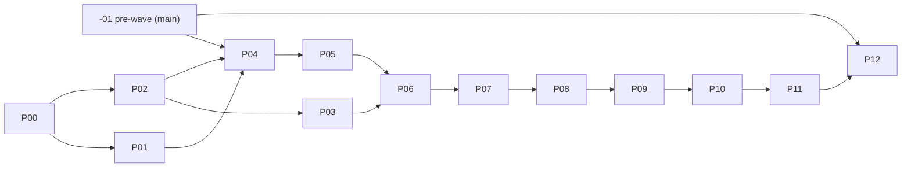

# Seat Binding component: implementation plan

## Context

- Spec (binding, owner-approved 2026-10-20 21:31): [`docs/specs/seat-binding.md`](../../docs/specs/seat-binding.md) on main (D-ADR0072, §15). Section numbers in this plan and its phases are that file's [RT-16b]; the draft [spec-draft-261020-2028-…-consolidated.md](../reports/spec-draft-261020-2028-seat-binding-component-consolidated.md) is history only. §11 proof list and §12 do-not-add list are mandatory.
- Red team: [red-team-adjudication.md](red-team-adjudication.md) (16 accepted, 1 rejected), applied below.
- Evidence: [council synthesis](../reports/council-261020-1547-seat-binding-spec-review.md), [inventory](../reports/research-261020-0955-seat-binding-needs-and-mechanisms-inventory.md), council packet `/home/vantt/projects/forgentX/.fgos/assignments/unit-run-1792498871506-22e9d338/producer/2/runs/01/outbox/packet-1.json`.
- Board: [program board](../261017-1313-fgos-platform-program-board/plan.md) lanes SEAT, MP-B1 (phase 06 waits on this landing), COOK, AGENT-WF, 6.4, GIT; "File chung dễ va".
- Repo rules: `AGENTS.md` (L10, RUL104, install/setup/doctor gate, prior art), [reading-map](../../docs/specs/reading-map.md), [component-boundary](../../docs/platform/component-boundary.md).

## Goal (spec §1)

One authority answers, per agent seat: executor, invocation, model, effort, tier, account, what on failure, and why for each part. Every fact declared once. Every old path deleted in the same wave.

## Pattern reused (Rust foundation components)

| Piece | Reused from | Where |
|---|---|---|
| Internal route dispatch before the route table, not in help | `identity`, `terminal-control` | `apps/fgos/src/main.rs:154-187` (identity :172) |
| `route::main(&[String]) -> i32`, `--protocol 1`, usage/version exit codes | Session Identity | `packages/session-identity/rust/src/route.rs` |
| stdin JSON → one JSON line; `host-version-mismatch` when the route is missing; host resolved once per process | Terminal-control client | `src/terminal-control/client.mjs:15-80` |
| Host binary resolution (activation or `FGOS_HOST_BIN`, never PATH) | shared | `src/util/host-bin-path.mjs:69` |
| Refuse a host exec while a state lock is held | Session Identity | `src/util/session-identity.mjs:47-57,109,203`; noted by `src/state/hot-lock.mjs:364` |
| Crate depends only on `fgos-host-runtime` + serde; golden vectors in `contracts/` | Convention | `packages/convention/rust/Cargo.toml`, `packages/convention/contracts/*.v1.json` |
| Global-layer sanitizer before merge | config loader | `config.mjs:300` (`sanitizeGlobalModelPolicies`), merge :359 |
| Test host binary built from the checkout | suite runner | `scripts/run-tests.mjs:95-103` |

**New files and symbols (complete list)** [RT-16c]: crate `packages/seat-binding/rust` (`fgos-seat-binding`: `ladder`, `policy`, `rank`, `bind`, `explain`, `route`) and `packages/seat-binding/contracts/seat-binding.golden.v1.json`; route `fgos internal seat-binding bind|ladder`; `src/seat-binding/client.mjs` (`bindSeat`, `tierLadder`, `SeatBindingError`); `src/runner/execution/seat-resolver.mjs` (`resolveSeats`, `effectiveRigorOf`), `seat-ledger.mjs` (replaces `role-ledger.mjs`), `legacy-seat-read.mjs`; `src/setup/seat-binding-conversion.mjs` (`convertRunnerConfig`); `bind.mjs` exports reduced to `bind(ask, ctx, {walk})` and `explainSeat`; `provider-capacity.mjs` `acquireNamedAccountLease`; `session-identity.mjs` `stateLockHeld`; config `RETIRED_RUNNER_KEYS`, `VALID_CHECKER_SEATS`, `sanitizeGlobalLayer`; doctor rows `seat-binding-route`, `seat-binding-config`, `seat-binding-drain`, `seat-binding-dry-bind`; record field `seatSchema`; config marker `runner.patterns.seatBinding.schema`.

## Planner decisions (inside the approved frame; reported, not asked)

1. **One track branch** `seat-binding-wave`. Phases 00–11 merge into the track, green after each merge. Main gets two things: the small pre-wave phase (-01) ahead of the wave [RT-10, RT-15], and one merge at landing (12). The converted config breaks every older activation (the fence), so no partial cutover can sit on main.
2. **One route op `bind`** runs stage 1 and stage 2 in one exec and returns the stage-1 result for the client to cache per seat + config digest; op `ladder` returns the tier text. Exec count = seats × (1 + walk steps + lease conflicts).
3. **Machine facts are inputs.** Node collects `launchView` (confinement answers; CLI effort levels from `provider-adapter.mjs:255`) and `accountView` (outside the provider lock; per-account CLI names, never homes [RT-16h]).
4. **Conversion keeps today's capability-rigor tiers only** [RT-16d]: a capability with `rigor` gets `tier = rigorToTier[rigor]` when ≠ `defaults.tier` and `maxTier` when above global; unit `rigor`, `--rigor`, guide `rigorFloor` and Work `risk: heavy` stop raising tier (D2), listed in the diff, dry-bind output and CHANGELOG. **Bare verbs** [RT-1]: a bare-verb entry in either layer (the global file has `advise`, `execute`, `review`) is copied into the project file for every registered `<prefix>:v` lacking its own entry; the global bare entries stay as exact keys for capabilities literally named `v`. The global file is never edited; its `rigorToTier` is dropped at load by the sanitizer.
5. **forgentX's own config** = generic conversion + the D13 taste lines of spec §10.1/§10.4, committed in 06 on the track.
6. **`acceptDependence` in wave 1** is refused at the door (`dependence-acceptance-unauthorized`) and ignored by the crate unless `raiseAuthorized` [RT-11]. Override `origin` strings stop being synthesised.
7. **Workflow-declared `prefer` is refused**; `seats[].tier` is honoured only from registered, loader-sourced workflows and refused in `--units`/`--unit` files [RT-11]. `fgos run --provider` keeps its executor-keyed meaning.
8. **`tester` is a checker seat** with role `reviewer` for taste lookup only; it keeps today's result contract and receipt treatment through a non-verdict posture; composition is stated by checker seat [RT-8]. Spec errata in 11.
9. **Deleted doctor rows**: `capability-rigor-ceiling` and `runner-rigor-config` (06, with the code they import) [RT-16a]; `model-policy-tier-coverage` and `workflow-pools-satisfy-independence` (10).
10. **Effective rigor and checker composition are owned by the Node seat resolver** (one function, prefix inheritance); the crate takes `effectiveRigor` as input [RT-13].
11. **Fence sentinel is `runner.patterns.seatBinding.schema`** [RT-3]: the old validator rejects unknown `patterns` keys (`config.mjs:1389-1393`) in every converted file, even after the global layer supplies `rigorToTier`. Requirement and `rigorToTier` refusal apply to the project layer only [RT-1].
12. **`bindingInput` is an allowlisted, non-secret subset extending `configSnapshot` by digest**; replay recomputes stage 1 from the committed config at that digest and checks the receipt against provider-capacity's record [RT-9].
13. **`bind.mjs` walk exports**: `walkBindings`, `listCandidates`, `nextCandidate`, `retrySameCandidate` are deleted; consumers use `bind` with walk state or `explainSeat` [RT-16c].

## Phases

Owner for every phase except 12: a Sonnet lead in its own worktree (from the track; -01 from main). The big lead (`forgentx-95`) verifies independently with the full `npm test` and merges. Phase 12 is the big lead's own.

| # | Phase | Size | Depends on | Files (owned) |
|---|---|---|---|---|
| -01 | [Pre-wave: dev-door host resolution, forward record fence (on main)](phase-pre-wave-host-resolution-and-record-fence.md) | S (0.5d) | — | `src/util/host-bin-path.mjs` (or dev-door script), `run.mjs` resume refusal |
| 00 | [Facts and prior art](phase-00-facts-and-prior-art.md) | M (0.5d) | — | report only |
| 01 | [Crate with two pure stages](phase-01-seat-binding-crate.md) | L (1.5d) | 00 | `packages/seat-binding/**`, root `Cargo.toml` |
| 02 | [Seat identity, resolver, patterns as seats, role-keyed readers, legacy read path](phase-02-seat-identity-and-patterns.md) | XL (2.5d) | 00 | execution, patterns, workflow and setup files listed in the phase; Convention seat-id rule; observe/run-result seat keys; `core/workflows/*.yaml` |
| 03 | [Persona scope](phase-03-persona-scope.md) | M (0.5d) | 02 | `loader.mjs`, `agent-definitions.mjs`, Convention persona rule, persona call sites |
| 04 | [Host route, client, exec budget](phase-04-host-route-facade-exec-budget.md) | M (1d) | 01, 02, -01 on track | `apps/fgos/src/main.rs`, `apps/fgos/Cargo.toml`, `src/seat-binding/client.mjs`, `session-identity.mjs` (predicate), `adapters.mjs` (env strip), `registrations.mjs` (route row), manifest |
| 05 | [Config schema, cells, `$comment`, sentinel, conversion function](phase-05-config-schema-and-conversion.md) | M (1d) | 04 | `config.mjs`, `tier-cell.mjs`, `resolve.mjs`, `model-pool-checks.mjs` (parsed cells), `seat-binding-conversion.mjs` |
| 06 | [Policy cutover: tier, `max-tier-cap`, raises, global sanitizer, Work path, JS model choice deleted](phase-06-policy-cutover-tier-composition.md) | XL (3d) | 03, 05 | `bind.mjs`, dispatch files, `loop.mjs`, doors, `bin/fgos.mjs`, `scripts/project-agents.mjs`, `registrations.mjs`, `.fgos/config.json`, fixtures |
| 07 | [Ranking cutover: effort, pins, independence, continuity, inline lead, walk exports](phase-07-ranking-cutover-cells-effort.md) | L (1.5d) | 06 | `bind.mjs`, `explain.mjs`, `run.mjs` walk, `assignment-runner.mjs:466-500` (gate compare), `resolve.mjs` deletions |
| 08 | [Lease/receipt, no exec under lock, replay, one walker](phase-08-lease-receipt-single-walker.md) | XL (2d) | 07 | `provider-capacity.mjs`, `account-*.mjs`, `run.mjs`, `assignment-runner.mjs`, `recovery.mjs`, patterns (queue), `registrations.mjs` (replay row) |
| 09 | [`fgos setup` conversion, drain, fence proof, rollback](phase-09-setup-conversion-drain-fence.md) | M (1d) | 08 | `registrations.mjs` (setup order, two rows), `config-merge.mjs`, `bin/fgos.mjs:4058-4061` |
| 10 | [Doctor dry-bind check](phase-10-doctor-dry-bind.md) | M (1d) | 09 | `registrations.mjs`, `model-pool-checks.mjs`, `blind-steps-proven-pools.mjs`, `executor-posture-coverage.mjs`, `dry-bind.mjs` |
| 11 | [Spec status, pointers, errata, boundary row](phase-11-docs-and-boundary.md) | S (0.5d) | 10 | specs, how-to, component-boundary, CHANGELOG, `core/skills/**` (not cook) |
| 12 | [Landing and live proof](phase-12-landing-and-live-proof.md) | big lead (0.5d + runs) | 11, -01 active everywhere | main, release, three workspaces, second machine |

## Dependency graph and merge order



- **Main, before the wave**: -01 lands on main, is merged into the track before 04, and rides the next ordinary release activation on all workspaces and both machines before 12.
- **Track**: window 1: 01 ∥ 02 (disjoint files). Window 2 after both merge: 03 ∥ 04 (03: loader, agent-definitions, persona call sites in `run.mjs`/`case-start.mjs`/`assignment.mjs`/`bin/fgos.mjs`, Convention persona rule; 04: `main.rs`, client, `session-identity.mjs`, `adapters.mjs`, `registrations.mjs`, manifest). 05 may run beside 03 once 04 is merged (`config.mjs`, `tier-cell.mjs`, `resolve.mjs`, `model-pool-checks.mjs`, conversion module). From 06 on strictly sequential.
- Merge order into the track: {01, 02} → {03, 04} → 05 → 06 → 07 → 08 → 09 → 10 → 11, each after a green full `npm test`.
- Before each phase the big lead merges main into the track and lists collisions (`bin/fgos.mjs`, `registrations.mjs`, `CHANGELOG.md`, `docs/specs/runner.md`, `bind.mjs`, `case-projection.mjs`). [RT-15] From 06 on each such merge re-runs `convertRunnerConfig` on the merged config and fixtures and flags new `rigor`/`rigorToTier` keys.
- Main, at landing: one merge, phase 12, after a final main→track sync, full `npm test` and the criterion-1 grep.

## Data flow (after the wave)

```
door (fgos run / workflow handoff / work-dispatch / operation-choice / fanout-batch)
  → raiseAuthorized=false, selectors, overrides without origin                      [G5, RT-11]
  → seat resolver: effective rigor, checker seats, ordered seat list {seat, role, posture, persona?, tier?}  [G2, RT-13]
  → persona resolved (layered) → qualified id + digest                               [G7]
  per unit run, through one serialized queue: ledger-read → bind → publish           [R5, RT-14]
    bind.mjs: config subset + digest, peers, walk state, launchView, accountView (outside the lock)
    → client.mjs → activation host `fgos internal seat-binding bind --protocol 1`    [RT-10]
        stage 1 policy (precedence §6.3, override/selector check, maxTier cap visible)
        stage 2 rank → {executor, invocation, model, effort, pool, account} + reasons
    ← answer or named refusal → persist allowlisted bindingInput (+ host version)    [RT-9]
  launch batch in parallel
  per attempt: acquireNamedAccountLease (CLI filter, under lock) → leaseReceipt | lease-conflict → serialized rebind, hard rules re-checked
  failure → walk step → bind again with walk state (single walker)
write gate (assignment-runner.mjs:466-500) / doctor replay: stage 1 from committed config at the run's digest, receipt vs provider-capacity record
```

## Coverage map (requested items → phases)

| Item | Phase |
|---|---|
| Crate, two pure stages | 01 |
| Host route + client, fail closed, host trust | 04 (+ -01 dev door) |
| Lease/receipt, no exec under lock | 08 |
| Seat identity, storage keys, resolver, legacy read path | 02 |
| Patterns to seats | 02 |
| Tier composition, visible `max-tier-cap` | 01 (logic), 06 (wiring) |
| G5 wave-1 refusal, all raise doors | 01, 06 |
| Cells with effort | 05 (parse), 07 (identity, gate, refusals) |
| Inline-lead escape removed | 07 |
| Persona scope | 03 |
| Config schema, precedence, `$comment` | 05 (schema), 01 (precedence), 09 (writing `$comment`) |
| Setup conversion, `seat-binding-drain`, schema fence, rollback | 09 (+ record fence 02, forward fence -01, sanitizer 06) |
| Core workflows to explicit `seats:` | 02 |
| Doctor dry-bind replacing two rows | 10 |
| Docs, component-boundary row | 11 |
| Measured exec budget | 04 (per exec + per surface), 08 (count, zero under lock), 10 (doctor surface) |
| Live proof | 12 |

## Proof list (spec §11) → test

| Proof | Phase | Test |
|---|---|---|
| two producer seats resume separately | 02 | `run.test.mjs` (three producer seats) |
| panel producers never run inline and never write | 02, 07 | `bind.test.mjs`, panel tests |
| debate judge hard-independent of both sides | 01, 07 | crate vectors + debate test |
| ordered concurrent panel bind with soft spread | 02, 08 | `run.test.mjs` (serialized queue), two concurrent lease-conflicts |
| recommendation beats cap/prefix `tier`, loses to seat/persona/role | 01, 06 | crate vectors + `bind-committed-config.test.mjs` |
| above `maxTier` lowered with `max-tier-cap`; capability `maxTier` above global passes | 01, 06 | crate vectors + `explain.test.mjs` + run evidence |
| missing cell skips; no allowed cell refuses naming the line; hard pin refuses | 01, 07 | crate vectors + `tier-fallback.test.mjs` |
| unsupported or lower effort cannot claim the tier | 07 | `dispatch-execute-effort.test.mjs`, crate vectors |
| untrusted `human-cli` cannot raise tier or `acceptDependence`; door selectors cannot raise | 06 | `run-verb.test.mjs`, handoff test, one test per door |
| tool-executor capabilities bind as before | 06 | tool case in `bind.test.mjs`, `executor-posture-coverage` |
| lease race rebinds under the same policy | 08 | `provider-pool-lease.test.mjs` |
| gate replay survives a later quarantine | 08 | gate replay test at `assignment-runner.mjs:466-500`, `account-rotation.test.mjs` |
| adjacent persona shadows only its own workflow/domain | 03 | loader + agent-definitions tests |
| stance still records with explicit seats | 02 | role-tasks test |
| host exec count matches and is zero under the provider lock | 04, 08 | `test/seat-binding/exec-budget.test.mjs` |
| conversion idempotent; older activation refuses; global still loads on old activation | 09 | conversion + old-loader fence tests (real-shaped global file) |

## Test matrix

- **Rust unit** (`cargo test -p fgos-seat-binding`): precedence rows, cap, cells, pins, independence, continuity, selectors, refusal names; golden vectors read by a Node test too.
- **Node unit**: client fail-closed and host trust, resolver (rigor, composition, seat id rule), legacy read path goldens, conversion, sanitizer, persona layering.
- **Integration**: `runUnit` with a real host binary, real lease in a temp runtime dir, a temp HOME holding a real-shaped global file (with `rigorToTier`), panel/debate/reviewed/solo, concurrent lease-conflict.
- **E2E**: `test/e2e/*` after fixture codemod; full `npm test` green on the track after each phase.
- **Live** (12): `architecture-advisory` run, `group-cognition` debate run, live fence check on all three workspaces.

## Risks (likelihood × impact)

| Risk | L×I | Mitigation |
|---|---|---|
| Global layer still carries `rigorToTier`/bare verbs; new loader refuses every workspace or the fence fails open | H×H | Sanitizer before merge, project-only refusal, sentinel in `patterns`, tests with a real global file [RT-1, RT-3] |
| Fill-missing writers re-add retired keys | H×M | Default removed in 06; setup converts before fill-missing; trigger on `rigorToTier` present; pull+activate as one step [RT-2] |
| Exec cost too high | M×H | Measured per exec and per surface in 04 before any cutover |
| Fixture churn hides a semantic change | H×M | Classified in 00; codemod for fixture-only, hand rewrite for asserting tests [RT-16f] |
| Track drifts from main | H×M | Main merged before every phase; conversion drift check from 06 on [RT-15] |
| In-flight records across the cutover | M×H | Drain on real statuses + liveness + parked gates [RT-4]; record fence (02); forward fence on main (-01) [RT-15] |
| Role-keyed reader missed | M×H | 00 grep list owned by 02; legacy read path with goldens [RT-6] |
| Worker tampers with `unit.json` to steer replay or host | L×H | Allowlisted `bindingInput`, digest-checked replay, receipt vs provider record, `FGOS_HOST_BIN` stripped, activation host [RT-9, RT-10] |
| `max-tier-cap` silently degrades quality | M×M | Visible in explain/evidence; dry-bind info lines; board reversal trigger |
| Herdr launch flake in live proof | M×M | Rerun (`p-d2dc4f2e`), not counted against Seat Binding |

## Landing recipe (detail in [phase 12](phase-12-landing-and-live-proof.md))

1. Pre-check: the -01 release is active on forgentX, mdview, mcp-skill-hub and the second machine.
2. Final sync: main → track, conversion drift check, full `npm test`, criterion-1 grep.
3. Freeze; owner picks the hour.
4. Drain each workspace with the track's `seat-binding-drain` row (`npm --prefix <track> run fgos:dev -- doctor` from the workspace; JSON by default); settle dead records with the verb the row names.
5. Live fence check on all three converted configs with the old activation and the real HOME.
6. Merge the track into main inside the main checkout (Land/Sync verbs if GIT 07 has landed).
7. **Release first** on forgentX: build, stage, activate; `fgos setup` (heal or no-op); doctor green.
8. mdview, then mcp-skill-hub: activate the new release **before** `fgos setup` converts their config (backup + diff); doctor green with expected info lines.
9. Second machine: pull and activate as one step, then `fgos setup`, doctor.
10. Global `~/.fgos/config.json` not edited; its `rigorToTier` is dropped at load by the sanitizer.
11. Live proof (big lead).

## Rollback

- Before landing: drop the track branch; -01 on main is inert and can stay.
- After landing, per workspace, together: activate the prior release **and** restore the setup backup; forgentX also `git revert -m 1 <landing merge>`. Because -01 is in the prior release, new-release records (with `seatSchema`) are refused (`record-from-newer-release`) rather than misread; they settle or are abandoned, no drain needed to re-activate. The global file needs nothing.

## Acceptance criteria

1. [RT-6, RT-12, RT-15] `rg -n "rigorToTier|DEFAULT_RIGOR_TO_TIER|attemptProviderCapacityFallback|resolveFallback|session-lead-inline|CHECKER_ROLES|VALID_CHECKER_ROLES|resolveTierCeiling|resolveSeatTier|lookupCapabilityConfig|resolveAssignmentDispatchPolicy|resolveTierModel|resolveTierCandidates|tierFallbackOf|resolveStrongerTier|TIER_STRENGTH|rankProviderAccounts|walkBindings|listCandidates|nextCandidate|retrySameCandidate|role-ledger|panelist-" src bin core domains scripts packages apps` returns only: `packages/seat-binding/**` (`TIER_STRENGTH`), `src/runner/execution/legacy-seat-read.mjs` (`panelist-`), and `rigorToTier` inside `RETIRED_RUNNER_KEYS` in `config.mjs` and in `src/setup/seat-binding-conversion.mjs`. Regenerated baselines (`scripts/check-decision-codes.baseline.json`) carry none.
2. No JS code computes tier, model, executor order, account order or fallback for an agent seat (reviewed in 11 against the boundary row).
3. Every §11 proof has a passing test named above; `npm test` green on main after landing.
4. Exec budget: count per seat × round × walk step = `1 + walkSteps + leaseConflicts`; zero execs under the provider lock; per-exec p95 ≤ 2× `identity mint-attempt` p95; per-surface before/after wall times (run, explain, doctor, preflight, replay) recorded with a ~22 KB config [RT-16e].
5. `fgos doctor` green on forgentX, mdview, mcp-skill-hub and the second machine after landing, including `seat-binding-route`, `seat-binding-config`, `seat-binding-drain` and `seat-binding-dry-bind` (expected info lines only).
6. Live runs match spec §10.2/§10.3; evidence carries `tierSource` and any `loweredFrom`.
7. Old activations refuse all three converted configs with the real HOME (09 test, 12 live check).

## Reversal triggers

- Measured exec budget fails or the owner rejects no-exec-under-lock → stop after 04, ask S vs B (spec §4.2) with panelist-2's cost table; the in-process Node addon (`packages/git/node-addon` precedent) is information for that question, not an option this plan prices or builds.
- A pre-fence record cannot be settled or abandoned by any existing verb → switch to a read-only role-key reader shim for that record class.
- After landing, `maxTier` lowering hurts quality unnoticed → doctor warning, never change authority.
- Live proof shows a seat bound for a reason not in its explain line → stop rollout to the other workspaces.

## Out of scope (reference only)

- Model-config diff (new model ids, `mini` cells, empty flagship/frontier for deepseek and glm, removing `code:review`/`code:debug` pins, effort vocabulary widening): MP-B1 06 / SEAT step 7, owner approval after landing.
- The `{objective}` leak in checker `roleTasks` of `core/workflows/architecture-advisory.yaml`: separate item.
- Everything on spec §12.

## Component boundary

`docs/platform/component-boundary.md:64` (Execution Core row, marked "planned") loses "who / model" authority; a new Seat Binding row is added. Done in 11.

## Red Team Review

Source: [red-team-adjudication.md](red-team-adjudication.md). 16 accepted, applied; 1 rejected, not applied.

| Item | Disposition | Phases changed |
|---|---|---|
| RT-1 global layer (`rigorToTier`, bare verbs) | accepted: sanitizer before merge, project-only refusal, global bare-verb rule (decision 4), real-global tests | 00, 05, 06, 09, 12, plan |
| RT-2 fill-missing writers | accepted: default removed in 06, setup converts first, trigger on `rigorToTier` present or marker absent, pull+activate as one step | 00, 05, 06, 09, 12 |
| RT-3 fence sentinel | accepted: `patterns.seatBinding.schema`, proven on three workspace shapes with real HOME | 00, 05, 09, 12, plan |
| RT-4 drain predicate | accepted: real statuses + liveness + parked gates, named settling verbs, live run in 00 | 00, 09, 12 |
| RT-5 replay sites | accepted: gate at `assignment-runner.mjs:466-500`; `mutating-assignment-binding-snapshot` post-fence only with exec count; `probe-account` outside | 00, 06, 07, 08 |
| RT-6 role-keyed readers and history | accepted: full grep list owned by 02; one legacy read path with goldens; grep widened | 00, 02, plan |
| RT-7 seat id rule | accepted: Convention-owned charset + reserved names, traversal test | 02 |
| RT-8 `tester` | accepted (big lead's decision): composition by checker seat, non-verdict posture, one checker set, spec errata | 00, 02, 11, plan |
| RT-9 replay trust | accepted: allowlisted `bindingInput`, digest-checked stage-1 replay, receipt vs provider record, extends `configSnapshot` | 08, plan |
| RT-10 host binary trust | accepted: activation host, `FGOS_HOST_BIN` stripped from workers, host version recorded, 5 s timeout; dev-door fix pre-wave | -01, 04, 08 |
| RT-11 other raise doors | accepted: loader-only `seats[].tier`, selector raises refused, crate ignores `acceptDependence`, all `runUnit` doors listed | 00, 01, 02, 06 |
| RT-12 JS model choice | accepted: `resolveTierModel` ×7, `resolveTierCandidates`, `tierFallbackOf`, `resolveStrongerTier`, `TIER_STRENGTH`, barrel, `project-agents.mjs` moved or deleted; grep widened | 00, 06, 07, plan |
| RT-13 effective rigor | accepted: Node seat resolver owns it; crate takes it as input; duplicates deleted | 00, 01, 02, 06 |
| RT-14 concurrent rebind | accepted: per-unit serialized queue, hard-rule re-check, concurrent conflict test | 02, 08 |
| RT-15 drift, landing, rollback | accepted: conversion drift check from 06, final sync step, Land/Sync if GIT 07, forward record fence pre-wave | -01, 06, 11, 12, plan |
| RT-16a–h medium | accepted: (a) rows deleted in 06; (b) § re-cited to `docs/specs/seat-binding.md`, phase 11 rescoped; (c) no `fgos agents` change, no kept script, `resolveAssignmentDispatchPolicy` deleted, walk exports decided, new-symbol list; (d) capability-rigor-only wording + reported unit-rigor changes; (e) per-surface budget; (f) test classification + codemod; (g) dry-bind severity; (h) CLI filter on named lease | 00–12, plan |
| Rejected: price the Node addon as a third option | not applied; the addon stays information for the S-vs-B question | plan (reversal trigger wording) |

### Whole-Plan Consistency Sweep

Re-read `plan.md` and all 14 phase files after the edits. Stale-term search (`rg` over the plan dir) and results:

| Term | Result |
|---|---|
| drain on `doing`/`paused` | gone; 09 and 12 use `execution.status` ∈ {running, pending, pending-inline} + liveness + parked gates |
| `commit-unit-work` as the gate | gone as gate; 07/08 cite `assignment-runner.mjs:466-500`; `commit-unit-work.mjs` appears only in 00 and 07 as "has no bind, not the gate" |
| `rigorToTier` refusal without a layer | every refusal says project layer; global dropped by the sanitizer (05, 06, 09, plan) |
| draft section numbers (§3.3, §4.x, §5.x, §8, §9.x, §11.x, §12, §13 of the draft) | re-cited to `docs/specs/seat-binding.md`; the draft is linked as history only |
| `fgos agents` layer/scope listing | removed (03 explicitly makes no listing change) |
| kept measurement script | removed (04 uses a throwaway script under `.fgos/runtime/tmp/`; numbers in the report) |
| `resolveAssignmentDispatchPolicy` wrapper | removed; 06 deletes it and moves its callers |
| "Global untouched" without the sanitizer | every mention pairs it with the load-time sanitizer (plan decision 4, landing step 10, 12 step 10) |
| `seatBindingSchema` (old marker name) | gone; replaced by `patterns.seatBinding.schema` everywhere |
| `capability-rigor-ceiling`/`runner-rigor-config` deleted in 09/10 | now deleted in 06 only; 09 only adds rows, 10 deletes the two coverage rows |

Reconciled: phase table sizes and dependencies match each phase header; merge order matches the graph (-01 on main before 04 and active before 12); coverage map, proof table, acceptance criteria 1–7, landing recipe and rollback agree with phases 09 and 12; file ownership has no overlap inside a parallel window (01 ∥ 02; 03 ∥ 04; 05 beside 03).

One contradiction between accepted items, resolved by evidence and stated: RT-3 asks to assert the project file bytes are unchanged after the old release runs, but the old `ensureRunnerConfigForDir` writes missing default keys before validating (`config.mjs:395-405`, RT-2's own evidence). The plan asserts instead that the old release refuses, that the only bytes it adds are default keys, and that the next new-release `fgos setup` heals the file to the same converted result (09 test, 12 step 5). No owner decision is touched.

Result: zero unresolved contradictions.

## Owner questions (only these)

1. **Landing hour.** Phase 12 is a stop-everything landing on three workspaces plus the second machine (board rule: the owner picks the time). Needed when phase 11 is merged.

## Validation Log

### Session 1 — 2026-10-20
**Trigger:** owner 21:50 "plan xong thì chạy ak-plan validate/redteam để kiểm tra, sau đó chạy ak:cook"; run after the red-team pass (16 accepted items applied, sweep clean).
**Verification pass:** skipped by the validate guard. `## Red Team Review` already carries Full-tier evidence: 4 reviewers; big-lead re-checks of `config.mjs:359-361`, `config.mjs:395-405`, `run.mjs:699-1374`; 0 `[UNVERIFIED]` tags in the plan files.
**Questions asked:** 0 to the owner. Each decision point below is answered from the approved spec (`docs/specs/seat-binding.md`, D-ADR0072) or from code. Under AGENTS.md priority 2 the big lead decides inside the approved frame and reports. The one owner question, the landing hour, is asked when phase 11 merges.

#### Decision points reviewed (answered by the big lead)
1. **[Assumptions]** Unit `rigor`, `--rigor`, guide `rigorFloor` and Work `risk: heavy` stop raising tier (planner decision 4).
   - Answer: correct. This is D2 ("rigor only sets checker count and independence"), approved 21:31.
   - Mitigation kept: these appear in the conversion diff, the dry-bind output and the CHANGELOG, so nothing changes silently.
2. **[Architecture]** One track branch with one landing merge, about 17 days (decision 1).
   - Answer: correct. This is the owner's "one wave" (D11) plus the schema fence, so a partial cutover can never sit on main.
   - The pre-wave phase -01 is the only thing that lands on main early. It is inert by itself.
3. **[Tradeoffs]** Global bare verbs are copied into each project file instead of editing the global file (decision 4).
   - Answer: correct. The approved spec forbids new keys in the global file this wave (spec §9 step 5), and an edit there breaks other activations (incident 2026-10-13).
4. **[Assumptions]** `tester` is a checker seat that has role `reviewer` for taste lookup only and keeps today's result contract (decision 8).
   - Answer: correct. It fills a gap in the spec without changing behaviour.
   - Spec errata go in phase 11. The owner sees them in the phase 11 summary.
5. **[Risks]** No dead pre-fence record may be left without an existing verb that settles it.
   - Answer: phase 00 measures this on live forgentX, where 11–31 records are `running` today.
   - The reversal trigger (a read-only role-key shim for that record class) is pre-decided, so it needs no owner input.
6. **[Scope]** Model-config diff stays out of scope (MP-B1 06 / SEAT step 7).
   - Answer: correct, per the owner's sequence (diff after landing, owner approves).

#### Confirmed Decisions
- Proceed to implementation with `/ak:cook --auto`. Each phase group runs as a Sonnet lead in its own worktree under `core/skills/_shared/ak-cook-worker-contract.md`. The big lead verifies with the full `npm test` before each merge into the track.
- Phase -01 goes first, on main. Phase 00 runs in parallel because it only writes a report.

#### Action Items
- [ ] Ask the owner for the landing hour when phase 11 merges.

#### Impact on Phases
- None. No phase file changed in this session.

### Whole-Plan Consistency Sweep
- No new decision deltas in this session, so there is nothing to propagate.
- Re-checked: the -01/00 order in "Phases", "Dependency graph" and "Landing recipe" agree.
- The single owner question matches "Owner questions".
- 0 unresolved contradictions.
