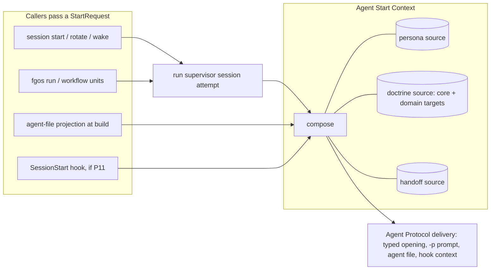

discussion: open

## 1. Trạng thái hiện tại

2026-11-22 18:45 — Round 3. Owner agreed to the component Agent Start Context, asked to make the contract input less fixed and to check whether the surrounding flows are messy and whether a new component makes them messier. The deep scan is in [#scan-deep](#scan-deep). A council of three postures is convened on that question; its result and the shaper's revised advice follow.

2026-11-22 17:30 — Round 2. The owner settled the scope (Q1): fgOS manages only its own text; MDView, AgentKit and GitNexus are external and out of scope for now, with no deep integration. The question `q-excujq527g` was cancelled with that answer. The shaper's advice on how to gather the paths is in [#advice](#advice): one owning component, **Agent Start Context**, a small Rust crate whose one composer every fgOS start calls at the existing spawn door (the run supervisor's session attempt). The Node head opening and two of the three persona renderers go away. P4, P5, P7 and P8 are now proposals after two rounds (no owner revision yet). P10 (where a head's domain comes from) and P11 (whether sessions opened by hand go through the seam) are open. Council: not convened; the options in #advice separate clearly on evidence, so it is not needed unless the owner disagrees with the owning component.

## 2. Mục tiêu & đề bài

Every agent that fgOS starts should start through one door, and that door should have one fixed seam where context is injected: role, domain and task go in, the context that fits them comes out. Today every agent loads CLAUDE.md and AGENTS.md in full at start and uses little of it, which costs many tokens on every start; yet at the moment of start the system already knows the role, domain and task, so it could inject only what fits. The `head start` activation prompt is the owner's reference for a good start prompt. Later components, such as an agent-context-injection component, plug into the seam instead of growing their own path. The work is shaped in this order: first a scan that counts and lists every way an agent is started and every place that writes or owns its start prompt or context (file, what it injects, who calls it); then the single door, the seam's contract, what leaves CLAUDE.md and AGENTS.md, and what a first increment toward it looks like. Constraints: hexagonal and pluggable (design principle 3); one door, with old paths moved and deleted in the same change (principle 1, L10); prior art first (`git log -S`, area specs' decision history); owner decisions come as five-part questions with a recommendation and a default. Non-goals: writing the injection component itself; changing what persona or domain doctrine says. Source: `p-25q7tz6jtt`; related `ds-cfsfcbknl6` (how agents talk to the owner).

## 3. Vấn đề rõ / chưa rõ

| # | Point | State | Evidence / blocker |
|---|-------|-------|--------------------|
| P1 | How many ways an agent is started today, and who owns each start prompt | clear | [#scan](#scan): 5 head paths into one `placeHead`; 7 live worker paths into one Rust engine; Claude's Agent/Task subagents outside both |
| P2 | Which context is always loaded, its size, who writes it | clear | [#ambient](#ambient): ~17.1k tokens for Claude here, ~29k with skills; fgOS writes ~7.7k of it |
| P3 | Prior art for start-time injection | clear | [#prior-art](#prior-art): dormant domain composition targets; the only role-keyed start injection today is the rotation hook (728942829) |
| P4 | Where the single door lives | proposed, two rounds | Spawning is already one door: every head and worker is a run-supervisor session attempt (`launch_session_attempt`, `packages/execution/engine/src/transport_round/session_attempt.rs:222`; Session Host spec 8.1 and its 2026-11-18 decision). The door gains the composition: callers pass a start request, never finished text. See [#advice](#advice) |
| P5 | Seam contract | proposed, two rounds | `compose(StartRequest) -> StartContext`. In: kind (head or worker), persona, name, domain (optional), task (a reference for heads; the Execution-owned assignment block for workers), forQuestion, handoff, target CLI. Out: ordered named blocks (persona, standing doctrine, domain doctrine, task, start ritual, on-wake, handoff). Sources are ports; delivery stays with Agent Protocol. See [#advice](#advice) |
| P6 | What leaves CLAUDE.md / AGENTS.md | scope settled by owner (Q1, 17:15); content proposed | Only fgOS-owned text (~7.7k tokens here). L8 test: what must hold with no workflow running stays as a short standing sheet; the rest becomes core or domain doctrine the seam injects by role and domain. Proposed split in [#advice](#advice). Third-party blocks untouched |
| P7 | First increment | proposed, two rounds | Four slices, each lands alone, in [#advice](#advice): (1) the crate and heads, (2) workers and the agent-file projection, (3) domain doctrine, (4) the AGENTS.md cut |
| P8 | Claude Agent/Task subagents | proposed, one round | Yes, through the seam at build time: `scripts/project-agents.mjs` asks the composer for the persona block instead of rendering its own (third renderer removed). Delivery adapter "agent file" |
| P9 | Mess seen outside this scope | for the secretary as separate items | Codex cuts AGENTS.md at 32 KiB (file is 50.8 KB; Id Minting and the AgentKit block are lost); a stray `<!-- mdview:START -->` at AGENTS.md:232; `statusLine` points into `forgentX`; 6 of 14 `core/agents` never projected to `.claude/agents`; workflow personas `advisor`, `panelist`, `synthesizer`, `critic`, `brand-guardian` have no definition; Node dispatch/prompt mirror looks unreachable; `core/prompt-templates/*` used by no live flow; Unit `skills` never reach the prompt; a Claude rotation successor gets the handoff twice, other CLIs get only the path |
| P10 | Where a head's domain comes from | proposed, one round | The domain is already decided at intake, so the seam only reads it and never classifies. Work items: `fgos submit --domain`, chosen by `fgos-clarifying` step 3 (the live session judges against `clarifyingDomainVocabulary()`, `src/state/domain-registry.mjs`; unsure means `domain: null` plus one question, never a `coding` default) and stored as `work.domain`. The workflow step then follows mechanically from domain + kind + phase (`stepForPhase`, `src/state/domain-registry.mjs`), so no model is needed for it. Gap: backlog rows (`area:`), plans and discussions carry no domain (0 of 150 plans), and this shaper's own opening left `domains/<domain>` unfilled. Proposed order at the door: (1) the field on the bound item, written by whoever created it (the secretary already classifies); (2) the caller's declared domain; (3) only when neither exists (a hand-opened session, a bare `fgos run` prompt), a classifier behind a port, written back so it is decided once. The classifier is a "System One" kind of query (fixed options in, one typed choice plus a confidence out); low confidence becomes the existing one-line question (`domainUnsure`). Its adapters: the live session (default), an LLM at the nano tier with a strict output schema, or later a System One model such as TypeSafe's Jev; Claude has no such model (see §5 17:55), and the owner keeps external systems out for now. A live session that already holds the context does not delegate this (D-ADR0026 rule 2) |
| P11 | Sessions opened by hand (owner types `claude` in a repo) | owner chose B (17:45), D-ID after the next round | A fgOS `SessionStart` hook asks the composer for every hand-opened session on CLIs with hooks (claude, codex, agy), so the seam covers every start and AGENTS.md shrinks to the standing sheet; omp and pi still read only AGENTS.md. With no role known, the hook asks for the project's entry persona (P13) instead of an empty role |
| P12 | One decision component for every "System One" decision | proposed, one round; its own topic | Today such decisions (fixed options, judged from unstructured text) are made four different ways. **Keyword tables:** tier, kind and risk in `src/intake/classify.mjs` and `src/intake/risk-keywords.mjs`, and the Iron Law flag in `src/evolve/iron-law.mjs`. **A live session's own judgment:** intent clear or unclear, and the domain (`core/skills/fgos-clarifying`). **A full agent run for a yes/no answer:** the `judge-ambiguity` operation in `domains/coding/workflows/{bugfix,feature}.yaml` with `domains/coding/task-specs/judge-ambiguity.md`. **Nowhere yet:** a head's domain, and choosing a workflow for a request. Proposal: one contract `decide(kind, options, state) -> {choice, confidence, source}`, where `options` is a closed typed set declared by the kind. Below the kind's confidence threshold the answer is `unsure`, and the caller falls back to its existing question path. Adapters behind the port, cheapest first: rules, then the live session, then an LLM at the nano tier with a strict schema, then later a System One model such as Jev. Every decision is appended to a log (L1), so an adapter can be swapped on measured agreement. Out of scope for the component: deterministic choices already in code (`bind`, rotation thresholds, `stepForPhase`), and judgments that need investigation or design (flagship tier, reviewers, council). This discussion only reserves the port (the domain fallback in P10). Owner 17:30: yes, a separate discussion; the secretary was asked by mailbox to open it. **Prior art found 18:35:** the owner's fork `vantt/multica` already ships this shape as patch 0007 triage-suggest (`vantt/patches/0007-triage-suggest.spec.md`, code `server/internal/triage/clef.go`): `Choose(job, model, state, questions{instructions, options})` → per question `{choice, pTop, margin, probabilities}`. It calls Cloudflare's Clef on Workers AI (`clef-flash` fast, `clef` careful), whose API takes Jev's System One shape, learned from OpenMausBot's decider and Linear's Triage Intelligence. Rules worth carrying: options read fresh from live data on every call, never hard-coded, each option with its meaning and recent examples; threshold top p ≥ 0.6 (92–99 % right on the MausBot bench); fail open (no key, 1.5 s timeout, HTTP error or invalid answer means no decision); every answer validated (choice offered, probabilities sum to ~1, choice is the top one); several questions asked in one call; one log line per call with job, model, choice, p, margin, latency and a state hash, never the text or the key; off when unconfigured; an opt-in live eval on real cases (18 requests: project 13 right, 0 wrong, 5 silent; ~200 ms). This corrects §5 17:55: a usable System One model exists today through Cloudflare Workers AI, not only Jev in early access |
| P13 | Entry persona: a hand-opened session always lands on one agent (e.g. the secretary Miu) | owner idea 17:45; the seam part proposed here; owner 17:35 (second message): the UX flow is a separate item, the secretary was asked by mailbox to file it | Owner: a user who opens a session in a fgOS project should always meet one predefined agent such as Miu, who coordinates the rest or starts the other agents herself, even in a project with few plans. Seam part: the composer takes an `entryPersona` (project config, default `secretary`) as the role when none is given. Two facts the UX topic must settle. **One holder per role:** `startHeadSession` fronts the live holder instead of starting a second (Session Host spec 8.1), so a second hand-opened session cannot become a second Miu. **Confinement:** a head runs sandboxed with its grant, and the secretary's bypass mode is legal only inside that sandbox (spec 8.1, decision 2026-11-19), while a plain `claude` is unconfined. Both point to the entry being a fgOS command that starts or fronts the real Miu head through the door, not a plain `claude` turning into Miu |

### Deep scan, round 3 {#scan-deep}

Owner 18:23 agreed to the component Agent Start Context but found the contract too fixed on domain and job type, and asked for a deeper scan: are the flows around agent start messy, can they be simpler and more standard, and would a new component make things messier? Evidence (read-only sweep, file:line):

**Both chains, end to end.**
- **Head:** `bin/fgos.mjs:3268` → `startHeadSession` → `placeHead`. Node binds the seat (`bind.mjs:91`, a separate process) and builds the finished text (`openingText`, `renderPersonaSection`). `launchSessionInHost` (`src/native/execution-door.mjs:376`) sends `launch-session` with `opening` as a finished string, and Rust only carries it to `brief.md` verbatim and types it.
- **Worker:** `run.rs:436` → `run-unit` → `execute.rs:938` → `PromptPort.render_prompt` → `render_assignment_prompt` (`builder.rs:757`, plus `persona.rs:310`, `contract/templates.rs:670`, `claim.rs:94`). In terminal mode it is wrapped again by `render_brief` (`brief.rs:300`); headless `-p` gets it unwrapped.
- **Shared:** the seat step (`prepare_attempt_seat`, `seat.rs:178`), confinement, the lease, the brief file and the delivery.
- **Split:** two entry ops (`launch-session` and `run-unit`, `execution_routes.rs:218-219`). The same step order (open, lock, lease, renew, seat, bind) is written twice, once in `execute.rs` and once in the engine's `launch_session_attempt` (`session_attempt.rs:181-205`). Seat binding happens in Node for heads and in the engine for workers. Text is built in Node for heads and in Rust for workers.
- **Is a head a Unit?** No stated reason exists beyond "a head is not a unit of work": no result, no settle, no run-control, no idle limit (`docs/platform/run-supervisor/spec.md:170,401`). A head needs a grant with verbs, a request socket, an Identity role, a ceiling, `beside`/`display` and the bypass invocation, which the Unit contract has no fields for (`core-unit/unit.v1.json` forbids execution mechanics).

**Start text is formed in about 12 places.**
- Node `openingText`, `FIRST_STEPS` and the start ritual (hardcoded).
- Node `renderPersonaSection` and `renderOnWake`.
- Rust `persona.rs` (a field-for-field port of the Node renderer).
- `scripts/project-agents.mjs` (a third, different format; a manual script).
- `builder.rs` (203 LOC).
- `claim.rs`, rendered twice (`builder.rs:887` and `brief.rs:351`).
- `brief.rs` wrapper and pointer.
- `role_tasks_data.rs`.
- `contract/templates.rs` + `core/prompt-templates`.
- Node Work-item objective templates (`src/runner/prompt-templates/*.txt`, `work-compat buildPrompt`, 393 LOC, live only through `fgos plan`/`discover` and `fgos-runner`).
- The handoff: Node `buildHandoff` writes it. Rust `session_start_context` injects it whole at SessionStart, while the start ritual also points at the file, so a head gets it twice.

**Dead code.** The Node dispatch mirror is unreachable: `session-attempt.mjs`, `assignment-runner.mjs`, `herdr-round.mjs`, `brief.mjs` and `direct-launch.mjs` form a closed set of 3,003 LOC (only 39 test files import it), plus `renderAssignmentPrompt` (178 LOC) and two dead functions in `transport.mjs`.

**Seams that already exist.**
- `PromptPort` (`builder.rs:34-68`) is the engine's port for prompt parts, with `persona_section` and `render_operation_prompt`. It is the natural door for one composer.
- `instruction-composition.mjs` is the only real composer. Its units carry frontmatter (`kind`, `scope`, `authority`, `appliesTo`, `specificity`, `mode`) and it orders them with supersedes and conflicts. But it is Node, runs at setup time, and selects by host and audience, not by run facts.

**Contract input, rethought.** The fixed fields (kind, persona, domain, task…) hard-code today's dimensions. Alternative: the caller passes an open set of **start facts** (role, persona, domain, workflow, stage, task ref, cli, project, any later key). Every context unit (doctrine, persona part, ritual, template) declares in its own frontmatter which facts it applies to, extending the existing `appliesTo`. The composer only matches and orders. A new dimension is then new data, not a contract change. This is the same rule as the owner's multica decider: options read fresh from data, never hard-coded.

### Shaper's advice, round 2 {#advice}

**What is actually split.** Spawning is already one door. Delivery is already one owner (Agent Protocol types the text; Session Host places the pane). The *text* has no owner: the head opening is built in Node (`openingText`, `src/session-host/head-start.mjs:114`, with the start ritual and `FIRST_STEPS` hardcoded), the worker prompt in Rust (`builder.rs:757`), and the persona block has three renderers on one source (`src/runner/agent-definitions.mjs:310`, `apps/fgos/src/wiring/unit_run_host/persona.rs:310`, `scripts/project-agents.mjs:110`), even though e749259d2 meant "one persona door". fgOS doctrine reaches agents only through this repo's AGENTS.md, so agents fgOS starts in *other* projects get no fgOS doctrine at all since `fgos setup` was retired (12f8a187a). Fixing that serves mission #1/#2, not only fgOS's own token bill.

**Who should own the text — three options weighed.**

| Option | Gain | Harm |
|---|---|---|
| A. Execution owns it (extend the assignment builder to heads) | no new crate | the assignment prompt is a worker contract (write scope, result claim); heads do not fit, and Execution (tier 5) grows a second job |
| B. **New small component "Agent Start Context"** (Rust crate, tier 3 beside Agent Protocol) | one authority for start text (principle 7); pure, testable with golden openings; sources and delivery are ports (principle 3); new code in Rust per the Session Host 2026-11-18 decision | one new crate; heads' composition moves from Node to Rust |
| C. Session Host owns it | heads already start there | Session Host is placement only and its spec forbids typing; workers would cross into it |

**Recommendation: B.** The owner pre-approved an owning component; B is the only option where one component owns exactly one kind of decision. It stays small: a composer and ports, no new mechanism beside the door (L10).

**Contract sketch.** `compose(StartRequest{kind, persona, name, domain?, task, forQuestion?, handoff?, cli}) -> StartContext{blocks[]}`. Blocks are named and ordered; Execution keeps owning the assignment block (objective, write scope, result claim) and passes it in as the task. The start ritual and first step become persona data (`core/agents/*.yaml`), not code. Later components (an agent-context injector, a skill-text inliner) add a source port, never a new path.

**Proposed AGENTS.md split (fgOS-owned text only).** Stays as the standing sheet: mission boundary, product priority, the laws index, scratch artifacts, destructive cleanup, id minting, the decision-question rule. Moves to doctrine injected by role/domain: before-touching-code, definition of done detail, the install/setup/doctor gate, the legacy-Node boundary, dispatch, the gateway, the impact-analysis gate (coding domain on fgOS itself), the RUL11/RUL104 narratives (core doctrine for heads and reviewers). Rough effect here: fgOS-owned always-loaded text from ~7.7k to ~2k tokens; the rest arrives only for the starts that need it. The anchor phrases of RUL11 and RUL104 keep their tests wherever the text lives.

**Increments (each lands alone, old path deleted in the same slice).**
1. Crate + heads: compose the head opening in Rust; `launch-session` takes the start request instead of text; Node `openingText`, `renderPersonaSection`, `renderOnWake` deleted. Proof: golden openings per persona equal today's text except the fixes named (unfilled `<domain>`, worker-worded preamble).
2. Workers + agent files: `builder.rs` and `scripts/project-agents.mjs` take the persona block from the composer; `persona.rs` rendering deleted.
3. Domain doctrine: switch on the dormant domain targets (`src/setup/instruction-composition.mjs:94-125`) as the doctrine source; P10 decides the head's domain.
4. AGENTS.md cut per the split above, plus P11's hook if chosen.

### Scan inventory {#scan}

**Head sessions** — all end in `placeHead` (`src/session-host/head-start.mjs:232`), opening text built by `openingText` (`:114-130`):

| # | Path | Entry | Caller |
|---|------|-------|--------|
| H1 | `fgos session start <persona>` by hand | `bin/fgos.mjs:3267` → `head-request.mjs:44` → `startHeadSession` `head-start.mjs:276` | owner |
| H2 | same verb over a head's request socket | `head-request-client.mjs:171` → `packages/run-supervisor/rust/src/head_request.rs:38` → `head-request.mjs:712` | secretary (shaper), supervisor (lead, planner) |
| H3 | supervisor wake | `packages/supervision/rust/src/wake.rs:272` → `apps/fgos/src/wiring/supervision.rs:672` runs H1 | `fgos watcher tick`, `fgos supervisor wake` |
| H4 | rotation successor | `src/session-rotation/rotate.mjs:333` → `placeHead` `:442` | `fgos session rotate`, socket verb, Claude Stop hook |
| H4b | rotation `SessionStart` hook | `apps/fgos/src/wiring/session_rotation_hook.rs:265` → `packages/session-host/rust/src/rotation/handoff.rs:190` | Claude only |

Opening blocks: Persona (`renderPersonaSection`, from `core/agents/
.yaml` or workspace `fgos/agents/`; skills by *name* only), identity line, `# Task` (`taskOfHead`, `head-plan.mjs:213`; first-step text hardcoded in `FIRST_STEPS`), `# Start ritual` (hardcoded), optional question line, `# On wake` (`renderOnWake`). Spawn: Node `launchSessionInHost` (`src/native/execution-door.mjs:376`) → Rust `launch-session`; the opening is written verbatim to `brief.md` and typed into the herdr pane (`packages/agent-protocol/rust/src/terminal/mod.rs:554`). No `--append-system-prompt` or `--system-prompt` anywhere.

**Execution workers** — all end in the Rust unit-run engine; prompt by `render_assignment_prompt` (`packages/execution/engine/src/assignment/builder.rs:757`), persona by `persona.rs:310` (4 layers: workspace, workflow, domain, core), persona chosen by `bind` (`packages/execution/rust/src/bind.rs:358`):

| # | Path | Entry | What feeds the prompt |
|---|------|-------|-----------------------|
| W1 | `fgos run "<prompt>"` | `apps/fgos/src/wiring/run.rs:436` | prompt → objective; `--persona`, `--writes`, `--capability`, `--input` |
| W2 | `fgos run` from a head | `apps/fgos/src/routing.rs:546` → `head_request.rs:1403` | same |
| W3 | `fgos run --unit` / `--resume` | same builder | Unit fields |
| W4 | `fgos workflow start` | `src/workflow/runner.mjs:146` | step template + inline `objective`/`roleTasks` in `domains/*/workflows/*.yaml` |
| W5 | legacy `fgos-runner` | `src/runner/work-dispatch.mjs:114` | Node `buildPrompt` (`src/runner/work-compat.mjs:116`) + `src/runner/prompt-templates/*.txt`, then wrapped again by Rust |
| W6 | declared-operation step (`fgos discover`, `fgos plan`) | `src/runner/operation-choice.mjs:2321` | domain task-spec path, optional `contractTemplate` |
| W7 | fanout batch | `src/runner/fanout-batch.mjs:97` | as W5 |
| — | named `agentType` executor | `packages/execution/rust/src/executor_config.rs:67` | `--agent <type>` → `.claude/agents/<type>.md` |
| — | Claude Agent/Task subagent | Claude Code itself; fgOS `dispatch-decide` hook only gates | `.claude/agents/<type>.md` + AgentKit `SubagentStart` |
| — | credential probe | `packages/execution/engine/src/accounts/credential_probe.rs:104` | fixed probe prompt; not real work |

Persona renderers: three (Node `renderPersonaSection` for heads, Rust `persona.rs` for workers, `scripts/project-agents.mjs` for `.claude/agents`), one source (`core/agents/*.yaml`).

### Ambient context {#ambient}

Claude Code in this repo, measured 2026-11-22 (tokens ≈ bytes/4):

| Part | ~Tokens | Writer |
|------|---------|--------|
| AGENTS.md hand-written doctrine (L1–231) | 5,192 | people/agents |
| impact-analysis gate + MDView block | 935 | hand / external mdview |
| GitNexus block | 726 | external `gitnexus analyze` |
| fgOS Effective Instructions projection | 1,623 | `npm run build:skills` → `src/setup/instruction-projections.mjs:330` |
| AgentKit block in AGENTS.md | 4,238 | AgentKit installer |
| `.claude/rules/*.md` (same AgentKit rules again) | 4,217 | AgentKit installer |
| CLAUDE.md | 126 | hand |
| **Total certain** | **~17.1k** | |
| Skill listing (name + description) | ~7.9k | skill build + AgentKit |

Plus hooks: AgentKit `session-init` (≤4 KB), `dev-rules-reminder` on every prompt, AgentKit `SubagentStart`; fgOS rotation handoff (heads only, ≤10k chars), questions line, mailbox on PostToolUse. Other projects get fgOS hooks but no fgOS doctrine: `fgos setup` was retired (12f8a187a), and the projection is written only in this checkout.

### Prior art {#prior-art}

- 07c4a5205 (2026-08-20): doctrine split into core/domain; `domains/<d>/AGENTS.md` read on demand by skills — today's domain mechanism.
- 9def51380 (2026-09-14): instruction projection into AGENTS.md. The composition supports `domain:<name>` targets and the contract names `.fgos/instructions/effective/domain-<d>.json`, but only `target=repo` is ever materialized (`instruction-projections.mjs:241`). Dormant, reusable.
- 08244d2ba (2026-10-17): measured loading across four CLIs; recommended AGENTS.md under 32 KiB and dropping `.claude/rules`. Not carried out; 334d66ed8 (AgentKit v3, 2026-11-09) reinstalled the rules.
- 00cd5f9fc (2026-10-21): 14 places rules live; "rules don't reach where agents work".
- b7eeb4bb6 … e749259d2: "one persona door for head sessions and worker briefs" — intended one renderer, yet three remain.
- 728942829 (2026-11-18): rotation hook — the only fgOS start-time injection keyed by role today.
- L8 (`docs/platform/platform-foundations.md:284-306`): placement test "must this rule hold when no workflow is running?"; transport rides with the order; anchor suite (only RUL11 and RUL104 have anchors). This is the law the seam implements; it needs no superseding.

## 4. Quyết định đã chốt

| D-ID | Decision | Date | Source |
|------|----------|------|--------|

## 5. Q&A log

- 2026-11-22 15:57 — Seed from the secretary on the owner's order: goal, first task (scan), shaping order, constraints, non-goals as in §2. The owner names `head start`'s activation prompt as the reference.
- 2026-11-22 16:15 — Scan done by three read-only sweeps (head/session, run/workflow/executor, ambient context + prior art); results in §3. Proposals P4, P5, P7 written for a first round. Q1 asked through the question store (scope of P6); Asked as `q-excujq527g`; recommended "fgOS text only; third-party mess is a separate item".
- 2026-11-22 17:15 — Owner on Q1: MDView, AgentKit and GitNexus are external; not our concern for now, no deep integration; only manage our own system well, smoothly, without mess. The owner's goal statement stands as written. Task for the shaper: scan all paths, brainstorm, think it through, advise how to gather them; an owning component is allowed; a council may be convened if it is too messy. `q-excujq527g` cancelled with this answer.
- 2026-11-22 17:30 — Round 2 advice written ([#advice](#advice)): owning component B (Agent Start Context), contract sketch, AGENTS.md split, four increments. New open points P10 (head domain source) and P11 (hand-opened sessions). Council not convened: the evidence separates the options.
- 2026-11-22 17:40 — Owner: the Work intake (submit) seems to already decide domain and workflow from the task's own information; should a small judge model decide domain/workflow, since these are easy decisions? Does Claude have such a model (owner wrote "jev"; no such name is found in the repo)? Shaper answer: yes, intake already decides the domain (`fgos-clarifying` + `fgos submit --domain`) and the workflow step follows from the domain registry; Claude's small model is Haiku, already the `nano`/`mini` tier in `modelPolicies`. P10 updated: the seam reads the domain, a nano-tier judge is the fallback only when no one has decided it.
- 2026-11-22 17:55 — Owner: "jev" is TypeSafe's Jev (https://typesafe.ai/blog/introducing-system-one-models-and-jev), a "System One" model: unstructured state in, a typed choice with a calibrated probability out, 70–500 ms, input $0.042 per million tokens, cannot chat or write code, early access only. Haiku is not in that class; does Claude have one? Shaper answer: no. Anthropic's models (Fable, Mythos, Opus, Sonnet, Haiku) are all general text models. The nearest Claude setup is Haiku 5.5 with structured outputs (`output_config.format` with an enum schema, or `strict` tool use): the output is type-safe, but it has no calibrated probability, is a generated answer rather than one parallel decision, and is slower. P10 now names the domain/workflow classifier as a port with Jev as a possible later adapter.
- 2026-11-22 18:05 — Owner: should we reserve a place for a new judge component like Jev, and could one component with a fitting contract make all decisions of this kind? Shaper answer: yes, one component can serve all fixed-option decisions; the contract, the inventory of today's four ways and the limits are recorded in P12. Recommendation: reserve the port in this design and shape the component itself in its own discussion.
- 2026-11-22 17:30 — Owner: yes to a separate discussion for the decision component (P12); the secretary (`head:secretary-miu`) was asked by mailbox to open it and to file the P9 items. Owner did not understand the P11 question; it is re-asked in plainer words.
- 2026-11-22 17:45 — Owner chose B for P11 (hand-opened sessions go through the seam by a SessionStart hook). Owner idea: a user who opens a session in a fgOS project should always land on a predefined agent such as Miu, who coordinates or starts the other agents, even where few plans exist. Recorded as P13: the seam takes an entry persona; the UX flow is its own topic.
- 2026-11-22 17:50 — Owner agreed to split the entry-persona UX flow (P13) into its own item; the secretary was asked by mailbox to file it. This discussion keeps only the seam's `entryPersona` input.
- 2026-11-22 18:35 — Owner asked whether the shaper had studied the fork `vantt/multica` for the judge component. It had not; it read patch 0007 triage-suggest now and recorded it as prior art in P12 (Clef on Cloudflare Workers AI, Jev's System One shape, already built and evaluated by the owner). Correction to 17:55: a System One model is usable today through Cloudflare, not only Jev.

## 6. Thiết kế đã chốt {#design}

Not yet: P4, P5 and P7 are proposals after one round; P6 waits on Q1.

## 7. Danh mục hạng mục / task {#tasks}

Not yet.
