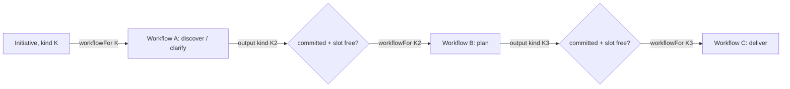
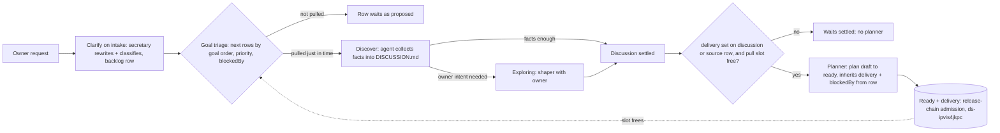

discussion: open

## Seed

Opened by the supervisor on the owner order of 2026-11-26 11:16, relayed by the shaper of ds-ipvis4jkpc (D10). Read the source backlog row and `plans/discussions/ds-ipvis4jkpc-release-chain-command/DISCUSSION.md` §3 rows 3 and 15, D5, D6, D10 first. Park owner questions in the question store instead of waiting on them.

- **Outcome:** a domain-agnostic workflow, extracted from Work, that takes a portfolio backlog row through clarify on intake, triage against the managed goals by goal priority, discover into the discussion, exploring only when discover is incomplete, and planning, to a `ready` plan carrying the `delivery` flag, timed just in time.
- **Interface (fixed by ds-ipvis4jkpc):** the pipeline produces a `ready` plan with the `delivery` flag (D5, D6); the release-chain admission consumes it.
- **Open:** whether the delivery commitment can sit on a backlog row before any plan exists; how "just in time" is timed; which Work stages (`docs/platform/work-state/spec.md` #12, #21, #26) are reused versus moved.

## 1. Trạng thái hiện tại

Round 7 (2026-11-26 15:2x). Owner does not yet feel the ranking and goal management are settled, and asked what mvp/milestone and P0–P3 mean; then ordered a council to challenge the ranking and goal management. Scan of Work's ranking in §3 row 15; shaper proposal L7 in §3 row 16 (no score; an ordered key chain; goal = initiative of `kind: goal`; drop mvp/milestone tiers; P0 = expedite, P1–P3 out of ranking). Council done (§3 row 17): all three seats back L7's core (no score, owner-set goal order, goal as an initiative, mvp/milestone tiers dropped) with changes; one real split remains on goal-less rows.

**Exit of this discussion (owner 2026-11-26 14:41 and 14:4x): it is NOT handed to a planner.** When it settles, it goes onto one table with every open backlog row and discussion about the work lifecycle (backlog, triage, ready-to-plan, planning, workflow, stage/status), reviewed by a council if needed, then re-split into new items and plans, because the owner sees much overlap and wants a better order (§7 `#task-lifecycle-table`).

Round 6 (2026-11-26 14:41). Owner: should the commitment be a field like `nextStage` instead of a `delivery` flag? And scan code and docs to make status versus stage clear again, since they have been confused many times. Scan result in §3 row 13; shaper analysis of `nextStage` in §3 row 14 (leaning L6: one stage-valued field read as a ceiling, "may go up to stage X", replacing the boolean; the name must not read as an observed fact).

Round 5 (2026-11-26 14:40). Owner asked to scan the code for an existing kind/stage-to-workflow mapping. Found (§3 row 12): the mapping exists and is generic, but only in the Work layer and unused in practice. `resolveWorkflow(domain, kind)` in `src/state/domain-registry.mjs:207` returns `workflowFor[kind]` or `defaultWorkflow`; each workflow step carries `phase` (clarify/discover/plan/execute), `skill` and `operations`, and `stepForPhase` finds a step by phase. Coding declares the kinds (bug, chore, design, docs, feature, task) but `workflowFor: {}`, so every kind gets `feature`, and `domains/coding/workflows/bugfix.yaml` is reached by no kind. The Workflow component has nested cases (`case-frame.mjs`, RUL-WF-28) and `--inherit` (RUL-WF-31: a new case takes over milestones of a closed case, same guide only). The portfolio has no mapping: the supervisor hard-codes "settled discussion → planner" and "ready plan → lead" (`core/skills/fgos-supervisor/SKILL.md`, `packages/supervision/rust/src/wake.rs:243`). No workflow declares an output kind, so no cross-workflow chaining exists.

Round 4 (2026-11-26 13:51). Owner: the question "is the output a new initiative or an artifact" needs open discussion or a council, and asked where the shaper's own critique was. Shaper critique (§3 row 11): neither option should apply everywhere. Inside one initiative, ds-ubqlutna6r A5(d) already makes backlog-to-ready the stage list of a single workflow (Init → Discover → Clarify → Plan → Execute), so turning each stage hop into a new initiative would state the same sequence twice and triple the card count. Chaining by `kind` is needed only where the subject changes: one item gives rise to several (discovery finds three pieces of work), or work crosses a domain (a council decision feeds coding). There the output is naturally a new initiative with its own `kind` and `discoveredFrom` (already in A8). Held open; a council is offered, not started.

Round 3 (2026-11-26 14:0x). Owner: do not make the pipeline complicated; organise things so that the output of one workflow becomes the input of another, which is why the owner kept the field `kind` on an initiative (ds-ubqlutna6r, 2026-11-25 21:3x: the workflow is derived from `kind`, `workflowFor[kind]` else `defaultWorkflow`, pinned on leaving Init; settled as A8, built by plan `261125-2137-domain-agnostic-item-component`, draft). Leaning **L5** replaces L1-L4 as the frame (§3 row 11): there is no pipeline engine and no pipeline-specific state. Each workflow takes an input of a known kind and gives an output that carries a `kind`; `workflowFor[kind]` names the workflow that consumes it. "Backlog to ready" is only the chain this yields. The commitment rule (L2-L4) shrinks to one rule at every link: an output starts its consumer only when it is committed for delivery and a slot is free; this one rule covers both a settled discussion waiting for a planner and a `ready` plan waiting for a lead. Waiting on the owner's confirmation of L5 in chat.

Round 2 (2026-11-26 13:44). Owner: hold the hand-off to a planner (13:36), and a settled discussion that the owner does not yet want planned needs the same queue/delivery mechanism as a plan (13:44). Today the supervisor starts a planner on every `discussion-settled` event, with no check of intent (`core/skills/fgos-supervisor/SKILL.md` "Settled discussion"). This falls inside this topic, because the planner step is a pipeline step. Leaning **L4** (§3 row 10): `settled` means quality only, like `ready` for a plan; a planner starts only when the discussion is committed for delivery and its pull slot (L3) is free. One `delivery` key with one meaning on row, discussion and plan, inherited down the `source` chain; it may also sit on a discussion directly, because 42 of 88 discussions cite no backlog row. This discussion stays `open`; nothing is handed to a planner.

Round 1 (2026-11-26 11:40, shaper head `backlog-to-ready-pipeline`). Domain: supervision/work, which is fgOS platform work. There is no `domains/supervision/AGENTS.md`, so the supervision, work-state and workflow specs are the doctrine read. The pipeline itself must stay domain-free: a step that needs domain knowledge calls the domain's own skill, found through `domains/<domain>/AGENTS.md`.

What the scout found (§3 row 1 has the full map): every step the owner named already exists somewhere, but split across two worlds that do not meet. Work has discovery, exploring and planning stages, triage, `goalTier` and the `intent` score, but they act only on Work items in the Event Store, and they lean to coding. The portfolio (backlog rows, discussions and plans on the trunk) has the later half working by itself: a settled discussion starts a planner, and a `ready` plan with the `delivery` flag is admitted. Nothing moves a `proposed` row forward by itself, and that is the real gap. Today 356 rows are `proposed` and 308 of them are cited by no discussion or plan. So the pipeline cannot work through every row. It must pick the next rows, and that pick is where goal triage and "just in time" meet.

Leanings (proposed, not settled, no D-ID yet):
- **L1, where it lives:** a core workflow guide (domain-free) whose milestones are read from the portfolio files on the trunk (row, `DISCUSSION.md` marker, `plan.md` status), driven by the supervisor's rhythm, each step run by an existing head or skill. No new state store. §3 rows 2 and 8.
- **L2, delivery on the row:** the delivery commitment and the order (`blockedBy`) may sit on a backlog row before any plan exists, and the plan inherits them from its `source` row. Without this, "just in time" has nothing to time against, and the owner's own sequence already holds backlog-only steps. §3 row 3.
- **L3, just in time = pull with a small ready buffer:** keep at most N committed items in preparation or waiting `ready`, and pull the next one in order when a slot frees. A `ready` plan whose footprint moved on main before it is admitted gets checked again. §3 row 4.

Open owner question: **Q1 q-pvl344blv5** (what the "managed goals" are; §3 row 5). Everything else keeps shaping without it.

## 2. Mục tiêu & đề bài

A backlog row is where an owner request lands, and today it stays there until a person moves it: the secretary decides whether to open a shaper, a shaper settles a discussion, and only from there does the machinery run by itself (a planner on `discussion-settled`, a lead once a flagged plan is `ready`). Work items have a fuller automatic path (clarify on intake, discovery, exploring only when discovery is not enough, planning), but backlog rows never enter it, and it leans to coding. The owner wants that path taken out of Work as an independent workflow that works for any domain and serves backlog rows. It should rewrite a terse request so it is explicit and classify it, rank it against the goals the owner manages, collect the facts into a discussion, bring in the owner only when the facts are not enough, and plan. It should do this just in time: late enough that the codebase does not drift under the plan, and early enough that a `ready` plan is already waiting when its turn in the delivery queue comes. Its output is the input of the release chain (ds-ipvis4jkpc): a `ready` plan with the `delivery` flag.

## 3. Vấn đề rõ / chưa rõ

| # | Point | State | Evidence / note |
|---|-------|-------|-----------------|
| 1 | Map of the pipeline steps onto today's doors | Clear (scout) | **Clarify on intake:** Work clarifies at `submit`, before the item exists (work-state spec §5 "Discovery And Exploring Stages"). Portfolio: the secretary runs `fgos-clarifying` for a domain verdict only and does not rewrite the request (`.agents/skills/fgos-secretary/SKILL.md` step 1). **Triage:** Work has `fgos triage` (blocking fan-out, declared goals first), `goalTier` items with `fgos goal set/show` (focus is `null` today), and the `intent` score (Data Dictionary #26). Portfolio has only row `priority` (proposed rows: 70 P1, 199 P2, 87 P3) and the secretary ordering by the product priority by hand. **Discover:** Work stage `discovery`, verdict `clear` or `unclear` given by the caller (`domains/coding/workflows/feature.yaml`, skill `fgos-coding-discovering`). Portfolio has none; a shaper starts only on the secretary's judgement. **Exploring:** Work stage `exploring`; portfolio shaper with `fgos-shaping`. **Planning:** Work stage `planning` (split or pass-through verdict); portfolio planner started by the supervisor on `discussion-settled` (supervision spec §5). **Ready:** Work stage `executing`; portfolio plan `ready` + `delivery` flag (ds-ipvis4jkpc D5, D6). |
| 2 | Where the pipeline lives | Leaning L1 | The Workflow component already owns "guide" (definition) and "case" (one run), with milestones whose evidence is a declared subject, and files count as a subject (`docs/platform/workflow/spec.md` §2.2). D-ADR0076: Work is the surface and Workflow plus Execution are the engine, so the steps belong on the engine side and not in Work. But a case ledger is local (`.fgos/workflow-runs/<id>/`), while portfolio state must survive rotation and other machines on the trunk. Leaning: the guide declares the steps and milestones, and the milestones are read from the trunk files, so no second store holds progress. Open: whether a Workflow case is opened per row at all, or the guide is only read by the supervisor. |
| 3 | Delivery commitment before a plan exists | Leaning L2 | The release chain needs an order to measure "near its turn" against, and the owner's sequence (p-755psfxpmh) has three land-cost backlog items queued after step 2, which have no plan. So the `delivery` flag and `blockedBy` may sit on a backlog row; the schema already allows extra keys (`packages/portfolio/contracts/backlog-item.schema.v1.json`, `additionalProperties: true`). The plan made from the row inherits both through its `source`. This extends D5 of ds-ipvis4jkpc (flag in plan frontmatter) and does not reverse it. Open: what a flagged row with several plans means. |
| 4 | How "just in time" is timed | Leaning L3 | Pull, not push: keep at most N committed items in preparation or waiting `ready` (a buffer like a Kanban replenishment limit, default tied to `supervisor.maxLeads`), and pull the next in order when one is admitted. Drift guard: before admission, a `ready` plan whose footprint saw commits on main since it was set `ready` is checked again (relates to the drift check in ds-mzyircswox). Prior art: Lean "last responsible moment", Kanban WIP limit on the ready column, Scrum refinement about one or two sprints ahead. Open: which events start a pull (a lead slot frees, a predecessor is admitted, a plan reaches `done`), and the key name and default of N. |
| 5 | What the "managed goals" are | Open — Q1 q-pvl344blv5 | No portfolio goal store exists. Work has `goalTier` items and `fgos goal`, but only for Work items. The secretary "clarifies and orders goals" (supervision spec §1.1) and keeps no list. The when-to-ask discussion (ds-jxoz3h2qgk §6) defines a goal as an agreed outcome with agreed quality and still has "which goal tier counts" open. Triage cannot rank rows against goals that are written nowhere. |
| 6 | Discover versus exploring | Clear in direction | Discover: an agent alone collects facts into the discussion (§3 and the evidence), with no owner. When it ends with points that need owner intent or a real tie, the row goes to exploring: a shaper with the owner. This is the Work rule (`clear` skips exploring) moved onto the discussion. Open: whether a small, clear row may skip the discussion and go straight to a planner (short-form discussion, fgos-shaping "Short form"). |
| 7 | Which Work stages are reused and which are moved | Open | L10 says that moving the logic means moving every consumer and deleting the old path in the same change. Before choosing, find out whether Work items with stages `discovery`/`planning` are still used in the projects that run fgOS (mission #1, AGENTS.md "Ranh giới sứ mệnh"). Not scouted yet. |
| 8 | Who drives the pipeline | Leaning: the supervisor | The supervisor already starts planners and leads (supervision spec §5), and D7 of ds-ipvis4jkpc lets both hands write the order. Clarify on intake stays with the secretary, who already takes every owner request. Open: whether discover runs as a short `fgos run` unit or as a shaper head. |
| 10 | A settled discussion the owner does not want planned yet | Leaning L4 (owner 13:44) | Today `discussion-settled` starts the one planner unconditionally (`core/skills/fgos-supervisor/SKILL.md` "Settled discussion"; supervision spec §5). Same split as ds-ipvis4jkpc D5/D6: `settled` = the discussion is complete (quality); `delivery` = the owner wants it delivered (commitment). Leaning: the supervisor starts a planner only when the discussion's effective `delivery` is set (its own flag, or a flag on a `source` row) and a pull slot is free (L3); otherwise it waits settled. One key, one meaning on all three levels, inherited downward, so no second mechanism (L10). 42 of 88 discussions have `source: []`, so a flag on the row alone cannot cover them. Open: what happens to the 41 already-settled discussions at rollout (those with a plan are unaffected; the rest wait unflagged unless the owner flags them); whether `discussion: settled` plus the flag is written by the shaper, the secretary or both. |
| 11 | Chaining: one workflow's output is another workflow's input | Leaning L5 (owner 14:0x) | Prior art, settled: ds-ubqlutna6r A5 (core stages Init → Discover → Clarify (skippable) → Plan → Execute → Retrospective; stages come from the item's workflow), A8 (`kind` from the domain's list selects the workflow, pinned on leaving Init), A4 (Workflow runs a case, takes an opaque caller reference, knows no portfolio; Supervision coordinates). Plan `261125-2137` (draft) builds `kind`, the pin and the derived stage. Missing: a workflow saying what kind its output has, so the next workflow is found from it the same way; and the commitment gate at that hand-off. L5 adds only these two. Rows 2, 3, 4, 8 and 10 become details of L5; row 1 stays as the map of today. Open: whether the link is the output item's own `kind` (a workflow may emit a new initiative) or the artifact type (discussion, plan). **Shaper critique (round 4):** (a) *New initiative per hop* states the same order twice: A5(d) already holds it as the stage list of one workflow, so a chain of per-stage workflows would duplicate it (design principle 1), turn 356 proposed rows into about three cards each, and need status roll-up along every chain. (b) *Artifact type as the link* mixes two vocabularies: `kind` comes from the domain's list (feature, bugfix, campaign), while discussion and plan are artifact types common to every domain; the next step after a settled discussion is already fixed by the stage list, so `kind` adds nothing there. (c) *Lean:* stages inside an initiative, chaining between initiatives. A workflow's output, where the subject changes, is zero or more new initiatives, each with its own `kind` (which picks its workflow) and `discoveredFrom` pointing back. The commitment gate then sits at two places that already exist: before Plan and before Execute, as stages of one initiative, not as links between workflows. (d) *Risk to this topic:* with (c), most of the work is already plan `261125-2137` (draft); what remains is small (output initiatives, the gate at two stages, just-in-time pull), and may be better as an addition ordered after that plan than as a separate design. |
| 12 | Existing kind/stage → workflow mapping in code | Clear (scout, round 5) | **Work layer, generic, unused:** `src/state/domain-registry.mjs` `resolveWorkflow` (l.207), `domainSteps`, `stepForPhase`, `effectiveStep`, `isLegalStepMove`; read by `src/runner/work-dispatch.mjs:516` (`item.workflow ?? workflowFor[kind] ?? defaultWorkflow`), `work-compat.mjs`, `replay.mjs`. Data: `domains/<d>/registry.yaml` (`classification.kind`, `workflowFor`, `defaultWorkflow`) and `domains/<d>/workflows/*.yaml` (steps with `phase`, `skill`, `operations`; `transitions`; `aliases`; `statusSkills`), compiled to `domains/<d>/compiled.json`. Coding: six kinds, `workflowFor: {}`, `bugfix.yaml` unreached. Only `coding` compiles; `marketing` and `council` have workflows but no registry. **Workflow component:** nested cases with a parent frame (`src/workflow/case-frame.mjs`, RUL-WF-28); `fgos workflow start --inherit <closed case>` (RUL-WF-31, `case-inherit.mjs`), same guide, request and base commit only. **Portfolio/supervision:** no mapping; the two hand-offs are hard-coded. **Missing everywhere:** a workflow stating the kind of its output. **Consequence:** the item→workflow half of L5 needs no new mechanism, only reuse: plan `261125-2137` should take `resolveWorkflow` and its data over into the portfolio component (move, not copy: L10), and the supervisor's two hard-coded hand-offs should become steps read from the item's workflow. The commitment gate and output kind are the only new parts. |
| 13 | Status versus stage (scan, round 6) | Clear (map) | **Status** = where an object stands inside its own life; each object type has its own list: backlog item `proposed, parked, in-flight, done, dropped`; discussion `open, paused, settled`; plan `draft, ready, running, done, withdrawn` (`packages/portfolio/contracts/portfolio-vocabulary.v1.json`); Work item 11 statuses with a fixed table no domain may change (`src/state/status-fsm.mjs`). **Stage** = which kind of work the item needs now, from its workflow's list: in Work it was renamed `workflowStep` (work-state spec §5 "Workflow Step Replaces Stage"; the write door refuses `stage`); for the initiative it is back as *stage*, **derived** by the portfolio door from the pinned workflow and never written by hand (ds-ubqlutna6r A4, A5(d), A8: Init → Discover → Clarify (skippable) → Plan → Execute → Retrospective). **Where the confusion comes from:** (1) *phase* has two meanings: a workflow step's role `clarify/discover/plan/execute` (`src/workflow/definition.mjs:23`) and a plan's `phase-NN`; (2) the initiative's stage is spread over the statuses of other objects (discussion `settled` and plan `ready` are really stage facts of the initiative); (3) a discussion carries its state twice, frontmatter `status:` and the `discussion:` marker line; (4) backlog `in-flight` is partly derived from citing files (I8: status is decided in up to five places); (5) the free-text `stage` field of an owner question (`questions-input.v1.json`) is neither. **Rule proposed for the table:** status belongs to one object and its own list; stage belongs only to the initiative, is derived, and is never stored by hand. |
| 14 | `nextStage` instead of a `delivery` flag | Leaning L6 (owner 14:41 asked; shaper analysis) | **Gain:** one field covers both gates (before Plan, before Execute), so the owner's case resolves directly (a settled discussion whose initiative does not allow Plan gets no planner); it can say "plan it, but do not execute yet", which a boolean cannot; the values come from the item's own workflow list, so it stays domain-free; with stage derived (row 13) the owner's intent and the observed stage are two separate fields and never overwrite each other. **Harm / critique:** (a) the word *next* reads as an observed fact ("what comes next"), which is exactly the status/stage confusion; the field is a permission. (b) With "next" meaning, does it reset once the stage is entered? A **ceiling** ("may go up to stage X") needs no reset: `plan` stops at a ready plan, `execute` delivers; `delivery: true` equals ceiling `execute`, absent equals stop after Clarify. (c) The value must be checked against the item's pinned workflow. (d) It supersedes D5/D6 of ds-ipvis4jkpc (still `open`), which settled a boolean on the plan; that discussion must be told. **Lean:** one stage-valued ceiling on the initiative, read by the pull rule (L3) for *when*; the name is still open (candidates: `allowedThrough`, `commitUpTo`, `targetStage`; `nextStage` only if defined as a ceiling). |
| 15 | What Work's ranking does today (scan, round 7) | Clear (map) | Six overlapping signals. (1) Intake risk by keyword: `light/standard/heavy` (`src/intake/risk-keywords.mjs`). (2) `fgos triage`: `goalTier` (mvp, milestone, none), then `blocks` (open items that list it in `deps`), then component size, then id (`src/state/impact.mjs`). (3) `priority`: integer, ASC, primary key of `fgos ready`. (4) `intent`: **retired in place** by work-item-priority-matrix D7; discovery now **computes `priority`** with `src/state/priority-formula.mjs`: priority = invert(impact × weight(urgent) ÷ max(effort, 1) × discount(risk)) × 10000, impact = blocks + an LLM `impactScore`, urgent weights 0.5/1/2/4, risk discounts 1/0.85/0.6, effort from the planning mode 1-8; planning recomputes (`src/intake/discovery.mjs:375`). (5) `urgent` low/medium/high/critical, human. (6) `fgos graph`: critical path, top-k-unblock, what-if, stale. **Defects:** spec Data Dictionary #26 still describes `intent` and #25 says `priority` is never inferred, while code computes it; the formula overwrites a human `priority`; "how many it unblocks" is counted in `impact`, `triage` and `graph`; risk (danger) is folded into importance. **`goalTier`** (`src/state/work.mjs:177`, str67-goal-directed-planning D1): marks an item AS a goal (`mvp` or `milestone`), set only at `add`, never edited; a goal is an ordinary Work item; `fgos goal set/show` focus (empty today); `fgos rollup` counts a goal's targets. **Portfolio `priority` P0–P3:** required enum on every row, defined nowhere, used only to sort the generated index; proposed rows 0 P0, 70 P1, 199 P2, 87 P3. |
| 16 | Ranking and goal management (owner: not yet settled; council ordered) | Leaning L7, under council | **(a) No score.** An ordered key chain, each key one sentence: 1. P0 = expedite (incident or blocker of running work); 2. goal order set by the owner; 3. inside a goal, items that unblock others first (`blockedBy`); 4. tie: earliest `created`. No `intent`, `urgent`, formula. Critique: loses cross-goal value comparison, but that judgement is the owner's and is made once, in the goal order. **(b) Goal = initiative with `kind: goal`** (keeps goalTier's "not a new entity", on the portfolio, through the `kind` → workflow mechanism); measurable Done-when (OKR key result); a row cites at most one goal; rows with no goal rank after goal rows (except P0); at most N active goals (e.g. 3). **(c) Drop mvp/milestone:** two fixed tiers mix importance with horizon, give no order inside a tier, and cannot be edited after creation; the owner's goal order says what comes first; an optional Now/Next/Later label may show horizon but never ranks. **(d) P1–P3 leave the ranking** (display only; drop decided at the lifecycle table). Prior art weighed: WSJF (SAFe), Kanban classes of service, OKR, Shape Up betting table, Now/Next/Later roadmaps. Overlaps ds-jxoz3h2qgk (goal definition, goal tiers). |
| 17 | Council on ranking and goals (2026-11-26 15:3x; seats: assumptions, feedback loops, ship/maintain) | Core agreed; one split open | **Agreed by all three:** drop the formula (`priority-formula.mjs` overwrites a human `priority` from an agent's own `impactScore`, a gaming loop; "unblocks" counted three times) and the mvp/milestone tiers (rank the goal item, not work toward it; set once, never edited; `fgos goal` empty); retiring them is a net deletion (~300 lines, L10) with nothing in use lost. **Measured gaps in L7:** key 3 has no data (only 2 of 569 backlog files carry `blockedBy`; the schema has no such field); key 4 is meaningless (131 proposed rows share `created: 2026-11-21`, the migration date). **Changes proposed:** (1) `blockedBy` on rows is derived from evidence (citations, plan dependencies) or recorded by agents at intake through the portfolio door; until then key 3 is not claimed; (2) goal tag proposed by an agent at shaping, only for a row about to be pulled, confirmed by the owner in the batched question round; never hand-tag 356 rows; a tag must say how the row moves that goal's Done-when (guards goal-bucket inflation); (3) P0 = expedite, defined in one line in the schema, at most one at a time, must cite the incident or running work it blocks; P1-P3 optional, out of ranking; (4) goal order carries a `reviewed` date; when active goals fall below N, drain, or the order expires, one batched owner question, never a silent fallback; (5) ranking is computed at pull time, never stored; (6) "current milestone" (owner, 11:38, ds-jxoz3h2qgk §5) = the active goal set (at most N, Now), not a tier. **Split — goal-less rows (308 of 356 proposed):** (A) not pulled at all except P0; they wait until a goal adopts them (assumptions seat); (B) one of the N pull slots reserved for goal-less rows by age (feedback-loops seat: otherwise hygiene starves and agents stuff rows into goals); (C) tag on demand at shaping, so the question mostly disappears (ship seat; compatible with A or B). **What would change the seats' minds:** the owner not keeping a goal order current for weeks; goal-less rows proven mostly obsolete (then starvation is useful pruning, favours A). |
| 9 | Component authority | Run, no owner row | `fgos authority locate "take a portfolio backlog row through clarify, goal triage, discovery and planning to a ready plan"` returns only weak matches (`portfolio/backlog-item.schema.v1` and others, score ≤ 3). Re-run once L1 holds; a `fgos authority declare` may be needed for the pipeline. |

## 4. Quyết định đã chốt

| D-ID | Decision | Date | Ground |
|------|----------|------|--------|

None yet. L1-L3 in §1 are leanings and become D-IDs only after they hold for another round.

## 5. Q&A log

- 2026-11-26 11:40 — Round 1 opened by shaper head `backlog-to-ready-pipeline`. Read p-xz3rns7o52, ds-ipvis4jkpc in full, work-state spec §5 and §9 (triage, ready), supervision spec §1-§5, workflow spec §1-§2, `domains/coding/workflows/feature.yaml`, the backlog-item schema, the secretary skill and the when-to-ask discussion §6. Counted 356 `proposed` rows, 308 cited by nothing. Wrote the map (§3 row 1) and leanings L1-L3. Parked Q1 q-pvl344blv5 (what the managed goals are; recommended: a small owner-ordered goal list in the portfolio that each row cites).

- 2026-11-26 13:36 — Owner: "khoan đưa cho planner nhé". The discussion stays `open`; no settled marker, no planner.
- 2026-11-26 13:44 — Owner: a discussion already settled but not yet wanted by a planner needs a queue/delivery mechanism like a plan. Scouted the supervisor's settled-discussion step (unconditional planner start) and counted discussions: 88, 41 settled, 42 with no source row. Added §3 row 10 and leaning L4.

- 2026-11-26 14:0x — Owner: "chổ pipeline này đừng làm phức tạp, hãy tổ chức làm sao để một workflow output, trở thành input của một workflow khác là được, đó là lý do mà lần trước, một initiative anh muốn giữ lại field kind." Scouted ds-ubqlutna6r (A4, A5, A8, Q&A 2026-11-25 21:3x) and plan 261125-2137 (draft; `workflowFor`/`defaultWorkflow` from `domains/<domain>/registry.yaml`). Reframed as L5 (§3 row 11); L1-L4 kept as details under it.

- 2026-11-26 13:51 — Owner: "câu hỏi của em cần open discuss hoặc lập hội đồng. tuy nhiên em không có phản biện à". Shaper gave the critique in §3 row 11 (a)-(d): stages inside an initiative, chaining by `kind` only between initiatives where the subject changes. Offered a council on the question; not started without the owner's go.

- 2026-11-26 14:40 — Owner: "quét lại code xem, không chừng hệ thống đã có sẵn mapping kind/stage vào một workflow nào rồi". Scouted `src/state/domain-registry.mjs`, `domains/coding/registry.yaml`, both coding workflows, `src/runner/work-dispatch.mjs`, `src/workflow/case-inherit.mjs`, `case-frame.mjs`, workflow spec §7.8 and RUL-WF-28/31, supervision `wake.rs`. Result in §3 row 12.

- 2026-11-26 14:41 — Owner: (1) "có nên đổi qua dùng cờ dạng nextStage", and scan code/docs to re-clarify status/stage, often confused; (3) after this discussion settles, put every unfinished backlog row and discussion about the work lifecycle on one table, council if needed, and re-split items and plans, since there is much overlap. Then: "thảo luận này không đưa cho planner nhé". Scouted the portfolio vocabulary, `apps/fgos/src/wiring/portfolio.rs`, ds-ubqlutna6r I8, I15, I28, A4, A5, A8, work-state spec §5. §3 rows 13 and 14; §7 `#task-lifecycle-table`.

- 2026-11-26 15:0x-15:2x — Owner asked what Work's triage does ("chấm điểm tùm lum"), why `intent` has a score, what goalTier and mvp/milestone and P0–P3 are, and said ranking and goal management do not yet feel settled. Shaper corrected itself (intent is retired; discovery computes `priority` by formula), wrote §3 rows 15-16. 15:3x owner: "lập hội đồng phản biện cách tính điểm và quản lý goal".

- 2026-11-26 15:3x — Council (three seats, in-process per `fgos dispatch decide --for council`) reported; synthesis in §3 row 17. One split for the owner: goal-less rows.

## 6. Thiết kế đã chốt {#design}

Not settled yet. Working sketch (round 3, L5): each box is one workflow; each arrow is an output whose `kind` picks the next workflow through `workflowFor[kind]`, crossing the one commitment gate (delivery set and a slot free).

Earlier sketch (round 1, superseded as a frame by L5):

## 7. Danh mục hạng mục / task {#tasks}

### Lifecycle table {#task-lifecycle-table}

- **Goal (owner 14:41):** once this discussion settles, gather every unfinished backlog row and discussion about the work lifecycle (backlog, triage, ready-to-plan, planning, workflow, stage/status, delivery queue) onto one table; a council reviews it if needed; overlaps are merged and the work is re-split into new items and plans in a better order.
- **Not a planner hand-off:** this discussion's settled content is one input of that table, not a plan source.
- **Known members so far:** this discussion (ds-3in4yb5thk), ds-ipvis4jkpc (release chain; D5/D6 touched by row 14), ds-ubqlutna6r and plan `261125-2137` (portfolio component), ds-jxoz3h2qgk (when to ask; goal tiers), ds-mzyircswox (widen a running plan's footprint; drift check), p-xuazywhh56 (lost settled-discussion wake), plan `261122-0056-orchestration-skeleton` (keeper).
- **Draft verify:** every listed row and discussion is either merged into a new item (with `mergedInto`) or kept with a reason; no two new items share a goal.

Other candidate tasks are not filled until §3 rows 4, 5 and 14 hold.
