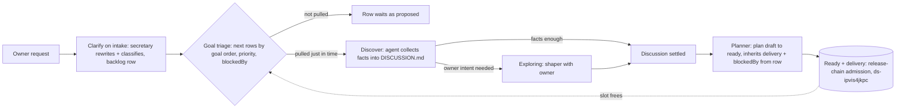

discussion: open

## Seed

Opened by the supervisor on the owner order of 2026-11-26 11:16, relayed by the shaper of ds-ipvis4jkpc (D10). Read the source backlog row and `plans/discussions/ds-ipvis4jkpc-release-chain-command/DISCUSSION.md` §3 rows 3 and 15, D5, D6, D10 first. Park owner questions in the question store instead of waiting on them.

- **Outcome:** a domain-agnostic workflow, extracted from Work, that takes a portfolio backlog row through clarify on intake, triage against the managed goals by goal priority, discover into the discussion, exploring only when discover is incomplete, and planning, to a `ready` plan carrying the `delivery` flag, timed just in time.
- **Interface (fixed by ds-ipvis4jkpc):** the pipeline produces a `ready` plan with the `delivery` flag (D5, D6); the release-chain admission consumes it.
- **Open:** whether the delivery commitment can sit on a backlog row before any plan exists; how "just in time" is timed; which Work stages (`docs/platform/work-state/spec.md` #12, #21, #26) are reused versus moved.

## 1. Trạng thái hiện tại

Round 1 (2026-11-26 11:40, shaper head `backlog-to-ready-pipeline`). Domain: supervision/work, which is fgOS platform work. There is no `domains/supervision/AGENTS.md`, so the supervision, work-state and workflow specs are the doctrine read. The pipeline itself must stay domain-free: a step that needs domain knowledge calls the domain's own skill, found through `domains/<domain>/AGENTS.md`.

What the scout found (§3 row 1 has the full map): every step the owner named already exists somewhere, but split across two worlds that do not meet. Work has discovery, exploring and planning stages, triage, `goalTier` and the `intent` score, but they act only on Work items in the Event Store, and they lean to coding. The portfolio (backlog rows, discussions and plans on the trunk) has the later half working by itself: a settled discussion starts a planner, and a `ready` plan with the `delivery` flag is admitted. Nothing moves a `proposed` row forward by itself, and that is the real gap. Today 356 rows are `proposed` and 308 of them are cited by no discussion or plan. So the pipeline cannot work through every row. It must pick the next rows, and that pick is where goal triage and "just in time" meet.

Leanings (proposed, not settled, no D-ID yet):
- **L1, where it lives:** a core workflow guide (domain-free) whose milestones are read from the portfolio files on the trunk (row, `DISCUSSION.md` marker, `plan.md` status), driven by the supervisor's rhythm, each step run by an existing head or skill. No new state store. §3 rows 2 and 8.
- **L2, delivery on the row:** the delivery commitment and the order (`blockedBy`) may sit on a backlog row before any plan exists, and the plan inherits them from its `source` row. Without this, "just in time" has nothing to time against, and the owner's own sequence already holds backlog-only steps. §3 row 3.
- **L3, just in time = pull with a small ready buffer:** keep at most N committed items in preparation or waiting `ready`, and pull the next one in order when a slot frees. A `ready` plan whose footprint moved on main before it is admitted gets checked again. §3 row 4.

Open owner question: **Q1 q-pvl344blv5** (what the "managed goals" are; §3 row 5). Everything else keeps shaping without it.

## 2. Mục tiêu & đề bài

A backlog row is where an owner request lands, and today it stays there until a person moves it: the secretary decides whether to open a shaper, a shaper settles a discussion, and only from there does the machinery run by itself (a planner on `discussion-settled`, a lead once a flagged plan is `ready`). Work items have a fuller automatic path (clarify on intake, discovery, exploring only when discovery is not enough, planning), but backlog rows never enter it, and it leans to coding. The owner wants that path taken out of Work as an independent workflow that works for any domain and serves backlog rows. It should rewrite a terse request so it is explicit and classify it, rank it against the goals the owner manages, collect the facts into a discussion, bring in the owner only when the facts are not enough, and plan. It should do this just in time: late enough that the codebase does not drift under the plan, and early enough that a `ready` plan is already waiting when its turn in the delivery queue comes. Its output is the input of the release chain (ds-ipvis4jkpc): a `ready` plan with the `delivery` flag.

## 3. Vấn đề rõ / chưa rõ

| # | Point | State | Evidence / note |
|---|-------|-------|-----------------|
| 1 | Map of the pipeline steps onto today's doors | Clear (scout) | **Clarify on intake:** Work clarifies at `submit`, before the item exists (work-state spec §5 "Discovery And Exploring Stages"). Portfolio: the secretary runs `fgos-clarifying` for a domain verdict only and does not rewrite the request (`.agents/skills/fgos-secretary/SKILL.md` step 1). **Triage:** Work has `fgos triage` (blocking fan-out, declared goals first), `goalTier` items with `fgos goal set/show` (focus is `null` today), and the `intent` score (Data Dictionary #26). Portfolio has only row `priority` (proposed rows: 70 P1, 199 P2, 87 P3) and the secretary ordering by the product priority by hand. **Discover:** Work stage `discovery`, verdict `clear` or `unclear` given by the caller (`domains/coding/workflows/feature.yaml`, skill `fgos-coding-discovering`). Portfolio has none; a shaper starts only on the secretary's judgement. **Exploring:** Work stage `exploring`; portfolio shaper with `fgos-shaping`. **Planning:** Work stage `planning` (split or pass-through verdict); portfolio planner started by the supervisor on `discussion-settled` (supervision spec §5). **Ready:** Work stage `executing`; portfolio plan `ready` + `delivery` flag (ds-ipvis4jkpc D5, D6). |
| 2 | Where the pipeline lives | Leaning L1 | The Workflow component already owns "guide" (definition) and "case" (one run), with milestones whose evidence is a declared subject, and files count as a subject (`docs/platform/workflow/spec.md` §2.2). D-ADR0076: Work is the surface and Workflow plus Execution are the engine, so the steps belong on the engine side and not in Work. But a case ledger is local (`.fgos/workflow-runs/<id>/`), while portfolio state must survive rotation and other machines on the trunk. Leaning: the guide declares the steps and milestones, and the milestones are read from the trunk files, so no second store holds progress. Open: whether a Workflow case is opened per row at all, or the guide is only read by the supervisor. |
| 3 | Delivery commitment before a plan exists | Leaning L2 | The release chain needs an order to measure "near its turn" against, and the owner's sequence (p-755psfxpmh) has three land-cost backlog items queued after step 2, which have no plan. So the `delivery` flag and `blockedBy` may sit on a backlog row; the schema already allows extra keys (`packages/portfolio/contracts/backlog-item.schema.v1.json`, `additionalProperties: true`). The plan made from the row inherits both through its `source`. This extends D5 of ds-ipvis4jkpc (flag in plan frontmatter) and does not reverse it. Open: what a flagged row with several plans means. |
| 4 | How "just in time" is timed | Leaning L3 | Pull, not push: keep at most N committed items in preparation or waiting `ready` (a buffer like a Kanban replenishment limit, default tied to `supervisor.maxLeads`), and pull the next in order when one is admitted. Drift guard: before admission, a `ready` plan whose footprint saw commits on main since it was set `ready` is checked again (relates to the drift check in ds-mzyircswox). Prior art: Lean "last responsible moment", Kanban WIP limit on the ready column, Scrum refinement about one or two sprints ahead. Open: which events start a pull (a lead slot frees, a predecessor is admitted, a plan reaches `done`), and the key name and default of N. |
| 5 | What the "managed goals" are | Open — Q1 q-pvl344blv5 | No portfolio goal store exists. Work has `goalTier` items and `fgos goal`, but only for Work items. The secretary "clarifies and orders goals" (supervision spec §1.1) and keeps no list. The when-to-ask discussion (ds-jxoz3h2qgk §6) defines a goal as an agreed outcome with agreed quality and still has "which goal tier counts" open. Triage cannot rank rows against goals that are written nowhere. |
| 6 | Discover versus exploring | Clear in direction | Discover: an agent alone collects facts into the discussion (§3 and the evidence), with no owner. When it ends with points that need owner intent or a real tie, the row goes to exploring: a shaper with the owner. This is the Work rule (`clear` skips exploring) moved onto the discussion. Open: whether a small, clear row may skip the discussion and go straight to a planner (short-form discussion, fgos-shaping "Short form"). |
| 7 | Which Work stages are reused and which are moved | Open | L10 says that moving the logic means moving every consumer and deleting the old path in the same change. Before choosing, find out whether Work items with stages `discovery`/`planning` are still used in the projects that run fgOS (mission #1, AGENTS.md "Ranh giới sứ mệnh"). Not scouted yet. |
| 8 | Who drives the pipeline | Leaning: the supervisor | The supervisor already starts planners and leads (supervision spec §5), and D7 of ds-ipvis4jkpc lets both hands write the order. Clarify on intake stays with the secretary, who already takes every owner request. Open: whether discover runs as a short `fgos run` unit or as a shaper head. |
| 9 | Component authority | Run, no owner row | `fgos authority locate "take a portfolio backlog row through clarify, goal triage, discovery and planning to a ready plan"` returns only weak matches (`portfolio/backlog-item.schema.v1` and others, score ≤ 3). Re-run once L1 holds; a `fgos authority declare` may be needed for the pipeline. |

## 4. Quyết định đã chốt

| D-ID | Decision | Date | Ground |
|------|----------|------|--------|

None yet. L1-L3 in §1 are leanings and become D-IDs only after they hold for another round.

## 5. Q&A log

- 2026-11-26 11:40 — Round 1 opened by shaper head `backlog-to-ready-pipeline`. Read p-xz3rns7o52, ds-ipvis4jkpc in full, work-state spec §5 and §9 (triage, ready), supervision spec §1-§5, workflow spec §1-§2, `domains/coding/workflows/feature.yaml`, the backlog-item schema, the secretary skill and the when-to-ask discussion §6. Counted 356 `proposed` rows, 308 cited by nothing. Wrote the map (§3 row 1) and leanings L1-L3. Parked Q1 q-pvl344blv5 (what the managed goals are; recommended: a small owner-ordered goal list in the portfolio that each row cites).

## 6. Thiết kế đã chốt {#design}

Not settled yet. Working sketch (round 1):

## 7. Danh mục hạng mục / task {#tasks}

Not filled until §3 rows 2-5 hold.
