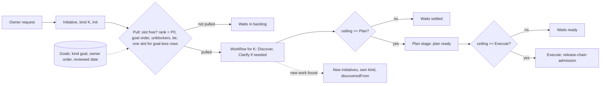

discussion: open

## Seed

Opened by the supervisor on the owner order of 2026-11-26 11:16, relayed by the shaper of ds-ipvis4jkpc (D10). Read the source backlog row and `plans/discussions/ds-ipvis4jkpc-release-chain-command/DISCUSSION.md` §3 rows 3 and 15, D5, D6, D10 first. Park owner questions in the question store instead of waiting on them.

- **Outcome:** a domain-agnostic workflow, extracted from Work, that takes a portfolio backlog row through clarify on intake, triage against the managed goals by goal priority, discover into the discussion, exploring only when discover is incomplete, and planning, to a `ready` plan carrying the `delivery` flag, timed just in time.
- **Interface (fixed by ds-ipvis4jkpc):** the pipeline produces a `ready` plan with the `delivery` flag (D5, D6); the release-chain admission consumes it.
- **Open:** whether the delivery commitment can sit on a backlog row before any plan exists; how "just in time" is timed; which Work stages (`docs/platform/work-state/spec.md` #12, #21, #26) are reused versus moved.

## 1. Trạng thái hiện tại

**Resumed 2026-11-27 09:47 by the owner, bottom-up: Status, then Step, then Stage.** Round 19 on Status: §3 row 24 (leaning L12). Round 20 (owner correction, deep scan): §3 row 25. **D9 settled 10:41: the three-layer status model.** Open: S1 what a status names (between-stages wait); S2 which layer the item stores and how the maps freeze at write; S3 whether Work's 11 become tech's layer-b set or stay the default for a domain without its own. Round 21: naming before S1, §3 row 26 (L13).

**Paused 2026-11-26 18:1x (owner tired).** Resume: `fgos session start shaper --name backlog-to-ready-pipeline`, then read this §1 and §4.
- **Settled:** D1-D8 (§4): exit is the lifecycle table, not a planner; chaining by `kind`, existing mapping reused; stages inside an initiative, `kind` only between initiatives; ranking without a score; goals as `kind: goal` initiatives; one pull slot for goal-less rows; the stored inclusive `ceiling`; learn from history before reorganising.
- **Settled in direction (§3 row 23):** three terms, Stage (per workflow, maps to a shared `phase`), Step (inside a stage), Status (maps to the fixed categories of decision 0027); fgOS manages no boards.
- **Next, in order:** (1) rename to the right level (today's lifecycle `steps` are stages); (2) choose lifecycle part or guide part (D-ADR0070) as the one source of routes, after learning why the guide was added (D8); (3) put Retrospective on the stage axis (no `retrospective` phase today); (4) pull triggers and N (§3 row 4); (5) output `kind` when one item gives rise to others (§3 row 11).
- **Pending outside:** ds-ipvis4jkpc must record that D7 replaces its D5/D6 `delivery` boolean (relayed to the supervisor as coordination-help); ds-ubqlutna6r A6(6) board definition superseded by row 23. The head's request socket was down from about 17:15; the owner landed rounds 14-18 by hand (00435bde1).

Rounds 15-18 (2026-11-26 17:33-18:0x; written late because the head's request socket was down from about 17:15). Owner asked for a plainer statement of status, stage and step, corrected that stages differ per domain/workflow and steps sit inside a stage, asked whether today's workflow is 180 degrees away, and dropped board columns. Result (§3 row 23): the shape already exists in `domains/coding/workflows/feature.yaml`; the shaper's YAML redesign is withdrawn; fgOS does not manage boards and only exposes stage (+phase) and status (+category) for outside boards to map. Three gaps remain for the lifecycle table: names one level off, the same path described twice in one file, Retrospective on the wrong axis. L9 (§3 row 21) and L10 (§3 row 22) are superseded by row 23 where they differ.

Round 14 (2026-11-26 17:11). Owner: (1) agrees Shape / Clarify; (2) on a board the "mốc" people name is a *status*, not a milestone, so how is the blur resolved? (3) recalls `retrospective` in the generic layer; asks to clarify what is still blurred together. Shaper answer in §3 row 22 (leaning L10): a board column is a status; a status is a named pair (stage, state); the milestone stays the engine's evidence that ends a stage and is not shown; Work's own 11 statuses are already such pairs flattened into one list, which is the blur; `retrospective` is indeed in the generic layer, as one of four tail statuses fixed for every domain and outside the six categories, while ds-ubqlutna6r makes Retrospective a stage: the same word on two axes.

Round 13 (2026-11-26 16:49). Owner's view (§5): Clarify stays at intake, a closed-world "make it clear" by the receiving agent; the status/stage blur is between the board (people name a milestone, a current state) and the running engine (people name a process, with different routes between milestones); and status has two layers (one generic set for any item, plus domain / work type / workflow statuses for display). Shaper proposal L9 in §3 row 21: milestone, stage and step as three named layers; status as fixed categories plus mapped specific statuses (decision 0027 prior art, kept per D8); the talk-with-a-person stage renamed so *Clarify* keeps one meaning.

Round 12 (2026-11-26 16:5x). Three read-only agents traced the history of status and stage (D8); synthesis in §3 row 20. Waiting for the owner's own view before proposing the rule.

Round 11 (2026-11-26 16:09). Owner: "ok chốt" → D7: the commitment is a `ceiling` stored on the initiative, read inclusively ("finish X, then stop"), checked before entering the next stage, passed as the run's ceiling at pull; the driver moves to the same meaning when it leaves Work; `nextStage` is not stored (the next step is derived for display). ds-ipvis4jkpc notified through a coordination hand-off (its D5/D6 boolean `delivery` is replaced). Still open: status/stage rule (§3 row 13), pull triggers and N (row 4), output `kind` on spawning (row 11).

Round 10 (2026-11-26 16:0x). Owner: re-evaluate why the earlier view (exclusive ceiling, ceiling as a call argument) was chosen. History in §3 row 19: it came from tsk-19j (2026-07/08), which started from the owner's own "move-next" idea, rejected it and a ceiling-on-the-item, for reasons that fit that time's problem (one caller-scoped run handing over between per-stage pools) and do not hold for the owner's stored commitment today.

Round 9 (2026-11-26 15:5x). Owner recalled a `maxStage` in Work's driver. Scan: no `maxStage` exists in the code or in git history; the concept is the **ceiling** of `fgos-coding-driving` (`domains/coding/skills/fgos-coding-driving/SKILL.md` "Input", "Advance-axis", Step 3; `references/caller-contract.md`). It is prior art for L6 and changes two points of it (§3 row 18): the ceiling is checked *before* a stage runs (exclusive: `stage:planning` stops with the item at planning, not planned), and it is a per-drive call argument, not stored intent.

Round 8 (2026-11-26 15:41). Owner chose **B with C** for goal-less rows and raised no objection to the council's six changes. Settled: D1-D6 (§4). q-pvl344blv5 cancelled as answered (goals are a portfolio initiative of kind `goal`, D5). §6 regenerated. Still open: the commitment field as a stage ceiling, its name and the ds-ipvis4jkpc notice (§3 row 14); the status/stage rule (row 13); pull triggers and buffer size N (row 4); output `kind` when one item gives rise to others (row 11, last). Exit stays the lifecycle table (D1), not a planner.

Round 7 (2026-11-26 15:2x). Owner does not yet feel the ranking and goal management are settled, and asked what mvp/milestone and P0–P3 mean; then ordered a council to challenge the ranking and goal management. Scan of Work's ranking in §3 row 15; shaper proposal L7 in §3 row 16 (no score; an ordered key chain; goal = initiative of `kind: goal`; drop mvp/milestone tiers; P0 = expedite, P1–P3 out of ranking). Council done (§3 row 17): all three seats back L7's core (no score, owner-set goal order, goal as an initiative, mvp/milestone tiers dropped) with changes; one real split remains on goal-less rows.

**Exit of this discussion (owner 2026-11-26 14:41 and 14:4x): it is NOT handed to a planner.** When it settles, it goes onto one table with every open backlog row and discussion about the work lifecycle (backlog, triage, ready-to-plan, planning, workflow, stage/status), reviewed by a council if needed, then re-split into new items and plans, because the owner sees much overlap and wants a better order (§7 `#task-lifecycle-table`).

Round 6 (2026-11-26 14:41). Owner: should the commitment be a field like `nextStage` instead of a `delivery` flag? And scan code and docs to make status versus stage clear again, since they have been confused many times. Scan result in §3 row 13; shaper analysis of `nextStage` in §3 row 14 (leaning L6: one stage-valued field read as a ceiling, "may go up to stage X", replacing the boolean; the name must not read as an observed fact).

Round 5 (2026-11-26 14:40). Owner asked to scan the code for an existing kind/stage-to-workflow mapping. Found (§3 row 12): the mapping exists and is generic, but only in the Work layer and unused in practice. `resolveWorkflow(domain, kind)` in `src/state/domain-registry.mjs:207` returns `workflowFor[kind]` or `defaultWorkflow`; each workflow step carries `phase` (clarify/discover/plan/execute), `skill` and `operations`, and `stepForPhase` finds a step by phase. Coding declares the kinds (bug, chore, design, docs, feature, task) but `workflowFor: {}`, so every kind gets `feature`, and `domains/coding/workflows/bugfix.yaml` is reached by no kind. The Workflow component has nested cases (`case-frame.mjs`, RUL-WF-28) and `--inherit` (RUL-WF-31: a new case takes over milestones of a closed case, same guide only). The portfolio has no mapping: the supervisor hard-codes "settled discussion → planner" and "ready plan → lead" (`core/skills/fgos-supervisor/SKILL.md`, `packages/supervision/rust/src/wake.rs:243`). No workflow declares an output kind, so no cross-workflow chaining exists.

Round 4 (2026-11-26 13:51). Owner: the question "is the output a new initiative or an artifact" needs open discussion or a council, and asked where the shaper's own critique was. Shaper critique (§3 row 11): neither option should apply everywhere. Inside one initiative, ds-ubqlutna6r A5(d) already makes backlog-to-ready the stage list of a single workflow (Init → Discover → Clarify → Plan → Execute), so turning each stage hop into a new initiative would state the same sequence twice and triple the card count. Chaining by `kind` is needed only where the subject changes: one item gives rise to several (discovery finds three pieces of work), or work crosses a domain (a council decision feeds coding). There the output is naturally a new initiative with its own `kind` and `discoveredFrom` (already in A8). Held open; a council is offered, not started.

Round 3 (2026-11-26 14:0x). Owner: do not make the pipeline complicated; organise things so that the output of one workflow becomes the input of another, which is why the owner kept the field `kind` on an initiative (ds-ubqlutna6r, 2026-11-25 21:3x: the workflow is derived from `kind`, `workflowFor[kind]` else `defaultWorkflow`, pinned on leaving Init; settled as A8, built by plan `261125-2137-domain-agnostic-item-component`, draft). Leaning **L5** replaces L1-L4 as the frame (§3 row 11): there is no pipeline engine and no pipeline-specific state. Each workflow takes an input of a known kind and gives an output that carries a `kind`; `workflowFor[kind]` names the workflow that consumes it. "Backlog to ready" is only the chain this yields. The commitment rule (L2-L4) shrinks to one rule at every link: an output starts its consumer only when it is committed for delivery and a slot is free; this one rule covers both a settled discussion waiting for a planner and a `ready` plan waiting for a lead. Waiting on the owner's confirmation of L5 in chat.

Round 2 (2026-11-26 13:44). Owner: hold the hand-off to a planner (13:36), and a settled discussion that the owner does not yet want planned needs the same queue/delivery mechanism as a plan (13:44). Today the supervisor starts a planner on every `discussion-settled` event, with no check of intent (`core/skills/fgos-supervisor/SKILL.md` "Settled discussion"). This falls inside this topic, because the planner step is a pipeline step. Leaning **L4** (§3 row 10): `settled` means quality only, like `ready` for a plan; a planner starts only when the discussion is committed for delivery and its pull slot (L3) is free. One `delivery` key with one meaning on row, discussion and plan, inherited down the `source` chain; it may also sit on a discussion directly, because 42 of 88 discussions cite no backlog row. This discussion stays `open`; nothing is handed to a planner.

Round 1 (2026-11-26 11:40, shaper head `backlog-to-ready-pipeline`). Domain: supervision/work, which is fgOS platform work. There is no `domains/supervision/AGENTS.md`, so the supervision, work-state and workflow specs are the doctrine read. The pipeline itself must stay domain-free: a step that needs domain knowledge calls the domain's own skill, found through `domains/<domain>/AGENTS.md`.

What the scout found (§3 row 1 has the full map): every step the owner named already exists somewhere, but split across two worlds that do not meet. Work has discovery, exploring and planning stages, triage, `goalTier` and the `intent` score, but they act only on Work items in the Event Store, and they lean to coding. The portfolio (backlog rows, discussions and plans on the trunk) has the later half working by itself: a settled discussion starts a planner, and a `ready` plan with the `delivery` flag is admitted. Nothing moves a `proposed` row forward by itself, and that is the real gap. Today 356 rows are `proposed` and 308 of them are cited by no discussion or plan. So the pipeline cannot work through every row. It must pick the next rows, and that pick is where goal triage and "just in time" meet.

Leanings (proposed, not settled, no D-ID yet):
- **L1, where it lives:** a core workflow guide (domain-free) whose milestones are read from the portfolio files on the trunk (row, `DISCUSSION.md` marker, `plan.md` status), driven by the supervisor's rhythm, each step run by an existing head or skill. No new state store. §3 rows 2 and 8.
- **L2, delivery on the row:** the delivery commitment and the order (`blockedBy`) may sit on a backlog row before any plan exists, and the plan inherits them from its `source` row. Without this, "just in time" has nothing to time against, and the owner's own sequence already holds backlog-only steps. §3 row 3.
- **L3, just in time = pull with a small ready buffer:** keep at most N committed items in preparation or waiting `ready`, and pull the next one in order when a slot frees. A `ready` plan whose footprint moved on main before it is admitted gets checked again. §3 row 4.

Open owner question: **Q1 q-pvl344blv5** (what the "managed goals" are; §3 row 5). Everything else keeps shaping without it.

## 2. Mục tiêu & đề bài

A backlog row is where an owner request lands, and today it stays there until a person moves it: the secretary decides whether to open a shaper, a shaper settles a discussion, and only from there does the machinery run by itself (a planner on `discussion-settled`, a lead once a flagged plan is `ready`). Work items have a fuller automatic path (clarify on intake, discovery, exploring only when discovery is not enough, planning), but backlog rows never enter it, and it leans to coding. The owner wants that path taken out of Work as an independent workflow that works for any domain and serves backlog rows. It should rewrite a terse request so it is explicit and classify it, rank it against the goals the owner manages, collect the facts into a discussion, bring in the owner only when the facts are not enough, and plan. It should do this just in time: late enough that the codebase does not drift under the plan, and early enough that a `ready` plan is already waiting when its turn in the delivery queue comes. Its output is the input of the release chain (ds-ipvis4jkpc): a `ready` plan with the `delivery` flag.

## 3. Vấn đề rõ / chưa rõ

| # | Point | State | Evidence / note |
|---|-------|-------|-----------------|
| 1 | Map of the pipeline steps onto today's doors | Clear (scout) | **Clarify on intake:** Work clarifies at `submit`, before the item exists (work-state spec §5 "Discovery And Exploring Stages"). Portfolio: the secretary runs `fgos-clarifying` for a domain verdict only and does not rewrite the request (`.agents/skills/fgos-secretary/SKILL.md` step 1). **Triage:** Work has `fgos triage` (blocking fan-out, declared goals first), `goalTier` items with `fgos goal set/show` (focus is `null` today), and the `intent` score (Data Dictionary #26). Portfolio has only row `priority` (proposed rows: 70 P1, 199 P2, 87 P3) and the secretary ordering by the product priority by hand. **Discover:** Work stage `discovery`, verdict `clear` or `unclear` given by the caller (`domains/coding/workflows/feature.yaml`, skill `fgos-coding-discovering`). Portfolio has none; a shaper starts only on the secretary's judgement. **Exploring:** Work stage `exploring`; portfolio shaper with `fgos-shaping`. **Planning:** Work stage `planning` (split or pass-through verdict); portfolio planner started by the supervisor on `discussion-settled` (supervision spec §5). **Ready:** Work stage `executing`; portfolio plan `ready` + `delivery` flag (ds-ipvis4jkpc D5, D6). |
| 2 | Where the pipeline lives | Leaning L1 | The Workflow component already owns "guide" (definition) and "case" (one run), with milestones whose evidence is a declared subject, and files count as a subject (`docs/platform/workflow/spec.md` §2.2). D-ADR0076: Work is the surface and Workflow plus Execution are the engine, so the steps belong on the engine side and not in Work. But a case ledger is local (`.fgos/workflow-runs/<id>/`), while portfolio state must survive rotation and other machines on the trunk. Leaning: the guide declares the steps and milestones, and the milestones are read from the trunk files, so no second store holds progress. Open: whether a Workflow case is opened per row at all, or the guide is only read by the supervisor. |
| 3 | Delivery commitment before a plan exists | Leaning L2 | The release chain needs an order to measure "near its turn" against, and the owner's sequence (p-755psfxpmh) has three land-cost backlog items queued after step 2, which have no plan. So the `delivery` flag and `blockedBy` may sit on a backlog row; the schema already allows extra keys (`packages/portfolio/contracts/backlog-item.schema.v1.json`, `additionalProperties: true`). The plan made from the row inherits both through its `source`. This extends D5 of ds-ipvis4jkpc (flag in plan frontmatter) and does not reverse it. Open: what a flagged row with several plans means. |
| 4 | How "just in time" is timed | Leaning L3 | Pull, not push: keep at most N committed items in preparation or waiting `ready` (a buffer like a Kanban replenishment limit, default tied to `supervisor.maxLeads`), and pull the next in order when one is admitted. Drift guard: before admission, a `ready` plan whose footprint saw commits on main since it was set `ready` is checked again (relates to the drift check in ds-mzyircswox). Prior art: Lean "last responsible moment", Kanban WIP limit on the ready column, Scrum refinement about one or two sprints ahead. Open: which events start a pull (a lead slot frees, a predecessor is admitted, a plan reaches `done`), and the key name and default of N. |
| 5 | What the "managed goals" are | Settled — D5 (q-pvl344blv5 cancelled as answered) | No portfolio goal store exists. Work has `goalTier` items and `fgos goal`, but only for Work items. The secretary "clarifies and orders goals" (supervision spec §1.1) and keeps no list. The when-to-ask discussion (ds-jxoz3h2qgk §6) defines a goal as an agreed outcome with agreed quality and still has "which goal tier counts" open. Triage cannot rank rows against goals that are written nowhere. |
| 6 | Discover versus exploring | Clear in direction | Discover: an agent alone collects facts into the discussion (§3 and the evidence), with no owner. When it ends with points that need owner intent or a real tie, the row goes to exploring: a shaper with the owner. This is the Work rule (`clear` skips exploring) moved onto the discussion. Open: whether a small, clear row may skip the discussion and go straight to a planner (short-form discussion, fgos-shaping "Short form"). |
| 7 | Which Work stages are reused and which are moved | Open | L10 says that moving the logic means moving every consumer and deleting the old path in the same change. Before choosing, find out whether Work items with stages `discovery`/`planning` are still used in the projects that run fgOS (mission #1, AGENTS.md "Ranh giới sứ mệnh"). Not scouted yet. |
| 8 | Who drives the pipeline | Leaning: the supervisor | The supervisor already starts planners and leads (supervision spec §5), and D7 of ds-ipvis4jkpc lets both hands write the order. Clarify on intake stays with the secretary, who already takes every owner request. Open: whether discover runs as a short `fgos run` unit or as a shaper head. |
| 10 | A settled discussion the owner does not want planned yet | Settled — D7 | Today `discussion-settled` starts the one planner unconditionally (`core/skills/fgos-supervisor/SKILL.md` "Settled discussion"; supervision spec §5). Same split as ds-ipvis4jkpc D5/D6: `settled` = the discussion is complete (quality); `delivery` = the owner wants it delivered (commitment). Leaning: the supervisor starts a planner only when the discussion's effective `delivery` is set (its own flag, or a flag on a `source` row) and a pull slot is free (L3); otherwise it waits settled. One key, one meaning on all three levels, inherited downward, so no second mechanism (L10). 42 of 88 discussions have `source: []`, so a flag on the row alone cannot cover them. Open: what happens to the 41 already-settled discussions at rollout (those with a plan are unaffected; the rest wait unflagged unless the owner flags them); whether `discussion: settled` plus the flag is written by the shaper, the secretary or both. |
| 11 | Chaining: one workflow's output is another workflow's input | Leaning L5 (owner 14:0x) | Prior art, settled: ds-ubqlutna6r A5 (core stages Init → Discover → Clarify (skippable) → Plan → Execute → Retrospective; stages come from the item's workflow), A8 (`kind` from the domain's list selects the workflow, pinned on leaving Init), A4 (Workflow runs a case, takes an opaque caller reference, knows no portfolio; Supervision coordinates). Plan `261125-2137` (draft) builds `kind`, the pin and the derived stage. Missing: a workflow saying what kind its output has, so the next workflow is found from it the same way; and the commitment gate at that hand-off. L5 adds only these two. Rows 2, 3, 4, 8 and 10 become details of L5; row 1 stays as the map of today. Open: whether the link is the output item's own `kind` (a workflow may emit a new initiative) or the artifact type (discussion, plan). **Shaper critique (round 4):** (a) *New initiative per hop* states the same order twice: A5(d) already holds it as the stage list of one workflow, so a chain of per-stage workflows would duplicate it (design principle 1), turn 356 proposed rows into about three cards each, and need status roll-up along every chain. (b) *Artifact type as the link* mixes two vocabularies: `kind` comes from the domain's list (feature, bugfix, campaign), while discussion and plan are artifact types common to every domain; the next step after a settled discussion is already fixed by the stage list, so `kind` adds nothing there. (c) *Lean:* stages inside an initiative, chaining between initiatives. A workflow's output, where the subject changes, is zero or more new initiatives, each with its own `kind` (which picks its workflow) and `discoveredFrom` pointing back. The commitment gate then sits at two places that already exist: before Plan and before Execute, as stages of one initiative, not as links between workflows. (d) *Risk to this topic:* with (c), most of the work is already plan `261125-2137` (draft); what remains is small (output initiatives, the gate at two stages, just-in-time pull), and may be better as an addition ordered after that plan than as a separate design. |
| 12 | Existing kind/stage → workflow mapping in code | Clear (scout, round 5) | **Work layer, generic, unused:** `src/state/domain-registry.mjs` `resolveWorkflow` (l.207), `domainSteps`, `stepForPhase`, `effectiveStep`, `isLegalStepMove`; read by `src/runner/work-dispatch.mjs:516` (`item.workflow ?? workflowFor[kind] ?? defaultWorkflow`), `work-compat.mjs`, `replay.mjs`. Data: `domains/<d>/registry.yaml` (`classification.kind`, `workflowFor`, `defaultWorkflow`) and `domains/<d>/workflows/*.yaml` (steps with `phase`, `skill`, `operations`; `transitions`; `aliases`; `statusSkills`), compiled to `domains/<d>/compiled.json`. Coding: six kinds, `workflowFor: {}`, `bugfix.yaml` unreached. Only `coding` compiles; `marketing` and `council` have workflows but no registry. **Workflow component:** nested cases with a parent frame (`src/workflow/case-frame.mjs`, RUL-WF-28); `fgos workflow start --inherit <closed case>` (RUL-WF-31, `case-inherit.mjs`), same guide, request and base commit only. **Portfolio/supervision:** no mapping; the two hand-offs are hard-coded. **Missing everywhere:** a workflow stating the kind of its output. **Consequence:** the item→workflow half of L5 needs no new mechanism, only reuse: plan `261125-2137` should take `resolveWorkflow` and its data over into the portfolio component (move, not copy: L10), and the supervisor's two hard-coded hand-offs should become steps read from the item's workflow. The commitment gate and output kind are the only new parts. |
| 13 | Status versus stage (scan, round 6) | Clear (map) | **Status** = where an object stands inside its own life; each object type has its own list: backlog item `proposed, parked, in-flight, done, dropped`; discussion `open, paused, settled`; plan `draft, ready, running, done, withdrawn` (`packages/portfolio/contracts/portfolio-vocabulary.v1.json`); Work item 11 statuses with a fixed table no domain may change (`src/state/status-fsm.mjs`). **Stage** = which kind of work the item needs now, from its workflow's list: in Work it was renamed `workflowStep` (work-state spec §5 "Workflow Step Replaces Stage"; the write door refuses `stage`); for the initiative it is back as *stage*, **derived** by the portfolio door from the pinned workflow and never written by hand (ds-ubqlutna6r A4, A5(d), A8: Init → Discover → Clarify (skippable) → Plan → Execute → Retrospective). **Where the confusion comes from:** (1) *phase* has two meanings: a workflow step's role `clarify/discover/plan/execute` (`src/workflow/definition.mjs:23`) and a plan's `phase-NN`; (2) the initiative's stage is spread over the statuses of other objects (discussion `settled` and plan `ready` are really stage facts of the initiative); (3) a discussion carries its state twice, frontmatter `status:` and the `discussion:` marker line; (4) backlog `in-flight` is partly derived from citing files (I8: status is decided in up to five places); (5) the free-text `stage` field of an owner question (`questions-input.v1.json`) is neither. **Rule proposed for the table:** status belongs to one object and its own list; stage belongs only to the initiative, is derived, and is never stored by hand. |
| 14 | `nextStage` instead of a `delivery` flag | Settled — D7 | **Gain:** one field covers both gates (before Plan, before Execute), so the owner's case resolves directly (a settled discussion whose initiative does not allow Plan gets no planner); it can say "plan it, but do not execute yet", which a boolean cannot; the values come from the item's own workflow list, so it stays domain-free; with stage derived (row 13) the owner's intent and the observed stage are two separate fields and never overwrite each other. **Harm / critique:** (a) the word *next* reads as an observed fact ("what comes next"), which is exactly the status/stage confusion; the field is a permission. (b) With "next" meaning, does it reset once the stage is entered? A **ceiling** ("may go up to stage X") needs no reset: `plan` stops at a ready plan, `execute` delivers; `delivery: true` equals ceiling `execute`, absent equals stop after Clarify. (c) The value must be checked against the item's pinned workflow. (d) It supersedes D5/D6 of ds-ipvis4jkpc (still `open`), which settled a boolean on the plan; that discussion must be told. **Lean:** one stage-valued ceiling on the initiative, read by the pull rule (L3) for *when*; the name is still open (candidates: `allowedThrough`, `commitUpTo`, `targetStage`; `nextStage` only if defined as a ceiling). |
| 15 | What Work's ranking does today (scan, round 7) | Clear (map) | Six overlapping signals. (1) Intake risk by keyword: `light/standard/heavy` (`src/intake/risk-keywords.mjs`). (2) `fgos triage`: `goalTier` (mvp, milestone, none), then `blocks` (open items that list it in `deps`), then component size, then id (`src/state/impact.mjs`). (3) `priority`: integer, ASC, primary key of `fgos ready`. (4) `intent`: **retired in place** by work-item-priority-matrix D7; discovery now **computes `priority`** with `src/state/priority-formula.mjs`: priority = invert(impact × weight(urgent) ÷ max(effort, 1) × discount(risk)) × 10000, impact = blocks + an LLM `impactScore`, urgent weights 0.5/1/2/4, risk discounts 1/0.85/0.6, effort from the planning mode 1-8; planning recomputes (`src/intake/discovery.mjs:375`). (5) `urgent` low/medium/high/critical, human. (6) `fgos graph`: critical path, top-k-unblock, what-if, stale. **Defects:** spec Data Dictionary #26 still describes `intent` and #25 says `priority` is never inferred, while code computes it; the formula overwrites a human `priority`; "how many it unblocks" is counted in `impact`, `triage` and `graph`; risk (danger) is folded into importance. **`goalTier`** (`src/state/work.mjs:177`, str67-goal-directed-planning D1): marks an item AS a goal (`mvp` or `milestone`), set only at `add`, never edited; a goal is an ordinary Work item; `fgos goal set/show` focus (empty today); `fgos rollup` counts a goal's targets. **Portfolio `priority` P0–P3:** required enum on every row, defined nowhere, used only to sort the generated index; proposed rows 0 P0, 70 P1, 199 P2, 87 P3. |
| 16 | Ranking and goal management (owner: not yet settled; council ordered) | Settled — D4, D5 (council row 17) | **(a) No score.** An ordered key chain, each key one sentence: 1. P0 = expedite (incident or blocker of running work); 2. goal order set by the owner; 3. inside a goal, items that unblock others first (`blockedBy`); 4. tie: earliest `created`. No `intent`, `urgent`, formula. Critique: loses cross-goal value comparison, but that judgement is the owner's and is made once, in the goal order. **(b) Goal = initiative with `kind: goal`** (keeps goalTier's "not a new entity", on the portfolio, through the `kind` → workflow mechanism); measurable Done-when (OKR key result); a row cites at most one goal; rows with no goal rank after goal rows (except P0); at most N active goals (e.g. 3). **(c) Drop mvp/milestone:** two fixed tiers mix importance with horizon, give no order inside a tier, and cannot be edited after creation; the owner's goal order says what comes first; an optional Now/Next/Later label may show horizon but never ranks. **(d) P1–P3 leave the ranking** (display only; drop decided at the lifecycle table). Prior art weighed: WSJF (SAFe), Kanban classes of service, OKR, Shape Up betting table, Now/Next/Later roadmaps. Overlaps ds-jxoz3h2qgk (goal definition, goal tiers). |
| 17 | Council on ranking and goals (2026-11-26 15:3x; seats: assumptions, feedback loops, ship/maintain) | Settled — D4, D5, D6 (owner chose B with C, 15:41) | **Agreed by all three:** drop the formula (`priority-formula.mjs` overwrites a human `priority` from an agent's own `impactScore`, a gaming loop; "unblocks" counted three times) and the mvp/milestone tiers (rank the goal item, not work toward it; set once, never edited; `fgos goal` empty); retiring them is a net deletion (~300 lines, L10) with nothing in use lost. **Measured gaps in L7:** key 3 has no data (only 2 of 569 backlog files carry `blockedBy`; the schema has no such field); key 4 is meaningless (131 proposed rows share `created: 2026-11-21`, the migration date). **Changes proposed:** (1) `blockedBy` on rows is derived from evidence (citations, plan dependencies) or recorded by agents at intake through the portfolio door; until then key 3 is not claimed; (2) goal tag proposed by an agent at shaping, only for a row about to be pulled, confirmed by the owner in the batched question round; never hand-tag 356 rows; a tag must say how the row moves that goal's Done-when (guards goal-bucket inflation); (3) P0 = expedite, defined in one line in the schema, at most one at a time, must cite the incident or running work it blocks; P1-P3 optional, out of ranking; (4) goal order carries a `reviewed` date; when active goals fall below N, drain, or the order expires, one batched owner question, never a silent fallback; (5) ranking is computed at pull time, never stored; (6) "current milestone" (owner, 11:38, ds-jxoz3h2qgk §5) = the active goal set (at most N, Now), not a tier. **Split — goal-less rows (308 of 356 proposed):** (A) not pulled at all except P0; they wait until a goal adopts them (assumptions seat); (B) one of the N pull slots reserved for goal-less rows by age (feedback-loops seat: otherwise hygiene starves and agents stuff rows into goals); (C) tag on demand at shaping, so the question mostly disappears (ship seat; compatible with A or B). **What would change the seats' minds:** the owner not keeping a goal order current for weeks; goal-less rows proven mostly obsolete (then starvation is useful pruning, favours A). |
| 18 | Prior art for the ceiling: `fgos-coding-driving` (scan, round 9) | Clear (map) | No `maxStage` anywhere (code, `git log --all -S'maxStage'` empty); Work's runner loop (`src/runner/loop.mjs`, `bin/fgos-runner.mjs`) has no such option. The concept is the driver skill's **ceiling**: (1) a call argument `stage:<name>` or `status:<name>`, prefix explicit, never inferred; (2) `stage:` compares by index in the domain's stage order (stop once current index >= ceiling index); `status:` compares by exact match only, because status is not a line (`blocked`, `awaiting-human`, `wontfix` are branches); (3) checked **before** invoking the stage's skill, so `stage:planning` stops with the item freshly *at* planning, planning not run; (4) person/system stops win over any ceiling: `awaiting-human` and `blocked` stop at once (through `parkReasonForStatus`, never a literal compare), open children anchor, no progress stops; (5) default ceiling = `awaiting-approval` (natural finish), overridable only by an explicit `status:*`; the merge stays human by launcher convention (no launcher ships a default past it); (6) the driver never moves state, the stage skill calls its engine verb; (7) callers: `/fgOS:deliver`, `/fgOS:pick` no ceiling; discovery sweep `stage:planning`; planning sweep `stage:executing`; (8) "position" = stage while the item is live, status once the stage is frozen (from `awaiting-approval`). **Bearing on row 14 (L6):** reuse (1)-(5) as the semantics; align the meaning to exclusive (a ceiling names the first stage *not* entered; "plan it but do not execute" = ceiling `Execute`), or state clearly that ours is inclusive; ours must be stored on the initiative (owner intent must survive rotation and machines), while the driver's is per call; the pull reads the stored value as the drive's ceiling, so one concept, two places (stored intent, call argument), no second mechanism. Item (8) shows one root of the status/stage confusion (row 13): one axis was stitched from two fields. |
| 19 | Why the driver's ceiling is exclusive and a call argument (history, round 10) | Clear (history) | Source: `docs/history/gate-approve-vs-movenext-semantics/CONTEXT.md` (tsk-19j, D1-D14) and `plans/reports/research-gate-semantics-260731-1052-approve-vs-movenext-report.md`; first commit `95651a607` (2026-08-02). **The problem then:** approving a step's result was fused with moving on (`fgos discover` judged and moved in one call). tsk-19j split three axes: A approve record (`gates[id].*Approve`, D1/D11), B trust-signal engine work, D one shared driver. **Path to the ceiling:** D4 a separate "move-next" verb/skill (the owner's idea then, the same as `nextStage` now) → superseded; D5 ceiling as an env var → superseded; D8 a `--stop-at` for `/fgOS:cook` → superseded; "ceiling as a field on the item" → rejected; D9 one driver taking `id` + `ceiling` for all five loops; D13 explicit `stage:`/`status:` prefix. **Why exclusive:** the loops were per-stage pools (discover-loop, planning-loop, execution-loop, each pulling its own frontier); the ceiling marked where one pool hands the item to the next, and the only observable fact was the item's position ("arrived at stage X"), because finishing X is not recorded apart from the engine verb that moves it to X+1. Checking before invoking was the verified boundary that stops a discover-loop with the item freshly at `decompose`, before the planning skill runs. **Why a call argument, not on the item:** the ceiling scoped one run of one caller (which pool's job ends where), not the item's permission; a stored field would have leaked one caller's scope into every other caller. **Evaluation for today:** both reasons are about a run's scope. Today's need is the owner's commitment for the item, which must survive rotation and machines and is read by every caller, so it belongs on the initiative, and it is a different question from a run scope. The run-scope ceiling may stay as the call argument the pull passes, set from the stored commitment. Exclusive versus inclusive is the same check (refuse entering stage S when S is past the limit); the history gives no reason against inclusive wording for the stored commitment, but two wordings in one system would be a trap, so whichever is chosen applies to both, moved together when the driver leaves Work. Also confirmed: separating approve (quality) from continue (commitment) is the same split as `settled`/`ready` versus the commitment here; the system already learned it once. |
| 20 | History of status and stage (three agents, round 12) | Clear (history) | **(a) `stage` → `workflowStep` in Work:** runner decision 0049 (`docs/platform/runner/decisions/h-36d872fbb0e5.md`, 2026-10-02; commit `07bd0c594`). Three places decided the order of work (stage machine, `loop.mjs`, skill text) and dispatch read the item's stage directly; the fix moved steps, phases, skills, operations, legal moves and aliases into the domain's Workflow file and left only an id on the item; the new name says the workflow owns the list. D-ADR0070 later replaced 0049 §4, kept §1-3. **(b) `clarify` removed as a coding stage:** tsk-qod D1/D2 (commit `444e0776c`), discussion ds-jy5wi6oh3s D5: clarifying intent is a rewrite of the submitted text plus a domain choice, done before the item exists, so it belongs to Init; the 90 parked items were migrated, no alias ("resolve it definitively via migration"). **(c) Initiative `stage` (ds-ubqlutna6r I21, I16, I28, I30, I45, A4, A8):** the same macro-axis idea made domain-free and derived by the portfolio door ("no one writes the initiative's stage by hand"); the 0049 rename was cited as prior art but never debated, so `stage` now means one thing in the portfolio and is retired in Work, with no glossary note. Backlog status is replaced (A8 frontmatter has no `status`; folder + stage carry it; `in-flight` was never written, 0 rows); discussion and plan statuses stay as artifact states feeding the stage as progress facts (I45: "plan ready → Execute"). **(d) Two axes in Work** (`docs/knowledge/why-the-work-item-lifecycle-keeps-status-and-stage-separate/`): status = where the current attempt is; step = which kind of work is needed; a "needs clarification" status was rejected because a new question gets a new field, not a new value in an old list (same as `tier`, `mode`; later `holder` as a third axis). Conflict found: D-ADR0027 lets a domain own labels and edges of the six statuses before `delivered`, while spec row #21 still says no domain changes the FSM. **(e) `backlog` status** (tsk-5wr, `docs/history/work-item-backlog-status/CONTEXT.md`): separates an undecided idea from `todo`; D1 only a person moves `backlog → todo` (a real commitment; enforced by the CLI stamping `role: human`, not an ACL); D3 own status category so the ready list skips it with no extra code; D4 the gate must be visible or nobody promotes; commit `21d14ef9f`: backlog items may still be discovered and explored, only planning requires `todo`. So `backlog` was a fixed ceiling at clarification, on the status axis, one human exit. **Bearing:** D7's "absent ceiling = stop after Clarify" reproduces `backlog` exactly, and setting a ceiling is the owner's promotion; D7 generalises the gate (per item, any stage) instead of repeating it, so the two must not coexist without one winner. **New confusion found:** *Clarify* now has three meanings: the Init helper `fgos-clarifying` (rewrite + domain), the workflow phase `clarify` (`src/workflow/definition.mjs:23`), and the initiative stage Clarify (talk with a person, today's `exploring`). **Lessons to keep:** a new question gets a new field; migrate instead of alias when nothing is stuck; removing a name breaks hidden literal checks (tsk-qod iron-law evidence); draw stage lines by who writes the content (person or machine); gates live in state, are visible, and human-only edges are stamped by the verb; avoid near-identical names. |
| 21 | Vocabulary: milestone, stage, step; status in two layers | Leaning L9 (owner view 16:49; shaper proposal) | **Clarify** (owner): at intake, the receiving agent restates the request clearly from what it already has, no scan or search; this is tsk-qod D5 (Init, `fgos-clarifying`). So the initiative stage that means "talk it through with a person" (ds-ubqlutna6r A5(d) "Clarify (skippable)", today's `exploring`) needs another name; candidate **Shape** (it is what the shaper does). D7's examples then read "Shape = discuss but do not plan; absent ceiling = stop after Shape". **Three layers:** (1) **Milestone** = a checkable fact with evidence about the item (clarified, discussion settled, plan ready, delivered, learning written back); board columns are milestones; the Workflow spec already defines it ("'Đã nhận yêu cầu' là một milestone; không có 'bước 1'", `docs/platform/workflow/spec.md` §2.2; CMMN milestone). (2) **Stage** = the stretch between two milestones, the kind of work going on now; few, same shape for every domain (Init, Discover, Shape, Plan, Execute, Retrospective); derived from the last milestone reached, never written by hand (A4, A8). (3) **Step** (route, activity) = the engine's unit of work inside a stage; domain- and workflow-specific; several routes may join the same two milestones (Discover then straight to Plan, or through Shape); not a board column. Root of the old blur: Work's `workflowStep` for coding held stage-sized values (discovery, exploring, planning, executing), so one field played both stage and step. **Status in two layers** (owner point 3) already exists: decision 0027 (`src/state/work.mjs:121-160`, `STATUS_CATEGORIES`: backlog, todo, in-progress, review, completed, canceled, closed set declared up front, Linear-style) plus each domain's own statuses mapped into exactly one category (`statusLabels`, `statusCategoryFor`, `domains/coding/registry.yaml`); every domain-free mechanism reads only the category; the category is frozen onto the event at write time (L3). Keep it (D8). Proposed rule: the generic layer is the category, and it is what engines, ranking and cross-domain views read; domain / work type / workflow statuses are display names mapped onto it by the workflow, with a project override for the board (A6(6)). **Open:** whether the initiative's generic status is its stage plus a category (e.g. Plan · in-progress), or the category alone; whether `review`/`completed` fit the portfolio objects; the D-ADR0027 versus spec row #21 conflict (row 20 (d)). |
| 22 | Board status versus milestone; where `retrospective` sits (round 14) | Leaning L10 | **Owner is right:** what a board column shows is a status ("Ready", "In review", "Done"), the answer to "where is it now". L9 put milestones on the board; corrected. **Model:** a *status* is a named pair (**stage**, **state**). *Stage* is the kind of work (shared list: Init, Discover, Shape, Plan, Execute, Retrospective, then terminal). *State* is how the item stands inside it (small, generic: queued, active, in review, waiting on a person, blocked, held at the ceiling; terminal done or dropped). A domain or workflow names the pairs it shows ("In Review" = Execute · in review). A *milestone* is the evidence fact that ends a stage (discussion settled, plan ready, merged); the engine records it, the stage is derived from it, the board does not show it as a column. A *step* is the engine's unit inside a stage, with several routes between two milestones; never shown as a column. **Work's 11 statuses are such pairs flattened into one list**, which is the blur: `backlog` = held at the ceiling before Plan (tsk-5wr D1); `todo` = queued; `doing` = active; `blocked`; `awaiting-human` = waiting on a person; `awaiting-approval` = Execute · in review; `delivered` = milestone "merged", start of Retrospective; `retrospective` = Retrospective · active; `cleanup` = a mechanical step of Retrospective; `done` and `wontfix` = terminal. **`retrospective` in the generic layer (owner point 3):** confirmed. `src/state/work.mjs:99` `STATUSES` holds it, and decision 0027 keeps four tail statuses (`delivered`, `retrospective`, `cleanup`, `done`) fixed for every domain and outside the six categories (`work.mjs:121-160`: "literal status is sufficient for them forever"). ds-ubqlutna6r A5(d) makes Retrospective a stage. So one word lives on both axes; in L10 it is a stage only, and its states come from the generic state list. **Bearing on 0027 (D8):** its six categories (backlog, todo, in-progress, review, completed, canceled) are nearly the generic state list (backlog ≈ held at ceiling, todo ≈ queued, in-progress ≈ active, review ≈ in review, completed ≈ done, canceled ≈ dropped); it lumps *waiting on a person* and *blocked* into in-progress, which the driver needs apart (`parkReasonForStatus`). The motive of 0027 (domain-free readers read a closed set, frozen at write time for L3) holds and is kept. **Open:** whether the generic state list is 0027's six plus `waiting-on-person` and `blocked`, or 0027 unchanged with those two as sub-reasons; whether terminal states belong to the state list or to a stage `Closed`; how discussion and plan statuses map onto pairs (settled = Shape · done, ready = Plan · done). |
| 23 | Vocabulary settled in direction (rounds 15-18) | Leaning L11 (owner rounds 15-18) | **Three terms, no more:** *Stage* = a stretch of work with a result that ends it; each workflow declares its own list (A5(d); core ships a default) and maps each stage to one shared `phase` (`clarify`, `discover`, `plan`, `execute`, `src/workflow/definition.mjs:23`). *Step* = a unit of work inside a stage; several routes may join two stages. *Status* = how the item stands now; domain or workflow display statuses map onto the fixed categories of decision 0027 (`statusLabels`, `statusCategoryFor`). Two symmetric pairs: stage → phase, status → category; domain-free machinery reads only phase and category. "Milestone" is only the name of the result that ends a stage, not a fourth concept. **Today's workflow already has this shape** (`domains/coding/workflows/feature.yaml`, 176 lines): lifecycle part = `steps` with `phase`, `skill`, `operations`, plus `transitions`, `aliases`, `statusSkills`; guide part (D-ADR0070; "Nothing reads this part until the coding cutover") = `milestones` with evidence, `activities` with `entry`/`produces`, `decisions` (`should`, `mayInstead`), `must`, `closure`. **Gaps:** (1) names one level off: the lifecycle `steps` (discovery, exploring, planning, executing) are stage-sized, the `operations`/`activities` are the steps; (2) one file describes the same path twice (lifecycle transitions versus guide milestones, activities and decisions); where routes live is ds-ubqlutna6r I12, its own backlog item; per D8 learn why D-ADR0070 added the guide before choosing; (3) Retrospective is a `statusSkills` entry on the status axis, while A5(d) makes it a stage; `phase` has no `retrospective`. **No boards (owner 17:4x):** fgOS does not manage boards or columns; the workflow has none today (no board or column in `domains/coding/**`, `src/workflow/definition.mjs`, `src/state/domain-registry.mjs`); `statusLabels` is the status → category map, not a board. fgOS exposes stage (+phase) and status (+category) through the read port with versions and a change feed (ds-ubqlutna6r A6 (1)-(5)); an outside board maps itself. This supersedes A6(6) (one board definition per project with stage-to-column mapping); reconcile on the lifecycle table and keep board definitions out of plan `261125-2137`. |
| 24 | Status: what it names, and the item's two status sets (round 19) | Leaning L12 | **Owner (09:47):** one initiative has two shapes, a pure generic one (domain-agnostic) and one decided by its domain and work type, so it has two status sets; a board shows the one its viewer needs (inside or outside the trade). How should the item's own (domain) set be managed? And what does a status name: the current state, i.e. the result of the stage before? **Prior art (D8):** today a domain cannot define statuses. Work has one fixed list of 11 (`src/state/work.mjs` `STATUSES`); a domain only maps six of them onto six fixed categories `backlog, todo, in-progress, review, completed, canceled` (`STATUS_CATEGORIES`, decision 0027, Linear-style closed set) through `statusLabels` in `domains/<d>/registry.yaml`; the category is frozen onto the event at write time, never derived on read, because L3 replay must not change when the map changes. So the two layers exist, but the fine layer is fixed by the platform and only the coarse layer varies by domain: the opposite of the owner's model. **S1, what a status names (shaper):** the position *now* (where the item is, who holds it, what it waits for), not the result of the previous stage. The result of a stage is its milestone (row 23). The blur comes from names: some statuses are named after the last result (`ready`, `settled`, `delivered`), others after the work in progress (`doing`, `in review`); both mean "where it is now". Rule proposed: a status may be named either way, but each one states which stage it belongs to and its state in it (queued, active, in review, waiting on a person, blocked, held at the ceiling, done). A between-stages wait belongs to the next stage as queued (`Plan ready` = Execute · queued), the Kanban "ready for X" convention, so every status has exactly one stage. **S2, managing the domain set (shaper):** one status, two names, not two statuses. (a) The workflow file of the item's kind (domain + work type) declares its status list; each entry names its stage, state and generic category. (b) The platform owns only the generic set (the six categories, plus the tail if kept). (c) The item stores one value, the domain status, with the category frozen at write (existing L3 rule kept); the generic view is the category, never a second stored field, so the two cannot drift. (d) The item is pinned to a workflow version on leaving Init (ds-ubqlutna6r A8), so renaming or removing a domain status is a new workflow version and old items keep reading theirs. (e) The engine moves status from steps and milestones; a person moves it only at a human gate. **Kept (D8):** the closed generic set and freeze-on-write of 0027. **Changed:** the domain owns its fine list instead of relabelling Work's fixed 11. Open: S1 the between-stages convention; S2 whether the generic set stays the six categories (it has no "waiting on a person" or "blocked"; Linear folds both into in-progress) and where the tail (`delivered`, `retrospective`, `cleanup`, `done`) goes. |
| 25 | Status layers as built versus as meant (round 20, deep scan) | Clear (map) | **Owner (09:59):** the coarse set is the status-category; each domain maps its own standard status-category set onto the root one (marketing, before work types, has a standard set different from tech's); Work's 11 statuses are also at the status-category level, not domain detail. **Confirmed by scan, with one nuance.** *As meant* (tsk-38t, 2026-08-04, `docs/history/phase-2-status-category-schema/CONTEXT.md` D1-D3): `status` is a domain-owned display label with its own transition table for the front segment (before `delivered`); `statusCategory` is the foundation field, frozen at write; the tail `delivered → retrospective → cleanup → done` is fixed for every domain. *As built:* (a) root: six categories `backlog, todo, in-progress, review, completed, canceled` (`src/state/work.mjs` `STATUS_CATEGORIES`); (b) one global list of 11 statuses (`STATUSES`) and one transition table (`src/state/status-fsm.mjs`); no domain can add, rename or re-route a status: no domain-owned transitions exist anywhere in `src`/`bin`/`packages`; (c) a domain only maps the global statuses onto the root (`statusLabels`); the one production map is coding's (`domains/coding/registry.yaml`: `blocked → in-progress`); the marketing map with `blocked → canceled` is a test fixture (`fixture-marketing`, `src/state/domain-registry.mjs:136`); `domains/marketing` and `domains/council` have no `registry.yaml`, so no status map at all. So the 11 are in effect tech's standard set promoted to global; the owner's reading is right. *Workflows carry no status:* `domains/marketing/workflows/content-publish.yaml` (steps brief, draft, approval gate, publish; milestones brief-ready, draft-reviewed, copy-approved, publish-recorded), council `business-discussion.yaml` (framing, perspectives, critique, synthesis, approval, action-plan) and coding `feature`/`bugfix` (stages discovery, exploring, planning, executing; steps judge-ambiguity, lock-decisions, shape-plan, implement-item, review-item ...) declare steps and milestones only; coding's only status entry is `statusSkills.retrospective`. **Three layers, owner's model:** L-a root status-category (platform, closed; exists); L-b domain standard status set, per domain, mapped onto L-a (meant by tsk-38t, built only as Work's global 11 plus a map); L-c work-type detail, per workflow, mapped onto L-b (does not exist; the samples above show its raw material: steps and milestones). Row 24 S2 is revised to place the stored value and the maps across these three layers. |
| 26 | Stage or phase; step or operation; where a step and a between-stages wait sit (round 21) | Leaning L13 | **Owner (10:52):** settle one name, phase or stage (planning uses phase); inside it, step or operation; then where an item between two stages is, and whether a step belongs to the start/middle or to the end of a stage. **Facts:** `phase` has two meanings today: the role of a lifecycle entry, `clarify, discover, plan, execute` (`src/workflow/definition.mjs:23` `VALID_STEP_PHASES`), and a plan's `phase-NN` (1559 phase files in 203 plan dirs, plus the convention tool). The lifecycle entries themselves are called `steps` though they are stage-sized; inside them are `operations` (e.g. `judge-ambiguity`, `shape-plan`, `implement-item`, `review-item`), which the guide part calls `activities`; a Unit is one dispatched run. The Workflow runner also calls its own items `steps` (marketing brief, draft, approval, publish). **(1) Stage, not phase.** Stage is the item's stretch of life; phase stays only for a plan's own breakdown (a different object; renaming 1559 files buys nothing). The shared role field `phase` is renamed to match D9: stage (per workflow) maps to a root **stage-category** (Init, Discover, Shape, Plan, Execute, Retrospective), the same shape as status → status-category. **(2) Step, not operation.** Hierarchy: Stage > Step > Unit (one run). Today's `operations`/`activities` become steps; today's lifecycle `steps` become stages (gap 1 of row 23). "Operation" is retired as a model term. **(3) Every step is inside a stage; the boundary between stages is a point, not a stretch.** A stage ends at its milestone (the result with evidence). The step that produces the milestone, including a review or an owner approval gate, is the stage's last step, inside it. Once the milestone is recorded nothing is left to do in that stage, so an item waiting between stages has entered no step of the next one: its status is (next stage, queued) or (next stage, held at ceiling, D7). Kanban's "Ready for X" column sits in X's area for the same reason: the wait is for X's slot or approval to start. Examples: coding `Plan ready` = Execute · queued; `In review` = Execute · in review (last step of Execute); marketing `Awaiting approval` = last step of its drafting stage, `Approved` = Publish · queued. |
| 9 | Component authority | Run, no owner row | `fgos authority locate "take a portfolio backlog row through clarify, goal triage, discovery and planning to a ready plan"` returns only weak matches (`portfolio/backlog-item.schema.v1` and others, score ≤ 3). Re-run once L1 holds; a `fgos authority declare` may be needed for the pipeline. |

## 4. Quyết định đã chốt

| D-ID | Decision | Date | Ground |
|------|----------|------|--------|
| D1 | This discussion is not handed to a planner. When settled it goes onto the lifecycle table with every unfinished backlog row and discussion about the work lifecycle, reviewed by a council if needed, then re-split into items and plans (§7 `#task-lifecycle-table`). | 2026-11-26 | Owner orders 14:41 and 14:4x ("thảo luận này không đưa cho planner nhé") |
| D2 | No pipeline engine and no pipeline-specific state. Backlog-to-ready is the chain of workflows the items' `kind` yields; the existing mapping (`resolveWorkflow`, `workflowFor`, `defaultWorkflow`, step `phase`/`skill`) is reused and moved into the portfolio component, not copied (L10); the supervisor's two hard-coded hand-offs become steps read from the item's workflow. | 2026-11-26 | Owner 14:0x (keep it simple, output of one workflow is input of another); scan round 5 (§3 row 12); held rounds 3-6; owner "rất hay" |
| D3 | Inside one initiative, the order is its workflow's stage list; chaining by `kind` happens only between initiatives, where the subject changes (one item gives rise to several, or work crosses a domain): the output is new initiatives with their own `kind` and `discoveredFrom`. | 2026-11-26 | Shaper critique round 4 (§3 row 11), held rounds 4-7 without revision |
| D4 | Ranking has no numeric score. Keys, computed at pull time and never stored: (1) P0 = expedite, defined in one line, at most one at a time, citing the incident or running work it blocks; (2) the owner's goal order; (3) inside a goal, unblockers first, with `blockedBy` on rows derived from evidence or recorded by agents at intake, not claimed until it has data; (4) a stated tie-break (migration-date `created` counts as a tie). Work's priority formula, `intent`, `urgent` and the mvp/milestone tiers are retired, not ported; P1-P3 become optional and leave the ranking. | 2026-11-26 | §3 rows 15-17; council unanimous on the core; owner raised no objection to the six changes (15:41) |
| D5 | A goal is a portfolio initiative of `kind: goal` with a measurable Done-when, in an owner-ordered list carrying a `reviewed` date, at most N active; the active set is the "current milestone" (owner 11:38, ds-jxoz3h2qgk §5). A row cites at most one goal; the tag is proposed by an agent at shaping, only for a row about to be pulled, says how the row moves that goal's Done-when, and is confirmed by the owner in the batched question round. When active goals drop below N, drain or the order expires, one batched owner question, never a silent fallback. | 2026-11-26 | Q1 option A (recommended), council row 17 changes 2, 4, 6; owner 15:41 |
| D7 | The owner's commitment is a `ceiling` stored on the initiative, naming the last stage the item may finish ("finish X, then stop"; inclusive). It is checked before entering the next stage (a stage past the ceiling is never entered; a skipped stage counts as finished), passed as the run's ceiling when the pull starts work, and replaces the boolean `delivery` of ds-ipvis4jkpc D5/D6. Person and system stops (waiting on the owner, blocked) win over any ceiling; Execute ends at `awaiting-approval`, merge stays human. Absent ceiling = stop after Clarify. `nextStage` is not stored: the next step is derived from the workflow for display. `fgos-coding-driving`'s exclusive call-argument ceiling moves to the same inclusive meaning when the driver leaves Work (its two sweeps become ceilings Clarify and Plan), so one meaning exists. | 2026-11-26 | §3 rows 10, 14, 18, 19; owner "ok chốt" 16:09 |
| D8 | Rule for the lifecycle table and every reorganisation that follows it: before replacing or moving a mechanism, learn its history (the decision record, the research, the commits), state the motive it served, and keep it when that motive still holds and the mechanism is truly good; replace only what the motive no longer needs, and say which part was kept and why. | 2026-11-26 | Owner 16:1x ("đã tốn nhiều năm tháng trước đây để làm và suy nghĩ … cố gắng học từ lịch sử, hiểu động lực lúc trước, giữ lại nếu nó thật sự tốt"); applied in rounds 9-10 (driver ceiling kept, re-aimed); same spirit as AGENTS.md "Prior art before design" |
| D9 | Mô hình status ba lớp, ghi nguyên văn theo lời owner ("Ghi nhận chính xác như trên"): 1. **Lớp a, category gốc.** Nền tảng sở hữu, đóng. Đã có. 2. **Lớp b, bộ status chuẩn của domain.** Tech có một bộ, marketing có một bộ khác, mỗi bộ ánh xạ lên lớp a. Hiện chỉ tồn tại dưới dạng 11 status chung cộng một ánh xạ. 3. **Lớp c, status chi tiết theo loại việc (workflow).** Mỗi status ánh xạ lên lớp b. Chưa có. Board người ngoài ngành đọc lớp a. Board người trong domain đọc lớp b. Người làm đúng loại việc đó đọc lớp c. | 2026-11-27 | Owner 10:41: "Đúng mô hình anh muốn. Và sự mô tả của em về mô hình vô cùng dễ hiểu. Ghi nhận sự mô tả này." then "Ghi nhận chính xác như trên."; evidence §3 row 25 |
| D6 | Goal-less rows: one of the N pull slots is reserved for rows without a goal, taken by age (B); goal tags are proposed on demand at shaping (C). | 2026-11-26 | Owner chose "B kết hợp C", 15:41; council split row 17 |

## 5. Q&A log

- 2026-11-26 11:40 — Round 1 opened by shaper head `backlog-to-ready-pipeline`. Read p-xz3rns7o52, ds-ipvis4jkpc in full, work-state spec §5 and §9 (triage, ready), supervision spec §1-§5, workflow spec §1-§2, `domains/coding/workflows/feature.yaml`, the backlog-item schema, the secretary skill and the when-to-ask discussion §6. Counted 356 `proposed` rows, 308 cited by nothing. Wrote the map (§3 row 1) and leanings L1-L3. Parked Q1 q-pvl344blv5 (what the managed goals are; recommended: a small owner-ordered goal list in the portfolio that each row cites).

- 2026-11-26 13:36 — Owner: "khoan đưa cho planner nhé". The discussion stays `open`; no settled marker, no planner.
- 2026-11-26 13:44 — Owner: a discussion already settled but not yet wanted by a planner needs a queue/delivery mechanism like a plan. Scouted the supervisor's settled-discussion step (unconditional planner start) and counted discussions: 88, 41 settled, 42 with no source row. Added §3 row 10 and leaning L4.

- 2026-11-26 14:0x — Owner: "chổ pipeline này đừng làm phức tạp, hãy tổ chức làm sao để một workflow output, trở thành input của một workflow khác là được, đó là lý do mà lần trước, một initiative anh muốn giữ lại field kind." Scouted ds-ubqlutna6r (A4, A5, A8, Q&A 2026-11-25 21:3x) and plan 261125-2137 (draft; `workflowFor`/`defaultWorkflow` from `domains/<domain>/registry.yaml`). Reframed as L5 (§3 row 11); L1-L4 kept as details under it.

- 2026-11-26 13:51 — Owner: "câu hỏi của em cần open discuss hoặc lập hội đồng. tuy nhiên em không có phản biện à". Shaper gave the critique in §3 row 11 (a)-(d): stages inside an initiative, chaining by `kind` only between initiatives where the subject changes. Offered a council on the question; not started without the owner's go.

- 2026-11-26 14:40 — Owner: "quét lại code xem, không chừng hệ thống đã có sẵn mapping kind/stage vào một workflow nào rồi". Scouted `src/state/domain-registry.mjs`, `domains/coding/registry.yaml`, both coding workflows, `src/runner/work-dispatch.mjs`, `src/workflow/case-inherit.mjs`, `case-frame.mjs`, workflow spec §7.8 and RUL-WF-28/31, supervision `wake.rs`. Result in §3 row 12.

- 2026-11-26 14:41 — Owner: (1) "có nên đổi qua dùng cờ dạng nextStage", and scan code/docs to re-clarify status/stage, often confused; (3) after this discussion settles, put every unfinished backlog row and discussion about the work lifecycle on one table, council if needed, and re-split items and plans, since there is much overlap. Then: "thảo luận này không đưa cho planner nhé". Scouted the portfolio vocabulary, `apps/fgos/src/wiring/portfolio.rs`, ds-ubqlutna6r I8, I15, I28, A4, A5, A8, work-state spec §5. §3 rows 13 and 14; §7 `#task-lifecycle-table`.

- 2026-11-26 15:0x-15:2x — Owner asked what Work's triage does ("chấm điểm tùm lum"), why `intent` has a score, what goalTier and mvp/milestone and P0–P3 are, and said ranking and goal management do not yet feel settled. Shaper corrected itself (intent is retired; discovery computes `priority` by formula), wrote §3 rows 15-16. 15:3x owner: "lập hội đồng phản biện cách tính điểm và quản lý goal".

- 2026-11-26 15:3x — Council (three seats, in-process per `fgos dispatch decide --for council`) reported; synthesis in §3 row 17. One split for the owner: goal-less rows.

- 2026-11-26 15:41 — Owner: "B kết hợp C". Minted D1-D6; cancelled q-pvl344blv5 as answered; regenerated §6.

- 2026-11-26 15:5x — Owner: "ở work, hình như trong phần driver có một khái niệm là maxStage, em quét code lại xem nó hành xử theo nguyên lý gì và dùng để làm gì". Scanned `src/runner/loop.mjs`, `bin/fgos-runner.mjs`, git history, `fgos-coding-driving` SKILL.md and caller contract. §3 row 18.

- 2026-11-26 16:0x — Owner: "nên đánh giá lại một lần xem tại sao trước đây lại có góc nhìn đó". Read tsk-19j CONTEXT.md, its research report and commit 95651a607. §3 row 19.

- 2026-11-26 16:09 — Owner: "ok chốt" (inclusive ceiling stored on the initiative, passed as the run's ceiling, driver aligned when it leaves Work). Minted D7; raised a coordination hand-off for ds-ipvis4jkpc.

- 2026-11-26 16:1x — Owner: learn from history when reorganising; understand the earlier motive; keep what is truly good → D8, added to `#task-lifecycle-table` as its method. No peer session of ds-ipvis4jkpc is running and a shaper may raise only `coordination-help`, so the D7 notice goes to the supervisor through that kind.

- 2026-11-26 16:4x-16:5x — Owner asked for agents on the three history questions; three read-only Explore agents (in-process per `fgos dispatch decide --for research`) reported. Synthesis §3 row 20.

- 2026-11-26 16:49 — Owner: "đã rõ về clarify và anh vẫn giữ ý này … make it clear trên thông tin hiện tại, chưa có quét hay tìm kiếm gì thêm bên ngoài, agent nhận việc tự hiểu và trình bày lại cho rõ ràng hơn. về status vs stage/step … board … cột mốc … workflow engine … tiến trình … giữa các mốc có thể đi qua những con đường khác nhau … một bộ statuses chung … khi item được phân vào domain, workType hoặc workflow … bộ statuses riêng". Shaper read decision 0027 in `src/state/work.mjs`; proposal L9 in §3 row 21.

- 2026-11-26 17:11 — Owner: "1) đồng ý Shape/Clarify. 2) vậy cả 3 concept Mốc, Stage, Step đều là khái niệm khả dụng, mà mốc là status nhỉ, không phải milestone, vậy sự nhập nhằng ở đây giải quyết sao? 3) lớp chung anh nhớ đâu đó có restrospective. Cùng anh làm rõ hơn các vấn đề còn mờ". Shaper checked `STATUSES` and decision 0027 in `src/state/work.mjs`; §3 row 22.

- 2026-11-26 17:33 — Owner: the three-term Status/Stage/Step statement read easier; adding a separate "trạng thái" and "milestone" blurred it. Shaper restated with three terms.
- 2026-11-26 17:3x — Owner: stages differ per domain/workflow and steps are steps inside a stage; asked to check. Checked A5(d) and `src/workflow/definition.mjs:23`; shaper had been wrong to call the stage list shared.
- 2026-11-26 17:39 — Owner: "em đi hơi quá rồi, workflow hiện tại chắc khác 180 độ hay nó đã là hình dạng giống vậy rồi?" Read `domains/coding/workflows/feature.yaml` in full; the shape exists; the YAML redesign is withdrawn (§3 row 23).
- 2026-11-26 17:4x — Owner: drop columns; fgOS does not manage boards, a board maps itself to fgOS. Then: "workflow hiện nay không có board đúng không" — confirmed none exists.
- 2026-11-26 17:15-18:0x — The head's request socket was refused, then missing; lands failed (`request-socket-unavailable`). The main checkout was restored to HEAD and the rounds were kept in the scratchpad; the owner landed them by hand.

- 2026-11-26 18:1x — Owner: tired, pausing; asked for the resume command. Discussion set to `paused`.

- 2026-11-27 09:47 — Owner resumed bottom-up (Status, Step, Stage): an initiative has a generic shape and a domain/work-type shape, so two status sets, each board picks its view; how to manage the item's own set, and does a status mean the current state, the result of the stage before? Scouted `src/state/work.mjs` (`STATUSES`, `STATUS_CATEGORIES`), `src/state/domain-registry.mjs` (`statusLabels`, `statusCategoryFor`), `domains/coding/registry.yaml`. Answer in §3 row 24 (L12).

- 2026-11-27 09:59 — Owner: the coarse set is the status-category; each domain maps its standard status-category set onto the root one; Work's 11 are status-category level too, not domain detail; scan deeper with sample workflows. Read tsk-38t CONTEXT, `status-fsm.mjs`, `domain-registry.mjs`, all three domains' workflows. Result §3 row 25.

- 2026-11-27 10:41 — Owner: "Đúng mô hình anh muốn … Ghi nhận sự mô tả này." then "Ghi nhận chính xác như trên." Recorded verbatim as D9.

- 2026-11-27 10:52 — Owner: settle phase versus stage (planning uses phase) and step versus operation, then where an item between two stages sits and whether a step is at the start/middle or the end of a stage. Answer §3 row 26 (L13).

## 6. Thiết kế đã chốt {#design}

Partly settled (D1-D7); the status/stage rule, the pull triggers and N, and output `kind` on spawning are still open (§1).

**What it is.** There is no pipeline engine. A backlog row is an initiative; its `kind` picks its workflow through the mapping that already exists (`resolveWorkflow`, moved into the portfolio component, D2). The workflow's stage list (core: Init → Discover → Clarify (skippable) → Plan → Execute → Retrospective) is the whole path from intake to delivery inside that initiative. Where work gives rise to other work or crosses a domain, the output is new initiatives with their own `kind`, so workflows chain through `kind` and nothing else (D3).

**Which rows move.** A pull with a small buffer of N committed items decides *when* (open: triggers, N). *Which* comes from an ordered key chain computed at pull time, never a score: one P0 expedite, then the owner's goal order, then unblockers inside a goal, then a stated tie-break (D4). One of the N slots is kept for goal-less rows by age, so platform hygiene never starves (D6).

**Goals.** A goal is an initiative of `kind: goal` with a measurable Done-when, kept in an owner-ordered list with a review date; the active set (at most N) is the current milestone. Agents propose a row's goal at shaping, only when the row is about to be pulled, and the owner confirms in a batch; a running-dry or expired goal list produces one batched question (D5).

**Commitment (D7).** The owner sets a `ceiling` on the initiative: the last stage it may finish. Clarify = discuss but do not plan (a settled discussion gets no planner); Plan = plan to `ready` but do not execute; Execute = deliver up to `awaiting-approval`. The pull passes it as the run's ceiling; owner and system stops still win; the next step is shown, derived, never stored.

## 7. Danh mục hạng mục / task {#tasks}

### Lifecycle table {#task-lifecycle-table}

- **Goal (owner 14:41):** once this discussion settles, gather every unfinished backlog row and discussion about the work lifecycle (backlog, triage, ready-to-plan, planning, workflow, stage/status, delivery queue) onto one table; a council reviews it if needed; overlaps are merged and the work is re-split into new items and plans in a better order.
- **Not a planner hand-off:** this discussion's settled content is one input of that table, not a plan source.
- **Known members so far:** this discussion (ds-3in4yb5thk), ds-ipvis4jkpc (release chain; D5/D6 touched by row 14), ds-ubqlutna6r and plan `261125-2137` (portfolio component), ds-jxoz3h2qgk (when to ask; goal tiers), ds-mzyircswox (widen a running plan's footprint; drift check), p-xuazywhh56 (lost settled-discussion wake), plan `261122-0056-orchestration-skeleton` (keeper).
- **Method (D8):** for each mechanism on the table, record its origin and motive (decision file, research report, first commit) before proposing to merge, move or retire it; keep what still serves its motive.
- **Draft verify:** every listed row and discussion is either merged into a new item (with `mergedInto`) or kept with a reason; no two new items share a goal.

Other candidate tasks are not filled until §3 rows 4, 5 and 14 hold.
