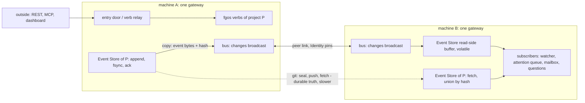

discussion: open

## 1. Trạng thái hiện tại

Round 7 (2026-11-27 16:51). Three points settled (§4): the gateway's roles and one gateway per machine (D1), the
no-error rule between the fast copy and the persistent copy (D2), and what is broadcast first: the events of mail,
work and owner questions (D3).

Open now:

- **Plan and backlog changes** — provisionally A ("origin `main` moved to commit Z", receivers fetch at once; owner
  16:20 "tạm A đi"), not settled (§3 row "Plan and backlog").
- **Event bus framing** — owner 16:28: "từ từ bàn tiếp theo hướng đó xem tốt không" — keep exploring, judged on
  whether it is good, not merely workable. The shaper backs it with three conditions (§3 row "Event bus: shaper's
  assessment"): received events land in the Event Store, push also works inside one machine, every subscriber
  coalesces its wakes. Condition 1 changes where D2's cache lives; D2 not revised yet.
- **Mailbox may write twice** — local mail in its own snapshot record, remote mail through the Event Store; a
  candidate duplicate, read from the spec only, code not checked yet (§3).
- **Event Store vs event bus** — settled as D5 (16:50): durable first in the Event Store; the bus (the gateway
  cluster) carries only copies of such events or signals safe to lose; the received copy is a volatile read-side
  buffer of the Event Store.
- **Gateway assessment** (read-only agent, checked against source by the shaper) is in §3 rows "Gateway today" and
  "Proposed split"; the split needs owner answers on C, D, E and F before any `authority declare`.
- D4 (naming) settled; the rename itself is outside this discussion, raised to the supervisor (event
  `ae993b34282b2832`) for its own backlog row.
- Q2 `{#Q2}` — answered in chat 16:51: local network and Tailscale; `q-pke5ht4y5e` cancelled as answered (§3).
- Many projects on one gateway: how a project is named across machines (§3).
- Component split: first cut in §3, not discussed with the owner yet.

Q1 `{#Q1}` — cancelled 2026-11-27 16:05, answered in chat (§5).

Handed off, outside this discussion: restarting today's gateway on fg-server needs an unconfined session (this head is
confined; `fgos gateway start` refused with `.fgos/locks/gateway.lock: Read-only file system`); raised as
`coordination-help` `ae993b34282b2832` together with the D4 rename row.

## 2. Mục tiêu & đề bài

Owner, 2026-11-27 15:54 (verbatim): "tìm cách khôi phục sự hoạt động của gateway, cần chia tách gateway lại thành
những component riêng biệt lo các việc riêng, và việc đầu tiên mong muốn nó xử lý là: 1) join các gateway ở các máy
khác nhau thành 1 cluster 2) gateway giúp điều phối nhiều project làm việc mượt trên nhiều máy 3) ứng dụng đầu tiên của
gateway là nhanh chóng truyền tải dữ liệu giữa các máy để việc điều phối của chúng luôn nhịp nhàng nhanh chóng và không
chồng lấp. ví du: mailbox quá chậm, events đi quá chậm, điều phối quá chậm. đầu tiên cần ứng dụng runtime để việc điều
phối plan/task được nhịp nhàng hơn (tất nhiên thông tin sự thật vẫn được lưu trữ trên file plan) nhưng có thể dữ liệu
sẽ đi trước bằng sự kiện điều phối trước."

Owner, 2026-11-27 16:05 (verbatim): "gateway là cổng vào remote, nó chình là đứa nhận request ngoài và gọi verb
bên trong, giờ thì nó thêm vai trò trao đổi với gateway khác, mỗi máy nên chỉ cần 1 gateway, nên việc quản nhiều
project accross nhiều máy là phải cân nhắc khi thiết kế, ngoài việc nó là verb relay, nó giờ sẽ là changes broadcast
(giúp thay đổi được đẩy nhanh, còn persistent thì sẽ chậm hơn, nhưng ko được phát sinh lỗi)"

The whole picture: the fgOS gateway (`apps/fgos-gateway`) is the remote entry door of a machine. It takes requests
from outside (REST, MCP, the web dashboard) and relays them to verbs inside. It is down today and has grown as one
2,900-line module; the owner wants it back and split into components that each own one job. Each machine runs exactly
one gateway, which serves every fgOS project on that machine. The gateways of the owner's machines (fg-server,
fg-server2, design-lap) join one cluster and gain a second role besides verb relay: changes broadcast. When something
changes on one machine (mail, an event, a plan or task being claimed), the change reaches the other machines in about a
second instead of a timer period, so coordination stays smooth and never overlaps. Persistence keeps its current path
and is allowed to be slower: the plan file and the event store's git refs stay the truth (L1, L3). The fast copy and
the persistent copy must never contradict each other or cause an error when they meet. The first use is plan/task
coordination.

## 3. Vấn đề rõ / chưa rõ

| Item | State | Evidence |
|---|---|---|
| The gateway is not running on fg-server | observed | `fgos gateway status --json` 2026-11-27 15:55: `running: false, reachable: false` |
| Why it stopped, and since when | partly observed | Last start log `.fgos/logs/gateway-1792920048266-1312696.log`, 2026-10-25 16:20, ends at "listening on 0.0.0.0:4170" with no error; the machine has been up since 2026-10-22, so no reboot killed it. Nothing restarts it (the door spawns one detached process; no service). Cause of the exit unknown |
| Restoring it needs an unconfined session | observed | `fgos gateway start` from this confined head: `lock-driver-unavailable: ... .fgos/locks/gateway.lock: Read-only file system (os error 30)`. Handed to the secretary/supervisor, not this discussion's work |
| The gateway today is one binary `apps/fgos-gateway`: `gateway.rs` 2,910 lines (REST routes, auth, questions, sessions), `mcp.rs` 768 (MCP search/execute), `cf_access.rs` 621 (Cloudflare Access JWT), `remote_invocation.rs` 501 (remote host invocation, only `distribution.build.show`), plus the embedded web bundle; owned by the `herdr-web-dashboard` row | observed | `wc -l apps/fgos-gateway/src/*.rs`; `docs/platform/system-overview/spec.md` lines 63, 185 |
| An earlier split moved the gateway out of the herdr plugin | observed | `plans/261004-1534-fgos-gateway-boundary-split/plan.md` (done) |
| The gateway spans projects; fgOS core acts on one project | observed | commit 27b622317 |
| How cross-machine data moves today | observed | Event store: events sealed on a cadence into `refs/fgos/events/<machine-id>`, machines push their own ref and fetch the others; "no online coordinator" (owner 2026-10-17) — `docs/platform/event-store/spec.md` sections 1, 12, 14. Remote mail is an event on `project:mailbox` (`remote-recorded`) — `docs/platform/agent-mailbox/spec.md` |
| Where the delay comes from | observed (cause), not yet measured end to end | `eventStore.sync.intervalSec` is 60 here (owner 2026-11-06: "mail should arrive in about a minute; an empty fetch measured 0.64 s"), default 300; `eventStore.seal.coalesceSec` 30. So a cross-machine hop waits up to seal + one timer period on the sender and one on the receiver. The git work itself is under a second |
| The gateway's roles | settled, D1 | §4 |
| What travels ahead of git, and the no-error rule | settled, D2 | §4 |
| What is broadcast first | settled, D3: events of mail, work and owner questions | §4 |
| Plan and backlog | provisional: A (owner 16:20 "tạm A đi", not sure yet); reversal trigger: the event-bus framing below changes the shape, or a receiver needs to act before fetching | Their truth is a file on origin (`plan.md`, `plans/backlog.md`), not an event, so D2's same-hash rule does not apply to them as is. A plan claim is already safe: one commit that reaches origin or is undone, first push wins (plan `261127-1535-plan-claim-who-and-where`). Today another machine learns of the change only at its watcher tick: `watcher.activeIntervalSec` 60 s while it has live work, `idleIntervalSec` 900 s idle (`core/config-standard/watcher.yaml`, not overridden here; fetch at `packages/supervision/rust/src/watcher.rs:366`), plus the supervisor's wake. A: one event per push, "origin `main` moved to commit Z" (optionally with the changed paths, A′), receivers fetch and tick at once, about 1-2 s. B: one typed event per change, receivers act before fetching; safe only when sent after origin accepted Z and carrying Z; costs one event type per kind of change. C (file content travels) rejected by the shaper as a second truth |
| Event bus framing | shaper proposal, asked in chat 16:30 | Owner 16:20 recalls "event bus" and the watcher, keeper and an action queue. What exists: the **Event Store** is the durable log (per project, crossing machines by git refs); the **supervision event queue** is "raised minus handled" over it (`packages/supervision/rust/src/queue.rs`), the action queue the owner remembers; the **watcher** is a per-project timer that fetches, runs detection definitions and raises events once; the **keeper** is a pure scheduler over scheduling records and its own past decisions; the **mailbox** wakes heads through hooks. Every consumer learns of a change by polling a timer (sync 60 s, watcher 60/900 s); nothing pushes. A bus is a log plus a push fan-out: the log exists, the push is missing. Framing: the gateway's changes broadcast is that push half, and "trunk moved" (A) is one more event on it whose subscriber is the watcher (tick now instead of at the timer); mail and questions events wake their own subscribers. No new store, no new queue |
| Event bus: shaper's assessment | proposal; owner 16:28 "keep going that way, judge whether it is good" | Strengths: no new store, queue or second truth; A, mail and questions share one mechanism; failure only slows (timers stay as the net); subscribers exist. Three conditions: (1) received events go into an Event Store tier "received, not yet fetched", because watcher, queue and mailbox read only the Event Store; a cache inside the gateway would be invisible to them, and a fetch cannot bring an unsealed event (seal coalesces 30 s). The gateway only carries. (2) Push inside one machine too: today a local append wakes nothing either. Either every writer notifies the gateway, or the gateway watches each project's open logs (no writer change; needs the project registry); shaper leans to watching, unmeasured. (3) Each subscriber coalesces wakes through its own door and keeps the keeper's caps; a watcher tick is a process, a supervisor wake can start an LLM session. Unmeasured: watch vs append-hook cost; the coalescing window |
| Event Store vs supervision queue | observed, owner asked 16:29 | Not a duplicate write path. The Event Store is a shared write mechanism for events only (append-only facts of any registered consumer: work, porting, identity, mailbox, supervision, questions; `packages/event-store/contracts/consumers.v1.json`); plans and backlog are files, not in it. The supervision queue appends only `supervision.event-raised` and `supervision.event-handled` through the Event Store's `append` on the `project` stream; the queue is "raised minus handled", with no store and no cache of its own (`packages/supervision/rust/src/queue.rs:1-21`). The confusion was the word "event": settled by D4 |
| Mailbox's own record | observed in code | Two write paths: local mail is a snapshot record written under the `mailbox` mutex (`packages/mailbox/rust/store/src/record/mod.rs`), remote mail is an Event Store event (`apps/fgos/src/wiring/mailbox_remote.rs:787`, `log.append(MESSAGE_SENT, ...)`). Part of the local record is legitimate machine state (live heads, registration, delivery state). Under the bus rule: the wake is a bus signal; whether a letter must survive a restart decides whether it belongs in the Event Store. Open |
| Event Store vs event bus | settled, D5 | Owner 16:41: "eventbus cũng ko phải là loại bền vĩnh viễn, trong khi eventstore ... là sự kiện bền". The two are separate: the Event Store is durable truth (fsync, sealed git objects, kept forever, slow across machines); the bus is a fast transient channel (may lose, empty after restart); the gateway cluster is the bus. Rule: durable first (Event Store append), then the bus may carry a copy; bus-only items must be safe to lose. The received copy is a volatile read-side buffer of the Event Store, not a durable tier |
| Gateway today (assessment) | observed, agent read checked by the shaper | Product code about 1,420 lines of `gateway.rs` (rest is tests): verb chokepoint `spawn_fgos_verb` (361) and `FgosCliGateway{root}` (413); auth bearer + Cloudflare Access (434-537, `cf_access.rs`); REST under `/v1`: work, questions, reads, sessions (501 stubs, 1140-1161), `/runner/tick` (spawns `fgos-runner`), `/runtime` (only `distribution.build.show`, `remote_invocation.rs`), `/contract` (unauthenticated); MCP `search`/`execute` (`mcp.rs`); embedded web bundle (`apps/fgos-gateway/web`, about 3,000 lines TS). One project per process in six places: cwd root (`main.rs`), `AppState.root` ("multi-project routing ... future work", `gateway.rs:1252`), `/contract` and MCP `search` read the YAML from the root, lock `locks/gateway.lock` and registry `gateway.json` under the project `.fgos` (`apps/fgos/src/wiring/gateway_control.rs:89-96`), logs under the project `.fgos/logs`, release build from the project checkout. Already machine-level: token, port 4170, bind, Cloudflare pair. The web client is already specified to hold more than one gateway, one per machine (`herdr-web-dashboard/spec.md:99`). The 2026-10-25 stop leaves no trace: the gateway logs nothing on shutdown or panic |
| Authority model today | observed | `fgos-gateway` live, layer entry, `paths: []`; `herdr-web-dashboard` retired yet still the spec's area owner and the only consumer of CTR010; `host-surface` also claims "gateway entrypoints" and "auth"; door `control-the-gateway-process` covers the lifecycle (`gateway_control.rs`); no row for auth, the caller record, `/runtime`, peer link, broadcast or a machine project registry; no decision kind for the gateway; `/runner/tick` conflicts with the row's `mustNotOwn: in-process runner` |
| Proposed split | proposal (agent, shaper agrees in outline), not discussed with the owner | One binary `fgos-gateway`, a small workspace: **A** entry door + verb relay, REST and MCP together (same port, auth and verb chokepoint); row `fgos-gateway` updated, new door `relay-to-fgos-verbs`; per request a project id instead of `root`. **B** auth as a module and a door `gateway-admits-callers`, not a component. **C** dashboard: hosting only; fold the retired `herdr-web-dashboard` row into `fgos-gateway` (owner answer: changes the area map). **D** machine project registry: a module and door under `fgos-gateway`, home `~/.fgos`; lock, registry and logs move to machine scope (owner answer; holder-lock's lock registry changes; needs the project naming question). **E** peer link + membership: new crate and component `gateway-peers`, trust by Identity pins, new contract `gateway-peer.v1`; `remote_invocation.rs` deleted unless a peer-invocation job is confirmed. **F** changes broadcast: new crate and component, depends on E; the Event Store side (volatile received buffer, notify/watch of appends, fold by hash) stays in `packages/event-store` behind a door the gateway calls; subscribers subscribe through the Event Store, never through the gateway. **G** lifecycle `fgos gateway start/stop/status` stays in `apps/fgos` under `host-surface`, scope changes to machine. New components (E, F) need an answered owner question before `fgos authority declare` |
| Gateway risks (assessment) | open | Silent stops (no shutdown log, no supervision); bind 0.0.0.0 with bearer and no TLS, so the peer link needs its own transport auth (Q2); dependency advisories p-7e41b0d3 should be audited before crates are added; `/runner/tick` and the 501 session routes need a keep-or-drop decision |
| One gateway per machine vs today | observed | Today one gateway serves one project: `run(root)` and `FgosCliGateway { root }` (`gateway.rs:1394-1408`), lock `.fgos/locks/gateway.lock` and logs under that project's `.fgos/`, fixed port 4170 (`gateway.rs:1935`); a second project on the same machine collides on the port. One-per-machine needs a machine-level home (state under `~/.fgos`, not a project's `.fgos`) and a registry of the machine's projects, each request and each broadcast naming its project |
| Network path between machines | owner-stated 16:51, not yet a D-ID | Owner: "local network and tailscale". Tailscale runs on fg-server (backend `Running`, MagicDNS name under a `.ts.net` tailnet, 8 peers, 5 online at 16:52). So a peer link can reach other gateways by tailnet name with no public exposure; the LAN is a faster path where both machines share it. Transport auth stays Identity pins (D-pending), independent of the network; whether to stop binding 0.0.0.0 in favour of the tailnet and loopback is a follow-up |
| Trust between cluster members | observed, reusable | Identity holds confirmed per-machine ssh-ed25519 pins (`fgos identity pins`, e.g. `design-lap-iezwlz` confirmed 2026-10-25); a peer link can authenticate with them |
| Plan placement and admission travel only through git pushes of `plan.md` | observed | `ds-izibwo45vm`, plan `261127-1535-plan-claim-who-and-where`; a gateway signal would run ahead of this, never replace it |
| Component split | open, next round | Shaper's first cut, to discuss: (1) peer link and membership (who is in the cluster, authenticated by Identity pins); (2) changes broadcast (send and receive the acked events; the fast cache on the receiving side); (5) project registry (which projects this machine serves); (3) entry door and verb relay (REST + MCP, today's routes); (4) dashboard (web bundle). Which of these is a crate vs a module, and which component row owns each, is not decided; `fgos authority locate` to run once the shape holds |
| Many projects on one gateway | open, next round | The event store and mailbox are per project (per clone); the gateway becomes per machine. Every broadcast and every relayed request names its project; how projects are identified across machines (same repo cloned on several machines vs different repos) is not decided |

## 4. Quyết định đã chốt

| ID | Decision | Date | Source |
|---|---|---|---|
| D1 | The gateway is a machine's remote entry door: it takes requests from outside and relays them to the verbs inside (verb relay). It also exchanges with the gateways of other machines and is the **changes broadcast**: a change reaches the other machines fast, persistence follows slower. Exactly one gateway per machine, serving every fgOS project on that machine. It is not an online coordinator: no leases, no arbitration (event-store "no online coordinator", 2026-10-17, unchanged) | 2026-11-27 | owner 16:05, held 16:13 |
| D2 | No-error rule. The broadcast carries the exact acked event bytes with their event hash, never a second representation. The receiver keeps them in a fast, rebuildable cache keyed by hash and never writes them to a ref. When git brings the sealed event it has the same hash and the store's union by hash folds it once; the cache entry then drops. An event whose causal predecessor has not arrived is deferred as the store already defers it. Concurrency stays "provisional, conflict recorded by the consumer". A lost broadcast costs only speed: the timer sync still delivers. (Where the cache lives is reopened by the bus assessment in §3, condition 1) | 2026-11-27 | shaper 16:10, owner agreed 16:13 |
| D3 | The first things broadcast are event-store events: mail, work and owner questions. Plan and backlog changes are not covered by D3 and are discussed separately | 2026-11-27 | shaper 16:10, owner agreed 16:13 |
| D4 | Naming: keep the name **Event Store** (already generic: the append-only store of facts of any domain; a rename would touch 843 files, 5,081 mentions, the published `refs/fgos/events/*` refs, the `eventStore` key and the `fgos events` verbs). The supervision "event queue" becomes the **attention queue** and its rows **attention items**, matching `core/attention/`; "event" keeps one meaning. The rename is its own item, outside this discussion | 2026-11-27 | shaper 16:30, owner agreed 16:31 |
| D5 | The Event Store and the event bus are separate. The Event Store is the durable truth (fsync, sealed git objects, kept forever, slow across machines). The event bus is a fast, transient channel that may lose items and is empty after a restart; the gateway cluster is the bus. Rule: whatever must survive is appended to the Event Store first, and only then may the bus carry a copy; anything carried only by the bus is a signal that is safe to lose (for example "origin `main` moved to commit Z", liveness). The received copy of D2 is a volatile read-side buffer owned by the Event Store (never fsynced, never written to a ref, gone on restart), not a cache inside the gateway; subscribers read it through the Event Store. Refines where D2's cache lives | 2026-11-27 | owner 16:41, shaper 16:45, owner agreed 16:50 |

## 5. Q&A log

- 2026-11-27 16:10 — Shaper round 1 scouted the gateway, event store and mailbox specs and the live gateway state
  (findings in §3). Parked Q1 (what may travel ahead of git) and Q2 (network between machines) in the question store.
  Q1 = `q-vgjluy2gzf`, Q2 = `q-pke5ht4y5e`.
- 2026-11-27 16:05 — Owner (verbatim in §2): the gateway is the remote entry door and verb relay; it now also exchanges
  with other gateways; one gateway per machine, so many projects across many machines must be designed for; besides
  verb relay it becomes a changes broadcast, pushing changes fast while persistence follows slower, with no error
  allowed. Read as: Q1 answered in direction (the change travels, not only a doorbell); Q1 cancelled.
- 2026-11-27 16:10 — Shaper: confirmed in code that today's gateway is per project (one root, fixed port 4170).
  Proposed the no-error rule (same bytes, same hash, union by hash, deferral by causal closure) and asked the owner in
  chat what "a change" covers.
- 2026-11-27 16:13 — Owner: agreed to the no-error proposal and to what is broadcast; plan/backlog to be discussed
  further. Minted D1-D3 (roles held from 16:05; D2, D3 proposed 16:10 and agreed 16:13).
- 2026-11-27 16:20 — Shaper: scouted the plan claim path (plan `261127-1535`, first push to origin wins) and asked the
  owner in chat which of three shapes plan/backlog changes take on the broadcast (§3 row "Plan and backlog").
- 2026-11-27 16:18 — Owner: "nếu không báo thì chậm 60s?" Shaper: the watcher's tick, 60 s busy and 900 s idle, plus
  the supervisor's wake; with A about 1-2 s.
- 2026-11-27 16:19 — Owner: "B khác A là 1 event vs N event". Shaper: yes in count; the real difference is that B
  lets a receiver act before fetching and costs one event type per kind of change; proposed A′ (one event with the
  changed paths).
- 2026-11-27 16:20 — Owner: "tạm A đi, anh cũng chưa rõ ... đang thầm nhớ tới khái niệm event bus. chúng ta đã có
  watcher, keeper và hình như đang có một dạng action queue". Recorded A as provisional. Shaper scouted the
  supervision spec and mapped the existing parts (§3 row "Event bus framing").
- 2026-11-27 16:27 — Owner: "đề nghị đó ra sao em thấy sao?" Shaper: backs the bus framing with three conditions
  (§3 row "Event bus: shaper's assessment").
- 2026-11-27 16:28 — Owner: keep going in that direction to see whether it is good ("tốt", not "được"). Asked (a) is
  the Event Store a shared write mechanism or events only, (b) is the event queue a new write mechanism. Shaper: shared,
  for events only; the queue writes through the Event Store and is a fold; the word "event" has two meanings; the
  mailbox's own record is a candidate duplicate.
- 2026-11-27 16:30 — Owner: rename the Event Store to something more generic? Shaper: no; rename the supervision side
  to attention queue.
- 2026-11-27 16:31 — Owner: "đồng ý, giữ Event Store, đổi thành attention queue". Minted D4; raised the rename and
  the gateway restart to the supervisor (`ae993b34282b2832`).
- 2026-11-27 16:33 — Shaper: found §4 empty. The round-3 edit that should have written D1-D3 matched no header and
  changed nothing, although commit 705fcd1b8 and the report to the owner said they were recorded. D1-D3 written now
  with their original dates and sources, together with D4.
- 2026-11-27 16:38 — Owner: "gateway giờ bật chi?" Shaper: restarting today's binary serves only the dashboard, the
  S04 questions page and remote verbs; nothing relied on it for a month.
- 2026-11-27 16:40 — Owner: start a small, cheap agent to reassess the gateway, compute the split and register it
  cleanly with the component authority, then decide the reshaping and the new shape. Dispatch decide answered
  `unavailable`; the shaper ran one read-only agent (Sonnet) with no writes and no `authority declare`.
- 2026-11-27 16:41 — Owner: an event bus is not durable forever; the Event Store holds durable events. Shaper:
  agreed; proposed the rule "durable first, the bus carries copies or signals safe to lose" (§3).
- 2026-11-27 16:50 — Agent report received; the shaper checked its key claims against source (`gateway.rs:1252`,
  `gateway_control.rs:89-96`, `fgos authority model`, `herdr-web-dashboard/spec.md:99`, `gateway.rs:1208`) and
  recorded it in §3. Mailbox's two write paths confirmed in code.
- 2026-11-27 16:50 — Owner: "đúng ý anh, ghi lại đi" on the rule "durable first, the bus carries copies or signals
  safe to lose". Minted D5; §6 regenerated.
- 2026-11-27 16:51 — Owner answered Q2 in chat: "local network and tailscale". `q-pke5ht4y5e` cancelled as answered
  in chat. Shaper checked Tailscale is running on fg-server (§3).

## 6. Thiết kế đã chốt {#design}

Each machine runs one fgOS gateway (D1). It is the machine's remote entry door: requests from outside (REST, MCP, the
web dashboard) are relayed to the fgOS verbs of the project they name. The gateways of the owner's machines link into
a cluster that is the **event bus**: a fast, transient channel, not a store (D5). Truth and durability stay in the
**Event Store** and git: an event is appended and acked there first, and only then may the bus carry a copy of its
exact bytes and hash to the other machines (D2). The first copies carried are mail, work and owner-question events
(D3); plan and backlog changes are provisionally one signal, "origin `main` moved to commit Z", that makes receivers
fetch and tick their watcher at once. On a receiving machine the copy goes into a volatile read-side buffer owned by
the Event Store, so the existing subscribers (watcher, the attention queue, mailbox, questions) see it at once through
the Event Store they already read; when git brings the sealed event it has the same hash and is folded once. Anything
the bus carries alone is safe to lose; a lost item only falls back to timer speed. There is no leader and no lease.
Names: Event Store stays; the supervision queue becomes the attention queue (D4).

Not settled yet: the component split (§3 "Proposed split": C, D, E, F need owner answers), how a project is named
across machines, push inside one machine (append notify vs open-log watch), wake
coalescing per subscriber, whether letters of local mail must survive a restart, and plan/backlog beyond the
provisional signal.

## 7. Danh mục hạng mục / task {#tasks}

Not yet; filled once §6 holds.
