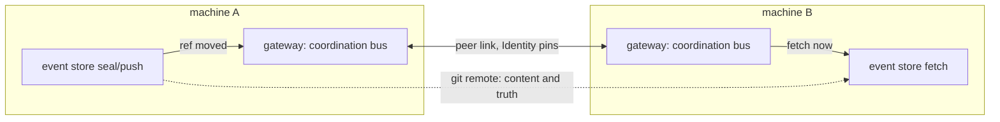

discussion: open

## 1. Trạng thái hiện tại

Round 1 (2026-11-27, shaper `head:shaper-gateway-cluster`). Nothing is settled yet.

What round 1 found: the delay the owner feels is the git sync timer, not git itself. Every cross-machine event
(mail, work, plan claim) rides `refs/fgos/events/<machine-id>` and is seen by another machine only after that
machine's own fetch timer fires (60 s here, 300 s by default); an empty fetch costs 0.64 s. The gateway has not run on
fg-server since 2026-10-25 and today has no cross-machine role at all.

The shaper's lead proposal (not settled): the first slice of the cluster is a **doorbell** — a gateway tells its peers
"machine ref X moved, fetch now" — so content and truth stay in git and the delay falls to about one fetch.

Open owner questions (parked in the question store):

- Q1 `{#Q1}` — `q-vgjluy2gzf`: what a coordination event may carry ahead of git: doorbell (recommended), the event
  itself, or a live coordinator.
- Q2 `{#Q2}` — `q-pke5ht4y5e`: which network the machines share, so gateways can reach each other.

Not blocked by them, next round: the component split (§3, row "Component split"), and the delay measurement.

Handed off, outside this discussion: restarting today's gateway on fg-server needs an unconfined session (this head is
confined; `fgos gateway start` refused with `.fgos/locks/gateway.lock: Read-only file system`).

## 2. Mục tiêu & đề bài

Owner, 2026-11-27 15:54 (verbatim): "tìm cách khôi phục sự hoạt động của gateway, cần chia tách gateway lại thành
những component riêng biệt lo các việc riêng, và việc đầu tiên mong muốn nó xử lý là: 1) join các gateway ở các máy
khác nhau thành 1 cluster 2) gateway giúp điều phối nhiều project làm việc mượt trên nhiều máy 3) ứng dụng đầu tiên của
gateway là nhanh chóng truyền tải dữ liệu giữa các máy để việc điều phối của chúng luôn nhịp nhàng nhanh chóng và không
chồng lấp. ví du: mailbox quá chậm, events đi quá chậm, điều phối quá chậm. đầu tiên cần ứng dụng runtime để việc điều
phối plan/task được nhịp nhàng hơn (tất nhiên thông tin sự thật vẫn được lưu trữ trên file plan) nhưng có thể dữ liệu
sẽ đi trước bằng sự kiện điều phối trước."

The whole picture: the fgOS gateway (`apps/fgos-gateway`, one binary serving REST, MCP and the web dashboard) is down
and has grown as one 2,900-line module; the owner wants it back, split into components that each own one job, and
turned into the layer that joins machines. Gateways on the owner's machines (fg-server, fg-server2, design-lap) form
one cluster; through it many projects coordinate across machines without stepping on each other; and its first job is
speed — coordination signals (mail, events, plan/task placement) reach the other machines in about a second instead of
a timer period. The truth stays where it is: the plan file and the event store's git refs (L1, L3). The gateway only
lets a signal arrive before that truth is fetched, so a machine knows to look now.

## 3. Vấn đề rõ / chưa rõ

| Item | State | Evidence |
|---|---|---|
| The gateway is not running on fg-server | observed | `fgos gateway status --json` 2026-11-27 15:55: `running: false, reachable: false` |
| Why it stopped, and since when | partly observed | Last start log `.fgos/logs/gateway-1792920048266-1312696.log`, 2026-10-25 16:20, ends at "listening on 0.0.0.0:4170" with no error; the machine has been up since 2026-10-22, so no reboot killed it. Nothing restarts it (the door spawns one detached process; no service). Cause of the exit unknown |
| Restoring it needs an unconfined session | observed | `fgos gateway start` from this confined head: `lock-driver-unavailable: ... .fgos/locks/gateway.lock: Read-only file system (os error 30)`. Handed to the secretary/supervisor, not this discussion's work |
| The gateway today is one binary `apps/fgos-gateway`: `gateway.rs` 2,910 lines (REST routes, auth, questions, sessions), `mcp.rs` 768 (MCP search/execute), `cf_access.rs` 621 (Cloudflare Access JWT), `remote_invocation.rs` 501 (remote host invocation, only `distribution.build.show`), plus the embedded web bundle; owned by the `herdr-web-dashboard` row | observed | `wc -l apps/fgos-gateway/src/*.rs`; `docs/platform/system-overview/spec.md` lines 63, 185 |
| An earlier split moved the gateway out of the herdr plugin | observed | `plans/261004-1534-fgos-gateway-boundary-split/plan.md` (done) |
| The gateway spans projects; fgOS core acts on one project | observed | commit 27b622317 |
| How cross-machine data moves today | observed | Event store: events sealed on a cadence into `refs/fgos/events/<machine-id>`, machines push their own ref and fetch the others; "no online coordinator" (owner 2026-10-17) — `docs/platform/event-store/spec.md` sections 1, 12, 14. Remote mail is an event on `project:mailbox` (`remote-recorded`) — `docs/platform/agent-mailbox/spec.md` |
| Where the delay comes from | observed (cause), not yet measured end to end | `eventStore.sync.intervalSec` is 60 here (owner 2026-11-06: "mail should arrive in about a minute; an empty fetch measured 0.64 s"), default 300; `eventStore.seal.coalesceSec` 30. So a cross-machine hop waits up to seal + one timer period on the sender and one on the receiver. The git work itself is under a second |
| What a coordination event may carry ahead of git | open — **Q1** `q-vgjluy2gzf` | Shaper proposes a doorbell first (§1); payload-ahead and online coordinator are the alternatives |
| Network path between machines | open — **Q2** `q-pke5ht4y5e` | Gateway binds 0.0.0.0:4170; Cloudflare Access support exists; LAN/VPN unknown |
| Trust between cluster members | observed, reusable | Identity holds confirmed per-machine ssh-ed25519 pins (`fgos identity pins`, e.g. `design-lap-iezwlz` confirmed 2026-10-25); a peer link can authenticate with them |
| Plan placement and admission travel only through git pushes of `plan.md` | observed | `ds-izibwo45vm`, plan `261127-1535-plan-claim-who-and-where`; a gateway signal would run ahead of this, never replace it |
| Component split | open, next round | Shaper's first cut, to discuss: (1) peer link and membership (who is in the cluster, authenticated by Identity pins); (2) coordination bus (the doorbell and later signals; one message type at first); (3) API surface (REST + MCP, today's routes); (4) dashboard (web bundle). Which of these is a crate vs a module, and which component row owns each, is not decided; `fgos authority locate` to run once the shape holds |
| Many projects on one gateway | open, next round | The event store and mailbox are per project (per clone); the gateway is per machine. A doorbell names project + machine ref, so one gateway can ring for every project on its machine |

## 4. Quyết định đã chốt

| ID | Decision | Date | Source |
|---|---|---|---|

## 5. Q&A log

- 2026-11-27 16:10 — Shaper round 1 scouted the gateway, event store and mailbox specs and the live gateway state
  (findings in §3). Parked Q1 (what may travel ahead of git) and Q2 (network between machines) in the question store.
  Q1 = `q-vgjluy2gzf`, Q2 = `q-pke5ht4y5e`.

## 6. Thiết kế đã chốt {#design}

Nothing settled yet. Working sketch for the next round, not a decision:

## 7. Danh mục hạng mục / task {#tasks}

Not yet; filled once §6 holds.
