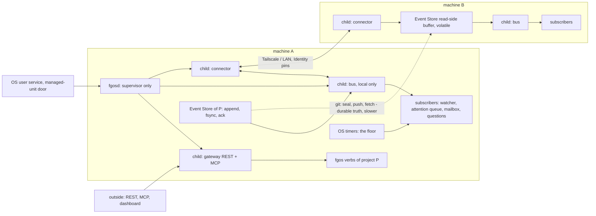

discussion: open

## 1. Trạng thái hiện tại

Paused 2026-11-28 17:42 at a checkpoint (owner: "commit push đi"); not handed to a planner (owner 2026-11-27 23:06
"khoan giao cho planner nhé"). Settled D1-D27 (§4); the shape is in §6.

Settled since the last landed version (2026-11-27 18:00): the authority rows (D12), once-per-project actions (D13),
two or more machines (D14), push inside one machine by watching Event Store open logs (D15), the bus on every machine
and the connector only with peers (D16), the OS supervises the children (D17) with the keep-alive recipe (D18),
watcher placement (D19), claims for planner start and review (D20) as create-only refs on origin with a bus hint
(D21), plan and backlog as one "main moved" signal (D22), pairing (D23), wake coalescing (D24), the project key
(D25), the user journey per folder: `fgctl init` once, then `fgos` and `fgos doctor` (D26), and who owns
project-folder setup (D27). Local mail needs no change (§3 "Mailbox's own record").

Open:

- **Spike: bus and connector libraries** (§7 `#task-spike-bus-connector`): Zenoh vs iroh-gossip, not run. Raised to
  the supervisor (`43194a5c3682229a`); at 17:40 no secretary, supervisor or lead was live (`fgos session list`), and
  `fgos supervisor queue` failed `ref-invalid` on another session's case. The owner is to start the secretary
  (`fgos session start secretary --name miu` from a plain terminal; refused inside the shaper's grant), then the
  shaper mails it the spike.
- **Next after the spike:** pick the libraries, run `fgos authority declare` for the D12 rows with
  `--approved-by q-7unthrvp6b` (adding D27's split), fill §7, then the settled hand-off when the owner says so.
- **For the planner to record:** D26 revisits Identity's 2026-10-22 rule that the project id is never minted by setup
  (`docs/platform/identity/spec.md` decision history); account-probe becomes one timer per machine (D11).

## 2. Mục tiêu & đề bài

Owner, 2026-11-27 15:54 (verbatim): "tìm cách khôi phục sự hoạt động của gateway, cần chia tách gateway lại thành
những component riêng biệt lo các việc riêng, và việc đầu tiên mong muốn nó xử lý là: 1) join các gateway ở các máy
khác nhau thành 1 cluster 2) gateway giúp điều phối nhiều project làm việc mượt trên nhiều máy 3) ứng dụng đầu tiên của
gateway là nhanh chóng truyền tải dữ liệu giữa các máy để việc điều phối của chúng luôn nhịp nhàng nhanh chóng và không
chồng lấp. ví du: mailbox quá chậm, events đi quá chậm, điều phối quá chậm. đầu tiên cần ứng dụng runtime để việc điều
phối plan/task được nhịp nhàng hơn (tất nhiên thông tin sự thật vẫn được lưu trữ trên file plan) nhưng có thể dữ liệu
sẽ đi trước bằng sự kiện điều phối trước."

Owner, 2026-11-27 16:05 (verbatim): "gateway là cổng vào remote, nó chình là đứa nhận request ngoài và gọi verb
bên trong, giờ thì nó thêm vai trò trao đổi với gateway khác, mỗi máy nên chỉ cần 1 gateway, nên việc quản nhiều
project accross nhiều máy là phải cân nhắc khi thiết kế, ngoài việc nó là verb relay, nó giờ sẽ là changes broadcast
(giúp thay đổi được đẩy nhanh, còn persistent thì sẽ chậm hơn, nhưng ko được phát sinh lỗi)"

The whole picture: the fgOS gateway (`apps/fgos-gateway`) is the remote entry door of a machine. It takes requests
from outside (REST, MCP, the web dashboard) and relays them to verbs inside. It is down today and has grown as one
2,900-line module; the owner wants it back and split into components that each own one job. Each machine runs exactly
one gateway, which serves every fgOS project on that machine. The gateways of the owner's machines (fg-server,
fg-server2, design-lap) join one cluster and gain a second role besides verb relay: changes broadcast. When something
changes on one machine (mail, an event, a plan or task being claimed), the change reaches the other machines in about a
second instead of a timer period, so coordination stays smooth and never overlaps. Persistence keeps its current path
and is allowed to be slower: the plan file and the event store's git refs stay the truth (L1, L3). The fast copy and
the persistent copy must never contradict each other or cause an error when they meet. The first use is plan/task
coordination.

## 3. Vấn đề rõ / chưa rõ

| Item | State | Evidence |
|---|---|---|
| The gateway is not running on fg-server | observed | `fgos gateway status --json` 2026-11-27 15:55: `running: false, reachable: false` |
| Why it stopped, and since when | partly observed | Last start log `.fgos/logs/gateway-1792920048266-1312696.log`, 2026-10-25 16:20, ends at "listening on 0.0.0.0:4170" with no error; the machine has been up since 2026-10-22, so no reboot killed it. Nothing restarts it (the door spawns one detached process; no service). Cause of the exit unknown |
| Restoring it needs an unconfined session | observed | `fgos gateway start` from this confined head: `lock-driver-unavailable: ... .fgos/locks/gateway.lock: Read-only file system (os error 30)`. Handed to the secretary/supervisor, not this discussion's work |
| The gateway today is one binary `apps/fgos-gateway`: `gateway.rs` 2,910 lines (REST routes, auth, questions, sessions), `mcp.rs` 768 (MCP search/execute), `cf_access.rs` 621 (Cloudflare Access JWT), `remote_invocation.rs` 501 (remote host invocation, only `distribution.build.show`), plus the embedded web bundle; owned by the `herdr-web-dashboard` row | observed | `wc -l apps/fgos-gateway/src/*.rs`; `docs/platform/system-overview/spec.md` lines 63, 185 |
| An earlier split moved the gateway out of the herdr plugin | observed | `plans/261004-1534-fgos-gateway-boundary-split/plan.md` (done) |
| The gateway spans projects; fgOS core acts on one project | observed | commit 27b622317 |
| How cross-machine data moves today | observed | Event store: events sealed on a cadence into `refs/fgos/events/<machine-id>`, machines push their own ref and fetch the others; "no online coordinator" (owner 2026-10-17) — `docs/platform/event-store/spec.md` sections 1, 12, 14. Remote mail is an event on `project:mailbox` (`remote-recorded`) — `docs/platform/agent-mailbox/spec.md` |
| Where the delay comes from | observed (cause), not yet measured end to end | `eventStore.sync.intervalSec` is 60 here (owner 2026-11-06: "mail should arrive in about a minute; an empty fetch measured 0.64 s"), default 300; `eventStore.seal.coalesceSec` 30. So a cross-machine hop waits up to seal + one timer period on the sender and one on the receiver. The git work itself is under a second |
| The gateway's roles | settled, D1 | §4 |
| What travels ahead of git, and the no-error rule | settled, D2 | §4 |
| What is broadcast first | settled, D3: events of mail, work and owner questions | §4 |
| Plan and backlog | settled, D22 (was provisional: A, owner 16:20 "tạm A đi"); reversal trigger: the event-bus framing below changes the shape, or a receiver needs to act before fetching | Their truth is a file on origin (`plan.md`, `plans/backlog.md`), not an event, so D2's same-hash rule does not apply to them as is. A plan claim is already safe: one commit that reaches origin or is undone, first push wins (plan `261127-1535-plan-claim-who-and-where`). Today another machine learns of the change only at its watcher tick: `watcher.activeIntervalSec` 60 s while it has live work, `idleIntervalSec` 900 s idle (`core/config-standard/watcher.yaml`, not overridden here; fetch at `packages/supervision/rust/src/watcher.rs:366`), plus the supervisor's wake. A: one event per push, "origin `main` moved to commit Z" (optionally with the changed paths, A′), receivers fetch and tick at once, about 1-2 s. B: one typed event per change, receivers act before fetching; safe only when sent after origin accepted Z and carrying Z; costs one event type per kind of change. C (file content travels) rejected by the shaper as a second truth |
| Event bus framing | settled in D5, D6 | Owner 16:20 recalls "event bus" and the watcher, keeper and an action queue. What exists: the **Event Store** is the durable log (per project, crossing machines by git refs); the **supervision event queue** is "raised minus handled" over it (`packages/supervision/rust/src/queue.rs`), the action queue the owner remembers; the **watcher** is a per-project timer that fetches, runs detection definitions and raises events once; the **keeper** is a pure scheduler over scheduling records and its own past decisions; the **mailbox** wakes heads through hooks. Every consumer learns of a change by polling a timer (sync 60 s, watcher 60/900 s); nothing pushes. A bus is a log plus a push fan-out: the log exists, the push is missing. Framing: the gateway's changes broadcast is that push half, and "trunk moved" (A) is one more event on it whose subscriber is the watcher (tick now instead of at the timer); mail and questions events wake their own subscribers. No new store, no new queue |
| Event bus: shaper's assessment | proposal; owner 16:28 "keep going that way, judge whether it is good" | Strengths: no new store, queue or second truth; A, mail and questions share one mechanism; failure only slows (timers stay as the net); subscribers exist. Three conditions: (1) received events go into an Event Store tier "received, not yet fetched", because watcher, queue and mailbox read only the Event Store; a cache inside the gateway would be invisible to them, and a fetch cannot bring an unsealed event (seal coalesces 30 s). The gateway only carries. (2) Push inside one machine too: today a local append wakes nothing either. Either every writer notifies the gateway, or the gateway watches each project's open logs (no writer change; needs the project registry); shaper leans to watching, unmeasured. (3) Each subscriber coalesces wakes through its own door and keeps the keeper's caps; a watcher tick is a process, a supervisor wake can start an LLM session. Unmeasured: watch vs append-hook cost; the coalescing window |
| Event Store vs supervision queue | observed, owner asked 16:29 | Not a duplicate write path. The Event Store is a shared write mechanism for events only (append-only facts of any registered consumer: work, porting, identity, mailbox, supervision, questions; `packages/event-store/contracts/consumers.v1.json`); plans and backlog are files, not in it. The supervision queue appends only `supervision.event-raised` and `supervision.event-handled` through the Event Store's `append` on the `project` stream; the queue is "raised minus handled", with no store and no cache of its own (`packages/supervision/rust/src/queue.rs:1-21`). The confusion was the word "event": settled by D4 |
| Mailbox's own record | observed in code | Two write paths: local mail is a snapshot record written under the `mailbox` mutex (`packages/mailbox/rust/store/src/record/mod.rs`), remote mail is an Event Store event (`apps/fgos/src/wiring/mailbox_remote.rs:787`, `log.append(MESSAGE_SENT, ...)`). Part of the local record is legitimate machine state (live heads, registration, delivery state). Under the bus rule: the wake is a bus signal; whether a letter must survive a restart decides whether it belongs in the Event Store. Checked 22:58 (`docs/platform/agent-mailbox/spec.md` §6.4, :387-399): the record is runtime state of one machine, written by an fsynced snapshot rename, so a letter survives a process or machine restart and is lost only with the machine, by design (L7); the spec already plans its move to the Event Store when persistence and cross-machine needs start (§15.2). Local delivery wakes through its own channel (`local-pushed`, `local-typed`), so the bus (D15, which watches Event Store logs) does not need to see it. No change from this discussion |
| Event Store vs event bus | settled, D5 | Owner 16:41: "eventbus cũng ko phải là loại bền vĩnh viễn, trong khi eventstore ... là sự kiện bền". The two are separate: the Event Store is durable truth (fsync, sealed git objects, kept forever, slow across machines); the bus is a fast transient channel (may lose, empty after restart); the gateway cluster is the bus. Rule: durable first (Event Store append), then the bus may carry a copy; bus-only items must be safe to lose. The received copy is a volatile read-side buffer of the Event Store, not a durable tier |
| Gateway today (assessment) | observed, agent read checked by the shaper | Product code about 1,420 lines of `gateway.rs` (rest is tests): verb chokepoint `spawn_fgos_verb` (361) and `FgosCliGateway{root}` (413); auth bearer + Cloudflare Access (434-537, `cf_access.rs`); REST under `/v1`: work, questions, reads, sessions (501 stubs, 1140-1161), `/runner/tick` (spawns `fgos-runner`), `/runtime` (only `distribution.build.show`, `remote_invocation.rs`), `/contract` (unauthenticated); MCP `search`/`execute` (`mcp.rs`); embedded web bundle (`apps/fgos-gateway/web`, about 3,000 lines TS). One project per process in six places: cwd root (`main.rs`), `AppState.root` ("multi-project routing ... future work", `gateway.rs:1252`), `/contract` and MCP `search` read the YAML from the root, lock `locks/gateway.lock` and registry `gateway.json` under the project `.fgos` (`apps/fgos/src/wiring/gateway_control.rs:89-96`), logs under the project `.fgos/logs`, release build from the project checkout. Already machine-level: token, port 4170, bind, Cloudflare pair. The web client is already specified to hold more than one gateway, one per machine (`herdr-web-dashboard/spec.md:99`). The 2026-10-25 stop leaves no trace: the gateway logs nothing on shutdown or panic |
| Authority model today | observed | `fgos-gateway` live, layer entry, `paths: []`; `herdr-web-dashboard` retired yet still the spec's area owner and the only consumer of CTR010; `host-surface` also claims "gateway entrypoints" and "auth"; door `control-the-gateway-process` covers the lifecycle (`gateway_control.rs`); no row for auth, the caller record, `/runtime`, peer link, broadcast or a machine project registry; no decision kind for the gateway; `/runner/tick` conflicts with the row's `mustNotOwn: in-process runner` |
| Proposed split (first cut) | superseded by the row "Split after D7-D10" | One binary `fgos-gateway`, a small workspace: **A** entry door + verb relay, REST and MCP together (same port, auth and verb chokepoint); row `fgos-gateway` updated, new door `relay-to-fgos-verbs`; per request a project id instead of `root`. **B** auth as a module and a door `gateway-admits-callers`, not a component. **C** dashboard: hosting only; fold the retired `herdr-web-dashboard` row into `fgos-gateway` (owner answer: changes the area map). **D** machine project registry: a module and door under `fgos-gateway`, home `~/.fgos`; lock, registry and logs move to machine scope (owner answer; holder-lock's lock registry changes; needs the project naming question). **E** peer link + membership: new crate and component `gateway-peers`, trust by Identity pins, new contract `gateway-peer.v1`; `remote_invocation.rs` deleted unless a peer-invocation job is confirmed. **F** split by D6: **F1** event bus core, its own crate and component in a low layer (publish, subscribe, wake coalescing; the Event Store publishes, subscribers subscribe); **F2** the gateway's bus connector, beside E, bridging the bus to peer gateways. The Event Store side (volatile received buffer, fold by hash) stays in `packages/event-store`. **G** lifecycle `fgos gateway start/stop/status` stays in `apps/fgos` under `host-surface`, scope changes to machine. New components (E, F1) need an answered owner question before `fgos authority declare` |
| Split after D7-D10 | approved, D12 (Q3 `q-7unthrvp6b` option A) | **`fgosd`**: supervises the three children, holds the machine project registry (project id to local clones), lock, registry and logs under `~/.fgos`; NEW component, layer entry. **gateway**: REST + MCP, relay to verbs by project id, hosts the web dashboard, auth (bearer + Cloudflare Access) as a module with door `gateway-admits-callers`; crate `apps/fgos-gateway` kept, one-project assumptions removed; UPDATE `fgos-gateway`, FOLD the retired `herdr-web-dashboard` into it (area map in `docs/platform/system-overview/spec.md:63` changes). **bus**: publish, subscribe, wake coalescing, machine-local; own crate and child; NEW component `event-bus`, low layer just above the Event Store. **connector**: link to other machines' `fgosd`, trust by Identity pins; own crate and child; NEW component `connector` and NEW contract for its wire format; `remote_invocation.rs` deleted. **Event Store side**: volatile read-side buffer, publish to the bus on append; UPDATE `event-store` row and spec. **Lifecycle**: `fgos daemon start/stop/status` replaces `fgos gateway`; UPDATE `host-surface` and the door `control-the-gateway-process`. **Unit door**: UPDATE the door `managed timer` to managed-unit (timer, service). The machine registry moved from the gateway (first cut D) to `fgosd`, because gateway and connector both need it |
| Gateway risks (assessment) | open | Silent stops (no shutdown log, no supervision); bind 0.0.0.0 with bearer and no TLS, so the peer link needs its own transport auth (Q2); dependency advisories p-7e41b0d3 should be audited before crates are added; `/runner/tick` and the 501 session routes need a keep-or-drop decision |
| Machine daemon | settled in outline, D7; details open | Owner 17:22 (verbatim): "thiết kế gateway cho tốt để nó sống dai, và nó duy trì sự sống của mcp, rest, và bus. nếu cần có thể đặt lại tên phù hợp hơn, thực chất chỉ có mcp và rest là gateway". Shaper's shape: (1) **Names**: the per-machine process is the machine daemon (working name `fgosd`); "gateway" means only the REST + MCP door it hosts; the bus (D6) is a separate part it hosts. (2) **Two levels of keeping alive**: the OS keeps the daemon alive as a user service (systemd user service with restart, launchd agent with KeepAlive), rendered and checked through the existing `managed timer` door (`packages/distribution/rust/src/timer.rs`, door `packages/component-authority/model/doors/managed-timer.yaml`, already writes per-project systemd/launchd units) extended to a service, not a second mechanism beside it (L10); inside, the daemon supervises its parts (gateway, bus core, bus connector) and restarts one failed part without stopping the others. (3) **Never silent**: every part start, stop, panic and restart is recorded with its reason (today the gateway logs nothing on exit); `status` reports each part; a doctor row for the service (install gate). (4) **What it runs**: the activated release's binary, never a `cargo build` from a checkout (today's `fgos gateway start` builds from the project checkout, `gateway_control.rs:389-401`). (5) **If the daemon is down**: subscribers fall back to their timers (D5), so a dead daemon only slows. Process model settled by D7: one child process per part. Open: the daemon's name; whether the bus's cross-machine connector runs in the bus process or its own child (the gateway is REST + MCP only); the lifecycle verb's new name (`fgos daemon start/stop/status`?) |
| Timers | observed 17:32; design settled, D8 | Correction: the round-4 note "watcher ticks every 60 s busy, 900 s idle" holds only where `watcher.enabled` is true; on fg-server it is false (`core/config-standard/watcher.yaml:6`, not overridden), so no OS timer runs `fgos watcher tick` there and the keeper runs only when something calls `supervisor wake`. `fgos doctor`: `mailbox-sync-timer` FAIL, unit `fgos-mailbox-sync-e9756c48.timer` installed but disabled, so cross-machine mail waits for a session to run a tool; `account-probe-timer` and `watcher-timer` OK because both are off. Raised `dd5ea57dfb8b5f53`. Design: the `managed timer` door (`packages/distribution/rust/src/timer.rs`) becomes one managed-unit door with two kinds, timer and service, and the daemon's service goes through it (L10); timers stay as the floor and run independently of the daemon (D5), their periods may grow once the bus pushes; doctor checks "installed but not running" for the service as for timers; which machine runs the watcher of which project is stated in one place, tied to the plan `host` rule |
| Timers per job | settled, D11 | Keep one OS unit per job, all through the one managed-unit door (D8): periods differ (mailbox-sync `eventStore.sync.intervalSec`, 60 here; watcher 60 s busy / 900 s idle; account-probe `dispatch.probeAccount.intervalSec`, 0 = off by default), switches differ per machine, one job failing must not stop the others, doctor keeps one row per job. Per machine: one service for `fgosd`; per project at most mailbox-sync and watcher-tick, only where enabled. Checked 23:22: today account-probe is one unit per project root like the others (`unit_stem` hashes the project root path, `packages/distribution/rust/src/timer.rs:342-346`), while what it probes, the provider accounts and their runtime state, belongs to the machine (`packages/execution/engine/src/accounts/state.rs`); so D11's "one per machine" is a real change for the planner |
| Watcher vs keeper | observed | Watcher: per-project OS timer tick, no LLM; fetches the trunk, runs detection definitions, raises attention items once, runs the action per row kind (`watcher.rs`). Keeper: a pure decision function over scheduling records, clock, actor state, caps and its own past decisions; decides start, wake, hold or raise; runs inside `fgos supervisor wake` after admission (`wake.rs:143-164`). Chain: timer, watcher tick, supervisor wake (admission, keeper), supervisor LLM session only for judgement. The watcher is the bus subscriber; the keeper speeds up with it |
| Watcher placement | settled, D19 | The watcher runs two kinds of definitions (`core/watcher/definitions`, `core/config-standard/watcher.yaml:20-24`). Project-wide, the same from any machine: `plan-became-ready`, `plan-done`, `plan-drafted`, `plan-priority-changed`, `plan-ready-waiting`, `discussion-settled`, `review-due`, `plan-no-progress`, question answered. Machine-local, visible only where the heads run: `lead-ended`, `session-gone`, `session-idle`, `session-no-result`, `head-gone`, `lane-freed`, `supervisor-stuck`, `supervisor-wake-failed`. So one watcher per project misses the other machines' heads. Proposal: every machine that serves a project (in `fgosd`'s registry) runs that project's watcher; project-wide rows fold once (fixed ids), and with the bus a row raised on one machine reaches the others in about a second, so a second wake is rare. `watcher.enabled` may then follow from the registry instead of being set by hand |
| Once-per-project starts without a claim | settled, D20 | Planner start for a settled discussion: skipped only "if a plan's `source` already names it or a planner for it is live" (`docs/platform/supervision/spec.md` §5), so two machines can start two planners. Periodic review: `fgos.review.done` is recorded when it ends, so two machines can run two reviews. Both need a claim that wins on origin |
| Project id mint | settled within D26 (owner 17:35); revisits Identity's 2026-10-22 "never by setup", to be recorded in `docs/platform/identity/spec.md` decision history | Owner 08:14: does `fgos init` mint the id itself? No: `fgos init` mints the machine id only (`apps/fgos/src/wiring/init.rs:4,271`); the project id is minted only by `fgos identity project --init` on one machine, then committed and pulled elsewhere, never by setup or doctor, because three clones on three machines would mint three ids before the first push (`docs/platform/identity/spec.md:86,278`, decided 2026-10-22); doctor warns `identity-project-id` with no fix. Option to drop the manual step: the first mint is a create-only claim ref on origin (as D21, and as `fgos identity mint d-adr` already claims `refs/fgos/seq/<kind>`): `fgos init` mints, tries to create the ref; the first machine wins, the others adopt the id already there; offline it waits instead of minting alone. That revisits an Identity decision, so it is the owner's |
| Multi-machine user journey | settled, D26 | Owner 16:42: think further so the UX of one project on many machines is the best: easy to understand, easy to remember, hard to get wrong. Today's door is `fgctl init` (stages and activates a release, then runs `fgos init` and `fgos doctor --fix`; "safe to repeat"). Proposal, two things to remember: (1) in a folder not yet activated (new project, or a fresh clone on any machine), run `fgctl init`; its local tail (`fgos init`, `fgos doctor --fix`) does the rest idempotently: machine id and key (exists), project id (adopted from the origin claim ref or minted and claimed, §3 "Project id mint"; offline it waits, never mints alone), the clone registered in `fgosd`'s registry, the daemon units and timers installed and running (D8, D17, D18), the machine's addresses published (D23), pairing done automatically on the tailnet or a 6-digit code shown (D23). "Not sure? run `fgctl init` again" is always the right answer. (2) To know anything, `fgos doctor` (owner 16:50: diagnose through doctor, no new verb; revised below): this project by name, each machine by name with online/offline, paired or waiting, what it runs (heads, plans with their host), and at most one "next step" line with the exact command. Rules behind it: names, never ids (machine and project handles; ids only with `--json`); a refusal always names its one fix; nothing to do by hand that the system can do safely; dangerous mistakes are made impossible rather than warned about: two project ids (origin claim), a plan run twice (plan `host`, D20-D21), trusting an unknown machine (D23), a second clone of the same project on one machine silently splitting state (status shows both, each with its store id). Leaving: `fgos daemon stop` on the machine; other machines show it offline, and `fgos identity pins --forget` (offered by status after a long absence) removes it |
| Who owns project-folder setup | settled, D27 | Owner 17:35: make the authority clear so code is not stuffed anywhere; installing fgos is fgctl's, who owns setting up and starting a project folder correctly? Model today (`packages/component-authority/model/`): `packaging-distribution` owns "setup and global/project config precedence", "doctor readiness registry and check execution", "required binaries/services/directories", and must not own runtime lifecycle truth or domain workflow (`components.yaml:29-79`); door `init steps` makes `apps/fgos/src/wiring/init.rs` the one place `fgos init` composes its steps in one order, each step's body owned elsewhere (`doors/init-steps.yaml`); door `doctor readiness registry` makes `packages/distribution/contracts/doctor-registry.v1.json` the one list of rows and fixes, each row judged by its owning crate (`doors/doctor-readiness-registry.yaml`). Proposal, no new component: packaging-distribution owns the order and the engine (init sequence, doctor run, fix), never the bodies; each new step's body lives in the component that owns the thing: project id adopt or claim in Identity; registering the clone in `fgosd`; writing units in the managed-unit door (distribution); machine trust and the 6-digit confirm in Identity pins, the tailnet check as an adapter behind it; addresses published by the connector at run time, not at init. Adding a step = its body in the owner crate, one line in `init.rs` or one row in the doctor registry, nothing else |
| Pairing machines | settled, D23 | Owner 23:12: pairing must have very good, very easy UX. What exists: each machine has an id and an ed25519 key (`fgos identity machine`); a machine's key is pinned the first time it is seen (`seen`) and marked `confirmed` only by `fgos identity pins --confirm <machine-id> --fingerprint <SHA256:...>` after the owner compares fingerprints by eye (`docs/platform/identity/spec.md:147`, 2026-10-24); signed directory entries already cross machines through the project's Event Store (I4). So machines of one project already learn each other's id and key; missing: an address to dial, and an easy confirm. Proposal: (1) discovery needs no step: `fgosd` adds its reachable addresses (Tailscale name, LAN addresses, port) to its signed directory entry, so a machine is known one sync after it serves the project; (2) confirm in one step instead of comparing 50-character fingerprints: (a) automatic when both machines are on the owner's tailnet under the same Tailscale user (asked of the local Tailscale daemon), (b) otherwise a short code derived from both keys shown on both machines, as Bluetooth numeric comparison and Signal safety numbers do, confirmed on one, (c) or a one-time invite code typed on the new machine (magic-wormhole style, a Rust crate exists); (3) `fgos daemon status` and the dashboard list each peer as connected, waiting for confirm or unreachable, with the one fix; unpair is the existing `pins --forget`. Prior art also for D21: `fgos identity mint d-adr` already claims a counter ref `refs/fgos/seq/<kind>` on origin |
| Bus start condition | settled, D16 | Owner 18:10: "why not having similar mechanism locally to trigger on change instantly like bus for a single machine situation". Proposal: the bus child runs on every machine that serves a project, single machine included (local file watch, local wakes, about a second instead of a timer period); only the connector child depends on two or more machines and starts when this machine has at least one confirmed peer (Identity pins) serving one of its projects. Cost on one machine: one small, mostly idle process. If confirmed, a new D supersedes D14's clause "the bus ... exist only when there are two or more" |
| Library research | research 18:25, web plus repo | **File watch (D15):** the `notify` crate (inotify, FSEvents, kqueue, polling fallback) is already in the workspace, 8.2.2 via `pkm-vault` (`Cargo.lock`); nothing to invent. **Zenoh** (Eclipse, Rust; 1.9.0 April 2026, 1.10 August 2026): pub/sub and queries in peer, client and router modes; TCP, TLS with mutual TLS (`enable_mtls`), QUIC, a Unix-socket link (`zenoh-link-unixsock_stream`, marked internal); LAN discovery by UDP multicast scouting, which Tailscale does not carry, so peers would be listed explicitly. Covers both the local bus and the connector with one library; trust is X.509 certificates, not Identity's ed25519 pins. **iroh + iroh-gossip** (n0, Rust; iroh 1.0 June 2026): QUIC dialled by ed25519 public key, hole punching, relay fallback; iroh-gossip is a pub/sub overlay. Matches Identity's key-based trust closely; network only, not a local bus; default discovery and relays are n0-hosted services, which would have to be turned off or self-hosted. **NATS** (Go server, `async-nats` Rust client; server 2.14 April 2026): mature, leaf nodes, NKeys on ed25519; but a Go server per machine to install and supervise, against design principle 4 (Rust first). Not in the repo today: zenoh, iroh, async-nats (checked `Cargo.lock` files). Unverified: whether Zenoh's Unix-socket link is usable from the public Rust API; whether Identity's ssh-ed25519 keys can serve as iroh endpoint keys |
| Who supervises the children | settled, D17 | "Don't invent" also applies to supervision: systemd user units (`Restart=always`, grouped by a target) and launchd agents (`KeepAlive`) already restart failed processes one by one and log their exits. Option: write gateway, bus and connector as three OS units through the managed-unit door (D8) and keep `fgosd` only as the name of the group and its verb, instead of a supervisor process of our own (D7). Not decided |
| Keep-alive recipe | settled, D18 | Owner 18:17: a pattern so a supervised process cannot die. Honest limit: no process is immortal (reboot, kill by a person, a broken binary); the target is that every death is noticed, restarted at once, forever, and recorded, and that a hang counts as a death. Recipe on systemd 259 (fg-server; `Linger=yes` already, so user units run without a login): `Restart=always`; `StartLimitIntervalSec=0` so the rate limiter never stops retrying; `RestartSec` with `RestartSteps`/`RestartMaxDelaySec` (systemd 254+) for a growing back-off that never gives up; `Type=notify` with `READY=1` and `WatchdogSec`, the process sending `WATCHDOG=1` from the loop doing the real work (the `sd-notify` crate, pure Rust, no dependencies), so a hang is killed and restarted; `MemoryMax` per unit so a leak kills only that child; `WantedBy=default.target` to start at boot; every exit in the journal, plus `OnFailure=` to publish a record. macOS: launchd `KeepAlive` true, `RunAtLoad`, `ThrottleInterval` (about 10 s default); launchd has no watchdog, so the process aborts itself when its own work loop stalls (self-watchdog), and launchd restarts it. Pattern: "let it crash" (Erlang/OTP): no in-process recovery, crash and be restarted clean. Outside the manager: `fgos daemon status` and a doctor row read the manager's state; the timers stay as the floor (D8) when everything is down. Not yet in the repo: `sd-notify` (checked `Cargo.lock`); today's unit shape is `Type=oneshot` timers |
| One gateway per machine vs today | observed | Today one gateway serves one project: `run(root)` and `FgosCliGateway { root }` (`gateway.rs:1394-1408`), lock `.fgos/locks/gateway.lock` and logs under that project's `.fgos/`, fixed port 4170 (`gateway.rs:1935`); a second project on the same machine collides on the port. One-per-machine needs a machine-level home (state under `~/.fgos`, not a project's `.fgos`) and a registry of the machine's projects, each request and each broadcast naming its project |
| Network path between machines | owner-stated 16:51, not yet a D-ID | Owner: "local network and tailscale". Tailscale runs on fg-server (backend `Running`, MagicDNS name under a `.ts.net` tailnet, 8 peers, 5 online at 16:52). So a peer link can reach other gateways by tailnet name with no public exposure; the LAN is a faster path where both machines share it. Transport auth stays Identity pins (D-pending), independent of the network; whether to stop binding 0.0.0.0 in favour of the tailnet and loopback is a follow-up |
| Trust between cluster members | observed, reusable | Identity holds confirmed per-machine ssh-ed25519 pins (`fgos identity pins`, e.g. `design-lap-iezwlz` confirmed 2026-10-25); a peer link can authenticate with them |
| Plan placement and admission travel only through git pushes of `plan.md` | observed | `ds-izibwo45vm`, plan `261127-1535-plan-claim-who-and-where`; a gateway signal would run ahead of this, never replace it |
| Component split | open, next round | Shaper's first cut, to discuss: (1) peer link and membership (who is in the cluster, authenticated by Identity pins); (2) changes broadcast (send and receive the acked events; the fast cache on the receiving side); (5) project registry (which projects this machine serves); (3) entry door and verb relay (REST + MCP, today's routes); (4) dashboard (web bundle). Which of these is a crate vs a module, and which component row owns each, is not decided; `fgos authority locate` to run once the shape holds |
| Many projects on one gateway | provisional default 17:00 | Key: Identity project id, which travels with the repository, so one repo cloned on several machines has one id (`fgos identity project`: `forgent` = `08b07657...`; `docs/platform/identity/spec.md:94`). The machine registry maps project id to its local clones; two clones on one machine differ by Event Store store id. Every relayed request and every bus item names the project id |

## 4. Quyết định đã chốt

| ID | Decision | Date | Source |
|---|---|---|---|
| D1 | The gateway is a machine's remote entry door: it takes requests from outside and relays them to the verbs inside (verb relay). It also exchanges with the gateways of other machines and is the **changes broadcast**: a change reaches the other machines fast, persistence follows slower. Exactly one gateway per machine, serving every fgOS project on that machine. It is not an online coordinator: no leases, no arbitration (event-store "no online coordinator", 2026-10-17, unchanged) | 2026-11-27 | owner 16:05, held 16:13 |
| D2 | No-error rule. The broadcast carries the exact acked event bytes with their event hash, never a second representation. The receiver keeps them in a fast, rebuildable cache keyed by hash and never writes them to a ref. When git brings the sealed event it has the same hash and the store's union by hash folds it once; the cache entry then drops. An event whose causal predecessor has not arrived is deferred as the store already defers it. Concurrency stays "provisional, conflict recorded by the consumer". A lost broadcast costs only speed: the timer sync still delivers. (Where the cache lives is reopened by the bus assessment in §3, condition 1) | 2026-11-27 | shaper 16:10, owner agreed 16:13 |
| D3 | The first things broadcast are event-store events: mail, work and owner questions. Plan and backlog changes are not covered by D3 and are discussed separately | 2026-11-27 | shaper 16:10, owner agreed 16:13 |
| D4 | Naming: keep the name **Event Store** (already generic: the append-only store of facts of any domain; a rename would touch 843 files, 5,081 mentions, the published `refs/fgos/events/*` refs, the `eventStore` key and the `fgos events` verbs). The supervision "event queue" becomes the **attention queue** and its rows **attention items**, matching `core/attention/`; "event" keeps one meaning. The rename is its own item, outside this discussion | 2026-11-27 | shaper 16:30, owner agreed 16:31 |
| D5 | The Event Store and the event bus are separate. The Event Store is the durable truth (fsync, sealed git objects, kept forever, slow across machines). The event bus is a fast, transient channel that may lose items and is empty after a restart; the gateway cluster is the bus. Rule: whatever must survive is appended to the Event Store first, and only then may the bus carry a copy; anything carried only by the bus is a signal that is safe to lose (for example "origin `main` moved to commit Z", liveness). The received copy of D2 is a volatile read-side buffer owned by the Event Store (never fsynced, never written to a ref, gone on restart), not a cache inside the gateway; subscribers read it through the Event Store. Refines where D2's cache lives | 2026-11-27 | owner 16:41, shaper 16:45, owner agreed 16:50 |
| D6 | The event bus is its own crate and its own component, in a low layer just above the Event Store: its core owns publish, subscribe and wake coalescing; the Event Store publishes to it, subscribers (watcher, attention queue, mailbox, questions) subscribe to it. The gateway is one connector of the bus, the one that bridges it to other machines; a machine-local path is another. Reason: subscribers are lower layers and must never know the entry-layer gateway (design principle 2); the bus core stays transport-free (principle 3); the local fast path survives a gateway outage. Supersedes the part of D1 that said the gateway "is the changes broadcast": the gateway is the bus's cross-machine connector. Which process hosts the bus is not decided | 2026-11-27 | owner 17:05, shaper 17:06, owner agreed 17:10 |
| D7 | One long-lived **machine daemon** per machine (working name `fgosd`), kept alive by the OS as a user service. Each part runs as a **child process the daemon supervises**: the **gateway**, which now means only the REST + MCP door, and the **event bus** (D6); a failed child is restarted alone, the others keep running. The daemon itself is the supervisor. Refines D1's wording: "gateway" no longer names the whole per-machine process | 2026-11-27 | owner 17:22 and 17:38, shaper 17:25 |
| D8 | Timers and the daemon service go through one door: the `managed timer` door (`packages/distribution/rust/src/timer.rs`) becomes a managed-unit door with two kinds, timer and service; no systemd or launchd unit is written anywhere else (L10). Timers stay as the floor and run independently of the daemon, so a dead daemon only slows (D5); their periods may grow once the bus pushes, never to zero. Doctor checks "installed but not running" for the service as it does for timers. Which machine runs the watcher of which project is stated in one place, tied to the plan `host` rule (where that place is, is open) | 2026-11-27 | shaper 17:32, owner agreed 17:40 |
| D9 | Names: the machine daemon's binary is **`fgosd`**; its lifecycle verb is **`fgos daemon start|stop|status`**, which replaces `fgos gateway start|stop|status` (callers moved and the old verb deleted in the same change, L10). "Gateway" names only the REST + MCP child (D7). Neither name is used elsewhere in the repo (checked 17:40) | 2026-11-27 | shaper 17:25 and 17:36, owner chose 17:37 |
| D10 | `fgosd` supervises three child processes: the **gateway** (REST + MCP), the **bus** (the core of D6, machine-local only: local publishers and subscribers over a local socket) and the **connector** (the cross-machine link to the other machines' `fgosd`, over Tailscale or the LAN, trusted by Identity machine pins). The connector joins its own machine's bus as an ordinary client: it takes the events to send and publishes the copies it receives. The network-facing parts (gateway, connector) are isolated from the local bus, so a network fault never stops local fast wakes | 2026-11-27 | shaper 17:40, owner chose (b) 17:45 |
| D11 | One OS timer per job, all written through the one managed-unit door (D8): per project a mailbox-sync and a watcher-tick timer, each present only where enabled, each with its own period, switch and doctor row; account-probe becomes one timer per machine, since provider accounts belong to the machine (to check in code before planning). Not one shared timer for all jobs, not one timer per job for the whole machine: either would rebuild a scheduler the OS already has and let one job or project block another. Three projects with everything enabled: at most 2 x 3 + 1 = 7 timers, plus the `fgosd` service | 2026-11-27 | shaper 17:36 and 17:40, owner chose A 17:42 |
| D12 | The component authority rows of §3 "Split after D7-D10" are approved as one set (Q3 option A): NEW `fgosd`, `event-bus`, `connector` and the connector's wire contract; UPDATE `fgos-gateway` (REST + MCP only), `event-store`, `host-surface`, doors `control-the-gateway-process` and `managed timer`; FOLD the retired `herdr-web-dashboard` into `fgos-gateway`. The declares run once the shape holds, with `--approved-by q-7unthrvp6b` (answered in the store) | 2026-11-27 | owner chose A in chat 17:49 on `q-7unthrvp6b` |
| D13 | An action that must happen once per project is either decided by a claim that wins on origin (as plan admission already is, plan `261127-1535`) or done only by the machine that holds the head concerned (resuming an asker, restarting a lead). Duplicated detections across machines are harmless (attention items have fixed ids and fold once); duplicated actions are not | 2026-11-27 | shaper 17:58, owner accepted 18:00 |
| D14 | A project normally runs on at least two machines; that is the design's base case, not an exception. Cross-machine exchange and sync are needed exactly when there are two or more machines: with one machine `fgosd` runs only the gateway child, and the bus and connector children exist only when there are two or more. A machine without a bus loses nothing: the bus is lossy by D5, publishing to it is then a no-op, and subscribers run on their timers (D8) | 2026-11-27 | owner 17:56 and 18:00 |
| D15 | The bus notices new events by watching each served project's Event Store open logs through the OS file-change notification (inotify on Linux, FSEvents on macOS), reads the new lines and publishes them. Writers are not changed and need no socket, so CLI verbs, hooks and sandboxed workers are all covered. On a relevant event the bus starts the subscriber's own door at once (for the watcher, `fgos watcher tick` of that project; for the mailbox, its existing wake channel), coalescing a burst into one wake; the OS timers stay as the floor (D8) | 2026-11-27 | shaper 18:05, owner chose (b) 18:10 |
| D16 | The bus child runs on every machine that serves a project, a single machine included, so local changes wake local subscribers in about a second everywhere. Only the connector child depends on two or more machines: `fgosd` starts it when this machine has at least one confirmed peer (Identity pins) serving one of its projects, and stops it when none is left. Supersedes D14's clause that the bus exists only with two or more machines; the rest of D14 stands | 2026-11-27 | owner 18:10, shaper 18:12, owner confirmed 18:14 |
| D17 | The OS service manager supervises the children, not a supervisor process of fgOS's own: gateway, bus and connector are each an OS user unit (systemd user service, launchd agent) written through the managed-unit door (D8); `fgosd` remains the name of the group and of its verb `fgos daemon start|stop|status` (D9). Supersedes D7's "the daemon itself is the supervisor"; the rest of D7 (one child per part, a failed child restarted alone) stands, now done by the OS | 2026-11-27 | shaper 18:25, owner agreed 18:17 |
| D18 | Keep-alive recipe for every `fgosd` child, done by the OS, not by fgOS code: systemd `Restart=always`, `StartLimitIntervalSec=0`, growing back-off (`RestartSec`, `RestartSteps`, `RestartMaxDelaySec` up to about 30 s), `Type=notify` + `WatchdogSec` with `WATCHDOG=1` sent from the real work loop (`sd-notify` crate) so a hang counts as a death, `MemoryMax` per unit, `WantedBy=default.target` with linger, `OnFailure=` raising an attention item; launchd `KeepAlive` + `RunAtLoad` + `ThrottleInterval` plus a self-watchdog that exits on a stalled loop. Code follows "let it crash": an unrecoverable error exits non-zero instead of limping; durable state is in the Event Store (D5), so a restart loses nothing. Promise: every death or hang is noticed, restarted within seconds, forever, and visible (doctor "installed but not running", D8); no process is promised immortal | 2026-11-27 | shaper 18:35, owner agreed 20:15 |
| D19 | Watcher placement, three parts applied together: (a) every machine that serves a project (in `fgosd`'s registry) runs that project's watcher, and it alone raises the machine-local detections it can see (`lead-ended`, `session-gone`, `session-idle`, `session-no-result`, `head-gone`, `lane-freed`, `supervisor-stuck`, `supervisor-wake-failed`); (b) project-wide detections (`plan-*`, `discussion-settled`, `review-due`, question answered) are evaluated on every serving machine but raised once: the machine whose claim wins on origin raises, the others see the claim and skip (D13); (c) the bus wakes the watcher at once on a relevant event (D15) and its OS timer stays as the floor (D8, D11). `watcher.enabled` follows from the registry instead of being set by hand. Answers D8's open "which machine runs the watcher": every serving machine, so no separate record is needed | 2026-11-27 | shaper 17:52 and 20:20, owner agreed 21:03 |
| D20 | Planner start and periodic review are once-per-project actions under D13: before starting, a machine records a claim ("planner for discussion X", "review for period Y"); the claim that reaches origin first wins and the losing machine skips. The claim is not an Event Store event: the Event Store has one ref per machine and union by hash, so it cannot pick a first writer, and its spec keeps claims outside it (`docs/platform/event-store/spec.md:59`). Where the claim lives: D21. Replaces today's guards ("a plan's `source` already names it or a planner is live"; `fgos.review.done` written only at the end), which let two machines start twice | 2026-11-27 | shaper 21:05, owner agreed 21:09 |
| D21 | A claim for a once-per-project start (D20) is a create-only ref on origin, one per claimed thing (for example `refs/fgos/claims/planner/<discussion>`, `refs/fgos/claims/review/<period>`), pushed with git's create-only lease: the first push to create it wins, a later one is refused, and main is not touched. Origin is the only arbiter. The bus only carries a hint: the claimer publishes "I intend to take X" at once so other machines back off early; a lost or wrong hint only costs seconds, never a double start. No online coordinator (2026-10-17). Measured: one round trip to origin about 0.7 s (`git ls-remote`, 3 runs, 22:49); the push itself not measured. Provisional (owner "tạm chọn 2"); plan admission keeps its main commit for now. Ref naming and cleanup of old claim refs are left to the planner | 2026-11-27 | shaper 21:12 and 22:50, owner chose (2) provisionally 22:49, agreed 22:57 |
| D22 | Plan and backlog changes travel as one signal, not as typed events (option A): after origin accepts a push to `main`, the pusher publishes "origin `main` moved to commit Z" on the bus; a receiving machine fetches and runs its watcher at once (D19), so `plan-*` detections appear in about 1-2 s. The signal carries no plan state: receivers always read the files at Z, so a late, repeated, reordered or forged signal costs at most one fetch, and a lost one falls back to the timer. B (one typed event per change, acted on before fetching) is rejected on correctness: it keeps plan state in a second place, can act on a stale or reordered event, and needs one event type per kind of change; made correct it reduces to A plus a payload, for a gain of one fetch (about 0.7 s). A push made outside fgOS sends no signal and is caught by the timer | 2026-11-27 | owner provisional 16:20, shaper 23:04, owner chose A 23:10 |
| D23 | Pairing: discovery needs no step and confirmation takes at most one. Discovery: `fgosd` adds its reachable addresses (Tailscale name, LAN addresses, port) to the machine's signed Identity directory entry, which already crosses machines through the project's Event Store, so a new machine is known and dialable one sync after it serves the project. Confirmation, through Identity's existing pin (`seen` to `confirmed`, one authority for machine trust): (a) automatic when both machines are on the owner's tailnet under the same Tailscale user, asked of the local Tailscale daemon; (b) otherwise a short code derived from both keys is shown on both machines (numeric comparison, as Bluetooth pairing and Signal safety numbers) and the owner confirms on one. The connector talks only to confirmed peers (D16). `fgos daemon status` and the dashboard show each peer as connected, waiting for confirmation or unreachable, each with its one fix; unpair is `fgos identity pins --forget`. The 50-character fingerprint compare stays only as the manual fallback | 2026-11-27 | shaper 23:13, owner chose a + b 23:16 |
| D24 | Wake coalescing, per subscriber: the first relevant event wakes at once (leading edge); further events within the window fold into exactly one more wake when it ends (trailing edge), so no event is missed and a busy project costs at most about one wake per window. The watcher coalesces per project, the mailbox per recipient; the supervisor's LLM wake keeps the keeper's existing caps. The window is one config key with its default in `core/config-standard` (and its schema), starting at 5 s; the figure is an estimate, to be measured by the planner | 2026-11-27 | shaper 23:17, owner agreed 23:20 |
| D25 | The project key across machines is Identity's project id (tracked `.fgos/project.json`, the same in every clone); bus, connector, claims and pairing name a project by it, never by a path or folder name. `fgosd`'s registry maps project id to local clones; two clones of one project on one machine differ by their Event Store store id. A project with no id is not served by the bus, and `fgos daemon status` names the fix | 2026-11-27 | shaper 17:00 (provisional) and 23:22, owner agreed 2026-11-28 08:14 |
| D26 | The user journey on many machines has two situations, per folder (clone), not per project, as the packaging split already says (`docs/platform/packaging-distribution/architecture/fgctl-and-local-fgos.md` §2, §12): a folder without `.fgos/installation/` (a new project, or a fresh clone of an old project on any machine) runs `fgctl init` once, which installs the pinned release and then runs the local tail `fgos init` and `fgos doctor --fix` (until then the `fgos` launcher refuses, `~/.local/bin/fgos:24-36`); an activated folder uses `fgos` verbs and checks itself with `fgos doctor`. Everything this discussion adds (project id adopted or claimed on origin, the clone in `fgosd`'s registry, daemon units and timers running, pairing) runs in that local tail; `fgctl` gains nothing. Doctor is the one place to diagnose and fix (safe fixes only; confirming a machine shows the command); `fgos daemon status` (D9) shows only the live picture. Names, not ids; each refusal names its fix | 2026-11-28 | shaper 16:45-17:33, owner agreed 17:35 |
| D27 | Project-folder setup has no new component. `packaging-distribution` owns only the order and the engine: the `fgos init` sequence (door `init steps`, `apps/fgos/src/wiring/init.rs`), the doctor run and its fixes (door `doctor readiness registry`); it never holds a step's body. Each step's body lives with the owner of what it creates: project id adopt or claim in Identity; the clone's entry in `fgosd`'s registry in `fgosd`; systemd and launchd units in the managed-unit door (D8); machine trust and the 6-digit confirm in Identity pins, the tailnet check an adapter behind them; addresses published by the connector at run time, not at init. Adding a step is its body in the owner crate plus one call in `init.rs` or one row in `packages/distribution/contracts/doctor-registry.v1.json`, nothing else. To be written into the authority rows of D12 when they are declared | 2026-11-28 | shaper 17:40, owner agreed 17:45 |

## 5. Q&A log

- 2026-11-27 16:10 — Shaper round 1 scouted the gateway, event store and mailbox specs and the live gateway state
  (findings in §3). Parked Q1 (what may travel ahead of git) and Q2 (network between machines) in the question store.
  Q1 = `q-vgjluy2gzf`, Q2 = `q-pke5ht4y5e`.
- 2026-11-27 16:05 — Owner (verbatim in §2): the gateway is the remote entry door and verb relay; it now also exchanges
  with other gateways; one gateway per machine, so many projects across many machines must be designed for; besides
  verb relay it becomes a changes broadcast, pushing changes fast while persistence follows slower, with no error
  allowed. Read as: Q1 answered in direction (the change travels, not only a doorbell); Q1 cancelled.
- 2026-11-27 16:10 — Shaper: confirmed in code that today's gateway is per project (one root, fixed port 4170).
  Proposed the no-error rule (same bytes, same hash, union by hash, deferral by causal closure) and asked the owner in
  chat what "a change" covers.
- 2026-11-27 16:13 — Owner: agreed to the no-error proposal and to what is broadcast; plan/backlog to be discussed
  further. Minted D1-D3 (roles held from 16:05; D2, D3 proposed 16:10 and agreed 16:13).
- 2026-11-27 16:20 — Shaper: scouted the plan claim path (plan `261127-1535`, first push to origin wins) and asked the
  owner in chat which of three shapes plan/backlog changes take on the broadcast (§3 row "Plan and backlog").
- 2026-11-27 16:18 — Owner: "nếu không báo thì chậm 60s?" Shaper: the watcher's tick, 60 s busy and 900 s idle, plus
  the supervisor's wake; with A about 1-2 s.
- 2026-11-27 16:19 — Owner: "B khác A là 1 event vs N event". Shaper: yes in count; the real difference is that B
  lets a receiver act before fetching and costs one event type per kind of change; proposed A′ (one event with the
  changed paths).
- 2026-11-27 16:20 — Owner: "tạm A đi, anh cũng chưa rõ ... đang thầm nhớ tới khái niệm event bus. chúng ta đã có
  watcher, keeper và hình như đang có một dạng action queue". Recorded A as provisional. Shaper scouted the
  supervision spec and mapped the existing parts (§3 row "Event bus framing").
- 2026-11-27 16:27 — Owner: "đề nghị đó ra sao em thấy sao?" Shaper: backs the bus framing with three conditions
  (§3 row "Event bus: shaper's assessment").
- 2026-11-27 16:28 — Owner: keep going in that direction to see whether it is good ("tốt", not "được"). Asked (a) is
  the Event Store a shared write mechanism or events only, (b) is the event queue a new write mechanism. Shaper: shared,
  for events only; the queue writes through the Event Store and is a fold; the word "event" has two meanings; the
  mailbox's own record is a candidate duplicate.
- 2026-11-27 16:30 — Owner: rename the Event Store to something more generic? Shaper: no; rename the supervision side
  to attention queue.
- 2026-11-27 16:31 — Owner: "đồng ý, giữ Event Store, đổi thành attention queue". Minted D4; raised the rename and
  the gateway restart to the supervisor (`ae993b34282b2832`).
- 2026-11-27 16:33 — Shaper: found §4 empty. The round-3 edit that should have written D1-D3 matched no header and
  changed nothing, although commit 705fcd1b8 and the report to the owner said they were recorded. D1-D3 written now
  with their original dates and sources, together with D4.
- 2026-11-27 16:38 — Owner: "gateway giờ bật chi?" Shaper: restarting today's binary serves only the dashboard, the
  S04 questions page and remote verbs; nothing relied on it for a month.
- 2026-11-27 16:40 — Owner: start a small, cheap agent to reassess the gateway, compute the split and register it
  cleanly with the component authority, then decide the reshaping and the new shape. Dispatch decide answered
  `unavailable`; the shaper ran one read-only agent (Sonnet) with no writes and no `authority declare`.
- 2026-11-27 16:41 — Owner: an event bus is not durable forever; the Event Store holds durable events. Shaper:
  agreed; proposed the rule "durable first, the bus carries copies or signals safe to lose" (§3).
- 2026-11-27 16:50 — Agent report received; the shaper checked its key claims against source (`gateway.rs:1252`,
  `gateway_control.rs:89-96`, `fgos authority model`, `herdr-web-dashboard/spec.md:99`, `gateway.rs:1208`) and
  recorded it in §3. Mailbox's two write paths confirmed in code.
- 2026-11-27 16:50 — Owner: "đúng ý anh, ghi lại đi" on the rule "durable first, the bus carries copies or signals
  safe to lose". Minted D5; §6 regenerated.
- 2026-11-27 16:51 — Owner answered Q2 in chat: "local network and tailscale". `q-pke5ht4y5e` cancelled as answered
  in chat. Shaper checked Tailscale is running on fg-server (§3).
- 2026-11-27 17:00 — Shaper proposed Identity's project id as the project key across machines (provisional default).
- 2026-11-27 17:05 — Owner: "có nên build event bus riêng và gateway là 1 đầu nối?" Shaper: yes, mainly for layering
  (subscribers are lower layers and must not know the gateway); cost: a new component, a running process to place, D1
  reworded.
- 2026-11-27 17:10 — Owner: "eventbus phải là crate riêng, process thì tính tiếp". Minted D6; split F into F1 (bus
  core) and F2 (gateway connector); §6 regenerated.
- 2026-11-27 17:12-17:20 — Shaper: the round-8 land was refused `merge-slot-busy` three times; the edit was kept in
  the session scratchpad and the main checkout restored, then reapplied in round 9.
- 2026-11-27 17:22 — Owner: design it to live long and keep MCP, REST and the bus alive; rename where it fits, only MCP
  and REST are the gateway. Shaper: proposal in §3 row "Machine daemon".
- 2026-11-27 17:30 — Owner: does the timer side need anything to be proper? Shaper: found the mailbox-sync timer
  disabled and no watcher timer on fg-server (raised `dd5ea57dfb8b5f53`), corrected the round-4 watcher claim, and
  proposed one managed-unit door, timers as the floor, one place stating who watches which project.
- 2026-11-27 17:35 — Owner: how does the keeper differ from the watcher? Shaper: watcher detects, keeper schedules,
  supervisor judges (§3 row "Watcher vs keeper").
- 2026-11-27 17:38 — Owner: "mỗi phần là một process con do daemon trông". Minted D7.
- 2026-11-27 17:40 — Owner: "đồng ý chuẩn hóa thiết kế" on the timer proposal. Minted D8; §6 regenerated.
- 2026-11-27 17:36 — Owner: one timer for the three jobs, or still three? Shaper: still one per job; the door is
  unified, not the timer; account-probe may belong per machine (§3 row "Timers per job").
- 2026-11-27 17:37 — Owner: "1. fgosd và daemon". Minted D9 (binary `fgosd`, verb `fgos daemon`).
- 2026-11-27 17:40 — Shaper: connector inside the bus process (a) or its own child (b); recommended (b).
- 2026-11-27 17:45 — Owner: "(b)". Minted D10; §6 updated.
- 2026-11-27 17:40 — Shaper re-asked the timer question in the five-part form (A one per job, B one shared).
- 2026-11-27 17:41 — Owner: "3 projects thì 9 timer?" Shaper: only enabled jobs count (fg-server has 1, disabled);
  with A and a per-machine account-probe at most 7; a timer costs nothing while idle; offered C (one timer per job for
  the whole machine, walking the project registry) and still recommended A.
- 2026-11-27 17:42 — Owner: "ok A". Minted D11.
- 2026-11-27 17:45 — Shaper recomputed the split after D7-D10 (machine registry moved to `fgosd`).
- 2026-11-27 17:48 — Owner: "ok, viết câu hỏi đó đi". Asked Q3 `q-7unthrvp6b` in the question store: approve the
  authority rows (A all, B keep the dashboard row apart, C gateway side only).
- 2026-11-27 17:49 — Owner: "A". Minted D12. The shaper cannot answer in the store (secretary or owner only); the
  declare waits for the store answer.
- 2026-11-27 17:55 — The store records the owner's answer to `q-7unthrvp6b`: "A. Approve all rows as listed".
  Written back to D12 and §1; acknowledged.
- 2026-11-27 17:52 — Owner: why ask who runs the watcher, one per project is enough. Shaper: half right; listed the
  project-wide and machine-local definitions; proposed every serving machine runs the watcher.
- 2026-11-27 17:56 — Owner: with this design a project will surely and often run on at least two machines. Shaper:
  duplicates become normal; the bus cuts duplicate wakes; planner start and review start need a claim; proposed the
  once-per-project rule.
- 2026-11-27 18:00 — Owner: accepts the rule; the bus is needed only when there really are two machines, with one
  machine the daemon runs only the gateway. Minted D13, D14.
- 2026-11-27 18:05 — Owner asked what makes the bus act at once. Shaper: notice (a writer announces, or b the bus
  watches the files), match subscribers, start the subscriber's own door, coalesced.
- 2026-11-27 18:08 — Owner: the bus triggers the watcher at once, the timer every 60 s? Shaper: yes; the timer stays as
  the floor; where the watcher is disabled no timer runs.
- 2026-11-27 18:10 — Owner: "go with (b) watching the files. but why not having similar mechanism locally ... for a
  single machine". Minted D15. Shaper proposed narrowing D14: bus on every machine, connector only with two or more.
- 2026-11-27 18:14 — Owner: "confirm". Minted D16.
- 2026-11-27 18:15 — Owner: "có sẵn lib siêu xịn nào đã implement bus và connector chưa. đừng chế, hãy research".
- 2026-11-27 18:25 — Shaper: web and repo research (§3 "Library research"); raised OS-level supervision as an
  alternative to a custom `fgosd` supervisor (§3 "Who supervises the children").
- 2026-11-27 18:17 — Owner: "đồng ý cả hai, OS trông process, làm spike, research thêm có lib, pattern nào babysit
  process xịn và stable không, ý là process được nó chăm không thể chết được". Minted D17. Spike written as a task in
  §7 and raised to the supervisor (a shaper cannot run code). Keep-alive recipe researched (§3).
- 2026-11-27 20:15 — Owner: "ok" to the keep-alive recipe. Minted D18. Owner also noted the discussion goes on;
  rounds stay in the shaper's copy and land once at a checkpoint.
- 2026-11-27 20:20 — Shaper: re-explained watcher placement with fg-server and a laptop as the example; split into
  (a) machine-local per machine, (b) project-wide raised once by claim, (c) bus wakes, timer floor.
- 2026-11-27 21:03 — Owner: "vậy là phải áp dụng cả a,b,c". Minted D19.
- 2026-11-27 21:05 — Shaper: planner start and periodic review can run twice across machines; proposed a D13 claim.
- 2026-11-27 21:09 — Owner: "đồng ý." Minted D20.
- 2026-11-27 21:12 — Owner: "claim qua event store à". Shaper: no; per-machine refs cannot pick a winner. Carrier
  options: a commit on origin main (as plan admission), or a create-only claim ref on origin. Asked in chat.
- 2026-11-27 22:49 — Owner: "tạm chọn 2. tuy nhiên đẩy git riết chậm không, có cách nào bus claim được không".
  Shaper: measured 0.7 s per origin round trip; the bus cannot arbitrate (transient, no first writer, split brain,
  would need an online coordinator); proposed the bus as an early hint, origin as the arbiter.
- 2026-11-27 22:57 — Owner: "ok". Minted D21.
- 2026-11-27 22:58 — Shaper: local mail checked, not a duplicate (mailbox spec §6.4, §15.2); asked to settle A.
- 2026-11-27 23:04 — Owner: "A ha B xét tính đúng đắn thì cái nào tốt hơn". Shaper: A; B keeps plan state in two
  places and can act on a stale or reordered event; to be correct B must carry Z and check git, which is A plus a
  payload; B saves only one fetch (about 0.7 s). A stays provisional, not minted.
- 2026-11-27 23:06 — Owner: "khoan giao cho planner nhé". The discussion stays open; no hand-off to a planner yet.
- 2026-11-27 23:10 — Owner: "chọn A. việc test và chọn thư viện đã chốt chưa". Minted D22. Spike: no report yet;
  `fgos supervisor queue` still fails `ref-invalid` (another session's case), so the raised event may be undrained.
- 2026-11-27 23:12 — Owner: "việc thực hiện pairing, kết nối máy thực hiện ra sao, anh muốn ux thật tốt và thật dễ
  dùng". Shaper: read Identity pins; proposed automatic discovery and a one-step confirm (§3 "Pairing machines").
- 2026-11-27 23:16 — Owner: "a + b". Minted D23.
- 2026-11-27 23:17 — Shaper: proposed leading-edge wake plus one trailing wake per 5 s window, per subscriber.
- 2026-11-27 23:20 — Owner: "đồng ý". Minted D24.
- 2026-11-27 23:22 — Shaper: checked account-probe in code: one unit per project root today, should be one per machine
  (D11). Asked to settle the project key.
- 2026-11-28 08:14 — Owner: "đồng ý, nhưng fgos init đã tự init id?" Minted D25. Shaper: no, by an Identity decision of
  2026-10-22; proposed an origin claim ref so `fgos init` can mint safely (§3 "Project id mint").
- 2026-11-28 16:42 — Owner: "suy nghĩ thêm để ux của user được tốt nhất dễ hiểu, dễ nhớ, không làm sai, khi làm việc với 1
  project trên nhiều máy". Shaper: proposed the journey of two commands (§3 "Multi-machine user journey").
- 2026-11-28 16:50 — Owner: "1. nếu project đã cũ, checkout vào folder rồi thì lệnh này dùng được không; 2. nên thông qua
  doctor để chẩn bệnh, không nên thêm 1 lệnh mới". Shaper: (1) yes: `fgctl init` on an activated project answers
  "already up to date" and still runs the tail (`fgos init`, `fgos doctor --fix`; `packages/distribution/rust/src/init.rs:596-700`),
  a fresh checkout reads the committed pin `.fgos/distribution.json`, and an existing `.fgos/project.json` on origin
  is adopted, its claim ref written once if missing; (2) proposed doctor as the one place to diagnose and fix, with
  `fgos daemon status` (D9) kept only for the live picture, no new verb.
- 2026-11-28 16:55 — Owner: "2. đồng ý; 1. sao không dùng fgos init, có ảnh hưởng gì không". Point 2 agreed (doctor diagnoses
  and fixes; `fgos daemon status` only the live picture). Shaper on 1: `.fgos/installation/` is ignored (`.gitignore:44`),
  so a fresh clone has no project activation and the `fgos` shell function falls back to another binary (tier 2, tier 3
  or a global one), possibly not the release the pin names; bare `fgos init` only creates `.fgos/` and the machine id,
  it does not stage or activate the pinned release and does not run `doctor --fix`. Proposed: keep one name for the
  user, `fgos init`, which in a checkout without activation hands over to the existing activation door (`fgctl init`'s)
  and goes on; `fgctl` stays the installer underneath and the first install on a bare machine.
- 2026-11-28 17:29 — Owner: only wants it clear; recalls two commands, `fgctl init` for a project never set up and `fgos`
  for a folder already set up; asked to scan, not invent. Scan (`docs/platform/packaging-distribution/architecture/fgctl-and-local-fgos.md`
  §2 and §12, `README.md:15-113`, `docs/how-to/install-fgos-in-a-project-and-use-doctor.md:23`): the rule is "fgctl selects
  and repairs the runtime; local fgos runs project workflow semantics", and collapsing them is rejected. The line is per
  folder (clone), not per project: `.fgos/installation/` is per clone and ignored, so a folder is "set up" only after
  `fgctl init` ran in it; a teammate's fresh clone of an old project also runs `fgctl init` (README: it reads the
  committed pin and gets the same release). Situation 1, folder not activated (new project, or any fresh clone on any
  machine): `fgctl init`, which then runs local `fgos init` and `fgos doctor --fix`. Situation 2, folder activated: `fgos`
  verbs, `fgos doctor` to check. The 16:55 proposal to fold activation into `fgos init` is withdrawn: it breaks the split.
  For this discussion: project id, daemon units, publishing addresses and pairing are project workflow, so they belong to
  the local tail (`fgos init`, `fgos doctor --fix`), which `fgctl init` already runs; fgctl itself gains nothing.
- 2026-11-28 17:35 — Owner: "đồng ý, chốt"; asked who owns setting up a project folder, so code is not stuffed anywhere.
  Minted D26. Shaper: read the authority model; proposed the split in §3 "Who owns project-folder setup".
- 2026-11-28 17:45 — Owner: "đồng ý, chốt". Minted D27.

## 6. Thiết kế đã chốt {#design}

Each machine runs one long-lived **machine daemon**, `fgosd`, managed by `fgos daemon start|stop|status` (D9) and
kept alive by the OS as a user service written through the one managed-unit door (D7, D8). The OS service manager
supervises each part as its own unit and restarts a failed one alone (D17), with the keep-alive recipe of D18 (restart forever with back-off,
watchdog for hangs, memory cap, failure raised as an attention item); every start, stop, crash and restart is
recorded with its reason. A project normally runs on two or more machines (D14). The three children
(D10); the bus runs on every machine, the connector only when there are two or more machines (D16):

- the **gateway** — only the REST + MCP door: requests from outside (including the web dashboard it hosts) are
  relayed to the fgOS verbs of the project they name, by Identity project id (D1, D7, D25);
- the **bus** — the event bus core, its own crate and component in a low layer just above the Event Store (D6):
  publish, subscribe and wake coalescing for this machine only; it notices new events by watching the Event Store
  open logs (D15);
- the **connector** — the cross-machine link to the other machines' `fgosd` over Tailscale or the local network,
  talking only to machines confirmed in Identity pins (D23); it joins its own machine's bus as an ordinary client.

The bus is transient; the **Event Store** and git stay the durable truth (D5). An event is appended and acked in the
Event Store first; the Event Store then publishes it on the bus, and the subscribers (watcher, attention queue,
mailbox, questions) are woken at once instead of at their timers. The connector carries the exact event bytes and hash
to the other machines, where the copy enters a volatile read-side buffer owned by the Event Store; when git brings the
sealed event it has the same hash and is folded once (D2). The first items are mail, work and owner-question events
(D3); plan and backlog changes are one signal (D22), "origin `main` moved to commit Z", whose subscriber is the
watcher, which then runs the keeper through `supervisor wake`. The OS timers stay as the floor and run without the
daemon (D8), so a dead daemon or a lost bus item only falls back to timer speed. There is no leader and no lease: an action that must happen once per project wins by a claim on origin or
belongs to the machine holding the head concerned (D13). Every machine serving a project runs its watcher:
it alone raises its own machine-local detections, and project-wide detections are raised once by claim (D19).
Planner start and periodic review are such claims (D20). A claim is a create-only ref on origin, the first push to
create it wins; the bus only carries an early "I intend to take X" hint (D21). Each subscriber coalesces wakes: the
first event wakes at once, later ones in a 5 s window fold into one more wake (D24).
Names: Event Store stays; the supervision queue becomes the attention queue (D4).

**Machines and folders.** A folder without fgOS (new project, or a fresh clone on any machine) runs `fgctl init` once;
its local tail (`fgos init`, `fgos doctor --fix`) adopts or claims the project id on origin, registers the clone with
`fgosd`, installs and starts the units, and pairs: automatically on the owner's tailnet, otherwise by a 6-digit code
(D23, D26). An activated folder uses `fgos`, and `fgos doctor` is the one place to diagnose and fix. Setup has no
component of its own: packaging-distribution owns the order and the doctor engine, each step's body lives with the
owner of what it creates (D27).

Not settled yet: the spike's pick between Zenoh and iroh-gossip.

## 7. Danh mục hạng mục / task {#tasks}

Partial; the rest is filled once §6 holds.

### Spike: bus and connector libraries {#task-spike-bus-connector}

- **Goal:** pick the library for the bus (machine-local pub/sub between processes) and for the connector
  (cross-machine link trusted by Identity machine keys) from evidence, not reading; nothing is invented (owner 18:15).
- **Design excerpt (§6):** the bus runs on every machine and notices events by watching Event Store open logs
  (`notify` crate, D15, D16); the connector runs with two or more machines and carries exact event bytes and hash to
  peers over Tailscale or the LAN (D2, D10, D16).
- **Decisions:** D2, D5, D6, D10, D15, D16, D17.
- **Questions the spike answers:** (1) Zenoh as the local bus: can two processes on one machine pub/sub through the
  public Rust API over a local transport (Unix socket or loopback), and what are latency and memory at idle;
  (2) Zenoh vs iroh-gossip as the connector between fg-server and fg-server2 over Tailscale: setup with explicit peers
  and no multicast, round-trip latency of a 1 KB event, behaviour when a peer drops and returns; (3) trust: can a
  peer link be bound to Identity's confirmed ed25519 pins (iroh endpoint key from the machine key, or Zenoh mTLS
  certificates issued from it), and what that costs; (4) dependency weight and open advisories of each (backlog
  p-7e41b0d3 already counts 7 in the gateway's tree).
- **Out of scope:** any production code, any change to `fgos-gateway`, the Event Store or Identity.
- **Output:** a short report with the numbers and a recommendation, under `plans/reports/`.
- **Verify (draft):** the report exists, names the versions tested, and every claim has a measurement or a cited doc.

