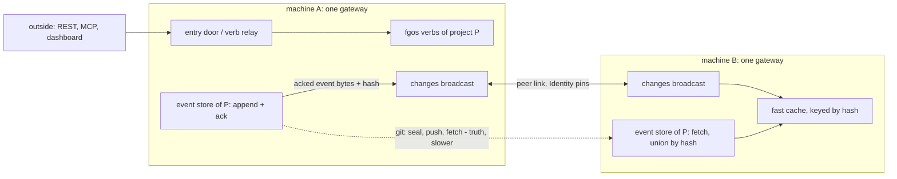

discussion: open

## 1. Trạng thái hiện tại

Round 2 (2026-11-27 16:05). Nothing is minted yet; the owner's role statement below is held as the frame for the next
rounds.

The owner restated the gateway's role (§5, 16:05): it is the **remote entry door** — it takes requests from outside and
calls the verbs inside (verb relay) — and it now also **talks to other gateways** and acts as a **changes broadcast**:
a change is pushed to the other machines fast, persistence (git) follows slower, and the two must never produce an
error. **One gateway per machine**, so serving many projects across many machines is a design concern, not an
afterthought.

This answered Q1 in direction: the change itself travels ahead, not only a doorbell. `q-vgjluy2gzf` is cancelled.
What is open now:

- How "never an error" holds when the fast copy and the persistent copy meet (shaper proposal in §3, row "No-error
  rule"; asked of the owner in chat).
- What "a change" covers: event-store events only, or also file content such as `plan.md` (§3).
- Q2 `{#Q2}` — `q-pke5ht4y5e`: which network the machines share (still parked).
- Today's gateway is per project (one root, fixed port 4170), so one-per-machine needs a project registry (§3).

Q1 `{#Q1}` — cancelled 2026-11-27 16:05, answered in chat (§5).

Handed off, outside this discussion: restarting today's gateway on fg-server needs an unconfined session (this head is
confined; `fgos gateway start` refused with `.fgos/locks/gateway.lock: Read-only file system`).

## 2. Mục tiêu & đề bài

Owner, 2026-11-27 15:54 (verbatim): "tìm cách khôi phục sự hoạt động của gateway, cần chia tách gateway lại thành
những component riêng biệt lo các việc riêng, và việc đầu tiên mong muốn nó xử lý là: 1) join các gateway ở các máy
khác nhau thành 1 cluster 2) gateway giúp điều phối nhiều project làm việc mượt trên nhiều máy 3) ứng dụng đầu tiên của
gateway là nhanh chóng truyền tải dữ liệu giữa các máy để việc điều phối của chúng luôn nhịp nhàng nhanh chóng và không
chồng lấp. ví du: mailbox quá chậm, events đi quá chậm, điều phối quá chậm. đầu tiên cần ứng dụng runtime để việc điều
phối plan/task được nhịp nhàng hơn (tất nhiên thông tin sự thật vẫn được lưu trữ trên file plan) nhưng có thể dữ liệu
sẽ đi trước bằng sự kiện điều phối trước."

Owner, 2026-11-27 16:05 (verbatim): "gateway là cổng vào remote, nó chình là đứa nhận request ngoài và gọi verb
bên trong, giờ thì nó thêm vai trò trao đổi với gateway khác, mỗi máy nên chỉ cần 1 gateway, nên việc quản nhiều
project accross nhiều máy là phải cân nhắc khi thiết kế, ngoài việc nó là verb relay, nó giờ sẽ là changes broadcast
(giúp thay đổi được đẩy nhanh, còn persistent thì sẽ chậm hơn, nhưng ko được phát sinh lỗi)"

The whole picture: the fgOS gateway (`apps/fgos-gateway`) is the remote entry door of a machine. It takes requests
from outside (REST, MCP, the web dashboard) and relays them to verbs inside. It is down today and has grown as one
2,900-line module; the owner wants it back and split into components that each own one job. Each machine runs exactly
one gateway, which serves every fgOS project on that machine. The gateways of the owner's machines (fg-server,
fg-server2, design-lap) join one cluster and gain a second role besides verb relay: changes broadcast. When something
changes on one machine (mail, an event, a plan or task being claimed), the change reaches the other machines in about a
second instead of a timer period, so coordination stays smooth and never overlaps. Persistence keeps its current path
and is allowed to be slower: the plan file and the event store's git refs stay the truth (L1, L3). The fast copy and
the persistent copy must never contradict each other or cause an error when they meet. The first use is plan/task
coordination.

## 3. Vấn đề rõ / chưa rõ

| Item | State | Evidence |
|---|---|---|
| The gateway is not running on fg-server | observed | `fgos gateway status --json` 2026-11-27 15:55: `running: false, reachable: false` |
| Why it stopped, and since when | partly observed | Last start log `.fgos/logs/gateway-1792920048266-1312696.log`, 2026-10-25 16:20, ends at "listening on 0.0.0.0:4170" with no error; the machine has been up since 2026-10-22, so no reboot killed it. Nothing restarts it (the door spawns one detached process; no service). Cause of the exit unknown |
| Restoring it needs an unconfined session | observed | `fgos gateway start` from this confined head: `lock-driver-unavailable: ... .fgos/locks/gateway.lock: Read-only file system (os error 30)`. Handed to the secretary/supervisor, not this discussion's work |
| The gateway today is one binary `apps/fgos-gateway`: `gateway.rs` 2,910 lines (REST routes, auth, questions, sessions), `mcp.rs` 768 (MCP search/execute), `cf_access.rs` 621 (Cloudflare Access JWT), `remote_invocation.rs` 501 (remote host invocation, only `distribution.build.show`), plus the embedded web bundle; owned by the `herdr-web-dashboard` row | observed | `wc -l apps/fgos-gateway/src/*.rs`; `docs/platform/system-overview/spec.md` lines 63, 185 |
| An earlier split moved the gateway out of the herdr plugin | observed | `plans/261004-1534-fgos-gateway-boundary-split/plan.md` (done) |
| The gateway spans projects; fgOS core acts on one project | observed | commit 27b622317 |
| How cross-machine data moves today | observed | Event store: events sealed on a cadence into `refs/fgos/events/<machine-id>`, machines push their own ref and fetch the others; "no online coordinator" (owner 2026-10-17) — `docs/platform/event-store/spec.md` sections 1, 12, 14. Remote mail is an event on `project:mailbox` (`remote-recorded`) — `docs/platform/agent-mailbox/spec.md` |
| Where the delay comes from | observed (cause), not yet measured end to end | `eventStore.sync.intervalSec` is 60 here (owner 2026-11-06: "mail should arrive in about a minute; an empty fetch measured 0.64 s"), default 300; `eventStore.seal.coalesceSec` 30. So a cross-machine hop waits up to seal + one timer period on the sender and one on the receiver. The git work itself is under a second |
| The gateway's roles | owner-stated 2026-11-27 16:05, held for a second round before a D-ID | (1) remote entry door and verb relay (exists: `FgosCliGateway` spawns `fgos` verbs, `apps/fgos-gateway/src/gateway.rs:361`; `remote_invocation.rs` relays one in-process operation); (2) exchange with other gateways; (3) changes broadcast. Not an online coordinator: no leases or arbitration (event-store spec: no online coordinator, owner 2026-10-17, untouched) |
| What travels ahead of git | owner-stated: the change itself, not only a doorbell; Q1 `q-vgjluy2gzf` cancelled | §5 16:05 |
| No-error rule (fast copy vs persistent copy) | shaper proposal, asked in chat 16:10 | Broadcast the **exact acked event bytes** with their event hash, never a second representation. The receiver keeps them in a fast, rebuildable cache keyed by hash; when git brings the sealed event it has the same hash, so the union by hash (event-store spec sections 10-11) folds it once and the cache entry drops. An event whose causal predecessor has not arrived is deferred exactly as the store already defers it (causal closure, section 12). Concurrency stays "provisional, conflict recorded by the consumer" as today. A broadcast lost or never sent costs only speed: the timer sync still delivers. Nothing the broadcast carries is ever written to a ref by the receiver |
| What "a change" covers | open, asked next | Events (mail, work, questions, plan claim) fit the rule above. A file such as `plan.md` is git content, not an event; the shaper proposes it travels as an event ("plan X claimed by Y at commit Z") while the file itself keeps the git path |
| One gateway per machine vs today | observed | Today one gateway serves one project: `run(root)` and `FgosCliGateway { root }` (`gateway.rs:1394-1408`), lock `.fgos/locks/gateway.lock` and logs under that project's `.fgos/`, fixed port 4170 (`gateway.rs:1935`); a second project on the same machine collides on the port. One-per-machine needs a machine-level home (state under `~/.fgos`, not a project's `.fgos`) and a registry of the machine's projects, each request and each broadcast naming its project |
| Network path between machines | open — **Q2** `q-pke5ht4y5e` | Gateway binds 0.0.0.0:4170; Cloudflare Access support exists; LAN/VPN unknown |
| Trust between cluster members | observed, reusable | Identity holds confirmed per-machine ssh-ed25519 pins (`fgos identity pins`, e.g. `design-lap-iezwlz` confirmed 2026-10-25); a peer link can authenticate with them |
| Plan placement and admission travel only through git pushes of `plan.md` | observed | `ds-izibwo45vm`, plan `261127-1535-plan-claim-who-and-where`; a gateway signal would run ahead of this, never replace it |
| Component split | open, next round | Shaper's first cut, to discuss: (1) peer link and membership (who is in the cluster, authenticated by Identity pins); (2) changes broadcast (send and receive the acked events; the fast cache on the receiving side); (5) project registry (which projects this machine serves); (3) entry door and verb relay (REST + MCP, today's routes); (4) dashboard (web bundle). Which of these is a crate vs a module, and which component row owns each, is not decided; `fgos authority locate` to run once the shape holds |
| Many projects on one gateway | open, next round | The event store and mailbox are per project (per clone); the gateway becomes per machine. Every broadcast and every relayed request names its project; how projects are identified across machines (same repo cloned on several machines vs different repos) is not decided |

## 4. Quyết định đã chốt

| ID | Decision | Date | Source |
|---|---|---|---|

## 5. Q&A log

- 2026-11-27 16:10 — Shaper round 1 scouted the gateway, event store and mailbox specs and the live gateway state
  (findings in §3). Parked Q1 (what may travel ahead of git) and Q2 (network between machines) in the question store.
  Q1 = `q-vgjluy2gzf`, Q2 = `q-pke5ht4y5e`.
- 2026-11-27 16:05 — Owner (verbatim in §2): the gateway is the remote entry door and verb relay; it now also exchanges
  with other gateways; one gateway per machine, so many projects across many machines must be designed for; besides
  verb relay it becomes a changes broadcast, pushing changes fast while persistence follows slower, with no error
  allowed. Read as: Q1 answered in direction (the change travels, not only a doorbell); Q1 cancelled.
- 2026-11-27 16:10 — Shaper: confirmed in code that today's gateway is per project (one root, fixed port 4170).
  Proposed the no-error rule (same bytes, same hash, union by hash, deferral by causal closure) and asked the owner in
  chat what "a change" covers.

## 6. Thiết kế đã chốt {#design}

Nothing settled yet. Working sketch for the next round, not a decision:

## 7. Danh mục hạng mục / task {#tasks}

Not yet; filled once §6 holds.
