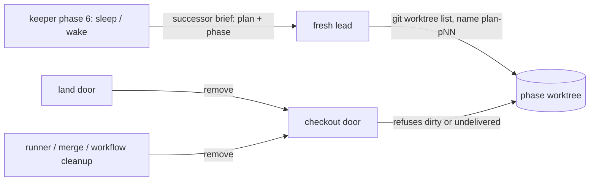

discussion: open

## 1. Trạng thái hiện tại

Round 2 (2026-11-23 15:10): Q1 answered A (derive). Owner added: no new sleep book; the sleep state goes into the
existing record of agents (§3 row 7, proposal: the head's placement record). Round 1 (2026-11-23 15:00, shaper ds-6psli4i4xl): the survey is done (§6). Finding: one component already owns
worktree make and remove, the checkout door `fgos-checkout` (`packages/execution/checkout`) over the git component.
Every remover goes through it, and it already refuses the two cases that would lose a sleeping lead's work. What the
hold still lacks is a proof, not a mechanism. One question is open: whether the sleep record must name the workspace
(the owner's wording) or whether the fresh lead finds it from the plan and git (the owner's "no second place" rule).
That is Q1 (§3), parked as `q-n2o2nbs2or`; the overlap rows do not wait on it. Two overlaps were found and are listed in §7 as candidate backlog rows.

Owner constraint 2026-11-23 15:05: the exit of this discussion is **not a new plan**. It only supplies what was
discussed, as amendments that make plan `261122-0056-orchestration-skeleton` more exact (phase 6 requirement, footprint
and verify). The hand-off goes to that plan's planner as an amendment request (§7 `#task-phase6-workspace-hold`).

## 2. Mục tiêu & đề bài

The owner wants a lead that sleeps until a time to be safe to stop: its worktrees, branches and unlanded changes must
survive while it sleeps, and the fresh lead that wakes must get the same workspace back instead of a clean checkout.
The sleep and wake itself belongs to plan `261122-0056-orchestration-skeleton` phase 6 (`keeper.rs`); this topic
only decides which existing component carries the workspace part, so that no second place tracks worktrees or wakes
sessions (owner direction in `p-g6heszkdc7`, L10). Survey and design only: no code, no new plan; the result is an
amendment to the existing skeleton plan (owner, 2026-11-23 15:05).

## 3. Vấn đề rõ / chưa rõ

| # | Point | State | Evidence / note |
|---|-------|-------|-----------------|
| 1 | Who makes and removes a linked worktree | Clear | `fgos-checkout` only; door rule `packages/component-authority/model/doors/checkout-make-provision-remove.json` |
| 2 | Is committed but unlanded work safe from every remover | Clear in code, unproven for the sleep case | `packages/git/rust/src/worktree.rs` refuses `worktree-delivery-unproven` (tip not in `--delivered-to`) |
| 3 | Is uncommitted work safe from every remover | Clear in code, unproven for the sleep case | `worktree.rs` refuses `worktree-dirty-preserved`; `packages/execution/checkout/src/orphan.rs` refuses uncommitted |
| 4 | Is a branch with unlanded commits safe from deletion | Clear | `src/runner/loop.mjs` deletes only 0-ahead branches not checked out; `src/runner/merge.mjs` deletes after merge |
| 5 | Locks and tickets a sleeping lead holds | Clear: none survive, by design | `dispatch-cwd` custody is a kernel lease that dies with its holder (`packages/run-supervisor/rust/src/controller/cwd_lock.rs`); a unit still running belongs to the run supervisor, not the lead |
| Q1 | Must the sleep record name the workspace, or does the fresh lead derive it from the plan and git | **Answered A (derive)** by the owner 2026-11-23 15:10, `q-n2o2nbs2or`; D-ID once it holds another round | The scheduling record (`{item, step, waitingOn, needs, outcome}`, skeleton phase 4) refuses unknown fields; the phase worktree is named `<plan dir>-p<NN>` by the lead skill (`core/skills/fgos-lead/SKILL.md` step 1) and `git worktree list` is the truth |
| 7 | Where the sleep state lives (asleep or active, wake time) | Proposed, owner to confirm: extend the head's existing placement record, no new store | Owner 15:10: no new book, extend the one that already tracks every agent. Identity's session directory (`<stateRoot>/identity/sessions/`, `docs/platform/identity/spec.md` local directory) holds only live sessions by rule (a dead head is never resolved or listed, dead entries are pruned), so a sleeping lead cannot stay in it. The Session Host's per-head record `.fgos/runtime/session-rotation/<role>/placement.json` (`writeHeadPlacement`, `src/session-host/head-start.mjs`) already outlives the session (`gen`, `startedAt`, `retiredAt`, `retiredReason`); adding `retiredReason: sleep`, `wakeAt` and plan/phase makes it the one place, and the skeleton's plan source (phase 5) reads `waitingOn.until` from it |
| 8 | What the waking lead gets of its previous session (transcript or not) | **Open**, Q2 `q-jwnker2n4y` (recommended: resume the old CLI session when below sessionRotation soft and the same CLI binds, else fresh with the handoff) | Today no successor gets a transcript: rotation hands over a redacted handoff (`<lineage>/<yymmdd-hhmm>-<sid8>.md`, `latest.json`) plus the old session's last assistant message read from the transcript (at most 8000 characters), printed at SessionStart (`docs/platform/session-host/spec.md`, rotation and hook sections). Skeleton phase 6 step 3 says the successor "receives the handoff" but no step writes one when the keeper stops a head with reason `sleep`: gap. No prior art for resuming the old CLI session (`git log --grep resume` on session-host) |
| 6 | Ignored bytes (cargo `target/`) of a sleeping lead's worktree | Clear: lost only once the branch has landed and the tree is clean, which loses no work | land door `--discard-ignored` path, `apps/fgos/src/wiring/supervision.rs` `run_land` |

## 4. Quyết định đã chốt

| D-ID | Decision | Date | Source |
|------|----------|------|--------|
| (none yet) | No point has held across more than one round. | | |

## 5. Q&A log

- 2026-11-23 14:5x, owner: "phát biểu lại mục tiêu của thảo luận này là gì". Shaper restated §2 and the four survey
  questions, with the first findings.
- 2026-11-23 15:00, shaper: survey written to §6; Q1 raised to the owner.
- 2026-11-23 15:05, owner: "orchestrate-skeleton đã có plan, vì vậy sau thảo luận này, đừng làm plan mới, chỉ cần cung
  cấp thông tin được thảo luận hoặc điều chỉnh để plan chính xác hơn." Recorded in §1, §2 and §7.
- 2026-11-23 15:10, owner: chose A for `q-n2o2nbs2or` (derive the workspace from plan and git). Added: no new
  sleep-record book; extend the existing book of running agents with asleep/active and wake time, one place only.
  Shaper: Identity's directory is live-only by rule, so the head's placement record is proposed instead (§3 row 7).
- 2026-11-23 15:18, owner: "agent transcript thì sao? khi nào một agent sẽ được cung cấp transcript của lần run trước,
  khi nào thì rotate mới không cần?" Shaper: §3 row 8.
- 2026-11-23 15:26, owner answered Q1 through the store: derive from plan and git; `q-n2o2nbs2or` acked.
- 2026-11-23 15:26, owner: many systems give the transcript on wake, why not here, what are the trade-offs. Shaper
  revised the "never" stance: resume is right for a light sleep, handoff for a full context; parked as Q2 `q-jwnker2n4y`.

- 2026-11-23 15:48, owner: what about using both 1a and 1b; what does 1b break; under 2a what happens when the account
  changes. Shaper analysis:
  - 1b (sleep state in Identity's directory) breaks five things: the locked I3b rule (a dead head is never resolved,
    listed, and is pruned at the 512 cap, on role take and `list --prune`), so sleeping entries need a new exempt state
    and can fill the cap; `startHeadSession` fronts the role holder by `ids.terminal.key`, whose pane is gone; the
    mailbox would resolve `head:lead-X` to a session no hook will ever run in, so mail sits until expiry instead of a
    clear `unknown-name`; the shared directory would publish a sleeping session to other machines; and Identity
    (infra, owns who a session is) would learn plan, phase and wake time, which design principle 2 forbids.
  - Both 1a and 1b as stores: one fact in two places, which drifts. Proposed instead: 1a is the only store, and the
    existing listing of sessions joins the head records read-only so one view shows live and sleeping agents.
  - 2a with an account change: a confined head runs in a private home per launch; finalize-home copies the session
    transcript into the run directory (`seatSessionDir`, `src/runner/dispatch/confinement/authority-twin.mjs`) before
    the home is removed. So the transcript survives any account change; resume copies it into the new launch's
    private home and resumes there. Same provider, other account: works in principle, the prompt cache is lost anyway
    (it is per account), and whether signed thinking blocks replay under another account is not yet verified, so
    the wake falls back to the handoff on a refused resume. Other provider (Claude to Codex): no resume, handoff.

## 6. Thiết kế đã chốt {#design}

Provisional until Q1 settles.

**Who owns what today.**

| Component | Owns for a workspace | Path / symbol |
|-----------|----------------------|---------------|
| git | the Git worktree port: create, remove, prune, refusal of dirty or undelivered trees, custody lease | `packages/git/rust/src/worktree.rs` `remove_worktree`; `refs.rs` `acquire_checkout_custody` |
| checkout door (execution) | the only caller of that port: make, provision, remove under custody, orphan reclaim | `packages/execution/checkout/src/work_remove.rs`, `orphan.rs`; verb `fgos worktree` (`apps/fgos/src/wiring/worktree.rs`) |
| run supervisor | the `dispatch-cwd` lease while a unit writes in a tree (process-bound) | `packages/run-supervisor/rust/src/controller/cwd_lock.rs`; `src/runner/execution/custody-door.mjs` |
| execution core | the unit's declared writes and commit; `.fgos/assignments/<unitRunId>/` keeps the run record, not a hold | `src/runner/execution/unit.mjs` |
| land door (supervision wiring) | removes the landed branch's worktree through the checkout door, reports kept ones | `apps/fgos/src/wiring/supervision.rs` `run_land` (commit `49c4081c5`, the main part of `p-6sd4fslxv7`) |
| session host / rotation | the session only; no worktree or branch field | `src/session-host/`, `src/session-rotation/` |
| keeper (skeleton plan) | sleep and wake of a head by its scheduling records | plan `261122-0056` phases 4 and 6 |

**Where the hold belongs.** In the checkout door, which already refuses every removal that would lose a sleeping
lead's work. Nothing new needs to be stored to *keep* the work. To *hand it back*, the fresh lead needs the phase's
worktree; the lead skill already names it `<plan dir>-p<NN>` and reuses one per phase, so the keeper's successor
brief can point at it. What is missing is the proof the owner asked for: one owning test in phase 6 that sleeps a lead
with an unlanded change, runs a land and a cleanup, wakes it and shows the change is still in the same worktree.

## 7. Danh mục hạng mục / task {#tasks}

### Workspace hold as a phase 6 requirement {#task-phase6-workspace-hold}

Goal: the owner's hold, delivered inside skeleton phase 6, with no new store. Form: an amendment to the existing plan
`261122-0056-orchestration-skeleton`, never a new plan (owner, 2026-11-23 15:05). Proposed amendments to
`phase-06-sleep-and-wake.md`: (a) Inputs add the checkout door (`packages/execution/checkout/src/work_remove.rs`) and
the lead skill's worktree naming; (b) a step saying the successor brief names plan and phase so the fresh lead reuses
worktree `<plan dir>-p<NN>`, or the Q1 alternative if the owner chooses it; (c) Verify adds the owning test below;
(d) footprint adds that test's file; (e) the sleep state (`retiredReason: sleep`, `wakeAt`, plan, phase) is written
to the head's placement record (`src/session-host/head-start.mjs` `writeHeadPlacement`) and the plan source of phase 5
reads `waitingOn.until` from it, so no sleep-record store is added (§3 row 7); (f) how the woken lead gets its previous session, per Q2 (§3 row 8); in every branch sleep writes a handoff
through the rotation handoff writer (reason `sleep`), which phase 6 step 3 assumes but no step writes today. D-IDs: none yet (waits on Q1). Draft verify: `cargo test -p fgos-supervision --test keeper` plus one owning test that sleeps a lead with an unlanded
change, lands another branch, runs the cleanup, wakes and finds the change in the same worktree.

### Overlap: a second worktree creator beside the checkout door {#task-overlap-workflow-create}

`createWorktreeCheckoutSync` (`src/runner/repo-locks.mjs`) calls the Git worktree port directly; its one importer is
`src/workflow/unit-handoff.mjs`. The door rule says only `fgos-checkout` makes a linked checkout. Candidate backlog
row, separate from this topic.

### Overlap: three places judge "removable" with their own bookkeeping {#task-overlap-kept-lists}

The land door (`worktreesKept`), the workflow (`cleanupWorkflowWorktree` and its kept list in
`src/workflow/unit-handoff.mjs`) and the runner (`listLeftovers`, `kept` in `src/runner/loop.mjs`) each keep their
own kept-worktree list over the same door. Candidate backlog row, to check whether one report belongs in the door.
