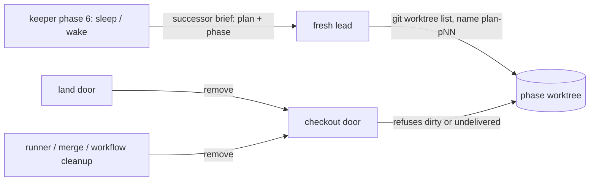

discussion: open

## 1. Trạng thái hiện tại

Round 1 (2026-11-23 15:00, shaper ds-6psli4i4xl): the survey is done (§6). Finding: one component already owns
worktree make and remove, the checkout door `fgos-checkout` (`packages/execution/checkout`) over the git component.
Every remover goes through it, and it already refuses the two cases that would lose a sleeping lead's work. What the
hold still lacks is a proof, not a mechanism. One question is open: whether the sleep record must name the workspace
(the owner's wording) or whether the fresh lead finds it from the plan and git (the owner's "no second place" rule).
That is Q1 (§3), parked as `q-n2o2nbs2or`; the overlap rows do not wait on it. Two overlaps were found and are listed in §7 as candidate backlog rows.

## 2. Mục tiêu & đề bài

The owner wants a lead that sleeps until a time to be safe to stop: its worktrees, branches and unlanded changes must
survive while it sleeps, and the fresh lead that wakes must get the same workspace back instead of a clean checkout.
The sleep and wake itself belongs to plan `261122-0056-orchestration-skeleton` phase 6 (`keeper.rs`); this topic
only decides which existing component carries the workspace part, so that no second place tracks worktrees or wakes
sessions (owner direction in `p-g6heszkdc7`, L10). Survey and design only: no code, no plan.

## 3. Vấn đề rõ / chưa rõ

| # | Point | State | Evidence / note |
|---|-------|-------|-----------------|
| 1 | Who makes and removes a linked worktree | Clear | `fgos-checkout` only; door rule `packages/component-authority/model/doors/checkout-make-provision-remove.json` |
| 2 | Is committed but unlanded work safe from every remover | Clear in code, unproven for the sleep case | `packages/git/rust/src/worktree.rs` refuses `worktree-delivery-unproven` (tip not in `--delivered-to`) |
| 3 | Is uncommitted work safe from every remover | Clear in code, unproven for the sleep case | `worktree.rs` refuses `worktree-dirty-preserved`; `packages/execution/checkout/src/orphan.rs` refuses uncommitted |
| 4 | Is a branch with unlanded commits safe from deletion | Clear | `src/runner/loop.mjs` deletes only 0-ahead branches not checked out; `src/runner/merge.mjs` deletes after merge |
| 5 | Locks and tickets a sleeping lead holds | Clear: none survive, by design | `dispatch-cwd` custody is a kernel lease that dies with its holder (`packages/run-supervisor/rust/src/controller/cwd_lock.rs`); a unit still running belongs to the run supervisor, not the lead |
| Q1 | Must the sleep record name the workspace, or does the fresh lead derive it from the plan and git | **Open**, `q-n2o2nbs2or` (recommended: derive) | The scheduling record (`{item, step, waitingOn, needs, outcome}`, skeleton phase 4) refuses unknown fields; the phase worktree is named `<plan dir>-p<NN>` by the lead skill (`core/skills/fgos-lead/SKILL.md` step 1) and `git worktree list` is the truth |
| 6 | Ignored bytes (cargo `target/`) of a sleeping lead's worktree | Clear: lost only once the branch has landed and the tree is clean, which loses no work | land door `--discard-ignored` path, `apps/fgos/src/wiring/supervision.rs` `run_land` |

## 4. Quyết định đã chốt

| D-ID | Decision | Date | Source |
|------|----------|------|--------|
| (none yet) | No point has held across more than one round. | | |

## 5. Q&A log

- 2026-11-23 14:5x, owner: "phát biểu lại mục tiêu của thảo luận này là gì". Shaper restated §2 and the four survey
  questions, with the first findings.
- 2026-11-23 15:00, shaper: survey written to §6; Q1 raised to the owner.

## 6. Thiết kế đã chốt {#design}

Provisional until Q1 settles.

**Who owns what today.**

| Component | Owns for a workspace | Path / symbol |
|-----------|----------------------|---------------|
| git | the Git worktree port: create, remove, prune, refusal of dirty or undelivered trees, custody lease | `packages/git/rust/src/worktree.rs` `remove_worktree`; `refs.rs` `acquire_checkout_custody` |
| checkout door (execution) | the only caller of that port: make, provision, remove under custody, orphan reclaim | `packages/execution/checkout/src/work_remove.rs`, `orphan.rs`; verb `fgos worktree` (`apps/fgos/src/wiring/worktree.rs`) |
| run supervisor | the `dispatch-cwd` lease while a unit writes in a tree (process-bound) | `packages/run-supervisor/rust/src/controller/cwd_lock.rs`; `src/runner/execution/custody-door.mjs` |
| execution core | the unit's declared writes and commit; `.fgos/assignments/<unitRunId>/` keeps the run record, not a hold | `src/runner/execution/unit.mjs` |
| land door (supervision wiring) | removes the landed branch's worktree through the checkout door, reports kept ones | `apps/fgos/src/wiring/supervision.rs` `run_land` (commit `49c4081c5`, the main part of `p-6sd4fslxv7`) |
| session host / rotation | the session only; no worktree or branch field | `src/session-host/`, `src/session-rotation/` |
| keeper (skeleton plan) | sleep and wake of a head by its scheduling records | plan `261122-0056` phases 4 and 6 |

**Where the hold belongs.** In the checkout door, which already refuses every removal that would lose a sleeping
lead's work. Nothing new needs to be stored to *keep* the work. To *hand it back*, the fresh lead needs the phase's
worktree; the lead skill already names it `<plan dir>-p<NN>` and reuses one per phase, so the keeper's successor
brief can point at it. What is missing is the proof the owner asked for: one owning test in phase 6 that sleeps a lead
with an unlanded change, runs a land and a cleanup, wakes it and shows the change is still in the same worktree.

## 7. Danh mục hạng mục / task {#tasks}

### Workspace hold as a phase 6 requirement {#task-phase6-workspace-hold}

Goal: the owner's hold, delivered inside skeleton phase 6, with no new store. D-IDs: none yet (waits on Q1). Draft
verify: `cargo test -p fgos-supervision --test keeper` plus one owning test that sleeps a lead with an unlanded
change, lands another branch, runs the cleanup, wakes and finds the change in the same worktree.

### Overlap: a second worktree creator beside the checkout door {#task-overlap-workflow-create}

`createWorktreeCheckoutSync` (`src/runner/repo-locks.mjs`) calls the Git worktree port directly; its one importer is
`src/workflow/unit-handoff.mjs`. The door rule says only `fgos-checkout` makes a linked checkout. Candidate backlog
row, separate from this topic.

### Overlap: three places judge "removable" with their own bookkeeping {#task-overlap-kept-lists}

The land door (`worktreesKept`), the workflow (`cleanupWorkflowWorktree` and its kept list in
`src/workflow/unit-handoff.mjs`) and the runner (`listLeftovers`, `kept` in `src/runner/loop.mjs`) each keep their
own kept-worktree list over the same door. Candidate backlog row, to check whether one report belongs in the door.
