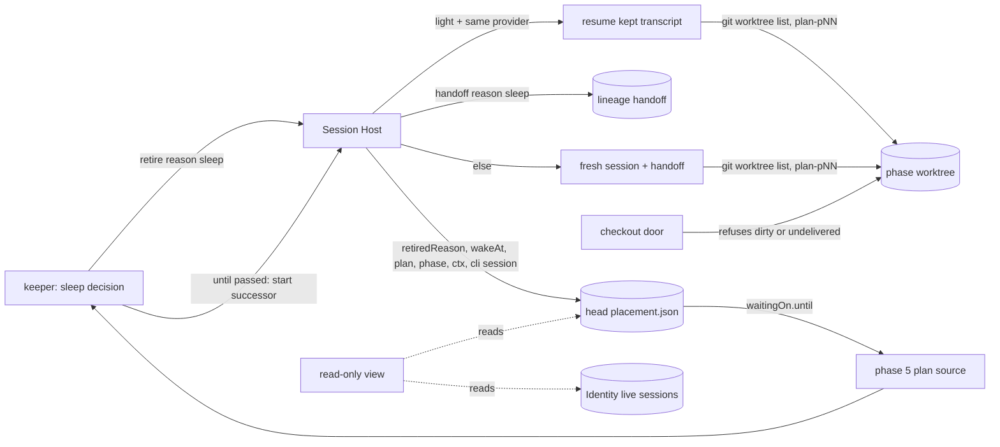

discussion: settled

## Hand-off {#handoff}

**To:** the planner of plan `261122-0056-orchestration-skeleton`, as an amendment to phase 6 (and the phase 5 plan
source). **Not a new plan** (owner, 2026-11-23 15:05).

**Outcome.** A lead that sleeps until a time loses nothing: its worktree and unlanded changes survive, the sleep state
lives in one existing record, and the woken lead continues in the same worktree with as much of its previous session
as is safe to carry.

**Constraints.** No new store of worktrees and no new sleep-record book (owner); git is the truth for worktrees
(D1); the sleep state lives in the Session Host's head record (D2); the sleep and wake mechanism stays the keeper of
phases 4 to 6 (L10); Identity's directory stays live-only (its locked I3b rule).

**Non-goals.** Changing the checkout door's refusal rules, rotation thresholds or the handoff format of ordinary
rotations; the two overlaps in §7, which are separate backlog rows for Miu.

**Amendments to `phase-06-sleep-and-wake.md` (acceptance criteria).**

- (a) Inputs add the checkout door (`packages/execution/checkout/src/work_remove.rs`), the lead skill's worktree
  naming (`core/skills/fgos-lead/SKILL.md` step 1) and `src/session-host/head-start.mjs` (`writeHeadPlacement`).
- (b) Step: the woken lead's brief names plan and phase; the lead reuses worktree `<plan dir>-p<NN>` found through
  `git worktree list` (D1).
- (c) Step: the keeper's stop with reason `sleep` is a Session Host retire that writes `retiredReason: sleep`,
  `wakeAt`, plan, phase, the context fraction and the CLI session id into the head's
  `.fgos/runtime/session-rotation/<role>/placement.json`; the phase 5 plan source reads `waitingOn.until` from it (D2).
- (d) Step: one read-only view, owned by the Session Host, lists live and sleeping agents by joining Identity's
  directory (live sessions) with the head records; it writes nothing (D2).
- (e) Step: every sleep writes a handoff through the rotation handoff writer (reason `sleep`); phase 6 step 3 assumes
  it and no step writes it today. On wake: below `sessionRotation` soft and the same provider binds, resume the kept
  transcript in the new launch's private home with a wake line to re-read plan and git first; otherwise, or when the
  transcript was not kept or the resume is refused, a fresh session with the handoff (D3).
- (f) Verify adds owning tests: a lead slept with an unlanded change survives a land and a cleanup and finds the change
  in the same worktree on waking; a light sleep resumes, a heavy one and a refused resume get the handoff; the view
  shows a sleeping head. Footprint adds those test files and the Session Host files above.

**Open points.** Whether a signed thinking block replays under another account of the same provider is unverified;
(e)'s fallback covers it, and the planner's test should prove the fallback, not assume the replay.

## 1. Trạng thái hiện tại

Settled 2026-11-23 15:56. Three decisions (§4): the woken lead finds its worktree from plan and git (D1); the sleep
state goes into the Session Host's existing head record, with one read-only view of live and sleeping agents (D2); a
woken lead resumes its kept transcript when the sleep was light and the provider matches, else gets the handoff (D3).
The result goes to the skeleton plan's planner as phase 6 amendments (hand-off above), not as a new plan. Two
overlaps found in the survey wait for Miu as separate backlog rows (§7).

## 2. Mục tiêu & đề bài

The owner wants a lead that sleeps until a time to be safe to stop: its worktrees, branches and unlanded changes must
survive while it sleeps, and the fresh lead that wakes must get the same workspace back instead of a clean checkout.
The sleep and wake itself belongs to plan `261122-0056-orchestration-skeleton` phase 6 (`keeper.rs`); this topic
only decides which existing component carries the workspace part, so that no second place tracks worktrees or wakes
sessions (owner direction in `p-g6heszkdc7`, L10). Survey and design only: no code, no new plan; the result is an
amendment to the existing skeleton plan (owner, 2026-11-23 15:05).

## 3. Vấn đề rõ / chưa rõ

| # | Point | State | Evidence / note |
|---|-------|-------|-----------------|
| 1 | Who makes and removes a linked worktree | Clear | `fgos-checkout` only; door rule `packages/component-authority/model/doors/checkout-make-provision-remove.json` |
| 2 | Is committed but unlanded work safe from every remover | Clear in code, proof owed by (f) | `packages/git/rust/src/worktree.rs` refuses `worktree-delivery-unproven` (tip not in `--delivered-to`) |
| 3 | Is uncommitted work safe from every remover | Clear in code, proof owed by (f) | `worktree.rs` refuses `worktree-dirty-preserved`; `packages/execution/checkout/src/orphan.rs` refuses uncommitted |
| 4 | Is a branch with unlanded commits safe from deletion | Clear | `src/runner/loop.mjs` deletes only 0-ahead branches not checked out; `src/runner/merge.mjs` deletes after merge |
| 5 | Locks and tickets a sleeping lead holds | Clear: none survive, by design | `dispatch-cwd` custody is a kernel lease that dies with its holder (`packages/run-supervisor/rust/src/controller/cwd_lock.rs`); a unit still running belongs to the run supervisor, not the lead |
| 6 | Ignored bytes (cargo `target/`) of a sleeping lead's worktree | Clear: lost only once the branch has landed and the tree is clean, which loses no work | land door `--discard-ignored` path, `apps/fgos/src/wiring/supervision.rs` `run_land` |
| Q1 | Must the sleep record name the workspace, or does the fresh lead derive it | Settled D1 | `q-n2o2nbs2or` answered and acked |
| 7 | Where the sleep state lives | Settled D2 | Session Host is canonical for the placement port (`retire`) and the head lineage files (`docs/platform/session-host/spec.md`); Identity's directory is live-only by its locked rule |
| 8 | What the woken lead gets of its previous session | Settled D3 | owner 15:56; `q-jwnker2n4y` cancelled as answered in chat |
| 9 | Does a signed thinking block replay under another account | Open, does not block | covered by the fallback in (e) |

## 4. Quyết định đã chốt

| D-ID | Decision | Date | Source |
|------|----------|------|--------|
| D1 | The woken lead finds its worktree from plan and git (`<plan dir>-p<NN>`, `git worktree list`); nothing stores a copy. Safety stays in the checkout door's refusals. | 2026-11-23 | owner 15:10 in chat, 15:26 through `q-n2o2nbs2or` |
| D2 | The sleep state (`retiredReason: sleep`, `wakeAt`, plan, phase, context fraction, CLI session id) lives in the Session Host's head record `placement.json`, the only store. One read-only view owned by the Session Host joins Identity's live sessions with the head records. Identity's directory is unchanged. | 2026-11-23 | owner 15:10 (no new book), 15:56 ("đồng ý 1a cộng một màn hình xem chung") |
| D3 | Every sleep writes a handoff (reason `sleep`). On wake: resume the kept transcript when the context was below `sessionRotation` soft and the same provider binds, with a re-read line; else, or when the transcript was not kept or the resume is refused, a fresh session with the handoff. | 2026-11-23 | owner 15:26 (question), 15:56 ("2a vẫn đảm bảo") |

## 5. Q&A log

- 2026-11-23 14:5x, owner: "phát biểu lại mục tiêu của thảo luận này là gì". Shaper restated §2 and the four survey
  questions, with the first findings.
- 2026-11-23 15:00, shaper: survey written to §6; Q1 raised to the owner.
- 2026-11-23 15:05, owner: "orchestrate-skeleton đã có plan, vì vậy sau thảo luận này, đừng làm plan mới, chỉ cần cung
  cấp thông tin được thảo luận hoặc điều chỉnh để plan chính xác hơn." Recorded in §1, §2 and §7.
- 2026-11-23 15:10, owner: chose A for `q-n2o2nbs2or` (derive the workspace from plan and git). Added: no new
  sleep-record book; extend the existing book of running agents with asleep/active and wake time, one place only.
  Shaper: Identity's directory is live-only by rule, so the head's placement record is proposed instead (§3 row 7).
- 2026-11-23 15:18, owner: "agent transcript thì sao? khi nào một agent sẽ được cung cấp transcript của lần run trước,
  khi nào thì rotate mới không cần?" Shaper: §3 row 8.
- 2026-11-23 15:26, owner answered Q1 through the store: derive from plan and git; `q-n2o2nbs2or` acked.
- 2026-11-23 15:26, owner: many systems give the transcript on wake, why not here, what are the trade-offs. Shaper
  revised the "never" stance: resume is right for a light sleep, handoff for a full context; parked as Q2 `q-jwnker2n4y`.
- 2026-11-23 15:48, owner: what about using both 1a and 1b; what does 1b break; under 2a what happens when the account
  changes. Shaper analysis:
  - 1b (sleep state in Identity's directory) breaks five things: the locked I3b rule (a dead head is never resolved,
    listed, and is pruned at the 512 cap, on role take and `list --prune`), so sleeping entries need a new exempt state
    and can fill the cap; `startHeadSession` fronts the role holder by `ids.terminal.key`, whose pane is gone; the
    mailbox would resolve `head:lead-X` to a session no hook will ever run in, so mail sits until expiry instead of a
    clear `unknown-name`; the shared directory would publish a sleeping session to other machines; and Identity
    (infra, owns who a session is) would learn plan, phase and wake time, which design principle 2 forbids.
  - Both 1a and 1b as stores: one fact in two places, which drifts. Proposed instead: 1a is the only store, and the
    existing listing of sessions joins the head records read-only so one view shows live and sleeping agents.
  - 2a with an account change: a confined head runs in a private home per launch; finalize-home copies the session
    transcript into the run directory (`seatSessionDir`, `src/runner/dispatch/confinement/authority-twin.mjs`) before
    the home is removed. So the transcript survives any account change; resume copies it into the new launch's
    private home and resumes there. Same provider, other account: works in principle, the prompt cache is lost anyway
    (it is per account), and whether signed thinking blocks replay under another account is not yet verified, so
    the wake falls back to the handoff on a refused resume. Other provider (Claude to Codex): no resume, handoff.
- 2026-11-23 15:56, owner: agrees "1a cộng một màn hình xem chung (chỉ đọc)" and asks which component and authority
  own it; on 2: every agent has its own home so the transcript exists, it is only how the new session is organised, so
  2a holds. Shaper: the Session Host owns it (canonical for the placement port and head lineage files; the view reads
  Identity, a lower layer, never the reverse). 2a holds with one nuance: the kept copy can be missing (warnings
  `session-dir-undeclared`, `session-not-written`, `session-copy-failed` in `keepSessionBeforeRemoval`) and a Codex
  rollout is not read today, so the handoff fallback stays. D1 to D3 minted; `q-jwnker2n4y` cancelled; settled.

## 6. Thiết kế đã chốt {#design}

**Who owns what today.**

| Component | Owns for a workspace or a sleeping head | Path / symbol |
|-----------|------------------------------------------|---------------|
| git | the Git worktree port: create, remove, prune, refusal of dirty or undelivered trees, custody lease | `packages/git/rust/src/worktree.rs` `remove_worktree`; `refs.rs` `acquire_checkout_custody` |
| checkout door (execution) | the only caller of that port: make, provision, remove under custody, orphan reclaim | `packages/execution/checkout/src/work_remove.rs`, `orphan.rs`; verb `fgos worktree` (`apps/fgos/src/wiring/worktree.rs`) |
| run supervisor | the `dispatch-cwd` lease while a unit writes in a tree (process-bound) | `packages/run-supervisor/rust/src/controller/cwd_lock.rs`; `src/runner/execution/custody-door.mjs` |
| execution core | the unit's declared writes and commit; `.fgos/assignments/<unitRunId>/` keeps the run record and the kept transcript, not a hold | `src/runner/execution/unit.mjs`; `seatSessionDir` |
| land door (supervision wiring) | removes the landed branch's worktree through the checkout door, reports kept ones | `apps/fgos/src/wiring/supervision.rs` `run_land` (commit `49c4081c5`, the main part of `p-6sd4fslxv7`) |
| Identity | who a live session is; live-only by its locked rule | `docs/platform/identity/spec.md` local directory |
| Session Host | placing and retiring a head; the head record and lineage files; after D2 also the sleep state and the read-only view | `src/session-host/head-start.mjs` `writeHeadPlacement`; `docs/platform/session-host/spec.md` |
| keeper (skeleton plan) | deciding sleep and wake from scheduling records | plan `261122-0056` phases 4 to 6 |

**The design.** Work stays safe because every remover goes through the checkout door, which refuses a dirty or
undelivered worktree; nothing extra is stored for that (D1). When the keeper puts a lead to sleep, the Session Host
retires the head with reason `sleep` and writes the wake time and the facts the wake needs into the head's existing
record; the plan source reads the wake time from there, and one read-only view shows live and sleeping agents (D2).
The sleep also writes a handoff. On wake the keeper starts the successor through the existing start path: it resumes
the kept transcript when that is light and the provider matches, else it opens fresh with the handoff, and in both
cases the lead re-reads plan and git and reuses its phase worktree (D3).

## 7. Danh mục hạng mục / task {#tasks}

### Phase 6 amendments of the orchestration skeleton plan {#task-phase6-workspace-hold}

Goal: the hand-off block above, applied by the skeleton plan's planner to `phase-06-sleep-and-wake.md` (and the phase
5 plan source). D-IDs: D1, D2, D3. Siblings: none; it is not a new plan. Draft verify:
`cargo test -p fgos-supervision --test keeper` plus the owning tests of (f).

### Overlap: a second worktree creator beside the checkout door {#task-overlap-workflow-create}

`createWorktreeCheckoutSync` (`src/runner/repo-locks.mjs`) calls the Git worktree port directly; its one importer is
`src/workflow/unit-handoff.mjs`. The door rule says only `fgos-checkout` makes a linked checkout. Candidate backlog
row for Miu, separate from this topic.

### Overlap: three places judge "removable" with their own bookkeeping {#task-overlap-kept-lists}

The land door (`worktreesKept`), the workflow (`cleanupWorkflowWorktree` and its kept list in
`src/workflow/unit-handoff.mjs`) and the runner (`listLeftovers`, `kept` in `src/runner/loop.mjs`) each keep their
own kept-worktree list over the same door. Candidate backlog row for Miu, to check whether one report belongs in the
door.
