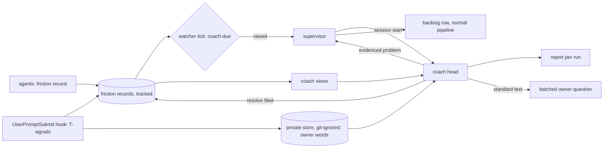

discussion: open

## Seed

Opened by the secretary (Miu) on the owner's order relayed by the owner-communication shaper, 2026-11-22 19:50.

- **Owner's goal:** a coach agent that the supervisor starts at the right moment and that learns from the observe metrics and the friction records. Observe is hardened with ready-made views built for the coach, in the manner of the owner's repository `vantt/pkm`. Automatic capture of the owner's reactions to agent messages (OC-D13, dropped from the communication standard plan) belongs here.
- **To shape:** when the supervisor starts the coach (trigger and budget); which observe views and friction records it reads; what it produces, for whom, and where; how owner-reaction capture works and is stored privately; what a first increment is.
- **Read first:** `plans/discussions/ds-cfsfcbknl6-owner-communication/DISCUSSION.md` (decisions OC-D11 to OC-D14), the observe area spec, and prior art by `git log -S` on friction and observe symbols.
- **Constraints:** one door, hexagonal and pluggable; the owner's reactions are private data and are not sent to an external service; bring owner decisions as five-part questions with a recommendation and a default.
- **Non-goals:** writing the coach; the communication standard itself (`ds-cfsfcbknl6`).
- **Source ids:** `p-kmavlfevvu`.

## 1. Trạng thái hiện tại

Round 1 (2026-11-22 20:10), shaper only, no owner exchange yet. Scouted prior art, the observe spec, the supervision watcher and `vantt/pkm`'s agent views. Found that the coach's scope and hand-off are **already settled** in the sibling discussion (OC-D5), so this discussion does not reopen them; it shapes the parts OC-D5 left open. Drafted a provisional shape (section 6) for all five seed points.

- **Settled by inheritance:** coach scope and hand-off (OC-D5), friction store as the case log (OC-D4), T1-T12 signal list (provisional, sibling section 6 step 3).
- **Decided by the shaper inside the frame:** owner words never go into a git-tracked file (the seed's privacy constraint plus the finding in section 3, row "Privacy"); the trigger is a watcher definition, like `discussion-settled` starting the planner.
- **Open, asked:** Q1 `q-6yhs63ru4i` (how to build the coach views: extend the named query definitions, or a pkm-style SQLite projection with SQL views). Blocks only the views task; everything else proceeds.
- **Open, provisional defaults:** trigger thresholds and budget numbers (section 3).
- **For another session:** the sibling plan's friction duty quotes the owner's words into friction detail, which lands in a store git does not ignore (section 3, row "Privacy"). The secretary should route this to the communication-standard planner.

## 2. Mục tiêu & đề bài

fgOS already writes two kinds of learning material: metrics records and friction records (`fgos metrics`, `fgos friction`, both in `packages/observe/rust`), and the communication standard adds a third, the owner's reactions to agent messages (signals T1-T12). Nobody reads them on a schedule: the friction store's top classes are from August and September, and no session owns "look at what keeps going wrong and fix the cause". OC-D5 named that job the coach: a head the supervisor starts, which collects signals, diagnoses the real cause, proposes a fix capped per batch, measures the signature's count afterwards, and deletes or merges rules as readily as it adds them; a small text change to the standard goes to the owner in a batch, anything else goes back to the supervisor as an evidenced problem that becomes a backlog row. This discussion settles what OC-D5 left open: the moment and budget of a coach run, the ready-made views the coach reads so it gets aggregated data fast (the owner's model is `vantt/pkm`'s versioned agent views), what the coach writes and where, how the owner's reactions are captured automatically and kept private, and the smallest first increment.

## 3. Vấn đề rõ / chưa rõ

| Point | State | Evidence | Current reading |
|---|---|---|---|
| Coach scope and hand-off | **settled, inherited (OC-D5)** | `ds-cfsfcbknl6` DISCUSSION.md, OC-D5 row; owner 17:37 and 17:45 | Not reopened here. The coach owns the learning loop only; there are no standing area owners; hand-off goes through the supervisor to a backlog row, with a fast path for small standard text. |
| Case log | **settled, inherited (OC-D4)** | OC-D4 row | Raw cases are friction records; curated examples live in the standard. |
| Prior art | **clear** | `git log -S coach`: only the two discussions of today, no code, no persona in `core/agents/`. The nearest ancestor is the retrospective loop of tsk-1lv (`a670be686`, 2026-08-17: a "4-door check" inside a retrospective batch loop that recorded frictions), with `fgos-coding-knowledge` triggered on the work-item status `retrospective`. Its frictions are the top of `fgos friction rank` today (`retrospective-door-docDeferral` 64, `-routing` 29), last seen 2026-09-11, so that loop stopped producing when work moved from work items to heads and plans. Adjacent skills: `instruction-audit` (read-only periodic audit of the instruction surface) and `distill`. | The coach is new, but it should reuse: `instruction-audit` as one of its tools for rule changes, `fgos friction rank`/`resolve --reason filed:<id>` as its intake and close, and the watcher's definition-to-event-to-supervisor door for its start. The retrospective loop is not revived: it was tied to work-item statuses that no longer drive work. |
| When the supervisor starts the coach | **shaper decision on the door; numbers provisional** | `docs/platform/supervision/spec.md` lines 38, 121, 129: the watcher (Rust, no LLM) runs detection definitions each tick, records raised events, and the supervisor acts per row kind; `discussion-settled` already starts a planner this way. Definitions are `*.query.json` files run through `fgos metrics query` (`core/attention/definitions/`). | A watcher definition `coach-due` raises an event; the supervisor starts one coach head (`head:coach-<handle>`), never two. Provisional rule: raise when an unsettled friction signature reaches **3** records, or **5** new owner-communication frictions have arrived since the last coach run, or, as a floor, **7 days** passed with any unsettled friction. Reversal trigger: the coach's own report shows runs with nothing worth proposing (raise the thresholds) or a repeated fault that waited too long (lower them). |
| Coach budget | **provisional** | OC-D5 "thresholded and capped per batch" | One run handles at most **3** signatures and makes at most **3** proposals; it stops after its report. Numbers go to config (`coach.*` keys in `core/config-standard`), not code. |
| Coach views (how to build them) | **open, Q1 `q-6yhs63ru4i`** | Observe has a query grammar with join, anti-join, latest-per and having, plus named definitions in `*.query.json` (`packages/observe/rust/src/definition/`; observe spec section "Record contract v2"). `vantt/pkm` (`docs/agent-views.md`) builds a SQLite index from files that can always be rebuilt, exposes versioned SQL views (`v_note`, `v_link`, `v_issue` ...), records versions in an `agent_views` table, and holds names, versions and columns by contract tests; the agent opens it with `sqlite3 -readonly`. L3 ("truth in JSONL, the database is a view") allows either. | See Q1 in section 5 and the question store. Default while unanswered: named definitions first, SQL projection only on measured need. |
| What the coach reads | **clear in outline** | Friction records (layer, class, refs), run and unit records (`fgos.run.attempt`, `fgos.unit.verify`), plan activity, question records (`fgos.question.*`, declared but not yet produced), owner-reaction records (below) | Exact view list follows Q1; draft list in section 6. |
| What the coach produces | **shaper draft** | OC-D5 hand-off | One report per run (path from `fgos convention path --kind report`), at most 3 proposals; a batched owner question for standard text; a supervisor event per evidenced problem (the supervisor files the backlog row; the coach does not write the backlog); `friction resolve --class <sig> --reason filed:<backlog-id>` once filed; a before/after count per signature in the next run's report. |
| Owner-reaction capture | **shaper draft, reuses a dropped plan phase** | `plans/261122-1751-owner-communication-standard/phase-02-capture-owner-reaction.md` (commit `c61de4c1c`, dropped by OC-D13) already designed it: a Claude Code `UserPromptSubmit` hook `fgos hook owner-reaction`, built like `apps/fgos/src/wiring/questions_hook.rs`, matching text-detectable signals (T1, T3, T4, T5, T6, T8, T9) from a data file `owner-signals.v1.json`, recording one friction per matched signature, exit 0 on every path. | Reuse that design with one change, privacy (next row). Codex and other CLIs get it later, through their own hook adapters. |
| Privacy of the owner's words | **shaper decision inside the frame; one item for another session** | `git check-ignore` matches nothing under `.fgos/observe/`; `git ls-files .fgos/observe` lists a committed friction shard (`friction/pid-2016389.jsonl`) and eval shards; `records/` is untracked but not ignored, and `.fgos` sync chores have committed `.fgos` trees before (`fbb52c64c`, `c3b0de893`). The remote is GitHub, an external service. | The tracked friction record holds only the signature, signal id, session and refs. The owner's words and the agent's previous message go to a **local private store that git ignores** (draft: `.fgos/observe/private/<writerId>.jsonl`, with a `.gitignore` entry and a doctor-free rule test), referenced from the friction record by id. The coach reads both locally. **Another session:** the sibling plan's OC-D14 duty tells agents to quote the owner's words in `friction record --detail`, which would put them in the tracked store; its planner should point quoting at the private store. |
| First increment | **shaper draft** | — | Section 7: coach persona and skill plus the `coach-due` definition first (reads today's friction with no new views), then the views, then reaction capture. |

## 4. Quyết định đã chốt

| ID | Decision | Source | Date |
|---|---|---|---|

No decision minted yet: the shaper decisions in section 3 have held for one round only. Inherited and not re-minted: OC-D4, OC-D5 (`ds-cfsfcbknl6`).

## 5. Q&A log

- 2026-11-22 20:10 — Round 1, shaper. Read the seed, OC-D4/OC-D5/OC-D11-D14, the observe spec, the supervision spec, the dropped phase-02 plan, `fgos friction rank` and `vantt/pkm/docs/agent-views.md`. Found OC-D5 already settles scope and hand-off, the retrospective loop as the nearest ancestor (stopped 2026-09-11), and that owner words in friction detail would land in a store git does not ignore. Wrote the provisional shape. Asked Q1 (coach views: named definitions or pkm-style SQL projection) through the question store.

## 6. Thiết kế đã chốt {#design}

Provisional: nothing here is minted yet. It is the shaper's draft for the owner to react to.

**The loop.** Agents and a hook write friction (tracked store) and owner-reaction detail (private, ignored store). Each watcher tick runs the `coach-due` definition. When it raises, the supervisor starts one coach head. The coach reads the coach views and the private store, picks at most 3 signatures, diagnoses each, and writes one report. A small change to the communication standard becomes one batched owner question; anything else becomes a supervisor event that the supervisor turns into a backlog row for the normal pipeline. The coach settles the frictions it filed and, on its next run, reports each signature's count before and after the fix.

**Coach views (pending Q1).** Default draft as named definitions under `core/coach/definitions/`, each versioned and held by a contract test on name, version and row shape (pkm's `agent_views` idea without a new database):

- `friction-hot`: unsettled signatures by count, distinct refs, first and last seen (what `friction rank` gives, as a definition).
- `friction-by-layer-week`: counts per layer per week, to see trends and the effect of a fix.
- `owner-signal-by-signature`: owner-communication frictions by signal and signature.
- `run-failure-by-cause`: failed runs and verify findings by provider, executor and plan.
- `owner-wait`: time questions wait for the owner (`unmeasured` until `fgos.question.*` is produced).
- `fix-effect`: a signature's count in the window before and after its `filed:` resolve.

**Privacy.** Owner words never enter a git-tracked file or an external service. The hook and agents write them only to the ignored private store; tracked records carry ids.

## 7. Danh mục hạng mục / task {#tasks}

Draft; the order is the proposed first increment.

### Coach head and its start {#task-coach-head}

- **Goal:** a `coach` persona and skill, and a `coach-due` watcher definition that makes the supervisor start one coach head; the coach works from today's `friction rank` and `metrics query` with no new views.
- **Design excerpt:** section 6, "The loop"; section 3 rows "When the supervisor starts the coach", "Coach budget", "What the coach produces".
- **D-IDs:** none yet; inherits OC-D5.
- **Siblings:** first; the other two only add inputs.
- **Draft verify:** `cargo test -p fgos-supervision` and the watcher definition test pass; a fixture store with one signature at 3 records raises `coach-due` once.

### Coach views {#task-coach-views}

- **Goal:** the ready-made views of section 6, built the way Q1 decides.
- **Design excerpt:** section 6, "Coach views".
- **D-IDs:** none yet; blocked on Q1.
- **Siblings:** after `task-coach-head`; independent of `task-owner-reaction`.
- **Draft verify:** a contract test asserts each view's name, version and row shape on a fixture store.

### Owner-reaction capture {#task-owner-reaction}

- **Goal:** the `UserPromptSubmit` hook from the dropped phase-02 plan, writing owner words only to the git-ignored private store.
- **Design excerpt:** section 3 rows "Owner-reaction capture" and "Privacy of the owner's words".
- **D-IDs:** none yet.
- **Siblings:** needs the `owner-communication` friction layer from the communication-standard plan (its task 1).
- **Draft verify:** `cargo test -p fgos --test owner_reaction_hook`: "khoan, cái này là gì" records one friction with no owner words in the tracked store and one private record; `git check-ignore` matches the private store path.
