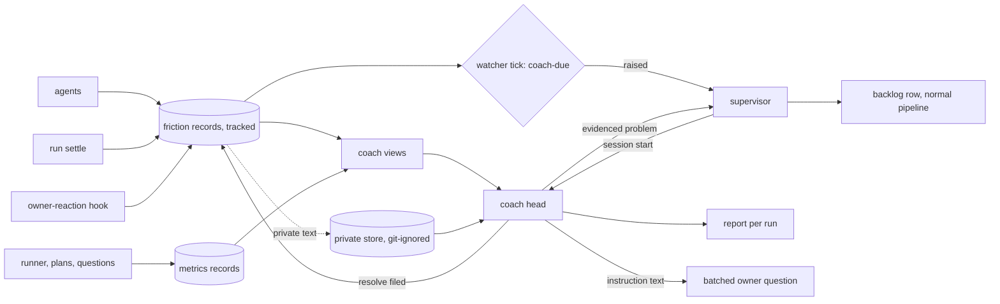

discussion: open

## Seed

Opened by the secretary (Miu) on the owner's order relayed by the owner-communication shaper, 2026-11-22 19:50.

- **Owner's goal:** a coach agent that the supervisor starts at the right moment and that learns from the observe metrics and the friction records. Observe is hardened with ready-made views built for the coach, in the manner of the owner's repository `vantt/pkm`. Automatic capture of the owner's reactions to agent messages (OC-D13, dropped from the communication standard plan) belongs here.
- **To shape:** when the supervisor starts the coach (trigger and budget); which observe views and friction records it reads; what it produces, for whom, and where; how owner-reaction capture works and is stored privately; what a first increment is.
- **Read first:** `plans/discussions/ds-cfsfcbknl6-owner-communication/DISCUSSION.md` (decisions OC-D11 to OC-D14), the observe area spec, and prior art by `git log -S` on friction and observe symbols.
- **Constraints:** one door, hexagonal and pluggable; the owner's reactions are private data and are not sent to an external service; bring owner decisions as five-part questions with a recommendation and a default.
- **Non-goals:** writing the coach; the communication standard itself (`ds-cfsfcbknl6`).
- **Source ids:** `p-kmavlfevvu`.

## 1. Trạng thái hiện tại

Round 2 (2026-11-22 20:45). The owner corrected the framing: his reactions are one learning event among many, and round 1 treated them too specially. The shaper agrees (section 5) and reshaped the design around **one generic learning loop**: many producers write learning events through the existing doors (friction, metrics records), and the coach reads them all the same way. Owner-reaction capture is now just one producer, with no design of its own beyond the hook. The privacy rule stays, but generalised: any detail that may hold private text (not only the owner's words) goes to a git-ignored local store.

- **Settled by inheritance:** coach scope and hand-off (OC-D5), friction store as the case log (OC-D4).
- **Shaper decisions inside the frame (held one round, not minted):** generic loop with pluggable producers; trigger as a watcher definition; private detail never in a git-tracked file.
- **Open, asked:** Q1 `q-6yhs63ru4i` (coach views: extend the named query definitions, or a pkm-style SQLite projection). Blocks only the views task.
- **Open, provisional defaults:** trigger thresholds and budget numbers (section 3).
- **For another session:** the communication-standard plan's friction duty quotes the owner's words into friction detail, which lands in a store git does not ignore (section 3, row "Privacy of detail"). The secretary should route this to that plan.

## 2. Mục tiêu & đề bài

fgOS already writes two kinds of learning material: metrics records and friction records (`fgos metrics`, `fgos friction`, both in `packages/observe/rust`), and more producers will come (the owner's reactions to agent messages, question wait times, verify misses, review findings). Nobody reads them on a schedule: the friction store's top classes are from August and September, and no session owns "look at what keeps going wrong and fix the cause". OC-D5 named that job the coach: a head the supervisor starts, which collects signals, diagnoses the real cause, proposes a fix capped per batch, measures the signature's count afterwards, and deletes or merges rules as readily as it adds them; a small text change to the standard goes to the owner in a batch, anything else goes back to the supervisor as an evidenced problem that becomes a backlog row. This discussion settles what OC-D5 left open: the moment and budget of a coach run, the ready-made views the coach reads so it gets aggregated data fast (the owner's model is `vantt/pkm`'s versioned agent views), what the coach writes and where, how a new producer of learning events plugs in without changing the coach (the owner-reaction hook is the first such producer, not a special case), how private detail is kept off git, and the smallest first increment.

## 3. Vấn đề rõ / chưa rõ

| Point | State | Evidence | Current reading |
|---|---|---|---|
| Coach scope and hand-off | **settled, inherited (OC-D5)** | `ds-cfsfcbknl6` DISCUSSION.md, OC-D5 row; owner 17:37 and 17:45 | Not reopened here. The coach owns the learning loop only; there are no standing area owners; hand-off goes through the supervisor to a backlog row, with a fast path for small standard text. |
| Case log | **settled, inherited (OC-D4)** | OC-D4 row | Raw cases are friction records; curated examples live in the standard. |
| Prior art | **clear** | `git log -S coach`: only the two discussions of today, no code, no persona in `core/agents/`. The nearest ancestor is the retrospective loop of tsk-1lv (`a670be686`, 2026-08-17: a "4-door check" inside a retrospective batch loop that recorded frictions), with `fgos-coding-knowledge` triggered on the work-item status `retrospective`. Its frictions are the top of `fgos friction rank` today (`retrospective-door-docDeferral` 64, `-routing` 29), last seen 2026-09-11, so that loop stopped producing when work moved from work items to heads and plans. Adjacent skills: `instruction-audit` (read-only periodic audit of the instruction surface) and `distill`. | The coach is new, but it should reuse: `instruction-audit` as one of its tools for rule changes, `fgos friction rank`/`resolve --reason filed:<id>` as its intake and close, and the watcher's definition-to-event-to-supervisor door for its start. The retrospective loop is not revived: it was tied to work-item statuses that no longer drive work. |
| When the supervisor starts the coach | **shaper decision on the door; numbers provisional** | `docs/platform/supervision/spec.md` lines 38, 121, 129: the watcher (Rust, no LLM) runs detection definitions each tick, records raised events, and the supervisor acts per row kind; `discussion-settled` already starts a planner this way. Definitions are `*.query.json` files run through `fgos metrics query` (`core/attention/definitions/`). | A watcher definition `coach-due` raises an event; the supervisor starts one coach head (`head:coach-<handle>`), never two. Provisional rule: raise when an unsettled friction signature reaches **3** records, or **5** new owner-communication frictions have arrived since the last coach run, or, as a floor, **7 days** passed with any unsettled friction. Reversal trigger: the coach's own report shows runs with nothing worth proposing (raise the thresholds) or a repeated fault that waited too long (lower them). |
| Coach budget | **provisional** | OC-D5 "thresholded and capped per batch" | One run handles at most **3** signatures and makes at most **3** proposals; it stops after its report. Numbers go to config (`coach.*` keys in `core/config-standard`), not code. |
| Coach views (how to build them) | **open, Q1 `q-6yhs63ru4i`** | Observe has a query grammar with join, anti-join, latest-per and having, plus named definitions in `*.query.json` (`packages/observe/rust/src/definition/`; observe spec section "Record contract v2"). `vantt/pkm` (`docs/agent-views.md`) builds a SQLite index from files that can always be rebuilt, exposes versioned SQL views (`v_note`, `v_link`, `v_issue` ...), records versions in an `agent_views` table, and holds names, versions and columns by contract tests; the agent opens it with `sqlite3 -readonly`. L3 ("truth in JSONL, the database is a view") allows either. | See Q1 in section 5 and the question store. Default while unanswered: named definitions first, SQL projection only on measured need. |
| What the coach reads | **clear in outline** | Friction records of every layer, run and unit records (`fgos.run.attempt`, `fgos.unit.verify`), plan activity, question records (`fgos.question.*`, declared but not yet produced) | Exact view list follows Q1; draft list in section 6. |
| What the coach produces | **shaper draft** | OC-D5 hand-off | One report per run (path from `fgos convention path --kind report`), at most 3 proposals; a batched owner question for standard text; a supervisor event per evidenced problem (the supervisor files the backlog row; the coach does not write the backlog); `friction resolve --class <sig> --reason filed:<backlog-id>` once filed; a before/after count per signature in the next run's report. |
| Learning producers | **shaper reading after owner 20:43** | Owner 20:43: his reactions are one learning event among countless others. Existing producers: agents (`fgos friction record`), run settle (`frictions` in a result claim), run/unit/verify records, plan activity, head state; declared but not yet produced: `fgos.question.*`. | Every producer writes through an existing door: a friction record (kind, layer, signature, refs) or a metrics record. The coach never knows a producer by name; it reads signatures and records through the views. A new producer is a new writer plus, at most, a new layer value or record kind declared beside its owner; no coach change. |
| Owner-reaction hook | **one producer among many** | Dropped phase-02 plan (`c61de4c1c`): a Claude Code `UserPromptSubmit` hook matching text-detectable signals and recording one friction per signature. | Kept as one small producer task, ranked after the coach and its views; it gets no special store, view or coach logic. |
| Privacy of detail | **shaper decision inside the frame; one item for another session** | `git check-ignore` matches nothing under `.fgos/observe/`; a friction shard and eval shards are committed; `records/` is untracked but not ignored; `.fgos` sync chores have committed `.fgos` trees before (`fbb52c64c`, `c3b0de893`); the remote is GitHub. | General rule, not owner-specific: a record whose detail may hold private text (the owner's words, transcript excerpts, credentials in output) keeps only ids and signature in the tracked store and puts the text in a git-ignored local store (draft `.fgos/observe/private/<writerId>.jsonl`). **Another session:** the communication-standard plan's OC-D14 duty quotes the owner's words in `friction record --detail`; its planner should point that text at the private store. |
| First increment | **shaper draft** | — | Section 7: coach head and its start first (reads today's friction with no new views), then the views, then producers one by one, the owner-reaction hook being one of them. |

## 4. Quyết định đã chốt

| ID | Decision | Source | Date |
|---|---|---|---|

No decision minted yet: the shaper decisions in section 3 have held for one round only. Inherited and not re-minted: OC-D4, OC-D5 (`ds-cfsfcbknl6`).

## 5. Q&A log

- 2026-11-22 20:10 — Round 1, shaper. Read the seed, OC-D4/OC-D5/OC-D11-D14, the observe spec, the supervision spec, the dropped phase-02 plan, `fgos friction rank` and `vantt/pkm/docs/agent-views.md`. Found OC-D5 already settles scope and hand-off, the retrospective loop as the nearest ancestor (stopped 2026-09-11), and that owner words in friction detail would land in a store git does not ignore. Wrote the provisional shape. Asked Q1 (coach views: named definitions or pkm-style SQL projection) through the question store.
- 2026-11-22 20:38 — Owner: "hãy trình bày lại mục tiêu của thảo luận này". Signals T8/T9: the round-1 report was in English and dense with ids. Shaper restated the goal in plain Vietnamese in chat. Friction to record (OC-D14 fallback, `friction record` refused this head with `verb-not-granted` at 20:38): kind `awkward`, layer `docs` (no `owner-communication` layer yet), class `owner-restate-too-dense-english`, ref `backlog:p-kmavlfevvu`.
- 2026-11-22 20:43 — Owner: "4. phản ửng của anh chỉ là một sự việc cần học trong muôn vàng sự việc khác, em đang treat nó quá đặc biệt". Shaper agreed: round 1 gave the owner's reactions their own hook, store, view and coach input, when they are one producer among many. Reshaped section 6 around one generic loop with pluggable producers; the privacy rule stays but covers any private detail; the owner-reaction view was removed and the hook ranked last. Signal T4 (re-aim). Friction to record once the door works (OC-D14 fallback; `friction record` refused this head at 20:38): kind `awkward`, layer `spec`, class `shaping-overweights-one-input`, ref `backlog:p-kmavlfevvu`.

## 6. Thiết kế đã chốt {#design}

Provisional: nothing here is minted yet. It is the shaper's draft for the owner to react to.

**One generic loop.** Many producers write learning events through the doors that already exist: agents and run settle write friction records, the runner and other components write metrics records, and small producers such as the owner-reaction hook write friction like anyone else. The coach does not know producers by name. Each watcher tick runs the `coach-due` definition over all unsettled friction. When it raises, the supervisor starts one coach head. The coach reads the coach views, picks at most 3 signatures whatever their source, diagnoses each, and writes one report. A small change to an instruction text (the communication standard, a skill) becomes one batched owner question; anything else becomes a supervisor event that the supervisor turns into a backlog row for the normal pipeline. The coach settles the frictions it filed and, on its next run, reports each signature's count before and after the fix.

**Adding a producer** means a writer plus, at most, a layer value or record kind declared beside its owner. The coach, its views and its trigger do not change.

**Coach views (pending Q1).** Default draft as named definitions under `core/coach/definitions/`, each versioned and held by a contract test on name, version and row shape (pkm's `agent_views` idea without a new database):

- `friction-hot`: unsettled signatures by count, distinct refs, first and last seen, any layer.
- `friction-by-layer-week`: counts per layer per week, to see trends and the effect of a fix.
- `run-failure-by-cause`: failed runs and verify findings by provider, executor and plan.
- `owner-wait`: time questions wait for the owner (`unmeasured` until `fgos.question.*` is produced).
- `fix-effect`: a signature's count in the window before and after its `filed:` resolve.

**Private detail.** Any detail that may hold private text stays in a git-ignored local store; tracked records carry ids and signatures only. This holds for every producer.

## 7. Danh mục hạng mục / task {#tasks}

Draft; the order is the proposed first increment.

### Coach head and its start {#task-coach-head}

- **Goal:** a `coach` persona and skill, and a `coach-due` watcher definition that makes the supervisor start one coach head; the coach works from today's `friction rank` and `metrics query` with no new views.
- **Design excerpt:** section 6, "The loop"; section 3 rows "When the supervisor starts the coach", "Coach budget", "What the coach produces".
- **D-IDs:** none yet; inherits OC-D5.
- **Siblings:** first; the other two only add inputs.
- **Draft verify:** `cargo test -p fgos-supervision` and the watcher definition test pass; a fixture store with one signature at 3 records raises `coach-due` once.

### Coach views {#task-coach-views}

- **Goal:** the ready-made views of section 6, built the way Q1 decides.
- **Design excerpt:** section 6, "Coach views".
- **D-IDs:** none yet; blocked on Q1.
- **Siblings:** after `task-coach-head`; independent of `task-owner-reaction`.
- **Draft verify:** a contract test asserts each view's name, version and row shape on a fixture store.

### Private detail store {#task-private-detail}

- **Goal:** a git-ignored local store for record detail that may hold private text, used by any producer; the friction door writes detail there when asked and keeps only ids in the tracked record.
- **Design excerpt:** section 6, "Private detail"; section 3 row "Privacy of detail".
- **D-IDs:** none yet.
- **Siblings:** before any producer that quotes people; independent of the coach tasks.
- **Draft verify:** a friction recorded with private detail leaves no detail text in `.fgos/observe/records/`; `git check-ignore` matches the private store path.

### Owner-reaction hook, one producer {#task-owner-reaction}

- **Goal:** the `UserPromptSubmit` hook from the dropped phase-02 plan, as one ordinary producer of friction.
- **Design excerpt:** section 3 rows "Learning producers" and "Owner-reaction hook".
- **D-IDs:** none yet.
- **Siblings:** after `task-private-detail`; needs the `owner-communication` friction layer from the communication-standard plan (its task 1). Ranked last.
- **Draft verify:** `cargo test -p fgos --test owner_reaction_hook`: "khoan, cái này là gì" records one friction whose tracked record has no owner words.
