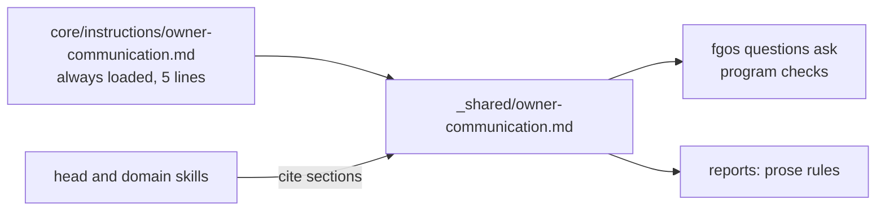

discussion: open

## Seed

Opened by the secretary (Miu) on the owner's order, 2026-11-22. The owner wants the lessons from today distilled into one common place so every agent (heads, leads, workers) talks to the human the same way: complete information, one clear action, low cognitive load.

- **Outcome:** one shared source, loaded by every agent, that covers questions, status reports and incident reports.
- **Input to read first:** `plans/reports/secretary-261122-1254-agent-human-communication.md` (what exists, seven gaps with evidence, open design points) and `core/skills/_shared/decision-question.md` (the existing five-part rule for questions).
- **Constraints:** extend or replace the existing source, never add a parallel one (design principle 1); change every caller and remove the old text in the same change (L10); rules a program can check go to `fgos questions ask`, the rest stays prose. The owner prefers that agents do read-only work first and bring findings plus a recommendation, so park owner questions in the store with a recommended option and a stated default instead of waiting.
- **Non-goals:** changing the approved-frame rule or the product priority order.
- **Open design points for the shaper:** one file or two; which checks are program-enforced; how a stale question is withdrawn (asker duty, or a watcher flagging a question whose plan is done).
- **Source ids:** `p-wb6rkwpjsg`.

## 1. Trạng thái hiện tại

Round 2 (2026-11-22 13:10). Domain: coding (the change edits fgOS core skills, the always-loaded instruction and possibly the `fgos questions` door).

The owner split the topic in two (section 5, 13:10). **Keeping information valid** (stale questions, status resting on an old flag) is not a communication rule. It is the job of the watchers and monitors: they must always supply fresh data and nudge the agent concerned. That part leaves this discussion and goes to its own backlog item; the secretary is asked to open it. **This discussion keeps only the form of communicating with the owner.** The goal: low cognitive load, so the owner can decide at once, in time, with information that is ready, clear and easy to understand.

Consequences: q-von37r6ef6 (how to withdraw a stale question) is cancelled as out of scope. The status-report rule no longer requires source, age and activity evidence; guaranteeing freshness belongs to the systems.

Open owner question (parked in the store; shaping continues around it):

- **q-xkrbp66xy6**: which form rules `fgos questions ask` enforces by program (section 3 row "Program checks").

Every other point carries a provisional default.

## 2. Mục tiêu & đề bài

The big goal is to lower the owner's cognitive load, so the owner can decide at once and in time, with the information already ready, clear and easy to understand. Today every agent that speaks to the owner follows only one shared rule, the five-part decision question, and that rule covers only one act: asking the owner to choose. Status, progress and incident reports have no shared shape (three head skills each say only "at most 10 lines, full report in a file"). Nothing says read-only work is done before speaking. Nothing says how to introduce a role, lane or id. Nothing makes an answer cheap (lettered options, the recommendation marked, a stated default). On 2026-11-22 this cost the owner avoidable turns: asked permission to read, unexplained names, long blocks to re-read, sentences to type where one letter would do. The outcome is one shared source, always loaded by every head, lead and worker in every CLI, that defines the **form** of every message to the owner: what the agent prepares before speaking, the common rules for any owner message, the decision question, the status report and the incident report. Rules a program can measure are checked by the `fgos questions ask` door; the rest stays prose. The source replaces the existing text rather than sitting beside it, and every caller moves in the same change. Out of scope: keeping information valid (fresh data, stale questions, nudging the concerned agent), which belongs to the watchers and monitors and is a separate item.

## 3. Vấn đề rõ / chưa rõ

| Point | State | Evidence | Current answer |
|---|---|---|---|
| Where it is loaded so every agent sees it | clear | `core/instructions/*.md` with `appliesTo: ["*"]` is rendered into each project's `AGENTS.md` by `src/setup/instruction-projections.mjs` (adapter `portable-agents-md`), which every agent CLI reads; `decision-question.md` is already one of them | The always-loaded instruction stays the door; it carries a short summary and points to the full fragment. |
| One file or two | **provisional** | `core/skills/_shared/decision-question.md` (53 lines) is cited by about 20 source files (6 core skills, 6 coding-domain skills, 4 platform docs, reading map, AGENTS render) plus 4 code/test refs (`src/state/decision-question.mjs`, `src/state/status-fsm.mjs`, `test/docs/rul11-anchor-phrase.test.mjs`, `test/state/awaiting.test.mjs`); generated copies under `.agents/skills` and `plugins/fgOS` rebuild with `npm run build:skills` | **Default: one file.** Rename the fragment to `core/skills/_shared/owner-communication.md` and the instruction to `core/instructions/owner-communication.md`; the decision question becomes one section of it; every caller moves and the old paths are removed in the same change (L10). Two files would split one act (speaking to the owner) across two doors, and the common rules (names, source and age, answer friction) apply to both. Reverse if the single file goes past about 150 lines, or the owner wants questions kept as a separately citable law. |
| Read-only work first | provisional | Report gap 1: two secretary messages asked permission to read or check | Prose rule: reading, checking, re-verifying and drafting are done before speaking; a message never asks permission for read-only work; it brings findings plus a recommendation. Only a write, a spend outside the approved frame, or an outward action is asked. |
| Common rules for any owner message | provisional | Gaps 4, 5 | Prose: outcome first; one action per item; first mention of a role, lane, id or term gets one plain phrase; a pointer to a numbered item says which item; say what was checked and what was not. |
| Status / progress report shape | provisional | Gap 6; `core/skills/fgos-lead/SKILL.md:76`, `fgos-secretary/SKILL.md:93`, `fgos-supervisor/SKILL.md:112` each repeat "at most 10 lines, full report in a file" | Section in the shared file: outcome; done (with ids explained); checked and not checked; owner decisions (one per item, recommendation first, lettered, default); at most 10 lines, full report in a file named by `fgos convention path --kind report`. The three skills drop their own lines and point to it. |
| Incident report shape | provisional | Gap 6 | Same frame plus: impact now, what was done to contain it, what is still at risk, the one decision needed. |
| Answer friction | provisional | Gap 5: owner answers "A", "ok", "ok duyệt" | Options lettered A-D, recommended one first and marked, a stated default ("no answer by <when> → I take A"). Whether the store enforces part of this: **q-xkrbp66xy6**. |
| Program checks | **open, owner question q-xkrbp66xy6** | `packages/questions/contracts/questions-input.v1.json` already checks headline ≤120 chars on one line, 2-4 options, exactly one recommended, scope allows/forbids, `blocks`; it has no field for a default | Recommended: add a required `parts.ifUnanswered` (what the asker does, and when, if no answer comes) and require the headline to end with "?"; the store letters options A-D when it renders, so the asker writes nothing extra. Everything else stays prose. |
| Information validity (stale questions, status on an old flag) | **out of scope (owner, 13:10)** | Gaps 2 and 3: 5 of 8 open questions were moot; `leadLive: true` reported while the lead was idle. `refusals.v1.json` `not-asker`; the store never looks at the state behind a `ref`. | Separate backlog item: watchers and monitors always supply fresh data and nudge the concerned agent. q-von37r6ef6 cancelled. The secretary is asked to open the item. |
| Shared memory of lessons | provisional | Gap 7 | Solved by the outcome itself: the lesson lives in the shared fragment, not in one head's memory. No memory mechanism is built. |
| Approved-frame rule, priority order | non-goal | Seed | Moved into the new file unchanged. |

## 4. Quyết định đã chốt

| D-ID | Decision | Source | Date |
|---|---|---|---|

(None yet. A point gets a D-ID only after it holds across more than one round.)

## 5. Q&A log

- 2026-11-22 13:05 — Round 1. Shaper scouted `decision-question.md` (fragment and instruction), `questions-input.v1.json`, `refusals.v1.json`, questions spec §4-§5, the report sections of `fgos-lead`, `fgos-secretary`, `fgos-supervisor`, and `instruction-projections.mjs`. Wrote provisional answers for every point. Parked two owner questions (stale-question mechanism, program checks); the other points carry defaults that a planner can use if the owner does not object.

- 2026-11-22 13:10 — Owner (in the shaper session, after the two questions were explained in Vietnamese): "cần lưu ý, có 2 vấn đề 1) độ còn valid của thông tin, việc này không cover trong cách giao tiếp, mà là cách các hệ thống watcher, monitor phải luôn cung cấp dữ liệu mới và nhắc agent liên quan. 2) chổ này liên quan đến cách, hình thức giao tiếp và trao đổi với human. mục tiêu lớn giảm tải nhận thức, ra quyết định ngay, kịp thới với thông tin sẵn sàng, rõ ràng, dễ hiểu." Shaper: information validity leaves this discussion and becomes a separate item; q-von37r6ef6 cancelled; §2 rewritten around the cognitive-load goal; the status-report source/age rule and the "life of an open question" section dropped; §6 regenerated. q-xkrbp66xy6 still stands (form).

## 6. Thiết kế đã chốt {#design}

Nothing is settled yet. Draft shape under the provisional answers, for the owner to react to:

One shared fragment, `core/skills/_shared/owner-communication.md`, replaces `decision-question.md`. The always-loaded instruction `core/instructions/owner-communication.md` (replacing `decision-question.md`, `appliesTo: ["*"]`) gives every agent in every CLI a five-line summary and the pointer. Sections of the fragment:

The yardstick for every rule is the owner's cognitive load: can the owner decide at once from what is on the screen?

1. **Before you speak**: do the read-only work first; never ask permission to read, check or draft; arrive with findings and a recommendation.
2. **Every owner message**: outcome first; one action per item; explain names and ids on first use; say what was checked and what was not.
3. **Decision question**: today's five parts, the approved frame and "make it easy to answer", plus lettered options, the recommendation first and a stated default.
4. **Status and progress report**: fixed order, at most 10 lines, full report in a file.
5. **Incident report**: the same order plus impact, containment and remaining risk.

`fgos questions ask` checks what q-xkrbp66xy6 settles; every other rule stays prose. Keeping the information fresh is not in this design; it belongs to the watchers and monitors (separate item).

## 7. Danh mục hạng mục / task {#tasks}

Filled once Q1 and Q2 are answered and the shape holds for a second round.
