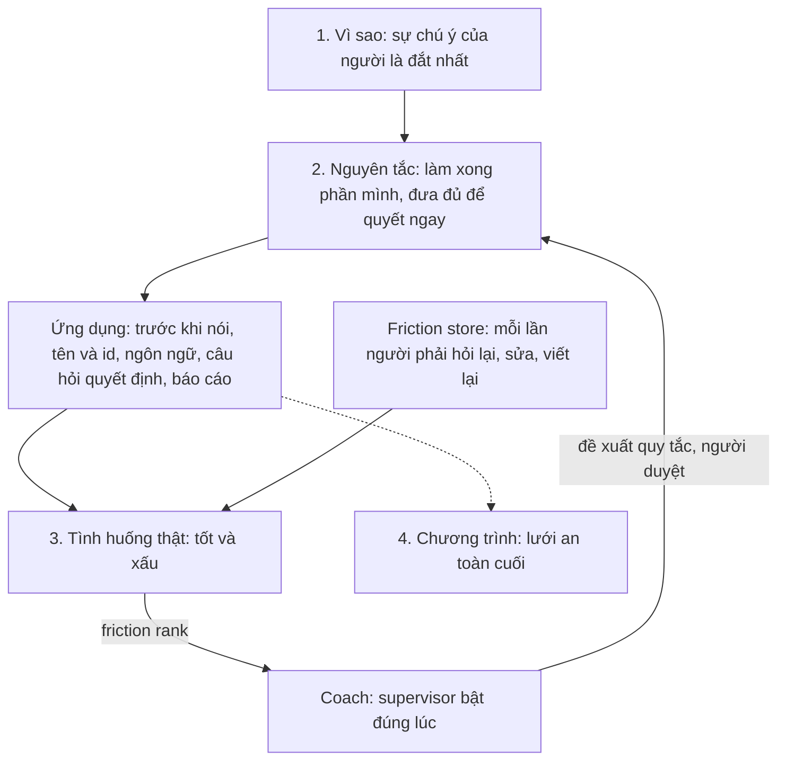

discussion: open

## Seed

Opened by the secretary (Miu) on the owner's order, 2026-11-22. The owner wants the lessons from today distilled into one common place so every agent (heads, leads, workers) talks to the human the same way: complete information, one clear action, low cognitive load.

- **Outcome:** one shared source, loaded by every agent, that covers questions, status reports and incident reports.
- **Input to read first:** `plans/reports/secretary-261122-1254-agent-human-communication.md` (what exists, seven gaps with evidence, open design points) and `core/skills/_shared/decision-question.md` (the existing five-part rule for questions).
- **Constraints:** extend or replace the existing source, never add a parallel one (design principle 1); change every caller and remove the old text in the same change (L10); rules a program can check go to `fgos questions ask`, the rest stays prose. The owner prefers that agents do read-only work first and bring findings plus a recommendation, so park owner questions in the store with a recommended option and a stated default instead of waiting.
- **Non-goals:** changing the approved-frame rule or the product priority order.
- **Open design points for the shaper:** one file or two; which checks are program-enforced; how a stale question is withdrawn (asker duty, or a watcher flagging a question whose plan is done).
- **Source ids:** `p-wb6rkwpjsg`.

## 1. Trạng thái hiện tại

Round 5 (2026-11-22 15:50). Domain: coding (the change edits fgOS core skills and the always-loaded instruction).

**What just settled.** The owner confirmed the shaper's reading of "communicating better with a human" and asked for it to be written down as a standard named **thấu hiểu user** (understanding the user). The discussion works in four steps, in order: (1) why, the motive; (2) what good looks like, judged from the reader's side; (3) cases, good and bad, taken from real exchanges; (4) only then, whether a program should help. The standard is a living one: bad exchanges are collected as cases, learned from, and folded back into it.

**Where it stands.** Step 1 and the core of step 2 are written (section 6). Step 3 has its seed cases from 2026-11-22, including the shaper's own messages. Step 4 is not started. The two mechanism questions asked earlier (program checks in `fgos questions ask`, and an end-of-turn check) were cancelled as premature; they come back at step 4 only if still needed.

**Since then.** Bad exchanges are kept in the friction store (round 6). The one who learns from them is a **coach**, started by the supervisor at the right moment and owning every self-improvement job of the system (owner 17:16). The coach is its own item; this discussion only says what the coach takes from the standard.

**Open, not blocking.** Step 4 (program support). Two items need backlog rows the shaper cannot write: information freshness (OC-D1) and the coach role. No owner question is open.

## 2. Mục tiêu & đề bài

Agents in fgOS speak to the owner many times a day, and the owner's attention is the scarcest and most expensive thing in the whole system. Today the only shared rule is the five-part decision question, and it covers one act (asking the owner to choose). Its guard only counts labels, so a question can pass it and still be hard to understand. Nothing tells an agent why it should communicate well, or what "well" means outside a question. On 2026-11-22 the owner spent turns asking permission back ("yes, just do it"), asking what a name meant ("who is OPC?"), re-reading long blocks and having a question rewritten; the shaper's own first messages in this discussion did the same (English, long, full of ids and file paths). The outcome is one shared standard, **thấu hiểu user**, always loaded by every head, lead and worker in every CLI. It gives the motive first, then a principle judged from the reader's side, then how the principle applies to each kind of message (before speaking, names and ids, decision questions, status and incident reports), then a growing set of real cases, good and bad, that agents learn from and that improve the standard over time. A program check is a last safety net, chosen at the end, never the reason an agent communicates well. The standard replaces the existing decision-question text rather than sitting beside it. Out of scope: keeping information valid (fresh data, stale questions, nudging the concerned agent), which belongs to the watchers and monitors and is a separate item.

## 3. Vấn đề rõ / chưa rõ

| Point | State | Evidence | Current answer |
|---|---|---|---|
| Name and purpose of the standard | **settled, OC-D2** | Owner 15:50 | "Thấu hiểu user". Purpose: the owner decides at once from what is on the screen, without asking back or looking anything up. |
| Order of work | **settled, OC-D3** | Owner 15:50 accepts the shaper's four steps | Why, then standard, then cases, then mechanism. |
| Information validity | **settled out of scope, OC-D1** | Owner 13:10; held unchallenged through rounds 3-5 | Separate item for watchers and monitors. Not yet in the backlog: the secretary could not be reached by mailbox (name `secretary` unknown); the owner was told at 13:15. |
| Where it is loaded so every agent sees it | clear | `core/instructions/*.md` with `appliesTo: ["*"]` is rendered into each project's `AGENTS.md` by `src/setup/instruction-projections.mjs`, which every agent CLI reads; `decision-question.md` is already one of them | The always-loaded instruction carries the motive and the principle in a few lines and points to the full standard. |
| One file or two | provisional | The decision-question fragment is cited by about 20 source files and 4 code/test files | Default: one standard file that absorbs today's decision-question text as one of its applications; every caller moves in the same change (L10). Reverse if the file grows past what an agent will read, in which case the case log moves to a sibling file. |
| Case log: where, who adds, how it improves the standard | provisional (round 6) | Owner 15:50: "thu thập thêm các tình huống trao đổi không tốt và học rồi cải thiện"; owner 16:00: "bộ friction có ghi nhận được không?". Friction store (`docs/platform/observe/spec.md` lines 136-138; `core/skills/_shared/friction-capture.md`): one record has a subject, a stable signature (`class`), a kind (`awkward` fits), a detail text (capped), refs; `fgos friction rank` counts each signature's repeats with first and last seen. The layer list is closed (`skill`, `tool`, `runner`, ..., `context`, `task`) with no value for talking to the owner; a value is added by editing `packages/observe/rust/friction-kinds.json`, no code. `friction-capture.md`'s "record when" list has no owner-confusion trigger. | **Default: the friction store is the case log; no new file** (one door). Raw cases go to friction as records (the log); the standard keeps only a few curated examples (the state), matching L1. Needed: (1) a layer value for owner communication in `friction-kinds.json`; (2) a trigger in `friction-capture.md`: the signals listed in section 6, step 3 (owner 17:30 named emotion change, frustration and not following the agent's recommendation; the shaper added the rest); (3) one stable signature per kind of fault (for example permission-asking, unexplained id, too long or wrong language); (4) when `fgos friction rank` shows a signature repeating, it is proposed as a line of the standard, batched for the owner. Who watches the rank and proposes: **the coach** (owner 17:16), not the secretary. |
| Coach role | **owner direction 17:16; its own item, outside this discussion** | Owner: "không nên là miu. là một người khác được bật bởi supervisor luôn. có thể là coach ... mọi thứ cần tối ưu, self-improve, self-learning đều nên cho coacher làm." Prior art: no coach persona in `core/agents/` and no `coach` in code, specs or git history; adjacent skills `instruction-audit` (periodic audit of the instruction surface) and `distill` exist; the supervisor already starts heads with `fgos session start`. | A coach head, started by the supervisor when the watcher sees the right moment, owns every optimisation, self-improvement and self-learning job of the system. This standard is one of its inputs: the coach reads the owner-communication friction, proposes new lines for the standard in a batch for the owner, and curates its examples. Defining the coach (persona, when it is started, its verbs) is a separate backlog item with its own shaper; this discussion only names the hand-off. Not yet in the backlog (shaper cannot write it; mailbox to the secretary refused from this sandbox). |
| Gaps 1 and 4 | in scope (owner 14:55) | Seed cases C1 and C4 in section 6 | Covered by the principle's applications "before you speak" and "names and ids". |
| Gaps 5, 6, 7 | provisional | Owner named 1 and 4 at 14:55 | 5 and 6 are applications of the principle (cheap answers, report shape). 7 is answered by the standard itself: the lesson lives in one shared place, not in one agent's memory. |
| Program support (step 4) | not started | Existing guard checks labels only (`src/state/decision-question.mjs`), on ask-tool calls only; Claude and Codex already run fgOS end-of-turn hooks | Taken up after step 3. Earlier questions on it cancelled. |
| Approved-frame rule, priority order | non-goal | Seed | Moved into the standard unchanged. |

## 4. Quyết định đã chốt

| D-ID | Decision | Source | Date |
|---|---|---|---|
| OC-D1 | Keeping information valid (fresh data, stale questions, status on an old flag) is not part of this standard; it belongs to the watchers and monitors and is a separate item. | Owner 13:10, unchallenged through 15:50 | 2026-11-22 |
| OC-D2 | The standard is named **thấu hiểu user**. Its core: the owner's attention is the scarcest resource; the agent does all of its own work before speaking; what it brings must let the owner decide at once without asking back or looking anything up. The motive is respect for the owner's attention and freeing the owner from waiting (product priority 2); a program check is a safety net, not the reason. | Shaper's reading at 15:44, owner confirmed at 15:50 | 2026-11-22 |
| OC-D3 | The work goes in four steps: why, standard, cases, mechanism. | Shaper proposal 15:44, owner accepted 15:50 | 2026-11-22 |

## 5. Q&A log

- 2026-11-22 13:05 — Round 1. Shaper scouted `decision-question.md` (fragment and instruction), `questions-input.v1.json`, `refusals.v1.json`, questions spec §4-§5, the report sections of `fgos-lead`, `fgos-secretary`, `fgos-supervisor`, and `instruction-projections.mjs`. Wrote provisional answers for every point. Parked two owner questions (stale-question mechanism, program checks); the other points carry defaults that a planner can use if the owner does not object.

- 2026-11-22 13:10 — Owner (in the shaper session, after the two questions were explained in Vietnamese): "cần lưu ý, có 2 vấn đề 1) độ còn valid của thông tin, việc này không cover trong cách giao tiếp, mà là cách các hệ thống watcher, monitor phải luôn cung cấp dữ liệu mới và nhắc agent liên quan. 2) chổ này liên quan đến cách, hình thức giao tiếp và trao đổi với human. mục tiêu lớn giảm tải nhận thức, ra quyết định ngay, kịp thới với thông tin sẵn sàng, rõ ràng, dễ hiểu." Shaper: information validity leaves this discussion and becomes a separate item; q-von37r6ef6 cancelled; §2 rewritten around the cognitive-load goal; the status-report source/age rule and the "life of an open question" section dropped; §6 regenerated. q-xkrbp66xy6 still stands (form).

- 2026-11-22 14:55 — Owner, quoting the seven gaps: "câu 1 và câu 4 là các vấn đề cần xử lý tại đây. nó cũng giống như trước đây hình như cũng từng có lần xử lý hook gì đó mà mỗi lần hỏi phải ghi rõ là: chuyện gì đang xảy ra, tại sao, em advise thế nào, ..." Shaper: gaps 1 and 4 confirmed in scope. The recalled guard is `fgos hook decision-question` (commit 3d3d32648); it sees only ask-tool calls, never plain chat. Parked q-nfgvjge6zg on enforcing gaps 1 and 4 at turn end. Gaps 5-7 stay provisional.

- 2026-11-22 15:44 — Owner: "trước khi anh trả lời, anh muốn hỏi là em có hiểu ý của anh trong việc: trao đổi tốt hơn với người là như thế nào không. discussion này nhắm thiết lập một chuẩn mực cũng như động lực trao đổi tốt hơn với người." Shaper restated its understanding (attention is the scarcest resource; the agent does the heavy work; a good message is decided on in one read; standard judged from the reader's side; motive over checks), admitted it had jumped to mechanisms and that its own messages showed the same faults, and proposed four steps: why, standard, cases, mechanism.

- 2026-11-22 15:47 — Owner: "ví dụ như ở hook decision question, tại sao phải làm như vậy, nhằ mục đích gì". Shaper: no written rationale found beyond the commit (2026-10-08, "check owner questions against one decision-question template") and the template's own words ("the question is a narrow confirm on top of the analysis"). Read each of the five parts as answering a question the owner would otherwise ask back; the guard counts labels only, so a question can pass it and still be hard to read. Gaps 1 and 4 share the root: the agent pushes its own work onto the owner. Proposed the root principle.

- 2026-11-22 15:50 — Owner: "đúng và anh nghĩ em nên ghi rõ ràng cái hiểu như trên của em vào thảo luận để xem nó như là một tiêu chuẩn: `thấu hiểu user`. để xuất 4 bước của em cũng tốt. và bộ chuẩn mực này có thể thu thập thêm các tình huống trao đổi không tốt và học rồi cải thiện cách trao đổi vào đây." Shaper: minted OC-D1 to OC-D3; wrote steps 1-2 and seed cases into §6; cancelled q-xkrbp66xy6 and q-nfgvjge6zg as premature (step 4); case-log mechanics opened in §3.

- 2026-11-22 16:00 — Owner, after the shaper proposed a separate case file: "bộ friction có ghi nhận được không?" Shaper scouted the friction store: yes, with a data-only addition (a layer value) and a new trigger in the friction-capture rule; `fgos friction rank` already gives the repeat count that decides when a case becomes a rule. The separate case file is dropped; raw cases go to friction (log), curated examples stay in the standard (state).

- 2026-11-22 17:16 — Owner: "không nên là miu. là một người khác được bật bởi supervisor luôn. có thể là coach chẳn hạn. watcher/supervisor ở đúng thời điểm thì sẽ bật coach lên để tối ưu hệ thống. mọi thứ cần tối ưu, self-improve, self-learning đều nên cho coacher làm." Shaper: the curator of the case log is the coach, not the secretary. No coach exists today (scouted). The coach role is wider than this standard, so it becomes its own item; this discussion records only what the coach takes from it.

- 2026-11-22 17:30 — Owner: "việc kích hoạt ghi nhận friction thì để ý mấy lúc mà human bị thay đổi cảm xúc, bực tức hoặc không làm theo đề nghị của agent sẽ là các tín hiệu để theo dõi, em có thể liệt kê thêm các tín hiệu khác." Shaper: wrote the trigger list T1-T12 into §6 step 3 (T1-T2 from the owner, T3-T12 added with today's examples), with a caveat that T2 is friction only when the owner's reason shows missed context.

## 6. Thiết kế đã chốt {#design}

The standard **thấu hiểu user**, as it stands. Steps 1 and 2 are settled in substance (OC-D2), their wording is not final; step 3 holds seed cases; step 4 is not started.

### Bước 1 — Vì sao (động lực)

Of everything in the system, the owner's attention is the scarcest and the most expensive. Every message the owner reads costs some of it. An agent holds the full context and the owner does not, so the heavy work (reading, checking, comparing, weighing) is the agent's job, done before it speaks; the owner is left with only the decision. An agent communicates well because it understands this and respects the owner's attention, which is what frees the owner from sitting and waiting (product priority 2). A program check can catch a slip, but if the check becomes the reason, agents learn to write for the check: all five labels present and still hard to read.

### Bước 2 — Thế nào là tốt (chuẩn mực, đo từ phía người đọc)

**Principle.** The agent finishes its own work before it speaks, and everything it brings is enough for the owner to decide at once, without asking back and without looking anything up.

**Test before sending.** Read the message as a busy person with no context: can that person understand it in one read and decide? If the person would ask "what is this?", "why?", "what do you suggest?" or "what happens if I say yes?", the message is not done.

**Applications** (each is the principle applied to one kind of message):

- **Before you speak.** Reading, checking and drafting are the agent's own work; never ask permission for them. Come with findings and a recommendation. Ask only for what is the owner's to decide.
- **Names and ids.** The first time a role, lane, id or term appears, give it one plain phrase. A pointer to a numbered item names the item. An id is never the only handle.
- **Language and length.** The owner's language, plain words, outcome first, the shortest message that is still complete.
- **Decision question.** The five parts each answer a question the owner would otherwise ask back: what is happening (context), cause (proof the agent investigated), options with gain, harm and cost (the comparison already done), recommendation (the agent takes a position), scope of the answer (a yes has edges). Options are lettered, the recommended one first, with a stated default, so one letter or silence is a full answer.
- **Status and incident reports.** Outcome first; what was done, with names explained; what was checked and what was not; the one decision needed, if any, as a decision question; at most 10 lines, detail in a file.

### Bước 3 — Tình huống (case log)

**How cases are kept (provisional).** Every bad exchange is recorded in the friction store, the same door agents already use for any obstacle: a signature naming the kind of fault, and a detail holding the situation, what the agent wrote, what it cost the owner, the part of the principle it broke and the better version. The trigger is the owner's reaction. Signals (provisional list; the first three from the owner, 17:30, the rest added by the shaper from 2026-11-22):

| # | Signal | What it usually means | Seen 2026-11-22 |
|---|---|---|---|
| T1 | The owner's mood changes: irritation, sharp tone, "!!", "đã nói rồi" | Something already said was ignored, or the message wasted attention | — |
| T2 | The owner does not follow the agent's recommendation | The agent missed context or intent; record it only when the owner's reason shows that, not for an ordinary disagreement | — |
| T3 | The owner asks back: "là gì", "ai", "cái nào", "khoan" | Unexplained name, id or term; the question itself was unclear | "OPC là ai", "khoan giờ câu hỏi là gì" |
| T4 | The owner pulls back or re-aims: "không phải", "cần lưu ý", "em có hiểu ý anh không" | The agent misread the goal and ran ahead | 13:10, 15:44 in this discussion |
| T5 | The owner has to repeat an earlier instruction or decision | The agent forgot or did not carry it | — |
| T6 | The owner answers "cứ làm đi", "ok làm luôn" to a request | The agent asked permission for its own work | the secretary's "do you want me to present it?" |
| T7 | The owner supplies the information or checks it personally (pastes text, opens a file, catches an error first) | The agent did not bring the information ready or overstated what it knew | the seven-gap list pasted at 14:55; `leadLive` caught twice |
| T8 | The owner rewrites or summarises the agent's message ("ý em là...") | The message was too long or too dense | — |
| T9 | The owner asks for simpler words or another language | Wrong level or language | first English question in this discussion |
| T10 | One decision takes more than one round trip | The message was not decidable in one read | the first two owner questions here |
| T11 | The owner ignores a question or answers a different point | The message did not land or did not look like a decision | — |
| T12 | The owner interrupts the agent or rejects a tool call | The agent was doing something the owner did not expect | — |

The agent that receives the owner's message is the one placed to see the signal, so it records the friction, quoting the owner's words and its own message; it never argues with the signal or waits to be sure. Some signals (T10, T11, T12) can be counted by a program; that belongs to step 4. `fgos friction rank` shows which faults repeat. The **coach** (a head the supervisor starts at the right moment, owning all self-improvement; defined in its own item) reads them and proposes a repeating one, in a batch, as a line of the standard, and curates the examples. The standard itself keeps only a few curated examples like the ones below. Seed cases from 2026-11-22:

| # | Situation | What the agent wrote | Cost to the owner | Broke | Better |
|---|---|---|---|---|---|
| C1 | Secretary presenting an owner question | "I have not read it closely, do you want me to present it in the five-part form?" | A turn spent saying "yes, just do it", no information gained | Before you speak | Read it, then present it in five parts with a recommendation |
| C4 | Supervisor line relayed to the owner | "Asked OPC to handle it, passed question 2 to the stability lead" | "Who is OPC?", "which question 2?" | Names and ids | "Asked OPC (the lead running the stability plan) to handle it; passed the question about X to that lead" |
| C5 | Several owner questions | Options unlettered, no default | The owner typed sentences where one letter would do | Decision question | Lettered options, recommended first, "no answer → I take A" |
| S1 | This shaper's first question to the owner | A long English question with ids (`q-…`), file paths and refusal codes | "What is the question?" — a full rewrite was needed | Language and length; names and ids | Short Vietnamese, plain words, no ids unless explained |
| S2 | This shaper's first rounds | Jumped to hooks, validators and new required fields | The owner had to step back and ask whether the shaper understood the goal | Why before how | State the understanding first, check it with the owner, then the mechanism |

### Bước 4 — Hỗ trợ bằng chương trình

Not started. Known facts: the existing guard checks labels only, on ask-tool calls only; Claude Code and Codex already run fgOS end-of-turn hooks.

## 7. Danh mục hạng mục / task {#tasks}

Filled once step 3's case-log mechanics are settled and step 4 is decided.
